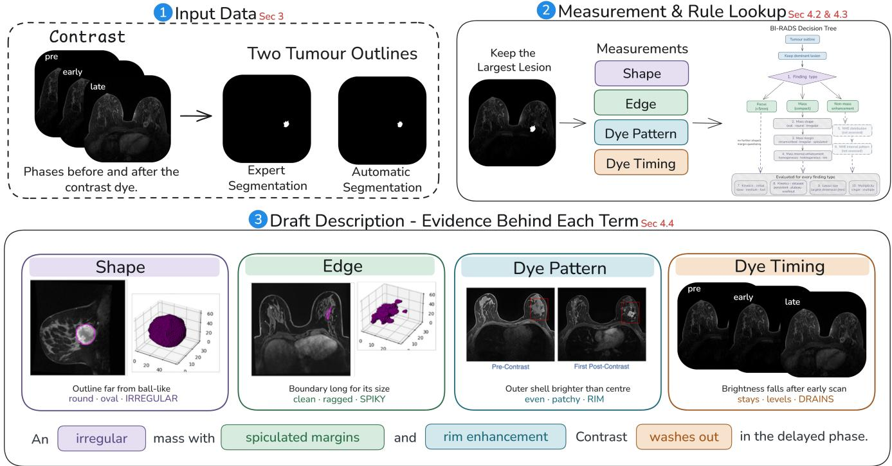
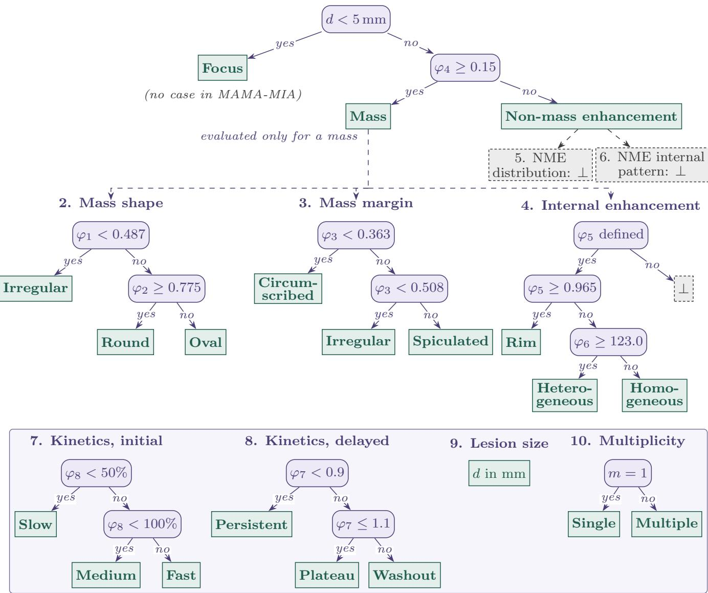
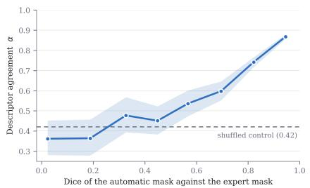
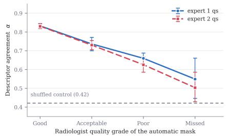
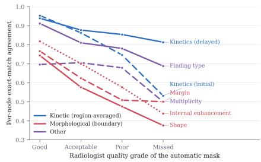

# Reading the Mask: Descriptor-Grounded BI-RADS Rationale Generation for Breast MRI Segmentation

Aarti Sharma⋆

Department of Applied Mathematics and Scientific Computing, Indian Institute of Technology Roorkee Roorkee, India

Divyanshu Kumar Indian Institute of Technology Madras Chennai, India

Hrishikesh Singh⋆

Department of Applied Mathematics and Scientific Computing, Indian Institute of Technology Roorkee Roorkee, India

Millie Pant†   
Department of Applied Mathematics and Scientific   
Computing, Indian Institute of Technology Roorkee Roorkee, India

## ABSTRACT

Deep learning based models accurately delineate tumours on dynamic contrast-enhanced MRI (DCE-MRI), but segmentation masks alone do not provide the rationales or reasoning used by radiologists to assess the lesion suspicion. This limits the explainability as well the clinical integration. We investigate whether clinically relevant descriptors can instead be derived from the segmentation masks and their dynamic contrast-enhancement series. We have used Breast Imaging Reporting and Data System (BI-RADS) guidelines as a structured framework. Using these guidelines we designed a BI-RADS decision tree with eight quantitative measurements using radiomics, together with the lesion size and component count, that determine the descriptors at eight nodes. Using these descriptors we generate natural-language rationale using a large language model. The model was constrained to express only the derived records from the decision tree. After applying this framework to the expert and automatic masks of each of the 1,506 cases in the MAMA-MIA dataset, we generated a reproducible corpus of 3,012 BI-RADS grounded rationales. We obtained a faithfulness score of 99.98% and a counterfactual accuracy of 99.3%, indicating that the generated rationales faithfully verbalises the measured descriptors and correctly reflects changes in the underlying record. Agreement between the descriptors from expert and automatic masks falls from 0.832 to 0.549 as mask quality falls from Good to Missed. The generated rationales are intended as draft representations for radi ologist review and final sign-of rather than autonomous clinical reports.

## CCS CONCEPTS

• Applied computing → Health informatics; • Computing methodologies → Computer vision; Natural language generation.

## KEYWORDS

Breast MRI, BI-RADS, explainable medical imaging, radiomics, rationale generation, segmentation quality, large language models

## 1 INTRODUCTION

When radiologists analyse the contrast-enhanced breast MRI, they use standardised guidelines such as BI-RADS (Breast Imaging-Reporting and Data System) to locate lesions, describe their morphology and assess malignancy risk. On the other hand, the automated segmentation methods tell only a lesion boundary or mask. They lack explanation of the image features which support the results. This lack of clinically meaningful rationales makes the automated segmentation harder to interpret and trust. This creates a barrier in their clinical adoption.

There are several methods which improve interpretability. Posthoc methods such as Grad-CAM [19] identify the influential image regions but do not associate them with clinical descriptors. More recently, the researchers in [12] have generated PI-RADS style reasoning alongside lesion masks but their methodology relies on radiologist-authored reports. Such report-based supervision is expensive and dificult to obtain for large retrospective datasets.

We propose a report-independent framework for generating BI-RADS grounded rationales from breast DCE-MRI. Our key observation is that many breast BI-RADS descriptors such as shape, margin, internal enhancement and kinetic behaviour - that is, how the lesion’s contrast enhancement changes over time after the contrast injection - can be quantitatively derived from the segmentations and dynamic MRI data. Thus, we reverse the conventional pipeline. We compute these measurements directly from images and masks, then we convert the resulting measurements into structured BI-RADS descriptors and natural-language rationales. We apply the framework to all 1,506 cases in MAMA-MIA [5] without additional radiologist annotation and evaluate the generated rationales using four annotation-free metrics: faithfulness, hallucination rate, omission rate, and counterfactual accuracy. Since every case has both an expert and an automatic mask, we also measure how much the descriptors change when the automatic mask is used. This provides a scalable alternative to report-dependent approaches for producing clinically grounded explanations of breast MRI lesions.

## 2 RELATED WORK

Encoder-decoder networks [17] remain the standard for volumetric lesion delineation, with nnU-Net [8] providing a self-configuring pipeline which is challenging to outperform without task-specific optimisation. Segmentation models adapted to medical data, Med-SAM [11], extend promptable segmentation to radiological volumes. But these methods do not provide interpretable outputs beyond the mask itself. Another class of interpretable methods involve gradient-based methods [19], which assign importance to pixels but leave the clinical rationale of the highlighted region unspecified. Concept bottleneck models [9] provide named intermediates, but further analysis [13] has questioned whether the learned concepts correspond to what their names suggest. Prototype-based classifiers [2] use a representative example of a particular class to develop reasoning, but they are limited by the set of prototypes they learned beforehand. Contrastive image-text pretraining [16], adapted to biomedical corpora as in BiomedCLIP [21], aligns the whole image with entire captions. This type of global alignment cannot distinguish multiple findings in the same organ.

Quantitative DCE-MRI features have been related to BI-RADS descriptors [6, 14], kinetic curves classified automatically [3], and template-based reports generated for chest X-rays [15]. We add the record as the only input to a text generator, and a paired comparison of expert and automatic masks.

## 3 DATASET

MAMA-MIA [5] is a multi-centre collection of 1,506 breast DCE-MRI studies assembled from four public TCIA [4] cohorts: ISPY2 [7], DUKE [18], ISPY1 [7] and NACT. This dataset contains expert masks and autogenerated masks. The autogenerated masks are graded by quality by two experts visually. The released grades are Good, Acceptable, Poor and Missed. There are three to six post-contrast phases per study. Acquisition timestamps are provided for each study. A multifocality indicator has also been provided for 1,346 cases.

## 4 PROPOSED APPROACH

Our method generates rationales grounded in the ACR BI-RADS Atlas (5th edition) MRI lexicon [1] for the breast DCE-MRI dataset consisting of lesion segmentation masks. First, we prepare the lesion representation (Section 4.1), then we extract the quantitative lesion measurements (Section 4.2). These features describe the morphology as well as the contrast-enhancement behaviour of the lesions. We then map these measurements to the BI-RADS descriptors (Section 4.3), finally a large language model (LLM) converts the structured BI-RADS records into a natural-language rationale (Section 4.4).

## 4.1 Step 1: Preparing the Lesion Representation

The segmentation masks may contain multiple disconnected regions, which is common in multifocal disease. Computing the shape features on the full mask may therefore give misleading values, hence we first identify the connected components and then select the dominant lesion for morphological analysis.

4.1.1 Connected component analysis. Let � denote the binary lesion mask. We identify its connected components using 26-connectivity:

$$
M = \bigcup _ { i = 1 } ^ { m } C _ { i } ,\tag{1}
$$

where � is the total number of connected components. Two voxels are considered connected if they share a face, edge, or corner.

We define the dominant component as the largest connected component:

$$
M ^ { * } = \arg \operatorname* { m a x } _ { C _ { i } } | C _ { i } | .\tag{2}
$$

All subsequent morphological measurements are computed on �∗. We retain � as the multiplicity descriptor: single if $m = 1$ and multiple otherwise. No minimum component size is applied.

We also compute the dominance ratio:

$$
\rho = \frac { | { \cal M } ^ { * } | } { | { \cal M } | } .\tag{3}
$$

A high $\rho$ indicates that most of the segmented lesion belongs to one component. A low $\rho$ indicates that the segmentation is spread across several components. We retain this value as a diagnostic measure of mask dispersion.

4.1.2 Spatial normalisation. The MRI volumes have diferent voxel spacings across cases. We therefore resample the lesion region to isotropic 1 mm3 spacing before computing surface-based features. Isotropic resampling is important because surface area and volume depend on voxel spacing. Without normalisation, measurements from diferent cases would not be directly comparable.

## 4.2 Step 2: Extracting Quantitative Lesion Measurements

We extract quantitative measurements from the dominant lesion component $M ^ { * }$ . The measurements capture two aspects of the lesion: its morphology and its contrast-enhancement behaviour. Morphological measurements describe the lesion shape and boundary. The enhancement measurements describe the spatial and temporal distribution of contrast uptake.

4.2.1 Morphological measurements. Let� and � denote the volume and surface area of $M ^ { * }$ . Let $\lambda _ { 1 } \ge \lambda _ { 2 } \ge \lambda _ { 3 }$ denote the eigenvalues of the covariance matrix of the voxel coordinates of $M ^ { * }$ . We compute four morphological measurements.

Sphericity measures how closely the lesion resembles a sphere:

$$
\varphi _ { 1 } = \frac { ( 3 6 \pi V ^ { 2 } ) ^ { 1 / 3 } } { A } .\tag{4}
$$

A spherical lesion has a sphericity close to one. Irregular lesions have lower values.

Elongation measures the relative extent of the lesion along its principal axes:

$$
\varphi _ { 2 } = \sqrt { \frac { \lambda _ { 3 } } { \lambda _ { 1 } } } .\tag{5}
$$

A lower value indicates a more elongated lesion, while a value closer to one indicates a more isotropic shape.

Surface-to-volume ratio measures the amount of boundary relative to lesion volume:

$$
\varphi _ { 3 } = { \frac { A } { V } } .\tag{6}
$$

Irregular or complex boundaries have a higher surface-to-volume ratio. We therefore use this measurement as a quantitative proxy for the BI-RADS margin descriptor. Note that $\varphi _ { 3 }$ also depends on size $( 3 / r$ for a sphere).

  
Figure 1: Overall pipeline of the proposed methodology.

Compactness measures how much of the lesion’s bounding box is occupied by the lesion:

$$
\varphi _ { 4 } = \frac { \left| M ^ { * } \right| \upsilon } { V _ { \mathrm { b b o x } } } ,\tag{7}
$$

where � is the voxel volume and $V _ { \mathrm { b b o x } }$ is the volume of the axisaligned bounding box. This measurement helps distinguish compact, spatially concentrated enhancement from more dispersed regions.

Together, these four measurements provide a quantitative description of lesion shape and boundary structure.

4.2.2 Contrast-enhancement measurements. We next measure how the lesion enhances after contrast administration. Let � denote the pre-contrast image, $I _ { t _ { e } }$ the first post-contrast image, and $I _ { t _ { \ell } }$ the final post-contrast image. These phases are selected using the acquisition timestamps provided for each case.

We first compute the early enhancement map:

$$
E = I _ { t _ { e } } - I _ { 0 } .\tag{8}
$$

For any region �, let $\mathbb { E } _ { S } [ \cdot ]$ denote the mean intensity over its voxels. To measure peripheral enhancement, we divide the lesion into a core and a boundary shell. The core is obtained by eroding �∗ three times with the six-connected structuring element:

$$
M _ { \mathrm { c o r e } } ^ { * } = \mathrm { e r o d e } ( M ^ { * } , 3 \mathrm { i t e r a t i o n s } ) ,\tag{9}
$$

and the shell is

$$
M _ { \mathrm { s h e l l } } ^ { * } = M ^ { * } \setminus M _ { \mathrm { c o r e } } ^ { * } .\tag{10}
$$

The rim ratio is then defined as

$$
\varphi _ { 5 } = \frac { \mathbb { E } _ { M _ { \mathrm { s h e l l } } ^ { * } } \left[ E \right] } { \mathbb { E } _ { M _ { \mathrm { c o r e } } ^ { * } } \left[ E \right] } .\tag{11}
$$

A higher value indicates stronger enhancement near the lesion boundary relative to its core. This provides a quantitative measure for the rim-enhancement descriptor. If the eroded core is too small, $\varphi _ { 5 }$ is not computed and internal enhancement is marked as not assessed (⊥).

We measure enhancement heterogeneity using the standard deviation of enhancement within the lesion. The intensities are not normalised across scanners:

$$
\varphi _ { 6 } = \sqrt { \mathbb { E } _ { M ^ { \ast } } \left[ ( E - \mathbb { E } _ { M ^ { \ast } } [ E ] ) ^ { 2 } \right] } .\tag{12}
$$

Higher values indicate greater variation in enhancement across the lesion.

To capture temporal enhancement behaviour, we compute the signal enhancement ratio (SER):

$$
\varphi _ { 7 } = \frac { \mathbb { E } _ { M ^ { * } } \left[ I _ { t _ { e } } - I _ { 0 } \right] } { \mathbb { E } _ { M ^ { * } } \left[ I _ { t _ { e } } - I _ { 0 } \right] } .\tag{13}
$$

A higher SER indicates that enhancement is stronger in the early phase than in the late phase, providing a numerical measure of washout behaviour. More precisely, SER > 1 means early enhancement exceeds late enhancement, so the signal has decreased from early to late, indicating washout; SER ≈ 1 means early and late enhancement are similar, indicating an approximate plateau; and SER < 1 means late enhancement is greater, indicating persistent or progressive enhancement.

Finally, we compute the percentage initial enhancement:

$$
\varphi _ { 8 } = 1 0 0 \times \frac { \mathbb { E } _ { M ^ { * } } [ E ] } { \mathbb { E } _ { M ^ { * } } [ I _ { 0 } ] } .\tag{14}
$$

This quantity is used to determine the initial kinetic descriptor.

Thus, the measurement stage produces a compact set of eight proxy quantitative values (�1–�8) that describe lesion morphology, internal enhancement, and temporal enhancement. The decision tree also uses the maximum 3D diameter � of�∗ and the component count �. These values are used in the next stage to assign the corresponding BI-RADS descriptors.

## 4.3 Step 3: Assigning BI-RADS Descriptors

The quantitative measurements are continuous values, while BI-RADS uses categorical descriptors. We therefore map the measurements to BI-RADS values using predefined decision rules. We use the BI-RADS MRI lexicon from the ACR BI-RADS Atlas (5th edition) [1] and retain all 14 nodes in its reporting sequence.

4.3.1 BI-RADS decision tree. Of the 14 nodes, eight are computed from the MRI and lesion mask: finding type, mass shape, mass margin, mass internal enhancement, initial kinetic phase, delayed kinetic phase, lesion size, and multiplicity.

The remaining six nodes are not computed and are assigned ⊥. Non-mass distribution and internal enhancement pattern require ductal-anatomy information that is not available from the lesion mask. Associated features, breast composition, and background parenchymal enhancement require information outside the lesion mask. The final assessment category is also excluded because it requires clinical history and prior imaging. Moreover, all cases in MAMA-MIA are biopsy-confirmed malignant, so assigning an assessment category would not provide a meaningful evaluation.

We retain these nodes explicitly as ⊥ rather than removing them. This keeps the representation aligned with the complete BI-RADS sequence.

The decision tree also contains conditional nodes. In particular, mass shape, mass margin, and mass internal enhancement are evaluated only when the finding type is classified as a mass. This prevents descriptors that require a defined mass boundary from being assigned to non-mass enhancement.

4.3.2 Descriptor thresholds. We use four types of threshold rules. Fig. 2 shows every test with its threshold; where two measurements decide one node, they are tested in the order shown.

Standard-defined thresholds are taken directly from the BI-RADS definition. For example, a lesion with a maximum 3D diameter below 5 mm is classified as a focus rather than a mass. No lesion in MAMA-MIA falls in this branch.

For measurements without an established external threshold, we derive cohort-based thresholds from the expert masks. For a measurement $\varphi _ { j } ,$ let $\hat { F } _ { j }$ denote its empirical cumulative distribution function. A threshold at quantile � is

$$
\tau _ { j } ( q ) = \hat { F } _ { j } ^ { - 1 } ( q ) .\tag{15}
$$

We use $q = 1 / 3$ and $2 / 3$ for surface-to-volume ratio, $q = 1 / 3$ for sphericity, $q = 2 / 3$ for rim ratio, and the median for elongation and heterogeneity. Quantile thresholds fix how often each descriptor value occurs on the expert masks, so they place a lesion relative to the rest of this cohort rather than against an absolute clinical criterion.

For the mass versus non-mass decision, we use a fixed compactness threshold of 0.15 rather than a cohort quantile. A quantilebased threshold would force a fixed share of a biopsy-confirmed malignant cohort into non-mass enhancement, which contradicts the clinical expectation. We have calibrated it so that the resulting split is plausible (12.8% non-mass enhancement on the expert masks); it was not tuned against any reference label.

For kinetic descriptors, we use conventional thresholds from prior work [10]. Initial enhancement is divided at 50% and 100%, giving slow, medium, and fast enhancement. The SER thresholds are 0.9 and 1.1, giving persistent, plateau, and washout patterns.

All cohort-derived thresholds are estimated once using the expert masks. The same thresholds are then applied unchanged to the automatic masks. This prevents the automatic-mask results from changing the descriptor definitions. The thresholds are therefore fitted and applied on the same cohort.

4.3.3 Constructing the structured BI-RADS record. The assigned descriptors are collected into a structured BI-RADS record. Let the record be

$$
\ell = \{ \ell _ { 1 } , \ell _ { 2 } , \dots , \ell _ { 1 4 } \} ,\tag{16}
$$

where each $\ell _ { k }$ corresponds to one node in the BI-RADS decision tree.

Each node contains either its assigned descriptor value or ⊥ when the node is not evaluated. Conditional nodes are evaluated only when their preconditions are satisfied.

The resulting record contains the computed descriptors for finding type, shape, margin, internal enhancement, kinetic behaviour, lesion size, and multiplicity. The six unsupported nodes remain explicitly marked as ⊥.

This record is the only representation passed to the language model. A conditional field that is ⊥ is passed as not assessed, and lesion size is not passed (it is compared separately, Sec. 6.3). The original MRI, lesion mask, and continuous measurements are not provided to it. This separates descriptor computation from language generation and allows the generated rationale to be evaluated directly against the known input record.

## 4.4 Step 4: Descriptor-Grounded Rationale Generation

The structured BI-RADS record is converted into natural-language text using Llama-3.3-70B. The model is used only as a verbalisation module.

The model receives three inputs: the BI-RADS decision-tree specification, the structured record ℓ, and ten hand-written examples. It is instructed to describe only the information present in ℓ and not to give a diagnostic verdict. It runs locally with Ollama at temperature 0.2, once for each of the 352 distinct records. A fixed template is equally faithful (Sec. 6.4); the model gives more natural phrasing, not evaluated with readers.

The model does not receive the MRI images, lesion mask, or raw measurements. Thus, the generation process is

$$
r = g ( \ell ) ,\tag{17}
$$

where � denotes the LLM verbaliser and � is the generated rationale.

1. Finding type (dominant lesion M∗)

  
evaluated for every finding type; nodes 11–14 are not assessed ( )  
Figure 2: BI-RADS decision tree. Each test compares one measurement with its threshold; leaves are descriptor values.

Since the model receives only the structured descriptor record, it cannot directly derive new observations from the MRI. This design keeps the rationale tied to the descriptors produced by the measurement and quantisation stages.

## 4.5 Step 5: Evaluating Rationale Fidelity

We evaluate whether the generated rationale correctly expresses the structured BI-RADS record provided to the LLM. Let ℓ denote the input record, � the generated rationale, and ˆℓ the record recovered from � by matching the same closed descriptor lexicon. A not

assessed field is correct when the text says that it does not apply.   
We use four metrics.

Faithfulness measures the fraction of input fields that are correctly expressed in the rationale:

$$
\mathrm { F a i t h f u l n e s s } = \frac { | \hat { \ell } \cap \ell _ { \mathrm { c o r r e c t } } | } { | \ell | } .\tag{18}
$$

Hallucination rate measures the fraction of statements in the rationale that are not supported by the input record:

$$
\mathrm { H a l l u c i n a t i o n \ r a t e } = \frac { N _ { \mathrm { u n s u p p o r t e d } } } { N _ { \mathrm { t o t a l } } } ,\tag{19}
$$

where $N _ { \mathrm { u n s u p p o r t e d } }$ counts sizes, lateralities or locations, which the record never supplies; it is a lower bound.

Omission rate measures the fraction of input fields that are not expressed in the rationale:

$$
\mathrm { O m i s s i o n } \mathrm { r a t e } = \frac { | \ell \setminus \hat { \ell } | } { | \ell | } .\tag{20}
$$

Finally, counterfactual accuracy tests whether the rationale responds to controlled changes in the input record. We deliberately change one descriptor value in $\ell ,$ regenerate the rationale, and check whether the change is correctly reflected and no other field changes. If $N _ { \mathrm { f l i p } }$ fields are changed and $N _ { \mathrm { p r o p } }$ changes are correctly expressed, then

$$
\mathrm { C o u n t e r f a c t u a l \ a c c u r a c y } = \frac { N _ { \mathrm { p r o p } } } { N _ { \mathrm { f l i p } } } .\tag{21}
$$

These metrics measure four diferent failure modes: incorrect verbalisation, unsupported content, missing information, and failure to respond to changes in the structured record. All four check how well � states ℓ; they do not check whether ℓ itself is clinically correct.

## 5 IMPLEMENTATION DETAILS

The shape descriptors are computed using PyRadiomics 3.1.0 with B-spline interpolation [20]. Connectivity analysis and morphological erosion use SciPy and volumes are read with SimpleITK. The language model is served by Ollama 0.30.6 on a single NVIDIA RTX 5000 Ada GPU.

## 6 RESULTS

The pipeline was applied to all 1,506 MAMA-MIA studies using both the expert and the automatic segmentation masks of each case. We got a total of 3,012 symbolic records. For every case the descriptor extraction was completed. On the expert masks 1,313 cases had the finding-type node as mass and 193 as non-mass enhancements (1,150 and 356 on the automatic masks); no case was a focus. The internal enhancement node was returned as not assessed in 35 expert-mask and 20 automatic-mask cases, where the eroded lesion core was too small to calculate the rim measurement.

## 6.1 Faithfulness

We parsed each of the 3,012 generated rationales back to the closed descriptor lexicon. We recovered 21,080 of21,084 fields and achieved a faithfulness score of 99.98%. Of these fields, 1,702 are not assessed (the mass-only fields of the 549 non-mass findings, and the 55 guard cases); all were stated as not applicable, and over the remaining fields faithfulness is also 99.98%. The hallucination and omission rates are both zero across all the 3,012 cases: no rationale stated a size, laterality or anatomical location, none of which is passed to the model. Moreover, it omitted no field that the record supplied. Out of the 21,084 fields four were wrong. They come from one generated sentence, shared by four cases with the same record. The record said that the initial kinetic phase was medium, but the model gave the rationale “Fast initial enhancement is not seen, instead medium initial enhancement . . . is observed”. The text is correct, but since our parser matches the descriptor terms in order and does not handle negation, it returns the denied value. These four cases are therefore parser errors rather than model errors; of the 352 distinct rationales, 351 parse without error.

Table 1: Descriptor-level performance of the verbalisation stage, over 3,012 rationales. ⊥ is the number of fields that are not assessed; the rationale must say that they do not apply. Contradiction counts a field stated with a diferent admissible value; it reduces faithfulness while counting as neither omission nor hallucination. Hallucination rate is 0.0% and counterfactual accuracy 99.3% (� = 575).
<table><tr><td>BI-RADS node</td><td>Fields</td><td></td><td>⊥ Faithful. (%)</td><td>Omission (%)</td><td>Contradict. (%)</td></tr><tr><td>Finding type</td><td>3012</td><td>0</td><td>100.0</td><td>0.0</td><td>0.0</td></tr><tr><td>Shape</td><td>3012</td><td>549</td><td>100.0</td><td>0.0</td><td>0.0</td></tr><tr><td>Margin</td><td>3012</td><td>549</td><td>100.0</td><td>0.0</td><td>0.0</td></tr><tr><td>Internal enhancement</td><td>3012</td><td>604</td><td>100.0</td><td>0.0</td><td>0.0</td></tr><tr><td>Kinetics (initial)</td><td>3012</td><td>0</td><td>99.9</td><td>0.0</td><td>0.1</td></tr><tr><td>Kinetics (delayed)</td><td>3012</td><td>0</td><td>100.0</td><td>0.0</td><td>0.0</td></tr><tr><td>Multiplicity</td><td>3012</td><td>0</td><td>100.0</td><td>0.0</td><td>0.0</td></tr><tr><td>All fields</td><td>21084 1702</td><td></td><td>99.98</td><td>0.0</td><td>0.02</td></tr></table>

## 6.2 Counterfactual Consistency

Counterfactual consistency was measured over 575 single-field perturbations of 100 records. We obtained a propagation rate of 1.000, meaning every perturbation propagated into the regenerated text. In 4 of the 575 cases (0.7%) the parser also read a diferent value for a second, unperturbed field. Therefore the counterfactual accuracy, which requires both that the change appears and that nothing else moves, is 0.993. All four are perturbations of the same record, whose rationale is the negated sentence above; each regenerated text states the correct value, so this is the same parser error.

## 6.3 Descriptor Agreement under Mask Degradation

For each patient we have two records: one from the expert mask and the other from the automatic mask. We calculate the descriptor agreement �, which tells how often the two agree, averaged over the seven categorical descriptors. For a patient with expert record $\ell ^ { e }$ and automatic record $\ell ^ { a } { } _ { ; }$ , � is calculated as

$$
\alpha ( \ell ^ { e } , \ell ^ { a } ) = \frac { 1 } { \left| N _ { c } \right| } \sum _ { k \in N _ { c } } \ast \left[ \ell _ { k } ^ { e } = \ell _ { k } ^ { a } \right] ,\tag{22}
$$

where $\lVert \rVert ^ { \epsilon } [ \cdot ]$ is 1 when the two values are identical and 0 otherwise. � compares descriptors; as the rationales state their records almost exactly, it also describes the text. Lesion size is not part of �; its Pearson correlation between the two masks is 0.821. Across all 1,506 patients � is 0.772. As a reference point, pairing each expert record with a diferent patient’s automatic record gives 0.422, so 0.422 is what chance agreement looks like.

The � score was 0.832 when masks were graded Good, 0.736 for Acceptable, 0.659 for Poor and 0.549 for Missed. The per-descriptor breakdown shows where the loss actually occurred, which follows directly from how each descriptor is measured. The kinetic descriptors are averages of signal intensity over the whole lesion, so moving the boundary a little barely changes them: agreement for delayed kinetics stays at 0.938 on Good masks and is still 0.812 on Missed ones, although initial kinetics falls from 0.953 to 0.531. The morphological descriptors are the boundary - shape, margin and internal enhancement are computed from its geometry - so when the boundary is wrong they fail. Shape falls from 0.743 to 0.375 and margin from 0.766 to 0.500 over the same range.

  
(a) � against Dice

  
(b) � by quality grade

  
(c) per-node agreement  
Figure 3: Descriptor agreement under mask degradation. (a) Descriptor agreement � against the Dice overlap of the automatic mask with the expert mask, with a 95% confidence band; the two lowest bins contain 30 and 20 cases respectively, which is why their bands are wide. (b) � by radiologist quality grade for both graders, with 95% confidence intervals. The second grader classified far fewer masks as Poor (158 versus 354) yet reproduces the same decline, so the trend follows mask quality rather than one rater’s strictness. (c) Per-node exact-match agreement across mask quality grades, coloured by how each descriptor is measured: delayed kinetics, averaged over the lesion, is the least sensitive to boundary error, while morphological descriptors are computed from the boundary itself and degrade sharply. In (a) and (b) the dashed line is the shufled control.

Table 2: Descriptor agreement � (Eq. 22) and mean Cohen’s � over the seven nodes, stratified by segmentation quality grade (grader 1). � and Dice are properties ofthe dataset; � and � are measured here. The shufled control pairs each expert record with a random other patient’s automatic record.
<table><tr><td>Mask quality</td><td>n</td><td>Mean Dice</td><td>α (95% CI)</td><td>Mean κ</td></tr><tr><td>Good</td><td>910</td><td>0.905</td><td>0.832 (0.819–0.845)</td><td>0.686</td></tr><tr><td>Acceptable</td><td>210</td><td>0.805</td><td>0.736 (0.700–0.771)</td><td>0.528</td></tr><tr><td>Poor</td><td>354</td><td>0.690</td><td>0.659 (0.631–0.688)</td><td>0.425</td></tr><tr><td>Missed</td><td>32</td><td>0.326</td><td>0.549 (0.446–0.661)</td><td>0.206</td></tr><tr><td>Shuffled control</td><td>一</td><td>一</td><td>0.422</td><td></td></tr></table>

Cohen’s �, which corrects for uneven label frequencies, shows the same decline (Table 2); for delayed kinetics on Missed masks it is 0.415, and multiplicity has the lowest � (0.236).

## 6.4 Ablation Studies

We removed one component ofthe prompt at a time and regenerated 150 records under each condition. Two reference conditions bound the range. The floor shufles the descriptor values at random before verbalisation, so the record is clinically meaningless. The ceiling is a fixed template that fills the record into a sentence with no language model at all. Conditions ran on the Llama-3.3-70B language model, except the raw-measurement condition, which ran on Qwen2.5-7B-Instruct. On Llama-3.3-70B the floor also reaches a faithfulness of 1.000, so faithfulness shows how well a record is stated, not whether it is right.

We identified the two conditions which constrain the model. The first is removing the hand-written exemplars, which reduced the faithfulness to 0.728 and raised the omission rate to 0.270. In the second case, supplying the raw continuous measurements in place of the descriptor words reduced the faithfulness to 0.066, and omissions rose to 0.847 and hallucinations to 0.481. The model begins to issue diagnostic statements the pipeline is designed to exclude. The mapping from measurements to a closed vocabulary kept the model tied to its evidence; this guarantee comes from the representation.

## 7 CONCLUSION

In this study we have shown that using BI-RADS as a structured decision tree and defining eight measurements over a mask and its contrast series gives us the symbolic records over the 1,506 MAMA-MIA studies. Using language models on these records gives us clinical prose without ever observing an image. Applying this to the expert and automatic masks of all 1,506 studies yields a reproducible set of 3,012 BI-RADS-grounded rationales. The faithfulness score achieved on the dataset is 99.98%. This shows that the rationales state their records correctly, not that the records are clinically correct. We also measured the descriptor agreement on both mask sources and found that it falls with segmentation mask quality. The descriptor agreement falls from 0.832 on masks graded Good to 0.549 on those graded Missed, and the decline remains after correcting for chance. The rationales produced are drafts for a reporting radiologist to review, amend and sign of. In conclusion, we have shown that descriptors for a breast MRI report can be measured from segmentation masks and contrast series with the help of the structure provided by the published BI-RADS lexicon.

7.0.1 Limitations. The descriptors are not yet compared with expert reading or with the dataset’s multifocality indicator; all cases are malignant; and the thresholds are fitted on one dataset. Several measurements are simple proxies (e.g. surface-to-volume ratio depends on size, heterogeneity is not normalised).

## DISCLOSURE OF INTERESTS

The authors have no competing interests to declare that are relevant to the content of this article.

## REFERENCES

[1] American College of Radiology. 2013. ACR BI-RADS Atlas: Breast Imaging Reporting and Data System (5 ed.). American College of Radiology, Reston, VA.

[2] Chaofan Chen, Oscar Li, Daniel Tao, Alina Barnett, Cynthia Rudin, and Jonathan K. Su. 2019. This Looks Like That: Deep Learning for Interpretable Image Recognition. In NeurIPS. 8930–8941.

[3] Weijie Chen, Maryellen L. Giger, Ulrich Bick, and Gillian M. Newstead. 2006. Automatic identification and classification of characteristic kinetic curves of breast lesions on DCE-MRI. Medical Physics 33, 8 (2006), 2878–2887.

[4] Kenneth Clark, Bruce Vendt, Kirk Smith, John Freymann, Justin Kirby, et al. 2013. The Cancer Imaging Archive (TCIA): Maintaining and Operating a Public Information Repository. Journal ofDigital Imaging 26, 6 (2013), 1045–1057.

[5] Lidia Garrucho, Kaisar Kushibar, Claire-Anne Reidel, Smriti Joshi, Richard Osuala, et al. 2025. A large-scale multicenter breast cancer DCE-MRI benchmark dataset with expert segmentations. Scientific Data 12 (2025). Dataset: https://doi.org/10. 7303/syn60868042.

[6] Arman Gorji, Nima Sanati, Amir Hossein Pouria, Somayeh Sadat Mehrnia, Ilker Hacihaliloglu, Arman Rahmim, and Mohammad R. Salmanpour. 2026. Radiologi cal and biological dictionary of radiomics features: addressing understandable AI issues in personalized breast cancer; dictionary version BM1.0. Physics in Medicine & Biology 71, 2 (2026), 025008.

[7] Nola M. Hylton, Constantine A. Gatsonis, Mark A. Rosen, Constance D. Lehman, David C. Newitt, et al. 2016. Neoadjuvant Chemotherapy for Breast Cancer: Functional Tumor Volume by MR Imaging Predicts Recurrence-free Survival. Radiology 279, 1 (2016), 44–55

[8] Fabian Isensee, Paul F. Jaeger, Simon A. A. Kohl, Jens Petersen, and Klaus H. Maier-Hein. 2021. nnU-Net: a self-configuring method for deep learning-based biomedical image segmentation. Nature Methods 18, 2 (2021), 203–211.

[9] Pang Wei Koh, Thao Nguyen, Yew Siang Tang, Stephen Mussmann, Emma Pierson, Been Kim, and Percy Liang. 2020. Concept Bottleneck Models. In ICML. PMLR, 5338–5348.

[10] Christiane K. Kuhl, Peter Mielcareck, Sven Klaschik, Claudia Leutner, Eva Wardelmann, Jürgen Gieseke, and Hans H. Schild. 1999. Dynamic breast MR imaging: are signal intensity time course data useful for diferential diagnosis of enhancing lesions? Radiology 211, 1 (1999), 101–110.

[11] Jun Ma, Yuting He, Feifei Li, Lin Han, Chenyu You, and Bo Wang. 2024. Segment anything in medical images. Nature Communications 15, 1 (2024), 654.

[12] Mengmeng Ma, Tang Li, Yunxiang Peng, Lu Lin, Volkan Beylergil, Binsheng Zhao, Oguz Akin, and Xi Peng. 2025. “Why is there a tumor?”: Tell Me the Reason, Show Me the Evidence. In Proceedings of the 42nd International Conference on Machine Learning (Vancouver, Canada) (ICML’25). JMLR.org, Article 1693, 17 pages.

[13] Andrei Margeloiu, Matthew Ashman, Umang Bhatt, Yanzhi Chen, Mateja Jamnik, and Adrian Weller. 2021. Do Concept Bottleneck Models Learn as Intended? arXiv:2105.04289 (2021).

[14] Ke Nie, Jeon-Hor Chen, Hon J. Yu, Yong Chu, Orhan Nalcioglu, and Min-Ying Su. 2008. Quantitative Analysis of Lesion Morphology and Texture Features for Diagnostic Prediction in Breast MRI. Academic Radiology 15, 12 (2008), 1513–1525.

[15] Pablo Pino, Denis Parra, Cecilia Besa, and Claudio Lagos. 2021. Clinically Correct Report Generation from Chest X-Rays Using Templates. In Machine Learning in Medical Imaging (MLMI 2021) (Lecture Notes in Computer Science). Springer, 654–663.

[16] Alec Radford, Jong Wook Kim, Chris Hallacy, Aditya Ramesh, Gabriel Goh, et al. 2021. Learning Transferable Visual Models From Natural Language Supervision. In ICML. PMLR, 8748–8763.

[17] Olaf Ronneberger, Philipp Fischer, and Thomas Brox. 2015. U-Net: Convolutional Networks for Biomedical Image Segmentation. In MICCAI. Springer, 234–241.

[18] Ashirbani Saha, Michael R. Harowicz, Lars J. Grimm, Connie E. Kim, Sujata V. Ghate, Ruth Walsh, and Maciej A. Mazurowski. 2018. A machine learning approach to radiogenomics of breast cancer: a study of 922 subjects and 529 DCE-MRI features. British Journal ofCancer 119, 4 (2018), 508–516.

[19] Ramprasaath R. Selvaraju, Michael Cogswell, Abhishek Das, Ramakrishna Vedantam, Devi Parikh, and Dhruv Batra. 2017. Grad-CAM: Visual Explanations from Deep Networks via Gradient-Based Localization. In ICCV. 618–626.

[20] Joost J. M. van Griethuysen, Andriy Fedorov, Chintan Parmar, Ahmed Hosny, Nicole Aucoin, et al. 2017. Computational Radiomics System to Decode the Radiographic Phenotype. Cancer Research 77, 21 (2017), e104–e107.

[21] Sheng Zhang, Yanbo Xu, Naoto Usuyama, Hanwen Xu, Jaspreet Bagga, et al. 2023. BiomedCLIP: a multimodal biomedical foundation model pretrained from fifteen million scientific image-text pairs. arXiv:2303.00915 (2023).