# RealMe: Immersive Volumetric Video from Minimal Captures

CHENXU ZHOU, State Key Laboratory of CAD&CG, Zhejiang University, China ZHIYUAN YU∗, State Key Laboratory of CAD&CG, Zhejiang University, China YUDONG JIN, State Key Laboratory of CAD&CG, Zhejiang University, China YINJI SHENTU, State Key Laboratory of CAD&CG, Zhejiang University, China YU ZHANG, 4DV.ai, China   
JIAMING SUN, 4DV.ai, China   
XIAOWEI ZHOU, State Key Laboratory of CAD&CG, Zhejiang University, China

## Captures

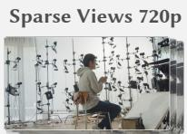

## Volumetric Video in 2K Resolution

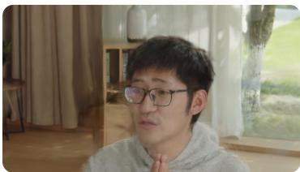

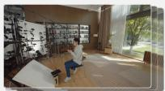

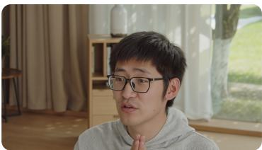

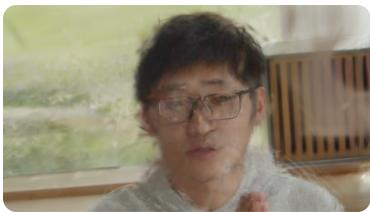

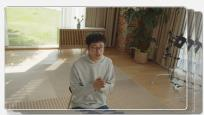

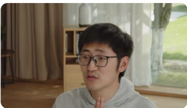

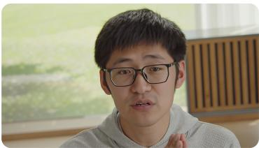

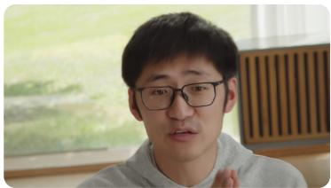

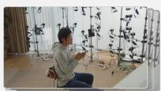

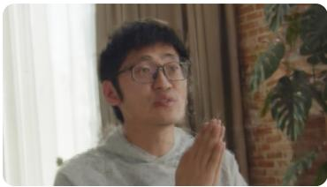  
FTGS

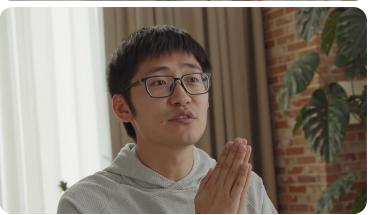  
Ours (Gen.)

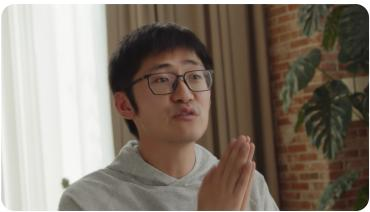  
Ours (Recon.)  
Fig. 1. RealMe creates immersive volumetric video from sparse and low-quality captures. When directly optimized from sparse observations, FTGS [Wang et al. 2025e] struggles to maintain consistent reconstruction quality (left). In contrast, RealMe generates 2K multi-view videos with high visual quality and strong 4D consistency (middle), which further supports high-quality volumetric video reconstruction (right).

∗Corresponding author.

Authors’ Contact Information: Chenxu Zhou, cxzhou35@zju.edu.cn, State Key Laboratory of CAD&CG, Zhejiang University, Hangzhou, China; Zhiyuan Yu, zhiyuan. yu@zju.edu.cn, State Key Laboratory of CAD&CG, Zhejiang University, Hangzhou, China; Yudong Jin, krahetx@gmail.com, State Key Laboratory of CAD&CG, Zhejiang University, Hangzhou, China; Yinji Shentu, styj@zju.edu.cn, State Key Laboratory of CAD&CG, Zhejiang University, Hangzhou, China; Yu Zhang, zhangyu@4dv.ai, 4DV.ai, Hangzhou, China; Jiaming Sun, suenjiaming@gmail.com, 4DV.ai, Hangzhou, China; Xiaowei Zhou, xwzhou@zju.edu.cn, State Key Laboratory of CAD&CG, Zhejiang Uni versity, Hangzhou, China.

This paper addresses the problem of creating immersive volumetric videos from sparse and low-resolution capture resources. Conventional dense multiview reconstruction methods can produce high-quality volumetric videos, but their reliance on costly capture setups makes them impractical in realworld scenarios. Recent approaches use generative models to relax capture requirements, but still sufer from limited resolution and 4D inconsistency. To overcome these constraints, we propose RealMe, a unified framework built around a high-resolution video difusion model that enhances limited captures into high-resolution (2K), 4D-consistent videos for volumetric video reconstruction. Specifically, RealMe constructs auxiliary data from capture videos and encodes them into latents along with layout-aware positional embeddings. The video difusion model adapts factorized spatio-temporal attention to the multi-view capture layout, denoises these latents across viewpoints and time, and decodes them into enhanced videos to refine the 4D representation. This adaptation helps the model capture temporal dynamics and multi-view relationships, leading to more 4D-consistent generation. To reduce the data gap between generated videos and real captures, we apply a latent frequency loss that provides frequency-domain supervision in latent space. Extensive experiments on the public DNA-Rendering benchmark and our self-captured RealVV dataset demonstrate that RealMe is able to create immersive volumetric videos and outperforms state-of-the-art methods in visual fidelity and 4D consistency. Project page: https://zju3dv.github.io/realme

CCS Concepts: • Computing methodologies → Image-based rendering. Additional Key Words and Phrases: video generation, novel view synthesis, detail enhancement, 4D Gaussian splatting

## ACM Reference Format:

Chenxu Zhou, Zhiyuan Yu, Yudong Jin, Yinji Shentu, Yu Zhang, Jiaming Sun, and Xiaowei Zhou. 2026. RealMe: Immersive Volumetric Video from Minimal Captures. In SIGGRAPH Asia 2026 Conference Papers (SA Conference Papers ’26), December 01–04, 2026, Kuala Lumpur, Malaysia. ACM, New York, NY, USA, 19 pages. https://doi.org/10.1145/3829340.3842349

## 1 Introduction

Volumetric videos capture dynamic scenes from multiple viewpoints and support free-viewpoint rendering. The immersive and interactive nature of volumetric videos makes them an efective medium for applications such as metaverse, telepresence, VR/AR, and gaming. Previous methods [Jiang et al. 2025; Pang et al. 2024; Wang et al. 2025e; Wu et al. 2024; Xu et al. 2024c] have achieved highquality volumetric video reconstruction and novel view synthesis by directly optimizing 4D scene representations. However, these approaches typically rely on dense and well-controlled capture setups that provide suficient multi-view observations for reconstruction. This requirement makes them impractical under constrained acquisition settings, where only sparse camera arrays or low-quality input videos are available. Consequently, creating volumetric videos from limited captures while approaching the visual quality and 4D consistency of dense multi-view capture remains a critical research problem and the primary motivation for our work.

The central challenge is to infer global scene structure and fine details from partial observations while preserving 4D consistency. Recent work has explored using generative models [Brooks et al. 2024; Esser et al. 2024; Team Wan et al. 2025] to reduce capture requirements, leveraging their learned priors for realistic, high-quality synthesis. Some approaches [Chen et al. 2025a; Shen et al. 2024; Wu et al. 2025c] adopt a two-stage optimization pipeline, using generative models to repair degraded renderings before refining the scene representation, thereby improving video resolution and frame rate. However, their generation stage treats each viewpoint independently, ignoring multi-view correlations and causing cross-view spatial inconsistency. The two-stage pipeline also introduces error accumulation between generation and reconstruction. To address this limitation, another line ofwork [Huang et al. 2025; Jin et al. 2025; Wu et al. 2025a] uses spatio-temporal attention during generation to facilitate information flow across spatial and temporal dimensions, producing more 4D-consistent results. Despite improved consistency, these approaches still require large-scale training data and remain limited by current generative backbones, whose native resolutions are often below 1K and therefore fall short of the visual quality required for volumetric video creation.

In this paper, we propose RealMe, a unified framework built around a high-resolution video difusion model that enhances limited captures into high-quality, 4D-consistent videos for subsequent volumetric video reconstruction. Specifically, given sparse and lowquality captures, RealMe first constructs auxiliary videos from input captures using diverse degradation strategies. These auxiliary videos are encoded into conditional latents, each associated with a layoutaware positional embedding that describes its spatial, temporal, and latent-space information. Our video difusion model takes these conditional latents and noise as input and decodes the denoised latents into enhanced videos. Building on prior factorized video attention [Bertasius et al. 2021], we adapt the factorization to the sampled video groups, allowing denoising to propagate information separately along the temporal and spatial dimensions rather than over a flattened token sequence. As shown in Sec. 5.3.2, this adaptation improves visual fidelity and downstream 4D consistency over full attention. The generated videos and the original captures are used to optimize the scene representation [Wang et al. 2025e; Wu et al. 2024] for volumetric video reconstruction. To reduce the data gap between generated videos and real captures, we apply a latent frequency loss that guides the predicted latent to preserve low-frequency structure while recovering high-frequency details.

Although existing public benchmarks [Cheng et al. 2023; Isik et al. 2023] provide high-quality multi-view data, they are mostly captured in object-centric studio settings with the same focal-length multi-view camera arrays and do not fully cover long focal-length views or diverse real-world degradations. To evaluate our method under more realistic and challenging acquisition settings, we curate a self-captured dataset dubbed RealVV, which contains multi-view videos with varying focal lengths, diverse scenes, actors, and performances, as well as both real and synthetic degradations. We evaluate RealMe on both the public DNA-Rendering benchmark [Cheng et al. 2023] and RealVV under limited capture settings. Extensive experiments show that RealMe is capable of creating high-quality volumetric videos and outperforms state-of-the-art methods in visual fidelity and 4D consistency.

Our contributions are summarized as follows:

• We propose RealMe, a unified framework for high-resolution 4D enhancement that reduces the capture requirements for high-quality volumetric video reconstruction.

• We adapt a pretrained high-resolution image difusion model [Black Forest Labs 2024] to 4D enhancement using layoutaware positional embeddings and factorized spatio-temporal attention. The adapted model is trained with a latent frequency loss to reduce the data gap between generated videos and real captures.

• We curate RealVV, a self-captured multi-view dataset with diverse degradations to support volumetric video evaluation under challenging settings and plan to release it to the community.

## 2 Related Work

## 2.1 Dense-View 4D Reconstruction

Existing volumetric video reconstruction methods typically start from multi-view videos and optimize a time-varying scene representation for free-viewpoint rendering. Recent systems [Li et al. 2024; Luiten et al. 2024; Wu et al. 2024; Xu et al. 2024b] model dynamic content with persistent primitives, 4D fields, or spatio-temporal features. To improve temporal scale and motion coverage, specialized representations [Jiang et al. 2025; Lei et al. 2025; Wang et al. 2025e; Xu et al. 2024c] handle long sequences, complex motion, casual videos, and human-centric topology. Other methods [Lin et al. 2024; Wang et al. 2025f; Wu et al. 2025b; Yang et al. 2024a] reduce reconstruction cost with deformation fields, dynamic particles, or lightweight monocular pipelines. Although these methods improve reconstruction quality and eficiency, they still rely on the captured frames as direct optimization evidence. Their performance therefore drops when the input views are sparse or visually degraded, which motivates an explicit enhancement stage before reconstruction.

## 2.2 Sparse-View 4D Reconstruction

Sparse-view 4D reconstruction uses additional priors to reduce capture requirements. Geometry-aware and completion methods [Hu et al. 2025; Mihajlovic et al. 2024; Su et al. 2023; Wang et al. 2025a,d; Zhou et al. 2026] use neural fields, correspondences, monocular fusion, structured point features, flow guidance, or geometric constraints to recover structure from partial observations, including limited-view optimization and four-view capture. A related sparseframe formulation [Shi et al. 2026] instead addresses temporal undersampling with texture-aware regularization. Feed-forward and generative approaches [Chen et al. 2025b; Huang et al. 2025; Jin et al. 2025; Kong et al. 2025; Liu et al. 2026; Sabathier et al. 2025; Wu et al. 2025a; Zhang et al. 2024] reduce per-scene optimization with learned reconstruction modules or use difusion priors, including multi-view video models and transferred 3D/video priors, to synthesize missing observations and pseudo-view supervision. Human-centric approaches [Sun et al. 2025; Xiao et al. 2025; Xu et al. 2024a; Zheng et al. 2024] further reduce capture requirements by using body structure or learned human priors. These approaches make sparse capture more feasible, but they mainly solve reconstruction or category-specific rendering within a fixed input setting. They do not directly address how to turn limited captured videos into higher-fidelity inputs that preserve the capture layout for a general volumetric video pipeline.

## 2.3 Generative Priors for 4D Enhancement

Generative priors ofer a complementary route for improving lowquality videos before they are used for reconstruction. Video restoration and super-resolution methods [Han et al. 2025; Wang et al. $2 0 2 5 \mathrm { b } , \mathrm { c } ;$ Xu et al. 2025; Zhuang et al. 2025] use generative or difusion models to recover realistic details, stabilize temporal changes, and handle real-world degradations. However, these models are typically designed for monocular video super-resolution, where the goal is to enhance a single video stream rather than jointly enhance multi-view captures for 4D reconstruction. Several reconstruction pipelines use video models to increase efective frame rates [Chen et al. 2025a; Shen et al. 2024] or repair inferior renderings [Philip et al. 2025]. While efective, these uses of video priors remain tied to individual streams or rendered outputs rather than reconstructed representations. Other methods use image-generation models to refine reconstructed representations [Wu et al. 2025c] but are limited to static scenes. As a result, they do not jointly model the camera, timestamp, and image-plane layout that determines 4D consistency across capture inputs. Large video generation and enhancement models [Brooks et al. 2024; He et al. 2024; Team Wan et al. 2025] ofer a strong prior for spatio-temporal synthesis, but they require layout-aware adaptation before they can be used for multi-view capture enhancement. RealMe builds on this direction by conditioning video difusion on the 4D capture layout.

## 3 Method

## 3.1 Overview

Given sparse and low-quality captures ofa dynamic scene, our target is to reconstruct a high-quality and 4D-consistent volumetric video that supports free-viewpoint rendering. To achieve this goal, we propose RealMe, a unified 4D enhancement framework. As illustrated in Fig. 2, RealMe first derives auxiliary videos from the input captures (Sec. 3.2). We then adapt the pretrained high-resolution image difusion model [Black Forest Labs 2024] to use these auxiliary videos as conditions for generating enhanced videos for 4D reconstruction (Sec. 3.3). The detailed model architecture, including layout-aware positional embeddings and factorized spatio-temporal attention, is shown in Fig. 3. To train the model, we construct paired training examples from our self-captured dataset with diverse degradations and formulate the training objectives (Sec. 3.4).

## 3.2 Auxiliary Data Construction

Although the input captures are sparse and low-quality, they still contain valuable information about scene structure and motion dynamics. We therefore convert these partial observations into auxiliary videos that guide the video difusion model at inference time. Let $\mathcal { V } = \{ V _ { i } \} _ { i = 1 } ^ { M }$ denote the input videos and $\mathcal { P } = \{ P _ { i } \} _ { i = 1 } ^ { M }$ denote their corresponding camera poses. We first reconstruct a coarse 4DGS $\mathcal { G } _ { c }$ [Wang et al. 2025e; Wu et al. 2024] from $( \mathcal { V } , \mathcal { P } )$ . Next, we interpolate the input camera poses into a camera trajectory to obtain $N _ { v }$ novel-view camera poses:

$$
\boldsymbol { \mathcal { P } } _ { \mathrm { n v } } = \{ P _ { \mathrm { n v } } ^ { j } \} _ { j = 0 } ^ { N _ { v } - 1 } , \quad P _ { \mathrm { n v } } ^ { j } = \mathrm { I n t e r p } ( \boldsymbol { \mathcal { P } } , j / ( N _ { v } - 1 ) ) .\tag{1}
$$

Here, the subscript nv denotes a novel view, and Interp(·) denotes a pose-sampling function along the fitted camera trajectory. Using the sampled camera poses $\mathcal { P } _ { \mathrm { n v } } ,$ we render novel-view videos from the coarse 4DGS $\mathcal { G } _ { c }$

$$
\mathcal { V } _ { \mathrm { n v } } = \{ V _ { \mathrm { n v } } ^ { j } \} _ { j = 0 } ^ { N _ { v } - 1 } = \mathrm { R e n d e r } ( \mathcal { G } _ { c } , \mathcal { P } _ { \mathrm { n v } } ) .\tag{2}
$$

Since these videos are rendered from a coarse yet 4D-consistent representation, they provide approximate multi-view geometry guidance. For the original input videos, we also detect regions of interest (ROIs) with an ofline detector [Guo and Deng 2024] and crop them to obtain a second set of auxiliary videos:

$$
\mathcal { B } = \mathrm { D e t } ( \mathcal { V } ) , \quad \mathcal { V } _ { \mathrm { c r o p } } = \mathrm { C r o p } ( \mathcal { V } , \mathcal { B } ) .\tag{3}
$$

Here, B denotes the 2D ROI boxes. These ROI videos extract local detail cues from the input captures, while their details remain limited by the camera resolution. We organize $\mathcal { N } _ { \mathrm { n v } }$ and $\mathcal { V } _ { \mathrm { c r o p } }$ as two separate condition types rather than concatenating content with different spatial coverage. The two types are enhanced independently and converted into clean videos at a unified output resolution for subsequent 4D reconstruction.

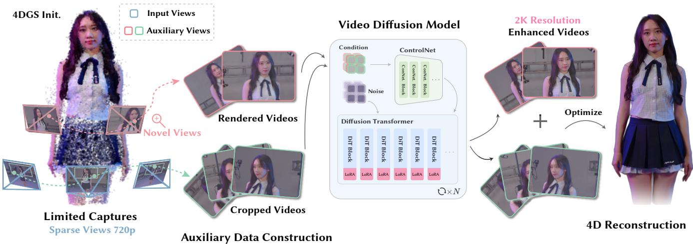  
Fig. 2. Overview of our framework. Given sparse and low-quality captures, RealMe first initializes a coarse 4DGS [Wang et al. 2025e] representation and uses it to render novel-view videos; in parallel, we detect ROIs with an ofline detector [Guo and Deng 2024] and crop the input captures to preserve local detail cues. These auxiliary videos are fed into a high-resolution video difusion model to produce enhanced videos, which are then used together with the input captures to optimize the 4DGS representation for volumetric video reconstruction. The detailed model architecture is illustrated in Fig. 3.

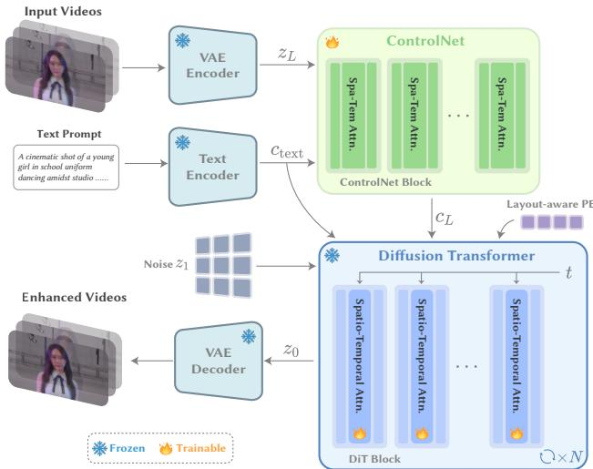  
Fig. 3. Model architecture. We use a ControlNet [Zhang et al. 2023] branch to inject control signals from condition latents and text features. DiT blocks use these signals with layout-aware positional embeddings to denoise noisy latents via factorized spatio-temporal atention.

## 3.3 4D Enhancement Video Difusion Model

Mainstream video difusion models [Team Wan et al. 2025; Yang et al. 2024b] provide strong video priors, but their native resolutions are typically lower than the 2K resolution required by our volumetric video reconstruction pipeline. We therefore adopt the pretrained high-resolution image difusion model FLUX [Black Forest Labs 2024] as our base model.

However, image difusion models cannot be directly applied to our 4D enhancement task. Since these models are originally designed for single-image generation, frame-wise or view-wise enhancement would make the denoising processes of diferent samples independent, ignoring temporal and multi-view dependencies. Such independent processing may preserve local details within each frame, but it introduces appearance drift across time and geometry mismatch across viewpoints. These inconsistencies degrade the enhanced videos and make the downstream volumetric video reconstruction less reliable.

To address this issue, we adapt the image difusion model into a spatio-temporal video difusion model for 4D enhancement. We first describe the model architecture, where the auxiliary videos constructed in Sec. 3.2 are used as conditions to guide generation. We then extend the original positional IDs with temporal and spatial indices to represent the structure of each sampled video group. Finally, we adapt factorized spatio-temporal attention to these groups so information propagates separately along the temporal and spatial dimensions during denoising.

3.3.1 Model Architecture. The model architecture of our video diffusion model is shown in Fig. 3. Given auxiliary input videos $\mathcal { N } _ { \mathrm { a u x } }$ and a text prompt, we use a frozen VAE encoder to obtain condition latents $z _ { L }$ and a frozen text encoder to obtain text features $c _ { \mathrm { t e x t } }$ . Both $z _ { L }$ and $c _ { \mathrm { t e x t } }$ are fed into the ControlNet [Zhang et al. 2023] branch, which outputs control signals $c _ { L }$ to each DiT block. In parallel, we sample Gaussian noise $z _ { 1 }$ as the initial video latent and feed it to the DiT together with the text features. At each denoising step, the noisy latents pass through DiT blocks, where control signals are added as conditioning residuals and layout-aware positional embeddings are applied in the attention layers. The DiT blocks then denoise the latents via factorized spatio-temporal attention, transforming $z _ { 1 }$ into $z _ { 0 }$ after � steps. Finally, the VAE decoder decodes $z _ { 0 }$ into enhanced videos.

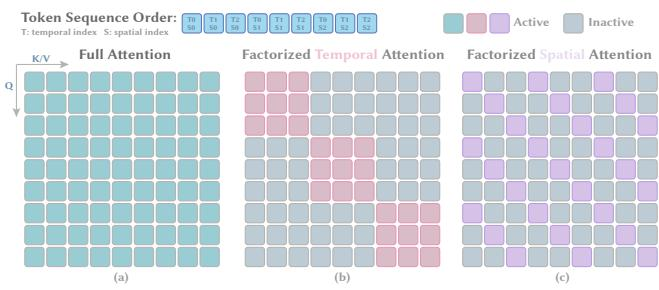  
Fig. 4. Factorized spatio-temporal atention. Full atention activates all sample pairs in the atention patern, while the factorized variant keeps only pairs with the same temporal or spatial index. The horizontal and vertical axes denote key/value samples and query samples, respectively. Colored blocks indicate active atention regions, and gray blocks indicate inactive regions.

During training, we update only the ControlNet module and the LoRA adapters [Hu et al. 2022] in selected DiT transformer modules. The VAE, text encoder, and remaining pretrained DiT parameters are frozen.

3.3.2 Layout-Aware Positional Embedding. The original image identifiers (IDs) specify a three-axis layout coordinate, where the first axis is fixed for image tokens and the other two axes indicate the latent-grid position. Such IDs are suficient for single images, but they become ambiguous for sampled video groups. Tokens from diferent frames or viewpoints may share the same latent-grid coordinate and therefore receive the same positional signal.

To remove this ambiguity, we extend the original three-axis IDs to four-dimensional layout-aware IDs. For a latent token at frame �, view $s ,$ and grid coordinate (�, �), we define:

$$
\mathbf { i d } _ { t , s , u , v } = ( t , s , u , v ) , \quad 0 \leq t < T , \quad 0 \leq s < S .\tag{4}
$$

Here, � and � denote the number of frames and viewpoints in the sampled video group. The first two axes represent the temporal and spatial layout, while the last two axes preserve the latent-grid position.

The positional embedding is then computed by applying rotary positional encoding [Su et al. 2024] over the four axes:

$$
\begin{array} { r } { \mathrm { P E } ( \mathbf { i d } _ { t , s , u , v } ) = \phi _ { t } ( t ) \lVert \phi _ { s } ( s ) \rVert \phi _ { u } ( u ) \lVert \phi _ { v } ( v ) , } \end{array}\tag{5}
$$

where $\phi _ { t } , \phi _ { s } , \phi _ { u } , \phi _ { v }$ denote RoPE mappings for each axis and their output dimensions sum to the per-head rotary dimension. Thus, tokens with the same latent-grid position are still distinguished by their spatial and temporal indices.

3.3.3 Factorized Spatio-Temporal Atention. Prior work has factorized video attention along spatial and temporal axes [Bertasius et al. 2021]. We apply this principle to the sampled video groups, where the spatial axis indexes viewpoints rather than image patches. The original attention mechanism concatenates the latent tokens of all samples into a long token sequence and applies full attention over the sequence. Although this allows information exchange across samples, the samples are originally drawn from a temporal and spatial layout, and full attention does not utilize these layout relationships. Therefore, we replace full attention with factorized spatio-temporal attention, which decomposes information propagation into temporal and spatial attention patterns.

As shown in Fig. 4, each blue square in the top row denotes the latent token sequence of each sample. The labels � and � denote the temporal and spatial indices of the sample in the sampled group, respectively. After projection, these latent tokens form query, key, and value tokens for attention. In each attention map, the horizontal axis denotes key/value tokens from the samples and the vertical axis denotes query tokens from the samples. Each small block therefore corresponds to a sample pair, where an active block indicates that the sample pair participates in dot-product attention and an inactive block indicates that it is excluded under the current attention pattern. We implement this adaptation by reshaping the latent tokens before attention, so attention is performed separately along the temporal and spatial dimensions and then restored to the original shape after attention. Our ablation study further indicates that this factorized adaptation improves the 4D consistency of generated videos over full attention.

## 3.4 Model Training and Optimization

3.4.1 Training Data Curation. To train the video difusion model, we curate RealVV, a high-resolution multi-view video dataset with diverse scenes, actors, performances, and camera settings, including both short-focus and long-focus views. The training split contains 100 sequences from 20 actors. Each sequence has 48 to 80 views, with 300 frames per view. In total, the training split contains over 1.4 million multi-view images. We hold out the evaluation sequences and exclude them from training. From the remaining training sequences, we construct paired training examples. Each pair contains a clean target video and a degraded condition video. The target provides high-resolution supervision with consistent observations, while the degraded video follows the form of the auxiliary videos used at inference time.

We synthesize the degraded condition videos using three degradation strategies: (1) Sparse-view and underfit reconstruction degradation. We reconstruct a coarse 4DGS from sparse views or an intentionally underfit optimization and render novel-view videos with artifacts. (2) Resolution degradation. We apply cropping, resizing, and downsampling to high-resolution videos to obtain low-resolution or ROI-limited videos. (3) Appearance and motion degradation. Following the synthetic degradation strategy of Real-ESRGAN [Wang et al. 2021], we add random noise, compression artifacts, defocus blur, and motion blur to simulate common appearance and motion degradations in real captures. Combined with the first two strategies, these perturbations approximate the artifacts present in auxiliary videos and real captures.

3.4.2 Training Objectives. We train the video difusion model with a flow matching objective [Lipman et al. 2023]. The training objective also includes a latent frequency loss. Given a clean target latent $z _ { 0 } ,$ a Gaussian noise latent $z _ { 1 } ,$ and a sampled time $\tau \in \ [ 0 , 1 ]$ , we construct the interpolated latent:

$$
\begin{array} { r } { z _ { \tau } = ( 1 - \tau ) z _ { 0 } + \tau z _ { 1 } . } \end{array}\tag{6}
$$

We then supervise the model to predict the corresponding velocity:

$$
\mathcal { L } _ { \mathrm { f m } } = \Vert v _ { \theta } ( z _ { \tau } , \tau , z _ { L } , c _ { \mathrm { t e x t } } ) - ( z _ { 1 } - z _ { 0 } ) \Vert _ { 2 } ^ { 2 } .\tag{7}
$$

Specifically, the latent frequency loss provides frequency-domain supervision in latent space to reduce the data gap between generated videos and real captures. This loss encourages the predicted latent to preserve low-frequency structure while recovering high-frequency details. We obtain the predicted clean latent:

$$
z _ { \mathrm { p r e d } } = z _ { \tau } - \tau v _ { \theta } ( z _ { \tau } , \tau , z _ { L } , c _ { \mathrm { t e x t } } ) .\tag{8}
$$

Let $z _ { 0 }$ denote the ground-truth clean latent, and let $\Phi _ { \mathrm { L } } ( \cdot )$ and ΦH (·) denote the timestep-weighted low- and high-frequency magnitude components of a latent FFT, respectively. The latent frequency loss is defined as:

$$
\mathcal { L } _ { \mathrm { f r e q } } = \left. \Phi _ { \mathrm { L } } ( z _ { \mathrm { p r e d } } ) - \Phi _ { \mathrm { L } } ( z _ { 0 } ) \right. _ { 1 } + \left. \Phi _ { \mathrm { H } } ( z _ { \mathrm { p r e d } } ) - \Phi _ { \mathrm { H } } ( z _ { 0 } ) \right. _ { 1 } .\tag{9}
$$

The detailed construction of these frequency components and their timestep-dependent weights is provided in the supplementary material. The final training objective is given by:

$$
\begin{array} { r } { \mathcal { L } = \mathcal { L } _ { \mathrm { f m } } + \lambda _ { \mathrm { f r e q } } \mathcal { L } _ { \mathrm { f r e q } } , } \end{array}\tag{10}
$$

where $\lambda _ { \mathrm { f r e q } }$ is the frequency loss weight that controls the strength of frequency-domain supervision during training.

3.4.3 4D Reconstruction. The enhanced videos generated by the video difusion model are used together with the input captures to refine the scene representation and reconstruct the volumetric video. For both scene initialization and reconstruction, we adopt FTGS [Wang et al. 2025e] as the underlying 4DGS method, which supports dynamic scene reconstruction with time-varying Gaussian primitives. The final 4DGS is jointly supervised by the original captures, enhanced novel-view videos, and enhanced ROI videos. We map each enhanced ROI video back to its full-frame camera coordinates using the recorded crop boxes and optimize a unified 4D Gaussian representation for the full scene.

## 4 Implementation Details

We use the DifSynth-Studio [ModelScope Community 2024] framework for model training and inference. The pretrained base model is the 14B FLUX.1 [dev] model [Black Forest Labs 2024]. We initialize the ControlNet [Zhang et al. 2023] branch from the pretrained DiT weights and train the full branch during adaptation. During training, we use mixed temporal, spatial, and joint sampling, with detailed model and sampling configurations provided in the supplementary material. We train the model for 96 hours on 8 NVIDIA H100 GPUs with an efective batch size of 8 and a learning rate of $1 0 ^ { - 4 }$ , and set the frequency loss weight to 0.1. To reduce memory usage, we use bfloat16 mixed-precision training and gradient checkpointing. Training target videos are generated at 2560 × 1440 resolution, while condition videos are resized to 1280 × 720 resolution.

For volumetric video reconstruction, we implement the 4DGS optimization based on EasyVolcap [Xu et al. 2023]. The training settings follow FTGS [Wang et al. 2025e]. For each sequence, the final 4DGS is supervised by eight original capture views and 40 generated views enhanced from the novel-view and ROI conditions.

## 5 Experiments

## 5.1 Setings

5.1.1 Datasets. We evaluate RealMe on our self-captured RealVV dataset and the public DNA-Rendering benchmark [Cheng et al. 2023]. RealVV is a high-resolution multi-view video dataset containing diverse scenes, actors, performances, and camera settings, including both short-focus and long-focus cameras. We use seven sequences for evaluation, all excluded from the training data. Each evaluation sequence contains 48 views, with 180 frames per view, and is evaluated at a resolution of $2 5 6 0 \times 1 4 4 0$ . We select eight spatially distributed views as input captures and use the remaining views for novel-view evaluation. A detailed analysis of input-view settings is provided in Sec. 5.3.1. DNA-Rendering [Cheng et al. 2023] contains diverse human performances with diferent outfits and dynamic motions. We select four sequences for zero-shot evaluation, each with 120 frames per view, and evaluate them at 1024×1024 resolution. We follow the same input and evaluation protocol as RealVV, using eight input views and the remaining views for novel-view evaluation.

5.1.2 Baselines. We evaluate RealMe on multiple tasks to assess its performance across several aspects. (1) Novel view synthesis measures the visual quality ofrendered novel views. We use FTGS [Wang et al. 2025e] as a strong 4DGS-based reconstruction baseline and DIFIX3D+ [Wu et al. 2025c] as a generative baseline for novel-view enhancement. We additionally include 4C4D [Zhou et al. 2026], which is designed for four-camera sparse-view reconstruction, and 4K4D [Xu et al. 2024b], a high-fidelity 4D view synthesis method. (2) 4D-consistent reconstruction tests whether the enhanced videos preserve 4D consistency for high-quality 4DGS reconstruction. We compare with Difuman4D [Jin et al. 2025], a generation-based sparseview reconstruction method. (3) Detail enhancement focuses on recovering fine appearance details from low-quality captures. We benchmark against STAR [Xie et al. 2025] and FlashVSR [Zhuang et al. 2025], two video super-resolution baselines for degraded video inputs. The implementation details and settings for the baselines are described in the supplementary material.

5.1.3 Metrics. We report PSNR, SSIM, and LPIPS as quantitative metrics. PSNR and SSIM [Wang et al. 2004] measure pixel-level and structural fidelity, while LPIPS [Zhang et al. 2018] measures perceptual similarity.

For 4D-consistent reconstruction, we use additional consistency metrics. Specifically, we first optimize a 4DGS representation [Wang et al. 2025e] using the enhanced videos together with the input cap tures. We then render videos from the camera poses corresponding to the enhanced videos and compute PSNR, SSIM, and LPIPS between the enhanced videos and the corresponding renderings. We use the subscript � to denote these metrics, e.g., PSNR�. For temporal consistency, we report the optical-flow-based Temporal Warping Error (TWE) [Lai et al. 2018], which measures the residual between adjacent frames after flow-based warping over non-occluded regions; lower values indicate greater temporal stability. Because temporal smoothing can also reduce this error, we use TWE as a complementary stability metric rather than a measure of reconstruction fidelity.

Table 1. Quantitative comparison. We compare RealMe with optimization-based and generation-based baselines on the RealVV and DNA-Rendering [Cheng et al. 2023] datasets. RealMe outperforms the baselines in visual quality across both datasets. Best and second-best results are shown in bold and underlined, respectively.
<table><tr><td rowspan="2">Method</td><td rowspan="2">Type</td><td colspan="3">RealVV</td><td colspan="3">DNA-Rendering [Cheng et al. 2023]</td></tr><tr><td>PSNR↑</td><td>SSIM↑</td><td>LPIPS↓</td><td>PSNR↑</td><td>SSIM↑</td><td>LPIPS↓</td></tr><tr><td>FTGS [Wang et al. 2025e]</td><td>Optimization</td><td>19.0491</td><td>0.8142</td><td>0.2492</td><td>20.6439</td><td>0.7986</td><td>0.2158</td></tr><tr><td>DIFIX3D+ [Wu et al. 2025c]</td><td>Generation</td><td>22.6373</td><td>0.8267</td><td>0.2890</td><td>21.9532</td><td>0.7920</td><td>0.1666</td></tr><tr><td>Diffuman4D [Jin et al. 2025]</td><td>Generation</td><td>24.4387</td><td>0.9113</td><td>0.2105</td><td>23.2704</td><td>0.7822</td><td>0.1427</td></tr><tr><td>Ours</td><td>Generation</td><td>27.2706</td><td>0.9393</td><td>0.1621</td><td>25.5956</td><td>0.8979</td><td>0.1261</td></tr></table>

## 5.2 Comparison Experiments

We compare RealMe with optimization-based and generation-based baselines under the same sparse-capture setting. Quantitative results are reported in Tab. 1, and qualitative comparisons on RealVV are shown in Fig. 5. RealMe achieves the best visual quality among all compared methods across both datasets. When optimizing the 4D representation directly from sparse input views, FTGS [Wang et al. 2025e] produces lower-quality novel views because the sparse observations provide insuficient constraints for unseen regions and view-dependent appearance. In contrast, RealMe derives scene structure from sparse input views and recovers the missing appearance. In addition to the optimization-based baseline, the generation-based baselines exhibit diferent limitations. DIFIX3D+ [Wu et al. 2025c] improves local details, but it does not consistently preserve the target scene appearance. Difuman4D [Jin et al. 2025] focuses on full-body human reconstruction and therefore cannot model scene backgrounds. Due to the domain gap in its training data, it also does not generalize well to zoomed-in long-focus views in RealVV.

We additionally compare with two 4D reconstruction baselines under a four-camera setting on RealVV, as reported in Tab. 2. Overall, our method demonstrates stronger reconstruction performance under the four-camera setting. Compared with these optimizationbased methods, our approach leverages generative priors to recover high-frequency details missing from sparse observations and reduce artifacts caused by sparse-view inputs.

We further evaluate the overall consistency between the generated videos and the input videos through downstream 4D reconstruction in Tab. 3. The results indicate that, compared with Difuman4D [Jin et al. 2025], our generated videos better align with the input captures and lead to more coherent 4D reconstruction. These metrics are the consistency metrics defined in Sec. 5.1.3. As shown in Tab. 4, RealMe achieves temporal consistency comparable to the optimization-based baseline while outperforming the generation-based methods.

In addition, we evaluate detail enhancement at 2K resolution in Fig. 6. STAR [Xie et al. 2025] and FlashVSR [Zhuang et al. 2025] improve the low-resolution inputs, but their results can still contain over-smoothed facial regions, softened hair boundaries, or artificial local textures. In contrast, RealMe recovers finer facial, hair, and clothing details while maintaining a natural appearance.

Table 2. Representative novel view synthesis results on RealVV with four cameras. All methods use four input views. Best results are shown in bold.
<table><tr><td>Method</td><td>PSNR↑</td><td>SSIM↑</td><td>LPIPS↓</td></tr><tr><td>4C4D [Zhou et al. 2026]</td><td>19.0405</td><td>0.8682</td><td>0.3716</td></tr><tr><td>4K4D [Xu et al. 2024b]</td><td>15.6413</td><td>0.8181</td><td>0.5090</td></tr><tr><td>Ours</td><td>24.9304</td><td>0.8735</td><td>0.2278</td></tr></table>

Table 3. Quantitative comparison on 4D-consistent reconstruction. PSNR , SSIM , and LPIPS denote the consistency metrics defined in Sec. 5.1.3. Best results are shown in bold.
<table><tr><td>Method</td><td>PSNRc↑</td><td></td><td>SSIMc ↑ LPIPSc ↓</td></tr><tr><td>Diffuman4D [Jin et al. 2025]</td><td>26.7098</td><td>0.8437</td><td>0.1913</td></tr><tr><td>Ours</td><td>28.0756</td><td>0.9246</td><td>0.1385</td></tr></table>

Table 4. Temporal consistency comparison. TWE is defined in Sec. 5.1.3. Best and second-best results are shown in bold and underlined, respectively.
<table><tr><td>Method</td><td>TWE↓</td></tr><tr><td>FTGS [Wang et al. 2025e]</td><td>0.00299</td></tr><tr><td>DIFIX3D+ [Wu et al. 2025c]</td><td>0.04533</td></tr><tr><td>Diffuman4D [Jin et al. 2025]</td><td>0.03170</td></tr><tr><td>Ours</td><td>0.00551</td></tr></table>

## 5.3 Ablation Studies

We conduct ablation studies to assess the contribution of the model adaptations and training objective used in RealMe. We additionally vary the number of input views to analyze the trade-of between capture requirements and reconstruction quality. All ablation studies are performed on the evaluation sequences of the RealVV dataset.

5.3.1 Ablation on the NumberofInputViews. As shown in Tab. 5, we evaluate RealMe with diferent numbers of input views to study the trade-of between capture requirements and reconstruction quality. The results show that RealMe works across the evaluated input-view settings, with a substantial improvement from four to eight views and only limited additional benefits from increasing to 16 views. We therefore use eight spatially distributed views as the default setting because they provide a practical balance between capture requirements and reconstruction quality. In practical applications, selecting the number of input views involves the same trade-of: film-production and studio settings that prioritize reconstruction quality favor more views, whereas outdoor captures with limited equipment favor fewer views.

Table 5. Ablation on the number of input views. We evaluate reconstruction quality on RealVV under diferent input-view setings. Best results are shown in bold.
<table><tr><td>Input Views</td><td>PSNR↑</td><td>SSIM↑</td><td>LPIPS↓</td></tr><tr><td>4</td><td>24.0490</td><td>0.8049</td><td>0.2705</td></tr><tr><td>8 (default)</td><td>27.2706</td><td>0.9393</td><td>0.1621</td></tr><tr><td>16</td><td>27.3614</td><td>0.9159</td><td>0.1389</td></tr></table>

5.3.2 Ablation on Model Components. As shown in Tab. 6, we evaluate the layout-aware positional embedding and factorized spatiotemporal attention by removing each one from the full model. The variant without layout-aware positional embedding uses the original positional embedding, while the variant without factorized spatio-temporal attention replaces it with full attention. Removing layout-aware positional embedding lowers $\mathrm { P S N R } _ { c } ,$ , suggesting that layout-aware positional signals help preserve downstream 4D consistency. Replacing factorized spatio-temporal attention with full attention reduces both visual quality and consistency metrics, indicating that full attention over flattened tokens is less efective for the sampled video group. Together, these ablations show that both components contribute to visual fidelity and downstream 4D consistency.

Table 6. Ablation on model components. LA-PE denotes layout-aware positional embedding, FSA denotes factorized spatio-temporal atention, and PSNR� denotes the consistency metric defined in Sec. 5.1.3.
<table><tr><td>Method</td><td>PSNR↑</td><td>SSIM↑</td><td>LPIPS↓</td><td>PSNRc ↑</td></tr><tr><td>w/o LA-PE</td><td>22.7354</td><td>0.9095</td><td>0.2355</td><td>25.2596</td></tr><tr><td>w/o FSA</td><td>24.3178</td><td>0.8995</td><td>0.2166</td><td>25.8435</td></tr><tr><td>Ours</td><td>24.8924</td><td>0.9226</td><td>0.1383</td><td>27.2688</td></tr></table>

5.3.3 Ablation on Latent Frequency Loss. We ablate the latent frequency loss and supervision space in Tab. 7 to assess the gap between generated videos and real captures. Both image- and latent-space variants improve quality over the baseline, with the latent-space variant performing best; image-space results use 1K resolution because 2K training runs out of memory. Additional qualitative results are provided in the supplementary material.

## 6 Conclusion and Discussion

We present RealMe, a unified framework that enhances sparse and low-quality input captures into high-resolution, 4D-consistent videos for volumetric video reconstruction. The framework adapts the pretrained high-resolution image difusion model [Black Forest Labs 2024] to model temporal dependencies and spatial relationships while preserving local details. Specifically, we construct auxiliary videos from the input captures as conditioning inputs for the video difusion model. It extends the original positional IDs with temporal and spatial indices and applies factorized spatio-temporal attention along these dimensions, improving the 4D consistency of generated videos. Training further applies a latent frequency loss to reduce the data gap between generated videos and real captures. Experiments on our self-captured dataset RealVV and the public DNA-Rendering benchmark [Cheng et al. 2023] show that RealMe achieves superior visual quality and 4D consistency over existing baselines, while extending volumetric video reconstruction to 2K resolution under limited capture conditions.

Table 7. Ablation on latent frequency loss. $\mathcal { L } _ { f }$ denotes frequency loss, while ${ \mathcal { L } } _ { \mathrm { i m g } }$ and $\mathcal { L } _ { \mathrm { l a t } }$ denote image-space and latent-space frequency loss, respectively. LPIPS� denotes the consistency metric defined in Sec. 5.1.3. Metrics for ${ \mathcal { L } } _ { \mathrm { i m g } }$ are computed at 1K resolution because 2K training runs out of memory.
<table><tr><td>Method</td><td>PSNR↑</td><td>SSIM↑</td><td> $\mathrm { L P I P S } _ { c } \downarrow$ </td><td>GPU VRAM↓</td></tr><tr><td>w/o  $\mathcal { L } _ { f }$ </td><td>22.6017</td><td>0.8497</td><td>0.3113</td><td>72.4 GB</td></tr><tr><td>w/  ${ \mathcal { L } } _ { \mathrm { i m g } }$ </td><td>24.7123</td><td>0.8644</td><td>0.2849</td><td>OOM (2K)</td></tr><tr><td>w/  $\mathcal { L } _ { \mathrm { l a t } }$ </td><td>24.9641</td><td>0.8891</td><td>0.2201</td><td>73.5 GB</td></tr></table>

Limitations and future work. Although RealMe achieves highquality volumetric video reconstruction with improved 4D consistency, it still has several limitations. Due to the scarcity of highquality multi-view datasets, our training data remains constrained, and the model shows limited generalization to large scenes or complex camera settings. The method may fail when the input captures provide insuficient geometric cues to initialize a valid coarse 4DGS. How to scale up training data and accelerate high-resolution difusion inference remain important directions for our future work.

## Acknowledgments

This work was partially supported by the National Key R&D Program of China (No. 2024YFB2809105), the Zhejiang Provincial Natural Science Foundation of China (No. LR25F020003), and the Information Technology Center and State Key Lab of CAD&CG, Zhejiang University.

FTGS  
DIFIX3D+  
Ours  
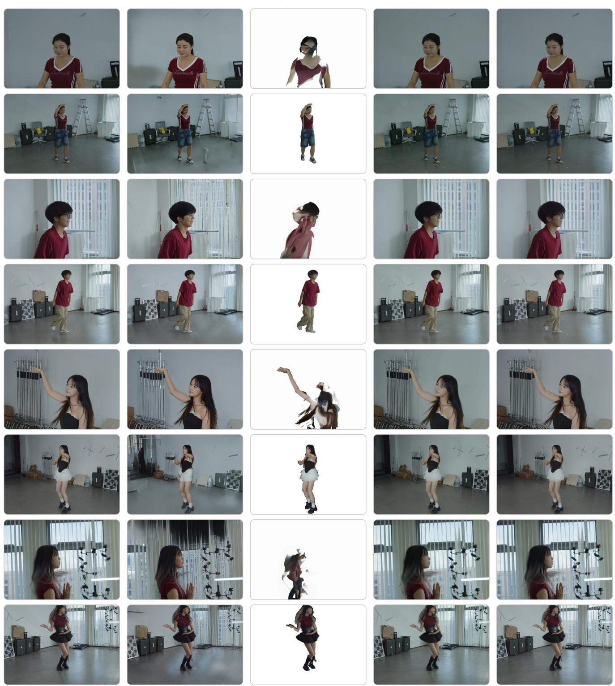  
Fig. 5. Qualitative comparison for novel view synthesis on RealVV. Given the same sparse input captures, RealMe produces higher visual quality and more consistent novel views than optimization-based and generation-based baselines. Difuman4D [Jin et al. 2025] cannot generate scene backgrounds and generalizes poorly to zoomed-in long-focus views, while RealMe preserves both human appearance and surrounding scene content.

LR Input  
STAR  
FlashVSR  
Ours  
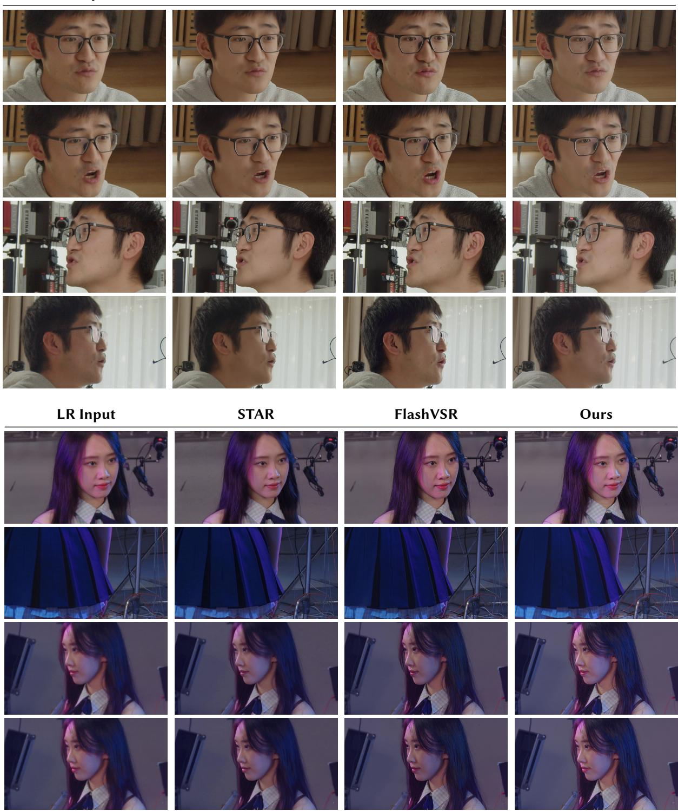  
Fig. 6. Qualitative comparison for detail enhancement on RealVV. Starting from low-resolution inputs, STAR [Xie et al. 2025] and FlashVSR [Zhuang et al. 2025] tend to produce over-smoothed regions or artificial local textures. In contrast, RealMe restores richer facial details, hair structures, and clothing textures with a more natural appearance. Please zoom in to beter inspect the local visual quality.

## References

Gedas Bertasius, Heng Wang, and Lorenzo Torresani. 2021. Is Space-Time Attention All You Need for Video Understanding?. In Proceedings ofthe 38th International Conference on Machine Learning (Proceedings ofMachine Learning Research, Vol. 139). PMLR, 813–824. https://proceedings.mlr.press/v139/bertasius21a.html

Black Forest Labs. 2024. FLUX.1 [dev]. https://huggingface.co/black-forest-labs/FLUX.1- dev. Accessed: 2026-05-07.

Tim Brooks, Bill Peebles, Connor Holmes, Will DePue, Yufei Guo, Li Jing, David Schnurr, Joe Taylor, Troy Luhman, Eric Luhman, Clarence Ng, Ricky Wang, and Aditya Ramesh. 2024. Video Generation Models as World Simulators. OpenAI technical report.

Yutian Chen, Shi Guo, Tianshuo Yang, Lihe Ding, Xiuyuan Yu, Jinwei Gu, and Tianfan Xue. 2025a. 4DSloMo: 4D Reconstruction for High Speed Scene with Asynchronous Capture. In Proceedings ofthe SIGGRAPH Asia 2025 Conference Papers. 1–11. doi:10. 1145/3757377.3763908

Zhaoxi Chen, Tianqi Liu, Long Zhuo, Jiawei Ren, Zeng Tao, He Zhu, Fangzhou Hong, Liang Pan, and Ziwei Liu. 2025b. 4DNeX: Feed-Forward 4D Generative Modeling Made Easy. arXiv:2508.13154 [cs.CV]

Wei Cheng, Ruixiang Chen, Siming Fan, Wanqi Yin, Keyu Chen, Zhongang Cai, Jingbo Wang, Yang Gao, Zhengming Yu, Zhengyu Lin, Daxuan Ren, Lei Yang, Ziwei Liu, Chen Change Loy, Chen Qian, Wayne Wu, Dahua Lin, Bo Dai, and Kwan-Yee Lin. 2023. DNA-Rendering: A Diverse Neural Actor Repository for High-Fidelity Human-centric Rendering. In Proceedings of the IEEE/CVF International Conference on Computer Vision (ICCV). IEEE/CVF, Paris, France, 19982–19993. doi:10.1109 ICCV51070.2023.01829

Patrick Esser, Sumith Kulal, Andreas Blattmann, Rahim Entezari, Jonas Müller, Harry Saini, Yam Levi, Dominik Lorenz, Axel Sauer, Frederic Boesel, Dustin Podell, Tim Dockhorn, Zion English, Kyle Lacey, Alex Goodwin, Yannik Marek, and Robin Rombach. 2024. Scaling Rectified Flow Transformers for High-Resolution Image Synthesis. arXiv:2403.03206 [cs.CV] doi:10.48550/arXiv.2403.03206

Jia Guo and Jiankang Deng. 2024. InsightFace: 2D and 3D Face Analysis Project. https: //github.com/deepinsight/insightface. https://github.com/deepinsight/insightface Accessed: 2026-05-07.

Janghyeok Han, Gyujin Sim, Geonung Kim, Hyun-Seung Lee, Kyuha Choi, Youngseok Han, and Sunghyun Cho. 2025. DC-VSR: Spatially and Temporally Consistent Video Super-Resolution with Video Difusion Prior. In Proceedings ofthe Special Interest Group on ComputerGraphics and Interactive Techniques Conference Conference Papers (Vancouver, BC, Canada) (SIGGRAPH Conference Papers ’25). Association for Computing Machinery, New York, NY, USA, Article 141, 11 pages. doi:10.1145/ 3721238.3730719

Jingwen He, Tianfan Xue, Dongyang Liu, Xinqi Lin, Peng Gao, Dahua Lin, Yu Qiao, Wanli Ouyang, and Ziwei Liu. 2024. VEnhancer: Generative Space-Time Enhance ment for Video Generation. arXiv:2407.07667 [cs.CV]

Dongdong Hu, Yang Zhou, Xiaofeng Huang, Haibing Yin, and Zhu Li. 2025. Sparse4DGS: Flow-Geometry Assisted 4D Gaussian Splatting for Dynamic Sparse View Synthesis. In Proceedings ofthe 33rd ACM International Conference on Multimedia. 10642–10651. doi:10.1145/3746027.3755819

Edward J. Hu, Yelong Shen, Phillip Wallis, Zeyuan Allen-Zhu, Yuanzhi Li, Shean Wang, Lu Wang, and Weizhu Chen. 2022. LoRA: Low-Rank Adaptation of Large Language Models. In International Conference on Learning Representations (ICLR).

Jiaxin Huang, Sheng Miao, Bangbang Yang, Yuewen Ma, and Yiyi Liao. 2025. Vivid4D: Improving 4D Reconstruction from Monocular Video by Video Inpainting. In Proceedings ofthe IEEE/CVF International Conference on Computer Vision (ICCV)

Mustafa Isik, Martin Rünz, Markos Georgopoulos, Taras Khakhulin, Jonathan Starck, Lourdes Agapito, and Matthias Nießner. 2023. HumanRF: High-Fidelity Neural Radiance Fields for Humans in Motion. ACM Transactions on Graphics 42, 4, Article 98 (July 2023), 12 pages. doi:10.1145/3592415

Yuheng Jiang, Chengcheng Guo, Yize Wu, Yu Hong, Shengkun Zhu, Zhehao Shen, Yingliang Zhang, Shaohui Jiao, Zhuo Su, Lan Xu, Marc Habermann, and Christian Theobalt. 2025. Topology-Aware Optimization of Gaussian Primitives for Human Centric Volumetric Videos. In Proceedings ofthe SIGGRAPH Asia 2025 Conference Papers. 1–12. doi:10.1145/3757377.3763975

Yudong Jin, Sida Peng, Xuan Wang, Tao Xie, Zhen Xu, Yifan Yang, Yujun Shen, Hujun Bao, and Xiaowei Zhou. 2025. Difuman4D: 4D Consistent Human View Synthesis from Sparse-View Videos with Spatio-Temporal Difusion Models. In Proceedings of the IEEE/CVF International Conference on Computer Vision (ICCV).

Hanyang Kong, Xingyi Yang, and Xinchao Wang. 2025. Generative Sparse-View Gaussian Splatting. In 2025 IEEE/CVF Conference on Computer Vision and Pattern Recognition (CVPR). 26745–26755. doi:10.1109/cvpr52734.2025.02491

Wei-Sheng Lai, Jia-Bin Huang, Oliver Wang, Eli Shechtman, Ersin Yumer, and Ming Hsuan Yang. 2018. Learning Blind Video Temporal Consistency. In Proceedings of the European Conference on Computer Vision (Lecture Notes in Computer Science, Vol. 11219). Springer, Munich, Germany, 179–195. doi:10.1007/978-3-030-01267-0\_11

Jiahui Lei, Yijia Weng, Adam W. Harley, Leonidas Guibas, and Kostas Daniilidis. 2025. MoSca: Dynamic Gaussian Fusion from Casual Videos via 4D Motion Scafolds. In 2025 IEEE/CVF Conference on Computer Vision and Pattern Recognition (CVPR).

6165–6177. doi:10.1109/cvpr52734.2025.00578

Vincent Leroy, Yohann Cabon, and Jerome Revaud. 2024. Grounding Image Matching in 3D with MASt3R. In Proceedings of the European Conference on Computer Vision (ECCV) (Lecture Notes in Computer Science, Vol. 15130). Springer, Milan, Italy, 71–91. doi:10.1007/978-3-031-73220-1\_5

Zhan Li, Zhang Chen, Zhong Li, and Yi Xu. 2024. Spacetime Gaussian Feature Splatting for Real-Time Dynamic View Synthesis. In Proceedings ofthe IEEE/CVF Conference on Computer Vision and Pattern Recognition (CVPR). IEEE/CVF, Seattle, WA, USA, 8508–8520. doi:10.1109/CVPR52733.2024.00813

Youtian Lin, Zuozhuo Dai, Siyu Zhu, and Yao Yao. 2024. Gaussian-Flow: 4D Reconstruction with Dynamic 3D Gaussian Particle. In 2024 IEEE/CVF Conference on Computer Vision and Pattern Recognition (CVPR). 21136–21145. doi:10.1109/cvpr52733.2024. 01997

Yaron Lipman, Ricky T. Q. Chen, Heli Ben-Hamu, Maximilian Nickel, and Matt Le. 2023. Flow Matching for Generative Modeling. In International Conference on Learning Representations (ICLR). OpenReview.net, Kigali, Rwanda, 28 pages. https: //openreview.net/forum?id=PqvMRDCJT9t

Wei Liu, Shengqiong Wu, Bobo Li, Haoyu Zhao, Hao Fei, Mong-Li Lee, and Wynne Hsu. 2026. Orthogonal Spatial-temporal Distributional Transfer for 4D Generation. arXiv preprint arXiv:2603.05081 (2026). arXiv:2603.05081 [cs.CV] doi:10.48550/arXiv. 2603.05081

Jonathon Luiten, Georgios Kopanas, Bastian Leibe, and Deva Ramanan. 2024. Dynamic 3D Gaussians: Tracking by Persistent Dynamic View Synthesis. In International Conference on 3D Vision (3DV).

Marko Mihajlovic, Sergey Prokudin, Siyu Tang, Robert Maier, Federica Bogo, Tony Tung, and Edmond Boyer. 2024. SplatFields: Neural Gaussian Splats for Sparse 3D and 4D Reconstruction. In Proceedings ofthe European Conference on Computer Vision (ECCV). 313–332.

ModelScope Community. 2024. DifSynth-Studio: An Open-Source Difusion Engine for Image and Video Synthesis. https://github.com/modelscope/DifSynth-Studio. Accessed: 2026-05-09.

Haokai Pang, Heming Zhu, Adam Kortylewski, Christian Theobalt, and Marc Habermann. 2024. ASH: Animatable Gaussian Splats for Eficient and Photoreal Human Rendering. In 2024 IEEE/CVF Conference on Computer Vision and Pattern Recognition (CVPR). 1165–1175. doi:10.1109/cvpr52733.2024.00117

Julien Philip, Li Ma, Pascal Clausen, Wenqi Xian, Ahmet Levent Taşel, Mingming He, Xueming Yu, David M. George, Ning Yu, Oliver Pilarski, and Paul Debevec. 2025. Detail Enhanced Gaussian Splatting for Large-Scale Volumetric Capture. ACM Trans. Graph. 44, 6, Article 250 (Dec. 2025), 13 pages. doi:10.1145/3763336

Remy Sabathier, Niloy J. Mitra, and David Novotny. 2025. LIM: Large Interpolator Model for Dynamic Reconstruction. In Proceedings ofthe IEEE/CVF Conference on Computer Vision and Pattern Recognition (CVPR). 6154–6164.

Yuan Shen, Duygu Ceylan, Paul Guerrero, Zexiang Xu, Niloy J. Mitra, Shenlong Wang, and Anna Frühstück. 2024. SuperGaussian: Repurposing Video Models for 3D Super Resolution. In Proceedings of the European Conference on Computer Vision (ECCV). 215–233. doi:10.1007/978-3-031-73397-0\_13

Changyue Shi, Chuxiao Yang, Xinyuan Hu, Minghao Chen, Wenwen Pan, Yan Yang, Jiajun Ding, Zhou Yu, and Jun Yu. 2026. Sparse4DGS: 4D Gaussian Splatting for Sparse-Frame Dynamic Scene Reconstruction. Proceedings ofthe AAAI Conference on Artificial Intelligence 40, 11 (2026), 8933–8941. doi:10.1609/aaai.v40i11.37848

Jianlin Su, Yu Lu, Shengfeng Pan, Ahmed Murtadha, Bo Wen, and Yunfeng Liu. 2024. Ro Former: Enhanced Transformer with Rotary Position Embedding. Neurocomputing 568 (2024), 127063. doi:10.1016/j.neucom.2023.127063

Zejia Su, Haibin Huang, Chongyang Ma, Hui Huang, and Ruizhen Hu. 2023. Point cloud completion via structured feature maps using a feedback network. Computational Visual Media 9, 1 (2023), 71–85. doi:10.1007/s41095-022-0276-6

Guoxing Sun, Rishabh Dabral, Heming Zhu, Pascal Fua, Christian Theobalt, and Marc Habermann. 2025. Real-time Free-view Human Rendering from Sparse-view RGB Videos using Double Unprojected Textures. In 2025 IEEE/CVFConference on Computer Vision and Pattern Recognition (CVPR). 562–573. doi:10.1109/cvpr52734.2025.00061

Team Wan, Ang Wang, Baole Ai, Bin Wen, et al. 2025. Wan: Open and Advanced Large-Scale Video Generative Models. arXiv:2503.20314 [cs.CV] doi:10.48550/arXiv. 2503.20314

Jianyi Wang, Shanchuan Lin, Zhijie Lin, Yuxi Ren, Meng Wei, Zongsheng Yue, Shangchen Zhou, Hao Chen, Yang Zhao, Ceyuan Yang, Xuefeng Xiao, Chen Change Loy, and Lu Jiang. 2025b. SeedVR2: One-Step Video Restoration via Difusion Adversarial Post-Training. arXiv:2506.05301 [cs.CV]

Jianyi Wang, Zhijie Lin, Meng Wei, Yang Zhao, Ceyuan Yang, Chen Change Loy, and Lu Jiang. 2025c. SeedVR: Seeding Infinity in Difusion Transformer Towards Generic Video Restoration. In 2025 IEEE/CVF Conference on Computer Vision and Pattern Recognition (CVPR). 2161–2172. doi:10.1109/cvpr52734.2025.00207

Qianqian Wang, Vickie Ye, Hang Gao, Weijia Zeng, Jake Austin, Zhengqi Li, and Angjoo Kanazawa. 2025f. Shape of Motion: 4D Reconstruction from a Single Video. In Proceedings ofthe IEEE/CVF International Conference on Computer Vision (ICCV).

Shizun Wang, Zhenxiang Jiang, Xingyi Yang, and Xinchao Wang. 2025a. C4D: 4D Made from 3D through Dual Correspondences. In Proceedings ofthe IEEE/CVFInternational

Conference on Computer Vision (ICCV).

Xintao Wang, Liangbin Xie, Chao Dong, and Ying Shan. 2021. Real-ESRGAN: Training Real-World Blind Super-Resolution with Pure Synthetic Data. In Proceedings of the IEEE/CVF International Conference on Computer Vision Workshops. 1905–1914.

Yifan Wang, Peishan Yang, Zhen Xu, Jiaming Sun, Zhanhua Zhang, Yong Chen, Hujun Bao, Sida Peng, and Xiaowei Zhou. 2025e. FreeTimeGS: Free Gaussian Primitives at Anytime Anywhere for Dynamic Scene Reconstruction. In 2025 IEEE/CVFConference on Computer Vision and Pattern Recognition (CVPR). 21750–21760. doi:10.1109/ cvpr52734.2025.02026

Zhou Wang, Alan C. Bovik, Hamid R. Sheikh, and Eero P. Simoncelli. 2004. Image Quality Assessment: From Error Visibility to Structural Similarity. IEEE Transactions on Image Processing 13, 4 (2004), 600–612. doi:10.1109/TIP.2003.819861

Zihan Wang, Jef Tan, Tarasha Khurana, Neehar Peri, and Deva Ramanan. 2025d. MonoFusion: Sparse-View 4D Reconstruction via Monocular Fusion. In Proceedings ofthe IEEE/CVF International Conference on Computer Vision (ICCV).

Diankun Wu, Fangfu Liu, Yi-Hsin Hung, Yue Qian, Xiaohang Zhan, and Yueqi Duan. 2025b. 4D-Fly: Fast 4D Reconstruction from a Single Monocular Video. In 2025 IEEE/CVF Conference on Computer Vision and Pattern Recognition (CVPR). 16663– 16673. doi:10.1109/cvpr52734.2025.01553

Guanjun Wu, Taoran Yi, Jiemin Fang, Lingxi Xie, Xiaopeng Zhang, Wei Wei, Wenyu Liu, Qi Tian, and Xinggang Wang. 2024. 4D Gaussian Splatting for Real-Time Dynamic Scene Rendering. In 2024 IEEE/CVF Conference on Computer Vision and Pattern Recognition (CVPR). 20310–20320. doi:10.1109/cvpr52733.2024.01920

Jay Zhangjie Wu, Yuxuan Zhang, Haithem Turki, Xuanchi Ren, Jun Gao, Mike Zheng Shou, Sanja Fidler, Zan Gojcic, and Huan Ling. 2025c. DIFIX3D+: Improving 3D Reconstructions with Single-Step Difusion Models. In Proceedings ofthe IEEE/CVF Conference on Computer Vision and Pattern Recognition (CVPR). 26024–26035. doi:10. 1109/CVPR52734.2025.02424

Rundi Wu, Ruiqi Gao, Ben Poole, Alex Trevithick, Changxi Zheng, Jonathan T. Barron, and Aleksander Holynski. 2025a. CAT4D: Create Anything in 4D with Multi-View Video Difusion Models. In Proceedings ofthe IEEE/CVF Conference on Computer Vision and Pattern Recognition (CVPR). 26057–26068.

Junjin Xiao, Qing Zhang, Yonewei Nie, Lei Zhu, and Wei-Shi Zheng. 2025. RoGSplat: Learning Robust Generalizable Human Gaussian Splatting from Sparse Multi-View Images. In 2025 IEEE/CVF Conference on Computer Vision and Pattern Recognition (CVPR). 5980–5990. doi:10.1109/cvpr52734.2025.00561

Rui Xie, Yinhong Liu, Penghao Zhou, Chen Zhao, Jun Zhou, Kai Zhang, Zhenyu Zhang, Jian Yang, Zhenheng Yang, and Ying Tai. 2025. STAR: Spatial-Temporal Augmen tation with Text-to-Video Models for Real-World Video Super-Resolution. In Proceedings of the IEEE/CVF International Conference on Computer Vision (ICCV). 17108– 17118.

Yiran Xu, Taesung Park, Richard Zhang, Yang Zhou, Eli Shechtman, Feng Liu, Jia-Bin Huang, and Difan Liu. 2025. VideoGigaGAN: Towards Detail-rich Video Super-Resolution. In 2025 IEEE/CVF Conference on Computer Vision and Pattern Recognition (CVPR). 2139–2149. doi:10.1109/cvpr52734.2025.00205

Zhen Xu, Sida Peng, Chen Geng, Linzhan Mou, Zihan Yan, Jiaming Sun, Hujun Bao, and Xiaowei Zhou. 2024a. Relightable and Animatable Neural Avatar from Sparse-View Video. In 2024 IEEE/CVF Conference on Computer Vision and Pattern Recognition (CVPR). 990–1000. doi:10.1109/cvpr52733.2024.00100

Zhen Xu, Sida Peng, Haotong Lin, Guangzhao He, Jiaming Sun, Yujun Shen, Hujun Bao, and Xiaowei Zhou. 2024b. 4K4D: Real-Time 4D View Synthesis at 4K Resolution. In Proceedings ofthe IEEE/CVF Conference on Computer Vision and Pattern Recognition (CVPR). IEEE/CVF, Seattle, WA, USA, 20029–20040. doi:10.1109/CVPR52733.2024. 01893

Zhen Xu, Tao Xie, Sida Peng, Haotong Lin, Qing Shuai, Zhiyuan Yu, Guangzhao He, Jiaming Sun, Hujun Bao, and Xiaowei Zhou. 2023. EasyVolcap: Accelerating Neural Volumetric Video Research. arXiv preprint arXiv:2312.06575 (2023). arXiv:2312.06575 [cs.CV] doi:10.48550/arXiv.2312.06575

Zhen Xu, Yinghao Xu, Zhiyuan Yu, Sida Peng, Jiaming Sun, Hujun Bao, and Xiaowei Zhou. 2024c. Representing Long Volumetric Video with Temporal Gaussian Hierar chy. ACM Transactions on Graphics 43, 6 (2024), 1–18. doi:10.1145/3687919

Ziyi Yang, Xinyu Gao, Wen Zhou, Shaohui Jiao, Yuqing Zhang, and Xiaogang Jin. 2024a. Deformable 3D Gaussians for High-Fidelity Monocular Dynamic Scene Reconstruction. In 2024 IEEE/CVF Conference on Computer Vision and Pattern Recognition (CVPR). 20331–20341. doi:10.1109/cvpr52733.2024.01922

Zhuoyi Yang, Jiayan Teng, Wendi Zheng, Ming Ding, Shiyu Huang, Jiazheng Xu, Yuanming Yang, Wenyi Hong, Xiaohan Zhang, Guanyu Feng, Da Yin, Yuxuan Zhang, Weihan Wang, Yean Cheng, Bin Xu, Xiaotao Gu, Yuxiao Dong, and Jie Tang. 2024b. CogVideoX: Text-to-Video Difusion Models with An Expert Transformer. arXiv:2408.06072 [cs.CV] doi:10.48550/arXiv.2408.06072

Haiyu Zhang, Xinyuan Chen, Yaohui Wang, Xihui Liu, Yunhong Wang, and Yu Qiao. 2024. 4Difusion: Multi-view Video Difusion Model for 4D Generation. In Advances in Neural Information Processing Systems, Vol. 37. 15272–15295. doi:10.52202/079017- 0488

Lvmin Zhang, Anyi Rao, and Maneesh Agrawala. 2023. Adding Conditional Control to Text-to-Image Difusion Models. arXiv:2302.05543 [cs.CV] doi:10.48550/arXiv.2302.

05543

Richard Zhang, Phillip Isola, Alexei A. Efros, Eli Shechtman, and Oliver Wang. 2018. The Unreasonable Efectiveness of Deep Features as a Perceptual Metric. In Proceedings of the IEEE Conference on Computer Vision and Pattern Recognition. 586–595. doi:10. 1109/CVPR.2018.00068

Shunyuan Zheng, Boyao Zhou, Ruizhi Shao, Boning Liu, Shengping Zhang, Liqiang Nie, and Yebin Liu. 2024. GPS-Gaussian: Generalizable Pixel-wise 3D Gaussian Splatting for Real-time Human Novel View Synthesis. In Proceedings ofthe IEEE/CVF Conference on Computer Vision and Pattern Recognition (CVPR). IEEE/CVF, Seattle, WA, USA, 19680–19690. doi:10.1109/CVPR52733.2024.01861

Junsheng Zhou, Zhifan Yang, Liang Han, Wenyuan Zhang, Kanle Shi, Shenkun Xu, and Yu-Shen Liu. 2026. 4C4D: 4 Camera 4D Gaussian Splatting. In Proceedings of the IEEE/CVF Conference on Computer Vision and Pattern Recognition (CVPR). 11829–11839.

Junhao Zhuang, Shi Guo, Xin Cai, Xiaohui Li, Yihao Liu, Chun Yuan, and Tianfan Xue. 2025. FlashVSR: Towards Real-Time Difusion-Based Streaming Video Super Resolution. arXiv:2510.12747 [cs.CV]

# Supplementary Material for RealMe: Immersive Volumetric Video from Minimal Captures

## A Baseline Setings

This section details the baseline configurations used in our evaluation. To keep the comparisons consistent, each baseline uses the same input views and frame ranges as the main experiments whenever it supports the same inputs. We rely on oficial implementations and released checkpoints when available, and resize the outputs to the ground-truth resolution before computing metrics.

FTGS. For the 4DGS baseline, we use FTGS [Wang et al. 2025e] implemented with EasyVolcap [Xu et al. 2023]. The optimization follows the training settings of the original FTGS paper. Given the same sparse input captures as RealMe, we optimize a dynamic Gaussian representation, render the held-out views, and compute novel-view metrics against the ground-truth videos.

4C4D. We use the oficial PyTorch implementation of 4C4D [Zhou et al. 2026] and optimize a separate representation for each eval uated sequence. We use four spatially distributed input cameras and the frame range defined by the four-camera evaluation setting. Following the oficial pipeline, we initialize the Gaussian point cloud from the four training views with MASt3R [Leroy et al. 2024] and retain the released configuration, including 30,000 optimization iterations. We render the held-out cameras from the final checkpoint and pass the resulting full-frame images to the common novel-view evaluation pipeline.

4K4D. We evaluate 4K4D [Xu et al. 2024b] using its oficial EasyVolcap-based implementation and train a separate model for each evaluated sequence. We adapt the released custom-dataset configuration to the calibrated RGB frames and camera parameters of RealVV, restrict the training-view list to four cameras and the corresponding evaluation frame range, and retain the oficial 1,600-epoch schedule and remaining model and optimization settings. After optimization, we render the held-out camera views and evaluate the full-frame outputs with the same resizing and metric computation used for the other methods.

DIFIX3D+. We evaluate DIFIX3D+ [Wu et al. 2025c] as the difusionbased enhancement baseline for sparse-view 3D reconstruction. We use the oficial code and checkpoint, with the released difix\_ref model. For each target view, the input view with the nearest camera pose is selected as the reference view. The enhanced views are then passed to the same evaluation pipeline used by our method.

Difuman4D. We use Difuman4D [Jin et al. 2025] as the sparseview human reconstruction baseline. This method models sparseview videos with spatio-temporal difusion, and we evaluate it in a zero-shot manner using the oficial code and pretrained checkpoint. Since Difuman4D is designed for human performance reconstruction, we compute its metrics inside the foreground mask, so the evaluation focuses on the region modeled by the baseline.

STAR and FlashVSR. For detail enhancement, we compare with two video super-resolution baselines, STAR [Xie et al. 2025] and

FlashVSR [Zhuang et al. 2025]. We use their oficial code and released checkpoints, with input videos trimmed to the same frame range as our setting. Because these methods generate outputs at their default resolutions, we resize the results to the ground-truth resolution before computing PSNR, SSIM, and LPIPS.

## B Additional Implementation Details

## B.1 Model Architecture

Our video difusion model is built on FLUX.1 [dev] [Black Forest Labs 2024] and implemented with DifSynth-Studio [ModelScope Community 2024]. A ControlNet branch [Zhang et al. 2023] injects conditioning signals from the auxiliary videos into the difusion model. We initialize this branch from the corresponding pretrained DiT weights, which aligns its feature scale with the base model at the start of training. During adaptation, the full ControlNet branch is trainable. For the pretrained DiT, we add rank-32 LoRA adapters [Hu et al. 2022] to the QKV projections, attention output projections, MLP layers, and modulation/projection layers, while the remaining pretrained DiT weights are frozen. In both joint and single transformer blocks, each repeated factorized-attention schedule contains three temporal attention blocks followed by one spatial attention block. We apply temporal attention more frequently because temporal modeling is more challenging than spatial modeling in our capture setting, making the 3:1 ratio a practical trade-of.

## B.2 Training Data

We provide additional details about how the degraded condition videos are synthesized. (1) For sparse-view and underfit reconstruction degradation, we either uniformly sample 32, 16, or 8 views according to camera poses to reconstruct a coarse 4DGS, or train a 4DGS with all views for 3,000 iterations. We then render the remaining views or all views as degraded conditions. (2) For resolution degradation, we use an ofline detector [Guo and Deng 2024] to localize facial regions, pad the detected 2D boxes, and crop local ROI videos. For blur/resize-based low-resolution generation, we apply USM sharpening and first-stage blur with kernel sizes from 7 to 21. We sample the configured blur-kernel types with probabilities [0.45, 0.25, 0.12, 0.03, 0.12, 0.03], perform stochastic resizing, and use bicubic upsampling to produce 1280 × 720 condition videos. (3) For appearance and motion degradation, we follow the degradation design of Real-ESRGAN [Wang et al. 2021] and add random noise, compression artifacts, defocus blur, and motion blur. Together, these degradations cover geometry artifacts, resolution loss, local detail loss, appearance noise, and motion blur.

## B.3 Training Strategy

Condition videos are fixed at 1280 × 720 resolution during training. For target videos, we use a progressive resolution schedule that increases from 1280×720 to 2560×1440. This schedule stabilizes highresolution training, while the final training stage remains consistent with the 2560×1440 target resolution reported in the main paper. We sample temporal, spatial, and joint training groups with probabilities 0.4, 0.4, and 0.2, respectively. Their corresponding window sizes are 4 frames, 4 views, and a $2 \times 2$ temporal-view group.

## B.4 Latent Frequency Loss

We first recover the predicted clean latent $z _ { \mathrm { p r e d } } { \mathrm { : } }$

$$
z _ { \mathrm { p r e d } } = z _ { \tau } - \tau v _ { \theta } ( z _ { \tau } , \tau , z _ { L } , c _ { \mathrm { t e x t } } ) .\tag{11}
$$

Let $A ( z ) = | \mathrm { r F F T } _ { \mathrm { 2 D } } ( z ) |$ denote the magnitude of the 2D real FFT over the latent spatial dimensions, and let �(�) be its 80th-percentile magnitude. For large tensors, we estimate this percentile from 10,000 sampled coeficients. We define a soft low-frequency mask $M _ { \mathrm { L } } ( z )$ and its high-frequency complement $M _ { \mathrm { H } } ( z )$ as:

$$
M _ { \mathrm { L } } ( z ) = \mathrm { s i g m o i d } \big ( 1 0 ( q ( z ) - A ( z ) ) \big ) , \quad M _ { \mathrm { H } } ( z ) = 1 - M _ { \mathrm { L } } ( z ) .\tag{12}
$$

The complementary soft masks retain frequencies around the cutof instead of discarding a mid-frequency band. Using $\Psi _ { k } ( z ) = M _ { k } ( z ) \odot$ $A ( z )$ for $k \in \{ \mathrm { L } , \mathrm { H } \}$ , we compute the unweighted branch losses:

$$
\mathcal { L } _ { k } = \left\| \Psi _ { k } ( z _ { \mathrm { p r e d } } ) - \Psi _ { k } ( z _ { 0 } ) \right\| _ { 1 } , \quad k \in \{ \mathrm { L } , \mathrm { H } \} .\tag{13}
$$

The two branches are weighted according to the difusion timestep:

$$
\mathcal { L } _ { \mathrm { f r e q } } = c _ { t } \mathcal { L } _ { \mathrm { L } } + \left( 1 - c _ { t } \right) \mathcal { L } _ { \mathrm { H } } , \qquad c _ { t } = \left( \frac { t } { T } \right) ^ { 2 } ,\tag{14}
$$

where � and � denote the current and maximum difusion timesteps, respectively, with $t / T = \tau .$ . Equivalently, we absorb these weights into the two frequency components:

$$
\Phi _ { \mathrm { L } } ( z ) = c _ { t } \Psi _ { \mathrm { L } } ( z ) , \qquad \Phi _ { \mathrm { H } } ( z ) = ( 1 - c _ { t } ) \Psi _ { \mathrm { H } } ( z ) .\tag{15}
$$

Because the weights are nonnegative, the sum of the resulting two $L _ { 1 }$ terms is equivalent to the timestep-weighted branch loss above.

## B.5 4DGS Reconstruction

Novel-view renderings and cropped ROI videos are maintained as separate condition types, enhanced independently, and converted to the same output resolution. For each sequence, the final 4DGS is supervised by eight original capture views and 40 generated views enhanced from the novel-view and ROI conditions. We map enhanced ROI videos back to their full-frame camera coordinates using the recorded crop boxes before reconstruction. Raw captures and enhanced videos use the same supervision type and loss weight. Following FTGS [Wang et al. 2025e], we optimize one unified 4D Gaussian representation for the full scene and retain the remaining FTGS settings. Foreground masks are used only for the Difuman4Daligned evaluation and are not used for training or the other experiments.

## B.6 Input Synchronization and Eficiency

The method accepts unsynchronized camera videos when their time ofsets are annotated. We use these ofsets to associate sampled frames with a common scene timeline before constructing temporal and joint training groups. Runtime and peak memory are measured for difusion inference only, using one 4-frame 2560 × 1440 batch with 30 denoising steps on a single NVIDIA H100 GPU; the results are reported in Tab. 8.

Table 8. Difusion inference eficiency. We measure one 4-frame 2560 × 1440 batch with 30 denoising steps on a single NVIDIA H100 GPU.
<table><tr><td>Runtime</td><td>Peak Memory</td></tr><tr><td>135.1 s</td><td>48.1 GB</td></tr></table>

## C Additional Qualitative Results

## C.1 Qualitative Comparisons

We provide additional qualitative comparisons on RealVV and DNA-Rendering [Cheng et al. 2023]. These examples extend the main paper results to more sequences and viewpoints, covering novel view synthesis, detail enhancement, and 4D-consistent reconstruction under the same limited-capture setting. As shown in Fig. 7, RealMe preserves both foreground motion and scene background across diverse camera views, while the baselines either lose scene content or introduce visible appearance artifacts.

We also test zero-shot generalization on DNA-Rendering [Cheng et al. 2023] in Fig. 8. The examples cover two unseen performers at diferent timestamps and held-out viewpoints, complementing the quantitative comparison in the main paper. Across these settings, RealMe preserves each performer’s appearance and motion structure while remaining close to the ground truth.

We also provide a focused comparison on zoomed-in long-focus views in Fig. 9. These views are challenging because sparse captures provide weak constraints for fine-scale appearance and background regions. The comparison shows that the generated views and the reconstructed results from RealMe remain closer to the ground truth than the optimization-based and generation-based baselines.

## C.2 High-Resolution Detail Comparisons

We include high-resolution detail comparisons on RealVV. Each example presents the full-frame result together with zoomed-in crops, making facial details, clothing textures, and local motion details easier to inspect. These comparisons complement the quantitative detail enhancement metrics in the main paper.

## C.3 Qualitative Ablation Results

We provide qualitative ablation results for layout-aware positional embedding, factorized spatio-temporal attention, and latent frequency loss. These visual comparisons complement the ablation tables in the main paper by showing how each component afects local detail quality and 4D consistency across time and views. In Fig. 10, we visualize the efect of latent frequency loss in both RGB space and latent frequency space. The low-frequency maps capture coarse structure, while the high-frequency maps highlight local texture and boundary details. With latent frequency loss, the generated results retain sharper high-frequency structures and reduce visible detail errors.

## D Dataset Visualization

As shown in Fig. 11, we provide representative captures from RealVV to illustrate the dataset diversity. The overview includes shortfocus views that capture the full performer and surrounding scene,

FTGS

DIFIX3D+

Difuman4D

Ours

Ground Truth

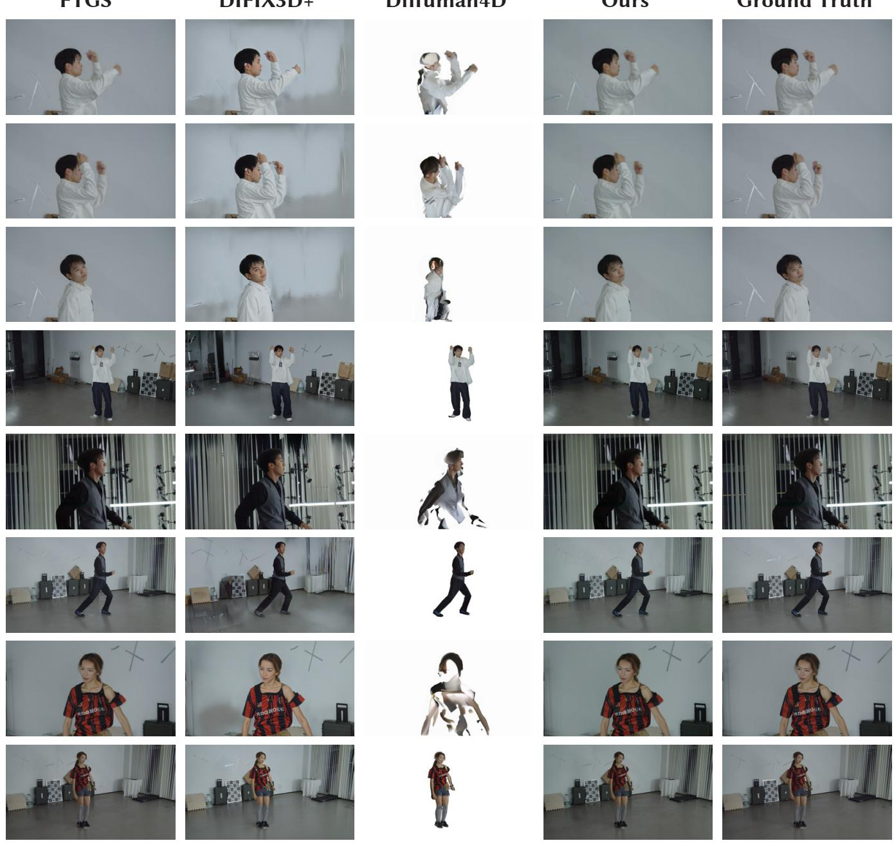  
Fig. 7. Additional qualitative comparisons for novel view synthesis on RealVV. We compare FTGS [Wang et al. 2025e], DIFIX3D+ [Wu et al. 2025c] Difuman4D [Jin et al. 2025], RealMe, and the ground truth under the same sparse-capture seting. The examples cover both short-focus and long-focus views. RealMe beter preserves scene backgrounds, human appearance, and view-dependent details.

long-focus views that preserve local clothing and facial details, foreground masks used for human-centric reconstruction, and camerarig views that show the multi-view capture setup. These examples

cover diferent scenes, actors, actions, camera baselines, and focal settings, making the training and evaluation data distribution more concrete.

FTGS

DIFIX3D+

Diffuman4D

Ours

Ground Truth

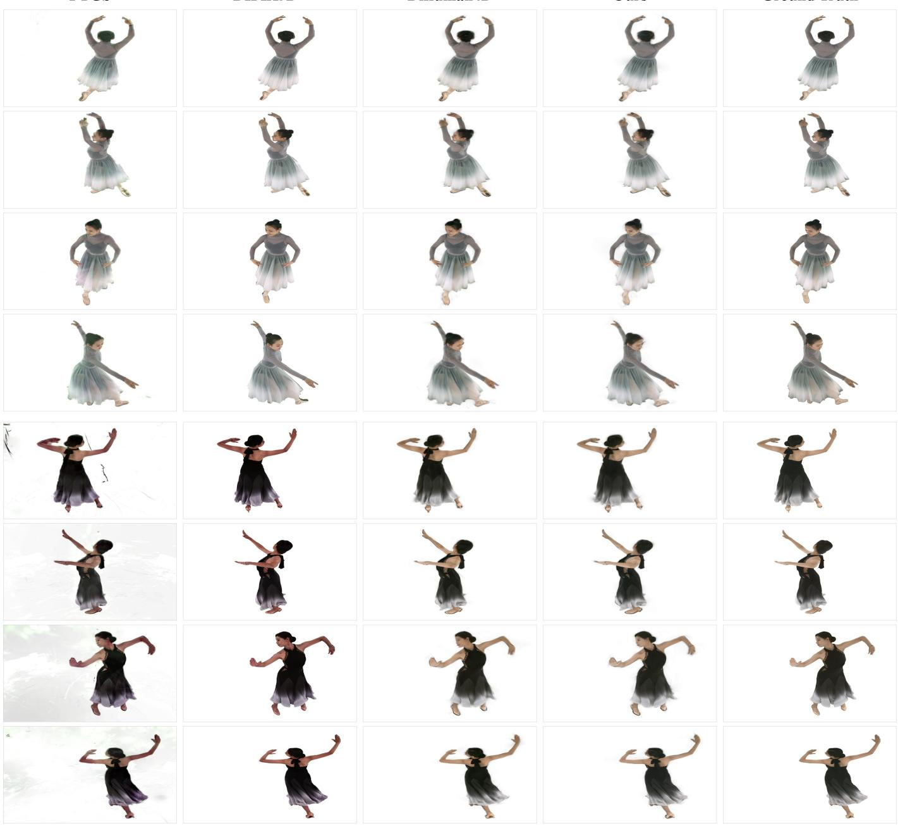  
Fig. 8. Additional qualitative comparisons for novel view synthesis on DNA-Rendering. We compare FTGS [Wang et al. 2025e], DIFIX3D+ [Wu et al. 2025c], Difuman4D [Jin et al. 2025], RealMe, and the ground truth using eight input views. The top and botom four rows show two evaluation sequences across diferent held-out viewpoints and timestamps.

FTGS  
DIFIX3D+  
Ours (Gen.)  
Ours (Recon.)  
GT  
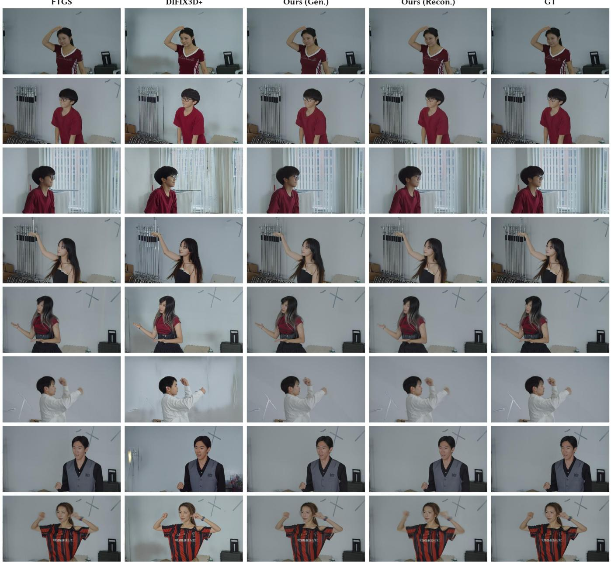  
Fig. 9. Additional qualitative comparisons on long-focus views. We compare FTGS [Wang et al. 2025e], DIFIX3D+ [Wu et al. 2025c], generated views from RealMe, 4D reconstruction from RealMe, and the ground truth. Long-focus views stress the ability to recover high-resolution appearance under limited input coverage. RealMe produces cleaner details and more faithful scene appearance in these zoomed-in views.

RGB w/ LFL  
RGB w/o LFL  
Error Map  
High-Freq. Map w/ LFL  
High-Freq. Map w/o LFL  
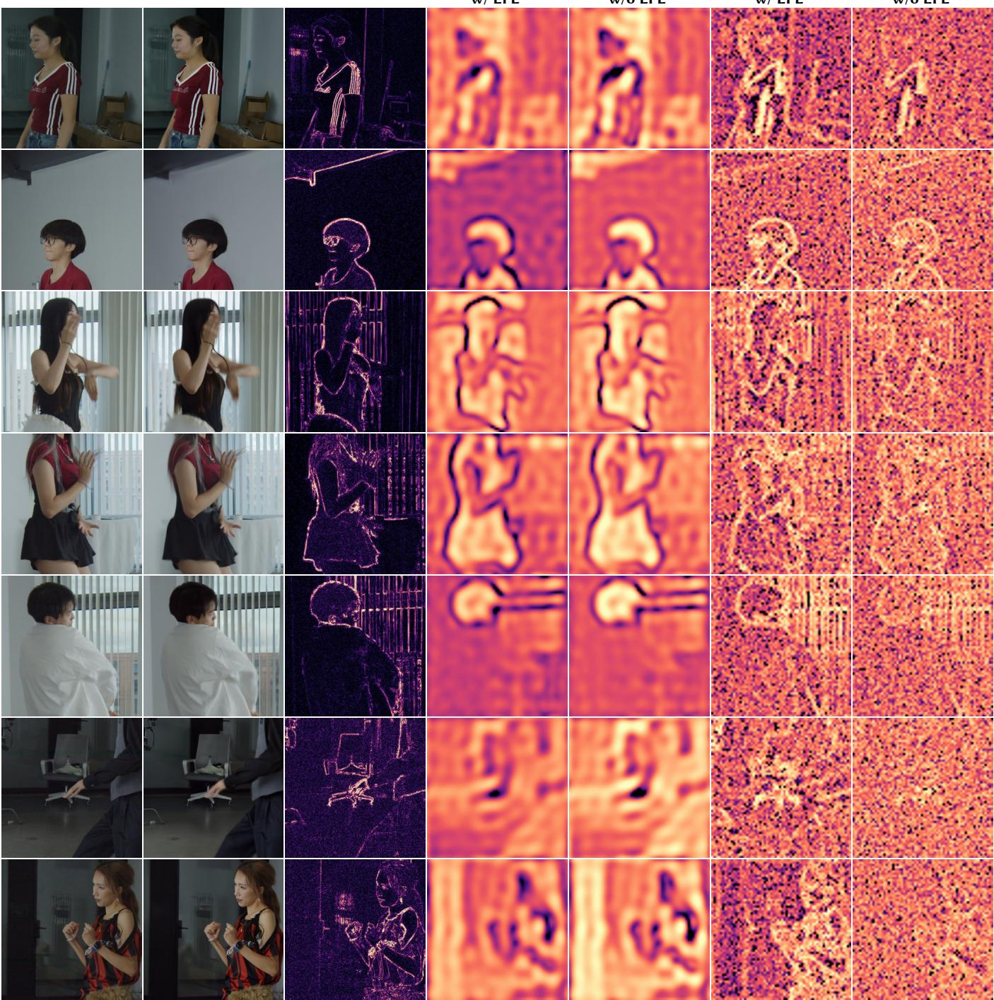  
Fig. 10. Qualitative ablation on latent frequency loss. We compare generated RGB results with and without latent frequency loss (LFL), the RGB error map, and the corresponding low-frequency and high-frequency latent visualizations. The latent maps show that LFL beter preserves high-frequency structures such as silhouetes, facial details, and clothing boundaries, complementing the quantitative ablation in the main paper.

Short-focus  
Long-focus  
Mask  
Camera Rigs  
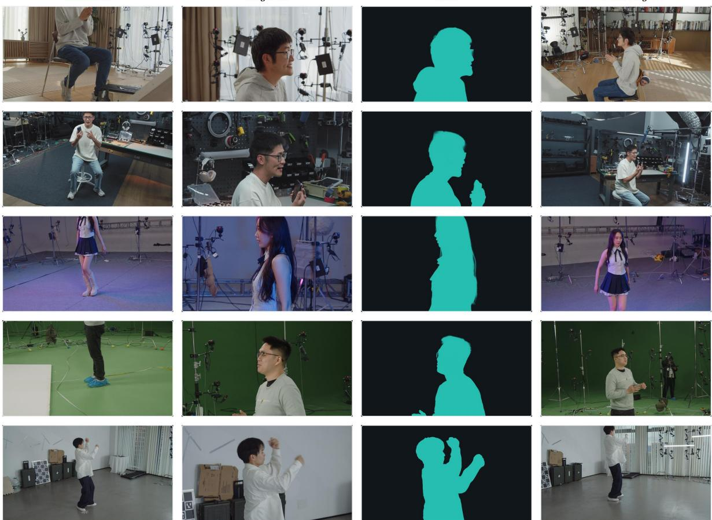  
Fig. 11. RealVV dataset overview. We show representative samples from RealVV, including short-focus captures, long-focus captures, foreground masks, and camera-rig views across diferent scenes.