# RiO-DETRv2: Geometry-Aware Uncertainty Modeling Meets Real-Time Oriented Object Detection Transformer

Zhangchi Hu1, Zilong He1, Yifan Zhao1, Xiangyu Yu1, Jie Chen1,

Peixi Wu1, Yansong Peng1, Hebei Li1∗, Xiaoyan Sun1,2

1University of Science and Technology of China

2Institute of Artificial Intelligence, Hefei Comprehensive National Science Center

## Abstract

RiO-DETR is the first real-time end-to-end transformer for oriented object detection, yet further localization gains require a more expressive box representation. Although distributional regression has succeeded in horizontal DETRs, extending it to oriented detection introduces geometry-misaligned boundary modeling and topology-inconsistent orientation refinement. We present RiO-DETRv2, a geometry-aware uncertainty modeling framework for real-time oriented object detection. To resolve the geometry mismatch, Object-Aligned Boundary Distribution Refinement represents box boundaries as probability distributions in an object-aligned coordinate system and progressively refines them across decoder layers. For better orientation topology consistency, we introduce Circular-to-Local Angular Residual Refinement that transitions from global periodic search to local finegrained estimation. Unified OBB Quality-Aligned Learning further aligns classification, boundary and angular refinement with complete-OBB localization quality. Together, these designs improve localization without compromising eficiency, achieving a better balance between speed and accuracy. Specifically, RiO-DETRv2-l/x achieves 53.7/54.1 mAP50-95 on DOTA, outperforming RiO-DETR-l/x by 1.2/1.5 points with nearly unchanged computational cost. Code is available at https://github.com/RicePasteM/RiO-DETRv2.

## Introduction

Oriented object detection extends horizontal bounding boxes to localize objects with arbitrary rotations (Oriented Bounding Boxes, OBB), which is crucial for aerial imagery, remote sensing, and scene text understanding (Xia et al. 2018; Ding et al. 2021; Cheng et al. 2022; Zhou et al. 2022; Redmon et al. 2016; Zou et al. 2023). Recent real-time DETRs have demonstrated strong speed–accuracy trade-ofs, and RiO-DETR (Hu et al. 2026) further extends this paradigm to oriented detection. However, the deterministic box parameterization in previous methods limits gains in localization accuracy, making it challenging to improve fine-grained OBB localization while preserving real-time eficiency.

Distributional regression has recently emerged as an efective alternative to deterministic box regression in horizontal object detection (Li et al. 2020, 2021; Peng et al. 2024). Instead of predicting each boundary as a single scalar, it represents possible boundary locations as a probability distribution and recovers a continuous estimate through distribution integration. Such a formulation provides richer supervision and facilitates progressive localization refinement.

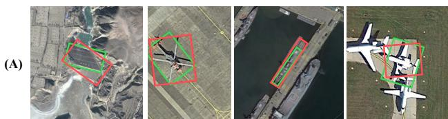  
Prediction

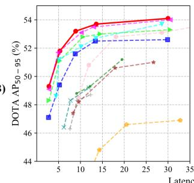

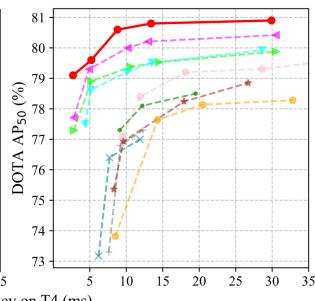  
Figure 1: (A) Representative localization errors that are counted as TPs under the IoU threshold of 0.5 but fail the stricter 0.75 matching criterion, revealing the need for more precise OBB localization. (B) Comparisons with other detectors of AP50-95 and AP50 versus inference latency on DOTA-1.0 under single-scale training and testing protocol.

However, oriented localization involves special geometric structures that are absent from horizontal bounding boxes, which makes it challenging to apply such representation. The challenges are three-fold: (1) Geometry-misaligned boundary modeling. Existing distributional regressors decompose localization into four axis-aligned boundary distributions in the global image frame. However, rotating an object changes these regression targets even when its intrinsic geometry remains unchanged, causing boundary uncertainty to be entangled with orientation. (2) Topology-inconsistent orientation refinement. Unlike boundary distributions relative to the initial distance, angular refinement is defined in a fixed domain and requires both broad early-stage correction and fine-grained late-stage estimation. A fixed support therefore sufers from a range–resolution conflict, hindering the transition from global search to local refinement. (3) Qualitymisaligned branch optimization. Although boundary and orientation should be represented independently according to their geometric structures, they jointly determine complete-OBB localization quality. Optimizing them with separate quality criteria may produce high confidence predictions with unreliable overall localization.

We present RiO-DETRv2, a geometry-aware uncertainty refinement framework that models spatial and angular uncertainty according to their geometric structures while aligning optimization at the complete-OBB level. For spatial localization, Object-Aligned Boundary Distribution Refinement extends D-FINE (Peng et al. 2024) by defining four boundary distributions in an object-aligned local coordinate system. This representation preserves stable side semantics under arbitrary rotations, reduces orientation-boundary entanglement, and enables progressive refinement across decoder layers. For orientation estimation, Circular-to-Local Angular Residual Refinement models layer-wise residual distributions around the current reference orientation. The first decoder layer performs topology-consistent global search over the complete periodic domain using a circular distribution, while subsequent layers employ progressively contracted local supports for fine angular estimation. The decoded residuals iteratively update the orientation through the periodic refinement mechanism of RiO-DETR, extending deterministic angle regression to coarse-to-fine uncertainty refinement. Finally, Unified OBB Quality-Aligned Learning coordinates boundary and angular branches using complete-OBB localization quality. The quality score serves as both the soft classification target and the shared weight for distribution losses. Uncertainty statistics from predicted distributions further calibrate classification confidence, improving its consistency with the reliability of complete OBB predictions.

Extensive experiments on DOTA-1.0, DIOR-R and AI-TOD-R demonstrate that RiO-DETRv2 establishes a better speed–accuracy trade-of for DETR-based real-time oriented object detection. Across diferent model scales and training schedules, RiO-DETRv2 consistently improves detection accuracy over RiO-DETR with comparable computational cost. These improvements are particularly pronounced on high-IoU-threshold metrics, which more sensitively reflect localization precision. In particular, RiO-DETRv2-x achieves 54.1 mAP50-95 on DOTA-1.0 and 53.46 mAP50-95 / 78.32 AP on DIOR-R, while preserving real-time inference at 30.0 ms and 17.48 ms on an NVIDIA T4 GPU, respectively. By unifying geometry-aware uncertainty refinement with complete-OBB quality-aligned learning, we ofer a meaningful step toward more precise real-time oriented object detection, inspiring further exploration in the field.

## Related Works

CNN-based Oriented Object Detection. CNN-based oriented detectors adapt horizontal frameworks through rotated proposals, aligned RoI features, or dedicated orientation heads. Representative two-stage methods include RoI Transformer and Oriented R-CNN (Ding et al. 2019; Xie et al. 2021; Yang et al. 2020), while one-stage methods such as S2ANet and FCOS-based variants favor simpler and more eficient pipelines (Han et al. 2021; Tian et al. 2019). Recent oriented YOLO, PP-YOLOE, and RTMDet variants further improve real-time performance (Jocher et al. 2022; Ge et al. 2021; Xu et al. 2022; Lyu et al. 2022; Khanam and Hussain 2024; Tian, Ye, and Doermann 2025; Sapkota et al. 2025), and DCFL introduces dynamic priors and coarse-tofine assignment for challenging oriented tiny objects (Xu et al. 2023). Nevertheless, these methods generally rely on dense predictions, NMS, and rotation-specific modules, introducing additional deployment complexity and computational or memory-access overhead (Cai et al. 2024; Yuan et al. 2025; Li et al. 2025).

DETR-based Real-Time and Oriented Detection. DETR formulates detection as end-to-end set prediction without handcrafted anchors or NMS (Carion et al. 2020). Building on early DETR variants (Zhu et al. 2020; Meng et al. 2021; Liu et al. 2022; Li et al. 2022a; Zhang et al. 2022), recent real-time models such as RT-DETR, LW-DETR, D-FINE, and DEIM achieve competitive eficiency through improved encoding, query initialization, distributional refinement, and supervision (Zhao et al. 2024b; Chen et al. 2024; Peng et al. 2024; Huang et al. 2025b,a; Hu et al. 2025). Oriented DETRs further introduce rotation-aware proposals, feature alignment, matching, or periodic refinement (Dai et al. 2022; Hu et al. 2023; Zhao et al. 2024a; Zeng et al. 2024; Zhao et al. 2024c; Lee et al. 2025). Among them, RiO-DETR establishes a real-time oriented DETR (Hu et al. 2026), while O2-RTDETR adapts multiple real-time DETR techniques to oriented detection (Ding et al. 2026). However, these methods largely retain deterministic OBB parameterizations, leaving explicit spatial and angular uncertainty insuficiently explored.

Angle Representation and Distributional Modeling. A separate line of research addresses the periodicity and boundary discontinuity of orientation prediction. CSL formulates angle estimation as circular classification with smooth labels (Yang and Yan 2020), while DCL adopts compact coded labels with angle- and aspect-ratio-aware weighting (Yang et al. 2021a). PSC and its dual-frequency variant encode rotational periodicity through diferentiable phase representations to handle boundary discontinuity and square-like ambiguity (Yu and Da 2023). GWD and KLD instead represent an OBB as a two-dimensional Gaussian and optimize distribution distances over center, scale, aspect ratio, and orientation (Yang et al. 2021b,c). These approaches improve periodic angle representation or construct geometry-aware regression objectives, but typically decode a deterministic OBB and do not explicitly maintain progressively refined predictive distributions for both object-aligned boundaries and periodic angular residuals.

## Method

We present RiO-DETRv2, a geometry-aware uncertainty refinement framework for real-time oriented object detection. As illustrated in Fig. 2, RiO-DETRv2 builds upon the eficient end-to-end architecture of RiO-DETR (Hu et al. 2026) and introduces geometry-aware uncertainty modeling for both spatial and angular localization.

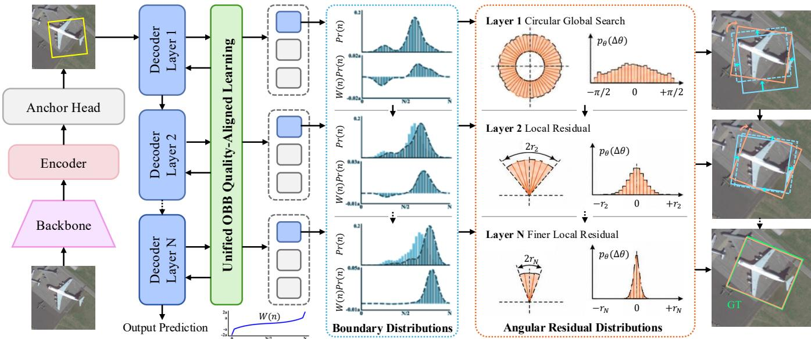  
Figure 2: Overview of RiO-DETRv2. The OBB is factorized into object-aligned boundary geometry and periodic orientation. Side-distance distributions are progressively refined in the object frame, while the angular branch transitions from global circular search to local residual refinement. Both are jointly optimized by complete-OBB localization quality.

## Object-Aligned Boundary Distribution Refinement

Geometry misalignment of global-axis modeling. Distributional regression (Li et al. 2020, 2021; Peng et al. 2024) represents each boundary as a probability distribution over discrete candidates, providing richer localization uncertainty modeling than deterministic regression. For horizontal object detection, the four distributions naturally correspond to the distances from a reference point to the top, bottom, left, and right image boundaries, whose semantic meanings remain consistent across instances.

However, this property does not hold for oriented objects. When an object rotates, boundaries defined along fixed image axes no longer correspond to consistent physical sides of the object, as shown in Fig. 3. Consequently, the predicted distributions are forced to model both intrinsic boundary uncertainty and orientation-induced variations. Such geometry misalignment breaks side-wise semantic consistency and limits progressive refinement across decoder layers.

Object-aligned boundary representation. To address this issue, we define boundary distributions in a canonical coordinate frame aligned with the object geometry. Let $\mathbf { b } ^ { 0 } = \{ \mathbf { c } ^ { 0 } , w ^ { 0 } , h ^ { 0 } , \theta ^ { 0 } \}$ and $\mathbf { b } ^ { \star } = \{ \mathbf { c } ^ { \star } , \tilde { w } ^ { \star } , \tilde { h ^ { \star } } , \theta ^ { \star } \}$ denote the initial reference and target OBBs. We first transform the center ofset into the target-aligned coordinate frame:

$$
\begin{array} { r } { \delta _ { \mathrm { l o c } } ^ { \star } = { \bf R } ( - \theta ^ { \star } ) ( { \bf c } ^ { \star } - { \bf c } ^ { 0 } ) = \bigg [ \delta _ { x } ^ { \star } \bigg ] , } \end{array}\tag{1}
$$

where $\mathbf { R } ( \cdot )$ denotes a two-dimensional rotation matrix. The four physical side distances in this local frame are defined as

$$
\mathbf { d } ^ { \star } = \left[ \begin{array} { l } { t ^ { \star } } \\ { b ^ { \star } } \\ { \ell ^ { \star } } \\ { r ^ { \star } } \end{array} \right] = \left[ \begin{array} { l } { h ^ { \star } / 2 - \delta _ { y } ^ { \star } } \\ { h ^ { \star } / 2 + \delta _ { y } ^ { \star } } \\ { w ^ { \star } / 2 - \delta _ { x } ^ { \star } } \\ { w ^ { \star } / 2 + \delta _ { x } ^ { \star } } \end{array} \right] .\tag{2}
$$

Under the long-side convention, where $w \ge h$ and $\theta \in$ [0, π) denotes the major-axis orientation, ℓ and r correspond to the major-axis boundaries, while t and b correspond to the minor-axis boundaries. Their physical meanings are therefore invariant to global rotation.

During training, the target orientation $\theta ^ { \star }$ defines the canonical frame, where the side-distance residuals are normalized relative to the initial reference box and interpolated over a non-uniform candidate set. During inference, the predicted orientation decodes the local geometry back into the image frame. This design avoids ambiguous boundary targets caused by inaccurate orientations and provides consistent side-wise geometric supervision.

Progressive boundary distribution refinement. The canonical object frame preserves side-wise boundary semantics across decoder layers, enabling progressive logit accumulation. Let $\Delta \mathbf { z } _ { s } ^ { ( l ) } \in \mathbb { R } ^ { N }$ denote the N-bin logits predicted for side s at decoder layer l. The first layer produces the initial logits, while subsequent layers predict additive refinements:

$$
\begin{array} { r } { \mathbf { z } _ { s } ^ { ( l ) } = \left\{ \Delta \mathbf { z } _ { s } ^ { ( 1 ) } , \quad l = 1 , \right. } \\ { \left. \mathbf { z } _ { s } ^ { ( l - 1 ) } + \Delta \mathbf { z } _ { s } ^ { ( l ) } , l \ge 2 . \right. } \end{array}\tag{3}
$$

The accumulated logits are decoded into a continuous normalized residual:

$$
\hat { \phi } _ { s } ^ { ( l ) } = \sum _ { n = 0 } ^ { N - 1 } W ( n ) \operatorname { S o f t m a x } \left( \mathbf { z } _ { s } ^ { ( l ) } \right) _ { n } ,\tag{4}
$$

for $s \in \{ t , b , \ell , r \}$ , where $W ( n )$ is the non-uniform projection value adopted from D-FINE (Peng et al. 2024). The decoded residuals are converted into layer-wise OBBs using the corresponding predicted orientations $\theta ^ { ( l ) }$ . Detailed target normalization, interpolation, and OBB decoding are provided in Appendix A.

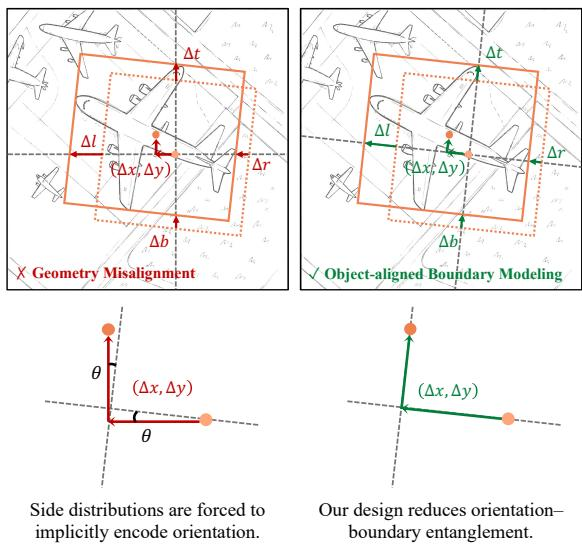  
Figure 3: Global-axis decomposition entangles boundary distributions with orientation, whereas object-aligned modeling supervises side distances in the target-local frame and decodes them with the predicted angle, separating boundary geometry from angular estimation.

## Circular-to-Local Angular Residual Refinement

Object-aligned boundary modeling factorizes OBB localization into canonical boundary geometry and frame orientation. The angular branch estimates the residual from the current reference orientation to the target. Because the initial reference may require a large periodic correction while later references need only fine adjustment, we use a global circular support at the first layer and progressively contracted local supports thereafter. Each layer predicts a normalized residual distribution $\operatorname* { P r } _ { \theta } ^ { ( l ) } ( n )$ , whose decoded residual iteratively updates the orientation.

Circular-to-local residual refinement. We denote the signed shortest-path residual in the π-periodic space by $\langle \bar { x } \rangle _ { \pi } = ( ( x + \pi \dot { / } 2 ) \bmod \pi ) - \pi / 2 , \langle x \rangle _ { \pi } \overset { \cdot } { \in } [ - \pi / 2 , \stackrel { \cdot } { \pi } / 2 )$

At the first decoder layer, M angular bins uniformly cover the full residual domain, with candidates $\psi ^ { ( 1 ) } ( n ) = { \overset { \cdot } { - } } \pi / 2 +$ $n \pi / M , n = 0 , \dots , M - 1$ . To avoid the discontinuity of linear decoding at the periodic boundary, we decode the first-layer residual using the circular first moment:

$$
\Delta \theta ^ { ( 1 ) } = \frac { 1 } { 2 } \mathrm { a t a n 2 } \left( \sum _ { n = 0 } ^ { M - 1 } \mathrm { P r } _ { \theta } ^ { ( 1 ) } ( n ) \sin \left( 2 \psi ^ { ( 1 ) } ( n ) \right) , \right.\tag{5}
$$

The doubled-angle representation maps the π-periodic orientation space to a full circle, making the first and last bins adjacent. The first-layer orientation is then updated as $\theta ^ { ( 1 ) } = \overline { { ( \theta ^ { ( 0 ) } + \Delta \theta ^ { ( 1 ) } ) } }$ mod π.

For decoder layers $l \geq 2 .$ , the residual support is progres-

sively contracted:

$$
\begin{array} { c } { { r ^ { ( l ) } = \displaystyle \frac { \pi } { 2 \alpha ^ { l - 1 } } , \psi ^ { ( l ) } ( n ) = - r ^ { ( l ) } + \displaystyle \frac { 2 r ^ { ( l ) } n } { M - 1 } , } } \\ { { \Delta \theta ^ { ( l ) } = \displaystyle \sum _ { n = 0 } ^ { M - 1 } \psi ^ { ( l ) } ( n ) \mathrm { P r } _ { \theta } ^ { ( l ) } ( n ) , } } \\ { { \theta ^ { ( l ) } = \left( \theta ^ { ( l - 1 ) } + \Delta \theta ^ { ( l ) } \right) \mathrm { m o d } \pi . } } \end{array}\tag{6}
$$

where $\alpha > 1$ is the support contraction factor. Keeping the output dimension fixed while shrinking the support increases the efective angular resolution of deeper layers. Consequently, the first layer performs topology-consistent global direction search, while later layers refine the orientation within progressively smaller local neighborhoods.

Layer l is supervised by the shortest-path residual $\phi _ { \theta } ^ { ( l ) } = \begin{array} { r l } \end{array}$ $\langle \theta ^ { \star } - \theta ^ { ( l - 1 ) } \rangle _ { \pi }$ . The first-layer target is circularly interpolated across periodic bins, whereas subsequent targets are clipped to the current local support and interpolated between neighboring bins. More details are provided in Appendix B.

## Unified OBB Quality-Aligned Learning

We introduce Unified OBB Quality-Aligned Learning to coordinate classification, boundary refinement, and angular refinement using the localization quality of the complete oriented box. It further calibrates classification confidence using uncertainty statistics extracted from the predicted boundary and angular distributions.

Unified OBB quality supervision. For the k-th matched prediction at decoder layer l, we convert the Gaussian KLD loss (Yang et al. 2021c) into a bounded localization quality:

$$
q _ { k } ^ { \left( l \right) } = \operatorname* { m a x } \left( 1 - \mathcal { L } _ { \mathrm { K L D } } \left( \mathbf { b } _ { k } ^ { \left( l \right) } , \mathbf { b } _ { k } ^ { \star } \right) , 0 \right) .\tag{7}
$$

We detach $q _ { k } ^ { ( l ) }$ from the computation graph. As a complete-OBB measure, it reflects the joint efects of center, scale, aspect-ratio, and orientation errors. We use it as the positive soft target in Varifocal Loss. The same quality also weights both distribution refinement objectives:

$$
\mathcal { L } _ { \mathrm { F G L } } = \frac { 1 } { K _ { m } } \sum _ { l = 1 } ^ { L } \sum _ { k = 1 } ^ { K _ { m } } q _ { k } ^ { ( l ) } \left( \ell _ { \mathrm { B } , k } ^ { ( l ) } + \ell _ { \mathrm { A } , k } ^ { ( l ) } \right) ,\tag{8}
$$

where $\ell _ { \mathrm { B } }$ and $\ell _ { \mathrm { A } }$ denote the boundary and angular distribution refinement losses, respectively; $K _ { m }$ is the number of matched queries, and L is the number of decoder layers.

Distribution-aware confidence calibration. Unified OBB quality aligns classification confidence with completebox localization quality, while the predicted distributions provide complementary uncertainty information. For the boundary branch, we extract confidence statistics from the predicted boundary distributions and use them to calibrate the classification logit through a lightweight MLP.

For the angular branch, we use normalized entropy to measure predictive uncertainty independent of the layer-wise support radius:

$$
\mathcal { H } _ { \theta } ^ { ( l ) } = - \frac { \sum _ { n = 0 } ^ { M - 1 } p _ { \theta } ^ { ( l ) } ( n ) \log p _ { \theta } ^ { ( l ) } ( n ) } { \log M } .\tag{9}
$$

<table><tr><td rowspan="2">Model</td><td rowspan="2">Params. FLOPs Lat.</td><td rowspan="2"></td><td rowspan="2"></td><td colspan="6">AP50 by category</td><td colspan="4">Overall performance</td></tr><tr><td>PL BD</td><td>BR GTF</td><td>SV LV</td><td>SH TC</td><td>BC ST</td><td>SBF RA</td><td>HA</td><td>SP HC</td><td>mAP50-95</td><td>AP50 AP75</td></tr><tr><td>RTMDet-R-t</td><td>4.9M</td><td>20G</td><td>8.3</td><td>89.2</td><td>80.0 47.9 69.7</td><td>82.1 83.3</td><td>88.6 90.9</td><td>86.3 86.9</td><td>59.9 62.3 74.2</td><td>72.0 57.0</td><td>47.4</td><td>75.4</td><td>50.6</td></tr><tr><td>YOLO26n-obb</td><td>2.5M</td><td>14G</td><td>2.8</td><td>89.7</td><td>84.7 52.1 71.1</td><td>83.1 78.9</td><td>88.7 91.1 87.3</td><td>86.9 58.5</td><td>69.1 76.6</td><td>82.8 65.1</td><td>49.1</td><td>77.4</td><td>53.4</td></tr><tr><td>RiO-DETR-n</td><td>4.0M</td><td>17G</td><td>2.7</td><td>87.3</td><td>86.1 54.9 73.6</td><td>80.5 85.1</td><td>88.0 90.8</td><td>87.4 86.9</td><td>60.9 72.0 76.8</td><td>73.4 71.8</td><td>47.1</td><td>78.5</td><td>48.2</td></tr><tr><td>RiO-DETRv2-n</td><td>4.3M</td><td>18G</td><td>2.8</td><td>88.8</td><td>86.2 57.6</td><td>76.6 82.0 85.2</td><td>89.0 90.9</td><td>88.0 87.0</td><td>63.7 71.2 77.3</td><td>72.7 70.5</td><td>49.3</td><td>79.1</td><td>50.9</td></tr><tr><td>PPYOLOE-R-s</td><td>8.1M</td><td>44G</td><td>8.5</td><td>88.8</td><td>78.4 45.9</td><td>66.9 80.1 82.8</td><td>88.2 90.6</td><td>79.7 86.4</td><td>56.1 64.0 65.0</td><td>79.5 50.4</td><td>40.6</td><td>73.5</td><td>39.2</td></tr><tr><td>RTMDet-R-s</td><td>8.9M</td><td>38G</td><td>9.7</td><td>89.2</td><td>80.5 52.1</td><td>71.4 81.6 84.1</td><td>88.8 90.9</td><td>87.8 87.0</td><td>59.6 62.3 75.9</td><td>82.0 61.0</td><td>48.2</td><td>76.9</td><td>50.6</td></tr><tr><td>O2-RTDETR-R18</td><td>20.0M</td><td>147G</td><td>9.1</td><td>89.0</td><td>84.2 52.0</td><td>71.5 80.2 85.0</td><td>88.4 90.9</td><td>87.9 85.5</td><td>57.7 66.3</td><td>77.2 74.6 69.4</td><td>48.8</td><td>77.3</td><td>51.1</td></tr><tr><td>YOLO26s-obb</td><td>9.8M</td><td>55G</td><td>4.9</td><td>89.7</td><td>86.3 55.5</td><td>71.8 82.5 81.9</td><td>88.9 91.1</td><td>88.2 88.1</td><td>62.9 72.5</td><td>78.0 83.9 74.6</td><td>51.7</td><td>79.3</td><td>56.3</td></tr><tr><td>RiO-DETR-s</td><td>8.2M</td><td>53G</td><td>5.4</td><td>85.6</td><td>84.8 57.5</td><td>75.5 80.7 86.2</td><td>89.0 90.8</td><td>88.4 88.2</td><td>65.2 74.2</td><td>78.3 80.1 79.6</td><td>49.4</td><td>79.9</td><td>51.0</td></tr><tr><td>RiO-DETRv2-s</td><td>8.9M</td><td>53G</td><td>5.3</td><td>88.5</td><td>86.7 58.5</td><td>77.0 81.6 85.9</td><td>89.1 90.8</td><td>88.0 88.6</td><td>63. .1 71.5</td><td>77.9 76.9 69.5</td><td>51.8</td><td>79.6</td><td>56.4</td></tr><tr><td>PPYOLOE-R-m</td><td>24.0M</td><td>127G</td><td>15.3</td><td>89.2</td><td>79.8 51.2</td><td></td><td>88.7 90.8</td><td></td><td></td><td></td><td></td><td></td><td></td></tr><tr><td>RTMDet-R-m</td><td>24.7M</td><td>100G</td><td>17.8</td><td>89. .2</td><td>84.7 53.9</td><td>72.9 81.7 84.4</td><td>88.7 90.9</td><td>86.8 87.5</td><td>58.9 68.0</td><td>73.8 81.7 68.1</td><td>44.8</td><td>77.6 78.2</td><td>44.7</td></tr><tr><td>O²-RTDETR-R34</td><td>31.0M</td><td>228G</td><td>12.2</td><td>88.9</td><td>83.8 53.8</td><td>74.7 81.5 84.0</td><td>88.6 90.9</td><td>87.4 87.2</td><td>59.4 66.7</td><td>77.7 82.4 65.3</td><td>50.6</td><td></td><td>54.5</td></tr><tr><td>YOLO26m-obb</td><td>21.2M</td><td>183G</td><td>10.2</td><td>89.2</td><td>86.8 56.4</td><td>73.9 80.8 85.4 73.0 82.6 78.3</td><td>89.1 91.2</td><td>86.6 86.8 88.4 87.9</td><td>58.3 66.4 77.3 64.5</td><td>80.1 70.7</td><td>49.3 53.1</td><td>78.1 79.3</td><td>50.7</td></tr><tr><td>RiO-DETR-m</td><td>18.6M</td><td>158G</td><td>8.8</td><td>85.9</td><td>86.4 61.7</td><td>78.1 82.0 86.8</td><td>89.2 90.8</td><td>88.9 87.7</td><td>78.0 67.4 73.3</td><td>78.3 83.1 79.7 78.8</td><td>51.6</td><td>80.6</td><td>58.4 55.0</td></tr><tr><td>RiO-DETRv2-m</td><td>19.5M</td><td>158G</td><td>8.9</td><td>85.6</td><td>87.5 60.0</td><td>80.3 81.7 86.3</td><td>89.3 90.9</td><td>88.3 88.7</td><td>69. .3 72.4</td><td>78.8 77.4 78.8 81.6 77.1</td><td>53.2</td><td>80.8</td><td>57.3</td></tr><tr><td>PPYOLOE-R-1</td><td>53.3M</td><td>282G</td><td>20.5</td><td>89.2</td><td>81.0 54.0</td><td>70.2 81.9 85.2</td><td>88.8 90.8</td><td>87.0 88.0</td><td></td><td></td><td></td><td></td><td></td></tr><tr><td>RTMDet-R-1</td><td>52.3M</td><td>205G</td><td>26.7</td><td>89.4</td><td>84.2 55.2</td><td>75.1 80.8 84.5</td><td>89.0 90.9</td><td>87.4 87.3</td><td>62.9 67.9 63.1 67.9</td><td>76.6 79.1 69.7 78.1 80.8 69.1</td><td>46.6 51.0</td><td>78.1 78.9</td><td>48.5 55.2</td></tr><tr><td>O2-RTDETR-R50</td><td>42.0M</td><td>339G</td><td>19.5</td><td>89.3</td><td>84.1 56.5</td><td>73.9 80.0 84.1</td><td>88.1 90.9</td><td>85.3 86.1</td><td>63.2 65.0</td><td>77.8 77.8</td><td>72.4 51.2</td><td>78.5</td><td>54.3</td></tr><tr><td>YOLO26l-obb</td><td>25.6M</td><td>230G</td><td>13.0</td><td>89. .5</td><td>86.3 56.2</td><td>74.2 82.9 78.8</td><td>89.3 91.1</td><td>88.6 88.1</td><td>67.9 72.2 </td><td>78.2 83.5</td><td>76.5 53.5</td><td>79.8</td><td>59.1</td></tr><tr><td>RiO-DETR-1</td><td>27.5M</td><td>230G</td><td>13.4</td><td>86.7</td><td>86.8 60.8</td><td>79.4 82.0 86.4</td><td>89.0 90.8</td><td>88.7 88.5</td><td>70.0 76.0</td><td>79.2 83.4 76.9</td><td>52.5</td><td>81.5</td><td>56.2</td></tr><tr><td>RiO-DETRv2-1</td><td>28.6M</td><td>230G</td><td>13.6</td><td>86.9</td><td>86.8 60.7</td><td>76.7 82.7 86.1</td><td>89.3 90.9</td><td>88.2 88.4</td><td>71.4 71.7</td><td>79.0 83.0 69.9</td><td>53.7</td><td>80.8</td><td>58.7</td></tr><tr><td>PPYOLOE-R-x</td><td>100M</td><td>530G</td><td>32.8</td><td>89.5</td><td>79.7 55.0</td><td>75.6 82.4</td><td>85.2 88.4 90.8</td><td>85.7 87.7</td><td>63.2 69.5</td><td>77.1 75.1</td><td>69.4</td><td>46.9 78.3</td><td>49.3</td></tr><tr><td>YOLO26x-obb</td><td>57.6M</td><td>517G</td><td>30.5</td><td>89.7</td><td>86.6 57.3</td><td>73.8 82.8 79.3</td><td>89.3 91.1</td><td>89.1 88.1</td><td>66.7 70.6 77.9</td><td>83.380.7</td><td>54.0</td><td>79.8</td><td>59.3</td></tr><tr><td>RiO-DETR-X</td><td>62.5M</td><td>527G</td><td>29.9</td><td>88.3</td><td>87.5 61.9</td><td>79.2 83.2 86.5</td><td>89.2 90.9</td><td>88.4 87.8</td><td>71.2</td><td>75.1 78.5 82.2 77.1</td><td>52.6</td><td>81.8</td><td>57.6</td></tr><tr><td>RiO-DETRv2-x</td><td>64.6M</td><td>528G</td><td>30.0</td><td>87.7</td><td>86.3 62.5</td><td>79.0</td><td>81.0 85.3 88.9 90.8 87.0 </td><td></td><td>88.4 71.5</td><td>70.6 78.1 80.3 77.3</td><td>54.1</td><td>80.9</td><td>59.4</td></tr></table>

Table 1: Comparison with representative real-time oriented object detectors on the DOTA-1.0 test set. For each matched model scale, the best and second-best overall results are highlighted in bold and underlined, respectively.

Orientation reliability also depends on the intrinsic shape of the predicted box. Near-square objects have ambiguous principal directions even when their angular distributions are concentrated. We therefore define the anisotropy of the final decoded box as

$$
a ^ { ( L ) } = 1 - \frac { \operatorname* { m i n } ( w ^ { ( L ) } , h ^ { ( L ) } ) } { \operatorname* { m a x } ( w ^ { ( L ) } , h ^ { ( L ) } ) } .\tag{10}
$$

Angular entropy captures predictive uncertainty, whereas anisotropy captures intrinsic identifiability of orientation. We concatenate layer-wise angular uncertainty statistics and final-box anisotropy with boundary distribution statistics, and use a lightweight MLP to calibrate the classification logit. Detailed formulations are provided in Appendix C.

## Experiments

In this section, we evaluate RiO-DETRv2 through comparisons with state-of-the-art methods and comprehensive ablation studies. We further analyze the underlying mechanisms of the proposed method in Appendices E–F.

## Evaluation Datasets

DOTA-1.0. DOTA-1.0 (Xia et al. 2018) is a large-scale oriented object detection dataset containing 2,806 images and 188,282 instances across 15 categories, with significant variations in orientation, shape, and scale. We use singlescale setting for evaluation, images are cropped into 1024 × 1024 patches with a stride of 824. We submit test predictions to the oficial evaluation server to obtain final performance.

DIOR-R. DIOR-R (Cheng et al. 2022) is constructed from DIOR by adding annotations for rotated bounding boxes. It comprises 23,463 images of size 800×800, totaling 190,288 oriented instances across 20 categories. The dataset is split into training, validation, and testing sets with a ratio of 1:1:2.

AI-TOD-R. AI-TOD-R (Xu et al. 2024) is a large-scale benchmark for oriented tiny object detection, containing 28,036 images and 752,460 oriented instances across eight categories. Each image has a resolution of 800 × 800, while the mean object size is only approximately 10.6 pixels. The dataset presents substantial challenges arising from extremely small object scales, arbitrary orientations, dense object arrangements, and imbalanced category distributions.

## Implementation Details

For all datasets, models are trained on the trainval set and evaluated on the test set following their oficial protocols. Results of DOTA are returned by the oficial server. All models are trained on 2 NVIDIA A800 or 4 RTX3090 GPUs. All latencies are measured equally on a single NVIDIA T4 GPU using TensorRT 10 with FP16 following the same setting of RiO-DETR (Hu et al. 2026). More implementation details are provided in Appendix D.

## Comparison with State-of-the-Art Methods

To evaluate our proposed RiO-DETRv2, we compare with these state-of-the-art methods: RTMDet-R (Lyu et al. 2022), PPYOLOE-R (Xu et al. 2022), YOLO26-obb (Sapkota et al.

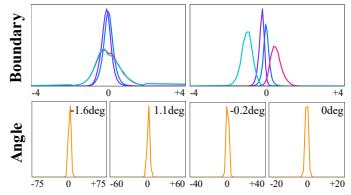

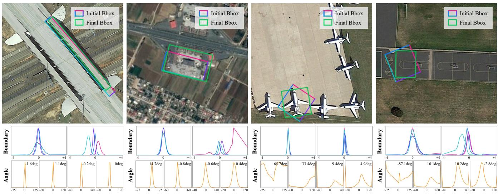

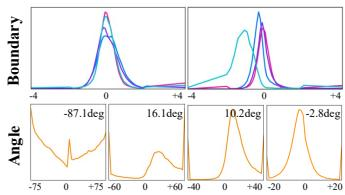  
Figure 4: Visualization of geometry-aware uncertainty refinement. The top row compares the initial and final OBBs, while the lower rows show layer-wise boundary and angular distributions. Boundary predictions progressively concentrate in the object-aligned frame, and angular refinement transitions from large periodic corrections to fine local adjustments.

<table><tr><td>Model</td><td>Para.</td><td>FLOPs</td><td>Lat.</td><td> $\mathrm { m A P _ { 5 0 - 9 5 } }$ </td><td> $\mathrm { { A P } _ { 5 0 } }$ </td><td> $\mathrm { A P } _ { 7 5 }$ </td></tr><tr><td>YOLO26n-obb</td><td>2.5M</td><td>10G</td><td>2.23</td><td>45.79</td><td>71.88</td><td>46.92</td></tr><tr><td>RiO-DETR-n</td><td>4.0M</td><td>11G</td><td>2.20</td><td>44.06</td><td>71.92</td><td>44.57</td></tr><tr><td>RiO-DETRv2-n</td><td>4.3M</td><td>11G</td><td>2.27</td><td>46.47</td><td></td><td>72.21 47.69</td></tr><tr><td>YOLO26s-obb</td><td>9.8M</td><td>39G</td><td>2.84</td><td>48.41</td><td>74.07</td><td>51.30</td></tr><tr><td>RiO-DETR-s</td><td>8.2M</td><td>33G</td><td>3.01</td><td>47.94</td><td>74.44</td><td>49.09</td></tr><tr><td>RiO-DETRv2-s</td><td>8.9M</td><td>33G</td><td>3.29</td><td>49.95</td><td>75.13</td><td>51.29</td></tr><tr><td>02-RTDETR-R34</td><td>31M</td><td>141G</td><td>8.20</td><td>45.12</td><td>68.70</td><td>45.70</td></tr><tr><td>YOLO26m-obb</td><td>21.2M</td><td>129G</td><td>5.91</td><td>50.56</td><td>74.65</td><td>53.35</td></tr><tr><td>RiO-DETR-m</td><td>18.6M</td><td>97G</td><td>5.10</td><td>48.03</td><td>75.73</td><td>49.46</td></tr><tr><td>RiO-DETRv2-m</td><td>19.5M</td><td>98G</td><td>5.35</td><td>52.61</td><td>77.28</td><td>54.28</td></tr><tr><td>O2-RTDETR-R50</td><td>42M</td><td>209G</td><td>12.41</td><td>47.79</td><td>72.20</td><td>48.20</td></tr><tr><td>YOLO261-obb</td><td>25.6M</td><td>158G</td><td>7.53</td><td>51.15</td><td></td><td>75.3151.87</td></tr><tr><td>RiO-DETR-1</td><td>27.5M</td><td>141G</td><td>7.76</td><td>50.64</td><td>76.11</td><td>52.10</td></tr><tr><td>RiO-DETRv2-1</td><td>28.6M</td><td>142G</td><td>8.13</td><td>52.85</td><td>77.57</td><td>54.45</td></tr><tr><td>YOLO26x-obb</td><td>57.6M</td><td>353G</td><td>17.66</td><td>52.28</td><td>76.48</td><td>55.11</td></tr><tr><td>RiO-DETR-X</td><td>62.5M</td><td>324G</td><td>17.31</td><td>51.80</td><td>77.43</td><td>53.82</td></tr><tr><td>RiO-DETRv2-x</td><td>64.6M</td><td>325G</td><td>17.48</td><td>53.46</td><td>78.32</td><td>55.33</td></tr></table>

Table 2: Performance comparison with state-of-the-art realtime oriented object detectors on DIOR-R.

2025), RiO-DETR (Hu et al. 2026), $O ^ { 2 } .$ -RTDETR (Ding et al. 2026), Oriented R-CNN (Xie et al. 2021), $S ^ { 2 } \mathbf { A }$ -Net (Han et al. 2021), Oriented RepPoints (Li et al. 2022b), ARS-DETR (Zeng et al. 2024), DCFL (Xu et al. 2023, 2024) and RHINO-DETR (Lee et al. 2025).

Results on DOTA-1.0. As shown in Table 1, RiO-DETRv2 consistently improves localization accuracy over RiO-DETR across all model scales with nearly unchanged computational cost. Specifically, RiO-DETRv2-n/s/m/l/x achieves 49.3/51.8/53.2/53.7/54.1 $\mathrm { m A P _ { 5 0 - 9 5 } }$ , outperforming the corresponding baselines by 2.2/2.4/1.6/1.2/1.5 points with only marginal increases in parameters and FLOPs. The consistent $\mathsf { A P } _ { 7 5 }$ gains further confirm improved fine-grained OBB localization. Under comparable computational budgets, RiO-DETRv2 also surpasses real-time competitors in $\mathrm { m A P _ { 5 0 - 9 5 } }$ at all scales while retaining competitive $\mathsf { A P } _ { 5 0 }$ . Slight $\mathsf { A P } _ { 5 0 }$ variations at some scales may arise from quality-aware confidence calibration, which downweights predictions with insuficient complete-OBB localization quality and changes ranking behavior under loose IoU thresholds.

<table><tr><td>Model</td><td>Params.</td><td>FLOPs</td><td>Lat.</td><td> $\mathrm { m A P _ { 5 0 - 9 5 } }$ </td><td> $\mathrm { \ A P _ { 5 0 } }$ </td><td> $\mathrm { { A P } _ { 7 5 } }$ </td></tr><tr><td>Oriented R-CNN†</td><td>41.1M</td><td>297G</td><td>一</td><td>11.2</td><td>33.2</td><td>4.3</td></tr><tr><td> $\mathrm { S ^ { 2 } A { - } N e t } ^ { \dagger }$ </td><td>38.6M</td><td>271G</td><td></td><td>10.8</td><td>33.4</td><td>3.3</td></tr><tr><td>Oriented RepPoints†</td><td>36.6M</td><td>269G</td><td></td><td>13.0</td><td>40.3</td><td>4.2</td></tr><tr><td>ARS-DETR†</td><td>41.1M</td><td>250G</td><td>25.32</td><td>14.3</td><td>41.1</td><td>5.8</td></tr><tr><td>DCFL  $\mathrm { ( S ^ { 2 } A \mathrm { - N e t } ) } ^ { \dagger }$ </td><td>38.6M</td><td>271G</td><td></td><td>17.5</td><td>49.6</td><td>7.9</td></tr><tr><td>RHINO-DETR</td><td>50.8M</td><td>383G</td><td>35.56</td><td>17.7</td><td>53.9</td><td>5.7</td></tr><tr><td>YOLO26m-obb</td><td>21.2M</td><td>97G</td><td>5.10</td><td>19.8</td><td>56.5</td><td>8.5</td></tr><tr><td>RiO-DETR-m</td><td>18.6M</td><td>102G</td><td>6.51</td><td>18.2</td><td>54.5</td><td>6.2</td></tr><tr><td>RiO-DETRv2-m</td><td>19.5M</td><td>103G</td><td>6.70</td><td>21.0</td><td>55.7</td><td>10.4</td></tr><tr><td>YOLO26x-obb</td><td>57.6M</td><td>324G</td><td>17.31</td><td>19.9</td><td>56.8</td><td>8.8</td></tr><tr><td>RiO-DETR-x</td><td>62.5M</td><td>336G</td><td>21.03</td><td>18.6</td><td>55.2</td><td>6.6</td></tr><tr><td>RiO-DETRv2-x</td><td>64.6M</td><td>339G</td><td>21.23</td><td>20.6</td><td>59.2</td><td>8.6</td></tr></table>

Table 3: Comparison with state-of-the-art oriented object detectors on the AI-TOD-R benchmark. † denotes results reported by the oficial benchmark (Xu et al. 2024).

Results on DIOR-R. Table 2 demonstrates the generalization ability of RiO-DETRv2 on DIOR-R. Compared with both YOLO26-obb and the original RiO-DETR, RiO-DETRv2 consistently achieves the highest m $\mathrm { \ A P _ { 5 0 } }$ -95 across all model scales. In particular, RiO-DETRv2-x reaches 53.46 $\mathrm { m A P _ { 5 0 - 9 5 } }$ and $7 8 . 3 2 \mathrm { A P } _ { 5 0 } .$ , outperforming YOLO26x-obb by 1.18 and 1.84 points while maintaining similar computational cost and latency. The improvements become more evident at $\mathrm { A P _ { 7 5 } , }$ where RiO-DETRv2 provides more accurate oriented box localization under stricter IoU requirements.

<table><tr><td>Dataset</td><td>OABDR</td><td>CTLAR UniOBB-QAL</td><td>Params.</td><td>FLOPs</td><td> ${ \mathrm { A P } } _ { 5 0 - 9 5 }$ </td><td> $\mathrm { { A P } _ { 5 0 } }$ </td></tr><tr><td rowspan="4">DOTA-1.0</td><td></td><td></td><td>18.6M</td><td>158G</td><td>51.6</td><td>80.6</td></tr><tr><td>√</td><td></td><td>19.5M</td><td>158G</td><td>52.2</td><td>81.0</td></tr><tr><td></td><td>√</td><td>18.7M</td><td>158G</td><td>51.9</td><td>81.1</td></tr><tr><td>√</td><td>√</td><td>19.5M</td><td>158G</td><td>52.7</td><td>81.2</td></tr><tr><td></td><td>√</td><td>√</td><td>√</td><td>19.5M</td><td>158G</td><td>53.2</td><td>80.8</td></tr><tr><td rowspan="4">DIOR-R</td><td></td><td></td><td></td><td>18.6M</td><td>97G</td><td>48.0</td><td>75.7</td></tr><tr><td>√</td><td></td><td></td><td>19.5M</td><td>98G</td><td>49.6</td><td>76.5</td></tr><tr><td></td><td>√</td><td></td><td>18.7M</td><td>97G</td><td>49.4</td><td>76.8</td></tr><tr><td>√</td><td>√</td><td></td><td>19.5M</td><td>98G</td><td>51.2</td><td>77.4</td></tr><tr><td></td><td>√</td><td>√</td><td>√</td><td>19.5M</td><td>98G</td><td>52.6</td><td>77.3</td></tr></table>

Table 4: Component ablation study of RiO-DETRv2-m.
<table><tr><td>Boundary Representation (on DIOR-R)</td><td> $\mathrm { A P _ { 5 0 - 9 5 } }$ </td><td> $\mathrm { { A P } _ { 5 0 } }$ </td><td> $\mathrm { A P _ { 7 5 } }$ </td></tr><tr><td>Original RiO-DETR (Base)</td><td>51.80</td><td>77.43</td><td>53.82</td></tr><tr><td>w/ Global-axis distribution</td><td>52.19</td><td>77.22</td><td>54.20</td></tr><tr><td>w/ Object-aligned distribution (Ours)</td><td>52.88</td><td>77.74</td><td>54.66</td></tr></table>

Table 5: Ablation study on OABDR of RiO-DETRv2-x.

Results on AI-TOD-R. AI-TOD-R is challenging due to its tiny, densely distributed, and arbitrarily oriented objects, for which small boundary or angular errors can cause substantial IoU degradation. As shown in Table 3, RiO-DETRv2-m improves m $\mathrm { \bf N P _ { 5 0 - 9 5 } }$ from 18.2 to 21.0 and $\mathsf { A P } _ { 7 5 }$ from 6.2 to 10.4 over RiO-DETR, while RiO-DETRv2-x gains 2.0 $\mathrm { m A P _ { 5 0 - 9 5 } }$ and $4 . 0 \ \mathrm { A P } _ { 5 0 }$ . Under comparable computational budgets, RiO-DETRv2 also outperforms YOLO26-obb in $\mathrm { m A P _ { 5 0 - 9 5 } }$ at both scales and achieves a notable $\mathsf { A P } _ { 7 5 }$ gain at the m scale, demonstrating the benefit of geometry-aware uncertainty refinement for OBB localization.

## Ablation Studies

Ablation on Main Components. As shown in Table 4, both Object-Aligned Boundary Distribution Refinement (OABDR) and Circular-to-Local Angular Residual Refinement (CTLAR) consistently improve performance on DOTA-1.0 and DIOR-R. Combining them further increases $\mathsf { A P } _ { 5 0 }$ -95 from 51.6 to 52.7 on DOTA-1.0 and from 48.0 to 51.2 on DIOR-R, validating their complementary efects on boundary and angular refinement. Unified OBB Quality-Aligned Learning (UniOBB-QAL) further improves ${ \bf A P _ { 5 0 - 9 5 } }$ to 53.2 and 52.6, respectively, with negligible overhead. The slight $\mathrm { { A P } _ { 5 0 } }$ decrease on DOTA-1.0 results from improved confidence calibration, where predictions with lower complete-OBB quality receive reduced confidence, leading to more reliable high-IoU localization.

Ablation on OABDR. As shown in Table 5, replacing the object-aligned boundary representation with global-axis distributions only improves the baseline slightly, achieving 52.19 $\mathrm { A P _ { 5 0 - 9 5 } }$ compared with 51.80 of the original RiO-DETR. In contrast, introducing the proposed object-aligned distribution increases $\mathrm { A P _ { 5 0 - 9 5 } }$ to 52.88 and $\mathsf { A P } _ { 7 5 }$ to 54.66.

<table><tr><td>Angular Refinement (on DIOR-R)</td><td> ${ \mathrm { A P } } _ { 5 0 - 9 5 }$ </td><td> $\mathrm { { A P } _ { 5 0 } }$ </td><td> $\mathrm { A P _ { 7 5 } }$ </td></tr><tr><td>Original RiO-DETR w/ OABDR (Base)</td><td>52.88</td><td>77.74</td><td>54.66</td></tr><tr><td>w/ Linear angular distribution</td><td>52.66</td><td>77.31</td><td>53.82</td></tr><tr><td>w/ Circular distribution</td><td>53.02</td><td>78.14</td><td>54.78</td></tr><tr><td>w/ Circular-to-local refinement (Ours)</td><td>53.16</td><td>78.39</td><td>55.13</td></tr></table>

Table 6: Ablation study on CTLAR of RiO-DETRv2-x.

This demonstrates that the improvement of OABDR mainly comes from establishing geometry-consistent boundary representations, which preserve stable side semantics under arbitrary object rotations rather than simply applying distributional regression to OBBs.

Ablation on CTLAR. As shown in Table 6, using a linear angular distribution slightly degrades the performance, reducing $\mathrm { A P _ { 5 0 - 9 5 } }$ from 52.88 to 52.66. In contrast, the circular distribution improves angular modeling by explicitly accounting for the periodicity of orientations, increasing ${ \mathrm { A P } } _ { 5 0 - 9 5 }$ to 53.02 and $\mathrm { { A P } _ { 5 0 } }$ to 78.14. Building upon circular representation, the proposed circular-to-local angular refinement further improves the performance to 53.16 $\mathrm { A P _ { 5 0 - 9 5 } }$ 78.39 $\mathsf { A P } _ { 5 0 }$ , and 55.13 $\mathsf { A P } _ { 7 5 }$ . Compared with circular decoding alone, it yields gains of 0.14, 0.25, and 0.35 points, respectively. These results demonstrate combining topologyconsistent global angular modeling with progressive local refinement enables more accurate angular estimation.

## Visualization Analysis

Fig. 4 shows that RiO-DETRv2 progressively refines coarse initial OBBs into more accurate final predictions. The boundary distributions become concentrated around the refined object-aligned side distances, confirming the efectiveness of geometry-consistent boundary modeling. Meanwhile, the angular residuals exhibit a coarse-to-fine pattern: early layers perform large periodic corrections, while later layers predict small local residuals within contracted supports. This demonstrates that the proposed refinement framework improves both boundary localization and angular precision.

## Conclusion

We present RiO-DETRv2, a geometry-aware uncertainty refinement framework for real-time end-to-end oriented object detection. It models boundaries in an object-aligned frame, refines orientation through circular-to-local residual distributions, and aligns classification and localization using complete-OBB quality. Experiments on DOTA-1.0, DIOR-R, and AI-TOD-R demonstrate consistent localization gains with comparable computational cost, establishing a better speed–accuracy trade-of for real-time oriented object detection. Limitation and Future Work: We further observe an increasingly pronounced trade-of among evaluation metrics between recall and precision as detector performance improves in the field of oriented object detection. Future work may focus on balancing overall detection quality and developing more informative evaluation protocols. We also encourage future studies to report comprehensive thresholdbased metrics alongside conventional metrics to provide a more holistic assessment of detector performance.

Cai, X.; Lai, Q.; Wang, Y.; Wang, W.; Sun, Z.; and Yao, Y. 2024. Poly kernel inception network for remote sensing detection. In Proceedings of the IEEE/CVF conference on computer vision and pattern recognition, 27706–27716.

Carion, N.; Massa, F.; Synnaeve, G.; Usunier, N.; Kirillov, A.; and Zagoruyko, S. 2020. End-to-end object detection with transformers. In European conference on computer vision, 213–229. Springer.

Chen, Q.; Su, X.; Zhang, X.; Wang, J.; Chen, J.; Shen, Y.; Han, C.; Chen, Z.; Xu, W.; Li, F.; et al. 2024. Lw-detr: A transformer replacement to yolo for real-time detection. arXiv preprint arXiv:2406.03459.

Cheng, G.; Wang, J.; Li, K.; Xie, X.; Lang, C.; Yao, Y.; and Han, J. 2022. Anchor-free oriented proposal generator for object detection. IEEE Transactions on Geoscience and Remote Sensing, 60: 1–11.

Dai, L.; Liu, H.; Tang, H.; Wu, Z.; and Song, P. 2022. AO2- DETR: Arbitrary-oriented object detection transformer. IEEE transactions on circuits and systems for video technology, 33(5): 2342–2356.

Ding, J.; Xue, N.; Long, Y.; Xia, G.-S.; and Lu, Q. 2019. Learning RoI transformer for oriented object detection in aerial images. In Proceedings of the IEEE/CVF conference on computer vision and pattern recognition, 2849–2858.

Ding, J.; Xue, N.; Xia, G.-S.; Bai, X.; Yang, W.; Yang, M. Y.; Belongie, S.; Luo, J.; Datcu, M.; Pelillo, M.; et al. 2021. Object detection in aerial images: A large-scale benchmark and challenges. IEEE transactions on pattern analysis and machine intelligence, 44(11): 7778–7796.

Ding, Z.; Zhou, Y.; Zhao, J.; Du, W.-L.; Li, X.; Yao, R.; and El Saddik, A. 2026. Real-time oriented object detection transformer in remote sensing images. IEEE Transactions on Geoscience and Remote Sensing.

Ge, Z.; Liu, S.; Wang, F.; Li, Z.; and Sun, J. 2021. Yolox: Exceeding yolo series in 2021. arXiv preprint arXiv:2107.08430.

Han, J.; Ding, J.; Li, J.; and Xia, G.-S. 2021. Align deep features for oriented object detection. IEEE transactions on geoscience and remote sensing, 60: 1–11.

Hu, Z.; Gao, K.; Zhang, X.; Wang, J.; Wang, H.; Yang, Z.; Li, C.; and Li, W. 2023. EMO2-DETR: Eficient-matching oriented object detection with transformers. IEEE transactions on geoscience and remote sensing, 61: 1–14.

Hu, Z.; Wu, P.; Chen, J.; Zhu, H.; Wang, Y.; Peng, Y.; Li, H.; and Sun, X. 2025. Dome-DETR: DETR with densityoriented feature-query manipulation for eficient tiny object detection. In Proceedings of the 33rd ACM International Conference on Multimedia, 101–110.

Hu, Z.; Zhao, Y.; Peng, Y.; Sun, W.; Yin, X.; Chen, J.; Wu, P.; Li, H.; Wang, X.; Jiang, D.; et al. 2026. RiO-DETR: DETR for Real-time Oriented Object Detection. arXiv preprint arXiv:2603.09411.

Huang, S.; Hou, Y.; Liu, L.; Yu, X.; and Shen, X. 2025a. Real-time object detection meets DINOv3. arXiv preprint arXiv:2509.20787.

Huang, S.; Lu, Z.; Cun, X.; Yu, Y.; Zhou, X.; and Shen, X. 2025b. Deim: Detr with improved matching for fast convergence. In Proceedings of the computer vision and pattern recognition conference, 15162–15171.

Jocher, G.; Chaurasia, A.; Stoken, A.; Borovec, J.; Kwon, Y.; Michael, K.; Fang, J.; Wong, C.; Yifu, Z.; Montes, D.; et al. 2022. ultralytics/yolov5: v6. 2-yolov5 classification models, apple m1, reproducibility, clearml and deci. ai integrations. Zenodo.

Khanam, R.; and Hussain, M. 2024. Yolov11: An overview of the key architectural enhancements. arXiv preprint arXiv:2410.17725.

Lee, H.; Song, M.; Koo, J.; and Seo, J. 2025. Hausdorf distance matching with adaptive query denoising for rotated detection transformer. In 2025 IEEE/CVF Winter Conference on Applications of Computer Vision (WACV), 1872–1882. IEEE.

Li, F.; Zhang, H.; Liu, S.; Guo, J.; Ni, L. M.; and Zhang, L. 2022a. Dn-detr: Accelerate detr training by introducing query denoising. In Proceedings of the IEEE/CVF conference on computer vision and pattern recognition, 13619– 13627.

Li, W.; Chen, Y.; Hu, K.; and Zhu, J. 2022b. Oriented reppoints for aerial object detection. In Proceedings of the IEEE/CVF conference on computer vision and pattern recognition, 1829–1838.

Li, X.; Wang, W.; Hu, X.; Li, J.; Tang, J.; and Yang, J. 2021. Generalized focal loss v2: Learning reliable localization quality estimation for dense object detection. In Proceedings of the IEEE/CVF conference on computer vision and pattern recognition, 11632–11641.

Li, X.; Wang, W.; Wu, L.; Chen, S.; Hu, X.; Li, J.; Tang, J.; and Yang, J. 2020. Generalized focal loss: Learning qualified and distributed bounding boxes for dense object detection. Advances in neural information processing systems, 33: 21002–21012.

Li, Y.; Li, X.; Dai, Y.; Hou, Q.; Liu, L.; Liu, Y.; Cheng, M.-M.; and Yang, J. 2025. Lsknet: A foundation lightweight backbone for remote sensing: Y. li et al. International Journal ofComputer Vision, 133(3): 1410–1431.

Liu, S.; Li, F.; Zhang, H.; Yang, X.; Qi, X.; Su, H.; Zhu, J.; and Zhang, L. 2022. Dab-detr: Dynamic anchor boxes are better queries for detr. arXiv preprint arXiv:2201.12329.

Lyu, C.; Zhang, W.; Huang, H.; Zhou, Y.; Wang, Y.; Liu, Y.; Zhang, S.; and Chen, K. 2022. Rtmdet: An empirical study of designing real-time object detectors. arXiv preprint arXiv:2212.07784.

Meng, D.; Chen, X.; Fan, Z.; Zeng, G.; Li, H.; Yuan, Y.; Sun, L.; and Wang, J. 2021. Conditional detr for fast training convergence. In Proceedings ofthe IEEE/CVF international conference on computer vision, 3651–3660.

Peng, Y.; Li, H.; Wu, P.; Zhang, Y.; Sun, X.; and Wu, F. 2024. D-FINE: Redefine regression task in DETRs as fine-grained distribution refinement. arXiv preprint arXiv:2410.13842.

Redmon, J.; Divvala, S.; Girshick, R.; and Farhadi, A. 2016. You only look once: Unified, real-time object detection. In

Proceedings of the IEEE conference on computer vision and pattern recognition, 779–788.

Sapkota, R.; Cheppally, R. H.; Sharda, A.; and Karkee, M. 2025. YOLO26: key architectural enhancements and performance benchmarking for real-time object detection. arXiv preprint arXiv:2509.25164.

Tian, Y.; Ye, Q.; and Doermann, D. 2025. Yolov12: Attention-centric real-time object detectors. arXiv preprint arXiv:2502.12524.

Tian, Z.; Shen, C.; Chen, H.; and He, T. 2019. Fcos: Fully convolutional one-stage object detection. In Proceedings of the IEEE/CVF international conference on computer vision, 9627–9636.

Xia, G.-S.; Bai, X.; Ding, J.; Zhu, Z.; Belongie, S.; Luo, J.; Datcu, M.; Pelillo, M.; and Zhang, L. 2018. DOTA: A large-scale dataset for object detection in aerial images. In Proceedings of the IEEE conference on computer vision and pattern recognition, 3974–3983.

Xie, X.; Cheng, G.; Wang, J.; Yao, X.; and Han, J. 2021. Oriented R-CNN for object detection. In Proceedings of the IEEE/CVF international conference on computer vision, 3520–3529.

Xu, C.; Ding, J.; Wang, J.; Yang, W.; Yu, H.; Yu, L.; and Xia, G.-S. 2023. Dynamic coarse-to-fine learning for oriented tiny object detection. In Proceedings ofthe IEEE/CVF conference on computer vision and pattern recognition, 7318–7328.

Xu, C.; Zhang, R.; Yang, W.; Zhu, H.; Xu, F.; Ding, J.; and Xia, G.-S. 2024. Oriented Tiny Object Detection: A Dataset, Benchmark, and Dynamic Unbiased Learning. arXiv:2412.11582.

Xu, S.; Wang, X.; Lv, W.; Chang, Q.; Cui, C.; Deng, K.; Wang, G.; Dang, Q.; Wei, S.; Du, Y.; et al. 2022. PP-YOLOE: An evolved version of YOLO. arXiv preprint arXiv:2203.16250.

Yang, S.; Pei, Z.; Zhou, F.; and Wang, G. 2020. Rotated faster R-CNN for oriented object detection in aerial images. In Proceedings ofthe 2020 3rd International Conference on Robot Systems and Applications, 35–39.

Yang, X.; Hou, L.; Zhou, Y.; Wang, W.; and Yan, J. 2021a. Dense label encoding for boundary discontinuity free rotation detection. In Proceedings of the IEEE/CVF conference on computer vision and pattern recognition, 15819–15829.

Yang, X.; and Yan, J. 2020. Arbitrary-oriented object detection with circular smooth label. In European conference on computer vision, 677–694. Springer.

Yang, X.; Yan, J.; Ming, Q.; Wang, W.; Zhang, X.; and Tian, Q. 2021b. Rethinking rotated object detection with gaussian wasserstein distance loss. In International conference on machine learning, 11830–11841. PMLR.

Yang, X.; Yang, X.; Yang, J.; Ming, Q.; Wang, W.; Tian, Q.; and Yan, J. 2021c. Learning high-precision bounding box for rotated object detection via kullback-leibler divergence. Advances in Neural Information Processing Systems, 34: 18381–18394.

Yu, Y.; and Da, F. 2023. Phase-shifting coder: Predicting accurate orientation in oriented object detection. In Proceedings of the IEEE/CVF conference on computer vision and pattern recognition, 13354–13363.

Yuan, X.; Zheng, Z.; Li, Y.; Liu, X.; Liu, L.; Li, X.; Hou, Q.; and Cheng, M.-M. 2025. Strip R-CNN: Large strip convolution for remote sensing object detection. arXiv preprint arXiv:2501.03775.

Zeng, Y.; Chen, Y.; Yang, X.; Li, Q.; and Yan, J. 2024. ARS-DETR: Aspect ratio-sensitive detection transformer for aerial oriented object detection. IEEE transactions on geoscience and remote sensing, 62: 1–15.

Zhang, H.; Li, F.; Liu, S.; Zhang, L.; Su, H.; Zhu, J.; Ni, L. M.; and Shum, H.-Y. 2022. Dino: Detr with improved denoising anchor boxes for end-to-end object detection. arXiv preprint arXiv:2203.03605.

Zhao, J.; Ding, Z.; Zhou, Y.; Zhu, H.; Du, W.-L.; Yao, R.; and El Saddik, A. 2024a. OrientedFormer: An end-to-end transformer-based oriented object detector in remote sensing images. IEEE Transactions on Geoscience and Remote Sensing, 62: 1–16.

Zhao, Y.; Lv, W.; Xu, S.; Wei, J.; Wang, G.; Dang, Q.; Liu, Y.; and Chen, J. 2024b. Detrs beat yolos on real-time object detection. In Proceedings of the IEEE/CVF conference on computer vision and pattern recognition, 16965–16974.

Zhao, Z.; Xue, Q.; He, Y.; Bai, Y.; Wei, X.; and Gong, Y. 2024c. Projecting points to axes: Oriented object detection via point-axis representation. In European conference on computer vision, 161–179. Springer.

Zhou, Y.; Yang, X.; Zhang, G.; Wang, J.; Liu, Y.; Hou, L.; Jiang, X.; Liu, X.; Yan, J.; Lyu, C.; et al. 2022. Mmrotate: A rotated object detection benchmark using pytorch. In Proceedings of the 30th ACM international conference on multimedia, 7331–7334.

Zhu, X.; Su, W.; Lu, L.; Li, B.; Wang, X.; and Dai, J. 2020. Deformable detr: Deformable transformers for end-to-end object detection. arXiv preprint arXiv:2010.04159.

Zou, Z.; Chen, K.; Shi, Z.; Guo, Y.; and Ye, J. 2023. Object detection in 20 years: A survey. Proceedings of the IEEE, 111(3): 257–276.

## A Additional Details of OABDR

This section provides target assignment, inverse normalization, and layer-wise OBB decoding details of Object-Aligned Boundary Distribution Refinement.

## A.1 Boundary Target Assignment

For each object-aligned side $s \in \mathcal S = \{ t , b , \ell , r \}$ , the normalized side residual target $\phi _ { s } ^ { \star }$ is projected onto the non-uniform candidate set $\{ W ( n ) \} _ { n = 0 } ^ { N - 1 }$ . Two adjacent bins are selected and interpolation weights are computed for distribution supervision.

## A.2 Inverse Normalization

The continuous residual predicted at decoder layer (l) is

$$
\begin{array} { r } { \hat { \boldsymbol { \phi } } ^ { ( l ) } = [ \hat { \phi } _ { t } ^ { ( l ) } , \hat { \phi } _ { b } ^ { ( l ) } , \hat { \phi } _ { \ell } ^ { ( l ) } , \hat { \phi } _ { r } ^ { ( l ) } ] ^ { \mathsf { T } } . } \end{array}
$$

The refined physical side distances are recovered as

$$
\mathbf { d } ^ { ( l ) } = { \mathbf { d } ^ { 0 } } + \frac { { \mathbf { s } ^ { 0 } } } { \rho } \odot \hat { { \boldsymbol { \phi } } } ^ { ( l ) } ,
$$

where $ { \mathbf { d } } ^ { 0 } ,  { \mathbf { s } } ^ { 0 }$ , and $\rho$ denote the reference side distances, normalization factors, and regression scale used for target construction.

## A.3 Layer-wise OBB Decoding

The refined side distances are decoded in the canonical frame and transformed back using the predicted orientation $\theta ^ { ( l ) }$

## B Additional Details of CTLAR

For a matched target orientation $\theta ^ { \star }$ , the residual target at decoder layer (l) is

$$
\phi _ { \theta } ^ { ( l ) } = \langle \theta ^ { \star } - \theta ^ { ( l - 1 ) } \rangle _ { \pi } .
$$

The first layer uses circular interpolation over the full periodic domain, while later layers use clipped local supports.

The angular distribution loss is

$$
\ell _ { \mathrm { A } , k } ^ { ( l ) } = \sum _ { j } \omega _ { j , k } ^ { ( l ) } \mathrm { C E } ( p _ { \theta , k } ^ { ( l ) } , n _ { j , k } ^ { ( l ) } ) .
$$

## C Distribution-aware Confidence Calibration

Let $\mathbf { g } ^ { ( l ) }$ denote the classification logit at decoder layer (l). For the boundary branch, concentration statistics are extracted from the predicted object-aligned boundary distributions. The implementation uses the top-K probabilities of each side distribution as a compact descriptor:

$$
\begin{array} { r } { { \bf v } _ { s } ^ { ( l ) } = \mathrm { T o p K } ( p _ { s } ^ { ( l ) } , K ) . } \end{array}
$$

The boundary descriptor is

$$
\mathbf { u } _ { B } ^ { ( l ) } = \mathrm { C o n c a t } _ { s \in \mathcal { S } } [ \mathbf { v } _ { s } ^ { ( l ) } , \mathrm { m e a n } ( \mathbf { v } _ { s } ^ { ( l ) } ) ] .
$$

For angular calibration, the entropy statistic is

$$
\mathcal { H } _ { \theta } ^ { ( l ) } = - \frac { \sum _ { n } p _ { \theta } ^ { ( l ) } ( n ) \log p _ { \theta } ^ { ( l ) } ( n ) } { \log M } .
$$

The angular descriptor concatenates layer-wise entropy and final-box anisotropy:

$$
\mathbf { u } _ { A } = [ \mathcal { H } _ { \theta } ^ { ( 1 ) } , \dots , \mathcal { H } _ { \theta } ^ { ( L ) } , a ^ { ( L ) } ] .
$$

A lightweight MLP is then used to calibrate the classification logit.

## D Implementation and Training Details

## D.1 Method-specific Hyperparameters

Table 7 summarizes the hyperparameters introduced by RiO-DETRv2. In particular, for AI-TOD-R, we use 900 queries for all models instead of the default 300.

## D.2 Latency Measurement

For fairness, all models are evaluated for single-image endto-end model inference latency on a single NVIDIA T4 GPU with TensorRT. Here, end-to-end model inference refers to the complete GPU inference pipeline from the network input to the final detection outputs. All measurements use a batch size of one.

Engine execution. Each model is serialized into a TensorRT engine and executed via IExecutionContext. For TensorRT 10 engines, inference is launched with execute\_async\_v3; otherwise, we fall back to execut $\mathsf { e } _ { - } \mathsf { a s y n c \_ v 2 }$

I/O shapes and memory binding. For dynamic-shape engines, we select optimization profile 0 and benchmark at its OPT shape. GPU bufers for all inputs and outputs are allocated once as CUDA tensors, and their device pointers are bound to TensorRT using tensor addresses for TensorRT 10 or bindings for legacy versions. This avoids repeated memoryallocation overhead and ensures that the benchmark measures the GPU inference pipeline itself.

Post-processing. For detectors that require postprocessing, such as non-end-to-end models, rotated NMS is implemented using a TensorRT NMS plugin and is included in the reported latency. End-to-end detectors do not use NMS or other external detection post-processing. This protocol measures each model according to its actual inference pipeline and therefore provides a more faithful comparison of practical inference speed.

Evaluation scope. The reported latency is the inference time for a single input image or image patch. Dataset-level preprocessing and post-processing operations, such as cropping a large DOTA image into multiple patches and merging the patch-level predictions, are not included. Image loading, host-to-device data transfer, and other CPU-side preprocessing operations are also excluded.

Warm-up. We run 100 warm-up iterations before timing to stabilize the GPU state and eliminate one-time overhead, such as CUDA context initialization. All warm-up iterations are executed asynchronously on a dedicated CUDA stream, followed by synchronization.

Timing protocol. Latency is measured using CUDA events recorded on the same CUDA stream. We record a start event, execute inference for 300 iterations back-to-back, record an end event, and synchronize on the end event. The average per-image latency in milliseconds is computed as

Table 7: Hyperparameter configurations for RiO-DETRv2 models.
<table><tr><td>Setting</td><td>RiO-DETRv2-x</td><td>RiO-DETRv2-1</td><td>RiO-DETRv2-m</td><td>RiO-DETRv2-s</td><td>RiO-DETRv2-n</td></tr><tr><td>Backbone Name</td><td>HGNetv2-B5</td><td>HGNetv2-B4</td><td>HGNetv2-B2</td><td>HGNetv2-B0</td><td>HGNetv2-B0</td></tr><tr><td>Input Resolution</td><td> $1 0 2 4 ^ { 2 }$ </td><td> $1 0 2 4 ^ { 2 }$ </td><td> $1 0 2 4 ^ { 2 }$ </td><td> $1 0 2 4 ^ { 2 }$ </td><td> $1 0 2 4 ^ { 2 }$ </td></tr><tr><td>Embedding Dimension</td><td>384</td><td>256</td><td>256</td><td>224</td><td>128</td></tr><tr><td>Feedforward Dimension</td><td>2048</td><td>1024</td><td>1024</td><td>1024</td><td>512</td></tr><tr><td>Decoder Layers</td><td>4</td><td>4</td><td>3</td><td>3</td><td>3</td></tr><tr><td>Queries</td><td>300</td><td>300</td><td>300</td><td>300</td><td>300</td></tr><tr><td>Denoising Queries</td><td>100</td><td>100</td><td>100</td><td>100</td><td>100</td></tr><tr><td>Number of Levels</td><td>3</td><td>3</td><td>3</td><td>3</td><td>2</td></tr><tr><td>Boundary Bins</td><td>33</td><td>33</td><td>33</td><td>33</td><td>33</td></tr><tr><td>Boundary Regression Scale</td><td>8.0</td><td>4.0</td><td>4.0</td><td>4.0</td><td>4.0</td></tr><tr><td>Angle Bins</td><td>36</td><td>36</td><td>36</td><td>36</td><td>36</td></tr><tr><td>Angular Refinement Factor</td><td>1.5</td><td>1.5</td><td>1.5</td><td>1.5</td><td>1.5</td></tr><tr><td>Angle-Aware LQE</td><td>Enabled</td><td>Enabled</td><td>Enabled</td><td>Enabled</td><td>Enabled</td></tr><tr><td>Optimizer</td><td>AdamW</td><td>AdamW</td><td>AdamW</td><td>AdamW</td><td>AdamW</td></tr><tr><td>Base LR</td><td> $8 \times 1 0 ^ { - 5 }$ </td><td> $8 \times 1 0 ^ { - 5 }$ </td><td> $1 \times 1 0 ^ { - 4 }$ </td><td> $1 \times 1 0 ^ { - 4 }$ </td><td> $2 \times 1 0 ^ { - 4 }$ </td></tr><tr><td>Backbone LR</td><td> $8 \times 1 0 ^ { - 6 }$ </td><td> $8 \times 1 0 ^ { - 6 }$ </td><td> $1 \times 1 0 ^ { - 5 }$ </td><td> $1 \times 1 0 ^ { - 5 }$ </td><td> $2 \times 1 0 ^ { - 5 }$ </td></tr><tr><td>Weight Decay</td><td> $1 . 2 5 \times 1 0 ^ { - 4 }$ </td><td> $1 . 2 5 { \times } 1 0 ^ { - 4 }$ </td><td> $1 \times 1 0 ^ { - 4 }$ </td><td> $1 \times 1 0 ^ { - 4 }$ </td><td> $1 \times 1 0 ^ { - 4 }$ </td></tr><tr><td>Weight of  ${ \mathcal { L } } _ { \mathrm { V F L } }$ </td><td>1</td><td>1</td><td>1</td><td>1</td><td>1</td></tr><tr><td>Weight of  ${ \mathcal { L } } _ { \mathrm { L 1 } }$ </td><td>5</td><td>5</td><td>5</td><td>5</td><td>5</td></tr><tr><td>Weight of  $\mathcal { L } _ { \mathrm { K L D } }$ </td><td>5</td><td>5</td><td>5</td><td>5</td><td>5</td></tr><tr><td>Weight of  ${ \mathcal { L } } _ { \mathrm { F G L } }$  Weight of</td><td>0.15</td><td>0.15</td><td>0.15</td><td>0.15</td><td>0.15</td></tr><tr><td> $\mathcal { L } _ { \mathrm { A - F G L } }$  Weight of</td><td>0.15</td><td>0.15</td><td>0.15</td><td>0.15</td><td>0.15</td></tr><tr><td> $\mathcal { L } _ { \mathrm { D D F } }$  Weight of</td><td>1.5</td><td>1.5</td><td>1.5</td><td>1.5</td><td>1.5</td></tr><tr><td> $\mathcal { L } _ { \mathrm { D i s t i l l } }$ </td><td>20</td><td>20</td><td>20</td><td>20</td><td>20</td></tr><tr><td>Total Batch Size</td><td>16</td><td>16</td><td>16</td><td>16</td><td>16</td></tr><tr><td>Total Epochs</td><td>72</td><td>102</td><td>132</td><td>142</td><td>160</td></tr><tr><td>Flat Epochs</td><td>20</td><td>51</td><td>41</td><td>70</td><td>80</td></tr><tr><td>No Aug Epochs</td><td>12</td><td>12</td><td>12</td><td>12</td><td>12</td></tr></table>

$$
\mathrm { L a t e n c y } = \frac { t _ { \mathrm { e l a p s e d } } } { N } ,\tag{11}
$$

where $t _ { \mathrm { e l a p s e d } }$ is the elapsed time measured by CUDA events in milliseconds and $\bar { N }$ is the number of inference runs. Throughput is reported as

$$
\mathrm { { F P S } = \frac { 1 0 0 0 } { L a t e n c y } . }\tag{12}
$$

## E Empirical Analysis of Distributional Uncertainty

We provide a comprehensive empirical analysis of the uncertainty information encoded by the predicted boundary and angular distributions. A meaningful distributional uncertainty signal should satisfy three properties: it should correlate with the realized localization error, support efective ranking of predictions by reliability, and improve the alignment between detection confidence and complete OBB quality. We evaluate these properties using pretrained RiO-DETRv2-x on the complete DIOR-R test set.

Our analysis consists of two complementary settings. We first study the correspondence between distribution concentration and localization error on matched detections, which directly evaluates the geometric information encoded by the distributions. We then evaluate confidence calibration over all predictions retained by the standard top-300 postprocessor, including unmatched predictions, duplicate detections, classification errors, and inaccurately localized predictions.

Distribution-error correspondence. For each image, the top 300 predictions are matched to ground-truth instances using class-aware one-to-one matching at an OBB IoU threshold of 0.5, resulting in 114,229 matched detections. This setting enables a direct instance-wise comparison between the predicted distribution shape and the realized localization error.

For boundary localization, we average the normalized entropies of the four final-layer object-aligned boundary distributions and denote the result by $H _ { \mathrm { b n d } }$ . We also examine their peak probabilities, which directly characterize distribution concentration and constitute the principal statistics used by the boundary quality estimator. For orientation, we use both the final-layer entropy $H _ { \theta } ^ { L }$ and the mean entropy over all decoder layers $\bar { H } _ { \theta }$ . Because the orientation of a nearly square OBB is intrinsically ambiguous, angular statistics are evaluated on objects with aspect ratio at least 1.5, leaving 78,448 matched detections. Localization risk is measured by $1 - \mathrm { I o U } _ { \mathrm { O B B } }$ , while angular risk is measured by the shortest periodic angular error.

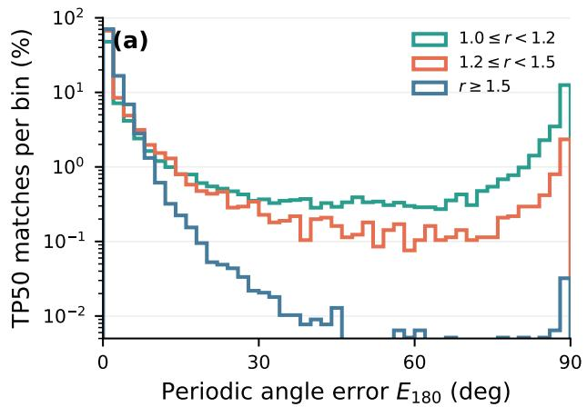

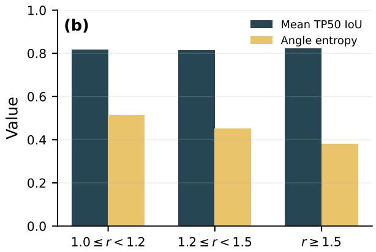  
Figure 5: Behavior across GT aspect-ratio groups on DIOR-R. (a) The standard angular error develops a pronounced secondary mode near $9 0 ^ { \circ }$ for near-square objects, directly exposing occasional canonical-axis exchange. (b) Despite this parameterization ambiguity, matched-box IoU remains nearly unchanged, while angular distribution entropy increases toward the square limit.

Table 8: Relationship between distributional uncertainty and localization error on matched DIOR-R detections. Spearman correlation is reported with a 95% image-level bootstrap confidence interval. “10% retained” denotes the 10% predictions with the lowest estimated uncertainty.
<table><tr><td>Uncertainty signal</td><td>Spearman  $\rho$ </td><td>10% retained</td><td>All matched</td></tr><tr><td> $\overline { { H _ { \mathrm { b n d } } \ \mathrm { v s . } \ 1 } }$   $\overline { { \mathrm { I o U } _ { \mathrm { O B B } } } }$ </td><td>0.782 [0.774, 0.788]</td><td>0.049</td><td>0.180</td></tr><tr><td> $\bar { H } _ { \theta }$  vs. angle error</td><td>0.672 [0.662, 0.682]</td><td> $0 . 2 4 0 ^ { \circ }$ </td><td> $1 . 8 7 7 ^ { \circ }$ </td></tr><tr><td> $H _ { \theta } ^ { L }$  vs. angle error</td><td>0.685 [0.674, 0.696]</td><td> $0 . 2 3 7 ^ { \circ }$ </td><td> $1 . 8 7 7 ^ { \circ }$ </td></tr></table>

Correlation with localization error. As shown in Table 8, boundary entropy exhibits a strong positive rank correlation of 0.782 with complete OBB localization error. Conversely, the mean boundary peak probability has a correlation of−0.763 with $1 - \mathrm { I o U } _ { \mathrm { O B B } }$ , indicating that concentrated boundary distributions are associated with more accurate oriented boxes.

The angular distributions exhibit similar behavior. The mean and final-layer angular entropies achieve correlations of 0.672 and 0.685, respectively, with the realized angular error. Likewise, one minus the final angular peak probability has a correlation of 0.684 with angular error. The agreement between entropy- and peak-based measures indicates that distribution concentration provides a stable instancewise indicator of localization dificulty.

Error-retention analysis. Figure 7 further evaluates whether the distributional statistics can identify reliable predictions. Retaining the 10% matched detections with the lowest boundary entropy reduces mean 1 − IoUOBB from 0.180 to 0.049, corresponding to a 72.5% reduction. Similarly, retaining the 10% lowest-angular-entropy detections reduces mean angular error from $\bar { 1 . 8 7 7 ^ { \circ } }$ to 0.240◦, a reduction of 87.2%. Both retention curves remain substantially below random retention, demonstrating that the predicted distribution shapes provide efective rankings of localization reliability.

Probability assigned to the regression target. We additionally measure the soft-target negative log-likelihood (NLL), where the continuous regression target is interpolated between its two neighboring bins using the same target construction as in training. The boundary distributions obtain an NLL of 2.434, substantially below the uniform-distribution reference $\log ( 3 3 ) = 3 . 4 9 7$ . The final angular distribution obtains an NLL of 1.677, compared with the uniform reference $\log ( 3 6 ) = 3 . 5 8 4$ . Their corresponding top-1-bin calibration errors are 0.0057 and 0.0208, respectively. These results demonstrate that the predicted distributions assign meaningful probability mass around the realized regression targets, rather than merely serving as an alternative parameterization for coordinate regression.

Calibration over all retained predictions. We further evaluate whether distribution-derived reliability improves the final detection confidence over the complete prediction set. For every image, we retain all 300 outputs without applying any score, class-correctness, or IoU filter, resulting in 3,521,400 predictions per model. Predictions are processed in descending confidence order and matched to ground truth using class-aware one-to-one OBB matching. At threshold τ, the correctness target is defined as

$$
y _ { \tau } = \mathbb { I } [ c = \hat { c } , \mathrm { I o U } _ { \mathrm { O B B } } \geq \tau , \mathrm { G T u n m a t c h e d } ] .\tag{13}
$$

This evaluation therefore jointly accounts for classification correctness, localization accuracy, duplicate detections, and false positives.

We report expected calibration error (ECE) using 15 equalwidth bins, binary NLL, Brier score, and the area under the

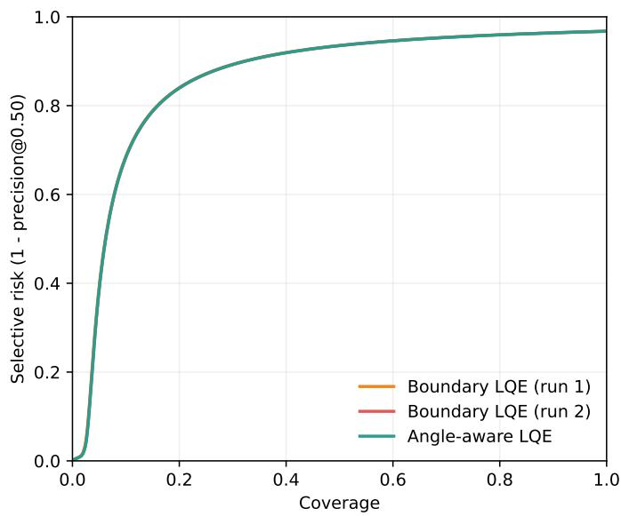

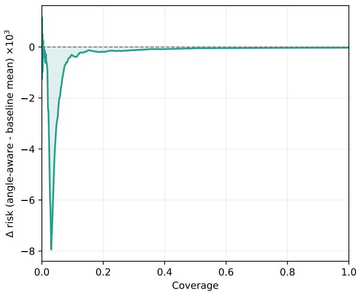  
Figure 6: Risk–coverage analysis over all top-300 predictions on DIOR-R. The left panel presents the complete risk–coverage curves, and the right panel shows the risk diference between the angle-aware estimator and the mean of the two boundary-only runs.

Table 9: Detection and orientation statistics on DIOR-R grouped by GT aspect ratio. R@50 and R@75 use independent classaware one-to-one matching. $E _ { \mathrm { a x i s } }$ is a diagnostic measure for near- $- \dot { 9 } 0 ^ { \circ }$ axis exchange, not a replacement for the standard angular error.
<table><tr><td>GT aspect ratio</td><td>#GT</td><td>R@50 (%)</td><td>R@75 (%)</td><td>Mean IoU</td><td> $E _ { 1 8 0 }$  MAE</td><td> $E _ { \mathrm { a x i s } }$  MAE</td><td>Axis switch (%)</td><td>Angle entropy</td></tr><tr><td> $1 . 0 \leq r < 1 . 2$ </td><td>27,035</td><td>92.64</td><td>72.26</td><td>0.817</td><td> $2 5 . 7 1 ^ { \circ }$ </td><td> $5 . 2 9 ^ { \circ }$ </td><td>20.69%</td><td>0.515</td></tr><tr><td> $1 . 2 \leq r < 1 . 5$ </td><td>11,521</td><td>91.53</td><td>71.30</td><td>0.814</td><td> $7 . 8 3 ^ { \circ }$ </td><td> $3 . 4 6 ^ { \circ }$ </td><td>4.14%</td><td>0.451</td></tr><tr><td> $r \geq 1 . 5$ </td><td>85,882</td><td>90.62</td><td>72.68</td><td>0.822</td><td> $1 . 8 7 ^ { \circ }$ </td><td> $1 . 8 1 ^ { \circ }$ </td><td>0.05%</td><td>0.380</td></tr></table>

risk–coverage curve (AURC). To directly evaluate confidence alignment with complete OBB quality, we additionally define

$$
q _ { 5 0 } = { \left\{ \begin{array} { l l } { \mathrm { I o U } _ { \mathrm { O B B } } , } & { y _ { 0 . 5 } = 1 , } \\ { 0 , } & { { \mathrm { o t h e r w i s e } } , } \end{array} \right. }\tag{14}
$$

and report quality-aware ECE (Q-ECE) and the Spearman correlation between confidence and q50.

Relative to the mean of the two independently trained boundary-only models, the angle-aware estimator reduces $\mathrm { E C E _ { 5 0 } }$ by $7 . 4 \% .$ , NLL50 by 6.5%, Brier score by 6.4%, and Q-ECE by 6.7%. Paired image-level bootstrap gives $9 5 \%$ confidence intervals of $[ - 0 . 0 0 4 1 , - 0 . 0 0 3 \bar { 6 } ]$ and $[ - 0 . 0 0 3 7 , - 0 . 0 0 3 2 ]$ for the $\mathrm { E C E _ { 5 0 } }$ diference against the two boundary-only runs, respectively, confirming that the improvement is consistent across test images.

The improvement is also preserved under a stricter localization criterion. $\mathrm { A t } \tau = 0 . 7 5$ , the angle-aware model obtains an ECE of 0.0521, compared with 0.0556–0.0561 for the boundary-only models, while NLL decreases from 0.0812– 0.0816 to 0.0777. Meanwhile, AURC and confidence–quality rank correlation remain competitive with the boundary-only models. These results show that angle-aware LQE improves absolute confidence calibration while preserving the underlying prediction ranking.

Figure 6 presents the corresponding risk–coverage behavior. The angle-aware estimator maintains consistently competitive selective risk across the complete coverage range, demonstrating that the calibration improvement is obtained without compromising confidence ordering.

Discussion. The results provide consistent evidence that the predicted distributions encode meaningful localization uncertainty. First, boundary and angular entropy show strong instance-wise correlations with their corresponding geometric errors, and peak-probability statistics exhibit consistent complementary behavior. Second, uncertainty-based retention substantially reduces both complete OBB localization risk and angular error. Third, the distributions assign significantly higher likelihood to the realized regression targets than a uniform reference. Finally, incorporating angular distribution statistics into LQE consistently reduces ECE, NLL, Brier score, and quality-aware calibration error over the complete prediction set.

Taken together, these results demonstrate that the discrete distributions are not merely a regression representation. Their concentration provides an efective estimate of localization reliability, and the proposed quality estimators successfully transfer this information to the final classification confidence. This establishes a direct empirical connection between distributional uncertainty, complete OBB quality, and confidence calibration.

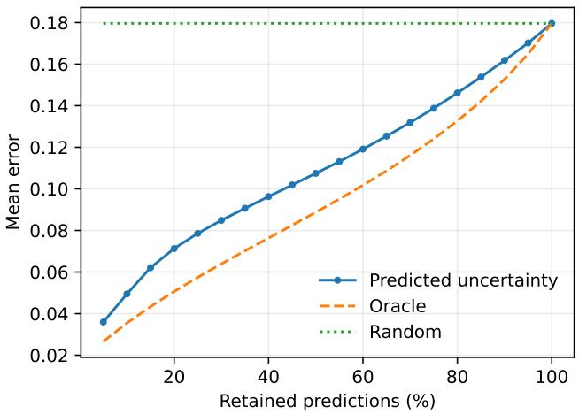

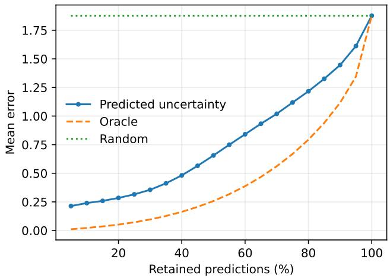  
Figure 7: Error-retention curves on DIOR-R. Predictions are retained in ascending order of estimated uncertainty. Left: complete OBB localization risk ranked by boundary entropy. Right: angular error ranked by mean angular entropy. Lower curves indicate more efective uncertainty ranking.

Table 10: Calibration over all top-300 predictions on DIOR-R. The two boundary-only rows correspond to independent training runs. The angle-aware estimator introduces only 113 additional parameters. Lower is better for ECE, NLL, Brier, AURC, and Q-ECE.
<table><tr><td>Score estimator</td><td> $\overline { { \mathbf { E C E } _ { 5 0 } } }$ </td><td> $\overline { { \mathbf { N L L } } } _ { 5 0 }$ </td><td> $\mathbf { \overline { { B r i e r _ { 5 0 } } } }$ </td><td> $\bf { A U R C } _ { 5 0 }$ </td><td> $\scriptstyle \overline { { \mathbf { Q } \mathbf { - } \mathbf { E } \mathbf { C } \mathbf { E } } }$ </td><td> $\overline { { \rho ( \mathrm { c o n f . , } q _ { 5 0 } ) } }$ </td></tr><tr><td>Boundary LQE (run 1)</td><td>0.0494</td><td>0.0698</td><td>0.0113</td><td>0.8607</td><td>0.0552</td><td>0.3011</td></tr><tr><td>Boundary LQE (run 2)</td><td>0.0490</td><td>0.0691</td><td>0.0114</td><td>0.8596</td><td>0.0548</td><td>0.3025</td></tr><tr><td>Angle-aware LQE</td><td>0.0455</td><td>0.0649</td><td>0.0106</td><td>0.8599</td><td>0.0514</td><td>0.3021</td></tr></table>

## F Analysis of Near-Square Objects

Motivation and protocol. Long-edge canonicalization assigns the local horizontal axis to the major axis of an OBB, providing consistent side semantics for anisotropic objects. However, as the aspect ratio approaches one, the major axis becomes weakly identifiable and a small geometric perturbation can exchange the two axes, causing an approximately $9 0 ^ { \circ }$ parameterization switch. We study this degenerate regime using the predictions of RiO-DETRv2-x on the complete DIOR-R test set, which contains 11,738 images and 124,438 annotated objects. For each GT box, we define $r = \operatorname* { m a x } ( w , h ) / \operatorname* { m i n } ( w , h )$ and divide the objects into [1.0, 1.2), [1.2, 1.5), and $[ 1 . 5 , \infty )$ . Predictions are matched to GTs class-wise and in descending confidence order, independently at IoU thresholds 0.5 and 0.75.

For every TP at IoU 0.5, we report the standard π-periodic angular error $E _ { 1 8 0 }$ . To diagnose coordinate-axis exchange without replacing the standard angular metric, we additionally define

$$
E _ { \mathrm { a x i s } } = \operatorname* { m i n } \left( E _ { 1 8 0 } , | 9 0 ^ { \circ } - E _ { 1 8 0 } | \right) .\tag{15}
$$

An axis switch is counted when $E _ { 1 8 0 } > 4 5 ^ { \circ }$ and $E _ { \mathrm { a x i s } } ~ <$ $1 0 ^ { \circ }$ . The angular entropy is the normalized distribution entropy averaged over all decoder layers.

Results and discussion. Table 9 shows that long-edge canonicalization is indeed discontinuous near the square limit. In the $1 . 0 ~ \leq ~ r ~ < ~ 1 . 2$ group, the standard angular MAE rises to $2 5 . 7 1 ^ { \circ }$ and the detected axis-switch rate reaches 20.69%. Nevertheless, the same group has an axisequivalent angular MAE of only 5.29◦. The secondary mode close to $9 0 °$ in Fig. 5(a) further confirms that much of the large standard angular error is caused by canonical-axis exchange rather than an arbitrary orientation failure.

Importantly, this representation ambiguity has limited impact on geometric detection quality. Across all three groups, mean matched IoU varies by only 0.008 and R@75 remains between 71.30 and 72.68. Meanwhile, angular entropy increases monotonically from 0.380 for elongated objects to 0.515 for near-square objects, indicating that the predicted distributions expose the weak orientation identifiability of this regime. These observations refine the scope of the longedge representation: its object-aligned side semantics are stable away from the square degeneracy; near that limit, the canonical frame can switch, but the resulting ambiguity is largely parameterization level, preserves OBB geometry, and is reflected by higher angular uncertainty.