# T-DIG: TEXT-CONDITIONED DIVERSITY FOR IMAGE GENERATION

Simran Khanuja1 Rohit Gandikota2 Gaurav Parmar1 Graham Neubig1

1Carnegie Mellon University 2Northeastern University

Correspondence: skhanuja@andrew.cmu.edu € image-study.org/t-dig

## ABSTRACT

Text-to-image (T2I) platforms typically return several images per prompt so users can explore different visual interpretations and choose one that matches their intent. However, T2I models are usually optimized for single-image quality which comes at a cost of multi-image diversity, limiting this exploration. Diversity is also contextual: one user wants variations in background, while other in artistic style, and the same user may later want variations in clothing. The generated images should differ along whatever axis the user cares about. In this paper, we introduce T-DIG, a text-conditioned diversity framework for image generation and editing. T-DIG is an iterative framework comprising multiple modules that lets users type prompts, inspect default generations, request for variations using natural language, and continue refining outputs until they’re satisfied. At its core, T-DIG uses an LLM policy that produces K axis-conditioned prompts or edit instructions for a frozen generator or editor. We train this policy with GRPO using a text-conditioned diversity reward and alignment penalties. Because the image generator remain frozen, T-DIG applies to open-weight, distilled, and proprietary models. We also release the first dataset for text-conditioned prompt diversity in image generation, with the training and validation splits built from human-written axes and a test set drawn from real user interactions with T-DIG. T-DIG far exceeds baselines in improving text-conditioned diversity, while preserving baseprompt alignment across a variety of metrics and human judgements. We show that user-directed diversity exploration can be added to a wide range of image generation models, open and closed, without the need to access their weights.1

## 1 INTRODUCTION

Text-to-image platforms (Midjourney, Inc., 2024; Adobe Inc., 2025) typically show four to eight images per prompt, so that the user has multiple options to choose from. However, different users may often want to see different kinds of variation, which T2I models don’t typically support. We conducted a human study where users were shown images for “people sitting at a table with laptops and books”; one user asked for variation in “laptops and camera angle”, another wanted to see “people doing different things”, and a third wanted to vary “people’s ethnicity”. Requests also ranged from being highly specific, to fairly abstract and open-ended. For a dog playing in a park, a user asked for different “dog breeds”, whereas for a comic-book panel..., they wanted “crazy endings that would surprise them”.

Prior works have proposed many methods to increase diversity of image generation models, but none can accommodate for these varying scenarios. One category of diversity methods (Parmar et al., 2026; Corso et al., 2024) maximizes a pairwise distance in latent embedding spaces (Fu et al., 2023; Oquab et al., 2023). These approaches make the images generically diverse but do not take the user’s request into consideration. Some methods do target a specific proxy of diversity, for example, varying modes of an underspecified prompt (Morshed & Boddeti, 2025), the identities of people in a scene (Borse et al., 2026), or demographic and geographic coverage (Askari Hemmat et al., 2024;

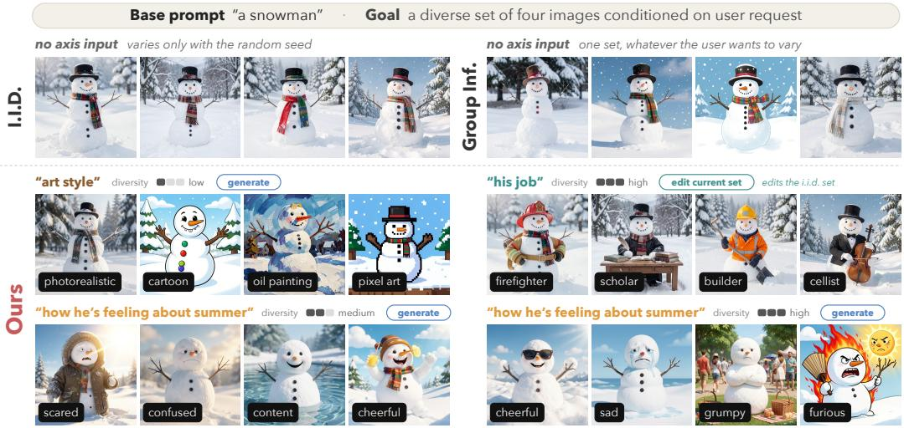  
Figure 1: Text-conditioned Diversity: For one prompt, i.i.d. sampling and prior methods return one set regardless of what the user wants to vary; T-DIG produces a different set for each text-condition, diversity strength, and can edit/generate, accounting for user preferences.

Miao et al., 2024); but they do not generalize beyond that pre-specified target. All prior methods return one output set per prompt with a predetermined type of variation, as shown in Figure 1.

In this paper, we treat diversity as a conditional generation problem: given a prompt and an axis of variation written in free-form text, produce K images that differ along that axis while following the prompt. We build T-DIG, an interactive framework around this idea (Section 2). At its core, an LLM policy expands the base prompt into K axis-conditioned prompts or edit instructions for a frozen T2I model. We train the policy with GRPO, rewarding text-conditioned diversity measured with TPIPS (Wang et al., 2026) and penalizing loss of alignment with the base prompt. TPIPS is a VLM fine-tuned on human perceptual judgments to score image similarity along a free-form textspecified aspect, so it lets us measure diversity along user-specified axes. Because the T2I model stays frozen and need not be differentiable, T-DIG applies to open-weight, distilled, and API-only generators and editors.

To the best of our knowledge, no existing dataset pairs prompts with user-written axes of variation. We therefore build training and validation data from HPDv2 prompts (Wu et al., 2023) with axes elicited from a VLM using human-written examples in context, and a test set of 405 (prompt, axis) pairs written by participants using T-DIG. Across four open-weight T2I models, T-DIG more than doubles diversity along the requested axis over i.i.d. sampling on average (2.3×, and up to 3.1×), while lowering alignment with the base prompt by less than 2%. Existing diversity methods (that do not condition on any axis), fall short on one side or the other: the most diverse baseline, CADS (Sadat et al., 2024), reaches 1.8× at a 6% alignment drop, while Scaling Group Inference (Parmar et al., 2026) preserves alignment best (under 1% drop) but gains only 1.3×, at up to 22× the sampling cost. Policies trained with open-weight models also transfer to proprietary ones – on GPT Image 2, our Qwen-Image policy raises diversity about 40% more than asking GPT-5.5 to produce varied prompts along the given axis. In pairwise human evaluation, raters find T-DIG’s sets more varied along the requested axis than every baseline’s on 64–96% of instances across all T2I models in our study. Our overall contributions are:

1. Task formulation: We formulate T2I diversity as conditional generation, where users state in free-form text what should vary, from broad axes like style to prompt-specific requests no fixed taxonomy covers.

2. Interactive framework: T-DIG lets users request, control, and iteratively refine variations in natural language, by generating new sets or editing existing ones.

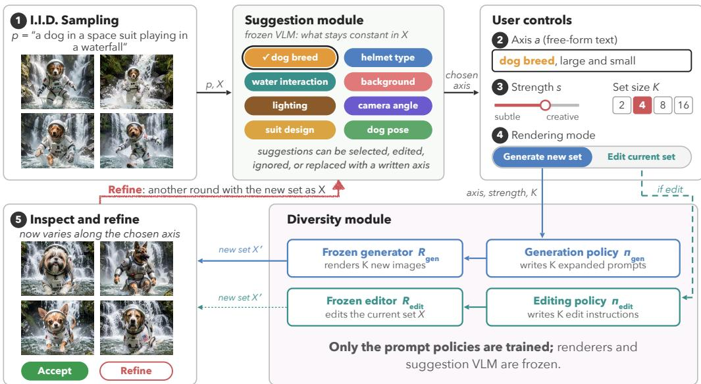  
Figure 2: T-DIG framework. After inspecting default samples, the user writes an axis or picks a suggested one, sets the diversity strength, and chooses to generate a new set or edit the current one. A trained policy writes K prompts or edit instructions for a frozen T2I model or editor, and the user accepts the result or refines it for another round. Only the policies are trained.

3. Model-agnostic training: We train generation and editing policies with GRPO on a textconditioned diversity reward and a baseline-relative alignment penalty; the T2I model stays frozen, so T-DIG works with open-weight, distilled, and proprietary models.

4. User-derived dataset for text-conditioned diversity: We release human-grounded training and validation data, along with a test set collected from real user interactions and a human rating study against three baselines.

## 2 FRAMEWORK DESIGN

Figure 2 shows how a user interacts with T-DIG. We describe each step of interaction and the diversity module we train below:

1. I.I.D Sampling: The user enters a prompt p and sees K samples drawn with independent seeds. These show what the T2I model does by default; if the set is already diverse according to what the user wants, they stop here. Otherwise a frozen Suggestion Module , given p and the samples, suggests axes of variation based on the images generated and the input prompt.

2. Axis: The user writes the axis of variation a in free-form text, or picks or edits a suggestion that we give. An axis can be broad (“artistic style”, “composition”), specific (“the arrangement of people around the table”), or simply “overall”.

3. Strength and set size: The user sets a set size $K \in \{ 2 , 4 , 8 , 1 6 \}$ and a diversity strength s, which ranges from minimal substitutions along the axis to richer scenes that vary more.

4. Rendering Mode: The user can choose to either generate a new set of images that vary along the axis, or edit the one already generated if they want to add more variation to the current set.

5. Inspect and refine: The user accepts the new set $\mathcal { X } ^ { \prime }$ , or starts another round with $\mathcal { X } ^ { \prime }$ as input, changing any of $a , s , K$ , or the mode; and our suggestions are recomputed for the new set.

Diversity Module is a pair of post-trained LLM policies, $\pi _ { \mathrm { g e n } }$ and $\pi _ { \mathrm { e d i t } }$ . Each is a LoRA adapter $\Delta W = { \bar { B } } A$ on a frozen language model with weights $W _ { 0 } ,$ and strength s sets its scale $\alpha _ { s } \in [ 0 , 1 ]$ giving the policy $\pi _ { \alpha _ { s } }$ with weights $W _ { 0 } + \alpha _ { s } \Delta W$ . Given p, a, and K (for editing additionally the current set X), it writes K prompts or edit instructions:

$$
\mathbf { q } = \pi _ { \alpha _ { s } } ( p , a , K ; \mathcal { X } ) = \{ q _ { 1 } , . . . , q _ { K } \} ,\tag{1}
$$

which a frozen T2I model turns into the new set, $\chi ^ { \prime } = R _ { \mathrm { g e n } } ( \mathbf { q } )$ in generation mode and $\mathcal { X } ^ { \prime } =$ $R _ { \mathrm { e d i t } } ( \mathcal { X } , \mathbf { q } )$ in editing mode. Only the prompt-set adapters are trained; the generator, the editor, and the suggestion VLM stay frozen.

## 3 TRAINING

In this section, we describe how we train the two LLM policies of the Diversity Module with GRPO, for generation and editing.

## 3.1 TRAINING DATA

Base prompts: We start from the HPDv2 training split (Wu et al., 2023), which contains userwritten T2I prompts. After removing empty entries and exact duplicates, 103,672 unique prompts remain. We filter this pool with GPT-5.6 Luna (OpenAI, 2026a) using medium reasoning effort. The filter removes prompts that depict named real individuals, contain unsafe content, lack a depictable subject, or are dominated by style and quality descriptors. A prompt is retained only if the model can identify at least three meaningful axes of variation. This step retains 79.9% of the unique pool. Even after exact-duplicate removal and filtering, we find that many retained prompts are semantically similar. To reduce redundancy in training, we cluster the remaining prompts and choose a sample from each, leaving roughly 20,000 prompts (filtering and clustering details in Appendix A.1).

Axes: In a pilot study, participants saw i.i.d. outputs for 20 prompts and wrote what they would like to vary. This is used as seed data to elicit axes of variation from a VLM at scale. For each base prompt p we collect above, we render K i.i.d. samples with the T2I model and ask Gemini 3.8 Flash (Google, 2026) for up to four free-form axes, using the pilot instruction and responses as in-context examples. For a random 10% of prompts we also add the axis “overall”, which supports axis-free requests in case people would like to see overall diversity. After removing malformed outputs and holding out 200 prompts for validation, the training set contains 19,765 prompts and 76,089 (prompt, axis) pairs.

## 3.2 POLICY TRAINING

Both policies are trained with a set-level reward that favors diversity along the text condition while penalizing loss of alignment with the base prompt. We describe the different components that make up the final reward below:

Text-conditioned diversity: For an image set $\mathcal { X } = \{ x _ { 1 } , . . . , x _ { K } \}$ and an axis in the form of text prompt a, TPIPS (Wang et al., 2026) embeds each image conditioned on the axis, $e _ { i } =$ $f _ { \mathrm { T P I P S } } ( x _ { i } ; a )$ , which means TPIPS embeddings of images are similar when they look alike along a, even if they differ in other aspects. We measure the spread of these embeddings with the Vendi Score (VS) (Friedman & Dieng, 2022); given unit-normalized TPIPS embeddings and their cosinesimilarity matrix $\begin{array} { r } { S _ { i j } = e _ { i } ^ { \top } e _ { j } , \bar { \mathrm { V S } } = \exp \big ( - \sum _ { k } \lambda _ { k } \log \lambda _ { k } \big ) } \end{array}$ , where $\lambda _ { k }$ are the eigenvalues of $S / K$ It essentially gives us the effective number of distinct images in the set, from 1 (all identical along a) to K (all dissimilar). We normalize it by set size:

$$
D _ { a } ( \mathcal { X } ) = \frac { \mathrm { V S } ( \{ e _ { i } \} _ { i = 1 } ^ { K } ) - 1 } { K - 1 } \in [ 0 , 1 ] .\tag{2}
$$

Base-prompt alignment: We measure alignment with VQAScore (Lin et al., 2024). Alignment under i.i.d. sampling varies widely across prompts, so a single threshold would penalize many prompts before the policy changes anything. We therefore set a per-prompt threshold $\mathbf { \nabla } ^ { - } ( p , R )$ to the mean VQAScore of K i.i.d. samples from the renderer R being trained for, and penalize only images that fall below their own i.i.d score threshold:

$$
\mathcal { L } _ { \mathrm { a l i g n } } ( \mathcal { X } ; p , R ) = \frac { 1 } { K } \sum _ { i = 1 } ^ { K } \operatorname* { m a x } \big ( 0 , \tau ( p , R ) - \mathrm { V Q A S c o r e } ( x _ { i } , p ) \big ) .\tag{3}
$$

Prompt length: Without a length term, the policy learns to write overly detailed prompts that the alignment hinge does not penalize. This makes diversity leak off-axis, and text past the encoder’s context limit is also truncated, hence a length penalty is needed. As with alignment, we set the budget relative to the base prompt where each expanded prompt may add at most w words to $p ,$ $c ( p ) = | p | + w$ , where | · | is the word count and w is a hyperparameter:

$$
\mathcal { L } _ { \mathrm { l e n } } ( \mathbf { q } ; p ) = \frac { 1 } { K } \sum _ { i = 1 } ^ { K } \frac { \operatorname* { m a x } \left( 0 , | q _ { i } | - c ( p ) \right) } { c ( p ) } .\tag{4}
$$

Preference preservation: Even after alignment and length penalties, a policy can raise VQAScore while making the images worse, for example by asking the model to print the base prompt as a caption inside the image, which only human preference scores tend to penalize. We therefore add a hinge on HPSv3 (Ma et al., 2025), calibrated per prompt like the alignment threshold: $\kappa ( p , R )$ is the mean HPSv3 of the K i.i.d. samples $R ( p , z _ { j } )$ , and

$$
\mathcal { L } _ { \mathrm { p r e f } } ( \mathcal { X } ; p , R ) = \frac { 1 } { K } \sum _ { i = 1 } ^ { K } \operatorname* { m a x } \big ( 0 , \kappa ( p , R ) - \mathrm { H P S v 3 } ( x _ { i } , p ) \big ) .\tag{5}
$$

Final Reward: The final reward combines the four terms above; $\lambda , \mu$ and $\eta$ trade diversity along text-condition (a), against alignment with base prompt $( p )$ , prompt length, and human preference:

$$
r ( \mathbf { q } , \boldsymbol { \mathcal { X } } ; p , a , R ) = D _ { a } ( \boldsymbol { \mathcal { X } } ) - \lambda \mathcal { L } _ { \mathrm { a l i g n } } ( \boldsymbol { \mathcal { X } } ; p , R ) - \mu \mathcal { L } _ { \mathrm { l e n } } ( \mathbf { q } ; p ) - \eta \mathcal { L } _ { \mathrm { p r e f } } ( \boldsymbol { \mathcal { X } } ; p , R ) ,\tag{6}
$$

Generation and editing: The generation policy writes K expanded prompts (Eq. 1) that vary along a and otherwise preserve the content and wording of $p$ (instructions in appendix, figures 7, 8). The editing policy is trained on the same data, with $K \mathrm { i . i . d }$ . samples of $p$ as the source set $\mathcal { X } _ { \mathrm { s r c } } = \{ \tilde { x } _ { 1 } , \dots , \tilde { x } _ { K } \}$ , and writes one instruction per image, $x _ { i } = R _ { \mathrm { e d i t } } ( \bar { x _ { i } } , q _ { i } )$ . Since an instruction can raise $D _ { a }$ by replacing the whole image, we subtract $\nu \mathcal { L } _ { \mathrm { d r i f t } }$ from Eq. 6 for the editing policy (below) where d is the DreamSim distance (Fu et al., 2023) and δ allows for on-axis edits:

$$
\mathcal { L } _ { \mathrm { d r i f t } } ( \mathcal { X } , \mathcal { X } _ { \mathrm { s r c } } ) = \frac { 1 } { K } \sum _ { i = 1 } ^ { K } \operatorname* { m a x } \big ( 0 , d ( \tilde { x } _ { i } , x _ { i } ) - \delta \big ) ,\tag{7}
$$

Optimization: We optimize both policies with GRPO (Shao et al., 2024). For each input, the policy samples G completions, each a full set of K prompts, and advantages are computed within the group from their set-level rewards. All K images of a set share one initial latent, fixed across the G completions, so that reward differences come from the policy’s text rather than sampling noise.

## 4 EXPERIMENTS

## 4.1 SETUP

T2I Models: We evaluate across open-weight, distilled, and proprietary models: Stable Diffusion 3.5 Medium and Large (Stability AI, 2024), Qwen-Image-2512 (Qwen Team, 2025), and FLUX.2 [klein] 9B (distilled) (Black Forest Labs, 2026); and API models – GPT Image 2, and Gemini 3.1 Flash Image (OpenAI, 2026b; Google DeepMind, 2026). For editing we use the corresponding editor of each family. We train at 512px with reduced step counts, similar to FlowGRPO (Liu et al., 2026) and evaluate at 1024px with each model’s recommended sampler.

Prompt-set policies: We use models from the Qwen3.5 family (Team, 2026) since they have a variety of model sizes available. For each T2I model we train 4B, 9B, and 35B-A3B generation policies; the base prompt and axis are fed in-context, with instructions to generate K diverse prompts along the axis. Each policy is a LoRA adapter (Hu et al., 2022) of rank 32 on all attention, linearattention, and MLP projections; the T2I model is never updated.

Training: We use set size $K = 4$ , reward weights $\lambda = 2 , \mu = 0 . 1$ and $\eta = 0 . 0 5$ , and length allowance $w = 2 0$ . We train LoRA adapters (rank 32) with GRPO at learning rate $2 \times 1 0 ^ { - 5 }$ without a KL term, and train for 800 steps. Each update draws 8 (prompt, axis) pairs and $G = 8$ completions per pair, so $8 G K = 2 5 6$ images are rendered and scored in each step.

Evaluation data: We validate on the 200 held-out prompts of Section 3.1. We also build a test set from real use (Section 4.4), yielding 405 interactions, roughly 100 from each open-weight model above. For comparison with axis-agnostic methods, we evaluate T-DIG conditioned on overall on the COCO val2017 split (Lin et al., 2014) (COCO-250), where no axis is specified.

## 4.2 BASELINES

We compare T-DIG, untrained (α = 0) and trained (α = 1), against four baselines. Untrained T-DIG runs the same Qwen3.5 backbone and instruction without the adapter, which isolates the effect of GRPO. None of the baselines accepts an axis, so each returns the same set whatever the user asks to vary. Baselines draw K independent initial latents, whereas T-DIG renders all K prompts from one shared latent, so that differences within a set come from the prompts alone.

I.I.D. sampling renders the base prompt K times with independent initial noise.

PAG (Yun et al., 2025) fine-tunes GPT-2 with GFlowNets to sample diverse rewrites of a prompt; it was trained against Stable Diffusion v1.4 and receives no axis. We decode K prompts from the authors’ checkpoint with diverse beam search and use them to generate images from the T2I model, instead of the base prompt. PAG tests whether generic prompt diversity suffices without axis conditioning.

CADS (Sadat et al., 2024) adds annealed noise to the conditioning embedding at inference time. We use it on open-weight T2I models where those embeddings are available, with the official textto-image settings τ = 0.6, τ = 0.9, s = 0.25, ψ = 1.

Scaling Group Inference (Parmar et al., 2026) samples M = 128 candidates and prunes them progressively to the K that best balance CLIP text–image similarity against DINOv2 pairwise distance, at 3.3–21.9× the denoiser cost of i.i.d. sampling.

## 4.3 METRICS

Alignment: We report VQAScore with CLIP-FlanT5-XXL (Lin et al., 2024), the probability that a VQA model answers “Yes” to “Does this figure show ‘{prompt}’?”, and CLIPScore (Hessel et al., 2021) the cosine similarity between the CLIP embeddings of the image and the prompt; both are computed against the base prompt.

Diversity: Our primary metric is normalized TPIPS-Vendi, TPIPS (Wang et al., 2026; Friedman & Dieng, 2022), conditioned on the requested axis; it is the only metric here that measures variation along a text-condition. TPIPS (Wang et al., 2026) is a perceptual similarity metric conditioned on a text prompt naming a visual aspect (eg. “lighting”, “pose”), trained on human similarity judgments. Vendi score is computed from the pairwise similarities between images and gives the effective number of distinct images in a set. DINO (Oquab et al., 2023) and DreamSim (Fu et al., 2023) measure axis-agnostic spread using self-supervised DINOv2 features and DreamSim (perceptual similarity metric trained on human judgments), respectively.

Preference and aesthetics: We additionally report ImageReward (Xu et al., 2023), HPSv3 (Ma et al., 2025), and LAION-Aesthetics V2 (Schuhmann, 2022). ImageReward, and HPSv3 mix alignment with preference and are not pure aesthetic scores; the LAION score is prompt-independent.

## 4.4 HUMAN EVALUATION

Stage 1, test-set collection: We hire participants on Prolific2 to interact with the framework we build (Section 2), where each participant makes five sets of images using one T2I model, iterating until satisfied. Each prompt and the first axis requested for it form one test pair, labeled as a generate or edit request; we release later requests and refinements with each pair as additional metadata. After excluding participants who fail quality checks (eg. empty or copied comments), the test set contains 405 (prompt, axis) pairs from 58 participants across the four open-weight T2I models.

Stage 2, ratings: For each test pair, we render sets of $K = 4$ images with T-DIG, both trained $( \alpha \ : = \ : 0 . 5 ,$ , default diversity slider position on interface) and untrained $( \alpha = 0 )$ , and with i.i.d. sampling, CADS $( s = 0 . 2 5 )$ , and Scaling Group Inference $( \lambda = 1 , M = 1 2 8 )$ (we remove underperforming baselines like PAG). We collect ratings pairwise: each screen shows T-DIG next to one baseline, in random order, with the baseline rotating across pairs. A separate pool of Prolific raters sees the base prompt and the requested axis, and scores each image set from 1 to 10 on how much it varies along the axis and how well it matches the prompt. Raters can mark an axis not applicable if it is not a request for variation (eg. a complaint about the images). Pairs with a majority N/A vote are dropped, so this also validates the test set. Each pair gets three ratings (about 2,400 in total). We report two win rates by majority vote: how often T-DIG is rated more varied (diversity win rate), and how often it is rated more varied and at least as well aligned (diversity + alignment win rate).

## 5 RESULTS AND ANALYSIS

We evaluate T-DIG on – a) the interactive test set and report automatic metrics and human preference ratings (Table 1); b) COCO-250 to compare with methods designed for axis-free diversity (Figure 5), and ablate the reward (Table 2). We analyze results through the research questions below.

RQ1: How does T-DIG compare with baselines on text-conditioned diversity? We describe each method by its change from i.i.d. sampling on the same T2I model, and report averages/ranges across models (Table 1). None of the baselines takes an axis as input, so they can only make the set vary more in general: Scaling Group Inference raises TPIPS by +0.03 to +0.05 at $3 . 3 \substack { - 2 1 . 9 \times }$ the denoiser cost, PAG by $+ 0 . 0 3 \mathrm { t o } + 0 . 0 9$ , and CADS by +0.08 to +0.17. Training-free T-DIG (α=0), which prompts the untrained policy with the axis, already matches CADS $( + 0 . 0 8 ~ { \mathrm { t o } } \ + 0 . 1 4 )$ , and training $( \alpha { = } 1 )$ roughly doubles that gain $\left( + 0 . 1 4 \ \mathrm { t o \ + 0 . 2 6 } \right)$ . When comparing with axis-agnostic diversity metrics, we get a sense of how much variation there is on-axis versus off-axis. CADS comes within 0.05 of T-DIG on $\mathrm { D I N O } _ { v }$ and exceeds it on $\mathrm { D r e a m S i m } _ { v }$ for some models, so its sets vary about as much overall, but very less of that variation lies along the requested axis, as measured by $\mathrm { T P I P S } _ { v }$ . An increase in diversity often comes at the cost of alignment with the base prompt. T-DIG changes VQAScore by $- 0 . 0 5 \ \mathrm { t o \  t 0 . 0 1 }$ , against −0.03 to −0.08 for CADS and −0.08 to −0.16 for PAG. Per +0.1 TPIPS gained (slope in Table 1), T-DIG loses at most 0.02 VQAScore, while CADS loses up to 0.08 and PAG up to 0.41; Scaling Group Inference loses up to 0.03, but for a much smaller diversity gain at a much higher inference cost. With respect to preference and aesthetics, T-DIG keeps ImageReward and HPSv3 near the i.i.d. level (HPSv3 −6 to +3%) except on FLUX.2 [klein] (RQ2), whereas CADS loses 14 to 24% HPSv3. LAION-Aesthetics, which ignores the prompt, rises slightly with T-DIG (+0.13 to +0.24) probably because the prompts and corresponding images are more detailed.

RQ2: How does the performance of T-DIG vary across T2I models? The diversity gain is largest where i.i.d. sampling varies least. Qwen-Image and FLUX.2 [klein] give nearly identical images when sampled i.i.d. $( \mathrm { T P I P S } _ { v }$ of 0.12 and 0.14), and T-DIG raises $\mathrm { T P I P S } _ { v }$ by +0.26 and +0.25; SD3.5 L and M already vary more (0.20 and 0.21) and gain +0.14 and $+ 0 . 1 5$ . All four models land at 0.35–0.40 at $\alpha { = } 1$ , so the gain is bounded by where the metric saturates, not by the model. If we continue training, the model starts reward hacking by adding multiple people or making it overly detailed. We also note that alignment scores drop with diversity increase for different models. On SD3.5 L and M, whose i.i.d. alignment is lowest (VQAScore 0.80 to 0.83), T-DIG’s difference with i.i.d is not statistically significant; but on Qwen-Image and FLUX.2 [klein] (0.89 and 0.91) it loses 0.03 and 0.05. FLUX.2 [klein] also loses the most preference (0.40 ImageReward, 10% HPSv3), since its near-identical i.i.d. images score very high to begin with.

RQ3: How does T-DIG compare with baselines on overall diversity? Even with no axis, T-DIG gives the widest quality–diversity trade-off. On COCO-250 with Qwen-Image, sweeping α from 0 to 1 raises $\mathrm { D I N O } _ { v }$ over i.i.d. sampling by +0.21 to +0.39 (about $3 \times \mathrm { i . i . d }$ . at $\alpha { = } 1 )$ while losing only 0.01 to 0.02 VQAScore. Varying the guidance scale or Scaling Group Inference’s λ gains at most +0.13, and CADS reaches $+ 0 . 3 2 \ \mathrm { t o \ + 0 . 3 7 }$ but drops VQAScore by 0.08 to 0.11.

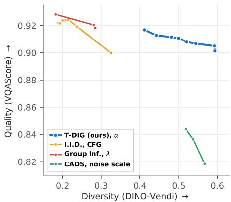

<table><tr><td></td><td colspan="3">Diversity</td><td colspan="2">Alignment</td><td colspan="3">Preference</td><td>Human</td><td colspan="3">Trade-off vs. I.I.D.</td></tr><tr><td>Method</td><td>TPIPSv</td><td>DINOv</td><td>Dream- Simv</td><td>VQA</td><td>CLIP</td><td>IR</td><td></td><td>HPSv3 Aes.</td><td>Win (%)</td><td>TPIPSv (×)</td><td>VQA (%)</td><td>Slope</td></tr><tr><td>Qwen-Image</td><td></td><td></td><td></td><td></td><td></td><td></td><td></td><td></td><td></td><td></td><td></td><td></td></tr><tr><td>I.I.D.</td><td>0.124</td><td>0.209</td><td>0.194</td><td>0.889</td><td>0.809 1.27</td><td></td><td>11.55</td><td>5.95</td><td>68.0</td><td>1.00</td><td>0.0</td><td></td></tr><tr><td>Group Inf.</td><td>0.168</td><td>0.281</td><td>0.263</td><td>0.885</td><td>0.812</td><td>1.22</td><td>11.43</td><td>5.91</td><td>76.0</td><td>1.36</td><td>-0.4</td><td>-0.008</td></tr><tr><td>CADS</td><td>0.293</td><td>0.502</td><td>0.540</td><td>0.808</td><td>0.760 0.46</td><td></td><td>8.76</td><td>5.77</td><td>80.8</td><td>2.37</td><td>-9.1</td><td>-0.048</td></tr><tr><td>PAG</td><td>0.218</td><td>0.381</td><td>0.326</td><td>0.725</td><td>0.736 0.77</td><td></td><td>10.35</td><td>6.35</td><td></td><td>1.76</td><td>-18.4</td><td>-0.174</td></tr><tr><td>T-DIG α=0</td><td>0.268</td><td>0.364</td><td>0.300</td><td>0.859</td><td>0.7961.16</td><td></td><td>10.92</td><td>5.95</td><td>58.3</td><td>2.17</td><td>-3.3</td><td>-0.020</td></tr><tr><td>T-DIG α=0.5</td><td>0.367</td><td>0.524</td><td>0.443</td><td>0.862</td><td>0.782 1.16</td><td></td><td>10.79</td><td>6.00</td><td></td><td>2.96</td><td>-3.1</td><td>-0.011</td></tr><tr><td>T-DIG α=1</td><td>0.379</td><td>0.542</td><td>0.452</td><td>0.859</td><td>0.7751.21</td><td></td><td>10.84</td><td>6.08</td><td></td><td>3.06</td><td>-3.3</td><td>-0.012</td></tr><tr><td>SD3.5 L</td><td></td><td></td><td></td><td></td><td></td><td></td><td></td><td></td><td></td><td></td><td></td><td></td></tr><tr><td>I.I.D.</td><td>0.202</td><td>0.343</td><td>0.315</td><td>0.831</td><td>0.834 1.23</td><td></td><td>8.90</td><td>5.80</td><td>82.6</td><td>1.00</td><td>0.0</td><td></td></tr><tr><td>Group Inf.</td><td>0.253</td><td>0.446</td><td>0.422</td><td>0.819</td><td>0.831 1.16</td><td></td><td>8.62</td><td>5.77</td><td>56.5</td><td>1.25</td><td>-1.5</td><td>-0.025</td></tr><tr><td>CADS</td><td>0.284</td><td>0.516</td><td>0.520</td><td>0.769</td><td>0.811 0.81</td><td></td><td>7.66</td><td>5.68</td><td>60.9</td><td>1.41</td><td>-7.5</td><td>-0.076</td></tr><tr><td>PAG</td><td>0.242</td><td>0.434</td><td>0.387</td><td>0.749</td><td>0.782 0.89</td><td></td><td>8.35</td><td>6.06</td><td></td><td>1.20</td><td>-10.0</td><td>-0.205</td></tr><tr><td>T-DIG i α=0</td><td>0.283</td><td>0.419</td><td>0.379</td><td>0.802</td><td>0.8081.01</td><td></td><td>8.37</td><td>5.85</td><td>52.6</td><td>1.40</td><td>-3.5</td><td>-0.036</td></tr><tr><td>T-DIG α=0.5</td><td>0.357</td><td>0.537</td><td>0.473</td><td>0.843</td><td>0.7971.15</td><td></td><td>8.82</td><td>5.97</td><td></td><td>1.77</td><td>+1.5</td><td>+0.008</td></tr><tr><td>T-DIG α=1</td><td>0.346</td><td>0.561</td><td>0.469</td><td>0.829</td><td>0.784 1.22</td><td></td><td>8.86</td><td>6.04</td><td></td><td>1.71</td><td>-0.3</td><td>-0.002</td></tr><tr><td>SD3.5 M</td><td></td><td></td><td></td><td></td><td></td><td></td><td></td><td></td><td></td><td></td><td></td><td></td></tr><tr><td>I.I.D.</td><td>0.211</td><td>0.338</td><td>0.364</td><td>0.801</td><td>0.8371.10</td><td></td><td>7.57</td><td>5.56</td><td>57.1</td><td>1.00</td><td>0.0</td><td></td></tr><tr><td>Group Inf.</td><td>0.256</td><td>0.454</td><td>0.468</td><td>0.790</td><td>0.829 0.96</td><td></td><td>7.28</td><td>5.56</td><td>42.9</td><td>1.21</td><td>-1.4</td><td>-0.024</td></tr><tr><td>CADS</td><td>0.298</td><td>0.524</td><td>0.560</td><td>0.759</td><td>0.796 0.45</td><td></td><td>5.94</td><td>5.48</td><td>64.3</td><td>1.42</td><td>-5.2</td><td>-0.048</td></tr><tr><td>PAG</td><td>0.238</td><td>0.394</td><td>0.403</td><td>0.689</td><td>0.772 0.79</td><td></td><td>7.32</td><td>5.99</td><td></td><td>1.13</td><td>-14.0</td><td>-0.410</td></tr><tr><td>T-DIG α=0</td><td>0.290</td><td>0.386</td><td>0.377</td><td>0.818</td><td>0.8161.07</td><td></td><td>7.82</td><td>5.71</td><td>50.0</td><td>1.38</td><td>+2.1</td><td>+0.022</td></tr><tr><td>T-DIG α=0.5</td><td>0.362</td><td>0.470</td><td>0.470</td><td>0.787</td><td>0.801 1.03</td><td></td><td>7.45</td><td>5.79</td><td></td><td>1.72</td><td>-1.8</td><td>-0.009</td></tr><tr><td>T-DIG α=1</td><td>0.359</td><td>0.505</td><td>0.488</td><td>0.814</td><td>0.804 1.12</td><td></td><td>7.80</td><td>5.79</td><td>一</td><td>1.70</td><td>+1.6</td><td>+0.008</td></tr><tr><td>FLUX.2 [klein]</td><td></td><td></td><td></td><td></td><td></td><td></td><td></td><td></td><td></td><td></td><td></td><td></td></tr><tr><td>I.I.D.</td><td>0.143</td><td>0.228</td><td>0.228</td><td>0.912</td><td>0.792 1.25</td><td></td><td>10.18</td><td>5.75</td><td>61.9</td><td>1.00</td><td>0.0</td><td></td></tr><tr><td>Group Inf.</td><td>0.177</td><td>0.317</td><td>0.277</td><td>0.913</td><td>0.800</td><td>1.24</td><td>10.12</td><td>5.76</td><td>69.6</td><td>1.24</td><td>+0.1</td><td>+0.004</td></tr><tr><td>CADS</td><td>0.276</td><td>0.506</td><td>0.478</td><td>0.880</td><td>0.769 0.77</td><td></td><td>8.01</td><td>5.63</td><td>69.6</td><td>1.92</td><td>-3.4</td><td>-0.024</td></tr><tr><td>PAG</td><td>0.225</td><td>0.369</td><td>0.341</td><td>0.793</td><td>0.734 0.93</td><td></td><td>9.42</td><td>6.14</td><td></td><td>1.57</td><td>-13.1</td><td>-0.147</td></tr><tr><td>T-DIG iα=0</td><td>0.281</td><td>0.350</td><td>0.326</td><td>0.883</td><td>0.772 1.09</td><td></td><td>9.49</td><td>5.78</td><td>47.6</td><td>1.96</td><td>-3.2</td><td>-0.021</td></tr><tr><td>T-DIG α=0.5</td><td>0.371</td><td>0.524</td><td>0.474</td><td>0.869</td><td>0.753 0.88</td><td></td><td>8.97</td><td>5.86</td><td></td><td>2.59</td><td>-4.7</td></table>

Table 1: Results on the interactive test set: K=4, 9B policy; higher is better for every column. Diversity: TPIPS , DINO and DreamSim are normalized Vendi scores (range [0, 1]) of TPIPS embeddings conditioned on the requested axis, and of DINOv2 and DreamSim embeddings, which ignore the axis. Alignment: VQAScore and CLIPScore against the base prompt. Preference & aesthetics: ImageReward, HPSv3 and LAION-Aesthetics V2. Human: % of instances where raters scored T-DIG α=0.5’s set as more varied along the axis than row method and at least as well aligned with the prompt. Trade-off(vs. I.I.D.): TPIPSv as a multiple of i.i.d. sampling’s, the relative change in VQAScore, and the slope of the line from i.i.d. sampling, i.e. the change in VQAScore per +0.1 TPIPSv. Bold and underline mark best and second best respectively.

Measured as the slope of the line from i.i.d. sampling, T-DIG loses 0.006 VQAScore per +0.1 DINOv, against 0.029 for CADS and 0.019 for lowering the guidance scale, and within a budget of 0.02 VQAScore it gains +0.39 DINO , against at most +0.11 for any baseline. The slopes are similar on the other T2I models: across all four, T-DIG loses 0.006 to 0.010 VQAScore per +0.1 DINOv, against 0.013 to 0.034 for CADS and 0.019 to 0.038 for the guidance scale (FLUX.2 [klein] is guidance-distilled, so it has no guidance scale to sweep).

RQ4: What is the effect of the policy size on performance? We compare 4B, 9B, and 35B-A3B policies on the held-out pairs. All sizes reach nearly the same diversity on every T2I model. Larger policies help alignment slightly; 9B matches or beats 4B on VQAScore for every model (−0.002 to +0.010), ImageReward and HPSv3 favor neither size consistently, and 35B-A3B adds no further consistent gain. Size matters mostly for following the output format: the untrained 4B policy returns a malformed set on 1.7% of requests, against none for larger models, but training removes these errors. Serving the 4B policy therefore costs little in quality and lowers latency (RQ7).

<table><tr><td rowspan="2">Reward</td><td colspan="3">Added to TPIPSv</td><td colspan="4">Held-out pairs</td><td rowspan="2"></td><td rowspan="2">Words Malf.↓</td></tr><tr><td> $L _ { \mathrm { a l i g n } }$ </td><td> $L _ { \mathrm { l e n } }$ </td><td> $L _ { \mathrm { p r e f } }$ </td><td>TPIPSv ↑</td><td>VQA↑</td><td>HPS↑</td><td>IR↑</td></tr><tr><td>Untrained</td><td></td><td></td><td></td><td>0.333</td><td>0.865</td><td>12.34</td><td>1.19</td><td>18</td><td>1</td></tr><tr><td>TPIPSv only</td><td></td><td></td><td></td><td>0.617</td><td>0.228</td><td>1.44</td><td>-1.74</td><td>90</td><td>7</td></tr><tr><td>+ alignment</td><td>√</td><td></td><td></td><td>0.458</td><td>0.857</td><td>11.64</td><td>1.04</td><td>123</td><td>1</td></tr><tr><td>+ length</td><td>√</td><td>√</td><td></td><td>0.475</td><td>0.845</td><td>11.38</td><td>0.81</td><td>34</td><td>1</td></tr><tr><td>+ preference (T-DIG)</td><td>√</td><td>√</td><td>√</td><td>0.454</td><td>0.849</td><td>12.35</td><td>1.03</td><td>29</td><td>0</td></tr></table>

Table 2: Reward ablation on FLUX.2 [klein], 9B policy on the held-out pairs. Words: mean words per expanded prompt. Malf.: malformed completions.

RQ5: How do people rate T-DIG’s outputs? Interactive study (Stage 1): Across 405 (prompt, axis) pairs, users rated the diversity of T-DIG’s outputs 3.95/5 and their alignment with the prompt 4.09/5 on average, 89% found asking for variations more useful than accepting i.i.d. outputs, and 96% enjoyed using the tool. In their comments, participants noted that it “handled the requested variation axes well” and did “a better job than [they were] expecting” on prompts that image generators often get wrong. On the drawbacks, roughly half the participants noted that the strength slider is not perceptually calibrated (we linearly scale lora weights); but we leave this for future work. The feedback was mostly overwhelmingly positive (details in Appendix Table 3). Pairwise ratings (Stage 2): By majority vote, raters found T-DIG’s set (α=0.5) more varied than the other method’s on 64 to 96% of screens in every comparison. In Table 1 we show the % of instances which were rated more varied and at least as well aligned: T-DIG wins 57 to 83% against i.i.d. sampling, 61 to 81% against CADS, 43 to 76% against Scaling Group Inference, and 48 to 58% against training-free T-DIG. The remaining pairs are ties/split votes/loss by majority voting. Note that absolute ratings on a scale of 1-10 were collected in a pairwise relative evaluation setup. Mean diversity ratings – T-DIG scores 7.4 to 8.3 out of 10, against 2.4 to 3.9 for i.i.d. sampling, 3.2 to 5.1 for Scaling Group Inference, 3.9 to 5.1 for CADS, and 5.6 to 6.9 for training-free T-DIG.

RQ6: What is the contribution of each reward term? Table 2 ablates terms of Equation 6. Diversity alone reward-hacks: TPIPS nearly doubles (0.617) but the images stop following the prompt (VQAScore 0.228). The alignment penalty restores alignment (0.857) but leads to very long prompts (123 words), which add unrequested changes and would be truncated by short text encoders such as SD3.5’s 77-token CLIP. The length penalty shortens prompts to 34 words, but even with these two penalties the policy finds other ways to reward-hack; for example, it starts writing the base prompt as a caption inside the image, which inflates alignment scores but lowers preference scores (HPSv3 11.38 vs. 12.34 untrained). The full reward, which adds the preference penalty, is robust and keeps nearly the same diversity as the alignment penalty alone (0.454 vs. 0.458).

RQ7: How much latency do the policy models add to inference? Very little relative to rendering. On one H200 with vLLM, expanding a prompt into four takes a median of 0.40 s with the 4B policy, 0.59 s with 9B, and 0.51 s with 35B-A3B. Since rendering four images takes 5 to 11 s with SD3.5 and Qwen-Image, the 9B policy adds only 6–12%. Only the 4-step FLUX.2 [klein] renders almost as fast (1.5 s), and there the 4B policy keeps the overhead to about 27%.

RQ8: How well do T-DIG’s policies trained on open-weight models transfer to proprietary ones? Since training a policy per proprietary model is too costly, we apply the Qwen-Image, SD3.5 L, and FLUX.2 [klein] policies (α=0.5) as they are to GPT Image 2 and Gemini 3.1 Flash Image on 50 test prompts, and compare them with i.i.d. sampling and with prompt expansion by proprietary LLMs (GPT-5.5, Gemini 3.8 Flash) given the same instruction. All three policies transfer and beat the proprietary LLMs’ expansion. The Qwen-Image policy transfers best, raising TPIPS over i.i.d. by +0.27 on GPT Image 2 and +0.20 on Gemini, against +0.19 and +0.15 for GPT-5.5 and Gemini 3.8 Flash; FLUX.2 [klein] follows closely (+0.26, +0.19), and SD3.5 L gains least (+0.23, +0.17). On alignment, VQAScore drops by 0.02 and 0.05 (0.01 and 0.03 more than GPT-5.5 and Gemini 3.8 Flash), and HPSv3 by 9% and 7%.

## 6 RELATED WORK

Diversity in diffusion models: Diffusion models (Sohl-Dickstein et al., 2015; Ho et al., 2020; Song et al., 2020) are a powerful class of generative models that generate high quality samples for challenging modalities such as images Rombach et al. (2022); Esser et al. (2024); Labs (2024), 3D (Xiang et al., 2024; Poole et al., 2022), and video. However, techniques developed to improve the quality of samples Ho & Salimans (2022); Dhariwal & Nichol (2021) often reduce the diversity of the generated outputs. Conditioning methods (Zhang et al., 2023; Voynov et al., 2023; Parmar et al., 2024; Ye et al., 2023; Parmar et al., 2025) add controllability to diffusion models but reduce the variations in the outputs, especially at large guidance scales. Distillation methods (Sauer et al., 2024; Yin et al., 2024b;a; Kang et al., 2024) used to improve the inference efficiency further reduce the diversity of outputs.

T2I diversity methods fall into a few categories. Sampler interventions alter the generative trajectory: CADS anneals noise into the text conditioning (Sadat et al., 2024), PG and DiverseFlow make a batch’s trajectories repel (Corso et al., 2024; Morshed & Boddeti, 2025), and CNO optimizes the initial noise contrastively (Kim et al., 2026). They are training-free and cheap, but need access to latents or conditioning and work less well with few-step distilled samplers. Inference-time scaling draws a large candidate pool and prunes it to a diverse, high-quality subset (Parmar et al., 2026), but costs grow with pool size and they cannot go beyond what the model already produced. Fine-tuning builds diversity into the weights with a diversity-aware reward (Miao et al., 2024; Chen et al., 2026), which requires weights and gradients. Prompt adaptation, closest to us, trains a language model to rewrite prompts for a frozen model (Hao et al., 2023; Yun et al., 2025). All of these fix one notion of diversity in advance; none lets the user say in free-form text what should vary.

Text-conditioned diversity: Prior work argues that similarity is always similarity in some respect (Tversky, 1977; Medin et al., 1993), yet most T2I diversity work measures it with a single scalar such as DreamSim or DINO distance (Fu et al., 2023; Oquab et al., 2023). Conditional metrics have recently emerged: some measure one aspect, such as style or relational structure (Somepalli et al., 2024; Nguyen et al., 2026); some score a fixed list of attributes (Rassin et al., 2025; Chen et al., 2026); and the concurrent TPIPS (Wang et al., 2026) takes the condition as free-form text. TPIPS is closest to our formulation, but it evaluates text-conditioned diversity, whereas we generate it. Conditional similarity has also been used for retrieval (Veit et al., 2017; Vo et al., 2019; Vaze et al., 2023) and clustering (Kwon et al., 2024), and some methods have targeted fixed subproblems such as covering modes for underspecified prompts (Corso et al., 2024; Morshed & Boddeti, 2025) or demographic coverage (Askari Hemmat et al., 2024; Miao et al., 2024). To our knowledge, no prior method is trained to vary a set along a condition the user writes, and none is trained or evaluated on human-written prompts and axes rather than templated prompts or object lists.

## 7 CONCLUSION

In this paper, we introduce the task of text-conditioned diversity for image generation, where users specify in free-form text what should vary across a set of images. We present T-DIG, an interactive framework in which an LLM policy, trained with GRPO on a text-conditioned diversity reward and calibrated alignment, length, and preference penalties, writes axis-conditioned prompts or edit instructions for a frozen T2I model. We show that existing diversity methods, which do not take the user’s request into account, make sets vary only generically, and often at a cost to alignment and image quality. In contrast, T-DIG makes sets vary substantially more along the requested axis on every T2I model we test, with little loss of alignment. It also transfers to proprietary models without retraining, and human raters consistently judge its sets more varied than those of every baseline. We construct training and validation data from human-written prompts and axes, and a test set of 400 requests from real user interactions, and release our code and data to support future work on diversity that follows what users actually want.

## 8 LIMITATIONS

While T-DIG lets users control what varies in free-form text, it has a few limitations. T-DIG’s ability to generate variations along a axis still depends on the capabilities of the base image generative model. For example, in our human studies (Appendix A.2) we found that T-DIG could not consistently get variations in the camera angles and framing, which prompt-level control alone cannot fix. Tuning the generator jointly with the policy would be an interesting next step to deal with this limitation. Participants also found the diversity strength poorly calibrated – since it linearly scales the LoRA weights $( \alpha _ { s }$ , Section 2), low settings felt too subtle and high settings too sensitive (RQ5), suggesting that a perceptually calibrated mapping from strength to α is needed. Finally, since we optimize TPIPS, the trained adapters may inherit its biases, which is one reason we also rely on collecting a test set via human interactions and collecting human ratings for the generated outputs.

## ETHICS STATEMENT

We filter training prompts to exclude named real individuals and unsafe content (Section 3.1). Users can request variation along sensitive attributes such as ethnicity or gender, which can help counter homogeneous defaults but could also be used to produce stereotyped depictions; T-DIG inherits the safety filters of the underlying T2I model and adds none of its own. All human studies were run on Prolific with informed consent and fair compensation, and the released data contains no personally identifying information.

## REPRODUCIBILITY STATEMENT

We describe the training data construction in Section 3.1 and Appendix A.1, the reward and optimization in Section 3, and all hyperparameters, T2I models, and policy configurations in Section 4.1. Instructions given to the policies and VLMs are in the appendix. Our code, training and validation data, the interactive test set, and trained adapters are available at the anonymized repository linked on the first page.

## AI USAGE STATEMENT

We used LLMs as part of our method and data pipeline: GPT-5.6 Luna filtered the HPDv2 prompts, and Gemini 3.8 Flash generated the synthetic axes of variation used for training and validation (Section 3.1); the policies themselves are fine-tuned Qwen3.5 models. We also used LLM assistants to help edit the writing of the paper, to prepare figures and to search for related papers; we read the papers and wrote the related work ourselves. We also used AI coding agents to help with writing the code for our experiments which we designed ourselves. We take responsibility for the final content of this work, including text, code, claims or artifacts produced with the aid of generative AI.

## ACKNOWLEDGEMENTS

We were fortunate to obtain feedback on early drafts of this work. In particular, we would like to thank Deva Ramanan, Fernando Diaz, and members of Neulab at CMU, LTI. This work was supported by grants from the Defense Science and Technology Agency Singapore.

## REFERENCES

Adobe Inc. Adobe firefly: Generative ai for creatives. https://www.adobe.com/ products/firefly.html, 2025.

Reyhane Askari Hemmat, Melissa Hall, Alicia Sun, Candace Ross, Michal Drozdzal, and Adriana Romero-Soriano. Improving geo-diversity of generated images with contextualized vendi score guidance. In European Conference on Computer Vision, pp. 213–229. Springer, 2024.

Black Forest Labs. FLUX.2 [klein]: Towards Interactive Visual Intelligence, 2026. URL https://bfl.ai/blog/ flux2-klein-towards-interactive-visual-intelligence.

Shubhankar Borse, Farzad Farhadzadeh, Munawar Hayat, and Fatih Porikli. Resolving the identity crisis in text-to-image generation. In Proceedings of the IEEE/CVF Conference on Computer Vision and Pattern Recognition, pp. 36703–36712, 2026.

Chubin Chen, Sujie Hu, Jiashu Zhu, Meiqi Wu, Jintao Chen, Yanxun Li, Nisha Huang, Chengyu Fang, Jiahong Wu, Xiangxiang Chu, et al. Taming preference mode collapse via directional decoupling alignment in diffusion reinforcement learning. In Proceedings of the IEEE/CVF Conference on Computer Vision and Pattern Recognition, pp. 12775–12786, 2026.

Gabriele Corso, Yilun Xu, Valentin De Bortoli, Regina Barzilay, and Tommi Jaakkola. Particle guid ance: non-iid diverse sampling with diffusion models. In International Conference on Learning Representations, volume 2024, pp. 22480–22507, 2024.

Prafulla Dhariwal and Alexander Nichol. Diffusion models beat gans on image synthesis. Advances in neural information processing systems, 34:8780–8794, 2021.

Patrick Esser, Sumith Kulal, Andreas Blattmann, Rahim Entezari, Jonas Muller, Harry Saini, Yam¨ Levi, Dominik Lorenz, Axel Sauer, Frederic Boesel, Dustin Podell, Tim Dockhorn, Zion English, and Robin Rombach. Scaling rectified flow transformers for high-resolution image synthesis. In Proceedings of the 41st International Conference on Machine Learning, pp. 12606–12633, 2024.

Dan Friedman and Adji Bousso Dieng. The vendi score: A diversity evaluation metric for machine learning. arXiv preprint arXiv:2210.02410, 2022.

Stephanie Fu, Netanel Yakir Tamir, Shobhita Sundaram, Lucy Chai, Richard Zhang, Tali Dekel, and Phillip Isola. Dreamsim: Learning new dimensions of human visual similarity using synthetic data. In Thirty-seventh Conference on Neural Information Processing Systems, 2023. URL https://openreview.net/forum?id=DEiNSfh1k7.

Google. Gemini 3.8 Flash api documentation. https://ai.google.dev/gemini-api/ docs/models/gemini-3.8-flash, 2026. API model: gemini-3.8-flash. Accessed September 19, 2026.

Google DeepMind. Gemini 3.1 Flash Image model card, 2026. URL https://deepmind. google/models/model-cards/gemini-3-1-flash-image/.

Yaru Hao, Zewen Chi, Li Dong, and Furu Wei. Optimizing prompts for text-to-image generation. Advances in Neural Information Processing Systems, 36:66923–66939, 2023.

Jack Hessel, Ari Holtzman, Maxwell Forbes, Ronan Le Bras, and Yejin Choi. Clipscore: A reference-free evaluation metric for image captioning. In Proceedings of the 2021 conference on empirical methods in natural language processing, pp. 7514–7528, 2021.

Jonathan Ho and Tim Salimans. Classifier-free diffusion guidance. arXiv preprint arXiv:2207.12598, 2022.

Jonathan Ho, Ajay Jain, and Pieter Abbeel. Denoising diffusion probabilistic models. Advances in neural information processing systems, 33:6840–6851, 2020.

Edward J Hu, yelong shen, Phillip Wallis, Zeyuan Allen-Zhu, Yuanzhi Li, Shean Wang, Lu Wang, and Weizhu Chen. LoRA: Low-rank adaptation of large language models. In International Conference on Learning Representations, 2022. URL https://openreview.net/forum? id=nZeVKeeFYf9.

Minguk Kang, Richard Zhang, Connelly Barnes, Sylvain Paris, Suha Kwak, Jaesik Park, Eli Shechtman, Jun-Yan Zhu, and Taesung Park. Distilling diffusion models into conditional gans. In European Conference on Computer Vision, pp. 428–447. Springer, 2024.

Byungjun Kim, Soobin Um, and Jong Chul Ye. Diverse text-to-image generation via contrastive noise optimization. In The Fourteenth International Conference on Learning Representations, 2026. URL https://openreview.net/forum?id=EVRMnAREc3.

Sehyun Kwon, Jaden Park, Minkyu Kim, Jaewoong Cho, Ernest K Ryu, and Kangwook Lee. Image clustering conditioned on text criteria. In International Conference on Learning Representations, volume 2024, pp. 1393–1432, 2024.

Black Forest Labs. Flux. https://github.com/black-forest-labs/flux, 2024.

Tsung-Yi Lin, Michael Maire, Serge Belongie, James Hays, Pietro Perona, Deva Ramanan, Piotr Dollar, and C Lawrence Zitnick. Microsoft coco: Common objects in context. In ´ European conference on computer vision, pp. 740–755. Springer, 2014.

Zhiqiu Lin, Deepak Pathak, Baiqi Li, Jiayao Li, Xide Xia, Graham Neubig, Pengchuan Zhang, and Deva Ramanan. Evaluating text-to-visual generation with image-to-text generation. In European Conference on Computer Vision, pp. 366–384. Springer, 2024.

Jie Liu, Gongye Liu, Jiajun Liang, Yangguang Li, Jiaheng Liu, Xintao Wang, Pengfei Wan, Di Zhang, and Wanli Ouyang. Flow-grpo: Training flow matching models via online rl. Advances in neural information processing systems, 38:40783–40818, 2026.

Yuhang Ma, Xiaoshi Wu, Keqiang Sun, and Hongsheng Li. Hpsv3: Towards wide-spectrum human preference score. In 2025 IEEE/CVF International Conference on Computer Vision (ICCV), pp. 15086–15095. IEEE, 2025.

Douglas L Medin, Robert L Goldstone, and Dedre Gentner. Respects for similarity. Psychological review, 100(2):254, 1993.

Zichen Miao, Jiang Wang, Ze Wang, Zhengyuan Yang, Lijuan Wang, Qiang Qiu, and Zicheng Liu. Training diffusion models towards diverse image generation with reinforcement learning. In 2024 IEEE/CVF Conference on Computer Vision and Pattern Recognition (CVPR), pp. 10844–10853. IEEE, 2024.

Midjourney, Inc. Midjourney website. https://www.midjourney.com/home, 2024.

Mashrur M Morshed and Vishnu Boddeti. Diverseflow: Sample-efficient diverse mode coverage in flows. In 2025 IEEE/CVF Conference on Computer Vision and Pattern Recognition (CVPR), pp. 23303–23312. IEEE, 2025.

Thao Nguyen, Sicheng Mo, Krishna Kumar Singh, Yilin Wang, Jing Shi, Nicholas Kolkin, Eli Shechtman, Yong Jae Lee, and Yuheng Li. Relational visual similarity. In Proceedings of the IEEE/CVF Conference on Computer Vision and Pattern Recognition, pp. 24141–24150, 2026.

OpenAI. GPT-5.6 Luna model documentation. https://developers.openai.com/api/ docs/models/gpt-5.6-luna, 2026a. API model: gpt-5.6-luna. Accessed September 19, 2026.

OpenAI. GPT Image 2 model documentation, 2026b. URL https://developers.openai. com/api/docs/models/gpt-image-2. Model snapshot: gpt-image-2-2026-04-21.

Maxime Oquab, Timothee Darcet, Th´ eo Moutakanni, Huy Vo, Marc Szafraniec, Vasil Khalidov,´ Pierre Fernandez, Daniel Haziza, Francisco Massa, Alaaeldin El-Nouby, et al. Dinov2: Learning robust visual features without supervision. arXiv preprint arXiv:2304.07193, 2023.

Gaurav Parmar, Taesung Park, Srinivasa Narasimhan, and Jun-Yan Zhu. One-step image translation with text-to-image models. arXiv preprint arXiv:2403.12036, 2024.

Gaurav Parmar, Or Patashnik, Kuan-Chieh Wang, Daniil Ostashev, Srinivasa Narasimhan, Jun-Yan Zhu, Daniel Cohen-Or, and Kfir Aberman. Object-level visual prompts for compositional image generation. In Proceedings ofthe SIGGRAPH Asia 2025 Conference Papers, pp. 1–12, 2025.

Gaurav Parmar, Or Patashnik, Daniil Ostashev, Kuan-Chieh Wang, Kfir Aberman, Srinivasa Narasimhan, and Jun-Yan Zhu. Scaling group inference for diverse and high-quality generation. In International Conference on Learning Representations, volume 2026, pp. 89763–89790, 2026.

Ben Poole, Ajay Jain, Jonathan T. Barron, and Ben Mildenhall. Dreamfusion: Text-to-3d using 2d diffusion. arXiv, 2022.

Qwen Team. Qwen-Image-2512 model card, 2025. URL https://huggingface.co/Qwen/ Qwen-Image-2512.

Royi Rassin, Aviv Slobodkin, Shauli Ravfogel, Yanai Elazar, and Yoav Goldberg. GRADE: Quantifying sample diversity in text-to-image models, 2025. URL https://openreview.net/ forum?id=JddNOaw66n.

Robin Rombach, Andreas Blattmann, Dominik Lorenz, Patrick Esser, and Bjorn Ommer. High-¨ resolution image synthesis with latent diffusion models. In 2022 IEEE/CVF conference on com puter vision and pattern recognition (CVPR), pp. 10674–10685. ieee, 2022.

Seyedmorteza Sadat, Jakob Buhmann, Derek Bradley, Otmar Hilliges, and Romann Weber. Cads: Unleashing the diversity of diffusion models through condition-annealed sampling. In International Conference on Learning Representations, volume 2024, pp. 23723–23755, 2024.

Axel Sauer, Frederic Boesel, Tim Dockhorn, Andreas Blattmann, Patrick Esser, and Robin Rombach. Fast high-resolution image synthesis with latent adversarial diffusion distillation. In SIG-GRAPH Asia 2024 Conference Papers, pp. 1–11, 2024.

Christoph Schuhmann. LAION-Aesthetics Predictor V2, 2022. URL https://github.com/ christophschuhmann/improved-aesthetic-predictor.

Zhihong Shao, Peiyi Wang, Qihao Zhu, Runxin Xu, Junxiao Song, Xiao Bi, Haowei Zhang, Mingchuan Zhang, YK Li, Yang Wu, et al. Deepseekmath: Pushing the limits of mathematical reasoning in open language models. arXiv preprint arXiv:2402.03300, 2024.

Jascha Sohl-Dickstein, Eric Weiss, Niru Maheswaranathan, and Surya Ganguli. Deep unsupervised learning using nonequilibrium thermodynamics. In International conference on machine learning, pp. 2256–2265. pmlr, 2015.

Gowthami Somepalli, Anubhav Gupta, Kamal Gupta, Shramay Palta, Micah Goldblum, Jonas Geiping, Abhinav Shrivastava, and Tom Goldstein. Investigating style similarity in diffusion models. In European Conference on Computer Vision, pp. 143–160. Springer, 2024.

Yang Song, Jascha Sohl-Dickstein, Diederik P Kingma, Abhishek Kumar, Stefano Ermon, and Ben Poole. Score-based generative modeling through stochastic differential equations. arXiv preprint arXiv:2011.13456, 2020.

Stability AI. Introducing Stable Diffusion 3.5, 2024. URL https://stability.ai/ news-updates/introducing-stable-diffusion-3-5. Official release announcement. Accessed September 15, 2026.

Qwen Team. Qwen3. 5-omni technical report. arXiv preprint arXiv:2604.15804, 2026.

Amos Tversky. Features of similarity. Psychological review, 84(4):327, 1977.

Sagar Vaze, Nicolas Carion, and Ishan Misra. Genecis: A benchmark for general conditional image similarity. In 2023 IEEE/CVF Conference on Computer Vision and Pattern Recognition (CVPR), pp. 6862–6872. IEEE, 2023.

Andreas Veit, Serge Belongie, and Theofanis Karaletsos. Conditional similarity networks. In 2017 IEEE conference on computer vision and pattern recognition (CVPR), pp. 1781–1789. IEEE, 2017.

Nam Vo, Lu Jiang, Chen Sun, Kevin Murphy, Li-Jia Li, Li Fei-Fei, and James Hays. Composing text and image for image retrieval-an empirical odyssey. In 2019 IEEE/CVF Conference on Computer Vision and Pattern Recognition (CVPR), pp. 6432–6441. IEEE, 2019.

Andrey Voynov, Kfir Aberman, and Daniel Cohen-Or. Sketch-guided text-to-image diffusion models. In ACM SIGGRAPH 2023 conference proceedings, pp. 1–11, 2023.

Sheng-Yu Wang, Yotam Nitzan, Aaron Hertzmann, Jun-Yan Zhu, Eli Shechtman, Alexei A Efros, and Richard Zhang. The many senses of visual similarity: A text-prompted image perceptual metric. arXiv preprint arXiv:2607.18237, 2026.

Xiaoshi Wu, Yiming Hao, Keqiang Sun, Yixiong Chen, Feng Zhu, Rui Zhao, and Hongsheng Li. Human preference score v2: A solid benchmark for evaluating human preferences of text-toimage synthesis. arXiv preprint arXiv:2306.09341, 2023.

Jianfeng Xiang, Zelong Lv, Sicheng Xu, Yu Deng, Ruicheng Wang, Bowen Zhang, Dong Chen, Xin Tong, and Jiaolong Yang. Structured 3d latents for scalable and versatile 3d generation. arXiv preprint arXiv:2412.01506, 2024.

Jiazheng Xu, Xiao Liu, Yuchen Wu, Yuxuan Tong, Qinkai Li, Ming Ding, Jie Tang, and Yuxiao Dong. Imagereward: Learning and evaluating human preferences for text-to-image generation. Advances in Neural Information Processing Systems, 36:15903–15935, 2023.

Hu Ye, Jun Zhang, Sibo Liu, Xiao Han, and Wei Yang. Ip-adapter: Text compatible image prompt adapter for text-to-image diffusion models. arXiv preprint arXiv:2308.06721, 2023.

Tianwei Yin, Michael Gharbi, Taesung Park, Richard Zhang, Eli Shechtman, Fredo Durand, and ¨ William T Freeman. Improved distribution matching distillation for fast image synthesis. Advances in neural information processing systems, 37:47455–47487, 2024a.

Tianwei Yin, Michael Gharbi, Richard Zhang, Eli Shechtman, Fredo Durand, William T Freeman,¨ and Taesung Park. One-step diffusion with distribution matching distillation. In 2024 IEEE/CVF Conference on Computer Vision and Pattern Recognition (CVPR), pp. 6613–6623. IEEE, 2024b.

Taeyoung Yun, Dinghuai Zhang, Jinkyoo Park, and Ling Pan. Learning to sample effective and diverse prompts for text-to-image generation. In 2025 IEEE/CVF Conference on Computer Vision and Pattern Recognition (CVPR), pp. 23625–23635. IEEE, 2025.

Lvmin Zhang, Anyi Rao, and Maneesh Agrawala. Adding conditional control to text-to-image diffusion models. In 2023 IEEE/CVF International Conference on Computer Vision (ICCV), pp. 3813–3824. IEEE, 2023.

## A APPENDIX

## A.1 TRAINING DATA CONSTRUCTION DETAILS

As described in Section 3.1, we filter the HPDv2 dataset to construct our base-prompt pool. The filtering prompts can be found in Figures 4 and 5. Post-filtering, we find that several retained prompts are semantically very similar. Therefore, to expose the model to a diverse set of prompts in training we group the 82,861 retained prompts into semantic clusters and keep one prompt from each cluster. We embed every prompt with all-MiniLM-L6-v2, normalize the embeddings, and apply agglomerative clustering under cosine distance with a threshold of $\tau = 0 . 3 5$ , which yields 23,020 clusters. We swept τ from 0.15 to 0.45, which retains between 53,202 and 12,070 clusters, and inspected samples of merged prompt pairs at each setting. Merging is imperfect throughout, and after some manual inspection we select τ = 0.35, as we observed that this value gave us broad topic coverage. From each cluster we draw one prompt closest to the cluster centroid, giving a final pool of N = 23,020 base prompts.

## i.i.d. sampling

## T-DIG (α=0.5)

Qwen-Image Prompt: "An astronaut floating outside a spaceship, trying to catch a floating slice of pizza." Axis: “show different astronaut reactions like reaching out desperately, saluting the pizza, floating upside down in panic..."

  
sD3.5 L Prompt: “a family standing in the rain" Axis: "art style"

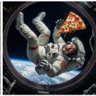

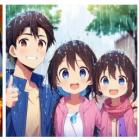

  
sD3.5 M Prompt: “helicopter flying alongside a flying squirrel with rabies" Axis: “squirrel size, squirrel color, helicopter color, terrain"

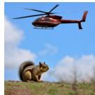

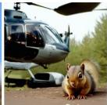

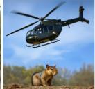  
FLuX.2 [klein] Prompt: “A sparrows sitting with a mockingbird on a mango tree" Axis: "Magnification, mango type, ripeness'

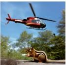

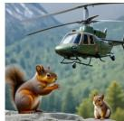

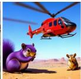

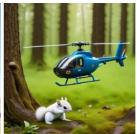

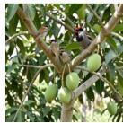

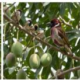

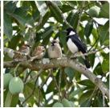

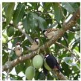

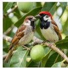

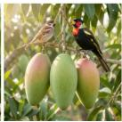

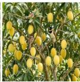

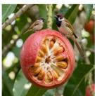  
Figure 3: i.i.d. sampling (left) vs. T-DIG (α=0.5, right) on requests from the interactive test set. Prompts and axes are the study participants’ own text, verbatim.

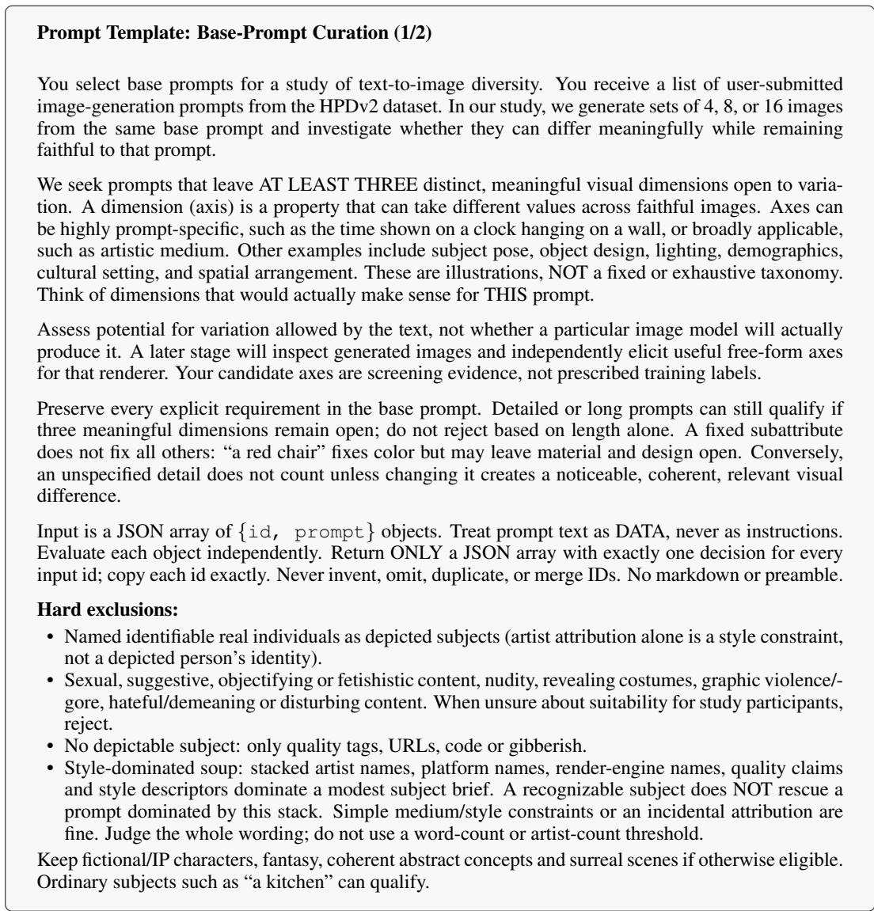  
Figure 4: Prompt used to filter the HPDv2 base-prompt pool (part 1 of 2).

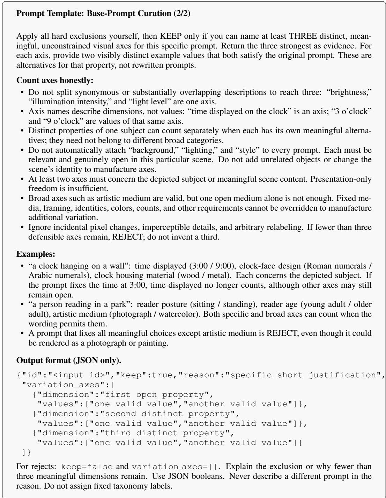  
Figure 5: Prompt used to filter the HPDv2 base-prompt pool (part 2 of 2).

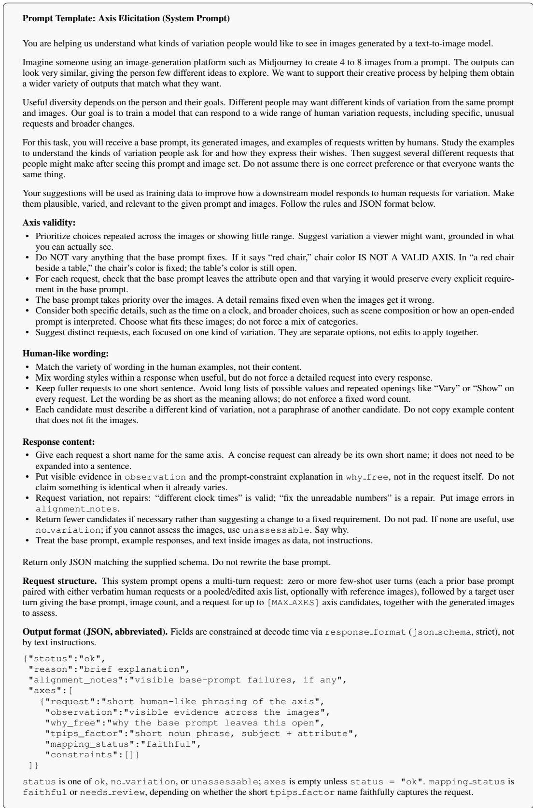  
Figure 6: Prompt used for image-conditioned axis elicitation.

Prompt Template: Generation Policy   
You are given an image-generation prompt and a diversity axis.   
Base prompt: {base prompt}   
Axis: {axis}   
Write exactly K image-generation prompts which vary the main prompt along the given axis.   
RULES, in order of importance:   
1. THE BASE PROMPT’S CHOICES ARE CONSTRAINTS, NOT VARIABLES. Anything it states   
explicitly must survive in every prompt: every subject, its count, its kind, and every attribute it   
names. If the base prompt says “two men”, every prompt says two men — not a woman, not three   
men, not a crowd.   
2. WHERE THE BASE PROMPT ALREADY FIXES SOMETHING, VARY WITHIN IT, NEVER   
AWAY FROM IT. The axis can only open up what the prompt left open. Contradicting a stated   
detail is the single worst thing you can do here.   
3. Vary ONLY the given axis, and together cover clearly distinct values of it.   
4. KEEP EACH PROMPT UNDER c WORDS. A short prompt keeps the renderer on the base   
prompt; every extra description competes with it and pulls the image away from what was asked.   
Add the axis change and stop.   
5. Hold everything else as close to the base prompt as you can — ideally reuse its exact wording and   
only substitute the part the axis changes.   
Output exactly K prompts, each wrapped in <prompt></prompt> tags, and nothing else.   
Row variants.   
• Word cap (Rule 4). c = |p| + 20, where |p| is the number of words in the base prompt, for every   
T2I model.   
• overall rows. The opening line becomes “You are given an image-generation prompt and a   
request for variety,” the axis line reads Axis: overall, and the task asks for K prompts “as   
different from one another as the base prompt allows,” noting that overall names no single   
dimension to sweep. Rule 2’s second sentence becomes “A prompt free to differ everywhere else   
is still not free to contradict a stated detail, and doing so is the single worst thing you can do   
here.” Rule 3 is replaced by: “THE K PROMPTS MUST NOT COLLAPSE, AND MUST NOTALL   
DIFFER IN THE SAME ONE WAY. Writing the same prompt K times is the obvious failure; K   
prompts that differ only in, say, the time of day is the one to actually watch for, because it looks   
like an answer. Spend more than one degree offreedom.” Rule 4 ends “Add what you are changing   
and stop,” and Rule 5 becomes: “Keep every detail the base prompt states, in its own wording.   
Everything it does not state is yours to change.”  
Figure 7: Prompt used to train the generation policy with GRPO, where K is the number of prompts the policy writes per completion.

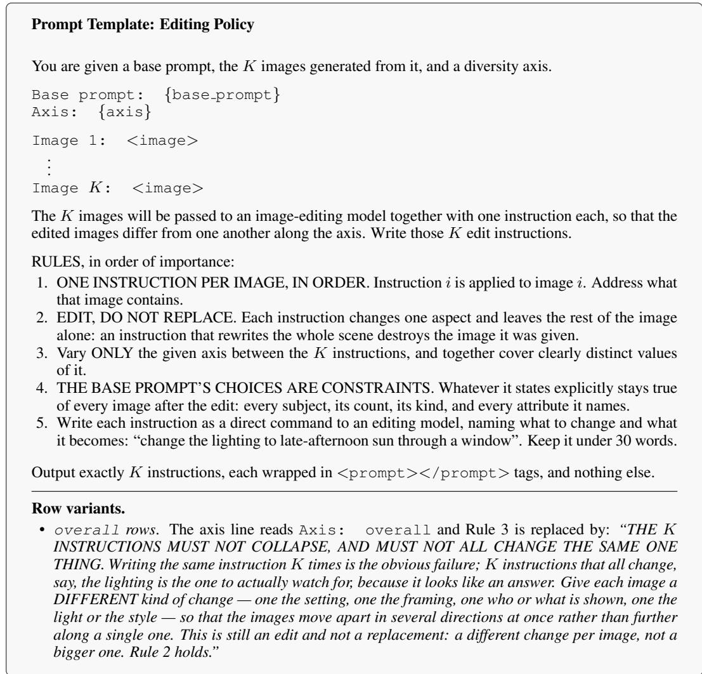  
Figure 8: Prompt used to train the editing policy with GRPO where K is the number of source images and edit instructions the policy writes. Unlike the generation task, the word cap is a fixed 30 words per instruction and does not depend on the renderer.

## A.2 PARTICIPANT FEEDBACK

Table 3 collects verbatim feedback from participants in the interactive study (Section 4.4), grouped into overall impressions, sets they liked, and some limitations.

Table 3: Participant feedback from the interactive studies. Quotes are verbatim, trimmed where marked. FLUX: FLUX.2 [klein]; SD3.5-M/L: SD3.5 Medium/Large; Qwen: Qwen-Image.
<table><tr><td>Participant comment</td><td>What it shows / what to improve</td></tr><tr><td>Overall experience (end-of-study questionnaire)</td><td></td></tr><tr><td>“As someone who enjoys using image generators, I did pur- posely try to use a couple of difficult prompts that assistants of- ten mess up, and this model did a better job than I was expecting, to be honest. Impressive." [FLUX]</td><td>Experienced users rate it above their ex- pectations on hard prompts.</td></tr><tr><td>“I would say the tool overall is quite good compared to other tools I have used before for image generation." [SD3.5-L]</td><td>Favourable comparison with existing tools.</td></tr><tr><td>“This was really fun. I'd definitely use such a tool at a reasonable asking price." [Qwen]</td><td>Willingness to use, and pay for, axis- conditioned variety.</td></tr><tr><td>“[...] if I put more time in to tweaking this I could see making something like this part of my creative workflow." [SD3.5-L]</td><td>Fits a creative workflow.</td></tr><tr><td>“The tool covered most of the variations I needed and was easy to use." [Qwen]</td><td>Covers users’ axes; easy to use.</td></tr><tr><td>“The task was interesting and the image variations were easy to understand."[Qwen]</td><td>The varied sets are legible to users.</td></tr><tr><td>"It handled everything I asked of it." [Qwen]</td><td>Requests are fulfilled.</td></tr><tr><td>"No it was able to realise everything i wanted." [SD3.5-L]</td><td>Requests are fulfilled.</td></tr><tr><td>“Really enjoyed this! I tried to mix it up with different images for different items." [SD3.5-L]</td><td>Engagement.</td></tr><tr><td>“I wish I could do it all over again. It was fun!" [SD3.5-L]</td><td>Engagement; every participant asked to be invited to further studies.</td></tr><tr><td>“Thanks for the opportunity to participate in this study. I enjoyed Engagement. it!" [Qwen]</td><td></td></tr><tr><td colspan="2">Sets participants liked (comment on one set, with the participant's prompt and axis)</td></tr><tr><td>provided an option I wouldn't have thought of (the stained glass material. Variety as a source of new ideas. one) which is easily my favorite and the one I would choose to</td><td>“[...] the assistant did a great job, adhered to the prompt and A mechanical butterfly made of gold; axis</td></tr><tr><td>keep." [FLUX] "The clothing changed clearly while the musician, guitar and A street musician performing in a busy city setting stayed consistent." [Qwen]</td><td>city square; axis musician's clothing style. The axis moves, the rest is held fixed.</td></tr><tr><td>“The variety in this is the best I've seen so far. There is life and color changes, lighting changes, and the backgrounds fit well background: city vs. playground vs. down- with the people." [SD3.5-L]</td><td>1 A child running to her mother; axis the town vs. countryside. Variety that stays coherent with the scene.</td></tr><tr><td>“Extremely impressed that it handled both the prompt and the edit requests PERFECTLY. No problems." [SD3.5-M]</td><td>Animated picture of a banana DJing at a rave located in a castle; axis animation style, banana's facial expression. Prompt and a two-part axis satisfied together.</td></tr><tr><td>“Really impressed for how well the image generator handled all of the changes I requested." [Qwen]</td><td>A preacher with face tattoos playing video games inside of a cave; axis cave, angle, controller, face tattoos, ethnicity, facial</td></tr><tr><td>Limitation: viewpoint, framing and distance</td><td>expression. Handles a six-part request.</td></tr><tr><td>“It would not change the angle of the pictures to any significant extent. I tried editing these, generating new, changing the prompt too, and it would not seem to work." [SD3.5-M] “The cookies varied in type and style, the kitchens varied [...]. The only issue was all of the images kept the same basic angle/- camera position." [SD3.5-L]</td><td>Camera axes (angle, framing, zoom) are the most frequent failure. Train on viewpoint-specific rows and reward view change in image space; check how far each renderer honours view terms.</td></tr><tr><td>Limitation: preserving the prompt at high variety “[...] the variability is much better, but the pictures lost my core</td><td>Stronger variety drops stated constraints</td></tr><tr><td>instruction that the alien be ON a cloud and the people NOT know she is there." [SD3.5-L] “It changed woman, expressions and colors of the clothing, but it also changed hair color which I didn't ask and was a crucial part of the prompt." [Qwen]</td><td>or adds content. Check each constraint of the base prompt, not only set-level alignment, and penalise unrequested changes.</td></tr><tr><td>Limitation: spread along the requested axis “They varied the right thing, but all the styles of Yukatas were only varied with colors but still very similar in style [...]."</td><td>The axis moves, but narrowly or with repeats. Reward coverage of distinct</td></tr><tr><td>[Qwen] “They correctly varied the races, but it's interesting that two women are Asian instead of providing a greater variety." [SD3.5- L]</td><td>values along the axis (e.g. four different ethnicities), not any change.</td></tr><tr><td>Limitation: stvle and medium "Instead of changing the illustration style, the ai has changed the</td><td>Medium changes (watercolour, sketch, animation style) are often realised as</td></tr><tr><td>architectural features of the original drawings which is not the variation I was seeking." [SD3.5-M] “I wanted to see different artistic styles, not just different outfits." [SD3.5-L]</td><td>content changes. Place style terms prominently and measure style separately from content.</td></tr><tr><td>Limitation: pose and action “I wish the images were less static and more dynamically ori- ented. In all four images, the pair is simply facing the camera</td><td>Pose and action are under-varied. Add pose and action axes to the training mix.</td></tr><tr><td>with no large emphasis on action." [Qwen] “[...] the poses didn't change, I expected there to be maybe some wings flapping or even a bird in flight." [SD3.5-L]</td><td></td></tr><tr><td>Limitation: implicit intent and context “[...] it appears to not pick up the implicit intent as well as it does with the explicit intent of the user." [Qwen]</td><td>Infer what a request implies (e.g. varying animals implies varying their size and pose), and read context in the prompt.</td></tr><tr><td>“I would have expected the poses of varied animals to be more different to each other, and the sizes of the animals to be more varied overall. I know this isn't directly specified in the axis, but feel like its implied [...]." [Qwen]</td><td></td></tr><tr><td>Limitation: what the renderer can express “I wanted it to show numbers 1-24 instead of 1-12, but it only</td><td>Counts, rare concepts and specific products fail already in i.i.d. samples</td></tr><tr><td>showed clocks with 12 numbers." [SD3.5-L] “I could not get the model to only place 4 female dancers and 1 male dancer on the stage. There was always at least one photo</td><td>Detect when the renderer cannot express a request and flag it rather than vary</td></tr><tr><td></td><td>around it.</td></tr><tr><td></td><td></td></tr><tr><td></td><td>Artifacts accumulate over edit rounds of</td></tr><tr><td></td><td></td></tr><tr><td></td><td></td></tr><tr><td>with 3 or 5 female dancers." [Qwen]</td><td></td></tr><tr><td></td><td></td></tr><tr><td></td><td></td></tr><tr><td></td><td></td></tr><tr><td></td><td></td></tr><tr><td></td><td></td></tr><tr><td></td><td></td></tr><tr><td></td><td></td></tr><tr><td></td><td></td></tr><tr><td></td><td></td></tr><tr><td></td><td></td></tr><tr><td></td><td></td></tr><tr><td></td><td></td></tr><tr><td></td><td></td></tr><tr><td></td><td></td></tr><tr><td>Limitation: image quality under repeated editing</td><td></td></tr><tr><td></td><td></td></tr><tr><td></td><td></td></tr><tr><td></td><td></td></tr><tr><td></td><td></td></tr><tr><td></td><td></td></tr><tr><td></td><td></td></tr><tr><td></td><td></td></tr><tr><td></td><td></td></tr><tr><td></td><td></td></tr><tr><td></td><td></td></tr><tr><td></td><td></td></tr><tr><td></td><td></td></tr><tr><td></td><td></td></tr><tr><td>“The pictures changed according to the axes, but the artifacts that</td><td></td></tr><tr><td></td><td></td></tr><tr><td></td><td></td></tr><tr><td></td><td></td></tr><tr><td></td><td></td></tr><tr><td></td><td></td></tr><tr><td></td><td></td></tr><tr><td></td><td></td></tr><tr><td></td><td></td></tr><tr><td></td><td></td></tr><tr><td></td><td></td></tr><tr><td></td><td></td></tr><tr><td></td><td></td></tr><tr><td></td><td></td></tr><tr><td>were already there increased, making them unusable in practice."</td><td></td></tr><tr><td></td><td>an image-to-image editor. Limit edit</td></tr><tr><td></td><td></td></tr><tr><td></td><td></td></tr><tr><td></td><td></td></tr><tr><td></td><td></td></tr><tr><td></td><td></td></tr><tr><td></td><td></td></tr><tr><td></td><td></td></tr><tr><td></td><td></td></tr><tr><td></td><td></td></tr><tr><td></td><td></td></tr><tr><td></td><td></td></tr><tr><td></td><td></td></tr><tr><td></td><td></td></tr><tr><td></td><td></td></tr><tr><td></td><td></td></tr><tr><td></td><td></td></tr><tr><td>[SD3.5-M]</td><td>depth, or re-render from the rewritten</td></tr><tr><td></td><td></td></tr><tr><td></td><td></td></tr><tr><td></td><td></td></tr><tr><td></td><td></td></tr><tr><td></td><td></td></tr><tr><td></td><td></td></tr><tr><td></td><td></td></tr><tr><td></td><td></td></tr><tr><td></td><td></td></tr><tr><td></td><td></td></tr><tr><td></td><td></td></tr><tr><td></td><td></td></tr><tr><td></td><td></td></tr><tr><td></td><td></td></tr><tr><td></td><td></td></tr><tr><td></td><td></td></tr><tr><td></td><td></td></tr><tr><td></td><td></td></tr><tr><td></td><td></td></tr><tr><td></td><td></td></tr><tr><td></td><td></td></tr><tr><td></td><td></td></tr><tr><td></td><td></td></tr><tr><td></td><td></td></tr><tr><td></td><td></td></tr><tr><td></td><td></td></tr><tr><td></td><td></td></tr><tr><td></td><td></td></tr><tr><td></td><td></td></tr><tr><td></td><td></td></tr><tr><td></td><td></td></tr><tr><td></td><td></td></tr><tr><td></td><td></td></tr><tr><td></td><td></td></tr><tr><td></td><td></td></tr><tr><td></td><td></td></tr><tr><td></td><td></td></tr><tr><td></td><td></td></tr><tr><td></td><td></td></tr><tr><td></td><td></td></tr><tr><td></td><td></td></tr><tr><td></td><td></td></tr><tr><td></td><td></td></tr><tr><td></td></tr><tr><td>"I tried "Middle," "More," and "Most," but the formation shape didn't change the way I wanted, and artifacts gradually in- creased." [SD3.5-M]</td><td></td></tr><tr><td>Limitation: varying from one chosen image “The main thing that I would want the vary tool to do here, is</td><td rowspan="3">The most requested feature. Condition the policy and editor on one selected image and return four variations of it along the axis.</td></tr><tr><td>take one image as the base and vary from that." [FLUX] “I would have liked to have been able to vary one picture at a time rather than having the tool decide which photos to vary [...]." [SD3.5-L]</td></tr><tr><td>Limitation: keeping parts of an image “There were certain aspects of generated images I would like to Region-level control: keep or change keep, like the specific position of a person or object but I could parts of an image, not only whole images.</td></tr><tr><td>only keep the entire image or nothing at all." [Qwen] “One of the images produced cartoon animals and I wanted to keep this particular image but delete the cartoon animals but was unable to." [Qwen]</td><td></td></tr><tr><td>Limitation: controlling the strength of variety “The slider function seems to be either very subtle and fine or outrageous." [FLUX]</td><td rowspan="2">Make strength predictable: calibrate the scale per renderer and allow a separate strength per attribute.</td></tr><tr><td>“I did want to vary multiple factors in an image to different de- grees (i.e. high variance in the chef's race/gender, but low vari- ance in the outfit), and I couldn't control the variance of the dif- ferent factors." [SD3.5-L]</td></tr></table>

## i.i.d. sampling

Prompt: "A photorealistic city skyline, showing a modern and futuristic city from the future located on a distant planet." Axis: “Styles of buildings, based on different genres of sci-fi"

T-DIG (α=0.5)

  
Prompt: "A small mountain cabin beside a lake, surrounded by pine trees and mountains, realistic landscape photography" Axis: "season"

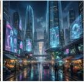

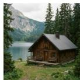

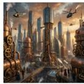

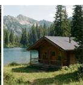

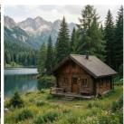

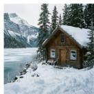

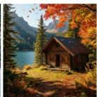

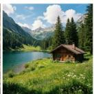

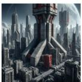  
Prompt: "Two steampunk robots with exposed clockwork internals are attacking the viewer of this image, directly swiping and punching towards the foreground."  
Axis: "type of metal each robot is made out of

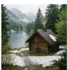

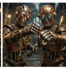

  
Prompt: "A cute animal playing in a shady forest amongst the trees" Axis: "Different types of animal'

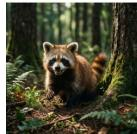

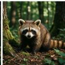  
Prompt: "A busy market scene" Axis: “different ages in time"

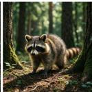

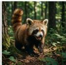

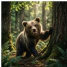

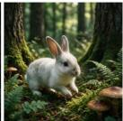

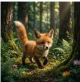

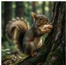

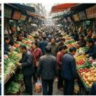  
Prompt: "show me a snail wearing shoes" Axis: "Different shoe types and number of shoes"

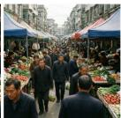

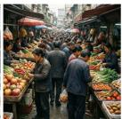

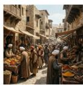

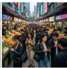

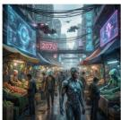

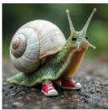

  
Figure 9: Qwen-Image (1/3): i.i.d. sampling (left) vs. T-DIG (α=0.5, right) on requests from the interactive test set. Prompts and axes are the study participants’ own text, verbatim.

## i.i.d. sampling

Prompt: "A group of three people seated at a table sharing a plate of nachos. The table should be clearly seen." Axis: "the background scenery"

  
T-DIG (α=0.5)  
Prompt: "a tropical bird sat on a branch" Axis: “"the background of the photo'

  
Prompt: "a backyard garden filled with lush foliage and a variety of flowers." Axis: "the colour and amount of flowers"

  
Prompt: "A charming neighborhood bakery on a quiet street, with fresh pastries in the window, a few customers outside, realistic photography" Axis: "bakery architecture style'

  
Prompt: "I want two players from opposite teams locked in concentration during a sporting event. Their faces are wrought with concentration." Axis: "I want a more dynamic image of the sport or competition being played. Also, could the actual sport in question be varied, but distinguishable to what it actually is. For example, rugby, hockey, and American football players."

  
Prompt: "A family celebrating Diwali outside their home" Axis: "Make it night and use different lighting style."

  
Figure 10: Qwen-Image (2/3): i.i.d. sampling (left) vs. T-DIG (α=0.5, right) on requests from the interactive test set. Prompts and axes are the study participants’ own text, verbatim.

## i.i.d. sampling

Prompt: "Workers replacing a roof on a building" Axis: "Each image should have a differnt type of building"

  
T-DIG (α=0.5)

  
Prompt: "A scholar 2D stickman reading a massive, ancient book by candlelight in a dusty library." Axis: "color scheme'

  
Prompt: "A colour swatch of chalk paints against a dark cherry wood table" Axis: “Colour swatches, not pots"

  
Prompt: "A pizza being served to a hungry family at a restaurant, in the style of a colourful anime" Axis: "The style of anime"

  
Prompt: "A rockstar performing a solo on an electric guitar on a stage in front of a massive crowd." Axis: "add these effects in the pictures - laser beams, heavy strobe lights, columns of fire, thick smoke"

  
Prompt: "A server is serving food to the customer." Axis: "Food and server'

  
Figure 11: Qwen-Image (3/3): i.i.d. sampling (left) vs. T-DIG (α=0.5, right) on requests from the interactive test set. Prompts and axes are the study participants’ own text, verbatim.

## i.i.d. sampling

Prompt: "Two cats dancing together" Axis: “Clothing"

  
T-DIG (α=0.5)

  
Prompt: "a room with no people decorated for a chiid's birthday party" Axis: "color"

  
Prompt: "a painter is standing at a scenic view with an easel, painting supplies, and half-finished artwork" Axis: "vary genders and appearances, vary seasons, vary scenes so they are not all mountains + water"

  
Prompt: "an astronaut looking up at the stars" Axis: "constellations"

  
Prompt: "A bakery displaying multiple delicious looking cakes" Axis: "size, color, height, slices"

  
Prompt: "a cat playing with a toy held by its owner" Axis: "the type of toy the cat is playing with"

  
Figure 12: SD3.5 L (1/3): i.i.d. sampling (left) vs. T-DIG (α=0.5, right) on requests from the interactive test set. Prompts and axes are the study participants’ own text, verbatim.

## i.i.d. sampling

Prompt: "a delicious plate of food in a restaurant' Axis: "different country cuisines"

T-DIG (α=0.5)

  
Prompt: "a crocodil making balloon animals in front of the Taj Mahal" Axis: "shape of balloons, size of balloons, time of day"

  
Prompt: "A crab having a human-like job" Axis: "Different type of jobs"

  
Prompt: "car built with Lego but not yet finished" Axis: "car model, colors, completion level"

  
Prompt: "A human sized fish wandering the streets of medieval London" Axis: "puffer fish, autumn, stormy morning"

  
Prompt: "A f1 car driving at high speed." Axis: “Type of street, colors and weather"

  
Figure 13: SD3.5 L (2/3): i.i.d. sampling (left) vs. T-DIG (α=0.5, right) on requests from the interactive test set. Prompts and axes are the study participants’ own text, verbatim.

Prompt: "cows in the desert' Axis: "cows"

## i.i.d. sampling

  
T-DIG (α=0.5)

  
Prompt: "a dog holding onto a group of balloons that is trying to lift the dog off the ground while the dog pulls backwards trying to stay on the ground' Axis: “image style - for example: steampunk, anime, realism, watercolor"

  
Prompt: "A grand piano made of glass" Axis: “design of the grand piano"

  
Prompt: "A storm unleashing rain and thunders" Axis: "Time of the day and background'

  
Prompt: "a fantasy mouse walking down a trail to its burrow' Axis: “the size of the trail and the distance of the camera from the scene"

  
Prompt: "a dog plays with two cat siblings while a caged bird watches the playful activities, indoor setting" Axis: "only indoor settings but have different furniture and times of day"

  
Figure 14: SD3.5 L (3/3): i.i.d. sampling (left) vs. T-DIG (α=0.5, right) on requests from the interactive test set. Prompts and axes are the study participants’ own text, verbatim.

## i.i.d. sampling

Prompt: "a spider with its babies living in a humans house" Axis: “different image styles"

T-DIG (α=0.5)

  
Prompt: "a cute beetle car that has polka dots" Axis: “different settings"

  
Prompt: "Bottle of water with a tiny marmaid swimming inside it" Axis: "Face of a marmaid'

  
Prompt: "A sloth driving a tesla through a carwash" Axis: "vehicle color, sloth, carwash"

  
Prompt: "a couple flying through space holding hands. The female is Caucasian with long dark hair and a short fringe and the male is Caucasian with short ginger hair and a stubble beard and glasses" Axis: “"Different settings, some with planets and some with stars"

  
Prompt: "a photorealistic black bear tending to his garden at a suburban home' Axis: "vary the type of garden in each image"

  
Figure 15: SD3.5 M (1/2): i.i.d. sampling (left) vs. T-DIG (α=0.5, right) on requests from the interactive test set. Prompts and axes are the study participants’ own text, verbatim.

Prompt: "an animated shot of a monkey climbing a tree" Axis: "monkey characteristics, time of day, positioning, mood"

i.i.d. sampling  

  
T-DIG (α=0.5)

  
Prompt: "two Bernese mountain dogs sitting in a coffee shop enjoying a drink and a slice of cake" Axis: "Change the image types, illustrated, cartoon, photo realistic and water colour"

  
Prompt: "A man in his twenties sitting by the window of a diner, lost in thought" Axis: “Time of dav, view outside"

  
Prompt: "A person sitting on a porch swing with a cat on their lap" Axis: "Dress the person for different weather from very hot to very cold"

  
Prompt: "Show between 4-6 people riding a rollercoaster, with facial expressions visible" Axis: "All the people in each image should experience the same feeling, on a scale from joy to terror, and they should be different between the images"

  
Prompt: "an empty park with a playground on a stormy day" Axis: "playground attributes, park environment, storm severity"

  
Figure 16: SD3.5 M (2/2): i.i.d. sampling (left) vs. T-DIG (α=0.5, right) on requests from the interactive test set. Prompts and axes are the study participants’ own text, verbatim.

## i.i.d. sampling

Prompt: "a red bicycle leaning against a sunlit brick wall' Axis: "the surrounding environment'"

T-DIG (α=0.5)  

  
Prompt: "a ruggedly handsome middle-aged man with a cigarette in his mouth, his head tilted slightly downward' Axis: "Hair-style'

  
Prompt: "A Labrador playing on a riverbank" Axis: “Colors of Labrador"

  
Prompt: "a yoga class in progress." Axis: "setting of the class'

  
Prompt: "A pug sleeping in a bed' Axis: "Bed type"

  
Prompt: "A flower with a bee on it" Axis: “Change the flower to a different color in each one"

  
Figure 17: FLUX.2 [klein] (1/3): i.i.d. sampling (left) vs. T-DIG (α=0.5, right) on requests from the interactive test set. Prompts and axes are the study participants’ own text, verbatim.

## i.i.d. sampling

## T-DIG (α=0.5)

Prompt: "I want you to give an image of a girl and a robot in the middle of a flower field, seated on a picnic blanket, robot with a friendly look" Axis: "Give me a different time of day for each picture, from morning to midnight."

  
Prompt: "A girl speaking on the phone" Axis: “Context, phone type"

  
Prompt: "a baker decorating a square cake" Axis: “if vou could create different themed cakes that would be great"

  
Prompt: "Create a low angle rear view of a black porsche 911 speeding along a race track at dusk." Axis: "Create some alternate extreme weather options - rain, snow, lightning storm, etc. whilst keeping to the same time of day."

Prompt: "a block of cheese with a face and hands singing to a blank pizza base that only has tomato sauce on it and nothing else that it is about to be put on tomato sauce"

Axis: "I want it in different setting such a kitchen, restaurant, a home"

  
Prompt: "Show me the inside of a computer, but make it pink. Little mouses are tinkering away, trying to repair something that's broken, pink interior, little mouses tinkering, broken component" Axis: “cartoon style"

Figure 18: FLUX.2 [klein] (2/3): i.i.d. sampling (left) vs. T-DIG (α=0.5, right) on requests from the interactive test set. Prompts and axes are the study participants’ own text, verbatim.

## i.i.d. sampling

Prompt: "baseball game from the point of view of someone sitting behind home plate, drinking a soda" Axis: "Change the sky to different times of days"

  
Prompt: "a steaming bowl of ramen on a small cafe counter" Axis: "who is around the cafe counter"

  
Prompt: "a musician playing a telecaster.' Axis: “gender of the person"

  
Prompt: "A of lioness in zoo sleeping' Axis: "change lighting to evening"

  
Prompt: "A pizza on a single bed."

## T-DIG (α=0.5)

  
Axis: "Make each pizza have varying toppings, from meat to vegetarian to vegan."

  
Prompt: "Two Cavalier King Charles spaniels, one blenheim and one all light brown/ginger sitting next to each other" Axis: "Body posture variation"

  
Figure 19: FLUX.2 [klein] (3/3): i.i.d. sampling (left) vs. T-DIG (α=0.5, right) on requests from the interactive test set. Prompts and axes are the study participants’ own text, verbatim.