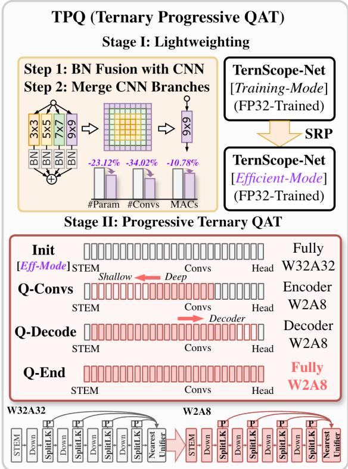
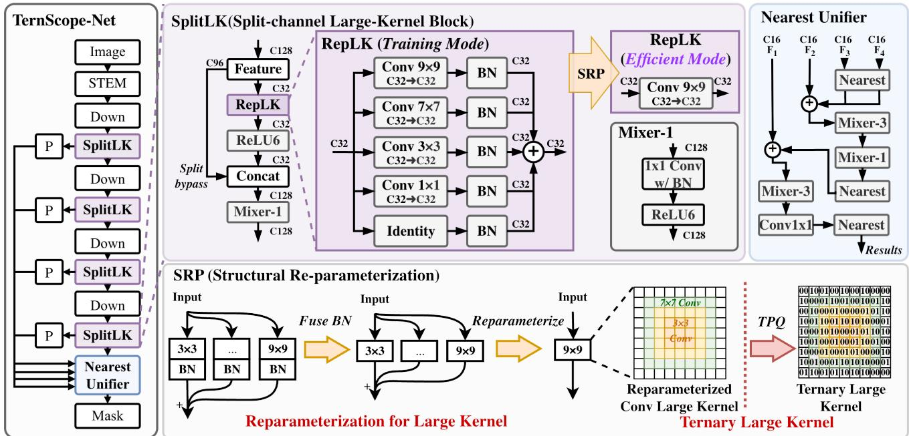
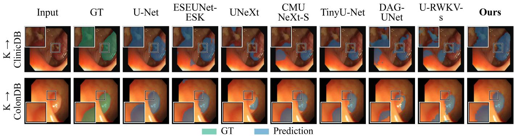
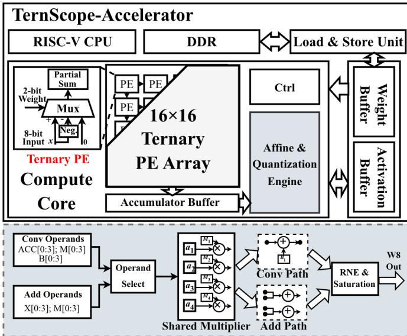

# TernScope: Model–Hardware Co-Design for Efficient Ternary Endoscopic Segmentation

Zhuoyu Wu1,\*, Wenhui Ou2, Qiawei Zheng2, Xuhong Qiu4, Wenqi Fang3, Raphael C.-W. Phan1

1CyPhi AI Research Lab, School of Information Technology, Monash University Malaysia, Malaysia

2Department of Electronic and Computer Engineering, The Hong Kong University of Science and Technology, Hong Kong

3Shenzhen Institutes of Advanced Technology, Chinese Academy of Sciences, Shenzhen, China

4School of Computer Science and Engineering, Southeast University, Nanjing, China

\*Corresponding author: Zhuoyu Wu (zhuoyu.wu@monash.edu)

Code and experiments: https://github.com/ReaganWu/TernScope

Abstract—Edge medical segmentation must reconcile small model size, high accuracy, and fast inference. TernScope addresses this tradeoff through model–hardware co-design, learning a compact segmentation network whose low-bit operators also simplify hardware execution. Split-channel large-kernel blocks preserve spatial context with limited computation, while branch fusion removes redundant inference paths. Ternary Progressive Quantization-aware Training (TPQ) then adapts the fused network from deep to shallow layers, through the decoder, and finally to the input and prediction layers. All 25 convolutions use ternary weights and 8-bit activations, enabling packed storage and multiplier-free computation. The resulting model uses 0.2483 M parameters and 0.0949 GMACs while retaining competitive segmentation accuracy on in-domain and external datasets. Under the same 45 nm technology, TernScope reduces computearray area by 88.46% compared with the original Gemmini, a systolic-array accelerator with 8-bit × 8-bit multipliers. These results demonstrate a path from accurate lightweight medical segmentation to compact low-bit hardware.

Index Terms—Model–hardware co-design, endoscopic segmentation, ternary neural networks, structural re-parameterization.

## I. INTRODUCTION

Medical image segmentation at the edge faces a model size–accuracy–inference speed trilemma: a deployable model must fit limited memory, delineate lesions accurately, and deliver predictions promptly [1]–[3]. Reducing network width or spatial processing can save resources, but also restrict the contextual information available for segmentation [4], [5]. The goal is therefore to retain strong segmentation capacity within a small, fast model. For endoscopic applications, this requires treating predictive quality and deployment cost as joint design objectives.

A compact network does not automatically translate into fast inference or a small accelerator. Execution also depends on memory access, operator organization, and the target architecture [6]–[8]. Structural re-parameterization helps by merging expressive training branches into efficient inference operators [9], [10]. Numerical precision provides a complementary design dimension: low-bit operands reduce tensor storage and simplify arithmetic [11]–[13]. Combining these choices makes full-network ternary weight quantization an opportunity to address the trilemma at both model and circuit levels, provided segmentation accuracy can be retained.

  
Fig. 1. TernScope training-to-deployment pipeline. Branch fusion removes redundant inference paths; TPQ adapts the fused graph to W2A8, including the stem and head.

The central challenge is to make a compact segmentation graph learn effectively under ternary constraints. Learned quantization scales and incremental conversion provide complementary ways to adapt networks to reduced precision [14], [15]. Branch fusion changes the effective kernels, so quantizing separate training branches need not yield the same operator as quantizing their sum. Leaving the stem or prediction head at higher weight precision also retains heterogeneous convolution requirements. We instead adapt the fused deployment graph through Ternary Progressive QAT (TPQ), extending ternary weights to every convolution while retaining 8-bit activations.

TernScope realizes this model-led co-design in three connected steps (Fig. 1). SplitLK allocates large-kernel processing to a channel subset, and a narrow decoder fuses multi-scale features. Branch fusion removes redundant execution paths before TPQ learns the final low-bit operators. A corresponding ternary array then translates the model’s numerical representation into simpler computation.

  
Fig. 2. TernScope-Net and its main components. SplitLK combines a split-channel large-kernel path with a bypass and pointwise mixing. RepLK training branches are fused into a single deployment convolution. The Nearest Unifier combines projected features from four encoder scales.

We present TernScope, a fully ternary-weight segmentation framework that jointly addresses model complexity, segmentation accuracy, and hardware efficiency. With 0.2483 M parameters and 0.0949 GMACs, TernScope outperforms its FP32 reference across all three datasets. Using ternary PEs and shared arithmetic resources, it reduces compute-array area, synthesized standard-cell area, and estimated logic power by 88.46%, 70.28%, and 62.82%, respectively, compared with the original Gemmini [7].

## II. TERNSCOPE-NET

## A. SplitLK: Spatial Context at Low Cost

Large kernels expand spatial context [16]. TernScope-Net separates spatial coverage from channel width (Fig. 2). Its four encoder stages use 32/64/96/128 channels, while spatial convolutions process only 16/16/16/32 channels. The remaining channels bypass spatial processing and rejoin the transformed features before a pointwise mixer. For input width C and processed width $C _ { s } ,$ , the dense spatial term falls from $H W \bar { C } ^ { 2 } k ^ { 2 }$ to $H W C _ { s } ^ { 2 } k ^ { 2 }$ ; pointwise mixing then exchanges information across all channels. For example, processing 32 of 128 channels reduces this spatial term to $1 / 1 6$ of its fullwidth counterpart; the pointwise cost remains. Large kernels of size 5, 7, and 9 operate at $3 2 \times 3 2$ resolution or below, where wider context is less expensive.

## B. Nearest Unifier: Narrow Multi-Scale Fusion

The Nearest Unifier projects all four encoder scales to 16 channels. Nearest-neighbor resizing aligns the features for addition and convolutional refinement. The three deeper features are combined and refined before fusion with the shallow feature, so the decoder introduces semantic context before recovering fine detail. Addition keeps the fused width at 16 channels instead of growing it through concatenation. Nearestneighbor resizing requires no learned upsampling weights. Convolutions learn spatial refinement, while dense kernels and channel widths aligned to 16 suit a common array.

## C. Fuse First, Then Learn Ternary Execution

The FP32 model is first converted to its deployment topology. Batch normalization is folded into each RepLK branch, giving $( \hat W _ { j } , \hat b _ { j } )$ , and the branches are merged as

$$
W _ { \mathrm { r e p } } = \sum _ { j } \mathcal { P } _ { j } ( \bar { W } _ { j } ) , \qquad b _ { \mathrm { r e p } } = \sum _ { j } \bar { b } _ { j } ,\tag{1}
$$

where $\mathcal { P } _ { j }$ center-pads kernels and represents the identity by a centered identity kernel. Nonlinearities remain outside the merged branches. Fusion preserves the linear operation and removes intermediate branch execution. Since quantization is nonlinear, TPQ adapts the merged kernels rather than independently quantizing branches that disappear at deployment.

For output channel c, the ternary weight quantizer is

$$
{ \widehat W } _ { c } = s _ { c } ~ \mathrm { c l i p ( r o u n d } ( W _ { c } / s _ { c } ) , - 1 , 1 ) , \quad s _ { c } > 0 .\tag{2}
$$

FP master weights and channel scales use fake quantization with straight-through gradients. Activations remain A8, while bias, scaling, and accumulation use wider precision. Feature additions preserve rounding and saturation boundaries.

TPQ follows three phases (Fig. 1). The first 5% adapts the fused model in W8A8. Over the next 35%, weights transition to ternary from deep to shallow encoder stages, then skip projections, decoder, input convolution, and segmentation head.

TABLE I  
SEGMENTATION QUALITY AND CROSS-DATASET TRANSFER AFTER TRAINING ON KVASIR-SEG (256 × 256).
<table><tr><td></td><td></td><td colspan="2">Complexity</td><td></td><td colspan="2">Kvasir-SEG</td><td colspan="2">K→ ClinicDB</td><td colspan="2">K → ColonDB</td></tr><tr><td>Model</td><td>Year</td><td>Params (M)↓</td><td>GMACs↓</td><td>W/A</td><td>Dice↑</td><td>IoU↑</td><td>Dice↑</td><td>IoU↑</td><td>Dice↑</td><td>IoU↑</td></tr><tr><td>U-Net [17]</td><td>2015</td><td>31.0317</td><td>48.1670</td><td>32/32</td><td>0.8208</td><td>0.7303</td><td>0.6791</td><td>0.5849</td><td>0.5360</td><td>0.4471</td></tr><tr><td>UNeXt [1]</td><td>2022</td><td>1.4719</td><td>0.5620</td><td>32/32</td><td>0.7385</td><td>0.6435</td><td>0.5207</td><td>0.4274</td><td>0.3785</td><td>0.2999</td></tr><tr><td>Mobile-PolypNet [2]</td><td>2022</td><td>0.2239</td><td>1.1380</td><td>32/32</td><td>0.5974</td><td>0.4720</td><td>0.4390</td><td>0.3269</td><td>0.2711</td><td>0.1887</td></tr><tr><td>EGE-UNet [18]</td><td>2023</td><td>0.0534</td><td>0.0720</td><td>32/32</td><td>0.5882</td><td>0.4611</td><td>0.4464</td><td>0.3276</td><td>0.2804</td><td>0.1950</td></tr><tr><td>CMUNeXt-S [4]</td><td>2024</td><td>0.4175</td><td>1.0120</td><td>32/32</td><td>0.7120</td><td>0.6076</td><td>0.5029</td><td>0.3954</td><td>0.3148</td><td>0.2436</td></tr><tr><td>TinyU-Net [5]</td><td>2024</td><td>0.4811</td><td>1.5610</td><td>32/32</td><td>0.7329</td><td>0.6286</td><td>0.5201</td><td>0.4329</td><td>0.2768</td><td>0.2194</td></tr><tr><td>U-RWKV-s [19]</td><td>2025</td><td>0.4704</td><td>0.9740†</td><td>32/32</td><td>0.6727</td><td>0.5608</td><td>0.4895</td><td>0.3795</td><td>0.2752</td><td>0.2035</td></tr><tr><td>DAG-UNet [20]</td><td>2025</td><td>0.7358</td><td>0.7760</td><td>32/32</td><td>0.6785</td><td>0.5565</td><td>0.4908</td><td>0.3781</td><td>0.2484</td><td>0.1778</td></tr><tr><td>ESEUNet-ESK [21]</td><td>2026</td><td>0.1789</td><td>3.5190</td><td>32/32</td><td>0.7693</td><td>0.6775</td><td>0.5776</td><td>0.4759</td><td>0.4113</td><td>0.3333</td></tr><tr><td>TernScope-Net (Ours)</td><td></td><td>0.2483</td><td>0.0949</td><td>2/8</td><td>0.8158</td><td>0.7247</td><td>0.7291</td><td>0.6290</td><td>0.5945</td><td>0.5015</td></tr></table>

K: Kvasir-SEG, the only training dataset. K → target: external evaluation without fine-tuning. Test sizes: 200 / 612 / 380. Scores are per-image means at threshold 0.5; bold/underline denote best/second-best. Ours uses progressive W2A8 QAT without distillation; its parameter count excludes quantization scales. MACs count convolution, linear layers, and matrix multiplication at batch 1, excluding normalization, activation, and interpolation. †WKV operators are excluded; 0.974 GMACs is partial.

  
Fig. 3. Qualitative transfer from Kvasir-SEG to ClinicDB (top) and ColonDB (bottom), without target-domain fine-tuning. Green and blue overlays indicate ground truth and predictions, respectively. Boxed regions are enlarged in the insets.

TABLE II  
RE-PARAMETERIZATION AND TERNARY QUANTIZATION ABLATION.
<table><tr><td>Configuration</td><td>Params (M)</td><td>GMACs | Metric</td><td></td><td>Perf. (A / B / C)↑</td></tr><tr><td rowspan="2">Multi-branch FP32</td><td rowspan="2">0.3233</td><td rowspan="2">0.1064</td><td>Dice</td><td>(0.8102/0.7142/0.5532)</td></tr><tr><td>IoU</td><td>(0.7218/0.6161/0.4630)</td></tr><tr><td rowspan="2">Re-parameterized FP32</td><td rowspan="2">0.2483</td><td rowspan="2">0.0949</td><td>Dice</td><td>(0.8102/0.7142/0.5532)</td></tr><tr><td>IoU</td><td>(0.7218/0.6161/0.4630)</td></tr><tr><td rowspan="2">Ternary PTQ</td><td rowspan="2">0.2483</td><td rowspan="2">0.0949</td><td>Dice</td><td>(0.0002/0.0004/0.0007)</td></tr><tr><td>IoU</td><td>(0.0002/0.0004/0.0007)</td></tr><tr><td rowspan="2">Direct ternary QAT</td><td rowspan="2">0.2483</td><td rowspan="2">0.0949</td><td>Dice</td><td>(0.8075/0.7029/0.5636)</td></tr><tr><td>IoU</td><td>(0.7148/0.5998/0.4717)</td></tr><tr><td>Ternary Progressive</td><td>0.2483</td><td>0.0949</td><td>Dice</td><td>(0.8158/0.7291/0.5945)</td></tr><tr><td rowspan="2">QAT (TPQ, Ours)</td><td rowspan="2"></td><td rowspan="2"></td><td></td><td></td></tr><tr><td>IoU</td><td>(0.7247/0.6290/0.5015)</td></tr></table>

A: Kvasir-SEG test (200); B: K → CVC-ClinicDB (612); C: K → CVC-ColonDB (380). K: Kvasir-SEG; training on K only, no target fine-tuning. W/A bits: FP32 (32/32), ternary (2/8). Costs: 256 × 256 input; Params exclude quantization scales; bold: ours.

All 25 convolutions are ternary by 40%, with the remaining 60% training the W2A8 graph. Transitions use scale recalibration and brief reduced-learning-rate adaptation. Activation scales are frozen after final adaptation, and validation Dice selects checkpoints only from the fully W2A8 phase.

## III. MODEL-TO-HARDWARE MAPPING

TernScope adopts a Gemmini-based architecture comprising a 16×16 ternary PE array, an accumulator buffer, and a shared Affine & Quantization Engine, as shown in Fig. 4. Weights and activations are loaded into on-chip buffers. The PE array performs convolution, while the shared engine handles postprocessing and multi-scale feature addition.

The model exposes two forms of efficiency: fewer operations after fusion and simpler arithmetic after ternarization. Each ternary weight $t ~ \in ~ \{ - 1 , 0 , + 1 \}$ selects −a, zero, or +a for accumulation, eliminating general multipliers from the PE product path. Wider partial sums preserve the convolution range, followed by per-channel scaling and bias addition.

Packed W2 weights use 1/4 of W8 payload, while A8 keeps feature storage and transfers narrow. The Affine & Quantiza tion Engine performs output post-processing. Operand selection feeds shared multipliers, followed by bias addition for convolution or summation of scaled features for two-source Add. Round-to-nearest-even and saturation produce 8-bit outputs, preserving quantization boundaries. Sparse accelerators exploit zero operands to reduce computation and transfers [22], motivating further use of ternary weight sparsity.

  
Fig. 4. Hardware mapping of the W2A8 deployment graph. A ternary array executes sign selection and accumulation, while the shared affine and quantization path supports convolution outputs and multi-scale feature addition.

## IV. EXPERIMENTAL RESULTS

## A. Evaluation Protocol

Training uses Kvasir-SEG [23] only, split into 720/80/200 training/validation/test images. ClinicDB (612) [24] and ColonDB (380) [25] evaluate transfer without fine-tuning. RGB inputs are 256×256, normalized to [−1, 1]; augmentation includes flips, right-angle rotations, color adjustment, and Gaussian blur. Images and masks use bilinear and nearestneighbor resizing, respectively. Baselines use Adam, batch 16, learning rate $1 0 ^ { - 4 } ,$ , and binary cross-entropy plus soft Dice loss for 200 epochs. TPQ uses FP32 initialization, AdamW, batch 2, a base learning rate of $2 \times 1 0 ^ { - 4 }$ , and 200 epochs without distillation. Validation Dice selects checkpoints. Metrics average per-image scores at threshold 0.5. MACs count convolution, linear layers, and matrix multiplication at batch 1; Table I notes the partial WKV count.

## B. Segmentation Quality and Quantization Ablation

Table I shows a favorable accuracy–cost tradeoff. TernScope uses approximately 1/125 of U-Net’s parameters and 1/508 of its MACs, with in-domain Dice within 0.51 percentage points and external Dice higher by 5.00 and 5.85 points. Smaller parameter count alone does not explain this result: EGE-UNet and Mobile-PolypNet have fewer parameters, yet lower overlap scores. TernScope retains spatial context within a compact W2A8 graph, with the strongest cross-dataset Dice and IoU among the evaluated models. Fig. 3 provides matched examples and enlarged boundary regions.

Table II separates structural simplification from low-bit adaptation. Fusion removes 23.21% of parameters and 10.78% of MACs while preserving FP32 overlap scores. The resulting model does not tolerate ternary PTQ: segmentation collapses despite unchanged topology. QAT restores useful predictions, and TPQ improves external Dice over direct QAT by 2.62 and 3.09 points. It also exceeds the FP32 reference on all three datasets. Low-bit adaptation is therefore essential to exploiting the fused topology.

## C. From Low-Bit Features to Implementation Cost

Table III compares TernScope with Gemmini [7], a systolicarray accelerator configured with INT8 weights and activations. The comparison uses the same 25-convolution workload and a $1 6 ~ \times ~ 1 6$ PE array for each design. Both designs are synthesized using Yosys/ABC with the Nangate45 45- nm standard-cell library. Compared with Gemmini, TernScope reduces compute-array area and synthesized standard-cell area by 88.457% and 70.275%, respectively. These reductions stem from ternary arithmetic, reduced accumulator width, and simplified control logic.

TABLE III  
IMPLEMENTATION COST FOR THE SAME 25-CONVOLUTION GRAPH.
<table><tr><td>Metric</td><td>Original Gemmini</td><td>TernScope</td></tr><tr><td>Weight/Activation bitwidth (bits)</td><td>8/8</td><td>2/8</td></tr><tr><td>PE array</td><td>16 × 16</td><td>16 × 16</td></tr><tr><td>Library</td><td>Nangate45</td><td>Nangate45</td></tr><tr><td>Standard-cell area  $( \mathrm { m m ^ { 2 } } )$ </td><td>1.816</td><td>0.540</td></tr><tr><td>Compute-array area (mm²)</td><td>0.685</td><td>0.079</td></tr><tr><td>SRAM (KiB)</td><td>320</td><td>344</td></tr><tr><td>Frequency (MHz)</td><td>100</td><td>100</td></tr><tr><td>FPS</td><td>11.902</td><td>102.701</td></tr><tr><td>Logic Energy Cost (mJ/image)</td><td>14.019</td><td>0.604</td></tr></table>

Both designs use TT, 1.1 V, 25 ◦C and a matched Yosys/ABC flow. Logic energy is estimated from OpenSTA vectorless power analysis.

At 100 MHz, TernScope delivers 102.701 FPS for the evaluated workload, compared with 11.902 FPS for Gemmini, an 8.629× throughput improvement. Ternary weights reduce the packed weight footprint to one quarter of the INT8 representation, shrinking model storage and easing weighttransfer pressure. The ternary array also replaces general multiplications with sign selection and accumulation, reducing the logic cost of convolution.

The shared Affine & Quantization Engine further contributes to throughput by performing per-channel scaling, bias addition, multi-scale feature addition, and requantization on the accelerator. This reduces the CPU post-processing overhead present in the evaluated Gemmini mapping. For this workload, logic energy cost decreases from 14.019 to 0.604 mJ per image, a 95.690% reduction. This co-design translates ternary model compression into high throughput and low logic energy cost.

## V. CONCLUSION

TernScope couples SplitLK, branch fusion, and TPQ to retain segmentation quality in a compact W2A8 graph. Crossdataset evaluation and matched synthesis connect low-bit learning to a smaller compute array for edge endoscopy. A promising next step is to exploit zero-valued ternary weights through sparsity-aware execution and compressed storage, targeting lower computation and data-movement costs.

## REFERENCES

[1] J. M. J. Valanarasu and V. M. Patel, “UNeXt: MLP-based rapid medical image segmentation network,” in Proc. MICCAI, 2022.

[2] R. Karmakar and S. Nooshabadi, “Mobile-PolypNet: Lightweight colon polyp segmentation network for low-resource settings,” J. Imaging, vol. 8, no. 6, p. 169, 2022.

[3] Z. Wu, W. Ou, L. Zhang, P.-S. Tan, D. Wu, J. Zhao, W. Fang, and R. C.- W. Phan, “DepthPolyp: Pseudo-depth guided lightweight segmentation for real-time colonoscopy,” in Pattern Recognition (ICPR 2026), ser. Lecture Notes in Computer Science, vol. 16818, 2027, pp. 357–373.

[4] F. Tang, J. Ding, Q. Quan, L. Wang, C. Ning, and S. K. Zhou, “CMUNeXt: An efficient medical image segmentation network based on large kernel and skip fusion,” in Proc. IEEE Int. Symp. Biomed. Imaging (ISBI), 2024, pp. 1–5.

[5] J. Chen, R. Chen, W. Wang, J. Cheng, L. Zhang, and L. Chen, “TinyU-Net: Lighter yet better U-Net with cascaded multi-receptive fields,” in Proc. MICCAI, 2024, pp. 626–635.

[6] J. Chen, S. hong Kao, H. He, W. Zhuo, S. Wen, C.-H. Lee, and S.-H. G. Chan, “Run, don’t walk: Chasing higher FLOPS for faster neural networks,” in Proc. IEEE/CVF Conf. Comput. Vis. Pattern Recognit. (CVPR), 2023. [Online]. Available: https://arxiv.org/abs/2303.03667

[7] H. Genc, S. Kim, A. Amid, A. Haj-Ali, V. Iyer, P. Prakash, J. Zhao, D. Grubb, H. Liew, H. Mao, A. Ou, C. Schmidt, S. Steffl, J. Wright, I. Stoica, J. Ragan-Kelley, K. Asanovic, B. Nikolic, and Y. S. Shao, “Gemmini: Enabling systematic deep-learning architecture evaluation via full-stack integration,” in Proc. Design Autom. Conf. (DAC), 2021.

[8] Y.-H. Chen, J. Emer, and V. Sze, “Eyeriss: A spatial architecture for energy-efficient dataflow for convolutional neural networks,” in Proc. ACM/IEEE Int. Symp. Comput. Archit. (ISCA), 2016, pp. 367–379.

[9] X. Ding, X. Zhang, N. Ma, J. Han, G. Ding, and J. Sun, “RepVGG: Making VGG-style ConvNets great again,” in Proc. IEEE/CVF Conf. Comput. Vis. Pattern Recognit. (CVPR), 2021, pp. 13 733–13 742.

[10] Z. Wu, W. Ou, Q. Zheng, Q. Wu, D. Gao, W. Fang, C. Chen, Y. Yang, and Z. Wang, “Edge-SegStar: When bidirectional adaptive selfdistillation meets biomedical segmentation on edge devices,” Biomed. Signal Process. Control, vol. 125, p. 110751, 2026.

[11] F. Li, B. Zhang, and B. Liu, “Ternary weight networks,” arXiv preprint arXiv:1605.04711, 2016.

[12] C. Zhu, S. Han, H. Mao, and W. J. Dally, “Trained ternary quantization,” in International Conference on Learning Representations, 2017. [Online]. Available: https://arxiv.org/abs/1612.01064

[13] B. Jacob, S. Kligys, B. Chen, M. Zhu, M. Tang, A. Howard, H. Adam, and D. Kalenichenko, “Quantization and training of neural networks for efficient integer-arithmetic-only inference,” in Proc. IEEE Conf. Comput. Vis. Pattern Recognit. (CVPR), 2018, pp. 2704–2713.

[14] S. K. Esser, J. L. McKinstry, D. Bablani, R. Appuswamy, and D. S. Modha, “Learned step size quantization,” in Proc. Int. Conf. Learn. Represent. (ICLR), 2020.

[15] A. Zhou, A. Yao, Y. Guo, L. Xu, and Y. Chen, “Incremental network quantization: Towards lossless CNNs with low-precision weights,” in Proc. Int. Conf. Learn. Represent. (ICLR), 2017.

[16] X. Ding, X. Zhang, Y. Zhou, J. Han, G. Ding, and J. Sun, “Scaling up your kernels to 31x31: Revisiting large kernel design in CNNs,” in Proc. IEEE/CVF Conf. Comput. Vis. Pattern Recognit. (CVPR), 2022.

[17] O. Ronneberger, P. Fischer, and T. Brox, “U-Net: Convolutional networks for biomedical image segmentation,” in Proc. MICCAI, 2015, pp. 234–241.

[18] J. Ruan, M. Xie, J. Gao, T. Liu, and Y. Fu, “EGE-UNet: An efficient group enhanced UNet for skin lesion segmentation,” in Proc. MICCAI, 2023.

[19] H. Ye, F. Tang, P. Zhao, Z. Huang, D. Zhao, M. Bian, and S. K. Zhou, “U-RWKV: Lightweight medical image segmentation with directionadaptive RWKV,” arXiv preprint arXiv:2507.11415, 2025.

[20] Y. He, Q. Zhang, and M. E. Miquel, “DAG-UNet: Dissimilarity-aware global context guided lightweight UNet for medical image segmentation,” in Proc. IEEE Int. Symp. Biomed. Imaging (ISBI), 2025.

[21] X. Yu, M. Liang, Q. Zeng, Z. Ren, C. Kang, C. Jiang, G. Chen, B. Liang, B. Pu, N. Zhu, G. Tan, F. Liu, Y. Zhao, S. Ouyang, S. Li, and Y. Yuan, “ESE-UNet: An extremely simple yet efficient UNet for medical image segmentation,” Biomed. Signal Process. Control, vol. 112, p. 108634, 2026.

[22] A. Parashar, M. Rhu, A. Mukkara, A. Puglielli, R. Venkatesan, B. Khailany, J. Emer, S. W. Keckler, and W. J. Dally, “SCNN: An accelerator for compressed-sparse convolutional neural networks,” in Proc. ACM/IEEE Int. Symp. Comput. Archit. (ISCA), 2017.

[23] D. Jha, P. H. Smedsrud, M. A. Riegler, P. Halvorsen, T. de Lange, D. Johansen, and H. D. Johansen, “Kvasir-SEG: A segmented polyp dataset,” in Proc. MultiMedia Modeling (MMM), 2020, pp. 451–462.

[24] J. Bernal, F. J. Sánchez, G. Fernández-Esparrach, D. Gil, C. Rodríguez, and F. Vilariño, “WM-DOVA maps for accurate polyp highlighting in colonoscopy: Validation vs. saliency maps from physicians,” Comput. Med. Imaging Graph., vol. 43, pp. 99–111, 2015.

[25] J. Bernal, J. Sánchez, and F. Vilariño, “Towards automatic polyp detection with a polyp appearance model,” Pattern Recognit., vol. 45, no. 9, pp. 3166–3182, 2012.