# Think-Capture: Active 3D Geometry Acquisition for Spatial Reasoning in Vision-Language Models

Junjie Wang1,2, Zhihao Yuan1,2, Yunhan Tang3, Sheng Xu2 Jiaqi Mao1,2, Xiaoyu Ye1,2, Yueru Luo1,2, Xu Yan1,2 Chun-Mei Feng4, Zhen Li2,1,\* 1FNii-Shenzhen 2CUHK-Shenzhen   
3University of Electronic Science and Technology of China 4University College Dublin Corresponding author: lizhen@cuhk.edu.cn

## Abstract

Vision-Language Models (VLMs) excel at 2D recognition but oftenfail to maintain consistent 3D relations across sparse viewpoints, leading to spatial hallucinations under occlusion and perspective changes. Existing methods commonlyfuse allframes with dense geometry, incurring substantial computation and context overhead while encouraging blind reliance on imperfect estimators. We present Think-Capture, a query-conditionedframework thatfirst identifies task-critical objects and then acquires their geometry on demand. A 3D toolkit lifts zero-shot masks into a common coordinateframe, and a Symbolic 3D State Abstraction compresses object and camera states into structured text. Hierarchical Group Relative Policy Optimization (GRPO) trains the VLM on cases in which geometry either helps or misleads, teaching it when to use tool evidence and when tofall back on visual cues. Think-Capture-4B reaches 54.4% on MindCube-Tiny (+21.5 points over its backbone), 39.1% on the MMSI-Bench positional subset (+7.9), and 42.8% on ViewSpatial (+5.2). It also remains robust under coordinate and mask perturbations. The full stackfits one 24 GB GPU and serves as an asynchronous high-level reasoner on an Agibot G1. Our code is available at github.com/819346675/Think-Capture.

## 1. Introduction

Multi-view spatial reasoning is essential for embodied systems that must navigate and manipulate objects [2, 13, 31, 32, 49, 51, 64]. Although recent VLMs are strong at image understanding [1, 18, 63], they struggle with cross-view consistency, occlusion, and relative 3D position [7, 20, 21, 40, 44, 50, 53, 55, 57]. Under depth or viewpoint ambiguity, they often substitute image-plane heuristics for a persistent spatial model [40].

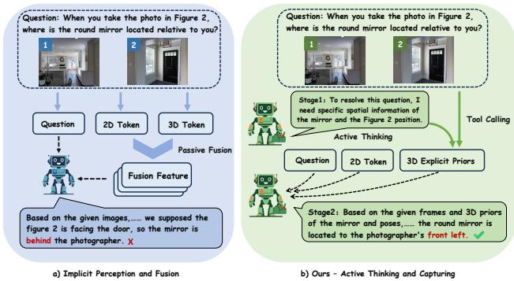  
Figure 1. Spatial reasoning paradigms. (a) Passive methods fuse 2D and 3D features for every query. (b) Think-Capture first selects task-critical targets, acquires their geometry, and reasons jointly over visual tokens and explicit 3D state.

Most existing approaches follow an implicit perceptionand-fusion paradigm (Fig. 1a): they encode dense scene geometry and fuse it with image features before seeing the query. Processing task-irrelevant geometry increases computation and context length and can introduce distracting evidence [8, 23, 40]. Agentic alternatives let VLMs invoke external 3D tools [60]. These interfaces make geometric evidence explicit, but errors in the tool output or its interpretation can still propagate to the answer.

Think-Capture instead performs query-conditioned acquisition (Fig. 1b). The VLM names only the objects needed to answer the question; a 3D Capturing Toolkit then estimates their masks, coordinates, and cross-view relations. A Symbolic 3D State Abstraction converts these measurements into compact object and camera descriptions, filtering irrelevant geometry while preserving the relations required by the query [3, 42].

We train a 4B backbone with GRPO [12, 30, 35]. The training set distinguishes queries for which 3D evidence corrects the vision-only model from those for which imperfect geometry is misleading. Hierarchical rewards encourage correct use of helpful geometry and incorporate negative examples to retain correct answers when tool augmentation is misleading. The resulting policy learns to combine explicit 3D state with the original frames instead of trusting either source unconditionally.

We evaluate on MindCube [40], MMSI-Bench [53], and ViewSpatial-Bench [20], covering mental rotation, crossview relations, and perspective taking. We further test backbone scaling, zero-shot transfer, controlled tool corruption, and a matched 2D-box baseline. Finally, we deploy Think-Capture as an asynchronous high-level spatial reasoner on a real Agibot G1.

In summary, our main contributions are:

• We introduce query-conditioned 3D acquisition and a compact symbolic interface that exposes task-relevant object and camera geometry to a VLM.

• We propose hierarchical 2D–3D GRPO rewards that promote useful geometry integration and improve robustness to noisy tool evidence.

• We demonstrate consistent gains across backbones and benchmarks, robustness to controlled tool corruption, and real-robot integration on consumer hardware.

## 2. Related Work

## 2.1. Implicit Spatial Learning in VLMs

Object-centric grounding [22, 56] and 3D-informed learning [5, 21, 24, 44, 45, 52] enrich spatial representations. Visual-tool use and video reasoning provide complementary strategies [9, 37, 38]. Geometry estimators such as VGGT and MapAnything recover scene structure from images [17, 39]. These advances motivate combining learned visual priors with explicit, query-relevant geometric evidence.

## 2.2. Spatial Reasoning From Multi-views

Multi-view benchmarks test cross-view understanding [54], mental rotation [40], relations between entities that never co-occur [53], and perspective transformations [20]. Mental models provide a cognitive account of internal spatial representations [14, 15]; recent evaluations reveal gaps in VLM spatial understanding [6, 34]. Perspective-aware reasoning and spatial-reasoning surveys motivate structured geometry as a complement to visual cues [19, 58].

## 2.3. Explicit Spatial Reasoning

MindCube [40] trains VLMs to generate cognitive maps, whereas GPT4Scene-style systems [33, 62] provide externally constructed metric or bird’s-eye-view maps. Both reconstruct-then-reason approaches represent the whole scene. Tool-using methods such as Think3D [60] instead let an agent manipulate point clouds or estimate camera anchors [42]. Think-Capture differs in three coupled design choices: query-conditioned target selection, a common symbolic interface for object and camera state, and hierarchical GRPO that trains the VLM to accept or reject imperfect tool evidence. The controlled corruption and matched 2D-box experiments in Sec. 4 evaluate robustness and the value of the symbolic 3D representation.

## 3. Method

## 3.1. Overview: The Think-Capture Paradigm

Think-Capture implements a two-stage Reason-then-Act loop: it first plans which geometry is needed, then reasons over the images and the captured symbolic state.

Problem formulation. Let $\mathcal { V } = \{ v _ { k } \} _ { k = 0 } ^ { K - 1 }$ be K views of a scene and Q a spatial query. A VLM policy πθ generates a reasoning trajectory $\boldsymbol { y } = ( y ^ { 1 } , \dots , y ^ { L } )$ and final answer $\mathcal { A }$ conditioned on $( \nu , \mathcal { Q } )$

Given $( \nu , \mathcal { Q } )$ , Stage 1 emits semantic targets inside an <objects to segment> block. The toolkit acquires only the requested object geometry and returns a symbolic text state. Stage 2 then combines that state with the original images to produce A (Fig. 2).

## 3.2. 3D Perception via Tool-Calling

For each target t, SAM3 [3] produces a zero-shot mask $M ^ { ( k ) } \in \{ 0 , \bar { 1 \} } ^ { H \times W }$ in each relevant frame.

In parallel, the feed-forward estimator $\pi ^ { 3 }$ (Pi3X, with approximate metric scale) predicts a local point map $P _ { \mathrm { l o c a l } } ^ { ( k ) } \in$ $\mathbb { R } ^ { H \times W \times 3 }$ and camera-to-world pose $T _ { \mathrm { c a m } } ^ { ( k ) } = [ R ^ { ( k ) } \ | \ t ^ { ( k ) } ] \in$ $S E ( 3 )$

We use the first frame as the world origin, so $T _ { \mathrm { c a m } } ^ { ( 0 ) } =$ $I _ { 4 \times 4 }$ . A local point $p _ { \mathrm { l o c a l } }$ is transformed as

$$
\left[ \begin{array} { c } { p _ { \mathrm { w o r l d } } } \\ { 1 } \end{array} \right] = \left[ \begin{array} { c c } { R ^ { ( k ) } } & { t ^ { ( k ) } } \\ { { \bf 0 } ^ { T } } & { 1 } \end{array} \right] \left[ \begin{array} { c } { p _ { \mathrm { l o c a l } } } \\ { 1 } \end{array} \right] .\tag{1}
$$

The mask selects the corresponding world-space points:

$$
P _ { \mathrm { w o r l d } } ^ { ( k ) } = \left\{ R ^ { ( k ) } P _ { \mathrm { l o c a l } } ^ { ( k ) } [ i , j ] + t ^ { ( k ) } \ \Big | \ M ^ { ( k ) } [ i , j ] = 1 \right\}\tag{2}
$$

Only masked target points are aggregated into object state; the system neither serializes nor sends the dense scene to the VLM. Supplementary Sec. B gives the complete pipeline and four-frame budget.

Role and computational benefit of target selection. Stage 1 selects semantic object targets conditioned on the question, rather than requesting every object in the scene. For K retained frames and m targets, the target-dependent work comprises text-prompted segmentation, masked-point aggregation, and up to $O ( m ^ { 2 } )$ object-pair relations. Restricting m therefore avoids processing and describing irrelevant objects. The four-frame cap bounds dense $\pi ^ { 3 }$ estimation, while target selection controls segmentation and symbolic processing within those frames. Our matched 2D-box control compares Stage 2 representations using the same selected targets and masks.

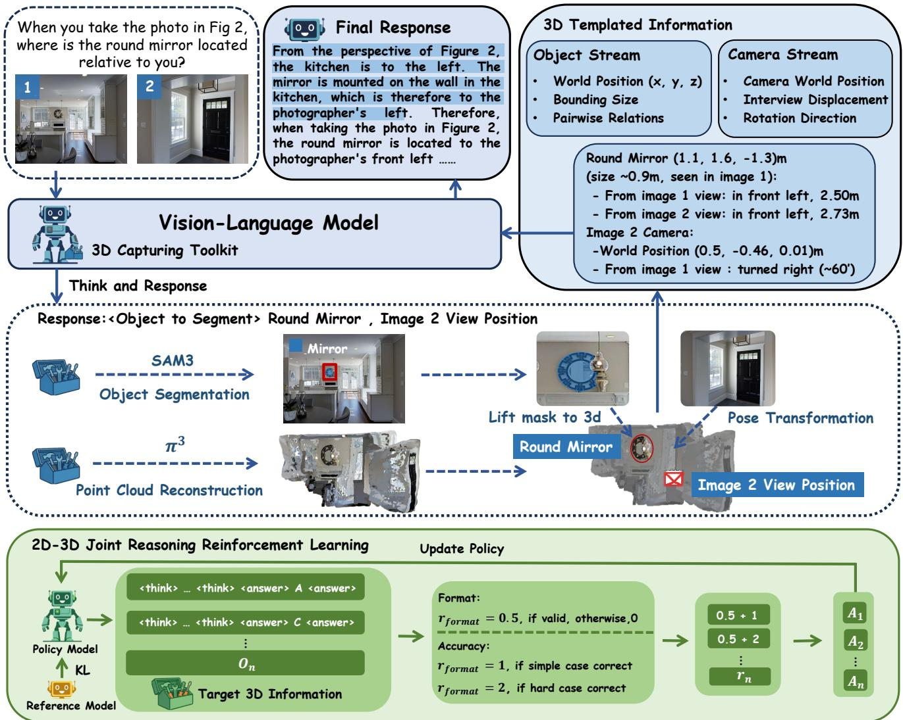  
Figure 2. Think-Capture overview. Stage 1 selects query-relevant targets. SAM3 and $\pi ^ { 3 }$ produce the object and camera state used with the images in Stage 2. In the training panel, the accuracy-branch labels denote $r _ { \mathrm { a c c } } ,$ with $+ 1 / + 2$ for correct positive/negative examples (Sec. 3.4). The example annotations illustrate the interface.

## 3.3. 3D Templated Information Generation

Passing dense point clouds to a VLM creates a modality gap and consumes substantial context. We instead distill the acquired geometry into two structured text streams (Fig. 2):

• Object stream (O). Each target i is represented by world position $p _ { i } ,$ bounding-box scale $s _ { i } ,$ and pairwise relations

$\mathcal { R } _ { i , j }$ . We compute

$$
d _ { i , j } = \| p _ { i } - p _ { j } \| _ { 2 } , \quad { \vec { v } } _ { i , j } = { \frac { p _ { i } - p _ { j } } { \| p _ { i } - p _ { j } \| _ { 2 } } } .\tag{3}
$$

and map them to templates such as “front-left, distance $d _ { i , j } \mathrm { . }$

• Camera stream (C). Each frame stores $( T _ { \mathrm { c a m } } ^ { ( k ) } , \Delta T ^ { ( k , k - 1 ) } , \vec { d } _ { k } )$ , where

$$
\Delta T ^ { ( k , k - 1 ) } = \left( T _ { c a m } ^ { ( k - 1 ) } \right) ^ { - 1 } T _ { c a m } ^ { ( k ) } .\tag{4}
$$

is decomposed into translation and Euler angles, yielding descriptions such as “turned left $\sim 7 6 ^ { \circ }$

This bottleneck filters task-irrelevant geometry and uses 100 tokens per query on average, versus 205 for the unstruc-

tured tool output (a 51% reduction). Back-projection and formatting details appear in supplementary Sec. B.

## 3.4. 2D-3D Joint Reasoning

We fine-tune Qwen3-VL-4B with GRPO [12] so that it can combine the target geometry with visual evidence without blindly trusting the tool.

GRPO avoids a separate critic by estimating the baseline from G sampled trajectories. For brevity, writing the clipped objective at the trajectory level gives

$$
\begin{array} { c } { \mathcal { I } _ { \mathrm { G R P O } } ( \boldsymbol { \theta } ) = \mathbb { E } _ { \boldsymbol { Q } , \boldsymbol { \nu } \sim \mathcal { D } } \left[ \frac { 1 } { G } \displaystyle \sum _ { i = 1 } ^ { G } ( \mathcal { L } _ { i } - \beta \mathbb { D } _ { \mathrm { K L } } ( \pi _ { \boldsymbol { \theta } } \| \pi _ { \mathrm { r e f } } ) ) \right] , } \\ { \mathcal { L } _ { i } = \operatorname* { m i n } ( \rho _ { i } ( \boldsymbol { \theta } ) A _ { i } , \bar { \rho } _ { i } ( \boldsymbol { \theta } ) A _ { i } ) , } \\ { \bar { \rho } _ { i } ( \boldsymbol { \theta } ) = \mathrm { c l i p } ( \rho _ { i } ( \boldsymbol { \theta } ) , 1 - \epsilon , 1 + \epsilon ) . } \end{array}\tag{5}
$$

where $\rho _ { i } ( \theta ) = \pi _ { \theta } ( y _ { i } \mid \mathcal { Q } , \mathcal { V } ) / \pi _ { \theta _ { \mathrm { o l d } } } ( y _ { i } \mid \mathcal { Q } , \mathcal { V } ) , \bar { \rho } _ { i }$ is clipped to $[ 1 - \epsilon , 1 + \epsilon ] .$ , and $\beta$ weights the KL penalty to $\pi _ { \mathrm { r e f } }$ For groups with nonzero reward variance, the normalized advantage is

$$
A _ { i } = \frac { R ( y _ { i } ) - \mu _ { R } } { \sigma _ { R } } ,\tag{6}
$$

where $\mu _ { R }$ and $\sigma _ { R }$ are the group reward mean and standard deviation. A constant-reward group contains no within-group preference signal.

The reward combines answer accuracy and format compliance:

$$
R ( y _ { i } ) = r _ { a c c } ( y _ { i } ) + r _ { f o r m a t } ( y _ { i } ) .\tag{7}
$$

We set $r _ { \mathrm { f o r m a t } } = 0 . 5$ when the output follows the required <think>...</think><answer>...</answer> structure.

We run the base model on 10,000 MindCube training samples in vision-only $( \mathcal { M } _ { \mathrm { b a s e } } )$ and fixed-prompt toolaugmented $( \mathcal { M } _ { \mathrm { t o o l } } )$ modes. Their disagreement yields 3,032 training examples in two subsets:

• Positive samples: ${ \mathcal { M } } _ { \mathrm { b a s e } }$ fails and $\mathcal { M } _ { \mathrm { t o o l } }$ succeeds, so useful geometry should be exploited. Correct answers receive $r _ { \mathrm { a c c } } = 1$

• Negative samples: $\mathcal { M } _ { \mathrm { b a s e } }$ succeeds and $\mathcal { M } _ { \mathrm { t o o l } }$ fails, indicating misleading geometry or failed integration. Correct answers despite this interference receive $r _ { \mathrm { a c c } } = 2$

Meaning of the hierarchical reward. The hierarchy is sample-conditioned: the positive subset contains 1,927 examples and the negative subset contains 1,105 examples, determined by the two screening runs above. Cases in which the screening models agree are not retained. These labels describe screening-time disagreement; question difficulty can vary within either subset. The negative subset captures observed regressions under tool augmentation, which can arise from erroneous geometry or incorrect integration of otherwise useful evidence. Its purpose is to train against such regressions while the positive subset promotes useful tool integration. The +1/ + 2 values specify sample-conditioned raw outcome rewards, and the optimization signal is determined by the total rewards after within-group normalization. Supplementary Sec. C.1 compares this reward design with a variant using no distinction between positive and negative outcome rewards.

## 4. Experiment

## 4.1. Datasets

We evaluate Think-Capture on three challenging benchmarks designed to probe 3D spatial reasoning capabilities:

• MindCube-Tiny [40] contains 1,050 questions: 600 Among, 250 Around, and 200 Rotation questions. Accuracy is computed over the valid evaluated examples in each run after excluding rare invalid evaluation cases; the category counts are nominal split sizes, not necessarily the per-run denominators.

• MMSI-Bench [53] requires relating entities across disjoint frames. The main comparison uses its positionalrelation subset; the supplement also reports the full benchmark.

• ViewSpatial-Bench [20] evaluates perspective taking across egocentric and allocentric reference frames.

## 4.2. Implementation Details

We train Qwen3-VL-4B-Instruct on the 3,032 disagreementmined MindCube training examples, with learning rate $5 \times 1 0 ^ { - 7 }$ and $G = 8$ trajectories per prompt. The vision encoder is frozen, and the effective batch size is 16 with gradient accumulation. Training uses four A100 (80 GB) GPUs for approximately 38 hours, stopping at 1,600 training steps (approximately 152 GPU-hours for this training run). Correct positive and negative samples receive +1 and +2, respectively, and format compliance receives +0.5. Supplementary Sec. B provides the optimizer, clipping and KL settings, prompts, and resource details.

Additional training configuration. We use AdamW with a cosine learning-rate schedule and 50 warmup steps. The GRPO clipping parameter is 0.2, and the KL coefficient is 0.04. Training uses BF16 and DeepSpeed ZeRO-2 with the vision encoder frozen, reaching a peak GPU memory usage of 75.6 GB. The reported 152 GPU-hours refer to the 1,600-step GRPO training run. At inference, the toolkit retains at most four frames, while query-conditioned target selection restricts segmentation and symbolic aggregation.

## 4.3. Main Results

Table 1 compares Think-Capture with proprietary VLMs, open-source VLMs, spatially specialized models, and the tool-augmented Think3D-4B [10, 11, 29, 60].

Table 1. Comprehensive performance comparison on MindCube-Tiny, MMSI-Bench (Positional Relationship Subset), and ViewSpatial-Bench. Metrics are reported as accuracy (%). We grey out the proprietary models. The best performance among open-source models is highlighted in bold. The improvement of Think-Capture over the baseline (Qwen3-VL-4B) is shown in blue below the score.
<table><tr><td rowspan="2">Model</td><td colspan="4">MindCube-Tiny</td><td colspan="7">MMSI-Bench-Positional Relationship Subset</td><td>ViewSpatial</td></tr><tr><td>Among</td><td>Around</td><td>Rotation</td><td>Overall</td><td>Cam-Cam</td><td>Cam-Obj</td><td>Obj-Reg</td><td>Cam-Reg</td><td>Reg-Reg</td><td>Obj-Obj</td><td>Overall</td><td>Overall</td></tr><tr><td>Proprietary Models</td><td></td><td></td><td></td><td></td><td></td><td></td><td></td><td></td><td></td><td></td><td></td><td></td></tr><tr><td>GPT-40</td><td>44.6</td><td>58.4</td><td>39.0</td><td>46.8</td><td>34.4</td><td>19.8</td><td>37.6</td><td>27.7</td><td>23.5</td><td>24.5</td><td>28.0</td><td>35.0</td></tr><tr><td>Gemini-2.5 Pro</td><td>40.2</td><td>56.7</td><td>84.3</td><td>52.5</td><td>39.7</td><td>45.3</td><td>35.2</td><td>43.3</td><td>39.5</td><td>31.9</td><td>39.0</td><td>43.6</td></tr><tr><td>Doubao-1.5</td><td>46.0</td><td>38.4</td><td>75.1</td><td>49.7</td><td>25.8</td><td>33.7</td><td>49.4</td><td>39.8</td><td>33.3</td><td>33.0</td><td>35.6</td><td></td></tr><tr><td>GLM-4.5V</td><td>44.1</td><td>23.5</td><td>46.9</td><td>39.7</td><td>38.7</td><td>30.2</td><td>40.0</td><td>39.8</td><td>29.6</td><td>35.1</td><td>35.6</td><td>-</td></tr><tr><td>Open-Source Models</td><td></td><td></td><td></td><td></td><td></td><td></td><td></td><td></td><td></td><td></td><td></td><td></td></tr><tr><td>InternVL3-8B</td><td>39.2</td><td>62.1</td><td>34.0</td><td>43.7</td><td>25.8</td><td>25.6</td><td>35.3</td><td>28.9</td><td>37.0</td><td>31.9</td><td>30.6</td><td>38.6</td></tr><tr><td>InternVL3-38B</td><td>48.5</td><td>56.0</td><td>32.5</td><td>47.2</td><td>18.3</td><td>22.1</td><td>38.8</td><td>34.9</td><td>35.8</td><td>22.3</td><td>28.3</td><td>41.2</td></tr><tr><td>Qwen2.5-VL-7B</td><td>32.1</td><td>37.2</td><td>38.8</td><td>34.6</td><td>24.7</td><td>25.6</td><td>29.4</td><td>26.5</td><td>24.7</td><td>24.5</td><td>25.9</td><td>36.8</td></tr><tr><td>Qwen3-VL-4B (Base)</td><td>26.5</td><td>44.6</td><td>37.5</td><td>32.9</td><td>28.0</td><td>41.9</td><td>28.2</td><td>31.3</td><td>29.6</td><td>28.7</td><td>31.2</td><td>37.6</td></tr><tr><td>Spatial-LLMs</td><td></td><td></td><td></td><td></td><td></td><td></td><td></td><td></td><td></td><td></td><td></td><td></td></tr><tr><td>Spatial-MLLM-3B</td><td>27.6</td><td>35.2</td><td>33.0</td><td>30.4</td><td>23.6</td><td>34.9</td><td>32.9</td><td>24.1</td><td>37.0</td><td>26.6</td><td>29.7</td><td>36.9</td></tr><tr><td>SpatialLadder-3B</td><td>47.1</td><td>40.2</td><td>31.5</td><td>42.5</td><td>26.3</td><td>36.4</td><td>31.2</td><td>26.0</td><td>36.2</td><td>29.9</td><td>30.9</td><td>39.8</td></tr><tr><td>Tool-Augmented Method</td><td></td><td></td><td></td><td></td><td></td><td></td><td></td><td></td><td></td><td></td><td></td><td></td></tr><tr><td>Think3D-4B</td><td>39.2</td><td>35.0</td><td>39.2</td><td>38.2</td><td></td><td></td><td></td><td></td><td></td><td></td><td></td><td></td></tr><tr><td>Think-Capture-4B</td><td>57.6</td><td>54.1</td><td>45.0</td><td>54.4</td><td>34.5</td><td>50.1</td><td>33.2</td><td>50.3</td><td>29.9</td><td>36.9</td><td>39.1</td><td>42.8</td></tr><tr><td></td><td>(+31.1)</td><td>(+9.5)</td><td>(+7.5)</td><td>(+21.5)</td><td>(+6.5)</td><td>(+8.2)</td><td>(+5.0)</td><td>(+19.0)</td><td>(+0.3)</td><td>(+8.2)</td><td>(+7.9)</td><td>(+5.2)</td></tr></table>

MindCube-Tiny. Think-Capture obtains 54.4%, an absolute gain of 21.5 points over Qwen3-VL-4B and a result comparable to much larger proprietary models. The largest gain is on “Among” (+31.1), where explicit target geometry helps localize objects in spatial clusters.

Unseen benchmarks and backbones. Without training on either benchmark, Think-Capture improves the MMSI positional subset from 31.2 to 39.1% (+7.9) and ViewSpatial from 37.6 to 42.8% (+5.2). On full MMSI, it improves 2B/4B/8B backbones by 8.9/10.0/8.8 points; the corresponding MindCube gains are 19.9/21.5/20.8.

Robustness and representation controls. With 0.4 m coordinate noise, the full model retains 46.2% accuracy versus 26.7% for zero-shot tool use; with 30% mask-pixel dropout, the scores are 52.1 and 36.2%. A matched Stage-2 input with 2D boxes reaches only 36.9/31.8/37.9% on MindCube/full MMSI/ViewSpatial, versus 54.4/38.9/42.8% for symbolic 3D state. These controls support the value of learned 3D tool use relative to the tested visual-highlighting input; supplementary Sec. C gives full perturbation and fallback results.

Table 2 evaluates answer robustness as the quality of geometric evidence degrades. Under the strongest coordinate corruption, hierarchical rewards improve 40.3→46.2%, while the gap over zero-shot tool use is 19.5 points. Under 30% mask dropout, the corresponding scores are 52.1, 49.0, and 36.2%. The different degradation patterns are also informative: coordinate error changes metric relations, whereas pixel dropout often leaves enough target support for robust aggregation. In fewer than 1.6% of MindCube-Tiny queries, the toolkit returns no valid target. In these cases, a deterministic fallback omits the empty symbolic state and completes the query using the original images.

## 4.4. Generalization and Matched Controls

Table 3 applies the same acquisition, abstraction, and training recipe to 2B, 4B, and 8B Qwen3-VL backbones. Mind-Cube gains remain within 19.9–21.5 points and full-MMSI gains within 8.8–10.0 points. The similar gains across model sizes suggest that explicit task-conditioned geometry complements backbone capacity. This pattern extends the benefit observed in the principal 4B comparison to both smaller and larger models.

The matched control in Table 4 tests whether target localization or colored visual prompting alone explains the improvement. Replacing the symbolic state with 2D boxes derived from the same masks removes depth, metric scale, and camera pose while preserving which entities Stage 1 selected. It trails symbolic 3D state by 17.5 points on Mind-Cube, 7.1 on full MMSI, and 4.9 on ViewSpatial. Under these tested input configurations, symbolic 3D state is more effective than 2D highlighting alone.

## 4.5. Ablation Study

Table 5 separates geometry acquisition, GRPO, and state formatting. GRPO alone gives only 32.9→33.3%, and zeroshot tool use reaches 39.9%; combining the tools with GRPO reaches 54.4%, showing that useful geometry and learned integration are complementary. Replacing the template with an unstructured coordinate dump reduces accuracy from 54.4 to 49.8%. The template also uses 100 tokens per query, versus 202 for the unified format and 205 for raw tool output. Training curves in the supplement further show positivesample accuracy stabilizing near 85% while negative-sample accuracy rises from about 30% to above 60%, consistent with learning to use helpful geometry and reject misleading

Table 2. Robustness to controlled tool perturbations on MindCube-Tiny (accuracy, %). Coordinate noise is zero-mean Gaussian perturbation of $\pi ^ { 3 }$ outputs; mask noise randomly drops SAM3 foreground pixels. Hierarchical GRPO improves both clean accuracy and tolerance to corrupted evidence.
<table><tr><td>Model setup</td><td>Clean</td><td> $\pi ^ { 3 }$  0.2 m</td><td>coordinate noise 0.4m</td><td>SAM3 mask dropout 15%</td><td>30%</td></tr><tr><td>Zero-shot tool use</td><td>39.9</td><td>32.8</td><td>26.7</td><td>37.2</td><td>36.2</td></tr><tr><td>w/o hierarchical GRPO</td><td>51.2</td><td>44.3</td><td>40.3</td><td>49.2</td><td>49.0</td></tr><tr><td>Think-Capture (full)</td><td>54.4</td><td>50.7</td><td>46.2</td><td>53.8</td><td>52.1</td></tr></table>

Question: If I am standing at the same spot and facing the same direction as shown in image 2, what is behind me? A. Wall with an air conditioning unit B. Plain white wall C. Sofa D. Seating bench Ground Truth: D

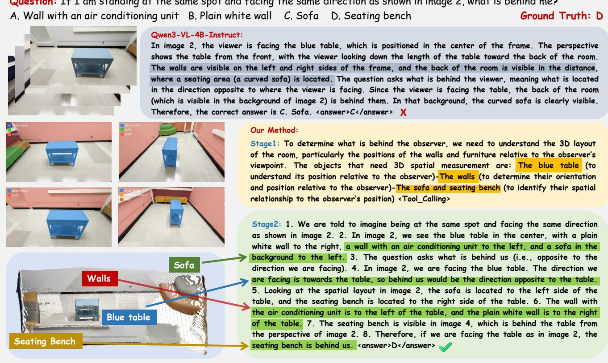  
Figure 3. Resolving egocentric spatial ambiguity on MindCube-Tiny. The baseline equates the background visible beyond the blue table with the observer’s rear and answers “sofa.” Think-Capture identifies the blue table as the facing anchor, relates the surrounding furniture in the common 3D frame, and correctly recovers the unseen seating bench behind the observer.

Table 3. Backbone scaling on MindCube-Tiny and full MMSI-Bench (accuracy, %). Parentheses give absolute gains over each matched backbone.
<table><tr><td rowspan="2">Size</td><td colspan="2">MindCube</td><td colspan="2">MMSI full</td></tr><tr><td>Base</td><td>Ours</td><td>Base</td><td>Ours</td></tr><tr><td>Qwen3-VL-2B</td><td>29.3</td><td>49.2 (+19.9)</td><td>25.8</td><td>34.7 (+8.9)</td></tr><tr><td>Qwen3-VL-4B</td><td>32.9</td><td>54.4 (+21.5)</td><td>28.9</td><td>38.9 (+10.0)</td></tr><tr><td>Qwen3-VL-8B</td><td>33.4</td><td>54.2 (+20.8)</td><td>29.6</td><td>38.4 (+8.8)</td></tr></table>

Table 4. Matched visual-prompting control (accuracy, %). Both variants use the same Stage 1 target proposals and SAM3 masks.
<table><tr><td>Stage-2 input</td><td>MindCube</td><td>MMSI full</td><td>ViewSpatial</td></tr><tr><td>2D boxes</td><td>36.9</td><td>31.8</td><td>37.9</td></tr><tr><td>Symbolic 3D state</td><td>54.4</td><td>38.9</td><td>42.8</td></tr></table>

evidence.

Table 5. Ablation study on MindCube-Tiny. TC denotes Think-Capture; Tokens is the mean length of the 3D representation.
<table><tr><td>Base Model</td><td>TC</td><td>GRPO</td><td>Format</td><td>Tokens</td><td>Among</td><td>Around</td><td>Rotation</td><td>Overall</td></tr><tr><td>Qwen3-VL-4B</td><td></td><td></td><td></td><td></td><td>26.5</td><td>44.6</td><td>37.5</td><td>32.9</td></tr><tr><td>Qwen3-VL-4B</td><td></td><td>√</td><td></td><td></td><td>28.9</td><td>41.2</td><td>36.4</td><td>33.3</td></tr><tr><td>Qwen3-VL-4B</td><td>√</td><td></td><td></td><td>205</td><td>42.0</td><td>40.0</td><td>33.5</td><td>39.9</td></tr><tr><td>Qwen3-VL-4B</td><td>√</td><td>√</td><td>Unified</td><td>202</td><td>50.5</td><td>57.6</td><td>38.0</td><td>49.8</td></tr><tr><td>Qwen3-VL-4B</td><td>√</td><td>√</td><td>Template</td><td>100</td><td>57.6</td><td>54.1</td><td>45.0</td><td>54.4</td></tr></table>

## 4.6. Qualitative Analysis

Figure 3 asks what is behind an observer standing at the pose of image 2. This is not answered by locating what appears farthest away in that image: “behind” is the half-space opposite the camera’s facing direction. The baseline follows the image-plane background and selects the sofa. Think-Capture first requests the blue table, walls, sofa, and seating bench. It uses the blue table as the visible facing anchor and the symbolic cross-view relations to place the seating bench on the opposite side of the observer. It therefore infers an object in the blind spot rather than copying a visible background object. The point cloud and arrows visualize the reconstructed spatial relations; Stage 2 takes the compact symbolic text and original frames as its inputs.

The second complete case (Fig. 4) isolates a different failure: the queried object and the reference camera are observed in different views. The baseline recognizes the mirror but narrates it relative to the house layout, not to the photographer in image 2, and consequently reverses front/back. Think-Capture explicitly captures the image 2 camera pose and the mirror geometry. The camera stream fixes the photographer’s forward direction toward the front door; the object stream places the kitchen and mirror to the photographer’s left. Transforming the mirror from the shared world frame into this egocentric frame yieldsfrontleft. Together, the two cases show that the method addresses both unseen-space inference and cross-view reference-frame conversion.

## 4.7. Joint Reasoning Dynamics

The positive subset contains samples on which tool augmentation repairs a vision-only error, whereas the negative subset contains samples on which it overturns a correct visual answer. During GRPO training, positive-sample accuracy rises and stabilizes near 85%, while negative-sample accuracy increases from about 30% to above 60%. Accuracy and mean reward eventually oscillate around a high plateau. Improvement on both screening subsets, together with the corruption results in Table 2, supports more robust integration of symbolic geometry and visual evidence. Together, the training curves and corruption tests characterize answer-level robustness across screening subsets and tool conditions.

## 4.8. Real-World Deployment

We deploy Think-Capture-4B as an asynchronous high-level spatial reasoner on an Agibot G1 with the StarVLA platform [36] (Fig. 5). At initialization, it captures task-relevant medicines and reference objects, resolves the target from symbolic 3D state, and supplies a low-frequency global waypoint; a separate StarVLA policy performs high-frequency arm control. The complete VLM+SAM3+π3 stack peaks at 21.5 GB on one RTX 4090. In the A100 benchmark, geometry takes 3.1 s of the 21.8 s pipeline (14%); direct-answer decoding cuts total latency by over 40% while retaining 53.2% MindCube-Tiny accuracy. This architecture couples low-frequency spatial reasoning with high-frequency arm control; supplementary Sec. D.2 describes the integration.

The timing breakdown is 6.8 s for target planning, 3.1 s for geometric capture, and 11.9 s for Stage 2 reasoning. Think-Capture runs asynchronously: after receiving a waypoint, StarVLA continuously closes the visual-action loop while the high-level module is idle or processes the next request.

Efficiency. Stage 2 decoding is the largest latency term. Direct-answer decoding reduces end-to-end time by more than 40% while retaining 53.2% MindCube-Tiny accuracy, 1.2 points below full chain-of-thought decoding. The 21.5 GB peak covers the VLM, SAM3, and $\pi ^ { 3 }$ resident together on one RTX 4090. Supplementary Sec. D.1 details the measurement setup and runtime distribution.

## 4.9. Geometry and Learned Integration

Think-Capture combines pretrained perception backbones with target selection, symbolic state, and GRPO. Zero-shot tool augmentation reaches 39.9%, while the complete configuration reaches 54.4% (Table 5). The matched 2D-box comparison keeps target proposals and masks fixed and varies the Stage 2 representation (Table 4). These results highlight the complementary roles of geometric acquisition, compact representation, and learned integration.

Table 2 evaluates end-to-end answer accuracy under coordinate noise and mask dropout. The full configuration achieves higher accuracy across the tested corruption levels. Qualitative cases illustrate egocentric and cross-view reasoning, while gains across backbone sizes and on unseen MMSI and ViewSpatial benchmarks support transfer beyond the MindCube training set.

Query-dependent computation. Query-conditioned selection concentrates the symbolic state on the entities named by the question. Its computational benefit arises in segmentation, masked-point aggregation, and relation construction, where fewer targets yield fewer masks and object pairs. Camera poses remain available for viewpoint conversion. For a fixed set of retained frames, this separates the denseestimation cost from the target-dependent cost of building the reasoning context, linking efficient acquisition to a compact, task-specific representation.

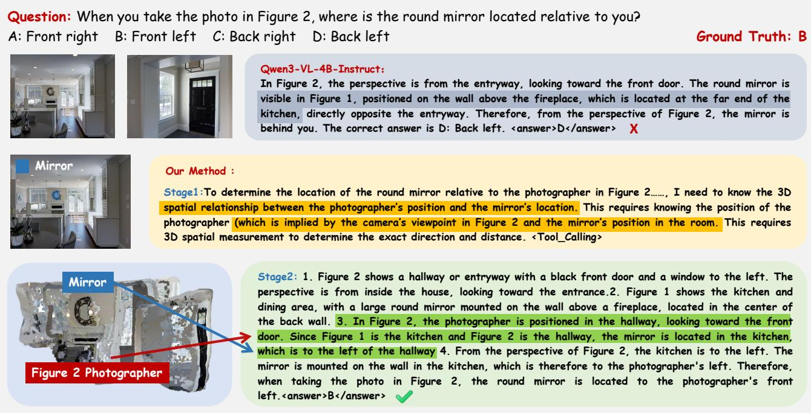  
Figure 4. Cross-view perspective taking on MMSI-Bench. The baseline describes the mirror relative to the scene or to the wrong view and predicts “back left.” Think-Capture’s response uses the photographer-relative description and gives the correct front-left answer.

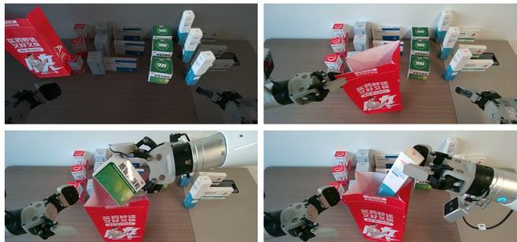  
Figure 5. Real-world deployment on Agibot G1. Four snapshots show the initial observation, target approach, and medicine grasp. Think-Capture uses task-relevant symbolic geometry to supply a global waypoint to the high-frequency StarVLA motor policy.

## 4.10. Limitations and Scope

Think-Capture depends on the observability and calibration available to its perception tools. A severely occluded target, systematic depth bias, or accumulated pose drift can make a symbolic relation wrong rather than merely uncertain. Hierarchical GRPO and the empty-target fallback reduce the effect of such failures but cannot recover geometry that is absent from every view. The current templates discretize continuous direction into linguistic bins suited to benchmark relations and waypoint selection. Fine manipulation additionally requires local shape and contact information at a higher spatial resolution.

In the robot deployment, Think-Capture selects taskrelevant entities and generates a global waypoint, while the independently trained StarVLA policy handles fast visual feedback, collision-sensitive motion, and grasp execution. The 21.8 s reasoning cycle operates asynchronously from StarVLA’s high-frequency motor-control loop. Training uses disagreement-mined MindCube examples, with zero-shot evaluation on MMSI and ViewSpatial. Broader training scenes, uncertainty-aware symbolic states, and temporally persistent coordinates are promising directions for extending the framework to dynamic environments.

## 5. Conclusion

Think-Capture replaces passive dense fusion with queryconditioned geometry acquisition and a compact symbolic interface. GRPO trains the VLM to combine visual and 3D evidence, with improved robustness to noisy tool outputs in the tested settings. Consistent benchmark, perturbation, scaling, and real-robot results support active acquisition as a practical route to spatially grounded VLMs. The representation controls favor symbolic 3D state over the tested 2D-box input. The robot study demonstrates practical highlevel integration. Future work will extend the interface to uncertainty-calibrated, temporally persistent geometry, enabling query-conditioned state refresh within the same hierarchical perception-and-control architecture.

## Acknowledgments

This work was supported in part by the Guangdong S&T Programme (Grant No. 2024B0101030002), the Basic Research Project of Hetao Shenzhen-HK ST Cooperation Zone (No. HZQBKCZYZ-2021067), the Shenzhen Outstanding Talents Training Fund (No. 202002), and the NSFC (Grant Nos. 62293482, 62573371, 61931024, and 12326610). This work was also supported by the Guangdong Province Radio Science Data Center (Grant No. 2025B1212070001), the Shenzhen General Program (No. JCYJ20220530143600001), the Guangdong Research Projects (Nos. 2017ZT07X152 and 2019CX01X104), the Guangdong Provincial Key Laboratory of Future Networks of Intelligence (Grant No. 2022B1212010001), the Shenzhen Key Laboratory of Big Data and Artificial Intelligence (Grant No. SYSPG20241211173853027), the National Key Research and Development Program of China (Nos. 2025YFF0515300 and 2025YFF0515304), the Open Project Program of Key Laboratory of Tibetan Information Processing, Ministry of Education (Grant No. QHSFCS2606), the Shenzhen-Hong Kong Joint Funding (No. SGDX20211123112401002), and the Tencent & Huawei Open Fund (Nos. 2024E0009 and 202301030019).

## References

[1] Shuai Bai, Yuxuan Cai, Ruizhe Chen, Keqin Chen, Xionghui Chen, Zesen Cheng, Lianghao Deng, Wei Ding, Chang Gao, Chunjiang Ge, Wenbin Ge, Zhifang Guo, Qidong Huang, Jie Huang, Fei Huang, Binyuan Hui, Shutong Jiang, Zhaohai Li, Mingsheng Li, Mei Li, Kaixin Li, Zicheng Lin, Junyang Lin, Xuejing Liu, Jiawei Liu, Chenglong Liu, Yang Liu, Dayiheng Liu, Shixuan Liu, Dunjie Lu, Ruilin Luo, Chenxu Lv, Rui Men, Lingchen Meng, Xuancheng Ren, Xingzhang Ren, Sibo Song, Yuchong Sun, Jun Tang, Jianhong Tu, Jianqiang Wan, Peng Wang, Pengfei Wang, Qiuyue Wang, Yuxuan Wang, Tianbao Xie, Yiheng Xu, Haiyang Xu, Jin Xu, Zhibo Yang, Mingkun Yang, Jianxin Yang, An Yang, Bowen Yu, Fei Zhang, Hang Zhang, Xi Zhang, Bo Zheng, Humen Zhong, Jingren Zhou, Fan Zhou, Jing Zhou, Yuanzhi Zhu, and Ke Zhu. Qwen3-VL Technical Report. arXiv preprint arXiv:2511.21631, 2025.

[2] Kevin Black, Noah Brown, Danny Driess, Adnan Esmail, Michael Equi, Chelsea Finn, Niccolo Fusai, Lachy Groom, Karol Hausman, Brian Ichter, Szymon Jakubczak, Tim Jones, Liyiming Ke, Sergey Levine, Adrian Li-Bell, Mohith Mothukuri, Suraj Nair, Karl Pertsch, Lucy Xiaoyang Shi, James Tanner, Quan Vuong, Anna Walling, Haohuan Wang, and Ury Zhilinsky. π0: A Vision-Language-Action Flow Model for General Robot Control. arXiv preprint arXiv:2410.24164, 2024.

[3] Nicolas Carion, Laura Gustafson, Yuan-Ting Hu, Shoubhik Debnath, Ronghang Hu, Didac Suris, Chaitanya Ryali, Kalyan Vasudev Alwala, Haitham Khedr, Andrew Huang, Jie Lei, Tengyu Ma, Baishan Guo, Arpit Kalla, Markus Marks, Joseph Greer, Meng Wang, Peize Sun, Roman Radle,¨

Triantafyllos Afouras, Effrosyni Mavroudi, Katherine Xu, Tsung-Han Wu, Yu Zhou, Liliane Momeni, Rishi Hazra, Shuangrui Ding, Sagar Vaze, Francois Porcher, Feng Li, Siyuan Li, Aishwarya Kamath, Ho Kei Cheng, Piotr Dollar,´ Nikhila Ravi, Kate Saenko, Pengchuan Zhang, and Christoph Feichtenhofer. SAM 3: Segment Anything with Concepts. arXiv preprint arXiv:2511.16719, 2025.

[4] Yihang Chen, Pin Qian, Su Wang, Chong Peng, Huan Xu, Shuaiting Li, and Yiqi Sun. Explicit State Elicitation Is Not Enough: A Controlled Audit of Memory-Policy Classification. arXiv preprint arXiv:2608.17247, 2026.

[5] Zhangquan Chen, Manyuan Zhang, Xinlei Yu, Xufang Luo, Mingze Sun, Zihao Pan, Xiang An, Yan Feng, Peng Pei, Xunliang Cai, and Ruqi Huang. Think with 3D: Geometric Imagination Grounded Spatial Reasoning from Limited Views. arXiv preprint arXiv:2510.18632, 2025.

[6] Erik Daxberger, Nina Wenzel, David Griffiths, Haiming Gang, Justin Lazarow, Gefen Kohavi, Kai Kang, Marcin Eichner, Yinfei Yang, Afshin Dehghan, and Peter Grasch. MM-Spatial: Exploring 3D Spatial Understanding in Multimodal LLMs. In Proceedings of the IEEE/CVF International Conference on Computer Vision (ICCV), pages 7395–7408, 2025.

[7] Jiajun Deng, Tianyu He, Li Jiang, Tianyu Wang, Feras Dayoub, and Ian Reid. 3D-LLaVA: Towards Generalist 3D LMMs with Omni Superpoint Transformer. In Proceedings of the IEEE/CVF Conference on Computer Vision and Pattern Recognition (CVPR), pages 3772–3782, 2025.

[8] Zhiwen Fan, Jian Zhang, Renjie Li, Junge Zhang, Runjin Chen, Hezhen Hu, Kevin Wang, Peihao Wang, Huaizhi Qu, Shijie Zhou, Dilin Wang, Zhicheng Yan, Hongyu Xu, Justin Theiss, Tianlong Chen, Jiachen Li, Zhengzhong Tu, Zhangyang Wang, and Rakesh Ranjan. VLM-3R: Vision-Language Models Augmented with Instruction-Aligned 3D Reconstruction. In Proceedings ofthe IEEE/CVF Conference on Computer Vision and Pattern Recognition (CVPR), pages 31054–31065, 2026.

[9] Kaituo Feng, Kaixiong Gong, Bohao Li, Zonghao Guo, Yibing Wang, Tianshuo Peng, Junfei Wu, Xiaoying Zhang, Benyou Wang, and Xiangyu Yue. Video-R1: Reinforcing Video Reasoning in MLLMs. arXiv preprint arXiv:2503.21776, 2025.

[10] Gemini Team, Google. Gemini 2.5: Pushing the Frontier with Advanced Reasoning, Multimodality, Long Context, and Next Generation Agentic Capabilities. arXiv preprint arXiv:2507.06261, 2025.

[11] GLM-4.5 Team. GLM-4.5: Agentic, Reasoning, and Coding (ARC) Foundation Models. arXiv preprint arXiv:2508.06471, 2025.

[12] Daya Guo, Dejian Yang, Haowei Zhang, Junxiao Song, Peiyi Wang, Qihao Zhu, Runxin Xu, Ruoyu Zhang, Shirong Ma, Xiao Bi, Xiaokang Zhang, Xingkai Yu, Yu Wu, Z. F. Wu, Zhibin Gou, Zhihong Shao, Zhuoshu Li, Ziyi Gao, Aixin Liu, Bing Xue, Bingxuan Wang, Bochao Wu, Bei Feng, Chengda Lu, Chenggang Zhao, Chengqi Deng, Chong Ruan, Damai Dai, Deli Chen, Dongjie Ji, Erhang Li, Fangyun Lin, Fucong Dai, Fuli Luo, Guangbo Hao, Guanting Chen, Guowei Li, H. Zhang, Hanwei Xu, Honghui Ding, Huazuo Gao, Hui Qu, Hui Li, Jianzhong Guo, Jiashi Li, Jingchang Chen, Jingyang

Yuan, Jinhao Tu, Junjie Qiu, Junlong Li, J. L. Cai, Jiaqi Ni, Jian Liang, Jin Chen, Kai Dong, Kai Hu, Kaichao You, Kaige Gao, Kang Guan, Kexin Huang, Kuai Yu, Lean Wang, Lecong Zhang, Liang Zhao, Litong Wang, Liyue Zhang, Lei Xu, Leyi Xia, Mingchuan Zhang, Minghua Zhang, Minghui Tang, Mingxu Zhou, Meng Li, Miaojun Wang, Mingming Li, Ning Tian, Panpan Huang, Peng Zhang, Qiancheng Wang, Qinyu Chen, Qiushi Du, Ruiqi Ge, Ruisong Zhang, Ruizhe Pan, Runji Wang, R. J. Chen, R. L. Jin, Ruyi Chen, Shanghao Lu, Shangyan Zhou, Shanhuang Chen, Shengfeng Ye, Shiyu Wang, Shuiping Yu, Shunfeng Zhou, Shuting Pan, S. S. Li, Shuang Zhou, Shaoqing Wu, Tao Yun, Tian Pei, Tianyu Sun, T. Wang, Wangding Zeng, Wen Liu, Wenfeng Liang, Wenjun Gao, Wenqin Yu, Wentao Zhang, W. L. Xiao, Wei An, Xiaodong Liu, Xiaohan Wang, Xiaokang Chen, Xiaotao Nie, Xin Cheng, Xin Liu, Xin Xie, Xingchao Liu, Xinyu Yang, Xinyuan Li, Xuecheng Su, Xuheng Lin, X. Q. Li, Xiangyue Jin, Xiaojin Shen, Xiaosha Chen, Xiaowen Sun, Xiaoxiang Wang, Xinnan Song, Xinyi Zhou, Xianzu Wang, Xinxia Shan, Y. K. Li, Y. Q. Wang, Y. X. Wei, Yang Zhang, Yanhong Xu, Yao Li, Yao Zhao, Yaofeng Sun, Yaohui Wang, Yi Yu, Yichao Zhang, Yifan Shi, Yiliang Xiong, Ying He, Yishi Piao, Yisong Wang, Yixuan Tan, Yiyang Ma, Yiyuan Liu, Yongqiang Guo, Yuan Ou, Yuduan Wang, Yue Gong, Yuheng Zou, Yujia He, Yunfan Xiong, Yuxiang Luo, Yuxiang You, Yuxuan Liu, Yuyang Zhou, Y. X. Zhu, Yanping Huang, Yaohui Li, Yi Zheng, Yuchen Zhu, Yunxian Ma, Ying Tang, Yukun Zha, Yuting Yan, Z. Z. Ren, Zehui Ren, Zhangli Sha, Zhe Fu, Zhean Xu, Zhenda Xie, Zhengyan Zhang, Zhewen Hao, Zhicheng Ma, Zhigang Yan, Zhiyu Wu, Zihui Gu, Zijia Zhu, Zijun Liu, Zilin Li, Ziwei Xie, Ziyang Song, Zizheng Pan, Zhen Huang, Zhipeng Xu, Zhongyu Zhang, and Zhen Zhang. DeepSeek-R1 incentivizes reasoning in LLMs through reinforcement learning. Nature, 645(8081):633–638, 2025.

[13] Yuheng Ji, Huajie Tan, Jiayu Shi, Xiaoshuai Hao, Yuan Zhang, Hengyuan Zhang, Pengwei Wang, Mengdi Zhao, Yao Mu, Pengju An, Xinda Xue, Qinghang Su, Huaihai Lyu, Xiaolong Zheng, Jiaming Liu, Zhongyuan Wang, and Shanghang Zhang. RoboBrain: A Unified Brain Model for Robotic Manipulation from Abstract to Concrete. In Proceedings of the IEEE/CVF Conference on Computer Vision and Pattern Recognition (CVPR), pages 1724–1734, 2025.

[14] P. N. Johnson-Laird. Mental Models in Cognitive Science. Cognitive Science, 4(1):71–115, 1980.

[15] Philip N. Johnson-Laird. Mental Models: Towards a Cognitive Science of Language, Inference, and Consciousness. Harvard University Press, 1983.

[16] JoyAI-RA Team. JoyAI-RA 0.5: Scaling Robot Manipulation Learning via Dual Action Alignment. arXiv preprint arXiv:2608.05674, 2026.

[17] Nikhil Keetha, Norman Muller, Johannes Sch¨ onberger,¨ Lorenzo Porzi, Yuchen Zhang, Tobias Fischer, Arno Knapitsch, Duncan Zauss, Ethan Weber, Nelson Antunes, Jonathon Luiten, Manuel Lopez-Antequera, Samuel Rota Bulo, Christian Richardt, Deva Ramanan, Sebastian Scherer,\` and Peter Kontschieder. MapAnything: Universal Feed-Forward Metric 3D Reconstruction. arXiv preprint arXiv:2509.13414, 2025.

[18] Kimi Team, Angang Du, Bohong Yin, Bowei Xing, Bowen Qu, Bowen Wang, Cheng Chen, Chenlin Zhang, Chenzhuang Du, Chu Wei, Congcong Wang, Dehao Zhang, Dikang Du, Dongliang Wang, Enming Yuan, Enzhe Lu, Fang Li, Flood Sung, Guangda Wei, Guokun Lai, Han Zhu, Hao Ding, Hao Hu, Hao Yang, Hao Zhang, Haoning Wu, Haotian Yao, Haoyu Lu, Heng Wang, Hongcheng Gao, Huabin Zheng, Jiaming Li, Jianlin Su, Jianzhou Wang, Jiaqi Deng, Jiezhong Qiu, Jin Xie, Jinhong Wang, Jingyuan Liu, Junjie Yan, Kun Ouyang, Liang Chen, Lin Sui, Longhui Yu, Mengfan Dong, Mengnan Dong, Nuo Xu, Pengyu Cheng, Qizheng Gu, Runjie Zhou, Shaowei Liu, Sihan Cao, Tao Yu, Tianhui Song, Tongtong Bai, Wei Song, Weiran He, Weixiao Huang, Weixin Xu, Xiaokun Yuan, Xingcheng Yao, Xingzhe Wu, Xinhao Li, Xinxing Zu, Xinyu Zhou, Xinyuan Wang, Y. Charles, Yan Zhong, Yang Li, Yangyang Hu, Yanru Chen, Yejie Wang, Yibo Liu, Yibo Miao, Yidao Qin, Yimin Chen, Yiping Bao, Yiqin Wang, Yongsheng Kang, Yuanxin Liu, Yuhao Dong, Yulun Du, Yuxin Wu, Yuzhi Wang, Yuzi Yan, Zaida Zhou, Zhaowei Li, Zhejun Jiang, Zheng Zhang, Zhilin Yang, Zhiqi Huang, Zihao Huang, Zijia Zhao, Ziwei Chen, and Zongyu Lin. Kimi-VL Technical Report. arXiv preprint arXiv:2504.07491, 2025.

[19] Phillip Y. Lee, Jihyeon Je, Chanho Park, Mikaela Angelina Uy, Leonidas Guibas, and Minhyuk Sung. Perspective-Aware Reasoning in Vision-Language Models via Mental Imagery Simulation. In Proceedings ofthe IEEE/CVF International Conference on Computer Vision (ICCV), pages 9241–9251, 2025.

[20] Dingming Li, Hongxing Li, Zixuan Wang, Yuchen Yan, Hang Zhang, Siqi Chen, Guiyang Hou, Shengpei Jiang, Wenqi Zhang, Yongliang Shen, Weiming Lu, and Yueting Zhuang. ViewSpatial-Bench: Evaluating Multi-perspective Spatial Localization in Vision-Language Models. arXiv preprint arXiv:2505.21500, 2025.

[21] Hongxing Li, Dingming Li, Zixuan Wang, Yuchen Yan, Hang Wu, Wenqi Zhang, Yongliang Shen, Weiming Lu, Jun Xiao, and Yueting Zhuang. SpatialLadder: Progressive Training for Spatial Reasoning in Vision-Language Models. In International Conference on Learning Representations, 2026.

[22] Shilong Liu, Zhaoyang Zeng, Tianhe Ren, Feng Li, Hao Zhang, Jie Yang, Qing Jiang, Chunyuan Li, Jianwei Yang, Hang Su, Jun Zhu, and Lei Zhang. Grounding DINO: Marrying DINO with Grounded Pre-training for Open-Set Object Detection. In Computer Vision – ECCV 2024, pages 38–55, 2024.

[23] Wufei Ma, Yu-Cheng Chou, Qihao Liu, Xingrui Wang, Celso de Melo, Jianwen Xie, and Alan Yuille. SpatialReasoner: Towards Explicit and Generalizable 3D Spatial Reasoning. In Advances in Neural Information Processing Systems, 2025.

[24] Wufei Ma, Luoxin Ye, Celso M de Melo, Alan Yuille, and Jieneng Chen. SpatialLLM: A Compound 3D-Informed Design towards Spatially-Intelligent Large Multimodal Models. In Proceedings of the IEEE/CVF Conference on Computer Vision and Pattern Recognition (CVPR), pages 17249–17260, 2025.

[25] Yue Ma, Yingqing He, Xiaodong Cun, Xintao Wang, Siran Chen, Xiu Li, and Qifeng Chen. Follow Your Pose: Pose-Guided Text-to-Video Generation Using Pose-Free Videos. In

Proceedings of the AAAI Conference on Artificial Intelligence, pages 4117–4125, 2024.

[26] Yue Ma, Yulong Liu, Qiyuan Zhu, Ayden Yang, Kunyu Feng, Xinhua Zhang, Zexuan Yan, Zhifeng Li, Sirui Han, Chenyang Qi, and Qifeng Chen. Follow-Your-Motion: Video Motion Transfer via Efficient Spatial-Temporal Decoupled Finetuning. arXiv preprint arXiv:2506.05207, 2025.

[27] Yue Ma, Jiangming Wang, Yucheng Wang, Xilai Wang, Zhiyuan Li, Xinyu Wang, Hongyu Liu, Ruofan Liang, Songchun Zhang, Yuxuan Xue, and Qifeng Chen. LiveLight: Real-time Streaming Video Relighting with Interactive Control. arXiv preprint arXiv:2608.01771, 2026.

[28] Runqing Miao, Sheng Xu, Runyi Zhao, Wai Kin (Victor) Chan, and Guiliang Liu. Uncertainty-aware Preference Alignment for Diffusion Policies. In Advances in Neural Information Processing Systems, 2025.

[29] OpenAI. GPT-4o System Card. arXiv preprint arXiv:2410.21276, 2024.

[30] Kun Ouyang, Yuanxin Liu, Haoning Wu, Yi Liu, Hao Zhou, Jie Zhou, Fandong Meng, and Xu Sun. SpaceR: Reinforcing MLLMs in Video Spatial Reasoning. arXiv preprint arXiv:2504.01805, 2025.

[31] Physical Intelligence, Ali Amin, Raichelle Aniceto, Ashwin Balakrishna, Kevin Black, Ken Conley, Grace Connors, James Darpinian, Karan Dhabalia, Jared DiCarlo, Danny Driess, Michael Equi, Adnan Esmail, Yunhao Fang, Chelsea Finn, Catherine Glossop, Thomas Godden, Ivan Goryachev, Lachy Groom, Hunter Hancock, Karol Hausman, Gashon Hussein, Brian Ichter, Szymon Jakubczak, Rowan Jen, Tim Jones, Ben Katz, Liyiming Ke, Chandra Kuchi, Marinda Lamb, Devin LeBlanc, Sergey Levine, Adrian Li-Bell, Yao Lu, Vishnu Mano, Mohith Mothukuri, Suraj Nair, Karl Pertsch, Allen Z. Ren, Charvi Sharma, Lucy Xiaoyang Shi, Laura Smith, Jost Tobias Springenberg, Kyle Stachowicz, Will Stoeckle, Alex Swerdlow, James Tanner, Marcel Torne, Quan Vuong, Anna Walling, Haohuan Wang, Blake Williams, Sukwon Yoo, Lili Yu, Ury Zhilinsky, and Zhiyuan Zhou. π∗0.6: a VLA That Learns From Experience. arXiv preprint arXiv:2511.14759, 2025.

[32] Physical Intelligence, Kevin Black, Noah Brown, James Darpinian, Karan Dhabalia, Danny Driess, Adnan Esmail, Michael Equi, Chelsea Finn, Niccolo Fusai, Manuel Y. Galliker, Dibya Ghosh, Lachy Groom, Karol Hausman, Brian Ichter, Szymon Jakubczak, Tim Jones, Liyiming Ke, Devin LeBlanc, Sergey Levine, Adrian Li-Bell, Mohith Mothukuri, Suraj Nair, Karl Pertsch, Allen Z. Ren, Lucy Xiaoyang Shi, Laura Smith, Jost Tobias Springenberg, Kyle Stachowicz, James Tanner, Quan Vuong, Homer Walke, Anna Walling, Haohuan Wang, Lili Yu, and Ury Zhilinsky. π0.5: a Vision-Language-Action Model with Open-World Generalization. arXiv preprint arXiv:2504.16054, 2025.

[33] Zhangyang Qi, Zhixiong Zhang, Ye Fang, Jiaqi Wang, and Hengshuang Zhao. GPT4Scene: Understand 3D Scenes from Videos with Vision-Language Models. arXiv preprint arXiv:2501.01428, 2025.

[34] Santhosh Kumar Ramakrishnan, Erik Wijmans, Philipp Kraehenbuehl, and Vladlen Koltun. Does Spatial Cog-

nition Emerge in Frontier Models? arXiv preprint arXiv:2410.06468, 2024.

[35] Zhihong Shao, Peiyi Wang, Qihao Zhu, Runxin Xu, Junxiao Song, Xiao Bi, Haowei Zhang, Mingchuan Zhang, Y. K. Li, Y. Wu, and Daya Guo. DeepSeekMath: Pushing the Limits of Mathematical Reasoning in Open Language Models. arXiv preprint arXiv:2402.03300, 2024.

[36] StarVLA Community. StarVLA: A Lego-like Codebase for Vision-Language-Action Model Developing. arXiv preprint arXiv:2604.05014, 2026.

[37] Zhaochen Su, Linjie Li, Mingyang Song, Yunzhuo Hao, Zhengyuan Yang, Jun Zhang, Guanjie Chen, Jiawei Gu, Juntao Li, Xiaoye Qu, and Yu Cheng. OpenThinkIMG: Learning to Think with Images via Visual Tool Reinforcement Learning. arXiv preprint arXiv:2505.08617, 2025.

[38] Zhaochen Su, Peng Xia, Hangyu Guo, Zhenhua Liu, Yan Ma, Xiaoye Qu, Jiaqi Liu, Yanshu Li, Kaide Zeng, Zhengyuan Yang, Linjie Li, Yu Cheng, Heng Ji, Junxian He, and Yi R. Fung. Thinking with Images for Multimodal Reasoning: Foundations, Methods, and Future Frontiers. arXiv preprint arXiv:2506.23918, 2025.

[39] Jianyuan Wang, Minghao Chen, Nikita Karaev, Andrea Vedaldi, Christian Rupprecht, and David Novotny. VGGT: Visual Geometry Grounded Transformer. In Proceedings of the IEEE/CVF Conference on Computer Vision and Pattern Recognition (CVPR), pages 5294–5306, 2025.

[40] Qineng Wang, Baiqiao Yin, Pingyue Zhang, Jianshu Zhang, Kangrui Wang, Zihan Wang, Jieyu Zhang, Keshigeyan Chandrasegaran, Han Liu, Ranjay Krishna, Saining Xie, Jiajun Wu, Li Fei-Fei, and Manling Li. MindCube: Spatial Mental Modeling from Limited Views. arXiv preprint arXiv:2506.21458, 2025.

[41] Xinyu Wang, Chongbo Zhao, Fangneng Zhan, and Yue Ma. LiveEdit: Towards Real-Time Diffusion-Based Streaming Video Editing. arXiv preprint arXiv:2606.26740, 2026.

[42] Yifan Wang, Jianjun Zhou, Haoyi Zhu, Wenzheng Chang, Yang Zhou, Zizun Li, Junyi Chen, Jiangmiao Pang, Chunhua Shen, and Tong He. π3: Permutation-Equivariant Visual Geometry Learning. arXiv preprint arXiv:2507.13347, 2025.

[43] Yongzhong Wang, Keyu Zhu, Yong Zhong, Liqiong Wang, Jinyu Yang, and Feng Zheng. RADAR: Closed-Loop Robotic Data Generation via Semantic Planning and Autonomous Causal Environment Reset. arXiv preprint arXiv:2603.11811, 2026.

[44] Diankun Wu, Fangfu Liu, Yi-Hsin Hung, and Yueqi Duan. Spatial-MLLM: Boosting MLLM Capabilities in Visualbased Spatial Intelligence. In Advances in Neural Information Processing Systems, 2025.

[45] Runsen Xu, Weiyao Wang, Hao Tang, Xingyu Chen, Xiaodong Wang, Fu-Jen Chu, Matt Feiszli, and Kevin J. Liang. Multi-SpatialMLLM: Multi-Frame Spatial Understanding with Multi-Modal Large Language Models. arXiv preprint arXiv:2505.17015, 2025.

[46] Sheng Xu and Guiliang Liu. Robust Inverse Constrained Reinforcement Learning under Model Misspecification. In Proceedings of the 41st International Conference on Machine Learning, pages 55162–55185. PMLR, 2024.

[47] Sheng Xu and Guiliang Liu. Uncertainty-aware Constraint Inference in Inverse Constrained Reinforcement Learning. In International Conference on Learning Representations, 2024.

[48] Sheng Xu, Bo Yue, Hongyuan Zha, and Guiliang Liu. A Distributional Approach to Uncertainty-Aware Preference Alignment Using Offline Demonstrations. In International Conference on Learning Representations, 2025.

[49] Sheng Xu, Ruixing Jin, Huayi Zhou, Bo Yue, Guanren Qiao, Yunxin Tai, Yueci Deng, Kui Jia, and Guiliang Liu. From Reaction to Anticipation: Proactive Failure Recovery through Agentic Task Graph for Robotic Manipulation. arXiv preprint arXiv:2605.11951, 2026.

[50] Jihan Yang, Shusheng Yang, Anjali W. Gupta, Rilyn Han, Li Fei-Fei, and Saining Xie. Thinking in Space: How Multimodal Large Language Models See, Remember, and Recall Spaces. In Proceedings of the IEEE/CVF Conference on Computer Vision and Pattern Recognition (CVPR), pages 10632–10643, 2025.

[51] Rui Yang, Hanyang Chen, Junyu Zhang, Mark Zhao, Cheng Qian, Kangrui Wang, Qineng Wang, Teja Venkat Koripella, Marziyeh Movahedi, Manling Li, Heng Ji, Huan Zhang, and Tong Zhang. EmbodiedBench: Comprehensive Benchmarking Multi-modal Large Language Models for Vision-Driven Embodied Agents. arXiv preprint arXiv:2502.09560, 2025.

[52] Shusheng Yang, Jihan Yang, Pinzhi Huang, Ellis Brown, Zihao Yang, Yue Yu, Shengbang Tong, Zihan Zheng, Yifan Xu, Muhan Wang, Daohan Lu, Rob Fergus, Yann LeCun, Li Fei-Fei, and Saining Xie. Cambrian-S: Towards Spatial Supersensing in Video. arXiv preprint arXiv:2511.04670, 2025.

[53] Sihan Yang, Runsen Xu, Yiman Xie, Sizhe Yang, Mo Li, Jingli Lin, Chenming Zhu, Xiaochen Chen, Haodong Duan, Xiangyu Yue, Dahua Lin, Tai Wang, and Jiangmiao Pang. MMSI-Bench: A Benchmark for Multi-Image Spatial Intelligence. In International Conference on Learning Representations, 2026.

[54] Chun-Hsiao Yeh, Chenyu Wang, Shengbang Tong, Ta-Ying Cheng, Ruoyu Wang, Tianzhe Chu, Yuexiang Zhai, Yubei Chen, Shenghua Gao, and Yi Ma. Seeing from Another Perspective: Evaluating Multi-View Understanding in MLLMs. arXiv preprint arXiv:2504.15280, 2025.

[55] Songsong Yu, Yuxin Chen, Hao Ju, Lianjie Jia, Fuxi Zhang, Shaofei Huang, Yuhan Wu, Rundi Cui, Binghao Ran, Zaibin Zhang, Zhedong Zheng, Zhipeng Zhang, Yifan Wang, Lin Song, Lijun Wang, Yanwei Li, Ying Shan, and Huchuan Lu. How Far are VLMs from Visual Spatial Intelligence? A Benchmark-Driven Perspective. arXiv preprint arXiv:2509.18905, 2025.

[56] Zhihao Yuan, Xu Yan, Yinghong Liao, Ruimao Zhang, Sheng Wang, Zhen Li, and Shuguang Cui. InstanceRefer: Cooperative Holistic Understanding for Visual Grounding on Point Clouds through Instance Multi-level Contextual Referring. In 2021 IEEE/CVF International Conference on Computer Vision (ICCV), pages 1771–1780, 2021.

[57] Zhihao Yuan, Shuyi Jiang, Chun-Mei Feng, Yaolun Zhang, Shuguang Cui, Zhen Li, and Na Zhao. Scene-R1: Video-Grounded Large Language Models for 3D Scene Reasoning

without 3D Annotations. arXiv preprint arXiv:2506.17545, 2025.

[58] Jirong Zha, Yuxuan Fan, Xiao Yang, Chen Gao, and Xinlei Chen. How to Enable LLM with 3D Capacity? A Survey of Spatial Reasoning in LLM. arXiv preprint arXiv:2504.05786, 2025.

[59] Tianle Zhang, Zhihao Yuan, Dafeng Chi, Peidong Liu, Dongwei Li, Kejun Hu, Likui Zhang, Junnan Nie, Ziming Wei, Zengjue Chen, Yili Tang, Jiayi Li, Zhiyuan Xiang, Mingyang Li, Tianci Luo, Hanwen Wan, Ao Li, Linbo Zhai, Zhihao Zhan, Xiaodong Bai, Jiakun Cai, Peng Cao, Kangliang Chen, Siang Chen, Yixiang Dai, Shuai Di, Yicheng Gong, Chenguang Gui, Yucheng Guo, Peng Hao, Qingrong He, Haoyang Huang, Kunrui Huang, Zhixuan Huang, Shibo Jin, Yixiang Jin, Anson Li, Dongjiang Li, Jiawei Li, Ruodai Li, Yihang Li, Yuzhen Li, Jiaming Liang, Fangsheng Liu, Jing Long, Mingxi Luo, Xing Pan, Hui Shen, Xiaomeng Tian, Daming Wang, Song Wang, Junwu Xiong, Hang Xu, Wanting Xu, Zhengcheng Yu, He Zhang, Jiyao Zhang, Lin Zhao, Chen Zhou, Nan Duan, Yuzheng Zhuang, and Liang Lin. JoyAI-RA 0.1: A Foundation Model for Robotic Autonomy. arXiv preprint arXiv:2604.20100, 2026.

[60] Zaibin Zhang, Yuhan Wu, Lianjie Jia, Yifan Wang, Zhongbo Zhang, Yijiang Li, Binghao Ran, Fuxi Zhang, Zhuohan Sun, Yizhuang Peng, Zhenfei Yin, Lijun Wang, and Huchuan Lu. Think3D: Thinking with Space for Spatial Reasoning. arXiv preprint arXiv:2601.13029, 2026.

[61] Runyi Zhao, Sheng Xu, Ruixing Jin, Yueci Deng, Yunxin Tai, Kui Jia, and Guiliang Liu. Sim2Real VLA: Zero-Shot Generalization of Synthesized Skills to Realistic Manipulation. In International Conference on Learning Representations, 2026.

[62] Duo Zheng, Shijia Huang, Yanyang Li, and Liwei Wang. Learning from Videos for 3D World: Enhancing MLLMs with 3D Vision Geometry Priors. In Advances in Neural Information Processing Systems, 2025.

[63] Jinguo Zhu, Weiyun Wang, Zhe Chen, Zhaoyang Liu, Shenglong Ye, Lixin Gu, Hao Tian, Yuchen Duan, Weijie Su, Jie Shao, Zhangwei Gao, Erfei Cui, Xuehui Wang, Yue Cao, Yangzhou Liu, Xingguang Wei, Hongjie Zhang, Haomin Wang, Weiye Xu, Hao Li, Jiahao Wang, Nianchen Deng, Songze Li, Yinan He, Tan Jiang, Jiapeng Luo, Yi Wang, Conghui He, Botian Shi, Xingcheng Zhang, Wenqi Shao, Junjun He, Yingtong Xiong, Wenwen Qu, Peng Sun, Penglong Jiao, Han Lv, Lijun Wu, Kaipeng Zhang, Huipeng Deng, Jiaye Ge, Kai Chen, Limin Wang, Min Dou, Lewei Lu, Xizhou Zhu, Tong Lu, Dahua Lin, Yu Qiao, Jifeng Dai, and Wenhai Wang. InternVL3: Exploring Advanced Training and Test-Time Recipes for Open-Source Multimodal Models. arXiv preprint arXiv:2504.10479, 2025.

[64] Filippo Ziliotto, Tommaso Campari, Luciano Serafini, and Lamberto Ballan. TANGO: Training-free Embodied AI Agents for Open-world Tasks. In Proceedings of the IEEE/CVF Conference on Computer Vision and Pattern Recognition (CVPR), pages 24603–24613, 2025.

# Supplementary Material

## A. Overview

In this supplementary material, we provide additional details to support the main paper:

• Section B gives the $\mathbf { S } \mathbf { A } \mathbf { M } 3 { + \pi } ^ { 3 }$ pipeline, symbolic abstraction, prompts, and training details.

• Section C reports controlled experiments on tool perturbations, empty-return behavior, backbone scaling, and the matched 2D-box baseline.

• Section D analyzes latency, memory, and real-robot deployment.

• Sections E and F discuss limitations and provide additional qualitative cases.

## B. Implementation Details

## B.1. SAM3 + Pi3 Perception Pipeline

The AgentToolWrapper combines text-prompted SAM3 segmentation with $\pi ^ { 3 }$ geometry estimation to expose an on-demand 3D interface to the VLM.

## B.1.1. Core Algorithm Setup

The pipeline follows proposal → geometry → segmentation → fusion. Stage 1 supplies the semantic targets T; only points selected by their masks enter the symbolic object state.

The core logic is implemented as shown in Algorithm 1:

## B.1.2. Implementation Specifics

1. Resource-aware geometry. The Pi3Processor uniformly downsamples sequences longer than four frames. Unconstrained long-sequence inference can exceed 57 GB, whereas the four-frame setting keeps the complete deployed stack within 21.5 GB.

2. Targeted segmentation. Rather than running “segment everything,” the text-prompted SAM3Wrapper processes each target in T and returns its instance masks and confidence scores. This reduces irrelevant masks and downstream point aggregation.

3. Spatial memory. The manager maintains the cross-view object state.

• Fusion: Greedy matching merges an observation with an existing object when the centroid distance $\Delta d <$ $\tau _ { d i s t } ,$ with $\tau _ { d i s t } = 0 . 5 \mathrm { m }$

• State: Each object stores its class, world position, axisaligned size, and confidence.

4. Coordinate convention and scale. We use the Pi3X backend of $\pi ^ { 3 }$ , which supports approximate metricscale reconstruction.1 The first camera defines the reference basis for direction words such as “right” and “front,” while the backend supplies the approximate metric scale. Distances, object sizes, fusion thresholds, and the 0.2 m/0.4 m perturbations use this common scale, with absolute accuracy depending on reconstruction quality. Robot execution additionally requires a mapping to the robot frame.

Algorithm 1 Joint Semantic-Geometric Perception Pipeline   
1: Input: images I = [I1, . . . , IN ]; targets T; thresholds   
τconf , τdist   
2: Output: desc: Structured 3D spatial analysis text   
3: function EXECUTEPIPELINE(I, T)   
4: # 1. Resource Management   
5: if len(I) 4 then I ←   
uniform downsample(I, target length = 4)   
6: end if   
7: # 2. Geometric estimation $( \pi ^ { 3 } )$   
8: mapslocal, poses ← π3.forward(I)   
9: memory ← SpatialMemoryManager()   
10: # 3. Iterative Semantic-Geometric Fusion   
11: for k ← 1 to len(I) do   
12: for t in T do   
13: masks, scores ←   
SAM3.segmen $( I [ k ] , t , \tau _ { c o n f } )$   
14: for mask, score in zip(masks, scores) do   
15: pointsworld ← poses[k]   
mapslocal[k][mask]   
16: center, scale ←   
compute aabb(pointsworld)   
17: id ← memory.find nearest(center, τdist)   
18: if id is found then   
memory.update(id, pointsworld, score)   
19: else memory.add(label = t, center =   
center, scale = scale)   
20: end if   
21: end for   
22: end for   
23: end for   
24: # 4. 3D Information Formatting   
25: return format tool result(memory.get state())   
26: end function

## B.2. Symbolic 3D Abstraction: From Geometry to Semantics

We convert masked point maps into the structured state used by Stage 2 through back-projection and symbolic formatting.

Object-level context. InstanceRefer [56] grounds language in point clouds by combining instance attributes with instance–instance and instance–background context. Such contextual structure is also useful when a spatial question depends on a reference object rather than an isolated target. Think-Capture acquires the relevant geometry from images on demand and exposes object positions, extents, and relations through a compact symbolic interface. Richer object-level context could extend this interface to questions involving shape and contact.

Algorithm 2 3D Attribute Extraction   
1: Input: mask2d, maplocal, posecam   
2: Output: attr: Object 3D attributes (center, scale)   
3: function EXTRACTATTRIBUTES   
4: pointscam ← maplocal[mask2d > 0]   
5: if len(pointscam) == 0 then return None   
6: end if   
7: # Transform to World Frame   
8: pointsworld ← posecam · pointscam   
9: # Compute AABB Stats   
10: center ← mean(pointsworld)   
11: scale ← max(pointsworld) − min(pointsworld)   
return {”center” : center, ”scale” : scale}   
12: end function

Algorithm 3 Symbolic 3D State Formatting   
1: Input: memory, q type   
2: Output: text: Symbolic 3D description   
3: function FORMATOUTPUT   
4: lines ← []   
5: objs ← GroupAndSelectTopK(memory, K = 2)   
6: if q type == ”cam-cam” then   
7: for i, pose in enumerate(poses) do   
8: dir ← DescribeFacing(pose)   
9: rel ← GetRelativePos(poseref, pose)   
10: lines.append(”Image ” +i+”: ”+dir+”, ”+rel)   
11: end for   
12: else   
13: for obj in objs do   
14: lines.append(obj.label+: at +obj.pos+, size +   
obj.scale)   
15: end for   
16: for a, b in pairs(objs) do \triangleright Compute Relations   
17: dir ← ProjectVector(a.pos − b.pos, frameref)   
18: lines.append(a.label + is + dir + of + b.label)   
19: end for   
20: end if   
return join(lines, ”\n”)   
21: end function

## B.2.1. 3D Back-Projection & Attribute Extraction

We compute 3D attributes by indexing the dense point maps with 2D semantic masks, discarding invalid points, and fitting axis-aligned bounding boxes (AABBs).

## B.2.2. Spatial Reasoning & Formatting

The final step translates mathematical states into natural language. We categorize processing based on query type to filter irrelevant details.

Relative direction projection. Spatial relations such as “left” and “front” are computed by projecting direction vectors onto the first frame’s basis, aligning the description with the user’s initial viewpoint.

## B.3. Prompt Templates

Structured system prompts specify the planning (Stage 1) and reasoning (Stage 2) interfaces. The overview schematic uses “simple/hard” as shorthand for the positive/negative screening subsets, whose definitions follow the two screening models’ answer correctness. Camera displacement is measured between views, and rotation is expressed in degrees. Stage 2 serializes its response as <think>...</think><answer>...</answer>, with a closing tag for each field. Explicit-state limitations also arise in memory-policy classification [4].

## B.3.1. Stage 1: Intent Analysis

System Prompt: Spatial Intent Analysis   
You are a spatial reasoning assistant   
with access to a 3D perception tool.   
Output format:   
<thinking>Analyze what spatial   
information is needed.</thinking>   
<objects to segment> List objects   
that need 3D measurement, one per   
line. Example: - car - person   
</objects to segment>   
Question: {question}   
Which objects need 3D spatial   
measurement to answer this question?

## B.3.2. Stage 2: 3D-Augmented Reasoning

System Prompt: 3D Reasoning   
You are a spatial reasoning assistant   
with 3D perception. Use both the images   
and the 3D spatial data to answer. Put   
the reasoning in <think>...</think> and   
combine visual cues with 3D information.   
End with <answer>X</answer> where X is A,   
B, C, or D.   
Question: {question}   
3D Spatial Information: {formatted 3d}   
Answer the question by combining the   
images above with the 3D spatial   
information. Think step by step, then   
give your final answer.

## B.4. Training Hyperparameters & Details

We fine-tune Qwen3-VL-4B-Instruct with GRPO on four NVIDIA A100 (80 GB) GPUs. Training stops at 1,600 steps to avoid overfitting the 3,032-example dataset.

Table S1. Detailed hyperparameters for GRPO training.
<table><tr><td>Parameter</td><td>Value</td></tr><tr><td>Base Model</td><td>Qwen3-VL-4B-Instruct</td></tr><tr><td>Trainable Params</td><td>4,022M / 4,438M</td></tr><tr><td>Optimizer</td><td>(vision encoder frozen) AdamW</td></tr><tr><td>Learning Rate</td><td>5 × 10−7, Cosine Schedule + 50-step Warmup</td></tr><tr><td>GRPO Configuration</td><td></td></tr><tr><td>Generations (G)</td><td>8 per prompt</td></tr><tr><td>Clip Epsilon (€)</td><td>0.2</td></tr><tr><td>KL Penalty (β)</td><td>0.04</td></tr><tr><td>Reward Configuration</td><td></td></tr><tr><td>Accuracy Reward (Positive)</td><td>+1.0</td></tr><tr><td>Accuracy Reward (Negative)</td><td>+2.0 (Anti-Regression)</td></tr><tr><td>Format Reward</td><td>+0.5</td></tr><tr><td>Training &amp; Resources</td><td></td></tr><tr><td>Dataset Size</td><td></td></tr><tr><td>Effective Batch Size</td><td>3,032 samples (1,927 Pos / 1,105 Neg) 16 (Gradient Accumulation)</td></tr><tr><td>DeepSpeed Config</td><td>ZeRO-2, BF16</td></tr><tr><td>Peak GPU Memory</td><td>75.6 GB</td></tr><tr><td>Training Duration</td><td>~38 hours</td></tr><tr><td></td><td>(Early stopped at 1,600 steps)</td></tr></table>

## B.4.1. Training Dynamics

Figure S1 provides the full training dynamics behind the summary in the main paper. Figure S2 shows the corresponding optimization loss. Positive samples, for which 3D information is critical, stabilize near 85% accuracy. Negative samples, for which geometry may be noisy or misleading, improve from roughly 30% to above 60%. The simultaneous improvement is consistent with better integration of visual and tool evidence across both screening subsets. Together with the perturbation experiments, these curves describe the evolution of answer-level robustness during training.

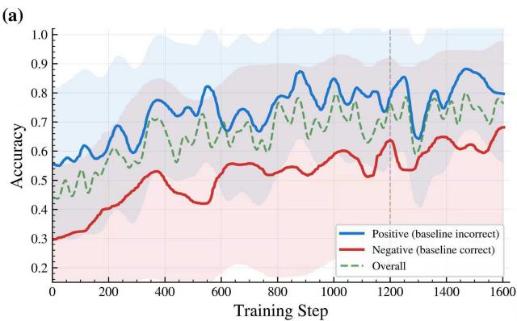

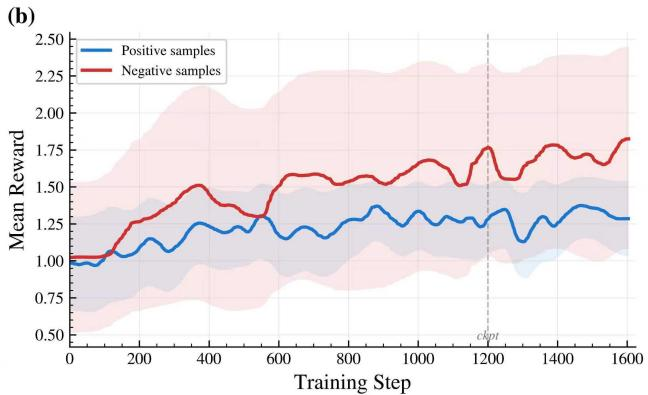  
Figure S1. GRPO training dynamics: accuracy on positive/negative samples and mean reward.

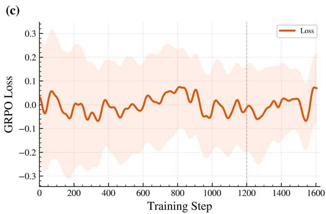  
Figure S2. Training loss over the GRPO optimization trajectory.

## C. Additional Controlled Experiments

These experiments examine robustness to imperfect tools, transfer across model scales and datasets, and the value of explicit 3D state beyond visual highlighting.

## C.1. Robustness to Tool Perturbations

We evaluate controlled degradation on MindCube-Tiny by adding zero-mean Gaussian noise to $\pi ^ { 3 }$ coordinates and randomly dropping SAM3 mask pixels. The zero-shot tool model degrades sharply, while the trained model remains substantially more accurate (Table S2). The configuration without distinct positive/negative rewards has lower clean and perturbed accuracy. The comparison measures end-toend answer robustness across training configurations and levels of tool corruption.

At the strongest coordinate perturbation, hierarchical GRPO improves accuracy from 40.3 to 46.2%; at 30% mask dropout, it improves 49.0 to 52.1%. The tool returns no valid target in fewer than 1.6% of MindCube-Tiny cases. A deterministic fallback omits the empty symbolic state and completes the query with an image-only response.

Table S2. Accuracy (%) under controlled tool perturbations on MindCube-Tiny.
<table><tr><td rowspan="2">Model setup</td><td rowspan="2">Clean</td><td colspan="2"> $\pi ^ { 3 }$  noise</td><td colspan="2">SAM3 noise</td></tr><tr><td>0.2 m</td><td>0.4 m</td><td>15%</td><td>30%</td></tr><tr><td>Zero-shot model</td><td>39.9</td><td>32.8</td><td>26.7</td><td>37.2</td><td>36.2</td></tr><tr><td>w/o hierarchical GRPO</td><td>51.2</td><td>44.3</td><td>40.3</td><td>49.2</td><td>49.0</td></tr><tr><td>Ours (full)</td><td>54.4</td><td>50.7</td><td>46.2</td><td>53.8</td><td>52.1</td></tr></table>

Table S3. Backbone scaling on MindCube-Tiny and full MMSI-Bench. Parentheses show absolute gains over the corresponding base model.
<table><tr><td rowspan="2">Model size</td><td colspan="2">MindCube-Tiny</td><td colspan="2">MMSI full</td></tr><tr><td>Base</td><td>Ours</td><td>Base</td><td>Ours</td></tr><tr><td>Qwen3-VL-2B</td><td>29.3</td><td>49.2 (+19.9)</td><td>25.8</td><td>34.7 (+8.9)</td></tr><tr><td>Qwen3-VL-4B</td><td>32.9</td><td>54.4 (+21.5)</td><td>28.9</td><td>38.9 (+10.0)</td></tr><tr><td>Qwen3-VL-8B</td><td>33.4</td><td>54.2 (+20.8)</td><td>29.6</td><td>38.4 (+8.8)</td></tr></table>

## C.2. Backbone Generalization

We apply the same training and inference pipeline to Qwen3- VL backbones at three scales. Gains are consistent across 2B, 4B, and 8B on MindCube-Tiny and full MMSI-Bench, indicating that the method is not specific to one capacity (Table S3). The main table reports the MMSI positionalrelation subset; this table reports the full benchmark.

## C.3. Explicit 3D State versus Visual Prompting

To test whether target highlighting alone explains the gains, we replace the Stage 2 symbolic state with frames annotated by 2D boxes derived from the same SAM3 masks. This controls for the target proposal and segmentation while removing depth, scale, and camera pose. It remains substantially below explicit 3D state on all three benchmarks (Table S4), especially for egocentric and cross-view questions that require coordinate transformations.

The matched comparison favors symbolic 3D state over

Table S4. Comparison with 2D-box visual prompting (accuracy, %).
<table><tr><td>Stage-2 input</td><td>MindCube</td><td>MMSI-Bench</td><td>ViewSpatial</td></tr><tr><td>2D boxes</td><td>36.9</td><td>31.8</td><td>37.9</td></tr><tr><td>Symbolic 3D state</td><td>54.4</td><td>38.9</td><td>42.8</td></tr></table>

Table S5. Mean inference latency on MindCube-Tiny.
<table><tr><td>Stage</td><td>Component</td><td> $\mathbf { A v g } .$  Time</td><td>Description</td></tr><tr><td>Stage 1</td><td>Planner &amp; Proposal</td><td>6.8s</td><td>VLM analyzes query &amp; proposes targets</td></tr><tr><td>Tool</td><td>Geometry &amp; Perception</td><td>3.1s</td><td>Parallel π3 + targeted SAM3</td></tr><tr><td>Stage 2</td><td>Spatial Reasoning</td><td>11.9s</td><td>CoT reasoning</td></tr><tr><td>Total</td><td>End-to-End</td><td>21.8s</td><td>Median: 20.4s</td></tr></table>

2D-box prompting with the same selected targets and masks. Together with Table S2, it characterizes the accuracy and robustness of the combined interface and training configuration. Target selection is shared by the two representation variants, and the reported outcomes are final-answer accuracies.

## D. Efficiency and Deployment

## D.1. Efficiency & Latency Analysis

We measure latency over all 1,050 MindCube-Tiny samples on one NVIDIA A100 (80 GB).

## D.1.1. Latency Breakdown

Tool execution accounts for 3.1 s, or about 14% of the 21.8 s end-to-end time. Stage 1 planning (6.8 s) and Stage 2 reasoning (11.9 s) dominate because both generate text. Targeted segmentation and the four-frame budget keep perception comparatively small. When Stage 2 predicts the final answer without intermediate chain-of-thought tokens, end-to-end latency falls by more than 40% while MindCube-Tiny accuracy remains 53.2% (versus 54.4% with full reasoning).

## D.1.2. Resource Consumption

The complete VLM-4B, SAM3, and $\pi ^ { 3 }$ stack exhibits a peak GPU memory usage of 21.5 GB. This indicates that the full 3D spatial-agent pipeline can be deployed on consumergrade hardware such as an RTX 4090 with 24 GB VRAM, lowering the deployment barrier compared with systems that require 40 GB or 80 GB accelerators.

## D.2. Real-World Deployment Details

We integrate Think-Capture-4B with the StarVLA stack [36] on an Agibot G1. At task initialization, Think-Capture receives the robot’s visual observation, identifies the medicines and reference objects needed by the instruction, and invokes $\mathbf { S } \mathbf { A } \mathbf { M } 3 { + \pi } ^ { 3 }$ . The resulting target coordinates and relations are formatted exactly as in benchmark inference. Think-Capture resolves the target and emits a global spatial waypoint at low frequency; a separate StarVLA motor policy converts that waypoint into high-frequency arm commands. This separation keeps VLM generation outside the time-critical control loop. Similar planning-execution separation appears in robot control [61] and autonomous data collection [43]. The four snapshots in the main-paper deployment figure show observation, approach, and grasp execution.

The deployment combines high-level semantic grounding with continuous visual-action feedback from StarVLA [16, 36, 59]. Geometry is acquired at initialization, so moving targets and substantial scene changes require re-acquisition. With a 21.8 s reasoning cycle, Think-Capture provides asynchronous waypoint updates; faster decoding and state refresh would extend this design to more reactive tasks.

## E. Limitations

Think-Capture has three main limitations:

• Foundation-model errors: Although hierarchical GRPO and the empty-return fallback improve tolerance, severe $\pi ^ { 3 }$ reconstruction or SAM3 segmentation failures can still propagate to the answer.

• Symbolic information loss: Axis-aligned boxes and discrete relations omit fine shape, object orientation, and contact geometry needed for dexterous manipulation.

• Latency and dynamics: VLM generation dominates runtime, and the current robot integration captures geometry at initialization. Reactive deployment will require faster decoding and state refresh.

Broader training coverage, explicit uncertainty modeling, and efficient geometric state updates could improve robustness in dynamic environments [28, 46–48].

Temporal extensions. Extending acquisition to changing scenes calls for tests that separate motion from appearance variation. Follow Your Pose [25] conditions character-video generation on body pose, while Follow-Your-Motion [26] decouples spatial appearance and temporal motion for video motion transfer. These forms of control suggest ways to construct temporal reasoning cases with specified changes in pose or motion. For appearance variation, LiveLight [27] provides interactive 3D lighting control for streaming relighting with geometry-guided training, and LiveEdit [41] performs causal streaming video editing with content preservation. Together, these directions offer tools for future evaluation of when geometric evidence should be refreshed under motion, lighting changes, or visual edits. Building such an evaluation would pair controlled sequences with verified spatial relations and time-dependent answer labels.

## F. Additional Qualitative Analysis

## F.1. Ambiguous Egocentric Relations

Figure S3 provides a detailed comparison. The Qwen3-VL-4B baseline defaults to an image-plane relation (“back-right”) tha is incorrect in the requested 3D frame. Think-Capture instead:

1. plans: identifies the sofa and bag as the required targets;

2. perceives: reconstructs them in a common coordinate frame; and

3. reasons: interprets “facing shelves” in that frame to derive the correct egocentric relation.

Question: When positioned at sofa facing shelves, where can you find bag?

A. back-right B. left C. front D. back-left

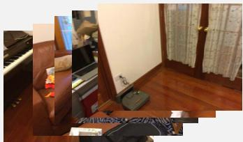

Ground Truth: C

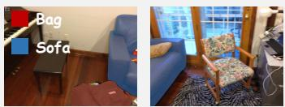

## Qwen3-VL-4B-Instruct：

In the image, the brown sofa is the central object. The black bag is located on the floor near the wooden door, which is positioned behind the right armrest of the sofa from the viewer's perspective. Since the bag is tucked into the corner area relative to the main seating orientation, it is located at Xthe back-right position. <answer>A</answer>

## Our Method (GRPO Model) :

Stage1: To determine the location of the bag relative to the sofa when facing shelves, I need to know the 3D positions of both the sofa and the bag. The sofa's position is fixed in the room, and the bag's position must be measured in 3D space to calculate its relative location. The shelves are visible in the provided images, and their presence is implied by the question, which are in the background or on a wall. However, besides the sofa and the bag, the position of the shelves should also be located. <Tool\_Calling>

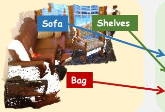  
Figure S3. Ambiguous spatial reasoning. The baseline predicts “back-right” from image-plane cues. Think-Capture selects the sofa and bag, grounds them with SAM3+π3, and uses their symbolic state to infer the correct answer, “front,” in the requested frame.

Stage2: To answer this question, we need to determine the spatial relationship between the sofa and the bag, as viewed from the perspective of someone facing the shelves The sofa is the large brown leather piece of furniture visible in the images. The bag is the black object with a logo on it, located in the lower right portion of the first image, near the floor. The question asks for the location of the bag when positioned at the sofa, facing the shelves. This implies we are looking at the sofa from the side where the shelves would be (which is likely the right side of the sofa from the viewer's perspective in the first image). From the perspective of facing the shelves, the bag is located to the right of the sofa, closer to the foreground. From the perspective of facing the shelves, the bag is in front of the sofa. Therefore, the correct answer is C. <answer>C</answer>

## F.2. Egocentric and Cross-View Reference Frames

# Figures S4 and S5 provide the complete MindCube-Tiny and MMSI-Bench examples discussed in the main paper.

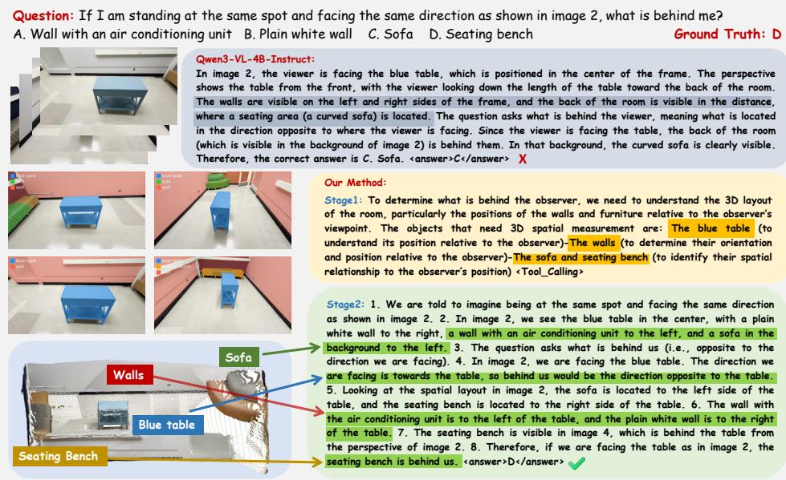  
Figure S4. Spatial ambiguity on MindCube-Tiny. The vision-only baseline confuses image-plane background with the observer’s spatia rear. Think-Capture uses the Blue Table to establish facing direction and the Seating Bench relation to identify the unseen rear region.

Question: When you take the photo in Figure 2, where is the round mirror located relative to you? A: Front right B: Front left C: Back right D: Back left

Ground Truth: B

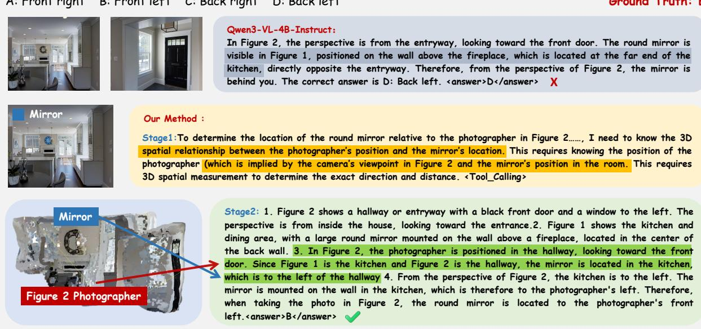  
Figure S5. Perspective-taking analysis on MMSI-Bench. Explicit camera pose and object geometry resolve the requested photographerrelative direction.

## F.3. Additional Target-Selection Case

Figure S6 illustrates the progression from target selection through geometry acquisition to the final answer. Question: Assuming the balcony is north relative to the door, in which direction on the balcony is the chair in the second picture? A: East, B: Southwest, C: South, D: Southeast", Ground Truth:

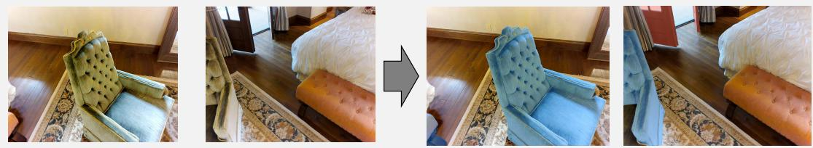

Stage1: To determine the direction of the chair relative to the balcony, I need to establish the spatial relationship between the chair, the door, and the balcony. Since the balcony is north of the door, I need to know the chair's position relative to the door. This requires 3D spatial measurement to accurately determine the chair's orientation and position in the room relative to the door and balcony <objects\_to\_segment>- chair – door</objects\_to\_segment>

Stage2: Let's analyze step by step:1. We are told the balcony is north relative to the door. This means if you face the door, the balcony is directly in front of you (north).2. In image 1, we see the door on the left side of the frame, and the chair is to the left of the door (in the front left area).3. In image 2, we see the chair from a different angle, now positioned in the front right of the frame.4. Since the door is on the left in image 1, and the chair is to the left of the door, the chair is to the left of the door's position.5. If the balcony is north of the door, then the door is facing north. The chair is to the left of the door, which would be west of the door's position.6. However, the question asks for the direction on the balcony from which the chair is viewed. Since the chair is to the west of the door, and the door is facing north (towards the balcony), the chair is to the west of the balcony. The chair is not directly east, south, or southeast of the balcony. It is to the west, which is not listed. But we need to choose from the given options.8. The chair is to the west of the door, which is facing north. So the chair is to the west of the balcony. The closest option to west is southwest, as it is the direction that is west and slightly south. <answer>B</answer>

CHAIR (-0.4, -0.1, 0.3) m

(size \~2.3m, seen in image 2):

\- From image 1 view: in front left

\- From image 2 view: in front right

\- Image1 from Image2, turn right 102’

DOOR (0.2, 0.6, 0.7) m (size \~1.2m, seen in image 1): - From image 1 view: in front left - From image 2 view: in front

Qwen3-VL-4B: Let's think step by step.1. The first image shows a door that is open, leading to a balcony. The balcony is located to the north of the door, as stated in the question.2. The second image shows a chair, which is positioned on a rug on the wooden floor.3. We need to determine the chair's position relative to the balcony. Since the balcony is north of the door, and the door is visible in the first image, we can infer the chair's position relative to the door.4. In the first image, the chair (from the second image) is located to the left of the door, on the floor, near the rug.5. The balcony is north of the door. Therefore, the chair is to the south of the balcony.6. Looking at the second image, the chair is positioned on the rug, which is in the foreground of the image. The balcony is not visible in this image, but we can infer its position relative to the chair based on the first image.7. The chair is positioned in the foreground of the second image, which is the south side of the room relative to the balcony.8. Therefore, the chair is located to the south of the balcony. The correct answer is C: South. X

Figure S6. Additional qualitative case illustrating target selection, reconstructed geometry, and the final spatial decision.