# UniRAP: Towards Unified Part-level Physical Affordance Reasoning and Actionable Perception

Linfei Li1 Ruining Hu1 Lin Zhang1 ∗ Zhong Wang1 Fengyi Zhang4 Ying Shen1 Binqiang Wang2 Xin Zhang3

4School of Electrical Engineering and Computer Science, The University of Queensland {cslinfeili,2534075,cslinzhang,cszhongwang,yingshen}@tongji.edu.cn fengyi.zhang@uq.edu.au,wangbinqiang@ieisystem.com, zhang\_xin@neusoft.com https://lif314.github.io/projects/unirap

## Abstract

Vision-language perception has achieved impressive progress in aligning natural language with visual observations, yet grounding high-level semantics into partlevel physical interaction remains challenging. To address this gap, we propose UniRAP, a unified model for inferring part-level physical affordances and mapping language instructions to actionable geometric representations. UniRAP formulates this problem as a conditional multimodal generation task, integrating visual inputs, textual instructions, and optional prompts into a shared spatiotemporal representation space through a unified interface token mechanism. To predict executable contact geometry, we introduce a Unified Affordance Decoder (UAD), which jointly performs object detection, part-level affordance segmentation, and 4-DoF interaction pose estimation by leveraging intermediate segmentation features. In addition, we propose a curriculum-based transfer training strategy that progressively adapts the model from general visual parsing to interaction-aware perception, improving data efficiency under limited textual annotations. Experiments show that UniRAP achieves state-of-the-art performance on referring expression segmentation, affordance grounding, and interaction pose estimation, while maintaining strong spatiotemporal consistency in dynamic video scenarios. These results demonstrate the effectiveness of UniRAP as a unified perception framework for language-guided physical manipulation.

## 1 Introduction

Vision-Language Perception (VLP) aims to establish semantic correspondences between natural language and visual observations, enabling models to interpret and localize relevant elements in a scene conditioned on linguistic instructions [1, 2]. With the advancement of Vision-Language Models (VLMs), these systems have demonstrated strong capabilities in cross-modal alignment and semantic understanding in open-world settings, achieving notable success in tasks such as visual question answering [3–7]. Building upon these foundations, subsequent works have extended such models to incorporate spatial perception, enabling them to generate coarse visual grounding from text, such as bounding boxes [8–13] or segmentation masks [14–19]. However, these capabilities remain largely confined to semantic understanding and alignment, lacking the fine-grained, actionable modeling required for physical interaction.

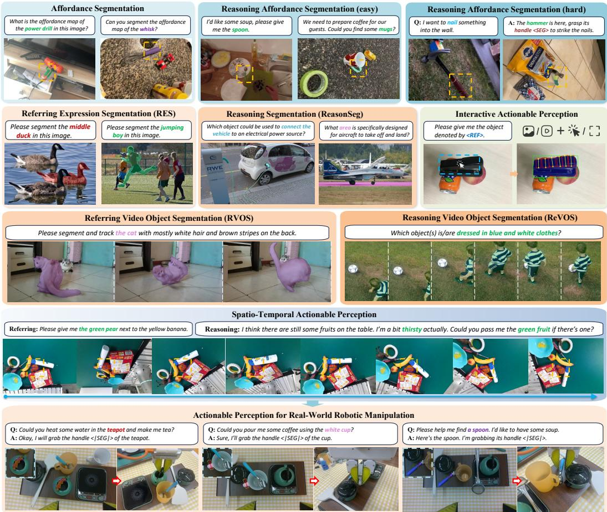  
Figure 1: UniRAP transfers large-scale generic segmentation pretraining to affordance segmentation and spatiotemporally actionable perception, improving language grounding for task-relevant regions and dynamics. It enhances referring segmentation, affordance grounding, and interaction modeling while maintaining strong spatio-temporal consistency.

In embodied intelligence scenarios, this limitation becomes particularly critical: systems must not only understand what and where, but also further reason about how to contact [20, 21]. This requires models to possess part-level actionable perception, i.e., the ability to model interactionrelevant functional properties (affordances) [22, 23] and their corresponding operability, grounded in pixel-level spatial alignment and part-level structural understanding [24–27]. Without such capability, vision-language models struggle to translate language instructions into executable action representations, thereby limiting their applicability in real-world physical environments [28–30].

Despite notable progress, existing approaches still exhibit systematic limitations in advancing toward actionable perception. On one hand, cross-modal methods [31–33, 27, 34] based on CLIP/DINO-style visual representation alignment rely on static embedding spaces, which are inherently limited in modeling complex linguistic structures and compositional relationships. On the other hand, although VLM-based approaches demonstrate strong multi-step reasoning capabilities, their modeling granularity remains predominantly object-centric. Even when augmented with intermediate representations such as keypoints [35–41], detection [42, 13, 12, 43], or segmentation [44–46, 14, 15], these methods still fail to explicitly capture part-level functional affordances and contact regions, all of which are essential for reasoning about real-world interaction feasibility. Furthermore, RealVLG-R1 [47] attempts to predict 4-DoF grasp poses via structured language generation. However, this approach relies on an autoregressive generation mechanism, which is prone to limited precision and instability, making it inadequate for pixel-level actionable tasks.

To address the aforementioned challenges, we propose UniRAP, a Unified vision-language model for Reasoning-Aware Actionable Perception. As shown in Fig. 1, UniRAP supports both textual and visual prompts (e.g., points and bounding boxes) and is capable of producing multi-granularity affordance perception outputs over continuous data modalities, including images and videos. These outputs include object detection bounding boxes, part-level affordance segmentation masks, and interaction-oriented structured representations. Notably, UniRAP adopts a 4-DoF grasp pose as an explicit representation for actionable perception, which establishes a principled correspondence between high-level linguistic semantics and physical interaction.

To mitigate data imbalance and cross-task interference arising from heterogeneous perceptual granularity across tasks, a unified prompting and decoding paradigm is designed. Specifically, a structured <REF> token is introduced to integrate explicit visual prompts and implicit textual references into a shared <SEG> interface, thereby enabling consistent modeling of diverse localization signals. Furthermore, a Unified Affordance Decoder (UAD) is proposed to facilitate cross-task representation sharing through the reuse of intermediate features, while preserving general segmentation capability to the greatest extent possible. Finally, a curriculum-based transfer training strategy is adopted, allowing the model to progressively acquire stable and consistent actionable perception capabilities without compromising its original reasoning performance.

The main contributions of this work are summarized as follows:

1. We propose UniRAP, a unified model that maps multimodal prompts to fine-grained physical contact geometry. It produces consistent multi-granularity affordance representations across both image and video domains.

2. A unified prompting and decoding pipeline is designed, together with a transfer-based training strategy, to alleviate task imbalance in cross-task learning and enable synergistic optimization across heterogeneous perception tasks.

3. Extensive experimental results demonstrate that UniRAP achieves a favorable trade-off between accuracy and stability across a range of tasks, including general segmentation, affordance perception, and part-level interaction grounding.

## 2 Related Work

Non-LLM Vision-Language Perception. Inspired by vision–language pretraining models such as CLIP [48, 49] and DINO [50, 51], early VLP research primarily addresses coarse-grained tasks, including open-vocabulary object detection [52–64] and semantic segmentation [65, 26, 66–71]. These methods rely on region–text alignment to associate visual and linguistic representations, enabling generalization beyond fixed category spaces. Subsequent studies extend VLP to affordance aware perception, shifting from object recognition to modeling functional properties, typically formulated as part-level segmentation [22, 72–79] or region-level localization [80–83]. More recently, this paradigm further expands to actionable perception, such as contact point prediction [84–87] and 4-DoF grasp pose estimation [31, 32, 88–90], aiming to bridge the gap between visual perception and physical manipulation. However, due to limited textual understanding in pretrained models, these methods remain restricted to simple category-level language and struggle with compositional and reasoning-intensive instructions, which limits their applicability in open-world embodied scenarios.

LLM-based Vision-Language Perception. In recent years, large-scale VLMs have demonstrated strong semantic understanding capabilities in tasks such as visual question answering [3, 5, 7, 91, 8, 4, 92]. However, due to their reliance on global or region-level representations, they remain limited in pixel-level visual perception. To address this limitation, some approaches [93, 94, 12, 95, 13, 8] enforce the generation of structured language through SFT [96, 97] or RLVR [98, 99], enabling coarse grained object localization. For dense segmentation tasks, VisionLLM [100] adopts a text-based polygon output paradigm, which is highly dependent on large-scale training data and still suffers from limited accuracy. To overcome these issues, LISA [14] introduces the “Embedding as Mask” paradigm, which extracts implicit features from the language model via a special token and injects them into SAM [24], enabling stable pixel-level predictions. Building on this line, subsequent studies further advance decoder design [101–104], scale up training data [105], and extend capabilities to video settings [106–108, 16]. UniPixel [15] further proposes the PixelQA task, unifying segmentation and region-referred visual question answering. In the context of affordance perception, existing methods largely remain limited to embodied question answering [109, 43, 110, 40] or keypoint prediction [36, 111, 112, 35, 37–39, 41]. To date, RAGNet [46] is the only work that extends LISA [14] to affordance-level segmentation. However, it still lacks interaction-centric modeling and the capability to process video data. The most closely related work, RealVLG-R1 [47], employs reinforcement fine-tuning of VLMs to generate structured text for predicting bounding boxes and grasp poses, but is limited by unstable text representations, weak reasoning ability, and lack of video support. In contrast, UniRAP is the first to achieve end-to-end, reasoning-aware unified modeling of actionable affordance perception across both images and videos.

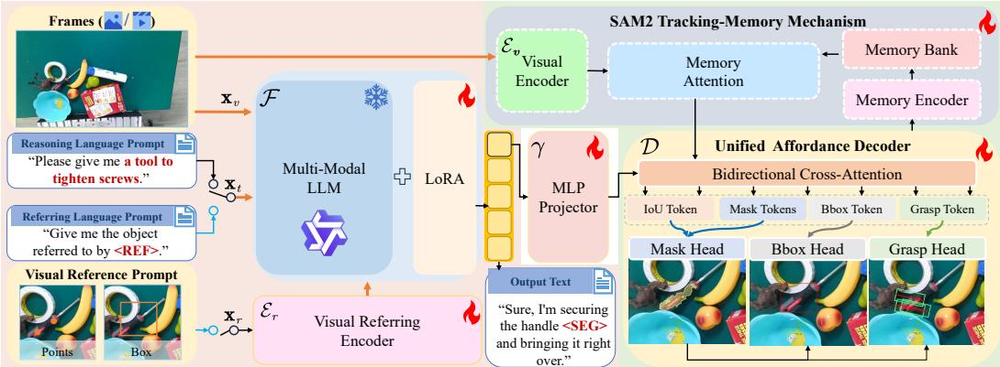  
Figure 2: Overview of UniRAP Model. Given visual input $\mathbf { x } _ { v } ,$ text prompt $\mathbf { x } _ { t } ,$ , and optional visual reference prompts $\mathbf { x } _ { r } ,$ a multimodal model $\mathcal { F }$ produces <SEG>-conditioned outputs. When <REF> is present, visual prompts are encoded as embeddings and jointly modeled with text within a shared <SEG> representation space. Concurrently, visual features from $\mathbf { x } _ { v }$ are aggregated with memory bank representations via memory attention. The resulting features are aligned with <SEG>- derived embeddings through an MLP projector and decoded by an affordance decoder D to generate segmentation masks, region detections, and 4-DoF interaction poses for unified vision–language spatiotemporal actionable perception.

## 3 UniRAP

Overview. To enable a unified model for vision–language spatiotemporal actionable perception, UniRAP is built upon Qwen2.5-VL [8] and SAM2 [113]. As illustrated in Fig. 2, given a visual input (image or video) $\mathbf { x } _ { v } ,$ a textual prompt $\mathbf { x } _ { t } ,$ , and optional visual reference prompts $\mathbf { x } _ { r }$ (e.g., points or bounding boxes), UniRAP first leverages a multimodal large model F to generate textual responses containing <SEG> tokens. When the textual prompt $\mathbf { x } _ { t }$ includes a <REF> token, the visual prompts are encoded into discrete embeddings via a visual referring encoder and injected into the textual sequence, which is then jointly processed by the multimodal model $\mathcal { F }$ . These two forms of prompting are unified within a shared representation space centered on <SEG> tokens, facilitating transferability and generalization to tasks without explicit language referring cues. In the visual branch, the input $\mathbf { x } _ { v }$ is encoded by a visual encoder ${ \mathcal E } _ { v } ,$ and the resulting features are fused with historical frame representations stored in a memory bank via a memory attention mechanism, enhancing temporal consistency and object persistence modeling. The fused features are then aligned with implicit prompt embeddings projected from <SEG> tokens through a MLP projector $\gamma _ { : }$ , and jointly fed into a unified affordance decoder D. The model yields multi-task predictions, including affordance segmentation masks, region detection results, and interaction poses (4-DoF grasp poses), thereby enabling fine-grained actionable perception in complex spatiotemporal scenarios.

## 3.1 Unified Vision-Language Spatiotemporal Modeling

To address vision–language spatiotemporal affordance perception under low-data conditions, UniRAP extends the “Embedding as Mask” paradigm [14, 101, 106, 15] by reformulating the problem as a conditional multimodal generation framework based on interface tokens. Specifically, the model takes as input visual observations (images or videos) $\mathbf { x } _ { v } ,$ , textual prompts $\mathbf { x } _ { t } ,$ and optionally visual reference prompts $\mathbf { x } _ { r }$ (e.g., points or bounding boxes). Through a unified interface token mechanism, it generates reasoning-aware textual outputs, thereby enabling spatial alignment and joint modeling of textual and visual referents. This design maps supervisory signals from heterogeneous modalities into a shared representation space, which not only facilitates cross-task co-optimization but also enhances the model’s transferability and generalization performance in multi-task settings.

Specifically, to enable effective transfer learning in scenarios without explicit textual referring expressions, UniRAP introduces a conditional visual referring prompt mechanism. When the input text $\mathbf { x } _ { t }$ contains the <REF> token, the visual prompt $\mathbf { x } _ { r }$ is encoded by a visual referring encoder ${ \mathcal { E } } _ { r }$ into a discrete embedding, which is then injected into the multimodal model $\mathcal { F }$ (Qwen2.5-VL [8]) for joint modeling. The model subsequently generates a reasoning-aware textual output yˆ that includes the <SEG> token. This process can be formally expressed as:

$$
\begin{array} { r } { \hat { { \textbf y } } = { \mathcal F } \big ( { \textbf x } _ { t } , { \textbf x } _ { v } , { \textbf z } _ { r } \big ) , \quad { \textbf z } _ { r } = \left\{ \begin{array} { l l } { { \mathcal E } _ { r } ( { \textbf x } _ { r } ) , } & { \mathrm { i f ~ } \mathrm { < R E F > \in { \textbf { x } } _ { t } ~ } } \\ { { \textbf 0 } , } & { \mathrm { o t h e r w i s e } , } \end{array} \right. } \end{array}\tag{1}
$$

where the referring expression encoder ${ \mathcal { E } } _ { r }$ adopts random Fourier mapping [114] to encode the spatial coordinates and temporal information of each point, followed by a linear projection layer. Unlike prior methods [108, 101, 15] designed for visual prompt-based question answering, we adapt this design to unify and align explicit textual referring and visual prompt-based referring within the <SEG> representation space, thereby enabling task transfer with reduced reliance on textual annotations.

Subsequently, to achieve stable and lightweight transfer-based spatiotemporal actionable perception, UniRAP extracts the final-layer hidden representation $\tilde { \mathbf { h } } _ { \mathrm { s e g } }$ corresponding to the <SEG> token and projects it via a MLP projector $\gamma ( \cdot )$ into a unified object-localization prompt embedding:

$$
\mathbf { h } _ { \mathrm { s e g } } = \gamma ( \tilde { \mathbf { h } } _ { \mathrm { s e g } } ) .\tag{2}
$$

In parallel, SAM2 [113] encodes the visual input $\mathbf { x } _ { v }$ into dense features $\mathbf { f } _ { v }$ through its visual encoder ${ \mathcal { E } } _ { v }$ . Owing to the tracking-memory mechanism, when processing video sequences, these visual features interact with historical frame features and target states stored in a memory bank, and temporal information is aggregated via memory attention, thereby maintaining temporal consistency across frames. Finally, the memory-enhanced visual features $\mathbf { f } _ { \mathrm { m e m } }$ and the implicit prompt embedding $\mathbf { h } _ { \mathrm { s e g } }$ are fused within the decoder $\mathcal { D }$ to jointly predict affordance-related outputs:

$$
\begin{array} { r } { \hat { \mathbf { M } } , \hat { \mathbf { b } } , \hat { \mathbf { g } } = \mathcal { D } ( \mathbf { h } _ { \mathrm { s e g } } , \mathbf { f } _ { \mathrm { m e m } } ) , } \end{array}\tag{3}
$$

where $\hat { \textbf { M } }$ denotes the affordance segmentation mask, bˆ denotes region-level detection results, and $\hat { \bf g }$ denotes the 4-DoF interaction poses.

## 3.2 Unified Affordance Decoder

Given that vision–language segmentation data are relatively abundant, whereas annotations for finegrained interaction perception (e.g., 4-DoF grasp poses) are scarce, we propose a Unified Affordance Decoder (UAD). The goal is to effectively transfer intermediate representations (visual features and implicit prompt embeddings) learned from large-scale coarse-grained perception data to fine-grained tasks, thereby improving affordance perception performance.

Specifically, as illustrated in Fig. 3, the UAD is built upon the Mask Decoder of SAM [113, 24]. During the decoding stage, a Two-way Transformer [63] takes as input the memory-enhanced visual features $\mathbf { f } _ { \mathrm { m e m } } .$ positional encodings p, and task tokens augmented with object-localization prompt embeddings $\mathbf { h } _ { \mathrm { s e g } }$ , including the object pointer token, IoU token, mask tokens $\mathbf { t } _ { m }$ , bbox token $\mathbf { t } _ { b }$ and grasp token $\mathbf { t } _ { g }$ . Through joint modeling via bidirectional cross-attention and self-attention, the model enables coordinated updates between visual features and token representations, resulting in context-enhanced representations.

To enable unified decoding across different granularities, UAD adopts a token-based feature modulation mechanism for prediction. In the Mask Head, the updated visual features are first upsampled via UpscaleNet to obtain a high-resolution representation $\bar { \mathbf { f } _ { \mathrm { u p } } }$ . The mask tokens $\mathbf { t } _ { m }$ , projected through a HyperNet, are then used to perform element-wise modulation of $\mathbf { f } _ { \mathrm { u p } } .$ , producing four candidate mask logits. A stability-based selection strategy is further applied to iteratively refine these candidates, resulting in the final optimal segmentation mask Mˆ .

For the object detection task, the Bbox Head adopts a DETR-style residual regression modeling strategy [63]. An initial bounding box $\mathbf { b } _ { 0 }$ is first derived from the optimal segmentation mask Mˆ via geometric construction. The bbox token $\mathbf { t } _ { b }$ then modulates the upsampled features $\mathbf { f } _ { \mathrm { u p } }$ via FiLM [115], followed by mask-guided weighted pooling under Mˆ . The resulting feature is fed into a ResidualMLP to predict a bounding box offset for refinement. This process can be formulated as:

$$
\hat { \mathbf { b } } = \mathbf { b } _ { 0 } + \mathrm { M L P } _ { \mathrm { r e s } } ( \mathrm { P o o l } _ { \hat { \mathbf { M } } } ( \mathrm { F i L M } ( \mathbf { f } _ { \mathrm { u p } } , \mathbf { t } _ { b } ) ) ) .\tag{4}
$$

To improve robustness, UniRAP further introduces a consistency constraint between the predicted bounding box and the segmentation mask, enabling mutual refinement and suppressing mask noise.

For contact-aware affordance perception, conventional heatmap-based methods [116, 117] exhibit relatively stable predictions but suffer from groundtruth coverage and uneven response distributions. To address these limitations, we reformulate 4- DoF grasp prediction within a regression-based framework, focusing on part-level contact region estimation in the object-centric spatial domain.

Specifically, given a refined segmentation mask Mˆ , the Grasp Head first applies farthest point sampling (FPS) within the foreground region to select $N _ { g }$ grasp center candidates $( a _ { x } ^ { i } , a _ { y } ^ { i } )$ Each anchor is encoded as a normalized offset relative to the mask centroid and further scaled by the bounding box dimensions, forming a relative positional encoding

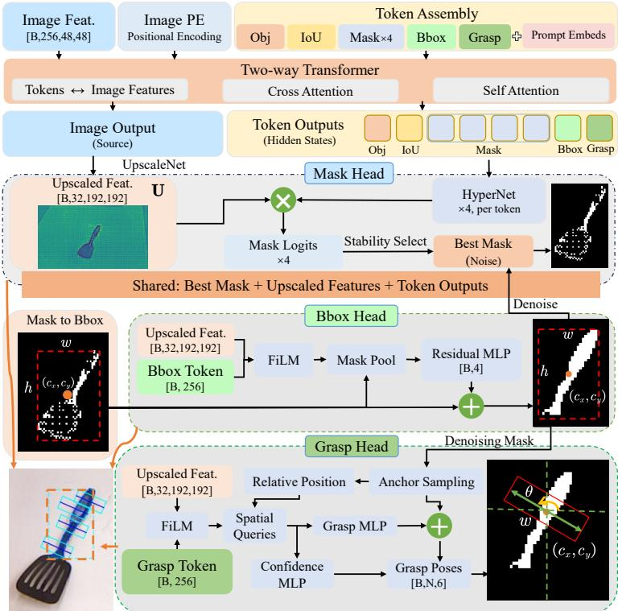  
Figure 3: Architecture of Unified Affordance Decoder.

$\mathbf { e } _ { i }$ to enhance scale-consistent spatial representation. Next, the upsampled visual feature $\mathbf { f } _ { \mathrm { u p } }$ is modulated by the grasp token via FiLM conditioning to inject task-specific semantic information. Based on this, $N _ { g }$ learnable spatial queries interact with the modulated features through foreground-masked dot-product attention, producing per-candidate pooled feature representations $\mathbf { z } _ { i }$

$$
\begin{array} { r } { \mathbf { z } _ { i } = \mathrm { A t t n } \big ( \mathrm { F i L M } ( \mathbf { f } _ { \mathrm { u p } } , \mathbf { t } _ { g } ) , \mathrm { F P S } ( \hat { \mathrm { M } } ) , \mathbf { e } _ { i } \big ) . } \end{array}\tag{5}
$$

Subsequently, a GraspMLP predicts residual offsets and grasp geometry, while an independent ConfidenceMLP estimates the corresponding grasp quality score $q _ { i } { \mathrm { : } }$

$$
( \Delta c _ { x } ^ { i } , \Delta c _ { y } ^ { i } , \cos { 2 \theta _ { i } } , \sin { 2 \theta _ { i } } , w _ { i } ) = \mathrm { M L P } _ { \mathrm { g r a s p } } ( \mathbf { z } _ { i } ) , \quad q _ { i } = \mathrm { M L P } _ { \mathrm { c o n f } } ( \mathbf { z } _ { i } ) .\tag{6}
$$

The final grasp center is obtained via anchor-residual refinement: $c _ { x } ^ { i } = a _ { x } ^ { i } + \Delta c _ { x } ^ { i } , c _ { y } ^ { i } = a _ { y } ^ { i } + \Delta c _ { y } ^ { i }$ We thus obtain $N _ { g }$ grasp candidates, denoted as (see Fig. 3 for illustration):

$$
\hat { \mathbf { g } } = \{ ( c _ { x } ^ { i } , c _ { y } ^ { i } , \cos 2 \theta _ { i } , \sin 2 \theta _ { i } , w _ { i } , q _ { i } ) \} _ { i = 1 } ^ { N _ { g } } .\tag{7}
$$

Overall, UAD provides a unified decoding paradigm to integrate segmentation, detection, and partlevel contact reasoning into a single representation space. By leveraging a shared interface, it enables synergistic knowledge transfer across heterogeneous tasks, ensuring that interaction-centric geometry is grounded in robust semantic features.

## 3.3 Curriculum Transfer Training

Training Pipeline. To address the imbalance between large-scale segmentation data and limited interaction annotations, we adopt a curriculum-based transfer learning framework that progressively transitions model capabilities from segmentation to interaction-aware perception. As illustrated in Fig. 4, the training pipeline is organized into four stages with increasing task complexity: (1) general pre-training with language prompts to enhance visual–semantic alignment and mask prediction; (2) affordance pre-training to localize functionally meaningful regions, bridging category-level segmentation and part-level perception; (3) visual referring pre-training with visual prompts to implicitly learn interaction-relevant poses from grasp datasets without language annotations; and (4) actionable affordance fine-tuning using limited vision-language grasp data to jointly predict segmentation masks, bounding boxes, and 4-DoF interaction poses. This staged strategy enables effective knowledge transfer, thereby improving data efficiency and generalization performance.

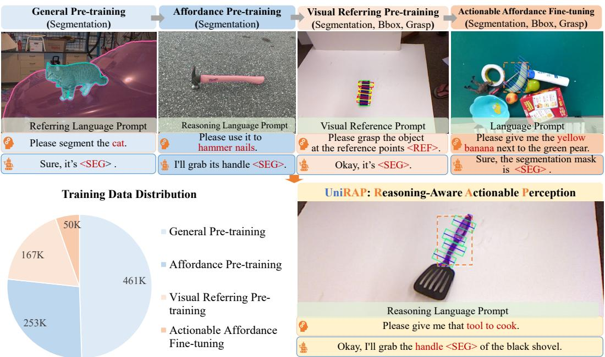  
Figure 4: Curriculum Transfer Training Pipeline. Details in Appendix B.2.

Training Objective. The training objective of UniRAP is formulated as a weighted linear combination of a language modeling loss and multiple task-specific losses. The mask decoding component includes a Focal Loss and a Dice Loss for mask prediction, a MAE loss for IoU estimation, and a crossentropy loss for objectness classification. The object detection branch employs an L1 regression loss and a GIoU loss to supervise bounding box prediction, while the grasp pose estimation branch is optimized using a Huber Loss and a BCE Loss. Furthermore, to enforce spatial consistency across multi-granularity perception, additional constraints are introduced, including a mask-in-bbox loss to ensure containment between masks and bounding boxes, and a consistency loss that aligns grasp center points with the corresponding mask regions. Details are provided in Appendix B.3.

## 4 Experiments

This section demonstrates that UniRAP preserves strong general segmentation performance while extending to affordance segmentation and actionable perception, enabling a more grounded understanding of functional regions and physical interactions. Details on implementation (B.1), evaluation metrics (B.4), qualitative results (B.5), and real-world robotic experiments (C.2) are provided in the Appendix.

## 4.1 General Segmentation Performance

Referring Expression and Reasoning Segmentation. As shown in Tab. 1, we evaluated UniRAP on RefCOCO/+/g [118, 119] and ReasonSeg [14] to assess its image segmentation capability under both explicit and implicit textual queries. The results demonstrate that UniRAP achieves state-of-the-art performance on referring expression segmentation (RES) benchmarks. Among models of comparable scale, UniRAP significantly outperforms existing methods and, in most settings, attains performance on par with larger models such as UniPixel-7B [15] and Sa2VA-8B [108], indicating a favorable trade-off between parameter efficiency and performance. On ReasonSeg [14], UniRAP remains competitive but does not achieve the best performance. This is primarily because ReasonSeg requires stronger multi-step reasoning capabilities, while the current state-of-the-art method, VideoLISA [106], is specifically designed and trained for such reasoning-intensive segmentation tasks.

Table 1: Referring Expression and Reasoning Segmentation. cIoU on RefCOCO/+/g.
<table><tr><td rowspan="2">Method</td><td rowspan="2">Size</td><td colspan="3">RefCOCO [118]</td><td colspan="3">RefCOCO+ [118]</td><td colspan="2">RefCOCOg [119]</td><td colspan="2">ReasonSeg [14]</td></tr><tr><td>val</td><td>testA</td><td>testB</td><td>val</td><td>testA</td><td>testB</td><td>val(U)</td><td>test(U)</td><td>gIoU</td><td>cIoU</td></tr><tr><td colspan="10">Non-LLM-based Specialists</td></tr><tr><td>ReLA [120]</td><td>一</td><td>73.8</td><td>76.5</td><td>70.2</td><td>66.0</td><td>71.0</td><td>57.7</td><td>65.0</td><td>66.0</td><td></td><td></td></tr><tr><td>X-Decoder [121]</td><td>1</td><td>一</td><td>一</td><td>一</td><td>一</td><td>1</td><td>一</td><td>64.6</td><td>一</td><td>22.6</td><td>17.9</td></tr><tr><td>SEEM [122]</td><td>一</td><td>一</td><td>一</td><td>一</td><td>一</td><td>一</td><td>一</td><td>65.7</td><td>一</td><td>25.5</td><td>21.2</td></tr><tr><td colspan="10">LLM-based Image Generalists</td><td colspan="2"></td></tr><tr><td>NExT-Chat [102]</td><td>7B</td><td>74.7</td><td>78.9</td><td>69.5</td><td>65.1</td><td>71.9</td><td>56.7</td><td>67.0</td><td>67.0</td><td></td><td></td></tr><tr><td>PixelLM [101]</td><td>7B</td><td>73.0</td><td>76.5</td><td>68.2</td><td>66.3</td><td>71.7</td><td>58.3</td><td>69.3</td><td>70.5</td><td></td><td></td></tr><tr><td>LISA [14]</td><td>7B</td><td>74.9</td><td>79.1</td><td>72.3</td><td>65.1</td><td>70.8</td><td>58.1</td><td>67.9</td><td>70.6</td><td>61.3</td><td>62.9</td></tr><tr><td>Groundhog [103]</td><td>7B</td><td>78.5</td><td>79.9</td><td>75.7</td><td>70.5</td><td>75.0</td><td>64.9</td><td>74.1</td><td>74.6</td><td>56.2</td><td></td></tr><tr><td>LaSagnA [123]</td><td>7B</td><td>76.8</td><td>78.7</td><td>73.8</td><td>66.4</td><td>70.6</td><td>60.1</td><td>70.6</td><td>71.9</td><td>48.8</td><td>47.2</td></tr><tr><td>M2SA [105]</td><td>13B</td><td>74.6</td><td>77.6</td><td>71.0</td><td>64.0</td><td>68.1</td><td>57.6</td><td>69.0</td><td>69.3</td><td></td><td></td></tr><tr><td colspan="10">LLM-based Video Generalists</td></tr><tr><td>VISA [107]</td><td>7B</td><td>72.4</td><td>75.5</td><td>68.1</td><td>59.8</td><td>64.8</td><td>53.1</td><td>65.5</td><td>66.4</td><td>52.7</td><td>57.8</td></tr><tr><td>Vitron [124]</td><td>7B</td><td>75.5</td><td>79.5</td><td>72.2</td><td>66.7</td><td>72.5</td><td>58.0</td><td>67.9</td><td>68.9</td><td></td><td></td></tr><tr><td>UniPixel [15]</td><td>7B</td><td>80.8</td><td>83.0</td><td>77.4</td><td>75.3</td><td>80.1</td><td>70.0</td><td>76.4</td><td>77.1</td><td>60.5</td><td>58.7</td></tr><tr><td>Sa2VA [108]</td><td>8B</td><td>81.9</td><td>一</td><td></td><td>76.5</td><td>一</td><td></td><td>78.9</td><td></td><td>57.9</td><td>44.7</td></tr><tr><td>VideoLISA [106]</td><td>3.8B</td><td>73.8</td><td>76.6</td><td>68.8</td><td>63.4</td><td>68.8</td><td>56.2</td><td>68.3</td><td>68.8</td><td>61.4</td><td>67.1</td></tr><tr><td>Sa2VA [108]</td><td>4B</td><td>78.9</td><td></td><td></td><td>71.7</td><td></td><td></td><td>74.1</td><td></td><td>52.3</td><td>44.9</td></tr><tr><td>UniRAP (Ours)</td><td>3B</td><td>80.9</td><td>82.6</td><td>78.1</td><td>75.1</td><td>79.3</td><td>70.4</td><td>76.1</td><td>77.5</td><td>57.9</td><td>59.0</td></tr></table>

Table 2: Referring and Reasoning Video Object Segmentation on ReVOS val [107] split.
<table><tr><td rowspan="2">Method</td><td rowspan="2">Size</td><td colspan="3">Referring</td><td colspan="3">Reasoning</td><td colspan="3">Overall</td><td rowspan="2">R</td></tr><tr><td>J</td><td>F</td><td>J&amp;F</td><td>|J</td><td>F</td><td>J&amp;F</td><td>|J</td><td>F</td><td>J&amp;F</td></tr><tr><td colspan="10">Non-LLM-based Specialists</td></tr><tr><td>MTTR [127]</td><td>一</td><td>29.8</td><td>30.2</td><td>30.0</td><td>20.4</td><td>21.5</td><td>21.0</td><td>25.1</td><td>25.9</td><td>25.5</td><td>5.6</td></tr><tr><td>LMPM [128]</td><td>一</td><td>29.0</td><td>39.1</td><td>34.1</td><td>13.3</td><td>24.3</td><td>18.8</td><td>21.2</td><td>31.7</td><td>26.4</td><td>3.2</td></tr><tr><td>ReferFormer [129]</td><td></td><td>31.2</td><td>34.3</td><td>32.7</td><td>21.3</td><td>25.6</td><td>23.4</td><td>26.2</td><td>29.9</td><td>28.1</td><td>8.8</td></tr><tr><td colspan="10">LLM-based Generalists</td></tr><tr><td>LISA [14]</td><td>13B</td><td>45.2</td><td>47.9</td><td>46.6</td><td>34.3</td><td>39.1</td><td>36.7</td><td>39.8</td><td>43.5</td><td>41.6</td><td>8.6</td></tr><tr><td>VISA [107]</td><td>13B</td><td>55.6</td><td>59.1</td><td>57.4</td><td>42.0</td><td>46.7</td><td>44.3</td><td>48.8</td><td>52.9</td><td>50.9</td><td>14.5</td></tr><tr><td>GLUS [130]</td><td>7B</td><td>56.0</td><td>60.7</td><td>58.3</td><td>48.8</td><td>53.9</td><td>51.4</td><td>52.4</td><td>57.3</td><td>54.9</td><td>17.9</td></tr><tr><td>ViLLa [131]</td><td>6B</td><td></td><td></td><td></td><td></td><td></td><td></td><td>54.9</td><td>59.1</td><td>57.0</td><td></td></tr><tr><td>UniPixel [15]</td><td>7B</td><td>63.9</td><td>67.8</td><td>65.8</td><td>59.4</td><td>63.7</td><td>61.5</td><td>61.7</td><td>65.7</td><td>63.7</td><td>19.4</td></tr><tr><td>Sa2VA [108]</td><td>8B</td><td></td><td></td><td></td><td></td><td></td><td></td><td></td><td></td><td>57.6</td><td></td></tr><tr><td>HyperSeg [125]</td><td>3B</td><td>56.0</td><td>60.9</td><td>58.5</td><td>50.2</td><td>55.8</td><td>53.0</td><td>53.1</td><td>58.4</td><td>55.7</td><td></td></tr><tr><td>InstructSeg [126]</td><td>3B</td><td>54.8</td><td>59.2</td><td>57.0</td><td>49.2</td><td>54.7</td><td>51.9</td><td>52.0</td><td>56.9</td><td>54.5</td><td></td></tr><tr><td>Sa2VA [108]</td><td>4B</td><td></td><td></td><td></td><td></td><td></td><td>一</td><td></td><td></td><td>53.2</td><td></td></tr><tr><td>UniRAP (Ours)</td><td>3B</td><td>61.8</td><td>66.5</td><td>64.1</td><td>56.8</td><td>62.4</td><td>59.6</td><td>59.3</td><td>64.4</td><td>61.9</td><td>19.4</td></tr></table>

Table 3: Referring Affordance Segmentation.
<table><tr><td>Method</td><td>Size</td><td colspan="2">HANDAL gIoU cloU</td><td colspan="2">GraspNet seen gIoU cloU</td><td colspan="2">GraspNet novel gIoU cIoU</td><td colspan="2">3DOI gloU cloU</td></tr><tr><td colspan="9">Non-LLM Foundation Models</td></tr><tr><td>VLPart [27] + SAM2 [113]</td><td></td><td>40.9</td><td>28.9</td><td>40.7</td><td>27.6</td><td></td><td></td><td></td><td></td></tr><tr><td>G-DINO [58] + SAM2 [113]</td><td></td><td>34.7</td><td>26.8</td><td>34.9</td><td>26.9</td><td></td><td></td><td></td><td></td></tr><tr><td>Florence 2 [132] + SAM2 [113]</td><td></td><td>39.7</td><td>22.4</td><td>39.4</td><td>22.5</td><td></td><td></td><td></td><td></td></tr><tr><td colspan="10">LLM-based Generalists</td></tr><tr><td>LISA [14]</td><td>7B</td><td>15.4</td><td>11.8</td><td>17.7</td><td>17.7</td><td>25.2</td><td>24.1</td><td>21.5</td><td>13.7</td></tr><tr><td>GLaMM [104]</td><td>3.8B</td><td>25.1</td><td>17.0</td><td>21.6</td><td>10.5</td><td>19.2</td><td>8.6</td><td>19.7</td><td>14.1</td></tr><tr><td>UniPixel [15]</td><td>7B</td><td>26.0</td><td>16.4</td><td>45.0</td><td>12.5</td><td>48.0</td><td>11.5</td><td>41.5</td><td>24.9</td></tr><tr><td>RAGNet [46]</td><td>7B</td><td>60.5</td><td>60.3</td><td>63.3</td><td>64.0</td><td>45.6</td><td>33.2</td><td>37.4</td><td>37.4</td></tr><tr><td>UniRAP (Ours)</td><td>3B</td><td>63.9</td><td>65.7</td><td>70.6</td><td>64.1</td><td>51.6</td><td>42.3</td><td>52.1</td><td>37.5</td></tr></table>

Table 4: Reasoning Affordance Segmentation.
<table><tr><td rowspan="2">Method</td><td rowspan="2">Size</td><td colspan="2">HANDAL (easy)</td><td colspan="2">HANDAL (hard)</td><td colspan="2">3DOI</td></tr><tr><td>gIoU</td><td>cIoU</td><td>gIoU</td><td>cIoU</td><td>gIoU</td><td>cIoU</td></tr><tr><td>G-DINO [58]</td><td></td><td>3.6</td><td>3.0</td><td>3.4</td><td>3.1</td><td>4.1</td><td>3.9</td></tr><tr><td>LISA [14]</td><td>7B</td><td>15.5</td><td>11.9</td><td>12.3</td><td>8.1</td><td>12.3</td><td>8.1</td></tr><tr><td>GLaMM [104]</td><td>3.8B</td><td>4.7</td><td>3.5</td><td>5.0</td><td>3.5</td><td>4.4</td><td>2.9</td></tr><tr><td>UniPixel [15]</td><td>7B</td><td>26.7</td><td>15.7</td><td>24.5</td><td>11.6</td><td>38.5</td><td>21.0</td></tr><tr><td>RAGNet [46]</td><td>7B</td><td>58.3</td><td>58.1</td><td>58.2</td><td>57.8</td><td>38.1</td><td>39.4</td></tr><tr><td>UniRAP (Ours)</td><td>3B</td><td>63.2</td><td>64.1</td><td>62.9</td><td>63.8</td><td>55.7</td><td>54.5</td></tr></table>

Referring and Reasoning Video Object Segmentation. To evaluate UniRAP’s ability in mask prediction under implicit textual queries and spatiotemporal reasoning, we conducted experiments on ReVOS [107]. As shown in Tab. 2, UniRAP achieves strong overall performance on ReVOS across both referring and reasoning settings, outperforming representative 3B-scale baselines such as HyperSeg [125] and InstructSeg [126]. It remains competitive compared to recent larger-scale models (e.g., UniPixel-7B), demonstrating a favorable efficiency–performance trade-off.

Table 5: Actionable Perception Performance on RealVLG-Benchmark [47].
<table><tr><td rowspan="2">Method</td><td rowspan="2">Size</td><td colspan="3">Seen</td><td colspan="3">Similar</td><td colspan="3">Novel</td></tr><tr><td>Bbox gIoU/cIoU</td><td>Seg. Fβ/Sα</td><td>Grasp mIoU/gAcc</td><td>Bbox gIoU/cIoU</td><td>Seg. Fβ/Sα</td><td>Grasp mIoU/gAcc</td><td>Bbox gIoU/cIoU</td><td>Seg. Fβ/Sα</td><td>Grasp mIoU/gAcc</td></tr><tr><td>Qwen-VL-Max [135]</td><td></td><td>56.6/57.1</td><td>62.8/32.0</td><td>2.3/2.4</td><td>57.5/57.9</td><td>57.6/28.9</td><td>2.7/1.3</td><td>59.8/60.1</td><td>30.3/24.7</td><td>1.8/1.2</td></tr><tr><td>Gemini2.5-Flash [136]</td><td></td><td>50.1/51.3</td><td>2.8/11.8</td><td>3.2/1.2</td><td>47.9/49.0</td><td>3.1/10.6</td><td>2.5/2.2</td><td>59.5/60.6</td><td>3.7/14.2</td><td>3.4/1.9</td></tr><tr><td>Qwen2.5VL [8]</td><td>7B</td><td>56.8/58.3</td><td>80.6/43.8</td><td>1.8/0.8</td><td>57.1/57.7</td><td>77.7/42.2</td><td>1.6/0.0</td><td>55.6/56.8</td><td>48.3/39.2</td><td>1.0/0.0</td></tr><tr><td>Qwen2.5VL+SFT [8]</td><td>7B</td><td>64.8/63.5</td><td>82.2/44.1</td><td>4.1/2.5</td><td>66.7/62.7</td><td>79.6/42.6</td><td>3.9/2.3</td><td>64.9/65.2</td><td>48.5/39.4</td><td>2.7/1.1</td></tr><tr><td>RealVLG-R1(GRPO) [47]</td><td>7B</td><td>88.0/88.5</td><td>89.2/45.3</td><td>32.1/39.1</td><td>83.4/84.2</td><td>85.0/43.8</td><td>28.7/36.2</td><td>84.6/85.4</td><td>52.2/39.7</td><td>16.8/18.9</td></tr><tr><td>RealVLG-R1(GSPO) [47]</td><td>7B</td><td>89.0/89.6</td><td>88.9/45.4</td><td>33.6/32.8</td><td>86.4/86.9</td><td>86.6/43.8</td><td>27.9/30.2</td><td>88.5/88.9</td><td>52.0/39.7</td><td>16.5/18.3</td></tr><tr><td>Qwen2.5VL [8]</td><td>3B</td><td>49.6/51.5</td><td>74.5/43.2</td><td>4.0/2.7</td><td>48.4/49.5</td><td>71.0/40.1</td><td>3.7/1.3</td><td>51.3/52.1</td><td>44.5/37.5</td><td>3.0/1.3</td></tr><tr><td>Qwen2.5VL+SFT [8]</td><td>3B</td><td>56.4/57.1</td><td>76.2/43.4</td><td>3.4/1.7</td><td>54.7/55.9</td><td>75.4/43.2</td><td>3.6/2.1</td><td>57.2/58.6</td><td>46.2/38.9</td><td>4.4/1.5</td></tr><tr><td>RealVLG-R1(GRPO) [47]</td><td>3B</td><td>83.8/84.2</td><td>83.9/43.4</td><td>34.7/40.3</td><td>84.7/85.3</td><td>84.1/43.0</td><td>28.2/31.9</td><td>77.1/78.1</td><td>49.4/38.7</td><td>16.3/17.1</td></tr><tr><td>RealVLG-R1(GSPO) [47]</td><td>3B</td><td>87.7/88.4</td><td>88.7/45.3</td><td>29.2/33.6</td><td>84.6/85.3</td><td>85.0/43.7</td><td>27.6/30.6</td><td>78.0/79.3</td><td>49.1/39.6</td><td>15.3/9.1</td></tr><tr><td>UniRAP (Ours)</td><td>3B</td><td>85.5/86.1</td><td>92.0/43.6</td><td>43.8/56.7</td><td>83.6/83.0</td><td>89.4/46.9</td><td>40.8/56.7</td><td>68.4/72.3</td><td>75.8/42.4</td><td>39.5/63.3</td></tr></table>

Table 6: Ablation Study of different pre-training stages, fine-tuning strategies, and prediction heads.
<table><tr><td colspan="4">Training Strategy</td><td colspan="3">Prediction Head</td><td colspan="5">Evaluation Benchmark</td></tr><tr><td>General Pre-train</td><td>Affordance Pre-train</td><td>Visual Referring Pre-train</td><td>Actionable Affordance Fine-tune</td><td>Bbox Head</td><td>Heatmap Grasp Head</td><td>UniRAP Grasp Head</td><td>ReasonSeg (gIoU)</td><td>ReVOS (J&amp;F)</td><td>3D0I (Ref. gIoU)</td><td>3DOI (Reason, gIoU)</td><td>RealVLG-Bench (Grasp, gAcc)</td></tr><tr><td>√</td><td></td><td></td><td></td><td></td><td></td><td></td><td>55.4</td><td>58.3</td><td>40.5</td><td>37.5</td><td></td></tr><tr><td>√</td><td>√</td><td></td><td></td><td></td><td></td><td></td><td>56.4</td><td>59.2</td><td>50.4</td><td>52.9</td><td></td></tr><tr><td>√</td><td>√</td><td>√</td><td></td><td>√</td><td></td><td>√</td><td>57.3</td><td>60.2</td><td>51.6</td><td>54.6</td><td>19.6</td></tr><tr><td>L</td><td>√</td><td></td><td>√</td><td>√</td><td></td><td>√</td><td>57.0</td><td>59.8</td><td>50.8</td><td>54.2</td><td>26.4</td></tr><tr><td>√</td><td>√</td><td>V</td><td>√</td><td></td><td></td><td>√</td><td>56.8</td><td>60.4</td><td>51.3</td><td>53.8</td><td>24.7</td></tr><tr><td>√</td><td>√</td><td>√</td><td>√</td><td>√</td><td>√</td><td></td><td>57.6</td><td>61.7</td><td>52.3</td><td>55.6</td><td>13.4</td></tr><tr><td>√</td><td>√</td><td>√</td><td>√</td><td>√</td><td></td><td>√</td><td>57.9</td><td>61.9</td><td>52.1</td><td>55.7</td><td>63.3</td></tr></table>

## 4.2 Referring and Reasoning Affordance Segmentation Performance

To evaluate UniRAP’s capability in affordance segmentation, we followed the evaluation protocol of RAGNet [46] and conducted systematic experiments on the annotated HANDAL [23], GraspNet [133], and 3DOI [134] datasets. Gray indicates zero-shot benchmarks.

As shown in Tab. 3 and Tab. 4, UniRAP achieves strong performance on both explicit text-guided and reasoning-based affordance segmentation tasks. In referring affordance segmentation, UniRAP significantly outperforms RAGNet, which is also designed for affordance modeling, and demonstrates notably better generalization in unseen scenarios. Benefiting from its transfer-learning-oriented design, this advantage becomes even more pronounced in reasoning-based affordance segmentation. On the zero-shot 3DOI dataset, UniRAP improves gIoU and cIoU by 17.6 and 15.1, respectively, indicating stronger robustness and adaptability in complex semantic reasoning and spatial localization.

## 4.3 Actionable Perception Performance

We evaluated the actionable perception performance of UniRAP on the RealVLG-Benchmark [47], focusing on its capability in both coarse-grained segmentation and fine-grained interaction grounding. Given a natural language description of a target object, the benchmark requires the model to reason about its bounding box, segmentation mask, and 4-DoF grasp pose. Details of the evaluation metrics are provided in Appendix B.4.

As illustrated in Tab. 5, for coarse-grained object detection, RealVLG-R1 [47] retains a certain advantage, benefiting from the large-scale detection pretraining of the foundation model Qwen2.5-VL [8]. However, for segmentation tasks, existing baselines are unable to perform end-to-end prediction and instead rely on a two-stage “bbox + SAM2” pipeline, which introduces error accumulation and leads to slightly inferior performance compared to UniRAP, particularly in zero-shot Novel scenarios. For fine-grained 4-DoF grasp pose estimation, text-based generation baselines struggle to capture pixel-level localization, whereas UniRAP’s end-to-end formulation demonstrates clear advantages, enabling both stable grasp prediction and stronger generalization. In terms of grasp accuracy (gAcc), especially in novel settings, UniRAP achieves up to a threefold improvement over RealVLG-R1.

## 4.4 Ablation Study

We conducted ablation studies on selected key components of UniRAP, as summarized in Tab. 6. Affordance pre-training substantially improved affordance understanding and reasoning segmentation, increasing the Referring and Reasoning gIoU on 3DOI by 9.9 and 15.4 points, respectively. Visual referring pre-training further strengthened the association between language instructions and actionable interaction poses, improving grasp accuracy from 26.4 to 63.3 when combined with our proposed Grasp Head. Actionable affordance fine-tuning jointly optimized segmentation, localization, and grasp prediction, improving grasp accuracy from 19.6 to 63.3 while maintaining competitive segmentation performance. Regarding prediction heads, the Bbox Head provided additional spatial constraints for the SAM2 decoder, suppressing background interference and improving ReasonSeg, ReVOS, and 3DOI performance by 1.1, 1.5, and up to 1.9 points, respectively. Finally, replacing our regression-based Grasp Head with a heatmap-based alternative reduced grasp accuracy from 63.3 to 13.4, demonstrating the effectiveness of direct grasp prediction from Transformer representations.

## 4.5 Application: Actionable Perception for Robotic Grasping

To evaluate the transferability of UniRAP to real-world robotic manipulation, we conducted grasping experiments using a Franka FR3 robotic arm equipped with an eye-in-hand RealSense D435i camera, as illustrated in Fig. 5. The evaluation includes 13 household objects, with six objects for referring grasping and seven for reasoning-based grasping. We compared UniRAP against RAG-Net and RealVLG-R1 under two manipulation paradigms: a modular perception-to-grasping pipeline that combines affordance segmentation with Grasp-Net, and direct 4-DoF grasp prediction. As shown in Table 7, RAGNet+GraspNet and UniRAP+GraspNet achieve average success rates of 43.8% and 55.4%, respectively, indicating that improved affordance perception alone does not fully resolve

  
Figure 5: Real-World Experimental Setup. A Franka FR3 robotic arm is equipped with an eye-in-hand RealSense D435i camera. Objects 1–6 evaluate referring grasping, while objects 7–13 evaluate reasoning-based grasping.

Table 7: Real-world robotic grasping success rates (%).
<table><tr><td rowspan="2">Method</td><td colspan="10"></td><td rowspan="2">Avg. SR (%)</td></tr><tr><td>1</td><td>2</td><td>3</td><td>4</td><td>5</td><td>6</td><td>7</td><td>8 9</td><td>10</td><td>11 12</td><td>13</td></tr><tr><td>RAGNet + GraspNet</td><td>50</td><td>60 40</td><td>60</td><td></td><td>50</td><td>60</td><td>30 40</td><td>30</td><td>40</td><td>30 40</td><td>40</td><td>43.8</td></tr><tr><td>UniRAP + GraspNet</td><td>70</td><td>70 60</td><td>70</td><td>60</td><td></td><td>50 40</td><td>70</td><td>50</td><td>50</td><td>40 40</td><td>50</td><td>55.4</td></tr><tr><td>RealVLG-R1 (4-DoF)</td><td>80</td><td>60 70</td><td>80</td><td>70</td><td></td><td>70 50</td><td>80</td><td>40</td><td>70</td><td>40 20</td><td>80</td><td>62.3</td></tr><tr><td>UniRAP (4-DoF)</td><td>100 90</td><td>80</td><td>100</td><td>90</td><td>100</td><td>80</td><td>80</td><td>70</td><td>90</td><td>80 90 100</td><td></td><td>88.5</td></tr></table>

the limitations of downstream grasp generation. In particular, the GraspNet-based pipeline remains sensitive to small objects, reflective surfaces, and unreliable depth observations, where inaccurate geometric reconstruction can compromise grasp estimation even when the target region is correctly identified. In contrast, directly predicting actionable 4-DoF grasp poses allows UniRAP to reduce its dependence on a separate geometry-based grasp detector, achieving an average success rate of 88.5%, substantially outperforming RealVLG-R1 (62.3%) and UniRAP+GraspNet (55.4%). These results demonstrate the benefits of unifying language-grounded affordance understanding and grasp prediction for robust real-world robotic manipulation. More details are provided in Appendix C.2.

## 5 Conclusion

We proposed UniRAP, a unified vision-language model that bridges high-level vision-language reasoning with fine-grained physical contact perception. By introducing a token-based interface between the VLM backbone and a dense decoder, UniRAP enables end-to-end mapping from language instructions to interaction-centric geometric representations, supporting affordance segmentation, target region detection, and 4-DoF interaction pose estimation. A curriculum-based transfer learning strategy further improves generalization across heterogeneous tasks. Extensive experiments show consistent gains in both perception and interaction alignment, which establishes a more robust foundation for language-guided robotic systems in dynamic environments. To the best of our knowledge, UniRAP is the first end-to-end, reasoning-aware unified model for actionable affordance perception across both images and videos.

## Acknowledgments and Disclosure of Funding

This work was supported in part by the New Generation Artificial Intelligence-National Science and Technology Major Project under Grant 2025ZD0123701, in part by the National Natural Science Foundation of China under Grants 62672348, 62476202, and 62272343, in part by the Explorers Program of Shanghai (Basic Research Funding) from Shanghai Municipal Science and Technology Commission under Grant 26TS1403800, in part by the Innovation Ecosystem Development Program of Shanghai Municipal Science and Technology Commission under Grant 26510761200, and in part by the Fundamental Research Funds for the Central Universities.

## References

[1] Oriol Vinyals, Alexander Toshev, Samy Bengio, and D. Erhan. Show and Tell: A Neural Image Caption Generator. CVPR, pages 3156–3164, 2014.

[2] Aishwarya Agrawal, Jiasen Lu, Stanislaw Antol, Margaret Mitchell, C. Lawrence Zitnick, Devi Parikh, and Dhruv Batra. VQA: Visual Question Answering. IJCV, 123:4–31, 2015.

[3] Jinze Bai, Shuai Bai, Shusheng Yang, Shijie Wang, Sinan Tan, Peng Wang, Junyang Lin, Chang Zhou, and Jingren Zhou. Qwen-VL: A Versatile Vision-Language Model for Understanding, Localization, Text Reading, and Beyond. arXiv preprint arXiv:2308.12966, 2023.

[4] Shuai Bai, Yuxuan Cai, Ruizhe Chen, Keqin Chen, Xionghui Chen, Zesen Cheng, Lianghao Deng, Wei Ding, Chang Gao, Chunjiang Ge, Wenbin Ge, Zhifang Guo, Qidong Huang, Jie Huang, Fei Huang, Binyuan Hui, Shutong Jiang, Zhaohai Li, Mingsheng Li, Mei Li, Kaixin Li, Zicheng Lin, Junyang Lin, Xuejing Liu, Jiawei Liu, Chenglong Liu, Yang Liu, Dayiheng Liu, Shixuan Liu, Dunjie Lu, Ruilin Luo, Chenxu Lv, Rui Men, Lingchen Meng, Xuancheng Ren, Xingzhang Ren, Sibo Song, Yuchong Sun, Jun Tang, Jianhong Tu, Jianqiang Wan, Peng Wang, Pengfei Wang, Qiuyue Wang, Yuxuan Wang, Tianbao Xie, Yiheng Xu, Haiyang Xu, Jin Xu, Zhibo Yang, Mingkun Yang, Jianxin Yang, An Yang, Bowen Yu, Fei Zhang, Hang Zhang, Xi Zhang, Bo Zheng, Humen Zhong, Jingren Zhou, Fan Zhou, Jing Zhou, Yuanzhi Zhu, and Ke Zhu. Qwen3-VL Technical Report. arXiv preprint arXiv:2511.21631, 2025.

[5] Haotian Liu, Chunyuan Li, Qingyang Wu, and Yong Jae Lee. Visual Instruction Tuning. In NeurIPS, volume 36, pages 34892–34916, 2023.

[6] Lucas Beyer, Andreas Steiner, André Susano Pinto, Alexander Kolesnikov, Xiao Wang, Daniel M. Salz, Maxim Neumann, Ibrahim M. Alabdulmohsin, Michael Tschannen, Emanuele Bugliarello, Thomas Unterthiner, Daniel Keysers, Skanda Koppula, Fangyu Liu, Adam Grycner, Alexey A. Gritsenko, Neil Houlsby, Manoj Kumar, Keran Rong, Julian Martin Eisenschlos, Rishabh Kabra, Matthias Bauer, Matko Bovsnjak, Xi Chen, Matthias Minderer, Paul Voigtlaender, Ioana Bica, Ivana Balazevic, Joan Puigcerver, Pinelopi Papalampidi, Olivier Hénaff, Xi Xiong, Radu Soricut, Jeremiah Harmsen, and Xiao-Qi Zhai. PaliGemma: A versatile 3B VLM for transfer. ArXiv, abs/2407.07726, 2024.

[7] Zhe Chen, Jiannan Wu, Wenhai Wang, Weijie Su, Guo Chen, Sen Xing, Muyan Zhong, Qinglong Zhang, Xizhou Zhu, Lewei Lu, et al. InternVL: Scaling up Vision Foundation Models and Aligning for Generic Visual-Linguistic Tasks. In CVPR, pages 24185–24198, 2024.

[8] Shuai Bai, Keqin Chen, Xuejing Liu, Jialin Wang, Wenbin Ge, Sibo Song, Kai Dang, Peng Wang, Shijie Wang, Jun Tang, Humen Zhong, Yuanzhi Zhu, Mingkun Yang, Zhaohai Li, Jianqiang Wan, Pengfei Wang, Wei Ding, Zheren Fu, Yiheng Xu, Jiabo Ye, Xi Zhang, Tianbao Xie, Zesen Cheng, Hang Zhang, Zhibo Yang, Haiyang Xu, and Junyang Lin. Qwen2.5-VL Technical Report. arXiv preprint arXiv:2502.13923, 2025.

[9] Ke Chen, Zhao Zhang, Weili Zeng, Richong Zhang, Feng Zhu, and Rui Zhao. Shikra: Unleashing Multimodal LLM’s Referential Dialogue Magic. ArXiv, abs/2306.15195, 2023.

[10] Weihan Wang, Qingsong Lv, Wenmeng Yu, Wenyi Hong, Ji Qi, Yan Wang, Junhui Ji, Zhuoyi Yang, Lei Zhao, Xixuan Song, Jiazheng Xu, Keqin Chen, Bin Xu, Juanzi Li, Yuxiao Dong, Ming Ding, and Jie Tang. CogVLM: Visual Expert for Pretrained Language Models. In NeurIPS, 2024.

[11] Haoxuan You, Haotian Zhang, Zhe Gan, Xianzhi Du, Bowen Zhang, Zirui Wang, Liangliang Cao, Shih-Fu Chang, and Yinfei Yang. Ferret: Refer and Ground Anything Anywhere at Any Granularity. ArXiv, abs/2310.07704, 2023.

[12] Ziyu Liu, Zeyi Sun, Yuhang Zang, Xiaoyi Dong, Yuhang Cao, Haodong Duan, Dahua Lin, and Jiaqi Wang. Visual-RFT: Visual Reinforcement Fine-Tuning. In ICCV, pages 2034–2044, 2025.

[13] Qing Jiang, Junan Huo, Xingyu Chen, Yuda Xiong, Zhaoyang Zeng, Yihao Chen, Tianhe Ren, Junzhi Yu, and Lei Zhang. Detect Anything via Next Point Prediction. In CVPR, 2026.

[14] Xin Lai, Zhuotao Tian, Yukang Chen, Yanwei Li, Yuhui Yuan, Shu Liu, and Jiaya Jia. LISA: Reasoning Segmentation via Large Language Model. In CVPR, pages 9579–9589, 2024.

[15] Ye Liu, Zongyang Ma, Junfu Pu, Zhongang Qi, Yang Wu, Shan Ying, and Chang Wen Chen. UniPixel: Unified Object Referring and Segmentation for Pixel-Level Visual Reasoning. In NeurIPS, 2025.

[16] Shehan Munasinghe, Hanan Gani, Wenqi Zhu, Jiale Cao, Eric Xing, Fahad Shahbaz Khan, and Salman Khan. VideoGLaMM: A Large Multimodal Model for Pixel-Level Visual Grounding in Videos. In CVPR, pages 19036–19046, 2025.

[17] Shengcao Cao, Zijun Wei, Jason Kuen, Kangning Liu, Lingzhi Zhang, Jiuxiang Gu, HyunJoon Jung, Liang-Yan Gui, and Yu-Xiong Wang. Refer to Any Segmentation Mask Group With Vision-Language Prompts. In ICCV, 2025.

[18] Zhuofan Xia, Dongchen Han, Yizeng Han, Xuran Pan, Shiji Song, and Gao Huang. GSVA: Generalized Segmentation via Multimodal Large Language Models. In CVPR, pages 3858–3869, 2024.

[19] Zheng Zhang, Yeyao Ma, Enming Zhang, and Xiang Bai. PSALM: Pixelwise SegmentAtion with Large Multi-Modal Model. In ECCV, pages 74–91, 2024.

[20] Ranjay Krishna, Yuke Zhu, Oliver Groth, Justin Johnson, Kenji Hata, Joshua Kravitz, Stephanie Chen, Yannis Kalantidis, Li-Jia Li, David A Shamma, et al. Visual Genome: Connecting Language and Vision Using Crowdsourced Dense Image Annotations. IJCV, 123(1):32–73, 2017.

[21] Danny Driess, Fei Xia, Mehdi SM Sajjadi, Corey Lynch, Aakanksha Chowdhery, Brian Ichter, Ayzaan Wahid, Jonathan Tompson, Quan Vuong, Tianhe Yu, et al. PaLM-E: An Embodied Multimodal Language Model. arXiv preprint arXiv:2303.03378, 2023.

[22] Thanh-Toan Do, Anh Nguyen, and Ian Reid. AffordanceNet: An End-to-End Deep Learning Approach for Object Affordance Detection. In ICRA, pages 5882–5889, 2018.

[23] Andrew Guo, Bowen Wen, Jianhe Yuan, Jonathan Tremblay, Stephen Tyree, Jeffrey Smith, and Stan Birchfield. HANDAL: A Dataset of Real-World Manipulable Object Categories with Pose Annotations, Affordances, and Reconstructions. In IROS, pages 11428–11435, 2023.

[24] Alexander Kirillov, Eric Mintun, Nikhila Ravi, Hanzi Mao, Chloe Rolland, Laura Gustafson, Tete Xiao, Spencer Whitehead, Alexander C Berg, Wan-Yen Lo, et al. Segment Anything. In ICCV, pages 4015–4026, 2023.

[25] Ju He, Shuo Yang, Shaokang Yang, Adam Kortylewski, Xiaoding Yuan, Jie-Neng Chen, Shuai Liu, Cheng Yang, Qihang Yu, and Alan Yuille. PartImageNet: A Large, High-Quality Dataset of Parts. In ECCV, pages 128–145, 2022.

[26] Tai-Yu Pan, Qing Liu, Wei-Lun Chao, and Brian Price. Towards Open-World Segmentation of Parts. In CVPR, pages 15392–15401, 2023.

[27] Peize Sun, Shoufa Chen, Chenchen Zhu, Fanyi Xiao, Ping Luo, Saining Xie, and Zhicheng Yan. Going Denser with Open-Vocabulary Part Segmentation. In ICCV, pages 15453–15465, 2023.

[28] Senyu Fei, Siyin Wang, Junhao Shi, Zihao Dai, Jikun Cai, Pengfang Qian, Li Ji, Xinzhe He, Shiduo Zhang, Zhaoye Fei, et al. LIBERO-Plus: In-depth Robustness Analysis of Vision-Language-Action Models. arXiv preprint arXiv:2510.13626, 2025.

[29] Ranjan Sapkota, Yang Cao, Konstantinos I Roumeliotis, and Manoj Karkee. Vision-Language-Action (VLA) Models: Concepts, Progress, Applications and Challenges. arXiv preprint arXiv:2505.04769, 2025.

[30] Jiaming Zhou, Ke Ye, Jiayi Liu, Teli Ma, Zifan Wang, Ronghe Qiu, Kun-Yu Lin, Zhilin Zhao, and Junwei Liang. Exploring the limits of vision-language-action manipulation in cross-task generalization. In NeurIPS, 2025.

[31] An Dinh Vuong, Minh Nhat Vu, Baoru Huang, Nghia Nguyen, Hieu Le, Thieu Vo, and Anh Nguyen. Language-driven Grasp Detection. In CVPR, pages 17902–17912, 2024.

[32] Sangjun Noh, Jongwon Kim, Dongwoo Nam, Seunghyeok Back, Raeyoung Kang, and Kyoobin Lee. GraspSAM: When Segment Anything Model Meets Grasp Detection. In ICRA, pages 14023–14029, 2025.

[33] Mohit Shridhar, Lucas Manuelli, and Dieter Fox. CLIPort: What and Where Pathways for Robotic Manipulation. In CoRL, pages 894–906, 2022.

[34] Gen Li, Deqing Sun, Laura Sevilla-Lara, and Varun Jampani. One-Shot Open Affordance Learning with Foundation Models. In CVPR, pages 3086–3096, 2024.

[35] Wentao Yuan, Jiafei Duan, Valts Blukis, Wilbert Pumacay, Ranjay Krishna, Adithyavairavan Murali, Arsalan Mousavian, and Dieter Fox. RoboPoint: A Vision-Language Model for Spatial Affordance Prediction in Robotics. In CoRL, volume 270, pages 4005–4020, 2025.

[36] Enshen Zhou, Jingkun An, Cheng Chi, Yi Han, Shanyu Rong, Chi Zhang, Pengwei Wang, Zhongyuan Wang, Tiejun Huang, Lu Sheng, et al. RoboRefer: Towards Spatial Referring with Reasoning in Vision-Language Models for Robotics. In NeurIPS, 2025.

[37] Soroush Nasiriany, Fei Xia, Wenhao Yu, Ted Xiao, Jacky Liang, Ishita Dasgupta, Annie Xie, Danny Driess, Ayzaan Wahid, Zhuo Xu, et al. PIVOT: Iterative Visual Prompting Elicits Actionable Knowledge for VLMs. arXiv preprint arXiv:2402.07872, 2024.

[38] Jianwei Yang, Reuben Tan, Qianhui Wu, Ruijie Zheng, Baolin Peng, Yongyuan Liang, Yu Gu, Mu Cai, Seonghyeon Ye, Joel Jang, Yuquan Deng, and Jianfeng Gao. Magma: A Foundation Model for Multimodal AI Agents. In CVPR, pages 14203–14214, 2025.

[39] Yifu Yuan, Haiqin Cui, Yaoting Huang, Yibin Chen, Fei Ni, Zibin Dong, Pengyi Li, Yan Zheng, Hongyao Tang, and Jianye Hao. Embodied-R1: Reinforced Embodied Reasoning for General Robotic Manipulation. In ICLR, 2026.

[40] Kaiyuan Chen, Shuangyu Xie, Zehan Ma, Pannag R Sanketi, and Ken Goldberg. Robo2VLM: Improving Visual Question Answering using Large-Scale Robot Manipulation Data. In NeurIPS, 2025.

[41] Xiaoqi Li, Mingxu Zhang, Yiran Geng, Haoran Geng, Yuxing Long, Yan Shen, Renrui Zhang, Jiaming Liu, and Hao Dong. ManipLLM: Embodied Multimodal Large Language Model for Object-Centric Robotic Manipulation. In CVPR, pages 18061–18070, 2024.

[42] Siyuan Huang, Haonan Chang, Yuhan Liu, Yimeng Zhu, Hao Dong, Abdeslam Boularias, Peng Gao, and Hongsheng Li. A3VLM: Actionable Articulation-Aware Vision Language Model. In CoRL, volume 270, pages 1675–1690, 2025.

[43] Siyuan Huang, Iaroslav Ponomarenko, Zhengkai Jiang, Xiaoqi Li, Xiaobin Hu, Peng Gao, Hongsheng Li, and Hao Dong. ManipVQA: Injecting Robotic Affordance and Physically Grounded Information into Multi-Modal Large Language Models. In IROS, pages 7580–7587, 2024.

[44] Shengyi Qian, Weifeng Chen, Min Bai, Xiong Zhou, Zhuowen Tu, and Li Erran Li. AffordanceLLM: Grounding Affordance from Vision Language Models. In CVPR, pages 7587–7597, 2024.

[45] Ran Xu, Yan Shen, Xiaoqi Li, Ruihai Wu, and Hao Dong. NaturalVLM: Leveraging Fine-grained Natural Language for Affordance-Guided Visual Manipulation. RA-L, 9(12):10842–10849, 2024.

[46] Dongming Wu, Yanping Fu, Saike Huang, Yingfei Liu, Fan Jia, Nian Liu, Feng Dai, Tiancai Wang, Rao Muhammad Anwer, Fahad Shahbaz Khan, et al. RAGNet: Large-scale Reasoning-based Affordance Segmentation Benchmark towards General Grasping. In ICCV, pages 11980–11990, 2025.

[47] Linfei Li, Lin Zhang, and Ying Shen. RealVLG-R1: A Large-Scale Real-World Visual-Language Grounding Benchmark for Robotic Perception and Manipulation. In CVPR, 2026.

[48] Alec Radford, Jong Wook Kim, Chris Hallacy, Aditya Ramesh, Gabriel Goh, Sandhini Agarwal, Girish Sastry, Amanda Askell, Pamela Mishkin, Jack Clark, et al. Learning Transferable Visual Models From Natural Language Supervision. In ICML, pages 8748–8763, 2021.

[49] Xiaohua Zhai, Basil Mustafa, Alexander Kolesnikov, and Lucas Beyer. Sigmoid Loss for Language Image Pre-Training. In ICCV, pages 11975–11986, 2023.

[50] Mathilde Caron, Hugo Touvron, Ishan Misra, Hervé Jégou, Julien Mairal, Piotr Bojanowski, and Armand Joulin. Emerging Properties in Self-Supervised Vision Transformers. In ICCV, pages 9650–9660, 2021.

[51] Maxime Oquab, Timothée Darcet, Théo Moutakanni, Huy Vo, Marc Szafraniec, Vasil Khalidov, Pierre Fernandez, Daniel Haziza, Francisco Massa, Alaaeldin El-Nouby, et al. DINOv2: Learning Robust Visual Features without Supervision. arXiv preprint arXiv:2304.07193, 2023.

[52] Matthias Minderer, Alexey Gritsenko, Austin Stone, Maxim Neumann, Dirk Weissenborn, Alexey Dosovitskiy, Aravindh Mahendran, Anurag Arnab, Mostafa Dehghani, Zhuoran Shen, et al. Simple Open-Vocabulary Object Detection with Vision Transformers. In ECCV, pages 728–755, 2022.

[53] Xizhou Zhu, Weijie Su, Lewei Lu, Bin Li, Xiaogang Wang, and Jifeng Dai. Deformable DETR: Deformable Transformers for End-to-End Object Detection. In ICLR, 2021.

[54] Chuofan Ma, Yi Jiang, Xin Wen, Zehuan Yuan, and Xiaojuan Qi. CoDet: Co-Occurrence Guided Region Word Alignment for Open-Vocabulary Object Detection. In NeurIPS, volume 36, pages 71078–71094, 2023.

[55] Weicheng Kuo, Yin Cui, Xiuye Gu, AJ Piergiovanni, and Anelia Angelova. Open-Vocabulary Object Detection upon Frozen Vision and Language Models. In ICLR, 2023.

[56] Yu Du, Fangyun Wei, Zihe Zhang, Miaojing Shi, Yue Gao, and Guoqi Li. Learning to Prompt for Open-Vocabulary Object Detection with Vision-Language Model. In CVPR, pages 14084–14093, 2022.

[57] Size Wu, Wenwei Zhang, Sheng Jin, Wentao Liu, and Chen Change Loy. Aligning Bag of Regions for Open-Vocabulary Object Detection. In CVPR, pages 15254–15264, 2023.

[58] Shilong Liu, Zhaoyang Zeng, Tianhe Ren, Feng Li, Hao Zhang, Jie Yang, Qing Jiang, Chunyuan Li, Jianwei Yang, Hang Su, et al. Grounding DINO: Marrying DINO with Grounded Pre-Training for Open-Set Object Detection. In ECCV, pages 38–55, 2024.

[59] Yiwu Zhong, Jianwei Yang, Pengchuan Zhang, Chunyuan Li, Noel Codella, Liunian Harold Li, Luowei Zhou, Xiyang Dai, Lu Yuan, Yin Li, et al. RegionCLIP: Region-based Language-Image Pretraining. In CVPR, pages 16793–16803, 2022.

[60] Ao Wang, Lihao Liu, Hui Chen, Zijia Lin, Jungong Han, and Guiguang Ding. YOLOE: Real-Time Seeing Anything. In ICCV, pages 24591–24602, 2025.

[61] Tianheng Cheng, Lin Song, Yixiao Ge, Wenyu Liu, Xinggang Wang, and Ying Shan. YOLO-World: Real-Time Open-Vocabulary Object Detection. In CVPR, pages 16901–16911, 2024.

[62] Ranjan Sapkota, Rahul Harsha Cheppally, Ajay Sharda, and Manoj Karkee. YOLO26: Key Architectural Enhancements and Performance Benchmarking for Real-Time Object Detection. arXiv preprint arXiv:2509.25164, 2025.

[63] Nicolas Carion, Francisco Massa, Gabriel Synnaeve, Nicolas Usunier, Alexander Kirillov, and Sergey Zagoruyko. End-to-End Object Detection with Transformers. In ECCV, pages 213–229, 2020.

[64] Isaac Robinson, Peter Robicheaux, Matvei Popov, Deva Ramanan, and Neehar Peri. RF-DETR: Neural Architecture Search for Real-Time Detection Transformers. arXiv preprint arXiv:2511.09554, 2025.

[65] Heeseong Shin, Chaehyun Kim, Sunghwan Hong, Seokju Cho, Anurag Arnab, Paul Hongsuck Seo, and Seungryong Kim. Towards Open-Vocabulary Semantic Segmentation Without Semantic Labels. In NeurIPS, volume 37, pages 9153–9177, 2024.

[66] Qihang Yu, Ju He, Xueqing Deng, Xiaohui Shen, and Liang-Chieh Chen. Convolutions Die Hard: Open-Vocabulary Segmentation with Single Frozen Convolutional CLIP. NeurIPS, 36:32215–32234, 2023.

[67] Xiaoyi Dong, Jianmin Bao, Yinglin Zheng, Ting Zhang, Dongdong Chen, Hao Yang, Ming Zeng, Weiming Zhang, Lu Yuan, Dong Chen, et al. MaskCLIP: Masked Self-Distillation Advances Contrastive Language-Image Pretraining. In CVPR, pages 10995–11005, 2023.

[68] Meng Wei, Xiaoyu Yue, Wenwei Zhang, Shu Kong, Xihui Liu, and Jiangmiao Pang. OV-PARTS: Towards Open-Vocabulary Part Segmentation. In NeurIPS, 2023.

[69] Feng Liang, Bichen Wu, Xiaoliang Dai, Kunpeng Li, Yinan Zhao, Hang Zhang, Peizhao Zhang, Peter Vajda, and Diana Marculescu. Open-Vocabulary Semantic Segmentation with Mask-adapted CLIP. In CVPR, pages 7061–7070, 2023.

[70] Zhengyang Wang, Tingliang Feng, Fan Lyu, Fanhua Shang, Wei Feng, and Liang Wan. Dual Semantic Guidance for Open Vocabulary Semantic Segmentation. In CVPR, pages 20212–20222, 2025.

[71] Ziyu Zhao, Xiaoguang Li, Linjia Shi, Nasrin Imanpour, and Song Wang. DPSeg: Dual-Prompt Cost Volume Learning for Open-Vocabulary Semantic Segmentation. In CVPR, pages 25346–25356, 2025.

[72] Ching-Yao Chuang, Jiaman Li, Antonio Torralba, and Sanja Fidler. Learning to Act Properly: Predicting and Explaining Affordances from Images. In CVPR, pages 975–983, 2017.

[73] Dengyang Jiang, Zanyi Wang, Hengzhuang Li, Sizhe Dang, Teli Ma, Wei Wei, Guang Dai, Lei Zhang, and Mengmeng Wang. AffordanceSAM: Segment Anything Once More in Affordance Grounding. arXiv preprint arXiv:2504.15650, 2025.

[74] Peiran Xu and Yadong MU. Weakly-Supervised Affordance Grounding Guided by Part-Level Semantic Priors. In ICLR, 2025.

[75] Jiajin Tang, Zhengxuan Wei, Ge Zheng, and Sibei Yang. Closed-Loop Transfer for Weakly-supervised Affordance Grounding. In ICCV, pages 9530–9539, 2025.

[76] WonJun Moon, Hyun Seok Seong, and Jae-Pil Heo. Selective Contrastive Learning for Weakly Supervised Affordance Grounding. In ICCV, pages 5210–5220, 2025.

[77] Yuxuan Wang, Aming Wu, Muli Yang, Yukuan Min, Yihang Zhu, and Cheng Deng. Reasoning Mamba: Hypergraph-Guided Region Relation Calculating for Weakly Supervised Affordance Grounding. In CVPR, pages 27618–27627, 2025.

[78] Gen Li, Varun Jampani, Deqing Sun, and Laura Sevilla-Lara. LOCATE: Localize and Transfer Object Parts for Weakly Supervised Affordance Grounding. In CVPR, pages 10922–10931, 2023.

[79] Edmond Tong, Advaith Balaji, Anthony Opipari, Stanley Lewis, Zhen Zeng, and Odest Chadwicke Jenkins. OVAL-Grasp: Open-Vocabulary Affordance Localization for Task Oriented Grasping. arXiv preprint arXiv:2511.20841, 2025.

[80] Anh Nguyen, Dimitrios Kanoulas, Darwin G. Caldwell, and Nikos G. Tsagarakis. Object-based affordances detection with Convolutional Neural Networks and dense Conditional Random Fields. In IROS, pages 5908–5915, 2017.

[81] Wei Zhai, Hongchen Luo, Jing Zhang, Yang Cao, and Dacheng Tao. One-shot object affordance detection in the wild. IJCV, 130(10):2472–2500, 2022.

[82] Jiajin Tang, Ge Zheng, Jingyi Yu, and Sibei Yang. CoTDet: Affordance Knowledge Prompting for Task Driven Object Detection. In ICCV, pages 3045–3055, 2023.

[83] Xiaohan Wang, Yuehu Liu, Xinhang Song, Yuyi Liu, Sixian Zhang, and Shuqiang Jiang. An Interactive Navigation Method with Effect-oriented Affordance. In CVPR, pages 16446–16456, 2024.

[84] Wenlong Huang, Chen Wang, Yunzhu Li, Ruohan Zhang, and Li Fei-Fei. ReKep: Spatio-Temporal Reasoning of Relational Keypoint Constraints for Robotic Manipulation. arXiv preprint arXiv:2409.01652, 2024.

[85] Yuanchen Ju, Kaizhe Hu, Guowei Zhang, Gu Zhang, Mingrun Jiang, and Huazhe Xu. Robo-abc: Affordance generalization beyond categories via semantic correspondence for robot manipulation. In ECCV, pages 222–239, 2024.

[86] Zhengrong Xue, Zhecheng Yuan, Jiashun Wang, Xueqian Wang, Yang Gao, and Huazhe Xu. USEEK: Unsupervised SE(3)-Equivariant 3D Keypoints for Generalizable Manipulation. arXiv preprint arXiv:2209.13864, 2022.

[87] Zhenyu Jiang, Hanwen Jiang, and Yuke Zhu. Doduo: Learning Dense Visual Correspondence from Unsupervised Semantic-Aware Flow. In ICRA, pages 12420–12427, 2024.

[88] Nghia Nguyen, Minh Nhat Vu, Baoru Huang, An Vuong, Ngan Le, Thieu Vo, and Anh Nguyen. Lightweight Language-driven Grasp Detection using Conditional Consistency Model. In IROS, pages 13719–13725, 2024.

[89] Huy Hoang Nguyen, An Vuong, Anh Nguyen, Ian Reid, and Minh Nhat Vu. GraspMamba: A Mambabased Language-driven Grasp Detection Framework with Hierarchical Feature Learning. In IROS, pages 15808–15815, 2025.

[90] Tuan Van Vo, Minh Nhat Vu, Baoru Huang, An Vuong, Ngan Le, Thieu Vo, and Anh Nguyen. Languagedriven grasp detection with mask-guided attention. In IROS, pages 7492–7498, 2024.

[91] Peng Wang, Shuai Bai, Sinan Tan, Shijie Wang, Zhihao Fan, Jinze Bai, Keqin Chen, Xuejing Liu, Jialin Wang, Wenbin Ge, Yang Fan, Kai Dang, Mengfei Du, Xuancheng Ren, Rui Men, Dayiheng Liu, Chang Zhou, Jingren Zhou, and Junyang Lin. Qwen2-VL: Enhancing Vision-Language Model’s Perception of the World at Any Resolution. arXiv preprint arXiv:2409.12191, 2024.

[92] Haotian Liu, Chunyuan Li, Yuheng Li, and Yong Jae Lee. Improved baselines with visual instruction tuning. In CVPR, pages 26296–26306, 2024.

[93] Chuofan Ma, Yi Jiang, Jiannan Wu, Zehuan Yuan, and Xiaojuan Qi. Groma: Localized Visual Tokeniza tion for Grounding Multimodal Large Language Models. In ECCV, pages 417–435, 2024.

[94] Haotian Zhang, Haoxuan You, Philipp Dufter, Bowen Zhang, Chen Chen, Hong-You Chen, Tsu-Jui Fu, William Yang Wang, Shih-Fu Chang, Zhe Gan, et al. Ferret-v2: An Improved Baseline for Referring and Grounding with Large Language Models. arXiv preprint arXiv:2404.07973, 2024.

[95] Gabriel Sarch, Snigdha Saha, Naitik Khandelwal, Ayush Jain, Michael J Tarr, Aviral Kumar, and Katerina Fragkiadaki. Grounded reinforcement learning for visual reasoning. arXiv preprint arXiv:2505.23678, 2025.

[96] Tom B. Brown, Benjamin Mann, Nick Ryder, Melanie Subbiah, Jared Kaplan, Prafulla Dhariwal, Arvind Neelakantan, Pranav Shyam, Girish Sastry, Amanda Askell, Sandhini Agarwal, Ariel Herbert-Voss, Gretchen Krueger, Tom Henighan, Rewon Child, Aditya Ramesh, Daniel M. Ziegler, Jeffrey Wu, Clemens Winter, Christopher Hesse, Mark Chen, Eric Sigler, Mateusz Litwin, Scott Gray, Benjamin Chess, Jack Clark, Christopher Berner, Sam McCandlish, Alec Radford, Ilya Sutskever, and Dario Amodei. Language Models are Few-Shot Learners. In NeurIPS, 2020.

[97] Long Ouyang, Jeff Wu, Xu Jiang, Diogo Almeida, Carroll L. Wainwright, Pamela Mishkin, Chong Zhang, Sandhini Agarwal, Katarina Slama, Alex Ray, John Schulman, Jacob Hilton, Fraser Kelton, Luke Miller, Maddie Simens, Amanda Askell, Peter Welinder, Paul Christiano, Jan Leike, and Ryan Lowe. Training Language Models to Follow Instructions with Human Feedback. In NeurIPS, 2022.

[98] Zhihong Shao, Peiyi Wang, Qihao Zhu, Runxin Xu, Junxiao Song, Xiao Bi, Haowei Zhang, Mingchuan Zhang, YK Li, Yang Wu, et al. DeepSeekMath: Pushing the Limits of Mathematical Reasoning in Open Language Models. arXiv preprint arXiv:2402.03300, 2024.

[99] Chujie Zheng, Shixuan Liu, Mingze Li, Xiong-Hui Chen, Bowen Yu, Chang Gao, Kai Dang, Yuqiong Liu, Rui Men, An Yang, Jingren Zhou, and Junyang Lin. Group Sequence Policy Optimization. ArXiv, abs/2507.18071, 2025.

[100] Wenhai Wang, Zhe Chen, Xiaokang Chen, Jiannan Wu, Xizhou Zhu, Gang Zeng, Ping Luo, Tong Lu, Jie Zhou, Yu Qiao, and Jifeng Dai. VisionLLM: Large Language Model is also an Open-Ended Decoder for Vision-Centric Tasks. In NeurIPS, 2023.

[101] Zhongwei Ren, Zhicheng Huang, Yunchao Wei, Yao Zhao, Dongmei Fu, Jiashi Feng, and Xiaojie Jin. PixelLM: Pixel Reasoning with Large Multimodal Model. In CVPR, pages 26374–26383, 2024.

[102] Ao Zhang, Yuan Yao, Wei Ji, Zhiyuan Liu, and Tat-Seng Chua. NExT-Chat: An LMM for Chat, Detection and Segmentation. In ICML, 2024.

[103] Yichi Zhang, Ziqiao Ma, Xiaofeng Gao, Suhaila Shakiah, Qiaozi Gao, and Joyce Chai. ROUNDHOG: Grounding Large Language Models to Holistic Segmentation. In CVPR, pages 14227–14238, 2024.

[104] Hanoona Rasheed, Muhammad Maaz, Sahal Shaji, Abdelrahman Shaker, Salman Khan, Hisham Cholakkal, Rao M Anwer, Eric Xing, Ming-Hsuan Yang, and Fahad S Khan. GLaMM: Pixel Grounding Large Multimodal Model. In CVPR, pages 13009–13018, 2024.

[105] Donggon Jang, Yucheol Cho, Suin Lee, Taehyeon Kim, and Daeshik Kim. MMR: A Large-scale Benchmark Dataset for Multi-target and Multi-granularity Reasoning Segmentation. In ICLR, 2025.

[106] Zechen Bai, Tong He, Haiyang Mei, Pichao Wang, Ziteng Gao, Joya Chen, Lei Liu, Zheng Zhang, and Mike Z Shou. One Token to Seg Them All: Language Instructed Reasoning Segmentation in Videos. In NeurIPS, volume 37, pages 6833–6859, 2024.

[107] Cilin Yan, Haochen Wang, Shilin Yan, Xiaolong Jiang, Yao Hu, Guoliang Kang, Weidi Xie, and Efstratios Gavves. VISA: Reasoning Video Object Segmentation via Large Language Models. In ECCV, pages 98–115, 2024.

[108] Haobo Yuan, Xiangtai Li, Tao Zhang, Yueyi Sun, Zilong Huang, Shilin Xu, Shunping Ji, Yunhai Tong, Lu Qi, Jiashi Feng, et al. Sa2VA: Marrying SAM2 with LLaVA for Dense Grounded Understanding of Images and Videos. arXiv preprint arXiv:2501.04001, 2025.

[109] Yuheng Ji, Huajie Tan, Jiayu Shi, Xiaoshuai Hao, Yuan Zhang, Hengyuan Zhang, Pengwei Wang, Mengdi Zhao, Yao Mu, Pengju An, et al. RoboBrain: A Unified Brain Model for Robotic Manipulation from Abstract to Concrete. In CVPR, pages 1724–1734, 2025.

[110] Taewhan Kim, Hojin Bae, Zeming Li, Xiaoqi Li, Iaroslav Ponomarenko, Ruihai Wu, and Hao Dong. ManipGPT: Is Affordance Segmentation by Large Vision Models Enough for Articulated Object Manipulation? In IROS, pages 20974–20981, 2025.

[111] Rongtao Xu, Jian Zhang, Minghao Guo, Youpeng Wen, Haoting Yang, Min Lin, Jianzheng Huang, Zhe Li, Kaidong Zhang, Liqiong Wang, et al. A0: An Affordance-Aware Hierarchical Model for General Robotic Manipulation. In ICCV, pages 13491–13501, 2025.

[112] Teli Ma, Zifan Wang, Jiaming Zhou, Mengmeng Wang, and Junwei Liang. GLOVER: Generalizable Open-Vocabulary Affordance Reasoning for Task-Oriented Grasping. arXiv preprint arXiv:2411.12286, 2024.

[113] Nikhila Ravi, Valentin Gabeur, Yuan-Ting Hu, Ronghang Hu, Chaitanya Ryali, Tengyu Ma, Haitham Khedr, Roman Rädle, Chloe Rolland, Laura Gustafson, et al. SAM 2: Segment Anything in Images and Videos. arXiv preprint arXiv:2408.00714, 2024.

[114] Matthew Tancik, Pratul Srinivasan, Ben Mildenhall, Sara Fridovich-Keil, Nithin Raghavan, Utkarsh Singhal, Ravi Ramamoorthi, Jonathan Barron, and Ren Ng. Fourier Features Let Networks Learn High Frequency Functions in Low Dimensional Domains. NeurIPS, 33:7537–7547, 2020.

[115] Ethan Perez, Florian Strub, Harm De Vries, Vincent Dumoulin, and Aaron Courville. FiLM: Visual Reasoning with a General Conditioning Layer. In AAAI, pages 3942–3951, 2018.

[116] Sulabh Kumra, Shirin Joshi, and Ferat Sahin. Antipodal Robotic Grasping using Generative Residual Convolutional Neural Network. In IROS, pages 9626–9633, 2020.

[117] Douglas Morrison, Peter Corke, and Jürgen Leitner. Closing the Loop for Robotic Grasping: A Real-time, Generative Grasp Synthesis Approach. arXiv preprint arXiv:1804.05172, 2018.

[118] Sahar Kazemzadeh, Vicente Ordonez, Mark Matten, and Tamara Berg. ReferItGame: Referring to Objects in Photographs of Natural Scenes. In EMNLP, 2014.

[119] Junhua Mao, Jonathan Huang, Alexander Toshev, Oana Camburu, Alan L Yuille, and Kevin Murphy. Generation and Comprehension of Unambiguous Object Descriptions. In CVPR, pages 11–20, 2016.

[120] Chang Liu, Henghui Ding, and Xudong Jiang. GRES: Generalized Referring Expression Segmentation. In CVPR, pages 23592–23601, 2023.

[121] Xueyan Zou, Zi-Yi Dou, Jianwei Yang, Zhe Gan, Linjie Li, Chunyuan Li, Xiyang Dai, Harkirat Behl, Jianfeng Wang, Lu Yuan, et al. Generalized Decoding for Pixel, Image, and Language. In CVPR, pages 15116–15127, 2023.

[122] Xueyan Zou, Jianwei Yang, Hao Zhang, Feng Li, Linjie Li, Jianfeng Wang, Lijuan Wang, Jianfeng Gao, and Yong Jae Lee. Segment Everything Everywhere All at Once. In NeurIPS, volume 36, pages 19769–19782, 2023.

[123] Cong Wei, Haoxian Tan, Yujie Zhong, Yujiu Yang, and Lin Ma. LaSagnA: Language-based Segmentation Assistant for Complex Queries. arXiv preprint arXiv:2404.08506, 2024.

[124] Hao Fei, Shengqiong Wu, Hanwang Zhang, Tat-Seng Chua, and Shuicheng Yan. Vitron: A Unified Pixel-level Vision LLM for Understanding, Generating, Segmenting, Editing. In NeurIPS, volume 37, pages 57207–57239, 2024.

[125] Cong Wei, Yujie Zhong, Haoxian Tan, Yong Liu, Zheng Zhao, Jie Hu, and Yujiu Yang. Hyperseg: Towards universal visual segmentation with large language model. arXiv preprint arXiv:2411.17606, 2024.

[126] Cong Wei, Yujie Zhong, Haoxian Tan, Yingsen Zeng, Yong Liu, Zheng Zhao, and Yujiu Yang. Instructseg: Unifying instructed visual segmentation with multi-modal large language models. arXiv preprint arXiv:2412.14006, 2024.

[127] Adam Botach, Evgenii Zheltonozhskii, and Chaim Baskin. End-to-End Referring Video Object Segmentation with Multimodal Transformers. In CVPR, pages 4975–4985, 2022.

[128] Henghui Ding, Chang Liu, Shuting He, Xudong Jiang, and Chen Change Loy. MeViS: A Large-scale Benchmark for Video Segmentation with Motion Expressions. In ICCV, pages 2694–2703, 2023.

[129] Jiannan Wu, Yi Jiang, Peize Sun, Zehuan Yuan, and Ping Luo. Language as Queries for Referring Video Object Segmentation. In CVPR, pages 4974–4984, 2022.

[130] Lang Lin, Xueyang Yu, Ziqi Pang, and Yu-Xiong Wang. GLUS: Global-Local Reasoning Unified into A Single Large Language Model for Video Segmentation. In CVPR, pages 8658–8667, 2025.

[131] Rongkun Zheng, Lu Qi, Xi Chen, Yi Wang, Kun Wang, and Hengshuang Zhao. ViLLa: Video Reasoning Segmentation with Large Language Model. In ICCV, pages 23667–23677, 2025.

[132] Bin Xiao, Haiping Wu, Weijian Xu, Xiyang Dai, Houdong Hu, Yumao Lu, Michael Zeng, Ce Liu, and Lu Yuan. Florence-2: Advancing a Unified Representation for a Variety of Vision Tasks. In CVPR, pages 4818–4829, 2024.

[133] Hao-Shu Fang, Chenxi Wang, Minghao Gou, and Cewu Lu. GraspNet-1Billion: A Large-Scale Benchmark for General Object Grasping. In CVPR, pages 11444–11453, 2020.

[134] Shengyi Qian and David F Fouhey. Understanding 3D Object Interaction from a Single Image. In ICCV, pages 21753–21763, 2023.

[135] Alibaba Cloud. Qwen-VL-Max: Alibaba’s large visual language model. https://modelstudio. console.alibabacloud.com/?tab=doc#/doc/?type=model&url=2840914\_2&modelId= qwen-vl-max, 2025. Accessed: 2025-11-06.

[136] Google DeepMind. Gemini 2.5 Flash. https://deepmind.google/models/gemini/flash/, 2025. Accessed: 2025-11-06.

[137] Bolei Zhou, Hang Zhao, Xavier Puig, Sanja Fidler, Adela Barriuso, and Antonio Torralba. Scene Parsing through ADE20K Dataset. In CVPR, pages 5122–5130, 2017.

[138] Holger Caesar, Jasper Uijlings, and Vittorio Ferrari. COCO-Stuff: Thing and Stuff Classes in Context. In CVPR, pages 1209–1218, 2018.

[139] Gerhard Neuhold, Tobias Ollmann, Samuel Rota Bulo, and Peter Kontschieder. The Mapillary Vistas Dataset for Semantic Understanding of Street Scenes . In ICCV, pages 5000–5009, 2017.

[140] Vignesh Ramanathan, Anmol Kalia, Vladan Petrovic, Yi Wen, Baixue Zheng, Baishan Guo, Rui Wang, Aaron Marquez, Rama Kovvuri, Abhishek Kadian, et al. PACO: Parts and Attributes of Common Objects. In CVPR, pages 7141–7151, 2023.

[141] Xianjie Chen, Roozbeh Mottaghi, Xiaobai Liu, Sanja Fidler, Raquel Urtasun, and Alan Yuille. Detect What You Can: Detecting and Representing Objects using Holistic Models and Body Parts. In CVPR, pages 1971–1978, 2014.

[142] Seonguk Seo, Joon-Young Lee, and Bohyung Han. URVOS: Unified Referring Video Object Segmentation Network with a Large-Scale Benchmark. In ECCV, pages 208–223, 2020.

[143] Jordi Pont-Tuset, Federico Perazzi, Sergi Caelles, Pablo Arbeláez, Alex Sorkine-Hornung, and Luc Van Gool. The 2017 davis challenge on video object segmentation. arXiv preprint arXiv:1704.00675, 2017.

[144] Haochen Wang, Cilin Yan, Shuai Wang, Xiaolong Jiang, Xu Tang, Yao Hu, Weidi Xie, and Efstratios Gavves. Towards Open-Vocabulary Video Instance Segmentation. In ICCV, pages 4057–4066, 2023.

[145] Ali Athar, Xueqing Deng, and Liang-Chieh Chen. ViCaS: A Dataset for Combining Holistic and Pixellevel Video Understanding using Captions with Grounded Segmentation. In CVPR, pages 19023–19035, 2025.

[146] Andong Deng, Tongjia Chen, Shoubin Yu, Taojiannan Yang, Lincoln Spencer, Yapeng Tian, Ajmal Saeed Mian, Mohit Bansal, and Chen Chen. Motion-Grounded Video Reasoning: Understanding and Perceiving Motion at Pixel Level. In CVPR, pages 8625–8636, 2025.

[147] Chenchen Zhu, Fanyi Xiao, Andrés Alvarado, Yasmine Babaei, Jiabo Hu, Hichem El-Mohri, Sean Culatana, Roshan Sumbaly, and Zhicheng Yan. EgoObjects: A Large-Scale Egocentric Dataset for Fine-Grained Object Understanding. In ICCV, pages 20110–20120, 2023.

[148] Abby O’Neill, Abdul Rehman, Abhiram Maddukuri, Abhishek Gupta, Abhishek Padalkar, Abraham Lee, Acorn Pooley, Agrim Gupta, Ajay Mandlekar, Ajinkya Jain, et al. Open X-Embodiment: Robotic Learning Datasets and RT-X Models. In ICRA, pages 6892–6903, 2024.

[149] Stephen James, Zicong Ma, David Rovick Arrojo, and Andrew J Davison. RLBench: The Robot Learning Benchmark & Learning Environment. RA-L, 5(2):3019–3026, 2020.

[150] Amaury Depierre, Emmanuel Dellandréa, and Liming Chen. Jacquard: A Large Scale Dataset for Robotic Grasp Detection. In IROS, pages 3511–3516, 2018.

[151] Yun Jiang, Stephen Moseson, and Ashutosh Saxena. Efficient Grasping from RGBD Images: Learning Using a New Rectangle Representation. In ICRA, pages 3304–3311, 2011.

[152] Stefan Ainetter and Friedrich Fraundorfer. End-to-end Trainable Deep Neural Network for Robotic Grasp Detection and Semantic Segmentation from RGB. In ICRA, pages 13452–13458, 2021.

[153] Hanbo Zhang, Xuguang Lan, Site Bai, Xinwen Zhou, Zhiqiang Tian, and Nanning Zheng. ROI-based Robotic Grasp Detection for Object Overlapping Scenes. In IROS, pages 4768–4775, 2019.

[154] Xiang Li, Jinglu Wang, Xiaohao Xu, Xiao Li, Bhiksha Raj, and Yan Lu. Towards Robust Referring Video Object Segmentation with Cyclic Relational Consistency. In ICCV, pages 22236–22245, 2023.

## Appendix

A. UniRAP Model A.1. Architecture A.2. Visual Referring Encoder   
B. Experiments B.1. Implementation Details B.2. Training Recipe B.3. Training Objective B.4. Evaluation Metrics B.5. Qualitative Results   
C. Transferring Actionable Perception to Real-World Robotic Manipulation C.1. Motivation C.2. UniRAP for Reasoning-Aware Robotic Grasping   
D. Discussions D.1. Limitations & Future Work D.2. Potential Societal Impacts   
E. Licenses

## A UniRAP Model

## A.1 Architecture

Within the unified vision–language segmentation paradigm, recent approaches [15, 108, 46, 14] commonly adopt an embedding-as-mask design. In this framework, multimodal large language models generate specific tokens (e.g., <SEG> [14], <AFF> [46], and TRK [106]) during text decoding, and the corresponding high-level semantic representations are treated as prompt embeddings to guide segmentation models, such as SAM [24], in producing target regions. This paradigm has been systematically formalized in LISA [14] and its subsequent extensions, and has been widely reused across diverse tasks. Although these methods differ in implementation details and input modalities, for instance, UniPixel [15] supports both image and video inputs and introduces finer-grained supervision via the PixelQA task, they largely share an implicit assumption: visual understanding can be modeled as a direct mapping from semantic representations to pixel space, i.e., a semantic-to-dense prediction process. Under this assumption, variations across methods primarily manifest in task formulation and supervision granularity rather than in the underlying capability paradigm.

However, this assumption becomes inadequate in scenarios involving physical interaction. Taking contact point prediction as an example, the objective extends beyond identifying “what the object is” (semantic level) and “where the object is” (spatial level); it further requires reasoning about “which local region of the object should be contacted” and “whether such contact is geometrically and functionally feasible and stable”. This problem inherently introduces additional dimensions of reasoning, including local geometric constraints, potential interaction affordances, and taskrelevant functional semantics, thereby exceeding the expressive capacity of conventional segmentation formulations.

Motivated by this observation, UniRAP extends the applicability of the unified paradigm. Rather than treating the <SEG> token solely as a semantic anchor for region localization, UniRAP leverages its high-level representation to encode potential physical interaction intent, and, through coupling with a segmentation model, enables a cross-level mapping from semantic understanding to contact reasoning. In contrast to existing methods that primarily focus on pixel-wise correspondences, UniRAP addresses a more structured prediction problem: localizing contact regions in continuous space that satisfy both physical and functional constraints. From a capability perspective, UniRAP therefore does not merely apply existing architectures to a new task, but rather generalizes the paradigm from perception-driven dense prediction to interaction-oriented reasoning under physical constraints. This extension suggests that language-guided segmentation frameworks are not only applicable to conventional visual understanding tasks, but also hold potential for advancing toward higher-level embodied intelligence.

## A.2 Visual Referring Encoder

For UniRAP, both point and box prompts are uniformly represented as spatiotemporal coordinates $( x , y , t )$ , where bounding boxes are discretized into representative points such as corners or uniformly sampled boundary locations. We adopt a Fourier mapping [114] with random frequency bases to embed low-dimensional coordinates into a high-dimensional representation space.

Specifically, we define the positional encoding as:

$$
\gamma ( \mathbf { c } ) = [ \sin ( \mathbf { B } \mathbf { c } ) , \cos ( \mathbf { B } \mathbf { c } ) ] , \quad \mathbf { c } \in \mathbb { R } ^ { 3 }\tag{8}
$$

where ${ \mathbf c } = ( x , y , t ) ^ { \top }$ , and $\mathbf { B } \in \mathbb { R } ^ { L \times 3 }$ is a random Gaussian matrix whose entries are sampled as:

$$
\mathbf { B } _ { i j } \sim \mathcal { N } ( 0 , \sigma ^ { 2 } )\tag{9}
$$

This random Fourier feature embedding allows the model to capture high-frequency spatial and temporal variations in a linearly separable representation space, which is essential for precise localization and interaction-sensitive reasoning.

Next, the encoded prompt embeddings are transformed into discrete tokens via a learnable linear projection and further interact within LLM, enabling the joint modeling of language-driven semantics and geometry-aware visual prompts. While this design is methodologically inspired by the SAM [24], it differs fundamentally in the pathway of information interaction: the output of the Visual Referring Encoder is no longer fused directly with visual encoder features. Instead, it engages in interaction with the LLM, allowing prompt features to be explicitly aggregated into the semantic representation of the <SEG> token, thereby achieving cross-modal alignment within a unified semantic space.

Furthermore, this mechanism is distinct from approaches such as SA2VA [108] and UniPixel [15]. These methods typically convert structured prompts, such as points and bounding boxes, into mask representations for region-based visual question answering tasks. In contrast, our proposed approach adopts a token-level interaction paradigm, mapping tasks without explicit textual annotations into a text-guided <SEG> token representation space. This unification reduces distributional discrepancies across tasks at the representation level and mitigates the complexity of cross-task transfer learning.

## B Experiments

## B.1 Implementation Details

UniRAP is built upon Qwen2.5-VL (3B) [8] and SAM 2.1 [113], with the hidden dimensionality of the visual prompt encoder set to 256.

Within the affordance decoder, all ground-truth annotations are uniformly resampled to a fixed resolution of 768 × 768 via center padding. This design differs from the direct resizing strategy adopted in SAM2. The motivation is that tasks requiring coordinate inference based on object geometry, such as bounding box estimation and grasp pose prediction, are sensitive to geometric distortions, which can be significantly exacerbated by naive resizing and consequently degrade prediction accuracy.

For bounding box representation, we adopt the parameterization $( c _ { x } , c _ { y } , w , h )$ . After center padding, all elements are normalized with respect to the scale of 768. For 4-DoF grasp pose prediction, the representation $( c _ { x } , c _ { y } , \cos 2 \theta , \sin 2 \theta , w )$ is employed, where $( c _ { x } , c _ { y } )$ denotes the grasp center and θ represents the counterclockwise angle relative to the x-axis. To address the periodicity of angular variables, the angle is encoded as (cos 2θ, sin 2θ). The parameter w corresponds to the width of the grasp rectangle (see Fig. 3 for illustration). The number of candidate grasp poses $N _ { g }$ is 32.

During training, LoRA is applied to fine-tune Qwen2.5-VL, with the rank and scaling factor set to 128 and 256, respectively. For video inputs, 8 frames are randomly sampled per instance. All experiments are conducted on 8 A800 (80GB) GPUs, and the model is trained for a single epoch.

## B.2 Training Recipe

The four stages of Curriculum Transfer Training and their corresponding dataset configurations are summarized in Tab. 8.

Table 8: Distribution of Training Datasets for UniRAP. denotes random selection between two #prompt types per sample; † indicates text prompts annotated by RAGNet [46]. The fourth stage uses the RealVLG dataset [47]. Stage 1: General Pre-training; Stage 2: Affordance Pre-training; Stage 3: Visual Referring Pre-training; Stage 4: Actionable Affordance Fine-tuning.
<table><tr><td rowspan="2">Stage</td><td rowspan="2">Dataset</td><td colspan="4">Inputs</td><td rowspan="2"></td><td colspan="2">Outputs</td><td rowspan="2">Grasp</td><td rowspan="2">#Samples</td><td rowspan="2">#Repeat</td></tr><tr><td>Text</td><td>Image</td><td>Video</td><td>Point Box</td><td>Text</td><td>Mask Box</td></tr><tr><td rowspan="20">1</td><td>RefCOCO [118] RefCOCO+ [118]</td><td></td><td>√</td><td></td><td></td><td></td><td>√</td><td></td><td>17K 17K</td><td>5</td></tr><tr><td></td><td></td><td>√</td><td></td><td></td><td></td><td>√</td><td></td><td></td><td>5</td></tr><tr><td>RefCOCOg [119]</td><td>√</td><td></td><td></td><td></td><td></td><td>√</td><td></td><td>22K</td><td>5</td></tr><tr><td>RefClef [118]</td><td></td><td>√</td><td></td><td></td><td></td><td>√</td><td></td><td>18K</td><td>5</td></tr><tr><td>ReasonSeg [14]</td><td>√</td><td>√</td><td></td><td></td><td></td><td>√</td><td></td><td>1.6K</td><td>10</td></tr><tr><td>ADE20K [137]</td><td></td><td>√</td><td></td><td></td><td></td><td>√</td><td></td><td>20K</td><td>3</td></tr><tr><td>COCOStuff [138]</td><td></td><td>√</td><td></td><td></td><td></td><td>√</td><td></td><td>118K</td><td>3</td></tr><tr><td>MapillaryVistas [139]</td><td></td><td>√</td><td></td><td></td><td></td><td></td><td></td><td>18K</td><td>3</td></tr><tr><td>PACO-LVIS [140]</td><td></td><td>√</td><td></td><td></td><td></td><td>√</td><td></td><td>46K</td><td>3</td></tr><tr><td>PASCAL-Part [141]</td><td></td><td>√</td><td></td><td></td><td></td><td>√</td><td></td><td>4.4K</td><td>3</td></tr><tr><td>Ref-YouTube-VOS [142]</td><td></td><td></td><td></td><td></td><td></td><td></td><td></td><td>13K</td><td>3</td></tr><tr><td>Ref-DAVIS17 [143]</td><td></td><td>V</td><td></td><td></td><td></td><td>√</td><td></td><td>0.6K</td><td>10</td></tr><tr><td>Ref-SAV [108]</td><td></td><td>√</td><td></td><td></td><td></td><td></td><td></td><td>56K</td><td>3</td></tr><tr><td>MeViS [128]</td><td></td><td>√</td><td></td><td></td><td></td><td></td><td></td><td>23K</td><td>5</td></tr><tr><td>LV-VIS [144]</td><td></td><td>√</td><td></td><td></td><td>√</td><td>√</td><td></td><td>11K</td><td>3</td></tr><tr><td>ViCaS [145]</td><td>√</td><td>L</td><td></td><td></td><td>V</td><td></td><td></td><td>41K</td><td>3</td></tr><tr><td>ReVOS [107] GroundMoRe [146]</td><td>VV</td><td>√</td><td></td><td></td><td>√</td><td>√</td><td></td><td>29K</td><td>5</td></tr><tr><td></td><td></td><td>√</td><td></td><td></td><td></td><td>√</td><td></td><td>5.6K</td><td>3</td></tr><tr><td rowspan="6">2</td><td>ReasonSeg [14] †HANDAL [23]</td><td></td><td></td><td></td><td></td><td></td><td></td><td></td><td>1.6K</td><td>10</td></tr><tr><td>†EgoObjects [147]</td><td></td><td></td><td></td><td></td><td></td><td></td><td></td><td>211K</td><td>3</td></tr><tr><td></td><td></td><td></td><td></td><td></td><td></td><td></td><td></td><td>12K</td><td>3</td></tr><tr><td>†OpenX [148]</td><td></td><td></td><td></td><td></td><td></td><td></td><td></td><td>11K</td><td>3</td></tr><tr><td>†RLBench [149]</td><td></td><td>V</td><td></td><td></td><td></td><td>V</td><td></td><td>5.6K</td><td>3</td></tr><tr><td>†GraspNet [133]</td><td></td><td></td><td></td><td></td><td></td><td></td><td></td><td>12K</td><td>3</td></tr><tr><td rowspan="11">3</td><td>RefCOCO [118]</td><td></td><td></td><td>C</td><td>O</td><td></td><td></td><td></td><td></td><td>17K</td><td>5</td></tr><tr><td>RefCOCO+ [118]</td><td></td><td></td><td>C</td><td>C</td><td></td><td></td><td></td><td></td><td>17K</td><td>5</td></tr><tr><td>RefCOCOg [119]</td><td></td><td></td><td>C</td><td>C</td><td></td><td></td><td></td><td></td><td>22K</td><td>5</td></tr><tr><td>RefClef [118]</td><td></td><td>L</td><td>C</td><td>O</td><td></td><td></td><td></td><td></td><td>18K</td><td>5</td></tr><tr><td>Jacquard [150] Cornell [151]</td><td></td><td></td><td>C</td><td>O</td><td></td><td></td><td></td><td></td><td>54K</td><td>1</td></tr><tr><td>OCID-Grasp [152]</td><td></td><td></td><td>O</td><td>O</td><td></td><td></td><td></td><td></td><td>0.9K</td><td>10</td></tr><tr><td>GraspNet [133]</td><td>√</td><td>√</td><td>C O</td><td>O O</td><td></td><td></td><td></td><td>L √</td><td>12K 26K</td><td>5 2</td></tr><tr><td rowspan="4">4</td><td></td><td></td><td></td><td></td><td></td><td></td><td></td><td></td><td></td><td></td><td></td></tr><tr><td>Cornell-VLG [151, 47] OCID-VLG [152, 47]</td><td></td><td></td><td></td><td></td><td></td><td></td><td></td><td></td><td>0.9K 12K</td><td>5</td></tr><tr><td>VMRD-VLG [153, 47]</td><td></td><td></td><td></td><td></td><td></td><td></td><td></td><td></td><td>11K</td><td>5 5</td></tr><tr><td>GraspNet-VLG [133, 47]</td><td></td><td></td><td></td><td></td><td></td><td></td><td></td><td></td><td>26K</td><td>5</td></tr></table>

In the first stage, a segmentation dataset comprising 461K samples is used to pre-train the LoRA adapters, the <SEG> token projection layer, and all parameters of SAM2. Within the Unified Affordance Decoder, only the segmentation head (Seg Head) is optimized, while the remaining components are kept frozen or excluded from training.

The second stage follows the same training configuration as the first stage, but employs a 253Kscale affordance segmentation dataset. Notably, due to the substantial redundancy of scenes in the HANDAL [23] dataset, only half of the samples from each scene are randomly selected for training to mitigate potential bias introduced by duplicated data.

In the third stage, both segmentation datasets with bounding box annotations and grasp datasets without language annotations are utilized to train the visual prompt encoder, as well as the bbox and grasp heads. This stage also involves optimizing the shared Two-way Transformer, with the objective of aligning <REF> prompt features to the feature space of the <SEG> token.

In the fourth stage, the model is initialized with the weights obtained from the previous stage, and only the Unified Affordance Decoder is trained. While preserving the original textual reasoning capability of the vision-language model, this stage further fine-tunes the decoder to align with the prompt features encoded in the <SEG> token space.

## B.3 Training Objective

We optimize a weighted sum of task-specific loss functions:

$$
\mathcal { L } = \mathcal { L } _ { \mathrm { t x t } } + 1 0 0 \mathcal { L } _ { \mathrm { m a x } } + 5 \mathcal { L } _ { \mathrm { d i c e } } + 5 \mathcal { L } _ { \mathrm { i o n } } + 5 \mathcal { L } _ { \mathrm { c l s } } + 0 . 5 \mathcal { L } _ { \mathrm { L } 1 } + 0 . 5 \mathcal { L } _ { \mathrm { G l o U } } + 2 \mathcal { L } _ { \mathrm { g r a s p } } + 0 . 1 \mathcal { L } _ { \mathrm { m i b } } + 0 . 1 \mathcal { L } _ { \mathrm { g c u } } .\tag{10}
$$

The weighting coefficients were determined through validation-based tuning, adhering to segmentation-centric practices. This designates Mˆ as the primary spatial signal, to which the remaining branches are anchored.

Language Modeling. The loss ${ \mathcal { L } } _ { \mathrm { t x t } }$ corresponds to the standard autoregressive cross-entropy computed over the predicted output tokens.

Affordance Mask. Among K candidate masks, only the optimal candidate receives gradient updates:

$$
k ^ { * } = \arg \operatorname* { m i n } _ { k } \left( \lambda _ { \mathrm { m a s k } } \mathcal { L } _ { \mathrm { m a s k } } ^ { ( k ) } + \lambda _ { \mathrm { d i c e } } \mathcal { L } _ { \mathrm { d i c e } } ^ { ( k ) } \right) ,\tag{11}
$$

while all other candidates employ stop-gradient. The individual loss terms are defined as follows:

$$
\mathcal { L } _ { \mathrm { m a s k } } = - \frac { 1 } { N } \sum _ { i } \alpha _ { t } ( 1 - p _ { t } ) ^ { \gamma } \log p _ { t } ,\tag{12}
$$

$$
\mathcal { L } _ { \mathrm { d i c e } } = 1 - \frac { 2 \sum _ { i } \sigma ( \hat { \mathbf { M } } _ { i } ) \mathbf { M } _ { i } + 1 } { \sum _ { i } \sigma ( \hat { \mathbf { M } } _ { i } ) + \sum _ { i } \mathbf { M } _ { i } + 1 } .\tag{13}
$$

An IoU prediction head produces the estimate uˆ:

$$
\mathcal { L } _ { \mathrm { i o u } } = \left. \hat { \boldsymbol { u } } - \frac { | \hat { \mathbf { M } } _ { > 0 } \cap \mathbf { M } | } { | \hat { \mathbf { M } } _ { > 0 } \cup \mathbf { M } | } \right. _ { 1 } ,\tag{14}
$$

where the IoU target is computed from thresholded masks and treated as detached. Supervision is applied exclusively to $k ^ { * }$ . An objectness focal loss ${ \mathcal L } _ { \mathrm { c l s } }$ gates all mask-related terms.

Detection. Bounding box predictions $\hat { \textbf { b } }$ are supervised through the following objectives:

$$
\begin{array} { r } { \mathcal { L } _ { \mathrm { L 1 } } = \Vert \hat { \mathbf { b } } - \mathbf { b } \Vert _ { 1 } , \quad \mathcal { L } _ { \mathrm { G I o U } } = 1 - \mathrm { G I o U } ( \hat { \mathbf { b } } , \mathbf { b } ) . } \end{array}\tag{15}
$$

Interaction Pose. Each grasp configuration $( c _ { x } , c _ { y } ,$ , cos 2θ, sin $2 \theta , w , q )$ is matched to the ground truth via a greedy assignment procedure. The resulting loss combines a Huber loss (applied to the center coordinates, width, and angle) with a binary cross-entropy loss for the quality score.

Spatial Consistency. We introduce two asymmetric constraints to promote spatial coherence. The mask-in-bounding-box loss penalizes activations outside the predicted bounding box bˆ:

$$
\mathcal { L } _ { \mathrm { m i b } } = \frac { 1 } { | \Omega _ { \mathrm { o u t } } | } \sum _ { ( i , j ) \in \Omega _ { \mathrm { o u t } } } \log \bigl ( 1 + e ^ { \hat { \mathbf { M } } _ { i j } } \bigr ) .\tag{16}
$$

Conversely, the grasp-center-in-mask loss encourages the predicted grasp centers to lie within $\hat { \textbf { M } }$

$$
\mathcal { L } _ { \mathrm { g c m } } = \frac { 1 } { | \mathcal { G } _ { \mathrm { v a l i d } } | } \sum _ { k } \log \bigl ( 1 + e ^ { - \hat { \mathbf { M } } ( \hat { c } _ { x } ^ { k } , \hat { c } _ { y } ^ { k } ) } \bigr ) ,\tag{17}
$$

where $\hat { \bf M } ( \cdot , \cdot )$ denotes bilinear interpolation of the predicted mask evaluated at the specified coordinates. Both loss terms are normalized on a per-object basis and accumulated over the decoding steps.

## B.4 Evaluation Metrics

For image segmentation tasks (Tab. 1, Tab. 3, and Tab. 4), we use gIoU and cIoU as the primary evaluation metrics. For video segmentation (Tab. 2), we adopt region similarity $\mathcal { I }$ , contour accuracy ${ \mathcal { F } } _ { : }$ , and $\mathcal { T } \& \mathcal { F }$ for performance evaluation. As for the evaluation of hallucination, we adopt the robustness score R introduced in R2VOS [154].

In the RealVLG-Benchmark (Tab. 5), we follow the evaluation protocol of RealVLG-R1 [47]: object detection is assessed using gIoU and cIoU, segmentation quality is measured by F-measure $( \operatorname { F } _ { \beta } )$ and S-measure $( \mathbf { S } _ { \alpha } ) .$ , and grasping performance is evaluated using mIoU and gAcc. Here, gAcc (Grasp Accuracy) is defined as a successful grasp when the predicted grasp box achieves an IoU greater than 0.25 and an angular deviation less than 30°.

## B.5 Qualitative Results

Fig. 7 presents qualitative results for Referring Expression and Reasoning Segmentation on Ref-COCO/+/g [118, 119] and ReasonSeg [14].

Fig. 8 shows qualitative results for Affordance Segmentation on 3DOI [134], HANDAL [23], and GraspNet Novel [133].

Fig. 9 illustrates qualitative results for Referring and Reasoning Video Object Segmentation on ReVOS [107].

Fig. 10 presents qualitative results of UniRAP’s actionable perception on the RealVLG-Benchmark [47].

To further evaluate spatio-temporal consistency, we construct pseudo video clips by randomly sampling 6 frames from each scene in the RealVLG-GraspNet subset and arranging them into short sequences. As shown in Fig. 11, UniRAP maintains consistent actionable predictions across frames under variations in viewpoint, occlusion, and scene configuration.

## C Transferring Actionable Perception to Robotic Manipulation

## C.1 Motivation

Recent Vision–Language–Action (VLA) systems have achieved substantial progress in robotic manipulation tasks. However, these approaches still exhibit notable limitations in fine-grained visual localization required for precise interaction, as well as in their ability to generalize across complex scenes, object variations, and diverse language instructions [29, 30]. In particular, establishing pixel-level correspondences between natural language commands and actionable regions (e.g., grasp points or interaction surfaces) remains challenging. Existing methods often demonstrate instability and insufficient reliability, especially in cluttered or contact-dense environments.

Although perception–action decoupling strategies may not achieve the theoretical upper bound performance of end-to-end approaches, they offer a key advantage in leveraging the generalization capability of perception models. This enables more robust transfer across variations in environments, embodiments, camera configurations, and linguistic instructions. Drawing inspiration from the development trajectory of autonomous driving systems such as Tesla FSD, we argue that a more feasible short-term pathway is to first deploy decoupled solutions in relatively simple scenarios, progressively accumulate embodiment-specific data, and subsequently transition toward end-to-end training in a staged manner.

Accordingly, this work focuses on modeling executable vision–language localization as an intermedi ate representation for robotic manipulation. Specifically, rather than directly learning an end-to-end control policy, we generate reliable pixel-level or pose-level interaction cues and integrate them with classical geometric planning modules. This hybrid formulation enhances both the robustness and interpretability of robotic execution in complex environments.

## C.2 UniRAP for Reasoning-Aware Robotic Grasping

UniRAP can be integrated into robotic grasping pipelines from two complementary perspectives. First, its coarse-grained perceptual outputs, such as bounding boxes or segmentation masks, can be directly combined with geometry-based grasp synthesis methods (e.g., GraspNet [133]). In this setting, UniRAP serves as a semantic front-end that filters task-relevant regions, while downstream geometric planners operate within these regions to generate feasible grasp candidates. This hybrid design preserves the robustness and efficiency of classical pipelines while introducing task-level semantic awareness.

Second, UniRAP produces interaction-aware predictions in the form of 4-DoF grasp poses, which encode both spatial location and orientation constraints aligned with the inferred contact intent. These poses can be directly mapped into the robot coordinate system via standard hand–eye calibration procedures, enabling execution without requiring additional policy learning. Compared to conventional grasp detection outputs that are often agnostic to task semantics, UniRAP’s predictions are conditioned on both visual context and language-driven intent, thereby reducing ambiguity in grasp selection.

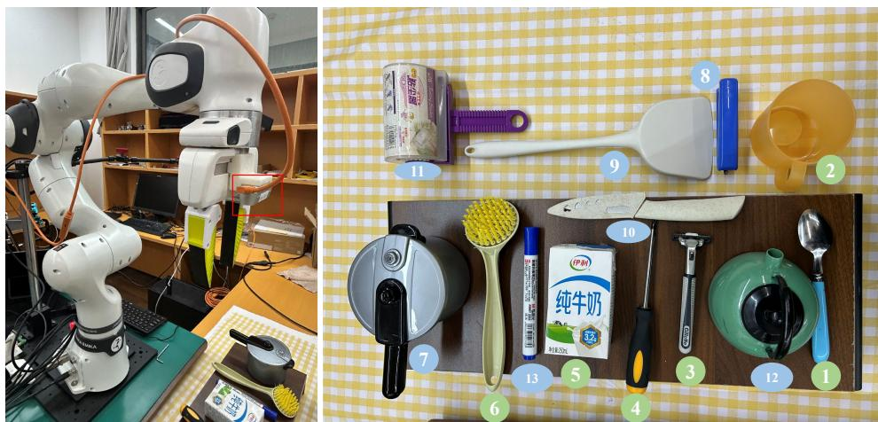  
Figure 6: Real-World Experimental Setup. A Franka FR3 robotic arm is equipped with an eyein-hand RealSense D435i camera mounted on the end-effector. The test set consists of 13 common household objects, where objects 1–6 are used to evaluate referring grasping performance, and objects 7–13 are used to assess reasoning-based grasping performance.

Table 9: Object Prompts for Real-World Robotic Vision-Language Grasping.
<table><tr><td>Object ID</td><td>Object Name</td><td>Prompt</td></tr><tr><td></td><td colspan="2">Referring</td></tr><tr><td>1</td><td>Blue Spoon</td><td>Please give me the blue spoon.</td></tr><tr><td>2</td><td>Orange Cup</td><td>Please grasp the orange cup.</td></tr><tr><td>3</td><td>Razor</td><td>Please pick up the grey and black razor.</td></tr><tr><td>4</td><td>Screwdriver</td><td>Please give me the screwdriver.</td></tr><tr><td>5</td><td>Milk Box</td><td>Please give me the milk box.</td></tr><tr><td>6</td><td>Green Brush</td><td>Please grasp the green brush.</td></tr><tr><td colspan="3">Reasoning</td></tr><tr><td>7 8</td><td>Pressure Cooker</td><td>I want to braise pork ribs. Can you find a suitable kitchen utensil for me in the image?</td></tr><tr><td></td><td>Blue Stapler</td><td>Please give me the blue tool on the induction cooker.</td></tr><tr><td>9</td><td>Shovel</td><td>Please use the tool to stir-fry the vegetables in the pan.</td></tr><tr><td>10 11</td><td>Knife</td><td>Please use the tool on the table to cut some fruit for me.</td></tr><tr><td>12</td><td>Rolling Sticker</td><td>Please use the tool on the table that can roll and stick lint to help me deal with my clothes.</td></tr><tr><td>13</td><td>Teapot</td><td>I want to make a cup of tea. Please help me find a container that can hold hot water and steep tea leaves.</td></tr><tr><td></td><td>Marker Pen</td><td>Please find a pen that can write on a whiteboard and be erased.</td></tr></table>

Table 10: Grasp Success Rates (%) on 13 Household Objects.
<table><tr><td>Task</td><td colspan="6">Referring</td><td colspan="6">Reasoning</td><td>Avg.</td></tr><tr><td>ObjectID</td><td>1</td><td>2</td><td>3</td><td>4</td><td>5</td><td>6</td><td>7</td><td>8</td><td>9</td><td>10 11</td><td>12</td><td>13</td><td>1</td></tr><tr><td>RAGNet [46] + GraspNet [133]</td><td>50</td><td>60</td><td>40</td><td>60</td><td>50</td><td>60 30</td><td>40</td><td>30</td><td>40</td><td>30</td><td>40</td><td>40</td><td>43.8</td></tr><tr><td>UniRAP + GraspNet [133]</td><td>70</td><td>70</td><td>60</td><td>70</td><td>60</td><td>50</td><td>40 70</td><td>50</td><td>50</td><td>40</td><td>40</td><td>50</td><td>55.4</td></tr><tr><td>RealVLG-R1 [47]</td><td>80</td><td>60</td><td>70</td><td>80</td><td>70</td><td>70</td><td>50</td><td>80 40</td><td>70</td><td>40</td><td>20</td><td>80</td><td>62.3</td></tr><tr><td>UniRAP (Ours)</td><td>100</td><td>90</td><td>80</td><td>100</td><td>90</td><td>100 80</td><td>80</td><td>70</td><td>90</td><td>80</td><td>90</td><td>100</td><td>88.5</td></tr></table>

To evaluate the effectiveness of the contact poses predicted by UniRAP in real-world vision–language robotic grasping tasks, we adopt a pose-based execution protocol. Specifically, the predicted 4-DoF grasp poses are transformed into the robot base frame using hand–eye calibration parameters and subsequently executed directly by the robotic manipulator. As illustrated in Fig. 6, the experimental platform is built upon a Franka FR3 robotic arm equipped with a RealSense D435i eye-in-hand camera mounted on the end-effector. The test set consists of 13 common household objects across different scenarios, with their names and corresponding prompts used in the experiments listed in Tab. 9.

As shown in Tab. 10, we further evaluate the performance of UniRAP and the baseline method RealVLG-R1 (3B) [47] on two types of tasks, namely referring and reasoning language instructions, across 13 test objects, with 10 independent trials per object. RealVLG-R1 directly predicts two contact points to generate grasp poses. Experimental results show that UniRAP achieves a 26.2% higher overall grasp success rate compared to RealVLG-R1, and its performance advantage is particularly pronounced when handling reasoning-based prompts.

In addition, qualitative results are presented in Fig. 12 (Referring) and Fig. 13 (Reasoning), further demonstrating the robustness and generalization capability of UniRAP across diverse scenarios. Video demonstrations of the experiments are provided at https://lif314.github.io/projects/ unirap.

## D Discussions

## D.1 Limitations & Future Work

Due to computational constraints, we were unable to further scale the training data or increase the model size, which in turn limited potential performance gains. Although incorporating pixel-level visual question answering tasks, such as PixelQA [15], may offer additional benefits, these were not included within the scope of this study.

Given that this work focuses on perception models for embodied scenarios, we argue that it is important to investigate the capability boundaries of smaller models, with an emphasis on achieving real-time actionable perception. Such an approach facilitates deployment on edge devices and reduces the overall computational demands of real-world systems.

## D.2 Potential Societal Impacts

This work presents a pixel-level vision–language perception framework tailored for embodied scenarios, enabling a unified formulation that spans coarse-grained object detection and segmentation, functional segmentation, and physical interaction pose estimation. The proposed approach is particularly relevant to application domains requiring frequent and adaptive interaction between agents and their environments, such as robotic home assistance, security, and healthcare. These settings typically demand fine-grained understanding of images and videos, as well as the capability to reason about physical interactions. Moreover, in other embodied applications involving multimodal intelligent agents, the proposed framework can serve as a more expressive and practical alternative.

To the best of our knowledge, this work does not raise any specific potential negative societal impacts that require explicit disclosure.

## E Licenses

Our UniRAP is built based on the pre-trained Qwen2.5-VL [8] and SAM2 [113] models. They are both licensed under the Apache License 2.0 (https://www.apache.org/licenses/LICENSE-2.0).

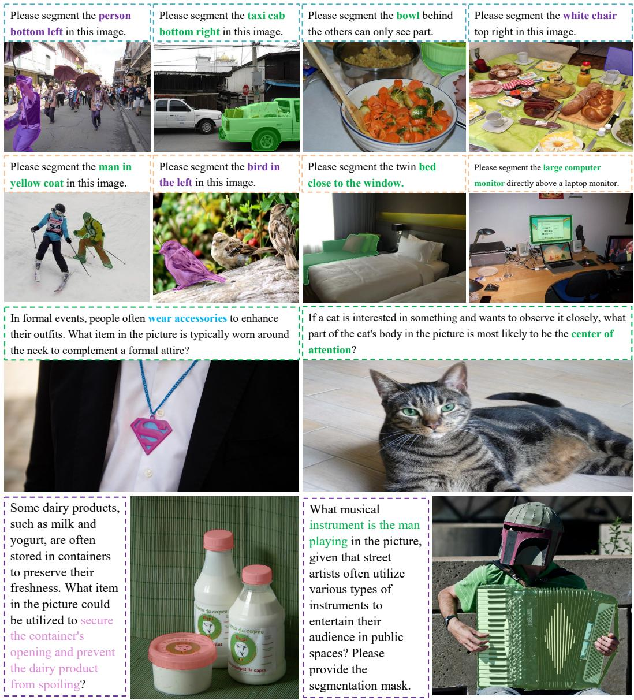  
Figure 7: Qualitative Results of Referring Expression and Reasoning Segmentation.

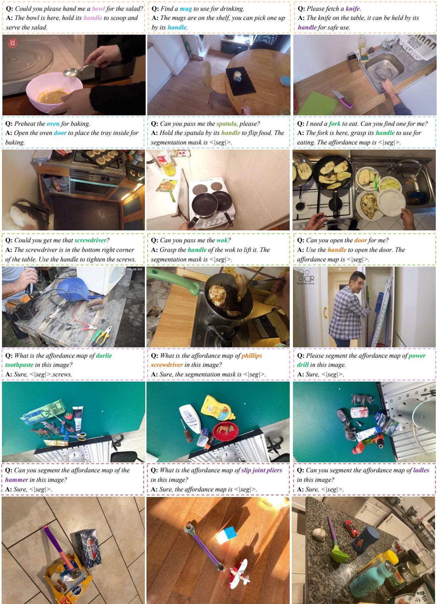  
Figure 8: Qualitative Results of Affordance Segmentation.

Which wine bottle(s) has/have a black body?  
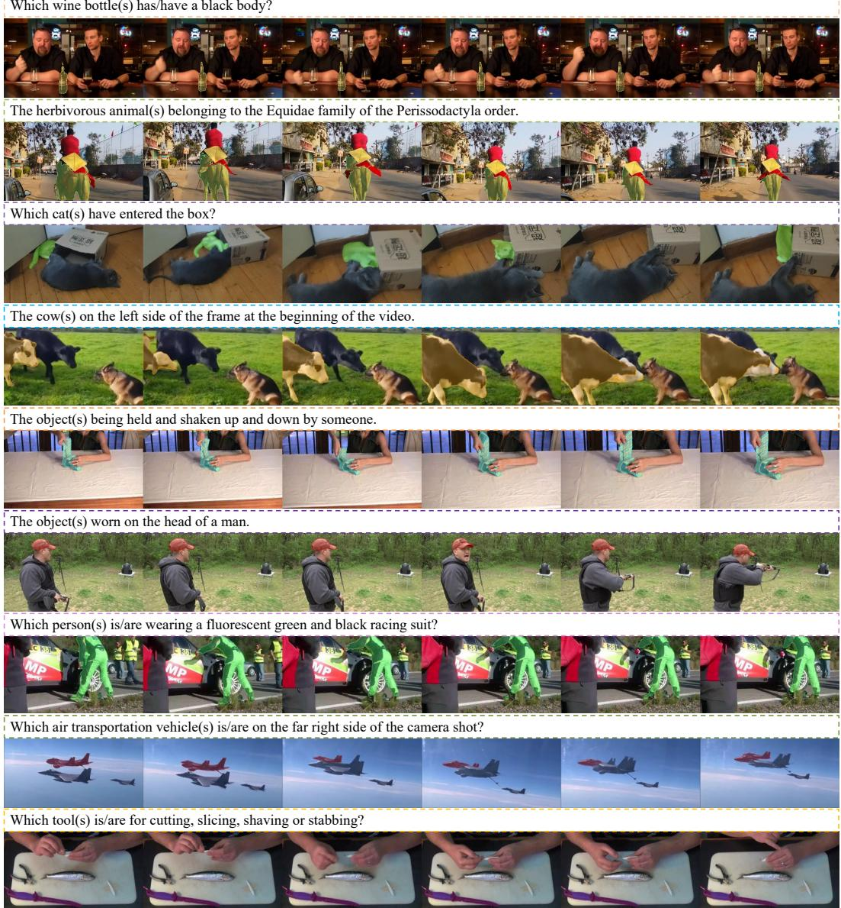  
Figure 9: Qualitative Results of Referring and Reasoning Video Object Segmentation.

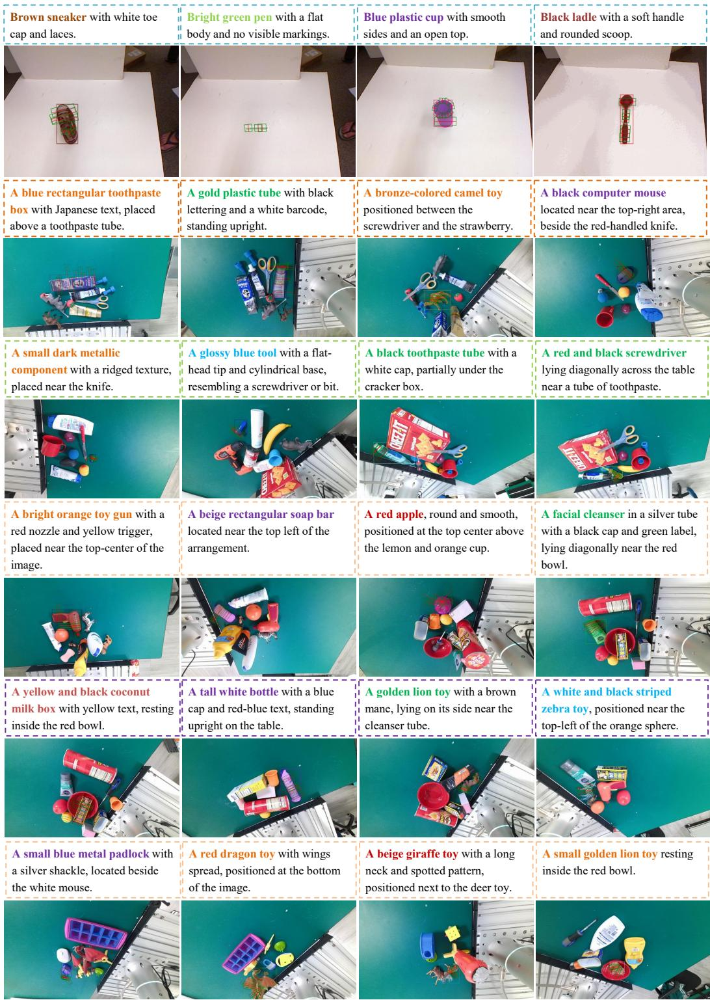  
Figure 10: Qualitative Results of Actionable Perception on RealVLG-Benchmark [47].

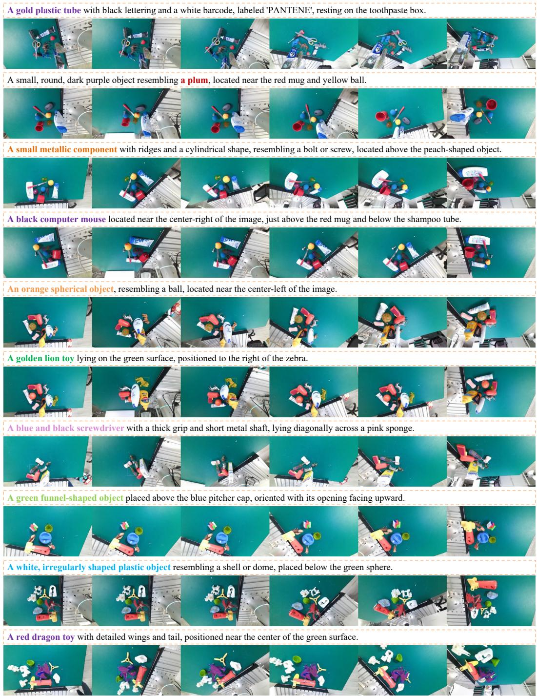  
Figure 11: Qualitative Results of Spatio-Temporal Actionable Perception. To evaluate the temporal consistency of UniRAP’s actionable perception, we construct pseudo-sequences by randomly sampling 6 frames from each scene in the RealVLG-GraspNet subset, due to the absence of videobased grasping datasets.

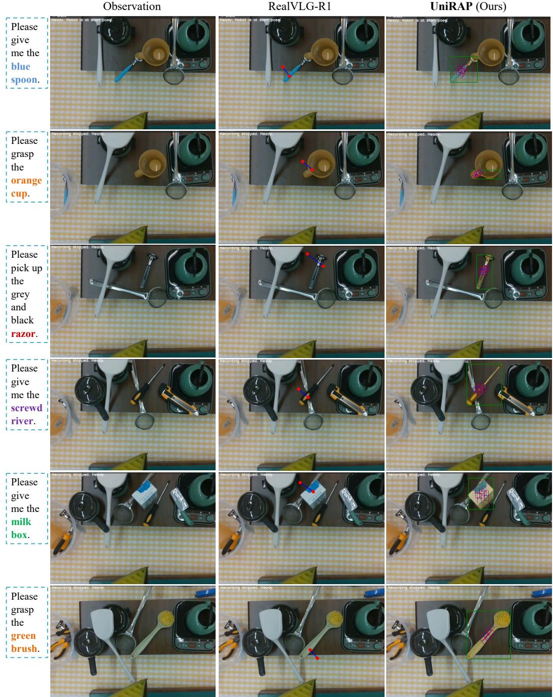  
Figure 12: Qualitative Results of Real-World Referring Vision-Language Grasping.

Observation  
RealVLG-R1  
UniRAP (Ours)  
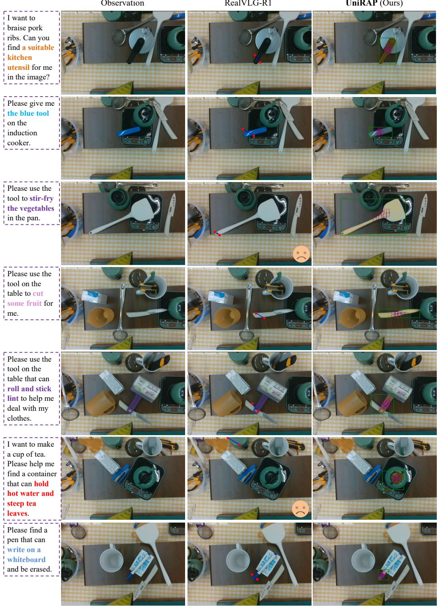  
Figure 13: Qualitative Results of Real-World Reasoning-Based Vision-Language Grasping. Compared to RealVLG-R1, UniRAP exhibits a stronger affordance modeling capability, enabling it to predict more physically plausible grasp poses, such as correctly identifying appropriate grasp regions on objects like a Shovel. In addition, UniRAP demonstrates more robust localization performance. For instance, RealVLG-R1 fails to accurately localize the Teapot, whereas UniRAP successfully identifies a valid interaction region and produces a stable grasp prediction.

## NeurIPS Paper Checklist

The checklist is designed to encourage best practices for responsible machine learning research, addressing issues of reproducibility, transparency, research ethics, and societal impact. Do not remove the checklist: The papers not including the checklist will be desk rejected. The checklist should follow the references and follow the (optional) supplemental material. The checklist does NOT count towards the page limit.

Please read the checklist guidelines carefully for information on how to answer these questions. For each question in the checklist:

• You should answer [Yes], [No], or [N/A].

• [N/A] means either that the question is Not Applicable for that particular paper or the relevant information is Not Available.

• Please provide a short (1–2 sentence) justification right after your answer (even for [N/A]).

The checklist answers are an integral part of your paper submission. They are visible to the reviewers, area chairs, senior area chairs, and ethics reviewers. You will also be asked to include it (after eventual revisions) with the final version of your paper, and its final version will be published with the paper.

The reviewers of your paper will be asked to use the checklist as one of the factors in their evaluation. While [Yes] is generally preferable to [No], it is perfectly acceptable to answer [No] provided a proper justification is given (e.g., error bars are not reported because it would be too computationally expensive” or “we were unable to find the license for the dataset we used”). In general, answering [No] or [N/A] is not grounds for rejection. While the questions are phrased in a binary way, we acknowledge that the true answer is often more nuanced, so please just use your best judgment and write a justification to elaborate. All supporting evidence can appear either in the main paper or the supplemental material, provided in appendix. If you answer [Yes] to a question, in the justification please point to the section(s) where related material for the question can be found.

IMPORTANT, please:

• Delete this instruction block, but keep the section heading “NeurIPS Paper Checklist",

• Keep the checklist subsection headings, questions/answers and guidelines below.

• Do not modify the questions and only use the provided macros for your answers.

## 1. Claims

Question: Do the main claims made in the abstract and introduction accurately reflect the paper’s contributions and scope?

Answer: [Yes]

Justification: The abstract and introduction outline the key challenges addressed, our contributions, and a summary of the experimental findings.

Guidelines:

• The answer [N/A] means that the abstract and introduction do not include the claims made in the paper.

• The abstract and/or introduction should clearly state the claims made, including the contributions made in the paper and important assumptions and limitations. A [No] or [N/A] answer to this question will not be perceived well by the reviewers.

• The claims made should match theoretical and experimental results, and reflect how much the results can be expected to generalize to other settings.

• It is fine to include aspirational goals as motivation as long as it is clear that these goals are not attained by the paper.

## 2. Limitations

Question: Does the paper discuss the limitations of the work performed by the authors?

Answer: [Yes]

Justification: We include the limitations of our work in Appendix D.1.

Guidelines:

• The answer [N/A] means that the paper has no limitation while the answer [No] means that the paper has limitations, but those are not discussed in the paper.

• The authors are encouraged to create a separate “Limitations” section in their paper.

• The paper should point out any strong assumptions and how robust the results are to violations of these assumptions (e.g., independence assumptions, noiseless settings, model well-specification, asymptotic approximations only holding locally). The authors should reflect on how these assumptions might be violated in practice and what the implications would be.

• The authors should reflect on the scope of the claims made, e.g., if the approach was only tested on a few datasets or with a few runs. In general, empirical results often depend on implicit assumptions, which should be articulated.

• The authors should reflect on the factors that influence the performance of the approach. For example, a facial recognition algorithm may perform poorly when image resolution is low or images are taken in low lighting. Or a speech-to-text system might not be used reliably to provide closed captions for online lectures because it fails to handle technical jargon.

• The authors should discuss the computational efficiency of the proposed algorithms and how they scale with dataset size.

• If applicable, the authors should discuss possible limitations of their approach to address problems of privacy and fairness.

• While the authors might fear that complete honesty about limitations might be used by reviewers as grounds for rejection, a worse outcome might be that reviewers discover limitations that aren’t acknowledged in the paper. The authors should use their best judgment and recognize that individual actions in favor of transparency play an important role in developing norms that preserve the integrity of the community. Reviewers will be specifically instructed to not penalize honesty concerning limitations.

## 3. Theory assumptions and proofs

Question: For each theoretical result, does the paper provide the full set of assumptions and a complete (and correct) proof?

Answer: [N/A]

Justification: This is not a theoretical paper.

Guidelines:

• The answer [N/A] means that the paper does not include theoretical results.

• All the theorems, formulas, and proofs in the paper should be numbered and crossreferenced.

• All assumptions should be clearly stated or referenced in the statement of any theorems.

• The proofs can either appear in the main paper or the supplemental material, but if they appear in the supplemental material, the authors are encouraged to provide a short proof sketch to provide intuition.

• Inversely, any informal proof provided in the core of the paper should be complemented by formal proofs provided in appendix or supplemental material.

• Theorems and Lemmas that the proof relies upon should be properly referenced.

## 4. Experimental result reproducibility

Question: Does the paper fully disclose all the information needed to reproduce the main experimental results of the paper to the extent that it affects the main claims and/or conclusions of the paper (regardless of whether the code and data are provided or not)?

Answer: [Yes]

Justification: We have described the experimental details and have properly cited the opensource assets and materials necessary for reproducing the experiments. The code will be made publicly available upon acceptance.

Guidelines:

• The answer [N/A] means that the paper does not include experiments.

• If the paper includes experiments, a [No] answer to this question will not be perceived well by the reviewers: Making the paper reproducible is important, regardless of whether the code and data are provided or not.

• If the contribution is a dataset and/or model, the authors should describe the steps taken to make their results reproducible or verifiable.

• Depending on the contribution, reproducibility can be accomplished in various ways. For example, if the contribution is a novel architecture, describing the architecture fully might suffice, or if the contribution is a specific model and empirical evaluation, it may be necessary to either make it possible for others to replicate the model with the same dataset, or provide access to the model. In general. releasing code and data is often one good way to accomplish this, but reproducibility can also be provided via detailed instructions for how to replicate the results, access to a hosted model (e.g., in the case of a large language model), releasing of a model checkpoint, or other means that are appropriate to the research performed.

• While NeurIPS does not require releasing code, the conference does require all submissions to provide some reasonable avenue for reproducibility, which may depend on the nature of the contribution. For example

(a) If the contribution is primarily a new algorithm, the paper should make it clear how to reproduce that algorithm.

(b) If the contribution is primarily a new model architecture, the paper should describe the architecture clearly and fully.

(c) If the contribution is a new model (e.g., a large language model), then there should either be a way to access this model for reproducing the results or a way to reproduce the model (e.g., with an open-source dataset or instructions for how to construct the dataset).

(d) We recognize that reproducibility may be tricky in some cases, in which case authors are welcome to describe the particular way they provide for reproducibility. In the case of closed-source models, it may be that access to the model is limited in some way (e.g., to registered users), but it should be possible for other researchers to have some path to reproducing or verifying the results.

## 5. Open access to data and code

Question: Does the paper provide open access to the data and code, with sufficient instructions to faithfully reproduce the main experimental results, as described in supplemental material?

Answer: [Yes]

Justification: We used the public dataset, and we plan to publicly release our code once the status of the paper is confirmed.

Guidelines:

• The answer [N/A] means that paper does not include experiments requiring code.

• Please see the NeurIPS code and data submission guidelines (https://neurips.cc/ public/guides/CodeSubmissionPolicy) for more details.

• While we encourage the release of code and data, we understand that this might not be possible, so [No] is an acceptable answer. Papers cannot be rejected simply for not including code, unless this is central to the contribution (e.g., for a new open-source benchmark).

• The instructions should contain the exact command and environment needed to run to reproduce the results. See the NeurIPS code and data submission guidelines (https: //neurips.cc/public/guides/CodeSubmissionPolicy) for more details.

• The authors should provide instructions on data access and preparation, including how to access the raw data, preprocessed data, intermediate data, and generated data, etc.

• The authors should provide scripts to reproduce all experimental results for the new proposed method and baselines. If only a subset of experiments are reproducible, they should state which ones are omitted from the script and why.

• At submission time, to preserve anonymity, the authors should release anonymized versions (if applicable).

• Providing as much information as possible in supplemental material (appended to the paper) is recommended, but including URLs to data and code is permitted.

## 6. Experimental setting/details

Question: Does the paper specify all the training and test details (e.g., data splits, hyperparameters, how they were chosen, type of optimizer) necessary to understand the results?

Answer: [Yes]

Justification: Details are summarized in Appendix B.

Guidelines:

• The answer [N/A] means that the paper does not include experiments.

• The experimental setting should be presented in the core of the paper to a level of detail that is necessary to appreciate the results and make sense of them.

• The full details can be provided either with the code, in appendix, or as supplemental material.

## 7. Experiment statistical significance

Question: Does the paper report error bars suitably and correctly defined or other appropriate information about the statistical significance of the experiments?

Answer: [No]

Justification: Due to the limited computational resources, we conducted each experiment only once.

Guidelines:

• The answer [N/A] means that the paper does not include experiments.

• The authors should answer [Yes] if the results are accompanied by error bars, confidence intervals, or statistical significance tests, at least for the experiments that support the main claims of the paper.

• The factors of variability that the error bars are capturing should be clearly stated (for example, train/test split, initialization, random drawing of some parameter, or overall run with given experimental conditions).

• The method for calculating the error bars should be explained (closed form formula, call to a library function, bootstrap, etc.)

• The assumptions made should be given (e.g., Normally distributed errors).

• It should be clear whether the error bar is the standard deviation or the standard error of the mean.

• It is OK to report 1-sigma error bars, but one should state it. The authors should preferably report a 2-sigma error bar than state that they have a 96% CI, if the hypothesis of Normality of errors is not verified.

• For asymmetric distributions, the authors should be careful not to show in tables or figures symmetric error bars that would yield results that are out of range (e.g., negative error rates).

• If error bars are reported in tables or plots, the authors should explain in the text how they were calculated and reference the corresponding figures or tables in the text.

## 8. Experiments compute resources

Question: For each experiment, does the paper provide sufficient information on the computer resources (type of compute workers, memory, time of execution) needed to reproduce the experiments?

Answer: [Yes]

Justification: We have a Appendix B.1 on this.

Guidelines:

• The answer [N/A] means that the paper does not include experiments.

• The paper should indicate the type of compute workers CPU or GPU, internal cluster, or cloud provider, including relevant memory and storage.

• The paper should provide the amount of compute required for each of the individual experimental runs as well as estimate the total compute.

• The paper should disclose whether the full research project required more compute than the experiments reported in the paper (e.g., preliminary or failed experiments that didn’t make it into the paper).

## 9. Code of ethics

Question: Does the research conducted in the paper conform, in every respect, with the NeurIPS Code of Ethics https://neurips.cc/public/EthicsGuidelines?

Answer: [Yes]

Justification: We fully adhere to the NeurIPS Code of Ethics.

Guidelines:

• The answer [N/A] means that the authors have not reviewed the NeurIPS Code of Ethics.

• If the authors answer [No], they should explain the special circumstances that require a deviation from the Code of Ethics.

• The authors should make sure to preserve anonymity (e.g., if there is a special consideration due to laws or regulations in their jurisdiction).

## 10. Broader impacts

Question: Does the paper discuss both potential positive societal impacts and negative societal impacts of the work performed?

Answer: [Yes]

Justification: See Appendix D.2.

Guidelines:

• The answer [N/A] means that there is no societal impact of the work performed.

• If the authors answer [N/A] or [No], they should explain why their work has no societal impact or why the paper does not address societal impact.

• Examples of negative societal impacts include potential malicious or unintended uses (e.g., disinformation, generating fake profiles, surveillance), fairness considerations (e.g., deployment of technologies that could make decisions that unfairly impact specific groups), privacy considerations, and security considerations.

• The conference expects that many papers will be foundational research and not tied to particular applications, let alone deployments. However, if there is a direct path to any negative applications, the authors should point it out. For example, it is legitimate to point out that an improvement in the quality of generative models could be used to generate Deepfakes for disinformation. On the other hand, it is not needed to point out that a generic algorithm for optimizing neural networks could enable people to train models that generate Deepfakes faster.

• The authors should consider possible harms that could arise when the technology is being used as intended and functioning correctly, harms that could arise when the technology is being used as intended but gives incorrect results, and harms following from (intentional or unintentional) misuse of the technology.

• If there are negative societal impacts, the authors could also discuss possible mitigation strategies (e.g., gated release of models, providing defenses in addition to attacks, mechanisms for monitoring misuse, mechanisms to monitor how a system learns from feedback over time, improving the efficiency and accessibility of ML).

## 11. Safeguards

Question: Does the paper describe safeguards that have been put in place for responsible release of data or models that have a high risk for misuse (e.g., pre-trained language models, image generators, or scraped datasets)?

Answer: [N/A]

Justification: The paper poses no such risks.

Guidelines:

• The answer [N/A] means that the paper poses no such risks.

• Released models that have a high risk for misuse or dual-use should be released with necessary safeguards to allow for controlled use of the model, for example by requiring that users adhere to usage guidelines or restrictions to access the model or implementing safety filters.

• Datasets that have been scraped from the Internet could pose safety risks. The authors should describe how they avoided releasing unsafe images.

• We recognize that providing effective safeguards is challenging, and many papers do not require this, but we encourage authors to take this into account and make a best faith effort.

## 12. Licenses for existing assets

Question: Are the creators or original owners of assets (e.g., code, data, models), used in the paper, properly credited and are the license and terms of use explicitly mentioned and properly respected?

Answer: [Yes]

Justification: The paper properly credits the creators or original owners of the assets used, such as code, data, and models. We also have correctly cited the relevant literature.

Guidelines:

• The answer [N/A] means that the paper does not use existing assets.

• The authors should cite the original paper that produced the code package or dataset.

• The authors should state which version of the asset is used and, if possible, include a URL.

• The name of the license (e.g., CC-BY 4.0) should be included for each asset.

• For scraped data from a particular source (e.g., website), the copyright and terms of service of that source should be provided.

• If assets are released, the license, copyright information, and terms of use in the package should be provided. For popular datasets, paperswithcode.com/datasets has curated licenses for some datasets. Their licensing guide can help determine the license of a dataset.

• For existing datasets that are re-packaged, both the original license and the license of the derived asset (if it has changed) should be provided.

• If this information is not available online, the authors are encouraged to reach out to the asset’s creators.

## 13. New assets

Question: Are new assets introduced in the paper well documented and is the documentation provided alongside the assets?

Answer: [N/A]

Justification: We will disclose the code after the confirmation of the status of the paper, but currently no new assets is available.

Guidelines:

• The answer [N/A] means that the paper does not release new assets.

• Researchers should communicate the details of the dataset/code/model as part of their submissions via structured templates. This includes details about training, license, limitations, etc.

• The paper should discuss whether and how consent was obtained from people whose asset is used.

• At submission time, remember to anonymize your assets (if applicable). You can either create an anonymized URL or include an anonymized zip file.

## 14. Crowdsourcing and research with human subjects

Question: For crowdsourcing experiments and research with human subjects, does the paper include the full text of instructions given to participants and screenshots, if applicable, as well as details about compensation (if any)?

Answer: [N/A]

Justification: The paper does not involve crowdsourcing nor research with human subjects. Guidelines:

• The answer [N/A] means that the paper does not involve crowdsourcing nor research with human subjects.

• Including this information in the supplemental material is fine, but if the main contribution of the paper involves human subjects, then as much detail as possible should be included in the main paper.

• According to the NeurIPS Code of Ethics, workers involved in data collection, curation, or other labor should be paid at least the minimum wage in the country of the data collector.

## 15. Institutional review board (IRB) approvals or equivalent for research with human subjects

Question: Does the paper describe potential risks incurred by study participants, whether such risks were disclosed to the subjects, and whether Institutional Review Board (IRB) approvals (or an equivalent approval/review based on the requirements of your country or institution) were obtained?

Answer: [N/A]

Justification: The paper does not involve crowdsourcing nor research with human subjects. Guidelines:

• The answer [N/A] means that the paper does not involve crowdsourcing nor research with human subjects.

• Depending on the country in which research is conducted, IRB approval (or equivalent) may be required for any human subjects research. If you obtained IRB approval, you should clearly state this in the paper.

• We recognize that the procedures for this may vary significantly between institutions and locations, and we expect authors to adhere to the NeurIPS Code of Ethics and the guidelines for their institution.

• For initial submissions, do not include any information that would break anonymity (if applicable), such as the institution conducting the review.

## 16. Declaration of LLM usage

Question: Does the paper describe the usage of LLMs if it is an important, original, or non-standard component of the core methods in this research? Note that if the LLM is used only for writing, editing, or formatting purposes and does not impact the core methodology, scientific rigor, or originality of the research, declaration is not required.

Answer: [N/A]

Justification: The core method development in this research does not involve LLMs as any important, original, or non-standard components.

Guidelines:

• The answer [N/A] means that the core method development in this research does not involve LLMs as any important, original, or non-standard components.

• Please refer to our LLM policy in the NeurIPS handbook for what should or should not be described.