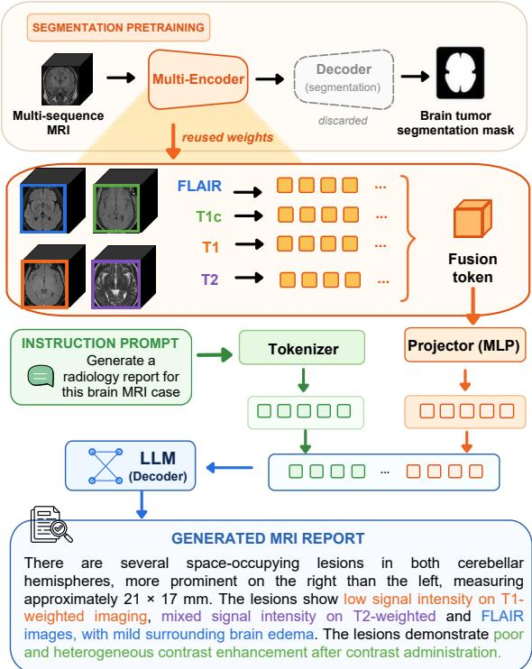
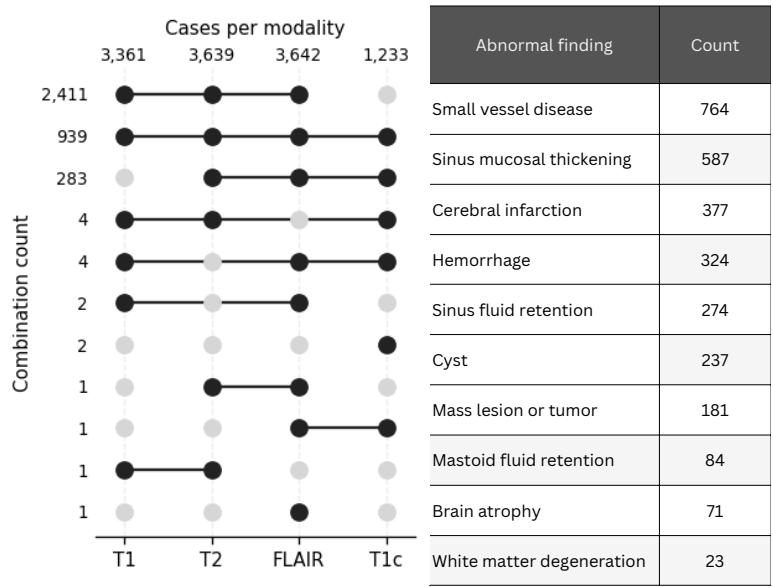
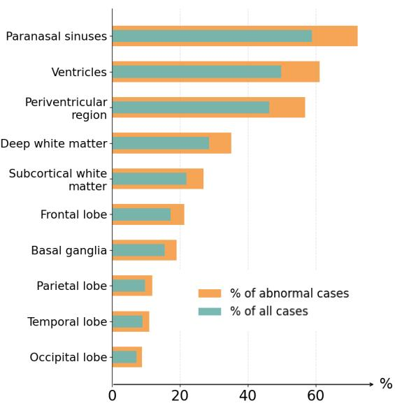
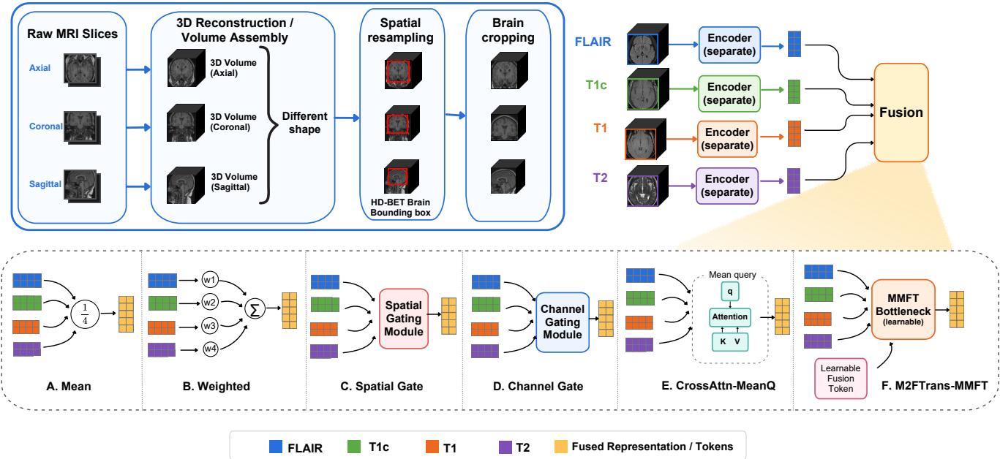
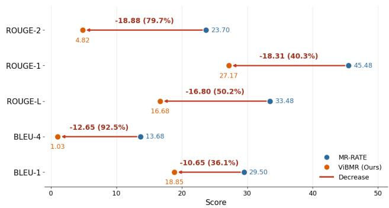

# ViBMR: A Large-Scale Multi-Sequence Brain MRI Dataset and Comprehensive Evaluation for Vietnamese Radiology Report Generation

Dai Lam Le1, Minh Khoi Nguyen1, Son Dinh Nguyen1, Amir Reza Jafari2,   
Viet Ha3, Nguyen Son4, Reza Farahbakhsh2, Noel Crespi2, Phi Le Nguyen1 1AI4LIFE, Hanoi University of Science and Technology, Vietnam 2SAMOVAR, Tel´ ecom SudParis, Institut Polytechnique de Paris, France ´ 3Concordia International School Hanoi, Vietnam 4Hanoi – Amsterdam High School for the Gifted, Vietnam

1{lam.ld225982@sis, khoi.nm226050@sis, son.dn225997@sis, lenp@soict}.hust.edu.vn 2{amir-reza.jafari tehrani, reza.farahbakhsh, noel.crespi}@telecom-sudparis.eu 3vietha.icloud@gmail.com, 4sonn342@os.viettel.com.vn

## Abstract

Automated radiology report generation for multi-sequence brain MRI holds strong promise for alleviating radiologists’ workload, yet it remains a demanding problem: brain MRI studies are inherently volumetric, each pulse sequence carries complementary diagnostic information, and annotated data are critically scarce for low-resource clinical languages. Existing brain MRI-report resources are still dominated by English reports, translated clinical text, or datasets adapted from task-specific imaging benchmarks, leaving routine low-resource clinical reporting and heterogeneous multi-sequence MRI protocols insufficiently represented. To bridge this gap, we introduce ViBMR, to the best of our knowledge, the first large-scale multi-sequence brain MRI dataset paired with routine Vietnamese clinical reports, comprising 3,649 patients and 11,875 MRI series across T1, T2, FLAIR, and contrast-enhanced T1 sequences. Building on ViBMR, we establish a comprehensive evaluation setup for brain MRI report generation, covering representative medical vision-language models, multisequence inputs, and feature aggregation strategies. The results provide key insights into dataset characteristics and model behavior, while demonstrating the necessity of native low-resource clinical datasets for reliable Vietnameseorigin brain MRI report generation. Our dataset and baseline models will be releasedfor non-commercial research.

## 1. Introduction

Recent advances in Vision-Language Models (VLMs) have driven remarkable progress in healthcare AI, particularly for automated radiology report generation [7, 8, 16, 35, 36]. Among imaging modalities, brain Magnetic Resonance Imaging (MRI) plays a pivotal role in detecting and characterizing intracranial abnormalities. Unlike many other modalities, routine brain MRI is acquired as a multisequence study, in which T1, T2, FLAIR, and contrastenhanced T1 (T1c) provide mutually complementary information: T2 and FLAIR are sensitive to edema and white matter lesions, whereas T1c better characterizes enhancement patterns [4, 9, 22, 34, 37]. Automating the joint interpretation of these sequences and synthesizing them into a textual report could substantially reduce radiologists’ workload and shorten diagnostic turnaround.

  
Figure 1. Overview of the proposed brain MRI report generation framework. A multi-sequence MRI encoder is pretrained on segmentation and its weights are reused to extract visual tokens from FLAIR, T1c, T1, and T2 sequences. The fused visual tokens are projected and concatenated with instruction prompt tokens, then fed into an LLM decoder to generate the final MRI report.

Despite this progress, most existing brain MRI-report datasets are constructed and released in English, leaving low-resource clinical languages largely unaddressed [1, 10, 18, 21, 24, 28, 32]. This is a critical limitation, because radiology reports are strongly language, institution, and population-dependent: writing style, terminology, abbreviation usage, and the granularity of anatomical description can differ markedly across hospitals and regions [6, 12, 29, 31]. Furthermore, the epidemiological and morphological characteristics of Asian populations often differ from those of European and North American cohorts in both disease prevalence and body habitus [11, 19, 27]. Together with differences in language, reporting conventions, acquisition protocols, and dataset composition, these factors motivate our cross-dataset analysis in RQ1. Beyond the language barrier, some existing “report generation” datasets do not originate from routine clinical reports. Instead, they are repurposed from datasets built for other tasks such as lesion segmentation, with findings and impressions subsequently authored by hired radiologists for pre-annotated regions [3, 24, 26]. This construction process yields report structures that deviate from the actual hospital workflow, in which reports are formed directly from a radiologist’s reading of the scan.

Addressing these challenges requires two ingredients in tandem: (i) a dataset for a low-resource language that faithfully reflects routine clinical reporting, and (ii) a comprehensive empirical study that clarifies which visual components and fusion strategies are genuinely beneficial for multi-sequence brain MRI report generation. Existing resources, however, satisfy neither requirement, especially for Vietnamese. In this paper, we bridge this gap through two main contributions:

First, we introduce ViBMR, the first and, to the best of our knowledge, largest multi-sequence brain MRI dataset paired with routine Vietnamese clinical reports. The dataset is collected from a tertiary hospital in Vietnam and comprises 3,649 patients with 11,875 series. It covers the four MRI sequences commonly used in neuroimaging practice, including T1, T2, FLAIR, and T1c, as well as diverse sequence combinations that reflect the variability of realworld acquisition protocols. The reports are extracted directly from hospital records and exhibit the long-tailed distribution characteristic of clinical practice, ranging from frequent findings such as small vessel disease to rare but clinically significant abnormalities (see Figure 2). ViBMR therefore provides a large-scale Vietnamese resource for studying medical report generation in a low-resource language setting.

Second, building on ViBMR, we conduct a set of research questions around brain MRI report generation in this low-resource setting. We systematically evaluate the transferability of segmentation-pretrained multi-sequence encoders to report generation, analyze the contribution of individual MRI sequences and their combinations, compare multiple feature aggregation strategies ranging from mean fusion and learnable weighted fusion to spatial gating, channel gating, and cross-attention, and quantify the cross-dataset generalization gap between existing datasets and Vietnamese-origin reports. These experiments establish reliable baselines for ViBMR and provide practical empirical insights for future model design in multi-sequence brain MRI report generation.

## 2. Related Work

Datasets for Brain MRI Report Generation. Public brain MRI datasets have substantially advanced medical image analysis, especially for lesion segmentation, disease classification, and algorithmic benchmarking. Representative benchmarks such as BraTS [2], ISLES [15], the WMH Segmentation Challenge [20], and ATLAS [25] provide high-quality annotations for specific clinical scenarios, including glioma, stroke lesions, white matter hyperintensities, and post-stroke lesion segmentation. However, these resources are primarily designed for anomaly segmentation tasks, rather than for learning the correspondence between multi-sequence brain MRI studies and freetext diagnostic reports. Recent MRI-text resources have begun to address this gap. RadGenome-Brain MRI [24] provides brain MRI scans, anomaly segmentation masks, and radiologist-written descriptions for abnormal regions, making them suitable for grounded regional report generation. However, RadGenome-Brain MRI is curated from multiple public anomaly segmentation datasets, followed by manually authored findings and impressions for annotated regions [24]. Therefore, its report structure differs from routine radiology reports directly collected from hospital workflows. MR-RATE [10] further expands MRI-text learning by pairing brain and spine MRI studies with radiology reports and metadata. Another important gap is language coverage. Existing MRI image-report resources remain limited for native low-resource clinical languages. Current brain MRI resources are commonly released or standardized in English, including Chinese-to-English processed reports in AutoRG-Brain [24] and Turkish-to-English reports in MR-RATE [10]. Beyond brain MRI, Cervical-RG focuses on 3D multi-sequence cervical cancer MRI report generation [41], while Auto-Rad and SPINE focus on lumbar or spinal MRI report generation using English or LLM-standardized narrative reports [13, 40]. This limitation is important because radiology reports are language, institution, and populationdependent: reporting style, terminology, abbreviation usage, anatomical description granularity, and patient characteristics may differ across hospitals and regions. Therefore, a Vietnamese brain MRI image-report dataset is necessary for studying report generation in a low-resource clinical language setting. In this context, our dataset complements existing brain MRI resources by focusing on routine multisequence brain MRI studies paired with Vietnamese clinical reports.

<table><tr><td>Dataset</td><td>Anatomy</td><td>MRI sequences</td><td>Seg.</td><td>Clin.</td><td>Scale</td></tr><tr><td>MR-RATE [10]</td><td>Brain, Spine</td><td>3D volumetric MRI</td><td>x</td><td>√</td><td>83,425 patients / 705,254 volumes</td></tr><tr><td>SSPH Dataset [24]</td><td>Brain</td><td>T1, T2, FLAIR, DWI</td><td>√</td><td>x</td><td>12,535 cases / 30,793 pairs</td></tr><tr><td>BTReport- BraTS [14]</td><td>Brain</td><td>T1, T1c, T2, FLAIR</td><td>√</td><td>x</td><td>1,470 cases</td></tr><tr><td>RadGenome -Brain MRI [24]</td><td>Brain</td><td>T1, T1c, T2, FLAIR, DWI, ADC</td><td>√</td><td>x</td><td>1,007 cases / 3,408 pairs</td></tr><tr><td>HuskyBrain [14]</td><td>Brain</td><td>T1,T1c, T2, FLAIR</td><td>√</td><td>x</td><td>184 patients</td></tr><tr><td>ViBMR (Ours)</td><td>Brain</td><td>T1,T1c, T2, FLAIR</td><td>x</td><td>√</td><td>3,649 patients / 11,875 series</td></tr></table>

Table 1. Comparison with representative MRI datasets related to report generation and 3D MRI understanding. “Seg.” indicates whether segmentation annotations are provided. “Clin.” indicates whether the dataset provides full-study routine clinical reports directly collected from the clinical workflow.

Models for 3D MRI report generation. Recent medical vision-language models have extended report generation and visual question answering from 2D radiology images to volumetric medical imaging. General 3D medical MLLMs such as M3D-LaMed [1] and Med3DVLM [38] demonstrate the feasibility of aligning 3D medical images with clinical text for tasks including image-text retrieval, VQA, and report generation. For brain MRI, AutoRG-Brain introduces grounded report generation with lesion and anatomical masks [24], PIRTA improves the factuality of acute ischemic stroke report generation from 3D DWI MRI using paired image-domain retrieval and text-domain augmentation [23], and Brain3D adapts a 2D medical vision encoder into a native 3D encoder for volumetric brain tumor MRI report generation [5]. These works demonstrate the potential of 3D visual representations for neuroradiological reporting, but their visual input is commonly formulated as a single volumetric scan 3D image rather than routine multi-sequence brain MRI studies that must be interpreted jointly. Beyond brain MRI, Cervical-RG [41] addresses multi-sequence cervical cancer MRI report generation by concatenating aligned 3D MRI sequences at the input level before ViT-based visual encoding.

## 3. Dataset Construction Process

## 3.1. Data Preprocessing Pipeline

We constructed a large-scale real-world brain MRI datase collected from a major tertiary hospital in Vietnam, consisting of MRI studies from 3,649 patients with diverse intracranial abnormalities and neurological conditions. The radiology reports were extracted from raw hospital PDF documents through a dedicated preprocessing pipeline. To ensure patient privacy and regulatory compliance, all personally identifiable information and sensitive metadata were removed during the anonymization process. We then extracted the findings section of the reports as the groundtruth target for the report generation task. In parallel, we collected the corresponding MRI volumes for each report and aligned them with the extracted report descriptions. Although the number of MRI sequences varies across patients, four modalities are consistently and commonly used in routine neuroimaging practice: T1-weighted (T1), T2-weighted (T2), Fluid-Attenuated Inversion Recovery (FLAIR), and contrast-enhanced T1-weighted imaging (T1c). These modalities provide complementary diagnostic information regarding anatomical structures, lesion characterization, edema, enhancement patterns, and pathological tissue properties. Therefore, we selected these four volumetric MRI sequences as the primary inputs for our evaluation methods. As shown in Fig. 3, for each patient, we first organized the DICOM files by study and sequence, and then assembled the ordered slices into volumetric MRI scans using the spatial information stored in the metadata, including slice position, image orientation, and voxel spacing. Since the raw scans were acquired under heterogeneous clinica protocols, the reconstructed volumes may differ in orientation, spatial resolution, field of view, and matrix size. To reduce this variability, all 3D volumes were resampled to an isotropic spatial resolution of 1 × 1 × 1 mm. We then applied automated brain extraction using HD-BET [17] to obtain brain masks, which were used to suppress non-brain tissues and crop the intracranial region. This step removes irrelevant background structures while preserving the clinically meaningful anatomical context, allowing the model to process each sequence as a standardized 3D volume while maintaining anatomical continuity across slices.

## 3.2. Dataset Characteristics

Our brain MRI dataset contains 3,649 studies with heterogeneous sequence availability and diverse clinical findings. Most studies include T1, T2, and FLAIR sequences accounting for 2,411 cases. A smaller subset of 939 studies contains all four sequences, while 283 studies include T2, FLAIR, and T1c. Other modality combinations are rare.

<table><tr><td rowspan=1 colspan=1>Abnormal finding</td><td rowspan=1 colspan=1>Count</td></tr><tr><td rowspan=1 colspan=1>Small vessel disease</td><td rowspan=1 colspan=1>764</td></tr><tr><td rowspan=1 colspan=1>Sinus mucosal thickening</td><td rowspan=1 colspan=1>587</td></tr><tr><td rowspan=1 colspan=1>Cerebral infarction</td><td rowspan=1 colspan=1>377</td></tr><tr><td rowspan=1 colspan=1>Hemorrhage</td><td rowspan=1 colspan=1>324</td></tr><tr><td rowspan=1 colspan=1>Sinus fluid retention</td><td rowspan=1 colspan=1>274</td></tr><tr><td rowspan=1 colspan=1>Cyst</td><td rowspan=1 colspan=1>237</td></tr><tr><td rowspan=1 colspan=1>Mass lesion or tumor</td><td rowspan=1 colspan=1>181</td></tr><tr><td rowspan=1 colspan=1>Mastoid fluid retention</td><td rowspan=1 colspan=1>84</td></tr><tr><td rowspan=1 colspan=1>Brain atrophy</td><td rowspan=1 colspan=1>71</td></tr><tr><td rowspan=1 colspan=1>White matter degeneration</td><td rowspan=1 colspan=1>23</td></tr></table>

  
Figure 2. Dataset and distribution analysis of the MRI report dataset. (a) Distribution of MRI sequence availability across the dataset. The bar values above each modality indicate the number of cases containing that sequence, while connected black dots represent specific modality combinations and their corresponding case counts among four MRI sequences: T1-weighted imaging (T1), T2-weighted imaging (T2), Fluid-Attenuated Inversion Recovery (FLAIR), and contrast-enhanced T1-weighted imaging (T1c); (b) Top 10 most frequent abnor mal findings; (c) Top 10 most frequently mentioned anatomical regions, comparing their prevalence among all cases and abnormal cases.

This distribution indicates that the dataset is dominated by several common acquisition patterns while still reflecting the variability of routine clinical MRI protocols. As shown in Fig. 2a, this modality imbalance highlights the need for models that can handle incomplete or inconsistent multisequence inputs. To characterize the clinical content of the dataset, we extracted structured clinical labels from the radiology reports. We first identified recurrent expressions describing anatomical regions, laterality, abnormal findings, Fazekas grades, and absence of abnormality. A large language model was used to suggest mappings between semantically equivalent expressions, which were subsequently reviewed and verified by a radiologist. Based on the verified mappings, regular-expression rules were constructed to assign each report a multi-label set.

In addition, the abnormal findings follow a long-tailed distribution (Fig. 2b). Small vessel disease is the most common abnormality, followed by sinus mucosal thickening, cerebral infarction, hemorrhage, sinus fluid retention, cysts, and mass lesions or tumors. Less frequent findings among the top ten include mastoid fluid retention, brain atrophy, and white matter degeneration. As shown in Fig. 2c, the anatomical distribution of the most commonly mentioned regions include the paranasal sinuses, ventricles, periventricular region, deep white matter, subcortical white matter, frontal lobe, and basal ganglia. In addition, a single report may contain multiple co-existing findings across different anatomical regions, such as concurrent chronic small vessel disease, sinus abnormalities, infarction, hemorrhage, or mass-related findings. Therefore, the report generation task is not limited to predicting a single dominant abnormality, but requires the model to describe multiple abnormalities and their corresponding anatomical locations within the same study. These statistics suggest that the dataset covers both intracranial abnormalities and extracranial incidental findings, while also exhibiting substantial imbalance across disease categories and anatomical locations. Such characteristics make report generation challenging, as the model must learn from heterogeneous multi-sequence inputs, frequent routine findings, rare but clinically significant abnormalities, and complex anatomical descriptions.

## 4. Experiment Setup

Research question. Our experiments are designed to answer the following main research questions:

RQ1: How large is the cross-dataset generalization gap between MR-RATE and ViBMR?

RQ2: Do segmentation-pretrained multi-sequence MRI encoders improve brain MRI report generation?

RQ3: Which fusion strategy is most effective for multisequence MRI report generation?

RQ4: How do MRI sequences and modality combinations affect report generation?

Preprocessing and visual feature extraction. We use four MRI sequences as input, namely FLAIR, contrastenhanced T1 (T1c), T1, and T2, as shown in Fig. 3. To handle variations in volume size, each study is divided into overlapping 3D patches of size 128 × 128 × 128 with a stride of 64 along each spatial dimension. If a volume is smaller than the patch size, zero padding is applied before patch extraction. Missing sequences are represented by a modality availability mask and are ignored during modality fusion. For each patch, modality-specific features are extracted by the encoder branches of a segmentationpretrained M2FTrans [33] or mmFormer [42] model and the segmentation decoder branches are removed. Specifically, the FLAIR, T1c, T1, and T2 volumes are passed through corresponding modality encoders, and we take the highlevel feature maps before the original bottleneck fusion module. This produces a tensor of shape [P, 4, 128, 8, 8, 8] for each study, where $P$ denotes the number of extracted patches, 4 denotes the four MRI sequences, 128 is the feature dimension, and $8 \times 8 \times 8$ is the spatial feature grid.

  
Figure 3. Overview of the proposed MRI report generation pipeline. Raw MRI slices from axial, sagittal, and coronal views are first reconstructed into 3D volumes with different input shapes, followed by voxel-size normalization, brain cropping, and organization into four cropped 3D MRI modalities: FLAIR, T1c, T1, and T2. Each modality is processed by a separate encoder, and the resulting modality specific visual features are fused before token extraction. The zoom-in panel illustrates the fusion variants evaluated in this study, including mean fusion, learnable weighted fusion, spatial gating, channel gating, mean-query cross-attention, and the M2FTrans-MMFT bottleneck based fusion strategy.

Fusion variants. To study the effect of multi-sequence fusion on brain MRI report generation, we compare several fusion strategies over modality-specific feature maps extracted from the encoder branches of segmentationpretrained models. Let $\mathbf { X } \in \mathbb { R } ^ { P \times M \times C \times H \times \Breve { W } \times D }$ denote the extracted feature tensor for one study, where $P$ is the number of 3D patches, $M = 4$ is the number of MRI sequences, $C ~ = ~ 1 2 8$ is the feature dimension, and $H \_ =$ $W \ = \ D \ = \ 8$ is the spatial feature resolution. We define $N = H W D$ and denote the feature vector of patch $p ,$ modality m, and spatial location s by $\mathbf { x } _ { p , m , s } \in \mathbb { R } ^ { C }$ , where $s \in \{ 1 , \ldots , N \}$ . We use $\mathbf { X } _ { p , m } \in \bar { \mathbb { R } } ^ { C \times \bar { H } \times W \times D }$ to denote the corresponding modality-specific feature map. A modality availability mask is denoted by $\mathbf { a } \in \{ 0 , 1 \} ^ { M }$ , where $a _ { m } ~ = ~ 1$ indicates that modality $m$ is available. Figure 3 provides an overview of the proposed framework. Missing modalities are zero-filled and excluded from masked averaging and softmax operations using $\mathbf { a } _ { m }$

The first three variants correspond to increasingly adaptive weighted aggregation. Meanfusion simply averages the available modality feature maps at each patch and spatial location. Learnable weighted fusion assigns one trainable global importance score to each MRI sequence, normalizes the scores over available modalities using masked softmax, and shares the resulting weights across patches, spatial locations, and channels. Spatial gating further extends this idea by predicting location-dependent modality weights over the 3D feature grid, allowing different anatomical regions to emphasize different MRI sequences.

We further evaluate channel gating fusion, which models modality importance at the feature-channel level. Each modality feature map is first globally averaged over the spatial grid to obtain a channel descriptor $\begin{array} { r l r } { { \bf r } _ { p , m } } & { { } = } & { \frac { 1 } { N } \sum _ { s = 1 } ^ { N } { \bf x } _ { p , m , s } \in \mathrm { ~  ~ \mathbb ~ { ~ R ~ } ~ } ^ { C } } \end{array}$ An MLP $h _ { \psi } ( \cdot )$ then predicts channel-wise modality logits $\ell _ { p } \ =$ $h _ { \psi } ( \mathrm { C o n c a t } _ { m = 1 } ^ { M } ( \mathbf { r } _ { p , m } ) ) \ \in \ \mathbb { R } ^ { M \times C }$ . The fused feature is computed as

$$
z _ { p , c , s } = \sum _ { m = 1 } ^ { M } \frac { a _ { m } \exp ( \ell _ { p , m , c } ) } { \sum _ { j = 1 } ^ { M } a _ { j } \exp ( \ell _ { p , j , c } ) } x _ { p , m , c , s } .\tag{1}
$$

Unlike spatial gating, where modality weights vary across spatial locations, channel gating assigns modality weights separately for each feature channel and shares them across all spatial locations within the same patch.

In addition, we test an attention-based variant, denoted as CrossAttn-MeanQ. A learnable modality embedding $\mathbf { e } _ { m } \in \mathbb { R } ^ { C }$ is added to each modality token as $\tilde { \mathbf { x } } _ { p , m , s } =$ $\mathbf { x } _ { p , m , s } + \mathbf { e } _ { m }$ . The query at each spatial location is computed as the masked mean of available embedded modality tokens:

$$
\mathbf { q } _ { p , s } = \frac { \sum _ { m = 1 } ^ { M } a _ { m } \tilde { \mathbf { x } } _ { p , m , s } } { \sum _ { m = 1 } ^ { M } a _ { m } } .\tag{2}
$$

The query sequence is denoted as $\mathbf { Q } _ { p } = [ \mathbf { q } _ { p , 1 } , \dots , \mathbf { q } _ { p , N } ] \in$ $\mathbb { R } ^ { N \times \dot { C } }$ . The key and value sequences, $\mathbf { K } _ { p } , \mathbf { \bar { V } } _ { p } \in \mathbb { R } ^ { \bar { M } N \times C }$ are obtained by flattening all embedded modality-specific spatial tokens within the same patch, while tokens from unavailable modalities are masked in the attention operation. The attention-based fused feature is computed as

$$
\begin{array} { r l } & { \mathbf { u } _ { p , s } = \mathrm { L N } \left( \mathbf { q } _ { p , s } + \mathrm { [ M H A } ( \mathbf { Q } _ { p } , \mathbf { K } _ { p } , \mathbf { V } _ { p } ) ] _ { s } \right) , } \\ & { \mathbf { z } _ { p , s } = \mathbf { u } _ { p , s } + \mathrm { F F N } ( \mathbf { u } _ { p , s } ) . } \end{array}\tag{3}
$$

Here, $[ \cdot ] _ { s }$ denotes the attention output corresponding to spatial location s. This design enables token-level crossmodality interaction beyond local weighted summation.

Finally, we include the M2FTrans-MMFT bottleneck fusion as a segmentation-pretrained fusion baseline. For this baseline, we replace the lightweight fusion operators with the official pretrained M2FTrans bottleneck module. For compactness, we denote the ordered modality feature maps of patch p as $\mathbf { X } _ { p } ~ = ~ ( \mathbf { X } _ { p , 1 } , \ldots , \mathbf { X } _ { p , M } )$ . The M2FTrans bottleneck module is denoted by $\Phi _ { \mathrm { B } } ( \cdot )$ . It takes $\mathbf { X } _ { p } ,$ , the modality-availability mask, the pretrained fusion-token sequence, and the pretrained positional embedding as input. We use the updated fusion-token sequence as the fused cross-modality representation:

$$
\begin{array} { r } { \mathbf { T } _ { p } ^ { \prime } = \pi _ { \mathrm { T } } \Big [ \Phi _ { \mathrm { B } } \big ( \mathbf { X } _ { p } , \mathbf { a } , \mathbf { T } _ { p } ^ { 0 } , \mathbf { P } _ { p o s } ; \pmb { \eta } \big ) \Big ] , } \end{array}\tag{4}
$$

where $\pi _ { \mathrm { T } } ( \cdot )$ selects the updated fusion-token sequence from the outputs of the bottleneck module. Here, $\mathbf { T } _ { p } ^ { 0 } \in$ $\mathbb { R } ^ { N \times C }$ is the pretrained fusion-token sequence copied for patch p, Ppos is the pretrained positional embedding, and η denotes the learnable parameters of the bottleneck module. During training, the bottleneck parameters, fusion-token sequence, and positional embedding are fine-tuned. The updated fusion-token sequence is reshaped back to the bottleneck feature grid $( N \to H \times W \times D )$ . This baseline evaluates whether a fusion module pretrained for incomplete multi-modal MRI segmentation can provide useful fused representations for report generation.

After each fusion strategy, the fused feature map $\mathbf { Z } _ { p } \in$ $\mathbb { R } ^ { C \times 8 \times 8 \times 8 }$ is adaptively average pooled to a $\phantom { - } 1 2 \times 2 \times 2$ grid.

Let $\Omega _ { r }$ denote the set of spatial locations assigned to pooled cell r, where $r \in \{ 1 , \ldots , 8 \}$ . Each visual token is obtained by average pooling within the corresponding cell:

$$
\mathbf { v } _ { p , r } = \frac { 1 } { | \Omega _ { r } | } \sum _ { s \in \Omega _ { r } } \mathbf { z } _ { p , s } .\tag{5}
$$

Since the pooled grid contains $2 \times 2 \times 2 = 8$ spatial cells, each patch produces 8 visual tokens, where each token is a C-dimensional feature vector. The study-level visual token sequence is obtained by concatenating tokens from all patches. If the sequence is longer than 64 tokens, it is evenly divided into 64 groups and each group is averaged into one token, producing a compact study-level representation for the LLM.

Language model. The fused visual tokens are mapped into the language-model embedding space using a two-layer visual projector. The projector consists of layer normalization, a linear projection from the visual feature dimension to the LLM hidden size, a GELU activation, and a second linear layer. The projected visual embeddings are concatenated with the textual prompt embeddings and fed into Qwen3-4B-Instruct. The model is trained to generate the findings section of the Vietnamese brain MRI report.

Implementation details and hyperparameters. We split ViBMR into train/validation/test sets with an 8/1/1 ratio at the patient level. Each patient contributes exactly one MRI study, with no patient overlap across splits. During report-generation training, we optimize the fusion module, the visual projector, and the LoRA parameters of the language model. We use LoRA with rank $r ~ = ~ 1 6$ , scaling factor $\alpha = 3 2$ , and dropout rate 0.05. All fusion variants are trained under the same optimization setting for a fair comparison. We train for 20 epochs with a batch size of 1 and use gradient accumulation over 8 steps. The maximum number of visual tokens is set to 64, and the maximum target report length is set to 1024 tokens. We use AdamW as the optimizer. The learning rate is set to $1 \times 1 0 ^ { - 4 }$ for both the fusion module and the visual projector, and $1 \times 1 0 ^ { - 5 }$ for LoRA parameters.

## 5. Evaluation

## 5.1. Evaluation Metrics

We evaluate report generation using BLEU-1, BLEU-4, ROUGE-1, ROUGE-2, ROUGE-L, and BERTScore. While BLEU and ROUGE measure lexical overlap, BERTScore evaluates semantic similarity based on contextualized representations.

To further assess clinical correctness, we apply the previously described clinical label extraction method to both the reference and generated reports. The extracted labels are then compared at the sample level to measure agreement in clinically relevant findings, including anatomical region, laterality, abnormal finding, Fazekas grade, and absence of abnormality. For sample i, let $T _ { i }$ and $G _ { i }$ denote the clinical label sets extracted from the reference and generated reports, respectively. We define $T P _ { i } = | T _ { i } \cap G _ { i } |$ $F P _ { i } = | G _ { i }  T _ { i } |$ , and $F N _ { i } = | T _ { i }  \setminus G _ { i } |$ . The sample-level clinical F1 score is computed as

$$
F 1 _ { i } = \frac { 2 T P _ { i } } { 2 T P _ { i } + F P _ { i } + F N _ { i } } .\tag{6}
$$

The final Clinical-F1 score is obtained by averaging the sample-level F1 scores over all evaluable reports.

## 5.2. Result and Analysis

## RQ1. Cross-dataset Generalization.

Models trained on MR-RATE show limited generalization to Vietnamese-origin reports. To examine this, we use an M2FTrans and Qwen3-4B-Instruct [39] baseline, where the segmentation-pretrained M2FTrans bottleneck is fine-tuned jointly with LoRA adapters in the LLM. We randomly sample 899 brain MRI cases from MR-RATE and split them into training, validation, and test sets with an 8:1:1 ratio. The model is trained on MR-RATE, then evaluated on both the held-out MR-RATE test split and the ViBMR test set. For ViBMR, reports are translated into English using the GPT-5.4 API model [30], while preserving medical keywords and domain-specific terminology. As shown in Figure 4, performance of the model drops from 29.50 to 18.85 BLEU-1, 13.68 to 1.03 BLEU-4, and 33.48 to 16.68 ROUGE-L when moving from MR-RATE to ViBMR test set. The largest gaps occur in ROUGE-1 and ROUGE-2, both exceeding 18 points, indicating a substantial crossdataset performance gap. However, this experiment does not isolate the specific source of this degradation. Possible contributing factors include translation artifacts, differences in reporting style and clinical expression, population and disease distributions, scanner and imaging protocol differences, and overall dataset composition. Therefore, the observed gap should be interpreted as evidence of cross-dataset domain shift rather than being attributed to any single factor. These results suggest that ViBMR provides a complementary setting for studying the robustness and cross-dataset generalization of medical vision-language models in a low-resource clinical and linguistic context.

## RQ2. Effect of Segmentation-Pretrained MRI Encoders.

Segmentation-pretrained multi-sequence MRI encoders provide stronger visual representations for brain MRI report generation than the evaluated single-modality baselines. Using the default setting of the encoder baselines, under the same LoRA adapter setting on the decoder-side, the M2FTrans encoder with Qwen3-4B-Instruct achieves the best performance in six of seven metrics, as shown in

  
Figure 4. Cross-dataset generalization after language normalization. The model is trained on MR-RATE and evaluated on both MR-RATE and ViBMR. Decrease denotes the performance decrease from MR-RATE to ViBMR. A larger Decrease indicates a larger generalization gap.

Table 2. Moreover, mmFormer encoder baseline also obtains competitive results and ranks second on most metrics, indicating that segmentation-pretrained MRI encoders can be effectively transferred from dense prediction tasks to clinical text generation. The comparison further suggests that multi-sequence input is important for generating more accurate brain MRI reports. M2FTrans and mm-Former baselines can process multiple MRI sequences simultaneously, whereas AutoRG-Brain and M3D are evaluated using single-modality input. Their stronger overall performance also indicates that complementary information from different MRI sequences provides richer visual evidence for report generation. Although AutoRG-Brain obtains the highest ROUGE-1 score, its lower scores across the remaining metrics suggest that this advantage is mainly limited to unigram-level overlap and does not consistently extend to longer phrase-level, semantic, or clinical agreement. These results answer RQ2 by showing that segmentation-pretrained multi-sequence MRI encoders are effective visual backbones for brain MRI report generation.

<table><tr><td></td><td>M2FTrans (Encoder)</td><td>mmFormer (Encoder)</td><td>AutoRG-Brain</td><td>M3D</td></tr><tr><td>BLEU-1</td><td>68.09</td><td>64.31</td><td>54.44</td><td>42.09</td></tr><tr><td>BLEU-4</td><td>60.04</td><td>58.22</td><td>47.25</td><td>35.32</td></tr><tr><td>ROUGE-1</td><td>75.02</td><td>72.59</td><td>78.12</td><td>57.06</td></tr><tr><td>ROUGE-2</td><td>66.67</td><td>65.68</td><td>62.80</td><td>47.52</td></tr><tr><td>ROUGE-L</td><td>70.17</td><td>68.69</td><td>65.85</td><td>50.94</td></tr><tr><td>BERT</td><td>87.02</td><td>85.55</td><td>83.30</td><td>80.80</td></tr><tr><td>CLIN</td><td>69.47</td><td>66.18</td><td>58.79</td><td>45.28</td></tr></table>

Table 2. Comparison of brain MRI report generation model performance under the same LoRA adapter setting for decoder models. M2FTrans and mmFormer are used as encoder baselines with Qwen3-4B-Instruct as the language model. BERT denotes the BERTscore F1, while CLIN denotes the Clinical-F1 score. The best value for each metric is shown in bold, and the second-best value is underlined.

## RQ3. Effect of Different Fusion Strategies.

For M2FTrans, mean fusion achieves the highest BLEU-4 and Clinical-F1, while channel gating leads in ROUGE-2 and BERTScore. For mmFormer, weighted fusion performs best on BLEU-4, ROUGE-2, and BERTScore, whereas mean fusion leads in Clinical-F1 (Table 3). Overall, lightweight fusion methods generally outperform CrossAttn-MeanQ, suggesting that segmentation-pretrained features can be effectively aggregated without complex attention mechanisms. However, the optimal fusion strategy varies across encoders and evaluation metrics.

<table><tr><td>Encoder</td><td>Fusion</td><td>BLEU-4</td><td>ROUGE-2</td><td>BERT</td><td>CLIN</td></tr><tr><td rowspan="5">M2FTrans</td><td>mean weighted</td><td>59.13 51.02</td><td>72.62</td><td>87.25</td><td>72.33</td></tr><tr><td></td><td>58.32</td><td>66.75</td><td>85.48</td><td>68.56</td></tr><tr><td>spatial_gate</td><td></td><td>72.24</td><td>87.25</td><td>71.62</td></tr><tr><td>channel_gate</td><td>58.95</td><td>72.64</td><td>87.37</td><td>70.41</td></tr><tr><td>crossattn_meanq m2ftrans_mmft</td><td>53.8 58.3</td><td>68.95 72.22</td><td>85.89</td><td>69.84</td></tr><tr><td rowspan="6">mmFormer</td><td>mean</td><td>59.79</td><td>72.94</td><td>87.10 87.44</td><td>70.84 71.75</td></tr><tr><td>weighted</td><td>60.8</td><td>73.45</td><td>87.49</td><td>71.62</td></tr><tr><td>spatial_gate</td><td>59.51</td><td>73.08</td><td>87.45</td><td>71.40</td></tr><tr><td>channel_gate</td><td>60.39</td><td>73.42</td><td>87.37</td><td>71.36</td></tr><tr><td>crossattn_meanq</td><td>50.3</td><td>66.7</td><td>85.22</td><td>68.89</td></tr><tr><td>mmformer</td><td>55.82</td><td>70.31</td><td>86.45</td><td>70.55</td></tr></table>

Table 3. Comparison of different fusion strategies for MRI report generation using visual encoders initialized from M2FTrans and mmFormer checkpoints. The best value in each encoder group is shown in bold, and the second-best value is underlined. The final row in each group denotes the original baseline configuration.

## RQ4. Contribution of Different MRI Sequences.

For this modality ablation study, we select the two bestperforming fusion strategies and two original baselines, evaluating selected modality combinations on the same subset of 939 studies containing all four sequences. Different combinations are constructed by masking selected se quences. As shown in Table 4, most methods benefit from multi-sequence inputs, with the strongest performance generally obtained using T1+T2+FLAIR or all four modalities. However, improvements vary across fusion strategies. In particular, M2FTrans-MMFT achieves relatively consistent performance across modality combinations, potentially benefiting from its pretrained fusion tokens that capture modality relationships. Overall, these results highlight the benefits of complementary MRI sequences, the effectiveness of T1+T2+FLAIR, and the importance of fusion design for exploiting multi-modality information.

## 6. Conclusion

In this paper, we introduced ViBMR, a large-scale multisequence brain MRI dataset paired with routine Vietnamese clinical reports, and presented a systematic study of automated brain MRI report generation. Our experiments show that segmentation-pretrained multi-sequence MRI encoders provide effective visual representations, while lightweight

<table><tr><td>Encoder</td><td>Method</td><td>Modality</td><td>B-4</td><td>R-L</td><td>BERT</td><td>CLIN</td></tr><tr><td rowspan="9">M2FTrans</td><td rowspan="5">mean</td><td>T1 T2</td><td>40.70 40.94</td><td>58.99</td><td>80.25</td><td>50.09</td></tr><tr><td></td><td></td><td>61.46</td><td>82.57</td><td>62.79</td></tr><tr><td>FLAIR</td><td>48.19</td><td>66.62</td><td>83.66</td><td>61.83</td></tr><tr><td>T1+T2</td><td>50.53</td><td>67.52</td><td>84.43</td><td>62.57</td></tr><tr><td>T1+T2+FLAIR</td><td>59.29</td><td>74.55</td><td>87.21</td><td>71.75</td></tr><tr><td>All |T1</td><td>53.77</td><td>70.58</td><td>85.15</td><td>69.71</td></tr><tr><td rowspan="6">T2 m2ftrans_mmft All</td><td></td><td>54.11 56.22</td><td>70.79</td><td>85.23</td><td>65.63</td></tr><tr><td></td><td></td><td>72.51</td><td>85.92</td><td>67.62</td></tr><tr><td>FLAIR</td><td>56.67</td><td>72.85</td><td>85.44</td><td>66.24</td></tr><tr><td>T1+T2</td><td>54.55</td><td>71.03</td><td>85.52</td><td>67.70</td></tr><tr><td>T1+T2+FLAIR</td><td>55.72</td><td>71.99</td><td>86.18</td><td>69.82</td></tr><tr><td>T1 T2</td><td>55.11 39.44</td><td>71.68</td><td>85.43</td><td>68.41</td></tr><tr><td rowspan="8">mmFormer weighted</td><td rowspan="5">mmformer</td><td></td><td></td><td>60.38</td><td>82.09</td><td>54.99</td></tr><tr><td></td><td>55.16</td><td>71.28</td><td>85.01</td><td>65.10</td></tr><tr><td>FLAIR</td><td>23.62</td><td>50.49</td><td>78.89</td><td>58.70</td></tr><tr><td>T1+T2</td><td>52.29</td><td>69.09</td><td>84.19</td><td></td></tr><tr><td>T1+T2+FLAIR</td><td>58.54</td><td></td><td></td><td>62.90</td></tr><tr><td>All</td><td>56.11</td><td>74.58 72.30</td><td>86.95 85.47</td><td>71.41 67.27</td></tr><tr><td>|T1</td><td>42.01</td><td>60.06</td><td>81.23</td><td>53.55</td></tr><tr><td>T2</td><td>49.24</td><td>66.95</td><td>83.81</td><td>64.25</td></tr><tr><td>FLAIR</td><td>54.09</td><td>70.89</td><td>85.71</td><td>67.75</td></tr><tr><td>T1+T2</td><td>46.40</td><td>63.96</td><td>82.20</td><td>59.89</td></tr><tr><td></td><td>T1+T2+FLAIR</td><td>58.52</td><td>73.83</td><td>86.89</td><td>70.57</td></tr><tr><td rowspan="2"></td><td>All</td><td></td><td></td><td></td><td></td></tr><tr><td></td><td>55.51</td><td>71.15</td><td>85.43</td><td>67.24</td></tr></table>

Table 4. Comparison of modality importance across different fusion methods using M2FTrans and mmFormer encoder checkpoints. In the Modality column, the ”+” symbol denotes combining additional sequences. ”All” denotes using all four available MRI modalities. B-4 and R-L denote BLEU-4 and ROUGE-L, respectively. The best value for each metric within each method is shown in bold, and the second-best value is underlined.

fusion strategies such as mean fusion, weighted fusion, and gating are generally more stable than complex attentionbased fusion. We also observe that multi-sequence inputs improve report generation and that models trained on existing English MRI-report datasets exhibit a clear generalization gap when evaluated on Vietnamese-origin reports. These findings highlight the importance of clinically grounded low-resource datasets and robust multi-sequence fusion for future brain MRI report generation systems.

## Ethical Statement

This retrospective study was approved by the Institutional Review Board (IRB), with informed consent waived due to minimal risk. All imaging data and reports were deidentified before research use, with personally identifiable information (PII) removed. The dataset will be released for non-commercial research under specified usage terms.

## Acknowledgements

This research is funded by Vietnam National Foundation for Science and Technology Development (NAFOSTED) under grant number 24/2025/TN.

## Contribution Statement

Phi Le Nguyen is the corresponding author.

## References

[1] Fan Bai, Yuxin Du, Tiejun Huang, Max Q-H Meng, and Bo Zhao. M3d: Advancing 3d medical image analysis with multi-modal large language models. arXiv preprint arXiv:2404.00578, 2024. 2, 3

[2] Ujjwal Baid, Satyam Ghodasara, Suyash Mohan, Michel Bilello, Evan Calabrese, Errol Colak, Keyvan Farahani, Jayashree Kalpathy-Cramer, Felipe C. Kitamura, Sarthak Pati, Luciano M. Prevedello, Jeffrey D. Rudie, Chiharu Sako, Russell T. Shinohara, Timothy Bergquist, Rong Chai, James Eddy, Julia Elliott, Walter Reade, Thomas Schaffter, Thomas Yu, Jiaxin Zheng, Ahmed W. Moawad, Luiz Otavio Coelho, Olivia McDonnell, Elka Miller, Fanny E. Moron, Mark C. Oswood, Robert Y. Shih, Loizos Siakallis, Yu lia Bronstein, James R. Mason, Anthony F. Miller, Gagandeep Choudhary, Aanchal Agarwal, Cristina H. Besada, Jamal J. Derakhshan, Mariana C. Diogo, Daniel D. Do Dai, Luciano Farage, John L. Go, Mohiuddin Hadi, Virginia B. Hill, Michael Iv, David Joyner, Christie Lincoln, Eyal Lotan, Asako Miyakoshi, Mariana Sanchez-Montano, Jaya Nath, Xuan V. Nguyen, Manal Nicolas-Jilwan, Johanna Ortiz Jimenez, Kerem Ozturk, Bojan D. Petrovic, Chintan Shah, Lubdha M. Shah, Manas Sharma, Onur Simsek, Achint K. Singh, Salil Soman, Volodymyr Statsevych, Brent D. Weinberg, Robert J. Young, Ichiro Ikuta, Amit K. Agarwal, Sword C. Cambron, Richard Silbergleit, Alexandru Dusoi, Alida A. Postma, Laurent Letourneau-Guillon, Gloria J. Guzman Perez-Carrillo, Atin Saha, Neetu Soni, Greg Zaharchuk, Vahe M. Zohrabian, Yingming Chen, Milos M. Cekic, Akm Rahman, Juan E. Small, Varun Sethi, Christos Davatzikos, John Mongan, Christopher Hess, Soonmee Cha, Javier Villanueva-Meyer, John B. Freymann, Justin S. Kirby, Benedikt Wiestler, Priscila Crivellaro, Rivka R. Colen, Aikaterini Kotrotsou, Daniel Marcus, Mikhail Milchenko, Arash Nazeri, Hassan Fathallah-Shaykh, Roland Wiest, Andras Jakab, Marc-Andre Weber, Abhishek Mahajan, Bjoern Menze, Adam E. Flanders, and Spyridon Bakas. The rsnaasnr-miccai brats 2021 benchmark on brain tumor segmentation and radiogenomic classification, 2021. 2

[3] Spyridon Bakas, Mauricio Reyes, Andras Jakab, Stefan Bauer, Markus Rempfler, Alessandro Crimi, Russell Takeshi Shinohara, Christoph Berger, Sung Min Ha, Martin Rozycki, et al. Identifying the best machine learning algorithms for brain tumor segmentation, progression assessment, and overall survival prediction in the brats challenge. arXiv preprint arXiv:1811.02629, 2018. 2

[4] Rohit Bakshi, Suzie Ariyaratana, Ralph HB Benedict, and Lawrence Jacobs. Fluid-attenuated inversion recovery magnetic resonance imaging detects cortical and juxtacortical multiple sclerosis lesions. Archives ofneurology, 58(5):742– 748, 2001. 2

[5] Mariano Barone, Francesco Di Serio, Giuseppe Riccio, Antonio Romano, Marco Postiglione, Antonino Ferraro, and Vincenzo Moscato. Brain3d: Brain report automation via inflated vision transformers in 3d, 2026. 3

[6] Arlene Casey, Emma Davidson, Michael Poon, Hang Dong, Daniel Duma, Andreas Grivas, Claire Grover, V´ıctor Suarez-´

Paniagua, Richard Tobin, William Whiteley, et al. A system atic review of natural language processing applied to radiology reports. BMC medical informatics and decision making, 21(1):179, 2021. 2

[7] Zhihong Chen, Yan Song, Tsung-Hui Chang, and Xiang Wan. Generating radiology reports via memory-driven transformer. In Proceedings of the 2020 Conference on Empirical Methods in Natural Language Processing (EMNLP), pages 1439–1449, Online, 2020. Association for Computational Linguistics. 1

[8] Zhihong Chen, Yaling Shen, Yan Song, and Xiang Wan. Cross-modal memory networks for radiology report generation. In Proceedings ofthe 59th Annual Meeting ofthe Association for Computational Linguistics and the 11th Inter national Joint Conference on Natural Language Processing (Volume 1: Long Papers), pages 5904–5914, Online, 2021. Association for Computational Linguistics. 1

[9] Marco Duering, Geert Jan Biessels, Amy Brodtmann, Christopher Chen, Charlotte Cordonnier, Frank-Erik de Leeuw, Stephanie Debette, Richard Frayne, Eric Jouvent,´ Natalia S. Rost, Annemieke Ter Telgte, Esther van Leijsen, Robert van Oostenbrugge, Meike W. Vernooij, Joanna M. Wardlaw, and Martin Dichgans. Neuroimaging standards for research into small vessel disease–advances since 2013. The Lancet Neurology, 22(7):602–618, 2023. 2

[10] Forithmus. Mr-rate: Mri radiology report and text dataset. https://huggingface.co/datasets/ Forithmus/MR-RATE, 2026. Accessed: 2026-05-24. 2, 3

[11] Hao Guan and Mingxia Liu. Domain adaptation for medical image analysis: A survey. IEEE Transactions on Biomedical Engineering, 69:1173–1185, 2021. 2

[12] Ferris M Hall. Language of the radiology report: primer for residents and wayward radiologists. American Journal of Roentgenology, 175(5):1239–1242, 2000. 2

[13] Hoda Helmy, Abdullah Hosseini, Ahmed Ibrahim, Asfand Baig-Mirza, Ahmed-Ramadan Sadek, and Ahmed Serag. Spine: Segmentation-guided processing and integration of multimodal spinal mri for natural-language enhanced report generation. Applied Artificial Intelligence, 40(1):2626117, 2026. 3

[14] Juampablo E. Heras Rivera, Dickson T. Chen, Tianyi Ren, Daniel K. Low, Jacob Ruzevick, Asma Ben Abacha, Alberto Santamaria-Pang, and Mehmet Kurt. BTReport: A framework for brain tumor radiology report generation with clin ically relevant features. In Proceedings of the 9th International Conference on Medical Imaging with Deep Learning, pages 1445–1472. PMLR, 2026. 3

[15] Moritz R Hernandez Petzsche, Ezequiel De La Rosa, Uta Hanning, Roland Wiest, Waldo Valenzuela, Mauricio Reyes, Maria Meyer, Sook-Lei Liew, Florian Kofler, Ivan Ezhov, et al. Isles 2022: A multi-center magnetic resonance imaging stroke lesion segmentation dataset. Scientific data, 9(1):762, 2022. 2

[16] Zhongzhen Huang, Xiaofan Zhang, and Shaoting Zhang. Kiut: Knowledge-injected u-transformer for radiology report generation. In 2023 IEEE/CVF Conference on Computer Vi-

sion and Pattern Recognition (CVPR), pages 19809–19818. IEEE, 2023. 1

[17] Fabian Isensee, Marianne Schell, Irada Pflueger, Gianluca Brugnara, David Bonekamp, Ulf Neuberger, Antje Wick, Heinz-Peter Schlemmer, Sabine Heiland, Wolfgang Wick, et al. Automated brain extraction of multisequence mri using artificial neural networks. Human brain mapping, 40(17): 4952–4964, 2019. 3

[18] Alistair EW Johnson, Tom J Pollard, Seth J Berkowitz, Nathaniel R Greenbaum, Matthew P Lungren, Chih-ying Deng, Roger G Mark, and Steven Horng. Mimic-cxr, a deidentified publicly available database of chest radiographs with free-text reports. Scientific data, 6(1):317, 2019. 2

[19] Jong Kim and David Bonovich. Research on intracranial atherosclerosis from the east and west: Why are the results different? Journal ofStroke, 16:105, 2014. 2

[20] Hugo J Kuijf, J Matthijs Biesbroek, Jeroen De Bresser, Rutger Heinen, Simon Andermatt, Mariana Bento, Matt Berseth, Mikhail Belyaev, M Jorge Cardoso, Adria Casamitjana, et al. Standardized assessment of automatic segmentation of white matter hyperintensities and results of the wmh segmentation challenge. IEEE transactions on medical imaging, 38(11): 2556–2568, 2019. 2

[21] Bastien Le Guellec, Kokou Adambounou, Lisa C Adams, Thibault Agripnidis, Sung Soo Ahn, Radhia Ait Chalal, Tugba Akinci D’Antonoli, Philippe Amouyel, Henrik Andersson, Raphael Bentegeac, et al. Parrot, an open multilin-¨ gual radiology reports dataset. European Journal of Radiology Artificial Intelligence, page 100066, 2025. 2

[22] Eun Kyoung Lee, Eun Ja Lee, Sungwon Kim, and Yong Seok Lee. Importance of contrast-enhanced fluid-attenuated inversion recovery magnetic resonance imaging in various intracranial pathologic conditions. Korean journal of radiology, 17(1):127–141, 2016. 2

[23] Junhyeok Lee, Yujin Oh, Dahyoun Lee, Hyon Keun Joh, Minchul Kim, Chul-Ho Sohn, Sung Hyun Baik, Cheolkyu Jung, Jung Hyun Park, Kyu Sung Choi, et al. Improving factuality of 3d brain mri report generation with paired image-domain retrieval and text-domain augmentation. In International Conference on Medical Image Computing and Computer-Assisted Intervention, pages 273–283. Springer, 2026. 3

[24] Jiayu Lei, Xiaoman Zhang, Chaoyi Wu, Lisong Dai, Ya Zhang, Yanyong Zhang, Yanfeng Wang, Weidi Xie, and Yuehua Li. Autorg-brain: Grounded report generation for brain mri, 2024. 2, 3

[25] Sook-Lei Liew, Julia Juliano, Nick Banks, Matt Sondag, Kaori Ito, Hosung Kim, Jennifer Chan, Joyce Ito, Connie Jung, Nima Khoshab, Stephanie Lefebvre, William Naka-´ mura, David Saldana, Allie Schmiesin, Cathy Tran, Danny Doan, Tyler Ard, Panthea Heydari, Bokkyu Kim, and Alison Stroud. A large, open source dataset of stroke anatomical brain images and manual lesion segmentations. Scientific Data, 5:180011, 2018. 2

[26] Bjoern H Menze, Andras Jakab, Stefan Bauer, Jayashree Kalpathy-Cramer, Keyvan Farahani, Justin Kirby, Yuliya Burren, Nicole Porz, Johannes Slotboom, Roland Wiest,

et al. The multimodal brain tumor image segmentation benchmark (brats). IEEE transactions on medical imaging, 34(10):1993–2024, 2014. 2

[27] Vincent Mok, Velandai Srikanth, Yun Xiong, Thanh Phan, Chris Moran, Shuguang Chu, Qianhua Zhao, Winnie Chu, Adrian Wong, Zhen Hong, Xinfeng Liu, and Ka Wong. Race-ethnicity and cerebral small vessel disease – comparison between chinese and white populations. International Journal ofStroke, 9:36–42, 2014. 2

[28] Tien Nguyen, Dac Nguyen, Duc Nguyen The Minh, Trung Thanh Nguyen, Truong Thao Nguyen, Hieu Pham, Johan Barthelemy, Tran Minh Quan, Quoc Viet Hung Nguyen, Thanh Tam Nguyen, Mai Son, Chau Anh, Thanh Nguyen, and Phi Le Nguyen. Toward a vision-language foundation model for medical data: Multimodal dataset and benchmarks for vietnamese pet/ct report generation. In Advances in Neural Information Processing Systems. Curran Associates, Inc., 2025. 2

[29] J Martijn Nobel, Koos van Geel, and Simon GF Robben. Structured reporting in radiology: a systematic review to explore its potential. European radiology, 32(4):2837–2854, 2022. 2

[30] OpenAI. GPT-5.4. https://openai.com/index/ introducing- gpt- 5- 4/, 2026. Large language model. Accessed: 2026-06-17. 7

[31] Ewoud Pons, Loes MM Braun, MG Myriam Hunink, and Jan A Kors. Natural language processing in radiology: a systematic review. Radiology, 279(2):329–343, 2016. 2

[32] Marco Salme, Rosa Sicilia, Paolo Soda, and Valerio Guar-\` rasi. Evaluating vision language model adaptations for radiology report generation in low-resource languages. In 2025 International Joint Conference on Neural Networks (IJCNN), pages 1–8. IEEE, 2025. 2

[33] Junjie Shi, Li Yu, Qimin Cheng, Xin Yang, Kwang-Ting Cheng, and Zengqiang Yan. Mftrans: Modality-masked fu sion transformer for incomplete multi-modality brain tumor segmentation. IEEE Journal of Biomedical and Health In formatics, 28(1):379–390, 2024. 5

[34] James G Smirniotopoulos, Frances M Murphy, Elizabeth J Rushing, John H Rees, and Jason W Schroeder. Patterns of contrast enhancement in the brain and meninges. Radio graphics, 27(2):525–551, 2007. 2

[35] Tim Tanida, Philip Muller, Georgios Kaissis, and Daniel¨ Rueckert. Interactive and explainable region-guided radiology report generation. 2023 IEEE/CVF Conference on Computer Vision and Pattern Recognition (CVPR), pages 7433– 7442, 2023. 1

[36] Zhanyu Wang, Lingqiao Liu, Lei Wang, and Luping Zhou. Metransformer: Radiology report generation by transformer with multiple learnable expert tokens. In 2023 IEEE/CVF Conference on Computer Vision and Pattern Recognition (CVPR), pages 11558–11567. IEEE, 2023. 1

[37] Joanna M Wardlaw, Eric E Smith, Geert J Biessels, Charlotte Cordonnier, Franz Fazekas, Richard Frayne, Richard I Lindley, John T O’Brien, Frederik Barkhof, Oscar R Benavente, et al. Neuroimaging standards for research into small vessel disease and its contribution to ageing and neurodegeneration. The Lancet Neurology, 12(8):822–838, 2013. 2

[38] Yu Xin, Gorkem Can Ates, Kuang Gong, and Wei Shao. Med3dvlm: An efficient vision-language model for 3d medical image analysis, 2025. 3

[39] An Yang, Anfeng Li, Baosong Yang, Beichen Zhang, Binyuan Hui, Bo Zheng, Bowen Yu, Chang Gao, Chengen Huang, Chenxu Lv, Chujie Zheng, Dayiheng Liu, Fan Zhou, Fei Huang, Feng Hu, Hao Ge, Haoran Wei, Huan Lin, Jialong Tang, Jian Yang, Jianhong Tu, Jianwei Zhang, Jianxin Yang, Jiaxi Yang, Jing Zhou, Jingren Zhou, Junyang Lin, Kai Dang, Keqin Bao, Kexin Yang, Le Yu, Lianghao Deng, Mei Li, Mingfeng Xue, Mingze Li, Pei Zhang, Peng Wang, Qin Zhu, Rui Men, Ruize Gao, Shixuan Liu, Shuang Luo, Tianhao Li, Tianyi Tang, Wenbiao Yin, Xingzhang Ren, Xinyu Wang, Xinyu Zhang, Xuancheng Ren, Yang Fan, Yang Su, Yichang Zhang, Yinger Zhang, Yu Wan, Yuqiong Liu, Zekun Wang, Zeyu Cui, Zhenru Zhang, Zhipeng Zhou, and Zihan Qiu. Qwen3 technical report. arXiv preprint arXiv:2505.09388, 2025. 7

[40] Mohammed Yeasin, Kazi Ashraf Moinuddin, Felix Havugimana, Lijia Wang, and Paul Park. Auto-rad: end-toend report generation from lumber spine mri using vision– language model. Journal ofClinical Medicine, 13(23):7092, 2024. 3

[41] Hanwen Zhang, Yu Long, Yimeng Fan, Yu Wang, Zhaoyi Zhan, Sen Wang, Yuncheng Jiang, Rui Sun, Zheng Xing, Zhen Li, Xiaohui Duan, and Weibing Zhao. Cervical-RG: Automated Cervical Cancer Report Generation from 3D Multi-sequence MRI via CoT-guided Hierarchical Experts . In proceedings of Medical Image Computing and Computer Assisted Intervention – MICCAI 2025. Springer Nature Switzerland, 2025. 3

[42] Yao Zhang, Nanjun He, Jiawei Yang, Yuexiang Li, Dong Wei, Yawen Huang, Yang Zhang, Zhiqiang He, and Yefeng Zheng. mmformer: Multimodal medical transformer for incomplete multimodal learning of brain tumor segmentation. In Medical Image Computing and Computer Assisted Intervention – MICCAI 2022, pages 107–117, Cham, 2022. Springer Nature Switzerland. 5