# VoxProg: 3D Spatial Reasoning through Voxel Programming

Zhichao Zhai1, Menglei Zhao1, Guikun Chen1, Zihao Yan2, Kanzhi Wu2, Wenguan Wang1, Jun Xiao1,†

1Zhejiang University

2vivo Mobile Communication Co., Ltd., Shenzhen, China

Language models’ abilities to interpret tasks and generate programs offer a promising basis for 3D spatial reasoning. Yet following spatial instructions in 3D scenes requires programs to construct geometric references that language leaves implicit. In this work, we introduce VoxProg, which formulates 3D object placement through voxel programming: a language model translates task interpretations into executable programs over local voxel views of scene surfaces. Because these views index surface geometry on regular grids with explicit coordinates and neighborhood relations, an evidence program can isolate task-relevant regions and boundaries directly from scene meshes, and a downstream pose program can measure the resulting geometry to compute a target SE(3) pose. Visual and numerical feedback from execution lets the model inspect intermediate selections and candidate placements to iteratively revise its code. To evaluate open-ended placement across functional use, geometric fit, and contextual arrangements, we introduce the 71-task VoxProg-Bench benchmark along with an evaluation suite pairing perceptual Intent Alignment and 3D Physical Validity. Across VoxProg-Bench and external benchmarks, VoxProg consistently outperforms relation-based, keypoint-based, and mesh-based baselines.

Project homepage: voxprog.github.io

## 1 Introduction

Natural-language spatial instructions often specify goals whose geometric requirements must be inferred from the scene (Song et al., 2025; Chen et al., 2024; Cheng et al., 2024). Placing a bottle inside an open display holder requires identifying the holder’s receiving structure and determining how the bottle should be positioned and oriented to fit within it. Similarly, extending a row of cups requires inferring the direction and spacing of the existing arrangement to derive the next placement target. Here, the geometric references that define the goal are themselves outcomes of spatial computation over the 3D scene.

Existing approaches are limited by both the task requirements their interfaces can express and the geometric computations their representations support. Predefined task interfaces couple task coverage to task-specific implementations, limiting generalization to new spatial requirements (Gao et al., 2025; Huang et al., 2023b; Ichter et al., 2023). Geometric representations present a different difficulty: sparse keypoints can leave regions and local surface shapes under-specified (Huang et al., 2025b; Hua et al., 2025; Manuelli et al., 2022; Sundaresan et al., 2023; Fang et al., 2024), while raw meshes require programs to organize irregular surface elements into the regions and references a task needs. Open-ended spatial reasoning therefore requires both programmatic computation that adapts to the instruction and a spatial representation that exposes scene geometry directly to code.

To this end, we formulate voxel programming, in which a language model expresses its understanding of a spatial task as a program that constructs and operates on local voxel views (Fig. 1). By discretizing object surfaces onto regular grids at task-appropriate resolutions, local voxel views expose spatial coordinates and neighborhood relations directly as array operations. Generated programs can index these grids to isolate contact regions, extract boundaries, and measure local extent and orientation, turning a uniform grid representation into task-specific geometric references for pose computation.

VoxProg realizes this formulation through a two-stage programming pipeline grounded by visual anchors and execution feedback. Starting from the instruction and raycast visual anchors, the model first writes an evidence program to construct the surface regions required by the task, such as a dish rack’s dividers and bottom support rails, and to specify the spatial relations they must satisfy. Conditioned on this constructed evidence, a pose program then queries the selected geometry to compute the moved object’s target pose. At both stages, numerical diagnostics and rendered views allow the model to verify intermediate geometry, revise faulty selections, and refine its code before execution.

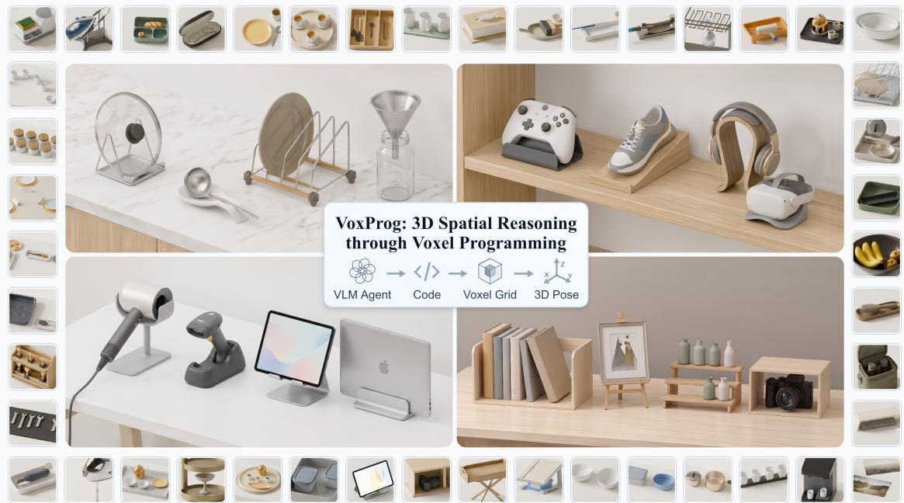  
Figure 1: 3D spatial reasoning through voxel programming. VoxProg translates natural-language instructions into Python programs that construct task-relevant geometric references from local voxel views and compute 6-DoF object placements. The surrounding scenes illustrate the variety of object shapes, support structures, and spatial arrangements encountered in everyday placement tasks.

We evaluate VoxProg on VoxProg-Bench, a new benchmark of 71 open-ended placement tasks where target poses depend on part-level affordances, 3D shape compatibility, and surrounding layouts. Because valid placements must satisfy both semantic intent and physical plausibility, our evaluation suite pairs a perceptual ranking metric, IA Rank Score, with 3D Physical Validity checks for static support and object interpenetration. IA Rank Score measures how consistently a method’s rendered result outranks competitors in similarity to the ground-truth arrangement. Across VoxProg-Bench, VoxProg substantially outperforms relation-based, keypoint-based, and mesh-based baselines, achieving its largest margin on geometric tasks where object contours govern fit and clearance. Ablation studies further show that constructing explicit geometric evidence before pose synthesis improves both physical validity and intent alignment over direct mesh programming, while local voxel views further improve intent alignment across all 71 tasks.

Contributions. ❶ We formulate voxel programming and develop VoxProg, a two-stage system that constructs task-relevant surface geometry via local voxel views to compute 3D object placements. ❷ We introduce VoxProg-Bench, a benchmark of 71 language-guided 3D placement tasks spanning functional, geometric, and contextual arrangements. ❸ We propose a complementary evaluation protocol combining perceptual intent ranking (IA Rank Score) with 3D geometric verification (Physical Validity).

## 2 Related Work

Spatial task specification. Language-guided placement has been studied through layout prediction, rearrangement search, and geometric optimization. Scene graphs encode inter-object relations for scene synthesis (Chen et al., 2025; Zhai et al., 2023; Lin & Mu, 2024; Hu et al., 2024b), while scene-layout and object-placement methods map language to spatial configurations (Feng et al., 2023; Yang et al., 2024; Öcal et al., 2025; Sun et al., 2025; Huang et al., 2025a; Abdelreheem et al., 2025; Zhang et al., 2024; Kuang et al., 2026). Rearrangement methods coordinate multi-object structures using learned spatial priors (Liu et al., 2022; 2023; Tang et al., 2024; Wei et al., 2023; Xu et al., 2024) or pattern-guided search (Chang et al., 2024). At a finer scale, object manipulation methods formulate 6-DoF pose optimization over sparse

semantic keypoints, directional axes, and part-level affordances (Manuelli et al., 2022; Hua et al., 2025;   
Huang et al., 2025b; Qi et al., 2025; Pan et al., 2025; Zhu et al., 2025).

While layout, surface-constraint, and keypoint formulations parameterize placement over bounding boxes, planar support patches, or sparse point and axis primitives, open-ended tasks often hinge on extended surface structures (such as receiving slots, angled ledges, curved rims, or recessed compartments) whose relevant regions depend on the instruction and paired objects. VoxProg therefore treats geometric reference construction as an explicit, programmable stage of task specification: generated code composes spatial selections and neighborhood operations over local voxel views, retaining the selected surface regions and their source-mesh patches for downstream measurement so that the same object geometry can be segmented and parameterized differently across placement tasks.

Language models for spatial computation. Executable programs let language models delegate quantitative calculation and visual queries to external interpreters (Gao et al., 2023; Chen et al., 2023; Gupta & Kembhavi, 2023; Surís et al., 2023; Hu et al., 2024a). In robotics, generated code sequences task plans (Singh et al., 2023), composes perception calls with control primitives (Liang et al., 2023; Mu et al., 2024; Li et al., 2024), and synthesizes 3D value maps over workspace grids for motion planning (Huang et al., 2023a). Recent methods further incorporate geometric processing via part-mask refinement (Tang et al., 2026), primitive fitting (Lin et al., 2026), and frame-grounded tool calls (Chen et al., 2026).

In most programmatic frameworks, however, 3D perception remains encapsulated behind fixed API calls that return object centroids, bounding boxes, or pre-segmented masks (Liang et al., 2023; Mu et al., 2024), or operates on coarse workspace grids to score trajectories (Huang et al., 2023a). We develop voxel programming so that generated code can inspect and dissect 3D object surfaces directly. By discretizing candidate objects into local voxel views at task-chosen resolutions, VoxProg turns 3D surface inspection into regular-grid array programming while retaining exact correspondence with the underlying mesh triangles. Generated code can thus construct custom surface witnesses on demand, verify them through visual and numerical feedback, and measure both grid bounds and clipped source-mesh patches to solve for precise, physically valid 6-DoF object placements.

## 3 Method

Given a natural-language instruction I and a 3D scene $\begin{array} { r } { S = \{ o _ { n } \} _ { n = 1 } ^ { N } } \end{array}$ with known object meshes and initial poses, VoxProg synthesizes and executes Python programs to compute a target placement pose $T \in S E ( 3 )$ . Rather than mapping language directly to 6-DoF coordinates in a single step, VoxProg decouples geometric reference construction from pose calculation: an evidence program $P _ { \mathrm { { e } } }$ isolates task-relevant surface regions on the moved and reference objects, and a pose program $P _ { \mathrm { p } }$ measures these constructed regions and their relational constraints to solve for the final rigid transformation.

Fig. 2 illustrates this pipeline on an upright plate-placement task. The model first organizes the required spatial references into a directed evidence graph and grounds visible cues into 3D surface anchors (§3.1). Operating on local voxel views of scene meshes (§3.2), the evidence program constructs the rack’s adjacent dividers, lower support rails, and slot region while refining its selections through selection checks and program revision (§3.3). The verified evidence record and relational claims are then passed to the pose program, which queries both discrete voxel bounds and clipped source-mesh patches to align, center, and seat the plate upright within the target slot (§3.4).

## 3.1 Task Interpretation and Visual Grounding

An LLM formalizes its understanding of the instruction as a directed evidence graph $\mathcal { G } = ( \nu , \mathcal { E } )$ . Each node $v \in \mathcal V$ specifies either a visible semantic anchor or a derived geometric region to be constructed, along with its functional role in the task; each directed edge $( u , v ) \in \mathcal { E }$ indicates that constructing v depends on the location or geometry of u. In Fig. 2, visual cues on the plate and dish rack initiate a dependency chain that extracts the plate’s outer rim together with the rack’s adjacent dividers, lower support rails, and receiving slot region.

Each node in $\mathcal { G }$ is routed according to how its geometry can be acquired. For a directly visible semantic cue, Locate queries a VLM for a 2D pixel coordinate in the rendered scene image and casts a camera ray against the scene mesh to recover a 3D surface point as a spatial anchor in A. References that cannot be reduced to a single clickable pixel, such as an interior slot region, a recessed support ledge, or an occluded underside, are passed to the evidence program together with their descriptions and upstream 3D anchors, which localize where on the object mesh the program should inspect and slice the surface.

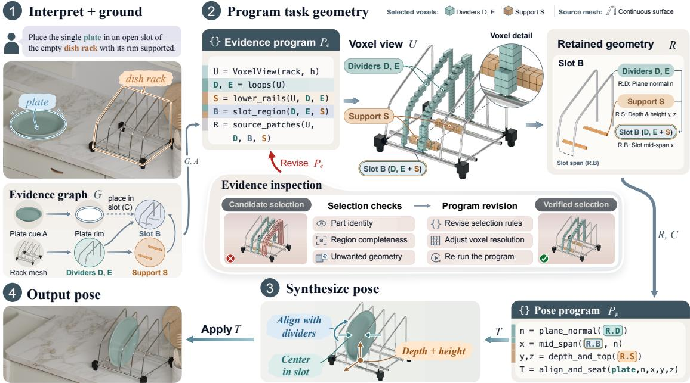  
Figure 2: Overview of VoxProg on upright plate placement. (1) The model parses the instruction into a directed evidence graph G and grounds visible cues into 3D surface anchors A. (2) An evidence program $P _ { \mathrm { ~ e ~ } }$ operates on local voxel views to isolate the rack’s dividers D, E, support rails S, and slot region B in R along with relational constraints ${ \mathcal { C } } ,$ refining its selections through visual and geometric checks. (3–4) A pose program $P _ { \mathrm { { p } } }$ queries the discrete voxel bounds and clipped source-mesh patches in R to solve for and apply the target pose $T \in \mathring { S } E ( 3 )$

## 3.2 Voxel Programming

Generated programs operate on scene geometry through local voxel views. Given a source mesh s and voxel size $h > 0 , U = \mathtt { V o x e l V i e w } ( s , h )$ discretizes the surface of s onto a regular 3D grid at resolution h. On this regular grid, the view exposes occupied surface cells directly as integer coordinate arrays (N, 3) alongside directional exposure masks and connected-component queries, while a known grid-to-world rigid transform maps selected voxel indices and local bounds back to continuous 3D scene coordinates for downstream geometric computation in the scene.

Each constructed geometric reference forms a witness in the evidence record $\mathcal { R } .$ . To construct a witness v, the evidence program instantiates a local view $U _ { v }$ on source geometry $s _ { v }$ at resolution $h _ { v }$ and evaluates a programmatic binary mask $m _ { v }$ over its surface cells:

$$
U _ { v } = \mathtt { V o x e l V i e w } ( s _ { v } , h _ { v } ) , \qquad W _ { v } = \{ c \in U _ { v } : m _ { v } ( c ) = 1 \} .\tag{1}
$$

Because $U _ { v }$ is a regular grid, the program can compose $m _ { v }$ through standard array operations (axis-aligned slicing, proximity filters around visual anchors or upstream witnesses, directional exposure queries, and connected-component labeling) to isolate witnesses such as the rack’s adjacent dividers D, E, lower support rails $S ,$ and combined slot region $B$ in Fig. 2. For each witness $v ,$ the entry $\mathcal { R }$ v in R stores the selected cells $W _ { v }$ , their parent view $U _ { v }$ , the source object $s _ { v } ,$ , and the provenance edges from ${ \mathcal { G } } .$

Parameterizing voxel size $h _ { v }$ per view lets the program match discretization scale to local geometric structure without voxelizing the entire scene at uniform fine resolution. A program can use coarse grids to localize broad object surfaces and switch to a finer $h _ { v }$ when resolving thin wire dividers, narrow slots, or shallow rims that would merge on a coarse grid, while retaining exact geometric correspondence with the underlying triangles of the source object mesh.

## 3.3 Evidence Program Generation and Refinement

Conditioned on the instruction, evidence graph ${ \mathcal { G } } ,$ scene $s ,$ and grounded anchors ${ \mathcal { A } } ,$ the LLM generates an executable evidence program $P _ { \mathrm { { e } } }$ following the topological order of G:

$$
( { \mathcal R } , { \mathcal C } ) = P _ { \mathrm { e } } ( S , A ) ,\tag{2}
$$

where R stores the constructed witnesses and C specifies the target spatial relations among them $( \mathrm { e . g . }$ placing the plate’s rim in slot B between dividers D, E while resting on support rails S in Fig. 2). Following the dependencies in $\mathcal { G }$ allows downstream witnesses to be defined relative to earlier selections.

To tie each witness to its functional role before writing code, the model first states explicit inclusion and exclusion criteria for each witness (such as excluding adjacent rack loops or vertical walls). When a geometric question remains unresolved, the model can execute lightweight probes via the same voxel API to print numerical statistics (such as voxel counts, component counts, and coordinate spans) and inspect rendered highlights of intermediate selections.

Once a complete candidate $P _ { \mathrm { { e } } }$ is executed, geometric checks and a VLM critic check each witness for part identity, region completeness, and the absence of unwanted geometry (Fig. 2, center). When a candidate selection leaks into adjacent structure or remains incomplete, this feedback guides the model to revise its selection rules or adjust voxel resolution and re-run $P _ { \mathrm { { e } } }$

## 3.4 Pose Program Generation and Refinement

Given the verified evidence record R and relational specification C, the LLM generates an executable pose program $P _ { \mathrm { p } }$ to compute the moved object’s target rigid transformation:

$$
T = P _ { \mathrm { p } } ( \mathcal { R } , S , T _ { \mathrm { c u r } } ) , \qquad T \in S E ( 3 ) ,\tag{3}
$$

where $T _ { \mathrm { c u r } }$ is the moved object’s current world-frame pose (initialized to its starting pose $T _ { 0 } )$ and S provides access to scene meshes and initial poses. Every witness enters $P _ { \mathrm { p } }$ as concrete geometry rather than prefitted point or vector constants, and the program derives all required positions, axes, and offsets directly from R under C.

Beyond discrete grid coordinates, each witness entry $\mathcal { R } . v$ in R also exposes the continuous source-mesh patch clipped to its selected voxels $W _ { v }$ , preserving exact face correspondence and outward surface normals. As shown in Fig. 2 (step 3), $P _ { \mathrm { p } }$ combines grid bounds with continuous mesh surfaces to solve accurately for $T$ on the original object geometry, computing the divider plane normal n from $\mathcal { R } . D .$ , slot mid-span x from R.B, and support depth and height $y ,$ z from R.S.

Because all witnesses in R remain fixed in world coordinates at the initial scene state, $P _ { \mathrm { p } }$ maps any initial world-space point x on the moved object (with initial pose $T _ { 0 } )$ to its position under a candidate world pose $T$ as

$$
\widetilde { \mathbf { x } } ^ { \prime } = T T _ { 0 } ^ { - 1 } \widetilde { \mathbf { x } } ,\tag{4}
$$

where $\widetilde { \mathbf { x } }$ denotes homogeneous coordinates. After each execution of $P _ { \mathrm { p } }$ , the candidate pose T updates $T _ { \mathrm { c u r } }$ in the scene while R stays recorded in the initial scene state without recomputing evidence geometry, and the model receives a rendered observation together with numerical contact and clearance diagnostics to guide iterative pose program revision.

## 4 Experiments

We evaluate VoxProg on VoxProg-Bench (§4.1–§4.2), ablate staged reference construction and local voxel views alongside external benchmarks from RoboCasa and Open6DOR v2 (§4.3), and examine physical and perceptual failure modes (§4.4).

## 4.1 Experimental setup

Benchmark. We evaluate on VoxProg-Bench, a benchmark of 71 individually curated language-guided 3D placement tasks. Each case presents an initial tabletop scene and a free-form instruction specifying the desired placement of an object. We emphasize diverse instructions that call for fine-grained reasoning about functional object parts, geometric fit, and contextual arrangements. Although an instruction can involve multiple spatial cues, each case is assigned to one group according to its primary spatial requirement for the category-level comparisons reported below:

• Functional (28 cases): The placement must support a specific use, such as placing a cup beneath a grinder chute to catch grounds, returning headphones to a stand, or orienting a funnel for pouring.

• Geometric (14 cases): The placement depends directly on object contours, such as nesting an oval bowl inside a matching container or fitting a baking tray into a narrow box at an angle.

• Contextual (29 cases): The placement takes its cues from the surrounding arrangement, such as completing a missing place setting or restoring a symmetric layout.

<table><tr><td></td><td colspan="4">IA Rank Score ↑</td><td colspan="4">Physical Validity (%)↑</td></tr><tr><td>Method</td><td>Overall</td><td>Func.</td><td>Geom.</td><td>Context.</td><td>Overall</td><td>Func.</td><td>Geom.</td><td>Context.</td></tr><tr><td>GenManip</td><td>25.59</td><td>25.00</td><td>32.14</td><td>22.99</td><td>73.2</td><td>67.9</td><td>92.9</td><td>69.0</td></tr><tr><td>GenSim2-kPAM</td><td>42.72</td><td>34.52</td><td>35.71</td><td>54.02</td><td>77.5</td><td>78.6</td><td>85.7</td><td>72.4</td></tr><tr><td>Direct Mesh</td><td>48.59</td><td>53.57</td><td>44.05</td><td>45.98</td><td>87.3</td><td>75.0</td><td>100.0</td><td>93.1</td></tr><tr><td>VoxProg</td><td>83.10</td><td>86.90</td><td>88.10</td><td>77.01</td><td>95.8</td><td>92.9</td><td>100.0</td><td>96.6</td></tr></table>

Table 1: Quantitative results on VoxProg-Bench. We report IA Rank Score and Physical Validity across all 71 tasks and within the Functional (28), Geometric (14), and Contextual (29) categories. Best results are in bold (shaded) and second-best are underlined.

Scenes are assembled from generated 3D assets through randomized placement and manual refinement. Detailed instructions, object geometry, and scene context make the intended final arrangement well defined; we provide one manually annotated ground-truth 6-DoF target pose per task. All methods receive the scene meshes, initial poses, instruction, and labeled target-object identity; ground-truth poses and images are used only for evaluation.

Evaluation suite. We design an evaluation suite around two complementary requirements of object placement: realizing the intended spatial arrangement and maintaining physical plausibility. We report these as Intent Alignment and Physical Validity, using visual comparison with ground truth and geometric checks, respectively.

Intent Alignment measures perceptual similarity using DreamSim (Fu et al., 2023) between full-scene renderings of the predicted and ground-truth placements under matched cameras and lighting. Within each case, we rank the M compared methods by increasing DreamSim distance and assign rank r the score $1 0 0 ( M - r ) / ( M - 1 )$ , using average ranks for ties. Averaging over cases gives the IA Rank Score (0–100; higher is better), which measures how consistently a method outranks its competitors across tasks. Each task contributes equally; scores are compared within the same method pool.

Physical Validity assesses whether the final placement establishes plausible static support and avoids interpenetration with surrounding objects. We report the percentage of evaluated task placements that satisfy both 3D contact and clearance checks.

Baselines. We compare VoxProg against three language-guided placement approaches. GenManip (Gao et al., 2025) constructs placements using predefined spatial relations between target and anchor objects. GenSim2-kPAM (Hua et al., 2025; Manuelli et al., 2022) specifies placement targets through predicted semantic keypoints together with geometric point and axis constraints. Direct Mesh generates Blender Python code for placement and executes it through Blender-MCP1.

Model configuration. All compared methods use GPT-5.6-Sol under a shared inference configuration for both language code generation and visual grounding.

## 4.2 Results on the task suite

Quantitative results. VoxProg achieves the highest IA Rank Score overall (83.10) and across all three task groups, alongside the highest Physical Validity at 95.8% (Table 1), outperforming Direct Mesh (48.59 / 87.3%), GenSim2-kPAM (42.72 / 77.5%), and GenManip (25.59 / 73.2%). Although Direct Mesh also writes task-specific Python code over explicit scene meshes, VoxProg improves its IA Rank Score by 34.51 points and Physical Validity by 8.5 points: code generation alone remains brittle without an intermediate representation that isolates the surfaces relevant to the instruction.

Breaking down performance by category reveals how different representations behave under distinct spatial demands. On Functional tasks, VoxProg reaches 86.90 versus 53.57 for Direct Mesh and 34.52 for GenSim2-kPAM (with Physical Validity rising from 75.0% and 78.6% to 92.9%), as functional use requires isolating mating parts, such as a chute outlet or headphone arch, rather than whole-object bounding boxes or sparse keypoints. On Contextual tasks, the strongest baseline shifts from Direct Mesh (45.98) to GenSim2-kPAM (54.02), while VoxProg retains a clear lead at 77.01. The largest margin occurs on Geometric tasks: VoxProg reaches an IA Rank Score of 88.10 versus 44.05 for Direct Mesh, although both attain 100.0% Physical Validity. The difference lies in resolving the local contours and clearances that distinguish the intended fit from other physically valid configurations.

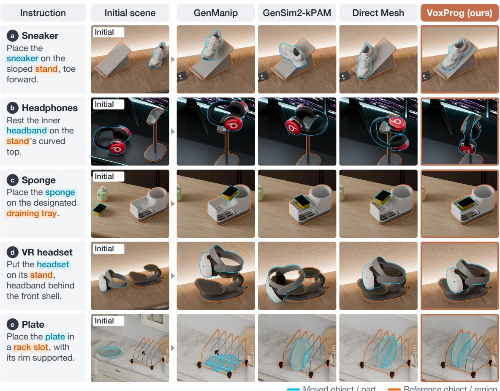  
Moved object / part  
Reference object / region

Figure 3: Qualitative comparisons on VoxProg-Bench. Representative placements of a sneaker (a), headphones (b), a dish sponge (c), a VR headset (d), and a plate (e), comparing GenManip, GenSim2-kPAM, Direct Mesh, and VoxProg. Colored highlights mark the moved object or part and the reference object or region in the instruction and scene; terracotta borders indicate VoxProg.

Qualitative results. Fig. 3 exposes the gap between locating an object and identifying its functional contact region. In the headphone case (b), all three baselines bring the earcups against the stand or wrap the headphones around its post, missing the inner headband support specified by the instruction. VoxProg matches the inner arch to the curved crown, establishing the intended part-level contact.

On the sloped stand (a), GenManip leaves the sneaker above the support and GenSim2-kPAM turns it across the ramp. VoxProg aligns the sole with the incline and keeps the toe facing forward. For the VR headset (d), GenManip and GenSim2-kPAM leave the headset above the cradle or in front of the stand, while VoxProg positions it over the stand with the headband behind the front shell. Explicit surface references connect these local contact and orientation requirements to pose computation.

## 4.3 Ablation and external evaluation

Effect of voxel programming. To separate the effect of staged reference construction from that of local voxel views, we compare Direct Mesh, Mesh Evidence, and VoxProg across all 71 tasks in Table 2. Direct Mesh writes a single placement program directly over the scene meshes; Mesh Evidence shares VoxProg’s two-stage pipeline and execution feedback but constructs witness regions through direct mesh operations on vertices and faces; VoxProg constructs witnesses on local voxel views while retaining access to the clipped source-mesh surfaces during pose computation.

Within this three-method comparison, moving from single-stage Direct Mesh to the staged Mesh Evidence pipeline raises Physical Validity from 87.3% to 95.8% and more than doubles the IA Rank Score from 26.76 to 56.34. When a single program must simultaneously locate task-relevant geometry and compute 6-DoF coordinates over raw scene meshes, imprecise region selection directly affects the resulting pose; introducing an explicit evidence stage allows candidate regions to be constructed, checked, and revised before downstream pose synthesis.

Replacing direct mesh selection with local voxel views raises the IA Rank Score from 56.34 to 66.90 while maintaining 95.8% Physical Validity. Regular grid indexing and neighborhood operations help resolve the intended receiving side of a structure. In Fig. 4, Mesh Evidence places the tablet behind the stand’s supports, which obstruct its screen, whereas VoxProg seats it in front with the display unobstructed and facing the user.

External placement tasks. We evaluate generalization on 19 tasks adapted from RoboCasa (Nasiriany et al., 2024) and 13 from Open6DOR v2 (Ding et al., 2024; Qi et al., 2025), formulated as final-state 3D placement problems under matched inputs (Fig. 5). On RoboCasa, where appliances and cabinets introduce semi-enclosed boundaries, VoxProg achieves an IA Rank Score of 87.72 against 26.32–45.61 for the baselines, while maintaining 94.7% Physical Validity compared with 26.3%– 42.1% for the baselines. On Open6DOR v2, VoxProg leads in IA Rank Score (61.54 vs. 57.69 for Direct Mesh) and raises Physical Validity to 92.3% versus 46.2% for Direct Mesh: while broad directional instructions admit many 2D-plausible overhead positions, the baselines often leave objects floating or interpenetrating in 3D.

<table><tr><td>Method</td><td>IA Rank Score ↑</td><td>Physical Validity (%) ↑</td></tr><tr><td>Direct Mesh</td><td>26.76</td><td>87.3</td></tr><tr><td>Mesh Evidence</td><td>56.34</td><td>95.8</td></tr><tr><td>VoxProg</td><td>66.90</td><td>95.8</td></tr></table>

Table 2: Ablation of voxel programming. Results across all 71 placement tasks on VoxProg-Bench.  
Place the tablet on its stand, in landscape, with the screen facing forward.

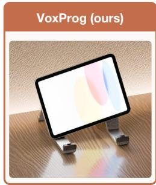  
Figure 4: Tablet placement ablation. The supports obstruct the screen in Mesh Evidence; VoxProg keeps the display clear.

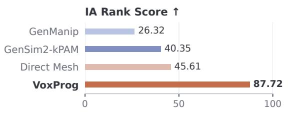  
Open6DOR v2

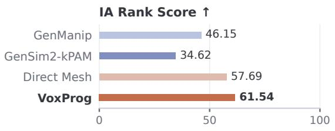

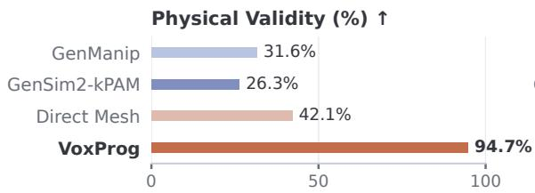

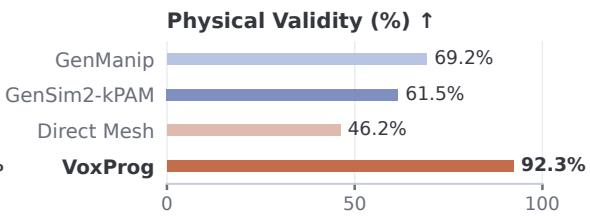  
Figure 5: External benchmark evaluation. IA Rank Score (↑) and Physical Validity (↑) on 19 kitchen tasks adapted from RoboCasa and 13 tabletop tasks from Open6DOR v2.

In the mug task (Fig. 6a), GenManip leaves the mug beside the dispenser, while GenSim2-kPAM and Direct Mesh leave it interpenetrating the drip tray. VoxProg centers the opening beneath the nozzle and rests the base on the tray, jointly satisfying the alignment and support required to receive coffee. The SD-card task (c) exposes a complementary contact failure: GenManip and Direct Mesh leave the card floating above the USB drive, whereas VoxProg seats it on the top surface.

## 4.4 Failure Analysis

Physical failure profiles. Fig. 7a decomposes physical rejections on VoxProg-Bench into support and interpenetration failures. GenManip incurs 19 rejections (11 support, 8 intersection), versus 16 for GenSim2- kPAM (13 intersection, 3 support). These patterns are consistent with coarse relation offsets leaving support contact under-specified, and sparse point and axis constraints leaving clearance between extended surfaces under-constrained. Direct Mesh has 9 rejections (6 intersection, 3 support), while both staged variants cut rejections to 3 (3 intersection for Mesh Evidence; 2 intersection, 1 support for VoxProg).

(b) Support failure  
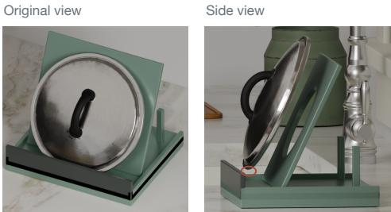

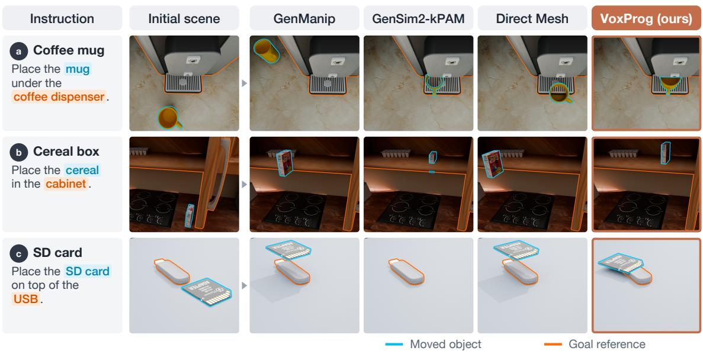  
Figure 6: Qualitative results on external benchmarks. Mug (a) and cereal-box (b) placement from RoboCasa, and SD-card placement (c) from Open6DOR v2. Colored contours mark the moved object and goal reference; terracotta borders highlight VoxProg.

Visually ambiguous contact. The pot-lid case in Fig. 7b illustrates why 2D visual inspection alone cannot establish physical validity in 3D object placement. From the primary camera view, the lid appears properly seated: it stands up right with its handle facing outward, its circular contour centered between the side supports, and its lower rim aligned over the receiving rack. A side view of the same final pose reveals, however, that the lid remains suspended above the rack, separated by a clear vertical gap from both the base tray and the inclined backrest. Here, the rack’s opaque front frame provides a strong visual cue to the destination while occluding the recessed region where support contact should occur. Because 2D projection overlap along the viewing ray can conceal 3D separation under self-occlusion, a singleview visual comparison can accept a physically unsupported placement even when the target object and its apparent relation to the reference structure look aligned in image space. Pairing perceptual evaluation with 3D geometric verification addresses this ambiguity by checking local support contact and interpenetration conditions between the placed object and surrounding scene meshes, making the distinction between apparent 2D seating in the rendered view and actual physical support in the 3D scene explicit.

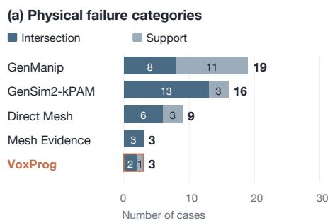  
Figure 7: Failure profiles and contact checks. (a) Physical rejections on VoxProg-Bench. (b) A lid seated from the front floats from the side.

## 5 Conclusion

We presented VoxProg, a framework for 3D spatial reasoning that formulates language-guided object placement through voxel programming. Rather than parameterizing tasks over fixed spatial relations or sparse keypoint primitives, VoxProg treats the geometric references required by an instruction as intermediate surface structures constructed by executable code. By coupling regular-grid selection over local voxel views with exact surface normals and patches from the underlying meshes, our two-stage pipeline enables a language model to isolate functional contact regions, verify them through visual and geometric feedback, and solve for physically valid SE(3) poses. Across the 71-task VoxProg-Bench benchmark and external tasks from RoboCasa and Open6DOR v2, VoxProg consistently outperforms relation-based, keypoint-based, and mesh-based baselines in both intent alignment and physical validity. Coupling such programmable surface witnesses with downstream motion generation provides a natural direction for extending fine-grained geometric reasoning from target placement specification to full manipulation execution.

## References

Ahmed Abdelreheem, Filippo Aleotti, Jamie Watson, Zawar Qureshi, Abdelrahman Eldesokey, Peter Wonka, Gabriel Brostow, Sara Vicente, and Guillermo Garcia-Hernando. PlaceIt3D: Language-guided object placement in real 3D scenes. In ICCV, pp. 6645–6655, 2025.

Haonan Chang, Kai Gao, Kowndinya Boyalakuntla, Alex Lee, Baichuan Huang, Jingjin Yu, and Abdeslam Boularias. LGMCTS: Language-guided monte-carlo tree search for executable semantic object rearrangement. In IROS, pp. 13607–13612, 2024.

Boyuan Chen, Zhuo Xu, Sean Kirmani, Brain Ichter, Dorsa Sadigh, Leonidas Guibas, and Fei Xia. SpatialVLM: Endowing vision-language models with spatial reasoning capabilities. In CVPR, pp. 14455– 14465, 2024.

Minglin Chen, Rongkun Yang, Qibin Hu, Kaiwen Xue, Shunbo Zhou, and Yulan Guo. Graph2Scene: Versatile 3D indoor scene generation with interaction-aware scene graph. In IROS, pp. 11313–11320, 2025.

Wenhu Chen, Xueguang Ma, Xinyi Wang, and William W. Cohen. Program of Thoughts prompting: Disentangling computation from reasoning for numerical reasoning tasks. Transactions on Machine Learning Research, 2023.

Zeren Chen, Xiaoya Lu, Zhijie Zheng, Pengrui Li, Lehan He, Yijin Zhou, Jing Shao, Bohan Zhuang, and Lu Sheng. Geometrically-constrained agent for spatial reasoning. In CVPR, pp. 38689–38699, 2026.

An-Chieh Cheng, Hongxu Yin, Yang Fu, Qiushan Guo, Ruihan Yang, Jan Kautz, Xiaolong Wang, and Sifei Liu. SpatialRGPT: Grounded spatial reasoning in vision-language models. In NeurIPS, pp. 135062– 135093, 2024.

Yufei Ding, Haoran Geng, Chaoyi Xu, Xiaomeng Fang, Jiazhao Zhang, Songlin Wei, Qiyu Dai, Zhizheng Zhang, and He Wang. Open6DOR: Benchmarking open-instruction 6-DoF object rearrangement and a VLM-based approach. In IROS, pp. 7359–7366, 2024.

Kuan Fang, Fangchen Liu, Pieter Abbeel, and Sergey Levine. MOKA: Open-world robotic manipulation through mark-based visual prompting. In RSS, 2024.

Weixi Feng, Wanrong Zhu, Tsu-jui Fu, Varun Jampani, Arjun Akula, Xuehai He, Sugato Basu, Xin Eric Wang, and William Yang Wang. LayoutGPT: Compositional visual planning and generation with large language models. In NeurIPS, pp. 18225–18250, 2023.

Stephanie Fu, Netanel Tamir, Shobhita Sundaram, Lucy Chai, Richard Zhang, Tali Dekel, and Phillip Isola. DreamSim: Learning new dimensions of human visual similarity using synthetic data. In NeurIPS, pp. 50742–50768, 2023.

Luyu Gao, Aman Madaan, Shuyan Zhou, Uri Alon, Pengfei Liu, Yiming Yang, Jamie Callan, and Graham Neubig. PAL: Program-aided language models. In ICML, pp. 10764–10799, 2023.

Ning Gao, Yilun Chen, Shuai Yang, Xinyi Chen, Yang Tian, Hao Li, Haifeng Huang, Hanqing Wang, Tai Wang, and Jiangmiao Pang. GenManip: LLM-driven simulation for generalizable instruction-following manipulation. In CVPR, pp. 12187–12198, 2025.

Tanmay Gupta and Aniruddha Kembhavi. Visual programming: Compositional visual reasoning without training. In CVPR, pp. 14953–14962, 2023.

Yushi Hu, Weijia Shi, Xingyu Fu, Dan Roth, Mari Ostendorf, Luke Zettlemoyer, Noah A. Smith, and Ranjay Krishna. Visual Sketchpad: Sketching as a visual chain of thought for multimodal language models. In NeurIPS, pp. 139348–139379, 2024a.

Ziniu Hu, Ahmet Iscen, Aashi Jain, Thomas Kipf, Yisong Yue, David A Ross, Cordelia Schmid, and Alireza Fathi. SceneCraft: An LLM agent for synthesizing 3D scenes as Blender code. In ICML, pp. 19252– 19282, 2024b.

Pu Hua, Minghuan Liu, Annabella Macaluso, Yunfeng Lin, Weinan Zhang, Huazhe Xu, and Lirui Wang. GenSim2: Scaling robot data generation with multi-modal and reasoning LLMs. In CoRL, pp. 5030– 5066, 2025.

Ian Huang, Yanan Bao, Karen Truong, Howard Zhou, Cordelia Schmid, Leonidas Guibas, and Alireza Fathi. FirePlace: Geometric refinements of LLM common sense reasoning for 3D object placement. In CVPR, pp. 13466–13476, 2025a.

Wenlong Huang, Chen Wang, Ruohan Zhang, Yunzhu Li, Jiajun Wu, and Li Fei-Fei. VoxPoser: Composable 3D value maps for robotic manipulation with language models. In CoRL, pp. 540–562, 2023a.

Wenlong Huang, Fei Xia, Ted Xiao, Harris Chan, Jacky Liang, Pete Florence, Andy Zeng, Jonathan Tompson, Igor Mordatch, Yevgen Chebotar, Pierre Sermanet, Tomas Jackson, Noah Brown, Linda Luu, Sergey Levine, Karol Hausman, and Brian Ichter. Inner Monologue: Embodied reasoning through planning with language models. In CoRL, pp. 1769–1782, 2023b.

Wenlong Huang, Chen Wang, Yunzhu Li, Ruohan Zhang, and Li Fei-Fei. ReKep: Spatio-temporal reasoning of relational keypoint constraints for robotic manipulation. In CoRL, pp. 4573–4602, 2025b.

Brian Ichter, Anthony Brohan, Yevgen Chebotar, Chelsea Finn, Karol Hausman, Alexander Herzog, Daniel Ho, Julian Ibarz, Alex Irpan, Eric Jang, Ryan Julian, Dmitry Kalashnikov, Sergey Levine, Yao Lu, Carolina Parada, Kanishka Rao, Pierre Sermanet, Alexander T Toshev, Vincent Vanhoucke, Fei Xia, Ted Xiao, Peng Xu, Mengyuan Yan, Noah Brown, Michael Ahn, Omar Cortes, Nicolas Sievers, Clayton Tan, Sichun Xu, Diego Reyes, Jarek Rettinghouse, Jornell Quiambao, Peter Pastor, Linda Luu, Kuang-Huei Lee, Yuheng Kuang, Sally Jesmonth, Nikhil J. Joshi, Kyle Jeffrey, Rosario Jauregui Ruano, Jasmine Hsu, Keerthana Gopalakrishnan, Byron David, Andy Zeng, and Chuyuan Kelly Fu. Do as I can, not as I say: Grounding language in robotic affordances. In CoRL, pp. 287–318, 2023.

Zhengfei Kuang, Rui Lin, Long Zhao, Gordon Wetzstein, Saining Xie, and Sanghyun Woo. VULCAN: Tool-augmented multi agents for iterative 3D object arrangement. In CVPR, pp. 23763–23773, 2026.

Chengshu Li, Jacky Liang, Andy Zeng, Xinyun Chen, Karol Hausman, Dorsa Sadigh, Sergey Levine, Li Fei-Fei, Fei Xia, and Brian Ichter. Chain of Code: Reasoning with a language model-augmented code emulator. In ICML, pp. 28259–28277, 2024.

Jacky Liang, Wenlong Huang, Fei Xia, Peng Xu, Karol Hausman, Brian Ichter, Pete Florence, and Andy Zeng. Code as policies: Language model programs for embodied control. In ICRA, pp. 9493–9500, 2023.

Chenguo Lin and Yadong Mu. InstructScene: Instruction-driven 3D indoor scene synthesis with semantic graph prior. In ICLR, pp. 25687–25718, 2024.

Zefu Lin, Rongxu Cui, Hanning Chen, Xiangyu Wang, Junjia Xu, Xiaojuan Jin, Wenbo Chen, Hui Zhou, Lue Fan, Wenling Li, and Zhaoxiang Zhang. EmbodiedCoder: Parameterized embodied mobile manipulation via modern coding model. In ICRA, pp. 7759–7766, 2026.

Weiyu Liu, Chris Paxton, Tucker Hermans, and Dieter Fox. StructFormer: Learning spatial structure for language-guided semantic rearrangement of novel objects. In ICRA, pp. 6322–6329, 2022.

Weiyu Liu, Yilun Du, Tucker Hermans, Sonia Chernova, and Chris Paxton. StructDiffusion: Languageguided creation of physically-valid structures using unseen objects. In RSS, 2023.

Lucas Manuelli, Wei Gao, Peter Florence, and Russ Tedrake. kPAM: Keypoint affordances for categorylevel robotic manipulation. In Robotics Research, pp. 132–157. Springer, 2022.

Yao Mu, Junting Chen, Qing-Long Zhang, Shoufa Chen, Qiaojun Yu, Chongjian Ge, Runjian Chen, Zhixuan Liang, Mengkang Hu, Chaofan Tao, Peize Sun, Haibao Yu, Chao Yang, Wenqi Shao, Wenhai Wang, Jifeng Dai, Yu Qiao, Mingyu Ding, and Ping Luo. RoboCodeX: multimodal code generation for robotic behavior synthesis. In ICML, pp. 36434–36454, 2024.

Soroush Nasiriany, Abhiram Maddukuri, Lance Zhang, Adeet Parikh, Aaron Lo, Abhishek Joshi, Ajay Mandlekar, and Yuke Zhu. RoboCasa: Large-scale simulation of household tasks for generalist robots. In RSS, 2024.

Ba¸sak Melis Öcal, Maxim Tatarchenko, Sezer Karaoglu, and Theo Gevers. SceneTeller: Language-to-3D˘ scene generation. In ECCV, pp. 362–378, 2025.

Mingjie Pan, Jiyao Zhang, Tianshu Wu, Yinghao Zhao, Wenlong Gao, and Hao Dong. OmniManip: Towards general robotic manipulation via object-centric interaction primitives as spatial constraints. In CVPR, pp. 17359–17369, 2025.

Zekun Qi, Wenyao Zhang, Yufei Ding, Runpei Dong, Xinqiang Yu, Jingwen Li, Lingyun Xu, Baoyu Li, Xialin He, Guofan Fan, Jiazhao Zhang, Jiawei He, Jiayuan Gu, Xin Jin, Kaisheng Ma, Zhizheng Zhang, He Wang, and Li Yi. SoFar: Language-grounded orientation bridges spatial reasoning and object manipulation. In NeurIPS, pp. 76367–76412, 2025.

Ishika Singh, Valts Blukis, Arsalan Mousavian, Ankit Goyal, Danfei Xu, Jonathan Tremblay, Dieter Fox, Jesse Thomason, and Animesh Garg. ProgPrompt: Generating situated robot task plans using large language models. In ICRA, pp. 11523–11530, 2023.

Chan Hee Song, Valts Blukis, Jonathan Tremblay, Stephen Tyree, Yu Su, and Stan Birchfield. RoboSpatial: Teaching spatial understanding to 2D and 3D vision-language models for robotics. In CVPR, pp. 15768– 15780, 2025.

Fan-Yun Sun, Weiyu Liu, Siyi Gu, Dylan Lim, Goutam Bhat, Federico Tombari, Manling Li, Nick Haber, and Jiajun Wu. LayoutVLM: Differentiable optimization of 3D layout via vision-language models. In CVPR, pp. 29469–29478, 2025.

Priya Sundaresan, Suneel Belkhale, Dorsa Sadigh, and Jeannette Bohg. KITE: Keypoint-conditioned policies for semantic manipulation. In CoRL, pp. 1006–1021, 2023.

Dídac Surís, Sachit Menon, and Carl Vondrick. ViperGPT: Visual inference via Python execution for reasoning. In ICCV, pp. 11888–11898, 2023.

Jiapeng Tang, Yinyu Nie, Lev Markhasin, Angela Dai, Justus Thies, and Matthias Nießner. DiffuScene: Denoising diffusion models for generative indoor scene synthesis. In CVPR, pp. 20507–20518, 2024.

Weiliang Tang, Jia-Hui Pan, Yun-Hui Liu, Masayoshi Tomizuka, Li Erran Li, Chi-Wing Fu, and Mingyu Ding. Geometric constraints as general interfaces for robot manipulation. In IROS, 2026.

Qiuhong Anna Wei, Sijie Ding, Jeong Joon Park, Rahul Sajnani, Adrien Poulenard, Srinath Sridhar, and Leonidas Guibas. LEGO-Net: Learning regular rearrangements of objects in rooms. In CVPR, pp. 19037–19047, 2023.

Yiqing Xu, Jiayuan Mao, Yilun Du, Tomás Lozano-Pérez, Leslie Pack Kaelbling, and David Hsu. Set It Up!: Functional object arrangement with compositional generative models. In RSS, 2024.

Yue Yang, Fan-Yun Sun, Luca Weihs, Eli VanderBilt, Alvaro Herrasti, Winson Han, Jiajun Wu, Nick Haber, Ranjay Krishna, Lingjie Liu, Chris Callison-Burch, Mark Yatskar, Aniruddha Kembhavi, and Christopher Clark. Holodeck: Language guided generation of 3D embodied AI environments. In CVPR, pp. 16227–16237, 2024.

Guangyao Zhai, Evin Pınar Örnek, Shun-Cheng Wu, Yan Di, Federico Tombari, Nassir Navab, and Benjamin Busam. CommonScenes: Generating commonsense 3D indoor scenes with scene graph diffusion. In NeurIPS, pp. 30026–30038, 2023.

Qihang Zhang, Chaoyang Wang, Aliaksandr Siarohin, Peiye Zhuang, Yinghao Xu, Ceyuan Yang, Dahua Lin, Bolei Zhou, Sergey Tulyakov, and Hsin-Ying Lee. Towards text-guided 3D scene composition. In CVPR, pp. 6829–6838, 2024.

Zhihao Zhu, Yifan Zheng, Siyu Pan, Yaohui Jin, and Yao Mu. PASG: A closed-loop framework for automated geometric primitive extraction and semantic anchoring in robotic manipulation. In ICCV, pp. 8950–8960, 2025.