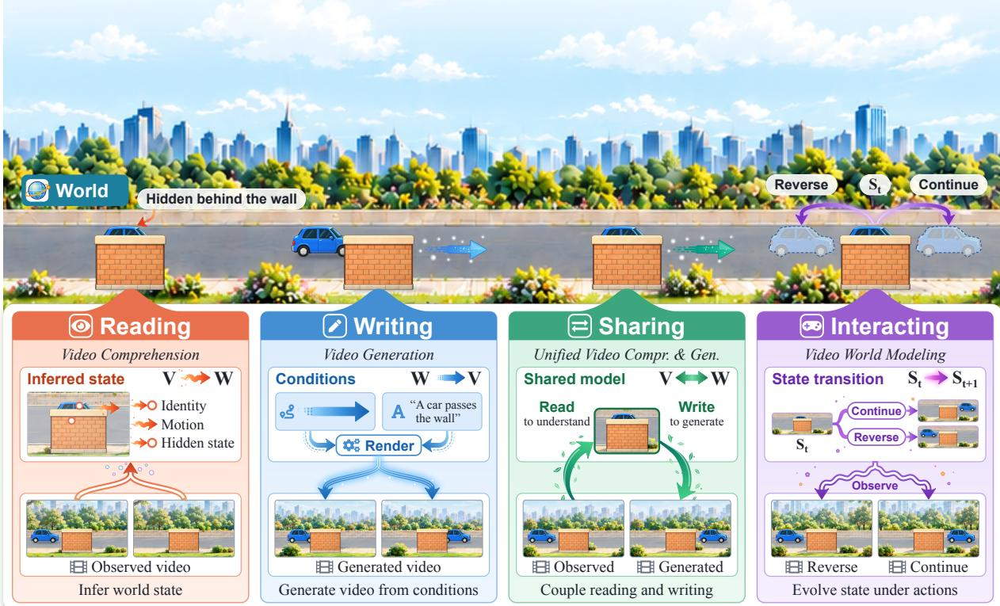

# Reading, Writing, Sharing, and Interacting with the World through Video

A Survey Toward Unified Video World Models

Shengqiong Wu1,∗, Meng Luo2,∗, Bobo Li2, Ziwei Liu3, Shuicheng Yan2, Ming-Hsuan Yang4, Philip Torr1, Hao Fei1,♠

1University of Oxford 2NUS 3NTU 4University of California, Merced ∗Equal contribution ♠Project lead, correspondence (haofei7419@gmail.com)

Project: https://vid-gen.github.io/video-world-model-survey GitHub: https://github.com/vid-gen/awesome-video-world-model

## Abstract

Video foundation models have advanced rapidly in understanding and generating visual sequences, while video world models seek to capture the underlying dynamics of the world they depict. Despite their diferent objectives, both concern the relationship between video observations and an evolving world. This survey adopts world modeling as a unifying lens for examining these developments. Viewing an observed video as a partial, lossy, and temporally ordered projection of a latent temporal world, we organize the literature around four complementary operations: Y reading infers world properties from observed video; Ò writing synthesizes video from specified or learned world conditions; T sharing integrates understanding and generation through common modeling mechanisms; and „ interacting predicts and updates world states under actions and evolving observations. This perspective distinguishes temporal coherence in observed or generated sequences from consistency in the underlying world state. Across tasks, representations, models, datasets, and benchmarks, we trace a shift in emphasis from clip-level recognition and perceptual fidelity toward persistent state, controllable evolution, physical and causal validity, and evaluation grounded in interaction and downstream decisions, and we distill the open challenges that follow.

## Contents

1 Introduction 6   
2 The World-Modeling Lens 9   
2.1 World, Video, and Represented State . 10   
2.2 Two Forms of Consistency 10   
2.3 The Four Operations . 11   
3 Preliminaries 11   
3.1 Video Scenarios . 11   
3.2 Video Large Language Models . 12   
3.3 Generative Modeling Foundations 13   
3.4 Taxonomy of Video World Models 14   
4 Video Comprehension: Reading the World 15   
4.1 Tasks, Data, and Evaluation . 15   
4.1.1 Semantic Understanding 15   
4.1.2 Spatial Understanding 16   
4.1.3 Temporal Understanding 17   
4.1.4 Physical Understanding 17   
4.1.5 Causal Understanding 17   
4.2 Video Representation Learning and Encoding 17   
4.2.1 Contrastive Learning 18   
4.2.2 Masked Learning . 18   
4.2.3 Predictive Learning 19   
4.2.4 Generative Learning 19   
4.3 Video-Language Foundation Modeling 19   
4.3.1 Architectures 19   
4.3.2 Learning Paradigms 21   
4.3.3 Test-Time Scaling 22   
4.4 Agentic Video Modeling 22   
4.4.1 Video Agents 22   
4.4.2 Tool Use and Retrieval Augmentation 24   
4.5 Applications . . 25   
4.5.1 Embodied and Egocentric Perception . 25   
4.5.2 Autonomous Driving . 25   
4.5.3 Domain-Specific Video Analysis . 25   
5 Ò Video Generation: Writing the World 26   
5.1 Tasks, Conditions, and Evaluation 26   
5.1.1 Generation Tasks by Condition 26   
5.1.2 Evaluation and Metrics 27   
5.2 Video Latent Representation Learning 29   
5.2.1 Continuous Latents . . 29   
5.2.2 Discrete Tokens . 31   
5.2.3 Hybrid and Semantically Aligned Representations 31   
5.3 Generative Video Foundation Modeling 32   
5.3.1 Difusion-Based Generation 34   
5.3.2 Autoregressive and Masked Token Generation . 35   
5.3.3 Flow-Based Generation 36   
5.3.4 LLM/MLLM-Assisted Generation 36   
5.3.5 Agentic Generation . 36   
5.4 Control Strategies 37   
5.4.1 Attention-Based Control . 37   
5.4.2 Adapter-Based Control . 38   
5.4.3 Latent-Space Control 39   
5.4.4 Concatenation and In-Context Conditioning . 39   
5.4.5 Guidance-Based Control 39   
5.4.6 Tuning-Based Control 39   
5.5 Applications . 40   
5.5.1 Creative Content Production 40   
5.5.2 Avatars and Character Animation 40   
5.5.3 Video Plans for Embodied Agents 40   
5.5.4 Synthetic Data for Embodied AI and Driving 41   
Unified Video Models: Sharing the World 41   
6.1 Unified Architectures . 41   
6.1.1 Discrete-Token Unification . 43   
6.1.2 Continuous Latent-Space Unification 44   
6.1.3 Decoupled and Modular Unification 44   
6.1.4 Agentic and Tool-Augmented Unification 45   
6.2 Learning Paradigms 45   
6.2.1 Isolated Learning 45   
6.2.2 Dual Learning 46   
6.2.3 Co-learning 46   
6.2.4 Synergistic Learning 46   
6.3 Applications . 47   
6.3.1 Instruction-Driven Video Editing and Creation 47   
6.3.2 Generative Reasoning 47   
6.3.3 Unified Perception-Generation-Planning Systems 47   
6.4 Evaluation . 48   
6.4.1 Per-Direction Evaluation 48   
6.4.2 Unified, Interleaved, and Synergy Evaluation 48   
6.4.3 Protocols and Consistency 49   
„ Video World Models: Interacting with the World 49   
7.1 Architectures and Training Paradigms 49   
7.1.1 Observation-Space Passive Prediction 50   
7.1.2 Observation-Space Action-Conditioned Prediction 50   
7.1.3 Observation-Space Interactive World Models 51   
7.1.4 Latent-State Passive Prediction 51   
7.1.5 Latent-State Action-Conditioned Prediction 52   
7.1.6 Latent-State Interactive World Models . 52   
7.2 Core Technical Challenges . 52   
7.2.1 Action-Conditioned Controllability 52   
7.2.2 Long-Horizon Consistency and Memory 53   
7.2.3 Real-Time Responsiveness 54   
7.2.4 Physical and Causal Grounding 55   
7.3 Applications . 56   
7.3.1 Data Engines 56   
7.3.2 Policy Training in Imagination 56   
7.3.3 Policy Evaluation Environments 57   
7.3.4 Predict-then-Act Planning 57   
7.3.5 Interactive Simulation for Humans 57   
7.4 Benchmarks and Evaluation 57   
7.4.1 Challenge-Aligned Benchmarks 57   
7.4.2 Application-Aligned Benchmarks 59   
7.4.3 Foundational and Comprehensive Benchmarks 59   
8 Open Challenges and Future Directions 60   
8.1 Long-Horizon World Consistency 60   
8.2 Physical and Causal Grounding 61   
8.3 Measurable Synergy in Unified Video Models 61   
8.4 Standardized Evaluation of World Properties 62   
8.5 Scaling Control from Unlabeled Video 63   
8.6 Generalization across Scenes and Embodiments 63   
8.7 Stochastic Worlds and Rare Events . 64

## 9 Conclusion

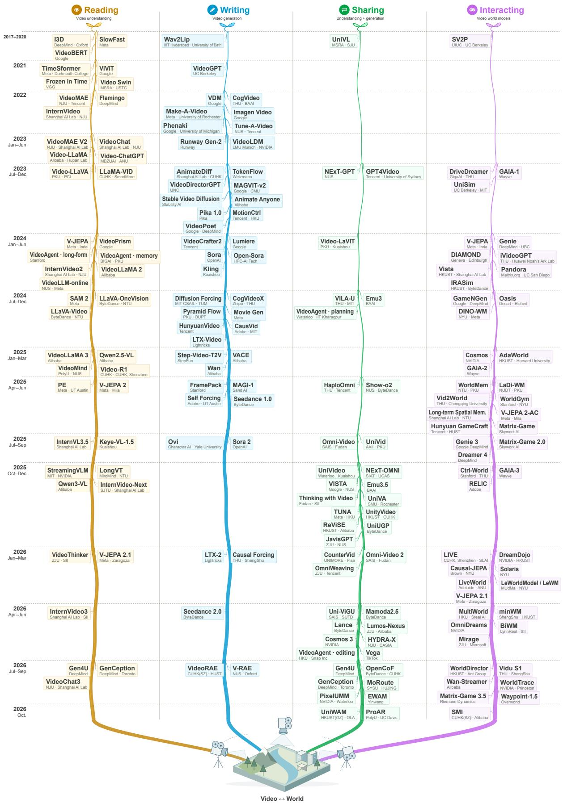  
Figure 1 Selected milestones in the parallel evolution of video understanding, generation, shared representations and workflows, and world prediction and control.

## 1 Introduction

“Vision is the process of discovering from images what is present in the world, and where it is.”

David Marr, Vision, 1982 [338]

Video occupies a distinctive position among the modalities available to machine intelligence. Unlike static images that capture individual moments, text that conveys selectively described information, or audio that primarily records acoustic dynamics, video directly captures how visible entities, their relations, and actions evolve across space and time, often together with synchronized audio, speech, and text. This rich spatiotemporal information makes video essential to a wide range of applications, including communication, entertainment, autonomous driving, robotics, healthcare, and education. Consequently, video has long been a central subject of computer vision and multimedia research, progressing from spatiotemporal architectures for action recognition [39, 102, 208] to self-supervised pretraining for transferable video representations [453, 482]. More recently, advances in large language models (LLMs) and large-scale generative modeling have driven a shift from task-specific video models toward general-purpose video foundation models, expanding their capabilities along three complementary directions. For video understanding, Video-LLMs such as Video-LLaVA [271] enable language-based interaction with visual sequences, while Qwen3-VL [12] extends multimodal context to 256K tokens to accommodate longer video inputs. For video generation, models such as Sora [31], Wan [462], HunyuanVideo [219], Movie Gen [372], and Seedance 2.0 [442] demonstrate increasingly capable synthesis under diverse conditions, with Sora and Loong [487] further exploring minutescale generation. Toward the unification of understanding and generation, emerging models [479, 498, 531] seek to integrate these capabilities through shared token representations, latent spaces, or modeling interfaces, bringing video perception and synthesis into a common foundation-model framework.

Beyond video understanding and generation, a broader research direction is emerging around modeling how the physical world evolves, rather than merely interpreting or synthesizing its visual observations. Although language models acquire extensive knowledge through text, their representations are only indirectly grounded in physical experience, motivating the pursuit of world models that can predict how an environment changes over time and support reasoning and planning [59, 229]. This idea has roots in model-based reinforcement learning, where agents learn predictive dynamics to simulate possible futures and evaluate candidate actions before acting [143, 146]. Video provides a natural and scalable foundation for extending this paradigm beyond task-specific environments: by capturing continuous changes in objects, relations, and actions, large-scale video data ofers rich supervision for learning world dynamics without requiring manually annotated labels, although actions and underlying physical states often remain unobserved. Building on this opportunity, recent research has explored several complementary approaches to video-based world modeling. Generative models such as Sora [31] have motivated the prospect of learning world dynamics through video synthesis, while Genie [32] demonstrates how interactive environments can be learned from unlabeled videos. Action- and condition-aware models such as GAIA-1 [172] and Cosmos [355] extend predictive generation toward driving and physical AI, whereas V-JEPA 2 [9] and Dreamer 4 [147] explore predictive representations and imagined trajectories for planning and control. Together with progress in interactive simulation [561], egocentric and robotic learning [133, 511], and long-horizon prediction [528], these developments are expanding the role of video from a medium for perception and generation toward a foundation for predicting and interacting with dynamic environments. Figure 1 traces milestones of these lines of work.

These two lines of progress are increasingly converging around a common challenge: connecting video observations with the dynamics of the world they depict. Video world models must infer underlying states from observed sequences before predicting how those states evolve, and often translate predicted states back into visual observations for simulation, evaluation, or planning. Conversely, video generators are increasingly incorporating action- and state-dependent controls, while unified video models explicitly couple visual understanding with synthesis. Despite their diferent objectives, these approaches therefore share a fundamental question: what relationship does a model learn between an observed video and the evolving world that gives rise to it?

To examine this question systematically, we adopt world modeling as a unifying perspective on video foundation models. Specifically, we view an observed video V as a partial, lossy, and temporally ordered observation of an underlying latent temporal world W. This distinction provides a common basis for organizing four complementary research paradigms: Y reading, which infers world properties from observed video; Ò writing, which synthesizes video observations from specified or learned world conditions; T sharing, which integrates both directions within a unified modeling framework; and „ interacting, which updates or predicts world states in response to actions and evolving observations. These paradigms characterize diferent ways in which models connect video observations to the underlying world, rather than merely categorizing models by their input and output modalities. This perspective enables a systematic comparison of their objectives, capabilities, and evaluation criteria while preserving the distinctions between visual plausibility, temporal coherence, and consistency of the modeled world. Section 2 formalizes this framework and clarifies how these properties difer across the four paradigms.

Existing relevant surveys have examined related developments from diferent perspectives, including general world models organized around predictive state representations across modalities [84], interactive video world models centered on online prediction and control [286, 320], 3D and 4D world modeling grounded in explicit geometric representations [218], multimodal language models emphasizing the integration of visual encoders and language reasoning [581], long-form video generation focusing on temporal extension and consistency [240], and audio-visual foundation models spanning complementary modalities [384]. While these surveys provide valuable insights into individual research directions, they do not collectively establish a unified account of how video models connect observations to evolving world states across understanding, generation, unification, and interaction. Our survey addresses this gap by taking the relation between video observations and the underlying dynamic world as its central organizing principle, not any single architecture, task, or modality.

Under this perspective, we systematically examine the four paradigms of reading, writing, sharing, and interacting through a common analytical framework. For each paradigm, we review the tasks, datasets, and evaluation protocols that define its objectives; the representations and model architectures that support its capabilities; the reasoning and control mechanisms that extend its functionality; and the applications that demonstrate its practical utility. Beyond reviewing individual paradigms, we identify several cross-cutting questions: how models represent and preserve world states beyond immediate observations, how actions and external conditions influence state evolution, and how predictive capabilities translate into efective reasoning and decision-making. These questions also motivate a closer examination of evaluation practices, particularly the distinction between conventional metrics of recognition accuracy or perceptual fidelity and emerging criteria concerning state persistence, controllability, physical and causal consistency, and downstream utility. Within the interacting paradigm, we further distinguish video world models along two complementary dimensions: prediction space, ranging from observation-space to latent-state prediction, and transition interface, ranging from passive prediction to action-conditioned rollout and closed-loop interaction. This taxonomy separates what a model predicts from how its predictions are conditioned, updated, and used.

Our review covers publicly available research that contributes relevant architectural, methodological, or evaluation evidence. We retain foundational studies where necessary to establish conceptual and technical developments, while interpreting recent advances in the context of their specific tasks, training data, and evaluation protocols. Throughout the survey, we distinguish between the capabilities supported by a model’s design, the supervision provided by its training data, and the empirical evidence demonstrated by its evaluation, avoiding assumptions that strong performance on individual video tasks necessarily implies consistent or generalizable world modeling.

Specifically, this survey makes three main contributions:

A world-modeling lens. The four-operation framework of reading, writing, sharing, and interacting relates video understanding, video generation, unified video models, and video world models in one account, plus a two-axis classification of world models by prediction space and transition interface.

A comprehensive scope with insights. Across tasks, representations, models, systems, datasets, and benchmarks, we compare how the four operations represent state, learn from video, accept control, preserve memory, and are evaluated. The synthesis distills recurring design patterns and failure modes into explicit insights, and identifies open directions, including long-horizon consistency, physical and causal grounding, measurable synergy between understanding and generation, and standardized evaluation of world properties.

Open resources. A public reading list, taxonomy, codes, data, and resources are all categorized and available at project page.

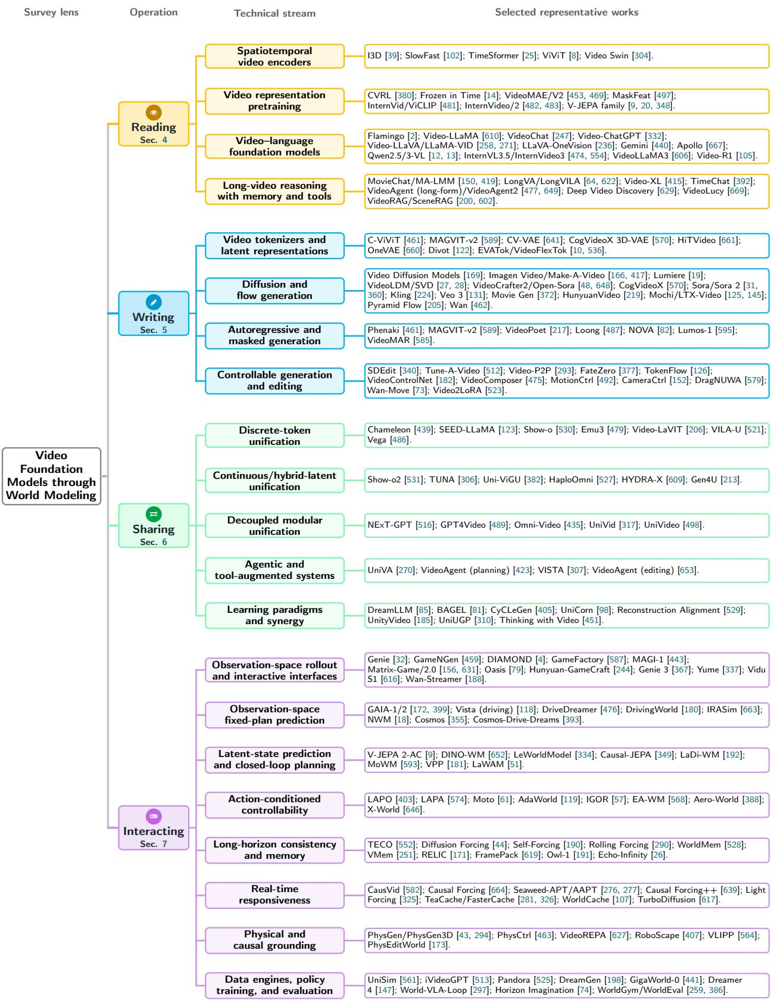  
Figure 2 Knowledge graph of the four research fields. Reading, writing, sharing, and interacting branch into technical streams and representative works.

Table 1 Notation used throughout the survey.
<table><tr><td>Symbol</td><td>Meaning</td><td>Introduced in</td></tr><tr><td colspan="3">World and video</td></tr><tr><td> $t \in \{ 1 , \ldots , T \}$ </td><td>video time; T is the number of frames</td><td>Section 2.1</td></tr><tr><td> $W = ( w _ { t } ) _ { t \geq 1 } , \mathcal { W }$ </td><td>latent temporal world and its state space</td><td>Definition 2.1</td></tr><tr><td> $\mathcal { T } ( \cdot \mid w _ { t } , a _ { t } )$ </td><td>world dynamics</td><td>Definition 2.1</td></tr><tr><td>at</td><td>action or external intervention; may be absent</td><td>Definition 2.1</td></tr><tr><td> $V = ( x _ { 1 } , \dots , x _ { T } )$ </td><td>observed video and its frames</td><td>Definition 2.2</td></tr><tr><td> $O ( \cdot \mid w _ { t } , \pi _ { t } ) , \pi _ { t }$ </td><td>sensing process and camera configuration</td><td>Definition 2.2</td></tr><tr><td> $x _ { \leq t } , x _ { < i } , x _ { 1 : T }$ </td><td>elements up to t, before i, and from 1 to T of any sequence</td><td>Definition 2.3</td></tr><tr><td colspan="3">Models and the four operations</td></tr><tr><td> $\theta ; \theta _ { \mathrm { R } } , \theta _ { \mathrm { W } }$ </td><td>model parameters; reading- and writing-map parameters in sharing</td><td>Definitions 2.3, 2.6</td></tr><tr><td> $s _ { t } \sim q _ { \theta } ( \cdot \mid x _ { \leq t } , a _ { < t } )$ </td><td>represented state and the map that infers it (deterministic fe as a special case); in general  $s _ { t } \neq w _ { t }$ </td><td>Definition 2.3</td></tr><tr><td> $\hat { V } = ( \hat { x } _ { 1 } , \dots , \hat { x } _ { T } )$ </td><td>trace generated or predicted by a model</td><td>Definition 2.4</td></tr><tr><td> $d , \delta$ </td><td>local discrepancy between neighboring frames and its tolerance</td><td>Definition 2.4</td></tr><tr><td>C</td><td>admissible world trajectories (identity, relations, dynamics, physical and causal constraints)</td><td>Definition 2.4</td></tr><tr><td> $\phi ( w _ { t } ) , \hat { \phi } _ { t } , r _ { \theta }$ </td><td>target world property, its estimate, and the reading distribution</td><td>Definition 2.6</td></tr><tr><td> $c , c _ { t }$ </td><td>condition (text, image or video prefix, audio, camera motion, trajectory, or layout); ct is the condition at step t</td><td>Definition 2.6</td></tr><tr><td>pθ</td><td>distribution over traces (writing) or next states (interacting)</td><td>Definition 2.6</td></tr><tr><td>gθ</td><td>decoder from represented state to observation</td><td>Definition 2.6</td></tr><tr><td>H</td><td>prediction horizon of a world model</td><td>Figure 10</td></tr><tr><td colspan="3">Video-LLMs and generative modeling</td></tr><tr><td> $E _ { v } , P$ </td><td>video encoder and connector to the LLM</td><td>Section 3.2</td></tr><tr><td>z, Z1:L</td><td>video-derived features or latents; L embeddings passed to the LLM</td><td>Section 3.2</td></tr><tr><td>z,z0</td><td>generative target (latent, video tokens, or frames) and its clean sample</td><td>Section 3.3</td></tr><tr><td>zk, k, K</td><td>noisy latent at denoising step  $k \in \{ 1 , \ldots , K \}$  (continuous  $k \in [ 0 , 1 ]$  for flow matching), distinct from video time t</td><td>Section 3.3</td></tr><tr><td>€, €θ, vθ</td><td>Gaussian noise, noise-prediction network, and velocity field</td><td>Section 3.3</td></tr></table>

The remainder of this survey proceeds as follows. Section 2 formalizes the video–world relation, the two forms of consistency, and the four operations. Section 3 assembles the shared background: recurring video scenarios, language-model and generative-modeling foundations, and the definition and taxonomy of video world models. Sections 4 through 7 then follow the operations from observing a trace to evolving a world state. Section 4 studies how models read semantic, spatial, temporal, physical, and causal properties from video; Section 5 examines the representations, generative paradigms, and controls used to write traces; Section 6 turns to the architectures and training regimes that connect the two directions; and Section 7 completes the progression with open-loop and online models that evolve video-derived state under actions or conditions. Figure 2 condenses the resulting landscape: each operation branches into parallel research streams and then into the representative works examined in those chapters. Section 8 distills the challenges that cut across the four operations into directions for future work, and a brief conclusion closes the survey.

## 2 The World-Modeling Lens

This section defines the world and its video (Section 2.1), two forms of consistency used later for evaluation (Section 2.2), and the four operations that organize Sections 4–7 (Section 2.3). Table 1 lists the notation.

## 2.1 World, Video, and Represented State

We distinguish three objects: the evolving world, the video through which it is observed, and the representations that a model constructs from available information. The following definitions provide a conceptual abstraction:

Definition 2.1 (Latent temporal world) The latent temporal world is a stochastic process $W = ( w _ { t } ) _ { t \geq 1 }$ over a state space W. Each state $w _ { t } \in \mathcal { W }$ encompasses entities, their attributes and relations, and relevant physical and dynamic variables. Assuming that $w _ { t }$ contains suficient information for predicting subsequent evolution, its dynamics can be expressed as

$$
w _ { t + 1 } \sim \mathcal { T } ( \cdot \mid w _ { t } , a _ { t } ) ,
$$

where $a _ { t }$ denotes an optional intervention or control input, with uncontrolled evolution recovered when no such input is supplied.

Definition 2.2 (Observed video) An observed video $V = ( x _ { 1 } , \dots , x _ { T } )$ is a temporally ordered sequence of visual observations generated by a sensing process, $x _ { t } \sim \mathcal { O } ( \cdot \ | \ w _ { t } , \pi _ { t } )$ where $\pi _ { t }$ is the camera configuration. We refer to an observed or generated video V as a trace. This trace is partial: $x _ { t }$ depends only on the part of $w _ { t }$ visible under $\pi _ { t }$ , which changes with camera motion, shot changes, or multiple cameras; lossy: sensing, resolution, compression, and editing remove information, so distinct world states may produce indistinguishable observations; and temporally ordered: frame order and duration carry evidence about motion and state transition, and thus about $\tau .$

Definition 2.3 (Represented state) A model with parameters θ may construct an internal representation $s _ { t } \sim q _ { \theta } ( \cdot \mid x _ { \leq t } , a _ { < t } )$ , inferred from the observations and actions available up to time t; a deterministic encoder $s _ { t } = f _ { \theta } ( x _ { \le t } , a _ { < t } )$ is the special case of a point mass, and a transition model may instead sample $s _ { t + 1 }$ from its own predictions (Definition 2.6). In general, $s _ { t } \neq w _ { t }$ , and its information about the underlying world may be incomplete or inaccurate.

Remark. Definitions 2.1–2.3 describe a partially observable dynamical system, closely related to the environment model underlying a partially observable Markov decision process. Such formulations are widely used in model-based reinforcement learning [143, 146], where agents infer predictive states from observations and simulate possible futures under candidate actions. For general video foundation models, however, the represented state may be implicit or constructed from an entire sequence rather than updated online.

## 2.2 Two Forms of Consistency

Because video observes the world only partially (Definition 2.2), a trace can be consistent at two levels.

Definition 2.4 (Temporal coherence and world consistency) Let $\hat { V } = ( \hat { x } _ { 1 } , \dots , \hat { x } _ { T } )$ be a trace that a model generates or predicts. $\hat { V }$ is temporally coherent if neighboring frames agree locally, $d ( \hat { x } _ { t } , \hat { x } _ { t + 1 } ) \leq \delta$ for all t, where d penalizes implausible local motion, appearance change, or flicker. $\hat { V }$ is world-consistent relative to specified dynamics and constraints, if its observations are compatible with at least one admissible world trajectory:

$$
\exists w _ { 1 : T } \in \mathcal { C } , \ \pi _ { 1 : T } \quad \mathrm { s . t . } \quad \hat { x } _ { t } \in \mathrm { s u p p } \mathcal { O } ( \cdot \mid w _ { t } , \pi _ { t } ) , \quad \forall t ,
$$

where C contains the trajectories that satisfy the assumed dynamics, identity persistence, spatial relations, and relevant physical and causal constraints under the specified interventions. When the camera path is specified as a condition, $\pi _ { 1 : T }$ is fixed to it instead of quantified.

Observation 2.5 (Coherence-consistency) Neither property implies the other. An object that changes identity after leaving the frame, a room that alters its layout between visits, or an action whose efect later disappears can yield locally smooth frames that no trajectory in C explains; conversely, a hard cut violates local smoothness while remaining world-consistent.

Temporal coherence is a property of the trace; world consistency is a property of the world the trace implies. A recorded video is world-consistent by construction, because a real trajectory produced it, so the distinction matters for traces that a model writes or predicts. World-modeling evidence must therefore test world consistency, not only temporal coherence. As O and C are unobserved, Definition 2.4 is an evaluation target, not a metric; benchmarks in Sections 5.1.2 and 7.4 probe it via revisits, occlusion, and interventions.

## 2.3 The Four Operations

Definition 2.6 (Four operations)

Y Reading $V  W$ (video comprehension). Reading infers selected properties of the world from observed video, $\hat { \phi } _ { t } \sim r _ { \theta } ( { \bf \cdot } \mid s _ { t } )$ , an estimate of $\phi ( w _ { t } )$ , where $s _ { t }$ is constructed from the available observations and ϕ ranges over semantic, spatial, temporal, physical, and causal properties. It is evaluated by accuracy against $\phi ( w _ { t } )$ and by calibrated uncertainty for occluded or of-screen content.

$$
W  V
$$

$\hat { x } _ { 1 : T } \sim p _ { \theta } ( x _ { 1 : T } \mid c )$ , where c (text, an image or video prefix, audio, camera motion, trajectories, or layouts) specifies the world only in part and the generator resolves the rest. It is evaluated by perceptual quality, adherence to $c ,$ and world consistency of $\hat { V }$ (Definition 2.4).

T Sharing $V  W$ (unified comprehension and generation). Sharing couples a reading map with parameters $\theta _ { \textup R }$ and a writing map with parameters $\theta _ { \mathrm { { W } } }$ through at least one shared component: parameters $( \theta _ { \mathrm { R } } \cap \theta _ { \mathrm { W } } \neq \emptyset )$ , tokens or representations, an interface, or a training objective. It is evaluated at three levels: capability coverage, architectural sharing, and functional synergy, that is, measurable improvement of reading, writing, or both under matched resources.

„ Interacting $W \odot$ (video world modeling). Interacting rolls out a transition model, $s _ { t + 1 } \sim p _ { \theta } ( s _ { t + 1 } \mid s _ { \le t } , a _ { t } , c _ { t } )$ , with $\hat { x } _ { t + 1 } = g _ { \theta } ( s _ { t + 1 } )$ when visible output is needed. The state $s _ { t }$ may be frames, video tokens, or latent features, and the actions $a _ { t }$ and conditions $c _ { t }$ are fixed before an open-loop rollout or supplied online. It is evaluated by whether predicted changes follow these inputs and stay world-consistent (Definition 2.4), beyond the quality of rendered frames.

The arrows here are conceptual shorthand: writing reaches W only through c, and reading and writing are not exact inverses. Stronger claims about the represented state need stronger evidence; Table 2 gives four levels for each operation, from plausible output to decision utility. One system can perform several operations: a unified editor reads a source clip before writing its revision, and an interactive world model reads its history, writes each next frame, and updates its state in one backbone. Figure 1 places milestones of the four lines of work on one timeline, from video encoders [8, 102] and generators [162, 169] to unified models [479, 531] and action-conditioned simulators [32, 172].

## 3 Preliminaries

This section covers the background shared by the four operations: video scenarios (Section 3.1), video large language models (Section 3.2), generative modeling (Section 3.3), and the scope and taxonomy of video world models (Section 3.4).

## 3.1 Video Scenarios

Video modeling spans diverse scenarios that difer in temporal extent, observation perspective, modality composition, information availability, interaction, and domain-specific constraints. Rather than forming mutually exclusive categories, these characteristics impose complementary demands on what a model must observe, retain, predict, and control. Table 3 lists the evidence, modeling demands, and representative resources of each scenario.

Table 2 Evidence ladder for claims about the world. Each operation can be supported at four increasing levels; stronger world-modeling claims require the higher levels. Benchmarks are representative, not exhaustive.
<table><tr><td>Operation</td><td>1. Plausible output</td><td>2. Faithful to evidence or conditions</td><td>3. Consistent world state</td><td>4. Decision utility</td></tr><tr><td>Reading</td><td>correct labels and answers on clips [109, 208]</td><td>answers depend on the video, with shortcuts controlled [222, 358, 420]</td><td>state kept across occlusion, revisits, and streams [260, 291, 327]</td><td>evidence supports agent or driving decisions [5, 416]</td></tr><tr><td>Writing</td><td>perceptual quality and temporal coherence [193]</td><td>adherence to text, motion, and reference conditions [73, 427]</td><td>world consistency (Definition 2.4): identity, layout, physics [17, 346]</td><td>generated data or plans improve downstream models [198, 406]</td></tr><tr><td>Sharing</td><td>both directions work in one system [248, 647]</td><td>integrated, source-faithful transformations [298, 501]</td><td>measured transfer under matched data, capacity, and compute [111, 374]</td><td>shared prediction improves planning or action [310, 466]</td></tr><tr><td>Interacting</td><td>plausible predicted frames or features</td><td>predicted changes follow fixed or online controls [7, 96]</td><td>persistent state and valid responses to interventions [34, 49, 241, 575]</td><td>better planning, policy training, or policy ranking [386, 406, 614]</td></tr></table>

Three labels describe the recorded content: its default form, its modalities, and its viewpoint. Regular short video, the standard setting for representation learning and clip-level understanding, consists of passive thirdperson clips of seconds to minutes, whose audio is usually ignored. Its datasets annotate action classes [208], actions defined by temporal change [132], or captions [541], but do not test memory, online response, or control. Sounding video treats synchronized audio as evidence, with tasks that range from audio-event recognition and source localization to generating events whose sound and appearance must agree [50, 124, 449]. Its benchmarks must rule out visual or language shortcuts. Egocentric video is recorded from a wearer’s or agent’s viewpoint, so hands, manipulated objects, gaze, and body-coupled camera motion enter the stream [78, 133, 134, 336]. The task shifts from recognizing actions to tracking object state and intent across long activities with frequent occlusion.

Three further labels describe how the model accesses observations and whether it can change them. In streaming and online video, frames arrive incrementally, so a model must update its state and respond within bounded latency, without access to future frames. Typical tasks are online question answering and streaming captioning, which may require timestamped or proactive responses [352, 569]. The same recording can be processed ofline in full or presented as a stream. Long-form video spans minutes to hours: the full recording is usually available, but not every frame can be processed at full resolution, and the evidence for a query is sparse and spread across distant segments [109, 472, 509, 654]. A model must therefore decide which evidence to keep and link events that lie far apart in time. Interactive video lets a human, policy, or agent supply actions that change what is observed next [7, 406, 575]. Unlike in a passive stream, the future then depend on the interaction history; interactive world models (Section 3.4) target this setting.

Domain-specific video cuts across all of these labels: driving [33, 416], surgery [456], sports [127], and instructional video [343, 437] impose their own event structure, terminology, and costs of error. These domains test whether general video representations transfer to rare events and specialized outputs.

## 3.2 Video Large Language Models

Connecting video to an LLM. A Video-LLM feeds video into a pretrained large language model (LLM), usually an autoregressive Transformer [454, 460] trained by next-token prediction (Equation (2)). The LLM learns to follow instructions through supervised instruction tuning [500], which visual instruction tuning extends to images [282], and is further aligned with human or model feedback [361] and verifiable rewards [138, 228]. Inside a video system, it understands and generates language, answers questions, and sometimes acts as a controller that decomposes tasks, selects tools, and reasons over several steps. In a common division of labor, a video encoder supplies perceptual features, the LLM interprets or organizes them, and a decoder, generator, or world model produces pixels or state transitions. To connect video, a video encoder $E _ { v }$ maps frames or clips $x _ { 1 : T }$ to visual features, and a connector P converts these features into a language-compatible sequence:

Table 3 Video scenarios, their defining evidence conditions, modeling demands, and representative resources.
<table><tr><td>Scenario</td><td>Evidence</td><td>Modeling demands</td><td>Datasets / benchmarks</td></tr><tr><td>Regular short video</td><td>short, passive clips with bounded actions or events</td><td>clip-level semantics, cross-modal matching, and local temporal structure</td><td>Kinetics [208], Something-Something [132], MSR-VTT [541]</td></tr><tr><td>Sounding video</td><td>synchronized audio and visual evidence</td><td>cross-modal binding, temporal localization, and modality-balanced inference</td><td>AudioSet [124], VGGSound [50], AVE [449], OmniVideoBench [238]</td></tr><tr><td>Egocentric video</td><td>first-person activity with body-coupled camera motion and hand-object interaction</td><td>object-state persistence, procedural memory, and ego-exo correspondence</td><td>Ego4D [133], EPIC-KITCHENS [78], Ego-Exo4D [134], EgoSchema [336], HD-EPIC [370],</td></tr><tr><td>Streaming and online video</td><td>frames arrive incrementally; outputs are required before the stream ends</td><td>causal state updates, bounded rolling memory, and timely or proactive response</td><td>EgoLife [560] OVO-Bench [352], SVBench [569]</td></tr><tr><td>Long-form video</td><td>minutes-to-hours records with sparse, temporally distant evidence</td><td>evidence retrieval, event linkage, compression, and long-range memory</td><td>MLVU [654], LVBench [472], Video-MME (long) [109], LongVideoBench [509], HourVideo [41],</td></tr><tr><td>Interactive video</td><td>actions or instructions change future observations during rollout</td><td>action fidelity, persistent state, closed-loop latency,</td><td>VideoOdyssey [151] ACT-Bench [7], MIND [575], WorldArena [406]</td></tr><tr><td>Domain-specific video</td><td>domain-specific semantics, workflows, sensors, and costs of error</td><td>and decision utility specialist knowledge, fine-grained supervision, and domain-calibrated evaluation</td><td>nuScenes [33], DriveLM [416]; Cholec80 [456]; SoccerNet [127]; HowTo100M [343], COIN [437]</td></tr></table>

$$
z _ { 1 : L } = P ( E _ { v } ( x _ { 1 : T } ) ) .\tag{1}
$$

Connectors range from linear projectors [282] to learned-query resamplers [196, 246] and gated crossattention [2]; Section 4.3 compares them and the video-specific training recipes.

Video tokens and context. In the Video-LLM literature, a video token usually denotes one of the continuous embeddings in $z _ { 1 : L }$ passed to the LLM. Autoregressive video generators often use the same term for discrete codebook indices, a diferent representation (Section 5). Frame sampling, temporal pooling, and the connector set the number L of embeddings kept from a video. A larger L preserves finer spatial and temporal evidence but costs more context, memory, and attention; stronger compression is cheaper but can remove brief events, small objects, or long-range relations. Because the context window is fixed and also holds the instructions, earlier dialogue, and the output, long-video models must split the remaining budget between temporal coverage and visual detail.

## 3.3 Generative Modeling Foundations

Conditional generation. Whereas the LLM mainly produces language, generative models produce the visual output of a video system. Writing samples a trace $\hat { x } _ { 1 : T } \sim p _ { \theta } ( x _ { 1 : T } \mid c )$ (Definition 2.6). Video generators usually work in the latent space of a variational autoencoder (VAE) [214], whose decoder may be trained with an adversarial loss [130]: an encoder maps the video to a latent z, the generator models $p _ { \theta } ( z \mid c )$ , and the decoder maps a sampled latent back to frames. We write z for whichever target is modeled, whether continuous latents, discrete video tokens, or, for pixel-space models, the frames themselves. In general, a condition may specify content, such as a prompt or a reference image, or control how the state evolves, such as actions, trajectories, or camera paths. The same modality can play diferent roles: an image may specify appearance, provide the initial observation, or serve as a spatial reference. Action-conditioned and interactive world models (Section 3.4) require the second kind.

Autoregressive and masked modeling. When the target is a sequence of ordered units $z _ { 1 : N }$ , an autoregressive model factorizes the conditional distribution as

$$
p _ { \theta } ( z _ { 1 : N } \mid c ) = \prod _ { i = 1 } ^ { N } p _ { \theta } ( z _ { i } \mid z _ { < i } , c )\tag{2}
$$

and generates the units in order, each sampled unit joining the context for later predictions. The units may be discrete codes or continuous latent blocks, ordered by time alone or by a space–time serialization, and Transformer decoders are the common implementation [460]. Masked modeling instead hides a subset of units and predicts them in parallel from the visible context and the condition. For discrete targets, with sampled masked positions M and visible units $z _ { \bar { M } }$ , a common objective is the token cross-entropy

$$
\mathcal { L } _ { \mathrm { m a s k } } = \mathbb { E } _ { ( z , c ) , M } \left[ - \sum _ { i \in M } \log p _ { \theta } ( z _ { i } \mid z _ { \bar { M } } , c ) \right] .\tag{3}
$$

MaskGIT [42] turns these predictions into samples through iterative filling and refinement. Continuous pixel or feature targets instead use a reconstruction loss such as squared error [154].

Diffusion and flow matching. A difusion model learns to reverse a forward process that gradually corrupts data with noise [167, 418]. Let $( z _ { 0 } , c ) \sim p _ { \mathrm { d a t a } }$ be a clean training latent and its condition, and let $k \in \{ 1 , \ldots , K \}$ index the denoising step; the subscript k is difusion time, distinct from video time t. In the noise-prediction form, $z _ { 0 }$ is corrupted to $z _ { k } = \sqrt { \bar { \alpha } _ { k } } z _ { 0 } + \sqrt { 1 - \bar { \alpha } _ { k } } \epsilon$ , where $\epsilon \sim \mathcal { N } ( 0 , \mathbf { I } )$ and $\bar { \alpha } _ { k }$ decreases toward 0 as k increases, and the network learns to recover the noise:

$$
\begin{array} { r } { \mathcal { L } _ { \mathrm { d i f f } } = \mathbb { E } _ { ( z _ { 0 } , c ) , \epsilon , k } \left[ \left| \left| \epsilon _ { \theta } ( z _ { k } , k , c ) - \epsilon \right| \right| ^ { 2 } \right] . } \end{array}\tag{4}
$$

Sampling starts from $z _ { K } \sim \mathcal { N } ( 0 , { \bf { I } } )$ and applies denoising updates $z _ { K }  \cdot \cdot \cdot  z _ { k }  z _ { k - 1 }  \cdot \cdot \cdot  z _ { 0 }$ , after which $z _ { 0 }$ is decoded into video; networks may equivalently predict the clean sample or the velocity. Flow matching instead trains a vector field that transports a simple base distribution to the data along a chosen probability path [280]. Here k is continuous: for the linear path $z _ { k } = ( 1 - k ) z _ { 0 } + k \epsilon$ with $k \sim \mathcal { U } [ 0 , 1 ]$ , the target velocity is $\epsilon - z _ { 0 } :$

$$
\begin{array} { r } { \mathcal { L } _ { \mathrm { f m } } = \mathbb { E } _ { ( z _ { 0 } , c ) , \epsilon , k } \left[ \left| \left| v _ { \theta } ( z _ { k } , k , c ) - ( \epsilon - z _ { 0 } ) \right| \right| ^ { 2 } \right] . } \end{array}\tag{5}
$$

Sampling integrates $d z _ { k } / d k = v _ { \theta } ( z _ { k } , k , c )$ from noise at $k = 1$ to data at $k = 0 .$ , in practice over a discrete grid of steps. Difusion and flow matching can share backbones and samplers. Section 4 uses masked prediction to learn representations, Section 5 covers generators built on these objectives, and Section 7 adapts them to action-conditioned online rollout.

## 3.4 Taxonomy of Video World Models

A video world model performs the interacting operation of Definition 2.6 with a video-centered state. Unlike a general video generator, which aims at plausible content, it learns how that state evolves. We exclude models whose primary persistent state is an explicit 3D structure, such as a neural field, 3D Gaussians, or an occupancy grid, as well as purely symbolic or text-based world models; models that keep 3D structure only as auxiliary memory for a video-centered state remain in scope (Section 7.2.2). World models from model-based reinforcement learning are included only when their state is learned from video.

We classify video world models along two independent axes. On the first axis, the prediction space, observationspace models predict future frames, video tokens, or generative latents decoded to video, as GAIA [172, 399] and EVA [71] do. Although VAE latents are not pixels, predicting them for decoding to video still counts as observation-space prediction. Latent-state models instead predict future video-derived features that need not be decoded to video: V-JEPA [20] and V-JEPA 2 [9] learn such features by masked feature prediction, which serves as pretraining for latent transition models (Section 7), and DINO-WM [652] and V-JEPA 2-AC add action-conditioned transitions for planning. The second axis, the transition interface, describes how controls reach the model. Passive models predict from observations alone, while action-conditioned models receive a control sequence fixed before rollout, such as the ego trajectories of Vista [118] or the robot actions of IRASim [663]. Interactive models accept new controls during rollout, so each input can change what follows, as in GameNGen [459], Genie 2 [366], and related playable simulators [4, 32, 156, 631]. Section 7 reviews each cell of the resulting 2 × 3 grid (Figure 10).

## 4 Y Video Comprehension: Reading the World

Reading means inferring world content, structure, dynamics, physics, and causality from partial video traces.

Video comprehension performs the reading operation V → W of Section 2: given a trace V, the model estimates properties of the latent world W that produced it. From a limited viewpoint and interval, it must recover which entities and events are present, where they are, how they change, which constraints govern that change, and what may have caused it. Occlusion, camera motion, editing, sparse sampling, and missing modalities leave much of this state unobserved, and the viewing scenarios of Section 3.1 change how much evidence must be selected and remembered. Sections 4.1–4.5 cover tasks and benchmarks, encoders, Video-LLMs, agents, and applications in turn. Tang et al. [438] survey Video-LLMs in more detail; here we organize the evaluation of reading by the world properties it tests (Section 4.1) and review Video-LLMs as one stage of the reading pipeline.

## 4.1 Tasks, Data, and Evaluation

We organize video-understanding tasks by the main dimension of world state they require: semantic (entities, actions, events), spatial (location, identity, layout, viewpoint), temporal (order, duration, boundaries, long-range dependencies), physical (contact, gravity, containment, material behavior), and causal (efects, interventions, counterfactuals). The dimensions interact, as when tracking combines identity with temporal continuity, so Table 4 places each benchmark under the dimension it mainly tests, even when the text introduces it elsewhere. Output format is a separate axis: a label, span, mask, or sentence can probe any dimension, and what a benchmark measures depends on the evidence needed to produce its output.

Aggregate accuracy does not show that a model used the intended evidence, since many questions can be answered from the text, a single frame, or static appearance. Text-only, single-frame, shufled-order, and restricted-context baselines expose these shortcuts, and TempCore [358] and Video-Index [420] use them to filter existing benchmarks down to vision-dependent, order-sensitive subsets. Minimal pairs of near-identical videos with diferent answers block appearance-only solutions (TimeBlind [235], MVP [222]).

## 4.1.1 Semantic Understanding

Semantic understanding identifies the entities, actions, events, and relations that make a video meaningful. Action recognition is the most established semantic task: UCF101 [424] and HMDB51 [225] test closed-set recognition in trimmed clips, Kinetics [208] scales up the number and diversity of classes, and Something-Something [132] makes labels depend on how objects change under manipulation. Language moves the output beyond fixed categories through retrieval (MSR-VTT [541]), captioning (VATEX [478], YouCook2 [655]), and video question answering (VideoQA: ActivityNet-QA [594], TVQA [234], TGIF-QA [199]).

Recent Video-LLM benchmarks mix semantic questions with temporal, spatial, and knowledge-intensive items (Video-MME and Video-MME-v2 [109, 110], MMVU [643], Video-MMMU [177, 319]). Hallucination benchmarks test whether the reported content is supported by the video at all: VideoHallucer [322, 488] uses adversarially paired questions, EventHallusion [613] probes events suggested by language priors, and ARGUS [391] scores hallucination and omission in free-form captions.

Table 4 Video-understanding benchmarks organized by the primary world-state property tested. A benchmark may probe more than one dimension.
<table><tr><td></td><td>Dimension State property / readout</td><td>Benchmarks</td></tr><tr><td>Semantic</td><td>Actions/events; clip-text matching</td><td>Kinetics [208], MSR-VTT [541], VATEX [478], ActivityNet-QA [594]</td></tr><tr><td>Semantic</td><td>VideoQA with temporal and knowledge demands</td><td>Video-MME series [109, 110], MMBench-Video [97], MMVU [643], Video-MMMU [177]</td></tr><tr><td>Semantic</td><td>Evidence support; hallucination/omission</td><td>VideoHallucer [488], EventHallusion [613], ARGUS [391]</td></tr><tr><td>Spatial</td><td>Masks/tubes and identity continuity</td><td>DAVIS [373], YouTube-VOS [543], Ref-YouTube-VOS [404], MeViS [83], MOTChallenge [344], LaSOT [94], VidSTG [635]</td></tr><tr><td>Spatial</td><td>Geometry, viewpoint, and observer/object motion</td><td>VSI-Bench [559], MMSI-Video-Bench [274], STI-Bench [262], DSI-Bench [636]; NuScenes-SpatialQA [445]</td></tr><tr><td>Spatial</td><td>Out-of-view states and retained spatial context</td><td>SCP-Bench [642], Beyond3D [327], OVO-S-Bench [260]</td></tr><tr><td>Temporal</td><td></td><td>Event boundaries and query intervals THUMOS [195], Charades-STA [115], QVHighlights [233]</td></tr><tr><td>Temporal</td><td>Order, direction, speed, repetition, and state change</td><td>Something-Something [132], TGIF-QA [199], TemporalBench [35], TempCompass [303], TimeBlind [235], Video-MME-Logical [227]</td></tr><tr><td>Temporal</td><td>Sparse evidence and frame selection</td><td>EgoSchema [336], MLVU [654], LVBench [472], LongVideoBench [509], VideoOdyssey [151]; TempCore [358]</td></tr><tr><td>Temporal</td><td>Streaming prefixes, response timing, bounded history</td><td>SVCBench [291], TRACE [329], StreamingEval [436]</td></tr><tr><td>Physical</td><td>Persistence, plausibility, and future contact</td><td>IntPhys [395], IntPhys 2 [30], Physion [23], ImplausiBench [345]</td></tr><tr><td>Physical</td><td>action success</td><td>Properties, interaction outcomes, and CLEVRER [578], PhysicsMind [335], PhysBench [72], PAI-Bench-U [651], MVP [222]</td></tr><tr><td>Physical</td><td>Mechanism-linked transitions and next-state order</td><td>APT [515], VisPhyWorld [268]</td></tr><tr><td>Physical</td><td>Physical descriptions and quantitative properties</td><td>World Embedding Benchmark [301]</td></tr><tr><td>Causal</td><td>evidence</td><td>Action-effect relations and dispersed NExT-QA [526], STAR [507], Video-Holmes [68], Causal2Needles [250], CaST-Bench [621]</td></tr><tr><td>Causal</td><td>conditions</td><td>Counterfactual answers and changed CLEVRER [578], CausalVQA [108], DMC-CF [618]</td></tr></table>

## 4.1.2 Spatial Understanding

Spatial understanding asks where entities are, how their extent changes, and whether their identity persists as viewpoint and visibility vary. Spatiotemporal grounding links a referring expression to a region tube over an interval (VidSTG [635]). Video object segmentation tracks pixel masks (DAVIS [373], YouTube-VOS [543]), referring variants select the target by language or motion (Ref-YouTube-VOS [404], MeViS [83]; addressed by ReferFormer [514]), and MOTChallenge [344] and LaSOT [94] test identity across occlusion and reappearance. Memory-based and promptable trackers such as XMem [67], AOT [571], DEVA [66], and SAM 2 [390] keep earlier evidence as the target changes appearance or disappears.

Spatial reasoning benchmarks go beyond masks and tracks: VSI-Bench [559] and MMSI-Video-Bench [274] test relative position, viewpoint, and layout, STI-Bench [262] asks for quantitative pose and motion, and DSI-Bench [636] separates observer motion from object motion. A newer group tests state that is out of view: SCP-Bench [642] infers unseen past or future layouts, Beyond3D [327] asks where relocated objects now are, and OVO-S-Bench [260] answers from the video prefix seen so far. These tasks test the object permanence and revisit consistency that world models must maintain (Section 7.2.2).

## 4.1.3 Temporal Understanding

Temporal understanding recovers when an event occurs, how long it lasts, and how evidence at diferent moments is ordered or connected. Temporal action detection locates predefined actions in untrimmed video (THUMOS [195], ActivityNet [160]), and moment retrieval returns the segment that matches a language query (Charades-STA [115], QVHighlights [233], DiDeMo [161]). Dense event captioning localizes and describes possibly overlapping events (ActivityNet Captions [221], addressed end to end by Vid2Seq [555]), and anticipation predicts an action not yet observed (e.g., Ego4D forecasting [133]).

Fine-grained and long-form benchmarks stress subtle temporal diferences and sparse evidence. Temporal-Bench [35] and TempCompass [303] test ordering, speed, and direction, TimeBlind [235] pairs videos that difer only in temporal structure, and Video-MME-Logical [227] separates logical complexity from scene recognition. MLVU [654], LVBench [472], and LongVideoBench [509] pose heterogeneous questions over long videos, and VideoOdyssey [151] extends this to ultra-long, omni-modal video, measuring how much context stays usable as evidence length grows.

Streaming benchmarks make state maintenance directly observable. SVCBench [291] asks for running object and event counts at many points in a video, TRACE [329] scores answer quality together with latency, false alarms, and missed responses under causal input, and StreamingEval [436] adds encoding throughput, time to first token, and a fixed memory budget.

## 4.1.4 Physical Understanding

Physical understanding concerns how a visible state can change under constraints that are often only partly observed. Plausibility benchmarks ask whether an observed transition is possible: IntPhys [395] and IntPhys 2 [30] test object permanence and intuitive physics, ImplausiBench [345] contains videos that violate expected physical behavior, and Physion [23] instead asks whether objects will make contact. Other benchmarks ask for next states, interaction outcomes, or the mechanism behind a change. CLEVRER [578] asks descriptive, predictive, and explanatory questions about collisions, while PhysicsMind [335], PhysBench [72], and PAI-Bench-U [651] broaden coverage to object properties, commonsense constraints, task completion, and next actions. APT [515] further labels timestamped transitions by mechanism (contact, gravity, or friction).

Two benchmarks check that answers rest on physical evidence rather than priors. MVP [222] pairs nearidentical videos that require opposite answers, and VisPhyWorld [268] asks the model to rebuild the scene as executable simulator code so that its physical hypothesis can be checked. Physics benchmarks for generated video, such as Physics-IQ [346] and VideoPhy [16, 17], are covered in Sections 5.1.2 and 7.4.

## 4.1.5 Causal Understanding

Causal understanding asks why an observed event occurred and how the outcome would change if an action, object, or condition were diferent. On synthetic collisions, CLEVRER [578] adds counterfactual questions to its explanatory ones. Real-world and procedural benchmarks link actions to efects that may appear much later: NExT-QA [526] and STAR [507] ask about event relations and reasons, Video-Holmes [68] and Causal2Needles [250] spread the clues far apart, and CaST-Bench [621] covers more varied settings and causal structures. Counterfactual benchmarks test altered outcomes directly: CausalVQA [108] asks counterfactual, hypothetical, and planning questions about real egocentric video, and DMC-CF [618] pairs such questions about real videos with causal-graph interventions, whose regenerated variants also limit data contamination.

## 4.2 Video Representation Learning and Encoding

Video representation learning maps frames to features that can be reused across recognition, retrieval, grounding, reasoning, and multimodal modeling. Convolutional backbones such as I3D [39] and SlowFast [102] established supervised spatiotemporal processing, and TimeSformer [25], ViViT [8], and Video Swin [304] carried the Vision Transformer [86] to video at diferent spatial and temporal scales. The pretraining objective decides what these backbones retain, and we group objectives by their dominant supervision signal into the four families of Figure 3. The families overlap: masked feature prediction, for instance, is both masked and predictive. Variational autoencoders and tokenizers built for synthesis are covered in Section 5.

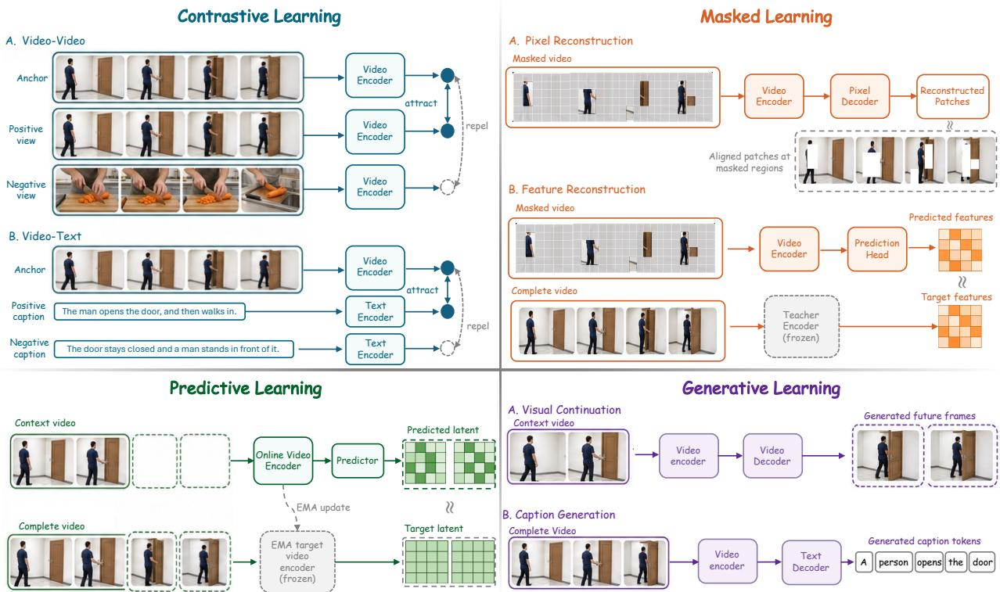  
Figure 3 Four families of video representation learning. They difer in how supervision targets are constructed and how predictions are compared with or generated from those targets.

## 4.2.1 Contrastive Learning

Contrastive learning pulls positive pairs together in embedding space and pushes mismatched pairs apart, commonly with an InfoNCE-style objective. In video-only learning, CVRL [380] and ρMoCo [103] draw positives from augmentations or clips of the same video, and the sampling distance sets a trade-of: views too close give little contrast, while views too far apart may show diferent events.

Video–text contrastive learning pairs clips with language. Among dual-encoder retrieval models, Frozen in Time [14] trains a space–time Transformer jointly on image–text and video–text pairs, and CLIP4Clip [316] transfers the CLIP image–text encoder and adds temporal aggregation, while VideoCLIP [538], X-CLIP [330], ViCLIP [481], and Finsta [101] develop video-specific alignment. Foundation encoders combine contrastive pretraining with masked or generative losses (InternVideo [483], InternVideo2 [482]), distillation into a maskedvideo student (VideoPrism [637]), or later alignment stages for language and dense prediction (Perception Encoder [29]). Global alignment can drop fine-grained detail: the World Embedding Benchmark [301] shows that alignment and recoverable physical state can diverge, as physics-specific contrastive tuning improves video–text matching but weakens physical-quantity regression from frozen features; the added losses aim to retain it.

## 4.2.2 Masked Learning

Masked learning removes much of the spatiotemporal input and trains the model to recover it, an idea that VideoBERT [426] applied early to quantized video tokens and speech transcripts jointly. VideoMAE [453] reconstructs pixels behind tube masks, with a high mask ratio that exploits the redundancy of adjacent frames, and VideoMAE-V2 [469] scales it with dual masking. Feature targets replace raw pixels: MaskFeat [497] reconstructs handcrafted or learned features, and UMT [249] distills from an unmasked teacher that sees the full clip. Learned or teacher targets shift capacity from low-level appearance toward the semantics and motion that the teacher encodes, but they also inherit its biases.

## 4.2.3 Predictive Learning

Predictive learning trains a model to predict the latent representation of hidden or future content, without pixel reconstruction or negative examples. V-JEPA [20] predicts the features of masked regions against a slowly updated target encoder, V-JEPA 2 [9] scales this to larger and more diverse data, and V-JEPA 2.1 [348] improves dense features. InternVideo-Next [464] bridges the masked and predictive families, combining masked reconstruction with latent prediction of its first-stage targets, without video–text data. Adding an action-conditioned transition model to such a representation yields the action-conditioned latent-state world models of Section 7.

## 4.2.4 Generative Learning

Generative pretraining shapes a representation by requiring it to produce missing or future content. Visual autoregressive objectives [553] predict future frames, patches, or tokens, which rewards sensitivity to appearance and motion but can spend capacity on reconstruction detail that recognition does not need. Vision-language generation outputs text instead: GIT-style [467] training generates captions or answers from visual features, and VideoCoCa [551] combines captioning with contrastive alignment. In both cases, the representation is shaped only by what captions describe. Large video difusion models ofer a third route: Gen4U [213] reuses a frozen generator’s intermediate activations for classification, geometry, and captioning, and GenCeption [468] adapts a difusion backbone into a text-steered model for depth, normals, pose, segmentation, and keypoints (Section 6.2).

## 4.3 Video-Language Foundation Modeling

Video-LLMs extend language foundation models to video for open-ended description, dialogue, question answering, grounding, and reasoning. They take visual features from encoders such as those in Section 4.2 and must decide which frames to observe, how to encode time, and how many visual tokens the language model can aford. We review their architectures, training, and test-time scaling in turn.

## 4.3.1 Architectures

Visual front end. Many systems apply an image encoder such as CLIP [387] or SigLIP [455, 605] to sampled frames, a route that is cheap and semantically strong but leaves temporal modeling to later modules. Nativevideo encoders [9, 662] model local motion before fusion, and direct patch or visual-token inputs keep finer spatial detail at a higher context cost. No encoder can recover an event from an unsampled frame.

Time and position. Frame order may be encoded by temporal embeddings, timestamps, or multidimensional rotary positions. Qwen2.5-VL [13] uses M-RoPE to coordinate temporal and spatial indices, Qwen3-VL [12] adds textual timestamps so that answers can cite moments, and the InternVL series [474] advances visua positions in fractional steps so that long sequences stay within the trained positional range. Temporal Transformers and state-space models such as Mamba [135] can also aggregate frame sequences before they reach the LLM.

Vision-language connector. The connector maps visual features into the language backbone’s embedding space and token budget. Linear or MLP projectors turn each visual feature into a prefix token, as in LLaVA-style systems [282], while Q-Former and resampler designs [246] extract a fixed number of query tokens, as in early Video-LLaMA [610] and VideoChat [247]. Gated cross-attention, as in Flamingo [2], instead lets language layers consult visual features at selected depths. Structure-preserving compressors downsample while keeping spatial layout, through convolutional abstractors (Honeybee [40]), spatial-temporal convolution (VideoLLaMA 2 [70]), or pixel unshufle (InternVL [474]). Projectors keep the most direct token path, resamplers and cross-attention give the most control over how much visual information enters the LLM, and compressors trade some directness for locality-aware reduction.

Compression and memory. Video token count grows with both the number of frames and the tokens per frame, and pooling, merging, or resampling reduce it at the risk of erasing small objects, short events, or precise timestamps. Some designs spend tokens unevenly over time: LLaVA-Video [632] keeps a few frames dense and pools the rest, Keye-VL-1.5 [556] routes frames with large visual change to a high-resolution pathway, and LLaVA-OneVision-2 [6] groups tokens adaptively like a video codec. Others compress each unit: Chat-UniVi [204] merges tokens into dynamic multi-scale units, LLaMA-VID [258] reduces each frame to as few as two tokens, and Video-LaVIT [206] pairs keyframes with compact motion vectors. For long video, LongVA [622] and LongVILA [64] rely on long-context transfer and token budgeting, and Video-XL [415] adds structured compression. One finding bounds this design space: a few tokens carry most of the discriminative information, but finding them without an oracle is hard [149]. Memory solves a diferent problem from compression: MovieChat [419] and MA-LMM [150] maintain a memory of past segments, which decides what remains available after the original frames leave the context (agent memory is treated in Section 4.4).

Table 5 Video-LLM architectures and component training status. ✓ denotes trained and ✗ frozen parameters in the stage named beneath each model. Connector marks refer to learned modules, not parameter-free pooling or pruning.
<table><tr><td>Model / training stage</td><td>Vision encoder</td><td>Connector / compression</td><td>LLM</td></tr><tr><td>Video-ChatGPT [332] Instruction tuning</td><td>X CLIP ViT-L/14</td><td>√ Spatiotemporal pooling; linear projector</td><td>X Vicuna-7B</td></tr><tr><td>Video-LLaVA [271] Instruction tuning</td><td>X LanguageBind image/video √ Shared two-layer MLP encoders</td><td></td><td>√Vicuna-7B v1.5</td></tr><tr><td>LLaMA-VID [258] Instruction tuning</td><td>X EVA-G</td><td>√ Q-Former context query; context/content projection</td><td>√Vicuna-7B/13B</td></tr><tr><td>LLaVA-OneVision [236]√ SigLIP Stage 2: mixed modalities</td><td></td><td>√ Two-layer MLP; video pooling</td><td>√Qwen2</td></tr><tr><td>VideoLLaMA3 [606] Video-centric fine-tuning</td><td></td><td>√SigLIP, dynamic resolution √ Differential frame pruning; MLP</td><td>√ Qwen2.5</td></tr><tr><td>Qwen2.5-VL [13] Supervised fine-tuning</td><td>X Window-attention ViT</td><td>√ 2×2 merge; MLP</td><td>√Qwen2.5</td></tr><tr><td>InternVL3.5 [474] Native pretraining</td><td>√InternViT-300M/6B</td><td>√ MLP; pixel unshuffle</td><td>√ Qwen3 or GPT-OSS</td></tr><tr><td>Qwen3-VL [12] S2: long-context pretraining</td><td>√SigLIP2-derived dynamic ViT</td><td>√ Spatial MLP; DeepStack mergers</td><td>√Qwen3</td></tr><tr><td>Keye-VL-1.5 [556] Multi-task pretraining</td><td>√SigLIP-400M-384-14</td><td>√ MLP; SlowFast and native dynamic √ Qwen3-8B resolution</td><td></td></tr><tr><td>VideoChat3 [256] Stage 2: instruction tuning</td><td>√MoonViT-initialized I3D-ViT</td><td>√Spatiotemporal pooling/merging; projector</td><td>√Qwen3-4B</td></tr><tr><td>OneStreamer [603] Supervised fine-tuning</td><td>X Qwen3-VL-4B vision encoder</td><td>√ Inherited Qwen3-VL projector</td><td>√Qwen3-4B</td></tr></table>

Language backbone and output. An instruction-following LLM combines the retained evidence with the query and produces dialogue, descriptions, explanations, or structured predictions. Early systems extended image-language models to video with adapters and compressed frame tokens [247, 258, 271, 332, 610], and later open models add larger multimodal mixtures, more eficient video tokens, and grounded or reasoning outputs [12, 13, 236, 256, 474, 554, 573, 606]. Boxes, timestamps, and masks can be emitted as special tokens or by attached heads, which makes the evidence behind an answer easier to inspect. Closed systems such as Gemini [440] show strong long-context video and audio results but disclose few design details. Table 5 lists the encoder, connector, and LLM of representative open systems and what each training stage updates.

Streaming and audio-visual input. Streaming models must answer from the evidence seen so far and bound their state with windows, recurrent memory, or key–value (KV) caches. VideoLLM-online [52] introduced real-time dialogue over a continuously advancing stream, StreamingVLM [544] keeps a compact KV cache for unbounded streams, and OneStreamer [603] writes timestamped caption memory and learns when to record and when to respond. For audio-video input, Qwen2.5-Omni [539] and Qwen3-Omni [540] place both modalities on one timeline with time-aligned multimodal rotary positions.

Table 6 Datasets for Video-LLM pretraining and instruction tuning. Scale retains each source’s counting unit; mixedmodality and image-only auxiliary resources are identified explicitly.
<table><tr><td>Dataset</td><td>Scale</td><td>Description</td></tr><tr><td colspan="3">Web-scale video-text pairs (alignment pretraining)</td></tr><tr><td>HowTo100M [343]</td><td>136M clips / 1.2M videos</td><td>instructional videos paired with automatically transcribed narration</td></tr><tr><td>WebVid-10M [14]</td><td>10.7M clips</td><td>stock-footage clips paired with alt-text descriptions</td></tr><tr><td>YT-Temporal-180M [601]</td><td>180M segments / 6M videos</td><td>transcribed speech aligned with frames for temporal script knowledge</td></tr><tr><td>HD-VILA-100M [549]</td><td>103M clips / 3.3M videos</td><td>371.5K hours of 720p video spanning 15 YouTube categories</td></tr><tr><td>InternVid [481]</td><td></td><td>234M clips / 7.1M videos scalable model-generated captions with ViCLIP filtering; 760K hours</td></tr><tr><td>Panda-70M [56]</td><td>70.8M clips</td><td>captions selected from multiple cross-modality teacher models</td></tr><tr><td>Action100M [46]</td><td>147M segment annotations; 1.2M videos</td><td>temporally localized action segments with hierarchical labels and captions from instructional video</td></tr><tr><td colspan="3">Instruction corpora and open training mixtures</td></tr><tr><td>VideoInstruct-100K [332]</td><td>100K QA pairs</td><td>semi-automatic GPT-assisted video instructions from Video-ChatGPT</td></tr><tr><td>VideoChat2-IT [248]</td><td>~2M samples</td><td>image/video instruction samples from 34 sources</td></tr><tr><td>ShareGPT4Video [54]</td><td>40K GPT-4V captions; 4.8M model captions</td><td>dense, temporally detailed captions plus a learned video captioner</td></tr><tr><td>LLaVA-Video-178K [632]</td><td>178K videos / 1.3M samples</td><td>synthetic dense captions with open-ended and multiple-choice QA</td></tr><tr><td>FineVision [505]</td><td>24.3M samples / 17.3M images</td><td>image-based auxiliary instruction mixture; 200+ sources with deduplication and benchmark-overlap audits</td></tr><tr><td>LLaVA-OneVision-2 data [6]</td><td>~8M video-caption pairs; 4M spatial samples</td><td>re-captioned video pretraining pairs with a spatial-reasoning fine-tuning corpus</td></tr><tr><td colspan="3">Long-video, streaming, and reasoning corpora LongVid [254]</td></tr><tr><td></td><td>114K videos / 3.4M QA</td><td>300K hours of long video with QA annotations across five task types</td></tr><tr><td>Video-R1 corpora [105]</td><td>260K RL samples; 165K CoT-SFT samples</td><td>separate RL and supervised cold-start corpora spanning image and video reasoning</td></tr><tr><td>Eagle-Video-110K [47]</td><td>110K videos</td><td>story-level and clip-level annotations; diversity-driven video collection</td></tr><tr><td>VideoMarathon [275]</td><td>9.7K hours / 3.3M QA</td><td>3–60 min videos with QA across 22 short- and long-horizon tasks</td></tr><tr><td>Streamo-Instruct-465K [524] 465K samples</td><td></td><td>400K streaming samples plus offline video QA; narration, event grounding, and timed responses</td></tr></table>

## 4.3.2 Learning Paradigms

Video-LLMs are usually trained in stages because the encoder, connector, and language backbone start from diferent representations. In alignment pretraining, the encoder and LLM are often frozen while the connector learns from caption pairs, video–text matching, and grounding data, following the visual instruction tuning recipe for images [282]. Table 6 lists pair corpora and instruction datasets for this stage and the next.

Supervised instruction tuning. Supervised fine-tuning (SFT) then trains on VideoQA and dialogue data for question-conditioned answers, temporal grounding data for timestamps [379], and spatial grounding data for coordinates or other structured outputs. Which components are updated varies: early Video-ChatGPT [332] tunes only its projector, Video-LLaVA [271] also updates the LLM, and VideoLLaMA3 [606] and VideoChat3 [256] adapt both the visual and language components (Table 5). The mixture of image, short-video, long-video, optical character recognition (OCR), and grounding data decides whether a model mainly describes clips or can locate and reason over the evidence behind an answer.

Preference optimization and reinforcement learning. Post-training can then optimize preferences or task outcomes. Reinforcement learning (RL) from human feedback [361] and direct preference optimization, which Qwen2.5-VL [13] and VistaDPO [183] apply after SFT, improve visual faithfulness only insofar as the feedback separates grounded content from fluent but unsupported answers. Reasoning-oriented methods instead use verifiable rewards, often with group relative policy optimization (GRPO) [138]. Video-R1 [105] adds a temporal reward that compares rollouts on ordered and shufled frames, LongVILA-R1 [63] scales RL to long videos through its data and distributed training, and OneThinker [106] broadens the task mixture and normalizes advantages with running per-task reward statistics.

Task-specific rewards target the output directly: Time-R1 [480] rewards timestamp intersection-over-union for temporal grounding, VideoChat-R1 [255] jointly rewards spatiotemporal tasks without hurting general QA, and VideoP2R [202] rewards perception and reasoning separately. Others modify GRPO itself: DeepVideo-R1 [365] recasts it as advantage regression with dificulty-aware augmentation, and GRPO-CARE [62] adds a bonus if a slowly updated reference model reproduces the answer from the reasoning trace.

Data and scaling. Data and curriculum matter as much as model size. Current recipes such as Intern-Video3 [554], Qwen3-VL [12], and VideoLLaMA3 [606] train jointly on image, video, and language data and widen task coverage with synthetic instructions; InternVideo3 and Qwen3-VL also add long-context curricula and use on-policy distillation to supply responses from states the model actually visits. Apollo [667] studies this design space systematically, measuring how frame sampling, encoder choice, and token allocation interact across model scales. Newer corpora add finer temporal supervision: OneStreamer-1M [603] times its captions and QA to the evidence available at each response point.

## 4.3.3 Test-Time Scaling

Test-time scaling spends extra computation after training to read the available video better. Multimodal chainof-thought [100, 318] spends tokens on intermediate reasoning, which helps only if those steps stay grounded in the frames. Query-aware frame selection instead spends compute on choosing the input: SeViLA [591] and VideoTree [494] rank, retain, or hierarchically organize frames for the query. Iterative “thinking with video” methods such as FrameThinker [159] and VideoChat-A1 [493] alternate between reasoning and revisiting frames over several steps. Search and aggregation select among several reasoning paths by self-consistency, best-of-N, or verifier and process-reward models, while V-Reason [425] directly modifies the model’s inference-time behavior instead of sampling more outputs. Each route trades latency and repeated visual computation for broader exploration or a second look at ambiguous evidence.

The boundary with agentic modeling is gradual: thinking-with-video methods already revisit frames, and once a model issues explicit operations to fetch new crops, frames, retrieval results, or persistent memory, it enters the agentic setting of Section 4.4.

## 4.4 Agentic Video Modeling

Agentic video modeling turns evidence acquisition into a sequential decision problem: an LLM or Video-LLM forms subquestions, chooses a temporal region or visual detail to inspect, invokes an operation, and updates its reasoning from the result until it can answer. Its actions change access to the recording by locating segments, sampling frames, cropping regions, querying tracks, or retrieving memory; actions that change the depicted world belong to the interactive rollouts of Section 7.

## 4.4.1 Video Agents

Early video agents separate the controller’s reasoning state from the full video stream (Table 7). Two systems named VideoAgent take diferent routes: VideoAgent (long-form) [477] has an LLM iteratively gather a small set of question-relevant frames, and VideoAgent (memory) [95] builds event and object-tracking memory and exposes segment localization and memory queries as tools. VideoAgent2 [649] adds uncertainty-aware replanning, so that new observations can revise the search and intermediate evidence is verified. Later controllers refine the observation policy: VCA [567] explores unexamined segments out of curiosity, and VideoMind [300] splits the loop into planner, grounder, verifier, and answerer roles, all chain-of-LoRA experts on one backbone.

Table 7 Agentic video systems. Organization: Single = one reasoning controller; Multi-role = coordinated specialist reasoning roles, which may share a backbone.
<table><tr><td>Model</td><td>Backbone</td><td>Organization</td><td>Memory / context</td><td>Operations</td></tr><tr><td>VideoAgent (long-form) [4&#x27; GPT-4 controller;</td><td>LaViLa or CogAgent captioner</td><td>Single</td><td>Selected-frame captions</td><td>Frame retrieval; captioning</td></tr><tr><td>VideoAgent (memory) [95] GPT-4 controller</td><td></td><td>Single</td><td>Event captions; object tracks</td><td>Caption retrieval; video QA; temporal localization; object queries</td></tr><tr><td>VideoMind [300]</td><td>Qwen2-VL + role LoRA Multi-role</td><td></td><td>Grounded intervals; role context</td><td>Grounding; verification; answering</td></tr><tr><td>VideoMultiAgents [226]</td><td>GPT-4o roles; Gemini 2.0 Flash video tool</td><td>Multi-role</td><td>Role histories; scene graph</td><td>Caption analysis; scene-graph analysis; video QA</td></tr><tr><td>Ego-R1 [448]</td><td>Qwen2.5-3B controller</td><td>Single</td><td>Timestamped summaries</td><td>Hierarchical retrieval; video QA; image QA</td></tr><tr><td>M3-Agent [308]</td><td>Qwen3 controller; Qwen2.5-Omni memory model</td><td>Single</td><td>Episodic + semantic Memory retrieval; memory</td><td>face/speaker identification</td></tr><tr><td>VideoLucy [669]</td><td>DeepSeek-R1 reasoning; Multi-role Qwen2.5-VL-7B captioner</td><td></td><td>Caption hierarchy</td><td>Temporal localization; recaptioning; backtracking</td></tr><tr><td>LongVT [572]</td><td>Qwen2.5-VL-7B</td><td>Single</td><td>Current tool trace</td><td>Temporal crop; resampling</td></tr><tr><td>LongVideoAgent [292]</td><td>Qwen2.5-3B/7B master; Multi-role Grok-4-fast-reasoning grounding; GPT-4o vision</td><td></td><td>Tags; accumulated observations</td><td>Grounding; visual inspection</td></tr><tr><td>VideoThinker [239]</td><td>Qwen2.5-VL-7B</td><td>Single</td><td>Clip index; current trace</td><td>Temporal retrieval; zoom</td></tr></table>

Agentic search extends adaptive observation from frame selection to a structured video collection. Deep Video Discovery [629] segments long video into a multi-granular database and lets the controller choose search tools and parameters, and VideoExplorer [596] poses sub-questions inside the reasoning loop and locates the moments that answer them.

Continuous streams add another decision: when to observe and when to speak, possibly before the user asks. StreamAgent [558] anticipates task-relevant events and shifts attention before they arrive, and AViLA [608] answers asynchronous queries once the accumulated evidence is suficient.

Memory determines what an agent retains between observations. Flat caption lists are cheap to query but lose temporal scope and visual detail. VideoLucy [669] instead backtracks through a coarse-to-fine memory hierarchy and MM-Mem [266] builds a sensory, episodic, and schema-level memory pyramid, while InternVideo3 [554] accumulates observations, reasoning, and tool actions in one evolving context. Memorycentric agents aim for competence that grows with history instead of resetting at every query: M3-Agent [308] consolidates an entity-centric long-term memory from continuous audio-visual input, and WorldMM [577] maintains a dynamic multimodal memory.

Table 8 Video-agent benchmarks for evidence acquisition, interaction control, and persistent memory.
<table><tr><td>Benchmark</td><td>Task / data</td><td>Measures</td><td>Protocol</td></tr><tr><td>VideoSIAH-Eval [572]</td><td>Sparse-evidence QA; 652 questions</td><td>Answer accuracy</td><td>Sparse/dense sampling; tool calling</td></tr><tr><td>LongVidSearch [590]</td><td>Multi-hop retrieval; 3,000 questions / 447 videos</td><td>Answer accuracy; tool-call cost Fixed tools; 2–4 hops;</td><td>gold-evidence oracle</td></tr><tr><td>OmniInteract [312]</td><td>Audiovisual streams; 1,430 response slots / 250 videos</td><td>IA-QTF1ª</td><td>Causal replay; interruptions; nested context</td></tr><tr><td>IPIBench [245]</td><td>Proactive monitoring; interleaved queries</td><td>Trigger timing; response correctness</td><td>Add/edit/cancel tasks; past frames only</td></tr><tr><td>VideoGAIA [607]</td><td>Video-web tasks; 271 tasks pass@1, three-run mean</td><td></td><td>ReAct; 40-step budget</td></tr><tr><td>AgentVidBench [5]</td><td>Multi-hop QA; 100 questions / 71 videos</td><td>Answer accuracy; trajectory scoresb</td><td>Evidence milestones; judged trajectories</td></tr><tr><td>APM-Bench [184]</td><td>Long-term assistance; 549 sessions / 104 trajectories</td><td>Recall; perception; proactive response; storage; latency</td><td>Cross-session; missing-history cases</td></tr></table>

a Interaction-Aware Quality–Timeliness F1; quality measures answer correctness and coverage.  
b Task understanding; evidence coverage, grounding, and completeness; reasoning faithfulness.

Multi-agent collaboration divides the loop across specialized roles. VideoMultiAgents [226] coordinates vision, text, and graph specialists, LongVideoAgent [292] pairs a reasoning master with grounding assistants, and Think, Then Verify [490] makes candidate answers survive adversarial checking. MAPA [547] pairs lightweight perception agents with action agents to avoid redundant computation.

Other agents are trained, not only prompted: SAGE [197] learns with RL how far ahead to look, EVA [630] makes end-to-end RL of a video agent eficient, and CASE [88] learns when to stop searching. Trained policies can lower tool cost and improve stopping, but they tie the agent to the tools seen in training.

Agent quality depends jointly on the backbone, observation policy, tool outputs, and memory: a wrong first hypothesis can steer later calls to the wrong interval, and noisy captions or detections propagate through the reasoning trace. Agents are trained on tool-use traces for SFT and questions for RL (Ego-R1 Data [448], LongVT’s VideoSIAH [572], VideoThinker’s synthetic trajectories [239]). Benchmarks (Table 8) test sparse-evidence search (VideoSIAH-Eval [572]), multi-hop retrieval with evidence-necessity checks and tool-call cost (LongVidSearch [590]), trajectories against evidence milestones (AgentVidBench [5]), and combined video and web search (VideoGAIA [607]). Others test proactive and spoken audio-visual interaction (IPIBench [245], OmniInteract [312]) and cross-session memory with cases where the needed history is missing (APM-Bench [184]). Beyond answer accuracy, evaluation should report whether the retrieved evidence supports the answer and what the search costs; REPAIR [3] adds repeated paired runs to separate run-to-run variance from method efects and counts the operations and latency hidden behind visible tool calls.

## 4.4.2 Tool Use and Retrieval Augmentation

Tools supply observations that the base model cannot obtain reliably from its current context: detectors and trackers for entity state, temporal grounders for event boundaries, croppers for spatial detail, and OCR, speech recognition, or captioners for other modalities. In modular agents, a prompted controller composes external tools: VisProg [142] and ViperGPT [431] generate executable programs over vision tools without training. Native tool-calling models instead learn when to call a tool, with which parameters, and how to use the result. LongVT [572] surveys a long video, predicts a relevant interval, and crops and densely resamples it before continuing to reason, and VideoThinker [239] learns temporal retrieval and zoom from tool trajectories synthesized in caption space and grounded back to video. Ego-R1 [448] trains a chain of tool-thought with RL over day- and week-long egocentric recordings. Tool use can also be distilled away: Agent-of-Thoughts

Distillation [414] distills agent traces into a single Video-LLM as chain-of-thought supervision, trading flexibility for one-pass inference.

Retrieval augmentation moves evidence into an external index. One VideoRAG [200] retrieves query-relevant videos and keeps both their visual and textual content, while another [394] combines graph-based text grounding with multimodal encoding to search very large collections. The retrieval unit shapes what can be recovered: fixed-length chunks may split an event, so SceneRAG [602] indexes narrative scenes and adds an entity-relation graph for multi-hop retrieval, at the cost of errors in segmentation and graph construction. Tools and retrieval address diferent bottlenecks: a cropper or grounder fetches finer local evidence on demand, whereas an index narrows the search across long videos or corpora. Both still require the system to decide what to request, detect missing or conflicting evidence, and trace the answer back to its source clips.

## 4.5 Applications

Applications pose these problems under domain-specific viewpoints, vocabularies, and event structures.

## 4.5.1 Embodied and Egocentric Perception

Egocentric video records activity from the wearer’s viewpoint, so the camera moves with the body, hands occlude manipulated objects, and key events are separated by long stretches of routine activity. Standard resources include EPIC-KITCHENS-100 [78], Ego4D [133], EgoSchema [336], and the paired first- and third-person views of Ego-Exo4D [134] (Section 3.1). An egocentric assistant has to track the manipulated object and its state, the current task step, and the earlier event that explains the present situation, even when the object is hidden behind the hand or out of view.

Newer benchmarks target specific settings. EgoTools [447] tests understanding of physical tools and their efects (not software-tool calls), covering afordance, grounding, procedure, and spatial reasoning, and EgoPolice [129] tests police body-worn camera footage, where consequential events are rare and visibility is poor.

## 4.5.2 Autonomous Driving

Driving video must be read as a dynamic scene of road geometry, trafic controls, vehicles, pedestrians, and their relations. BDD100K [584] supplies diverse annotated road video, and nuScenes [33] and the Waymo Open Dataset [428] add synchronized camera and range-sensor sequences with 3D annotations. Languagebased benchmarks ask which participants and relations matter: DriveLM [416] links key objects and their interactions to prediction and planning questions through graph-structured VideoQA, and the frame-level NuScenes-SpatialQA [445] tests spatial relations in driving scenes. OmniDrive [471] aligns language reasoning with 3D driving tasks and adds counterfactual questions about how alternative actions would change an outcome. The resulting scene state links video reading to the trajectory prediction, action selection, and closed-loop control of Section 7.

## 4.5.3 Domain-Specific Video Analysis

Medical and surgical video. Surgical video is structured by procedure phases, so recognizing visible instruments is not enough. EndoNet [456] introduced Cholec80 for phase and tool recognition, CholecT50 and Rendezvous [356] refine the output into instrument–verb–target triplets, and SurgVLM [604] combines perception, temporal analysis, and question answering across surgical tasks. Evaluation must check phase, anatomy, and action against the structured labels of clinical workflows, not the fluency of a description.

Sports analytics. A match contains long stretches of routine play broken by brief, rule-dependent events. SoccerNet [127] defined action spotting in broadcast soccer; SoccerNet-v2 [80] adds camera-shot segmentation and replay grounding, which require precise localization and knowledge of broadcast structure.

Film and edited video. In edited footage, shot size, cut type, and transitions are deliberate choices. VEU-Bench [237] tests recognition, reasoning, and judging of editing attributes within and across shots, and finds that general Video-LLMs handle them poorly, in some cases below chance.

Education and instructional video. Instructional video follows a procedure from an initial state through intermediate steps to a goal. HowTo100M [343] supplies narrated demonstrations, and CrossTask [666] and COIN [437] annotate steps for temporal localization. Reading such video means tracking the progress of the procedure: separating narrated intention from visible operation, recovering omitted or repeated steps, and reasoning about order and prerequisites.

­ INSIGHT Video understanding is limited by state, not by context length

Encoders compress observations, Video-LLMs map evidence into language, and agents choose what to inspect, but all of them are limited by what state they keep and ground, not by how many frames they accept. Longer context helps only when it corrects or stabilizes that state, so evaluation should ask whether added evidence improves the state estimate, stays traceable to source clips, and survives later queries.

## 5 Ò Video Generation: Writing the World

Writing means rendering a new video trace from a partial world specification supplied as text, images, audio, motion, or other conditions.

Video generation is the writing operation W → V of Section 2: its conditions fix some entities, relations, and dynamics of W and leave the rest to the generator. Text may specify an event, an image may fix its initial appearance, audio may set visible rhythm or articulation, and trajectories camera or object motion.

This chapter covers models whose output and training target are the video itself, judged by fidelity, condition adherence, temporal coherence, and controllable revision. Persistent state under occlusion, revisits, long rollouts, and actions is treated in Section 7. We cover tasks and evaluation, latent representations, generative paradigms, control strategies, and applications. Xing et al. [535] review video difusion models in depth.

## 5.1 Tasks, Conditions, and Evaluation

A video-generation task is defined by the information fixed before synthesis: text, images, source videos, audio, reference identities, or prescribed motion. Evaluation measures the visual and temporal quality of the result, its adherence to the condition, and the stability of the entities, events, and physical relations it shows. Table 9 lists training resources, Table 10 lists metrics and learned scorers, and Table 11 lists benchmarks and the conditions they test.

## 5.1.1 Generation Tasks by Condition

Text, image, and video conditions. Text-to-video (T2V) maps a description of content, style, or events to a video and leaves most appearance and motion to the model, as in Sora [31], Wan [462], and HunyuanVideo [219]. Image-to-video (I2V) fixes the initial state or reference appearance and must add plausible motion without losing that structure and identity, as in Stable Video Difusion [27] and the human-animation systems Animate Anyone [179] and MagicAnimate [548]. Video-to-video (V2V) starts from a source video and covers transformations with diferent preservation requirements. Editing changes selected content and should stay local, as in Tune-A-Video [512], Video-P2P [293], FateZero [377], and TokenFlow [126]. Translation maps the source to another appearance or domain while keeping its content. Interpolation connects observed endpoints, and extension continues the sequence beyond its last frame, as in NUWA-XL [580], SEINE [60], and StreamingT2V [162].

Audio and audio-visual conditions. In audio-driven generation, a speech, music, or sound track sets visible dynamics such as lip motion, expression, gesture, or rhythm, as in Wav2Lip [375], SadTalker [626], EMO [446], and Hallo [542]. Joint audio-video generation instead produces both streams and must keep their events synchronized as well as each stream plausible, as in JavisDiT [288], JavisDiT++ [289], and Ovi [309].

Geometric, motion, and identity conditions. Camera, motion, and trajectory conditions prescribe how the viewpoint or scene elements evolve. Camera poses and paths control the observation process, as in

CameraCtrl [152], while object trajectories, human poses, and action sequences constrain motion within the scene, as in MotionCtrl [492], DragNUWA [579], VideoComposer [475], and Wan-Move [73]. Identity- or subject-conditioned generation, as in ConsisID [597], fixes which person, object, or subject persists over time, and that subject must stay stable under pose, viewpoint, and occlusion changes.

Any-conditioned and unified control. Any-conditioned systems accept a variable subset of text, image, audio, structure, motion, and reference inputs, as in FullDiT [207], UNIC [576], and Any2Caption [517]. They must bind each cue to the right entity, region, time span, or modality and reconcile cues of diferent granularity. Section 5.4 describes how such conditions enter the model.

Training supervision. Each task needs training pairs that expose its condition–output correspondence (Table 9). Caption corpora such as Panda-70M [56] and UltraVideo [550] serve T2V, and image conditioning and extension can be learned by keeping selected frames or prefixes of a clip [203]. Editing needs source–instruction–target triplets, as in OpenVE-3M [153]. Camera control uses posed video such as RealEstate10K [657], motion control uses tracked point trajectories [73], and audio-visual generation needs synchronized tracks such as VGGSound [50]. Identity control pairs references and targets from diferent contexts or shots, as in Phantom-Data [65], MuSS [611], and Omni-R2V [253], so the model cannot simply copy the reference’s pose or background into the output.

## 5.1.2 Evaluation and Metrics

Video-generation quality has several dimensions, and the right profile depends on the task: T2V emphasizes semantic alignment, editing requires source preservation and locality, audio-driven generation requires synchronization, and motion control requires trajectory adherence. A single aggregate score hides the failure that limits a system, so we group metrics by the property they measure (Table 10) and benchmarks by the cases they test (Table 11).

Visual fidelity and temporal quality. FID [165] compares frame-feature distributions and ignores temporal order. The Inception Score [401] rewards confident, diverse classifier predictions without reference to real data, which limits its meaning outside the classifier’s domain [21]. FVD [457] extends the comparison to video features, but it depends on the feature extractor and sample count and can under-penalize temporal corruption in favor of static samples [121]. JEDi [314] instead uses V-JEPA features and a maximum mean discrepancy, avoiding FVD’s Gaussian assumption and needing fewer samples. PSNR, SSIM [491], and LPIPS [623] suit reconstruction and source preservation but penalize valid alternative futures. FVMD [283] and STREAM [212] target motion consistency and spatiotemporal quality, and VMBench [279] checks whether motion strength matches the prompt. Diversity needs repeated samples under one condition: DiVid [175] measures variation in semantics, style, subject, scene, motion, and camera alongside quality and faithfulness.

Condition alignment and compositionality. Condition-aware evaluation checks whether the video follows its condition. CLIPScore [164] measures image–caption similarity, and its frame-averaged video variants ignore temporal order and motion. cFreD [220] adds text–visual cross-covariances to a conditional Fréchet distance, so it penalizes videos swapped among prompts, which a marginal distance cannot detect. FETV [302] and T2V-CompBench [427] separate objects, attributes, relations, actions, and temporal composition. Structured conditions have their own tests: MultiRef-Compass [628] checks how several references bind to audiovisual content. OmniVBench [253] applies case-specific checklists for reference fidelity and binding, and MoveBench [73] measures trajectory endpoint error. For source-conditioned tasks, V2V-Bench [295] scores what the instruction should change separately from what the source should preserve.

Physical and world consistency. Realistic local motion can still show impossible interactions, unstable objects, or broken persistence. VideoPhy [16] and VideoPhy-2 [17] test physical commonsense, the latter in harder action-centric interactions. PhysicsMind [335] and VideoScience-Bench [178] test mechanics and basic scientific phenomena, and PhyAVBench [532] tests whether generated sound changes with paired physical conditions. PhyProbe [223] instead trains a physical-violation scorer on frozen visual features and shows that prior learned evaluators depend on their annotation distributions, though it retains some dataset dependence itself. Persistence under revisits and occlusion is tested by the world-model benchmarks of Section 7.4.

Human preference, learned evaluators, and suites. Human comparisons capture coherence, visual appeal, and instruction adherence that fixed feature distances miss. Learned evaluators model such judgments:

Table 9 Training resources for conditioned video generation and editing. Condition lists available input modalities or control signals; their use depends on the training task. Scale retains the source’s counting unit.
<table><tr><td>Resource</td><td>Condition</td><td>Scale</td><td>Annotations / construction</td></tr><tr><td>Panda-70M [56]</td><td>Text</td><td>70.8M clips</td><td>Captions selected from multiple cross-modality teachers</td></tr><tr><td>Koala-36M [470]</td><td>Text; motion, aesthetic, and 36M clips clarity scores</td><td></td><td>Structured captions; Video Training Suitability Score (VTSS) filtering</td></tr><tr><td>OpenVid-1M [350]</td><td>Text</td><td>1M pairs; 433K HD subset</td><td>Captions with aesthetic, temporal, motion, and clarity filtering</td></tr><tr><td>UltraVideo [550]</td><td>Text</td><td>42K short; 17K long clips</td><td>4K/8K footage; structured captions and summaries</td></tr><tr><td>RealEstate10K [657]</td><td>Reference image; camera parameters</td><td>~80K clips; 10M frames</td><td>Estimated camera intrinsics and poses for view synthesis</td></tr><tr><td>DL3DV-10K [278]</td><td>Reference image; camera parameters</td><td>10,510 videos; 51.2M frames</td><td>4K multi-view scenes; camera intrinsics, poses, and scene-property labels</td></tr><tr><td>OpenHumanVid [243]</td><td>Text; skeleton sequences; speech audio</td><td>13.2M filtered clips</td><td>Appearance and motion captions; aligned pose and speech signals</td></tr><tr><td>Wan-Move corpus [73]</td><td>Text; reference image; point 2M filtered videos trajectories</td><td></td><td>720p video; dense 32 × 32 CoTracker tracks</td></tr><tr><td>VGGSound [50]</td><td>Text; audio</td><td>200K+ 10s clips</td><td>Synchronized audio/video with sound-source class labels</td></tr><tr><td>Phantom-Data [65]</td><td>Text; reference image</td><td>~1M pairs</td><td>Identity-consistent image-video pairs across contexts</td></tr><tr><td>MuSS [611]</td><td>Text; reference image</td><td>700K shots; 30K+ multi-shot clips</td><td>Shot-level captions and cross-shot subject references</td></tr><tr><td>OpenVE-3M [153]</td><td>Text; source video</td><td>3M samples</td><td>Source-instruction-target triplets; eight edit types</td></tr><tr><td>Omni-R2V [253]</td><td>Text; reference image or video</td><td>340K samples</td><td>Reference-target pairs across seven task families</td></tr><tr><td>Any2CapIns [517]</td><td>Text; image; video; region, motion, and camera controls conditions</td><td>337K instances; 407K</td><td>Condition-to-caption instruction pairs</td></tr></table>

VideoScore [158] predicts several human-rated properties, VideoScore2 [157] adds physical and commonsense scores with rationales, and MJ-VIDEO [450] trains a reward model on fine-grained preferences. All three inherit the coverage and biases of their annotations, which for VideoScore2 are partly model-generated. Suites such as VBench [193] and EvalCrafter [299] combine perceptual, semantic, and temporal dimensions, and VBench-2.0 [647] extends them to human fidelity, controllability, creativity, physics, and commonsense.

Multi-shot and audio-visual generation. Multi-shot and audio-visual outputs also need evaluation across shot boundaries and modalities. MSVBench [410] scores story alignment, cross-shot consistency, visual quality, and motion, while the Cinematic Narrative Benchmark of MuSS [611] separates fidelity to external references from identity persistence across shots and detects reference copying. JavisBench [288] tests joint generation of scenes with multiple or overlapping sound events, T2AV-Compass [38] standardizes text-to-audio-video evaluation, and LongAV-Compass [296] extends it to minute-scale settings where identity, narrative continuity, and synchronization can fail at diferent times. At the metric level, Fréchet Audio Distance [211] compares audio-feature distributions but ignores the video, LSE-D and LSE-C [375] measure speech–mouth alignment, and JavisScore [288] measures audio-video correspondence in broader sounding scenes.

Table 10 Measurement functions and learned scorers for video generation. Benchmarks appear in Table 11.
<table><tr><td>Evaluation aspect</td><td>Metrics and scorers</td><td>What is measured</td></tr><tr><td colspan="3">Perceptual and temporal quality</td></tr><tr><td>Distributional quality</td><td>IS [401], FID [165], FVD [457], tFVD [139], JEDi [314]</td><td>classifier confidence/class coverage (IS); feature-distribution distances (FID/FVD/JEDi), not direct physical validity</td></tr><tr><td>Reference fidelity</td><td>PSNR, SSIM [491], LPIPS [623]</td><td>pixel, structural, or perceptual agreement with an aligned target; unsuitable as sole criteria for open-ended futures</td></tr><tr><td>Conditional diversity</td><td>DiVid descriptors [175]</td><td>variation across repeated samples in semantics, style, subject, scene, motion, and camera, alongside faithfulness</td></tr><tr><td>Motion and temporal quality</td><td>FVMD [283], STREAM [212]</td><td>motion-feature distributions and separated spatial/temporal quality; dependent on tracking or feature extraction</td></tr><tr><td colspan="3">Condition fidelity</td></tr><tr><td>Prompt alignment</td><td>CLIPScore [164], cFreD [220]</td><td>text-visual similarity or prompt-conditioned distributional agreement; not a direct event-order test</td></tr><tr><td>Trajectory adherence</td><td>Tracked endpoint error (EPE) [73]</td><td>deviation from prescribed point trajectories; tracker failures and occlusion affect the result</td></tr><tr><td>Audio quality and synchronization</td><td>FAD [211], LSE-D/LSE-C [375], JavisScore [288]</td><td>audio-feature distributions, speech-mouth alignment, and event-level audio-video correspondence</td></tr><tr><td colspan="3">World consistency and holistic quality</td></tr><tr><td>Physical violation scoring</td><td>PhyProbe [223]</td><td>learned physical-violation scores from frozen visual features; human agreement and</td></tr><tr><td>Multidimensional learned assessment</td><td>VideoScore [158], VideoScore2 [157]</td><td>cross-dataset transfer qualify the score human-annotation-derived quality and alignment scores; VideoScore2 adds physical/common-sense</td></tr><tr><td>Human preference and learned rewards</td><td>MJ-VIDEO [450], VideoReward [284], LiFT [484]</td><td>scores and rationales pairwise preference and multidimensional reward; annotation coverage and preference aggregation affect interpretation</td></tr></table>

## 5.2 Video Latent Representation Learning

Many current video generators work in a compressed latent space: an encoder maps video to a shorter representation, the generator models its distribution, and a decoder reconstructs the frames. Compression lowers training and sampling cost, especially for long videos, while the bottleneck and decoder decide whether fine texture, fast motion, and small objects survive. Figure 4 contrasts the four families: continuous latents for difusion and flow objectives, discrete tokens for autoregressive or masked prediction, hybrids that mix continuous and discrete forms or pair a tokenizer with a difusion decoder, and semantically aligned representations that also serve understanding.

## 5.2.1 Continuous Latents

Per-frame image VAEs. Latent difusion [396] established the value of training a generative model in the continuous space of a pretrained image autoencoder, and the simplest video extension encodes each frame independently. VideoLDM [28] and AnimateDif [141] reuse image autoencoders and add temporal layers to image difusion backbones. This keeps the image prior and eases reuse of text-to-image backbones. However, the latent sequence still grows linearly with the number of frames, and temporal coherence must be learned by the generator or by temporal layers in the decoder.

Table 11 Benchmarks for conditioned video and audio-video generation and editing. Condition is the supplied modality or control signal; Evaluation target is the tested property. Alternative input settings are labeled where needed.
<table><tr><td>Benchmark</td><td>Condition</td><td>Evaluation target</td></tr><tr><td>VBench / EvalCrafter [193, 299]</td><td>Text</td><td>Frame appearance, temporal consistency, and text-video alignment</td></tr><tr><td>VBench++ [194]</td><td>Text or reference image</td><td>Video appearance and motion; image-video subject/background consistency</td></tr><tr><td>FETV / T2V-CompBench [302, 427]</td><td>Text</td><td>Content coverage; attribute, action, motion, and relation composition</td></tr><tr><td>VMBench [279]</td><td>Text</td><td>Object integrity, motion amplitude/smoothness, temporal coherence, and commonsense</td></tr><tr><td>MoveBench [73]</td><td>or masks</td><td>Text; reference image; point tracks Trajectory adherence and motion consistency</td></tr><tr><td>OmniVBench [253]</td><td>Text; reference image or video</td><td>Reference fidelity, attribute binding, and separation of content, motion, and style</td></tr><tr><td>OpenVE-Bench [153]</td><td>Text; source video</td><td>Edit-instruction adherence; unedited-content preservation and temporal consistency</td></tr><tr><td>V2V-Bench [295]</td><td>Text; source video</td><td>Edit faithfulness, source preservation, and temporal consistency</td></tr><tr><td>JavisBench / T2AV-Compass [38, Text 288]</td><td></td><td>Audio fidelity, video appearance/motion, and audio-video synchronization</td></tr><tr><td>LongAV-Compass [296]</td><td>Text; optional reference image or video</td><td>Minute-scale visual, acoustic, and semantic continuity</td></tr><tr><td>MultiRef-Compass [628]</td><td>Text; reference image; optional video and audio</td><td>Reference identity and role binding across visual and audio content</td></tr><tr><td>MSVBench / MuSS narrative [410, 611]</td><td>Text; reference image</td><td>Story alignment and subject consistency across shots</td></tr><tr><td>VideoPhy / VideoPhy-2 [16, 17] Text</td><td></td><td>Physical plausibility of interactions and adherence to described actions</td></tr><tr><td>VBench-2.0 [647]</td><td>Text</td><td>Human fidelity, controllability, creativity, physics, and commonsense</td></tr><tr><td>PhysicsMind (generation) [335]</td><td>Text; reference image</td><td>Center-of-mass, lever-equilibrium, and inertial-motion consistency</td></tr><tr><td>VideoScience-Bench [178]</td><td>Text; optional reference image</td><td>Scientific setup, dynamics, continuity, and expected physical/chemical phenomena</td></tr><tr><td>PhyAVBench [532]</td><td>image; V2A: source video</td><td>T2AV: text; I2AV: text + reference Sound changes under paired physical conditions; contrastive response scores</td></tr></table>

Spatiotemporal and Causal VAEs. Video VAEs use 3D or factorized spatiotemporal operations to compress both resolution and time. Temporal compression shortens the sequence, lowers attention cost, and exploits redundancy between nearby frames, but an aggressive bottleneck can smooth brief events or fast motion. CV-VAE [641] keeps its video latent space compatible with a pretrained image VAE so that image-generation priors remain usable, whereas CogVideoX [570] and Cosmos [355] use dedicated 3D tokenizers for high spatial and temporal compression. A causal 3D VAE computes the latent at time t without future frames and encodes the first frame without preceding context, so one tokenizer handles both images and videos and streaming or autoregressive generators see no future leakage.

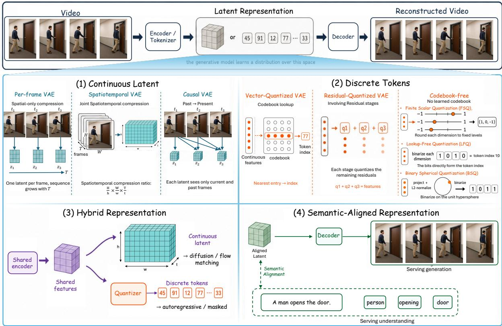  
Figure 4 Latent representations for video generation. Continuous, discrete, hybrid, and semantically aligned designs difer in how tokenizers and VAEs shape reconstruction fidelity, compression, sequence modeling, and unification with understanding. Semantic alignment can be applied to either continuous or discrete representations.

## 5.2.2 Discrete Tokens

From vector quantization to codebook-free schemes. VQ-VAE [359] replaces each encoder output with the index of a learned codebook entry, producing categorical symbols that next-token or masked-token models can predict. VQGAN [93] improves high-resolution reconstruction with perceptual and adversarial losses, and RQ-VAE [231] stacks residual codes to increase precision without enlarging the token grid. Learned codebooks, however, may be used unevenly or collapse to a small active subset. Later quantizers drop the learned codebook: FSQ [342] rounds a few scalar dimensions to fixed levels, LFQ in MAGVIT-v2 [589] uses binary dimensions to obtain a very large implicit vocabulary, and BSQ [644] projects embeddings onto a hypersphere before binary quantization. They difer in optimization stability, vocabulary size, and distortion at a given token budget.

Video tokenization. The video encoder also fixes the spatiotemporal extent of each token and hence the sequence length. C-ViViT in Phenaki [461] factorizes spatial and temporal encoding into causal discrete tokens, MAGVIT-v2 pairs a causal tokenizer with LFQ for both autoregressive and masked generation, and HiTVideo [661] shortens the sequence with hierarchical codes that place semantics and fine detail in diferent layers. Fixed grids, however, spend as many tokens on a static shot as on a fast-changing scene. Adaptive tokenizers allocate the budget by content: EVATok [536] predicts how many tokens each segment needs, and VideoFlexTok [10] emits a variable-length coarse-to-fine sequence whose early tokens carry semantics and motion and whose later tokens add detail.

## 5.2.3 Hybrid and Semantically Aligned Representations

Hybrid tokenizers combine continuous and discrete forms or change the decoder. OneVAE [660] initializes a discrete video VAE from a continuous one and trains both in one network, so continuous latents can feed difusion or flow models and discrete codes can feed sequence models. Divot [122] and DiCoDe [261] instead decode with a difusion model. Divot learns continuous features for LLM-based understanding and reconstruction, and DiCoDe compresses video into deep tokens that an LLM predicts autoregressively.

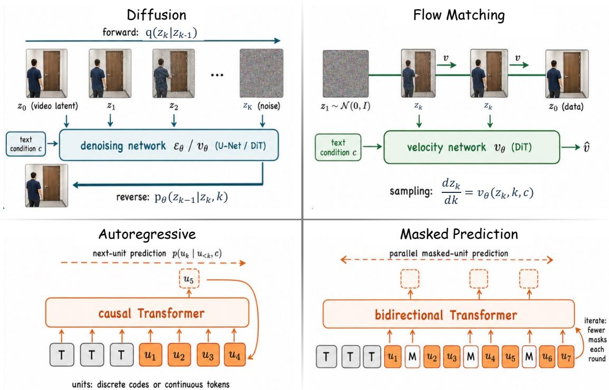  
Figure 5 Generative modeling paradigms. Difusion and flow matching learn denoising or velocity targets over video latents. Autoregressive modeling factorizes an ordered sequence, while masked prediction fills selected positions from visible context through parallel conditional predictions.

Semantic alignment adds a further requirement. A reconstruction-optimal latent may keep texture and local motion without organizing them into the objects, events, and relations needed for understanding, while a highly semantic latent may discard the detail that generation needs. VILA-U [521] trains one discrete tokenizer for both reconstruction and text alignment, and the SEED tokenizer [123] gives a language model a semantically organized visual code. PyraTok [432] quantizes features at several spatiotemporal scales against one text-guided codebook, so coarse semantics and fine detail occupy diferent levels. Section 6 pursues this question in models that share LLMs, parameters, or objectives across understanding and generation.

Representation autoencoders start from the semantic side: they freeze a pretrained encoder as the tokenizer and train only a projector or pooler and a decoder. V-RAE [139] compares image and video encoders such as DINOv3 and V-JEPA 2.1 and finds that reconstruction ranking does not consistently predict generation quality, so a semantic latent must be tested inside the target generator.

## 5.3 Generative Video Foundation Modeling

Video generators difer in their generative objective, the order in which space-time units are predicted, and the system that organizes synthesis. Difusion, autoregressive or masked prediction, and flow matching define model-level generation processes (Figure 5), whereas LLM/MLLM-assisted and agentic systems add planning, tool use, and revision around a visual generator that may use any of the three. The levels combine in practice: a system may denoise each chunk while rolling out autoregressively in time, and an agent may repeatedly call a flow-based generator. Preference optimization is applied on top of these generators. VideoReward [284] aligns a flow-based generator with Flow-DPO on a multidimensional preference signal, and LiFT [484] applies reward-weighted fine-tuning with a reward model learned from human annotations. World-R1 [473] uses feedback from pretrained 3D and vision-language models to reinforce geometric consistency through Flow-GRPO. Table 12 compares representative systems whose technical routes are publicly documented.

Table 12 Video-generation systems. Visual space describes generated variables; MLLM online identifies a multimodally pretrained backbone used at inference, excluding ofline annotators. Modes refer to the cited configurations; MAGVITv2 is a tokenizer without mode assignments. Closed systems appear only where an oficial technical source documents the listed capability.
<table><tr><td>System</td><td>Architecture</td><td>Learning</td><td>Visual space</td><td>MLLM online</td><td>T</td><td>Modes ＩＶAVＬ</td></tr><tr><td colspan="7">Diffusion over pixels or continuous latents</td></tr><tr><td>Video Diffusion Models (text) [169]</td><td>U-Net</td><td>Diffusion</td><td>Px</td><td></td><td></td><td></td></tr><tr><td>Video Diffusion Models (prediction) [169]</td><td>U-Net</td><td>Diffusion</td><td>Px</td><td></td><td></td><td></td></tr><tr><td>Imagen Video [166]</td><td>Cascaded U-Nets</td><td>Diffusion</td><td>Px</td><td></td><td></td><td></td></tr><tr><td>Make-A-Video [417]</td><td>U-Net cascade</td><td>Diffusion</td><td>Px</td><td></td><td></td><td></td></tr><tr><td>Video LDM (text) [28]</td><td>U-Net</td><td>Diffusion</td><td>VAE</td><td></td><td></td><td></td></tr><tr><td>Video LDM (RDS prediction) [28]</td><td>Frame- conditioned</td><td>Diffusion</td><td>VAE</td><td></td><td></td><td></td></tr><tr><td>Stable Video Diffusion (I2V) [27]</td><td>U-Net U-Net</td><td>Diffusion</td><td>VAE</td><td></td><td></td><td></td></tr><tr><td>Sora [31]</td><td>DiT</td><td>Diffusion</td><td>VAE</td><td>NR</td><td></td><td></td></tr><tr><td>CogVideoX [570]</td><td>DiT</td><td>Diffusion</td><td>VAE</td><td>√ I2V prompt expansion</td><td></td><td></td></tr><tr><td colspan="3">Flow matching over continuous video latents</td><td></td><td></td><td></td><td></td></tr><tr><td>Mochi [125]</td><td>Asymmetric DiT</td><td>Flow matching</td><td>VAE</td><td></td><td></td><td></td></tr><tr><td>LTX-Video [145]</td><td>DiT</td><td>Flow matching</td><td>VAE</td><td></td><td></td><td></td></tr><tr><td>HunyuanVideo (T2V) [219]</td><td>Dual-stream DiT</td><td>Flow matching</td><td>VAE</td><td>√ text encoder</td><td></td><td></td></tr><tr><td>Step-Video-T2V [328]</td><td>DiT</td><td>Flow matching</td><td>VAE</td><td>- LLM only</td><td></td><td></td></tr><tr><td>HunyuanVideo 1.5 [506]</td><td>DiT</td><td>Flow matching</td><td>VAE</td><td>√ text encoder</td><td></td><td></td></tr><tr><td>Wan / Wan-VACE [203, 462]</td><td>DiT</td><td>Flow matching</td><td>VAE</td><td>Wan I2V prompt expansion</td><td></td><td></td></tr><tr><td>Pyramid Flow [205]</td><td>DiT</td><td>Flow matching</td><td>VAE</td><td></td><td></td><td></td></tr><tr><td colspan="3">Joint audio-video generation</td><td></td><td></td><td></td><td></td></tr><tr><td>Ovi [309]</td><td>Twin DiTs</td><td>Flow matching</td><td>VAE</td><td></td><td></td><td></td></tr><tr><td>LTX-2 [144]</td><td>Dual-stream DiT</td><td>Flow matching</td><td>VAE</td><td>√ text encoder</td><td></td><td></td></tr><tr><td colspan="3">Autoregressive and masked generation</td><td></td><td></td><td></td><td></td></tr><tr><td>VideoPoet [217]</td><td>Causal Transformer</td><td>Next-token AR</td><td>Tok</td><td>√ generative core</td><td></td><td></td></tr><tr><td>Loong [487]</td><td>Causal Transformer</td><td>Next-token AR</td><td>Tok</td><td>generative core</td><td></td><td></td></tr><tr><td>Phenaki [461]</td><td>Masked Transformer</td><td>Masked prediction</td><td>Tok</td><td></td><td></td><td></td></tr><tr><td>MAGVIT-v2 [589]</td><td>Tokenizer + Transformer</td><td>AR/masked prediction</td><td>Tok</td><td></td><td></td><td></td></tr><tr><td>Lumos-1 [595]</td><td>Temporal causal Transformer</td><td>Temporal AR; masked discrete</td><td>Tok</td><td>√ generative core</td><td></td><td></td></tr><tr><td>NOVA [82]</td><td>Temporal AR Transformer</td><td>diffusion Continuous AR with diffusion loss</td><td>VAE</td><td></td><td></td><td></td></tr><tr><td>VideoMAR [585]</td><td>Temporal AR Transformer</td><td>Continuous AR with diffusion loss</td><td>VAE</td><td></td><td></td><td></td></tr></table>

Space: Px pixels; VAE VAE latents; Tok discrete tokens; BD backend-dependent; NR not reported.  
Online: ✓ active MLLM; ◦ optional MLLM; – no online MLLM; NR not reported. LLM only: text-only backbone.  
Modes: • listed; – not listed. T text-to-video; I image-to-video; V video-conditioned generation/editing; AV joint audio-video  
output; L streaming or minute-scale output. AR autoregressive.

Table 12 Video-generation systems (continued).
<table><tr><td>System</td><td>Architecture</td><td>Learning</td><td>Visual space</td><td>MLLM online</td><td>Modes T</td><td>I Ｖ AV L</td></tr><tr><td colspan="7"></td></tr><tr><td colspan="7">Streaming and long-horizon hybrids</td></tr><tr><td>StreamingT2V [162]</td><td>U-Net with memory</td><td>Diffusion</td><td>VAE</td><td></td><td></td><td></td></tr><tr><td>MAGI-1 [443]</td><td>Chunk-AR DiT</td><td>Causal flow matching</td><td>VAE</td><td>√ I2V prompt refinement</td><td></td><td></td></tr><tr><td>LongTake [364]</td><td>Chunk-AR DiT</td><td>Flow matching; distribution- matching distillation</td><td>VAE</td><td></td><td></td><td></td></tr><tr><td colspan="7">LLM/MLLM-assisted generation</td></tr><tr><td>VideoDirectorGPT [273]</td><td>Planner + diffusion model</td><td>Diffusion; prompted planning</td><td>VAE</td><td>- LLM only</td><td></td><td></td></tr><tr><td>MetaCanvas [272]</td><td>MLLM + latent-canvas generator</td><td>Planner alignment; flow backbone</td><td>VAE</td><td>√ planner</td><td></td><td></td></tr><tr><td>TV2TV [148]</td><td>Mixture of Transformers</td><td>Text AR + video flow matching</td><td>VAE</td><td>generative core L</td><td>:</td><td></td></tr><tr><td colspan="7">Agentic generation workflows</td></tr><tr><td>MovieAgent [519]</td><td>Agents + visual tools</td><td>Prompted CoT planning; backend-dependent</td><td>BD</td><td>GPT-4o planner</td><td></td><td></td></tr><tr><td>Anim-Director [263]</td><td>MLLM + visual tools</td><td>Prompted planning; backend-dependent</td><td>BD</td><td>√ planner/ observer</td><td></td><td></td></tr><tr><td>Any2Caption [517]</td><td>Condition interpreter + generator</td><td>Condition alignment; caption instruction tuning</td><td>BD</td><td>√ interpreter</td><td></td><td></td></tr><tr><td>Mora [599]</td><td>Agents + visual tools</td><td>Self-modulated joint fine-tuning of visual experts</td><td>VAE</td><td>– LLM only; MLLM offline</td><td></td><td></td></tr></table>

Space: Px pixels; VAE VAE latents; Tok discrete tokens; BD backend-dependent; NR not reported.  
Online: ✓ active MLLM; ◦ optional MLLM; – no online MLLM; NR not reported. LLM only: text-only backbone.  
Modes: • listed; – not listed. T text-to-video; I image-to-video; V video-conditioned generation/editing; AV joint audio-video output; L streaming or minute-scale output. AR autoregressive.

## 5.3.1 Diffusion-Based Generation

Difusion models learn to reverse a gradual corruption process: a clean video latent is perturbed according to a noise schedule, and the model learns to predict the noise, a velocity, or an equivalent denoising target at any noise level [167, 396]. The ϵ- and v-prediction objectives and EDM-style schedules are alternative parameterizations of this problem (Section 3.3); they afect optimization and sampling, not the video architecture. Flow-matching generators (Section 5.3.3) share these backbones, so the backbone and long-video designs below apply to both.

Backbone and attention. Early video difusion systems, including Video Difusion Models [169], Imagen Video [166], and Make-A-Video [417], extended convolutional U-Nets with temporal convolutions or factorized spatial and temporal attention. Lumiere [19] instead generates the whole clip in one pass with a spacetime U-Net that downsamples in both space and time, avoiding keyframe generation followed by temporal super-resolution. Difusion Transformers (DiTs) [369] then made it easier to scale attention over compressed space-time tokens. CogVideoX [570], Mochi [125], and LTX-Video [145] pair a causal or highly compressed video VAE with a DiT. CogVideoX uses an expert Transformer with separate text and video normalization, Mochi gives the visual stream more capacity in an asymmetric DiT, and LTX-Video compresses aggressively so that full spatiotemporal attention stays afordable. Joint audio-video backbones couple two modality streams through bidirectional cross-modal attention, so timing and semantics are exchanged throughout synthesis. LTX-2 [144] extends LTX-Video with separate modality VAEs and asymmetric audio and video streams, and Ovi [309] couples matched audio and video DiTs trained with flow matching.

The main backbone trade-of concerns attention. Factorized attention separates spatial and temporal interactions to save cost, whereas full spatiotemporal attention lets all space-time tokens interact at a higher memory cost. Sparse and linear attention cut this cost for long or high-resolution clips. HunyuanVideo 1.5 [506] uses selective and sliding tile attention within a unified T2V and I2V training framework, and SANA-Video 2.0 [53] interleaves gated linear attention with periodic softmax layers and routes block summaries across depth. Conditions enter the backbone through cross-attention, adaptive normalization such as AdaLN, joint text-video attention, or channel and token concatenation (Section 5.4).

Streaming and long videos. Standard difusion denoises a fixed-length clip as a whole, whereas streaming variants generate causally, chunk by chunk. Difusion Forcing [44] gives each frame its own noise level, MAGI-1 [443] denoises chunks autoregressively, CausVid [582] distills a bidirectional model into a few-step causal generator, Self-Forcing [190] trains on the model’s own rollouts, and Causal Forcing [664] distills from an autoregressive teacher (Section 7.2.2, Table 17). S2PD [176] instead changes the sampling order within a clip, generating blocks autoregressively at high noise, then refining the sequence in parallel at low noise.

Long videos raise a diferent problem: repeated local generation keeps short-term motion but gradually loses appearance and global structure. StreamingT2V [162] carries anchor frames and short- and long-term memory across windows, FreeLong [313] blends low-frequency global features with high-frequency local ones during denoising without training, and FramePack [619] compresses past frames by importance to bound the context. Other methods change training or the history representation. LongTake [364] supervises later frames from long real-video prefixes before self-rollout distribution matching, and its evaluation separates sustained motion from appearance quality, since a nearly static continuation can score well on consistency. Test-time training [77] stores context in MLP weights that a self-supervised loss updates while the sequence is processed, and has been demonstrated on one-minute, storyboard-conditioned cartoons.

## 5.3.2 Autoregressive and Masked Token Generation

Autoregressive video models factorize the distribution over an ordered sequence of video units. With discrete tokens, this resembles language modeling: VideoGPT [553] paired a VQ-VAE with a Transformer prior over video codes, CogVideo [170] scaled the recipe to text-conditioned generation, and VideoPoet [217] applied it in a multimodal sequence model. Loong [487] places text and video tokens in one sequence and uses short-to-long training and inference-time re-encoding to limit error accumulation in minute-level videos. InfinityStar [285] extends discrete autoregression to 720p image, video, and long-video generation, reporting about 30 times lower latency than Wan 2.1-14B in its own single-GPU setting. The route ofers a standard causal likelihood and flexible length, at the cost of long decoding chains, dependence on tokenizer quality, and errors that propagate through the prefix.

Masked generation relaxes the one-token-at-a-time order: the model predicts sets of masked positions from visible tokens, often refining coarse-to-fine over several rounds. Phenaki [461] applies a bidirectional masked Transformer to causal video tokens, MAGVIT-v2 [589] improves the tokenizer and the masked generation framework, and Lumos-1 [595] keeps frames causal while decoding each frame in parallel with mask-based discrete difusion. Continuous tokens support the same factorization. MAR [252] introduced a difusion loss for the conditional distribution of a continuous image token, and NOVA [82] and VideoMAR [585] carry it to video, predicting frames causally in time and continuous tokens within each frame with a difusion loss.

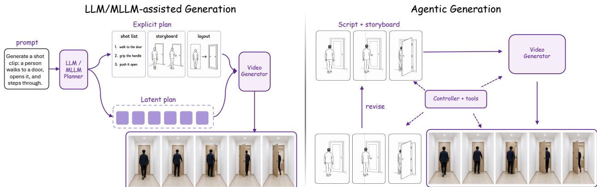  
Figure 6 System-level organization for video generation. An LLM or MLLM plans for a visual generator through an explicit plan, such as shot lists, storyboards, or layouts, or through learned plan embeddings, and agentic systems close the loop with scripting, generation, evaluation, and revision under a controller.

## 5.3.3 Flow-Based Generation

Flow matching [280] trains a time-dependent vector field that transports samples from a simple base distribution to the data along a prescribed probability path, and generation integrates the corresponding ordinary diferential equation. It difers from the usual difusion account in its training target and sampling path: rectified-flow formulations favor nearly straight paths, which can reduce the number of solver steps, and the same DiT or multimodal DiT (MMDiT) can parameterize either target. Stable Difusion 3 [92] made the rectified-flow and MMDiT combination prominent for images, and video systems adapted it to space-time latents. HunyuanVideo [219], Step-Video-T2V [328], Goku [55], and Wan [462] scale flow matching with DiT backbones and video VAEs, HunyuanVideo with a dual-stream-to-single-stream Transformer. Pyramid Flow [205] changes the path itself, linking spatial pyramid stages and compressing full-resolution history with a temporal pyramid so that one DiT is trained end to end across resolutions.

Normalizing flows are a distinct, likelihood-based route that should not be confused with flow matching. STARFlow-V [136] applies invertible autoregressive transformations to pretrained video-VAE latents, with a global–local decomposition and a light causal denoiser, so the likelihood is tractable in latent space.

## 5.3.4 LLM/MLLM-Assisted Generation

LLM/MLLM-assisted generation covers systems in which a language model plans, expands, captions, or structures the conditions for a separate visual sampler. A language model that predicts video tokens directly belongs to autoregressive generation instead. In the common arrangement (Figure 6), the language model turns an underspecified request into scenes, shots, layouts, or refined prompts that a difusion, flow, or autoregressive generator consumes. VideoDirectorGPT [273] produces a grounded video plan before layout-conditioned generation, and LLM-grounded Video Difusion [265] and Dysen-VDM [99] draft dynamic scene layouts or scene graphs that guide the denoiser, so the language model handles composition and timing while the video model handles appearance and motion. Any2Caption [517] interprets text, image, video, region, motion, and camera cues and translates them into dense structured captions for a downstream generator.

The language model and the generator can also be coupled more tightly than through a written prompt. MetaCanvas [272] lets an MLLM plan in spatial or spatiotemporal latent spaces connected to difusion backbones, including image-to-video and editing settings. TV2TV [148] couples the two more tightly, interleaving language next-token prediction with video flow matching in one framework.

## 5.3.5 Agentic Generation

Agentic generation turns planning into an executable loop: a controller decomposes a request, calls specialized models or tools, inspects intermediate results, and revises the plan or conditions when the output falls short (Figure 6). The recurring stages are scripting, storyboarding, visual generation, evaluation, and revision.

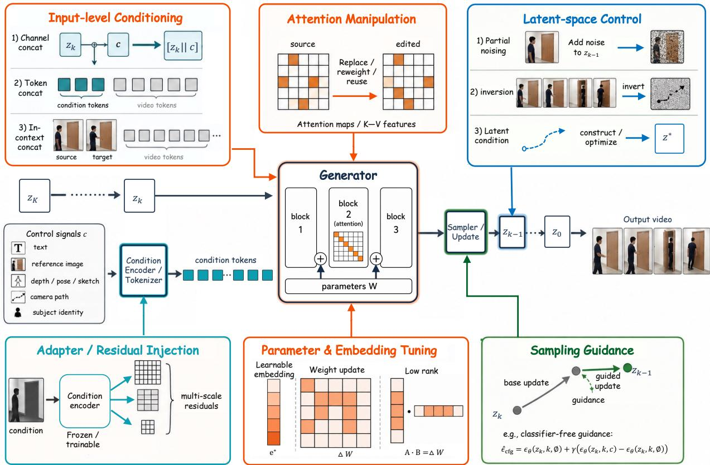  
Figure 7 Control mechanisms by intervention site. Each route is identified by the component through which its principal control signal enters generation: the input, the attention maps, the latent state, block features, parameters and embeddings, or the sampling update.

Current agents mainly decompose long-form creation or coordinate tools. MovieAgent [519] assigns screenplay, directing, storyboard, and scene construction to cooperating agents, and Anim-Director [263] has an MLLM write a storyline and script, produce consistent scene references, and select outputs from generative tools. Mora [599] routes among generation and editing skills in a multi-agent workflow.

## 5.4 Control Strategies

Section 5.1 classifies generation by the information supplied; here we classify control by the component through which that information alters generation. A camera path, pose sequence, or reference image may enter as input tokens, adapter features, a latent trajectory, sampling guidance, or tuned parameters. This entry point determines what must be trained, how strong and local the control is, and how easily several signals combine. Figure 7 locates the entry points relative to the backbone, and Table 13 compares the six families. A single system often combines several, as in source inversion followed by attention reuse and classifier-free guidance.

## 5.4.1 Attention-Based Control

Attention-based methods reuse the correspondences that a text-conditioned generator already forms: crossattention links prompt tokens to spatial features, and self-attention relates visual features to one another. Prompt-to-Prompt [163] injects cross-attention maps from a source prompt into the denoising run for an edited prompt, keeping the layout while changing a word, an attribute, or a concept’s strength.

Video editing also needs the change to stay stable across frames. Video-P2P [293] and FateZero [377] combine attention control with inversion of the source video. Video-P2P adds separate guidance for source and target prompts, and FateZero fuses source and target cross- and self-attention maps recorded during inversion. TokenFlow [126] instead propagates difusion features between frames through feature-space correspondences, so an image editor produces temporally consistent edits without training.

Table 13 Control strategies for video generation, grouped by where the control signal enters the generator (Figure 7). Practical systems often combine several families.
<table><tr><td rowspan=1 colspan=6>Family          Where control     What is       Strengths           Limitations            Examplesenters             trained</td></tr><tr><td rowspan=1 colspan=6>Attention       Cross- and        No separate   Local semantic     Depends on learned Prompt-to-self-attention      control        edits that keep thecorrespondences;     Prompt [163],maps, replaced,   network       source layout       large motion and     Video-P2P [293],reweighted, or                                             occlusion break      FateZero [377],reused from a                                              them; strong map    TokenFlow [126]source run                                                  reuse blocksgeometric change</td></tr><tr><td rowspan=1 colspan=4>Adapter         Block features of Adapter or    Keeps thea frozen backbone, side network  pretrainedthrough a side                       generator; encodesbranch                               dense spatial andtemporal structure</td><td rowspan=1 colspan=2>Needs paired control ControlNet [620],data; one branch per T2I-Adapter [347]signal; separately     MotionCtrl [492],trained adapters mayVideoControl-conflict               Net [182],VACE [203]</td></tr><tr><td rowspan=1 colspan=2>Latent space   Noisy latent or</td><td rowspan=1 colspan=1>Nothing, or</td><td rowspan=1 colspan=1>Noise level sets</td><td></td><td rowspan=7 colspan=1>SDEdit [340], DDIMinversion [421],Wan-Move [73],VLIPP [564]</td></tr><tr><td rowspan=1 colspan=2>denoising</td><td rowspan=1 colspan=1>the base</td><td rowspan=1 colspan=1>fidelity against edit</td><td></td><td rowspan=1 colspan=1>latent retains;</td></tr><tr><td rowspan=2 colspan=2>trajectory: partialnoising, inversion,</td><td rowspan=1 colspan=1>model for</td><td rowspan=1 colspan=1>strength; accurate</td><td></td><td rowspan=1 colspan=1>inversion errors</td></tr><tr><td rowspan=1 colspan=1>constructed</td><td rowspan=1 colspan=1>inversion preservesaccumulate</td><td></td><td rowspan=1 colspan=1>into</td></tr><tr><td rowspan=1 colspan=2>or constructed</td><td rowspan=1 colspan=1>conditions</td><td rowspan=1 colspan=1>background,</td><td></td><td rowspan=1 colspan=1>temporal drift</td></tr><tr><td rowspan=1 colspan=2>and optimized</td><td rowspan=1 colspan=1></td><td rowspan=1 colspan=1>identity, and</td><td></td><td rowspan=2 colspan=1></td></tr><tr><td rowspan=1 colspan=2>latents</td><td rowspan=1 colspan=1></td><td rowspan=1 colspan=1>motion</td><td></td></tr><tr><td rowspan=1 colspan=2>Concatenation / Model input, as</td><td rowspan=1 colspan=1>The backbone S</td><td rowspan=1 colspan=1>imple; many</td><td></td><td rowspan=7 colspan=1>SVD [27],VideoComposer [475],FullDiT [207],UNIC [576],PhysRAG [69]</td></tr><tr><td rowspan=1 colspan=2>in-context       extra channels or</td><td rowspan=1 colspan=1>and its</td><td rowspan=1 colspan=1>conditions combine</td><td></td></tr><tr><td rowspan=1 colspan=1></td><td rowspan=1 colspan=1>tokens, including</td><td rowspan=1 colspan=1>condition</td><td rowspan=1 colspan=1>in one sequence</td><td></td><td rowspan=1 colspan=1>each token type;</td></tr><tr><td rowspan=1 colspan=1></td><td rowspan=1 colspan=1>in-context</td><td rowspan=1 colspan=1>encoders</td><td rowspan=1 colspan=1>and one model</td><td></td><td rowspan=1 colspan=1>longer sequences</td></tr><tr><td rowspan=1 colspan=1></td><td rowspan=1 colspan=1>examples and</td><td rowspan=1 colspan=1></td><td rowspan=1 colspan=1></td><td></td><td rowspan=1 colspan=1>raise attention cost;</td></tr><tr><td rowspan=2 colspan=1></td><td rowspan=1 colspan=1>retrieved evidence</td><td rowspan=1 colspan=1></td><td rowspan=1 colspan=1></td><td></td><td rowspan=1 colspan=1>retrieved evidence</td></tr><tr><td rowspan=1 colspan=1></td><td rowspan=1 colspan=1></td><td rowspan=1 colspan=1></td><td></td><td rowspan=1 colspan=1>can be wrong</td></tr><tr><td rowspan=1 colspan=1>Guidance</td><td rowspan=1 colspan=1>Sampling update</td><td rowspan=1 colspan=1>Nothing at</td><td rowspan=1 colspan=1>Works at test time; Extra model or</td><td rowspan=7 colspan=2>CFG [168], universalguidance [15],FreeDoM [588],self-guidance [91]good as thesurrogate objective</td></tr><tr><td rowspan=1 colspan=1></td><td rowspan=1 colspan=1>at each denoising</td><td rowspan=1 colspan=1>test time;</td><td rowspan=1 colspan=1>can impose</td><td rowspan=1 colspan=1>gradient evaluations;</td></tr><tr><td rowspan=1 colspan=1></td><td rowspan=1 colspan=1>step</td><td rowspan=1 colspan=1>CFG needs</td><td rowspan=1 colspan=1>constraints absent</td><td rowspan=1 colspan=1>high scales reduce</td></tr><tr><td rowspan=1 colspan=1></td><td rowspan=1 colspan=1></td><td rowspan=1 colspan=1>condition</td><td rowspan=1 colspan=1>from the training</td><td rowspan=1 colspan=1>diversity; only as</td></tr><tr><td rowspan=1 colspan=1></td><td rowspan=1 colspan=1></td><td rowspan=1 colspan=1>dropout</td><td rowspan=1 colspan=1>data</td></tr><tr><td rowspan=1 colspan=1></td><td rowspan=1 colspan=1></td><td rowspan=1 colspan=1>during</td><td rowspan=1 colspan=1></td></tr><tr><td rowspan=1 colspan=1></td><td rowspan=1 colspan=1></td><td rowspan=1 colspan=1>training</td><td rowspan=1 colspan=1></td></tr><tr><td rowspan=2 colspan=1>Tuning</td><td rowspan=5 colspan=5>Preserves a specific Needs adaptation    Textualor text             full or          subject or style     data and compute;  Inversion [112],embeddings       low-rank                              adds parameters; canDreamBooth [398],weights, or a                         bind the subject to  LoRA [174],reference poses,      Tune-A-Video [512],that predicts                         backgrounds, or      Video2LoRA [523]them                                  motion</td></tr><tr><td rowspan=1 colspan=1>or text</td><td rowspan=1 colspan=1>full or</td></tr><tr><td></td><td rowspan=1 colspan=1>embeddings</td><td rowspan=1 colspan=1>low-rank</td><td rowspan=1 colspan=1>more faithfully</td></tr><tr><td></td><td rowspan=1 colspan=1></td><td rowspan=1 colspan=2>weights, or athan prompts</td></tr><tr><td></td><td rowspan=1 colspan=1></td><td rowspan=1 colspan=2>hypernetwork</td></tr></table>

## 5.4.2 Adapter-Based Control

Adapters add a trainable path for external structure while keeping most or all of the pretrained generator frozen. ControlNet [620] copies the encoder blocks of a frozen image difusion model into a conditional branch joined by zero-initialized convolutions, whereas T2I-Adapter [347] adds features from a small condition encoder at several resolutions. They represent the two main variants: a heavy side network that mirrors the backbone

and a light adapter that produces residual features.

Video adapters must also encode how a condition changes over time. MotionCtrl [492] represents camera motion with poses and object motion with trajectories so that the two can be composed. VideoControlNet [182] brings ControlNet to video-to-video translation with motion guidance that keeps the injected structure aligned across frames. Unified adapters train several controls together. VACE [203] encodes reference frames, source video, and masks in a Video Condition Unit and injects them into a frozen DiT through a context adapter, supporting reference generation, editing, and masked editing with shared adapter parameters.

## 5.4.3 Latent-Space Control

Latent-space methods act on the noisy sample or the denoising trajectory itself. Partial noising, as in SDEdit [340], perturbs an input to an intermediate noise level and denoises it under a new condition, so the noise level trades fidelity against edit strength. Inversion maps an observed video to a noise trajectory from which the generator approximately reconstructs it, often through deterministic DDIM sampling [421]; editing then changes the condition or selected latents along the reverse path.

A method may also construct latent conditions directly. Wan-Move [73] projects dense point trajectories into latent space and propagates first-frame features along them, giving an image-to-video model a motion condition without a separate motion encoder. VLIPP [564] has a vision-language model plan coarse object motion, renders the plan as a synthetic motion video, and converts its optical flow into structured noise that initializes a motion-controllable image-to-video model (Section 7.2.4).

## 5.4.4 Concatenation and In-Context Conditioning

The most direct route places the condition in the model input. Channel concatenation appends aligned condition latents to the noisy video latent, as in the image-to-video variants of Stable Video Difusion [27] and CogVideoX [570] and in VideoComposer [475], which fuses spatial and temporal conditions before concatenation. Token concatenation instead appends condition embeddings to the sequence processed by selfor joint attention.

FullDiT [207] maps heterogeneous conditions into one sequence and models them with full attention, avoiding separately trained side branches. In-context generation places reference examples or source–target pairs in the sequence so that the model infers the requested transformation, as Emu2 [429] showed for multimodal image generation and UNIC [576] applies to unified video editing. Retrieval can supply further condition tokens: PhysRAG [69] retrieves videos of relevant physical phenomena, extracts physical information, and injects it into a video difusion model through learnable queries.

## 5.4.5 Guidance-Based Contro

Guidance changes the sampling direction instead of adding a persistent condition branch. Classifier-free guidance (CFG) [168] combines conditional and unconditional predictions at each denoising step,

$$
\widehat { \epsilon } _ { \mathrm { c f g } } = \epsilon _ { \theta } ( z _ { k } , k , \mathcal { O } ) + \gamma \big ( \epsilon _ { \theta } ( z _ { k } , k , c ) - \epsilon _ { \theta } ( z _ { k } , k , \mathcal { O } ) \big ) ,\tag{6}
$$

where $z _ { k }$ is the noisy latent at denoising step $k ,$ ∅ denotes the null condition, and $\gamma$ is the guidance scale; $\gamma = 1$ recovers the conditional prediction. CFG needs a model trained with condition dropout, and raising γ usually strengthens alignment but reduces diversity.

More general guidance uses the gradient of an energy, attention, correspondence, or physical objective to modify each update and can impose constraints absent from the training data. Universal guidance [15] and training-free energy guidance [588] use external objectives, whereas difusion self-guidance [91] defines them on the generator’s internal attention and feature maps.

## 5.4.6 Tuning-Based Control

Tuning stores a new subject, style, or source-video prior in learned embeddings or weights. For images, Textual Inversion [112] learns new text embeddings for a user concept, DreamBooth [398] fine-tunes the model on a few subject images with a prior-preservation loss, and LoRA [174] learns low-rank weight updates while keeping the base weights fixed. Video adds the requirement that the learned identity stay stable under motion and viewpoint change.

Tune-A-Video [512] and LoRA-Edit [113] tune on each source video. Tune-A-Video adapts an image difusion model from one text–video pair with spatiotemporal attention and DDIM inversion, and LoRA-Edit applies mask-aware LoRA tuning to an image-to-video model, taking structure and motion from the source and edited appearance from reference images. Video2LoRA [523] avoids per-reference optimization: a hypernetwork predicts reference-specific LoRA weights in one forward pass.

## 5.5 Applications

Generated video serves as content, as an avatar, as a visual plan, or as training data, and each use places diferent demands on conditioning, latency, consistency, and evaluation. Systems that also model actionconditioned transitions are treated in Section 7.

## 5.5.1 Creative Content Production

Video generation enters production at several stages, from concept shots and storyboards to narrative footage, advertising and educational variants, and visual-efects edits. The agentic systems of Section 5.3.5 handle planning and tool orchestration, while foundation generators increasingly bundle creation and revision operations. Following Sora [31], Movie Gen [372] combines text-to-video generation with personalization, instruction-based editing, and synchronized audio. Closed systems such as Kling [224] and Sora 2 [360] ofer text- and image-to-video generation as products, and Sora 2 adds synchronized audio. Open models such as VideoCrafter2 [48], Open-Sora [648], Wan [462], HunyuanVideo [219], and Step-Video-T2V [328] make text-to-video generation available through released weights. Seedance 1.0 [120] adds native multi-shot generation with consistent subjects, and Seedance 2.0 [442] accepts text, image, audio, and video inputs for joint audio-video generation, reference-based generation, and editing.

Production also needs what per-clip realism does not measure: keeping a character, location, or style across shots, revising one element without disturbing the rest, and controlling camera and motion. These needs tie personalization and control (Section 5.4) to cross-shot and preference evaluation (Section 5.1.2).

## 5.5.2 Avatars and Character Animation

Avatar generation maps speech, motion, or other control signals to the visible behavior of a person or character. Its lineage runs through the audio-driven systems of Section 5.1: Wav2Lip [375] edits the mouth region with a lip-sync expert, and SadTalker [626] predicts expression and head-pose coeficients of a 3D face model. Difusion models such as EMO [446] and Hallo [542] generate expressive portrait motion directly from audio, and VLOGGER [75] extends the output to the upper body with hand and gesture motion from a single reference image. Pose-driven animation, as in Animate Anyone [179] and MagicAnimate [548], replaces audio with a motion sequence and is judged against that motion instead of speech. In both settings, identity, clothing, background, and non-speech motion must stay stable over long or varied inputs.

Real-time avatars must also produce frames at a sustained rate with bounded delay while staying synchronized with incoming audio or motion. MuseTalk [633] dubs video in latent space and reports 30 frames per second at 256 × 256 resolution on a V100 GPU. Vidu S1 [616] lets voice instructions redirect an ongoing character stream, and Vidu S2 [615] adds references that can be updated during streaming and frame-aligned editing of an incoming video stream. Mid-stream control adds action-to-output latency to throughput as a criterion and links avatars to the real-time interactive world models of Section 7.2.3.

## 5.5.3 Video Plans for Embodied Agents

Generated video can serve as a plan between a task specification and physical execution, and methods difer mainly in how they recover actions from it. UniPi [87] generates a future video from a text task and extracts controls with an inverse dynamics model, using images as a planning space shared by embodiments with diferent action spaces. AVDC [215] infers actions from dense correspondences between generated frames, so policies can be learned from videos without action labels. RoboDreamer [656] composes video predictions of reusable instruction primitives to generalize to new object–action combinations, and Dreamitate [269] fine-tunes a video model on human demonstrations and tracks the generated tool motion to control a robot. A generated plan stays fixed, whereas an interactive simulator such as UniSim [561] updates its predictions as actions arrive (Section 7).

## 5.5.4 Synthetic Data for Embodied AI and Driving

Embodied and driving systems need observations of rare tasks, environments, and failures that are costly or unsafe to collect. Video generation can supply them ofline by varying appearance, layout, trafic, camera pose, or actions while keeping the annotations carried by the condition. In driving, MagicDrive [116] conditions multi-camera street views on camera poses, road maps, 3D bounding boxes, and text with cross-view attention, and Panacea [503] generates annotated multi-view videos from bird’s-eye-view layouts. DriveDreamer [476] and GAIA-1 [172] go further and predict future driving observations under scene or action conditions (Section 7). In robotics, the data must also carry actions: DreamGen [198] adapts an image-to-video model to a target embodiment and labels its generated trajectories with a latent-action or inverse-dynamics model. GigaWorld-0 [441] pairs a controllable video generator with 3D generation and system identification to train vision-language-action policies (Section 7). Generated data are judged by downstream perception and policy results on real observations, not by visual fidelity.

## ­ INSIGHT Rendering fidelity and stateful control are distinct scaling axes

Video priors increasingly make each clip convincing, yet visual fidelity and stateful control are separate goals. A good control changes only its target, keeps that change over time, and combines with other controls without disturbing identity, geometry, or motion. Progress should therefore be measured by comparing matched rollouts with and without the control, not by the quality of each rollout alone.

## 6 T Unified Video Models: Sharing the World

Sharing means understanding and generation use common representations, parameters, interfaces, or objectives.

Video understanding and generation have traditionally relied on separate encoders and generators. Unified video models implement the sharing relation V ↔ W of Section 2: inferred content can condition generation, and generative structure can support understanding and reasoning.

Definition 2.6 evaluates sharing at three levels: capability coverage (one system performs both directions), architectural sharing (the directions use common components), and functional synergy (one direction improves the other under a controlled comparison). We cover systems with video input or output that link understanding and generation, and cite image-only work where it supplies a design or evaluation protocol missing for video.

## 6.1 Unified Architectures

Unified architectures difer in where understanding and generation meet (Figure 8): in a shared token sequence, a shared continuous latent space, a semantic bridge between decoupled experts, or the task state of an agent that calls specialized tools. Table 14 compares representative video systems along the component dimensions of Zhao et al. [640]. The first three families have image-domain precedents: Chameleon [439] for early-fusion token sequences, Transfusion [650] for autoregressive text and difusion images in one Transformer, Janus [508] for decoupled encoders, and MetaQueries [363] for learned-query bridges. On the video side, UniVL [315] earlier unified video–language understanding and caption generation, though its generated output was text, not video.

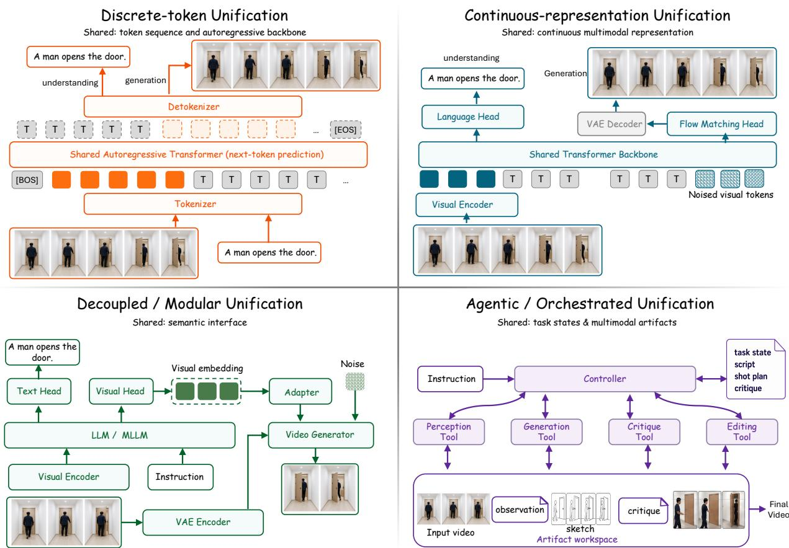  
Figure 8 Four architecture families for unified video understanding and generation, ordered by the abstraction of what is shared: discrete-token unification shares a token sequence and autoregressive backbone; continuous latent-space unification shares a continuous representation with direction-specific heads; decoupled and modular unification links separate experts through a semantic bridge; and agentic and tool-augmented unification shares a task state maintained by a controller. The families can be combined: an agent may call tools built on any of the other three.

Table 14 Representative unified video systems, grouped by their integration mechanism. For agentic and tool-augmented systems, the core is a controller and the interfaces are perception, synthesis, or execution tools. Entries follow the cited configurations.
<table><tr><td>System</td><td>Core</td><td>Read interface</td><td>Write / act interface</td><td>Training / notes</td><td>U G E</td></tr><tr><td colspan="6">Discrete-token unification</td></tr><tr><td>Emu3 [479]</td><td>8B Transformer</td><td>Spatiotemporal VQ</td><td>VQ → decoder</td><td>Joint AR· C</td><td></td></tr><tr><td>Emu3.5 [76]</td><td>34B Transformer</td><td>IBQ over frames</td><td>IBQ → frame decoder; AR + SFT + RL · C keyframe diffusion</td><td></td><td></td></tr><tr><td>Video-LaVIT [206]</td><td>Llama-2-7B</td><td>Keyframe + motion VQ</td><td>Codes → diffusion decoders</td><td>Video-language AR· C ✓ √</td><td></td></tr><tr><td>Vega [486]</td><td>Qwen2.5-3B</td><td>Tar semantic tokens</td><td>Tar → Wan2.1 renderer</td><td>Semantic AR + FM · C</td><td>√√</td></tr><tr><td>VILA-U [521]</td><td>Llama-2-7B + RQ depth</td><td>SigLIP/RQ tower</td><td>RQ → RQ-VAE</td><td>Alignment + joint AR √ √ . C</td><td></td></tr><tr><td>NExT-OMNI [323]</td><td>Qwen2.5-7B</td><td>CLIP discrete tokens Codes → VQ-VAE</td><td></td><td>Joint discrete FM· B √√</td><td></td></tr><tr><td colspan="6">Continuous latent-space unification</td></tr><tr><td>TUNA [306]</td><td>Qwen2.5-1.5B + flow</td><td>Wan2.2 VAE + SigLIP2</td><td>Shared → flow/VAE</td><td>Joint AR + FM · H</td><td></td></tr></table>

Video tasks: U understanding; G generation; E editing. ✓ demonstrated; inherited/task-specific evidence; – not established. G#Training: AR autoregressive; FM flow matching; NR not reported. Predictor attention: C causal; B bidirectional; H hybrid.

Table 14 Unified video systems (continued).
<table><tr><td>System</td><td>Core</td><td>Read interface</td><td>Write / act interface</td><td>Training notes</td><td></td><td>U G E</td></tr><tr><td>Show-o2 [531]</td><td>Qwen2.5-1.5B + flow</td><td>Wan2.1 VAE</td><td>Shared → flow/VAE</td><td>Staged AR/FM·H</td><td></td><td></td></tr><tr><td>Uni-ViGU [382]</td><td>Wan2.1 DiT</td><td>Wan VAE + diffusion VAE → video features</td><td>flow/VAE</td><td>Continuous/discrete FM; shared attention</td><td></td><td></td></tr><tr><td>HYDRA-X [609]</td><td>Qwen2.5-7B + flow Hydra-XTok</td><td></td><td>XTok → visual flow</td><td>Joint AR/FM; mask NR</td><td></td><td></td></tr><tr><td>Gen4U [213]</td><td>Veo 3 [131] / Wan2.2</td><td>Video codec + diffusion features</td><td>Original codec → decoder</td><td>Frozen-feature readouts</td><td>V S</td><td></td></tr><tr><td>PixelUMM [499]</td><td>Qwen3 Transformer Pixel patch/tubelet experts</td><td></td><td>Pixels → pixel flow</td><td>Joint AR/FM; edit fine-tuning·H</td><td>√ √ √</td><td></td></tr><tr><td colspan="7">Decoupled and modular unification</td></tr><tr><td>Lance [111]</td><td>Qwen2.5-VL-3B dual experts</td><td>Qwen2.5-VL ViT</td><td>Wan2.2 VAE → flow</td><td>Joint AR/FM· H</td><td>√√√</td><td></td></tr><tr><td>NExT-GPT [516]</td><td>Vicuna-7B + projectors</td><td>ImageBind</td><td>Tokens → Zeroscope</td><td>Alignment + LoRA · C</td><td></td><td></td></tr><tr><td>GPT4Video [489]</td><td>LLaMA + LoRA</td><td>CLIP + video abstractor</td><td>Text → external T2V</td><td>Alignment; generator frozen·C</td><td>√</td><td></td></tr><tr><td>Omni-Video [435]</td><td>VILA + clue adapter</td><td>VILA + SigLIP2 clues</td><td>Wan VAE → Wan2.1</td><td>Staged clue/decoder training · C</td><td></td><td>√√</td></tr><tr><td>UniVid [317]</td><td>BAGEL-7B + adapter</td><td>ViT/SigLIP2 selector Wan VAE → Wan2.2</td><td></td><td>Connector/DiT LoRA; reflection</td><td>√√</td><td></td></tr><tr><td>UniVideo [498]</td><td>Qwen2.5-VL-7B + bridge</td><td>Qwen2.5-VL</td><td>Hunyuan VAE → MMDiT</td><td>Staged FM; MLLM frozen</td><td></td><td>√√</td></tr><tr><td>Omni-Video 2 [557]</td><td>Frozen MLLM + adapter</td><td>MLLM encoder</td><td>VAE → video DiT</td><td>Adapter/decoder FM</td><td>① √ √</td><td></td></tr><tr><td>MoRoute [114]</td><td>Qwen3.5 + routers</td><td>Qwen3.5 encoder</td><td>Wan VAE → Wan2.1</td><td>Interface/decoder FM; routed attention</td><td></td><td>√√</td></tr><tr><td>ReViSE [298]</td><td>Omni-Video + VLM critic</td><td>Inherited VLM encoder</td><td>Wan VAE → Wan2.1</td><td>FM + differentiable VLM reward</td><td>① √√</td><td></td></tr><tr><td colspan="7">Agentic and tool-augmented unification UniVA [270] Claude Sonnet 4 InternVL3;</td></tr><tr><td></td><td>agents</td><td>SAM2/Sa2VA</td><td>Seedance; VACE/Aleph; audio/image</td><td>Orchestration; artifact memory</td><td>√ √ √</td><td></td></tr><tr><td>VideoAgent (editing) [653]</td><td>Agent graph; tested Shot planning; LLMs</td><td>retrieval</td><td>Video/audio editing tools</td><td>Textual-gradient graph√ refinement</td><td></td><td></td></tr><tr><td>VISTA [307]</td><td>Gemini 2.5 Flash agents</td><td>Visual/audio critique</td><td>Veo 3 [131], Veo 2</td><td>Prompt refinement; candidate state</td><td>0</td><td></td></tr><tr><td>VideoAgent (planning) [423]</td><td>GPT-4 Turbo feedback</td><td>VLM plan judgment</td><td>AVDC diffusion; action execution</td><td>Self-conditioning; online tuning</td><td>√</td><td></td></tr></table>

Video tasks: U understanding; G generation; E editing. ✓ demonstrated; inherited/task-specific evidence; – not established. Training: AR autoregressive; FM flow matching; NR not reported. Predictor attention: C causal; B bidirectional; H hybrid.

## 6.1.1 Discrete-Token Unification

Discrete-token models convert text, images, and video into symbols that are interleaved in one sequence. A single Transformer then serves both directions with next-token prediction: answering predicts text tokens after video context, and generation predicts visual tokens after a text or visual condition. Emu3 [479] follows this design without difusion heads, covering image and video understanding and generation, and Emu3.5 [76] scales the same objective to video-heavy data and reports world-modeling behavior such as spatiotemporally consistent exploration. Video-LaVIT [206] cuts the token cost of video by tokenizing keyframes and motion separately, and VILA-U [521] trains its vision tower to align discrete tokens with language while keeping the detail needed for generation. SEED-LLaMA [123] pairs discrete visual tokens with a difusion image decoder; it answers video questions but generates only images. Two variants change the role of the tokens or the objective: Vega [486] predicts semantic keyframe tokens autoregressively and leaves appearance to a difusion renderer, and NExT-OMNI [323] replaces autoregression with discrete flow matching over text, image, video, and audio tokens.

This route gives many input–output combinations one vocabulary, one sequence format, and one likelihood objective. However, the tokenizer becomes the bottleneck: codes must preserve appearance and motion without making sequences unmanageably long, and quantization discards information before the Transformer sees it. Long autoregressive outputs also accumulate errors through their generated prefix.

## 6.1.2 Continuous Latent-Space Unification

Continuous latent-space models avoid quantization: an encoder maps images or video into a continuous feature space that an understanding head reads and a decoder, difusion model, or flow head turns back into pixels. The latent space is shared, but the losses and output heads can difer, because language prediction and pixel generation have diferent numerical requirements. TUNA [306] cascades a VAE encoder with a representation encoder, and Show-o2 [531] replaces the discrete vocabulary of Show-o [530] with a 3D causal VAE; both predict text autoregressively and generate images and video with flow matching. Uni-ViGU [382] starts from the other end, extending a video difusion generator with discrete flow matching for text and lightweight understanding layers. AToken [311] and HYDRA-X [609] make the tokenizer itself the shared component, training it with reconstruction and semantic objectives over images, video, and, for AToken, 3D. PixelUMM [499] drops the pretrained encoder and VAE: pixel patches and video tubelets enter a mixture-of-transformers in which the two directions keep separate projections and feed-forward layers but share attention, supporting video question answering, generation, and editing.

Continuous spaces fit difusion and flow generators naturally, but they expose a tension that recurs across unified models. Understanding benefits from invariance to texture and small appearance changes, whereas generation must retain enough detail to reconstruct them.

## 6.1.3 Decoupled and Modular Unification

Decoupled systems sidestep this tension by keeping separate visual pathways for the two directions, linked through an LLM, a projection layer, or a learned adapter. The understanding encoder can drop nuisance detail and emphasize objects, relations, actions, or text, while a separate tokenizer or decoder keeps the fine spatial and temporal detail needed to generate video. NExT-GPT [516] and GPT4Video [489] set the modular baseline around an instruction-following LLM and frozen pretrained encoders and generators, so only a small part of the system is trained: NExT-GPT links the LLM to difusion decoders through lightweight projections, whereas GPT4Video has the LLM write textual prompts for an of-the-shelf text-to-video model. Later systems train the bridge. Omni-Video [435], UniVid [317], and UniVideo [498] let an MLLM interpret the instruction and pass continuous features through an adapter or bridge to a difusion decoder; UniVid adds a reflection mechanism for temporal reasoning. Omni-Video 2 [557] keeps the MLLM frozen and conditions the decoder on a predicted target caption and source-video latents for editing, and ReViSE [298] trains an Omni-Video model with feedback from its own VLM (Section 6.2.4).

Other systems redesign the bridge itself. Lumos-Nexus [534] aligns a small generator with the understanding model and mixes its velocity predictions with those of a larger pretrained generator at inference. MoRoute [114] learns which layer of a frozen VLM conditions each difusion block, and Mamoda2.5 [413] feeds semantic features to a sparse-expert difusion backbone through learned queries. Lance [111] replaces the bridge with shared attention: separate semantic and VAE encoders feed dual experts that attend over one interleaved sequence. JavisGPT [287] extends the encoder–LLM–decoder pattern to sounding video, passing synchrony-aware queries to a joint audio–video generator.

Decoupling keeps strong pretrained components and makes each one replaceable. However, the bridge can become an information bottleneck: a semantic clue suficient for following an instruction may omit the appearance, geometry, or motion that the decoder needs.

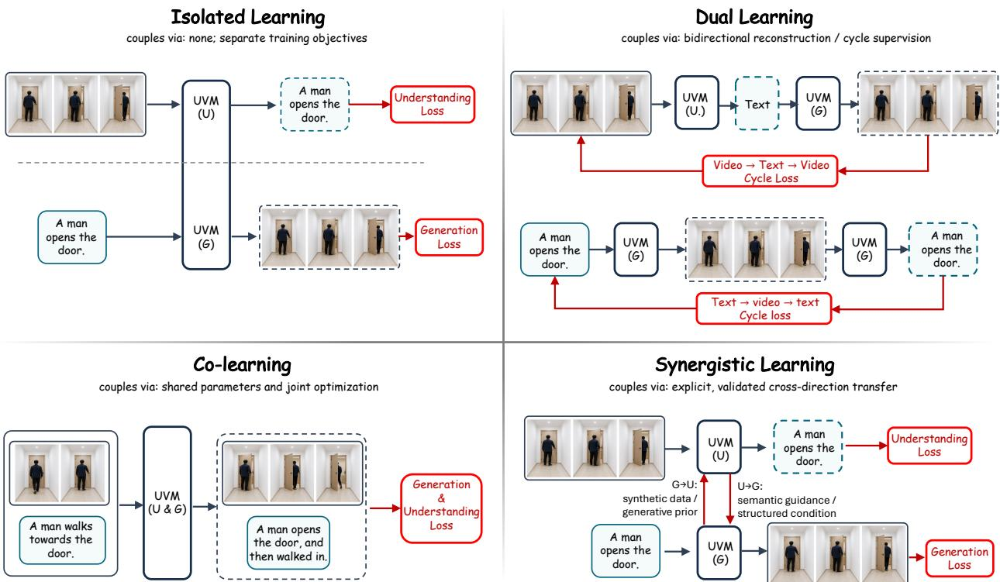  
Figure 9 Learning paradigms in unified video models. Isolated learning keeps independently pretrained experts; dua learning relates inverse tasks or reconstruction cycles; co-learning optimizes both directions jointly; and synergistic learning targets cross-direction benefit. The paradigms can coexist.

## 6.1.4 Agentic and Tool-Augmented Unification

Agentic systems leave perception, generation, editing, and evaluation to specialized models. A controller reads the request and media, plans operations, calls tools, inspects their outputs, and revises the plan; what is shared is a task state such as a script, shot plan, prompt, edit graph, or critique. VideoAgent (editing) [653] plans shots and retrieves source clips before calling a library of editing agents, and VISTA [307] wraps a video generator in a loop of temporal planning, candidate selection, multimodal critique, and prompt rewriting. UniVA [270] plans and calls understanding, generation, editing, and segmentation tools that share global, task, and user memories.

Agents can combine strong tools without forcing their internal representations to agree, and each tool can be swapped as better models appear. However, they depend on tool selection, intermediate formats, and evaluator reliability: one wrong caption, retrieval result, or critique can redirect the whole workflow.

## 6.2 Learning Paradigms

Architecture fixes where understanding and generation meet; training determines what signal flows between them (Figure 9). Isolated learning connects independently trained experts, dual learning relates the two directions through inverse or cycle objectives, co-learning optimizes both over shared parameters or representations, and synergistic learning uses one direction to improve the other. The paradigms can coexist; for example, a cycle objective can be part of joint training.

## 6.2.1 Isolated Learning

Isolated learning trains understanding and generation as independent experts and connects them after pretraining through a small trained module, while most expert parameters stay frozen. NExT-GPT [516] and GPT4Video [489] follow this recipe (Section 6.1), as GILL [216] did for a frozen language model and a frozen image generator. Isolated learning is cheap and modular, and the source of each capability stays easy to identify. However, generation losses never update the video encoder and understanding losses never update the decoder, so no cross-direction transfer can occur, which makes isolated systems the natural baseline for measuring what tighter coupling adds.

## 6.2.2 Dual Learning

Dual learning treats understanding and generation as approximately inverse problems: a model reconstructs a condition from generated content, regenerates an observation from an inferred representation, or enforces agreement over a round trip. Such objectives let one direction supervise the other when paired labels are scarce. As many videos fit one description and one condition allows many valid futures, a video cycle must preserve task-relevant events, identities, viewpoints, and motion while tolerating appearance variation.

Uni-ViGU [382] is the clearest video-native example. Starting from a video generator, it recovers understanding as the inverse task: it first reconstructs prompts to recall learned text–video associations and then trains on detailed captions, keeping the original generation path. Dedicated cycle objectives remain image-based: CyCLeGen [405] couples image–layout cycles, UniCorn [98] distills text–image–text self-play among proposer, solver, and judge roles, and Reconstruction Alignment [529] trains a model to reconstruct an image from its own understanding embeddings.

## 6.2.3 Co-learning

Co-learning optimizes understanding and generation objectives in one shared model or a jointly trained bridge, and each of the first three families of Section 6.1 supports it. Discrete-token models such as Emu3 [479], Video-LaVIT [206], and VILA-U [521] apply one next-token objective to both directions, while Vega [486] shapes a shared semantic token space and keeps a separate difusion renderer. Continuous and hybrid models share a visual space or Transformer but keep distinct losses, as in TUNA [306], Show-o2 [531], HYDRA-X [609], PixelUMM [499], and the single-Transformer HaploOmni [527]. BAGEL [81] co-trains a mixture of transformer experts that share attention but keep direction-specific projections and feed-forward layers, a design Lance applies to video (Section 6.1). Bridge models such as Omni-Video [435], UniVid [317], and UniVideo [498] co-train the adapter between an MLLM and a video decoder.

Joint training creates an optimization imbalance between the two objectives. Understanding data rewards semantic invariance and concise answers, whereas generation data rewards retaining appearance and motion detail. Diferences in dataset scale, loss magnitude, and convergence speed can let one direction dominate the shared parameters, so the data mixture and schedule decide how strongly each capability updates the model. Lance [111] counters this interference with staged multitask training and adaptive data scheduling. Tong et al. [452] study related choices when pretraining a Transfusion-style backbone from scratch, comparing representation autoencoders, data mixtures, and dense or sparse-expert architectures with compute-matched image–text analyses.

## 6.2.4 Synergistic Learning

Synergistic learning uses one direction to improve the other; its evidence is a measured gain in the receiving direction. From understanding to generation, OmniWeaving [362] conditions a video generator on an MLLM that can first write a reasoning trace about interleaved text, image, and video inputs; after end-to-end training, enabling this thinking mode raises its scores on intent-driven and interpolative tasks of IntelligentVBench. ReViSE [298] turns understanding into a training signal for editing: the frozen VLM inside an Omni-Video model scores a one-step estimate of the edited video, and its answer-token probabilities serve as a diferentiable reward alongside flow matching. Ablations against supervised fine-tuning on RVE-Bench support this understanding-to-editing transfer. Lance’s data-mixture ablations [111] give video evidence in both directions: adding understanding data improves generation on VBench, and adding generation data improves understanding on MVBench.

From generation to understanding, Uni-ViGU [382] transfers a generator’s text–video associations through inverse-task training (Section 6.2.2), and Thinking with Video [451] generates intermediate frames at inference (Section 6.3.2). CounterVid [374] transfers through data: it synthesizes counterfactual action clips and trains a video-language model with a preference objective, reducing action and temporal hallucinations more than generic visual negatives do. UnityVideo [185] jointly learns depth, flow, segmentation, pose, and other visual conditions, improving both world-aware generation and the prediction of those signals. Gen4U [213] and GenCeption [468] reuse frozen or adapted video difusion features for perception (Section 4.2).

Integrated tasks provide a third kind of evidence. UniUGP [310] tests whether scene reasoning and predicted video improve driving trajectories within one system (Section 6.3.3). EWAM [466] shows that masking or counterfactually replacing predicted-future features changes a manipulation policy’s actions and success. Tong et al. [452] also find that general multimodal pretraining data, especially raw video, helps ofline navigation planning through action-conditioned prediction. Apart from Lance’s data-mixture ablations, controlled bidirectional tests remain image-based (Section 6.4).

## 6.3 Applications

Applications test whether information passed between understanding and generation improves a task outcome.

## 6.3.1 Instruction-Driven Video Editing and Creation

Instruction-driven editing follows a read–modify–write pattern: the model identifies the entities, events, motion, and time span an instruction refers to, then changes them while preserving everything else. A plausible output is still wrong if it edits the wrong interval, loses subject identity, or damages surrounding content. Unified models place both steps in one system: Omni-Video [435] and UniVideo [498] pass MLLM interpretations to a difusion decoder (Section 6.1), and UNIC [576] casts editing as in-context generation over one shared sequence. ReViSE [298] adds reasoning to editing data: it pairs reasoning-enriched instructions with target edits and separates modifying a clip from generating a plausible continuation.

Agentic systems extend editing into production workflows: VideoAgent (editing) [653] plans and assembles multi-shot edits, and VISTA [307] uses its own critiques to rewrite prompts across rounds (Section 6.1). Evaluation should therefore score localization, preservation of untouched content, and improvement across rounds, not only the quality of the final video.

## 6.3.2 Generative Reasoning

Generative reasoning uses generation as an intermediate computation. A video can show a changing configuration that is hard to express in one image or a textual chain of thought, as objects move, occlusions change, and the consequences of an operation unfold. The generated sequence then serves as an inspectable hypothesis about the process. Thinking with Video [451] uses a video generator to produce intermediate frames during multimodal reasoning and evaluates them on VideoThinkBench. OpenCoF [58] trains chain-of-frame generation on temporally organized reasoning videos, while MME-CoF-Pro [321, 378] shows that answer accuracy can rise while intermediate frames stay inconsistent or hallucinated. ProAR [408] makes autoregressive video difusion prospective by predicting its own goal frame alongside each chunk.

However, generated reasoning traces add a failure mode: a coherent but unsupported intermediate video can make a later answer look well grounded. Reliable use thus needs observed evidence separated from generated hypotheses, and tests of whether the intermediate video changes the answer for the right reason.

## 6.3.3 Unified Perception-Generation-Planning Systems

In planning, generated video predicts what an action will do: the system reads the current observation, predicts how the scene may evolve under a plan, and uses that prediction to choose or refine the action. Its value lies in the resulting decision, not in visual quality. UniUGP [310] applies this loop to autonomous driving: from multi-frame observations and instructions, its hybrid experts produce scene reasoning, future video, and a trajectory, connected through a four-stage curriculum. The question is whether future generation improves planning in dificult or long-tail situations. VideoAgent (planning) [423] applies the same idea to embodied tasks, refining generated video plans through self-conditioning and execution feedback.

Table 15 Evidence ladder for unified video models, from separate competence to measured cross-direction transfer.
<table><tr><td>Evidence level</td><td>Required test</td><td>Benchmarks and probes</td><td>Video-native status</td></tr><tr><td>Level 1 Separate</td><td>evaluate understanding</td><td>Video-MME [109], MVBench [248], and generation separately LongVideoBench [509], LVBench [472], MLVU [654]; VBench [193], VBench-2.0 [647]</td><td>well established</td></tr><tr><td>competence Level 2</td><td>test integrated</td><td>UniVBench [501], UniM [257]; agentic</td><td>emerging video</td></tr><tr><td>Integrated behavior</td><td>transformations and source/intent fidelity</td><td>UniVA-Bench [270]; reasoning-conditioned RVE-Bench [298] and VR-Bench [534]</td><td>coverage</td></tr><tr><td>Level 3 Measured synergy</td><td>ablate cross-direction information or training under matched settings</td><td>Video controls: Lance task mixtures [111], ReViSE reward [298], CounterVid preferences [374], UnifiedReward critic transfer [485], EWAM future-feature interventions [466]. Image-text:</td><td>directional video evidence; general bidirectional tests remain limited</td></tr><tr><td>Open gap Video round trip</td><td>specify invariants, block answer leakage, and compare cycle / non-cycle controls</td><td>image-based precedents: UniCorn [98], CyCLeGen [405]</td><td>no established video-native standard</td></tr></table>

Recent models extend sharing to actions. Cosmos 3 [354] places language, image, video, audio, and action sequences in one omnimodal mixture-of-transformers. UniWAM [422] couples a physical reasoner, a video generator, and an action predictor through joint attention, and perturbs predicted future latents during posttraining so that actions do not over-rely on imagined futures. EWAM [466] tests whether a predicted-future pathway matters for action (Section 6.2.4), and Section 7 details action-conditioned prediction.

## 6.4 Evaluation

Table 15 expands the sharing row of Table 2 into evaluation levels: separate competence, integrated behavior, and measured synergy. Video coverage is mature at the first level, emerging at the second, and mostly directional at the third. Levels 1 and 2 refine the capability-coverage level of Definition 2.6 and Level 3 its functional-synergy level; architectural sharing is a property of the design (Section 6.1), not a benchmark score, and decision utility is covered by the integrated tasks of Section 6.2.4.

## 6.4.1 Per-Direction Evaluation

Each direction is evaluated with its own community’s protocols: MVBench [248], Video-MME [109], LongVideoBench [509], LVBench [472], and MLVU [654] for understanding (Section 4.1), and VBench [193] and VBench-2.0 [647] for generation (Section 5.1.2). Results should be reported separately, since perceptual and faithfulness criteria are not interchangeable with question-answer accuracy. Matched single-task baselines can also reveal interference, where joint training improves one direction but degrades the other.

## 6.4.2 Unified, Interleaved, and Synergy Evaluation

Integrated benchmarks test whether one system handles a wider family of input–output transformations. UniVBench [501] is the most direct video-centered example: it evaluates understanding, generation, editing, and reconstruction on multi-shot videos with a shared agentic evaluator, and its reconstruction and editing tasks check whether source content survives. RVE-Bench [298] and VR-Bench [534] test whether reasoningconditioned edits and generations do what the inferred intent implies, and UniVA-Bench [270] scores agentic workflows on both final media and planning behavior. UniM [257] extends input and output to text, image, video, and audio, while MME-Unify [533] covers integrated tasks in image–text settings.

Synergy evaluation instead compares matched routes, such as understanding-guided generation against plain generation, or understanding with and without generated intermediates. Image-domain studies lead here: DreamLLM [85] was an early study of synergy between understanding and generation in interleaved documents, and Uni-MMMU [668], RealUnify [412], and UniSandbox [353] score both directions with coupled tasks, matched routes, or decoupled tracks. UniG2U-Bench [504] finds that an extra generation step helps understanding on tasks that need visual transformation but can be neutral or harmful elsewhere. Pseudo-Unification [562] probes internal information patterns and finds divergent processing behind nominally shared parameters. Video evidence so far comes from training ablations and interventions and is mostly directional (Section 6.2.4); Section 8.3 discusses what a video synergy test would need.

## 6.4.3 Protocols and Consistency

Round-trip evaluation tests whether content survives an understanding–generation cycle: a model infers an event or layout, renders it, and reads it back, or generates a video, describes it, and regenerates it. Existing round-trip training objectives are image-based (Section 6.2.2), and the reconstruction task of UniVBench is the closest video protocol. A video protocol must name entities, event order, geometry, or dynamics to keep, score intended changes separately, and add non-unified and no-cycle controls.

Reliable measurement also needs information controls. Train–test overlap can confound transfer with memorization, intermediate representations can leak answers across directions, and text accuracy, video fidelity, and cross-modal consistency may rely on diferent, possibly biased judges. UniSandbox [353] reduces leakage with synthetic tasks and separated modules, TorchUMM [324] standardizes model interfaces and task implementations, and UniSAFE [232] evaluates safety across input–output modality combinations. Judges can themselves be unified: UnifiedReward [485] trains one reward model to rank and score image and video outputs for both understanding and generation.

## ­ INSIGHT Synergy requires controlled cross-direction transfer

Shared tokens or parameters show coupling, separate scores show competence, and mixed input–output tasks show interoperability. Synergy needs a controlled comparison: ablate the cross-direction path under matched data, capacity, and compute, and measure the change in generation, understanding, or an integrated task.

## 7 „ Video World Models: Interacting with the World

Interacting means modeling state transition itself: how an established world evolves over time and, when actions, controls, or new observations are supplied, how they change that evolution.

Interacting is the operation W ⟲ of Section 2: the model advances its state, $s _ { t + 1 } \sim p _ { \theta } ( s _ { t + 1 } \mid s _ { \leq t } , a _ { t } , c _ { t } )$ and decodes observations when visible output is needed. Rollout exposes failures that a single plausible clip hides: generated errors feed back as context, of-screen content is forgotten, smooth motion breaks physical or causal structure, and actions miss their intended efects. We first place current models in the taxonomy of Section 3.4, then examine control, memory, responsiveness, grounding, applications, and evaluation. Zhu et al. [665] survey general world models starting from Sora; this chapter focuses on video-centered state.

## 7.1 Architectures and Training Paradigms

Crossing the two axes of Section 3.4 gives the 2 × 3 grid of Figure 10. A cell describes how a model is trained and used, so one model can occupy several cells: an action-conditioned latent predictor can score fixed candidate actions or run inside a planner that acts, observes, and replans. Likewise, the attention pattern does not decide the column; a model is interactive when it accepts new controls between emitted frames or chunks. Table 16 lists representative implementations, one row per evaluated protocol.

Training data. Each cell needs data that expose the transition it learns. Passive predictors such as V-JEPA 2 and V-JEPA 2.1 pretrain on large image–video mixtures [9, 348], in which video supplies temporal change but no actions. Action-conditioned learning needs synchronized observations and controls, such as the DROID robot demonstrations [209] that train the action-conditioned V-JEPA predictors. Open X-Embodiment [357] pools robot data across embodiments in one format, although action units and coordinate frames still need alignment. Annotated video adds further supervision: camera geometry and depth (OmniWorld [659],

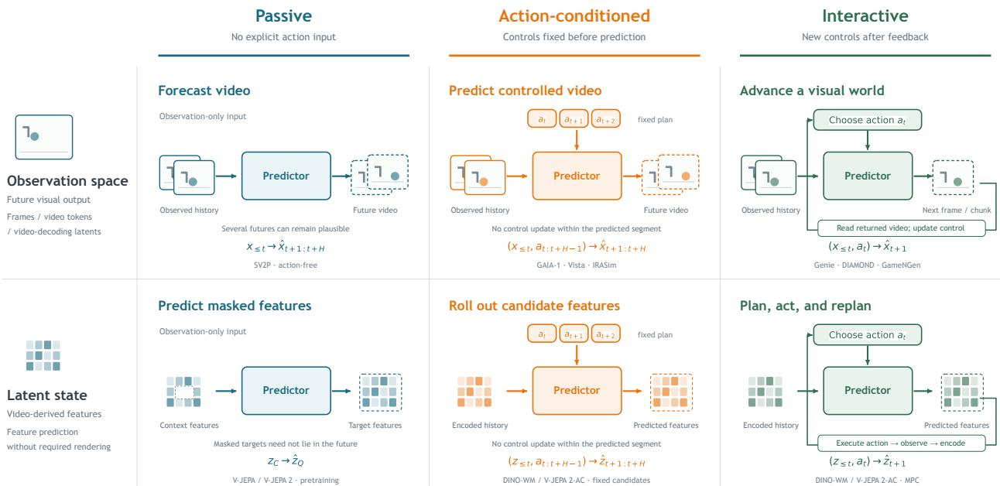  
Figure 10 The 2 × 3 taxonomy of video world models. Rows give the prediction space: observations (frames, video tokens, or video-decoding latents) or latent states (video-derived features predicted without required rendering). Columns give the transition: passive prediction without action input, action-conditioned prediction with controls fixed before prediction, and interactive prediction that receives new controls after feedback. Each cell shows its prediction form and representative models; x denotes observations, z features, a actions, H the horizon, and C and Q the context and target positions of masked feature prediction.

SolarWM [186]), multi-view tactile contact (Deform360 [242]), game actions with ground-truth world state (WildWorld [264]), and recorded intervention branches (CG-World [36]).

## 7.1.1 Observation-Space Passive Prediction

Passive visual models predict future observations from history alone. They can represent uncertainty over several plausible futures, as the action-free setting of SV2P [11] does by sampling latent variables to predict multiple future frames. Large video generators used as forecasters also belong here: Sora [31] was presented as a step toward world simulation, Physics-IQ [346] scores how such generators continue a real initial segment, and the base video-to-world models of Cosmos [355] predict futures from a video prefix before any actionconditioned post-training. Training targets the next frame or a future segment with reconstruction, likelihood, adversarial, difusion, or flow losses. Autoregressive models feed their predictions back as history, whereas block predictors generate a pending segment jointly. Passive prediction supplies dynamics priors and uncertainty estimates for the controlled cells.

## 7.1.2 Observation-Space Action-Conditioned Prediction

This cell receives the controls for a whole predicted segment before generation, such as ego motion, a robot trajectory, camera poses, road layout, or planned object states. GAIA-1 [172] predicts discrete image tokens conditioned on text and action tokens before decoding video, and DrivingWorld [180] predicts driving observations together with ego state. Conditions range from ego dynamics, agent configurations, and road semantics (GAIA-2 [399]) and commands, goal points, and trajectories (Vista [118]) to frame-level robot actions (IRASim [663]). DriveDreamer [476] and post-trained Cosmos variants [355] condition on bird’s-eye-view maps, 3D boxes, and camera configurations.

Most models in this cell adapt a pretrained video generator through condition encoders, cross-attention, or control branches, and add structure, multi-view, or action-fidelity losses to the visual objective. Making them interactive requires causal generation that accepts new controls during rollout. Vid2World [189] makes a video difusion model autoregressive and action-guided, minWM [638] combines control tuning, autoregressive training, and few-step distillation, and BiWM [397] keeps bidirectional computation within causal generation.

Table 16 Video world-model implementations and evaluated protocols. Observe predicts video observations; Latent predicts feature states. Passive has no action input; Action uses a fixed control sequence; Interactive closes the loop. Marks refer to the listed protocol.
<table><tr><td>Model / protocol</td><td colspan="2">Prediction space</td><td colspan="3">Transition protocol</td></tr><tr><td></td><td>Observe</td><td>Latent</td><td>Passive</td><td>Action</td><td>Interactive</td></tr><tr><td>SV2P, action-free [11]</td><td></td><td></td><td></td><td></td><td></td></tr><tr><td>SV2P, fixed actions [11]</td><td>√</td><td></td><td></td><td>√</td><td></td></tr><tr><td>GAIA-1, driving controls [172]</td><td>√</td><td></td><td></td><td>√</td><td></td></tr><tr><td>Vista [118]</td><td>√</td><td></td><td></td><td>√</td><td></td></tr><tr><td>IRASim [663]</td><td>√</td><td></td><td></td><td>√</td><td></td></tr><tr><td>WorldDirector, planned controls [465]</td><td>√</td><td></td><td></td><td>√</td><td></td></tr><tr><td>Genie, playable rollout [32]</td><td></td><td></td><td></td><td></td><td></td></tr><tr><td>DIAMOND, policy loop [4]</td><td></td><td></td><td></td><td></td><td></td></tr><tr><td>GameNGen [459]</td><td></td><td></td><td></td><td></td><td></td></tr><tr><td>Matrix-Game [631]</td><td></td><td></td><td></td><td></td><td></td></tr><tr><td>SolarWM, causal interaction [186]</td><td></td><td></td><td></td><td></td><td></td></tr><tr><td>Waypoint-1.5 [389]</td><td></td><td></td><td></td><td></td><td></td></tr><tr><td>V-JEPA, pretraining [20]</td><td></td><td></td><td></td><td></td><td></td></tr><tr><td>V-JEPA 2, pretraining [9]</td><td></td><td></td><td></td><td></td><td></td></tr><tr><td>V-JEPA 2.1, pretraining [348]</td><td></td><td></td><td></td><td></td><td></td></tr><tr><td>DINO-WM, fixed candidates [652]</td><td></td><td></td><td></td><td></td><td></td></tr><tr><td>V-JEPA 2-AC, fixed candidates [9]</td><td></td><td></td><td></td><td></td><td></td></tr><tr><td>V-JEPA 2.1, navigation [348]</td><td></td><td></td><td></td><td></td><td></td></tr><tr><td>LeWorldModel, fixed candidates [334]</td><td></td><td></td><td></td><td></td><td></td></tr><tr><td>DINO-WM, MPC [652]</td><td></td><td></td><td></td><td></td><td></td></tr><tr><td>V-JEPA 2-AC, robot MPC [9]</td><td></td><td></td><td></td><td></td><td></td></tr><tr><td>V-JEPA 2.1, robot MPC [348]</td><td></td><td></td><td></td><td></td><td></td></tr><tr><td>H-JEPA, hierarchical MPC [625]</td><td></td><td></td><td></td><td></td><td></td></tr><tr><td>LeWorldModel, MPC [334]</td><td></td><td></td><td></td><td></td><td></td></tr></table>

## 7.1.3 Observation-Space Interactive World Models

Interactive visual models generate causally: emitted frames become history, and each new action changes the future that has not yet been generated. Genie [32] predicts video tokens from learned latent actions, GameNGen [459] difuses the next game frame from past frames and actions, and DIAMOND [4] both trains policies inside its generated observations and runs as an interactive simulator. GameFactory [587] extends playable generation to newly constructed scenes, and Matrix-Game [631] couples visual context to keyboard and mouse input, with a later version [156] adding chunked, few-step streaming difusion. Oasis [79] renders a playable Minecraft-like world from keyboard and mouse input in real time, Hunyuan-GameCraft [244] maps keyboard and mouse actions into a shared camera representation and conditions on hybrid history to keep long play consistent, and Genie 3 [367] generates worlds from text prompts that users navigate in real time for several minutes.

Controls can also be speech, and several actors can share one world. Vidu S1 and S2 [615, 616] take speech and updated references as controls on a streaming character (Section 5.5), and Wan-Streamer [188] keeps audio-visual context to respond full-duplex to incoming events (Section 7.2.3). Solaris [402] pairs synchronized actions and observations from two Minecraft players, and MultiWorld [510] binds actions to agent identities and updates a shared geometry-aware representation between chunks, so that every actor afects the same world.

## 7.1.4 Latent-State Passive Prediction

Latent passive models predict video-derived features without actions, often as pretraining for later transition models. V-JEPA [20] learns by predicting the features of masked video regions, and the pretraining stage of V-JEPA 2 [9] scales this objective over images and video. Because the masked region can be predicted from frames on both sides, this objective is not causal forecasting; future prediction requires a separate, causal protocol. We keep these models in the taxonomy because their predictors supply the feature space and initialization of the action-conditioned latent cells; on their own, they are pretraining for transition models rather than complete world models. Later variants change the prediction unit or the loss. Causal-JEPA [349] infers masked object-level latents from surrounding objects to encourage relational prediction. V-JEPA 2.1 [348] adds a dense context-token loss and multi-level supervision for stronger local structure.

## 7.1.5 Latent-State Action-Conditioned Prediction

Adding actions keeps a feature-space target but conditions its evolution on controls. V-JEPA 2-AC [9] post-trains a predictor on robot trajectories, DINO-WM [652] learns how frozen DINOv2 features evolve under actions, and LeWorldModel [334] instead learns the encoder and predictor jointly from pixels with latent regularization. V-JEPA 2.1 also trains a difusion predictor over its features for navigation [348].

Such models can roll a candidate action sequence forward and compare the result with a goal representation without rendering a single frame. LaDi-WM [192] predicts geometric and semantic features for a manipulation policy, and MoWM [593] combines motion-aware latent prediction with pixel-space signals. The JEPA-WM design study [444] compares encoders, proprioception, context, multi-step losses, and planning optimizers in one recipe and finds that the best combination depends on the task.

## 7.1.6 Latent-State Interactive World Models

An interactive latent system closes the loop with model predictive control (MPC): the planner chooses an action prefix, executes it, encodes the new observation, and plans again. V-JEPA 2-AC [9] and DINO-WM [652] use this loop, and V-JEPA 2.1 [348] applies it to reaching, grasping, and pick-and-place on a real robot arm. H-JEPA [625] stacks latent spaces at coarser timescales so that upper levels supply subgoals to lower-level planning. Latent rollout spends no capacity on texture and scores candidates without a decoder, but latent distance can omit task-relevant details. Because corrective replanning can hide poor scores, scorer-level audits complement closed-loop success (Section 7.4).

­ INSIGHT Rendering, causal rollout, and decision state can be specialized

A visual generator can supply appearance and motion priors, an online generator can provide action-conditioned rollout, and a latent predictor can supply compact state for planning. These components need not share a representation or training stage, but for the same history and action their rendered consequences, retained state, and decision scores must agree.

## 7.2 Core Technical Challenges

Four challenges recur across the grid: control, memory, latency, and physical grounding. Memory and physical consistency matter in every cell; controlled prediction must also bind each control to its consequence, and interaction must do so within a response budget. The challenges interact: longer memory raises inference cost, fewer denoising steps change rollout stability, and stronger action constraints can disturb the visual prior inherited from pretraining.

## 7.2.1 Action-Conditioned Controllability

Action control poses two problems. Without action records, a latent-action model must learn a control variable from observed transitions; with supplied controls, conditioning must bind each signal to the right time, view, object, and consequence.

Latent action learning. Latent-action models couple inverse and forward dynamics. An inverse model infers a variable that explains the change between two nearby frames, and a forward model predicts the later frame from the earlier one and that variable. A discrete codebook or continuous bottleneck limits how much information the variable carries, which favors a compact control code. LAPO [403], LAPA [574], and Moto [61] use discrete latent actions to pretrain policies from unlabeled video, and Genie [32] uses them to make platformer videos playable. LAPA then maps its codes to robot commands with a small labeled set, while Moto treats them as a language of motion tokens. Continuous latent actions ofer more capacity. AdaWorld [119] conditions an autoregressive world model on them and adapts to new action spaces with little interaction, while IGOR [57] encodes initial-to-goal image changes in one space for humans and robots.

However, a latent action can lock onto the wrong source of change. LAOM [351] shows that visual distractors lead latent actions to encode background or camera motion, whereas a little action supervision anchors them to the agent. Latent codes should therefore be tested for decoding into executable actions and for transfer under distractors, not only for reconstruction. Action Forcing [430] avoids an unconstrained code: it recovers signed egomotion axes from principal components of tracked pixel motion and uses them as controls that can be tested for reversal, scaling, and composition.

Action conditioning mechanisms. Known actions remove the discovery problem but must still be aligned with the frames they afect. A single sequence embedding is too coarse when each frame must respond to a diferent command, so IRASim [663] injects actions frame by frame throughout its difusion Transformer. Other systems express controls where their efects appear. EA-WM [568] projects joint or end-efector kinematics into the camera view as visual action fields, and Aero-World [388] feeds acceleration and angular velocity as tokens and checks inertial consistency with a frozen latent physics probe. X-World [646] conditions multi-camera driving on ego actions plus optional controls over trafic agents, road elements, and appearance. Models that predict both states and actions must also stay responsive to actions; FLEX-WAM [210] rebalances the two losses and tracks an action-sensitivity proxy for this purpose.

## 7.2.2 Long-Horizon Consistency and Memory

Long-horizon failure occurs at two scales. Locally, small prediction errors return as context and accumulate across frames or chunks; globally, a finite context drops entities, layouts, and events that are no longer visible. The first calls for aligning training histories with deployment, the second for storing, compressing, or recurrently updating information beyond the active window. TECO [552] is an early example, compressing past frames into temporally consistent latent codes to keep long rollouts coherent.

Training-inference alignment: the forcing family. Under teacher forcing, the model predicts from clean ground-truth history, whereas at deployment it conditions on its own outputs, so a small error in geometry or identity becomes the next input. Difusion Forcing [44] exposes the model to uncertain histories by giving sequence elements independent noise levels; GameNGen similarly perturbs its conditioning frames with noise, and LIVE [187] adds forward–reverse cycle consistency. MAGI-1 [443] denoises chunks block-causally. Autoregressive difusion adds a second mismatch, between a many-step bidirectional teacher and a few-step causal student. CausVid [582] makes a pretrained video difusion model causal and distills its sampler through distribution matching, Self-Forcing [190] trains the student on its own rollouts, and Causal Forcing [664] distills from an autoregressive teacher whose sampling path already follows causal inference. Later variants change the denoising window (Rolling Forcing [290]), the prediction horizon (Next Forcing [537]), or the distillation objective (One-Forcing [104], Delta Forcing [522]); Table 17 lists their mechanisms and intended efects.

Retrieval-augmented and structured memory. Retrieval extends the context with stored observations that are recalled when the camera or agent returns to a relevant region. WorldMem [528] stores frames with pose and time metadata and attends to them to reconstruct earlier scenes; Context-as-Memory [586] retrieves only scene-relevant past views, and WorldWeaver [305] builds its memory on predicted depth, which drifts less than RGB. Spatial Memory Intelligence [566] uses a multimodal LLM to cluster, sparsify, filter, and retrieve stored views by action, while Keepsake [1] caps the archive by evicting views that others can replace. Such archives trade growing storage and retrieval cost for detailed evidence that can be revisited.

Geometry makes recall more precise and reduces false matches between similar-looking places. VMem [251] indexes views by 3D surfels, RELIC [171] stores compressed history with relative actions and absolute camera poses in its key–value (KV) cache, and AnchorWeave [495] retrieves local memories around persistent anchors. Long-term spatial memory [518] keeps a reconstructed static point map for layout, recent frames for motion, and retrieved past frames for appearance. Matrix-Game 3.5 [381] keeps geometrically projected latent patches for the static scene and reference tokens for moving subjects, so that past positions of an object are not mistaken for additional objects.

Table 17 Training mechanisms for causal and streaming generation. DMD: distribution-matching distillation.
<table><tr><td>Method</td><td>Training mechanism</td><td>Intended effect</td></tr><tr><td>Teacher forcing</td><td>Clean ground-truth history; next-step prediction Fit observed transitions; exposure</td><td>mismatch remains</td></tr><tr><td>Diffusion Forcing [44]</td><td>Independent noise levels across sequence elements</td><td>Denoise from histories with varying uncertainty</td></tr><tr><td>CausVid [582]</td><td>DMD from a bidirectional teacher to a causal student</td><td>Few-step causal generation</td></tr><tr><td>Self-Forcing [190]</td><td>Self-generated histories; video-level distribution matching</td><td>Align training context with autoregressive inference</td></tr><tr><td>Causal Forcing [664]</td><td>Causal-teacher ODE initialization followed by DMD on rollouts</td><td>Align initialization with causal prediction</td></tr><tr><td>Causal Forcing++ [639]</td><td>Causal consistency initialization followed by DMD</td><td>Reduce initialization cost for frame-wise few-step generation</td></tr><tr><td>Rolling Forcing [290]</td><td>Self-generated history; joint window denoising with progressive noise</td><td>Reduce drift in streaming generation</td></tr><tr><td>Next Forcing [537]</td><td>Ground-truth history; auxiliary future-chunk denoising targets</td><td>Extend predictive supervision; parallelize next-chunk inference</td></tr><tr><td>One-Forcing [104]</td><td>Frame-wise rollouts; DMD plus adversarial learning</td><td>Stabilize one-step autoregressive generation</td></tr><tr><td>Delta Forcing [522]</td><td>Transition-calibrated weighting of DMD and continuity regularization</td><td>Balance condition changes with trajectory continuity</td></tr></table>

However, remembering what was seen difers from tracking what changes of-screen. WorldDirector [465] conditions causal chunks on externally planned object and camera trajectories plus retrieved object crops, so planned objects keep moving while unseen. LiveWorld [90] keeps a static background and localized dynamic entities and uses virtual monitors to generate their progress outside the view before projecting it back into the scene; its LiveBench checks this of-screen progression.

Context compression. Compression keeps a bounded working context. FramePack [619] gives older frames smaller representation budgets than recent ones and adds drift prevention to sampling.

Fixed-size state representations. Fixed-size memories keep a constant-size state and pay a compression cost at every update. Long-context state-space world models [371] pair a block-wise state-space scan with dense local attention, and Echo-Infinity [26] recurrently updates memory queries as frames leave its local window. GIM-World [502] encodes selected past latents into geometry-supervised tokens, and Owl-1 [191] keeps learned state queries inside a multimodal LLM alongside predicted textual dynamics. Honeycomb [411] recurrently writes six fixed-size spatial and spatiotemporal feature planes that cover larger ranges at coarser resolution. WorldTrace [520] keeps a fixed-size KV memory of averaged scene summaries and selected landmark keys that later queries can reach beyond the recent window, and evaluates it with its LoopBench revisit test. Recurrent states can drift, test-time weight updates [77] add optimization latency, and compact memories may drop details needed later for rendering. Retrieval, compression, and fixed state thus trade capacity against latency diferently and can be combined (Table 18).

## 7.2.3 Real-Time Responsiveness

Responsiveness is the delay between a new action and the first output that reflects it; a slow transition breaks the control loop even when ofline throughput is high. End-to-end cost combines sampling depth, work per step, active history, cache construction, latent decoding, and the rate at which controls enter the rollout. Recent systems report real-time rates: Vidu S1 [616] reaches up to 42 frames per second (FPS) at 540p on consumer GPUs, and Wan-Streamer [188] reaches 25 FPS. Display rate can still overstate responsiveness: with temporal compression, several frames are decoded per predicted latent, so actions may enter less often than frames appear. Waypoint-1.5 [389], a causal difusion Transformer with bounded KV caches for keyboard-mouse play on consumer hardware, accordingly reports rendered and latent FPS and control rate separately.

Table 18 Memory mechanisms for long-horizon video generation and world modeling. Horizon scaling distinguishes active context from the full archive.
<table><tr><td rowspan=1 colspan=6>Memory type    Stored state            Horizon scaling  Examples                        Main limitation</td></tr><tr><td rowspan=1 colspan=6>Visual retrieval frames, tokens, or     growing or       WorldMem [528],anchors selected by    capped archive  RELIC [171],                   loses detail; false matchessimilarity or pose                          Context-as-Memory [586],     corrupt recallAnchorWeave [495], SMI [566],Keepsake [1] (capped)</td></tr><tr><td rowspan=1 colspan=1>Spatial caches</td><td rowspan=1 colspan=2>static maps, surfels,    grows with</td><td rowspan=1 colspan=3>VMem [251], Long-term       geometry errors persist;</td></tr><tr><td rowspan=1 colspan=1></td><td rowspan=1 colspan=2>projected features,    retained scene</td><td rowspan=1 colspan=3>Spatial Memory [518],          static caches alone do not</td></tr><tr><td rowspan=2 colspan=1>Planned</td><td rowspan=1 colspan=1>and reference views</td><td rowspan=1 colspan=1>coverage</td><td rowspan=2 colspan=3>Matrix-Game 3.5 [381]         model off-screen changeWorldDirector [465]            off-screen evolution is</td></tr><tr><td rowspan=1 colspan=1>object/camera</td><td rowspan=1 colspan=1>bounded</td></tr><tr><td rowspan=1 colspan=1>dynamics with</td><td rowspan=1 colspan=1>trajectories, crops,</td><td rowspan=1 colspan=1>selected context;</td><td rowspan=1 colspan=1></td><td rowspan=1 colspan=2>externally planned; chunks</td></tr><tr><td rowspan=1 colspan=1>retrieval</td><td rowspan=1 colspan=1>and selected history</td><td rowspan=1 colspan=1>growing video</td><td rowspan=1 colspan=1></td><td rowspan=1 colspan=1></td><td rowspan=1 colspan=1>do not establish online</td></tr><tr><td rowspan=1 colspan=1></td><td rowspan=1 colspan=1></td><td rowspan=1 colspan=1>archive</td><td rowspan=1 colspan=2></td><td rowspan=1 colspan=1>interaction</td></tr><tr><td rowspan=1 colspan=3>Addressable KV recent window plus    fixed GPU</td><td rowspan=1 colspan=3>WorldTrace [520]; evaluated  host history grows by</td></tr><tr><td rowspan=1 colspan=1>summaries</td><td rowspan=1 colspan=2>Field summaries or    cache; host</td><td rowspan=1 colspan=3>with LoopBench                default; bounded</td></tr><tr><td rowspan=1 colspan=1></td><td rowspan=1 colspan=2>Landmark slots        scaling depends</td><td rowspan=1 colspan=3>aggregates lose</td></tr><tr><td rowspan=1 colspan=1></td><td rowspan=1 colspan=2>on writer</td><td rowspan=1 colspan=2></td><td rowspan=2 colspan=1>informationdiscarded detail requires</td></tr><tr><td rowspan=1 colspan=1>Compressed</td><td rowspan=1 colspan=2>selected chunks or     bounded</td><td rowspan=1 colspan=2>StreamingT2V [162]</td></tr><tr><td rowspan=1 colspan=1>context</td><td rowspan=1 colspan=2>summaries with        working context</td><td rowspan=1 colspan=3>FramePack [619]                another retained source or</td></tr><tr><td rowspan=1 colspan=1></td><td rowspan=1 colspan=2>unequal temporal</td><td rowspan=3 colspan=3>a new observationEcho-Infinity [26], Owl-1 [191], compression loses detail;</td></tr><tr><td rowspan=1 colspan=1></td><td rowspan=1 colspan=2>budgets</td></tr><tr><td rowspan=1 colspan=1>Fixed-size</td><td rowspan=1 colspan=1>memory queries;</td><td rowspan=1 colspan=1>fixed carrier;</td></tr><tr><td rowspan=1 colspan=1>memory</td><td rowspan=2 colspan=5>GIM-World [502],              state updates or historyHoneycomb [411]               re-encoding add costfeature planes          separately</td></tr><tr><td rowspan=1 colspan=1></td><td rowspan=1 colspan=1>spatiotemporal</td><td rowspan=1 colspan=1>accounted</td></tr></table>

Few-step distillation and adversarial post-training. Training-based acceleration turns a many-step generator into a causal student with fewer evaluations per frame or chunk, as CausVid, Self-Forcing, and Causal Forcing do while aligning rollouts. Adversarial post-training goes further: Seaweed-APT [276] distills a video difusion model into a one-step generator, AAPT [277] applies autoregressive adversarial post-training to real-time interactive video, and Causal Forcing++ [639] scales few-step autoregressive distillation. Once sampling depth is reduced, the backbone, active context, and decoder dominate the cost, and the student must also stay stable over long rollouts.

Training-free acceleration. Training-free methods exploit redundancy at inference. Sparse attention suits streaming because the current query is short and the history long: Light Forcing [325] keeps the anchors and recent frames that control the next output. Caching reuses features that change little across denoising steps, as in TeaCache [281] and FasterCache [326]. WorldCache [107] adapts caching to world models, where an error in a few control-sensitive action, image, or memory tokens can propagate through the rollout. TurboDifusion [617] combines both routes, stacking step distillation with low-bit and sparse attention and weight–activation quantization, reporting two orders of magnitude of end-to-end acceleration on a single consumer GPU.

## 7.2.4 Physical and Causal Grounding

Physical grounding asks whether motion and interaction respect contact, rigidity, gravity, and persistence. Causal grounding asks how the predicted future changes when an action or initial condition is intervened on, and whether unafected factors stay fixed. Current methods ofer much machinery for plausible dynamics, whereas intervention-level supervision and evaluation remain less developed.

Explicit physics simulation integration. Explicit methods let a simulator produce the dynamics and a generator render them. PhysGen [294] and PhysMotion [434] estimate object shape and material from a single image, simulate the motion, and use it to guide video generation. PhysGen3D [43] extends this to interactive 3D scenes with user-set initial conditions, and PhysCtrl [463] instead replaces the simulator with a generative physics network trained on simulated animations, conditioned on material parameters and forces. Mass, material, force, or initial velocity thus become editable, but deformable bodies, fluids, fracture, articulated agents, and partly observed contact remain hard to recover from pixels and to simulate.

Implicit physics alignment. Implicit approaches keep a learned generator and change what it learns from. VideoREPA [627] distills token-level relations from a self-supervised video encoder, which carries stronger physical structure, into a text-to-video generator. Phantom [409] couples visual trajectories with auxiliary physical latents, and RoboScape [407] trains with depth and temporal structure as additional targets. PhyGDPO [37] post-trains on preferences between candidate videos ranked by physical plausibility, and WROP [612] supplies procedurally generated Blender data for object permanence and solidity. Inference-time planning instead adds no physics training: VLIPP [564] uses a vision-language model to plan coarse physical motion and converts the plan into structured noise for a motion-controllable image-to-video difusion model.

Intervention-level causal evidence. Plausibility objectives do not record which force, action, or initial condition produced a motion. Causal evidence instead holds the initial state fixed, varies one action or physical parameter, and compares both the afected future and the unchanged state. PhysEditWorld [173] supplies such data by replaying identical game episodes under diferent gravity settings, with synchronized video, action, engine-state, and parameter signals (see also Section 8.2). OneWorld [155] requires several action-conditioned futures of one scene to share a latent physical explanation, scored by a mechanism interpreter during flow training and sampling. Diferent actions should then change outcomes, not the world’s mechanism.

## 7.3 Applications

Applications difer in who consumes the prediction. A world model may produce a dataset, train a policy, evaluate a policy, supply forecasts to a planner, or respond directly to a person. The first three support decisions before deployment, whereas planning and human simulation consume predictions online. The same action-conditioned generator can move between these roles as its control fidelity and temporal stability improve.

## 7.3.1 Data Engines

As a data engine, a world model turns controllable variation into training examples where real observations are expensive, dangerous, or unevenly distributed. Each example must include the labels the learner needs, often actions. In robotics, DreamGen [198] and GigaWorld-0 [441] synthesize action-labeled trajectories for policy training (Section 5.5). In driving, the action-conditioned generators of Section 7.1.2, such as GAIA-2 [399], Vista [118], and Cosmos [355], supply unusual layouts and safety-critical cases that fleet logs rarely contain.

## 7.3.2 Policy Training in Imagination

Imagination training keeps the world model inside the optimization loop: a policy acts, the model predicts the next observation or state, and a reward updates the policy. Unlike a data engine, the generated distribution then follows the current policy, and errors compound along the trajectories it chooses. Action-conditioned video models such as UniSim [561], iVideoGPT [513], and Pandora [525] can serve as this simulator if their action efects, rewards, and resets are accurate enough.

World-VLA-Loop [297] refines vision-language-action policies by reinforcement learning in a world model that predicts future frames and binary rewards. It feeds the updated policy’s rollouts back into the model, since a fixed simulator fails most often on states that a changed policy visits. Dreamer 4 [147] trains a Minecraft agent with reinforcement learning inside a video world model learned largely from ofline video and action data. Because each step of a difusion world model may need many denoising evaluations, Horizon Imagination [74] denoises several future observations in parallel and decouples the denoising budget from the rollout horizon, making longer on-policy rollouts afordable.

## 7.3.3 Policy Evaluation Environments

For policy evaluation, a world model replaces repeated deployment with reproducible generated trials. WorldGym [386] rolls out robot policies in an action-conditioned video model and scores them with a visionlanguage model, while WorldEval [259] encodes policy behavior with Policy2Vec to drive its simulation. Both are validated by whether generated success rates preserve real-world policy rankings. Such agreement depends on the policies tested, since a simulator tuned on familiar checkpoints may misrank a controller that visits new states or exploits a modeling artifact.

Later systems add multi-view, memory-supported rollouts (Ctrl-World [140]) or task-progress and success judges (GE-Sim 2.0 [385]), and generalist robot (DreamDojo [117]) and driving (GAIA-3 [496]) world models list policy evaluation among their uses. OmniDreams [22] takes a hybrid route in driving, generating sensor observations online inside the AlpaSim simulator, whose own services handle trafic and physics.

## 7.3.4 Predict-then-Act Planning

Predict-then-act methods use a forecast as evidence for the next decision and difer in how much of the future they decode. At the pixel end, UniPi [87] and AVDC [215] generate a video plan and recover actions with an inverse-dynamics model or dense correspondences (Section 5.5). Such plans are easy to inspect but add generation cost and another source of error. Navigation World Models [18] instead predict egocentric observations under candidate navigation actions with a conditional difusion Transformer and plan by checking which simulated trajectory reaches the goal. VPP [181] instead conditions an inverse-dynamics policy on future-aware features from a fine-tuned video difusion model. LaDi-WM [192] and MoWM [593] combine latent prediction with feature or pixel signals, and LaWAM [51] predicts latent visual subgoals without reconstructing video. At the latent end, V-JEPA 2-AC and DINO-WM score candidate actions without decoding pixels, which cuts prediction cost but makes their forecasts harder to inspect.

Prediction can also serve only as training supervision. WLA-0 [565] trains shared representations with a future-frame World Expert and an Action Expert, so the World Expert can be dropped at test time or re-enabled to select among sampled action chunks.

## 7.3.5 Interactive Simulation for Humans

In human-interactive simulation, world prediction is the application: a person supplies actions, and the model produces the evolving observation stream. Among playable systems, Genie made unlabeled video playable and Genie 3 [367] opens text-prompted worlds to real-time exploration, GameNGen simulates an existing game in real time, and Oasis [79] and Matrix-Game 2.0 [156] target real-time open deployment. Yume [337] and RELIC [171] extend exploration to real-world scenes, with RELIC adding long-horizon memory for revisits. Voice-controlled streaming characters such as Vidu S1 and Wan-Streamer (Section 7.2.3) extend the input from game actions to speech, so response timing and turn-level coherence matter alongside visual continuity. In driving, GAIA-2, Vista, and Cosmos-Drive-Dreams [393] let users set trajectories, actions, or scene conditions and inspect the resulting futures. With a fixed-control model, the user edits conditions between rollouts, whereas an interactive system accepts input within the stream.

## 7.4 Benchmarks and Evaluation

World-model evaluation follows the role of the prediction. A rendered future needs visual and motion quality, and an interactive simulator adds action fidelity, persistent state, and bounded response time. Planning, policy training, and policy evaluation further require the prediction to improve or faithfully estimate a downstream decision. These requirements form the Interacting row of the evidence ladder in Table 2, from visual plausibility through controllable rollout to decision utility [592]. Table 19 indexes current benchmarks by the claim they test and the main limits on comparing their scores.

## 7.4.1 Challenge-Aligned Benchmarks

Action following and controllability. Action benchmarks test whether changing a control changes the predicted future as intended. ACT-Bench [7] measures instruction–execution consistency and trajectory error for driving maneuvers, and iWorld-Bench [96] separates trajectory following from visual quality and memory through a unified action layer. In robotics, MiraBench [563] tests action following, physical adherence, and optimism under actions that should fail, which matters because a simulator that turns failed actions into plausible successes misleads both policy training and evaluation. Since a game key, a camera pose, a robot action chunk, and an ego trajectory need diferent error measures, reports should state the native action space, horizon, intervention frequency, and source of trajectory estimates.

Table 19 World-model benchmarks and protocols by target, with limits on interpreting and comparing scores.
<table><tr><td>Evaluation target</td><td>Benchmarks / protocols</td><td>Interpretation limit</td></tr><tr><td>Video plausibility</td><td>VBench [193], VBench++ [194], VBench-2.0 [647]</td><td>No closed-loop action or hidden-state test</td></tr><tr><td>Action response</td><td>ACT-Bench [7], iWorld-Bench [96], MiraBench [563]</td><td>Action spaces and control interfaces differ</td></tr><tr><td>State persistence</td><td>MIND [575], MemoBench [49], LoopBench [520]</td><td>Static revisits alone do not test off-screen dynamics</td></tr><tr><td>Interactive latency</td><td>Waypoint-1.5 [389] and system protocols</td><td>Display, latent, and control rates differ</td></tr><tr><td>Physical validity</td><td>WorldModelBench [241], Physics-IQ [346], WorldBench [458], CRONOS [24], What-If World [34]</td><td>Intervention modalities differ</td></tr><tr><td>Scene / semantic consistency</td><td>EWMBench [600]</td><td>Visual similarity alone does not establish state correctness</td></tr><tr><td>Decision utility</td><td>WorldGym [386], WorldEval [259], WMBench [128], Action/policy ranking and RoboWM-Bench [201], WorldArena [406], ARC-Bench [634]</td><td>executed task success are distinct outcomes</td></tr><tr><td>Multiple dimensions</td><td>WorldScore [89], WorldSimBench [383], WorldMark [546], WBench [583], WorldOlympiad [645], WorldRoamBench [545]</td><td>Aggregate scores can hide dimension-specific failures</td></tr><tr><td>Calibration</td><td>C3 evaluation [339], PAWBench [376], CaliBench [400]</td><td>Calibration targets and statistical tests differ</td></tr></table>

Long-horizon consistency and memory. Consistency asks how identity, geometry, and appearance degrade with duration even when content stays visible. Measuring this degradation requires scores stratified by video length. Memory tests instead remove content from view and check it later. Revisit benchmarks such as LoopBench [520] test static recall, comparing returns with the model’s own first visit.

However, a static cache passes revisit tests even when the world should have changed. MBench [624] separates entity, environment, and causal memory under occlusion and of-screen evolution, STEVO-Bench [331] hides an ongoing process and checks whether it advanced, and MemoBench [49] requires an object that changed out of view to return in its updated state. MIND [575] and WorldRoamBench [545] test memory during closed-loop or open-world interaction, the latter scoring memory separately from action following, visual drift, and controllability-gated physics. Memory Maze [368] poses the same retention question for navigation agents. These protocols score decoded video; latent-state models lack matching probes of drift and goal reachability.

Real-time response. Latency is reported per system, usually as FPS or time to first response, and mixes model forward time with denoising steps, decoding, cache construction, input rate, and hardware. A matched protocol would measure the delay from an action’s arrival to the first afected frame, sustained throughput, and latency variance over long sessions, at stated resolution, precision, hardware, and action frequency.

Physical, temporal, and causal validity. Physical evaluation ranges from prompt-based plausibility to comparison with recorded outcomes. Prompt-based suites such as VideoPhy and VideoPhy-2 [16, 17] are described in Section 5.1.2. PhyGenBench [341] organizes prompts by physical principle, and WorldModelBench [241] combines instruction following with checks for violations such as broken conservation. Physics-IQ [346] instead compares continuations of a real initial segment with recorded outcomes, and PhyWorldBench [137] adds anti-physics prompts that test whether a model can follow instructions that deliberately violate physics while staying logically consistent. Other suites probe specific factors. WorldBench [458] separates intuitive principles from quantities such as friction and viscosity, and CRONOS [24] varies viewpoint, scene, appearance, and category within controlled events. What-If World [34] pairs prompts that change one physical detail and scores both the outcome diference and the preservation of the environment. ChronoMagic-Bench [598] tests temporal direction through metamorphic and time-lapse processes such as growth or construction. Prompt-level and rendered contrasts cover only part of the intervention protocol of Section 7.2.4, which ultimately needs logged actions and real outcomes.

Calibration of predicted futures. Stochastic world models should also produce the right spread of futures. PAWBench [376] and CaliBench [400] sample repeated futures from a fixed input and compare the outcome distribution with reference probabilities or sets of valid outcomes, reporting separately how often outcomes can be scored. C3 [339] calibrates confidence rather than outcome frequencies: it trains a probe that predicts whether a latent prediction is accurate and evaluates it against accuracy labels.

## 7.4.2 Application-Aligned Benchmarks

Application-aligned benchmarks measure a prediction’s efect after another component consumes it, through policy-ranking agreement, optimization gains, planning success, executable action success, or data eficiency. For policy evaluation, WorldGym [386] and WorldEval [259] compare model-based success rates or rankings with real robot trials. WMBench, introduced with GigaWorld-1 [128], studies evaluator design with an ordinal score that separates correct from incorrect task outcomes and high from low visual fidelity. For planning, WorldPrediction [45] tests high-level state transitions and procedural ordering, using counterfactual distractors that remove low-level continuity shortcuts. World-in-World [614] places heterogeneous models behind a shared action interface and measures closed-loop task success.

Embodied benchmarks make predictions executable or check them against task requirements. RoboWM-Bench [201] converts generated manipulation videos into actions and executes them in a physics simulator, so visually plausible but unexecutable motion earns little credit. EWMBench [600] separates scene consistency, motion correctness, and semantic alignment, showing that visually stable output can miss the task motion. WorldLens [267] and DrivingGen [658] evaluate driving models, from generation and reconstruction to action following, trajectory plausibility, and downstream tasks. WorldArena [406] places perceptual quality alongside data-engine, policy-evaluation, and planning utility and finds that the two rankings need not agree.

Latent-state models need their own audits. ARC-Bench [634] tests whether frozen latent-distance objectives rank candidate actions by their executed outcome costs, reporting rank agreement and regret while varying the replanning frequency, since frequent replanning can mask poor scoring. PokeWorld [433] pushes visually identical objects with diferent mass, drag, and stifness to ask whether these parameters can be decoded from the latent state and whether predicted action efects depend on them correctly.

## 7.4.3 Foundational and Comprehensive Benchmarks

Foundational video benchmarks set the visual and temporal quality floor on which control, memory, and utility tests build. They include the generation suites VBench and VBench-2.0 [193, 647] (Section 5.1.2) and VBench++ [194], which adds image-conditioned generation and trustworthiness.

Comprehensive world-model suites difer mainly in protocol. WorldScore [89] asks models to generate successive scenes along given camera trajectories and scores controllability, quality, and dynamics. WorldSimBench [383] pairs human-aligned perceptual assessment with a manipulation test that turns generated video into control signals. WorldMark [546] and WBench [583] evaluate interactive generation through standardized action sequences and multi-turn episodes, respectively. WorldOlympiad [645] scores physical faithfulness, geometric consistency, and interaction fidelity across games, robotics, and open-domain video. Shared tooling helps hold data and controllers fixed across comparisons: the stable-worldmodel platform [333] provides common data interfaces, baselines, planners, and environments with controllable visual, geometric, and physical factors.

## ­ INSIGHT From predictive state to intervention and utility

Evidence for a world model should match its transition protocol (Table 2). Passive models show predictive structure, and controlled models must also change the world where an action acts and keep what it leaves untouched. Interactive systems must preserve those consequences under feedback, and decision applications must turn them into better choices.

## 8 Open Challenges and Future Directions

Seven open problems span reading, writing, sharing, and interacting; each needs new methods and better tests.

Current models share recurring limits: encoders rarely maintain a predictive state, generators lose identity and physical constraints over time, unified models have yet to show controlled synergy, and interactive systems degrade as generated history accumulates. These limits, together with gaps in evaluation, action supervision, generalization, and uncertainty, define seven challenges: long-horizon consistency, physical and causal grounding, measurable synergy, standardized evaluation, control from unlabeled video, generalization across scenes and embodiments, and stochastic worlds with rare events.

## 8.1 Long-Horizon World Consistency

Long-horizon consistency requires a model to retrieve distant evidence, preserve state that is no longer visible, and render that state consistently in later predictions. Long-video understanding benchmarks [151, 472, 509, 654] mainly test the first of these (Section 4.1). Autoregressive generation and interaction add a further dificulty: generated errors enter the history that later predictions depend on. Current methods balance recent and distant context [313, 619], store retrievable observations [171, 528], or compress history into recurrent or fixed-size memory [26, 502] (Section 7.2.2). However, most of them store what was visible, whereas a predictive state must also track what changed of-screen; only a few systems model such change explicitly [90, 465]. For example, a hidden ice cube keeps its identity as it melts (Figure 11). Replaying the stored observation returns a stale cube [49].

One method direction is memory that updates a hidden state during occlusion, trained to predict how unseen entities evolve, instead of replaying stored frames. Such memory complements rollout training: LIVE [187] targets error growth through forward–reverse cycle consistency without any external memory, so the two address diferent failures and can be combined. Memory must also fit an interactive budget: uncapped archives grow with the rollout, and retention budgets [1] turn this growth into eviction decisions, so learning what to keep is itself a research problem.

Memory benchmarks [49, 545, 575, 624] now test revisits, occlusion, and of-screen change (Section 7.4). The next step is to vary rollout length

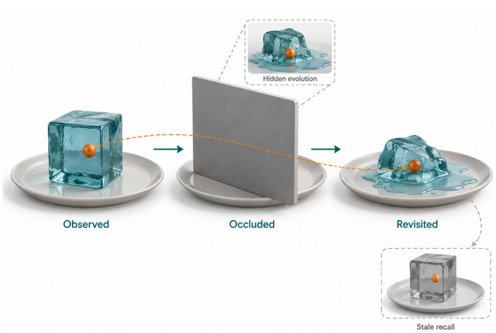  
Figure 11 Hidden state evolves during occlusion; replaying an old observation can miss that change.

and revisit distance separately and report degradation curves instead of one terminal score, so that rendering drift and state loss can be told apart. Latent-state models have no frames to score, so they need probes of goal reachability, feature stability, and decision quality as the horizon grows. Consistency results should also report memory size, end-to-end latency, and action-update rate.

## 8.2 Physical and Causal Grounding

Physical grounding can be tested at three increasingly demanding levels. Reading benchmarks [23, 395, 578] test whether a model recognizes persistence, stability, contact, and counterfactual outcomes in observed events. Generation benchmarks [16, 17, 137, 241, 341, 598] ask whether a synthesized outcome follows physical commonsense, a named law, or the direction of an irreversible process (Section 5.1.2). Action- and parameter-conditioned models face a stronger test: changing an action or physical parameter should change the affected outcome and leave unrelated state intact. For example, a ball released with the same velocity under two gravity settings should follow diferent trajectories while the camera and background stay fixed (Figure 12). A realistic continua-

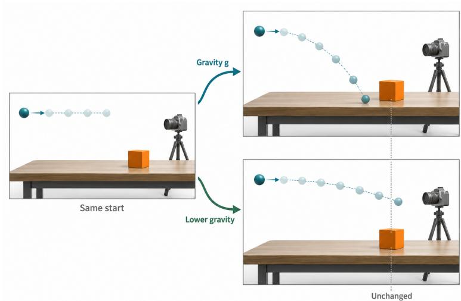  
Figure 12 Changing gravity alters the trajectory while unrelated scene properties remain fixed.

tion can still respond wrongly to gravity or alter unrelated state, so realism is not enough [173, 241].

Current methods add physics at diferent stages (Section 7.2.4): they align generator features with a video encoder [627], simulate dynamics before rendering [294], condition generation on a planned motion [564], reward geometric consistency [473], or retrieve videos of similar phenomena [69]. Each depends on an outside source: the teacher’s coverage, the recovered state and material parameters, the generator’s ability to follow the plan, or the quality of the feedback and retrieved evidence. Paired rollouts that change one physical parameter [173], production data with recorded branches [36], and coupled action-conditioned futures [155] provide the missing contrast between a change and its efect. One direction combines these physics priors with intervention-paired data, with objectives that reward the intended change and penalize drift elsewhere.

Evaluation should also diagnose failures: an arrow-of-time error, a contact violation, and a wrong response to an action all make a clip implausible, but they implicate diferent model components and training signals. Recent intervention benchmarks [24, 34, 458] point toward a common protocol: hold the initial state fixed, change one action or physical parameter, and test the changed outcome, the invariance of unrelated state, the first violated constraint, and when it appears. Applying the same interventions to reading questions, generated continuations, and closed-loop rollouts would make transfer across operations measurable.

## 8.3 Measurable Synergy in Unified Video Models

Unified video models span discrete-token, continuous, and modular designs [306, 479, 486, 498, 609], and some route information from generation to understanding, from reasoning to generation, or into planning [310, 362, 382] (Sections 6.1 and 6.2.4). The open question is causal: how much of the gain comes from shared representations or information flow, and how much from additional data, parameters, or supervision? Video evidence of transfer is so far partial or one-directional: video-difusion features support recognition and geometry [213, 468], an MLLM’s reasoning trace raises generation scores [362], mixing data helps both tasks [111], a frozen vision-language critic improves editing [298], and predicted features afect actions [466] (Section 6.2). Breadth suites [257, 501] catch regressions but not transfer, and image-domain synergy tests [412, 562] miss what video adds: transferred information must preserve temporal order, motion, identity, and evolving state.

On the method side, each transfer path can be built as a separate component that can be switched of, such as a temporalanalysis loss on the generator or generated intermediate states passed to a temporal reasoner. Round-trip consistency between inferred trajectories and rendered video can then serve as a training signal as well as a test.

The test itself compares two systems with the same tasks, data, capacity, and compute that difer only in whether the crossdirection path is enabled (Figure 13). Temporal analysis should then improve event order, motion, identity, or physical dynamics in generation, and generated intermediate states should improve temporal inference or planning under the same observation and

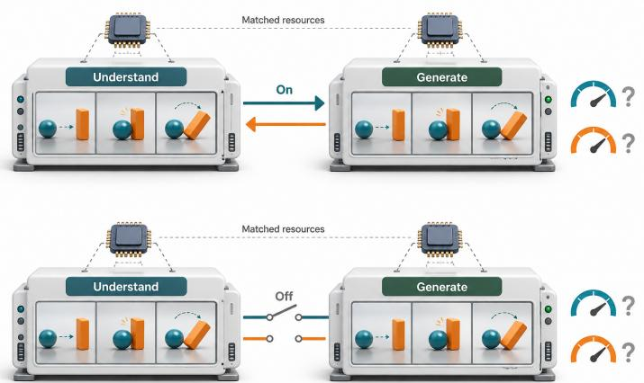  
Figure 13 Two systems with matched resources difer only in whether information passes between understanding and generation.

parameter budget. Round trips render an inferred trajectory or event graph and read it back, or analyze, revise, and regenerate a rollout. Each task must define its invariants, because one description can match several valid videos, and the intermediate representation must not carry the answer verbatim [353].

## 8.4 Standardized Evaluation of World Properties

World-model evaluation now covers control, memory, physical validity, and decision utility as well as visual realism, but the resulting numbers are rarely comparable. Suites for generated video, action response, and broader world properties [7, 89, 96, 193, 267, 545, 546, 583, 645, 647] difer in prompts, control spaces, horizons, and judges (Section 7.4), so scores do not transfer across suites. For example, two predictors guiding the same robot may return video and features, respectively (Figure 14). Video allows visual and trajectory checks while features need state probes, and both need a decision test, because either can score well on its native metric yet fail at control [592, 634].

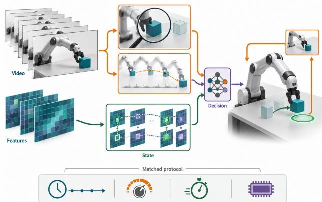  
Figure 14 Video and feature predictions need diferent probes, but both face the same decision test.

A reporting standard should first match the protocol to the model’s prediction space and transition interface (Section 3.4). Interactive models need

mid-rollout interventions and latency tests, action-conditioned models need faithful responses to fixed controls, and passive predictors need held-out transition tests. Each result should state the horizon, action frequency, conditioning, and judge model, and claims should rise from visual to controllable-rollout to decision-utility evidence [592] (Table 2). Real-time claims need control-to-display latency, sustained throughput, and latency variance, reported with hardware, resolution, denoising steps, and active context, because frames per second alone is ambiguous.

Shared infrastructure [333] standardizes data readers, planning solvers, and environment variations. Fixedcandidate action ranking should accompany closed-loop success, because frequent replanning can hide a poor scorer [634]. Integrity needs held-out environments and leakage-controlled synthetic tasks, because web-scale and synthetic training data make overlap hard to detect. On the method side, two tools need development in their own right: learned judges, which can inherit their source models’ blind spots and need validation against human ratings, and standard probes that read latent predictions without a pixel decoder.

## 8.5 Scaling Control from Unlabeled Video

Internet video covers objects, agents, and dynamics but usually lacks the action behind each transition. Latent-action methods [32, 61, 403, 574] infer actions as a learned variable (Section 7.2.1), enabling the use of far more video than labeled datasets, but scale alone does not specify what the variable represents. For example, a gripper may push a block while the camera pans and a windmill turns (Figure 15). Only the push is the agent’s action, yet a latent code trained for reconstruction can absorb the camera and background motion while reproducing the clip. Distractor experiments confirm this and show that limited action supervision can substantially improve the recovered factors [351].

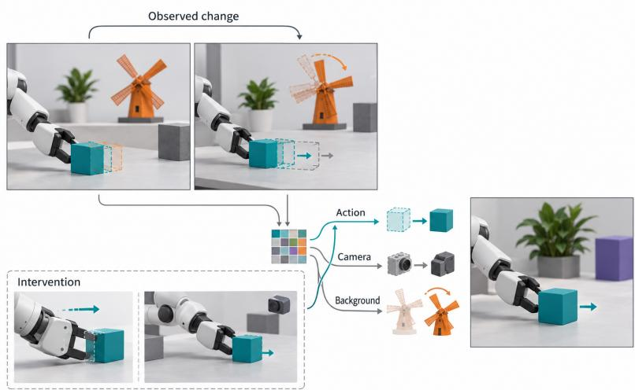  
Figure 15 Action efects mix with camera and background motion.

Reconstruction accuracy and codebook usage are thus weak evidence of control: a useful latent action should predict controllable efects, stay stable under camera and background changes, and transfer through a simple mapping. Several weak signals can push latent actions toward these properties. A small labeled set can anchor latent dimensions to real controls, multi-view invariance can separate camera motion from scene change, temporal bottlenecks can discard details irrelevant to control, and paired interventions can mark which changes belong to the agent. Continuous latent actions [119], human–robot shared representations [57], and egomotion controls from tracked pixel motion [430] move in this direction, while state-annotated data [36, 264] give stronger but narrower supervision.

Pseudo-action generation ofers another source of training pairs: a video model produces a trajectory and an inverse or latent-action model labels its controls. Such data helps only when the inferred action has the intended efect in a controlled environment or real system; otherwise the generator and the labeller reinforce each other’s shortcuts. Evaluation should keep a labeled subset with interventions and measure transfer under unseen cameras, backgrounds, scenes, and embodiments.

## 8.6 Generalization across Scenes and Embodiments

Scene generalization changes appearance, layout, objects, or local dynamics for the same body, as when a robot enters a new room. Embodiment generalization changes the body, sensors, action frequency, degrees of freedom, or physical meaning of an action, as when skills move from human hands to a robot arm.

Zero-shot claims therefore depend on which factor is held out. V-JEPA 2-AC [9] transfers to new scenes without target data, but on a robot type seen in post-training, not an unseen embodiment. Other methods adapt latent actions with limited interaction [119], generate target-domain experience [198, 441], or broaden the pretraining prior [587]. For example, training may cover a human hand in a lab and a kitchen but a robot only in the lab (Figure 16). Deploying the robot in the kitchen tests an unseen scene–body pair, where the representation and control mapping must still move the block to the target.

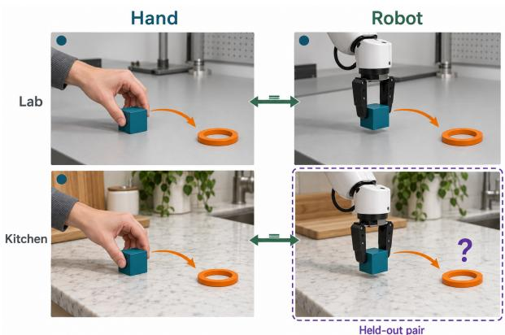  
Figure 16 A held-out scene–body pair tests whether familiar factors compose while preserving action efects.

Cross-embodiment transfer adds an alignment problem: the same semantic action may need diferent joints and timing on diferent bodies, while similar-looking motion can have diferent contact consequences. Current methods connect human and robot behavior through shared image-goal units [57] or map latent actions to robot commands with a small labeled set [574]. A method direction is to train such mappings to preserve efects, with objectives defined on outcomes such as object displacement, contact, and task completion instead of raw control values or token similarity. Evaluation should cross scenes, embodiments, sensors, and action spaces and test efect equivalence, controllability, and safety after transfer. Reports should state whether results are zero-shot, calibrated, or fully fine-tuned, and how much target data they used.

## 8.7 Stochastic Worlds and Rare Events

One history can admit several valid futures, because other agents may act diferently and relevant physical state may be hidden. A deterministic predictor cannot express these alternatives, and squared-error training can favor an average of incompatible outcomes. Latent-variable predictors [11, 230] sample multiple futures, and controllable generators and data engines [118, 198, 355, 399, 441] can synthesize rare scenarios for training (Section 7). However, synthesis does not say how likely each outcome is: a prompted collision supplies a training case, whereas a calibrated collision risk supports a decision under uncertainty. For example, given a fixed driving history and ego actions, a pedestrian may wait, cross after the car passes, or step into its path (Figure 17). A generator can render the rare crossing without assigning it a reliable probability.

One direction is to develop generators that assign calibrated outcome probabilities rather than merely produce diverse samples, using empirical event rates or justified simulator priors. Generated rare cases must be checked for physical feasibility, causal relevance, and downstream utility before entering training data, since prompting fixes which failures appear but not their frequencies.

For a fixed history and action sequence, distributional evaluation assesses whether samples cover distinct valid outcomes, exclude invalid ones, and match observed or simulated outcome frequencies. Diversity alone rewards arbitrary variation, and best-of-many scoring hides misplaced probability mass. Reports

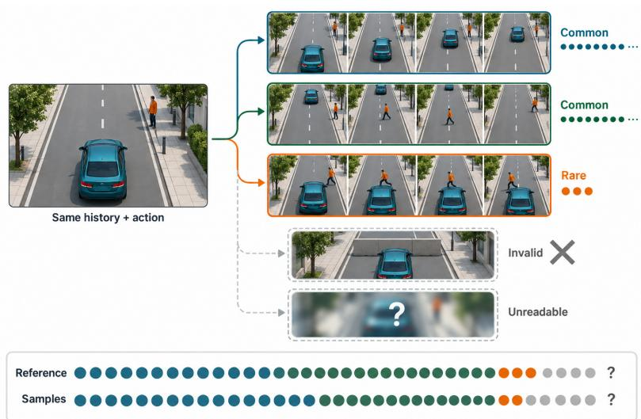  
Figure 17 Valid futures difer in frequency, and invalid and unreadable samples must be counted separately.

should therefore use proper scoring rules, calibration curves, and mode coverage at a fixed sample budget, distinguish unreadable from invalid samples, and use sample sizes appropriate to event rarity. Repeated sampling benchmarks [376, 400] and confidence calibration [339] are a start (Section 7.4), but extending outcome-frequency tests from endpoints in limited scenarios to long, action-conditioned trajectories is open.

## ­ INSIGHT Scaling world models needs interventions, not just more clips

Passive video expands coverage but leaves hidden state, physical causes, cross-direction transfer, action semantics, and outcome probabilities underdetermined. Most of these challenges need data and protocols with interventions (known hidden changes, paired physical edits, matched ablations, labeled actions, held-out scene–body pairs, and observed event rates). Observational scale shows what co-occurs; interventions show what changes what.

## 9 Conclusion

This survey has treated video as an observed trace of a latent temporal world and used Y reading, Ò writing, T sharing, and „ interacting to organize how foundation models connect observations to represented state. Comprehension recovers what a trace reveals; generation constructs traces from conditions; unification shares information and machinery between the two; and world modeling asks how represented state changes under conditions or actions. Within this framing, a video world model is defined by the transition it learns, which predicts future video or video-derived features and runs passively, under a fixed action sequence, or interactively (Section 3.4). The distinction between temporal coherence and world consistency (Definition 2.4) separates the quality of rendered video from evidence that a model tracks the world state behind it. The next phase demands stronger evidence (Table 2). Beyond perceptual fidelity and local coherence, claims about the world require state that survives occlusion, revisits, and long horizons; controllable action efects; valid responses to interventions; and, for closed-loop use, latency within the control budget. Stochastic futures also require coverage and calibration, unified models require matched evidence that information transfers between reading and writing, and systems built for training, planning, or evaluation must improve decisions in controlled environments or real tasks. Meeting these requirements would move the field from rendering convincing video to modeling how the world changes.

## References

[1] Abdul Mohaimen Al Radi, Kunyang Li, Yuzhang Shang, Mubarak Shah, and Yu Tian. Keepsake: Selective Spatial Memory for Long-Horizon Video Generation. 2026. arXiv: 2610.06588.

[2] Jean-Baptiste Alayrac, Jef Donahue, Pauline Luc, Antoine Miech, Iain Barr, Yana Hasson, Karel Lenc, Arthur Mensch, Katie Millican, Malcolm Reynolds, Roman Ring, Eliza Rutherford, Serkan Cabi, Tengda Han, Zhitao Gong, Sina Samangooei, Marianne Monteiro, Jacob Menick, Sebastian Borgeaud, Andrew Brock, Aida Nematzadeh, Sahand Sharifzadeh, Mikołaj Bińkowski, Ricardo Barreira, Oriol Vinyals, Andrew Zisserman, and Karén Simonyan. “Flamingo: A Visual Language Model for Few-Shot Learning”. In: Advances in Neural Information Processing Systems. Vol. 35. 2022, pp. 23716–23736.

[3] Rama AlHamidi, Aseel Mohamed, Rasul Khanbayov, Mohamed Rayan Barhdadi, Erchin Serpedin, and Hasan Kurban. Accuracy and Cost Claims Do Not Survive Re-Execution in Agentic VideoQA. 2026. arXiv: 2607.01469.

[4] Eloi Alonso, Adam Jelley, Vincent Micheli, Anssi Kanervisto, Amos Storkey, Tim Pearce, and François Fleuret. “Difusion for World Modeling: Visual Details Matter in Atari”. In: Advances in Neural Information Processing Systems. Vol. 37. 2024, pp. 58757–58791.

[5] Seoyeon An, Hyeonseo Jang, Minsu Kim, Chanho Lee, Younghan Park, and Kangwook Lee. AgentVidBench: A Multi-Hop Video Question Answering Benchmark for Evaluating MLLM Agents. 2026. arXiv: 2609.21386.

[6] Xiang An, Yin Xie, Feilong Tang, Yunyao Yan, Huajie Tan, Didi Zhu, Changrui Chen, Xiuwei Zhao, Bin Qin, Kaicheng Yang, Yifei Shen, Yuanhan Zhang, Kaichen Zhang, Wenkang Zhang, Zheng Cheng, Nansen Zhang, Chunsheng Wu, Chunjiang Ge, Zimin Ran, Dehua Song, Chunyuan Li, Shikun Feng, Ming Hu, Zhangquan Chen, Junbo Niu, Bo Li, Ziyong Feng, Ziwei Liu, Zongyuan Ge, and Jiankang Deng. LLaVA-OneVision-2: Towards Next-Generation Perceptual Intelligence. 2026. arXiv: 2605.25979.

[7] Hidehisa Arai, Keishi Ishihara, Tsubasa Takahashi, and Yu Yamaguchi. ACT-Bench: Towards Action Controllable World Models for Autonomous Driving. 2024. arXiv: 2412.05337.

[8] Anurag Arnab, Mostafa Dehghani, Georg Heigold, Chen Sun, Mario Lučić, and Cordelia Schmid. “ViViT: A Video Vision Transformer”. In: Proceedings of the IEEE/CVF International Conference on Computer Vision (ICCV). 2021, pp. 6836–6846.

[9] Mido Assran, Adrien Bardes, David Fan, Quentin Garrido, Russell Howes, Mojtaba Komeili, Matthew Muckley, Ammar Rizvi, Claire Roberts, Koustuv Sinha, Artem Zholus, Sergio Arnaud, Abha Gejji, Ada Martin, Francois Robert Hogan, Daniel Dugas, Piotr Bojanowski, Vasil Khalidov, Patrick Labatut, Francisco Massa, Marc Szafraniec, Kapil Krishnakumar, Yong Li, Xiaodong Ma, Sarath Chandar, Franziska Meier, Yann LeCun, Michael Rabbat, and Nicolas Ballas. V-JEPA 2: Self-Supervised Video Models Enable Understanding, Prediction and Planning. 2025. arXiv: 2506.09985.

[10] Andrei Atanov, Jesse Allardice, Roman Bachmann, Oğuzhan Fatih Kar, R Devon Hjelm, David Grifiths, Peter Fu, Afshin Dehghan, and Amir Zamir. “VideoFlexTok: Flexible-Length Coarse-to-Fine Video Tokenization”. In: Proceedings of the 43rd International Conference on Machine Learning. Vol. 306. 2026, pp. 4259–4282.

[11] Mohammad Babaeizadeh, Chelsea Finn, Dumitru Erhan, Roy H. Campbell, and Sergey Levine. “Stochastic Variational Video Prediction”. In: International Conference on Learning Representations (ICLR). 2018.

[12] Shuai Bai, Yuxuan Cai, Ruizhe Chen, Keqin Chen, Xionghui Chen, Zesen Cheng, Lianghao Deng, Wei Ding, Chang Gao, Chunjiang Ge, Wenbin Ge, Zhifang Guo, Qidong Huang, Jie Huang, Fei Huang, Binyuan Hui, Shutong Jiang, Zhaohai Li, Mingsheng Li, Mei Li, Kaixin Li, Zicheng Lin, Junyang Lin, Xuejing Liu, Jiawei Liu, Chenglong Liu, Yang Liu, Dayiheng Liu, Shixuan Liu, Dunjie Lu, Ruilin Luo, Chenxu Lv, Rui Men, Lingchen Meng, Xuancheng Ren, Xingzhang Ren, Sibo Song, Yuchong Sun, Jun Tang, Jianhong Tu, Jianqiang Wan, Peng Wang, Pengfei Wang, Qiuyue Wang, Yuxuan Wang, Tianbao Xie, Yiheng Xu, Haiyang Xu, Jin Xu, Zhibo Yang, Mingkun Yang, Jianxin Yang, An Yang, Bowen Yu, Fei Zhang, Hang Zhang, Xi Zhang, Bo Zheng, Humen Zhong, Jingren Zhou, Fan Zhou, Jing Zhou, Yuanzhi Zhu, and Ke Zhu. Qwen3-VL Technical Report. 2025. arXiv: 2511.21631.

[13] Shuai Bai, Keqin Chen, Xuejing Liu, Jialin Wang, Wenbin Ge, Sibo Song, Kai Dang, Peng Wang, Shijie Wang, Jun Tang, Humen Zhong, Yuanzhi Zhu, Mingkun Yang, Zhaohai Li, Jianqiang Wan, Pengfei Wang, Wei Ding, Zheren Fu, Yiheng Xu, Jiabo Ye, Xi Zhang, Tianbao Xie, Zesen Cheng, Hang Zhang, Zhibo Yang, Haiyang Xu, and Junyang Lin. Qwen2.5-VL Technical Report. 2025. arXiv: 2502.13923.

[14] Max Bain, Arsha Nagrani, Gül Varol, and Andrew Zisserman. “Frozen in Time: A Joint Video and Image Encoder for End-to-End Retrieval”. In: Proceedings of the IEEE/CVF International Conference on Computer Vision (ICCV). 2021, pp. 1728–1738.

[15] Arpit Bansal, Hong-Min Chu, Avi Schwarzschild, Soumyadip Sengupta, Micah Goldblum, Jonas Geiping, and Tom Goldstein. “Universal Guidance for Difusion Models”. In: International Conference on Learning Representations (ICLR). 2024.

[16] Hritik Bansal, Zongyu Lin, Tianyi Xie, Zeshun Zong, Michal Yarom, Yonatan Bitton, Chenfanfu Jiang, Yizhou Sun, Kai-Wei Chang, and Aditya Grover. “VideoPhy: Evaluating Physical Commonsense for Video Generation”. In: International Conference on Learning Representations (ICLR). 2025.

[17] Hritik Bansal, Clark Peng, Yonatan Bitton, Roman Goldenberg, Aditya Grover, and Kai-Wei Chang. “VideoPhy-2: A Challenging Action-Centric Physical Commonsense Evaluation in Video Generation”. In: International Conference on Learning Representations (ICLR). 2026.

[18] Amir Bar, Gaoyue Zhou, Danny Tran, Trevor Darrell, and Yann LeCun. “Navigation World Models”. In: Proceedings of the IEEE/CVF Conference on Computer Vision and Pattern Recognition (CVPR). 2025, pp. 15791–15801.

[19] Omer Bar-Tal, Hila Chefer, Omer Tov, Charles Herrmann, Roni Paiss, Shiran Zada, Ariel Ephrat, Junhwa Hur, Guanghui Liu, Amit Raj, Yuanzhen Li, Michael Rubinstein, Tomer Michaeli, Oliver Wang, Deqing Sun, Tali Dekel, and Inbar Mosseri. “Lumiere: A Space-Time Difusion Model for Video Generation”. In: SIGGRAPH Asia 2024 Conference Papers. 2024, pp. 1–11.

[20] Adrien Bardes, Quentin Garrido, Jean Ponce, Xinlei Chen, Michael Rabbat, Yann LeCun, Mahmoud Assran, and Nicolas Ballas. “Revisiting Feature Prediction for Learning Visual Representations from Video”. In: Transactions on Machine Learning Research (2024).

[21] Shane Barratt and Rishi Sharma. “A Note on the Inception Score”. In: ICML Workshop on Theoretical Foundations and Applications of Deep Generative Models. 2018.

[22] Aarti Basant, Amlan Kar, Despoina Paschalidou, Fangyin Wei, Francesco Ferroni, Guillermo Garcia Cobo, Haithem Turki, Huan Ling, Jaewoo Seo, James Lucas, Jay Zhangjie Wu, Jialiang Wang, Jonathan Lorraine, Jun Gao, Kai He, Katarina Tothova, Kevin Xie, Michal Tyszkiewicz, Qi Wu, Riccardo de Lutio, Ruilong Li, Sanja Fidler, Seung Wook Kim, Tianchang Shen, Tianshi Cao, Tobias Pfaf, William Lew, Xindi Wu, Xuanchi Ren, Yifan Lu, Yuxuan Zhang, Zan Gojcic, and Zian Wang. NVIDIA OmniDreams: Real-Time Generative World Model for Closed-Loop Autonomous Vehicle Simulation. 2026. arXiv: 2606.03159.

[23] Daniel M. Bear, Elias Wang, Damian Mrowca, Felix J. Binder, Hsiao-Yu Fish Tung, R. T. Pramod, Cameron Holdaway, Sirui Tao, Kevin Smith, Fan-Yun Sun, Li Fei-Fei, Nancy Kanwisher, Joshua B. Tenenbaum, Daniel L. K. Yamins, and Judith E. Fan. “Physion: Evaluating Physical Prediction from Vision in Humans and Machines”. In: Proceedings of the Neural Information Processing Systems Track on Datasets and Benchmarks. Vol. 1. 2021.

[24] León Begiristain, Olaf Dünkel, and Adam Kortylewski. CRONOS: Benchmarking Counterfactual Physical Consistency in Video Models. 2026. arXiv: 2605.23699.

[25] Gedas Bertasius, Heng Wang, and Lorenzo Torresani. “Is Space-Time Attention All You Need for Video Understanding?” In: Proceedings of the 38th International Conference on Machine Learning. Vol. 139. 2021, pp. 813–824.

[26] Yuxuan Bian, Zeyue Xue, Songchun Zhang, Shiyi Zhang, Weiyang Jin, Yaowei Li, Junhao Zhuang, Haoran Li, Jie Huang, Haoyang Huang, Nan Duan, and Qiang Xu. Echo-Infinity: Learning Evolving Memory for Real-Time Infinite Video Generation. 2026. arXiv: 2606.04527.

[27] Andreas Blattmann, Tim Dockhorn, Sumith Kulal, Daniel Mendelevitch, Maciej Kilian, Dominik Lorenz, Yam Levi, Zion English, Vikram Voleti, Adam Letts, Varun Jampani, and Robin Rombach. Stable Video Difusion: Scaling Latent Video Difusion Models to Large Datasets. 2023. arXiv: 2311.15127.

[28] Andreas Blattmann, Robin Rombach, Huan Ling, Tim Dockhorn, Seung Wook Kim, Sanja Fidler, and Karsten Kreis. “Align Your Latents: High-Resolution Video Synthesis with Latent Difusion Models”. In: Proceedings of the IEEE/CVF Conference on Computer Vision and Pattern Recognition (CVPR). 2023, pp. 22563–22575.

[29] Daniel Bolya, Po-Yao Huang, Peize Sun, Jang Hyun Cho, Andrea Madotto, Chen Wei, Tengyu Ma, Jiale Zhi, Jathushan Rajasegaran, Hanoona Rasheed, Junke Wang, Marco Monteiro, Hu Xu, Shiyu Dong, Nikhila Ravi, Daniel Li, Piotr Dollar, and Christoph Feichtenhofer. “Perception Encoder: The Best Visual Embeddings Are Not at the Output of the Network”. In: Advances in Neural Information Processing Systems. Vol. 38. 2025, pp. 60884–60937.

[30] Florian Bordes, Quentin Garrido, Justine T Kao, Adina Williams, Michael Rabbat, and Emmanuel Dupoux. IntPhys 2: Benchmarking Intuitive Physics Understanding in Complex Synthetic Environments. 2025. arXiv: 2506.09849.

[31] Tim Brooks, Bill Peebles, Connor Holmes, Will DePue, Yufei Guo, Li Jing, David Schnurr, Joe Taylor, Troy Luhman, Eric Luhman, Clarence Ng, Ricky Wang, and Aditya Ramesh. Video Generation Models As World Simulators. OpenAI publication. 2024.

[32] Jake Bruce, Michael Dennis, Ashley Edwards, Jack Parker-Holder, Yuge Shi, Edward Hughes, Matthew Lai, Aditi Mavalankar, Richie Steigerwald, Chris Apps, Yusuf Aytar, Sarah Bechtle, Feryal Behbahani, Stephanie Chan, Nicolas Heess, Lucy Gonzalez, Simon Osindero, Sherjil Ozair, Scott Reed, Jingwei Zhang, Konrad Zolna, Jef Clune, Nando de Freitas, Satinder Singh, and Tim Rocktäschel. “Genie: Generative Interactive Environments”. In: Proceedings of the 41st International Conference on Machine Learning. Vol. 235. 2024, pp. 4603–4623.

[33] Holger Caesar, Varun Bankiti, Alex H. Lang, Sourabh Vora, Venice Erin Liong, Qiang Xu, Anush Krishnan, Yu Pan, Giancarlo Baldan, and Oscar Beijbom. “nuScenes: A Multimodal Dataset for Autonomous Driving”. In: Proceedings of the IEEE/CVF Conference on Computer Vision and Pattern Recognition (CVPR). 2020, pp. 11618–11628.

[34] Kunlin Cai, Rui Song, Jinghuai Zhang, Kaiyuan Zhang, Pranav Bodapati, Alicia Yu, Fnu Suya, Mohammad Rostami, Jiaqi Ma, and Yuan Tian. What-If World: A Causal Benchmark for General World Models in Embodied Scenarios. 2026. arXiv: 2605.27589.

[35] Mu Cai, Reuben Tan, Jianrui Zhang, Bocheng Zou, Kai Zhang, Feng Yao, Fangrui Zhu, Jing Gu, Yiwu Zhong, Yuzhang Shang, Yao Dou, Jaden Park, Jianfeng Gao, Yong Jae Lee, and Jianwei Yang. TemporalBench: Benchmarking Fine-Grained Temporal Understanding for Multimodal Video Models. 2024. arXiv: 2410.10818.

[36] Yiming Cai, Fangjie Yu, Meiqing Yu, Ziyue Shi, Pengfei Yuan, and Yong Guo. CG-World: A Large-Scale World-State Dataset and Protocol for World Models. 2026. arXiv: 2607.26452.

[37] Yuanhao Cai, Kunpeng Li, Menglin Jia, Jialiang Wang, Junzhe Sun, Feng Liang, Weifeng Chen, Felix Juefei-Xu, Chu Wang, Ali Thabet, Xiaoliang Dai, Xuan Ju, Alan Yuille, and Ji Hou. “PhyGDPO: Physics-Aware Groupwise Direct Preference Optimization for Physically Consistent Text-to-Video Generation”. In: Computer Vision – ECCV 2026. 2026, pp. 91–109.

[38] Zhe Cao, Tao Wang, Jiaming Wang, Yanghai Wang, Yuanxing Zhang, Jiahao Wang, Jialu Chen, Miao Deng, Chenxi Liao, Yize Zhang, Yubin Guo, Zhaoxiang Zhang, and Jiaheng Liu. “T2AV-Compass: Towards Unified Evaluation for Text-to-Audio-Video Generation”. In: Proceedings of the 43rd International Conference on Machine Learning. Vol. 306. 2026, pp. 11536–11580.

[39] Joao Carreira and Andrew Zisserman. “Quo Vadis, Action Recognition? A New Model and the Kinetics Dataset”. In: Proceedings of the IEEE Conference on Computer Vision and Pattern Recognition (CVPR). 2017, pp. 6299–6308.

[40] Junbum Cha, Wooyoung Kang, Jonghwan Mun, and Byungseok Roh. “Honeybee: Locality-Enhanced Projector for Multimodal LLM”. In: Proceedings ofthe IEEE/CVF Conference on Computer Vision and Pattern Recognition (CVPR). 2024, pp. 13817–13827.

[41] Keshigeyan Chandrasegaran, Agrim Gupta, Lea M. Hadzic, Taran Kota, Jimming He, Cristobal Eyzaguirre, Zane Durante, Manling Li, Jiajun Wu, and Li Fei-Fei. “HourVideo: 1-Hour Video-Language Understanding”. In: Advances in Neural Information Processing Systems. Vol. 37. 2024, pp. 53168–53197.

[42] Huiwen Chang, Han Zhang, Lu Jiang, Ce Liu, and William T. Freeman. “MaskGIT: Masked Generative Image Transformer”. In: Proceedings of the IEEE/CVF Conference on Computer Vision and Pattern Recognition (CVPR). 2022, pp. 11315–11325.

[43] Boyuan Chen, Hanxiao Jiang, Shaowei Liu, Saurabh Gupta, Yunzhu Li, Hao Zhao, and Shenlong Wang. “PhysGen3D: Crafting a Miniature Interactive World from a Single Image”. In: Proceedings of the IEEE/CVF Conference on Computer Vision and Pattern Recognition (CVPR). 2025, pp. 6178–6189.

[44] Boyuan Chen, Diego Martí Monsó, Yilun Du, Max Simchowitz, Russ Tedrake, and Vincent Sitzmann. “Difusion Forcing: Next-Token Prediction Meets Full-Sequence Difusion”. In: Advances in Neural Information Processing Systems. Vol. 37. 2024, pp. 24081–24125.

[45] Delong Chen, Willy Chung, Yejin Bang, Ziwei Ji, and Pascale Fung. WorldPrediction: A Benchmark for High-Level World Modeling and Long-Horizon Procedural Planning. 2025. arXiv: 2506.04363.

[46] Delong Chen, Tejaswi Kasarla, Yejin Bang, Mustafa Shukor, Willy Chung, Jade Yu, Allen Bolourchi, Theo Moutakanni, and Pascale Fung. Action100M: A Large-Scale Video Action Dataset. 2026. arXiv: 2601.10592.

[47] Guo Chen, Zhiqi Li, Shihao Wang, Jindong Jiang, Yicheng Liu, Lidong Lu, De-An Huang, Wonmin Byeon, Matthieu Le, Max Ehrlich, Tong Lu, Limin Wang, Bryan Catanzaro, Jan Kautz, Andrew Tao, Zhiding Yu, and Guilin Liu. “Eagle 2.5: Boosting Long-Context Post-Training for Frontier Vision-Language Models”. In: Advances in Neural Information Processing Systems. Vol. 38. 2025, pp. 91077–91100.

[48] Haoxin Chen, Yong Zhang, Xiaodong Cun, Menghan Xia, Xintao Wang, Chao Weng, and Ying Shan. “VideoCrafter2: Overcoming Data Limitations for High-Quality Video Difusion Models”. In: Proceedings of the IEEE/CVF Conference on Computer Vision and Pattern Recognition (CVPR). 2024, pp. 7310–7320.

[49] Haoyu Chen, Kaichen Zhou, Hang Hua, Kaile Zhang, Jingwen Qian, Wufei Ma, Haonan Chen, Chunjiang Liu, Yizhou Zhao, Xiaoyuan Wang, Weiyue Li, Alan Yuille, Paul Pu Liang, and Yilun Du. “MemoBench: Benchmarking World Modeling in Dynamically Changing Environments”. In: Computer Vision – ECCV 2026. 2026, pp. 658–676.

[50] Honglie Chen, Weidi Xie, Andrea Vedaldi, and Andrew Zisserman. “VGGSound: A Large-Scale Audio-Visual Dataset”. In: IEEE International Conference on Acoustics, Speech and Signal Processing (ICASSP). 2020, pp. 721–725.

[51] Jialei Chen, Kai Wang, Kang Chen, Shuaihang Chen, Feng Gao, Wenhao Tang, Zhiyuan Li, Weilin Liu, Zhuyu Yao, Boxun Li, Yuanbo Xu, and Chao Yu. LaWAM: Latent World Action Models for Eficient Dynamics-Aware Robot Policies. 2026. arXiv: 2606.15768.

[52] Joya Chen, Zhaoyang Lv, Shiwei Wu, Kevin Qinghong Lin, Chenan Song, Difei Gao, Jia-Wei Liu, Ziteng Gao, Dongxing Mao, and Mike Zheng Shou. “VideoLLM-Online: Online Video Large Language Model for Streaming Video”. In: Proceedings of the IEEE/CVF Conference on Computer Vision and Pattern Recognition (CVPR). 2024, pp. 18407–18418.

[53] Junsong Chen, Jincheng Yu, Yitong Li, Shuchen Xue, Haozhe Liu, Jingyu Xin, Yuyang Zhao, Tian Ye, Zhangjie Wu, Zian Wang, Daquan Zhou, Ping Luo, Song Han, and Enze Xie. SANA-Video 2.0: Hybrid Linear Attention with Attention Residuals for Eficient Video Generation. 2026. arXiv: 2607.21553.

[54] Lin Chen, Xilin Wei, Jinsong Li, Xiaoyi Dong, Pan Zhang, Yuhang Zang, Zehui Chen, Haodong Duan, Bin Lin, Zhenyu Tang, Li Yuan, Yu Qiao, Dahua Lin, Feng Zhao, and Jiaqi Wang. “ShareGPT4Video: Improving Video Understanding and Generation with Better Captions”. In: Advances in Neural Information Processing Systems. Vol. 37. 2024, pp. 19472–19495.

[55] Shoufa Chen, Chongjian Ge, Yuqi Zhang, Yida Zhang, Fengda Zhu, Hao Yang, Hongxiang Hao, Hui Wu, Zhichao Lai, Yifei Hu, Ting-Che Lin, Shilong Zhang, Fu Li, Chuan Li, Xing Wang, Yanghua Peng, Peize Sun, Ping Luo, Yi Jiang, Zehuan Yuan, Bingyue Peng, and Xiaobing Liu. “Goku: Flow Based Video Generative Foundation Models”. In: Proceedings of the IEEE/CVF Conference on Computer Vision and Pattern Recognition (CVPR). 2025, pp. 23516–23527.

[56] Tsai-Shien Chen, Aliaksandr Siarohin, Willi Menapace, Ekaterina Deyneka, Hsiang-wei Chao, Byung Eun Jeon, Yuwei Fang, Hsin-Ying Lee, Jian Ren, Ming-Hsuan Yang, and Sergey Tulyakov. “Panda-70M: Captioning 70M Videos with Multiple Cross-Modality Teachers”. In: Proceedings of the IEEE/CVF Conference on Computer Vision and Pattern Recognition (CVPR). 2024, pp. 13320–13331.

[57] Xiaoyu Chen, Junliang Guo, Tianyu He, Chuheng Zhang, Pushi Zhang, Derek Cathera Yang, Li Zhao, and Jiang Bian. IGOR: Image-GOal Representations Are the Atomic Control Units for Foundation Models in Embodied AI. 2024. arXiv: 2411.00785.

[58] Xinyan Chen, Ziyu Guo, Renrui Zhang, Dongzhi Jiang, and Hongsheng Li. OpenCoF: Learning to Reason Through Video Generation. 2026. arXiv: 2607.08763.

[59] Xinyuan Chen, Haoyu Guo, Shi Guo, Bingqi Jiang, Chunhua Shen, Xing Shen, Tianfan Xue, Yufei Xue, Mulin Yu, Weinan Zhang, Bin Zhao, Bowen Zhou, and Ming Zhou. A Definition and Roadmap for World Models. 2026. arXiv: 2607.06401.

[60] Xinyuan Chen, Yaohui Wang, Lingjun Zhang, Shaobin Zhuang, Xin Ma, Jiashuo Yu, Yali Wang, Dahua Lin, Yu Qiao, and Ziwei Liu. “SEINE: Short-to-Long Video Difusion Model for Generative Transition and Prediction”. In: International Conference on Learning Representations (ICLR). 2024.

[61] Yi Chen, Yuying Ge, Weiliang Tang, Yizhuo Li, Yixiao Ge, Mingyu Ding, Ying Shan, and Xihui Liu. “Moto: Latent Motion Token As the Bridging Language for Learning Robot Manipulation from Videos”. In: Proceedings of the IEEE/CVF International Conference on Computer Vision (ICCV). 2025, pp. 19752–19763.

[62] Yi Chen, Yuying Ge, Rui Wang, Yixiao Ge, Junhao Cheng, Ying Shan, and Xihui Liu. “GRPO-CARE: Consistency-Aware Reinforcement Learning for Multimodal Reasoning”. In: Findings of the Association for Computational Linguistics: ACL 2026. 2026, pp. 4305–4320.

[63] Yukang Chen, Wei Huang, Baifeng Shi, Qinghao Hu, Hanrong Ye, Ligeng Zhu, Zhijian Liu, Pavlo Molchanov, Jan Kautz, Xiaojuan Qi, Sifei Liu, Hongxu Yin, Yao Lu, and Song Han. “Scaling RL to Long Videos”. In: Advances in Neural Information Processing Systems. Vol. 38. 2025, pp. 172842–172870.

[64] Yukang Chen, Fuzhao Xue, Dacheng Li, Qinghao Hu, Ligeng Zhu, Xiuyu Li, Yunhao Fang, Haotian Tang, Shang Yang, Zhijian Liu, Ethan He, Hongxu Yin, Pavlo Molchanov, Jan Kautz, Linxi Fan, Yuke Zhu, Yao Lu, and Song Han. “LongVILA: Scaling Long-Context Visual Language Models for Long Videos”. In: International Conference on Learning Representations (ICLR). 2025.

[65] Zhuowei Chen, Bingchuan Li, Tianxiang Ma, Lijie Liu, Mingcong Liu, Yunsheng Jiang, Gen Li, Xinghui Li, Liyang Chen, Siyu Zhou, Qian He, and Xinglong Wu. “Phantom-Data: Towards a General Subject-Consistent Video Generation Dataset”. In: International Conference on Learning Representations (ICLR). 2026.

[66] Ho Kei Cheng, Seoung Wug Oh, Brian Price, Alexander Schwing, and Joon-Young Lee. “Tracking Anything with Decoupled Video Segmentation”. In: Proceedings of the IEEE/CVF International Conference on Computer Vision (ICCV). 2023, pp. 1316–1326.

[67] Ho Kei Cheng and Alexander G. Schwing. “XMem: Long-Term Video Object Segmentation with an Atkinson-Shifrin Memory Model”. In: Computer Vision – ECCV 2022. 2022.

[68] Junhao Cheng, Yuying Ge, Teng Wang, Yixiao Ge, Jing Liao, and Ying Shan. “Video-Holmes: Can MLLM Think Like Holmes for Complex Video Reasoning?” In: Computer Vision – ECCV 2026. 2026, pp. 539–556.

[69] Kexu Cheng, Zicheng Liu, Mingju Gao, Chunhe Song, and Hao Tang. “PhysRAG: Enhancing Physics-Awareness in Video Generation via Retrieval-Augmented Generation”. In: Computer Vision – ECCV 2026. 2026, pp. 558– 578.

[70] Zesen Cheng, Sicong Leng, Hang Zhang, Yifei Xin, Xin Li, Guanzheng Chen, Yongxin Zhu, Wenqi Zhang, Ziyang Luo, Deli Zhao, and Lidong Bing. VideoLLaMA 2: Advancing Spatial-Temporal Modeling and Audio Understanding in Video-LLMs. 2024. arXiv: 2406.07476.

[71] Xiaowei Chi, Chun-Kai Fan, Hengyuan Zhang, Xingqun Qi, Rongyu Zhang, Anthony Chen, Chi-min Chan, Wei Xue, Qifeng Liu, Shanghang Zhang, and Yike Guo. EVA: An Embodied World Model for Future Video Anticipation. 2024. arXiv: 2410.15461.

[72] Wei Chow, Jiageng Mao, Boyi Li, Daniel Seita, Vitor Guizilini, and Yue Wang. “PhysBench: Benchmarking and Enhancing Vision-Language Models for Physical World Understanding”. In: International Conference on Learning Representations (ICLR). 2025.

[73] Ruihang Chu, Yefei He, Zhekai Chen, Shiwei Zhang, Xiaogang Xu, bin xia bin, Dingdong WANG, Hongwei Yi, Xihui Liu, Hengshuang Zhao, Yu Liu, Yingya Zhang, and Yujiu Yang. “Wan-Move: Motion-Controllable Video Generation via Latent Trajectory Guidance”. In: Advances in Neural Information Processing Systems. Vol. 38. 2025, pp. 404–432.

[74] Lior Cohen, Ofir Nabati, Kaixin Wang, Navdeep Kumar, and Shie Mannor. “Horizon Imagination: Eficient On-Policy Rollout in Difusion World Models”. In: International Conference on Learning Representations (ICLR). 2026.

[75] Enric Corona, Andrei Zanfir, Eduard Gabriel Bazavan, Nikos Kolotouros, Thiemo Alldieck, and Cristian Sminchisescu. “VLOGGER: Multimodal Difusion for Embodied Avatar Synthesis”. In: Proceedings of the IEEE/CVF Conference on Computer Vision and Pattern Recognition (CVPR). 2025, pp. 15896–15908.

[76] Yufeng Cui, Honghao Chen, Haoge Deng, Xu Huang, Xinghang Li, Jirong Liu, Yang Liu, Zhuoyan Luo, Jinsheng Wang, Wenxuan Wang, Yueze Wang, Chengyuan Wang, Fan Zhang, Yingli Zhao, Ting Pan, Xianduo Li, Zecheng Hao, Wenxuan Ma, Zhuo Chen, Yulong Ao, Tiejun Huang, Zhongyuan Wang, and Xinlong Wang. Emu3.5: Native Multimodal Models Are World Learners. 2025. arXiv: 2510.26583.

[77] Karan Dalal, Daniel Koceja, Jiarui Xu, Yue Zhao, Shihao Han, Ka Chun Cheung, Jan Kautz, Yejin Choi, Yu Sun, and Xiaolong Wang. “One-Minute Video Generation with Test-Time Training”. In: Proceedings of the IEEE/CVF Conference on Computer Vision and Pattern Recognition (CVPR). 2025, pp. 17702–17711.

[78] Dima Damen, Hazel Doughty, Giovanni Maria Farinella, Antonino Furnari, Evangelos Kazakos, Jian Ma, Davide Moltisanti, Jonathan Munro, Toby Perrett, Will Price, and Michael Wray. “Rescaling Egocentric Vision: Collection, Pipeline and Challenges for EPIC-KITCHENS-100”. In: International Journal of Computer Vision 130.1 (2022), pp. 33–55.

[79] Decart, Etched, Julian Quevedo, Quinn McIntyre, Spruce Campbell, Xinlei Chen, and Robert Wachen. Oasis: A Universe in a Transformer. Oficial project page. 2024.

[80] Adrien Deliege, Anthony Cioppa, Silvio Giancola, Meisam J. Seikavandi, Jacob V. Dueholm, Kamal Nasrollahi, Bernard Ghanem, Thomas B. Moeslund, and Marc Van Droogenbroeck. “SoccerNet-v2: A Dataset and Benchmarks for Holistic Understanding of Broadcast Soccer Videos”. In: IEEE/CVF Conference on Computer Vision and Pattern Recognition Workshops (CVPRW). 2021, pp. 4503–4514.

[81] Chaorui Deng, Deyao Zhu, Kunchang Li, Chenhui Gou, Feng Li, Zeyu Wang, Shu Zhong, Weihao Yu, Xiaonan Nie, Ziang Song, Guang Shi, and Haoqi Fan. Emerging Properties in Unified Multimodal Pretraining. 2025. arXiv: 2505.14683.

[82] Haoge Deng, Ting Pan, Haiwen Diao, Zhengxiong Luo, Yufeng Cui, Huchuan Lu, Shiguang Shan, Yonggang Qi, and Xinlong Wang. “Autoregressive Video Generation Without Vector Quantization”. In: International Conference on Learning Representations (ICLR). 2025.

[83] Henghui Ding, Chang Liu, Shuting He, Xudong Jiang, and Chen Change Loy. “MeViS: A Large-Scale Benchmark for Video Segmentation with Motion Expressions”. In: Proceedings of the IEEE/CVF International Conference on Computer Vision (ICCV). 2023, pp. 2694–2703.

[84] Jingtao Ding, Yunke Zhang, Yu Shang, Yuheng Zhang, Zefang Zong, Jie Feng, Yuan Yuan, Hongyuan Su, Nian Li, Nicholas Sukiennik, Fengli Xu, and Yong Li. “Understanding World or Predicting Future? A Comprehensive Survey of World Models”. In: ACM Computing Surveys 58.3 (2026), pp. 1–38.

[85] Runpei Dong, Chunrui Han, Yuang Peng, Zekun Qi, Zheng Ge, Jinrong Yang, Liang Zhao, Jianjian Sun, Hongyu Zhou, Haoran Wei, Xiangwen Kong, Xiangyu Zhang, Kaisheng Ma, and Li Yi. “DreamLLM: Synergistic Multimodal Comprehension and Creation”. In: International Conference on Learning Representations (ICLR). 2024.

[86] Alexey Dosovitskiy, Lucas Beyer, Alexander Kolesnikov, Dirk Weissenborn, Xiaohua Zhai, Thomas Unterthiner, Mostafa Dehghani, Matthias Minderer, Georg Heigold, Sylvain Gelly, Jakob Uszkoreit, and Neil Houlsby. “An Image Is Worth 16x16 Words: Transformers for Image Recognition at Scale”. In: International Conference on Learning Representations (ICLR). 2021.

[87] Yilun Du, Mengjiao Yang, Bo Dai, Hanjun Dai, Ofir Nachum, Joshua B. Tenenbaum, Dale Schuurmans, and Pieter Abbeel. “Learning Universal Policies via Text-Guided Video Generation”. In: Advances in Neural Information Processing Systems. Vol. 36. 2023, pp. 9156–9172.

[88] Yiming Du, Chenghao Liu, Zhiyuan Liu, Fangxing Zheng, Zhao Wang, Junnan Nie, and Songfang Huang. CASE: Cost-Aware Stopping for Eficient Long-Video Agents. 2026. arXiv: 2610.05400.

[89] Haoyi Duan, Hong-Xing Yu, Sirui Chen, Li Fei-Fei, and Jiajun Wu. “WorldScore: A Unified Evaluation Benchmark for World Generation”. In: Proceedings of the IEEE/CVF International Conference on Computer Vision (ICCV). 2025, pp. 27713–27724.

[90] Zicheng Duan, Jiatong Xia, Zeyu Zhang, Wenbo Zhang, Gengze Zhou, Chenhui Gou, Yefei He, Feng Chen, Xinyu Zhang, and Lingqiao Liu. LiveWorld: Simulating Out-of-Sight Dynamics in Generative Video World Models. 2026. arXiv: 2603.07145.

[91] Dave Epstein, Allan Jabri, Ben Poole, Alexei A. Efros, and Aleksander Holynski. “Difusion Self-Guidance for Controllable Image Generation”. In: Advances in Neural Information Processing Systems. Vol. 36. 2023, pp. 16222–16239.

[92] Patrick Esser, Sumith Kulal, Andreas Blattmann, Rahim Entezari, Jonas Müller, Harry Saini, Yam Levi, Dominik Lorenz, Axel Sauer, Frederic Boesel, Dustin Podell, Tim Dockhorn, Zion English, and Robin Rombach. “Scaling Rectified Flow Transformers for High-Resolution Image Synthesis”. In: Proceedings of the 41st International Conference on Machine Learning. Vol. 235. 2024, pp. 12606–12633.

[93] Patrick Esser, Robin Rombach, and Bjorn Ommer. “Taming Transformers for High-Resolution Image Synthesis”. In: Proceedings of the IEEE/CVF Conference on Computer Vision and Pattern Recognition (CVPR). 2021, pp. 12873–12883.

[94] Heng Fan, Liting Lin, Fan Yang, Peng Chu, Ge Deng, Sijia Yu, Hexin Bai, Yong Xu, Chunyuan Liao, and Haibin Ling. “LaSOT: A High-Quality Benchmark for Large-Scale Single Object Tracking”. In: IEEE/CVF Conference on Computer Vision and Pattern Recognition (CVPR). 2019, pp. 5369–5378.

[95] Yue Fan, Xiaojian Ma, Rujie Wu, yuntao du, Jiaqi Li, Zhi Gao, and Qing Li. “VideoAgent: A Memory-Augmented Multimodal Agent for Video Understanding”. In: Computer Vision – ECCV 2024. 2024.

[96] Jianjie Fang, Yingshan Lei, Qin Wan, Ziyou Wang, Yuchao Huang, Yongyan Xu, Baining Zhao, Weichen Zhang, Chen Gao, Xinlei Chen, and Yong Li. “iWorld-Bench: A Benchmark for Interactive World Models with a Unified Action Generation Framework”. In: Proceedings of the 43rd International Conference on Machine Learning. Vol. 306. 2026, pp. 29222–29255.

[97] Xinyu Fang, Kangrui Mao, Haodong Duan, Xiangyu Zhao, Yining Li, Dahua Lin, and Kai Chen. “MMBench-Video: A Long-Form Multi-Shot Benchmark for Holistic Video Understanding”. In: Advances in Neural Information Processing Systems. Vol. 37. 2024, pp. 89098–89124.

[98] Zhen Fang, Ruiyan Han, XinYu Sun, Yuchen Ma, Ziheng Wang, Yu Zeng, Zehui Chen, Lin Chen, Wenxuan Huang, Wei-Jie Xu, Yi Cao, and Feng Zhao. “UniCorn: Towards Self-Improving Unified Multimodal Models Through Self-Generated Supervision”. In: Proceedings of the 64th Annual Meeting of the Association for Computational Linguistics (Volume 1: Long Papers). 2026, pp. 13638–13669.

[99] Hao Fei, Shengqiong Wu, Wei Ji, Hanwang Zhang, and Tat-Seng Chua. “Dysen-VDM: Empowering Dynamics-Aware Text-to-Video Difusion with LLMs”. In: Proceedings of the IEEE/CVF Conference on Computer Vision and Pattern Recognition (CVPR). 2024, pp. 7641–7653.

[100] Hao Fei, Shengqiong Wu, Wei Ji, Hanwang Zhang, Meishan Zhang, Mong-Li Lee, and Wynne Hsu. “Video-of-Thought: Step-by-Step Video Reasoning from Perception to Cognition”. In: Proceedings of the 41st International Conference on Machine Learning (ICML). Vol. 235. 2024, pp. 13109–13125.

[101] Hao Fei, Shengqiong Wu, Meishan Zhang, Min Zhang, Tat-Seng Chua, and Shuicheng Yan. “Enhancing Video-Language Representations with Structural Spatio-Temporal Alignment”. In: IEEE Transactions on Pattern Analysis and Machine Intelligence 46.12 (2024), pp. 7701–7719.

[102] Christoph Feichtenhofer, Haoqi Fan, Jitendra Malik, and Kaiming He. “SlowFast Networks for Video Recognition”. In: Proceedings of the IEEE/CVF international conference on computer vision. 2019, pp. 6202–6211.

[103] Christoph Feichtenhofer, Haoqi Fan, Bo Xiong, Ross Girshick, and Kaiming He. “A Large-Scale Study on Unsupervised Spatiotemporal Representation Learning”. In: Proceedings of the IEEE/CVF Conference on Computer Vision and Pattern Recognition (CVPR). 2021, pp. 3299–3309.

[104] Jiaqi Feng, Justin Cui, Yuanhao Ban, and Cho-Jui Hsieh. One-Forcing: Towards Stable One-Step Autoregressive Video Generation. 2026. arXiv: 2605.23458.

[105] Kaituo Feng, Kaixiong Gong, Bohao Li, Zonghao Guo, Yibing Wang, Tianshuo Peng, Junfei Wu, Xiaoying Zhang, Benyou Wang, and Xiangyu Yue. “Video-R1: Reinforcing Video Reasoning in MLLMs”. In: Advances in Neural Information Processing Systems. Vol. 38. 2025, pp. 99114–99137.

[106] Kaituo Feng, Manyuan Zhang, Hongyu Li, Kaixuan Fan, Shuang Chen, Yilei Jiang, Dian Zheng, Peiwen Sun, Yiyuan Zhang, Haoze Sun, Yan Feng, Peng Pei, Xunliang Cai, and Xiangyu Yue. “OneThinker: All-in-One Reasoning Model for Image and Video”. In: Proceedings of the IEEE/CVF Conference on Computer Vision and Pattern Recognition (CVPR). 2026, pp. 5432–5443.

[107] Weilun Feng, Guoxin Fan, Haotong Qin, Mingqiang Wu, Yuqi Li, Xiangqi Li, Zhulin An, Libo Huang, Dingrui Wang, Longlong Liao, Michele Magno, Yongjun Xu, and Chuanguang Yang. “WorldCache: Accelerating World Models for Free via Heterogeneous Token Caching”. In: Proceedings of the 43rd International Conference on Machine Learning. Vol. 306. 2026, pp. 30040–30065.

[108] Aaron Foss, Chloe Evans, Sasha Mitts, Koustuv Sinha, Ammar Rizvi, and Justine T. Kao. CausalVQA: A Physically Grounded Causal Reasoning Benchmark for Video Models. 2025. arXiv: 2506.09943.

[109] Chaoyou Fu, Yuhan Dai, Yongdong Luo, Lei Li, Shuhuai Ren, Renrui Zhang, Zihan Wang, Chenyu Zhou, Yunhang Shen, Mengdan Zhang, Peixian Chen, Yanwei Li, Shaohui Lin, Sirui Zhao, Ke Li, Tong Xu, Xiawu Zheng, Enhong Chen, Caifeng Shan, Ran He, and Xing Sun. “Video-MME: The First-Ever Comprehensive Evaluation Benchmark of Multi-Modal LLMs in Video Analysis”. In: Proceedings of the IEEE/CVF Conference on Computer Vision and Pattern Recognition (CVPR). 2025, pp. 24108–24118.

[110] Chaoyou Fu, Haozhi Yuan, Yuhao Dong, Yi-Fan Zhang, Yunhang Shen, Xiaoxing Hu, Xueying Li, Jinsen Su, Chengwu Long, Xiaoyao Xie, Yongkang Xie, Xiawu Zheng, Xue Yang, Haoyu Cao, Yunsheng Wu, Ziwei Liu, Xing Sun, Caifeng Shan, and Ran He. Video-MME-v2: Towards the Next Stage in Benchmarks for Comprehensive Video Understanding. 2026. arXiv: 2604.05015.

[111] Fengyi Fu, Mengqi Huang, Shaojin Wu, Yunsheng Jiang, Yufei Huo, Hao Li, Yinghang Song, Fei Ding, Jianzhu Guo, Qian He, Zheren Fu, Zhendong Mao, and Yongdong Zhang. Lance: Unified Multimodal Modeling by Multi-Task Synergy. 2026. arXiv: 2605.18678.

[112] Rinon Gal, Yuval Alaluf, Yuval Atzmon, Or Patashnik, Amit H. Bermano, Gal Chechik, and Daniel Cohen-Or. “An Image Is Worth One Word: Personalizing Text-to-Image Generation Using Textual Inversion”. In: International Conference on Learning Representations (ICLR). 2023.

[113] Chenjian Gao, Lihe Ding, Xin Cai, Zhanpeng Huang, Zibin Wang, and Tianfan Xue. “Controllable First-Frame-Guided Video Editing via Mask-Aware LoRA Fine-Tuning”. In: International Conference on Learning Representations (ICLR). 2026.

[114] Chong Gao, Jie Ma, Zhan Peng, Chongxiao Wang, Haoxue Wu, Jun Liang, Guanbin Li, and Jing Li. MoRoute: Dynamic Routing for In-Context Multimodal Video Generation. 2026. arXiv: 2607.29545.

[115] Jiyang Gao, Chen Sun, Zhenheng Yang, and Ram Nevatia. “TALL: Temporal Activity Localization via Language Query”. In: Proceedings of the IEEE International Conference on Computer Vision (ICCV). 2017, pp. 5267–5275.

[116] Ruiyuan Gao, Kai Chen, Enze Xie, Lanqing Hong, Zhenguo Li, Dit-Yan Yeung, and Qiang Xu. “Magic-Drive: Street View Generation with Diverse 3D Geometry Control”. In: International Conference on Learning Representations (ICLR). 2024.

[117] Shenyuan Gao, William Liang, Kaiyuan Zheng, Ayaan Naveed Malik, Seonghyeon Ye, Sihyun Yu, Wei-Cheng Tseng, Yuzhu Dong, Kaichun Mo, Chen-Hsuan Lin, Jiannan Xiang, Yuqi Xie, Ruijie Zheng, Dantong Niu, Pooya Jannaty, Jinwei Gu, Jun Zhang, Jitendra Malik, Pieter Abbeel, Ming-Yu Liu, Yuke Zhu, Joel Jang, and Linxi Fan. “DreamDojo: A Generalist Robot World Model from Large-Scale Human Videos”. In: Proceedings of the 43rd International Conference on Machine Learning. Vol. 306. 2026, pp. 33340–33366.

[118] Shenyuan Gao, Jiazhi Yang, Li Chen, Kashyap Chitta, Yihang Qiu, Andreas Geiger, Jun Zhang, and Hongyang Li. “Vista: A Generalizable Driving World Model with High Fidelity and Versatile Controllability”. In: Advances in Neural Information Processing Systems. Vol. 37. 2024, pp. 91560–91596.

[119] Shenyuan Gao, Siyuan Zhou, Yilun Du, Jun Zhang, and Chuang Gan. “AdaWorld: Learning Adaptable World Models with Latent Actions”. In: Proceedings of the 42nd International Conference on Machine Learning. Vol. 267. 2025, pp. 18744–18771.

[120] Yu Gao, Haoyuan Guo, Tuyen Hoang, Weilin Huang, Lu Jiang, Fangyuan Kong, Huixia Li, Jiashi Li, Liang Li, Xiaojie Li, Xunsong Li, Yifu Li, Shanchuan Lin, Zhijie Lin, Jiawei Liu, Shu Liu, Xiaonan Nie, Zhiwu Qing, Yuxi Ren, Li Sun, Zhi Tian, Rui Wang, Sen Wang, Guoqiang Wei, Guohong Wu, Jie Wu, Ruiqi Xia, Fei Xiao, Xuefeng Xiao, Jiangqiao Yan, Ceyuan Yang, Jianchao Yang, Runkai Yang, Tao Yang, Yihang Yang, Zilyu Ye, Xuejiao Zeng, Yan Zeng, Heng Zhang, Yang Zhao, Xiaozheng Zheng, Peihao Zhu, Jiaxin Zou, and Feilong Zuo. Seedance 1.0: Exploring the Boundaries of Video Generation Models. 2025. arXiv: 2506.09113.

[121] Songwei Ge, Aniruddha Mahapatra, Gaurav Parmar, Jun-Yan Zhu, and Jia-Bin Huang. “On the Content Bias in Frechet Video Distance”. In: Proceedings of the IEEE/CVF Conference on Computer Vision and Pattern Recognition (CVPR). 2024, pp. 7277–7288.

[122] Yuying Ge, Yizhuo Li, Yixiao Ge, and Ying Shan. “Divot: Difusion Powers Video Tokenizer for Comprehension and Generation”. In: Proceedings of the IEEE/CVF Conference on Computer Vision and Pattern Recognition (CVPR). 2025, pp. 13606–13617.

[123] Yuying Ge, Sijie Zhao, Ziyun Zeng, Yixiao Ge, Chen Li, Xintao Wang, and Ying Shan. “Making LLaMA SEE and Draw with SEED Tokenizer”. In: International Conference on Learning Representations (ICLR). 2024.

[124] Jort F. Gemmeke, Daniel P. W. Ellis, Dylan Freedman, Aren Jansen, Wade Lawrence, R. Channing Moore, Manoj Plakal, and Marvin Ritter. “Audio Set: An Ontology and Human-Labeled Dataset for Audio Events”. In: IEEE International Conference on Acoustics, Speech and Signal Processing (ICASSP). 2017, pp. 776–780.

[125] Genmo Team. Mochi 1. Oficial GitHub repository. 2024.

[126] Michal Geyer, Omer Bar-Tal, Shai Bagon, and Tali Dekel. “TokenFlow: Consistent Difusion Features for Consistent Video Editing”. In: International Conference on Learning Representations (ICLR). 2024.

[127] Silvio Giancola, Mohieddine Amine, Tarek Dghaily, and Bernard Ghanem. “SoccerNet: A Scalable Dataset for Action Spotting in Soccer Videos”. In: Proceedings of the IEEE/CVF Conference on Computer Vision and Pattern Recognition Workshops. 2018, pp. 1792–179210.

[128] GigaWorld Team, Angyuan Ma, Boyuan Wang, Bohan Li, Chaojun Ni, Guo Li, Guan Huang, Guosheng Zhao, Hao Li, Hengtao Li, Jingyu Liu, Jiwen Lu, Qiuping Deng, Tingdong Yu, Xuancheng Xu, Xinyu Zhou, Xiuwei Xu, Xinze Chen, Xiaofeng Wang, Xiaoyu Tian, Yang Wang, Yifan Chang, Yukun Zhou, Yun Ye, Zhenyu Wu, Zhanqian Wu, and Zheng Zhu. GigaWorld-1: A Roadmap to Build World Models for Robot Policy Evaluation. 2026. arXiv: 2607.02642.

[129] Max Gonzalez Saez-Diez, Jihoon Chung, Adam D. Wolsky, Gregory Lanzalotto, Dean Knox, Jonathan Mummolo, Brandon M. Stewart, and Olga Russakovsky. “EgoPolice: A Benchmark for Egocentric Video Understanding in High-Stakes Police Body-Worn Camera Footage”. In: Computer Vision – ECCV 2026. 2026, pp. 362–379.

[130] Ian Goodfellow, Jean Pouget-Abadie, Mehdi Mirza, Bing Xu, David Warde-Farley, Sherjil Ozair, Aaron Courville, and Yoshua Bengio. “Generative Adversarial Networks”. In: Communications of the ACM 63.11 (2020), pp. 139–144.

[131] Google DeepMind. Veo: a text-to-video generation system. Technical report. Google DeepMind, 2025.

[132] Raghav Goyal, Samira Ebrahimi Kahou, Vincent Michalski, Joanna Materzynska, Susanne Westphal, Heuna Kim, Valentin Haenel, Ingo Fruend, Peter Yianilos, Moritz Mueller-Freitag, Florian Hoppe, Christian Thurau, Ingo Bax, and Roland Memisevic. “The "Something Something" Video Database for Learning and Evaluating Visual Common Sense”. In: Proceedings of the IEEE International Conference on Computer Vision (ICCV). 2017, pp. 5842–5850.

[133] Kristen Grauman, Andrew Westbury, Eugene Byrne, Zachary Chavis, Antonino Furnari, Rohit Girdhar, Jackson Hamburger, Hao Jiang, Miao Liu, Xingyu Liu, Miguel Martin, Tushar Nagarajan, Ilija Radosavovic, Santhosh Kumar Ramakrishnan, Fiona Ryan, Jayant Sharma, Michael Wray, Mengmeng Xu, Eric Zhongcong Xu, Chen Zhao, Siddhant Bansal, Dhruv Batra, Vincent Cartillier, Sean Crane, Tien Do, Morrie Doulaty, Akshay Erapalli, Christoph Feichtenhofer, Adriano Fragomeni, Qichen Fu, Abrham Gebreselasie, Cristina González, James Hillis, Xuhua Huang, Yifei Huang, Wenqi Jia, Weslie Khoo, Jáchym Kolář, Satwik Kottur, Anurag Kumar, Federico Landini, Chao Li, Yanghao Li, Zhenqiang Li, Karttikeya Mangalam, Raghava Modhugu, Jonathan Munro, Tullie Murrell, Takumi Nishiyasu, Will Price, Paola Ruiz Puentes, Merey Ramazanova, Leda Sari, Kiran Somasundaram, Audrey Southerland, Yusuke Sugano, Ruijie Tao, Minh Vo, Yuchen Wang, Xindi Wu, Takuma Yagi, Ziwei Zhao, Yunyi Zhu, Pablo Arbeláez, David Crandall, Dima Damen, Giovanni Maria Farinella, Christian Fuegen, Bernard Ghanem, Vamsi Krishna Ithapu, C. V. Jawahar, Hanbyul Joo, Kris Kitani, Haizhou Li, Richard Newcombe, Aude Oliva, Hyun Soo Park, James M. Rehg, Yoichi Sato, Jianbo Shi, Mike Zheng Shou, Antonio Torralba, Lorenzo Torresani, Mingfei Yan, and Jitendra Malik. “Ego4D: Around the World in 3,000 Hours of Egocentric Video”. In: Proceedings of the IEEE/CVF Conference on Computer Vision and Pattern Recognition (CVPR). 2022, pp. 18995–19012.

[134] Kristen Grauman, Andrew Westbury, Lorenzo Torresani, Kris Kitani, Jitendra Malik, Triantafyllos Afouras, Kumar Ashutosh, Vijay Baiyya, Siddhant Bansal, Bikram Boote, Eugene Byrne, Zach Chavis, Joya Chen, Feng Cheng, Fu-Jen Chu, Sean Crane, Avijit Dasgupta, Jing Dong, Maria Escobar, Cristhian Forigua, Abrham Gebreselasie, Sanjay Haresh, Jing Huang, Md Mohaiminul Islam, Suyog Jain, Rawal Khirodkar, Devansh Kukreja, Kevin J. Liang, Jia-Wei Liu, Sagnik Majumder, Yongsen Mao, Miguel Martin, Efrosyni Mavroudi, Tushar Nagarajan, Francesco Ragusa, Santhosh Kumar Ramakrishnan, Luigi Seminara, Arjun Somayazulu, Yale Song, Shan Su, Zihui Xue, Edward Zhang, Jinxu Zhang, Angela Castillo, Changan Chen, Xinzhu Fu, Ryosuke Furuta, Cristina González, Prince Gupta, Jiabo Hu, Yifei Huang, Yiming Huang, Weslie Khoo, Anush Kumar, Robert Kuo, Sach Lakhavani, Miao Liu, Mi Luo, Zhengyi Luo, Brighid Meredith, Austin Miller, Oluwatumininu Oguntola, Xiaqing Pan, Penny Peng, Shraman Pramanick, Merey Ramazanova, Fiona Ryan, Wei Shan, Kiran Somasundaram, Chenan Song, Audrey Southerland, Masatoshi Tateno, Huiyu Wang, Yuchen Wang, Takuma Yagi, Mingfei Yan, Xitong Yang, Zecheng Yu, Shengxin Cindy Zha, Chen Zhao, Ziwei Zhao, Zhifan Zhu, Jef Zhuo, Pablo Arbeláez, Gedas Bertasius, David Crandall, Dima Damen, Jakob Engel, Giovanni Maria Farinella, Antonino Furnari, Bernard Ghanem, Judy Hofman, C. V. Jawahar, Richard Newcombe, Hyun Soo Park, James M. Rehg, Yoichi Sato, Manolis Savva, Jianbo Shi, et al. “Ego-Exo4D: Understanding Skilled Human Activity from First- and Third-Person Perspectives”. In: International Journal of Computer Vision 133.12 (2025), pp. 8356–8435.

[135] Albert Gu and Tri Dao. “Mamba: Linear-Time Sequence Modeling with Selective State Spaces”. In: Conference on Language Modeling. 2024.

[136] Jiatao Gu, Ying Shen, Tianrong Chen, Laurent Dinh, Yuyang Wang, Miguel Angel Bautista, David Berthelot, Josh Susskind, and Shuangfei Zhai. “STARFlow-V: End-to-End Video Generative Modeling with Autoregressive Normalizing Flows”. In: Proceedings of the IEEE/CVF Conference on Computer Vision and Pattern Recognition (CVPR). 2026, pp. 9084–9094.

[137] Jing Gu, Xian Liu, Yu Zeng, Ashwin Nagarajan, Fangrui Zhu, Daniel Hong, Yue Fan, Qianqi Yan, Kaiwen Zhou, Ming-Yu Liu, and Xin Eric Wang. “PhyWorldBench: A Comprehensive Evaluation of Physical Realism in Text-to-Video Models”. In: International Conference on Learning Representations (ICLR). 2026.

[138] Daya Guo, Dejian Yang, Haowei Zhang, Junxiao Song, Peiyi Wang, Qihao Zhu, Runxin Xu, Ruoyu Zhang, Shirong Ma, Xiao Bi, Xiaokang Zhang, Xingkai Yu, Yu Wu, Z. F. Wu, Zhibin Gou, Zhihong Shao, Zhuoshu Li, Ziyi Gao, Aixin Liu, Bing Xue, Bingxuan Wang, Bochao Wu, Bei Feng, Chengda Lu, Chenggang Zhao, Chengqi Deng, Chong Ruan, Damai Dai, Deli Chen, Dongjie Ji, Erhang Li, Fangyun Lin, Fucong Dai, Fuli Luo, Guangbo Hao, Guanting Chen, Guowei Li, H. Zhang, Hanwei Xu, Honghui Ding, Huazuo Gao, Hui Qu, Hui Li, Jianzhong Guo, Jiashi Li, Jingchang Chen, Jingyang Yuan, Jinhao Tu, Junjie Qiu, Junlong Li, J. L. Cai, Jiaqi Ni, Jian Liang, Jin Chen, Kai Dong, Kai Hu, Kaichao You, Kaige Gao, Kang Guan, Kexin Huang, Kuai Yu, Lean Wang, Lecong Zhang, Liang Zhao, Litong Wang, Liyue Zhang, Lei Xu, Leyi Xia, Mingchuan Zhang, Minghua Zhang, Minghui Tang, Mingxu Zhou, Meng Li, Miaojun Wang, Mingming Li, Ning Tian, Panpan Huang, Peng Zhang, Qiancheng Wang, Qinyu Chen, Qiushi Du, Ruiqi Ge, Ruisong Zhang, Ruizhe Pan, Runji Wang, R. J. Chen, R. L. Jin, Ruyi Chen, Shanghao Lu, Shangyan Zhou, Shanhuang Chen, Shengfeng Ye, Shiyu Wang, Shuiping Yu, Shunfeng Zhou, Shuting Pan, S. S. Li, Shuang Zhou, Shaoqing Wu, et al. “DeepSeek-R1 Incentivizes Reasoning in LLMs Through Reinforcement Learning”. In: Nature 645.8081 (2025), pp. 633–638.

[139] Minghui Guo, Shengqiong Wu, and Hao Fei. V-RAE: Rethinking Video Latent Spaces for Generation. 2026. arXiv: 2608.13556.

[140] Yanjiang Guo, Lucy Xiaoyang Shi, Jianyu Chen, and Chelsea Finn. “Ctrl-World: A Controllable Generative World Model for Robot Manipulation”. In: International Conference on Learning Representations (ICLR). 2026.

[141] Yuwei Guo, Ceyuan Yang, Anyi Rao, Zhengyang Liang, Yaohui Wang, Yu Qiao, Maneesh Agrawala, Dahua Lin, and Bo Dai. “AnimateDif: Animate Your Personalized Text-to-Image Difusion Models Without Specific Tuning”. In: International Conference on Learning Representations (ICLR). 2024

[142] Tanmay Gupta and Aniruddha Kembhavi. “Visual Programming: Compositional Visual Reasoning Without Training”. In: Proceedings of the IEEE/CVF Conference on Computer Vision and Pattern Recognition (CVPR). 2023, pp. 14953–14962.

[143] David Ha and Jürgen Schmidhuber. “Recurrent World Models Facilitate Policy Evolution”. In: Advances in Neural Information Processing Systems. Vol. 31. 2018.

[144] Yoav HaCohen, Benny Brazowski, Nisan Chiprut, Yaki Bitterman, Andrew Kvochko, Avishai Berkowitz, Daniel Shalem, Daphna Lifschitz, Dudu Moshe, Eitan Porat, Eitan Richardson, Guy Shiran, Itay Chachy, Jonathan Chetboun, Michael Finkelson, Michael Kupchick, Nir Zabari, Nitzan Guetta, Noa Kotler, Ofir Bibi, Ori Gordon, Poriya Panet, Roi Benita, Shahar Armon, Victor Kulikov, Yaron Inger, Yonatan Shiftan, Zeev Melumian, and Zeev Farbman. LTX-2: Eficient Joint Audio-Visual Foundation Model. 2026. arXiv: 2601.03233.

[145] Yoav HaCohen, Nisan Chiprut, Benny Brazowski, Daniel Shalem, Dudu Moshe, Eitan Richardson, Eran Levin, Guy Shiran, Nir Zabari, Ori Gordon, Poriya Panet, Sapir Weissbuch, Victor Kulikov, Yaki Bitterman, Zeev Melumian, and Ofir Bibi. LTX-Video: Realtime Video Latent Difusion. 2024. arXiv: 2501.00103.

[146] Danijar Hafner, Jurgis Pasukonis, Jimmy Ba, and Timothy Lillicrap. “Mastering Diverse Control Tasks Through World Models”. In: Nature 640.8059 (2025), pp. 647–653.

[147] Danijar Hafner, Wilson Yan, and Timothy Lillicrap. Training Agents Inside of Scalable World Models. 2025. arXiv: 2509.24527.

[148] Xiaochuang Han, Youssef Emad, Melissa Hall, John Nguyen, Karthik Padthe, Liam Robbins, Amir Bar, Delong Chen, Michal Drozdzal, Maha Elbayad, Yushi Hu, Shang-Wen Li, Jakob Verbeek, XuDong Wang, Marjan Ghazvininejad, Luke Zettlemoyer, and Emily Dinan. “TV2TV: A Unified Framework for Interleaved Language and Video Generation”. In: Proceedings of the IEEE/CVF Conference on Computer Vision and Pattern Recognition (CVPR). 2026, pp. 7695–7706.

[149] Xinyue Hao, Gen Li, Shreyank N Gowda, Robert B. Fisher, Jonathan Huang, Anurag Arnab, and Laura Sevilla-Lara. “Principles of Visual Tokens for Eficient Video Understanding”. In: Proceedings of the IEEE/CVF International Conference on Computer Vision (ICCV). 2025, pp. 21254–21264.

[150] Bo He, Hengduo Li, Young Kyun Jang, Menglin Jia, Xuefei Cao, Ashish Shah, Abhinav Shrivastava, and Ser-Nam Lim. “MA-LMM: Memory-Augmented Large Multimodal Model for Long-Term Video Understanding”. In: Proceedings of the IEEE/CVF Conference on Computer Vision and Pattern Recognition (CVPR). 2024, pp. 13504–13514.

[151] Haichen He, Jiayi Zhou, Sifeng Shang, Yihan Hu, Yuanhan Zhang, and Kaiyang Zhou. VideoOdyssey: A Benchmark for Ultra-Long-Context and Omni-Modal Video Understanding. 2026. arXiv: 2605.22907.

[152] Hao He, Yinghao Xu, Yuwei Guo, Gordon Wetzstein, Bo Dai, Hongsheng Li, and Ceyuan Yang. “CameraCtrl: Enabling Camera Control for Video Difusion Models”. In: International Conference on Learning Representations (ICLR). 2025.

[153] Haoyang He, Jie Wang, Jiangning Zhang, Zhucun Xue, Xingyuan Bu, Qiangpeng Yang, Shilei Wen, and Lei Xie. “OpenVE-3M: A Large-Scale High-Quality Dataset for Instruction-Guided Video Editing Supplementary Material”. In: Computer Vision – ECCV 2026. Vol. 17029. 2026, pp. 607–623.

[154] Kaiming He, Xinlei Chen, Saining Xie, Yanghao Li, Piotr Dollar, and Ross Girshick. “Masked Autoencoders Are Scalable Vision Learners”. In: Proceedings of the IEEE/CVF Conference on Computer Vision and Pattern Recognition (CVPR). 2022, pp. 16000–16009.

[155] Ke He, Yichen Ding, and Bin Yang. OneWorld: Learning Consistent Physics Across Actions in World Models. 2026. arXiv: 2609.30946.

[156] Xianglong He, Chunli Peng, Zexiang Liu, Boyang Wang, Yifan Zhang, Qi Cui, Fei Kang, Biao Jiang, Mengyin An, Yangyang Ren, Baixin Xu, Hao-Xiang Guo, Kaixiong Gong, Size Wu, Wei Li, Xuchen Song, Yang Liu, Yangguang Li, and Yahui Zhou. Matrix-Game 2.0: An Open-Source Real-Time and Streaming Interactive World Model. 2025. arXiv: 2508.13009.

[157] Xuan He, Dongfu Jiang, Ping Nie, Minghao Liu, Zhengxuan Jiang, Mingyi Su, Wentao Ma, Junru Lin, Chun Ye, Yi Lu, Keming Wu, Benjamin Schneider, Quy Duc Do, Zhuofeng Li, Yiming Jia, Yuxuan Zhang, Guo Cheng, Haozhe Wang, Wangchunshu Zhou, Qunshu Lin, Yuanxing Zhang, Ge Zhang, Wenhao Huang, and Wenhu Chen. “VideoScore2: Think Before You Score in Generated Video Evaluation”. In: Transactions on Machine Learning Research (2026).

[158] Xuan He, Dongfu Jiang, Ge Zhang, Max Ku, Achint Soni, Sherman Siu, Haonan Chen, Abhranil Chandra, Ziyan Jiang, Aaran Arulraj, Kai Wang, Quy Duc Do, Yuansheng Ni, Bohan Lyu, Yaswanth Narsupalli, Rongqi Fan, Zhiheng Lyu, Bill Yuchen Lin, and Wenhu Chen. “VideoScore: Building Automatic Metrics to Simulate Fine-Grained Human Feedback for Video Generation”. In: Proceedings of the 2024 Conference on Empirical Methods in Natural Language Processing. 2024, pp. 2105–2123.

[159] Zefeng He, Xiaoye Qu, Yafu Li, Siyuan Huang, Daizong Liu, and Yu Cheng. “FrameThinker: Learning to Think with Long Videos via Multi-Turn Frame Spotlighting”. In: International Conference on Learning Representations (ICLR). 2026.

[160] Fabian Caba Heilbron, Victor Escorcia, Bernard Ghanem, and Juan Carlos Niebles. “ActivityNet: A Large-Scale Video Benchmark for Human Activity Understanding”. In: Proceedings of the IEEE Conference on Computer Vision and Pattern Recognition (CVPR). 2015, pp. 961–970.

[161] Lisa Anne Hendricks, Oliver Wang, Eli Shechtman, Josef Sivic, Trevor Darrell, and Bryan Russell. “Localizing Moments in Video with Natural Language”. In: Proceedings of the IEEE International Conference on Computer Vision (ICCV). 2017, pp. 5803–5812.

[162] Roberto Henschel, Levon Khachatryan, Hayk Poghosyan, Daniil Hayrapetyan, Vahram Tadevosyan, Zhangyang Wang, Shant Navasardyan, and Humphrey Shi. “StreamingT2V: Consistent, Dynamic, and Extendable Long Video Generation from Text”. In: Proceedings of the IEEE/CVF Conference on Computer Vision and Pattern Recognition (CVPR). 2025, pp. 2568–2577.

[163] Amir Hertz, Ron Mokady, Jay Tenenbaum, Kfir Aberman, Yael Pritch, and Daniel Cohen-Or. “Prompt-to-Prompt Image Editing with Cross-Attention Control”. In: International Conference on Learning Representations (ICLR). 2023.

[164] Jack Hessel, Ari Holtzman, Maxwell Forbes, Ronan Le Bras, and Yejin Choi. “CLIPScore: A Reference-Free Evaluation Metric for Image Captioning”. In: Proceedings of the 2021 Conference on Empirical Methods in Natural Language Processing. 2021, pp. 7514–7528.

[165] Martin Heusel, Hubert Ramsauer, Thomas Unterthiner, Bernhard Nessler, and Sepp Hochreiter. “GANs Trained by a Two Time-Scale Update Rule Converge to a Local Nash Equilibrium”. In: Advances in Neural Information Processing Systems. Vol. 30. 2017.

[166] Jonathan Ho, William Chan, Chitwan Saharia, Jay Whang, Ruiqi Gao, Alexey Gritsenko, Diederik P. Kingma, Ben Poole, Mohammad Norouzi, David J. Fleet, and Tim Salimans. Imagen Video: High Definition Video Generation with Difusion Models. 2022. arXiv: 2210.02303.

[167] Jonathan Ho, Ajay Jain, and Pieter Abbeel. “Denoising Difusion Probabilistic Models”. In: Advances in Neural Information Processing Systems. Vol. 33. 2020, pp. 6840–6851.

[168] Jonathan Ho and Tim Salimans. Classifier-Free Difusion Guidance. 2022. arXiv: 2207.12598.

[169] Jonathan Ho, Tim Salimans, Alexey Gritsenko, William Chan, Mohammad Norouzi, and David Fleet. “Video Difusion Models”. In: Advances in Neural Information Processing Systems. Vol. 35. 2022, pp. 8633–8646.

[170] Wenyi Hong, Ming Ding, Wendi Zheng, Xinghan Liu, and Jie Tang. “CogVideo: Large-Scale Pretraining for Text-to-Video Generation via Transformers”. In: International Conference on Learning Representations (ICLR). 2023.

[171] Yicong Hong, Yiqun Mei, Chongjian Ge, Yiran Xu, Yang Zhou, Sai Bi, Yannick Hold-Geofroy, Mike Roberts, Matthew Fisher, Eli Shechtman, Kalyan Sunkavalli, Feng Liu, Zhengqi Li, and Hao Tan. RELIC: Interactive Video World Model with Long-Horizon Memory. 2025. arXiv: 2512.04040.

[172] Anthony Hu, Lloyd Russell, Hudson Yeo, Zak Murez, George Fedoseev, Alex Kendall, Jamie Shotton, and Gianluca Corrado. GAIA-1: A Generative World Model for Autonomous Driving. 2023. arXiv: 2309.17080.

[173] Bin Hu, Yanwen Ma, Jiehui Huang, Ziliang Zhang, Haoning Wu, Ruicheng Zhang, Yaokun Li, Zijun Wang, Yuechen Zhang, Chun-Mei Tseng, Hanhui Li, Shengju Qian, Jun Zhou, Kaipeng Zhang, Xiaodan Liang, Jiaya

Jia, and Xiu Li. PhysEditWorld: A Large-Scale Dataset Toward Physics-Editable World Models. 2026. arXiv: 2606.26694.

[174] Edward J. Hu, Yelong Shen, Phillip Wallis, Zeyuan Allen-Zhu, Yuanzhi Li, Shean Wang, Lu Wang, and Weizhu Chen. “LoRA: Low-Rank Adaptation of Large Language Models”. In: International Conference on Learning Representations (ICLR). 2022.

[175] Huanran Hu, Zihui Ren, Dingyi Yang, Zhinan Song, Guozheng Wu, Tiezheng Ge, and Qin Jin. DiVid: Diagnosing Dimension-Specific Diversity Collapse in Video Generation Models. 2026. arXiv: 2610.01661.

[176] Jefrey Hu, Daniel Olmeda Reino, and Ayush Tewari. S2PD: Serial-to-Parallel Difusion for Physically and Logically Consistent Video Generation. 2026. arXiv: 2610.06847.

[177] Kairui Hu, Penghao Wu, Fanyi Pu, Wang Xiao, Xiang Yue, Bo Li, Yuanhan Zhang, and Ziwei Liu. “Video-MMMU: Evaluating Knowledge Acquisition from Multidisciplinary Professional Videos”. In: Proceedings of the 64th Annual Meeting of the Association for Computational Linguistics (Volume 1: Long Papers). 2026, pp. 27798–27828.

[178] Lanxiang Hu, Abhilash Shankarampeta, Yixin Huang, Zilin Dai, Haoyang Yu, Yujie Zhao, Haoqiang Kang, Daniel Zhao, Tajana Rosing, and Hao Zhang. “Benchmarking Scientific Understanding and Reasoning for Video Generation Using VideoScience-Bench”. In: Computer Vision – ECCV 2026. 2026, pp. 151–168.

[179] Li Hu. “Animate Anyone: Consistent and Controllable Image-to-Video Synthesis for Character Animation”. In: Proceedings of the IEEE/CVF Conference on Computer Vision and Pattern Recognition (CVPR). 2024, pp. 8153–8163.

[180] Xiaotao Hu, Mingkai Jia, Xiaoyang Guo, Qian Zhang, Xiao-xiao Long, and Wei Yin. “DrivingWorld: Constructing World Model for Autonomous Driving via Video GPT”. In: Pattern Recognition (ICPR 2026). Vol. 16813. 2027, pp. 276–291.

[181] Yucheng Hu, Yanjiang Guo, Pengchao Wang, Xiaoyu Chen, Yen-Jen Wang, Jianke Zhang, Koushil Sreenath, Chaochao Lu, and Jianyu Chen. “Video Prediction Policy: A Generalist Robot Policy with Predictive Visual Representations”. In: Proceedings of the 42nd International Conference on Machine Learning. Vol. 267. 2025, pp. 24328–24346.

[182] Zhihao Hu and Dong Xu. VideoControlNet: A Motion-Guided Video-to-Video Translation Framework by Using Difusion Model with ControlNet. 2023. arXiv: 2307.14073.

[183] Haojian Huang, Haodong Chen, Shengqiong Wu, Meng Luo, Jinlan Fu, Xinya Du, Hanwang Zhang, and Hao Fei. “VistaDPO: Video Hierarchical Spatial-Temporal Direct Preference Optimization for Large Video Models”. In: Proceedings of the 42nd International Conference on Machine Learning. Vol. 267. 2025, pp. 25185–25203.

[184] Jianguo Huang, Jinming Liu, Qiyao Wang, Liang Xu, Jianhang Li, Zhimian Wen, Mingda Li, Shule Lu, Zhicheng Wang, Yuhan Guo, Xin Jin, and Wenjun Zeng. APM-Bench: Benchmarking Cross-Session Persistent Memory for Egocentric Streaming Video Assistants. 2026. arXiv: 2609.37559.

[185] Jiehui Huang, Yuechen Zhang, Xu He, Yuan Gao, Zhi Cen, Bin Xia, Yan Zhou, Xin Tao, Pengfei Wan, and Jiaya Jia. “UnityVideo: Unified Multi-Modal Multi-Task Learning for Enhancing World-Aware Video Generation”. In: Proceedings of the IEEE/CVF Conference on Computer Vision and Pattern Recognition (CVPR). 2026, pp. 4471–4481.

[186] Junchao Huang, Guian Fang, Shengju Qian, Xianghao Kong, Zhuoran Zhao, Wei Huang, Yihua Du, Zixin Zhang, Justin Cui, Yuchao Gu, Yukang Chen, Xinting Hu, Tianyu He, Shaoshuai Shi, Zhuotao Tian, Xin Wang, Mike Zheng Shou, and Li Jiang. SolarWM: Open Data and Scalable Training for Long-Horizon Video World Models. 2026. arXiv: 2609.02886.

[187] Junchao Huang, Ziyang Ye, Xinting Hu, Tianyu He, Guiyu Zhang, Shaoshuai Shi, Jiang Bian, and Li Jiang. “LIVE: Long-Horizon Interactive Video World Modeling”. In: Proceedings of the 43rd International Conference on Machine Learning. Vol. 306. 2026, pp. 48132–48148.

[188] Lianghua Huang, Zhi-Fan Wu, Yupeng Shi, Wei Wang, Mengyang Feng, Cheng Yu, Chen Liang, Junjie He, Chen-Wei Xie, Yu Liu, Jingren Zhou, Ang Wang, Bang Zhang, Baole Ai, Chongyang Zhong, Jinwei Qi, Kai Zhu, Pandeng Li, Peng Zhang, Wenyuan Zhang, Xinhua Cheng, Yitong Huang, Yun Zheng, Yuxiang Bao, Yuzheng Wang, Zhiwei Lin, and Zoubin Bi. Video = World + Event Stream. 2026. arXiv: 2607.15038.

[189] Siqiao Huang, Jialong Wu, Qixing Zhou, Shangchen Miao, and Mingsheng Long. “Vid2World: Crafting Video Difusion Models to Interactive World Models”. In: International Conference on Learning Representations (ICLR). 2026.

[190] Xun Huang, Zhengqi Li, Guande He, Mingyuan Zhou, and Eli Shechtman. “Self Forcing: Bridging the Train-Test Gap in Autoregressive Video Difusion”. In: Advances in Neural Information Processing Systems. Vol. 38. 2025, pp. 167283–167308.

[191] Yuanhui Huang, Wenzhao Zheng, Yuan Gao, Xin Tao, Pengfei Wan, Di Zhang, Jie Zhou, and Jiwen Lu. Owl-1: Omni World Model for Consistent Long Video Generation. 2024. arXiv: 2412.09600.

[192] Yuhang Huang, Jiazhao Zhang, Shilong Zou, Xinwang Liu, Ruizhen Hu, and Kai Xu. “LaDi-WM: A Latent Difusion-Based World Model for Predictive Manipulation”. In: Proceedings of The 9th Conference on Robot Learning. Vol. 305. 2025, pp. 1726–1743.

[193] Ziqi Huang, Yinan He, Jiashuo Yu, Fan Zhang, Chenyang Si, Yuming Jiang, Yuanhan Zhang, Tianxing Wu, Qingyang Jin, Nattapol Chanpaisit, Yaohui Wang, Xinyuan Chen, Limin Wang, Dahua Lin, Yu Qiao, and Ziwei Liu. “VBench: Comprehensive Benchmark Suite for Video Generative Models”. In: Proceedings of the IEEE/CVF Conference on Computer Vision and Pattern Recognition (CVPR). 2024, pp. 21807–21818.

[194] Ziqi Huang, Fan Zhang, Xiaojie Xu, Yinan He, Jiashuo Yu, Ziyue Dong, Qianli Ma, Nattapol Chanpaisit, Chenyang Si, Yuming Jiang, Yaohui Wang, Xinyuan Chen, Ying-Cong Chen, Limin Wang, Dahua Lin, Yu Qiao, and Ziwei Liu. “VBench++: Comprehensive and Versatile Benchmark Suite for Video Generative Models”. In: IEEE Transactions on Pattern Analysis and Machine Intelligence 48.3 (2026), pp. 3268–3285.

[195] Haroon Idrees, Amir R. Zamir, Yu-Gang Jiang, Alex Gorban, Ivan Laptev, Rahul Sukthankar, and Mubarak Shah. “The THUMOS Challenge on Action Recognition for Videos “in the Wild””. In: Computer Vision and Image Understanding 155 (2017), pp. 1–23.

[196] Andrew Jaegle, Felix Gimeno, Andrew Brock, Andrew Zisserman, Oriol Vinyals, and Joao Carreira. “Perceiver: General Perception with Iterative Attention”. In: Proceedings of the 38th International Conference on Machine Learning. Vol. 139. 2021, pp. 4651–4664.

[197] Jitesh Jain, Allen AI blank, Jialuo Li, Zixian Ma, Jieyu Zhang, Chris Dongjoo Kim, Sangho Lee, Rohun Tripathi, Tanmay Gupta, Christopher Clark, and Humphrey Shi. “SAGE: Training Smart Any-Horizon Agents for Long Video Reasoning with Reinforcement Learning”. In: Proceedings of the IEEE/CVF Conference on Computer Vision and Pattern Recognition (CVPR). 2026, pp. 41478–41488.

[198] Joel Jang, Seonghyeon Ye, Zongyu Lin, Jiannan Xiang, Johan Bjorck, Yu Fang, Fengyuan Hu, Spencer Huang, Kaushil Kundalia, Yen-Chen Lin, Loïc Magne, Ajay Mandlekar, Avnish Narayan, You Liang Tan, Guanzhi Wang, Jing Wang, Qi Wang, Yinzhen Xu, Xiaohui Zeng, Kaiyuan Zheng, Ruijie Zheng, Ming-Yu Liu, Luke Zettlemoyer, Dieter Fox, Jan Kautz, Scott Reed, Yuke Zhu, and Linxi Fan. “DreamGen: Unlocking Generalization in Robot Learning Through Video World Models”. In: Proceedings of The 9th Conference on Robot Learning. Vol. 305. 2025, pp. 5170–5194.

[199] Yunseok Jang, Yale Song, Youngjae Yu, Youngjin Kim, and Gunhee Kim. “TGIF-QA: Toward Spatio-Temporal Reasoning in Visual Question Answering”. In: Proceedings of the IEEE Conference on Computer Vision and Pattern Recognition (CVPR). 2017, pp. 2758–2766.

[200] Soyeong Jeong, Kangsan Kim, Jinheon Baek, and Sung Ju Hwang. “VideoRAG: Retrieval-Augmented Generation Over Video Corpus”. In: Findings of the Association for Computational Linguistics: ACL 2025. 2025, pp. 21278– 21298.

[201] Feng Jiang, Yang Chen, Kyle Xu, Yuchen Liu, Haifeng Wang, Zhenhao Shen, Jasper Lu, Shengze Huang, Yuanfei Wang, Chen Xie, and Ruihai Wu. RoboWM-Bench: A Benchmark for Evaluating World Models in Robotic Manipulation. 2026. arXiv: 2604.19092.

[202] Yifan Jiang, Yueying Wang, Rui Zhao, Toufiq Parag, Zhimin Chen, Zhenyu Liao, and Jayakrishnan Unnikrishnan. “VideoP2R: Video Understanding from Perception to Reasoning”. In: Proceedings of the IEEE/CVF Conference on Computer Vision and Pattern Recognition – Findings (CVPRF). 2026, pp. 8304–8314.

[203] Zeyinzi Jiang, Zhen Han, Chaojie Mao, Jingfeng Zhang, Yulin Pan, and Yu Liu. “VACE: All-in-One Video Creation and Editing”. In: Proceedings of the IEEE/CVF International Conference on Computer Vision (ICCV). 2025, pp. 17191–17202.

[204] Peng Jin, Ryuichi Takanobu, Wancai Zhang, Xiaochun Cao, and Li Yuan. “Chat-UniVi: Unified Visual Representation Empowers Large Language Models with Image and Video Understanding”. In: Proceedings of the IEEE/CVF Conference on Computer Vision and Pattern Recognition (CVPR). 2024, pp. 13700–13710.

[205] Yang Jin, Zhicheng Sun, Ningyuan Li, Kun Xu, Kun Xu, Hao Jiang, Nan Zhuang, Quzhe Huang, Yang Song, Yadong Mu, and Zhouchen Lin. “Pyramidal Flow Matching for Eficient Video Generative Modeling”. In: International Conference on Learning Representations (ICLR). 2025.

[206] Yang Jin, Zhicheng Sun, Kun Xu, Kun Xu, Liwei Chen, Hao Jiang, Quzhe Huang, Chengru Song, Yuliang Liu, Di Zhang, Yang Song, Kun Gai, and Yadong Mu. “Video-LaVIT: Unified Video-Language Pre-Training with Decoupled Visual-Motional Tokenization”. In: Proceedings of the 41st International Conference on Machine Learning. Vol. 235. 2024, pp. 22185–22209.

[207] Xuan Ju, Weicai Ye, Quande Liu, Qiulin Wang, Xintao Wang, Pengfei Wan, Di Zhang, Kun Gai, and Qiang Xu. “FullDiT: Video Generative Foundation Models with Multimodal Control via Full Attention”. In: Proceedings of the IEEE/CVF International Conference on Computer Vision (ICCV). 2025, pp. 15737–15747.

[208] Will Kay, Joao Carreira, Karen Simonyan, Brian Zhang, Chloe Hillier, Sudheendra Vijayanarasimhan, Fabio Viola, Tim Green, Trevor Back, Paul Natsev, Mustafa Suleyman, and Andrew Zisserman. The Kinetics Human Action Video Dataset. 2017. arXiv: 1705.06950.

[209] Alexander Khazatsky, Karl Pertsch, Suraj Nair, Ashwin Balakrishna, Sudeep Dasari, Siddharth Karamcheti, Soroush Nasiriany, Mohan Kumar Srirama, Lawrence Yunliang Chen, Kirsty Ellis, Peter David Fagan, Joey Hejna, Masha Itkina, Marion Lepert, Jason Ma, Patrick Tree Miller, Jimmy Wu, Suneel Belkhale, Shivin Dass, Huy Ha, Abraham Lee, Youngwoon Lee, Arhan Jain, Marius Memmel, Sungjae Park, Ilija Radosavovic, Kaiyuan Wang, Albert Zhan, Kevin Black, Cheng Chi, Kyle Hatch, Shan Lin, Jingpei Lu, Abdul Rehman,

Pannag R Sanketi, Archit Sharma, Cody Simpson, Quan Vuong, Homer Walke, Blake Wulfe, Ted Xiao, Jonathan Yang, Arefeh Yavary, Tony Z. Zhao, Christopher Agia, Rohan Baijal, Mateo Guaman Castro, Daphne Chen, Qiuyu Chen, Trinity Chung, Jaimyn Drake, Ethan Paul Foster, Jensen Gao, David Antonio Herrera, Minho Heo, Kyle Hsu, Jiaheng Hu, Donovon Jackson, Charlotte Le, Yunshuang Li, Kevin Lin, Roy Lin, Zehan Ma, Abhiram Maddukuri, Suvir Mirchandani, Daniel Morton, Tony Nguyen, Abby O’Neill, Rosario Scalise, Derick Seale, Victor Son, Stephen Tian, Andrew Wang, Yilin Wu, Annie Xie, Jingyun Yang, Patrick Yin, Yunchu Zhang, Osbert Bastani, Glen Berseth, Jeannette Bohg, Ken Goldberg, Abhinav Gupta, Abhishek Gupta, Dinesh Jayaraman, Joseph J. Lim, Jitendra Malik, Roberto Martín-Martín, Subramanian Ramamoorthy, Dorsa Sadigh, Shuran Song, Jiajun Wu, Yuke Zhu, Thomas Kollar, Sergey Levine, and Chelsea Finn. “DROID: A Large-Scale In-the-Wild Robot Manipulation Dataset”. In: Proceedings of Robotics: Science and Systems. 2024.

[210] R. Khorrambakht, Joseph Amigo, Félix Lebel, Leon Seetoo, Jean Ponce, Zhenzhen Li, and Ludovic Righetti. FLEX-WAM: Flexible Block-Causal World-Action Models for Long-Horizon Imagination and Planning. 2026. arXiv: 2610.05483.

[211] Kevin Kilgour, Mauricio Zuluaga, Dominik Roblek, and Matthew Sharifi. “Fréchet Audio Distance: A Reference-Free Metric for Evaluating Music Enhancement Algorithms”. In: Interspeech 2019. 2019, pp. 2350–2354.

[212] Pum Jun Kim, Seojun Kim, and Jaejun Yoo. “STREAM: Spatio-TempoRal Evaluation and Analysis Metric for Video Generative Models”. In: International Conference on Learning Representations (ICLR). 2024.

[213] Michael King, Aravindh Mahendran, Matthew Koichi Grimes, Fedor Kitashov, Adham Elarabawy, Pedro Velez, Maks Ovsjanikov, and Viorica Pătrăucean. Gen4U: Unifying Video Generation and Understanding via Difusion. 2026. arXiv: 2607.06856.

[214] Diederik P Kingma and Max Welling. “Auto-Encoding Variational Bayes”. In: International Conference on Learning Representations (ICLR). 2014.

[215] Po-Chen Ko, Jiayuan Mao, Yilun Du, Shao-Hua Sun, and Joshua B. Tenenbaum. “Learning to Act from Actionless Videos Through Dense Correspondences”. In: International Conference on Learning Representations (ICLR). 2024.

[216] Jing Yu Koh, Daniel Fried, and Ruslan Salakhutdinov. “Generating Images with Multimodal Language Models”. In: Advances in Neural Information Processing Systems. Vol. 36. 2023, pp. 21487–21506.

[217] Dan Kondratyuk, Lijun Yu, Xiuye Gu, Jose Lezama, Jonathan Huang, Grant Schindler, Rachel Hornung, Vighnesh Birodkar, Jimmy Yan, Ming-Chang Chiu, Krishna Somandepalli, Hassan Akbari, Yair Alon, Yong Cheng, Joshua V. Dillon, Agrim Gupta, Meera Hahn, Anja Hauth, David Hendon, Alonso Martinez, David Minnen, Mikhail Sirotenko, Kihyuk Sohn, Xuan Yang, Hartwig Adam, Ming-Hsuan Yang, Irfan Essa, Huisheng Wang, David A Ross, Bryan Seybold, and Lu Jiang. “VideoPoet: A Large Language Model for Zero-Shot Video Generation”. In: Proceedings of the 41st International Conference on Machine Learning. Vol. 235. 2024, pp. 25105–25124.

[218] Lingdong Kong, Yu Yang, Jianbiao Mei, Youquan Liu, Ao Liang, Dekai Zhu, Dongyue Lu, Wei Yin, Xiaotao Hu, Mingkai Jia, Junyuan Deng, Kaiwen Zhang, Yang Wu, Tianyi Yan, Shenyuan Gao, Song Wang, Linfeng Li, Liang Pan, Yong Liu, Jianke Zhu, Wei Tsang Ooi, Steven C. H. Hoi, and Ziwei Liu. 3D and 4D World Modeling: A Survey. 2025. arXiv: 2509.07996.

[219] Weijie Kong, Qi Tian, Zijian Zhang, Rox Min, Zuozhuo Dai, Jin Zhou, Jiangfeng Xiong, Xin Li, Bo Wu, Jianwei Zhang, Kathrina Wu, Qin Lin, Junkun Yuan, Yanxin Long, Aladdin Wang, Andong Wang, Changlin Li, Duojun Huang, Fang Yang, Hao Tan, Hongmei Wang, Jacob Song, Jiawang Bai, Jianbing Wu, Jinbao Xue, Joey Wang, Kai Wang, Mengyang Liu, Pengyu Li, Shuai Li, Weiyan Wang, Wenqing Yu, Xinchi Deng, Yang Li, Yi Chen, Yutao Cui, Yuanbo Peng, Zhentao Yu, Zhiyu He, Zhiyong Xu, Zixiang Zhou, Zunnan Xu, Yangyu Tao, Qinglin Lu, Songtao Liu, Dax Zhou, Hongfa Wang, Yong Yang, Di Wang, Yuhong Liu, Jie Jiang, and Caesar Zhong. HunyuanVideo: A Systematic Framework for Large Video Generative Models. 2024. arXiv: 2412.03603.

[220] Jaywon Koo, Jeferson Hernandez, Moayed Haji-Ali, Ziyan Yang, and Vicente Ordonez. “Evaluating Text-to-Image and Text-to-Video Synthesis with a Conditional Frechet Distance”. In: Proceedings of the IEEE/CVF Winter Conference on Applications of Computer Vision (WACV). 2026, pp. 2052–2062.

[221] Ranjay Krishna, Kenji Hata, Frederic Ren, Li Fei-Fei, and Juan Carlos Niebles. “Dense-Captioning Events in Videos”. In: Proceedings of the IEEE International Conference on Computer Vision (ICCV). 2017, pp. 706–715.

[222] Benno Krojer, Mojtaba Komeili, Candace Ross, Quentin Garrido, Koustuv Sinha, Nicolas Ballas, and Mido Assran. “A Shortcut-Aware Video-QA Benchmark for Physical Understanding via Minimal Video Pairs”. In: Transactions on Machine Learning Research (2025).

[223] Max Ku, Jiaojiao Fan, Zekun Hao, Francesco Ferroni, Heng Wang, Wenhu Chen, Ming-Yu Liu, and Prithvijit Chattopadhyay. PhyProbe: Rethinking Physical Consistency Evaluation in Generated Videos. 2026. arXiv: 2609.38377.

[224] Kuaishou Technology. Kling AI. Product page. 2024.

[225] H. Kuehne, H. Jhuang, E. Garrote, T. Poggio, and T. Serre. “HMDB: A Large Video Database for Human Motion Recognition”. In: 2011 International conference on computer vision. 2011, pp. 2556–2563.

[226] Noriyuki Kugo, Xiang Li, Zixin Li, Ashish Gupta, Arpandeep Khatua, Nidhish Jain, Chaitanya Patel, Yuta Kyuragi, Yasunori Ishii, Masamoto Tanabiki, Kazuki Kozuka, and Ehsan Adeli. VideoMultiAgents: A Multi-Agent Framework for Video Question Answering. 2025. arXiv: 2504.20091.

[227] Hohin Kwan, Hongyu Li, Ray Zhang, Manyuan Zhang, Xianghao Kong, Anyi Rao, Jiahao Xie, and Si Liu. Video-MME-Logical: A Controlled Diagnostic Benchmark for Video Temporal-Logical Reasoning. 2026. arXiv: 2606.27828.

[228] Nathan Lambert, Jacob Morrison, Valentina Pyatkin, Shengyi Huang, Hamish Ivison, Faeze Brahman, Lester James V. Miranda, Alisa Liu, Nouha Dziri, Xinxi Lyu, Yuling Gu, Saumya Malik, Victoria Graf, Jena D. Hwang, Jiangjiang Yang, Ronan Le Bras, Oyvind Tafjord, Chris Wilhelm, Luca Soldaini, Noah A. Smith, Yizhong Wang, Pradeep Dasigi, and Hannaneh Hajishirzi. “Tulu 3: Pushing Frontiers in Open Language Model Post-Training”. In: Conference on Language Modeling. 2025.

[229] Yann LeCun. A Path Towards Autonomous Machine Intelligence. 2022.

[230] Alex X. Lee, Richard Zhang, Frederik Ebert, Pieter Abbeel, Chelsea Finn, and Sergey Levine. Stochastic Adversarial Video Prediction. 2018. arXiv: 1804.01523.

[231] Doyup Lee, Chiheon Kim, Saehoon Kim, Minsu Cho, and Wook-Shin Han. “Autoregressive Image Generation Using Residual Quantization”. In: Proceedings of the IEEE/CVF Conference on Computer Vision and Pattern Recognition (CVPR). 2022, pp. 11523–11532.

[232] Segyu Lee, Boryeong Cho, Hojung Jung, Seokhyun An, Juhyeong Kim, Jaehyun Kwak, Yongjin Yang, Sangwon Jang, Youngrok Park, Wonjun Chang, and Se-Young Yun. UniSAFE: A Comprehensive Benchmark for Safety Evaluation of Unified Multimodal Models. 2026. arXiv: 2603.17476.

[233] Jie Lei, Tamara L Berg, and Mohit Bansal. “Detecting Moments and Highlights in Videos via Natural Language Queries”. In: Advances in Neural Information Processing Systems. Vol. 34. 2021, pp. 11846–11858.

[234] Jie Lei, Licheng Yu, Mohit Bansal, and Tamara Berg. “TVQA: Localized, Compositional Video Question Answering”. In: Proceedings of the 2018 Conference on Empirical Methods in Natural Language Processing. 2018, pp. 1369–1379.

[235] Baiqi Li, Kangyi Zhao, Ce Zhang, Chancharik Mitra, Jean de Dieu Nyandwi, and Gedas Bertasius. TimeBlind: A Spatio-Temporal Compositionality Benchmark for Video LLMs. 2026. arXiv: 2602.00288.

[236] Bo Li, Yuanhan Zhang, Dong Guo, Renrui Zhang, Feng Li, Hao Zhang, Kaichen Zhang, Peiyuan Zhang, Yanwei Li, Ziwei Liu, and Chunyuan Li. “LLaVA-OneVision: Easy Visual Task Transfer”. In: Transactions on Machine Learning Research (2025).

[237] Bozheng Li, Yongliang Wu, Yi Lu, Jiashuo Yu, Licheng Tang, Jiawang Cao, Wenqing Zhu, Yuyang Sun, Jay Wu, and Wenbo Zhu. “VEU-Bench: Towards Comprehensive Understanding of Video Editing”. In: Proceedings of the IEEE/CVF Conference on Computer Vision and Pattern Recognition (CVPR). 2025, pp. 13671–13680.

[238] Caorui Li, Yu Chen, Yiyan Ji, Jin Xu, Zhenyu Cui, Shihao Li, Yuanxing Zhang, Wentao Wang, Zhenghao Song, Dingling Zhang, Ying He, Haoxiang Liu, Yuxuan Wang, Qiufeng Wang, Jiafu Tang, Zhenhe Wu, Jiehui Luo, Zhiyu Pan, Weihao Xie, Chenchen Zhang, Zhaohui Wang, Jiayi Tian, Yanghai Wang, Zhe Cao, Minxin Dai, Ke Wang, Runzhe Wen, Yinghao Ma, Yaning Pan, Sungkyun Chang, Termeh Taheri, Haiwen Xia, Christos Plachouras, Emmanouil Benetos, Yizhi Li, Ge Zhang, Jian Yang, Tianhao Peng, Zili Wang, Minghao Liu, Junran Peng, Zhaoxiang Zhang, and Jiaheng Liu. “OmniVideoBench: Towards Audio-Visual Understanding Evaluation for Omni MLLMs”. In: International Conference on Learning Representations (ICLR). 2026.

[239] Chenglin Li, Qianglong Chen, Feng Han, Yikun Wang, Xingxi Yin, Yan Gong, Ruilin Li, Yin Zhang, and Jiaqi Wang. “VideoThinker: Building Agentic VideoLLMs with LLM-Guided Tool Reasoning”. In: Proceedings of the IEEE/CVF Conference on Computer Vision and Pattern Recognition – Findings (CVPRF). 2026, pp. 8229–8237.

[240] Chengxuan Li, Di Huang, Zeyu Lu, Yang Xiao, Qingqi Pei, and Lei Bai. A Survey on Long Video Generation: Challenges, Methods, and Prospects. 2024. arXiv: 2403.16407.

[241] Dacheng Li, Yunhao Fang, Yukang Chen, Shuo Yang, Shiyi Cao, Justin Wong, Michael Luo, Xiaolong Wang, Hongxu Yin, Joseph E. Gonzalez, Ion Stoica, Song Han, and Yao Lu. “WorldModelBench: Judging Video Generation Models As World Models”. In: Advances in Neural Information Processing Systems. Vol. 38. 2025.

[242] Hongyu Li, Wanjia Fu, Xiaoyan Cong, Zekun Li, Binghao Huang, Hanxiao Jiang, Xintong He, Yiqing Liang, Rao Fu, Tao Lu, Srinath Sridhar, Kevin A. Smith, George Konidaris, and Yunzhu Li. “Deform360: A Massive Multi-View Visuotactile Dataset for Deformable World Models”. In: Computer Vision – ECCV 2026. 2026, pp. 152–172.

[243] Hui Li, Mingwang Xu, Yun Zhan, Shan Mu, Jiaye Li, Kaihui Cheng, Yuxuan Chen, Tan Chen, Mao Ye, Jingdong Wang, and Siyu Zhu. “OpenHumanVid: A Large-Scale High-Quality Dataset for Enhancing Human-Centric Video Generation”. In: Proceedings of the IEEE/CVF Conference on Computer Vision and Pattern Recognition (CVPR). 2025, pp. 7752–7762.

[244] Jiaqi Li, Junshu Tang, Zhiyong Xu, Longhuang Wu, Yuan Zhou, Shuai Shao, Tianbao Yu, Zhiguo Cao, and Qinglin Lu. Hunyuan-GameCraft: High-Dynamic Interactive Game Video Generation with Hybrid History Condition. 2025. arXiv: 2506.17201.

[245] Jinzhao Li, Yinuo Chen, Wenxuan Song, Yijia Lei, Yichi Zhang, Honglei Yan, Panwang Pan, and Miao Liu. IPIBench: Evaluating Interactive Proactive Intelligence of MLLMs Under Continuous Streams. 2026. arXiv: 2605.27074.

[246] Junnan Li, Dongxu Li, Silvio Savarese, and Steven Hoi. “BLIP-2: Bootstrapping Language-Image Pre-Training with Frozen Image Encoders and Large Language Models”. In: Proceedings of the 40th International Conference on Machine Learning. Vol. 202. 2023, pp. 19730–19742.

[247] Kunchang Li, Yinan He, Yi Wang, Yizhuo Li, Wenhai Wang, Ping Luo, Yali Wang, Limin Wang, and Yu Qiao. “VideoChat: Chat-Centric Video Understanding”. In: Science China Information Sciences 68.10 (2025).

[248] Kunchang Li, Yali Wang, Yinan He, Yizhuo Li, Yi Wang, Yi Liu, Zun Wang, Jilan Xu, Guo Chen, Ping Luo, Limin Wang, and Yu Qiao. “MVBench: A Comprehensive Multi-Modal Video Understanding Benchmark”. In: Proceedings of the IEEE/CVF Conference on Computer Vision and Pattern Recognition (CVPR). 2024, pp. 22195–22206.

[249] Kunchang Li, Yali Wang, Yizhuo Li, Yi Wang, Yinan He, Limin Wang, and Yu Qiao. “Unmasked Teacher: Towards Training-Eficient Video Foundation Models”. In: Proceedings of the IEEE/CVF International Conference on Computer Vision (ICCV). 2023, pp. 19948–19960.

[250] Miaoyu Li, Qin Chao, and Boyang Li. “Two Causally Related Needles in a Video Haystack”. In: Advances in Neural Information Processing Systems. Vol. 38. 2025.

[251] Runjia Li, Philip Torr, Andrea Vedaldi, and Tomas Jakab. “VMem: Consistent Interactive Video Scene Generation with Surfel-Indexed View Memory”. In: Proceedings of the IEEE/CVF International Conference on Computer Vision (ICCV). 2025, pp. 25690–25699.

[252] Tianhong Li, Yonglong Tian, He Li, Mingyang Deng, and Kaiming He. “Autoregressive Image Generation Without Vector Quantization”. In: Advances in Neural Information Processing Systems. Vol. 37. 2024, pp. 56424– 56445.

[253] Wenxue Li, Peiyan Guan, Haoyang Jiang, Junxian Cai, Hualuo Liu, Chunjie Zhang, Chong Guan, Kai Huang, Songlian Li, Taiyi Wu, Yongjian Yu, Xiaotong Zhao, Alan Zhao, Quande Liu, Xi Chen, Yu Liu, and Lei Zhu. OmniVBench: A Benchmark and Large-Scale Dataset for Omni Reference-to-Video Generation. 2026. arXiv: 2609.22069.

[254] Xinhao Li, Yi Wang, Jiashuo Yu, Xiangyu Zeng, Yuhan Zhu, Haian Huang, Jianfei Gao, Kunchang Li, Yinan He, Chenting Wang, Yu Qiao, Yali Wang, and Limin Wang. “VideoChat-Flash: Hierarchical Compression for Long-Context Video Modeling”. In: International Conference on Learning Representations (ICLR). 2026.

[255] Xinhao Li, Ziang Yan, Desen Meng, Lu Dong, Xiangyu Zeng, Yinan He, Yali Wang, Yu Qiao, Yi Wang, and Limin Wang. VideoChat-R1: Enhancing Spatio-Temporal Perception via Reinforcement Fine-Tuning. 2025. arXiv: 2504.06958.

[256] Xinhao Li, Yuhan Zhu, Xiangyu Zeng, Yuhao Dong, Haoning Wu, Zhiqiu Zhang, Yuandong Yang, Changlian Ma, Qingyu Zhang, Yansong Shi, Xinyu Chen, Haoran Chen, Zizheng Huang, Jun Zhang, Kun Ouyang, Lin Sui, Ziang Yan, Yicheng Xu, Chenting Wang, Yinan He, Hongjie Zhang, Yi Wang, Yu Qiao, Yali Wang, Ziwei Liu, Kai Chen, and Limin Wang. VideoChat3: Fully Open Video MLLM for Eficient and Generalist Video Understanding. 2026. arXiv: 2607.14935.

[257] Yanlin Li, Minghui Guo, Kaiwen Zhang, Shize Zhang, Yiran Zhao, Haodong Li, Congyue Zhou, Weijie Zheng, Yushen Yan, Shengqiong Wu, Wei Ji, Lei Cui, Furu Wei, Hao Fei, Mong-Li Lee, and Wynne Hsu. “UniM: A Unified Any-to-Any Interleaved Multimodal Benchmark”. In: Proceedings of the IEEE/CVF Conference on Computer Vision and Pattern Recognition (CVPR). 2026, pp. 15902–15911.

[258] Yanwei Li, Chengyao Wang, and Jiaya Jia. “LLaMA-VID: An Image Is Worth 2 Tokens in Large Language Models”. In: Computer Vision – ECCV 2024. 2024.

[259] Yaxuan Li, Yichen Zhu, Junjie Wen, Chaomin Shen, and Yi Xu. WorldEval: World Model As Real-World Robot Policies Evaluator. 2025. arXiv: 2505.19017.

[260] Yifei Li, Pengyiang Liu, Yuhang Zang, Zhongyue Shi, Qi Fu, Hongye Hao, and Jiwen Lu. OVO-S-Bench: A Hierarchical Benchmark for Streaming Spatial Intelligence in Multimodal LLMs. 2026. arXiv: 2606.03890.

[261] Yizhuo Li, Yuying Ge, Yixiao Ge, Ying Shan, and Ping Luo. DiCoDe: Difusion-Compressed Deep Tokens for Autoregressive Video Generation with Language Models. 2024. arXiv: 2412.04446.

[262] Yun Li, Yiming Zhang, Tao Lin, Xiangrui Liu, Wenxiao Cai, Zheng Liu, and Bo Zhao. “STI-Bench: Are MLLMs Ready for Precise Spatial-Temporal World Understanding?” In: Proceedings of the IEEE/CVF International Conference on Computer Vision (ICCV). 2025, pp. 5622–5632.

[263] Yunxin Li, Haoyuan Shi, Baotian Hu, Longyue Wang, Jiashun Zhu, Jinyi Xu, Zhen Zhao, and Min Zhang. “Anim-Director: A Large Multimodal Model Powered Agent for Controllable Animation Video Generation”. In: SIGGRAPH Asia 2024 Conference Papers. 2024, pp. 1–11.

[264] Zhen Li, Zian Meng, Shuwei Shi, Wenshuo Peng, Bo Zheng, Yunde Jia, Yuwei Wu, Chuanhao Li, and Kaipeng Zhang. “A Large-Scale Game Video Dataset with Action and State Annotations”. In: Computer Vision – ECCV 2026. Vol. 17064. 2026, pp. 571–588.

[265] Long Lian, Baifeng Shi, Adam Yala, Trevor Darrell, and Boyi Li. “LLM-Grounded Video Difusion Models”. In: International Conference on Learning Representations (ICLR). 2024.

[266] Niu Lian, Yuting Wang, Hanshu Yao, Jinpeng Wang, Bin Chen, Yaowei Wang, Min Zhang, and Shu-Tao Xia. “From Verbatim to Gist: Distilling Pyramidal Multimodal Memory via Semantic Information Bottleneck for Long-Horizon Video Agents”. In: Proceedings of the 64th Annual Meeting of the Association for Computational Linguistics (Volume 1: Long Papers). 2026, pp. 11601–11617.

[267] Ao Liang, Lingdong Kong, Tianyi Yan, Hongsi Liu, Yu Yang, Ziqi Huang, Wei Yin, Jialong Zuo, Yixuan Hu, Dekai Zhu, Dongyue Lu, Youquan Liu, Guangfeng Jiang, Linfeng Li, Xiangtai Li, Long Zhuo, Lai Xing Ng, Benoit R. Cottereau, Changxin Gao, Liang Pan, Wei Tsang Ooi, and Ziwei Liu. “WorldLens: Full-Spectrum Evaluations of Driving World Models in Real World”. In: Proceedings of the IEEE/CVF Conference on Computer Vision and Pattern Recognition (CVPR). 2026, pp. 36385–36399.

[268] Jiarong Liang, Max Ku, Ka-Hei Hui, Ping Nie, and Wenhu Chen. VisPhyWorld: Probing Physical Reasoning via Code-Driven Video Reconstruction. 2026. arXiv: 2602.13294.

[269] Junbang Liang, Ruoshi Liu, Ege Ozguroglu, Sruthi Sudhakar, Achal Dave, Pavel Tokmakov, Shuran Song, and Carl Vondrick. “Dreamitate: Real-World Visuomotor Policy Learning via Video Generation”. In: Proceedings of The 8th Conference on Robot Learning. Vol. 270. 2025, pp. 3943–3960.

[270] Zhengyang Liang, Daoan Zhang, Huichi Zhou, Rui Huang, Bobo Li, Yuechen Zhang, Shengqiong Wu, Xiaohan Wang, Jiebo Luo, Lizi Liao, and Hao Fei. UniVA: Universal Video Agent Towards Open-Source Next-Generation Video Generalist. 2025. arXiv: 2511.08521.

[271] Bin Lin, Yang Ye, Bin Zhu, Jiaxi Cui, Munan Ning, Peng Jin, and Li Yuan. “Video-LLaVA: Learning United Visual Representation by Alignment Before Projection”. In: Proceedings of the 2024 Conference on Empirical Methods in Natural Language Processing. 2024, pp. 5971–5984.

[272] Han Lin, Xichen Pan, Ziqi Huang, Ji Hou, Jialiang Wang, Weifeng Chen, Zecheng He, Felix Juefei-Xu, Junzhe Sun, Zhipeng Fan, Ali Thabet, Mohit Bansal, and Chu Wang. Exploring MLLM-Difusion Information Transfer with MetaCanvas. 2025. arXiv: 2512.11464.

[273] Han Lin, Abhay Zala, Jaemin Cho, and Mohit Bansal. “VideoDirectorGPT: Consistent Multi-Scene Video Generation via LLM-Guided Planning”. In: First Conference on Language Modeling. 2024.

[274] Jingli Lin, Runsen Xu, Shaohao Zhu, Sihan Yang, Peizhou Cao, Yunlong Ran, Miao Hu, Chenming Zhu, Yiman Xie, Yilin Long, Wenbo Hu, Dahua Lin, Tai Wang, and Jiangmiao Pang. MMSI-Video-Bench: A Holistic Benchmark for Video-Based Spatial Intelligence. 2025. arXiv: 2512.10863.

[275] Jingyang Lin, Jialian Wu, Ximeng Sun, Ze Wang, Jiang Liu, Yusheng Su, Xiaodong Yu, Hao Chen, Jiebo Luo, Zicheng Liu, and Emad Barsoum. “Unleashing Hour-Scale Video Training for Long Video-Language Understanding”. In: Advances in Neural Information Processing Systems. Vol. 38. 2025, pp. 17523–17552.

[276] Shanchuan Lin, Xin Xia, Yuxi Ren, Ceyuan Yang, Xuefeng Xiao, and Lu Jiang. “Difusion Adversarial Post-Training for One-Step Video Generation”. In: Proceedings of the 42nd International Conference on Machine Learning. Vol. 267. 2025, pp. 37959–37974.

[277] Shanchuan Lin, Ceyuan Yang, Hao He, Jianwen Jiang, Yuxi Ren, Xin Xia, Yang Zhao, Xuefeng Xiao, and Lu Jiang. “Autoregressive Adversarial Post-Training for Real-Time Interactive Video Generation”. In: Advances in Neural Information Processing Systems. Vol. 38. 2025, pp. 41061–41086.

[278] Lu Ling, Yichen Sheng, Zhi Tu, Wentian Zhao, Cheng Xin, Kun Wan, Lantao Yu, Qianyu Guo, Zixun Yu, Yawen Lu, Xuanmao Li, Xingpeng Sun, Rohan Ashok, Aniruddha Mukherjee, Hao Kang, Xiangrui Kong, Gang Hua, Tianyi Zhang, Bedrich Benes, and Aniket Bera. “DL3DV-10K: A Large-Scale Scene Dataset for Deep Learning-Based 3D Vision”. In: Proceedings of the IEEE/CVF Conference on Computer Vision and Pattern Recognition (CVPR). 2024, pp. 22160–22169.

[279] Xinran Ling, Chen Zhu, Meiqi Wu, Hangyu Li, Xiaokun Feng, Cundian Yang, Aiming Hao, Jiashu Zhu, Jiahong Wu, and Xiangxiang Chu. “VMBench: A Benchmark for Perception-Aligned Video Motion Generation”. In: Proceedings of the IEEE/CVF International Conference on Computer Vision (ICCV). 2025, pp. 13087–13098.

[280] Yaron Lipman, Ricky T. Q. Chen, Heli Ben-Hamu, Maximilian Nickel, and Matt Le. “Flow Matching for Generative Modeling”. In: International Conference on Learning Representations (ICLR). 2023.

[281] Feng Liu, Shiwei Zhang, Xiaofeng Wang, Yujie Wei, Haonan Qiu, Yuzhong Zhao, Yingya Zhang, Qixiang Ye, and Fang Wan. “Timestep Embedding Tells: It’s Time to Cache for Video Difusion Model”. In: Proceedings of the IEEE/CVF Conference on Computer Vision and Pattern Recognition (CVPR). 2025, pp. 7353–7363.

[282] Haotian Liu, Chunyuan Li, Qingyang Wu, and Yong Jae Lee. “Visual Instruction Tuning”. In: Advances in Neural Information Processing Systems. Vol. 36. 2023, pp. 34892–34916.

[283] Jiahe Liu, Youran Qu, Qi Yan, Xiaohui Zeng, Lele Wang, and Renjie Liao. FrÉchet Video Motion Distance: A Metric for Evaluating Motion Consistency in Videos. 2024. arXiv: 2407.16124.

[284] Jie Liu, Gongye Liu, Jiajun Liang, Ziyang Yuan, Xiaokun Liu, Mingwu Zheng, Xiele Wu, Qiulin Wang, Menghan Xia, Xintao Wang, Xiaohong Liu, Fei Yang, Pengfei Wan, Di ZHANG, Kun Gai, Yujiu Yang, and Wanli Ouyang. “Improving Video Generation with Human Feedback”. In: Advances in Neural Information Processing Systems. Vol. 38. 2025, pp. 82155–82192.

[285] Jinlai Liu, Jian Han, Bin Yan, Hui Wu, Fengda Zhu, Xing Wang, Yi Jiang, BINGYUE PENG, and Zehuan Yuan. “InfinityStar: Unified Spacetime AutoRegressive Modeling for Visual Generation”. In: Advances in Neural Information Processing Systems. Vol. 38. 2025, pp. 170054–170072.

[286] Jiuming Liu, Chaojun Ni, Mengmeng Liu, Chensheng Peng, Fangjinhua Wang, Sitian Shen, Marc Pollefeys, Masayoshi Tomizuka, Ayush Tewari, and Per Ola Kristensson. Towards Interactive Video World Modeling: Frontiers, Challenges, Benchmarks, and Future Trends. 2026. arXiv: 2606.01164.

[287] Kai Liu, Jungang Li, Yuchong Sun, Shengqiong Wu, jianzhang gao jianzhang, Daoan Zhang, Wei Zhang, Sheng Jin, Sicheng Yu, Geng Zhan, Jiayi Ji, Fan Zhou, Liang Zheng, Shuicheng Yan, Hao Fei, and Tat-Seng Chua. “JavisGPT: A Unified Multi-Modal LLM for Sounding-Video Comprehension and Generation”. In: Advances in Neural Information Processing Systems. Vol. 38. 2025, pp. 142289–142324.

[288] Kai Liu, Wei Li, Lai Chen, Shengqiong Wu, Yanhao Zheng, Jiayi Ji, Fan Zhou, Jiebo Luo, Ziwei Liu, Hao Fei, and Tat-Seng Chua. “JavisDiT: Joint Audio-Video Difusion Transformer with Hierarchical Spatio-Temporal Prior Synchronization”. In: International Conference on Learning Representations (ICLR). 2026.

[289] Kai Liu, Yanhao Zheng, Kai Wang, Shengqiong Wu, Rongjunchen Zhang, Jiebo Luo, Dimitrios Hatzinakos, Ziwei Liu, Hao Fei, and Tat-Seng Chua. “JavisDiT++: Unified Modeling and Optimization for Joint Audio-Video Generation”. In: International Conference on Learning Representations (ICLR). 2026.

[290] Kunhao Liu, Wenbo Hu, Jiale Xu, Ying Shan, and Shijian Lu. “Rolling Forcing: Autoregressive Long Video Difusion in Real Time”. In: International Conference on Learning Representations (ICLR). 2026.

[291] Pengyiang Liu, Zhongyue Shi, Hongye Hao, Qi Fu, Xueting Bi, Siwei Zhang, Xiaoyang Hu, Zitian Wang, Linjiang Huang, and Si Liu. “SVCBench: A Streaming Video Counting Benchmark for Spatial-Temporal State Maintenance”. In: Computer Vision – ECCV 2026. Vol. 17012. 2026, pp. 522–538.

[292] Runtao Liu, Ziyi Liu, Jiaqi Tang, Yue Ma, Renjie Pi, Jipeng Zhang, and Qifeng Chen. “LongVideoAgent: Multi-Agent Reasoning with Long Videos”. In: Proceedings of the 64th Annual Meeting of the Association for Computational Linguistics (Volume 1: Long Papers). 2026, pp. 40404–40416.

[293] Shaoteng Liu, Yuechen Zhang, Wenbo Li, Zhe Lin, and Jiaya Jia. “Video-P2P: Video Editing with Cross-Attention Control”. In: Proceedings of the IEEE/CVF Conference on Computer Vision and Pattern Recognition (CVPR). 2024, pp. 8599–8608.

[294] Shaowei Liu, Zhongzheng Ren, Saurabh Gupta, and Shenlong Wang. “PhysGen: Rigid-Body Physics-Grounded Image-to-Video Generation”. In: Computer Vision – ECCV 2024. 2024, pp. 360–378.

[295] Tao Liu, Leela Krishna, Gouti Pavan Kumar, Sreeja K, and Vishav Garg. V2V-Bench: A Comprehensive Benchmark for Video-to-Video Generation Evaluation. 2026. arXiv: 2606.05665.

[296] Tengfei Liu, Yang Shi, Xuanyu Zhu, Jiafu Tang, Liu Yang, Qixun Wang, Zhuoran Zhang, Yuqi Tang, Fengxiang Wang, Yuhao Dong, Xinlong Chen, Bozhou Li, Bohan Zeng, Yue Ding, Xiaohan Zhang, Jialu Chen, Haotian Wang, Yuanxing Zhang, Pengfei Wan, and Leye Wang. LongAV-Compass: Towards Unified Evaluation of Minute-Scale Audio-Visual Generation Across T2AV, I2AV, and V2AV. 2026. arXiv: 2605.26244.

[297] Xiaokang Liu, Zechen Bai, Hai Ci, Kevin Yuchen Ma, and Mike Zheng Shou. World-VLA-Loop: Closed-Loop Learning of Video World Model and VLA Policy. 2026. arXiv: 2602.06508.

[298] Xinyu Liu, Hangjie Yuan, Yujie Wei, Jiazheng Xing, Yujin Han, Jiahao Pan, Yanbiao Ma, Chi-Min Chan, Kang Zhao, Shiwei Zhang, Wenhan Luo, and Yike Guo. Towards Reason-Informed Video Editing in Unified Models with Self-Reflective Learning. 2025. arXiv: 2512.09924.

[299] Yaofang Liu, Xiaodong Cun, Xuebo Liu, Xintao Wang, Yong Zhang, Haoxin Chen, Yang Liu, Tieyong Zeng, Raymond Chan, and Ying Shan. “EvalCrafter: Benchmarking and Evaluating Large Video Generation Models”. In: Proceedings of the IEEE/CVF Conference on Computer Vision and Pattern Recognition (CVPR). 2024, pp. 22139–22149.

[300] Ye Liu, Kevin Qinghong Lin, Chang Wen Chen, and Mike Zheng Shou. “VideoMind: A Chain-of-LoRA Agent for Temporal-Grounded Video Reasoning”. In: International Conference on Learning Representations (ICLR). 2026.

[301] Yiqi Liu, Ruifeng Yuan, Yang Wang, Long Li, Fengyu Cai, Hou Pong Chan, Jialin Yu, Hao Zhang, Chenghua Lin, and Chenghao Xiao. World Embedding Benchmark. 2026. arXiv: 2610.03632.

[302] Yuanxin Liu, Lei Li, Shuhuai Ren, Rundong Gao, Shicheng Li, Sishuo Chen, Xu Sun, and Lu Hou. “FETV: A Benchmark for Fine-Grained Evaluation of Open-Domain Text-to-Video Generation”. In: Advances in Neural Information Processing Systems. Vol. 36. 2023, pp. 62352–62387.

[303] Yuanxin Liu, Shicheng Li, Yi Liu, Yuxiang Wang, Shuhuai Ren, Lei Li, Sishuo Chen, Xu Sun, and Lu Hou. “TempCompass: Do Video LLMs Really Understand Videos?” In: Findings of the Association for Computational Linguistics: ACL 2024. 2024, pp. 8731–8772.

[304] Ze Liu, Jia Ning, Yue Cao, Yixuan Wei, Zheng Zhang, Stephen Lin, and Han Hu. “Video Swin Transformer”. In: Proceedings of the IEEE/CVF Conference on Computer Vision and Pattern Recognition (CVPR). 2022, pp. 3202–3211.

[305] Zhiheng Liu, Xueqing Deng, Shoufa Chen, Angtian Wang, Qiushan Guo, Mingfei Han, Zeyue Xue, Mengzhao Chen, Ping Luo, and Linjie Yang. “WorldWeaver: Generating Long-Horizon Video Worlds via Rich Perception”. In: Advances in Neural Information Processing Systems. Vol. 38. 2025, pp. 46268–46293.

[306] Zhiheng Liu, Weiming Ren, Haozhe Liu, Zijian Zhou, Shoufa Chen, Haonan Qiu, Xiaoke Huang, Zhaochong An, Fanny Yang, Aditya Patel, Viktar Atliha, Tony Ng, Xiao Han, Chuyan Zhu, Chenyang Zhang, Ding Liu, Juan-Manuel Perez-Rua, Sen He, Jürgen Schmidhuber, Wenhu Chen, Ping Luo, Wei Liu, Tao Xiang, Jonas Schult, and Yuren Cong. “TUNA: Taming Unified Visual Representations for Native Unified Multimodal Models”. In: Proceedings of the IEEE/CVF Conference on Computer Vision and Pattern Recognition (CVPR). 2026, pp. 15740–15751.

[307] Do Xuan Long, Xingchen Wan, Hootan Nakhost, Chen-Yu Lee, Tomas Pfister, and Sercan Ö. Arik. “VISTA: A Test-Time Self-Improving Video Generation Agent”. In: Proceedings of the IEEE/CVF Conference on Computer Vision and Pattern Recognition (CVPR). 2026, pp. 6021–6032.

[308] Lin Long, Yichen He, Wentao Ye, Yiyuan Pan, Yuan Lin, Hang Li, Junbo Zhao, and Wei Li. “Seeing, Listening, Remembering, and Reasoning: A Multimodal Agent with Long-Term Memory”. In: International Conference on Learning Representations (ICLR). 2026.

[309] Chetwin Low, Weimin Wang, and Calder Katyal. Ovi: Twin Backbone Cross-Modal Fusion for Audio-Video Generation. 2025. arXiv: 2510.01284.

[310] Hao Lu, Ziyang Liu, Guangfeng Jiang, Yuanfei Luo, Sheng Chen, Yangang Zhang, and Ying-Cong Chen. UniUGP: Unifying Understanding, Generation, and Planing for End-to-End Autonomous Driving. 2025. arXiv: 2512.09864.

[311] Jiasen Lu, Liangchen Song, Mingze Xu, Byeongjoo Ahn, Yanjun Wang, Chen Chen, Afshin Dehghan, and Yinfei Yang. “AToken: A Unified Tokenizer for Vision”. In: Proceedings of the IEEE/CVF Conference on Computer Vision and Pattern Recognition (CVPR). 2026, pp. 28701–28711.

[312] Xudong Lu, Xueying Li, Annan Wang, Yang Bo, Jinpeng Chen, Zengliang Li, Nianzu Yang, Rui Liu, Xue Yang, Jingwen Hou, and Hongsheng Li. OmniInteract: Benchmarking Real-World Streaming Interaction for Real-Time Omnimodal Assistants. 2026. arXiv: 2605.26485.

[313] Yu Lu, Yuanzhi Liang, Linchao Zhu, and Yi Yang. “FreeLong: Training-Free Long Video Generation with SpectralBlend Temporal Attention”. In: Advances in Neural Information Processing Systems. Vol. 37. 2024, pp. 131434–131455.

[314] Ge Ya Luo, Gian Mario Favero, Zhi Hao Luo, Alexia Jolicoeur-Martineau, and Christopher Pal. “Beyond FVD: An Enhanced Metric for Evaluating Video Generation Distribution Quality”. In: International Conference on Learning Representations (ICLR). 2025.

[315] Huaishao Luo, Lei Ji, Botian Shi, Haoyang Huang, Nan Duan, Tianrui Li, Jason Li, Taroon Bharti, and Ming Zhou. UniVL: A Unified Video and Language Pre-Training Model for Multimodal Understanding and Generation. 2020. arXiv: 2002.06353.

[316] Huaishao Luo, Lei Ji, Ming Zhong, Yang Chen, Wen Lei, Nan Duan, and Tianrui Li. “CLIP4Clip: An Empirical Study of CLIP for End to End Video CLIP Retrieval and Captioning”. In: Neurocomputing 508 (2022), pp. 293– 304.

[317] Jiabin Luo, Junhui Lin, Zeyu Zhang, Biao Wu, Meng Fang, Ling Chen, and Hao Tang. UniVid: The Open-Source Unified Video Model. 2025. arXiv: 2509.24200.

[318] Meng Luo, Hao Fei, Bobo Li, Shengqiong Wu, Qian Liu, Soujanya Poria, Erik Cambria, Mong-Li Lee, and Wynne Hsu. “PanoSent: A Panoptic Sextuple Extraction Benchmark for Multimodal Conversational Aspect-Based Sentiment Analysis”. In: Proceedings of the 32nd ACM International Conference on Multimedia. 2024, pp. 7667–7676.

[319] Meng Luo, Bobo Li, Shanqing Xu, Shize Zhang, Qiuchan Chen, Menglu Han, Wenhao Chen, Yanxiang Huang, Hao Fei, Mong-Li Lee, and Wynne Hsu. “Unveiling the Cognitive Compass: Theory-of-Mind-Guided Multimodal Emotion Reasoning”. In: International Conference on Learning Representations (ICLR). 2026.

[320] Meng Luo, Yanlin Li, Hao Li, Hongzhan Lin, Pengfei Zhou, Tianjie Ju, Ran Zhang, Yeying Jin, Mong-Li Lee, and Wynne Hsu. AI for Games in the Foundation Model Era. 2026. arXiv: 2609.16679.

[321] Meng Luo, Yicheng Liu, Jiahao Wang, Yuanxing Zhang, Xin Tao, Pengfei Wan, Kun Gai, and Hao Fei. “From Evaluation to Enhancement: Benchmarking and Improving Think-with-Video Reasoning for Video Generative Models”. In: European Conference on Computer Vision (ECCV). 2026, pp. 546–563.

[322] Meng Luo, Shengqiong Wu, Liqiang Jing, Tianjie Ju, Li Zheng, Jinxiang Lai, Tianlong Wu, Xinya Du, Jian Li, Siyuan Yan, Jiebo Luo, William Yang Wang, Hao Fei, Mong-Li Lee, and Wynne Hsu. “Dr. V: A Hierarchical Perception-Temporal-Cognition Framework to Diagnose Video Hallucination by Fine-Grained Spatial-Temporal Grounding”. In: International Journal of Computer Vision 134.6 (2026), p. 278.

[323] Run Luo, Xiaobo Xia, Lu Wang, Longze Chen, Renke Shan, Jing Luo, Min Yang, and Tat-Seng Chua. “NExT-OMNI: Towards Any-to-Any Omnimodal Foundation Models with Discrete Flow Matching”. In: International Conference on Learning Representations (ICLR). 2026.

[324] Yinyi Luo, Wenwen Wang, Hayes Bai, Hongyu Zhu, Hao Chen, Pan He, Marios Savvides, Sharon Li, and Jindong Wang. TorchUMM: A Unified Multimodal Model Codebase for Evaluation, Analysis, and Post-Training. 2026. arXiv: 2604.10784.

[325] Chengtao Lv, Yumeng Shi, Yushi Huang, Ruihao Gong, Shen Ren, and Wenya Wang. “Light Forcing: Accelerating Autoregressive Video Difusion via Sparse Attention”. In: Proceedings of the 43rd International Conference on Machine Learning. Vol. 306. 2026, pp. 83653–83672.

[326] Zhengyao Lv, Chenyang Si, Junhao Song, Zhenyu Yang, Yu Qiao, Ziwei Liu, and Kwan-Yee K. Wong. “Faster-Cache: Training-Free Video Difusion Model Acceleration with High Quality”. In: International Conference on Learning Representations (ICLR). 2025.

[327] Fangzhou Ma, Ivo Alexander Ban, Eren Homburg, Gabriele Goletto, Rémi Pautrat, Mahdi Rad, Chiara Plizzari, and Marc Pollefeys. Long Time No See: Benchmarking VLMs for Out-of-Sight Spatiotemporal Reasoning in Egocentric Videos. 2026. arXiv: 2609.34630.

[328] Guoqing Ma, Haoyang Huang, Kun Yan, Liangyu Chen, Nan Duan, Shengming Yin, Changyi Wan, Ranchen Ming, Xiaoniu Song, Xing Chen, Yu Zhou, Deshan Sun, Deyu Zhou, Jian Zhou, Kaijun Tan, Kang An, Mei Chen, Wei Ji, Qiling Wu, Wen Sun, Xin Han, Yanan Wei, Zheng Ge, Aojie Li, Bin Wang, Bizhu Huang, Bo Wang, Brian Li, Changxing Miao, Chen Xu, Chenfei Wu, Chenguang Yu, Dapeng Shi, Dingyuan Hu, Enle Liu, Gang Yu, Ge Yang, Guanzhe Huang, Gulin Yan, Haiyang Feng, Hao Nie, Haonan Jia, Hanpeng Hu, Hanqi Chen, Haolong Yan, Heng Wang, Hongcheng Guo, Huilin Xiong, Huixin Xiong, Jiahao Gong, Jianchang Wu, Jiaoren Wu, Jie Wu, Jie Yang, Jiashuai Liu, Jiashuo Li, Jingyang Zhang, Junjing Guo, Junzhe Lin, Kaixiang Li, Lei Liu, Lei Xia, Liang Zhao, Liguo Tan, Liwen Huang, Liying Shi, Ming Li, Mingliang Li, Muhua Cheng, Na Wang, Qiaohui Chen, Qinglin He, Qiuyan Liang, Quan Sun, Ran Sun, Rui Wang, Shaoliang Pang, Shiliang Yang, Sitong Liu, Siqi Liu, Shuli Gao, Tiancheng Cao, Tianyu Wang, Weipeng Ming, Wenqing He, Xu Zhao, Xuelin Zhang, Xianfang Zeng, Xiaojia Liu, Xuan Yang, Yaqi Dai, Yanbo Yu, Yang Li, Yineng Deng, Yingming Wang, Yilei Wang, Yuanwei Lu, Yu Chen, Yu Luo, et al. Step-Video-T2V Technical Report: The Practice, Challenges, and Future of Video Foundation Model. 2025. arXiv: 2502.10248.

[329] Yibo Ma, Qianqian Zhang, Peng Liu, and Tiancheng Zhao. TRACE: Temporal Audit and Condition-Aware Evaluation of Streaming Video Understanding. 2026. arXiv: 2609.30670.

[330] Yiwei Ma, Guohai Xu, Xiaoshuai Sun, Ming Yan, Ji Zhang, and Rongrong Ji. “X-CLIP: End-to-End Multi-Grained Contrastive Learning for Video-Text Retrieval”. In: ACM International Conference on Multimedia (ACM MM). 2022, pp. 638–647.

[331] Ziqi Ma, Mengzhan Liufu, and Georgia Gkioxari. “Out of Sight, Out of Mind? Evaluating State Evolution in Video World Models”. In: Computer Vision – ECCV 2026. 2026, pp. 129–146.

[332] Muhammad Maaz, Hanoona Rasheed, Salman Khan, and Fahad Khan. “Video-ChatGPT: Towards Detailed Video Understanding via Large Vision and Language Models”. In: Proceedings of the 62nd Annual Meeting of the Association for Computational Linguistics (Volume 1: Long Papers). 2024, pp. 12585–12602.

[333] Lucas Maes, Quentin Le Lidec, Luiz Facury, Nassim Massaudi, Ayush Chaurasia, Francesco Capuano, Richard Gao, Taj Gillin, Dan Haramati, Damien Scieur, Yann LeCun, and Randall Balestriero. stable-worldmodel: A Platform for Reproducible World Modeling Research and Evaluation. 2026. arXiv: 2605.21800.

[334] Lucas Maes, Quentin Le Lidec, Damien Scieur, Yann LeCun, and Randall Balestriero. LeWorldModel: Stable End-to-End Joint-Embedding Predictive Architecture from Pixels. 2026. arXiv: 2603.19312.

[335] Chak-Wing Mak, Guanyu Zhu, Boyi Zhang, Hongji Li, Xiaowei Chi, Kevin Zhang, Yichen Wu, Yangfan He, Chun-Kai Fan, Wentao Lu, Kuangzhi Ge, Xinyu Fang, Hongyang He, Kuan Lu, Tianxiang Xu, Li Zhang, Yongxin Ni, Youhua Li, and Shanghang Zhang. PhysicsMind: Sim and Real Mechanics Benchmarking for Physical Reasoning and Prediction in Foundational VLMs and World Models. 2026. arXiv: 2601.16007.

[336] Karttikeya Mangalam, Raiymbek Akshkulakov, and Jitendra Malik. “EgoSchema: A Diagnostic Benchmark for Very Long-Form Video Language Understanding”. In: Advances in Neural Information Processing Systems. Vol. 36. 2023, pp. 46212–46244.

[337] Xiaofeng Mao, Zhen Li, Chuanhao Li, Xiaojie Xu, Kaining Ying, and Kaipeng Zhang. “Yume1.5: A Text-Controlled Interactive World Generation Model”. In: Proceedings of the IEEE/CVF Conference on Computer Vision and Pattern Recognition (CVPR). 2026, pp. 7752–7761.

[338] David Marr. Vision: A Computational Investigation into the Human Representation and Processing of Visual Information. 1982.

[339] Zhiting Mei, Tenny Yin, Micah Baker, Ola Shorinwa, and Anirudha Majumdar. World Models That Know When They Don’t Know – Controllable Video Generation with Calibrated Uncertainty. 2025. arXiv: 2512.05927.

[340] Chenlin Meng, Yutong He, Yang Song, Jiaming Song, Jiajun Wu, Jun-Yan Zhu, and Stefano Ermon. “SDEdit: Guided Image Synthesis and Editing with Stochastic Diferential Equations”. In: International Conference on Learning Representations (ICLR). 2022.

[341] Fanqing Meng, Jiaqi Liao, Xinyu Tan, Quanfeng Lu, Wenqi Shao, Kaipeng Zhang, Yu Cheng, Dianqi Li, and Ping Luo. “Towards World Simulator: Crafting Physical Commonsense-Based Benchmark for Video Generation”. In: Proceedings of the 42nd International Conference on Machine Learning. Vol. 267. 2025, pp. 43781–43806.

[342] Fabian Mentzer, David Minnen, Eirikur Agustsson, and Michael Tschannen. “Finite Scalar Quantization: VQ-VAE Made Simple”. In: International Conference on Learning Representations (ICLR). 2024.

[343] Antoine Miech, Dimitri Zhukov, Jean-Baptiste Alayrac, Makarand Tapaswi, Ivan Laptev, and Josef Sivic. “HowTo100M: Learning a Text-Video Embedding by Watching Hundred Million Narrated Video Clips”. In: Proceedings of the IEEE/CVF International Conference on Computer Vision (ICCV). 2019, pp. 2630–2640.

[344] Anton Milan, Laura Leal-Taixe, Ian Reid, Stefan Roth, and Konrad Schindler. MOT16: A Benchmark for Multi-Object Tracking. 2016. arXiv: 1603.00831.

[345] Saman Motamed, Minghao Chen, Luc Van Gool, and Iro Laina. TRAVL: A Recipe for Making Video-Language Models Better Judges of Physics Implausibility. 2025. arXiv: 2510.07550.

[346] Saman Motamed, Laura Culp, Kevin Swersky, Priyank Jaini, and Robert Geirhos. “Do Generative Video Models Understand Physical Principles?” In: 2026 IEEE/CVF Winter Conference on Applications of Computer Vision (WACV). 2026, pp. 948–958.

[347] Chong Mou, Xintao Wang, Liangbin Xie, Yanze Wu, Jian Zhang, Zhongang Qi, and Ying Shan. “T2I-Adapter: Learning Adapters to Dig Out More Controllable Ability for Text-to-Image Difusion Models”. In: Proceedings of the AAAI Conference on Artificial Intelligence. Vol. 38. 5. 2024, pp. 4296–4304.

[348] Lorenzo Mur-Labadia, Matthew Muckley, Amir Bar, Mido Assran, Koustuv Sinha, Mike Rabbat, Yann LeCun, and Nicolas Ballas. “V-JEPA 2.1: Unlocking Dense Features in Video Self-Supervised Learning”. In: Computer Vision – ECCV 2026. Vol. 17005. 2026, pp. 671–689.

[349] Heejeong Nam, Quentin Le Lidec, Lucas Maes, Yann LeCun, and Randall Balestriero. “Causal-JEPA: Learning World Models Through Object-Level Latent Masking”. In: Proceedings of the 43rd International Conference on Machine Learning. Vol. 306. 2026, pp. 91808–91832.

[350] Kepan Nan, Rui Xie, Penghao Zhou, Tiehan Fan, Zhenheng Yang, Zhijie Chen, Xiang Li, Jian Yang, and Ying Tai. “OpenVid-1M: A Large-Scale High-Quality Dataset for Text-to-Video Generation”. In: International Conference on Learning Representations (ICLR). 2025.

[351] Alexander Nikulin, Ilya Zisman, Denis Tarasov, Nikita Lyubaykin, Andrei Polubarov, Igor Kiselev, and Vladislav Kurenkov. “Latent Action Learning Requires Supervision in the Presence of Distractors”. In: Proceedings of the 42nd International Conference on Machine Learning. Vol. 267. 2025, pp. 46427–46447.

[352] Junbo Niu, Yifei Li, Ziyang Miao, Chunjiang Ge, Yuanhang Zhou, Qihao He, Xiaoyi Dong, Haodong Duan, Shuangrui Ding, Rui Qian, Pan Zhang, Yuhang Zang, Yuhang Cao, Conghui He, and Jiaqi Wang. “OVO-Bench: How Far Is Your Video-LLMs from Real-World Online Video Understanding?” In: Proceedings of the IEEE/CVF Conference on Computer Vision and Pattern Recognition (CVPR). 2025, pp. 18902–18913.

[353] Yuwei Niu, Weiyang Jin, Jiaqi Liao, Chaoran Feng, Peng Jin, Bin Lin, Zongjian Li, Bin Zhu, Weihao Yu, and Li Yuan. Does Understanding Inform Generation in Unified Multimodal Models? From Analysis to Path Forward. 2025. arXiv: 2511.20561.

[354] NVIDIA. Cosmos 3: Omnimodal World Models for Physical AI. 2026. arXiv: 2606.02800.

[355] NVIDIA, Niket Agarwal, Arslan Ali, Maciej Bala, Yogesh Balaji, Erik Barker, Tifany Cai, Prithvijit Chattopadhyay, Yongxin Chen, Yin Cui, Yifan Ding, Daniel Dworakowski, Jiaojiao Fan, Michele Fenzi, Francesco Ferroni, Sanja Fidler, Dieter Fox, Songwei Ge, Yunhao Ge, Jinwei Gu, Siddharth Gururani, Ethan He, Jiahui Huang, Jacob Hufman, Pooya Jannaty, Jingyi Jin, Seung Wook Kim, Gergely Klár, Grace Lam, Shiyi Lan, Laura Leal-Taixe, Anqi Li, Zhaoshuo Li, Chen-Hsuan Lin, Tsung-Yi Lin, Huan Ling, Ming-Yu Liu, Xian Liu, Alice Luo, Qianli Ma, Hanzi Mao, Kaichun Mo, Arsalan Mousavian, Seungjun Nah, Sriharsha Niverty, David Page, Despoina Paschalidou, Zeeshan Patel, Lindsey Pavao, Morteza Ramezanali, Fitsum Reda, Xiaowei Ren, Vasanth Rao Naik Sabavat, Ed Schmerling, Stella Shi, Bartosz Stefaniak, Shitao Tang, Lyne Tchapmi, Przemek Tredak, Wei-Cheng Tseng, Jibin Varghese, Hao Wang, Haoxiang Wang, Heng Wang, Ting-Chun Wang, Fangyin Wei, Xinyue Wei, Jay Zhangjie Wu, Jiashu Xu, Wei Yang, Lin Yen-Chen, Xiaohui Zeng, Yu Zeng, Jing Zhang, Qinsheng Zhang, Yuxuan Zhang, Qingqing Zhao, and Artur Zolkowski. Cosmos World Foundation Model Platform for Physical AI. 2025. arXiv: 2501.03575.

[356] Chinedu Innocent Nwoye, Tong Yu, Cristians Gonzalez, Barbara Seeliger, Pietro Mascagni, Didier Mutter, Jacques Marescaux, and Nicolas Padoy. “Rendezvous: Attention Mechanisms for the Recognition of Surgical Action Triplets in Endoscopic Videos”. In: Medical Image Analysis 78 (2022), p. 102433.

[357] Abby O’Neill, Abdul Rehman, Abhiram Maddukuri, Abhishek Gupta, Abhishek Padalkar, Abraham Lee, Acorn Pooley, Agrim Gupta, Ajay Mandlekar, Ajinkya Jain, Albert Tung, Alex Bewley, Alex Herzog, Alex Irpan, Alexander Khazatsky, Anant Rai, Anchit Gupta, Andrew Wang, Anikait Singh, Animesh Garg, Aniruddha Kembhavi, Annie Xie, Anthony Brohan, Antonin Rafin, Archit Sharma, Arefeh Yavary, Arhan Jain, Ashwin Balakrishna, Ayzaan Wahid, Ben Burgess-Limerick, Beomjoon Kim, Bernhard Schölkopf, Blake Wulfe, Brian Ichter, Cewu Lu, Charles Xu, Charlotte Le, Chelsea Finn, Chen Wang, Chenfeng Xu, Cheng Chi, Chenguang Huang, Christine Chan, Christopher Agia, Chuer Pan, Chuyuan Fu, Coline Devin, Danfei Xu, Daniel Morton, Danny Driess, Daphne Chen, Deepak Pathak, Dhruv Shah, Dieter Büchler, Dinesh Jayaraman, Dmitry Kalashnikov, Dorsa Sadigh, Edward Johns, Ethan Foster, Fangchen Liu, Federico Ceola, Fei Xia, Feiyu Zhao, Freek Stulp, Gaoyue Zhou, Gaurav S. Sukhatme, Gautam Salhotra, Ge Yan, Gilbert Feng, Giulio Schiavi, Glen

Berseth, Gregory Kahn, Guanzhi Wang, Hao Su, Hao-Shu Fang, Haochen Shi, Henghui Bao, Heni Ben Amor, Henrik I Christensen, Hiroki Furuta, Homer Walke, Hongjie Fang, Huy Ha, Igor Mordatch, Ilija Radosavovic, Isabel Leal, Jacky Liang, Jad Abou-Chakra, Jaehyung Kim, Jaimyn Drake, Jan Peters, Jan Schneider, Jasmine Hsu, Jeannette Bohg, Jefrey Bingham, Jefrey Wu, Jensen Gao, Jiaheng Hu, Jiajun Wu, et al. “Open X-Embodiment: Robotic Learning Datasets and RT-X Models”. In: 2024 IEEE International Conference on Robotics and Automation (ICRA). 2024, pp. 6892–6903.

[358] Hyunjong Ok and Jaeho Lee. TempCore: Are Video QA Benchmarks Temporally Grounded? 2025. arXiv: 2509.01167.

[359] Aaron van den Oord, Oriol Vinyals, and Koray Kavukcuoglu. “Neural Discrete Representation Learning”. In: Advances in Neural Information Processing Systems. Vol. 30. 2017.

[360] OpenAI. Sora 2 Is Here. OpenAI announcement. 2025.

[361] Long Ouyang, Jef Wu, Xu Jiang, Diogo Almeida, Carroll L. Wainwright, Pamela Mishkin, Chong Zhang, Sandhini Agarwal, Katarina Slama, Alex Ray, John Schulman, Jacob Hilton, Fraser Kelton, Luke Miller, Maddie Simens, Amanda Askell, Peter Welinder, Paul Christiano, Jan Leike, and Ryan Lowe. “Training Language Models to Follow Instructions with Human Feedback”. In: Advances in Neural Information Processing Systems. Vol. 35. 2022, pp. 27730–27744.

[362] Kaihang Pan, Qi Tian, Jianwei Zhang, Weijie Kong, Jiangfeng Xiong, Yanxin Long, Shixue Zhang, Haiyi Qiu, Tan Wang, Zheqi Lv, Shuyuan Tu, Yue Wu, Liefeng Bo, Siliang Tang, and Zhao Zhong. OmniWeaving: Towards Unified Video Generation with Free-Form Composition and Reasoning. 2026. arXiv: 2603.24458.

[363] Xichen Pan, Satya Narayan Shukla, Aashu Singh, Zhuokai Zhao, Shlok Kumar Mishra, Jialiang Wang, Zhiyang Xu, Jiuhai Chen, Kunpeng Li, Felix Juefei-Xu, Ji Hou, and Saining Xie. Transfer Between Modalities with MetaQueries. 2025. arXiv: 2504.06256.

[364] Byoungwoo Park, Jaemoo Choi, Juho Lee, and Yongxin Chen. LongTake: Learning to Sustain Dynamics in Long-Horizon Video Generation. 2026. arXiv: 2609.38562.

[365] Jinyoung Park, Jeehye Na, Jinyoung Kim, and Hyunwoo J. Kim. “DeepVideo-R1: Video Reinforcement Fine-Tuning via Dificulty-Aware Regressive GRPO”. In: Advances in Neural Information Processing Systems. Vol. 38. 2025, pp. 138605–138632.

[366] Jack Parker-Holder, Philip Ball, Jake Bruce, Vibhavari Dasagi, Kristian Holsheimer, Christos Kaplanis, Alexandre Moufarek, Guy Scully, Jeremy Shar, Jimmy Shi, Stephen Spencer, Jessica Yung, Michael Dennis, Sultan Kenjeyev, Shangbang Long, Vlad Mnih, Harris Chan, Maxime Gazeau, Bonnie Li, Fabio Pardo, Luyu Wang, Lei Zhang, Frederic Besse, Tim Harley, Anna Mitenkova, Jane Wang, Jef Clune, Demis Hassabis, Raia Hadsell, Adrian Bolton, Satinder Singh, and Tim Rocktäschel. Genie 2: A Large-Scale Foundation World Model. Google DeepMind publication. 2024.

[367] Jack Parker-Holder and Shlomi Fruchter. Genie 3: A New Frontier for World Models. Google DeepMind publication. 2025.

[368] Jurgis Pasukonis, Timothy Lillicrap, and Danijar Hafner. “Evaluating Long-Term Memory in 3D Mazes”. In: International Conference on Learning Representations (ICLR). 2023.

[369] William Peebles and Saining Xie. “Scalable Difusion Models with Transformers”. In: Proceedings of the IEEE/CVF International Conference on Computer Vision (ICCV). 2023, pp. 4195–4205.

[370] Toby Perrett, Ahmad Darkhalil, Saptarshi Sinha, Omar Emara, Sam Pollard, Kranti Kumar Parida, Kaiting Liu, Prajwal Gatti, Siddhant Bansal, Kevin Flanagan, Jacob Chalk, Zhifan Zhu, Rhodri Guerrier, Fahd Abdelazim, Bin Zhu, Davide Moltisanti, Michael Wray, Hazel Doughty, and Dima Damen. “HD-EPIC: A Highly-Detailed Egocentric Video Dataset”. In: Proceedings of the IEEE/CVF Conference on Computer Vision and Pattern Recognition (CVPR). 2025, pp. 23901–23913.

[371] Ryan Po, Yotam Nitzan, Richard Zhang, Berlin Chen, Tri Dao, Eli Shechtman, Gordon Wetzstein, and Xun Huang. “Long-Context State-Space Video World Models”. In: Proceedings of the IEEE/CVF International Conference on Computer Vision (ICCV). 2025, pp. 8733–8744.

[372] Adam Polyak, Amit Zohar, Andrew Brown, Andros Tjandra, Animesh Sinha, Ann Lee, Apoorv Vyas, Bowen Shi, Chih-Yao Ma, Ching-Yao Chuang, David Yan, Dhruv Choudhary, Dingkang Wang, Geet Sethi, Guan Pang, Haoyu Ma, Ishan Misra, Ji Hou, Jialiang Wang, Kiran Jagadeesh, Kunpeng Li, Luxin Zhang, Mannat Singh, Mary Williamson, Matt Le, Matthew Yu, Mitesh Kumar Singh, Peizhao Zhang, Peter Vajda, Quentin Duval, Rohit Girdhar, Roshan Sumbaly, Sai Saketh Rambhatla, Sam Tsai, Samaneh Azadi, Samyak Datta, Sanyuan Chen, Sean Bell, Sharadh Ramaswamy, Shelly Sheynin, Siddharth Bhattacharya, Simran Motwani, Tao Xu, Tianhe Li, Tingbo Hou, Wei-Ning Hsu, Xi Yin, Xiaoliang Dai, Yaniv Taigman, Yaqiao Luo, Yen-Cheng Liu, Yi-Chiao Wu, Yue Zhao, Yuval Kirstain, Zecheng He, Zijian He, Albert Pumarola, Ali Thabet, Artsiom Sanakoyeu, Arun Mallya, Baishan Guo, Boris Araya, Breena Kerr, Carleigh Wood, Ce Liu, Cen Peng, Dimitry Vengertsev, Edgar Schonfeld, Elliot Blanchard, Felix Juefei-Xu, Fraylie Nord, Jef Liang, John Hofman, Jonas Kohler, Kaolin Fire, Karthik Sivakumar, Lawrence Chen, Licheng Yu, Luya Gao, Markos Georgopoulos, Rashel Moritz, Sara K. Sampson, Shikai Li, Simone Parmeggiani, Steve Fine, Tara Fowler, Vladan Petrovic, and Yuming Du. Movie Gen: A Cast of Media Foundation Models. 2024. arXiv: 2410.13720.

[373] Jordi Pont-Tuset, Federico Perazzi, Sergi Caelles, Pablo Arbeláez, Alex Sorkine-Hornung, and Luc Van Gool. The 2017 DAVIS Challenge on Video Object Segmentation. 2017. arXiv: 1704.00675.

[374] Tobia Poppi, Burak Uzkent, Amanmeet Garg, Lucas Porto, Garin Kessler, Yezhou Yang, Marcella Cornia, Lorenzo Baraldi, Rita Cucchiara, and Florian Schifers. CounterVid: Counterfactual Video Generation for Mitigating Action and Temporal Hallucinations in Video-Language Models. 2026. arXiv: 2601.04778.

[375] K R Prajwal, Rudrabha Mukhopadhyay, Vinay P. Namboodiri, and C.V. Jawahar. “A Lip Sync Expert Is All You Need for Speech to Lip Generation in the Wild”. In: Proceedings of the ACM International Conference on Multimedia. 2020, pp. 484–492.

[376] Yuandong Pu, Le Zhuo, Sayak Paul, Gabriel Jorge Menezes, Avram Ðorđević, Shiyang Li, Yifan Zhou, Bin Fu, Wenlong Zhang, Junjun He, Yu Qiao, Yihao Liu, Jinbo Xing, and Xi Chen. PAWBench: How Far Are We from Probabilistically Aligned World Modeling? 2026. arXiv: 2608.27345.

[377] Chenyang Qi, Xiaodong Cun, Yong Zhang, Chenyang Lei, Xintao Wang, Ying Shan, and Qifeng Chen. “FateZero: Fusing Attentions for Zero-Shot Text-Based Video Editing”. In: Proceedings of the IEEE/CVF International Conference on Computer Vision (ICCV). 2023, pp. 15932–15942.

[378] Yu Qi, Xinyi Xu, Ziyu Guo, Siyuan Ma, Renrui Zhang, Xinyan Chen, Ruichuan An, Ruofan Xing, Jiayi Zhang, Haojie Huang, Pheng-Ann Heng, Jonathan Tremblay, and Lawson L. S. Wong. “Evaluating Reasoning Coherence in Video Generative Models with Text and Visual Hints”. In: Computer Vision – ECCV 2026. Vol. 17037. 2026, pp. 76–93.

[379] Long Qian, Juncheng Li, Yu Wu, Yaobo Ye, Hao Fei, Tat-Seng Chua, Yueting Zhuang, and Siliang Tang. “Momentor: Advancing Video Large Language Model with Fine-Grained Temporal Reasoning”. In: Proceedings of the 41st International Conference on Machine Learning (ICML). Vol. 235. 2024, pp. 41340–41356.

[380] Rui Qian, Tianjian Meng, Boqing Gong, Ming-Hsuan Yang, Huisheng Wang, Serge Belongie, and Yin Cui. “Spatiotemporal Contrastive Video Representation Learning”. In: Proceedings of the IEEE/CVF Conference on Computer Vision and Pattern Recognition (CVPR). 2021, pp. 6964–6974.

[381] Runjia Qian, Zile Wang, Jihai Zhang, Kai Zou, Wei Yu, Jiaxing Li, Zexiang Liu, Yaokun Li, Fei Kang, Kaichen Huang, Mengyin An, Haobo Zhang, Biao Jiang, Jiahua Wang, Haofeng Sun, Yang Liu, and Yangguang Li. Matrix-Game 3.5: Enhancing Real-Time Streaming Interactive World Models with Patch Memory. 2026. arXiv: 2608.29910.

[382] Luozheng Qin, Jia Gong, Qian Qiao, Tianjiao Li, Li Xu, Haoyu Pan, Chao Qu, Zhiyu Tan, and Hao Li. Uni-ViGU: Towards Unified Video Generation and Understanding via a Difusion-Based Video Generator. 2026. arXiv: 2604.08121.

[383] Yiran Qin, Zhelun Shi, Jiwen Yu, Xijun Wang, Enshen Zhou, Lijun Li, Zhenfei Yin, Xihui Liu, Lu Sheng, Jing Shao, Lei Bai, and Ruimao Zhang. “WorldSimBench: Towards Video Generation Models As World Simulators”. In: Proceedings of the 42nd International Conference on Machine Learning. Vol. 267. 2025, pp. 50338–50362.

[384] You Qin, Kai Liu, Shengqiong Wu, Kai Wang, Shijian Deng, Yapeng Tian, Junbin Xiao, Yazhou Xing, Yinghao Ma, Bobo Li, Roger Zimmermann, Lei Cui, Furu Wei, Jiebo Luo, and Hao Fei. Audio-Visual Intelligence in Large Foundation Models. 2026. arXiv: 2605.04045.

[385] Boxiang Qiu, Liliang Chen, Yue Liao, Nan Wang, Lintao Wang, Jiayi Luo, Wenzhi Zhao, Shengcong Chen, Di Chen, Ye Li, Chen Gao, Shuicheng Yan, Si Liu, Maoqing Yao, and Guanghui Ren. GE-Sim 2.0: A Roadmap Towards Comprehensive Closed-Loop Video World Simulators for Robotic Manipulation. 2026. arXiv: 2605.27491.

[386] Julian Quevedo, Ansh Kumar Sharma, Yixiang Sun, Varad Suryavanshi, Percy Liang, and Sherry Yang. “WorldGym: World Model As an Environment for Policy Evaluation”. In: International Conference on Learning Representations (ICLR). 2026.

[387] Alec Radford, Jong Wook Kim, Chris Hallacy, Aditya Ramesh, Gabriel Goh, Sandhini Agarwal, Girish Sastry, Amanda Askell, Pamela Mishkin, Jack Clark, Gretchen Krueger, and Ilya Sutskever. “Learning Transferable Visual Models from Natural Language Supervision”. In: Proceedings of the 38th International Conference on Machine Learning. Vol. 139. PmLR. 2021, pp. 8748–8763.

[388] Abdul Mohaimen Al Radi, Kunyang Li, Yuzhang Shang, Mubarak Shah, and Yu Tian. Aero-World: Action-Conditioned Aerial Video Generation from Inertial Controls. 2026. arXiv: 2605.19728.

[389] Rajit Rajpal, Shahbuland Matiana, Liew Wei Pyn, Anmol Agarwal, Ryan Craig, Andrew Lapp, Mithun Hunsur, Sami BuGhanem, Scottie Fox, Aaron Sanders, Carson Poole, Irene Park, Dave Rossi, Spencer Frazier, and Louis Castricato. Waypoint-1.5: A Real-Time Video World Model for Consumer Hardware. 2026. arXiv: 2609.37107.

[390] Nikhila Ravi, Valentin Gabeur, Yuan-Ting Hu, Ronghang Hu, Chaitanya Ryali, Tengyu Ma, Haitham Khedr, Roman Rädle, Chloe Rolland, Laura Gustafson, Eric Mintun, Junting Pan, Kalyan Vasudev Alwala, Nicolas Carion, Chao-Yuan Wu, Ross Girshick, Piotr Dollár, and Christoph Feichtenhofer. “SAM 2: Segment Anything in Images and Videos”. In: International Conference on Learning Representations (ICLR). 2025.

[391] Ruchit Rawal, Reza Shirkavand, Heng Huang, Gowthami Somepalli, and Tom Goldstein. “ARGUS: Hallucination and Omission Evaluation in Video-LLMs”. In: Proceedings of the IEEE/CVF International Conference on Computer Vision (ICCV). 2025, pp. 20280–20290.

[392] Shuhuai Ren, Linli Yao, Shicheng Li, Xu Sun, and Lu Hou. “TimeChat: A Time-Sensitive Multimodal Large Language Model for Long Video Understanding”. In: Proceedings of the IEEE/CVF Conference on Computer Vision and Pattern Recognition (CVPR). 2024, pp. 14313–14323.

[393] Xuanchi Ren, Yifan Lu, Tianshi Cao, Ruiyuan Gao, Shengyu Huang, Amirmojtaba Sabour, Tianchang Shen, Tobias Pfaf, Jay Zhangjie Wu, Runjian Chen, Seung Wook Kim, Jun Gao, Laura Leal-Taixe, Mike Chen, Sanja Fidler, and Huan Ling. Cosmos-Drive-Dreams: Scalable Synthetic Driving Data Generation with World Foundation Models. 2025. arXiv: 2506.09042.

[394] Xubin Ren, Lingrui Xu, Long Xia, Shuaiqiang Wang, Dawei Yin, and Chao Huang. “VideoRAG: Retrieval-Augmented Generation with Extreme Long-Context Videos”. In: Proceedings of the 32nd ACM SIGKDD Conference on Knowledge Discovery and Data Mining V.1. 2026, pp. 2390–2401.

[395] Ronan Riochet, Mario Ynocente Castro, Mathieu Bernard, Adam Lerer, Rob Fergus, Véronique Izard, and Emmanuel Dupoux. “IntPhys 2019: A Benchmark for Visual Intuitive Physics Understanding”. In: IEEE Transactions on Pattern Analysis and Machine Intelligence 44.9 (2022), pp. 5016–5025.

[396] Robin Rombach, Andreas Blattmann, Dominik Lorenz, Patrick Esser, and Bjorn Ommer. “High-Resolution Image Synthesis with Latent Difusion Models”. In: Proceedings of the IEEE/CVF Conference on Computer Vision and Pattern Recognition (CVPR). 2022, pp. 10684–10695.

[397] Shaohao Rui, Xiaofeng Mao, Zhanyu Zhang, Peijia Lin, Yansong Zhu, Yibo Zhang, Haibin Wan, Zhangrui Zhao, and Weijie Ma. BiWM: Advancing Open-Source Interactive Video World Models with Bidirectional Autoregression. 2026. arXiv: 2606.10135.

[398] Nataniel Ruiz, Yuanzhen Li, Varun Jampani, Yael Pritch, Michael Rubinstein, and Kfir Aberman. “DreamBooth: Fine Tuning Text-to-Image Difusion Models for Subject-Driven Generation”. In: Proceedings of the IEEE/CVF Conference on Computer Vision and Pattern Recognition (CVPR). 2023, pp. 22500–22510.

[399] Lloyd Russell, Anthony Hu, Lorenzo Bertoni, George Fedoseev, Jamie Shotton, Elahe Arani, and Gianluca Corrado. GAIA-2: A Controllable Multi-View Generative World Model for Autonomous Driving. 2025. arXiv: 2503.20523

[400] Jonathan Sadeghi, Jenny Seidenschwarz, Jesse Allardice, Sirish Srinivasan, Benjamin Graham, and Jefrey Hawke. “CaliBench: Are the Stochastic Dynamics of Video World Models Physically Calibrated?” In: Transactions on Machine Learning Research (2026).

[401] Tim Salimans, Ian Goodfellow, Wojciech Zaremba, Vicki Cheung, Alec Radford, and Xi Chen. “Improved Techniques for Training GANs”. In: Advances in Neural Information Processing Systems. Vol. 29. 2016.

[402] Georgy Savva, Oscar Michel, Daohan Lu, Suppakit Waiwitlikhit, Timothy Meehan, Dhairya Mishra, Srivats Poddar, Jack Lu, and Saining Xie. Solaris: Building a Multiplayer Video World Model in Minecraft. 2026. arXiv: 2602.22208.

[403] Dominik Schmidt and Minqi Jiang. “Learning to Act Without Actions”. In: International Conference on Learning Representations (ICLR). 2024.

[404] Seonguk Seo, Joon-Young Lee, and Bohyung Han. “URVOS: Unified Referring Video Object Segmentation Network with a Large-Scale Benchmark”. In: Computer Vision – ECCV 2020. 2020, pp. 208–223.

[405] Xiaojun Shan, Haoyu Shen, Yucheng Mao, Xiang Zhang, Abhay Anand, Bingnan Li, Haiyang Xu, and Zhuowen Tu. CyCLeGen: Cycle-Consistent Layout Prediction and Image Generation in Vision Foundation Models. 2026. arXiv: 2603.14957.

[406] Yu Shang, Zhuohang Li, Yiding Ma, Weikang Su, Xin Jin, Ziyou Wang, Lei Jin, Xin Zhang, Yinzhou Tang, Haisheng Su, Chen Gao, Wei Wu, Xihui Liu, Dhruv Shah, Zhaoxiang Zhang, Zhibo Chen, Jun Zhu, Yonghong Tian, Tat-Seng Chua, Xin Wang, Wenwu Zhu, and Yong Li. “WorldArena: A Unified Benchmark for Evaluating Perception and Functional Utility of Embodied World Models”. In: AI Open 7 (2026), pp. 208–226.

[407] Yu Shang, Xin Zhang, Yinzhou Tang, Lei Jin, Chen Gao, Wei Wu, and Yong Li. “RoboScape: Physics-Informed Embodied World Model”. In: Advances in Neural Information Processing Systems. Vol. 38. 2025, pp. 63674– 63698.

[408] Linghui Shen, Tinghui Zhu, Sheng Zhang, and Muhao Chen. ProAR: Learning Prospective Reasoning with Autoregressive Video Models. 2026. arXiv: 2610.03664.

[409] Ying Shen, Jerry Xiong, Tianjiao Yu, and Ismini Lourentzou. “PHANTOM: Physics-Infused Video Generation via Joint Modeling of Visual and Latent Physical Dynamics”. In: Proceedings of the IEEE/CVF Conference on Computer Vision and Pattern Recognition (CVPR). 2026, pp. 11185–11194.

[410] Haoyuan Shi, Yunxin li, Nanhao Deng, Zhenran Xu, Xinyu Chen, Longyue Wang, Baotian Hu, and Min Zhang. “MSVBench: Towards Human-Level Evaluation of Multi-Shot Video Generation”. In: Findings of the Association for Computational Linguistics: ACL 2026. 2026, pp. 24034–24058.

[411] Jack Wei Lun Shi, Kaichen Zhou, Haoyu Chen, Yufeng Weng, Keane Ong, Ruojin Cai, Hang Hua, Justin K. W. Yeoh, and Mengyu Wang. Honeycomb: Constant-Size Scene Memory Representation for Video World Models. 2026. arXiv: 2609.37690.

[412] Yang Shi, Yuhao Dong, Yue Ding, Yuran Wang, Xuanyu Zhu, Sheng Zhou, Wenting Liu, Haochen Tian, Rundong Wang, Huanqian Wang, Zuyan Liu, Bohan Zeng, Ruizhe Chen, Qixun Wang, Zhuoran Zhang, Xinlong

Chen, Chengzhuo Tong, Bozhou Li, Qiang Liu, Haotian Wang, Wenjing Yang, Yuanxing Zhang, Pengfei Wan, Yi-Fan Zhang, and Ziwei Liu. “RealUnify: Do Unified Models Truly Benefit from Unification? A Comprehensive Benchmark”. In: Proceedings of the IEEE/CVF Conference on Computer Vision and Pattern Recognition (CVPR). 2026, pp. 22488–22497.

[413] Yangming Shi, Shixiang Zhu, Tao Shen, Zhimiao Yu, Dengsheng Chen, Taicai Chen, Yunfei Yang, Juan Zhou, Chen Cheng, Liang Ma, Xibin Wu, Benxuan Yan, Ge Li, Tuoyu Zhang, Dan Li, Chang Liu, and Zhenbang Sun. Mamoda2.5: Enhancing Unified Multimodal Model with DiT-MoE. 2026. arXiv: 2605.02641.

[414] Yudi Shi, Shangzhe Di, Qirui Chen, and Weidi Xie. “Enhancing Video-LLM Reasoning via Agent-of-Thoughts Distillation”. In: Proceedings of the IEEE/CVF Conference on Computer Vision and Pattern Recognition (CVPR). 2025, pp. 8523–8533.

[415] Yan Shu, Zheng Liu, Peitian Zhang, Minghao Qin, Junjie Zhou, Zhengyang Liang, Tiejun Huang, and Bo Zhao. “Video-XL: Extra-Long Vision Language Model for Hour-Scale Video Understanding”. In: Proceedings of the IEEE/CVF Conference on Computer Vision and Pattern Recognition (CVPR). 2025, pp. 26160–26169.

[416] Chonghao Sima, Katrin Renz, Kashyap Chitta, Li Chen, Hanxue Zhang, Chengen Xie, Jens Beißwenger, Ping Luo, Andreas Geiger, and Hongyang Li. “DriveLM: Driving with Graph Visual Question Answering”. In: Computer Vision – ECCV 2024. 2024.

[417] Uriel Singer, Adam Polyak, Thomas Hayes, Xi Yin, Jie An, Songyang Zhang, Qiyuan Hu, Harry Yang, Oron Ashual, Oran Gafni, Devi Parikh, Sonal Gupta, and Yaniv Taigman. “Make-A-Video: Text-to-Video Generation Without Text-Video Data”. In: International Conference on Learning Representations (ICLR). 2023.

[418] Jascha Sohl-Dickstein, Eric A. Weiss, Niru Maheswaranathan, and Surya Ganguli. “Deep Unsupervised Learning Using Nonequilibrium Thermodynamics”. In: Proceedings of the 32nd International Conference on Machine Learning. Vol. 37. pmlr. 2015, pp. 2256–2265.

[419] Enxin Song, Wenhao Chai, Guanhong Wang, Yucheng Zhang, Haoyang Zhou, Feiyang Wu, Haozhe Chi, Xun Guo, Tian Ye, Yanting Zhang, Yan Lu, Jenq-Neng Hwang, and Gaoang Wang. “MovieChat: From Dense Token to Sparse Memory for Long Video Understanding”. In: Proceedings of the IEEE/CVF Conference on Computer Vision and Pattern Recognition (CVPR). 2024, pp. 18221–18232.

[420] Enxin Song, Yinuo Xu, Shusheng Yang, Wenhao Chai, and Jiatao Gu. Video-Index: A Curated Meta-Benchmark for Video Understanding. 2026. arXiv: 2610.00960.

[421] Jiaming Song, Chenlin Meng, and Stefano Ermon. “Denoising Difusion Implicit Models”. In: International Conference on Learning Representations (ICLR). 2021.

[422] Wenxuan Song, Jiayi Chen, Jingbo Wang, Shuai Zhou, Xicheng Gong, Zehua Fan, Ziyang Zhou, Junwu E, Haodong Yan, Fuhao Li, Qize Yu, Xu Huang, Pengwei Wang, Wen Chen, Shunbo Zhou, and Haoang Li. UniWAM: Unified World-Action Model. 2026. arXiv: 2610.02054.

[423] Achint Soni, Sreyas Venkataraman, Abhranil Chandra, Sebastian Fischmeister, Percy Liang, Bo Dai, and Sherry Yang. VideoAgent: Self-Improving Video Generation. 2024. arXiv: 2410.10076.

[424] Khurram Soomro, Amir Roshan Zamir, and Mubarak Shah. UCF101: A Dataset of 101 Human Actions Classes from Videos in the Wild. 2012. arXiv: 1212.0402.

[425] Deepak Sridhar, Kartikeya Bhardwaj, Jeya Pradha Jeyaraj, Nuno Vasconcelos, Ankita Nayak, and Harris Teague. “Video Reasoning Without Training”. In: Proceedings of the IEEE/CVF Conference on Computer Vision and Pattern Recognition – Findings (CVPRF). 2026, pp. 6253–6263.

[426] Chen Sun, Austin Myers, Carl Vondrick, Kevin Murphy, and Cordelia Schmid. “VideoBERT: A Joint Model for Video and Language Representation Learning”. In: Proceedings of the IEEE/CVF International Conference on Computer Vision (ICCV). 2019, pp. 7464–7473.

[427] Kaiyue Sun, Kaiyi Huang, Xian Liu, Yue Wu, Zihan Xu, Zhenguo Li, and Xihui Liu. “T2V-CompBench: A Comprehensive Benchmark for Compositional Text-to-Video Generation”. In: Proceedings of the IEEE/CVF Conference on Computer Vision and Pattern Recognition (CVPR). 2025, pp. 8406–8416.

[428] Pei Sun, Henrik Kretzschmar, Xerxes Dotiwalla, Aurelien Chouard, Vijaysai Patnaik, Paul Tsui, James Guo, Yin Zhou, Yuning Chai, Benjamin Caine, Vijay Vasudevan, Wei Han, Jiquan Ngiam, Hang Zhao, Aleksei Timofeev, Scott Ettinger, Maxim Krivokon, Amy Gao, Aditya Joshi, Yu Zhang, Jonathon Shlens, Zhifeng Chen, and Dragomir Anguelov. “Scalability in Perception for Autonomous Driving: Waymo Open Dataset”. In: Proceedings of the IEEE/CVF Conference on Computer Vision and Pattern Recognition (CVPR). 2020, pp. 2443–2451.

[429] Quan Sun, Yufeng Cui, Xiaosong Zhang, Fan Zhang, Qiying Yu, Yueze Wang, Yongming Rao, Jingjing Liu, Tiejun Huang, and Xinlong Wang. “Generative Multimodal Models Are In-Context Learners”. In: Proceedings of the IEEE/CVF Conference on Computer Vision and Pattern Recognition (CVPR). 2024, pp. 14398–14409.

[430] Ashish Sundar, Tiankuo Hou, Zhong Fan, Chunbo Luo, and Xiaoyang Wang. Action Forcing: Training World Models on Unsupervised Video by Recovering Underlying Egomotion Bases. 2026. arXiv: 2609.30595.

[431] Dídac Surís, Sachit Menon, and Carl Vondrick. “ViperGPT: Visual Inference via Python Execution for Reasoning”. In: Proceedings of the IEEE/CVF International Conference on Computer Vision (ICCV). 2023, pp. 11888–11898.

[432] Onkar Susladkar, Tushar Prakash, Adheesh Juvekar, Kiet A. Nguyen, Dong-Hwan Jang, Inderjit S Dhillon, and Ismini Lourentzou. “PyraTok: Language-Aligned Pyramidal Tokenizer for Video Understanding and Generation”. In: Proceedings of the IEEE/CVF Conference on Computer Vision and Pattern Recognition (CVPR). 2026, pp. 37906–37917.

[433] Kaizhen Tan, Sizhe Xu, Xin Xu, Siru Tao, Yixiao Li, Hanzhe Hong, Yang Feng, Heqing Du, and Zhaonan Wang. What Can Latent World Models Know? Physical Information in Multimodal Predictive Representations. 2026. arXiv: 2607.27017.

[434] Xiyang Tan, Ying Jiang, Xuan Li, Zeshun Zong, Tianyi Xie, Yin Yang, and Chenfanfu Jiang. “PhysMotion: Physics-Grounded Dynamics from a Single Image”. In: 2026 International Conference on 3D Vision (3DV). 2026, pp. 806–818.

[435] Zhiyu Tan, Hao Yang, Luozheng Qin, Jia Gong, Mengping Yang, and Hao Li. Omni-Video: Democratizing Unified Video Understanding and Generation. 2025. arXiv: 2507.06119.

[436] Guowei Tang, Tianwen Qian, Huanran Zheng, Yifei Wang, and Xiaoling Wang. “StreamingEval: A Unified Evaluation Framework Towards Realistic Streaming Video Understanding”. In: Findings of the Association for Computational Linguistics: ACL 2026. 2026, pp. 5945–5960.

[437] Yansong Tang, Dajun Ding, Yongming Rao, Yu Zheng, Danyang Zhang, Lili Zhao, Jiwen Lu, and Jie Zhou. “COIN: A Large-Scale Dataset for Comprehensive Instructional Video Analysis”. In: Proceedings of the IEEE/CVF Conference on Computer Vision and Pattern Recognition (CVPR). 2019, pp. 1207–1216.

[438] Yunlong Tang, Jing Bi, Siting Xu, Luchuan Song, Susan Liang, Teng Wang, Daoan Zhang, Jie An, Jingyang Lin, Rongyi Zhu, Ali Vosoughi, Chao Huang, Zeliang Zhang, Pinxin Liu, Mingqian Feng, Feng Zheng, Jianguo Zhang, Ping Luo, Jiebo Luo, and Chenliang Xu. “Video Understanding with Large Language Models: A Survey”. In: IEEE Transactions on Circuits and Systems for Video Technology 36.2 (2026), pp. 1355–1376.

[439] Chameleon Team. Chameleon: Mixed-Modal Early-Fusion Foundation Models. 2024. arXiv: 2405.09818.

[440] Gemini Team, Petko Georgiev, Ving Ian Lei, Ryan Burnell, Libin Bai, Anmol Gulati, Garrett Tanzer, Damien Vincent, Zhufeng Pan, Shibo Wang, Soroosh Mariooryad, Yifan Ding, Xinyang Geng, Fred Alcober, Roy Frostig, Mark Omernick, Lexi Walker, Cosmin Paduraru, Christina Sorokin, Andrea Tacchetti, Colin Gafney, Samira Daruki, Olcan Sercinoglu, Zach Gleicher, Juliette Love, Paul Voigtlaender, Rohan Jain, Gabriela Surita, Kareem Mohamed, Rory Blevins, Junwhan Ahn, Tao Zhu, Kornraphop Kawintiranon, Orhan Firat, Yiming Gu, Yujing Zhang, Matthew Rahtz, Manaal Faruqui, Natalie Clay, Justin Gilmer, JD Co-Reyes, Ivo Penchev, Rui Zhu, Nobuyuki Morioka, Kevin Hui, Krishna Haridasan, Victor Campos, Mahdis Mahdieh, Mandy Guo, Samer Hassan, Kevin Kilgour, Arpi Vezer, Heng-Tze Cheng, Raoul de Liedekerke, Siddharth Goyal, Paul Barham, DJ Strouse, Seb Noury, Jonas Adler, Mukund Sundararajan, Sharad Vikram, Dmitry Lepikhin, Michela Paganini, Xavier Garcia, Fan Yang, Dasha Valter, Maja Trebacz, Kiran Vodrahalli, Chulayuth Asawaroengchai, Roman Ring, Norbert Kalb, Livio Baldini Soares, Siddhartha Brahma, David Steiner, Tianhe Yu, Fabian Mentzer, Antoine He, Lucas Gonzalez, Bibo Xu, Raphael Lopez Kaufman, Laurent El Shafey, Junhyuk Oh, Tom Hennigan, George van den Driessche, Seth Odoom, Mario Lucic, Becca Roelofs, Sid Lall, Amit Marathe, Betty Chan, Santiago Ontanon, Luheng He, Denis Teplyashin, Jonathan Lai, Phil Crone, Bogdan Damoc, Lewis Ho, Sebastian Riedel, Karel Lenc, et al. Gemini 1.5: Unlocking Multimodal Understanding Across Millions of Tokens of Context. 2024. arXiv: 2403.05530.

[441] GigaWorld Team, Angen Ye, Boyuan Wang, Chaojun Ni, Guan Huang, Guosheng Zhao, Haoyun Li, Jiagang Zhu, Kerui Li, Mengyuan Xu, Qiuping Deng, Siting Wang, Wenkang Qin, Xinze Chen, Xiaofeng Wang, Yankai Wang, Yu Cao, Yifan Chang, Yuan Xu, Yun Ye, Yang Wang, Yukun Zhou, Zhengyuan Zhang, Zhehao Dong, and Zheng Zhu. GigaWorld-0: World Models As Data Engine to Empower Embodied AI. 2025. arXiv: 2511.19861.

[442] Team Seedance, De Chen, Liyang Chen, Xin Chen, et al. Seedance 2.0: Advancing Video Generation for World Complexity. 2026. arXiv: 2604.14148.

[443] Hansi Teng, Hongyu Jia, Lei Sun, Lingzhi Li, Maolin Li, Mingqiu Tang, Shuai Han, Tianning Zhang, WQ Zhang, Weifeng Luo, et al. “MAGI-1: Autoregressive Video Generation at Scale”. In: arXiv preprint arXiv:2505.13211 (2025).

[444] Basile Terver, Tsung-Yen Yang, Jean Ponce, Adrien Bardes, and Yann LeCun. “What Drives Success in Physical Planning with Joint-Embedding Predictive World Models?” In: Transactions on Machine Learning Research (2026).

[445] Kexin Tian, Jingrui Mao, Yunlong Zhang, Jiwan Jiang, Yang Zhou, and Zhengzhong Tu. “NuScenes-SpatialQA: A Spatial Understanding and Reasoning Benchmark for Vision-Language Models in Autonomous Driving”. In: 2025 IEEE/CVF International Conference on Computer Vision Workshops (ICCVW). 2025, pp. 4626–4635.

[446] Linrui Tian, Qi Wang, Bang Zhang, and Liefeng Bo. “EMO: Emote Portrait Alive – Generating Expressive Portrait Videos with Audio2Video Difusion Model Under Weak Conditions”. In: Computer Vision – ECCV 2024. Springer. 2024, pp. 244–260.

[447] Shulin Tian, Junsu Kim, Shuai Liu, Hao Li, Yujiao Shen, Sihan Li, Zhe Yang, Yeongon Kim, Feiyu Li, Jialin Wu, Yichi Zhang, Wenhui Wang, Runmao Yao, Yuhao Dong, Zhaoxi Chen, Fangzhou Hong, Antonino Furnari,

Jingkang Yang, Hongyuan Zhu, and Ziwei Liu. EgoTools: Towards Tool-Centric Reasoning in Real-World Egocentric Videos. 2026. arXiv: 2609.39378.

[448] Shulin Tian, Ruiqi Wang, Hongming Guo, Penghao Wu, Yuhao Dong, Xiuying Wang, Jingkang Yang, Hao Zhang, Hongyuan Zhu, and Ziwei Liu. “Ego-R1: Agentic Chain-of-Tool-Thought for Ultra-Long Egocentric Video Reasoning”. In: IEEE Transactions on Pattern Analysis and Machine Intelligence 48.10 (2026), pp. 12116–12131.

[449] Yapeng Tian, Jing Shi, Bochen Li, Zhiyao Duan, and Chenliang Xu. “Audio-Visual Event Localization in Unconstrained Videos”. In: European Conference on Computer Vision (ECCV). 2018, pp. 252–268.

[450] Haibo Tong, Zhaoyang Wang, Zhaorun Chen, Haonian Ji, Shi Qiu, Siwei Han, Kexin Geng, Zhongkai Xue, Yiyang Zhou, Peng Xia, Mingyu Ding, Rafael Rafailov, Chelsea Finn, and Huaxiu Yao. “MJ-Video: Benchmarking and Rewarding Video Generation with Fine-Grained Video Preference”. In: Advances in Neural Information Processing Systems. Vol. 38. 2025, pp. 79142–79173.

[451] Jingqi Tong, Yurong Mou, Hangcheng Li, Mingzhe Li, Yongzhuo Yang, Ming Zhang, Qiguang Chen, Tianyi Liang, Xiaomeng Hu, Yining Zheng, Xinchi Chen, Jun Zhao, Xuanjing Huang, and Xipeng Qiu. “Thinking with Video: Video Generation As a Promising Multimodal Reasoning Paradigm”. In: Proceedings of the IEEE/CVF Conference on Computer Vision and Pattern Recognition (CVPR). 2026, pp. 41121–41129.

[452] Shengbang Tong, David Fan, John Nguyen, Ellis Brown, Gaoyue Zhou, Shengyi Qian, Boyang Zheng, Théophane Vallaeys, Rob Fergus, Naila Murray, Marjan Ghazvininejad, Mike Lewis, Nicolas Ballas, Amir Bar, Michael Rabbat, Jakob Verbeek, Luke Zettlemoyer, Koustuv Sinha, Yann LeCun, and Saining Xie. “Beyond Language Modeling: An Exploration of Multimodal Pretraining”. In: Proceedings of the 43rd International Conference on Machine Learning. Vol. 306. 2026, pp. 121519–121546.

[453] Zhan Tong, Yibing Song, Jue Wang, and Limin Wang. “VideoMAE: Masked Autoencoders Are Data-Eficient Learners for Self-Supervised Video Pre-Training”. In: Advances in Neural Information Processing Systems. Vol. 35. 2022, pp. 10078–10093.

[454] Hugo Touvron, Thibaut Lavril, Gautier Izacard, Xavier Martinet, Marie-Anne Lachaux, Timothée Lacroix, Baptiste Rozière, Naman Goyal, Eric Hambro, Faisal Azhar, Aurelien Rodriguez, Armand Joulin, Edouard Grave, and Guillaume Lample. LLaMA: Open and Eficient Foundation Language Models. 2023. arXiv: 2302.13971.

[455] Michael Tschannen, Alexey Gritsenko, Xiao Wang, Muhammad Ferjad Naeem, Ibrahim Alabdulmohsin, Nikhil Parthasarathy, Talfan Evans, Lucas Beyer, Ye Xia, Basil Mustafa, Olivier Hénaf, Jeremiah Harmsen, Andreas Steiner, and Xiaohua Zhai. SigLIP 2: Multilingual Vision-Language Encoders with Improved Semantic Understanding, Localization, and Dense Features. 2025. arXiv: 2502.14786.

[456] Andru P. Twinanda, Sherif Shehata, Didier Mutter, Jacques Marescaux, Michel de Mathelin, and Nicolas Padoy. “EndoNet: A Deep Architecture for Recognition Tasks on Laparoscopic Videos”. In: IEEE Transactions on Medical Imaging 36.1 (2017), pp. 86–97.

[457] Thomas Unterthiner, Sjoerd van Steenkiste, Karol Kurach, Raphael Marinier, Marcin Michalski, and Sylvain Gelly. Towards Accurate Generative Models of Video: A New Metric & Challenges. 2018. arXiv: 1812.01717.

[458] Rishi Upadhyay, Howard Zhang, Jim Solomon, Ayush Agrawal, Yunhao Ba, Alex Wong, Celso M de Melo, and Achuta Kadambi. WorldBench: Benchmarking Physical Understanding of World Models by Isolating Physics Concepts. 2026. arXiv: 2601.21282.

[459] Dani Valevski, Yaniv Leviathan, Moab Arar, and Shlomi Fruchter. “Difusion Models Are Real-Time Game Engines”. In: International Conference on Learning Representations (ICLR). 2025.

[460] Ashish Vaswani, Noam Shazeer, Niki Parmar, Jakob Uszkoreit, Llion Jones, Aidan N Gomez, Łukasz Kaiser, and Illia Polosukhin. “Attention Is All You Need”. In: Advances in Neural Information Processing Systems. Vol. 30. 2017.

[461] Ruben Villegas, Mohammad Babaeizadeh, Pieter-Jan Kindermans, Hernan Moraldo, Han Zhang, Mohammad Taghi Safar, Santiago Castro, Julius Kunze, and Dumitru Erhan. “Phenaki: Variable Length Video Generation from Open Domain Textual Descriptions”. In: International Conference on Learning Representations (ICLR). 2023.

[462] Team Wan, Ang Wang, Baole Ai, Bin Wen, Chaojie Mao, Chen-Wei Xie, Di Chen, Feiwu Yu, Haiming Zhao, Jianxiao Yang, Jianyuan Zeng, Jiayu Wang, Jingfeng Zhang, Jingren Zhou, Jinkai Wang, Jixuan Chen, Kai Zhu, Kang Zhao, Keyu Yan, Lianghua Huang, Mengyang Feng, Ningyi Zhang, Pandeng Li, Pingyu Wu, Ruihang Chu, Ruili Feng, Shiwei Zhang, Siyang Sun, Tao Fang, Tianxing Wang, Tianyi Gui, Tingyu Weng, Tong Shen, Wei Lin, Wei Wang, Wei Wang, Wenmeng Zhou, Wente Wang, Wenting Shen, Wenyuan Yu, Xianzhong Shi, Xiaoming Huang, Xin Xu, Yan Kou, Yangyu Lv, Yifei Li, Yijing Liu, Yiming Wang, Yingya Zhang, Yitong Huang, Yong Li, You Wu, Yu Liu, Yulin Pan, Yun Zheng, Yuntao Hong, Yupeng Shi, Yutong Feng, Zeyinzi Jiang, Zhen Han, Zhi-Fan Wu, and Ziyu Liu. Wan: Open and Advanced Large-Scale Video Generative Models. 2025. arXiv: 2503.20314.

[463] Chen Wang, Chuhao Chen, Yiming Huang, Zhiyang Dou, Yuan Liu, Jiatao Gu, and Lingjie Liu. “PhysCtrl: Generative Physics for Controllable and Physics-Grounded Video Generation”. In: Advances in Neural Information Processing Systems. Vol. 38. 2025, pp. 167907–167932

[464] Chenting Wang, Yuhan Zhu, Yicheng Xu, Jiange Yang, Ziang Yan, Yali Wang, Yi Wang, and Limin Wang. “InternVideo-Next: Towards World-Understanding Video Models”. In: Proceedings of the IEEE/CVF Conference on Computer Vision and Pattern Recognition (CVPR). 2026, pp. 16966–16976.

[465] Hanlin Wang, Hao Ouyang, Qiuyu Wang, Wen Wang, Qingyan Bai, Ka Leong Cheng, Yue Yu, Yixuan Li, Yihao Meng, Zichen Liu, Yanhong Zeng, Yujun Shen, and Qifeng Chen. WorldDirector: Building Controllable World Simulators with Persistent Dynamic Memory. 2026. arXiv: 2607.02517.

[466] Hao Wang, Jiajun Wen, Jingzhi Liu, Shuoshuo Xue, Zhiliang Chen, Min Lin, Yicheng Chang, Xiaoyu Guo, Yukang Zhuo, Zheng Chong, Yunshuang Nie, Jian Zhang, Weijia Liufu, Qingman Wu, Heming Xu, Bingchang Song, Dantong Wu, Zhiyuan Wang, Hang Xu, Jianhua Han, Bokui Chen, Shen Zhao, Rui Li, and Xiaodan Liang. EWAM: Emergent Depth-Wise Specialization in a Unified Embodied Model – From Semantic Understanding Through Visual Foresight to Action. 2026. arXiv: 2609.39973.

[467] Jianfeng Wang, Zhengyuan Yang, Xiaowei Hu, Linjie Li, Kevin Lin, Zhe Gan, Zicheng Liu, Ce Liu, and Lijuan Wang. “GIT: A Generative Image-to-Text Transformer for Vision and Language”. In: Transactions on Machine Learning Research (2022).

[468] Letian Wang, Chuhan Zhang, Rishabh Kabra, Jasper Uijlings, Steven Waslander, Andrew Zisserman, Joao Carreira, Kaiming He, Misha Andriluka, Eduard Gabriel Bazavan, Andrei Zanfir, and Cristian Sminchisescu. “Video Generation Models Are General-Purpose Vision Learners”. In: Computer Vision – ECCV 2026. 2026, pp. 608–627.

[469] Limin Wang, Bingkun Huang, Zhiyu Zhao, Zhan Tong, Yinan He, Yi Wang, Yali Wang, and Yu Qiao. “VideoMAE V2: Scaling Video Masked Autoencoders with Dual Masking”. In: Proceedings of the IEEE/CVF Conference on Computer Vision and Pattern Recognition (CVPR). 2023, pp. 14549–14560.

[470] Qiuheng Wang, Yukai Shi, Jiarong Ou, Rui Chen, Ke Lin, Jiahao Wang, Boyuan Jiang, Haotian Yang, Mingwu Zheng, Xin Tao, Fei Yang, Pengfei Wan, and Di Zhang. “Koala-36M: A Large-Scale Video Dataset Improving Consistency Between Fine-Grained Conditions and Video Content”. In: Proceedings of the IEEE/CVF Conference on Computer Vision and Pattern Recognition (CVPR). 2025, pp. 8428–8437.

[471] Shihao Wang, Zhiding Yu, Xiaohui Jiang, Shiyi Lan, Min Shi, Nadine Chang, Jan Kautz, Ying Li, and Jose M. Alvarez. “OmniDrive: A Holistic Vision-Language Dataset for Autonomous Driving with Counterfactual Reasoning”. In: Proceedings of the IEEE/CVF Conference on Computer Vision and Pattern Recognition (CVPR). 2025, pp. 22442–22452.

[472] Weihan Wang, Zehai He, Wenyi Hong, Yean Cheng, Xiaohan Zhang, Ji Qi, Ming Ding, Xiaotao Gu, Shiyu Huang, Bin Xu, Yuxiao Dong, and Jie Tang. “LVBench: An Extreme Long Video Understanding Benchmark”. In: Proceedings of the IEEE/CVF International Conference on Computer Vision (ICCV). 2025, pp. 22958–22967.

[473] Weijie Wang, Xiaoxuan He, Youping Gu, Yifan Yang, Zeyu Zhang, Yefei He, Yanbo Ding, Xirui Hu, Donny Y. Chen, Zhiyuan He, Yuqing Yang, and Bohan Zhuang. “World-R1: Reinforcing 3D Constraints for Text-to-Video Generation”. In: Proceedings of the 43rd International Conference on Machine Learning. Vol. 306. 2026, pp. 126569–126597.

[474] Weiyun Wang, Zhangwei Gao, Lixin Gu, Hengjun Pu, Long Cui, Xingguang Wei, Zhaoyang Liu, Linglin Jing, Shenglong Ye, Jie Shao, Zhaokai Wang, Zhe Chen, Hongjie Zhang, Ganlin Yang, Haomin Wang, Qi Wei, Jinhui Yin, Wenhao Li, Erfei Cui, Guanzhou Chen, Zichen Ding, Changyao Tian, Zhenyu Wu, Jingjing Xie, Zehao Li, Bowen Yang, Yuchen Duan, Xuehui Wang, Zhi Hou, Haoran Hao, Tianyi Zhang, Songze Li, Xiangyu Zhao, Haodong Duan, Nianchen Deng, Bin Fu, Yinan He, Yi Wang, Conghui He, Botian Shi, Junjun He, Yingtong Xiong, Han Lv, Lijun Wu, Wenqi Shao, Kaipeng Zhang, Huipeng Deng, Biqing Qi, Jiaye Ge, Qipeng Guo, Wenwei Zhang, Songyang Zhang, Maosong Cao, Junyao Lin, Kexian Tang, Jianfei Gao, Haian Huang, Yuzhe Gu, Chengqi Lyu, Huanze Tang, Rui Wang, Haijun Lv, Wanli Ouyang, Limin Wang, Min Dou, Xizhou Zhu, Tong Lu, Dahua Lin, Jifeng Dai, Weijie Su, Bowen Zhou, Kai Chen, Yu Qiao, Wenhai Wang, and Gen Luo. InternVL3.5: Advancing Open-Source Multimodal Models in Versatility, Reasoning, and Eficiency. 2025. arXiv: 2508.18265.

[475] Xiang Wang, Hangjie Yuan, Shiwei Zhang, Dayou Chen, Jiuniu Wang, Yingya Zhang, Yujun Shen, Deli Zhao, and Jingren Zhou. “VideoComposer: Compositional Video Synthesis with Motion Controllability”. In: Advances in Neural Information Processing Systems. Vol. 36. 2023, pp. 7594–7611.

[476] Xiaofeng Wang, Zheng Zhu, Guan Huang, Xinze Chen, Jiagang Zhu, and Jiwen Lu. “DriveDreamer: Towards Real-World-Driven World Models for Autonomous Driving”. In: Computer Vision – ECCV 2024. 2024.

[477] Xiaohan Wang, Yuhui Zhang, Orr Zohar, and Serena Yeung-Levy. “VideoAgent: Long-Form Video Understanding with Large Language Model As Agent”. In: Computer Vision – ECCV 2024. 2024.

[478] Xin Wang, Jiawei Wu, Junkun Chen, Lei Li, Yuan-Fang Wang, and William Yang Wang. “VaTeX: A Large-Scale, High-Quality Multilingual Dataset for Video-and-Language Research”. In: Proceedings of the IEEE/CVF international conference on computer vision. 2019, pp. 4581–4591.

[479] Xinlong Wang, Xiaosong Zhang, Zhengxiong Luo, Quan Sun, Yufeng Cui, Jinsheng Wang, Fan Zhang, Yueze Wang, Zhen Li, Qiying Yu, Yingli Zhao, Yulong Ao, Xuebin Min, Tao Li, Boya Wu, Bo Zhao, Bowen Zhang, Liangdong Wang, Guang Liu, Zheqi He, Xi Yang, Jingjing Liu, Yonghua Lin, Tiejun Huang, and Zhongyuan Wang. Emu3: Next-Token Prediction Is All You Need. 2024. arXiv: 2409.18869.

[480] Ye Wang, Ziheng Wang, Boshen Xu, Yang Du, Kejun Lin, Zihan Xiao, Zihao Yue, Jianzhong Ju, Liang Zhang, Dingyi Yang, Xiangnan Fang, Zewen He, Zhenbo Luo, Wenxuan Wang, Junqi Lin, Jian Luan, and Qin Jin. “Time-R1: Post-Training Large Vision Language Model for Temporal Video Grounding”. In: Advances in Neural Information Processing Systems. Vol. 38. 2025, pp. 83330–83364.

[481] Yi Wang, Yinan He, Yizhuo Li, Kunchang Li, Jiashuo Yu, Xin Ma, Xinhao Li, Guo Chen, Xinyuan Chen, Yaohui Wang, Conghui He, Ping Luo, Ziwei Liu, Yali Wang, Limin Wang, and Yu Qiao. “InternVid: A Large-Scale Video-Text Dataset for Multimodal Understanding and Generation”. In: International Conference on Learning Representations (ICLR). 2024.

[482] Yi Wang, Kunchang Li, Xinhao Li, Jiashuo Yu, Yinan He, Guo Chen, Baoqi Pei, Rongkun Zheng, Zun Wang, Yansong Shi, Tianxiang Jiang, Songze Li, Jilan Xu, Hongjie Zhang, Yifei Huang, Yu Qiao, Yali Wang, and Limin Wang. “InternVideo2: Scaling Foundation Models for Multimodal Video Understanding”. In: Computer Vision – ECCV 2024. 2024, pp. 396–416.

[483] Yi Wang, Kunchang Li, Yizhuo Li, Yinan He, Bingkun Huang, Zhiyu Zhao, Hongjie Zhang, Jilan Xu, Yi Liu, Zun Wang, Sen Xing, Guo Chen, Junting Pan, Jiashuo Yu, Yali Wang, Limin Wang, and Yu Qiao. InternVideo: General Video Foundation Models via Generative and Discriminative Learning. 2022. arXiv: 2212.03191.

[484] Yibin Wang, Zhiyu Tan, Junyan Wang, Xiaomeng Yang, Cheng Jin, and Hao Li. LiFT: Leveraging Human Feedback for Text-to-Video Model Alignment. 2024. arXiv: 2412.04814.

[485] Yibin Wang, Yuhang Zang, Hao Li, Cheng Jin, and Jiaqi Wang. Unified Reward Model for Multimodal Understanding and Generation. 2025. arXiv: 2503.05236.

[486] Yuqi Wang, Runyi Li, Ruoyu Feng, Renjie Chen, Wenfeng Lin, and Mingyu Guo. Bridging Video Understanding and Generation in a Unified Framework. 2026. arXiv: 2606.31326.

[487] Yuqing Wang, Tianwei Xiong, Daquan Zhou, Zhijie Lin, Yang Zhao, Bingyi Kang, Jiashi Feng, and Xihui Liu. Loong: Generating Minute-Level Long Videos with Autoregressive Language Models. 2024. arXiv: 2410.02757.

[488] Yuxuan Wang, Yueqian Wang, Dongyan Zhao, Cihang Xie, and Zilong Zheng. VideoHallucer: Evaluating Intrinsic and Extrinsic Hallucinations in Large Video-Language Models. 2024. arXiv: 2406.16338.

[489] Zhanyu Wang, Longyue Wang, Zhen Zhao, Minghao Wu, Chenyang Lyu, Huayang Li, Deng Cai, Luping Zhou, Shuming Shi, and Zhaopeng Tu. “GPT4Video: A Unified Multimodal Large Language Model for Instruction-Followed Understanding and Safety-Aware Generation”. In: Proceedings of the 32nd ACM International Conference on Multimedia. 2024, pp. 3907–3916.

[490] Zheng Wang, Haoran Chen, Haoxuan Qin, Zhipeng Wei, Tianwen Qian, and Cong Bai. “Think, Then Verify: A Hypothesis-Verification Multi-Agent Framework for Long Video Understanding”. In: Proceedings of the IEEE/CVF Conference on Computer Vision and Pattern Recognition (CVPR). 2026, pp. 33784–33793.

[491] Zhou Wang, Alan C. Bovik, Hamid R. Sheikh, and Eero P. Simoncelli. “Image Quality Assessment: From Error Visibility to Structural Similarity”. In: IEEE Transactions on Image Processing 13.4 (2004), pp. 600–612.

[492] Zhouxia Wang, Ziyang Yuan, Xintao Wang, Yaowei Li, Tianshui Chen, Menghan Xia, Ping Luo, and Ying Shan. “MotionCtrl: A Unified and Flexible Motion Controller for Video Generation”. In: ACM SIGGRAPH 2024 Conference Papers. 2024, pp. 1–11.

[493] Zikang Wang, Boyu Chen, Zhengrong Yue, Yi Wang, Yu Qiao, Limin Wang, and Yali Wang. “VideoChat-A1: Thinking with Long Videos by Chain-of-Shot Reasoning”. In: Proceedings of the AAAI Conference on Artificial Intelligence. Vol. 40. 13. 2026, pp. 10467–10475.

[494] Ziyang Wang, Shoubin Yu, Elias Stengel-Eskin, Jaehong Yoon, Feng Cheng, Gedas Bertasius, and Mohit Bansal. “VideoTree: Adaptive Tree-Based Video Representation for LLM Reasoning on Long Videos”. In: Proceedings of the IEEE/CVF Conference on Computer Vision and Pattern Recognition (CVPR). 2025, pp. 3272–3283.

[495] Zun Wang, Han Lin, Jaehong Yoon, Jaemin Cho, Yue Zhang, and Mohit Bansal. “AnchorWeave: World-Consistent Video Generation with Retrieved Local Spatial Memories”. In: Computer Vision – ECCV 2026. 2026, pp. 203–224.

[496] Wayve. GAIA-3: Scaling World Models to Power Safety and Evaluation. Wayve technical publication. 2025.

[497] Chen Wei, Haoqi Fan, Saining Xie, Chao-Yuan Wu, Alan Yuille, and Christoph Feichtenhofer. “Masked Feature Prediction for Self-Supervised Visual Pre-Training”. In: Proceedings of the IEEE/CVF Conference on Computer Vision and Pattern Recognition (CVPR). 2022, pp. 14668–14678.

[498] Cong Wei, Quande Liu, Zixuan Ye, Qiulin Wang, Xintao Wang, Pengfei Wan, Kun Gai, and Wenhu Chen. “UniVideo: Unified Understanding, Generation, and Editing for Videos”. In: International Conference on Learning Representations (ICLR). 2026.

[499] Cong Wei, Xuanchi Ren, Bryan Chu, Weiming Ren, Huan Ling, Jiahui Huang, Laura Leal-Taixé, Sanja Fidler, Wenhu Chen, Zian Wang, and Jay Zhangjie Wu. PixelUMM: Encoder-Free Unified Image and Video Understanding and Generation. 2026. arXiv: 2609.38597.

[500] Jason Wei, Maarten Bosma, Vincent Y. Zhao, Kelvin Guu, Adams Wei Yu, Brian Lester, Nan Du, Andrew M. Dai, and Quoc V. Le. “Finetuned Language Models Are Zero-Shot Learners”. In: International Conference on Learning Representations (ICLR). 2022.

[501] Jianhui Wei, Xiaotian Zhang, Yichen Li, Yuan Wang, Yan Zhang, Ziyi Chen, Zhihang Tang, Wei Xu, and Zuozhu Liu. “UniVBench: Towards Unified Evaluation for Video Foundation Models”. In: Proceedings of the IEEE/CVF Conference on Computer Vision and Pattern Recognition (CVPR). 2026, pp. 25654–25666.

[502] Zhengxuan Wei, Xu Guo, Xinghui Li, Xunzhi Xiang, Min Wei, Yiran Zhu, Qiulin Wang, Xintao Wang, Pengfei Wan, Xiangwang Hou, and Qi Fan. Geometry-Aware Implicit Memory for Video World Models. 2026. arXiv: 2606.02436.

[503] Yuqing Wen, Yucheng Zhao, Yingfei Liu, Fan Jia, Yanhui Wang, Chong Luo, Chi Zhang, Tiancai Wang, Xiaoyan Sun, and Xiangyu Zhang. “Panacea: Panoramic and Controllable Video Generation for Autonomous Driving”. In: Proceedings of the IEEE/CVF Conference on Computer Vision and Pattern Recognition (CVPR). 2024, pp. 6902–6912.

[504] Zimo Wen, Boxiu Li, Wanbo Zhang, Junxiang Lei, Xiaoyu Chen, Yijia Fan, Qi Zhang, Yujiang Wang, Lili Qiu, Bo Li, Ziwei Liu, Caihua Shan, Yifan Yang, and Yifei Shen. UniG2U-Bench: Do Unified Models Advance Multimodal Understanding? 2026. arXiv: 2603.03241.

[505] Luis Wiedmann, Orr Zohar, Amir Mahla, Xiaohan Wang, Rui Li, Thibaud Frere, Leandro von Werra, Aritra Roy Gosthipaty, and Andrés Marafioti. FineVision: Open Data Is All You Need. 2025. arXiv: 2510.17269.

[506] Bing Wu, Chang Zou, Changlin Li, Duojun Huang, Fang Yang, Hao Tan, Jack Peng, Jianbing Wu, Jiangfeng Xiong, Jie Jiang, Linus, Patrol, Peizhen Zhang, Peng Chen, Penghao Zhao, Qi Tian, Songtao Liu, Weijie Kong, Weiyan Wang, Xiao He, Xin Li, Xinchi Deng, Xuefei Zhe, Yang Li, Yanxin Long, Yuanbo Peng, Yue Wu, Yuhong Liu, Zhenyu Wang, Zuozhuo Dai, Bo Peng, Coopers Li, Gu Gong, Guojian Xiao, Jiahe Tian, Jiaxin Lin, Jie Liu, Jihong Zhang, Jiesong Lian, Kaihang Pan, Lei Wang, Lin Niu, Mingtao Chen, Mingyang Chen, Mingzhe Zheng, Miles Yang, Qiangqiang Hu, Qi Yang, Qiuyong Xiao, Runzhou Wu, Ryan Xu, Rui Yuan, Shanshan Sang, Shisheng Huang, Siruis Gong, Shuo Huang, Weiting Guo, Xiang Yuan, Xiaojia Chen, Xiawei Hu, Wenzhi Sun, Xiele Wu, Xianshun Ren, Xiaoyan Yuan, Xiaoyue Mi, Yepeng Zhang, Yifu Sun, Yiting Lu, Yitong Li, You Huang, Yu Tang, Yixuan Li, Yuhang Deng, Yuan Zhou, Zhichao Hu, Zhiguang Liu, Zhihe Yang, Zilin Yang, Zhenzhi Lu, Zixiang Zhou, and Zhao Zhong. HunyuanVideo 1.5 Technical Report. 2025. arXiv: 2511.18870.

[507] Bo Wu, Shoubin Yu, Zhenfang Chen, Joshua B. Tenenbaum, and Chuang Gan. “STAR: A Benchmark for Situated Reasoning in Real-World Videos”. In: Proceedings of the Neural Information Processing Systems Track on Datasets and Benchmarks. Vol. 1. 2021.

[508] Chengyue Wu, Xiaokang Chen, Zhiyu Wu, Yiyang Ma, Xingchao Liu, Zizheng Pan, Wen Liu, Zhenda Xie, Xingkai Yu, Chong Ruan, and Ping Luo. “Janus: Decoupling Visual Encoding for Unified Multimodal Understanding and Generation”. In: Proceedings of the IEEE/CVF Conference on Computer Vision and Pattern Recognition (CVPR). 2025, pp. 12966–12977.

[509] Haoning Wu, Dongxu Li, Bei Chen, and Junnan Li. “LongVideoBench: A Benchmark for Long-Context Interleaved Video-Language Understanding”. In: Advances in Neural Information Processing Systems. Vol. 37. 2024, pp. 28828–28857.

[510] Haoyu Wu, Jiwen Yu, Yingtian Zou, and Xihui Liu. MultiWorld: Scalable Multi-Agent Multi-View Video World Models. 2026. arXiv: 2604.18564.

[511] Hongtao Wu, Ya Jing, Chilam Cheang, Guangzeng Chen, Jiafeng Xu, Xinghang Li, Minghuan Liu, Hang Li, and Tao Kong. “Unleashing Large-Scale Video Generative Pre-Training for Visual Robot Manipulation”. In: International Conference on Learning Representations (ICLR). 2024.

[512] Jay Zhangjie Wu, Yixiao Ge, Xintao Wang, Stan Weixian Lei, Yuchao Gu, Yufei Shi, Wynne Hsu, Ying Shan, Xiaohu Qie, and Mike Zheng Shou. “Tune-A-Video: One-Shot Tuning of Image Difusion Models for Text-to-Video Generation”. In: Proceedings of the IEEE/CVF International Conference on Computer Vision (ICCV). 2023, pp. 7623–7633.

[513] Jialong Wu, Shaofeng Yin, Ningya Feng, Xu He, Dong Li, Jianye Hao, and Mingsheng Long. “iVideoGPT: Interactive VideoGPTs Are Scalable World Models”. In: Advances in Neural Information Processing Systems. Vol. 37. 2024, pp. 68082–68119.

[514] Jiannan Wu, Yi Jiang, Peize Sun, Zehuan Yuan, and Ping Luo. “Language As Queries for Referring Video Object Segmentation”. In: Proceedings of the IEEE/CVF Conference on Computer Vision and Pattern Recognition (CVPR). 2022, pp. 4974–4984.

[515] Shang Wu, Haoran Lu, Songling Liu, Chenwei Xu, Lie Lu, Pranav Maneriker, Fan Du, Zhaoran Wang, and Han Liu. APT: Atomic Physical Transitions for Causal Video-Language Understanding. 2026. arXiv: 2606.18586.

[516] Shengqiong Wu, Hao Fei, Leigang Qu, Wei Ji, and Tat-Seng Chua. “NExT-GPT: Any-to-Any Multimodal LLM”. In: Proceedings of the 41st International Conference on Machine Learning. Vol. 235. 2024, pp. 53366–53397.

[517] Shengqiong Wu, Weicai Ye, Jiahao Wang, Quande Liu, Xintao Wang, Pengfei Wan, Di Zhang, Kun Gai, Shuicheng Yan, Hao Fei, and Tat-Seng Chua. Any2Caption:Interpreting Any Condition to Caption for Controllable Video Generation. 2025. arXiv: 2503.24379.

[518] Tong Wu, Shuai Yang, Ryan Po, Yinghao Xu, Ziwei Liu, Dahua Lin, and Gordon Wetzstein. “Video World Models with Long-Term Spatial Memory”. In: Advances in Neural Information Processing Systems. Vol. 38. 2025, pp. 49371–49393.

[519] Weijia Wu, Zeyu Zhu, and Mike Zheng Shou. Automated Movie Generation via Multi-Agent CoT Planning. 2025. arXiv: 2503.07314.

[520] Xindi Wu, Sven Elflein, James Lucas, Olga Russakovsky, Laura Leal-Taixé, Despoina Paschalidou, Jonathan Lorraine, and Aljoša Ošep. Addressable Memory for Video World Models. 2026. arXiv: 2608.07408.

[521] Yecheng Wu, Zhuoyang Zhang, Junyu Chen, Haotian Tang, Dacheng Li, Yunhao Fang, Ligeng Zhu, Enze Xie, Hongxu Yin, Li Yi, Song Han, and Yao Lu. “VILA-U: A Unified Foundation Model Integrating Visual Understanding and Generation”. In: International Conference on Learning Representations (ICLR). 2025.

[522] Yuheng Wu, Xiangbo Gao, Tianhao Chen, Xinghao Chen, Qing Yin, Zhengzhong Tu, and Dongman Lee. Delta Forcing: Trust Region Steering for Interactive Autoregressive Video Generation. 2026. arXiv: 2605.14382.

[523] Zexi Wu, Baolu Li, Jing Dai, Yiming Zhang, Yue Ma, Qinghe Wang, Xu Jia, and Hongming Xu. “Video2LoRA: Unified Semantic-Controlled Video Generation via Per-Reference-Video LoRA”. In: Proceedings of the IEEE/CVF Conference on Computer Vision and Pattern Recognition – Findings (CVPRF). 2026, pp. 4202–4212.

[524] Jiaer Xia, Peixian Chen, Mengdan Zhang, Xing Sun, and Kaiyang Zhou. “Streaming Video Instruction Tuning”. In: Proceedings of the IEEE/CVF Conference on Computer Vision and Pattern Recognition (CVPR). 2026, pp. 31219–31229.

[525] Jiannan Xiang, Guangyi Liu, Yi Gu, Qiyue Gao, Yuting Ning, Yuheng Zha, Zeyu Feng, Tianhua Tao, Shibo Hao, Yemin Shi, Zhengzhong Liu, Eric P. Xing, and Zhiting Hu. Pandora: Towards General World Model with Natural Language Actions and Video States. 2024. arXiv: 2406.09455.

[526] Junbin Xiao, Xindi Shang, Angela Yao, and Tat-Seng Chua. “NExT-QA: Next Phase of Question-Answering to Explaining Temporal Actions”. In: Proceedings of the IEEE/CVF Conference on Computer Vision and Pattern Recognition (CVPR). 2021, pp. 9777–9786.

[527] Yicheng Xiao, Lin Song, Rui Yang, Cheng Cheng, Zunnan Xu, Zhaoyang Zhang, Yixiao Ge, Xiu Li, and Ying Shan. HaploOmni: Unified Single Transformer for Multimodal Video Understanding and Generation. 2025. arXiv: 2506.02975.

[528] Zeqi Xiao, Yushi LAN, Yifan Zhou, Wenqi Ouyang, Shuai Yang, Yanhong Zeng, and Xingang Pan. “WorldMem: Long-Term Consistent World Simulation with Memory”. In: Advances in Neural Information Processing Systems. Vol. 38. 2025, pp. 49632–49652.

[529] Ji Xie, Trevor Darrell, Luke Zettlemoyer, and XuDong Wang. “Reconstruction Alignment Improves Unified Multimodal Models”. In: International Conference on Learning Representations (ICLR). 2026.

[530] Jinheng Xie, Weijia Mao, Zechen Bai, David Junhao Zhang, Weihao Wang, Kevin Qinghong Lin, Yuchao Gu, Zhijie Chen, Zhenheng Yang, and Mike Zheng Shou. “Show-o: One Single Transformer to Unify Multimodal Understanding and Generation”. In: International Conference on Learning Representations (ICLR). 2025.

[531] Jinheng Xie, Zhenheng Yang, and Mike Zheng Shou. “Show-o2: Improved Native Unified Multimodal Models”. In: Advances in Neural Information Processing Systems. Vol. 38. 2025, pp. 47490–47518.

[532] Tianxin Xie, Wentao Lei, Kai Jiang, Guanjie Huang, Pengfei Zhang, Chunhui Zhang, Fengji Ma, Haoyu He, Han Zhang, Jiangshan He, Jinting Wang, Linghan Fang, Lufei Gao, Orkesh Ablet, Peihua Zhang, Ruolin Hu, Shengyu Li, Weilin Lin, Xiaoyang Feng, Xinyue Yang, Yan Rong, Yanyun Wang, Zihang Shao, Zelin Zhao, Chenxing Li, Shan Yang, Wenfu Wang, Meng Yu, Dong Yu, and Li Liu. PhyAVBench: A Challenging Audio Physics-Sensitivity Benchmark for Physically Grounded Text-to-Audio-Video Generation. 2025. arXiv: 2512.23994.

[533] Wulin Xie, Yi-Fan Zhang, Chaoyou Fu, Yang Shi, Bingyan Nie, Hongkai Chen, Zhang Zhang, Liang Wang, and Tieniu Tan. “MME-Unify: A Comprehensive Benchmark for Unified Multimodal Understanding and Generation Models”. In: International Conference on Learning Representations (ICLR). 2026.

[534] Jiazheng Xing, Hangjie Yuan, Lingling Cai, Xinyu Liu, Yujie Wei, Fei Du, Tao Feng, Hai Ci, Jiasheng Tang, Weihua Chen, Fan Wang, and Yong Liu. “Lumos-Nexus: Eficient Frequency Bridging with Homogeneous Latent Space for Video Unified Models”. In: Computer Vision – ECCV 2026. 2026, pp. 38–55.

[535] Zhen Xing, Qijun Feng, Haoran Chen, Qi Dai, Han Hu, Hang Xu, Zuxuan Wu, and Yu-Gang Jiang. “A Survey on Video Difusion Models”. In: ACM Computing Surveys 57.2 (2025), pp. 1–42.

[536] Tianwei Xiong, Jun Hao Liew, Zilong Huang, Zhijie Lin, Jiashi Feng, and Xihui Liu. “EVATok: Adaptive Length Video Tokenization for Eficient Visual Autoregressive Generation”. In: Proceedings of the IEEE/CVF Conference on Computer Vision and Pattern Recognition (CVPR). 2026, pp. 23249–23259.

[537] Gangwei Xu, Qihang Zhang, Jiaming Zhou, Xing Zhu, Yujun Shen, Xin Yang, and Yinghao Xu. Next Forcing: Causal World Modeling with Multi-Chunk Prediction. 2026. arXiv: 2606.11187.

[538] Hu Xu, Gargi Ghosh, Po-Yao Huang, Dmytro Okhonko, Armen Aghajanyan, Florian Metze, Luke Zettlemoyer, and Christoph Feichtenhofer. “VideoCLIP: Contrastive Pre-Training for Zero-Shot Video-Text Understanding”. In: Conference on Empirical Methods in Natural Language Processing (EMNLP). 2021, pp. 6787–6800.

[539] Jin Xu, Zhifang Guo, Jinzheng He, Hangrui Hu, Ting He, Shuai Bai, Keqin Chen, Jialin Wang, Yang Fan, Kai Dang, Bin Zhang, Xiong Wang, Yunfei Chu, and Junyang Lin. Qwen2.5-Omni Technical Report. 2025. arXiv: 2503.20215.

[540] Jin Xu, Zhifang Guo, Hangrui Hu, Yunfei Chu, Xiong Wang, Jinzheng He, Yuxuan Wang, Xian Shi, Ting He, Xinfa Zhu, Yuanjun Lv, Yongqi Wang, Dake Guo, He Wang, Linhan Ma, Pei Zhang, Xinyu Zhang, Hongkun Hao, Zishan Guo, Baosong Yang, Bin Zhang, Ziyang Ma, Xipin Wei, Shuai Bai, Keqin Chen, Xuejing Liu, Peng Wang, Mingkun Yang, Dayiheng Liu, Xingzhang Ren, Bo Zheng, Rui Men, Fan Zhou, Bowen Yu, Jianxin Yang, Le Yu, Jingren Zhou, and Junyang Lin. Qwen3-Omni Technical Report. 2025. arXiv: 2509.17765.

[541] Jun Xu, Tao Mei, Ting Yao, and Yong Rui. “MSR-VTT: A Large Video Description Dataset for Bridging Video and Language”. In: Proceedings of the IEEE Conference on Computer Vision and Pattern Recognition (CVPR). 2016, pp. 5288–5296.

[542] Mingwang Xu, Hui Li, Qingkun Su, Hanlin Shang, Liwei Zhang, Ce Liu, Jingdong Wang, Yao Yao, and Siyu Zhu. Hallo: Hierarchical Audio-Driven Visual Synthesis for Portrait Image Animation. 2024. arXiv: 2406.08801.

[543] Ning Xu, Linjie Yang, Yuchen Fan, Dingcheng Yue, Yuchen Liang, Jianchao Yang, and Thomas Huang. YouTube-VOS: A Large-Scale Video Object Segmentation Benchmark. 2018. arXiv: 1809.03327.

[544] Ruyi Xu, Guangxuan Xiao, Yukang Chen, Liuning He, Yao Lu, and Song Han. “StreamingVLM: Real-Time Understanding for Infinite Video Streams”. In: International Conference on Learning Representations (ICLR). 2026.

[545] Ting-Bing Xu, Jiacheng Sui, Zhe Gao, Kewei Shi, Wenjin Yang, Zhicheng Liu, Zhaoxu Sun, Mingchao Sun, Hongyu Pan, Fan Jiang, Mu Xu, Qi Fan, Yang Gao, Yong Li, and Baoquan Chen. WorldRoamBench: An Open-World Benchmark for Long-Horizon Stability of Interactive World Models. 2026. arXiv: 2606.31672.

[546] Xiaojie Xu, Zhengyuan Lin, Kang He, Yukang Feng, Xiaofeng Mao, Yuanyang Yin, Yongtao Ge, and Kaipeng Zhang. WorldMark: A Unified Benchmark Suite for Interactive Video World Models. 2026. arXiv: 2604.21686.

[547] Yichang Xu, Gaowen Liu, Ramana Rao Kompella, Tiansheng Huang, Sihao Hu, Fatih Ilhan, Selim Furkan Tekin, Zachary Yahn, and Ling Liu. “A Multi-Agent Perception-Action Alliance for Eficient Long Video Reasoning”. In: Proceedings of the IEEE/CVF Conference on Computer Vision and Pattern Recognition (CVPR). 2026, pp. 19497–19507.

[548] Zhongcong Xu, Jianfeng Zhang, Jun Hao Liew, Hanshu Yan, Jia-Wei Liu, Chenxu Zhang, Jiashi Feng, and Mike Zheng Shou. “MagicAnimate: Temporally Consistent Human Image Animation Using Difusion Model”. In: Proceedings of the IEEE/CVF Conference on Computer Vision and Pattern Recognition (CVPR). 2024, pp. 1481–1490.

[549] Hongwei Xue, Tiankai Hang, Yanhong Zeng, Yuchong Sun, Bei Liu, Huan Yang, Jianlong Fu, and Baining Guo. “Advancing High-Resolution Video-Language Representation with Large-Scale Video Transcriptions”. In: Proceedings of the IEEE/CVF Conference on Computer Vision and Pattern Recognition (CVPR). 2022, pp. 5036–5045.

[550] Zhucun Xue, Jiangning Zhang, Teng Hu, Haoyang He, Yinan Chen, Yuxuan Cai, Yabiao Wang, Chengjie Wang, Yong Liu, Xiangtai Li, and Dacheng Tao. “UltraVideo: High-Quality UHD Video Dataset with Comprehensive Captions”. In: Advances in Neural Information Processing Systems. Vol. 38. 2025.

[551] Shen Yan, Tao Zhu, Zirui Wang, Yuan Cao, Mi Zhang, Soham Ghosh, Yonghui Wu, and Jiahui Yu. VideoCoCa: Video-Text Modeling with Zero-Shot Transfer from Contrastive Captioners. 2022. arXiv: 2212.04979.

[552] Wilson Yan, Danijar Hafner, Stephen James, and Pieter Abbeel. “Temporally Consistent Transformers for Video Generation”. In: International Conference on Machine Learning. Vol. 202. 2023, pp. 39062–39098.

[553] Wilson Yan, Yunzhi Zhang, Pieter Abbeel, and Aravind Srinivas. VideoGPT: Video Generation Using VQ-VAE and Transformers. 2021. arXiv: 2104.10157.

[554] Ziang Yan, Sheng Xia, Jiashuo Yu, Yue Wu, Tianxiang Jiang, Songze Li, Kanghui Tian, Yicheng Xu, Yinan He, Kai Chen, Limin Wang, Yu Qiao, and Yi Wang. InternVideo3: Agentify Foundation Models with Multimodal Contextual Reasoning. 2026. arXiv: 2606.12195.

[555] Antoine Yang, Arsha Nagrani, Paul Hongsuck Seo, Antoine Miech, Jordi Pont-Tuset, Ivan Laptev, Josef Sivic, and Cordelia Schmid. “Vid2Seq: Large-Scale Pretraining of a Visual Language Model for Dense Video Captioning”. In: Proceedings of the IEEE/CVF Conference on Computer Vision and Pattern Recognition (CVPR). 2023, pp. 10714–10726.

[556] Biao Yang, Bin Wen, Boyang Ding, Changyi Liu, Chenglong Chu, Chengru Song, Chongling Rao, Chuan Yi, Da Li, Dunju Zang, Fan Yang, Guorui Zhou, Guowang Zhang, Han Shen, Hao Peng, Haojie Ding, Hao Wang, Haonan Fan, Hengrui Ju, Jiaming Huang, Jiangxia Cao, Jiankang Chen, Jingyun Hua, Kaibing Chen, Kaiyu Jiang, Kaiyu Tang, Kun Gai, Muhao Wei, Qiang Wang, Ruitao Wang, Sen Na, Shengnan Zhang, Siyang Mao, Sui Huang, Tianke Zhang, Tingting Gao, Wei Chen, Wei Yuan, Xiangyu Wu, Xiao Hu, Xingyu Lu, Yi-Fan Zhang, Yiping Yang, Yulong Chen, Zeyi Lu, Zhenhua Wu, Zhixin Ling, Zhuoran Yang, Ziming Li, Di Xu, Haixuan Gao, Hang Li, Jing Wang, Lejian Ren, Qigen Hu, Qianqian Wang, Shiyao Wang, Xinchen Luo, Yan Li, Yuhang Hu, and Zixing Zhang. Kwai Keye-VL 1.5 Technical Report. 2025. arXiv: 2509.01563.

[557] Hao Yang, Zhiyu Tan, Jia Gong, Luozheng Qin, Hesen Chen, Xiaomeng Yang, Yuqing Sun, Yuetan Lin, Mengping Yang, and Hao Li. Omni-Video 2: Scaling MLLM-Conditioned Difusion for Unified Video Generation and Editing. 2026. arXiv: 2602.08820.

[558] Haolin Yang, Feilong Tang, Lingxiao Zhao, Xinlin Zhuang, Yifan Lu, Xiang An, Ming Hu, Xiaofeng Zhang, Abdalla Swikir, Junjun He, Zongyuan Ge, Muhammad Haris Khan, and Imran Razzak. Towards Anticipatory Agents for Streaming Video Understanding. 2025. arXiv: 2508.01875.

[559] Jihan Yang, Shusheng Yang, Anjali W. Gupta, Rilyn Han, Li Fei-Fei, and Saining Xie. “Thinking in Space: How Multimodal Large Language Models See, Remember, and Recall Spaces”. In: Proceedings of the IEEE/CVF Conference on Computer Vision and Pattern Recognition (CVPR). 2025, pp. 10632–10643.

[560] Jingkang Yang, Shuai Liu, Hongming Guo, Yuhao Dong, Xiamengwei Zhang, Sicheng Zhang, Pengyun Wang, Zitang Zhou, Binzhu Xie, Ziyue Wang, Bei Ouyang, Zhengyu Lin, Marco Cominelli, Zhongang Cai, Bo Li, Yuanhan Zhang, Peiyuan Zhang, Fangzhou Hong, Joerg Widmer, Francesco Gringoli, Lei Yang, and Ziwei Liu. “EgoLife: Towards Egocentric Life Assistant”. In: Proceedings of the IEEE/CVF Conference on Computer Vision and Pattern Recognition (CVPR). 2025, pp. 28885–28900.

[561] Sherry Yang, Yilun Du, Seyed Kamyar Seyed Ghasemipour, Jonathan Tompson, Leslie Kaelbling, Dale Schuurmans, and Pieter Abbeel. “Learning Interactive Real-World Simulators”. In: International Conference on Learning Representations (ICLR). 2024.

[562] Songlin Yang, Xianghao Kong, and Anyi Rao. Pseudo-Unification: Entropy Probing Reveals Divergent Information Patterns in Unified Multimodal Models. 2026. arXiv: 2604.10949.

[563] Tianzhuo Yang, Zihan Shen, Zirui Mi, Zhaoyi Zhang, Jiayi Zhou, Jiaming Ji, Juntao Dai, Jiawei Chen, Boyuan Chen, and Yaodong Yang. MiraBench: Evaluating Action-Conditioned Reliability in Robotic World Models. 2026. arXiv: 2605.29360.

[564] Xindi Yang, Baolu Li, Yiming Zhang, Zhenfei Yin, Lei Bai, Liqian Ma, Zhiyong Wang, Jianfei Cai, Tien-Tsin Wong, Huchuan Lu, and Xu Jia. “VLIPP: Towards Physically Plausible Video Generation with Vision and Language Informed Physical Prior”. In: Proceedings of the IEEE/CVF International Conference on Computer Vision (ICCV). 2025, pp. 12360–12370.

[565] Yi Yang, Zhihong Liu, Siqi Kou, Yiyang Chen, Yanzhe Hu, Jianbo Zhou, Boyuan Zhao, Zhijie Wei, Xiao Xia, Xueqi Li, Pengfei Liu, and Zhijie Deng. World-Language-Action Model for Unified World Modeling, Language Reasoning, and Action Synthesis. 2026. arXiv: 2606.05979.

[566] Ying Yang, Guiyu Zhang, Lianghua Huang, Chang Nie, Chenyang Si, Haofan Wang, Shaoshuai Shi, and Li Jiang. Spatial Memory Intelligence: Endowing World Models with Understanding-Driven Long-Term Memory. 2026. arXiv: 2610.02521.

[567] Zeyuan Yang, Delin Chen, Xueyang Yu, Maohao Shen, and Chuang Gan. “VCA: Video Curious Agent for Long Video Understanding”. In: Proceedings of the IEEE/CVF International Conference on Computer Vision (ICCV). 2025, pp. 20168–20179.

[568] Zhaoyang Yang, Yurun Jin, Lizhe Qi, Cong Huang, and Kai Chen. EA-WM: Event-Aware Generative World Model with Structured Kinematic-to-Visual Action Fields. 2026. arXiv: 2605.06192.

[569] Zhenyu Yang, Yuhang Hu, Zemin Du, Dizhan Xue, Shengsheng Qian, Jiahong Wu, Fan Yang, Weiming Dong, and Changsheng Xu. “SVBench: A Benchmark with Temporal Multi-Turn Dialogues for Streaming Video Understanding”. In: International Conference on Learning Representations (ICLR). 2025.

[570] Zhuoyi Yang, Jiayan Teng, Wendi Zheng, Ming Ding, Shiyu Huang, Jiazheng Xu, Yuanming Yang, Wenyi Hong, Xiaohan Zhang, Guanyu Feng, Da Yin, Yuxuan Zhang, Weihan Wang, Yean Cheng, Bin Xu, Xiaotao Gu, Yuxiao Dong, and Jie Tang. “CogVideoX: Text-to-Video Difusion Models with an Expert Transformer”. In: International Conference on Learning Representations (ICLR). 2025.

[571] Zongxin Yang, Yunchao Wei, and Yi Yang. “Associating Objects with Transformers for Video Object Segmentation”. In: Advances in Neural Information Processing Systems. Vol. 34. 2021.

[572] Zuhao Yang, Sudong Wang, Kaichen Zhang, Keming Wu, Sicong Leng, Yifan Zhang, Bo Li, Chengwei Qin, Shijian Lu, Xingxuan Li, and Lidong Bing. “LongVT: Incentivizing ”Thinking with Long Videos” via Native Tool Calling”. In: Proceedings of the IEEE/CVF Conference on Computer Vision and Pattern Recognition (CVPR). 2026, pp. 33816–33826.

[573] Yuan Yao, Tianyu Yu, Ao Zhang, Chongyi Wang, Junbo Cui, Hongji Zhu, Tianchi Cai, Haoyu Li, Weilin Zhao, Zhihui He, Qianyu Chen, Huarong Zhou, Zhensheng Zou, Haoye Zhang, Shengding Hu, Zhi Zheng, Jie Zhou, Jie Cai, Xu Han, Guoyang Zeng, Dahai Li, Zhiyuan Liu, and Maosong Sun. MiniCPM-V: A GPT-4V Level MLLM on Your Phone. 2024. arXiv: 2408.01800.

[574] Seonghyeon Ye, Joel Jang, Byeongguk Jeon, Sejune Joo, Jianwei Yang, Baolin Peng, Ajay Mandlekar, Reuben Tan, Yu-Wei Chao, Bill Yuchen Lin, Lars Liden, Kimin Lee, Jianfeng Gao, Luke Zettlemoyer, Dieter Fox, and Minjoon Seo. “Latent Action Pretraining from Videos”. In: International Conference on Learning Representations (ICLR). 2025.

[575] Yixuan Ye, Xuanyu Lu, Yuxin Jiang, Yuchao Gu, Rui Zhao, Qiwei Liang, Jiachun Pan, Fengda Zhang, Weijia Wu, and Alex Jinpeng Wang. MIND: Benchmarking Memory Consistency and Action Control in World Models. 2026. arXiv: 2602.08025.

[576] Zixuan Ye, Xuanhua He, Quande Liu, Qiulin Wang, Xintao Wang, Pengfei Wan, Di Zhang, Kun Gai, Qifeng Chen, and Wenhan Luo. “Unified In-Context Video Editing”. In: International Conference on Learning Representations (ICLR). 2026.

[577] Woongyeong Yeo, Kangsan Kim, Jaehong Yoon, and Sung Ju Hwang. “WorldMM: Dynamic Multimodal Memory Agent for Long Video Reasoning”. In: Proceedings of the IEEE/CVF Conference on Computer Vision and Pattern Recognition (CVPR). 2026, pp. 25599–25609.

[578] Kexin Yi, Chuang Gan, Yunzhu Li, Pushmeet Kohli, Jiajun Wu, Antonio Torralba, and Joshua B. Tenenbaum. “CLEVRER: Collision Events for Video Representation and Reasoning”. In: International Conference on Learning Representations (ICLR). 2020.

[579] Shengming Yin, Chenfei Wu, Jian Liang, Jie Shi, Houqiang Li, Gong Ming, and Nan Duan. DragNUWA: Fine-Grained Control in Video Generation by Integrating Text, Image, and Trajectory. 2023. arXiv: 2308.08089.

[580] Shengming Yin, Chenfei Wu, Huan Yang, Jianfeng Wang, Xiaodong Wang, Minheng Ni, Zhengyuan Yang, Linjie Li, Shuguang Liu, Fan Yang, Jianlong Fu, Ming Gong, Lijuan Wang, Zicheng Liu, Houqiang Li, and Nan Duan. “NUWA-XL: Difusion Over Difusion for eXtremely Long Video Generation”. In: Proceedings of the 61st Annual Meeting of the Association for Computational Linguistics (Volume 1: Long Papers). 2023, pp. 1309–1320.

[581] Shukang Yin, Chaoyou Fu, Sirui Zhao, Ke Li, Xing Sun, Tong Xu, and Enhong Chen. “A Survey on Multimodal Large Language Models”. In: National Science Review 11.12, nwae403 (2024).

[582] Tianwei Yin, Qiang Zhang, Richard Zhang, William T. Freeman, Frédo Durand, Eli Shechtman, and Xun Huang. “From Slow Bidirectional to Fast Autoregressive Video Difusion Models”. In: Proceedings of the IEEE/CVF Conference on Computer Vision and Pattern Recognition (CVPR). 2025, pp. 22963–22974.

[583] Kaining Ying, Hengrui Hu, Siyu Ren, Jiamu Li, Fengjiao Chen, Ziwen Wang, Xuezhi Cao, Xunliang Cai, and Henghui Ding. WBench: A Comprehensive Multi-Turn Benchmark for Interactive Video World Model Evaluation. 2026. arXiv: 2605.25874.

[584] Fisher Yu, Haofeng Chen, Xin Wang, Wenqi Xian, Yingying Chen, Fangchen Liu, Vashisht Madhavan, and Trevor Darrell. “BDD100K: A Diverse Driving Dataset for Heterogeneous Multitask Learning”. In: Proceedings of the IEEE/CVF Conference on Computer Vision and Pattern Recognition (CVPR). 2020, pp. 2633–2642.

[585] Hu Yu, Biao Gong, Hangjie Yuan, DanDan Zheng, Weilong Chai, Jingdong Chen, Kecheng Zheng, and Feng Zhao. “VideoMAR: Autoregressive Video Generation with Continuous Tokens”. In: Advances in Neural Information Processing Systems. Vol. 38. 2025, pp. 56928–56958.

[586] Jiwen Yu, Jianhong Bai, Yiran Qin, Quande Liu, Xintao Wang, Pengfei Wan, Di Zhang, and Xihui Liu. “Context As Memory: Scene-Consistent Interactive Long Video Generation with Memory Retrieval”. In: Proceedings of the SIGGRAPH Asia 2025 Conference Papers. 2025, pp. 1–11.

[587] Jiwen Yu, Yiran Qin, Xintao Wang, Pengfei Wan, Di Zhang, and Xihui Liu. “GameFactory: Creating New Games with Generative Interactive Videos”. In: Proceedings of the IEEE/CVF International Conference on Computer Vision (ICCV). 2025, pp. 11590–11599.

[588] Jiwen Yu, Yinhuai Wang, Chen Zhao, Bernard Ghanem, and Jian Zhang. “FreeDoM: Training-Free Energy-Guided Conditional Difusion Model”. In: Proceedings of the IEEE/CVF International Conference on Computer Vision (ICCV). 2023, pp. 23174–23184.

[589] Lijun Yu, José Lezama, Nitesh B. Gundavarapu, Luca Versari, Kihyuk Sohn, David Minnen, Yong Cheng, Vighnesh Birodkar, Agrim Gupta, Xiuye Gu, Alexander G. Hauptmann, Boqing Gong, Ming-Hsuan Yang, Irfan Essa, David A. Ross, and Lu Jiang. “Language Model Beats Difusion – Tokenizer Is Key to Visual Generation”. In: International Conference on Learning Representations (ICLR). 2024.

[590] Rongyi Yu, Chenyuan Duan, and Wentao Zhang. LongVidSearch: An Agentic Benchmark for Multi-Hop Evidence Retrieval Planning in Long Videos. 2026. arXiv: 2603.14468.

[591] Shoubin Yu, Jaemin Cho, Prateek Yadav, and Mohit Bansal. “Self-Chained Image-Language Model for Video Localization and Question Answering”. In: Advances in Neural Information Processing Systems. Vol. 36. 2023, pp. 76749–76771.

[592] Yang Yu, Shiyuan Zhang, Yifei Sheng, Haoxiang Ren, and Haoxin Lin. How Should World Models Be Evaluated for Embodied Decision-Making? A Decision-Making-Centric Position. 2026. arXiv: 2606.15032.

[593] Yangcheng Yu, Xin Jin, Yu Shang, Xin Zhang, Haisheng Su, Wei Wu, and Yong Li. MoWM: Mixture-of-World-Models for Embodied Planning via Latent-to-Pixel Feature Modulation. 2025. arXiv: 2509.21797.

[594] Zhou Yu, Dejing Xu, Jun Yu, Ting Yu, Zhou Zhao, Yueting Zhuang, and Dacheng Tao. “ActivityNet-QA: A Dataset for Understanding Complex Web Videos via Question Answering”. In: Proceedings of the AAAI conference on artificial intelligence. 2019, pp. 9127–9134.

[595] Hangjie Yuan, Weihua Chen, Jun Cen, Hu Yu, Jingyun Liang, Shuning Chang, Zhihui Lin, Tao Feng, Pengwei Liu, Jiazheng Xing, Hao Luo, Jiasheng Tang, Fan Wang, and Yi Yang. “Lumos-1: On Autoregressive Video Generation with Discrete Difusion from a Unified Model Perspective”. In: International Conference on Learning Representations (ICLR). 2026.

[596] Huaying Yuan, Zheng Liu, Junjie Zhou, Hongjin Qian, Yan Shu, Nicu Sebe, Ji-Rong Wen, and Zhicheng Dou. VideoExplorer: Think with Videos for Agentic Long-Video Understanding. 2025. arXiv: 2506.10821.

[597] Shenghai Yuan, Jinfa Huang, Xianyi He, Yunyang Ge, Yujun Shi, Liuhan Chen, Jiebo Luo, and Li Yuan. “Identity-Preserving Text-to-Video Generation by Frequency Decomposition”. In: Proceedings of the IEEE/CVF Conference on Computer Vision and Pattern Recognition (CVPR). 2025, pp. 12978–12988.

[598] Shenghai Yuan, Jinfa Huang, Yongqi Xu, Yaoyang Liu, Shaofeng Zhang, Yujun Shi, Ruijie Zhu, Xinhua Cheng, Jiebo Luo, and Li Yuan. “ChronoMagic-Bench: A Benchmark for Metamorphic Evaluation of Text-to-Time-Lapse Video Generation”. In: Advances in Neural Information Processing Systems. Vol. 37. 2024, pp. 21236–21270.

[599] Zhengqing Yuan, Yixin Liu, Yihan Cao, Weixiang Sun, Haolong Jia, Ruoxi Chen, Zhaoxu Li, Bin Lin, Li Yuan, Lifang He, Chi Wang, Yanfang Ye, and Lichao Sun. Mora: Enabling Generalist Video Generation via a Multi-Agent Framework. 2024. arXiv: 2403.13248.

[600] Hu Yue, Siyuan Huang, Yue Liao, Shengcong Chen, Pengfei Zhou, Liliang Chen, Maoqing Yao, and Guanghui Ren. EWMBench: Evaluating Scene, Motion, and Semantic Quality in Embodied World Models. 2025. arXiv: 2505.09694.

[601] Rowan Zellers, Ximing Lu, Jack Hessel, Youngjae Yu, Jae Sung Park, Jize Cao, Ali Farhadi, and Yejin Choi. “MERLOT: Multimodal Neural Script Knowledge Models”. In: Advances in Neural Information Processing Systems. Vol. 34. 2021.

[602] Nianbo Zeng, Haowen Hou, F. Richard Yu, Si Shi, and Ying Tifany He. “SceneRAG: Scene-Level Retrieval-Augmented Generation for Video Understanding”. In: ICASSP 2026 - 2026 IEEE International Conference on Acoustics, Speech and Signal Processing (ICASSP). 2026, pp. 12122–12126.

[603] Xiangyu Zeng, Yuandong Yang, Zhiqiu Zhang, Yuhan Zhu, Xinhao Li, Qingyi Si, Dingyu Yao, Changlian Ma, Haoran Chen, Xinyu Chen, Yansong Shi, Junhao Zhou, Yifei Li, Jun Zhang, Chuanyu Qin, Chenxu Yang, Xinlei Yu, Kun Ouyang, Yuchen Shao, Qianshan Wei, Changhai Zhou, Jun Gao, Jiaqi Wang, and Limin Wang. OneStreamer: Unifying Perception, Memory, and Proactive Response in Streaming Video Interaction. 2026. arXiv: 2610.01762.

[604] Zhitao Zeng, Zhu Zhuo, Xiaojun Jia, Erli Zhang, Junde Wu, Jiaan Zhang, Yuxuan Wang, Chang Han Low, Jian Jiang, Zilong Zheng, Xiaochun Cao, Yutong Ban, Qi Dou, Yang Liu, and Yueming Jin. SurgVLM: A Large Vision-Language Model and Systematic Evaluation Benchmark for Surgical Intelligence. 2025. arXiv: 2506.02555.

[605] Xiaohua Zhai, Basil Mustafa, Alexander Kolesnikov, and Lucas Beyer. “Sigmoid Loss for Language Image Pre-Training”. In: Proceedings of the IEEE/CVF International Conference on Computer Vision (ICCV). 2023, pp. 11975–11986.

[606] Boqiang Zhang, Kehan Li, Zesen Cheng, Zhiqiang Hu, Yuqian Yuan, Guanzheng Chen, Sicong Leng, Yuming Jiang, Hang Zhang, Xin Li, Peng Jin, Wenqi Zhang, Fan Wang, Lidong Bing, and Deli Zhao. VideoLLaMA 3: Frontier Multimodal Foundation Models for Image and Video Understanding. 2025. arXiv: 2501.13106.

[607] Fan Zhang, Guangming Yao, Jinyang Wu, Hao Wu, Zheng Lian, Xinyu Geng, Jingdong Chen, Yi Yuan, and Pheng-Ann Heng. VideoGAIA: A Benchmark for General AI Assistants on Agentic Video Understanding. 2026. arXiv: 2608.14718.

[608] Gengyuan Zhang, Tanveer Hannan, Hermine Kleiner, Beste Aydemir, Xinyu Xie, Jian Lan, Thomas Seidl, Volker Tresp, and Jindong Gu. AViLA: Asynchronous Vision-Language Agent for Streaming Multimodal Data Interaction. 2025. arXiv: 2506.18472.

[609] Guozhen Zhang, Xuerui Qiu, Yutao Cui, Tianhui Song, Changlin Li, Junzhe Li, Tao Huang, Xiao Zhang, Yang Li, Jianbing Wu, Miles Yang, Zhao Zhong, Liefeng Bo, and Limin Wang. HYDRA-X: Native Unified Multimodal Models with Holistic Visual Tokenizers. 2026. arXiv: 2606.13289.

[610] Hang Zhang, Xin Li, and Lidong Bing. “Video-LLaMA: An Instruction-Tuned Audio-Visual Language Model for Video Understanding”. In: Proceedings of the 2023 Conference on Empirical Methods in Natural Language Processing: System Demonstrations. 2023, pp. 543–553.

[611] Haojie Zhang, Di Wu, Bingyan Liu, Linjie Zhong, Yuancheng Wei, Xingsong Ye, Nanqing Liu, and Yaling Liang. MuSS: A Large-Scale Dataset and Cinematic Narrative Benchmark for Multi-Shot Subject-to-Video Generation. 2026. arXiv: 2604.23789.

[612] Haotian Zhang, Fengyuan Yu, Dezhi Luo, Haoran Sun, Zehong Zhao, Qingying Gao, Yihan Li, Siyuan An, Huayi Qin, Yilan Zhang, Zhengze Jiang, Pinyuan Feng, Renrui Zhang, Ziyu Guo, Letian Wang, Mengyue Yang, Kangfu Mei, Maijunxian Wang, Ran Ji, Vikash Kumar, Freda Shi, Chandra Sripada, Vincent C. Muller, Philip Torr, Alan Yuille, Nikolaus Kriegeskorte, Felix Juefei-Xu, Lvmin Zhang, Jieneng Chen, Yilun Du, and Hokin Deng. Training Object Permanence in World Models. 2026. arXiv: 2609.28654.

[613] Jiacheng Zhang, Yang Jiao, Shaoxiang Chen, Na Zhao, Zhiyu Tan, Hao Li, Xingjun Ma, and Jingjing Chen. EventHallusion: Diagnosing Event Hallucinations in Video LLMs. 2024. arXiv: 2409.16597.

[614] Jiahan Zhang, Muqing Jiang, Nanru Dai, Taiming Lu, Arda Uzunoglu, Shunchi Zhang, Yana Wei, Jiahao Wang, Vishal M. Patel, Paul Pu Liang, Daniel Khashabi, Cheng Peng, Rama Chellappa, Tianmin Shu, Alan Yuille,

Yilun Du, and Jieneng Chen. “World-in-World: World Models in a Closed-Loop World”. In: International Conference on Learning Representations (ICLR). 2026

[615] Jintao Zhang, Kai Jiang, Jintao Chen, Xu Wang, Deyuan Liu, Jungang Li, Dechuang Chen, Ming Lin, Jingjiang Zhou, Haopeng Jin, Qi Jia, Xiaohang Wang, Yaole Wang, Zhanqiang Zhang, Ran Li, Zhengkun Huang, Shuyue Xiong, Yuji Wang, Zikun Dai, Hui He, Yang Luo, Mang Ning, Weiqi Feng, Chengyang Ye, Xinyue Lin, Min Zhao, Hongzhou Zhu, Hengkai Tan, Zeyuan Wang, Chendong Xiang, Kaiwen Zheng, Zhijie Deng, Fan Bao, Jianfei Chen, and Jun Zhu. Vidu S2: Real-Time Interactive, Editable, and Spatial Video Generation. 2026. arXiv: 2609.11638.

[616] Jintao Zhang, Kai Jiang, Jintao Chen, Xu Wang, Yang Luo, Yuji Wang, Dechuang Chen, Jungang Li, Chengyang Ye, Marco Chen, Hongzhou Zhu, Min Zhao, Yuxuan Jiang, Zhengkun Huang, Chendong Xiang, Kaiwen Zheng, Haoxu Wang, Xiaohang Wang, Qi Jia, Xin Chen, Yimin Chen, Youhe Jiang, Fangcheng Fu, Zhijie Deng, Fan Bao, Jianfei Chen, and Jun Zhu. Vidu S1: A Real-Time Interactive Video Generation Model. 2026. arXiv: 2607.03118.

[617] Jintao Zhang, Kaiwen Zheng, Kai Jiang, Haoxu Wang, Ion Stoica, Joseph E. Gonzalez, Jianfei Chen, and Jun Zhu. TurboDifusion: Accelerating Video Difusion Models by 100-200 Times. 2025. arXiv: 2512.16093.

[618] Junzhe Zhang, Huixuan Zhang, Guirong Wang, Xingyao Zhang, Pei Liu, Lin Qu, Hu Wei, and Xiaojun Wan. DMC-CF: Dynamic Multimodal CounterFactual QA Benchmark for Causal Reasoning. 2026. arXiv: 2605.29339.

[619] Lvmin Zhang, Shengqu Cai, Muyang Li, Gordon Wetzstein, and Maneesh Agrawala. “Frame Context Packing and Drift Prevention in Next-Frame-Prediction Video Difusion Models”. In: Advances in Neural Information Processing Systems. Vol. 38. 2025, pp. 30546–30566.

[620] Lvmin Zhang, Anyi Rao, and Maneesh Agrawala. “Adding Conditional Control to Text-to-Image Difusion Models”. In: Proceedings of the IEEE/CVF International Conference on Computer Vision (ICCV). 2023, pp. 3836–3847.

[621] Mingfang Zhang, Jingjing Pan, Ashutosh Kumar, Rajat Saini, Mustafa Erdogan, Hsuan-Kung Yang, Caixin Kang, Yifei Huang, Yoichi Sato, and Quan Kong. “CaST-Bench: Benchmarking Causal Chain-Grounded Spatio-Temporal Reasoning for Video Question Answering”. In: Proceedings of the IEEE/CVF Conference on Computer Vision and Pattern Recognition (CVPR). 2026, pp. 31856–31866.

[622] Peiyuan Zhang, Kaichen Zhang, Bo Li, Guangtao Zeng, Jingkang Yang, Yuanhan Zhang, Ziyue Wang, Haoran Tan, Chunyuan Li, and Ziwei Liu. “Long Context Transfer from Language to Vision”. In: Transactions on Machine Learning Research (2025).

[623] Richard Zhang, Phillip Isola, Alexei A. Efros, Eli Shechtman, and Oliver Wang. “The Unreasonable Efectiveness of Deep Features As a Perceptual Metric”. In: Proceedings of the IEEE Conference on Computer Vision and Pattern Recognition (CVPR). 2018, pp. 586–595.

[624] Shengjun Zhang, Zhang Zhang, Simin Huang, Zhenyu Tang, Hanyang Wang, Chensheng Dai, Min Chen, Yifan Li, Yuxin Li, Yingjie Chen, Hao Liu, Chen Li, Jing Lyu, and Yueqi Duan. MBench: A Comprehensive Benchmark on Memory Capability for Video World Models. 2026. arXiv: 2606.00793.

[625] Wancong Zhang, Basile Terver, Michael Rabbat, Yann LeCun, and Randall Balestriero. H-JEPA: End-to-End Learning of Hierarchical World Models for Visual Planning. 2026. arXiv: 2610.06805.

[626] Wenxuan Zhang, Xiaodong Cun, Xuan Wang, Yong Zhang, Xi Shen, Yu Guo, Ying Shan, and Fei Wang. “SadTalker: Learning Realistic 3D Motion Coeficients for Stylized Audio-Driven Single Image Talking Face Animation”. In: Proceedings of the IEEE/CVF Conference on Computer Vision and Pattern Recognition (CVPR). 2023, pp. 8652–8661.

[627] Xiangdong Zhang, Jiaqi Liao, Shaofeng Zhang, Fanqing Meng, Xiangpeng Wan, Junchi Yan, and Yu Cheng. “VideoREPA: Learning Physics for Video Generation Through Relational Alignment with Foundation Models”. In: Advances in Neural Information Processing Systems. Vol. 38. 2025, pp. 122647–122676.

[628] Xiaohan Zhang, Yuqing Wen, Junlin Chen, Yuqi Tang, Yiting He, Lizhuo Shao, Weiming Zhu, Tengfei Liu, Yang Shi, Jialu Chen, Yuanxing Zhang, and Huaxiong Li. MultiRef-Compass: Towards Comprehensive Evaluation of Multi-Reference-to-Audio-Video Generation. 2026. arXiv: 2607.14189.

[629] Xiaoyi Zhang, Zhaoyang Jia, Zongyu Guo, Jiahao Li, Bin Li, Houqiang Li, and Yan Lu. “Deep Video Discovery: Agentic Search with Tool Use for Long-Form Video Understanding”. In: Advances in Neural Information Processing Systems. Vol. 38. 2025, pp. 89863–89895.

[630] Yaolun Zhang, Ruohui Wang, Jiahao Wang, Yepeng Tang, Xuanyu Zheng, Haonan Duan, Hao Lu, Hanming Deng, and Lewei Lu. “EVA: Eficient Reinforcement Learning for End-to-End Video Agent”. In: Proceedings of the IEEE/CVF Conference on Computer Vision and Pattern Recognition (CVPR). 2026, pp. 12289–12299.

[631] Yifan Zhang, Chunli Peng, Boyang Wang, Puyi Wang, Qingcheng Zhu, Fei Kang, Biao Jiang, Zedong Gao, Eric Li, Yang Liu, and Yahui Zhou. Matrix-Game: Interactive World Foundation Model. 2025. arXiv: 2506.18701.

[632] Yuanhan Zhang, Jinming Wu, Wei Li, Bo Li, Zejun Ma, Ziwei Liu, and Chunyuan Li. “LLaVA-Video: Video Instruction Tuning with Synthetic Data”. In: Transactions on Machine Learning Research (2025).

[633] Yue Zhang, Zhizhou Zhong, Minhao Liu, Zhaokang Chen, Bin Wu, Yubin Zeng, Chao Zhan, Yingjie He, Junxin Huang, and Wenjiang Zhou. MuseTalk: Real-Time High-Fidelity Video Dubbing via Spatio-Temporal Sampling. 2024. arXiv: 2410.10122.

[634] Zhengshu Zhang and Zhiyuan Li. ARC-Bench: Closed-Loop Replanning Masks Broken Action Ranking in Frozen JEPA World Models. 2026. arXiv: 2609.05461.

[635] Zhu Zhang, Zhou Zhao, Yang Zhao, Qi Wang, Huasheng Liu, and Lianli Gao. “Where Does It Exist: Spatio-Temporal Video Grounding for Multi-Form Sentences”. In: IEEE/CVF Conference on Computer Vision and Pattern Recognition (CVPR). 2020, pp. 10665–10674.

[636] Ziang Zhang, Zehan Wang, Guanghao Zhang, Weilong Dai, Yan Xia, Ziang Yan, Minjie Hong, and Zhou Zhao. DSI-Bench: A Benchmark for Dynamic Spatial Intelligence. 2025. arXiv: 2510.18873.

[637] Long Zhao, Nitesh Bharadwaj Gundavarapu, Liangzhe Yuan, Hao Zhou, Shen Yan, Jennifer J. Sun, Luke Friedman, Rui Qian, Tobias Weyand, Yue Zhao, Rachel Hornung, Florian Schrof, Ming-Hsuan Yang, David A Ross, Huisheng Wang, Hartwig Adam, Mikhail Sirotenko, Ting Liu, and Boqing Gong. “VideoPrism: A Foundational Visual Encoder for Video Understanding”. In: Proceedings of the 41st International Conference on Machine Learning. Vol. 235. 2024, pp. 60785–60811.

[638] Min Zhao, Hongzhou Zhu, Bokai Yan, Zihan Zhou, Yimin Chen, Honglie Wang, Wenqiang Sun, Zhengwei Fang, Zizheng Xun, Zihao Li, Kaiwen Zheng, Guande He, Xiao Yang, Chongxuan Li, Fan Bao, and Jun Zhu. minWM: A Full-Stack Open-Source Framework for Real-Time Interactive Video World Models. 2026. arXiv: 2605.30263.

[639] Min Zhao, Hongzhou Zhu, Kaiwen Zheng, Zihan Zhou, Bokai Yan, Xinyuan Li, Xiao Yang, Chongxuan Li, and Jun Zhu. Causal Forcing++: Scalable Few-Step Autoregressive Difusion Distillation for Real-Time Interactive Video Generation. 2026. arXiv: 2605.15141.

[640] Shanshan Zhao, Xinjie Zhang, Jintao Guo, Jiakui Hu, Lunhao Duan, Minghao Fu, Yong Xien Chng, Guo-Hua Wang, Qing-Guo Chen, Zhao Xu, Weihua Luo, and Kaifu Zhang. Unified Multimodal Understanding and Generation Models: Advances, Challenges, and Opportunities. 2025. arXiv: 2505.02567.

[641] Sijie Zhao, Yong Zhang, Xiaodong Cun, Shaoshu Yang, Muyao Niu, Xiaoyu Li, Wenbo Hu, and Ying Shan. “CV-VAE: A Compatible Video VAE for Latent Generative Video Models”. In: Advances in Neural Information Processing Systems. Vol. 37. 2024, pp. 12847–12871.

[642] Yanguang Zhao, Jie Yang, Shengqiong Wu, Shutong Hu, Hongbo Qiu, Yu Wang, Guijia Zhang, Tan Kai Ze, Hao Fei, Chia-Wen Lin, Mong-Li Lee, and Wynne Hsu. “SCP: Spatial Causal Prediction in Video”. In: Proceedings of the IEEE/CVF Conference on Computer Vision and Pattern Recognition – Findings (CVPRF). 2026, pp. 7168–7178.

[643] Yilun Zhao, Haowei Zhang, Lujing Xie, Tongyan Hu, Guo Gan, Yitao Long, Zhiyuan Hu, Weiyuan Chen, Chuhan Li, Zhijian Xu, Chengye Wang, Ziyao Shangguan, Zhenwen Liang, Yixin Liu, Chen Zhao, and Arman Cohan. “MMVU: Measuring Expert-Level Multi-Discipline Video Understanding”. In: Proceedings of the IEEE/CVF Conference on Computer Vision and Pattern Recognition (CVPR). 2025, pp. 8475–8489.

[644] Yue Zhao, Yuanjun Xiong, and Philipp Krähenbühl. “Image and Video Tokenization with Binary Spherical Quantization”. In: International Conference on Learning Representations (ICLR). 2025.

[645] Yuke Zhao, Wangbo Zhao, Weijie Wang, Zeyu Zhang, Dakai An, Akide Liu, Yinghao Yu, Jiasheng Tang, Fan Wang, Wei Wang, and Bohan Zhuang. WorldOlympiad: Can Your World Model Survive a Triathlon? 2026. arXiv: 2606.11129.

[646] Chaoda Zheng, Sean Li, Jinhao Deng, Zhennan Wang, Shijia Chen, Liqiang Xiao, Ziheng Chi, Hongbin Lin, Kangjie Chen, Boyang Wang, Yu Zhang, and Xianming Liu. X-World: Controllable Ego-Centric Multi-Camera World Models for Scalable End-to-End Driving. 2026. arXiv: 2603.19979.

[647] Dian Zheng, Ziqi Huang, Hongbo Liu, Kai Zou, Yinan He, Fan Zhang, Lulu Gu, Yuanhan Zhang, Jingwen He, Wei-Shi Zheng, Yu Qiao, and Ziwei Liu. VBench-2.0: Advancing Video Generation Benchmark Suite for Intrinsic Faithfulness. 2025. arXiv: 2503.21755.

[648] Zangwei Zheng, Xiangyu Peng, Tianji Yang, Chenhui Shen, Shenggui Li, Hongxin Liu, Yukun Zhou, Tianyi Li, and Yang You. Open-Sora: Democratizing Eficient Video Production for All. 2024. arXiv: 2412.20404.

[649] Zhuo Zhi, Qiangqiang Wu, Minghe shen, Wenbo Li, Yinchuan Li, Kun Shao, and Kaiwen Zhou. VideoAgent2: Enhancing the LLM-Based Agent System for Long-Form Video Understanding by Uncertainty-Aware CoT. 2025. arXiv: 2504.04471.

[650] Chunting Zhou, Lili Yu, Arun Babu, Kushal Tirumala, Michihiro Yasunaga, Leonid Shamis, Jacob Kahn, Xuezhe Ma, Luke Zettlemoyer, and Omer Levy. “Transfusion: Predict the Next Token and Difuse Images with One Multi-Modal Model”. In: International Conference on Learning Representations (ICLR). 2025.

[651] Fengzhe Zhou, Jiannan Huang, Jialuo Li, Deva Ramanan, and Humphrey Shi. “PAI-Bench: A Comprehensive Benchmark for Physical AI”. In: Proceedings of the IEEE/CVF Conference on Computer Vision and Pattern Recognition (CVPR). 2026, pp. 21522–21536.

[652] Gaoyue Zhou, Hengkai Pan, Yann Lecun, and Lerrel Pinto. “DINO-WM: World Models on Pre-Trained Visual Features Enable Zero-Shot Planning”. In: Proceedings of the 42nd International Conference on Machine Learning. Vol. 267. 2025, pp. 79115–79135.

[653] Hengji Zhou, Lingxuan Huang, Jian Wang, Bing Zhou, Si Wu, Lianghao Xia, and Chao Huang. VideoAgent: All-in-One Framework for Video Understanding and Editing. 2026. arXiv: 2606.23327.

[654] Junjie Zhou, Yan Shu, Bo Zhao, Boya Wu, Zhengyang Liang, Shitao Xiao, Minghao Qin, Xi Yang, Yongping Xiong, Bo Zhang, Tiejun Huang, and Zheng Liu. “MLVU: Benchmarking Multi-Task Long Video Understanding”. In: Proceedings of the IEEE/CVF Conference on Computer Vision and Pattern Recognition (CVPR). 2025, pp. 13691–13701.

[655] Luowei Zhou, Chenliang Xu, and Jason Corso. “Towards Automatic Learning of Procedures from Web Instructional Videos”. In: AAAI Conference on Artificial Intelligence. 2018.

[656] Siyuan Zhou, Yilun Du, Jiaben Chen, Yandong Li, Dit-Yan Yeung, and Chuang Gan. “RoboDreamer: Learning Compositional World Models for Robot Imagination”. In: Proceedings of the 41st International Conference on Machine Learning. Vol. 235. 2024, pp. 61885–61896.

[657] Tinghui Zhou, Richard Tucker, John Flynn, Graham Fyfe, and Noah Snavely. “Stereo Magnification: Learning View Synthesis Using Multiplane Images”. In: ACM Transactions on Graphics 37.4 (2018), pp. 1–12.

[658] Yang Zhou, Hao Shao, Letian Wang, Zhuofan Zong, Hongsheng Li, and Steven L. Waslander. “DrivingGen: A Comprehensive Benchmark for Generative Video World Models in Autonomous Driving”. In: International Conference on Learning Representations (ICLR). 2026.

[659] Yang Zhou, Yifan Wang, Jianjun Zhou, Wenzheng Chang, Haoyu Guo, Zizun Li, Kaijing Ma, Xinyue Li, Yating Wang, Haoyi Zhu, Mingyu Liu, Dingning Liu, Jiange Yang, Zhoujie Fu, Junyi Chen, Chunhua Shen, Jiangmiao Pang, Kaipeng Zhang, and Tong He. “OmniWorld: A Multi-Domain and Multi-Modal Dataset for 4D World Modeling”. In: International Conference on Learning Representations (ICLR). 2026.

[660] Yupeng Zhou, Zhen Li, Yuming Chen, Ziheng Ouyang, Ruoyi Du, Daquan Zhou, Bin Fu, Yihao Liu, Peng Gao, Ming-Ming Cheng, and Qibin Hou. “OneVAE: Joint Discrete and Continuous Optimization Helps Discrete Video VAE Train Better”. In: Computer Vision – ECCV 2026. 2026, pp. 533–553.

[661] Ziqin Zhou, Yifan Yang, Yuqing Yang, Tianyu He, Houwen Peng, Kai Qiu, Qi Dai, Lili Qiu, Chong Luo, and Lingqiao Liu. “HiTVideo: Hierarchical Tokenizers for Enhancing Text-to-Video Generation with Autoregressive Large Language Models”. In: Proceedings of the AAAI Conference on Artificial Intelligence. Vol. 40. 16. 2026, pp. 13898–13906.

[662] Chenchen Zhu, Saksham Suri, Cijo Jose, Maxime Oquab, Marc Szafraniec, Wei Wen, Yunyang Xiong, Patrick Labatut, Piotr Bojanowski, Raghuraman Krishnamoorthi, and Vikas Chandra. Eficient Universal Perception Encoder. 2026. arXiv: 2603.22387.

[663] Fangqi Zhu, Hongtao Wu, Song Guo, Yuxiao Liu, Chilam Cheang, and Tao Kong. “IRASim: A Fine-Grained World Model for Robot Manipulation”. In: Proceedings of the IEEE/CVF International Conference on Computer Vision (ICCV). 2025, pp. 9834–9844.

[664] Hongzhou Zhu, Min Zhao, Guande He, Hang Su, Chongxuan Li, and Jun Zhu. “Causal Forcing: Autoregressive Difusion Distillation Done Right for High-Quality Real-Time Interactive Video Generation”. In: Proceedings of the 43rd International Conference on Machine Learning. Vol. 306. 2026, pp. 168030–168049.

[665] Zheng Zhu, Xiaofeng Wang, Wangbo Zhao, Chen Min, Bohan Li, Nianchen Deng, Min Dou, Yuqi Wang, Botian Shi, Kai Wang, Chi Zhang, Yang You, Zhaoxiang Zhang, Dawei Zhao, Liang Xiao, Jian Zhao, Jiwen Lu, and Guan Huang. Is Sora a World Simulator? A Comprehensive Survey on General World Models and Beyond. 2024. arXiv: 2405.03520.

[666] Dimitri Zhukov, Jean-Baptiste Alayrac, Ramazan Gokberk Cinbis, David Fouhey, Ivan Laptev, and Josef Sivic. “Cross-Task Weakly Supervised Learning from Instructional Videos”. In: Proceedings of the IEEE/CVF Conference on Computer Vision and Pattern Recognition (CVPR). 2019, pp. 3532–3540.

[667] Orr Zohar, Xiaohan Wang, Yann Dubois, Nikhil Mehta, Tong Xiao, Philippe Hansen-Estruch, Licheng Yu, Xiaofang Wang, Felix Juefei-Xu, Ning Zhang, Serena Yeung-Levy, and Xide Xia. “Apollo: An Exploration of Video Understanding in Large Multimodal Models”. In: Proceedings of the IEEE/CVF Conference on Computer Vision and Pattern Recognition (CVPR). 2025, pp. 18891–18901.

[668] Kai Zou, Ziqi Huang, Yuhao Dong, Shulin Tian, Dian Zheng, Hongbo Liu, Jingwen He, Bin Liu, Yu Qiao, and Ziwei Liu. “Uni-MMMU: A Massive Multi-Discipline Multimodal Unified Benchmark”. In: Proceedings of the 64th Annual Meeting of the Association for Computational Linguistics (Volume 1: Long Papers). 2026, pp. 908–924.

[669] Jialong Zuo, Yongtai Deng, Lingdong Kong, Jingkang Yang, Rui Jin, Yiwei Zhang, Nong Sang, Liang Pan, Ziwei Liu, and Changxin Gao. “VideoLucy: Deep Memory Backtracking for Long Video Understanding”. In: Advances in Neural Information Processing Systems. Vol. 38. 2025, pp. 25660–25691.