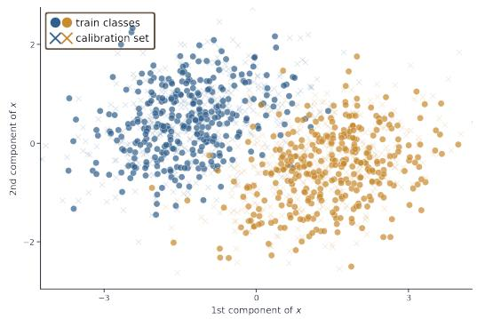
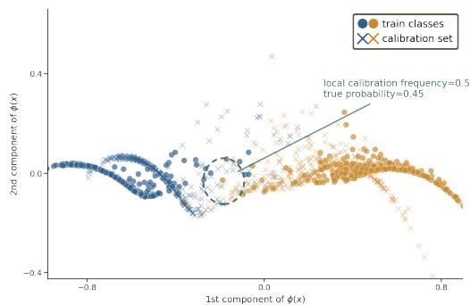
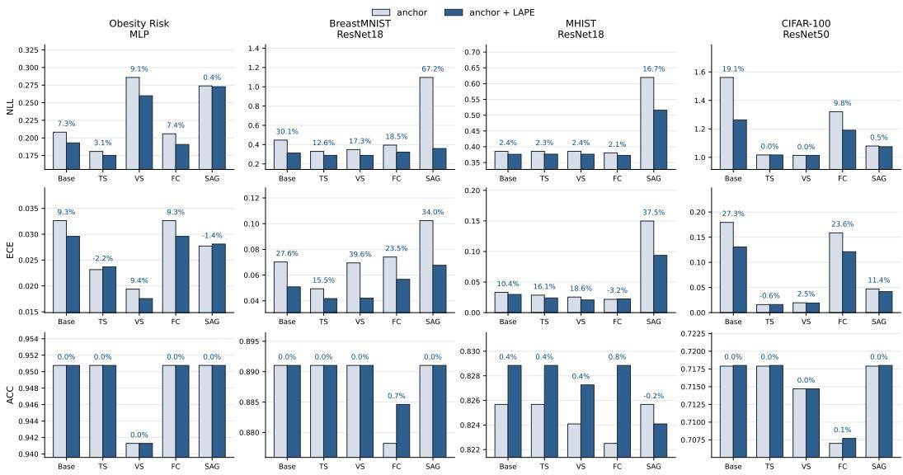
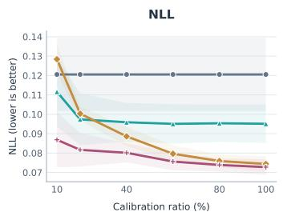
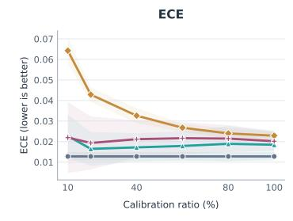
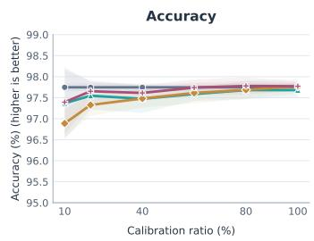

# Residual Calibration via Local Feature-Space Refinement

Xihao Wanga∗, Chengyao Yub∗, Ruixing Minga†

aSchool of Statistics and Data Science, Zhejiang Gongshang University; bDepartment of Statistics and Data Science, Southern University of Science and Technology

## Abstract

Deep neural networks often struggle to provide reliable confidence estimates, making post-hoc calibration essential for reliable decision-making. Existing post-hoc methods largely rely on score-based transformations, which improve marginal calibration but often fail to capture spatially varying miscalibration in local regions of the learned feature space. To address this gap, we propose Local Adaptive Probability Estimation (LAPE), a post-hoc residual calibration framework. Specifically, LAPE treats the global calibrator output as a stable anchor and refines the individual prediction by leveraging non-parametric local evidence from neighboring calibration samples. As a plug-and-play refinement module, LAPE effectively utilizes the information about feature-space geometry and can reuse the calibration data that are used to construct the global calibrator. Furthermore, we extend LAPE to the setting with multi-view inputs through Cascade Feature Augmentation Fusion (CFAF). Extensive experiments demonstrate that the proposed methods can improve the calibration quality of various existing baselines and remain efficient and robust across different settings.

## 1 Introduction

Deep neural networks have exhibited remarkable accuracy on classification problems, but often fail to provide reliable confidence scores that reflect the ground truth correctness likelihoods [Guo et al., 2017]. This mismatch can appear as overconfidence or underconfidence, both of which are critical especially in high-stakes applications and downstream tasks relying prediction uncertainty [Yu et al., 2026a,b]. For example, in automated clinical diagnostics, a reliable confidence score can indicate when a prediction should be deferred to experts for further examination, and in robust conformalized selection [Yu et al., 2026a], a reliable confidence score can improve selection power. Therefore, a network should provide reliable calibrated probabilities rather than directly applying the point predictions [Amodei et al., 2016, Lakshminarayanan et al., 2017, Jiang et al., 2018].

Post-hoc calibration provides a cost-effective solution to rectify miscalibration without retraining. However, existing global parametric maps such as Temperature Scaling (TS) [Guo et al., 2017], ensemble TS (ETS) [Zhang et al., 2020], and Dirichlet calibration [Kull et al., 2019] rely solely on scalar logits. Consequently, predictions with similar scores tend to obtain identical calibrations, ignoring the varying empirical reliability across distinct feature neighborhoods. To this end, local TS (LTS) [Ding et al., 2021b] introduces spatial adaptivity, but its increased parametric capacity risks overfitting on limited calibration data [Guo et al., 2017, Kull et al., 2019, Tomani et al., 2022]. Conversely, purely non-parametric local methods capture spatial patterns by adapting to neighborhood distributions but suffer from data inefficiency and discard informative global logits [Zadrozny and Elkan, 2001, 2002, Naeini et al., 2015, Kumar et al., 2019]. These limitations raise a foundational challenge: how to develop a calibrationframework that leverages localfeature-space evidence to correct residual errors while strictly preserving global predictive stability?

To address the above challenge, we propose Local Adaptive Probability Estimation (LAPE), a post-hoc residual calibration framework that effectively utilizes local feature-level evidence to further enhance existing calibration methods. Specifically, LAPE formulates calibration as a residual refinement problem. It takes the output of any existing post-hoc calibrator as a stable anchor (also called global anchor), and then applies a local correction to it only when the nearby calibration samples support it. To tackle the overfitting issue caused by reusing the calibration set to fit both a global anchor and residual refinement, we introduce a V-fold cross-fitting strategy. It generates out-of-sample anchor scores in the calibration set and can be more effective than the standard data-splitting strategy. Finally, we develop Cascade Feature Augmentation Fusion (CFAF), which extends LAPE to tackle multi-view scenarios [Xu et al., 2013, Baltrušaitis et al., 2019].

In theory, we establish the asymptotic consistency of the proposed LAPE. Empirically, we extensively evaluate LAPE across diverse benchmarks that encompass tabular and image-type data. Results show that LAPE helps to enhance the calibration performance of various baselines, such as TS [Guo et al., 2017], Feature Clipping (FC) [Tao et al., 2025], and Semantic-Aware Grouping (SAG) [Yang et al., 2023a]. Extensive experiments in Appendix D further demonstrate the efficiency, robustness, and effectiveness of LAPE.

We summarize our contributions as follows:

1. We propose LAPE, a residual calibration framework that enhances existing post-hoc calibration methods by integrating feature-level evidence. Importantly, LAPE can reuse the calibration dataset for building the global calibrator and residual refinement.

2. We extend LAPE to multi-view settings through CFAF, which combines calibrated view-level predictions with local refinement on a rectified joint feature space.

3. We establish asymptotic consistency of LAPE, providing a consistency analysis for featurespace residual calibration of the full multiclass probability vector.

4. We conduct comprehensive evaluations across various datasets and architectures, demonstrating that LAPE can improve the performance of existing post-hoc calibration methods.

## 2 Preliminary

## 2.1 Problem Setup

Let $X \in { \mathcal { X } }$ denote the feature variable and $Y \in \mathcal { Y } = \{ 1 , \dots , K \}$ denote the label variable. Assume access to a calibration dataset $\{ ( x _ { i } , y _ { i } ) \} _ { i = 1 } ^ { n }$ . Let $\hat { \pi } _ { 0 } : \dot { \mathcal { X } }  \Delta ^ { K - 1 }$ be a pre-trained soft-classifier for the K-class classification, where $\Delta ^ { K - 1 }$ represents the $( K - 1 )$ )-dimensional probability simplex. Let $p ( k ; x ) = \mathbb { P } ( Y = k \mid X = x )$ . For any $x \in \mathcal { X }$ , we write $\hat { \pi } _ { 0 } ( \dot { x } ) = ( \hat { \pi } _ { 0 } ( 1 ; x ) , \ldots , \hat { \pi } _ { 0 } ( \dot { K } ; x ) \bar { \rangle }$ ), where ${ \hat { \pi } } _ { 0 } ( k ; x )$ represents the base estimate of $p ( k ; x )$ . Denote the feature embedding of x by $z : = \phi ( x )$ and write $z _ { i } = \phi ( x _ { i } ) , i \in [ n ] : = \{ 1 , \dots , n \}$ . The initial goal of LAPE is to construct a calibrated estimator of $p ( k ; x )$ , denoted by $\hat { p } ( k ; x )$ , by leveraging $\hat { \pi } _ { 0 } ( k ; x ) , \mathcal { D } _ { \mathrm { c a l } }$ , and $\{ z _ { i } \} _ { i = 1 } ^ { n }$

Furthermore, let $f _ { \mathrm { c a l } } ( \cdot ; \hat { \pi } _ { 0 } , \mathcal { D } ) : \mathcal { X }  \Delta ^ { K - 1 }$ be any existing post-hoc calibration algorithm, which calibrates the initial soft-classifier πˆ based on a calibration dataset $\mathcal { D } \subseteq \mathcal { D } _ { \mathrm { c a l } }$ . For example, the mapping $f _ { \mathrm { c a l } }$ can be defined by calibration algorithms such as VS and TS. We aim to utilize LAPE to further improve these calibration methods.

## 2.2 Motivation

A learned representation can be discriminative for classification while still leaving calibration errors that vary across different feature-space neighborhoods. For example, global post-hoc calibrators typically learn a fixed transformation from logits or confidence scores to calibrated probabilities. As a result, two samples with similar scores receive similar corrections, even if their nearby calibration samples exhibit different empirical label frequencies [Tomani et al., 2022, Luo et al., 2022, Ding et al., 2021b]. Such “same-score, different-reliability” implies a possible route beyond purely score-based calibration: retain the global calibrator as a stable anchor and use nearby held-out samples as local evidence for residual mismatch, when the feature geometry makes such neighborhoods informative.

  
(a) Raw feature space

  
(b) Learned feature space  
Figure 1: Representation separation can not guarantee uniform calibration support. (a) Raw features of training and calibration samples. (b) Learned features separate the training samples clearly, but calibration samples can remain mixed near induced boundary regions. Different colors represent different classes. The highlighted neighborhood illustrates the local evidence used by LAPE.

The key insight of LAPE is to use local frequencies in calibration samples as residual evidence for probability calibration. Figure 1 illustrates this mechanism in a controlled two-dimensional simulation, where training and calibration samples are generated from the same distribution, and only the training samples are used to fit the classifier. The figure highlights two observations as follows.

Observation 1. After representation learning, the training samples become more clearly separated, whereas held-out calibration samples can still remain locally mixed near induced boundary regions.

Observation 2. For held-out points with class-1 softmax scores in [0.35, 0.65], local frequencies from 32 nearest neighbors in the full learned feature space better approximate oracle probabilities than softmax predictions (MAE: 0.126 vs. 0.156).

Observation 1 reflects that the classifier is optimized to separate the observed training dataset but can fail to separate held-out samples near classification boundaries. Observation 2 demonstrates that nearby held-out calibration samples can provide empirical evidence about the local class composition that is not directly used by a purely score-based global calibrator. LAPE therefore uses this local frequency as a residual correction to a global calibrated anchor.

Evidence beyond two dimensions. We further examine the above observations in a controlled simulation with 100-dimensional inputs. We generate i.i.d. training, calibration, and test sets, each containing 2,000 samples. The classifier is obtained on the training dataset. For a split $A \in \{ \mathrm { t r a i n } , \mathrm { c a l } \}$ and a representation $h \in \{ \mathrm { r a w }$ , learned}, let $\mu _ { A , c } ^ { h }$ denote the centroid of class c:

$$
\mu _ { A , c } ^ { h } = \frac { 1 } { | \mathcal { Z } _ { A , c } | } \sum _ { i \in \mathcal { T } _ { A , c } } h ( x _ { i } ) , \qquad \mathcal { Z } _ { A , c } = \{ i : x _ { i } \in A , y _ { i } = c \} .
$$

We use $S _ { A } ^ { h } = \left\| \mu _ { A , 1 } ^ { h } - \mu _ { A , 0 } ^ { h } \right\| _ { 2 }$ as a class-separation diagnostic, after standardizing each representation using statistics from the training split.

Results are averaged over ten random seeds. In the raw input space, the training and calibration sets have nearly identical class separation $( 2 . 5 1 0 \pm 0 . 1 7 6$ versus $\dot { 2 } . 5 1 9 \pm 0 . 1 6 2 )$ . After representation learning, the separation is moderately larger for the training samples than for the held-out calibration samples $( 3 . 6 6 3 \pm 0 . 3 4 3$ versus $2 . 9 8 1 \pm 0 . 2 3 4 )$ , showing that a modest train–calibration discrepancy can remain even under i.i.d. sampling.

We then evaluate probability estimation on an independent test set. The boundary region is specified before model fitting as $0 . { \dot { 3 } } 5 \le P ( Y = 1 \mid X ) \dot { \le } 0 . 6 5$ . For each test point, the local estimate is computed from the Laplace-smoothed label frequency of its 50 nearest calibration samples in the learned representation. Within this predefined region, the mean absolute error to the oracle conditional probability is $0 . 1 0 6 7 \pm 0 . 0 0 9 8$ for the softmax estimate and $0 . 0 9 6 9 \pm 0 . 0 0 5 5$ for the local-frequency estimate. Over the entire test samples which includes points that fall outside the boundary region, however, softmax remains more accurate than the local estimate $( 0 . 0 9 4 1 \pm 0 . 0 0 5 4$ versus $\dot { 0 . 1 0 5 8 } \pm 0 . 0 0 4 2 )$ . These results support using local calibration frequencies as a residual correction in selected regions, rather than as a replacement for the global prediction.

## 3 Local Adaptive Probability Estimation

This section presents LAPE in two parts. We first introduce the general LAPE method, which constructs a non-parametric residual correction for a pre-trained soft-classifier $\hat { \pi } _ { 0 }$ . We then describe how to apply LAPE to existing post-hoc calibrators by treating their calibrated outputs as $\scriptstyle { \hat { \pi } } _ { 0 }$ under the shared calibration dataset $\mathcal { D } _ { \mathrm { c a l } }$

## 3.1 General Methodology

We introduce the general method of LAPE in three steps. We first describe how to identify the neighbors of a given test point. Then, we introduce the hybrid refinement, which fuses the global anchor with this local evidence to produce the final calibrated probability. Finally, we describe how to employ the adaptive optimization to solve for the correction parameters that minimize residual errors.

Step 1: Local evidence retrieval. Given a new test sample x and its feature embedding vector z, the first step of LAPE is to select samples from $\mathcal { D } _ { \mathrm { c a l } }$ that are geometrically close to x in the feature space. Specifically, let $d _ { i } = \| z _ { i } - z \| _ { 2 } , i \in [ n ]$ . For any fixed $m \in [ n ]$ , the set of m nearest neighbors $\bar { \mathcal { N } } _ { m } ( x )$ is defined by

$$
\begin{array} { r } { \mathcal { N } _ { m } ( x ) : = \left\{ i \in [ n ] : \| z - z _ { i } \| _ { 2 } \leq d _ { ( m ) } \right\} , } \end{array}
$$

where $d _ { ( m ) }$ denotes the m-th smallest value of $\{ d _ { i } \} _ { i = 1 } ^ { n } . \ \mathbf { B } \mathrm { y }$ leveraging the local calibration dataset $\mathcal { N } _ { m } ( x )$ , LAPE then computes the local empirical distribution as

$$
\tilde { p } _ { 0 } ( k ; x , m ) : = \frac { \sum _ { i \in \mathcal { N } _ { m } ( x ) } \mathbb { I } ( y _ { i } = k ) + 1 / K } { m + 1 } , \quad k \in [ K ] ,\tag{1}
$$

where $1 / K$ is a smoothing term to avoid zero probabilities.

Step 2: Hybrid refinement. Let $\pi ^ { \mathrm { a n c h o r } } ( k ; x )$ be the anchor estimate of $p ( k ; x ) , k \in [ K ]$ . We focus on the case that

$$
\pi ^ { \mathrm { a n c h o r } } ( k ; x ) = \hat { \pi } _ { 0 } ( k ; x ) .
$$

The idea of hybrid refinement is that, if the base prediction $\hat { \pi } _ { 0 } ( \cdot )$ is already reliable in many regions, then it is unnecessary to adopt a large local correction. For sparse regions where $\hat { \pi } _ { 0 } ( \cdot )$ performs not satisfactorily, local frequencies may also be weakly supported, which means that over-reliance on the local evidence can further increase variance. Therefore, LAPE treats $\tilde { p } _ { 0 } ( k ; x , m )$ as a delicate residual correction signal rather than a replacement for the global anchor. Specifically, given a neighborhood size $m \in [ n ]$ and a weight $\alpha \in [ 0 , 1 ]$ , the calibrated probability of ${ \hat { \pi } } _ { 0 } ( k ; x )$ is given by

$$
{ \widehat { p } } ( k ; x , m , \alpha ) : = ( 1 - \alpha ) \cdot \pi ^ { \mathrm { a n c h o r } } ( k ; x ) + \alpha \cdot { \widetilde { p } } _ { 0 } ( k ; x , m ) , \quad k \in [ K ] .\tag{2}
$$

In what follows, we describe how to choose m and α adaptively.

Step 3: Adaptive hyperparameter selection. LAPE selects the hyperparameter vector $( m , \alpha )$ by leveraging weighted leave-one-out (LOO) analysis. Specifically, for any fixed $i \in [ n ]$ , we denote the LOO probability estimate of $x _ { i }$ by

$$
p ^ { ( i ) } ( y _ { i } ; x _ { i } , m , \alpha ) : = ( 1 - \alpha ) \pi ^ { \mathrm { a n c h o r } } ( y _ { i } ; x _ { i } ) + \alpha \tilde { p } _ { - i } ( y _ { i } ; x _ { i } , m ) .\tag{3}
$$

where $\tilde { p } _ { - i } ( k ; x _ { i } , m )$ is the LOO local empirical distribution that

$$
\widetilde { p } _ { - i } ( k ; x _ { i } , m ) : = \frac { \sum _ { j \in { \mathcal { N } } _ { m } ( x ) \backslash \{ i \} } \mathbb { I } ( y _ { j } = k ) + 1 / K } { m } , \quad k \in [ K ] .\tag{4}
$$

Each calibration sample is weighted by its distance to the feature embedding of the test point x, i.e.,

$$
w _ { i } ^ { ( m ) } = \frac { \exp { \left( - \| z - z _ { i } \| _ { 2 } ^ { 2 } / \sigma ^ { 2 } \right) } } { \sum _ { j \in \mathcal { N } _ { m } ( x ) } \exp { \left( - \| z - z _ { j } \| _ { 2 } ^ { 2 } / \sigma ^ { 2 } \right) } } ,\tag{5}
$$

Algorithm 1 Local Adaptive Probability Estimation   
1: Input: Test sample $x ,$ calibration set $\mathcal { D } _ { \mathrm { c a l } } = \{ ( x _ { i } , y _ { i } ) \} _ { i = 1 } ^ { n }$ , feature map $\phi ,$ anchor scores   
$\pi ^ { \mathrm { { a n c h o r } } } ( x )$ and $\{ \pi ^ { \mathrm { a n c h o r } } ( x _ { i } ) \} _ { i = 1 } ^ { n }$ , candidate grids M and A.   
2: Output: Calibrated probability vector ${ \hat { p } } ( x )$   
3: Compute $z = \phi ( x )$ and $z _ { i } = \dot { \phi } ( x _ { i } ) , i \in [ n ]$   
4: Compute the neighbor sets $\mathcal { N } _ { m } ( x )$ for all $m \in { \mathcal { M } } .$   
5: Set $\sigma = d _ { ( \lfloor { \sqrt { n } } / 2 \rfloor ) }$ , the distance from z to its $\lfloor { \sqrt { n } } / 2 \rfloor$ -th nearest calibration embedding.   
6: for $m \in \mathcal { M }$ and α $\iota \in { \mathcal { A } }$ do   
7: Initialize $L ( m , \alpha ) \gets 0 .$   
8: for $i \in \mathcal { N } _ { m } \backslash ( x )$ do   
9: Compute the local weight $w _ { i } ^ { ( m ) }$ as in $( 5 ) .$   
10: Compute the leave-one-out local frequency $\tilde { p } _ { - i } ( k ; x _ { i } , m )$ as in (4).   
11: Compute $\hat { p } ^ { ( i ) } ( y _ { i } ; x _ { i } , m , \alpha )$ as in (3).   
12: Update   
$L ( m , \alpha ) \gets L ( m , \alpha ) - w _ { i } ^ { ( m ) } ( x ) \log \hat { p } ^ { ( i ) } ( y _ { i } ; x _ { i } , m , \alpha ) .$   
13: end for   
14: end for   
15: Select $( m ^ { * } , \alpha ^ { * } ) _ { , } = \arg \operatorname* { m i n } _ { m \in \mathcal { M } , \alpha \in \mathcal { A } } L ( m , \alpha )$   
16: Compute $\hat { p } ( k ; x )$ as in $( 7 ) , k \in [ { \dot { K } } ] .$   
17: Return $\hat { p } ( x ) = ( \hat { p } ( 1 ; x ) , \dotsc , \hat { p } ( K ; x ) )$

where $\sigma = d _ { ( \lfloor { \sqrt { n } } / 2 \rfloor ) }$ is the bandwidth. We optimize m over the grid $\mathcal { M } = \left\{ M _ { \mathrm { m i n } } , \dots , M _ { \mathrm { m a x } } \right\} \subseteq$ $[ n ]$ , where $M _ { \mathrm { m i n } }$ and $M _ { \mathrm { m a x } }$ have the same order $O ( \sqrt { n } )$ . In practice, we simply set $M _ { \mathrm { m i n } } = \lfloor \sqrt { n } / 1 0 \rfloor$ and $M _ { \mathrm { m a x } } = \lfloor \sqrt { n } / 2 \rfloor$ . Finally, the hyperparameter vector $( m ^ { * } , \alpha ^ { * } )$ is adaptively determined by minimizing the density-weighted negative log-likelihood:

$$
( m ^ { * } , \alpha ^ { * } ) = \underset { m \in { \mathcal M } , \alpha \in [ 0 , 1 ] } { \arg \operatorname* { m i n } } \sum _ { i \in { \mathcal N } _ { m } ( x ) } - w _ { i } ^ { ( m ) } \cdot \log \left( p ^ { ( i ) } ( y _ { i } ; x _ { i } , m , \alpha ) \right) .\tag{6}
$$

Correspondingly, the final calibrated estimate $\hat { p } ( x ) : = ( \hat { p } ( 1 ; x ) , \ldots , \hat { p } ( K ; x ) )$ satisfies

$$
\hat { p } ( k ; x ) = ( 1 - \alpha ^ { * } ) \cdot \pi ^ { \mathrm { { a n c h o r } } } ( k ; x ) + \alpha ^ { * } \cdot \tilde { p } _ { 0 } ( k ; x , m ^ { * } ) , \quad k \in [ K ] .\tag{7}
$$

The proposed method is summarized in Algorithm 1.

## 3.2 Applying LAPE to Calibrators with Shared Calibration Dataset

By (7), the quality of the global anchor ${ \hat { \pi } } _ { 0 } ( x )$ is important to the calibrated ${ \hat { p } } ( x )$ . Directly taking the softmax probability vector of a neural network as ${ \hat { \pi } } _ { 0 } ( x )$ is concerning, as it usually fails to provide a reasonable estimate of $( p ( 1 ; x ) , \ldots , p ( K ; x ) )$ ). An appealing solution is to apply LAPE to already calibrated estimates. For example, we can take the result of VS as $\hat { \pi } _ { 0 } ( x )$ . The remaining concern is that existing confidence calibration methods also need a calibration dataset, and reuse the same set $\mathcal { D } _ { \mathrm { c a l } }$ for fitting $\hat { \pi } _ { 0 } ( k ; x )$ and constructing $\hat { p } ( k ; x )$ will result in calibration-set overfitting. A direct idea is to split $\mathcal { D } _ { \mathrm { c a l } }$ into two disjoint parts, but this strategy often comes at the cost of sacrificing the utilization of the calibration set. To tackle this, we introduce a V-fold cross-fitting strategy as follows.

Specifically, we first partition $\mathcal { D } _ { \mathrm { c a l } }$ into V disjoint subsets $\{ \mathcal { D } _ { \mathrm { c a l } } ^ { ( v ) } , v = 1 , \ldots , V \}$ . For each fold $\mathcal { D } _ { \mathrm { c a l } } ^ { ( v ) }$ , we first calibrate πˆ0 on the set $\mathcal { D } _ { \mathrm { c a l } } / \mathcal { D } _ { \mathrm { c a l } } ^ { ( v ) }$ to obtain a calibrated soft-classifier $f _ { \mathrm { c a l } } : \mathcal { X } $ $\Delta ^ { K - 1 }$ . We then apply $f _ { \mathrm { c a l } }$ to the hold-out calibration dataset $\mathcal { D } _ { \mathrm { c a l } } ^ { ( v ) }$ . That is, we take $\pi ^ { \mathrm { a n c h o r } } ( x _ { i } ) =$ $( \pi ^ { \mathrm { a n c h o r } } ( 1 ; x _ { i } ) , \ldots , \pi ^ { \mathrm { a n c h o r } } ( K ; x _ { i } ) )$ as

$$
\pi ^ { \mathrm { a n c h o r } } ( x _ { i } ) = f _ { \mathrm { c a l } } \left( x _ { i } ; \hat { \pi } _ { 0 } , \mathcal { D } _ { \mathrm { c a l } } \setminus \mathcal { D } _ { \mathrm { c a l } } ^ { ( v ) } \right) , \quad \forall ( x _ { i } , y _ { i } ) \in \mathcal { D } _ { \mathrm { c a l } } ^ { ( v ) } , \quad v = 1 , \ldots , V .
$$

This ensures that the prediction function for the point $x _ { i }$ is independent of $( x _ { i } , y _ { i } ) , i \in [ n ]$ . For the test point x, due to its independence from $\mathcal { D } _ { \mathrm { c a l } }$ , the calibrated function is fitted on the whole set $\mathcal { D } _ { \mathrm { c a l } }$

$$
\pi ^ { \mathrm { a n c h o r } } ( x ) = f _ { \mathrm { c a l } } \left( x ; \hat { \pi } _ { 0 } , D _ { \mathrm { c a l } } \right) .
$$

The remaining steps are identical to subsection 3.1.

Algorithm 2 LAPE with Cascade Feature Augmentation Fusion   
1: Input: Test sample $x ,$ soft-classifiers $\{ \hat { \pi } _ { 0 } ^ { ( r ) } , \phi ^ { ( r ) } \} _ { r = 1 } ^ { R }$ , calibration set $\mathcal { D } _ { \mathrm { c a l } } .$ , search grid A.   
2: Output: Calibrated probability vector $\hat { p } ( \boldsymbol { x } )$   
3: Compute out-of-fold calibrated view predictions $\{ \hat { q } _ { i } ^ { ( r ) , \mathrm { o o f } } \}$ on $\mathcal { D } _ { \mathrm { c a l } }$   
4: Compute fusion weights $w ^ { * }$ by (8).   
5: Fit view-level calibrators on the full $\mathcal { D } _ { \mathrm { c a l } }$ and compute $\pi _ { \mathrm { C F A F } } ^ { \mathrm { a n c h o r } } ( x )$ by (9).   
6: Construct joint features $z _ { i } ^ { \mathrm { j o i n t } } = [ z _ { i } ^ { ( 1 ) } \oplus \cdot \cdot \cdot \oplus z _ { i } ^ { ( R ) } ]$ for $i \in [ n ]$ and $z ^ { \mathrm { j o i n t } } = [ z ^ { ( 1 ) } \oplus \cdot \cdot \cdot \oplus z ^ { ( R ) } ]$   
7: Compute $\tilde { z } _ { i } = \Psi ( z _ { i } ^ { \mathrm { j o i n t } } ; \mathcal { D } _ { \mathrm { c a l } } ) , i \in [ n ] .$ , and $\tilde { z } = \Psi ( z ^ { \mathrm { j o i n t } } ; \mathcal { D } _ { \mathrm { c a l } } )$   
8: Apply LAPE to $\pi _ { \mathrm { C F A F } } ^ { \mathrm { a n c h o r } } ( x )$ and $\{ ( \tilde { z } _ { i } , y _ { i } ) \} _ { i = 1 } ^ { n }$ as in (10) to compute $\hat { p } ( k ; x ) , k \in [ K ]$   
9: Return ${ \hat { p } } ( x )$

## 4 Extension to Multi-View Scenarios

For many applications, object may be described by several feature groups or multiple modalities; we refer to these as multi-view scenarios. It is common in post-hoc deployment that the viewspecific soft-classifiers have already been trained, and retraining an end-to-end interaction model may be costly or infeasible. Given a shared held-out calibration dataset $\mathcal { D } _ { \mathrm { c a l } }$ , a naive calibration strategy is late fusion, which calibrates each view separately and then averages them to obtain a final calibrated probability [Snoek et al., 2005, Wolpert, 1992, Baltrušaitis et al., 2019]. However, this strategy operates on predictors that are trained separately for each view, which can miss cross-view interactions. The Cascade Feature Augmentation Fusion (CFAF) is designed to tackle this problem.

Let each input be observed through R views: $x = ( x ^ { ( 1 ) } , \dots , x ^ { ( R ) } )$ . For each view $r \in [ R ]$ , let $\hat { \pi } _ { 0 } ^ { ( r ) } : \mathcal { X } ^ { ( r ) }  \Delta ^ { K - 1 }$ be the frozen view-specific soft-classifier and let $z ^ { ( r ) } = \phi ^ { ( r ) } ( x ^ { ( r ) } )$ be its feature representation. For the test data x, we fit a post-hoc calibrator for each view and obtain calibrated view-level predictions

$$
\hat { \boldsymbol q } ^ { ( r ) } ( \boldsymbol x ) = { f } _ { \mathrm { c a l } } ^ { ( r ) } \big ( \boldsymbol x ^ { ( r ) } ; \hat { \pi } _ { 0 } ^ { ( r ) } , \mathcal D _ { \mathrm { c a l } } \big ) , \quad r \in [ R ] .
$$

Then we apply the V -fold cross-fitting strategy in Section 3.2 to compute $\hat { q } _ { i } ^ { ( r ) , \mathrm { o o f } }$ , which represents the out-of-fold calibrated prediction of view r for $x _ { i }$ . We compute the fusion weights by

$$
w ^ { * } = \arg \operatorname* { m i n } _ { w \in \Delta _ { R } } - \sum _ { i = 1 } ^ { n } \log \left( \sum _ { r = 1 } ^ { R } w _ { r } \hat { q } _ { i } ^ { ( r ) , \mathrm { o o f } } ( y _ { i } ) \right) , \qquad \Delta _ { R } = \left\{ w : w _ { r } \geq 0 , \sum _ { r = 1 } ^ { R } w _ { r } = 1 \right\} .\tag{8}
$$

Therefore, the resulting CFAF anchor for a test sample is

$$
\pi _ { \mathrm { C F A F } } ^ { \mathrm { a n c h o r } } ( x ) = \sum _ { r = 1 } ^ { R } w _ { r } ^ { * } \hat { q } ^ { ( r ) } ( x ) .\tag{9}
$$

CFAF then applies LAPE in a joint feature space rather than in any single view. Specifically, for $i \in [ n ]$ , define the concatenated feature representation by $z _ { i } ^ { \mathrm { j o i n t } } = [ z _ { i } ^ { ( 1 ) } \oplus \cdot \cdot \cdot \oplus z _ { i } ^ { ( R ) } ]$ . For the test point x, write $z ^ { \mathrm { j o i n t } } = [ z ^ { ( 1 ) } \oplus \cdot \cdot \cdot \oplus z ^ { ( R ) } ]$ . We apply a rectification map fitted on the calibration features to obtain $\tilde { z } _ { i } = \Psi ( z _ { i } ^ { \mathrm { j o i n t } } ; \mathcal { D } _ { \mathrm { c a l } } ) , i \in [ n ]$ , where Ψ denotes standardization, optionally followed by whitening. Write $\tilde { z } = \Psi ( z ^ { \mathrm { j o i n t } } ; \mathcal { D } _ { \mathrm { c a l } } )$ . Using $\{ \tilde { z } _ { i } , y _ { i } \} _ { i = 1 } ^ { n }$ for neighbor retrieval, CFAF computes the same local empirical distribution as LAPE:

$$
\tilde { p } _ { 0 } ( k ; x , m ) = \frac { \sum _ { i \in \mathcal { N } _ { m } ( \tilde { z } ) } \mathbb { I } ( y _ { i } = k ) + 1 / K } { m + 1 } , \quad k \in [ K ] .
$$

With $( m ^ { * } , \alpha ^ { * } )$ selected as in (6), the final CFAF prediction is

$$
\hat { p } ( k ; x ) = ( 1 - \alpha ^ { * } ) \pi _ { \mathrm { C F A F } } ^ { \mathrm { a n c h o r } } ( k ; x ) + \alpha ^ { * } \tilde { p } _ { 0 } ( k ; x , m ^ { * } ) , \quad k \in [ K ] .\tag{10}
$$

The CFAF method is summarized in Algorithm 2.

## 5 Theoretical Results

In this section, we first establish the asymptotic consistency of LAPE; detailed proofs are deferred to Appendix B. Then we provide a geometric interpretation of its finite-sample behavior.

We regard consistency as an important statistical property needed by a post-hoc calibration framework. That is, as the size of calibration dataset n tends to infinity, the estimated probability vector should converge in probability to its true conditional distribution. Specifically, let

$$
p ( x ) : = { \big ( } p ( 1 ; x ) , \ldots , p ( K ; x ) { \big ) } = { \big ( } \mathbb { P } ( Y = 1 | X = x ) , \ldots , \mathbb { P } ( Y = K | X = x ) { \big ) } .
$$

Rewrite the calibrated estimate vector ${ \hat { p } } ( x )$ under $\mathcal { D } _ { \mathrm { c a l } }$ by ${ \hat { p } } _ { n } ( x )$ . Theorem 5.1 demonstrates that, under regular assumptions (Assumptions B.2–B.7; see Appendix B.2), the proposed estimator ${ \hat { p } } _ { n } ( x )$ satisfies ${ \hat { p } } _ { n } ( x ) \to p ( x )$ in probability as $n \to \infty$

Theorem 5.1 (Consistency of LAPE). Let $x \in \mathcal { X }$ be a test sample with unobserved label y. Suppose that $\mathcal { D } _ { \mathrm { c a l } } \cup \{ ( x , y ) \}$ are i.i.d. Let ${ \hat { p } } _ { n } ( x )$ denote the LAPE estimator defined by (7) when constructed from a calibration set ofsize n. Under Assumptions B.2–B.7, the estimator ${ \hat { p } } _ { n } ( x )$ is asymptotically consistent. That is,for anyfixed $\varepsilon > 0 ,$

$$
\operatorname* { l i m } _ { n  \infty } \mathbb { P } ( \| \hat { p } _ { n } ( x ) - p ( x ) \| _ { 2 } > \varepsilon ) = 0 ,
$$

where $\| \cdot \| _ { 2 }$ denotes the Euclidean norm.

Geometric Interpretation. The term $\tilde { p } _ { 0 } ( k ; x , m )$ given by (1) can be regarded as a smoothed local frequency that estimates the local conditional class probability around the test point x. The bias is therefore controlled by how much the conditional probability changes inside the retrieved neighborhood. Specifically, let $B _ { \sigma } ( z )$ be the neighborhood of radius $\sigma ( x )$ around $z = \phi ( x )$ . Ignoring the $O ( 1 / m )$ contribution from Laplace smoothing, the geometric component of the local estimation bias satisfies

$$
{ \mathrm { B i a s } } ( x ) \leq \operatorname* { s u p } _ { \phi ( x ^ { \prime } ) \in B _ { \sigma } ( z ) } \| p ( x ^ { \prime } ) - p ( x ) \| _ { 2 } \leq L _ { p } \cdot \sigma ( x ) ,
$$

where $\operatorname { B i a s } ( x )$ denotes the unsmoothed geometric bias and $L _ { p }$ is a local Lipschitz constant of the conditional probability map in $B _ { \sigma } ( z )$ . Thus, local refinement is reliable when nearby points have similar conditional probabilities. When the neighborhood mixes regions with different class probabilities, the local frequency can be biased; LAPE can then shrink the neighborhood or reduce the interpolation weight, relying more on the anchor prediction. Table 5 in Appendix D.2 supports this interpretation: LAPE is closer to the true probability in locally smooth neighborhoods, whereas the oracle gap increases when neighborhood variation is large.

## 6 Experimental Results

In this section, we present the experimental results of LAPE and other baselines on diverse datasets and neural network architectures. We aim to demonstrate that the performance of confidence calibration of existing baselines can be enhanced by leveraging LAPE. Codes can be found at https: $: / / \mathrm { g } \dot { \bf 1 }$ thub.com/AltonWongsource/residual-calibration.

## 6.1 Experimental Setup

We introduce the main information about the experiments; detailed settings and additional results such as ablation studies are presented in Appendix C and D, respectively.

Datasets. For the main result in Figure 2, we evaluate our framework on four datasets that encompass both tabular and image categories. For tabular data, we consider Obesity Risk [Palechor and De la Hoz Manotas, 2019]. For image data, we consider CIFAR-100 [Krizhevsky and Hinton, 2009] and two medical-image datasets: BreastMNIST [Yang et al., 2023b] and MHIST [Wei et al., 2021]. We also evaluate the proposed method on many other datasets; see Appendix C.1 for full descriptions.

Model Architectures For the tabular dataset, we use an MLP backbone. For medical transfer learning datasets, we use ImageNet-pretrained ResNet18 or DenseNet121 backbones. For CIFAR-100, we use ResNet50. Detailed settings are presented in Appendix C.4.

Methods We consider four calibration baselines, including TS [Guo et al., 2017], Vector Scaling (VS), FC [Tao et al., 2025], and SAG [Yang et al., 2023a]. We compare these methods with their adjusted version by LAPE. We named these adjusted baselines by TS+LAPE, VS+LAPE, FC+LAPE, and SAG+LAPE, respectively. Other baselines are also compared; see Appendix C.2 for details.

Evaluation. Let $I _ { 1 } , \ldots , I _ { M }$ partition the confidence interval [0, 1]. For i-th test point, let ${ \hat { y } } _ { i } = \arg \operatorname* { m a x } _ { y } { \hat { p } } _ { y } ( x _ { i } )$ and ${ \hat { c } } _ { i } = \operatorname* { m a x } _ { y } { \hat { p } } _ { y } ( x _ { i } )$ be the predicted label and confidence, respectively. We evaluate calibration performance using two complementary metrics: Negative Log-Likelihood (NLL) [Gneiting and Raftery, 2007] and Expected Calibration Error (ECE) [Naeini et al., 2015]:

$$
\mathrm { N L L } = - \frac { 1 } { N } \sum _ { i = 1 } ^ { N } \log \hat { p } _ { y _ { i } } ( x _ { i } ) , \quad \mathrm { E C E } = \sum _ { m = 1 } ^ { M } \frac { | B _ { m } | } { N } \left| \operatorname { a c c } ( B _ { m } ) - \operatorname { c o n f } ( B _ { m } ) \right| ,
$$

where $B _ { m } = \{ i : \hat { c } _ { i } \in I _ { m } \}$ , and

$$
\operatorname { a c c } ( B _ { m } ) = { \frac { 1 } { | B _ { m } | } } \sum _ { i \in B _ { m } } \mathbf { 1 } \{ { \hat { y } } _ { i } = y _ { i } \} , \qquad \operatorname { c o n f } ( B _ { m } ) = { \frac { 1 } { | B _ { m } | } } \sum _ { i \in B _ { m } } { \hat { c } } _ { i } .
$$

Note that we report NLL since minimizing NLL is equivalent to minimizing the KL divergence to the true conditional distribution: $\operatorname { \mathbb { E } } [ - \log { \bar { q } } ( Y \mid X ) ] { \overset { \cdot } { = } } \operatorname { \mathbb { E } } [ H ( P ( \cdot \mid X ) ) + \operatorname { \mathrm { K } } { \bar { \operatorname { L } } } ( P ( \cdot \mid X ) \parallel q ( \cdot \mid X ) ) ]$ The definition and results for ACE [Nixon et al., 2019] are presented in Appendix C.3 and D, respectively.

## 6.2 Results

  
Figure 2: Paired comparison of LAPE-side refinement across calibration anchors. Each anchor and its LAPE refinement are evaluated under the same dataset and backbone. Rows report NLL, ECE, and accuracy. Bar annotations show relative changes, computed as $( v _ { \mathrm { a n c h o r } } - v _ { \mathrm { L A P E } } ) / v _ { \mathrm { a n c h o r } } \times 1 0 0 \%$ for NLL/ECE and $( v _ { \mathrm { L A P E } } - v _ { \mathrm { a n c h o r } } ) / v _ { \mathrm { a n c h o r } } \times$ 100% for accuracy.

LAPE improves existing post-hoc calibration methods. Figure 2 demonstrates that LAPE can further improve a range of existing post-hoc calibration methods. Across tabular MLPs, medicalimage transfer models, and natural-image backbones, adding LAPE often reduces NLL and ECE while largely preserving accuracy. This supports the role of LAPE as a residual refinement module: it keeps the global calibrator as a stable anchor and uses nearby calibration samples to correct remaining local miscalibration. The gains are not uniform across all anchors and metrics, which is expected because the benefit of local refinement depends on both the quality of the anchor and the informativeness of the learned feature geometry.

Base VS Pure LAPE VS+LAPE  
Table 1: Results of CFAF-LAPE and late fusion on multi-view tasks.
<table><tr><td>Setting</td><td>Method</td><td>NLL↓</td><td>ECE↓</td><td>Acc. ↑</td><td>Full results</td></tr><tr><td rowspan="2">Synthetic XOR views</td><td>Late fusion</td><td>0.507</td><td>0.099</td><td>0.790</td><td>Table 17</td></tr><tr><td>CFAF-LAPE</td><td>0.413</td><td>0.057</td><td>0.848</td><td></td></tr><tr><td rowspan="2">Multi-view Digits</td><td>Late fusion</td><td>0.112</td><td>0.029</td><td>0.960</td><td>Table 18</td></tr><tr><td>CFAF-LAPE</td><td>0.092</td><td>0.025</td><td>0.964</td><td></td></tr><tr><td rowspan="2">HAM10000 melanoma vs nevus</td><td>Late fusion</td><td>0.255</td><td>0.023</td><td>0.896</td><td>Table 18</td></tr><tr><td>CFAF-LAPE</td><td>0.224</td><td>0.014</td><td>0.907</td><td></td></tr></table>

CFAF-LAPE improves multi-view calibration. Table 1 examines whether local residual refinement remains useful in multi-view settings. Across all tasks, CFAF consistently improves NLL, ECE, and accuracy, and is much better than the late fusion strategy. This suggests that late fusion is insufficient if residual calibration errors depend on cross-view interactions. CFAF addresses this by forming a calibrated fusion anchor and applying local residual refinement in the rectified joint representation, without retraining an end-to-end fusion model.

  
Figure 3: Sensitivity to calibration data size (calibration ratio). NLL, ECE, and accuracy are reported, with shaded areas indicating standard deviations across five calibration split seeds.

Robustness to calibration-set size. Figure 3 shows that VS+LAPE lowers NLL at every ratio, even while VS still improves with more data (Table 7). As more calibration data become available, its NLL decreases further; ECE and accuracy also show favorable overall trends despite small fluctuations. These results suggest that LAPE benefits from additional calibration data but does not require a large calibration set to improve the primary NLL metric.

Summary of results in appendix. Appendix D provides additional evidence for the advantage of LAPE. The runtime study shows that the accelerated implementation keeps LAPE practical at inference time (Table 4). The heterogeneity and covariate-shift diagnostics show that LAPE is most useful when residual errors are structured in feature-space neighborhoods and when target-domain calibration samples reveal those errors; the CIFAR-10-C experiment further confirms this behavior under real-image corruption (Tables 6, 8, and 9). The high-dimensional and structural-noise studies shows that, less reliable retrieval geometry can reduce the gains, but the refinement remains stable for most anchors (Tables 10 and 11). The architecture-depth diagnostic shows that LAPE benefits from usable local structure across different MLP depths, and the ablation study verifies that both adaptive neighborhood selection and anchor–local interpolation contribute to the final gains (Tables 12 and 13) The CLIP and training-time calibration experiments show that LAPE remains effective beyond standard post-hoc anchors, providing further refinement after prompt tuning, DAC calibration, and calibration-aware training objectives (Tables 14 and 15). The cross-fitting experiment shows that out of-fold anchor construction is more effective than direct reuse or simple data splitting when flexible anchors are used with limited calibration data (Table 16). The dynamic-fusion experiment further shows that CFAF-LAPE remains complementary to stronger learned multi-view fusion methods such as QMF and PDF (Table 19). Results on more datasets and backbones further demonstrate the advantage and generality of LAPE (Tables 20 and 21)

## 7 Conclusion

We propose LAPE, a post-hoc residual calibration framework that refines global calibrated predictions with local feature-space evidence. Instead of replacing existing calibrators, LAPE treats their outputs as stable anchors and applies a non-parametric local correction using nearby calibration samples. To reduce calibration-set overfitting while retaining data efficiency, we introduce a V -fold cross-fitting strategy for constructing out-of-sample anchor scores on the calibration set. We further propose CFAF to extend the framework to multi-view scenarios. Theoretically, we establish the asymptotic consistency of LAPE under regular assumptions. Extensive experiments demonstrate that LAPE can improve the calibration quality of diverse post-hoc baselines while remaining practical under varying calibration set sizes and distribution shifts. We expect that the proposed LAPE can serve as a basic tool towards reliable, data-efficient, and geometry-aware probability calibration.

Limitation. Although LAPE provides a flexible residual refinement framework for post-hoc calibration, its effectiveness depends on the quality of the learned feature geometry. When nearby samples in feature space do not share similar conditional label distributions, local frequency estimates may become biased and the method should rely more heavily on the global anchor. Future work may study more robust retrieval metrics. Furthermore, extending local residual refinement to other confidence representations, such as verbalized confidence in large reasoning models [Wang et al., 2026], remains an interesting direction for future work.

## Acknowledgments and Disclosure of Funding

This research is supported by the Zhejiang Provincial Peak Discipline Program (Statistics, Zhejiang Gongshang University), the Collaborative Innovation Center of Zhejiang Gongshang University, and the Southern University of Science and Technology.

## References

Ethem Alpaydin and Cenk Kaynak. Optical recognition of handwritten digits. UCI Machine Learning Repository, 1998.

Dario Amodei, Chris Olah, Jacob Steinhardt, Paul Christiano, John Schulman, and Dan Mané. Concrete problems in ai safety. arXiv preprint arXiv:1606.06565, 2016.

Sergio A. Balanya, Juan Maroñas, and Daniel Ramos. Adaptive temperature scaling for robust calibration of deep neural networks. Neural Computing and Applications, 2024.

Tadas Baltrušaitis, Chaitanya Ahuja, and Louis-Philippe Morency. Multimodal machine learning: A survey and taxonomy. IEEE Transactions on Pattern Analysis and Machine Intelligence, 41(2): 423–443, 2019.

Jon Louis Bentley. Multidimensional binary search trees used for associative searching. Communications ofthe ACM, 18(9):509–517, 1975.

Jock A Blackard and Denis J Dean. Comparative accuracies of artificial neural networks and discriminant analysis in predicting forest cover types from cartographic variables. Computers and Electronics in Agriculture, 24(3):131–151, 1999.

Bing Cao, Yinan Xia, Yi Ding, Changqing Zhang, and Qinghua Hu. Predictive dynamic fusion. In Proceedings of the 41st International Conference on Machine Learning, volume 235 of Proceedings ofMachine Learning Research, pages 5608–5628. PMLR, 2024.

Mircea Cimpoi, Subhransu Maji, Iasonas Kokkinos, Sammy Mohamed, and Andrea Vedaldi. Describing textures in the wild. In Proceedings of the IEEE Conference on Computer Vision and Pattern Recognition, pages 3606–3613, 2014. doi: 10.1109/CVPR.2014.461.

Frances Ding, Moritz Hardt, John Miller, and Ludwig Schmidt. Retiring adult: New datasets for fair machine learning. Advances in Neural Information Processing Systems, 34:6478–6490, 2021a.

Zhipeng Ding, Xu Han, Peirong Liu, and Marc Niethammer. Local temperature scaling for probability calibration. In Proceedings of the IEEE/CVF International Conference on Computer Vision, pages 6889–6899, October 2021b.

Robert Duin. Multiple Features. UCI Machine Learning Repository, 1998.

Peter W Frey and David J Slate. Letter recognition using holland-style adaptive classifiers. Machine Learning, 6(2):161–182, 1991.

Tilmann Gneiting and Adrian E Raftery. Strictly proper scoring rules, prediction, and estimation. Journal ofthe American Statistical Association, 102(477):359–378, 2007.

Chuan Guo, Geoff Pleiss, Yu Sun, and Kilian Q Weinberger. On calibration of modern neural networks. In International Conference on Machine Learning, pages 1321–1330. PMLR, 2017.

Ramya Hebbalaguppe, Jatin Prakash, Neelabh Madan, and Chetan Arora. A stitch in time saves nine: A train-time regularizing loss for improved neural network calibration. In Proceedings of the IEEE/CVF Conference on Computer Vision and Pattern Recognition, pages 16081–16090, 2022.

Dan Hendrycks and Thomas Dietterich. Benchmarking neural network robustness to common corruptions and perturbations. In International Conference on Learning Representations, 2019.

Heinrich Jiang, Been Kim, Melody Guan, and Maya Gupta. To trust or not to trust a classifier. Advances in Neural Information Processing Systems, 31, 2018.

Tom Joy, Francesco Pinto, Ser-Nam Lim, Philip H. S. Torr, and Puneet K. Dokania. Sample-dependent adaptive temperature scaling for improved calibration. In Proceedings ofthe AAAI Conference on Artificial Intelligence, volume 37, pages 14919–14926, 2023.

Ross D. King, Cao Feng, and Alistair Sutherland. Statlog: comparison of classification algorithms on large real-world problems. Applied Artificial Intelligence an International Journal, 9(3):289–333, 1995.

Ron Kohavi et al. Scaling up the accuracy of naive-bayes classifiers: A decision-tree hybrid. In Proceedings of the Second International Conference on Knowledge Discovery and Data Mining, volume 96, pages 202–207, 1996.

Alex Krizhevsky and Geoffrey Hinton. Learning multiple layers of features from tiny images. Technical report, University of Toronto, Toronto, Ontario, 2009.

Meelis Kull, Telmo M Silva Filho, and Peter Flach. Beyond sigmoids: How to obtain well-calibrated probabilities from binary classifiers with beta calibration. Electronic Journal ofStatistics, 11(2): 5052–5080, 2017.

Meelis Kull, Miquel Perello Nieto, Markus Kängsepp, Telmo Silva Filho, Hao Song, and Peter Flach. Beyond temperature scaling: Obtaining well-calibrated multi-class probabilities with dirichlet calibration. Advances in Neural Information Processing Systems, 32, 2019.

Ananya Kumar, Percy S. Liang, and Tengyu Ma. Verified uncertainty calibration. In Advances in Neural Information Processing Systems, volume 32, 2019.

Balaji Lakshminarayanan, Alexander Pritzel, and Charles Blundell. Simple and scalable predictive uncertainty estimation using deep ensembles. Advances in Neural Information Processing Systems, 30, 2017.

Bingyuan Liu, Ismail Ben Ayed, Adrian Galdran, and Jose Dolz. The devil is in the margin: Marginbased label smoothing for network calibration. In Proceedings of the IEEE/CVF Conference on Computer Vision and Pattern Recognition, pages 80–88, 2022.

Rachel Luo, Aadyot Bhatnagar, Yu Bai, Shengjia Zhao, Huan Wang, Caiming Xiong, Silvio Savarese, Stefano Ermon, Edward Schmerling, and Marco Pavone. Local calibration: Metrics and recalibra tion. In James Cussens and Kun Zhang, editors, Proceedings ofthe Thirty-Eighth Conference on Uncertainty in Artificial Intelligence, volume 180 of Proceedings of Machine Learning Research, pages 1286–1295. PMLR, 2022.

Pete Mowforth and Barry Shepherd. Statlog (Vehicle Silhouettes) [dataset]. UCI Machine Learning Repository, 1987.

Mahdi Pakdaman Naeini, Gregory Cooper, and Milos Hauskrecht. Obtaining well calibrated probabilities using bayesian binning. In Proceedings of the AAAI Conference on Artificial Intelligence, volume 29, 2015.

Jeremy Nixon, Michael W. Dusenberry, Linchuan Zhang, Ghassen Jerfel, and Dustin Tran. Measuring calibration in deep learning. In Proceedings ofthe IEEE/CVF Conference on Computer Vision and Pattern Recognition Workshops, 2019.

Stephen M. Omohundro. Five balltree construction algorithms. Technical Report TR-89-063, International Computer Science Institute, Berkeley, CA, 1989.

Fabio Mendoza Palechor and Alexis De la Hoz Manotas. Dataset for estimation of obesity levels based on eating habits and physical condition in individuals from colombia, peru and mexico. Data in Brief, 25:104344, 2019.

Andrea Dal Pozzolo, Olivier Caelen, Reid A. Johnson, and Gianluca Bontempi. Calibrating probability with undersampling for unbalanced classification. In 2015 IEEE Symposium Series on Computational Intelligence, pages 159–166, 2015.

Byron P Roe, Hai-Jun Yang, Ji Zhu, Yong Liu, Ion Stancu, and Gordon McGregor. Boosted decision trees as an alternative to artificial neural networks for particle identification. Nuclear Instruments and Methods in Physics Research Section A: Accelerators, Spectrometers, Detectors and Associated Equipment, 543(2-3):577–584, 2005.

Oliver Roesler. EEG Eye State [dataset]. UCI Machine Learning Repository, 2013.

Cees G. M. Snoek, Marcel Worring, and Arnold W. M. Smeulders. Early versus late fusion in semantic video analysis. In Proceedings of the 13th Annual ACM International Conference on Multimedia, pages 399–402. Association for Computing Machinery, 2005.

Linwei Tao, Minjing Dong, and Chang Xu. Feature clipping for uncertainty calibration. In Proceedings of the AAAI Conference on Artificial Intelligence, volume 39, pages 20841–20849, 2025.

Christian Tomani, Daniel Cremers, and Florian Buettner. Parameterized temperature scaling for boosting the expressive power in post-hoc uncertainty calibration. In European Conference on Computer Vision, pages 555–569. Springer, 2022.

Philipp Tschandl, Cliff Rosendahl, and Harald Kittler. The HAM10000 dataset, a large collection of multi-source dermatoscopic images of common pigmented skin lesions. Scientific Data, 5:180161, 2018.

UCI Machine Learning Repository. Image Segmentation [dataset]. UCI Machine Learning Repository, 1990.

Shuoyuan Wang, Jindong Wang, Guoqing Wang, Bob Zhang, Kaiyang Zhou, and Hongxin Wei. Openvocabulary calibration for fine-tuned CLIP. In Proceedings ofthe 41st International Conference on Machine Learning, volume 235 of Proceedings of Machine Learning Research, pages 51734–51754. PMLR, 2024.

Shuoyuan Wang, Beier Luo, Hao Zeng, Chengyao Yu, Songxin Zhang, Zejian Xie, Bingyi Jing, and Hongxin Wei. On the pitfalls of verbalized confidence priors for calibrating large reasoning models. arXiv preprint arXiv:2609.32470, 2026.

Jerry Wei, Arief Suriawinata, Bing Ren, Xiaoying Liu, Mikhail Lisovsky, Louis Vaickus, Charles Brown, Michael Baker, Naofumi Tomita, Lorenzo Torresani, et al. A petri dish for histopathology image analysis. In International Conference on Artificial Intelligence in Medicine, pages 11–24. Springer, 2021.

David H. Wolpert. Stacked generalization. Neural Networks, 5(2):241–259, 1992.

Chang Xu, Dacheng Tao, and Chao Xu. A survey on multi-view learning. arXiv preprint arXiv:1304.5634, 2013.

Jia-Qi Yang, De-Chuan Zhan, and Le Gan. Beyond probability partitions: Calibrating neural networks with semantic aware grouping. In Advances in Neural Information Processing Systems, volume 36, pages 58448–58460, 2023a.

Jiancheng Yang, Rui Shi, Donglai Wei, Zequan Liu, Lin Zhao, Bilian Ke, Hanspeter Pfister, and Bingbing Ni. Medmnist v2 - a large-scale lightweight benchmark for 2d and 3d biomedical image classification. Scientific Data, 10(1):41, 2023b.

Chengyao Yu, Hongxin Wei, and Bingyi Jing. Robust conformalized selection with noisy responses. arXiv preprint arXiv:2607.22985, 2026a.

Chengyao Yu, Hao Zeng, Youxin Zhu, Jianguo Huang, Huajun Zeng, and Bingyi Jing. Anytime safe PAC efficient reasoning. In Forty-third International Conference on Machine Learning, 2026b.

Bianca Zadrozny and Charles Elkan. Obtaining calibrated probability estimates from decision trees and naive bayesian classifiers. In International Conference on Machine Learning, volume 1, 2001.

Bianca Zadrozny and Charles Elkan. Transforming classifier scores into accurate multiclass probabil ity estimates. In Proceedings ofthe eighth ACM SIGKDD International Conference on Knowledge Discovery and Data Mining, pages 694–699, 2002.

Jize Zhang, Bhavya Kailkhura, and T Yong-Jin Han. Mix-n-match: Ensemble and compositional methods for uncertainty calibration in deep learning. In International Conference on Machine Learning, pages 11117–11128. PMLR, 2020.

Qingyang Zhang, Haitao Wu, Changqing Zhang, Qinghua Hu, Huazhu Fu, Joey Tianyi Zhou, and Xi Peng. Provable dynamic fusion for low-quality multimodal data. In Proceedings ofthe 40th International Conference on Machine Learning, volume 202 of Proceedings ofMachine Learning Research, pages 41753–41769. PMLR, 2023.

Kaiyang Zhou, Jingkang Yang, Chen Change Loy, and Ziwei Liu. Learning to prompt for visionlanguage models. International Journal ofComputer Vision, 130(9):2337–2348, 2022.

## A Related Work

Global score-based post-hoc calibration. Post-hoc calibration aims to improve the reliability of a trained classifier without retraining the base model. Classical methods in this family include Temperature Scaling (TS), Vector Scaling (VS), Matrix Scaling (MS), Beta Calibration, Dirichlet Calibration, and ensemble or compositional variants such as Ensemble Temperature Scaling (ETS) [Guo et al., 2017, Kull et al., 2017, 2019, Zhang et al., 2020]. These methods are widely used because they are simple, stable, and require only a held-out calibration set. They preserve the learned classifier and usually fit only a small number of calibration parameters, which makes them practical for modern neural networks and transfer-learning pipelines. However, their corrections are mainly determined by logits, confidence scores, or low-dimensional transformations of the predicted probability vector. As a result, examples with similar score patterns tend to receive similar corrections, even when they lie in different regions of the learned feature space and have different empirical reliability. Thus, global score-based calibrators can improve average calibration but may still leave spatially structured residual errors, especially near decision boundaries, rare subpopulations, or locally mixed regions.

Adaptive parametric and group-wise calibration maps. A natural way to address the rigidity of global score transformations is to increase the expressiveness of the calibration map. Parameterized Temperature Scaling (PTS) predicts a sample-specific temperature from the logit vector [Tomani et al., 2022], while Sample-Dependent Adaptive Temperature Scaling (AdaTS) assigns different temperatures to different inputs [Joy et al., 2023]. Local Temperature Scaling (LTS) further makes temperature spatially local by predicting pixel- or voxel-level temperature values for semantic segmentation [Ding et al., 2021b]. Semantic-Aware Grouping (SAG) follows a group-wise route: it learns a semantic grouping function from frozen deep features and logits, partitions the data into semantic subsets, and fits a separate calibrator within each group [Yang et al., 2023a]. These methods are important steps toward instance-dependent, spatially adaptive, or group-wise calibration. Nevertheless, their adaptivity is obtained by fitting additional calibration components, such as neural temperature predictors, local temperature fields, or semantic grouping heads. Such extra degrees of freedom require regularization, hyperparameter selection, and sufficient held-out calibration data. Indeed, recent studies on adaptive temperature scaling observe that highly expressive calibrators can perform well when calibration data are abundant, but may become fragile under limited calibration samples [Balanya et al., 2024]. This motivates a different route: instead of learning a richer parametric calibration map, LAPE keeps a global calibrated anchor fixed and uses held-out reference labels only as non-parametric local residual evidence.

Non-parametric score-level calibration. Non-parametric calibration has a long history in classifier probability estimation. Histogram binning estimates empirical label frequencies within score bins, while isotonic regression learns a monotone score-to-probability map [Zadrozny and Elkan, 2001, 2002]. Bayesian Binning into Quantiles (BBQ) improves histogram binning by averaging over multiple quantile-binning models [Naeini et al., 2015]. For multiclass calibration, IROvA extends binary isotonic regression by fitting one class-wise monotone map for each one-vs-all problem, while multiclass isotonic regression, also referred to as MIR or IRM, improves data efficiency by pooling probability-label entries from all classes and learning a shared monotone map [Zhang et al., 2020]. Scaling-binning calibrators further combine parametric scaling with binning to balance calibration guarantees and sample efficiency [Kumar et al., 2019]. These methods provide flexible alternatives to global parametric maps, but their flexibility is still mainly defined over scalar scores, confidence bins, class-wise probabilities, or probability-vector entries. They do not directly exploit the geometry of the learned feature space. Moreover, when used as stand-alone local or partition-based probability estimators, they can be data-inefficient in finite calibration samples and may discard useful information already encoded in the neural network logits.

Position of LAPE. LAPE combines the stability of global post-hoc calibration with the flexibility of local non-parametric evidence. Unlike global score transformations, it can distinguish examples with similar logits but different feature-space neighborhoods. Unlike adaptive parametric or group-wise calibrators, it does not learn a new temperature predictor, spatial temperature map, or semantic partition. Unlike score-level non-parametric methods, its local evidence is defined by neighboring reference samples in the learned feature space rather than by score bins or probability entries. The local empirical distribution is therefore used only as a residual correction to a stable global anchor, not as a replacement for the classifier output. Under regularity conditions, this anchor-preserving local refinement yields a consistent estimator of the conditional class probability.

Table 2: Main families of confidence calibration methods and the position of LAPE. The comparison focuses on how each method family obtains calibration adaptivity and whether it directly uses featurespace reference-label evidence.
<table><tr><td>Method family</td><td>Examples</td><td>Main idea</td><td>Main limitation / difference from LAPE</td></tr><tr><td>Global score/logit maps TS, VS, MS, Beta, Dirichlet,</td><td>ETS [Guo et al., 2017, Kull et al., 2017, 2019, Zhang et al., probability vectors. 2020]</td><td>Fit a global transformation on logits, confidence scores, or</td><td>Stable but mainly score-level; similar score patterns receive similar corrections even when feature-space neighborhoods have different empirical reliability.</td></tr><tr><td>Adaptive parametric or group-wise maps</td><td>PTS, AdaTS, LTS, SAG [Tomani et al., 2022, Joy et al., 2023, Ding et al., 2021b, temperature fields, or Yang et al., 2023a]</td><td>Learn sample-specific temperatures, local semantic group-wise calibrators.</td><td>More adaptive, but introduces extra fitted components such as temperature predictors or grouping heads; expressive calibrators may be fragile with limited calibration data [Balanya et al., 2024].</td></tr><tr><td>Score-level non-parametric calibration</td><td>Histogram binning, isotonic regression, BBQ, IROvA, MIR/IRM, scaling-binning [Zadrozny and Elkan, 2001, 2002, Naeini et al., 2015, Zhang et al., 2020, Kumar et al., 2019]</td><td>Estimate flexible calibration maps from score bins, monotone score transformations, or probability-vector entries.</td><td>Non-parametric but still mainly score/probability-level; does not directly exploit learned feature geometry and can be data-inefficient in finite calibration samples.</td></tr><tr><td>LAPE</td><td>Pure LAPE; TS+LAPE; VS+LAPE; Dir+LAPE; FC+LAPE; SAG+LAPE</td><td>Preserve a global calibrated anchor and refine it with local reference-label evidence in feature space.</td><td>Uses non-parametric local evidence only as a residual correction, rather than learning a richer calibration map or replacing the classifier output.</td></tr></table>

Table 2 summarizes the main families of confidence calibration methods considered in this work and highlights the methodological position of LAPE.

## B Technical Proofs

In this section, we provide the necessary assumptions and the proof of Theorem 5.1.

## B.1 Notations

We use the notation introduced in Sections 2 and 3. In particular, $\mathcal { D } _ { \mathrm { c a l } } = \{ ( x _ { i } , y _ { i } ) \} _ { i = 1 } ^ { n }$ is the calibration set, $z _ { i } = \phi ( x _ { i } )$ and $z = \phi ( x )$ are the feature embeddings, $\mathcal { N } _ { m } ( x )$ is the m-nearestneighbor set in the feature space, $\tilde { p } _ { 0 } ( x , m )$ is the smoothed local empirical probability vector, $\pi ^ { \mathrm { { a n c h o r } } } ( x )$ is the anchor probability vector, and ${ \hat { p } } _ { n } ( x )$ denotes the final LAPE estimator constructed from a calibration set of size n.

For the proof, we make the following n-dependent notation explicit. Let $P _ { X }$ denote the marginal distribution of $X$ . For the retrieval embedding $Z = \phi ( X )$ , let $P _ { Z }$ and pZ denote its marginal distribution and density, respectively, and let $\mathcal { Z } \subset \mathbb { R } ^ { d _ { z } }$ denote the support of $Z .$ . Let

$$
d _ { i } ( x ) : = \| z _ { i } - z \| _ { 2 } ,
$$

and let $d _ { ( r ) } ( \boldsymbol { x } )$ denote the r-th smallest value among $\{ d _ { i } ( x ) \} _ { i = 1 } ^ { n }$ 1. We write

$$
m _ { \sigma , n } : = \left\lfloor { \frac { \sqrt { n } } { 2 } } \right\rfloor , \qquad \sigma _ { n } : = d _ { ( m _ { \sigma , n } ) } ( x ) .
$$

Let $\mathcal { M } _ { n }$ and $\mathcal { A } _ { n }$ denote the candidate grids for the neighborhood size and interpolation weight, respectively, and write

$$
m _ { \operatorname* { m i n } , n } : = \operatorname* { m i n } \mathcal { M } _ { n } .
$$

The selected candidate is denoted by

$$
( m _ { n } ^ { * } , \alpha _ { n } ^ { * } ) \in \arg \operatorname* { m i n } _ { m \in \mathcal { M } _ { n } , \ \alpha \in A _ { n } } \mathcal { I } _ { n } ( x ; m , \alpha ) ,
$$

where $\mathcal { I } _ { n } ( x ; m , \alpha )$ is the local weighted leave-one-out negative log-likelihood. Thus,

$$
\hat { p } _ { n } ( x ) = \hat { p } _ { n } ( x ; m _ { n } ^ { * } , \alpha _ { n } ^ { * } ) ,
$$

where $\hat { p } _ { n } ( x ; m , \alpha )$ denotes the corresponding LAPE candidate before inserting the selected parameters.

Definition B.1 (Optimal Fused Bias). For a fixed test point x and candidate neighborhood size $m ,$ define the conditional mean of the local empirical probability vector by

$$
\bar { p } _ { 0 } ( x , m ) : = \mathbb { E } \{ \tilde { p } _ { 0 } ( x , m ) \mid z _ { 1 } , \dots , z _ { n } \} .
$$

The optimal fused bias of LAPE is

$$
\mathrm { B i a s } _ { \mathrm { L A P E } } ( x ; m ) : = \operatorname* { m i n } _ { \alpha \in [ 0 , 1 ] } \left\| ( 1 - \alpha ) \pi ^ { \mathrm { a n c h o r } } ( x ) + \alpha \bar { p } _ { 0 } ( x , m ) - p ( x ) \right\| _ { 2 } .
$$

The smoothing term in $\tilde { p } _ { 0 } ( x , m )$ is kept in the definition, but it is asymptotically negligible when $m \to \infty$

## B.2 Assumptions

Assumption B.2 (Regularity of Probability Space). For every $x \in \mathcal { X }$ , the conditional distribution $\mathbb { P } ( Y \mid { \bf \bar { X } } = x )$ is well-defined, and $p ( x ) \in \Delta ^ { K - 1 }$ . Moreover, the feature representation used for retrieval is compatible with the target conditional probability: there exists a measurable map $p _ { \phi } : \mathcal { Z } \to \Delta ^ { K - 1 }$ such that

$$
p ( x ) = p _ { \phi } ( \phi ( x ) )
$$

for $P _ { X }$ -almost every x.

Assumption B.3 (Compact Support and Regularity). The retrieval support $\mathcal { Z }$ is compact, and the density $p _ { Z }$ is bounded away from zero and infinity on Z:

$$
0 < C _ { \mathrm { m i n } } \leq p _ { Z } ( z ) \leq C _ { \mathrm { m a x } } < \infty , \qquad z \in \mathcal { Z } .
$$

Moreover, Z satisfies a standard local volume regularity condition: there exist constants $0 < c _ { \mathrm { v o l } } \leq$ $C _ { \mathrm { v o l } } < \infty$ and $r _ { 0 } > 0$ such that, for every $z \in { \mathcal { Z } }$ and every $0 < r \le r _ { 0 }$

$$
c _ { \mathrm { v o l } } r ^ { d _ { z } } \le \mathrm { V o l } \bigl ( B ( z , r ) \cap \mathcal { Z } \bigr ) \le C _ { \mathrm { v o l } } r ^ { d _ { z } } .
$$

Assumption B.4 (Lipschitz Continuity in the Retrieval Space). The marginal density $p _ { Z } ( z )$ and the conditional probability map $p _ { \phi } ( z )$ are Lipschitz continuous on $\mathcal { Z } .$ . That is, there exist constants $L _ { Z } < \infty$ and $L _ { p } < \infty$ such that, for all $z , z ^ { \prime } \in { \mathcal { Z } }$

$$
\begin{array} { r } { | p _ { Z } ( z ) - p _ { Z } ( z ^ { \prime } ) | \leq L _ { Z } \| z - z ^ { \prime } \| _ { 2 } , } \\ { \| p _ { \phi } ( z ) - p _ { \phi } ( z ^ { \prime } ) \| _ { 2 } \leq L _ { p } \| z - z ^ { \prime } \| _ { 2 } . } \end{array}
$$

Assumption B.5 (Lipschitz Continuity of the Anchor Predictor). The anchor probability map πanchor is Lipschitz continuous in the retrieval space. Specifically, there exists a constant $L _ { \mathrm { a n c h o r } } < \infty$ such that, for all $x , x ^ { \prime } \in { \mathcal { X } }$

$$
\| \pi ^ { \mathrm { a n c h o r } } ( x ) - \pi ^ { \mathrm { a n c h o r } } ( x ^ { \prime } ) \| _ { 2 } \leq L _ { \mathrm { a n c h o r } } \| \phi ( x ) - \phi ( x ^ { \prime } ) \| _ { 2 } .
$$

Throughout the consistency proof, the anchor predictor is treated as a fixed function independent of the calibration labels.

Assumption B.6 (Bounded Negative Log-Likelihood). The local objective uses the negative loglikelihood $\mathcal { L } ( y , q ) = - \log q _ { y } .$ Assume that there exists a constant $\delta \in ( 0 , 1 / ( 2 K ) )$ such that $p _ { \phi , k } ( z ) \ge 2 \delta$ for every $z \in { \mathcal { Z } }$ and $k \in [ K ]$ , and the fixed anchor predictor satisfies

$$
\pi _ { k } ^ { \mathrm { a n c h o r } } ( x ) \geq 2 \delta , \qquad x \in \mathcal { X } , \quad k \in [ K ] .
$$

Define the truncated log-loss $\mathcal { L } _ { \delta } ( y , q ) = - \log ( \operatorname* { m a x } \{ q _ { y } , \delta \} )$ . Then

$$
0 \leq \mathcal { L } _ { \delta } ( y , q ) \leq C _ { \delta } : = - \log \delta < \infty .
$$

The truncated and ordinary log-losses coincide whenever $q _ { y } \geq \delta .$

Assumption B.7 (Candidate Neighborhood Grid). Let

$$
m _ { \operatorname* { m i n } , n } : = \operatorname* { m i n } \mathcal { M } _ { n } , \qquad m _ { \operatorname* { m a x } , n } : = \operatorname* { m a x } \mathcal { M } _ { n } .
$$

The candidate neighborhood grid satisfies

$$
m _ { \mathrm { m i n } , n } \to \infty , \qquad \log n = o ( m _ { \mathrm { m i n } , n } ) , \qquad m _ { \mathrm { m a x } , n } \leq m _ { \sigma , n } .
$$

The interpolation grid satisfies $1 \in A _ { n }$ , and the total grid size grows subexponentially in the smallest candidate neighborhood size:

$$
\log ( | \mathcal { M } _ { n } | | \mathcal { A } _ { n } | ) = o ( m _ { \operatorname* { m i n } , n } ) .
$$

Moreover, there exists $m _ { n } ^ { \circ } \in \mathcal { M } _ { n }$ such that

$$
m _ { n } ^ { \circ }  \infty , \qquad { \frac { m _ { n } ^ { \circ } } { n } }  0 .
$$

Thus the optimization can compare against a consistent pure-local candidate. The practical grid used in the main algorithm satisfies these conditions.

## B.3 Preliminary Lemmas

We introduce adaptive slices in the retrieval space. We establish Lemma B.8, which ensures that the number of calibration embeddings inside each slice concentrates around its expectation. This prevents large geometric fluctuations and provides a stability prerequisite for the local empirical frequency estimator.

For the proof, let $a _ { n }$ be an auxiliary slice-count scale satisfying

$$
a _ { n } \to \infty , \qquad { \frac { a _ { n } } { m _ { \mathrm { m i n } , n } } } \to 0 , \qquad \log n = o ( a _ { n } ) .
$$

Such a sequence exists for the practical grid used in the main algorithm, where $m _ { \operatorname* { m i n } , n } \asymp \sqrt { n } ;$ for example, one may take $a _ { n } = n ^ { 1 / 4 }$ . This sequence is used only to define the proof slices and is not an algorithmic tuning parameter.

Lemma B.8 (Geometric Consistency on Adaptive Slices). Fix a test point x and write $z = \phi ( x )$ Consider a partition ofa neighborhood ofz in the retrieval space into afinite set ofdisjoint slices $\{ S _ { j } \} _ { j = 0 } ^ { T _ { n } - 1 }$ . Let the probability mass of each slice under the marginal distribution of $Z = \phi ( X )$ satisfy

$$
c _ { 1 } { \frac { a _ { n } } { n } } \leq P _ { Z } ( S _ { j } ) \leq c _ { 2 } { \frac { a _ { n } } { n } } , \qquad j = 0 , \ldots , T _ { n } - 1 ,
$$

for some constants $c _ { 1 } , c _ { 2 } > 0 .$ . Define $\lambda _ { j } : = n P _ { Z } ( S _ { j } )$ . Then

$$
\lambda _ { j } \asymp a _ { n } , \qquad \lambda _ { j } \to \infty , \qquad \frac { \lambda _ { j } } { m _ { \mathrm { m i n } , n } } \to 0 ,
$$

where $m _ { \mathrm { m i n } , n } : = \operatorname* { m i n } \mathcal { M } _ { n }$ is the smallest candidate neighborhood size. Let $\begin{array} { r } { n _ { j } = \sum _ { i = 1 } ^ { n } \mathbb { I } ( z _ { i } \in S _ { j } ) } \end{array}$ be the empirical count in slice $S _ { j } ,$ , and let $\lambda _ { \operatorname* { m i n } , n } : = \operatorname* { m i n } _ { 0 \leq j < T _ { n } } \lambda _ { j }$ . Then, for any $0 < \delta < 1$

$$
\mathbb { P } \left( \operatorname* { m a x } _ { 0 \le j < T _ { n } } | n _ { j } - \lambda _ { j } | > \delta \lambda _ { j } \right) \le 2 T _ { n } \exp \{ - c \lambda _ { \operatorname* { m i n } , n } \delta ^ { 2 } \}
$$

for a universal constant $c > 0 .$ . In particular, for the adaptive slices constructed in Lemma $B . 9 ,$ we have $T _ { n } = O ( n / a _ { n } )$ , and therefore the failure probability converges to zero.

Proof. For each slice $S _ { j }$ , the count $n _ { j }$ follows a binomial distribution $\mathrm { B i n } ( n , P _ { Z } ( S _ { j } ) )$ with mean $\lambda _ { j } = n P _ { Z } ( S _ { j } )$ . By the multiplicative Chernoff bound, for any $0 < \delta < 1$

$$
\mathbb { P } ( | n _ { j } - \lambda _ { j } | > \delta \lambda _ { j } ) \le 2 \exp \left( - \frac { \delta ^ { 2 } \lambda _ { j } } { 3 } \right) .
$$

Taking a union bound over all $T _ { n }$ slices gives

$$
\mathbb { P } \left( \operatorname* { m a x } _ { 0 \le j < T _ { n } } | n _ { j } - \lambda _ { j } | > \delta \lambda _ { j } \right) \le 2 \sum _ { i = 0 } ^ { T _ { n } - 1 } \exp \left( - \frac { \delta ^ { 2 } \lambda _ { j } } { 3 } \right) \le 2 T _ { n } \exp \left( - \frac { \delta ^ { 2 } \lambda _ { \operatorname* { m i n } , n } } { 3 } \right) .
$$

Since $\lambda _ { \operatorname* { m i n } , n } \asymp a _ { n }$ and $a _ { n } \to \infty$ , the exponential term vanishes. Moreover, the adaptive construction in Lemma $\mathbf { \bar { B } } . 9$ uses slices with probability mass of order $a _ { n } / n$ , so $T _ { n } = O ( n / \bar { a } _ { n } )$ and log $T _ { n } =$ O(log n). Because log $n = o ( a _ { n } ) $ , the union-bound failure probability converges to zero. Finally,

$$
{ \frac { \lambda _ { j } } { m _ { \operatorname* { m i n } , n } } } \asymp { \frac { a _ { n } } { m _ { \operatorname* { m i n } , n } } } \to 0 ,
$$

so a single adaptive slice is asymptotically negligible relative to any admissible candidate neighborhood size. This property will be used when controlling partial boundary slices. □

We establish the next lemma. This lemma ensures that the true conditional probability remains stable inside the region bounded by two cut points. Hence, the variation within each slice is controlled and the local expectation can be approximated by its cut-point value.

Lemma B.9 (Adaptive Slicing via Probability Mass). Fix a test point x and write $z = \phi ( x )$ . For all sufficiently large n, there exists a sequence ofradii

$$
0 = r _ { 0 } < r _ { 1 } < \dots < r _ { T _ { n } } = R _ { \operatorname* { m a x } } , \qquad R _ { \operatorname* { m a x } } : = \operatorname* { s u p } _ { u \in \mathcal { Z } } \| u - z \| _ { 2 } ,
$$

in the retrieval space that generates the slices required by Lemma B.8. Specifically, with

$$
B _ { z } ( r ) : = \{ u \in \mathcal { Z } : \| u - z \| _ { 2 } < r \} , \qquad S _ { j } : = B _ { z } ( r _ { j + 1 } ) \setminus B _ { z } ( r _ { j } ) ,
$$

the slices satisfy

$$
c _ { 1 } { \frac { a _ { n } } { n } } \leq P _ { Z } ( S _ { j } ) \leq c _ { 2 } { \frac { a _ { n } } { n } } , \qquad j = 0 , \ldots , T _ { n } - 1 ,
$$

for some constants $c _ { 1 } , c _ { 2 } > 0 .$ . Moreover, the number ofslices satisfies $T _ { n } = O ( n / a _ { n } )$

Define the theoretical local label-frequency vector up to radius $r > 0$ by

$$
\mu ( r ) : = \mathbb { E } \{ e _ { Y } \mid Z \in B _ { z } ( r ) \} = { \frac { A ( r ) } { V ( r ) } } ,
$$

where

$$
e _ { Y } = ( \mathbb { I } ( Y = 1 ) , \dots , \mathbb { I } ( Y = K ) ) ,
$$

and

$$
V ( r ) : = \int _ { B _ { z } ( r ) } p _ { Z } ( u ) d u , \qquad A ( r ) : = \int _ { B _ { z } ( r ) } p _ { \phi } ( u ) p _ { Z } ( u ) d u .
$$

For notational convenience, set $\mu ( 0 ) : = p _ { \phi } ( z )$ . Under Assumptions B.3 and B.4, for sufficiently large $n ,$ the variation of ${ \dot { \mu } } ( r )$ inside each slice satisfies

$$
\operatorname* { s u p } _ { r , r ^ { \prime } \in [ r _ { j } , r _ { j + 1 } ] } \| \mu ( r ) - \mu ( r ^ { \prime } ) \| _ { 2 } \leq C _ { \mathrm { s l i c e } } \left( \frac { a _ { n } } { n } \right) ^ { 1 / d _ { z } } ,
$$

where $C _ { \mathrm { s l i c e } } < \infty$ depends only on the density bounds, the Lipschitz constants, and the local volume constants ofthe retrieval space. In particular, this variation vanishes as $n \to \infty$

Proof. Let

$$
V ( r ) = P _ { Z } ( B _ { z } ( r ) ) = \int _ { B _ { z } ( r ) } p _ { Z } ( u ) d u .
$$

Since $p _ { Z }$ is a density bounded on the compact retrieval space, $V ( r )$ is a continuous nondecreasing function of $r .$ We choose the cut points $r _ { j }$ as probability-mass quantiles, so that the probability increment

$$
V ( r _ { j + 1 } ) - V ( r _ { j } ) = P _ { Z } ( S _ { j } )
$$

is of order $a _ { n } / n$ . If the final residual slice has probability mass smaller than the target order, we merge it with the preceding slice. After this adjustment, all slices satisfy

$$
c _ { 1 } \frac { a _ { n } } { n } \leq P _ { Z } ( S _ { j } ) \leq c _ { 2 } \frac { a _ { n } } { n }
$$

for fixed constants $c _ { 1 } , c _ { 2 } > 0$ , and the number of slices is $T _ { n } = O ( n / a _ { n } )$

It remains to control the variation of the conditional label-frequency vector. Write

$$
t _ { n } : = \frac { a _ { n } } { n } , \qquad h _ { n } : = t _ { n } ^ { 1 / d _ { z } } .
$$

By Assumption B.3, there exist constants $v _ { - } , v _ { + } > 0$ and $r _ { * } > 0$ such that

$$
v _ { - } r ^ { d _ { z } } \leq V ( r ) \leq v _ { + } r ^ { d _ { z } } , \qquad 0 < r \leq r _ { * } .
$$

Fix any $0 \leq r \leq r ^ { \prime }$ within the same slice. By construction,

$$
0 \le \Delta V : = V ( r ^ { \prime } ) - V ( r ) \le c _ { 2 } t _ { n } .
$$

If $\Delta V = 0 ;$ then $\mu ( r ^ { \prime } ) = \mu ( r )$ . Otherwise, define

$$
\nu ( r , r ^ { \prime } ) : = \frac { A ( r ^ { \prime } ) - A ( r ) } { \Delta V } .
$$

Writing $\Delta A : = A ( r ^ { \prime } ) - A ( r )$ , we obtain

$$
\mu ( r ^ { \prime } ) - \mu ( r ) = \frac { \Delta V } { V ( r ^ { \prime } ) } \big ( \nu ( r , r ^ { \prime } ) - \mu ( r ) \big ) .
$$

This identity also holds for $r = 0$ under the convention $\mu ( 0 ) = p _ { \phi } ( z )$ . First suppose $r ^ { \prime } \geq r _ { * }$ . Since $V ( r ^ { \prime } ) \geq V \dot { ( } r _ { * } ) > 0$ and both $\nu ( r , r ^ { \prime } )$ and $\mu ( r )$ are probability vectors,

$$
\| \mu ( r ^ { \prime } ) - \mu ( r ) \| _ { 2 } \leq \frac { 2 \Delta V } { V ( r ^ { \prime } ) } \leq \frac { 2 c _ { 2 } t _ { n } } { V ( r _ { * } ) } = O ( h _ { n } ) .
$$

Now suppose $r ^ { \prime } < r _ { * }$ . By Assumption B.4, both $\nu ( r , r ^ { \prime } )$ and $\mu ( r )$ differ from $p _ { \phi } ( z )$ by at most $L _ { p } r ^ { \prime }$ Therefore,

$$
\| \nu ( r , r ^ { \prime } ) - \mu ( r ) \| _ { 2 } \leq 2 L _ { p } r ^ { \prime } .
$$

If $r ^ { \prime } \leq h _ { n } ,$ then

$$
\begin{array} { r } { \| \mu ( r ^ { \prime } ) - \mu ( r ) \| _ { 2 } \leq 2 L _ { p } r ^ { \prime } \leq 2 L _ { p } h _ { n } . } \end{array}
$$

If $h _ { n } < r ^ { \prime } < r _ { * }$ , the lower volume bound gives

$$
V ( r ^ { \prime } ) \geq v _ { - } ( r ^ { \prime } ) ^ { d _ { z } } .
$$

Consequently,

$$
\| \mu ( r ^ { \prime } ) - \mu ( r ) \| _ { 2 } \leq \frac { \Delta V } { V ( r ^ { \prime } ) } 2 L _ { p } r ^ { \prime } \leq \frac { 2 L _ { p } c _ { 2 } } { v _ { - } } \frac { t _ { n } } { ( r ^ { \prime } ) ^ { d _ { z } - 1 } } \leq \frac { 2 L _ { p } c _ { 2 } } { v _ { - } } \frac { t _ { n } } { h _ { n } ^ { d _ { z } - 1 } } = \frac { 2 L _ { p } c _ { 2 } } { v _ { - } } h _ { n } .
$$

Combining the cases yields

$$
\operatorname* { s u p } _ { r , r ^ { \prime } \in [ r _ { j } , r _ { j + 1 } ] } \| \mu ( r ) - \mu ( r ^ { \prime } ) \| _ { 2 } \leq C _ { \mathrm { s l i c e } } \left( \frac { a _ { n } } { n } \right) ^ { 1 / d _ { z } }
$$

uniformly over all slices.

The following lemma establishes that the local empirical frequency is anchored to the corresponding theoretical expectation at every admissible cut point.

Lemma B.10 (Stability of Empirical Frequency at Cut Points). For a cut point $r _ { \ell } ,$ let

$$
{ \mathcal { T } } _ { \ell } : = \{ i \in [ n ] : z _ { i } \in B _ { z } ( r _ { \ell } ) \} = \{ i \in [ n ] : z _ { i } \in S _ { 0 } \cup \dots \cup S _ { \ell - 1 } \} ,
$$

and let $n _ { \ell } ^ { \mathrm { c u t } } : = | \mathcal { T } _ { \ell } | .$ . Define the empirical label-frequency vector aggregated up to the cut point $r _ { \ell }$ by

$$
\hat { p } _ { \mathrm { s l i c e } } ( r _ { \ell } ) : = \frac { 1 } { n _ { \ell } ^ { \mathrm { c u t } } } \sum _ { i \in \mathcal { I } _ { \ell } } e _ { y _ { i } } , \qquad e _ { y _ { i } } : = ( \mathbb { I } ( y _ { i } = 1 ) , \dots , \mathbb { I } ( y _ { i } = K ) ) .
$$

Let $\mu ( r _ { \ell } )$ be the theoretical local label-frequency vector defined in Lemma B.9. Under the geometric stability event from Lemma B.8, for any $\delta > 0$

$$
\mathbb { P } ( \operatorname* { m a x } _ { \ell : n _ { \ell } ^ { \mathrm { c u t } } \ge m _ { \operatorname* { m i n } , n } } \| \hat { p } _ { \mathrm { s l i c e } } ( r _ { \ell } ) - \mu ( r _ { \ell } ) \| _ { 2 } > \delta )  0 .
$$

Equivalently, the aggregated empirical frequency at every admissible cut point converges uniformly to its corresponding theoretical local expectation.

Proof. Fix a cut point $r _ { \ell }$ such that $n _ { \ell } ^ { \mathrm { c u t } } \geq m _ { \mathrm { m i n } , n }$ . Let $\mathcal { F } _ { n } = \sigma ( z _ { 1 } , \ldots , z _ { n } )$ be the sigma-algebra generated by the feature embeddings. Conditional on ${ \mathcal { F } } _ { n } ,$ , the labels are independent, and

$$
\mathbb { E } [ e _ { y _ { i } } \mid { \mathcal { F } } _ { n } ] = p _ { \phi } ( z _ { i } ) .
$$

Define the conditional average probability vector inside the cut region by

$$
\bar { p } _ { \ell } : = \frac { 1 } { n _ { \ell } ^ { \mathrm { c u t } } } \sum _ { i \in \mathcal { I } _ { \ell } } p _ { \phi } ( z _ { i } ) .
$$

Then

$$
\hat { p } _ { \mathrm { s l i c e } } ( r _ { \ell } ) - \bar { p } _ { \ell } = \frac { 1 } { n _ { \ell } ^ { \mathrm { c u t } } } \sum _ { i \in \mathcal { T } _ { \ell } } \left( e _ { y _ { i } } - p _ { \phi } ( z _ { i } ) \right) .
$$

Each coordinate of $e _ { y _ { i } } \mathrm { ~ - ~ } p _ { \phi } ( z _ { i } )$ is centered and bounded in $[ - 1 , 1 ]$ . By applying Hoeffding’s inequality coordinatewise and taking a union bound over the K coordinates, we obtain, for any $\delta > 0$

$$
\mathbb { P } \left( \| \hat { p } _ { \mathrm { s l i c e } } ( r _ { \ell } ) - \bar { p } _ { \ell } \| _ { 2 } > \delta \mid \mathcal { F } _ { n } \right) \leq 2 K \exp \left( - \frac { 2 n _ { \ell } ^ { \mathrm { c u t } } \delta ^ { 2 } } { K } \right) .
$$

Since $n _ { \ell } ^ { \mathrm { c u t } } \geq m _ { \mathrm { m i n } , n }$ and $m _ { \operatorname* { m i n } , n }  \infty$ , the stochastic deviation vanishes. Taking a union bound over the at most $T _ { n }$ cut points, with $T _ { n }$ growing at most polynomially, gives

$$
\mathbb { P } ( \operatorname* { m a x } _ { \ell : n _ { \ell } ^ { \mathrm { c u t } } \geq m _ { \operatorname* { m i n } , n } } \| \hat { p } _ { \mathrm { s l i c e } } ( r _ { \ell } ) - \bar { p } _ { \ell } \| _ { 2 } > \delta \mid \mathcal { F } _ { n } ) \leq 2 K T _ { n } \exp ( - \frac { 2 m _ { \operatorname* { m i n } , n } \delta ^ { 2 } } { K } )  0 .
$$

It remains to compare $\bar { p } _ { \ell }$ with the theoretical local expectation $\mu ( r _ { \ell } )$ . The cut points $r _ { \ell }$ are deterministic population quantiles for fixed x and $n$ . Conditional on the membership indicators $\{ \mathbb { I } ( z _ { i } \in B _ { z } ( r _ { \ell } ) ) \} _ { i = 1 } ^ { n }$ , the embeddings inside $B _ { z } ( r _ { \ell } )$ are independent draws from $P _ { Z } ( \cdot \vert \bar { Z } \in B _ { z } ( r _ { \ell } ) )$ Therefore, we have

$$
\begin{array} { r } { \mathbb { E } [ p _ { \phi } ( Z ) \mid Z \in B _ { z } ( r _ { \ell } ) ] = \mu ( r _ { \ell } ) . } \end{array}
$$

Since every coordinate of $p _ { \phi } ( Z )$ lies in [0, 1], Hoeffding’s inequality gives, for any $\delta > 0$

$$
\mathbb { P } \left( \| \bar { p } _ { \ell } - \mu ( r _ { \ell } ) \| _ { 2 } > \delta , n _ { \ell } ^ { \mathrm { c u t } } \geq m _ { \operatorname* { m i n } , n } \right) \leq 2 K \exp \left( - \frac { 2 m _ { \operatorname* { m i n } , n } \delta ^ { 2 } } { K } \right) .
$$

Taking a union bound over the $T _ { n }$ cut points yields

$$
\mathbb { P } \left( \operatorname* { m a x } _ { \ell : n _ { \ell } ^ { \mathrm { c u t } } \geq m _ { \operatorname* { m i n } , n } } \| \bar { p } _ { \ell } - \mu ( r _ { \ell } ) \| _ { 2 } > \delta \right) \leq 2 K T _ { n } \exp \left( - \frac { 2 m _ { \operatorname* { m i n } , n } \delta ^ { 2 } } { K } \right) \longrightarrow 0 .
$$

Combining the two concentration bounds with the triangle inequality yields

$$
\mathbb { P } ( \operatorname* { m a x } _ { \ell : n _ { \ell } ^ { \mathrm { c u t } } \ge m _ { \operatorname* { m i n } , n } } \| \hat { p } _ { \mathrm { s l i c e } } ( r _ { \ell } ) - \mu ( r _ { \ell } ) \| _ { 2 } > \delta )  0 .
$$

This proves the lemma.

We establish Lemma B.11. This lemma describes the asymptotic behavior of the weighting bandwidth used in the local empirical loss. It shows that the bandwidth $\sigma _ { n }$ shrinks to zero, while the number of calibration embeddings inside this radius diverges.

Lemma B.11 (Bandwidth and Sample Size Asymptotics). Let

$$
m _ { \sigma , n } : = \left\lfloor \frac { \sqrt { n } } { 2 } \right\rfloor , \qquad \sigma _ { n } = d _ { ( m _ { \sigma , n } ) } ( x ) ,
$$

where $d _ { ( m _ { \sigma , n } ) } ( x )$ is the $m _ { \sigma , n }$ -th nearest-neighbor distance from $z = \phi ( x )$ among the calibration embeddings $\{ z _ { i } \} _ { i = 1 } ^ { n }$ . Under Assumption B.3 and the local volume regularity used in Lemma B.9,

$$
\begin{array} { r } { \sigma _ { n } = \Theta _ { p } \left( n ^ { - 1 / ( 2 d _ { z } ) } \right) , } \end{array}
$$

and hence $\sigma _ { n }  0$ in probability. Moreover, the effective local sample size

$$
N _ { \mathrm { e f f } } ( \sigma _ { n } ) : = \sum _ { i = 1 } ^ { n } \mathbb { I } \{ \| z _ { i } - z \| _ { 2 } \leq \sigma _ { n } \}
$$

satisfies $N _ { \mathrm { e f f } } ( \sigma _ { n } ) \geq m _ { \sigma , n } = \Theta ( \sqrt { n } )$ , and therefore $N _ { \mathrm { e f f } } ( \sigma _ { n } )  \infty .$

Proof. We first prove the Convergence of $\sigma _ { n }$ . For a fixed test embedding z, define

$$
V ( r ) : = P _ { Z } ( B _ { z } ( r ) ) .
$$

By Assumption B.3, the density bounds and local volume regularity imply that there exist constants $c _ { - } , c _ { + } > 0$ and $r _ { 0 } > 0$ such that

$$
c _ { - } r ^ { d _ { z } } \leq V ( r ) \leq c _ { + } r ^ { d _ { z } } , 0 < r \leq r _ { 0 } .
$$

Let $t _ { n } : = ( m _ { \sigma , n } / n ) ^ { 1 / d _ { z } }$ . Choose fixed constants $a , b > 0$ satisfying

$$
c _ { + } a ^ { d _ { z } } \leq \frac { 1 } { 2 } , \qquad c _ { - } b ^ { d _ { z } } \geq 2 .
$$

Since $m _ { \sigma , n } / n  0$ , both $a t _ { n }$ and $b t _ { n }$ lie within the local regularity radius for sufficiently large n. Define the number of calibration embeddings within radius r by

$$
N _ { n } ( r ) : = \sum _ { i = 1 } ^ { n } \mathbb { I } \{ \| z _ { i } - z \| _ { 2 } \leq r \} .
$$

For each fixed r, we have $N _ { n } ( r ) \sim \mathrm { B i n } ( n , V ( r ) )$ . The volume bounds yield

$$
\mathbb { E } N _ { n } ( a t _ { n } ) \leq { \frac { m _ { \sigma , n } } { 2 } } , \qquad \mathbb { E } N _ { n } ( b t _ { n } ) \geq 2 m _ { \sigma , n } .
$$

By the multiplicative Chernoff bounds, there exists a constant $c > 0$ such that

$$
\begin{array} { r } { { \mathbb P } \big ( N _ { n } ( a t _ { n } ) \geq m _ { \sigma , n } \big ) \leq \exp ( - c m _ { \sigma , n } ) , \quad { \mathbb P } \big ( N _ { n } ( b t _ { n } ) < m _ { \sigma , n } \big ) \leq \exp ( - c m _ { \sigma , n } ) . } \end{array}
$$

Consequently,

$$
\begin{array} { r } { \mathbb { P } \left( a t _ { n } \leq \sigma _ { n } \leq b t _ { n } \right) \geq 1 - 2 \exp ( - c m _ { \sigma , n } ) \longrightarrow 1 . } \end{array}
$$

Since $m _ { \sigma , n } ~ = ~ \Theta ( n ^ { 1 / 2 } )$ , it follows that $t _ { n } ~ = ~ \Theta \left( n ^ { - 1 / ( 2 d _ { z } ) } \right)$ Therefore, we have $\sigma _ { n } =$ $\Theta _ { p } \left( n ^ { - 1 / ( 2 d _ { z } ) } \right)$ , which implies $\sigma _ { n }  0$ in probability. We then prove the divergence of the effective local sample size. By definition of the order statistic $d _ { ( m _ { \sigma , n } ) } ( x )$ , at least $m _ { \sigma , n }$ calibration embeddings lie inside the closed ball of radius $\sigma _ { n }$ around z. Hence

$$
N _ { \mathrm { e f f } } ( \sigma _ { n } ) = \sum _ { i = 1 } ^ { n } \mathbb { I } \{ \| z _ { i } - z \| _ { 2 } \leq \sigma _ { n } \} \geq m _ { \sigma , n } = \Theta ( { \sqrt { n } } ) .
$$

Thus $N _ { \mathrm { e f f } } ( \sigma _ { n } )  \infty \mathrm { a s } n  \infty$

We now establish Lemma B.12. This lemma shows that, on the candidate grids used by $\mathrm { L A P E }$ , the local weighted leave-one-out negative log-likelihood concentrates around its conditional mean. The key point is that all candidate neighborhoods contain at least $m _ { \operatorname* { m i n } , n }$ points, while the Gaussian weights are uniformly of order $1 / m$ on each candidate neighborhood.

Lemma B.12 (Conditional Uniform Convergence of Empirical Risk). For $m \in \mathcal { M } _ { n }$ and $\alpha \in { \mathcal { A } } _ { n }$ write the local weighted leave-one-out objective as

$$
\mathcal { I } _ { n } ( x ; m , \alpha ) = \sum _ { i \in \mathcal { N } _ { m } ( x ) } w _ { i } ^ { ( m ) } ( x ) \mathcal { L } \big ( y _ { i } , q _ { i , n } ^ { ( - i ) } ( m , \alpha ) \big ) ,
$$

where $q _ { i , n } ^ { ( - i ) } ( m , \alpha )$ denotes the leave-one-out probability vector used to evaluate the calibration point i. Here $q _ { i , n } ^ { ( - i ) } ( m , \alpha )$ is constructedfrom the same query-local pool $\mathcal { N } _ { m } ( x ) \backslash \{ i \}$ , soforfixed $( m , \alpha )$ the objective depends only on the labels inside $\mathcal { N } _ { m } ( x )$ , with the anchor values treated asfixed. Assume that the candidate grid satisfies m $\leq m _ { \sigma , n }$ for all m $\in { \mathcal { M } } _ { n } ,$ , as in the main algorithm. Let

$$
\mathcal G _ { n } : = \sigma ( z _ { 1 } , \dots , z _ { n } , \pi ^ { \mathrm { a n c h o r } } ( x ) , \pi ^ { \mathrm { a n c h o r } } ( x _ { 1 } ) , \dots , \pi ^ { \mathrm { a n c h o r } } ( x _ { n } ) )
$$

be the sigma-algebra generated by the embeddings and the fixed anchor values. Define the corresponding conditional risk by

$$
\mathcal { R } _ { n } ( x ; m , \alpha ) : = \mathbb { E } [ \mathcal { T } _ { n } ( x ; m , \alpha ) \mid \mathcal { G } _ { n } ] .
$$

Under Assumptions B.3–B.6 and the leave-one-out construction, for every fixed $\varepsilon > 0 ,$

$$
\mathbb { P } ( \operatorname* { s u p } _ { m \in \mathcal { M } _ { n } , \alpha \in \mathcal { A } _ { n } } | \mathcal { I } _ { n } ( x ; m , \alpha ) - \mathcal { R } _ { n } ( x ; m , \alpha ) | > \varepsilon )  0 ,
$$

provided that $\lvert \mathcal { M } _ { n } \rvert \lvert \mathcal { A } _ { n } \rvert$ grows subexponentially in $m _ { \operatorname* { m i n } , n }$ . In particular, this holds for the finite or polynomial-size grids used in the algorithm.

Proof. Fix $m \in \mathcal { M } _ { n }$ and $\alpha \in { \mathcal { A } } _ { n }$ . Condition on ${ \mathcal { G } } _ { n }$ . Under Assumptions B.2 and B.5, the calibration labels are conditionally independent, with

$$
\mathbb { P } ( Y _ { i } = k \mid { \mathcal G } _ { n } ) = p _ { \phi , k } ( z _ { i } ) .
$$

For any $i \in \mathcal { N } _ { m } ( x )$ and $k \in [ K ]$ , the leave-one-out local frequency is

$$
\widetilde { p } _ { - i } ( k ; x _ { i } , m ) = \frac { \sum _ { j \in \mathcal { N } _ { m } ( x ) \backslash \{ i \} } \mathbf { 1 } \{ Y _ { j } = k \} + 1 / K } { m } .
$$

By Assumption B.6,

$$
\mathbb { E } \left[ \widetilde { p } _ { - i } ( k ; x _ { i } , m ) \mid \mathcal { G } _ { n } \right] \geq \frac { 2 \delta ( m - 1 ) } { m } .
$$

Since $m \geq m _ { \operatorname* { m i n } , n }  \infty$ , Hoeffding’s inequality yields

$$
\mathbb { P } \left( \widetilde { p } _ { - i } ( k ; x _ { i } , m ) < \delta \mid \mathcal { G } _ { n } \right) \leq \exp ( - c _ { \delta } m )
$$

for some constant $c _ { \delta } > 0$ and all sufficiently large n. Let

$$
\mathcal { E } _ { n } = \left\{ \underset { m \in \mathcal { M } _ { n } , i \in \mathcal { N } _ { m } ( x ) , k \in [ K ] } { \operatorname* { m i n } }  \widetilde { p } _ { - i } ( k ; x _ { i } , m ) \ge \delta \right\} .
$$

A union bound gives

$$
\begin{array} { r } { \operatorname { \mathbb { P } } ( \mathcal { E } _ { n } ^ { c } \mid \mathcal { G } _ { n } ) \leq K n \vert \mathcal { M } _ { n } \vert \exp ( - c _ { \delta } m _ { \operatorname* { m i n } , n } ) = o ( 1 ) , } \end{array}
$$

where the convergence follows from Assumption B.7. Since every anchor coordinate is at least 2δ, all fused leave-one-out candidates have coordinates at least δ on $\dot { \mathcal { E } _ { n } }$ . Define

$$
\begin{array} { c l l } { \displaystyle { J _ { n } ^ { \delta } ( x ; m , \alpha ) = \sum _ { i \in \mathcal { N } _ { m } ( x ) } w _ { i } ^ { ( m ) } ( x ) \mathcal { L } _ { \delta } \big ( Y _ { i } , q _ { i , n } ^ { ( - i ) } ( m , \alpha ) \big ) , } } \\ { \displaystyle { \phantom { \sum _ { i \in \mathcal { N } _ { m } ( x ) } } } } \\ { \displaystyle { R _ { n } ^ { \delta } ( x ; m , \alpha ) = \mathbb E \left[ J _ { n } ^ { \delta } ( x ; m , \alpha ) \mid \mathcal { G } _ { n } \right] . } } \end{array}
$$

Since $m \le m _ { \sigma , n }$ , we have $w _ { i } ^ { ( m ) } ( x ) \leq e / m$ . Moreover, $\mathcal { L } _ { \delta }$ is bounded by $C _ { \delta }$ and is 1/δ-Lipschitz in the corresponding probability coordinate.

Changing a single label changes the direct loss contribution by at most $e C _ { \delta } / m$ . The total effect on the remaining leave-one-out losses is bounded by $2 / ( \delta m )$ . Therefore, the bounded-difference constant satisfies $b _ { m } \leq ( e C _ { \delta } + 2 / \delta ) / m$ . By McDiarmid’s inequality,

$$
\mathbb { P } \left( | J _ { n } ^ { \delta } ( x ; m , \alpha ) - R _ { n } ^ { \delta } ( x ; m , \alpha ) | > \varepsilon | \mathcal { G } _ { n } \right) \leq 2 \exp \left( - \frac { 2 \varepsilon ^ { 2 } m } { ( e C _ { \delta } + 2 / \delta ) ^ { 2 } } \right) .
$$

Taking a union bound over $\mathcal { M } _ { n } \times \mathcal { A } _ { n }$ yields

$$
\mathbb { P } \left( \operatorname* { s u p } _ { \substack { m \in \mathcal { M } _ { n } \alpha \in \mathcal { A } _ { n } } } | J _ { n } ^ { \delta } - R _ { n } ^ { \delta } | > \varepsilon | \mathcal { G } _ { n } \right) \leq 2 | \mathcal { M } _ { n } | | A _ { n } | \exp \left( - \frac { 2 \varepsilon ^ { 2 } m _ { \operatorname* { m i n } , n } } { ( e C _ { \delta } + 2 / \delta ) ^ { 2 } } \right) \longrightarrow 0 .
$$

By Laplace smoothing, every leave-one-out local probability is at least $1 / ( K m )$ . Consequently, the ordinary log-loss is bounded by

$$
B _ { n } = \log ( K n ) = O ( \log n )
$$

uniformly over the candidate grid. On ${ \mathcal { E } } _ { n }$ , we have $J _ { n } ( x ; m , \alpha ) = J _ { n } ^ { \delta } ( x ; m , \alpha )$ for every candidate. Furthermore, we have

$$
\operatorname* { s u p } _ { m \in { \cal { M } } _ { n } \alpha \in { \cal { A } } _ { n } } | R _ { n } - R _ { n } ^ { \delta } | \leq ( B _ { n } + C _ { \delta } ) \mathbb { P } ( \mathcal { E } _ { n } ^ { c } \mid \mathcal { G } _ { n } ) = o ( 1 ) .
$$

Combining these bounds gives

$$
\operatorname* { s u p } _ { m \in { \mathcal { M } } _ { n } \alpha \in A _ { n } } \left| J _ { n } ( x ; m , \alpha ) - R _ { n } ( x ; m , \alpha ) \right| \overset { P } { \longrightarrow } 0 .
$$

We establish Lemma B.13. This lemma gives the risk gap used in later contradiction arguments: if the conditional mean of a candidate probability vector stays away from the true conditional probability, then its expected negative log-likelihood is strictly above the entropy floor.

Lemma B.13 (Risk Inflation). Fix a test point x and let $Q ( x )$ be any possibly random probabilityvector estimator with strictly positive coordinates and integrable negative log-loss. Let $\mathcal { F }$ be a sigma-algebra such that, conditional on ${ \mathcal F } ,$ the label Y has distribution $p ( x )$ and is independent of $Q ( x )$ . Define $\bar { q } ( \boldsymbol { x } ) : = \mathbb { E } [ Q ( \boldsymbol { x } ) \mid \mathcal { F } ] . \ I f \| \bar { q } ( \boldsymbol { x } ) - p ( \boldsymbol { x } ) \| _ { 2 } \geq c$ for some constant $c > 0$ , then the conditional expected negative log-likelihood satisfies

$$
\mathbb { E } [ - \log Q _ { Y } ( x ) \mid \mathcal { F } ] \ge H ( p ( x ) ) + \frac { c ^ { 2 } } { 2 } ,
$$

where $Y \mid X = x \sim p ( x )$ and $\begin{array} { r } { H ( p ( x ) ) : = - \sum _ { k = 1 } ^ { K } p ( k ; x ) \log p ( k ; x ) . } \end{array}$

Proof. Let $p _ { k } : = p ( k ; x )$ and write $Q _ { k } ( x )$ for the k-th coordinate of $Q ( x )$ . Conditioning on ${ \mathcal F } ,$ the expected negative log-likelihood is

$$
\mathbb { E } [ - \log Q _ { Y } ( x ) \mid { \mathcal { F } } ] = \sum _ { k = 1 } ^ { K } p _ { k } \mathbb { E } [ - \log Q _ { k } ( x ) \mid { \mathcal { F } } ] .
$$

Since $- \log t$ is convex on $( 0 , \infty )$ , Jensen’s inequality gives

$$
\begin{array} { r } { \mathbb { E } [ - \log Q _ { k } ( x ) \mid \mathcal { F } ] \ge - \log \mathbb { E } [ Q _ { k } ( x ) \mid \mathcal { F } ] = - \log \bar { q } _ { k } ( x ) . } \end{array}
$$

Therefore,

$$
\mathbb { E } [ - \log Q _ { Y } ( x ) \mid { \mathcal { F } } ] \ge - \sum _ { k = 1 } ^ { K } p _ { k } \log { \bar { q } } _ { k } ( x ) = H ( p ( x ) ) + D _ { \mathrm { K L } } \{ p ( x ) \| { \bar { q } } ( x ) \} .
$$

By Pinsker’s inequality,

$$
D _ { \mathrm { K L } } \{ p ( x ) \| \bar { q } ( x ) \} \ge 2 \| p ( x ) - \bar { q } ( x ) \| _ { \mathrm { T V } } ^ { 2 } = \frac { 1 } { 2 } \| p ( x ) - \bar { q } ( x ) \| _ { 1 } ^ { 2 } .
$$

Since $\| v \| _ { 1 } \geq \| v \| _ { 2 }$ for any finite-dimensional vector v, the bias condition implies

$$
D _ { \mathrm { K L } } \{ p ( x ) \| \bar { q } ( x ) \} \geq \frac 1 2 \| p ( x ) - \bar { q } ( x ) \| _ { 2 } ^ { 2 } \geq \frac { c ^ { 2 } } { 2 } .
$$

Combining the preceding displays yields

$$
\mathbb { E } [ - \log Q _ { Y } ( x ) \mid \mathcal { F } ] \ge H ( p ( x ) ) + \frac { c ^ { 2 } } { 2 } .
$$

This completes the proof.

We establish Lemma B.14. This lemma shows that the local weights used by LAPE concentrate inside any fixed feature-space neighborhood of the query point. Since the largest candidate neighborhood radius is bounded by the bandwidth radius $\sigma _ { n } ,$ Lemma B.11 implies that all weighted calibration samples become local asymptotically.

Lemma B.14 (Localization of Local Gaussian Weights). Fix a test point x and write $z = \phi ( x )$ . For any candidate neighborhood size $m \in { \mathcal { M } } _ { n }$ and anyfixed radius $r > 0 ,$ , define the external weight contribution $b y$

$$
W _ { \mathrm { o u t } } ^ { ( m ) } ( r ) : = \sum _ { i \in \mathcal { N } _ { m } ( x ) : \| z _ { i } - z \| _ { 2 } > r } w _ { i } ^ { ( m ) } ( x ) .
$$

Assume that $m \le m _ { \sigma , n }$ for all $m \in { \mathcal { M } } _ { n } ,$ , as in the main algorithm. Then, under the conditions of Lemma B.11,

$$
\operatorname* { s u p } _ { m \in \mathcal { M } _ { n } } W _ { \mathrm { o u t } } ^ { ( m ) } ( r ) \stackrel { P } { \longrightarrow } 0 .
$$

Proof. By definition,

$$
m _ { \sigma , n } = \left\lfloor \frac { \sqrt { n } } { 2 } \right\rfloor , \qquad \sigma _ { n } = d _ { ( m _ { \sigma , n } ) } ( x ) ,
$$

where $d _ { ( m _ { \sigma , n } ) } ( x )$ is the $m _ { \sigma , n }$ -th nearest-neighbor distance from z among the calibration embeddings. If $m \leq m _ { \sigma , n } ,$ then every point in $\mathcal { N } _ { m } ( x )$ has distance at most $\sigma _ { n }$ from z. Hence, for any fixed $r > 0$ on the event $\{ \sigma _ { n } \leq r \}$

$$
\mathcal { N } _ { m } ( x ) \subseteq B _ { z } ( r ) \qquad \mathrm { ~ f o r ~ a l l ~ } m \in \mathcal { M } _ { n } .
$$

Consequently,

$$
W _ { \mathrm { o u t } } ^ { ( m ) } ( r ) = 0 \qquad \mathrm { f o r a l l } m \in \mathcal { M } _ { n }
$$

on this event. Therefore,

$$
\operatorname* { s u p } _ { m \in \mathcal { M } _ { n } } W _ { \mathrm { o u t } } ^ { ( m ) } ( r ) \leq \mathbb { I } \{ \sigma _ { n } > r \} .
$$

Lemma B.11 gives $\sigma _ { n } \ { \overset { P } { \to } } \ 0 .$ , and thus $\mathbb { P } ( \sigma _ { n } \ > \ r ) \  \ 0$ for every fixed $r > 0$ . This proves $\begin{array} { r } { \operatorname* { s u p } _ { m \in \mathcal { M } _ { n } } W _ { \mathrm { o u t } } ^ { ( m ) } ( r ) \stackrel { P } { \longrightarrow } 0 , } \end{array}$ □

## B.4 Proof of Theorem 5.1

We prove the consistency statement for a fixed test point x. The proof has three parts. First, we show that the local empirical frequency is uniformly stable over the candidate neighborhood grid. Second, we prove that the empirical risk minimization step cannot select a candidate whose conditional mean remains separated from the true conditional probability. Finally, we combine these two facts to obtain convergence of the final LAPE estimator.

## Step 1: Variance control.

Proposition B.15 (The good set $\Omega _ { \mathrm { g o o d } } ( x , n ) )$ . For $m \in \mathcal { M } _ { n }$ , let $\bar { p } _ { 0 } ( x , m )$ be the conditional mean defined in Definition B.1. For anyfixed $\varepsilon > 0 ,$ , define

$$
\Omega _ { \mathrm { g o o d } } ( x , n ; \varepsilon ) : = \left\{ \operatorname* { s u p } _ { m \in \mathcal { M } _ { n } } \| \tilde { p } _ { 0 } ( x , m ) - \bar { p } _ { 0 } ( x , m ) \| _ { 2 } \leq \varepsilon \right\} .
$$

Under the assumptions above,

$$
\mathbb { P } ( \Omega _ { \mathrm { g o o d } } ( x , n ; \varepsilon ) ) \to 1 .
$$

Equivalently,

$$
\operatorname* { s u p } _ { m \in \mathcal { M } _ { n } } \| \tilde { p } _ { 0 } ( x , m ) - \bar { p } _ { 0 } ( x , m ) \| _ { 2 } = o _ { p } ( 1 ) .
$$

ProofofProposition B.15. Fix a test point x and condition on $\mathcal { F } _ { n } : = \sigma ( z _ { 1 } , \ldots , z _ { n } )$ . Under i.i.d. assumption and Assumption B.2, the labels $Y _ { 1 } , \dots , Y _ { n }$ are conditionally independent given ${ \mathcal { F } } _ { n } .$ , with

$$
\mathbb { E } [ e _ { Y _ { i } } \mid { \mathcal { F } } _ { n } ] = p _ { \phi } ( z _ { i } ) , \qquad i \in [ n ] .
$$

Since $P _ { Z }$ has a density, the distances from the fixed query embedding $z = \phi ( x )$ are almost surely distinct. Thus $| \mathcal { N } _ { m } ( x ) | = m$ for every $m \in \mathcal { M } _ { n }$ , and the neighbor sets are determined by ${ \mathcal { F } } _ { n }$

By the definition of the Laplace-smoothed local frequency and its conditional mean,

$$
\tilde { p } _ { 0 } ( x , m ) = \frac { \sum _ { i \in \mathcal { N } _ { m } ( x ) } e _ { Y _ { i } } + u _ { K } } { m + 1 } , \qquad \bar { p } _ { 0 } ( x , m ) = \frac { \sum _ { i \in \mathcal { N } _ { m } ( x ) } p _ { \phi } ( z _ { i } ) + u _ { K } } { m + 1 } ,
$$

where $u _ { K } = ( 1 / K , \dots , 1 / K )$ . Consequently,

$$
\tilde { p } _ { 0 } ( x , m ) - \bar { p } _ { 0 } ( x , m ) = \frac { 1 } { m + 1 } \sum _ { i \in { \cal N } _ { m } ( x ) } \left( e _ { Y _ { i } } - p _ { \phi } ( z _ { i } ) \right) .
$$

For each class $k \in [ K ]$ , the summands $\mathbb { I } ( Y _ { i } = k ) - p _ { \phi , k } ( z _ { i } )$ are conditionally independent, centered, and have range length one. Hoeffding’s inequality therefore gives, for every $\varepsilon > 0$

$$
\mathbb { P } \left( \left| \tilde { p } _ { 0 } ( k ; x , m ) - \bar { p } _ { 0 } ( k ; x , m ) \right| > \frac { \varepsilon } { \sqrt { K } } \bigg | \mathcal { F } _ { n } \right) \leq 2 \exp \left( - \frac { 2 ( m + 1 ) ^ { 2 } \varepsilon ^ { 2 } } { m K } \right) \leq 2 \exp \left( - \frac { 2 m \varepsilon ^ { 2 } } { K } \right) .
$$

Applying a union bound over the K coordinates and all $m \in \mathcal { M } _ { n }$ yields

$$
\mathbb { P } \left( \operatorname* { s u p } _ { m \in \mathcal { M } _ { n } } \| \tilde { p } _ { 0 } ( x , m ) - \bar { p } _ { 0 } ( x , m ) \| _ { 2 } > \varepsilon \bigg | \mathcal { F } _ { n } \right) \leq 2 K | \mathcal { M } _ { n } | \exp \left( { - \frac { 2 m _ { \operatorname* { m i n } , n } \varepsilon ^ { 2 } } { K } } \right) .
$$

By Assumption B.7, log $| \mathcal { M } _ { n } | = o ( m _ { \operatorname* { m i n } , n } )$ and $m _ { \operatorname* { m i n } , n }  \infty$ . Hence the right-hand side converges to zero. Taking expectations over ${ \mathcal { F } } _ { n } { \mathrm { ~ g i v e s } }$

$$
\mathbb { P } \left( \operatorname* { s u p } _ { m \in \mathcal { M } _ { n } } \| \tilde { p } _ { 0 } ( x , m ) - \bar { p } _ { 0 } ( x , m ) \| _ { 2 } > \varepsilon \right) \longrightarrow 0 .
$$

This proves the proposition.

## Step 2: Bias convergence.

Proposition B.16 (Bias convergence of the selected candidate). Let $( m _ { n } ^ { * } , \alpha _ { n } ^ { * } )$ be any minimizer of $\mathcal { I } _ { n } ( x ; m , \alpha )$ over $\mathcal { M } _ { n } \times \mathcal { A } _ { n }$ . Define the conditional mean of the fused candidate by

$$
\bar { q } _ { n } ( x ; m , \alpha ) : = ( 1 - \alpha ) \pi ^ { \mathrm { a n c h o r } } ( x ) + \alpha \bar { p } _ { 0 } ( x , m ) .
$$

Then $\| \bar { q } _ { n } ( x ; m _ { n } ^ { * } , \alpha _ { n } ^ { * } ) - p ( x ) \| _ { 2 } = o _ { P } ( 1 ) . \ { C o n s e q u e n t l y } , \ \mathrm { B i a s } _ { \mathrm { L A P E } } ( x ; m _ { n } ^ { * } ) = o _ { P } ( 1 ) .$

Proof. We argue by contradiction. Suppose that there exist constants $c > 0$ and $\rho > 0$ and a subsequence, still indexed by n, such that

$$
\begin{array} { r } { \mathbb { P } \left( \| \bar { q } _ { n } ( x ; m _ { n } ^ { * } , \alpha _ { n } ^ { * } ) - p ( x ) \| _ { 2 } \geq c \right) \geq \rho . } \end{array}
$$

Consider this event together with the good event from Proposition B.15 and the uniform riskconcentration event from Lemma B.12, both of which have probability tending to one.

We first lower-bound the risk of such a persistently biased selected candidate. Because $p _ { \phi }$ and πanchor are Lipschitz in the retrieval space, and because Lemma B.14 localizes the weights inside arbitrarily small balls around z, define the conditional mean of the leave-one-out candidate from Lemma B.12 by

$$
\bar { q } _ { i , n } ^ { ( - i ) } ( m , \alpha ) : = \mathbb { E } \left[ q _ { i , n } ^ { ( - i ) } ( m , \alpha ) \mid \mathcal { G } _ { n } \right] .
$$

For any $i \in \mathcal { N } _ { m _ { n } ^ { * } } ( x )$ , Lipschitz continuity and the leave-one-out construction give

$$
\begin{array} { l } { \displaystyle \Big \| \bar { q } _ { i , n } ^ { ( - i ) } ( \boldsymbol { m } _ { n } ^ { * } , \alpha _ { n } ^ { * } ) - p _ { \phi } ( z _ { i } ) \Big \| _ { 2 } } \\ { \displaystyle \quad \geq \| \bar { q } _ { n } ( x ; m _ { n } ^ { * } , \alpha _ { n } ^ { * } ) - p _ { \phi } ( z ) \| _ { 2 } - ( L _ { \mathrm { a n c h o r } } + L _ { p } ) \| z _ { i } - z \| _ { 2 } - \frac { C } { m _ { n } ^ { * } } , } \end{array}
$$

for some constant $C > 0 .$ . By Lemma B.11, $\| z _ { i } - z \| _ { 2 } \leq \sigma _ { n } = o _ { p } ( 1 )$ uniformly over the neighborhood, while $m _ { n } ^ { * } \geq m _ { \operatorname* { m i n } , n }  \infty .$ . Thus, on the event of a bias of at least c at $x ,$ the left-hand side is at least $c / 2$ with probability tending to one. Lemma B.13 then yields a positive excess conditional risk. Since $H ( p _ { \phi } ( z _ { i } ) ) = H ( \bar { p } ( x ) ) + \bar { o } _ { p } ( 1 )$ uniformly over the neighborhood, we obtain

$$
\mathcal { R } _ { n } ( x ; m _ { n } ^ { * } , \alpha _ { n } ^ { * } ) \geq H ( p ( x ) ) + \kappa _ { c } - o _ { p } ( 1 )
$$

for some $\kappa _ { c } > 0$

For example, after choosing the local radius so that the Lipschitz error is small enough, one may take $\kappa _ { c } = c ^ { 2 } / \bar { 1 6 }$ . By Lemma B.12, the empirical objective is uniformly close to $\mathcal { R } _ { n }$ , and hence

$$
\begin{array} { r } { \mathcal { I } _ { n } ( x ; m _ { n } ^ { * } , \alpha _ { n } ^ { * } ) \ge H ( p ( x ) ) + \kappa _ { c } - o _ { p } ( 1 ) . } \end{array}
$$

We now construct a consistent competitor. By Assumption B.7, there exists $m _ { n } ^ { \circ } \in \mathcal { M } _ { n }$ such that $m _ { n } ^ { \circ } \to \infty$ and $m _ { n } ^ { \circ } / n \to 0$ , and the grid contains $\alpha = 1$ . Consider the pure-local candidate $( m _ { n } ^ { \circ } , 1 )$ . Since $m _ { n } ^ { \circ } \in \mathcal { M } _ { n }$ and max $\mathcal { M } _ { n } \le m _ { \sigma , n }$ , its neighborhood radius satisfies

$$
d _ { ( m _ { n } ^ { \circ } ) } ( x ) \leq \sigma _ { n } .
$$

Lemma B.11 gives $\sigma _ { n }  0$ in probability, while $m _ { n } ^ { \circ } \to \infty$ by Assumption B.7. Hence the pure-local neighborhood radius shrinks to zero and its sample size diverges.

By the definition of the conditional local mean,

$$
\bar { p } _ { 0 } ( x , m _ { n } ^ { \circ } ) = \frac { \sum _ { i \in \mathcal { N } _ { m _ { n } ^ { \circ } } ( x ) } p _ { \phi } ( z _ { i } ) + u _ { K } } { m _ { n } ^ { \circ } + 1 } ,
$$

where $u _ { K } = ( 1 / K , \dots , 1 / K )$ . For a fixed test point satisfying $p ( x ) = p _ { \phi } ( z )$ , Assumption B.4 and $d _ { ( m _ { n } ^ { \circ } ) } ( x ) \leq \sigma _ { n }$ yield

$$
\| \bar { p } _ { 0 } ( x , m _ { n } ^ { \circ } ) - p ( x ) \| _ { 2 } \leq \frac { m _ { n } ^ { \circ } } { m _ { n } ^ { \circ } + 1 } L _ { p } \sigma _ { n } + \frac { \| u _ { K } - p ( x ) \| _ { 2 } } { m _ { n } ^ { \circ } + 1 } \overset { P } { \longrightarrow } 0 .
$$

Furthermore, Proposition B.15 gives

$$
\| \widetilde { p } _ { 0 } ( x , m _ { n } ^ { \circ } ) - \widetilde { p } _ { 0 } ( x , m _ { n } ^ { \circ } ) \| _ { 2 } \stackrel { P } { \longrightarrow } 0 .
$$

Therefore, by the triangle inequality,

$$
\| \widetilde { p } _ { 0 } ( x , m _ { n } ^ { \circ } ) - p ( x ) \| _ { 2 } \stackrel { P } { \longrightarrow } 0 .
$$

Thus both the conditional mean and the empirical local frequency of the pure-local competitor converge to $p ( x )$ in probability.

For each $i \in \mathcal { N } _ { m ^ { \circ } } ( x )$ , the leave-one-out predictor is conditionally independent of $Y _ { i }$ given $\mathcal { G } _ { n } .$ under the fixed-anchor assumption. By the Lipschitz continuity of $p _ { \phi }$ and the localization of the neighborhood, its conditional mean satisfies

$$
\left. \mathbb { E } \left[ q _ { i , n } ^ { ( - i ) } ( m _ { n } ^ { \circ } , 1 ) \mid \mathcal { G } _ { n } \right] - p _ { \phi } ( z _ { i } ) \right. _ { 2 } \leq 2 L _ { p } \sigma _ { n } + O ( 1 / m _ { n } ^ { \circ } ) = o _ { p } ( 1 ) .
$$

By conditional Hoeffding concentration and log $n = o ( m _ { \operatorname* { m i n } , n } )$ , the leave-one-out predictions concentrate uniformly around their conditional means. Under Assumption $_ { \mathrm { B } . 6 , }$ , all their coordinates exceed δ with probability tending to one. The log-loss is then bounded and continuous. The complementary event contributes $o _ { p } ( 1 )$ to the conditional risk, since its probability is exponentially small in $m _ { \operatorname* { m i n } , n }$ and Laplace smoothing bounds the loss by $O ( \log n )$ . Therefore,

$$
\mathcal { R } _ { n } ( x ; m _ { n } ^ { \circ } , 1 ) = \sum _ { i \in \mathcal { N } _ { m _ { n } ^ { \circ } } ( x ) } w _ { i } ^ { ( m _ { n } ^ { \circ } ) } ( x ) H \bigl ( p _ { \phi } ( z _ { i } ) \bigr ) + o _ { p } ( 1 ) .
$$

Since the neighborhood radius converges to zero and $p _ { \phi }$ is Lipschitz continuous, the entropy terms converge uniformly to $H ( p ( x ) )$ ). Therefore,

$$
\mathcal { R } _ { n } ( x ; m _ { n } ^ { \circ } , 1 ) = H ( p ( x ) ) + o _ { p } ( 1 ) .
$$

Using Lemma B.12 again gives

$$
\begin{array} { r } { \mathcal { I } _ { n } ( x ; m _ { n } ^ { \circ } , 1 ) \leq H ( p ( x ) ) + o _ { p } ( 1 ) . } \end{array}
$$

For sufficiently large $n ,$ the competitor has strictly smaller empirical objective than any candidate with the non-vanishing bias described above:

$$
\mathcal { I } _ { n } ( x ; m _ { n } ^ { \circ } , 1 ) < \mathcal { I } _ { n } ( x ; m _ { n } ^ { * } , \alpha _ { n } ^ { * } )
$$

with probability tending to one on that event. This contradicts the definition of $( m _ { n } ^ { * } , \alpha _ { n } ^ { * } )$ as a minimizer of $\mathcal { I } _ { n }$ . Hence the selected conditional mean bias must vanish in probability:

$$
\| \bar { q } _ { n } ( x ; m _ { n } ^ { * } , \alpha _ { n } ^ { * } ) - p ( x ) \| _ { 2 } \stackrel { P } { \longrightarrow } 0 .
$$

Finally, since

$$
\mathrm { B i a s } _ { \mathrm { L A P E } } ( x ; m _ { n } ^ { * } ) = \operatorname* { m i n } _ { \alpha \in [ 0 , 1 ] } \left\| ( 1 - \alpha ) \pi ^ { \mathrm { a n c h o r } } ( x ) + \alpha \bar { p } _ { 0 } ( x , m _ { n } ^ { * } ) - p ( x ) \right\| _ { 2 }
$$

is no larger than the same expression evaluated at $\alpha = \alpha _ { n } ^ { * }$ , the last display also implies

$$
\mathrm { B i a s } _ { \mathrm { L A P E } } ( x ; m _ { n } ^ { * } ) \stackrel { P } { \longrightarrow } 0 .
$$

## Step 3: Completing the proof.

Let $E _ { n } ( \varepsilon ) : = \{ \| \hat { p } _ { n } ( x ) - p ( x ) \| _ { 2 } > \varepsilon \}$ . Using the definition of the final estimator and the conditional mean ${ \bar { q } } _ { n } ,$ we decompose

$$
\begin{array} { r l } & { \| \hat { p } _ { n } ( x ) - p ( x ) \| _ { 2 } \leq \| \hat { p } _ { n } ( x ) - \bar { q } _ { n } ( x ; m _ { n } ^ { * } , \alpha _ { n } ^ { * } ) \| _ { 2 } + \| \bar { q } _ { n } ( x ; m _ { n } ^ { * } , \alpha _ { n } ^ { * } ) - p ( x ) \| _ { 2 } } \\ & { \qquad \leq \underset { m \in \mathcal { M } _ { n } } { \operatorname* { s u p } } \| \tilde { p } _ { 0 } ( x , m ) - \bar { p } _ { 0 } ( x , m ) \| _ { 2 } + \| \bar { q } _ { n } ( x ; m _ { n } ^ { * } , \alpha _ { n } ^ { * } ) - p ( x ) \| _ { 2 } . } \end{array}
$$

The first term converges to zero in probability by Proposition B.15; the second term converges to zero in probability by Proposition B.16. Therefore, for every fixed $\varepsilon > 0$

$$
\mathbb { P } ( \| \hat { p } _ { n } ( x ) - p ( x ) \| _ { 2 } > \varepsilon )  0 .
$$

This proves Theorem 5.1.

## C Experimental Details

## C.1 Datasets

The experiments cover controlled synthetic diagnostics, tabular classification, medical-image transfer learning, natural-image classification, and multi-view or multimodal settings. The tabular suite includes Obesity Risk [Palechor and De la Hoz Manotas, 2019], Financial Fraud [Pozzolo et al., 2015], Shuttle and other Statlog-style datasets [King et al., 1995], ACS Income and Adult [Ding et al., 2021a, Kohavi et al., 1996], Letter Recognition and its noisy variant [Frey and Slate, 1991], Forest Cover [Blackard and Dean, 1999], MiniBooNE [Roe et al., 2005], EEG Eye State [Roesler, 2013], Im age Segmentation [UCI Machine Learning Repository, 1990], and Vehicle Silhouettes [Mowforth and Shepherd, 1987]. The visual suite includes MedMNIST tasks such as PneumoniaMNIST, DermaM-NIST, and BreastMNIST [Yang et al., 2023b], MHIST [Wei et al., 2021], CIFAR-10/100 [Krizhevsky and Hinton, 2009], CIFAR-10-C [Hendrycks and Dietterich, 2019], and DTD [Cimpoi et al., 2014]. The multi-view and multimodal evaluations include UCI Multiple Features [Duin, 1998], the Optical Recognition of Handwritten Digits dataset [Alpaydin and Kaynak, 1998], and HAM10000 image– metadata tasks [Tschandl et al., 2018]. Synthetic diagnostics are generated specifically to isolate local heterogeneity, calibration/reference-ratio effects, covariate shift, high-dimensional retrieval, structural noise, architecture depth, adaptive weighting, anchor-capacity and cross-fitting effects, and multi-view interaction.

## C.2 Additional Baselines

In addition to classical post-hoc calibrators such as TS/VS [Guo et al., 2017], Dirichlet calibration [Kull et al., 2019], LTS [Ding et al., 2021b], ETS [Zhang et al., 2020], and isotonic-regression variants such as IROvA/MIR [Zadrozny and Elkan, 2001, 2002], we include recent feature-aware and grouping-based baselines, including FC [Tao et al., 2025] and SAG [Yang et al., 2023a]. When a baseline can serve as a calibrated anchor, we also evaluate the corresponding LAPE-side refinement on top of that anchor using the same reference split. Detailed full-result tables are collected in Appendix D.

## C.3 Additional Metrics

The main text focuses on NLL, ECE, and accuracy for readability. Complete appendix tables also report ACE when applicable. For a test set of size N, let ${ \hat { y } } _ { i } = \arg \operatorname* { m a x } _ { y } { \hat { p } } _ { y } ( x _ { i } )$ and $\hat { c } _ { i } =$ $\operatorname* { m a x } _ { y } \hat { p } _ { y } ( x _ { i } )$ . Accuracy is

$$
\operatorname { A c c } = { \frac { 1 } { N } } \sum _ { i = 1 } ^ { N } \mathbf { 1 } \{ { \hat { y } } _ { i } = y _ { i } \} .
$$

NLL and ECE are defined in Section 6. ACE follows the adaptive calibration-error protocol of Nixon et al. [2019]: for each class $k ,$ examples are sorted by the predicted probability ${ \hat { p } } _ { k } ( x _ { i } )$ , divided into equal-frequency adaptive bins $B _ { k , m } ,$ and compared by

$$
\mathrm { A C E } = \frac { 1 } { K } \sum _ { k = 1 } ^ { K } \sum _ { m = 1 } ^ { M } \frac { \left| \mathcal { B } _ { k , m } \right| } { N } \left| \frac { 1 } { \left| \mathcal { B } _ { k , m } \right| } \sum _ { i \in \mathcal { B } _ { k , m } } \mathbf { 1 } \{ y _ { i } = k \} - \frac { 1 } { \left| \mathcal { B } _ { k , m } \right| } \sum _ { i \in \mathcal { B } _ { k , m } } \hat { p } _ { k } ( x _ { i } ) \right| .
$$

These metrics are diagnostic complements rather than separate headline objectives: lower NLL, ECE, and ACE are better, while higher accuracy is better. Appendix D reports the corresponding values for the full method suite.

For appendix tables that compare a calibrated anchor with its LAPE-refined version, we report the relative percentage improvement rather than the raw metric value. For an error-type metric ${ \dot { M } } ,$ , such as NLL, ECE, or ACE, the reported value is

$$
\Delta M ( \% ) = 1 0 0 \times { \frac { M ( \mathrm { a n c h o r } ) - M ( \mathrm { a n c h o r } + \mathrm { L A P E } ) } { M ( \mathrm { a n c h o r } ) } } .
$$

For accuracy, the reported value is

$$
\Delta \mathrm { A c c } ( \mathcal { Y } _ { 0 } ) = 1 0 0 \times \frac { \mathrm { A c c } ( \mathrm { a n c h o r } + \mathrm { L A P E } ) - \mathrm { A c c } ( \mathrm { a n c h o r } ) } { \mathrm { A c c } ( \mathrm { a n c h o r } ) } .
$$

Thus, a positive value always indicates an improvement after applying LAPE, whereas a negative value indicates that the LAPE refinement slightly worsens the corresponding metric. We use this relative form because LAPE is designed as a post-hoc refinement layer on top of an existing anchor rather than as a standalone replacement. Reporting relative changes therefore directly measures the additional benefit contributed by LAPE and makes improvements comparable across datasets, anchors, and metrics with different numerical scales.

## C.4 Backbones and Experimental Frameworks

Table references below summarize the backbone or experimental framework used by each supplementary result table. The choice of backbone follows the role of each experiment. For image data, we use standard transfer-learning backbones such as ResNet and DenseNet. For tabular data, we use MLP predictors because the datasets are moderate in size and overly complex deep architectures can easily overfit. The same principle is used for synthetic simulations, where compact MLPs are sufficient to isolate the intended diagnostic factor. Unless otherwise stated, synthetic single-view experiments use an MLP with hidden layers (64, 32) and ReLU activations. The architecture-depth diagnostic separately uses shallow, medium, and deep MLPs with hidden layers (32), (64, 32), and (128, 64, 32). When an experiment is specially constructed to study a stress scenario rather than to benchmark a standard dataset, the detailed construction is described in the corresponding subsection. The post-hoc calibration and LAPE refinement experiments were run on a single local workstation with an Intel Core 5 120U CPU with 10 cores and 12 logical processors and 32 GB RAM; all paired comparisons within each table were conducted under the same hardware and software environment.

Table 3 summarizes the experimental frameworks used in the supplementary experiments, including the dataset or diagnostic setting and the corresponding backbone or calibration framework for each result table.

## D Supplementary Experimental Results

## D.1 Computational Cost

We distinguish the one-time index construction cost from per-query inference cost. Before inference, LAPE builds a spatial index such as a KD-tree [Bentley, 1975] or Ball-tree [Omohundro, 1989] on ${ \mathcal { D } } _ { \mathrm { r e f } }$ . This costs $\mathcal { O } ( N \log N )$ or O(N d log N) depending on the index and dimension, and is amortized across future queries.

The online inference process begins with the neighbor retrieval phase, denoted as $T _ { \mathrm { r e t r i e v e } } .$ This component represents the computational time required to query the spatial index and identify the $K _ { \mathrm { m a x } }$ nearest neighbors for a test sample. By leveraging the pre-built index, we avoid the prohibitive linear scan $\mathcal { O } ( N \cdot d )$ associated with naive methods. Instead, the search complexity is reduced to O(d log N) in the average case. In high-dimensional regimes where distance metrics may degrade, applying PCA as a preconditioner ensures the effective dimension $d ^ { \prime }$ remains small, strictly maintaining the efficient logarithmic bound $T _ { \mathrm { r e t r i e v e } } \approx \mathcal { O } ( d ^ { \prime } \log N )$

Following retrieval, the algorithm enters the parameter optimization phase, denoted as $T _ { \mathrm { o p t i m } }$ . This component measures the time needed to determine the optimal neighborhood size $k ^ { * } \in [ k _ { \operatorname* { m i n } } , K _ { \operatorname* { m a x } } ]$ and interpolation weight $\alpha ^ { * } \in { \cal A } .$ We employ a LOO protocol that iterates through candidate sizes k. For a specific neighborhood size k, computing the LOO likelihood involves aggregating evidence from k neighbors. Summing over the search space results in an arithmetic progression of operations $\begin{array} { r } { \sum _ { k = 1 } ^ { K _ { \operatorname* { m a x } } } k \approx \mathcal { O } ( K _ { \operatorname* { m a x } } ^ { 2 } ) } \end{array}$ . Consequently, considering the grid search over α, the optimization complexity is derived as $\begin{array} { r } { T _ { \mathrm { o p t i m } } = \mathcal { O } ( | \mathcal { A } | \cdot K _ { \operatorname* { m a x } } ^ { 2 } ) } \end{array}$

Table 3: Summary of experimental frameworks for supplementary experiments. Each row reports the dataset or diagnostic setting, together with the backbone or calibration framework used for the corresponding result table.
<table><tr><td>Table</td><td>Dataset / setting</td><td>Backbone or framework</td></tr><tr><td>Table 6</td><td>GMM local heterogeneity</td><td>Special oracle-based probability-distortion design; details are given in the corresponding subsection.</td></tr><tr><td>Table 7</td><td>Sample-ratio sensitivity</td><td>Fixed MLP (64, 32) and fixed test set; only the calibration/reference ratio is varied.</td></tr><tr><td>Table 8</td><td>Covariate shift</td><td>Source-trained MLP (64, 32) with target-domain calibration/reference splits.</td></tr><tr><td>Table 9</td><td>CIFAR-10-C Gaussian-noise shift</td><td>Frozen ImageNet-pretrained ResNet18 with a multinomial linear probe trained on clean CIFAR-10; target-domain labeled reference samples</td></tr><tr><td>Table 10</td><td>High-dimensional stress test</td><td>are used for calibration. MLP (64, 32) on synthetic high-dimensional features.</td></tr><tr><td>Table 11</td><td>Structural-noise two moons</td><td>MLP (64, 32) on two-moons data with controlled structural noise.</td></tr><tr><td>Table 12</td><td>Obesity architecture depth</td><td>MLP (32), MLP (64, 32), and MLP (128, 64, 32).</td></tr><tr><td>Table 13</td><td>Ice-and-Fire ablation</td><td>Special zone-based diagnostic for adaptive weights; details are given in the corresponding subsection.</td></tr><tr><td>Table 14</td><td>DTD with prompt-tuned CLIP</td><td>OpenAI CLIP ViT-B/32 with CoOp prompt tuning; DAC is additionally evaluated as a CLIP-specific calibration anchor.</td></tr><tr><td>Table 15</td><td>Obesity training-time calibration</td><td>MLP (128, 64) trained with CE, MDCA, or MbLS objectives, fol- lowed by post-hoc LAPE refinement.</td></tr><tr><td>Table 16</td><td>Cross-fitting ablation</td><td>Directly generated features with a flexible decision-tree anchor for an anchor-capacity ablation; direct reuse, 50/50 splitting, and 5-fold cross-fitting are compared.</td></tr><tr><td>Table 17</td><td>Multi-view and noisy-view CFAF stress tests</td><td>View-specific MLP predictors with CFAF retrieval in the augmented representation; the noisy-view block uses five views, with two weak informative views and three pure random views.</td></tr><tr><td>Table 18</td><td>UCI Multiple Features</td><td>Two descriptor views are used in this table: Fourier descriptors and Zernike descriptors. Each view is fitted by an MLP (64, 32) and calibrated by VS; late fusion combines the two calibrated view-wise probabilities, while CFAF-LAPE performs local refinement in the</td></tr><tr><td>Table 18</td><td>HAM10000 image-metadata</td><td>augmented two-view representation. Two binary tasks are reported: malignant-vs-benign and melanoma- vs-nevus. The image view uses frozen ImageNet-pretrained ResNet18 features with a linear head and VS calibration. The metadata view uses age, sex, and anatomical-location variables processed by imputation/scaling/one-hot encoding, followed by an MLP (64, 32) and VS calibration. CFAF-LAPE uses the concatenated image-</td></tr><tr><td>Table 19</td><td>IID multi-view digits</td><td>metadata representation for multimodal local refinement. View-specific MLP (48, 24) predictors with QMF or PDF dynamic fusion; CFAF-LAPE performs post-hoc local refinement in the joint</td></tr><tr><td>Table 20</td><td>Full tabular suite</td><td>representation. Standard tabular MLP predictors; all methods share the same backbone within each dataset.</td></tr><tr><td>Table 21</td><td>Visual transfer learning</td><td>ResNet18/DenseNet121 for medical tasks; ResNet50 plus linear probe for CIFAR.</td></tr></table>

Combining these two components, the total inference complexity per query is given by

$$
T _ { \mathrm { t o t a l } } = T _ { \mathrm { r e t r i e v e } } + T _ { \mathrm { o p t i m } } \approx \mathcal { O } ( d ^ { \prime } \log N + | \boldsymbol { A } | \cdot K _ { \mathrm { m a x } } ^ { 2 } ) ,\tag{11}
$$

where $| { \cal A } |$ is the number of interpolation candidates. The quadratic term is controlled by using a moderate $K _ { \mathrm { m a x } } .$ , motivated by the consistency analysis, and by evaluating k on a grid in practice. The timing study below verifies that this implementation is practical for the dataset sizes used in the paper.

Empirical runtime with acceleration. We compare the naive implementation with the accelerated version used in our reruns. The accelerated version implements the same LAPE search in vectorized query batches, so predicted probabilities are identical to the naive loop while inference overhead is lower. We repeat the timing experiment over five random seeds with query batch size 256.

Table 4: Multi-seed inference-time comparison between the naive and accelerated implementations. Latency is reported in milliseconds per sample as mean ± standard deviation over five seeds. Lower latency is better, and higher speedup is better.
<table><tr><td> $N _ { \mathrm { r e f } }$ </td><td>Seeds</td><td>Naive ms/sample</td><td>Accelerated ms/sample</td><td>Speedup</td></tr><tr><td>250</td><td>5</td><td> $1 . 4 3 7 \pm 0 . 2 6 4$ </td><td> $0 . 1 4 6 \pm 0 . 0 1 9$ </td><td> $9 . 8 1 \times \pm 1 . 2 3$ </td></tr><tr><td>500</td><td>5</td><td> $2 . 4 1 5 \pm 0 . 1 0 4$ </td><td> $0 . 2 9 3 \pm 0 . 0 4 7$ </td><td> $8 . 3 8 \times \pm 1 . 2 1$ </td></tr><tr><td>1000</td><td>5</td><td> $2 . 1 1 5 \pm 0 . 0 1 9$ </td><td> $0 . 3 2 6 \pm 0 . 0 2 9$ </td><td> $6 . 5 3 \times \pm 0 . 6 3$ </td></tr><tr><td>2000</td><td>5</td><td> $3 . 0 3 3 \pm 0 . 7 0 7$ </td><td> $0 . 6 3 2 \pm 0 . 1 5 0$ </td><td> $5 . 0 0 \times \pm 1 . 5 6$ </td></tr></table>

## D.2 Oracle Neighborhood-Variation Diagnostic

Table 5: Oracle neighborhood-variation diagnostic in a fixed feature space. Test points are ranked by oracle neighborhood variation $V _ { k } ( x )$ with fixed diagnostic size $k = 8 0 .$ The table reports the bottom 30% and top 30% groups, averaged over five seeds. Lower local bias, MAE, and KL are better; $V _ { k } ( x )$ is a diagnostic variation score. The oracle neighborhood-variation score is defined below; local bias, MAE, and KL are assessed relative to the known oracle conditional probabilities.
<table><tr><td>Group</td><td> $\mathbf { V _ { k } } ( \mathbf { x } )$ </td><td>Local bias</td><td>Base MAE</td><td>LAPE MAE</td><td>Base KL</td><td>LAPE KL</td></tr><tr><td>Low oracle variation</td><td>0.0073</td><td>0.0024</td><td>0.0151</td><td>0.0145</td><td>0.0124</td><td>0.0110</td></tr><tr><td>High oracle variation</td><td>0.2056</td><td>0.1542</td><td>0.1118</td><td>0.0943</td><td>0.0727</td><td>0.0472</td></tr></table>

In synthetic experiments, the true conditional probability function $\eta$ is known. We therefore use it only for analysis to measure how much the true probability changes inside a fixed diagnostic neighborhood of each test point: $\begin{array} { r } { V _ { k } ( x ) = k ^ { - 1 } \sum _ { j \in \mathcal { N } _ { k } ( x ) } \vert \eta ( \bar { x } _ { j } ) - \bar { \eta ( } x ) \vert } \end{array}$ . Here k is fixed for the diagnostic split $( k = 8 0$ in our implementation) and is separate from the adaptive $k ^ { * }$ selected by LAPE. This statistic can be viewed as a finite-neighborhood proxy for the local variation rate of the oracle probability around x: smal $V _ { k } ( x )$ means that the retrieved neighbors have similar oracle probabilities to the query, while large $V _ { k } ( x )$ means that the retrieved neighbors already differ from the query in their oracle probabilities. We compute this score for every test point in the same retrieval feature space, sort test points by $V _ { k } ( x )$ , and report the bottom 30% as the low-variation group and the top 30% as the high-variation group. Table 5 shows that LAPE is closer to the oracle probability than the base predictor in both groups, with a larger reduction in the high-variation group, although that group remains intrinsically harder.

## D.3 Local-Heterogeneity Stress Test

To isolate local heterogeneity from feature-space mismatch, we keep a single GMM feature space and a fixed oracle probability function $\eta ( x )$ . We then simulate region-specific calibration errors by transforming the oracle probabilities into base probabilities with different temperatures and classbias shifts across mixture components. Thus, some local neighborhoods are over-confident, others are under-confident, and some have class-specific bias, while the retrieval geometry itself remains unchanged.

Table 6 reports raw metric values rather than relative LAPE-side changes. This experiment is designed to isolate local heterogeneity from feature-space mismatch and to illustrate the role of local evidence, so we compare all available methods directly instead of reporting pairwise improvement ratios. Specifically, we generate a fixed GMM feature space and a fixed oracle conditional probability function, and then construct the base probabilities by applying region-dependent distortions to the oracle probabilities. These distortions use different temperature factors and class-bias shifts across mixture regions, so different neighborhoods require different calibration corrections while the retrieval geometry itself remains unchanged. The results show that global calibrators are limited in this heterogeneous setting because one global remapping cannot correct neighborhoods with different residual errors. LTS is relatively competitive because its local temperature map can partially respond to region-dependent temperature variation. However, the distortion also includes class-bias shifts and more general local residual patterns that are not fully captured by a temperature-only correction. LAPE-side refinements, including LTS+LAPE, further improve the calibration metrics by combining a global or local anchor with empirical label evidence from nearby calibration samples. This supports the intended mechanism: neighborhood evidence helps LAPE handle local heterogeneity that is difficult for global post-hoc calibration and not fully resolved by parametric local-temperature scaling.

Table 6: Full local-heterogeneity stress-test results on the GMM manifold. All methods are evaluated under the controlled probability-distortion setting.
<table><tr><td>Setting</td><td>Method</td><td>NLL</td><td>Acc. (%)</td><td>ECE</td><td>ACE</td></tr><tr><td>GMM local heterogeneity</td><td>Base</td><td>1.0010</td><td>60.13</td><td>0.1084</td><td>0.1103</td></tr><tr><td></td><td>TS</td><td>0.8480</td><td>60.13</td><td>0.0394</td><td>0.0822</td></tr><tr><td></td><td>ETS</td><td>0.8429</td><td>60.13</td><td>0.0301</td><td>0.0789</td></tr><tr><td></td><td>VS</td><td>0.8493</td><td>60.40</td><td>0.0444</td><td>0.0852</td></tr><tr><td></td><td>Dir</td><td>0.8488</td><td>59.87</td><td>0.0390</td><td>0.0863</td></tr><tr><td></td><td>LTS</td><td>0.8171</td><td>60.13</td><td>0.0422</td><td>0.0605</td></tr><tr><td></td><td>IROvA</td><td>0.8356</td><td>64.93</td><td>0.0515</td><td>0.0491</td></tr><tr><td></td><td>MIR</td><td>0.7873</td><td>60.13</td><td>0.0228</td><td>0.0452</td></tr><tr><td></td><td>Pure LAPE</td><td>0.7963</td><td>65.07</td><td>0.0407</td><td>0.0380</td></tr><tr><td></td><td>TS+LAPE</td><td>0.7812</td><td>64.20</td><td>0.0267</td><td>0.0349</td></tr><tr><td></td><td>ETS+LAPE</td><td>0.7830</td><td>64.33</td><td>0.0238</td><td>0.0366</td></tr><tr><td></td><td>VS+LAPE</td><td>0.7816</td><td>64.13</td><td>0.0263</td><td>0.0344</td></tr><tr><td></td><td>Dir+LAPE</td><td>0.7818</td><td>64.13</td><td>0.0268</td><td>0.0351</td></tr><tr><td></td><td>LTS+LAPE</td><td>0.7832</td><td>64.93</td><td>0.0335</td><td>0.0324</td></tr><tr><td></td><td>IROvA+LAPE</td><td>0.8123</td><td>64.33</td><td>0.0291</td><td>0.0339</td></tr><tr><td></td><td>MIR+LAPE</td><td>0.7839</td><td>64.40</td><td>0.0234</td><td>0.0375</td></tr></table>

## D.4 Sample-Ratio Sensitivity

Table 7: Sample-ratio sensitivity in the local-residual diagnostic. Each method cell reports NLL / ECE / accuracy (%) averaged over five calibration split seeds.
<table><tr><td>Ratio</td><td>Base</td><td>VS</td><td>Pure LAPE</td><td>VS+LAPE</td><td>Gain over VS</td></tr><tr><td>10%</td><td>0.1205 / 0.0128 / 97.75</td><td>0.1116 / 0.0227 / 97.37</td><td>0.1284 / 0.0642 / 96.89</td><td>0.0869 / 0.0220 / 97.39</td><td>22.18%</td></tr><tr><td>20%</td><td>0.1205 / 0.0128 / 97.75</td><td>0.0974 / 0.0165 / 97.55</td><td>0.1003 / 0.0429 / 97.33</td><td>0.0817 / 0.0193 / 97.65</td><td>16.14%</td></tr><tr><td>40%</td><td>0.1205 / 0.0128 / 97.75</td><td>0.0959 / 0.0172 / 97.47</td><td>0.0886 / 0.0326 / 97.48</td><td>0.0801 / 0.0212 / 97.61</td><td>16.42%</td></tr><tr><td>60%</td><td>0.1205 / 0.0128 / 97.75</td><td>0.0951 / 0.0179 / 97.59</td><td>0.0796 / 0.0267 / 97.61</td><td>0.0756 / 0.0216 / 97.74</td><td>20.45%</td></tr><tr><td>80%</td><td>0.1205 / 0.0128 / 97.75</td><td>0.0954 / 0.0189 / 97.68</td><td>0.0759 / 0.0240 / 97.69</td><td>0.0739 / 0.0215 / 97.78</td><td>22.53%</td></tr><tr><td>100%</td><td>0.1205 / 0.0128 / 97.75</td><td>0.0951 / 0.0185 / 97.68</td><td>0.0744 / 0.0229 / 97.77</td><td>0.0727 / 0.0202 / 97.77</td><td>23.52%</td></tr></table>

This table is the numeric counterpart of Figure 3. It fixes the base MLP and test set within each seed, and varies only the calibration ratio used by post-hoc methods. Since the goal is to isolate how the amount of calibration data affects the LAPE refinement, rather than to run another exhaustive baseline comparison, we report a compact set of representative methods: the uncalibrated base model, VS, Pure LAPE, and VS+LAPE.

The gain over VS is not strictly monotone. With very small calibration sets, VS still leaves substantial local residual error, so even sparse neighborhood evidence can yield a visible gain. At intermediate ratios, VS itself benefits from more calibration samples and narrows the relative gap. As the calibration set becomes larger, however, the fixed global form of VS reaches a ceiling, whereas the local empirical component in LAPE continues to improve, so the gain rises again at larger ratios.

## D.5 Covariate-Shift Robustness

Table 8 reports the target-calibrated covariate-shift diagnostic under a controlled GMM simulation. The base MLP is trained on easy/core samples from the unshifted source distribution, while calibration samples and test samples are drawn from the full target distribution at each shift level. This design creates a controlled mismatch between the source-trained anchor and the target population, so the experiment evaluates whether target-domain calibration samples can repair local residual errors left by the anchor. To focus on robustness to distributional shift rather than on a difficult base classification problem, we deliberately use a relatively friendly GMM setting. As a result, under the mild shift level, global score-based calibrators such as TS and VS can already remove much of the dominant logit-scale miscalibration, leaving only modest room for additional local refinement. As the shift becomes stronger, however, the remaining errors become more structured in the target feature space, and the value of target-domain neighborhood evidence becomes clearer. The LAPE-side variants therefore show larger NLL and accuracy improvements at higher shift levels, supporting the role of LAPE as a post-hoc local refinement layer under covariate shift.

Table 8: Target-calibrated covariate-shift LAPE-side results. Entries are relative percentage changes versus the corresponding anchor, with positive values indicating improvement.
<table><tr><td>Shift</td><td>Method</td><td>∆NLL (%)</td><td>∆Acc. (%)</td><td>△ECE(%)</td><td>∆ACE (%)</td></tr><tr><td>Shift 0.4</td><td>Pure LAPE</td><td>+3.83</td><td>+0.12</td><td>+15.60</td><td>+18.67</td></tr><tr><td></td><td>TS+LAPE</td><td>+1.83</td><td>+0.18</td><td>+9.40</td><td>-10.42</td></tr><tr><td></td><td>VS+LAPE</td><td>+1.32</td><td>+0.18</td><td>-3.05</td><td>-11.29</td></tr><tr><td></td><td>Dir+LAPE</td><td>+1.40</td><td>+0.18</td><td>-8.96</td><td>+1.10</td></tr><tr><td></td><td>LTS+LAPE</td><td>+2.00</td><td>+0.18</td><td>+14.51</td><td>+1.65</td></tr><tr><td></td><td>ETS+LAPE</td><td>+1.85</td><td>+0.18</td><td>+8.10</td><td>-8.81</td></tr><tr><td></td><td>IROvA+LAPE</td><td>+7.10</td><td>+0.24</td><td>+6.30</td><td>-1.02</td></tr><tr><td></td><td>MIR+LAPE</td><td>+2.52</td><td>+0.35</td><td>-7.64</td><td>-0.60</td></tr><tr><td>Shift 1.2</td><td>Pure LAPE</td><td>+4.50</td><td>+0.24</td><td>+31.22</td><td>+9.47</td></tr><tr><td></td><td>TS+LAPE</td><td>+1.49</td><td>+0.54</td><td>+4.57</td><td>-6.42</td></tr><tr><td></td><td>VS+LAPE</td><td>+1.12</td><td>+0.42</td><td>+14.56</td><td>-0.97</td></tr><tr><td></td><td>Dir+LAPE</td><td>+1.69</td><td>+0.24</td><td>+5.82</td><td>-2.11</td></tr><tr><td></td><td>LTS+LAPE</td><td>+1.38</td><td>+0.60</td><td>-3.36</td><td>-7.40</td></tr><tr><td></td><td>ETS+LAPE</td><td>+1.51</td><td>+0.54</td><td>+4.71</td><td>-6.40</td></tr><tr><td></td><td>IROvA+LAPE</td><td>+14.12</td><td>+0.42</td><td>+4.79</td><td>+0.66</td></tr><tr><td></td><td>MIR+LAPE</td><td>+6.18</td><td>+0.48</td><td>+7.26</td><td>-6.35</td></tr></table>

Table 9: CIFAR-10-C Gaussian-noise LAPE-side results. Entries are relative percentage changes versus the corresponding anchor, with positive values indicating improvement. Severity levels 1, 3, and 5 represent increasingly strong Gaussian-noise corruption.
<table><tr><td>Severity</td><td>Method</td><td>∆NLL (%)</td><td>∆Acc. (%)</td><td>∆ECE (%)</td><td>∆ACE (%)</td></tr><tr><td>1</td><td>Pure LAPE</td><td>+39.18</td><td>+16.80</td><td>+87.12</td><td>+49.68</td></tr><tr><td></td><td>TS+LAPE</td><td>+17.44</td><td>+20.10</td><td>-109.93</td><td>+27.95</td></tr><tr><td></td><td>VS+LAPE</td><td>+2.61</td><td>+2.39</td><td>-82.98</td><td>-40.95</td></tr><tr><td></td><td>Dir+LAPE</td><td>+1.50</td><td>+1.16</td><td>-45.51</td><td>-12.64</td></tr><tr><td></td><td>LTS+LAPE</td><td>+16.50</td><td>+20.70</td><td>-97.52</td><td>+27.26</td></tr><tr><td></td><td>ETS+LAPE</td><td>+17.47</td><td>+20.01</td><td>-104.91</td><td>+28.14</td></tr><tr><td></td><td>IROvA+LAPE</td><td>+11.76</td><td>+5.52</td><td>-30.33</td><td>+5.48</td></tr><tr><td></td><td>MIR+LAPE</td><td>+17.83</td><td>+20.44</td><td>-180.20</td><td>+30.25</td></tr><tr><td></td><td>FC+LAPE</td><td>+23.23</td><td>+16.71</td><td>+78.90</td><td>+39.37</td></tr><tr><td></td><td>FC+TS+LAPE</td><td>+16.87</td><td>+18.51</td><td>-182.03</td><td>+26.48</td></tr><tr><td></td><td>FC+ETS+LAPE</td><td>+16.90</td><td>+18.43</td><td>-182.64</td><td>+26.81</td></tr><tr><td></td><td>SAG+LAPE</td><td>+21.86</td><td>+20.01</td><td>+0.68</td><td>+32.06</td></tr><tr><td>3</td><td>Pure LAPE</td><td>+64.35</td><td>+109.43</td><td>+87.99</td><td>+75.32</td></tr><tr><td></td><td>TS+LAPE</td><td>+28.78</td><td>+111.20</td><td>-192.58</td><td>+56.93</td></tr><tr><td></td><td>VS+LAPE</td><td>+13.29</td><td>+22.17</td><td>-366.12</td><td>-91.80</td></tr><tr><td></td><td>Dir+LAPE</td><td>+7.66</td><td>+11.51</td><td>-134.34</td><td>-48.87</td></tr><tr><td></td><td>LTS+LAPE</td><td>+28.94</td><td>+112.49</td><td>-51.23</td><td>+56.86</td></tr><tr><td></td><td>ETS+LAPE</td><td>+29.04</td><td>+111.31</td><td>-137.70</td><td>+56.49</td></tr><tr><td></td><td>IROvA+LAPE</td><td>+20.93</td><td>+34.50</td><td>-78.84</td><td>-0.48</td></tr><tr><td></td><td>MIR+LAPE</td><td>+28.45</td><td>+118.10</td><td>-242.36</td><td>+52.47</td></tr><tr><td></td><td>FC+LAPE</td><td>+42.99</td><td>+110.80</td><td>+73.18</td><td>+67.33</td></tr><tr><td></td><td>FC+TS+LAPE</td><td>+29.19</td><td>+112.23</td><td>-130.01</td><td>+54.54</td></tr><tr><td></td><td>FC+ETS+LAPE</td><td>+29.19</td><td>+112.23</td><td>-130.01</td><td>+54.54</td></tr><tr><td></td><td>SAG+LAPE</td><td>+28.46</td><td>+112.59</td><td>-44.55</td><td>+54.46</td></tr><tr><td>5</td><td>Pure LAPE</td><td>+67.27</td><td>+150.13</td><td>+89.12</td><td>+77.53</td></tr><tr><td></td><td>TS+LAPE</td><td>+26.93</td><td>+152.24</td><td>-388.26</td><td>+55.20</td></tr><tr><td></td><td>VS+LAPE</td><td>+15.80</td><td>+37.61</td><td>-339.08</td><td>-105.90</td></tr><tr><td></td><td>Dir+LAPE</td><td>+9.17</td><td>+17.75</td><td>-126.83</td><td>-46.43</td></tr><tr><td></td><td>LTS+LAPE</td><td>+29.01</td><td>+152.28</td><td>+9.74</td><td>+59.08</td></tr><tr><td></td><td>ETS+LAPE</td><td>+27.37</td><td>+152.42</td><td>-281.51</td><td>+54.73</td></tr><tr><td></td><td>IROvA+LAPE</td><td>+21.03</td><td>+46.90</td><td>-83.35</td><td>-19.50</td></tr><tr><td></td><td>MIR+LAPE</td><td>+26.62</td><td>+157.83</td><td>-355.54</td><td>+49.38</td></tr><tr><td></td><td>FC+LAPE</td><td>+44.76</td><td>+142.46</td><td>+76.86</td><td>+70.55</td></tr><tr><td></td><td>FC+TS+LAPE</td><td>+27.06</td><td>+143.72</td><td>-454.94</td><td>+51.75</td></tr><tr><td></td><td>FC+ETS+LAPE</td><td>+27.06</td><td>+143.72</td><td>-454.94</td><td>+51.75</td></tr><tr><td></td><td>SAG+LAPE</td><td>+26.14</td><td>+151.59</td><td>-5.39</td><td>+54.92</td></tr></table>

We further evaluate LAPE under real-image distribution shift on CIFAR-10-C. We consider Gaussian noise and extend the evaluation from severity 1 to severity levels 1, 3, and 5, corresponding to increasingly strong target shifts. A ResNet-18 linear probe is trained on clean CIFAR-10, while target-domain samples from each corrupted condition are used for calibration and evaluation.

Table 9 reports the effect of adding LAPE across a broad range of calibration anchors. LAPE improves the NLL across nearly all anchor–severity combinations, while accuracy also shows broad improvements. Moreover, the NLL gains generally increase as the corruption severity becomes stronger. These results demonstrate that LAPE remains effective under real-image distribution shift and provides robust post-hoc refinement across different calibration baselines.

## D.6 High-Dimensional Stress Test

Table 10: Full high-dimensional stress-test results. Only LAPE-side refinements are reported for each feature dimension. Entries are relative percentage changes versus the corresponding anchor, with positive values indicating improvement.
<table><tr><td>Dimension</td><td>Method</td><td>∆NLL (%)</td><td>∆Acc. (%)</td><td>∆ECE (%)</td><td>∆ACE (%)</td></tr><tr><td>D=10</td><td>ETS+LAPE</td><td>+0.74</td><td>+0.37</td><td>-60.00</td><td>-9.39</td></tr><tr><td></td><td>LTS+LAPE</td><td>+2.78</td><td>+0.37</td><td>-3.54</td><td>-17.19</td></tr><tr><td></td><td>Dir+LAPE</td><td>+4.67</td><td>+0.76</td><td>-25.49</td><td>-1.92</td></tr><tr><td></td><td>TS+LAPE</td><td>+3.59</td><td>+0.49</td><td>-21.49</td><td>-12.20</td></tr><tr><td></td><td>VS+LAPE</td><td>+3.79</td><td>+0.62</td><td>-22.80</td><td>-10.65</td></tr><tr><td></td><td>IROvA+LAPE</td><td>+7.74</td><td>+0.26</td><td>+8.33</td><td>-5.41</td></tr><tr><td></td><td>Pure LAPE</td><td>+12.94</td><td>+0.49</td><td>+39.34</td><td>+13.36</td></tr><tr><td></td><td>MIR+LAPE</td><td>+0.91</td><td>+0.37</td><td>-8.70</td><td>-10.14</td></tr><tr><td>D=50</td><td>ETS+LAPE</td><td>+2.65</td><td>+0.00</td><td>-2.46</td><td>-6.18</td></tr><tr><td></td><td>TS+LAPE</td><td>+2.69</td><td>+0.00</td><td>-0.90</td><td>-6.42</td></tr><tr><td></td><td>Dir+LAPE</td><td>+3.44</td><td>+0.58</td><td>+12.74</td><td>-2.43</td></tr><tr><td></td><td>VS+LAPE</td><td>+2.89</td><td>+0.60</td><td>-12.18</td><td>+3.16</td></tr><tr><td></td><td>LTS+LAPE</td><td>+2.54</td><td>+0.00</td><td>+25.54</td><td>-6.44</td></tr><tr><td></td><td>MIR+LAPE</td><td>+3.72</td><td>+0.58</td><td>+12.29</td><td>+6.25</td></tr><tr><td></td><td>Pure LAPE</td><td>+34.46</td><td>+1.18</td><td>+68.69</td><td>+57.55</td></tr><tr><td></td><td>IROvA+LAPE</td><td>+10.68</td><td>+1.48</td><td>-9.48</td><td>-15.93</td></tr><tr><td>D=100</td><td>Dir+LAPE</td><td>+2.58</td><td>+2.67</td><td>-51.31</td><td>+10.51</td></tr><tr><td></td><td>VS+LAPE</td><td>+2.95</td><td>+2.99</td><td>-47.14</td><td>+1.87</td></tr><tr><td></td><td>ETS+LAPE</td><td>+2.62</td><td>+1.99</td><td>-45.55</td><td>+6.11</td></tr><tr><td></td><td>TS+LAPE</td><td>+2.62</td><td>+1.99</td><td>-45.55</td><td>+6.11</td></tr><tr><td></td><td>LTS+LAPE</td><td>+2.43</td><td>+1.81</td><td>-43.05</td><td>-2.43</td></tr><tr><td></td><td>MIR+LAPE</td><td>+11.44</td><td>+1.65</td><td>-25.86</td><td>-5.62</td></tr><tr><td></td><td>IROvA+LAPE</td><td>+11.64</td><td>+2.18</td><td>-41.86</td><td>-5.73</td></tr><tr><td></td><td>Pure LAPE</td><td>+34.92</td><td>+2.16</td><td>+66.80</td><td>+71.75</td></tr><tr><td>D=200</td><td>LTS+LAPE</td><td>+1.08</td><td>+1.11</td><td>-5.26</td><td>-10.22</td></tr><tr><td></td><td>Dir+LAPE</td><td>+1.33</td><td>+1.09</td><td>-5.17</td><td>+13.11</td></tr><tr><td></td><td>MIR+LAPE</td><td>+2.35</td><td>+1.29</td><td>+24.47</td><td>-2.20</td></tr><tr><td></td><td>ETS+LAPE</td><td>+2.04</td><td>+2.04</td><td>+18.80</td><td>+2.81</td></tr><tr><td></td><td>TS+LAPE</td><td>+1.70</td><td>+1.65</td><td>-10.53</td><td>+1.04</td></tr><tr><td></td><td>VS+LAPE</td><td>+1.53</td><td>+1.09</td><td>+15.43</td><td>+3.36</td></tr><tr><td></td><td>Pure LAPE</td><td>+38.27</td><td>+3.51</td><td>+73.24</td><td>+61.77</td></tr><tr><td></td><td>IROvA+LAPE</td><td>+1.85</td><td>+1.67</td><td>+27.90</td><td>+8.65</td></tr></table>

Table 11: Full structural-noise results on the two-moons setting. Only LAPE-side refinements are reported at each noise level. Entries are relative percentage changes versus the corresponding anchor, with positive values indicating improvement.
<table><tr><td>Noise</td><td>Method</td><td>∆NLL (%)</td><td>∆Acc. (%)</td><td>∆ECE (%)</td><td>∆ACE(%)</td></tr><tr><td>Noise 0.1</td><td>TS+LAPE</td><td>+6.06</td><td>+0.00</td><td>+17.02</td><td>-93.82</td></tr><tr><td></td><td>ETS+LAPE</td><td>+6.06</td><td>+0.00</td><td>+17.02</td><td>-93.82</td></tr><tr><td></td><td>Dir+LAPE</td><td>+1.71</td><td>+0.00</td><td>-5.96</td><td>+0.50</td></tr><tr><td></td><td>VS+LAPE</td><td>+1.66</td><td>+0.00</td><td>-5.63</td><td>+0.41</td></tr><tr><td></td><td>Pure LAPE</td><td>+57.43</td><td>+0.00</td><td>+59.86</td><td>+48.74</td></tr><tr><td></td><td>LTS+LAPE</td><td>+3.66</td><td>+0.00</td><td>-11.47</td><td>-8.32</td></tr><tr><td></td><td>IROvA+LAPE</td><td>-0.61</td><td>+0.00</td><td>+32.86</td><td>+7.54</td></tr><tr><td></td><td>MIR+LAPE</td><td>-0.31</td><td>+0.00</td><td>+21.42</td><td>-29.16</td></tr><tr><td>Noise 0.2</td><td>LTS+LAPE</td><td>+13.91</td><td>+0.31</td><td>+26.27</td><td>-37.63</td></tr><tr><td></td><td>ETS+LAPE</td><td>+15.69</td><td>+0.31</td><td>+25.17</td><td>-117.61</td></tr><tr><td></td><td>TS+LAPE</td><td>+15.69</td><td>+0.31</td><td>+25.17</td><td>-117.61</td></tr><tr><td></td><td>VS+LAPE</td><td>+16.09</td><td>+0.41</td><td>+19.26</td><td>-168.82</td></tr><tr><td></td><td>Dir+LAPE</td><td>+16.09</td><td>+0.41</td><td>+19.25</td><td>-168.70</td></tr><tr><td></td><td>Pure LAPE</td><td>+28.41</td><td>+0.31</td><td>+64.40</td><td>+67.56</td></tr><tr><td></td><td>MIR+LAPE</td><td>+14.94</td><td>+0.31</td><td>+61.09</td><td>+13.47</td></tr><tr><td></td><td>IROvA+LAPE</td><td>+8.79</td><td>+1.15</td><td>+19.55</td><td>-57.26</td></tr><tr><td>Noise 0.3</td><td>LTS+LAPE</td><td>+4.41</td><td>+1.45</td><td>+21.80</td><td>+27.88</td></tr><tr><td></td><td>Dir+LAPE</td><td>+8.46</td><td>+1.67</td><td>+7.05</td><td>+15.92</td></tr><tr><td></td><td>VS+LAPE</td><td>+8.46</td><td>+1.67</td><td>+7.05</td><td>+15.93</td></tr><tr><td></td><td>ETS+LAPE</td><td>+7.73</td><td>+1.56</td><td>-6.26</td><td>+24.01</td></tr><tr><td></td><td>TS+LAPE</td><td>+7.73</td><td>+1.56</td><td>-6.26</td><td>+24.01</td></tr><tr><td></td><td>Pure LAPE</td><td>+9.51</td><td>+1.45</td><td>+47.62</td><td>+32.75</td></tr><tr><td></td><td>MIR+LAPE</td><td>+7.54</td><td>+1.78</td><td>-28.77</td><td>-26.20</td></tr><tr><td></td><td>IROvA+LAPE</td><td>+19.19</td><td>+0.78</td><td>-64.78</td><td>-54.37</td></tr></table>

Table 10 provides a deliberately challenging high-dimensional stress test for LAPE. When the feature dimension increases to 200, the relative gains become smaller than those in lower-dimensional settings, with most improvements around the one-percent level. This behavior is consistent with the difficulty of local neighborhood estimation in high-dimensional spaces. Nevertheless, LAPE still provides positive calibration gains for most anchors. This indicates that the proposed local refinement remains stable rather than degrading under high-dimensional feature representations.

Table 11 stresses LAPE by progressively corrupting the local neighborhood information in the calibration feature space. Larger noise makes nearby calibration samples less informative for correcting the calibration residual of a test point, which naturally reduces the relative gains. Even under this stress, LAPE still yields positive calibration improvements for most anchors, indicating that the proposed local refinement can tolerate moderate degradation of local information.

## D.7 Architecture-Depth Diagnostic

Table 12: Architecture-depth results on Obesity. Each block reports only LAPE-side refinements for the corresponding backbone. Entries are relative percentage changes versus the corresponding anchor, with positive values indicating improvement.
<table><tr><td>Dataset / backbone</td><td>Method</td><td>∆NLL (%)</td><td>∆Acc. (%)</td><td>∆ECE (%)</td><td>∆ACE (%)</td></tr><tr><td>Obesity / MLP-deep</td><td>ETS+LAPE</td><td>+10.91</td><td>+1.24</td><td>-14.09</td><td>-6.42</td></tr><tr><td></td><td>TS+LAPE</td><td>+10.88</td><td>+1.24</td><td>-14.29</td><td>-5.82</td></tr><tr><td></td><td>Pure LAPE</td><td>+8.55</td><td>+1.24</td><td>-29.34</td><td>-12.48</td></tr><tr><td></td><td>Dir+LAPE</td><td>+10.81</td><td>-0.41</td><td>+7.78</td><td>-13.06</td></tr><tr><td></td><td>LTS+LAPE</td><td>+5.57</td><td>+1.24</td><td>+3.82</td><td>+3.21</td></tr><tr><td></td><td>MIR+LAPE</td><td>+8.81</td><td>+1.24</td><td>+12.10</td><td>+10.52</td></tr><tr><td></td><td>VS+LAPE</td><td>+9.25</td><td>+1.45</td><td>+36.90</td><td>+20.16</td></tr><tr><td></td><td>IROvA+LAPE</td><td>+30.15</td><td>+0.62</td><td>+23.96</td><td>+8.97</td></tr><tr><td>Obesity / MLP-medium</td><td>Dir+LAPE</td><td>+2.12</td><td>+0.20</td><td>+6.79</td><td>-9.93</td></tr><tr><td></td><td>TS+LAPE</td><td>+0.35</td><td>+0.20</td><td>+18.99</td><td>-6.54</td></tr><tr><td></td><td>ETS+LAPE</td><td>+0.35</td><td>+0.20</td><td>+18.99</td><td>-6.54</td></tr><tr><td></td><td>Pure LAPE</td><td>+0.70</td><td>+0.20</td><td>+35.15</td><td>+7.50</td></tr><tr><td></td><td>VS+LAPE</td><td>+1.04</td><td>+0.40</td><td>-26.25</td><td>-0.88</td></tr><tr><td></td><td>LTS+LAPE</td><td>+0.57</td><td>+0.20</td><td>+40.36</td><td>+11.41</td></tr><tr><td></td><td>MIR+LAPE</td><td>+0.61</td><td>+0.20</td><td>+7.53</td><td>+8.90</td></tr><tr><td></td><td>IROvA+LAPE</td><td>+9.08</td><td>+0.41</td><td>+18.64</td><td>+9.87</td></tr><tr><td>Obesity / MLP-shallow</td><td>TS+LAPE</td><td>+2.08</td><td>+0.22</td><td>+25.98</td><td>+17.72</td></tr><tr><td></td><td>ETS+LAPE</td><td>+1.48</td><td>+0.43</td><td>+19.38</td><td>+12.84</td></tr><tr><td></td><td>LTS+LAPE</td><td>+3.49</td><td>+0.00</td><td>-11.85</td><td>+0.35</td></tr><tr><td></td><td>Pure LAPE</td><td>+3.44</td><td>+0.00</td><td>+25.03</td><td>+19.18</td></tr><tr><td></td><td>Dir+LAPE</td><td>+3.15</td><td>+0.67</td><td>+5.70</td><td>+6.25</td></tr><tr><td></td><td>MIR+LAPE</td><td>+9.14</td><td>+0.22</td><td>-19.92</td><td>-13.91</td></tr><tr><td></td><td>VS+LAPE</td><td>+2.87</td><td>+0.00</td><td>+15.87</td><td>+13.65</td></tr><tr><td></td><td>IROvA+LAPE</td><td>+21.20</td><td>+0.00</td><td>-23.10</td><td>+2.40</td></tr></table>

The architecture-depth diagnostic shows different regimes of the Obesity backbone. The Base accuracies are 87.50% for MLP-shallow, 93.94% for MLP-medium, and 91.29% for MLP-deep. The shallow model is relatively underfitted, leaving useful but less structured local information for refinement. The medium model is the best-matched backbone, with the highest accuracy and lowest Base NLL, so the remaining room for improvement is naturally limited. The deep model shows signs of mild overfitting: its Base accuracy and NLL are worse than those of the medium model. Nevertheless, LAPE still extracts useful local information from the deep representation and improves calibration for most anchors. Overall, the results suggest that LAPE can refine probabilities across underfitted, well-fitted, and mildly overfitted backbones, although the magnitude of improvement depends on how much reliable local information remains in the learned feature space.

## D.8 Adaptive-Strategy Ablation

Table 13: Ice-and-Fire ablation study. Zone columns report region-wise NLL.
<table><tr><td>Method</td><td>NLL</td><td>Acc. (%)</td><td>ECE</td><td>ACE</td><td>Zone A</td><td>Zone B</td></tr><tr><td>Adaptive LAPE</td><td>0.0384</td><td>99.00</td><td>0.0122</td><td>0.0070</td><td>0.0303</td><td>0.0467</td></tr><tr><td>Fixed (A=0.2, K=30)</td><td>0.1660</td><td>94.15</td><td>0.0589</td><td>0.0593</td><td>0.2262</td><td>0.1044</td></tr><tr><td>Base Model (Alpha=0)</td><td>0.1756</td><td>90.90</td><td>0.0339</td><td>0.0306</td><td>0.3016</td><td>0.0467</td></tr><tr><td>Fixed (A=0.8, K=30)</td><td>0.1949</td><td>99.25</td><td>0.1540</td><td>0.1321</td><td>0.0766</td><td>0.3161</td></tr><tr><td>Fixed (A=0.5, K=100)</td><td>0.2343</td><td>94.20</td><td>0.1101</td><td>0.1053</td><td>0.2494</td><td>0.2188</td></tr></table>

Table 13 reports an ablation stress test for the adaptive weighting strategy in LAPE. The fixed-weight variants apply the same correction coefficient to all test points, so they cannot account for spatially

heterogeneous fitting quality in the feature space. We therefore divide the test samples into Zone A and Zone B, corresponding to regions where the anchor predictor is fitted to different degrees: one region has more reliable anchor probabilities, while the other contains stronger local calibration residuals and requires a different correction strength. Under this deliberately heterogeneous setting, the adaptive strategy improves over fixed coefficients not only overall but also within each zone. This indicates that the benefit of LAPE is not simply an averaging effect across regions; even inside a given region, test-point-specific adaptation provides a more effective local correction than a globally fixed weight.

## D.9 Evaluations on Modern Vision-Language Models

LAPE relies on the feature space to provide locally informative label structure. For CLIP, whose representations are learned through broad image–text alignment, it is therefore important to verify whether the frozen image neighborhoods remain useful after downstream prompt tuning changes the class prototypes, logits, and decision boundaries.

To examine this issue, we conduct a targeted experiment on DTD using OpenAI CLIP ViT-B/32 and the standard CoOp prompt-tuning objective [Zhou et al., 2022]. The image and text encoders are frozen, and only shared continuous context tokens are trained. We use the official base-to-new split with 16-shot base-class training, a prompt length of 16, and 100 training epochs. LAPE is evaluated on labeled novel-class reference/test splits from one fixed CoOp checkpoint, with results averaged over five stratified splits. Under CoOp, prompt tuning changes the text prototypes and prediction boundaries while leaving the frozen CLIP image embeddings, and hence LAPE’s retrieval neighborhoods, unchanged. We additionally include Distance-Aware Calibration (DAC) [Wang et al., 2024] to examine whether LAPE remains complementary to a CLIP-specific calibration method.

Table 14: CoOp/DAC LAPE-side results on DTD. Entries are relative percentage changes versus the corresponding anchor, with positive values indicating improvement.
<table><tr><td>Method</td><td>∆NLL (%)</td><td>∆Acc. (%)</td><td>∆ECE (%)</td><td>∆ACE (%)</td></tr><tr><td>CoOp+LAPE</td><td>+25.87</td><td>+20.45</td><td>+67.73</td><td>+35.74</td></tr><tr><td>CoOp+DAC+LAPE</td><td>+13.45</td><td>+21.15</td><td>+31.34</td><td>+24.91</td></tr></table>

As shown in Table 14, adding LAPE consistently improves NLL and accuracy over both CoOp and CoOp+DAC. LAPE reduces NLL by 25.87% over CoOp and by 13.45% over CoOp+DAC, while improving accuracy by more than 20% in both settings. Overall, these results show that the frozen CLIP image neighborhoods remain useful for refining prompt-adapted predictions and that LAPE provides complementary gains beyond DAC.

## D.10 Compatibility with Training-Time Calibration Objectives

We further examine whether LAPE remains effective when calibration is incorporated directly into the model-training objective. In addition to standard cross-entropy (CE) training, we consider MDCA [Hebbalaguppe et al., 2022] and MbLS [Liu et al., 2022] as representative training-time calibration objectives. On Obesity, the full MLP is trained under each objective over five independent training seeds, after which LAPE is applied post hoc using the same calibration protocol.

Table 15: Training-time calibration LAPE-side results on Obesity. Entries are relative percentage changes versus the corresponding anchor, with positive values indicating improvement.
<table><tr><td>Method</td><td>∆NLL (%) ∆Acc. (%)</td><td></td><td>∆ECE (%) ∆ACE (%)</td><td></td></tr><tr><td>CE+LAPE</td><td>+3.27</td><td>+0.70</td><td>-8.95</td><td>-3.66</td></tr><tr><td>MDCA+LAPE</td><td>+3.74</td><td>+0.80</td><td>-2.78</td><td>-6.83</td></tr><tr><td>MbLS+LAPE</td><td>+22.54</td><td>+2.40</td><td>+7.50</td><td>+10.40</td></tr></table>

As shown in Table 15, adding LAPE further improves the primary NLL metric over CE-, MDCA-, and MbLS-trained predictors, while accuracy also improves. The NLL improvement is particularly pronounced for MbLS, reaching 22.54%. These results show that LAPE can provide additional post-hoc improvement even when calibration has already been incorporated into the training objective.

Table 17: Full CFAF synthetic stress-test results.
<table><tr><td>Scenario</td><td>Method</td><td>NLL</td><td>Acc. (%)</td><td>ECE</td><td>ACE</td></tr><tr><td>Interaction (XOR)</td><td>CFAF-LAPE</td><td>0.4134</td><td>84.80</td><td>0.0567</td><td>0.0639</td></tr><tr><td></td><td>Fused (VS+Weight)</td><td>0.5067</td><td>78.96</td><td>0.0985</td><td>0.1037</td></tr><tr><td></td><td>VS View A</td><td>0.5439</td><td>68.72</td><td>0.0708</td><td>0.0753</td></tr><tr><td>Local Heterogeneity (Blobs)</td><td>CFAF-LAPE</td><td>0.3940</td><td>79.36</td><td>0.0696</td><td>0.0696</td></tr><tr><td></td><td>Fused (VS+Weight)</td><td>0.4643</td><td>78.88</td><td>0.0473</td><td>0.0610</td></tr><tr><td></td><td>VS View B</td><td>0.4651</td><td>78.96</td><td>0.0424</td><td>0.0600</td></tr><tr><td>Noisy XOR views</td><td>CFAF (ZCA + LAPE)</td><td>0.6102</td><td>69.47</td><td>0.0665</td><td>0.0661</td></tr><tr><td></td><td>Optimized Fusion</td><td>0.6813</td><td>64.60</td><td>0.1209</td><td>0.1536</td></tr><tr><td></td><td>Best Single (View 0)</td><td>0.6847</td><td>54.67</td><td>0.0123</td><td>0.0461</td></tr></table>

## D.11 Cross-Fitting versus Data Splitting

We further examine the role of cross-fitting through a ablation study with a flexible tree-based anchor. We compare direct data reuse, an independent 50/50 data split, and 5-fold cross-fitting using 200 labeled calibration samples, with results averaged over 20 independent seeds.

Table 16: Cross-fitting versus data-splitting results. Results are reported as mean±standard deviation over 20 independent seeds.
<table><tr><td>Strategy</td><td>NLL</td><td>Acc.</td><td>ECE</td><td>ACE</td></tr><tr><td>Direct reuse</td><td>1.3884±0.1132</td><td>0.6485±0.0291</td><td>0.3316±0.0291</td><td>0.3227±0.0300</td></tr><tr><td>50/50 split</td><td>0.6198±0.0304</td><td>0.6816±0.0193</td><td>0.0957±0.0302</td><td>0.0935±0.0303</td></tr><tr><td>5-fold cross-fitting</td><td>0.5951±0.0284</td><td>0.7021±0.0228</td><td>0.0757±0.0206</td><td>0.0728±0.0193</td></tr></table>

As shown in Table 16, 5-fold cross-fitting achieves the best performance across all four metrics. It avoids direct in-sample anchor evaluation while retaining all labeled calibration samples, whereas the 50/50 split sacrifices half of the available data at each stage. These results support cross-fitting as a data-efficient choice when flexible anchors are used under limited calibration data.

## D.12 CFAF Experiments

This subsection reports CFAF-related experiments separately from the tabular leaderboard. The tables include synthetic multi-view and noisy-view stress tests, UCI multi-view digits, and HAM10000 image-plus-metadata experiments.

Cross-view interaction. The interaction setting reflects the main motivation of CFAF: the predictive signal may not be fully visible from either view alone, but emerges from their combination. In this case, view-specific calibration is insufficient because each single-view predictor only observes a partial and potentially ambiguous signal. CFAF addresses this limitation by constructing the local correction in an augmented multi-view representation, allowing the calibration neighborhood to capture reliability patterns that depend jointly on the two views.

Nonlinear fusion beyond late fusion. The nonlinear stress test examines a different limitation of simple late fusion. A fixed linear combination of calibrated view-wise probabilities can improve over single-view predictors, but it cannot represent nonlinear cross-view structures when the reliability pattern varies across the feature space. CFAF provides a post-hoc alternative: instead of learning a new end-to-end fusion network, it uses the augmented feature representation to perform local residual correction, thereby recovering part of the nonlinear fusion effect through calibration-based neighborhood information.

Noisy multi-view signals. The noisy-view stress test evaluates whether CFAF remains useful when the joint representation contains both informative and irrelevant views. In this setting, we construct five views: the first two views contain weak but useful XOR-related information, while the remaining three views are purely random. This setting should not be interpreted as assuming that arbitrary noise views are helpful. Rather, it tests whether CFAF can still extract the informative component of the joint representation when the multi-view space is contaminated by irrelevant views and single-view predictors become unreliable. The results suggest that CFAF can tolerate such noisy multi-view representations and still recover useful cross-view calibration information.

Real-data results. This table summarizes the real-data CFAF cases. On the multi-view UCI Multiple Features benchmark, CFAF-LAPE improves over both single-view predictors and late fusion. On the multimodal HAM10000 image-plus-metadata tasks, CFAF-LAPE also achieves favorable NLL and calibration results compared with single-modality and late-fusion baselines. These results suggest that the augmented local-refinement strategy is useful not only for controlled multi-view stress tests, but also for real multi-view and multimodal data.

Table 18: Real multi-view and multimodal CFAF results. Each block reports two single-view baselines, a late-fusion baseline, and CFAF-LAPE.
<table><tr><td>Dataset</td><td>Method</td><td>NLL</td><td>Acc. (%)</td><td>ECE</td><td>ACE</td></tr><tr><td>UCI Multiple Features</td><td>View A only</td><td>0.1654</td><td>94.00</td><td>0.0259</td><td>0.0373</td></tr><tr><td></td><td>View B only</td><td>0.1497</td><td>95.20</td><td>0.0235</td><td>0.0194</td></tr><tr><td></td><td>Late fusion</td><td>0.1117</td><td>96.00</td><td>0.0294</td><td>0.0147</td></tr><tr><td></td><td>CFAF-LAPE</td><td>0.0919</td><td>96.40</td><td>0.0252</td><td>0.0156</td></tr><tr><td>HAM10000 malignant vs benign</td><td>Image only</td><td>0.3461</td><td>84.98</td><td>0.0146</td><td>0.0250</td></tr><tr><td></td><td>Metadata only</td><td>0.4167</td><td>81.95</td><td>0.0210</td><td>0.0259</td></tr><tr><td></td><td>Late fusion</td><td>0.3409</td><td>84.85</td><td>0.0223</td><td>0.0215</td></tr><tr><td></td><td>CFAF-LAPE</td><td>0.3194</td><td>85.71</td><td>0.0099</td><td>0.0130</td></tr><tr><td>HAM10000 melanoma vs nevus</td><td>Image only</td><td>0.2551</td><td>89.28</td><td>0.0199</td><td>0.0155</td></tr><tr><td></td><td>Metadata only</td><td>0.3748</td><td>86.03</td><td>0.0358</td><td>0.0704</td></tr><tr><td></td><td>Late fusion</td><td>0.2553</td><td>89.56</td><td>0.0234</td><td>0.0242</td></tr><tr><td></td><td>CFAF-LAPE</td><td>0.2243</td><td>90.68</td><td>0.0140</td><td>0.0209</td></tr></table>

## D.13 Compatibility with Stronger Dynamic-Fusion Anchors

We further evaluate whether CFAF-LAPE remains useful for stronger sample-adaptive multi-view fusion strategies. We include QMF [Zhang et al., 2023] and PDF [Cao et al., 2024] as representative learned dynamic-fusion methods. QMF performs sample-adaptive quality-aware fusion, while PDF further incorporates confidence and cross-view collaborative information into the fusion process.

Experiments are conducted on a two-view handwritten-digit benchmark, with results averaged over ten independent seeds. For each comparison, CFAF-LAPE is applied only as a post-hoc local residual refinement on top of the trained fusion anchor, without modifying the underlying fusion model.

Table 19: Dynamic-fusion LAPE-side results on the multi-view digits benchmark. Entries are relative percentage changes versus the corresponding anchor, with positive values indicating improvement.
<table><tr><td>Method</td><td>∆NLL (%)</td><td>∆Acc. (%)</td><td>∆ECE (%)</td><td>∆ACE (%)</td></tr><tr><td>QMF+CFAF-LAPE</td><td>+44.67</td><td>+2.81</td><td>+55.93</td><td>+56.95</td></tr><tr><td>PDF+CFAF-LAPE</td><td>+25.49</td><td>+2.13</td><td>+22.54</td><td>+32.22</td></tr></table>

As shown in Table 19, adding CFAF-LAPE improves the primary NLL metric and accuracy over both QMF and PDF. The relative NLL reductions are 44.67% over QMF and 25.49% over PDF, while accuracy improves by 2.81% and 2.13%, respectively. The mean ECE and ACE are also improved for both anchors. These results show that CFAF-LAPE remains complementary to learned sampleadaptive multi-view fusion by providing additional post-hoc refinement through local evidence in the joint representation.

## D.14 Additional Tabular and Visual Benchmarks

Supplementary results on diverse tabular datasets. Table 20 reports the full tabular results across multiple application domains. Since these entries are relative percentage changes against the corresponding anchors, they should be interpreted as the additional refinement contributed by LAPE rather than as a standalone leaderboard among different anchors. Except for the financial-fraud dataset, where the gains are limited, LAPE improves NLL for most anchor–dataset pairs. These results support the practical utility of LAPE as a post-hoc refinement layer across heterogeneous tabular problems.

Visual transfer-learning results across medical and natural-image benchmarks. Table 21 reports the combined visual transfer-learning results. The medical experiments evaluate LAPE on feature spaces induced by different ImageNet-pretrained backbones, including ResNet18 and DenseNet121, while the CIFAR experiments use frozen ImageNet-pretrained ResNet50 features with a multinomial linear probe. These results suggest that LAPE is not specific to a single visual backbone: it can serve as a plug-in refinement layer for different visual classifiers and calibrators without retraining the underlying visual model.

Taken together, the tabular and visual results show a common pattern: LAPE most consistently improves NLL, the primary probabilistic objective in our evaluation, while largely preserving accuracy across datasets and backbones. Diagnostic calibration metrics such as ECE also improve in many cases, and remain comparable when the anchor is already strong or when the local retrieval geometry is less informative. This behavior is consistent with the role of LAPE as a residual probabilityrefinement module: it improves probabilistic quality without substantially changing the decision rule of the underlying classifier.

Table 20: Full tabular LAPE-side refinement results. Each dataset block reports relative percentage changes versus the corresponding anchor, with positive values indicating improvement; thus, + is better and − is worse for all ∆ columns.
<table><tr><td>Dataset Acs income</td><td>Method</td><td>∆NLL (%)</td><td>∆Acc. (%)</td><td>∆ECE (%)</td><td>∆ACE (%)</td></tr><tr><td rowspan="7"></td><td>TS+LAPE</td><td>+5.15</td><td>+1.66</td><td>+62.71</td><td>+48.18</td></tr><tr><td>VS+LAPE</td><td>+4.65</td><td>+1.44</td><td>+62.05</td><td>+29.11</td></tr><tr><td>Dir+LAPE</td><td>+4.65</td><td>+1.44</td><td>+62.22</td><td>+29.11</td></tr><tr><td>MIR+LAPE</td><td>+4.80</td><td>+1.61</td><td>-21.50</td><td>+24.35</td></tr><tr><td>ETS+LAPE</td><td>+4.84</td><td>+1.53</td><td>-19.55</td><td>+26.83</td></tr><tr><td>IROvA+LAPE</td><td>+4.75</td><td>+1.33</td><td>-245.12</td><td>+17.82</td></tr><tr><td></td><td>+2.94</td><td></td><td></td><td>+27.58</td></tr><tr><td>LTS+LAPE Pure LAPE</td><td>+11.52</td><td>+1.45 +1.45</td><td>+18.50</td><td>+42.98</td></tr><tr><td>Adult income</td><td></td><td>+1.95</td><td>+43.38</td><td></td></tr><tr><td></td><td>ETS+LAPE</td><td>+7.50</td><td>-69.39</td><td>+46.57</td></tr><tr><td>VS+LAPE</td><td>+6.97 +6.97</td><td>+2.46</td><td>+29.49</td><td>+55.00</td></tr><tr><td>Dir+LAPE TS+LAPE</td><td>+9.25</td><td>+2.46</td><td>+29.48</td><td>+55.00</td></tr><tr><td></td><td></td><td>+2.10 +1.98</td><td>+48.28</td><td>+62.08</td></tr><tr><td></td><td>MIR+LAPE IROvA+LAPE</td><td>+7.55 +5.56</td><td>-16.50</td><td>+48.87</td></tr><tr><td>Financial fraud</td><td>LTS+LAPE</td><td>+8.19</td><td>+1.66 -119.58</td><td>-52.74</td></tr><tr><td>Pure LAPE</td><td>+32.77</td><td>+1.72 +1.61</td><td>+2.24 +54.58</td><td>+43.29</td></tr><tr><td></td><td></td><td></td><td></td><td>+54.80</td></tr><tr><td>ETS+LAPE TS+LAPE</td><td>-1.01</td><td>-0.01</td><td>-80.77</td><td>-37.22</td></tr><tr><td rowspan="8"></td><td></td><td>-1.01</td><td>-0.01</td><td>-70.56</td><td>-37.73</td></tr><tr><td>VS+LAPE</td><td>-1.00</td><td>-0.02</td><td>-84.75</td><td>-23.11</td></tr><tr><td>Dir+LAPE</td><td>-1.00</td><td>-0.02</td><td>-85.90</td><td>-23.11</td></tr><tr><td>Pure LAPE</td><td>-1.03</td><td>-0.01</td><td>-56.84</td><td>-46.25</td></tr><tr><td>MIR+LAPE</td><td>-0.89</td><td>-0.03</td><td>-55.08</td><td>-9.97</td></tr><tr><td>IROvA+LAPE</td><td>-0.45</td><td>-0.01</td><td>-36.77</td><td>-17.65</td></tr><tr><td>LTS+LAPE</td><td>+8.24</td><td>-0.03</td><td>-10.66</td><td>-5.41</td></tr><tr><td></td><td></td><td></td><td></td><td></td></tr><tr><td>Forest cover</td><td>MIR+LAPE LTS+LAPE</td><td>+3.68 +3.58</td><td>+0.58 +0.62</td><td>+8.22 +28.92</td></tr><tr><td>ETS+LAPE</td><td></td><td>+3.63 +0.59</td><td>-7.09 -2.74</td><td>+23.24</td></tr><tr><td>VS+LAPE</td><td>+2.66</td><td>+0.37</td><td>-1.53</td><td>+28.18 -4.89</td></tr><tr><td>Pure LAPE</td><td>+18.94</td><td>+0.51</td><td>+66.93</td><td>+60.07</td></tr><tr><td>TS+LAPE</td><td>+4.10</td><td>+0.62</td><td>-7.49</td><td>+17.78</td></tr><tr><td>Dir+LAPE</td><td>+2.31</td><td>+0.20</td><td>-0.37</td><td></td></tr><tr><td>Letter recognition</td><td>IROvA+LAPE</td><td>+3.28</td><td>+0.41 +22.77</td><td>-4.68 -0.05</td></tr><tr><td></td><td>TS+LAPE</td><td>+2.51</td><td></td><td></td></tr><tr><td>ETS+LAPE</td><td></td><td>+0.11 +0.11</td><td>-19.98 -28.77</td><td>-0.90</td></tr><tr><td>VS+LAPE</td><td>+2.47 +1.83</td><td>+0.16</td><td></td><td>-1.59</td></tr><tr><td>MIR+LAPE</td><td>+4.57</td><td>+0.13</td><td>-36.80 -13.50</td><td>+0.93</td></tr><tr><td></td><td>Dir+LAPE</td><td>+11.21</td><td>+0.11 +42.91</td><td>-5.80</td></tr><tr><td>LTS+LAPE</td><td></td><td>+1.64 +0.11</td><td>-21.88</td><td>-1.63 -0.84</td></tr><tr><td>Pure LAPE</td><td>+22.47</td><td>+0.08</td><td>+34.75</td><td>+6.48</td></tr><tr><td>IROvA+LAPE</td><td>+6.16</td><td>+0.11</td><td>-9.74</td><td>-2.06</td></tr><tr><td>Dir+LAPE</td><td></td><td></td><td></td><td></td></tr><tr><td>Miniboone</td><td></td><td>+1.24</td><td>+0.05</td><td>+10.84</td><td>+16.61</td></tr><tr><td rowspan="8"></td><td>VS+LAPE</td><td>+1.24 +1.80</td><td>+0.05</td><td>+11.44</td><td>+16.62</td></tr><tr><td>ETS+LAPE</td><td></td><td>+0.10</td><td>-10.20</td><td>+18.55</td></tr><tr><td>TS+LAPE</td><td>+1.90</td><td>+0.11</td><td>+6.35</td><td>+18.88</td></tr><tr><td>MIR+LAPE</td><td>+2.15</td><td>+0.09</td><td>+21.91</td><td>+20.17</td></tr><tr><td>IROvA+LAPE</td><td>+1.41</td><td>+0.10</td><td>-11.03</td><td>-36.37</td></tr><tr><td>LTS+LAPE</td><td>+2.92</td><td>+0.09</td><td>+24.55</td><td>+13.28</td></tr><tr><td>Pure LAPE</td><td>+6.48</td><td>+0.09</td><td>+29.86</td><td>+26.89</td></tr><tr><td></td><td></td><td></td><td></td><td></td></tr><tr><td>Noisy letter</td><td>Dir+LAPE</td><td>+4.61 +10.88</td><td>+0.38 +1.12 -42.87</td><td>-15.93 -8.88</td></tr><tr><td></td><td>VS+LAPE TS+LAPE</td><td>+12.25 +1.39</td><td>-39.57</td><td>-15.77 -1.95</td></tr><tr><td>ETS+LAPE</td><td></td><td>+12.27 +1.42</td><td>-31.52</td><td>-0.92</td></tr><tr><td>LTS+LAPE</td><td></td><td>+1.19</td><td>-8.95</td><td>-8.78</td></tr><tr><td>MIR+LAPE</td><td>+8.21 +13.96</td><td>+1.48</td><td>-10.97</td><td></td></tr><tr><td>IROvA+LAPE</td><td></td><td>+1.57</td><td>-25.69</td><td>-2.41 -4.75</td></tr><tr><td>Obesity risk</td><td>Pure LAPE</td><td>+22.81 +29.77</td><td>+2.02 +45.78</td><td>+47.99</td></tr><tr><td></td><td>Dir+LAPE</td><td></td><td></td><td></td></tr><tr><td>MIR+LAPE</td><td></td><td>+7.03 +0.00 +21.59</td><td>+19.77</td><td>-13.53</td></tr><tr><td>ETS+LAPE</td><td></td><td>+0.00 +0.00</td><td>-17.03 -20.53</td><td>+18.50</td></tr><tr><td>TS+LAPE</td><td>+3.02 +3.14</td><td>+0.00</td><td>-2.24</td><td>-9.68 +1.02</td></tr><tr><td>Pure LAPE IROvA+LAPE</td><td>+7.32</td><td>+0.00</td><td>+9.32</td><td>+11.34</td></tr><tr><td>LTS+LAPE</td><td></td><td>+40.57 +0.00</td><td>+4.84</td><td>+1.89</td></tr><tr><td></td><td></td><td>+0.90 +0.00</td><td>-4.89</td><td>+9.31</td></tr><tr><td>VS+LAPE</td><td></td><td>+9.11 +0.00</td><td>+9.43</td><td>+5.98</td></tr><tr><td>Dir+LAPE</td><td></td><td></td><td></td><td></td></tr><tr><td>IROvA+LAPE</td><td>+52.91</td><td>+0.00 +0.06</td><td>-35.62 +34.46 +0.06 +32.52</td><td>-79.43 -15.00 +3.02</td></tr><tr><td>TS+LAPE Pure LAPE VS+LAPE</td><td>ETS+LAPE MIR+LAPE</td><td>+53.89 +31.09 +27.75</td></table>

Table 21: Combined visual transfer-learning LAPE-side results. Medical rows use ImageNetpretrained ResNet18 or DenseNet121 feature spaces, and CIFAR rows use frozen ImageNet-pretrained ResNet50 features with a multinomial linear probe. Entries are relative percentage changes versus the corresponding anchor, with positive values indicating improvement; thus, + is better and − is worse for all ∆ columns.
<table><tr><td>Dataset / backbone / retrieval</td><td>Method</td><td colspan="3">∆NLL (%) ∆Acc. (%) ∆ECE (%) ∆ACE (%)</td></tr><tr><td>PneumoniaMNIST /ResNet18 /raw-euclidean</td><td>Pure LAPE TS+LAPE VS+LAPE Dir+LAPE LTS+LAPE</td><td>+0.91 -0.06 +0.08 +0.01 +0.00</td><td>+0.00 +0.49 +0.00 -1.91 +0.00 +1.56 +3.35</td><td>-0.26 -0.89 -0.79 -0.82</td></tr><tr><td>DermaMNIST / ResNet18 / std-cosine</td><td>IROvA+LAPE MIR+LAPE FC+LAPE FC+TS+LAPE FC+ETS+LAPE SAG+LAPE Pure LAPE TS+LAPE VS+LAPE</td><td>-0.06 -0.08 -0.13 +0.92 -0.07 -0.07 +0.20 +1.48 +1.00 +0.75</td><td>+0.00 -0.18 +0.00 +0.00 +0.00 +0.00 +0.13 -53.95 +0.00 -0.13</td><td>-0.89 +0.02 +0.10 -0.17 -0.86 -0.86 +0.31 +4.36 +3.56</td></tr><tr><td>BreastMNIST / ResNet18 / raw-cosine</td><td>LTS+LAPE ETS+LAPE IROvA+LAPE MIR+LAPE FC+LAPE FC+TS+LAPE FC+ETS+LAPE SAG+LAPE Pure LAPE</td><td>+1.20 +1.20 +0.96 +4.33 +1.23 +0.98 +0.38 +0.38 +2.00</td><td>+0.13 +1.72 +0.06 +17.13 +0.32 -12.84 -0.13 +0.48 -0.32 -13.44 -0.45 +11.38 -0.38 -5.33 +0.51 -6.34 +27.62</td><td>+2.76 +4.41 -4.04 -17.61 +1.05 +2.68 +5.41 +15.64 +5.78</td></tr><tr><td></td><td></td><td></td><td></td><td></td></tr><tr><td>CIFAR-10 / ResNet50 / raw</td><td></td><td></td><td></td><td></td></tr><tr><td></td><td></td><td></td><td>+0.10 +0.10 +0.05</td><td></td></tr><tr><td></td><td></td><td></td><td>+0.02 +0.03 +0.01 +0.16</td><td>-2.68</td></tr><tr><td></td><td></td><td></td><td>+0.03 +0.03 +0.00</td><td>-1.45 +4.14 +0.04 +6.02</td></tr><tr><td></td><td></td><td></td><td>-0.19 -0.19 +0.05 +0.02</td><td>+27.94 +30.41</td></tr><tr><td></td><td></td><td></td><td>+0.19 +0.19 +0.19 +0.00 -0.56 -0.19</td><td>-6.70 +5.14</td></tr><tr><td></td><td></td><td></td><td>+0.00 +0.19 +0.19 -0.19</td><td>+5.75 -1.63</td></tr><tr><td>MHIST / DenseNet121 / std-PCA64-cosine</td><td></td><td></td><td>+0.00 +0.73 +0.73 +0.73</td><td></td></tr><tr><td></td><td></td><td></td><td>+0.00 +0.00 +0.00</td><td>+4.01</td></tr><tr><td></td><td></td><td></td><td>+0.00 +0.00</td><td></td></tr><tr><td></td><td></td><td></td><td>+0.00</td><td></td></tr><tr><td></td><td></td><td></td><td>+0.00</td><td></td></tr><tr><td></td><td>TS+LAPE</td><td>+30.11</td><td></td><td></td></tr><tr><td></td><td></td><td>+12.56</td><td>+15.49</td><td></td></tr><tr><td></td><td></td><td></td><td></td><td>+12.50</td></tr><tr><td></td><td>VS+LAPE</td><td>+17.35</td><td>+39.56</td><td></td></tr><tr><td></td><td></td><td>+12.83</td><td></td><td>+6.10</td></tr><tr><td></td><td>Dir+LAPE</td><td></td><td></td><td>+13.36</td></tr><tr><td></td><td></td><td>+12.76</td><td></td><td></td></tr><tr><td></td><td>LTS+LAPE</td><td></td><td>+19.59</td><td>+16.81</td></tr><tr><td></td><td>ETS+LAPE</td><td>+6.61</td><td>+11.29</td><td>+11.80</td></tr><tr><td></td><td>IROvA+LAPE</td><td>+59.20</td><td>+24.88</td><td>-6.47</td></tr><tr><td></td><td></td><td></td><td></td><td>+0.11</td></tr><tr><td></td><td>MIR+LAPE</td><td>+50.20</td><td>+30.97</td><td>+9.07</td></tr><tr><td></td><td>FC+LAPE</td><td>+18.53</td><td>+23.50</td><td>+12.98</td></tr><tr><td></td><td>FC+TS+LAPE</td><td>+12.81</td><td>+32.73</td><td>+9.25</td></tr><tr><td></td><td>FC+ETS+LAPE</td><td>+9.13</td><td>+30.07</td><td>+20.16</td></tr><tr><td></td><td>SAG+LAPE</td><td>+67.24</td><td>+33.98</td><td></td></tr><tr><td></td><td></td><td></td><td></td><td></td></tr><tr><td></td><td>Pure LAPE</td><td>+2.86</td><td></td><td>+11.61</td></tr><tr><td></td><td>TS+LAPE</td><td>+2.41</td><td></td><td>-4.44</td></tr><tr><td></td><td></td><td></td><td></td><td>-0.71</td></tr><tr><td></td><td>VS+LAPE</td><td>+2.53</td><td>+9.06</td><td></td></tr><tr><td></td><td>Dir+LAPE</td><td>+1.53</td><td>+8.59</td><td>-6.54</td></tr><tr><td></td><td>LTS+LAPE</td><td>+1.36</td><td></td><td>-10.01</td></tr><tr><td></td><td>ETS+LAPE</td><td>+2.41</td><td>-1.63</td><td>-4.44</td></tr><tr><td></td><td>IROvA+LAPE</td><td>+8.84</td><td>+13.03</td><td>+0.86</td></tr><tr><td></td><td>MIR+LAPE</td><td></td><td></td><td>+0.12</td></tr><tr><td>FC+LAPE</td><td></td><td>+9.04</td><td></td><td>+29.83</td></tr><tr><td></td><td></td><td>+2.86</td><td>+32.57</td><td></td></tr><tr><td></td><td>FC+TS+LAPE</td><td>+2.28</td><td>+18.38</td><td>+29.97 +29.97</td></tr><tr><td></td><td>FC+ETS+LAPE</td><td>+2.28</td><td>+18.38</td><td></td></tr><tr><td></td><td>SAG+LAPE</td><td>+5.16</td><td></td><td>+18.33</td></tr><tr><td></td><td></td><td></td><td></td><td></td></tr><tr><td></td><td>Pure LAPE</td><td>+36.37</td><td></td><td>+9.48</td></tr><tr><td>TS+LAPE</td><td></td><td>+0.24</td><td></td><td>+0.57</td></tr><tr><td>VS+LAPE</td><td></td><td></td><td></td><td>+2.94</td></tr><tr><td></td><td></td><td>+0.19</td><td></td><td></td></tr><tr><td></td><td>Dir+LAPE</td><td>+0.19</td><td></td><td>+1.06</td></tr><tr><td></td><td>LTS+LAPE</td><td>+0.55</td><td></td><td>+3.65</td></tr><tr><td></td><td>ETS+LAPE</td><td>+0.22</td><td>+1.92</td><td>+0.52</td></tr><tr><td></td><td>IROvA+LAPE</td><td>+0.81</td><td>+0.89</td><td>+1.79</td></tr><tr><td>MIR+LAPE</td><td></td><td></td><td></td><td>+0.27</td></tr><tr><td>FC+LAPE</td><td></td><td>+0.17</td><td></td><td>+21.39</td></tr><tr><td></td><td></td><td>+18.22</td><td>+29.53</td><td></td></tr><tr><td></td><td>FC+TS+LAPE</td><td>+0.98</td><td>-8.21</td><td>+11.92</td></tr><tr><td></td><td>FC+ETS+LAPE</td><td>+0.95</td><td>-12.89</td><td>+11.34</td></tr><tr><td></td><td>SAG+LAPE</td><td>+2.75</td><td>+20.79</td><td>+4.65</td></tr><tr><td></td><td></td><td></td><td></td><td></td></tr><tr><td>CIFAR-100 / ResNet50 / PCA128</td><td>Pure LAPE</td><td>+19.08</td><td>+27.28</td><td>+0.72</td></tr><tr><td></td><td>TS+LAPE</td><td>+0.03</td><td></td><td>-0.10</td></tr><tr><td></td><td></td><td></td><td>-0.60</td><td>+0.41</td></tr><tr><td></td><td>VS+LAPE</td><td>+0.00</td><td>+2.51</td><td></td></tr><tr><td></td><td>Dir+LAPE</td><td>+19.16</td><td>+27.25</td><td>-3.14</td></tr><tr><td></td><td>LTS+LAPE</td><td>+0.13</td><td>+3.81</td><td>+0.28</td></tr><tr><td>IROvA+LAPE</td><td>ETS+LAPE</td><td>+0.02 +5.13</td><td>+3.69 +29.93</td><td>-0.11 +1.11</td></tr></table>

## NeurIPS Paper Checklist

## 1. Claims

Question: Do the main claims made in the abstract and introduction accurately reflect the paper’s contributions and scope?

Answer: [Yes]

Justification: The claims made in the abstract and introduction accurately match theoretical and experimental results.

Guidelines:

• The answer [N/A] means that the abstract and introduction do not include the claims made in the paper.

• The abstract and/or introduction should clearly state the claims made, including the contributions made in the paper and important assumptions and limitations. A [No] or [N/A] answer to this question will not be perceived well by the reviewers.

• The claims made should match theoretical and experimental results, and reflect how much the results can be expected to generalize to other settings.

• It is fine to include aspirational goals as motivation as long as it is clear that these goals are not attained by the paper.

## 2. Limitations

Question: Does the paper discuss the limitations of the work performed by the authors?

Answer: [Yes]

Justification: Discussion on limitations are clearly stated in the main paper.

Guidelines:

• The answer [N/A] means that the paper has no limitation while the answer [No] means that the paper has limitations, but those are not discussed in the paper.

• The authors are encouraged to create a separate “Limitations” section in their paper.

• The paper should point out any strong assumptions and how robust the results are to violations of these assumptions (e.g., independence assumptions, noiseless settings, model well-specification, asymptotic approximations only holding locally). The authors should reflect on how these assumptions might be violated in practice and what the implications would be.

• The authors should reflect on the scope of the claims made, e.g., if the approach was only tested on a few datasets or with a few runs. In general, empirical results often depend on implicit assumptions, which should be articulated.

• The authors should reflect on the factors that influence the performance of the approach. For example, a facial recognition algorithm may perform poorly when image resolution is low or images are taken in low lighting. Or a speech-to-text system might not be used reliably to provide closed captions for online lectures because it fails to handle technical jargon.

• The authors should discuss the computational efficiency of the proposed algorithms and how they scale with dataset size.

• If applicable, the authors should discuss possible limitations of their approach to address problems of privacy and fairness.

• While the authors might fear that complete honesty about limitations might be used by reviewers as grounds for rejection, a worse outcome might be that reviewers discover limitations that aren’t acknowledged in the paper. The authors should use their best judgment and recognize that individual actions in favor of transparency play an important role in developing norms that preserve the integrity of the community. Reviewers will be specifically instructed to not penalize honesty concerning limitations.

## 3. Theory assumptions and proofs

Question: For each theoretical result, does the paper provide the full set of assumptions and a complete (and correct) proof?

Answer: [Yes]

Justification: The assumptions and proofs of Theorem 5.1 are clearly presented in Appendix B.

Guidelines:

• The answer [N/A] means that the paper does not include theoretical results.

• All the theorems, formulas, and proofs in the paper should be numbered and crossreferenced.

• All assumptions should be clearly stated or referenced in the statement of any theorems.

• The proofs can either appear in the main paper or the supplemental material, but if they appear in the supplemental material, the authors are encouraged to provide a short proof sketch to provide intuition.

• Inversely, any informal proof provided in the core of the paper should be complemented by formal proofs provided in appendix or supplemental material.

• Theorems and Lemmas that the proof relies upon should be properly referenced.

## 4. Experimental result reproducibility

Question: Does the paper fully disclose all the information needed to reproduce the main experimental results of the paper to the extent that it affects the main claims and/or conclusions of the paper (regardless of whether the code and data are provided or not)?

Answer: [Yes]

Justification: Please see Section 6, Appendix C and D for details of reproducibility. Reproducible codes are also submitted as Supplementary Material and will be made public on GitHub after the paper is received.

Guidelines:

• The answer [N/A] means that the paper does not include experiments.

• If the paper includes experiments, a [No] answer to this question will not be perceived well by the reviewers: Making the paper reproducible is important, regardless of whether the code and data are provided or not.

• If the contribution is a dataset and/or model, the authors should describe the steps taken to make their results reproducible or verifiable.

• Depending on the contribution, reproducibility can be accomplished in various ways. For example, if the contribution is a novel architecture, describing the architecture fully might suffice, or if the contribution is a specific model and empirical evaluation, it may be necessary to either make it possible for others to replicate the model with the same dataset, or provide access to the model. In general. releasing code and data is often one good way to accomplish this, but reproducibility can also be provided via detailed instructions for how to replicate the results, access to a hosted model (e.g., in the case of a large language model), releasing of a model checkpoint, or other means that are appropriate to the research performed.

• While NeurIPS does not require releasing code, the conference does require all submissions to provide some reasonable avenue for reproducibility, which may depend on the nature of the contribution. For example

(a) If the contribution is primarily a new algorithm, the paper should make it clear how to reproduce that algorithm.

(b) If the contribution is primarily a new model architecture, the paper should describe the architecture clearly and fully.

(c) If the contribution is a new model (e.g., a large language model), then there should either be a way to access this model for reproducing the results or a way to reproduce the model (e.g., with an open-source dataset or instructions for how to construct the dataset).

(d) We recognize that reproducibility may be tricky in some cases, in which case authors are welcome to describe the particular way they provide for reproducibility. In the case of closed-source models, it may be that access to the model is limited in some way (e.g., to registered users), but it should be possible for other researchers to have some path to reproducing or verifying the results.

## 5. Open access to data and code

Question: Does the paper provide open access to the data and code, with sufficient instructions to faithfully reproduce the main experimental results, as described in supplemental material?

Answer: [Yes]

Justification: Data access is stated in Appendix C. Reproducible codes are also submitted as Supplementary Material and will be made public on GitHub after the paper is received.

Guidelines:

• The answer [N/A] means that paper does not include experiments requiring code.

• Please see the NeurIPS code and data submission guidelines (https://neurips.cc/ public/guides/CodeSubmissionPolicy) for more details.

• While we encourage the release of code and data, we understand that this might not be possible, so [No] is an acceptable answer. Papers cannot be rejected simply for not including code, unless this is central to the contribution (e.g., for a new open-source benchmark).

• The instructions should contain the exact command and environment needed to run to reproduce the results. See the NeurIPS code and data submission guidelines (https: //neurips.cc/public/guides/CodeSubmissionPolicy) for more details.

• The authors should provide instructions on data access and preparation, including how to access the raw data, preprocessed data, intermediate data, and generated data, etc.

• The authors should provide scripts to reproduce all experimental results for the new proposed method and baselines. If only a subset of experiments are reproducible, they should state which ones are omitted from the script and why.

• At submission time, to preserve anonymity, the authors should release anonymized versions (if applicable).

• Providing as much information as possible in supplemental material (appended to the paper) is recommended, but including URLs to data and code is permitted.

## 6. Experimental setting/details

Question: Does the paper specify all the training and test details (e.g., data splits, hyperparameters, how they were chosen, type of optimizer) necessary to understand the results?

Answer: [Yes]

Justification: See Section 6 and Appendix C for experimental settings.

Guidelines:

• The answer [N/A] means that the paper does not include experiments.

• The experimental setting should be presented in the core of the paper to a level of detail that is necessary to appreciate the results and make sense of them.

• The full details can be provided either with the code, in appendix, or as supplemental material.

## 7. Experiment statistical significance

Question: Does the paper report error bars suitably and correctly defined or other appropriate information about the statistical significance of the experiments?

Answer: [Yes]

Justification: All non deterministic statistics are reported as the average performance under different random seeds.

Guidelines:

• The answer [N/A] means that the paper does not include experiments.

• The authors should answer [Yes] if the results are accompanied by error bars, confidence intervals, or statistical significance tests, at least for the experiments that support the main claims of the paper.

• The factors of variability that the error bars are capturing should be clearly stated (for example, train/test split, initialization, random drawing of some parameter, or overall run with given experimental conditions).

• The method for calculating the error bars should be explained (closed form formula, call to a library function, bootstrap, etc.)

• The assumptions made should be given (e.g., Normally distributed errors).

• It should be clear whether the error bar is the standard deviation or the standard error of the mean.

• It is OK to report 1-sigma error bars, but one should state it. The authors should preferably report a 2-sigma error bar than state that they have a 96% CI, if the hypothesis of Normality of errors is not verified.

• For asymmetric distributions, the authors should be careful not to show in tables or figures symmetric error bars that would yield results that are out of range (e.g., negative error rates).

• If error bars are reported in tables or plots, the authors should explain in the text how they were calculated and reference the corresponding figures or tables in the text.

## 8. Experiments compute resources

Question: For each experiment, does the paper provide sufficient information on the computer resources (type of compute workers, memory, time of execution) needed to reproduce the experiments?

Answer: [Yes]

Justification: Please see details in Appendix C.

Guidelines:

• The answer [N/A] means that the paper does not include experiments.

• The paper should indicate the type of compute workers CPU or GPU, internal cluster, or cloud provider, including relevant memory and storage.

• The paper should provide the amount of compute required for each of the individual experimental runs as well as estimate the total compute.

• The paper should disclose whether the full research project required more compute than the experiments reported in the paper (e.g., preliminary or failed experiments that didn’t make it into the paper).

## 9. Code of ethics

Question: Does the research conducted in the paper conform, in every respect, with the NeurIPS Code of Ethics https://neurips.cc/public/EthicsGuidelines?

Answer: [Yes]

Justification: The research conducted in the paper conforms with the NeurIPS Code of Ethics.

Guidelines:

• The answer [N/A] means that the authors have not reviewed the NeurIPS Code of Ethics.

• If the authors answer [No], they should explain the special circumstances that require a deviation from the Code of Ethics.

• The authors should make sure to preserve anonymity (e.g., if there is a special consideration due to laws or regulations in their jurisdiction).

## 10. Broader impacts

Question: Does the paper discuss both potential positive societal impacts and negative societal impacts of the work performed?

Answer: [Yes]

Justification: We discuss about the societal impacts of post-hoc confidence calibration in the introduction. We also emphasized the high value of the plug-and-play framework proposed in this article in enhancing the performance of existing post-hoc calibration methods.

Guidelines:

• The answer [N/A] means that there is no societal impact of the work performed.

• If the authors answer [N/A] or [No], they should explain why their work has no societal impact or why the paper does not address societal impact.

• Examples of negative societal impacts include potential malicious or unintended uses (e.g., disinformation, generating fake profiles, surveillance), fairness considerations (e.g., deployment of technologies that could make decisions that unfairly impact specific groups), privacy considerations, and security considerations.

• The conference expects that many papers will be foundational research and not tied to particular applications, let alone deployments. However, if there is a direct path to any negative applications, the authors should point it out. For example, it is legitimate to point out that an improvement in the quality of generative models could be used to generate Deepfakes for disinformation. On the other hand, it is not needed to point out that a generic algorithm for optimizing neural networks could enable people to train models that generate Deepfakes faster.

• The authors should consider possible harms that could arise when the technology is being used as intended and functioning correctly, harms that could arise when the technology is being used as intended but gives incorrect results, and harms following from (intentional or unintentional) misuse of the technology.

• If there are negative societal impacts, the authors could also discuss possible mitigation strategies (e.g., gated release of models, providing defenses in addition to attacks, mechanisms for monitoring misuse, mechanisms to monitor how a system learns from feedback over time, improving the efficiency and accessibility of ML).

## 11. Safeguards

Question: Does the paper describe safeguards that have been put in place for responsible release of data or models that have a high risk for misuse (e.g., pre-trained language models, image generators, or scraped datasets)?

Answer: [N/A]

Justification: The paper poses no such risks.

Guidelines:

• The answer [N/A] means that the paper poses no such risks.

• Released models that have a high risk for misuse or dual-use should be released with necessary safeguards to allow for controlled use of the model, for example by requiring that users adhere to usage guidelines or restrictions to access the model or implementing safety filters.

• Datasets that have been scraped from the Internet could pose safety risks. The authors should describe how they avoided releasing unsafe images.

• We recognize that providing effective safeguards is challenging, and many papers do not require this, but we encourage authors to take this into account and make a best faith effort.

## 12. Licenses for existing assets

Question: Are the creators or original owners of assets (e.g., code, data, models), used in the paper, properly credited and are the license and terms of use explicitly mentioned and properly respected?

Answer: [N/A]

Justification: We have cited all the original papers that produced the code or dataset.

Guidelines:

• The answer [N/A] means that the paper does not use existing assets.

• The authors should cite the original paper that produced the code package or dataset.

• The authors should state which version of the asset is used and, if possible, include a URL.

• The name of the license (e.g., CC-BY 4.0) should be included for each asset.

• For scraped data from a particular source (e.g., website), the copyright and terms of service of that source should be provided.

• If assets are released, the license, copyright information, and terms of use in the package should be provided. For popular datasets, paperswithcode.com/datasets has curated licenses for some datasets. Their licensing guide can help determine the license of a dataset.

• For existing datasets that are re-packaged, both the original license and the license of the derived asset (if it has changed) should be provided.

• If this information is not available online, the authors are encouraged to reach out to the asset’s creators.

## 13. New assets

Question: Are new assets introduced in the paper well documented and is the documentation provided alongside the assets?

Answer:[Yes]

Justification: We upload our code (as the new asset) in the supplement material.

Guidelines:

• The answer [N/A] means that the paper does not release new assets.

• Researchers should communicate the details of the dataset/code/model as part of their submissions via structured templates. This includes details about training, license, limitations, etc.

• The paper should discuss whether and how consent was obtained from people whose asset is used.

• At submission time, remember to anonymize your assets (if applicable). You can either create an anonymized URL or include an anonymized zip file.

## 14. Crowdsourcing and research with human subjects

Question: For crowdsourcing experiments and research with human subjects, does the paper include the full text of instructions given to participants and screenshots, if applicable, as well as details about compensation (if any)?

Answer: [N/A]

Justification: The paper does not involve crowdsourcing nor research with human subjects. Guidelines:

• The answer [N/A] means that the paper does not involve crowdsourcing nor research with human subjects.

• Including this information in the supplemental material is fine, but if the main contribution of the paper involves human subjects, then as much detail as possible should be included in the main paper.

• According to the NeurIPS Code of Ethics, workers involved in data collection, curation, or other labor should be paid at least the minimum wage in the country of the data collector.

## 15. Institutional review board (IRB) approvals or equivalent for research with human subjects

Question: Does the paper describe potential risks incurred by study participants, whether such risks were disclosed to the subjects, and whether Institutional Review Board (IRB) approvals (or an equivalent approval/review based on the requirements of your country or institution) were obtained?

Answer: [N/A]

Justification: The paper does not involve crowdsourcing nor research with human subjects. Guidelines:

• The answer [N/A] means that the paper does not involve crowdsourcing nor research with human subjects.

• Depending on the country in which research is conducted, IRB approval (or equivalent) may be required for any human subjects research. If you obtained IRB approval, you should clearly state this in the paper.

• We recognize that the procedures for this may vary significantly between institutions and locations, and we expect authors to adhere to the NeurIPS Code of Ethics and the guidelines for their institution.

• For initial submissions, do not include any information that would break anonymity (if applicable), such as the institution conducting the review.

## 16. Declaration of LLM usage

Question: Does the paper describe the usage of LLMs if it is an important, original, or non-standard component of the core methods in this research? Note that if the LLM is used only for writing, editing, or formatting purposes and does not impact the core methodology, scientific rigor, or originality of the research, declaration is not required.

Answer: [N/A]

Justification: The core method development in this research does not involve LLMs as any important, original, or non-standard components.

## Guidelines:

• The answer [N/A] means that the core method development in this research does not involve LLMs as any important, original, or non-standard components.

• Please refer to our LLM policy in the NeurIPS handbook for what should or should not be described.