# SQUARING-THE-SPHERE: DISTORTION-FREE AND SEAMLESS PANORAMA GENERATION VIA CUBEATLAS

Xuhui Zuo∗, Chenjie Cao∗, Tengfei Wang, Junta Wu, Yisu Zhang, Chunchao Guo† Tencent ∗Equal contribution. †Corresponding author.

## ABSTRACT

Generating 360◦ panoramas requires both local perspective fidelity and global spherical continuity. Existing representations face a trade-off: equirectangular projection (ERP) enables seamless panorama modeling but suffers from severe distortion and a domain gap to pre-trained image generators, whereas cubemaps preserve perspective geometry but often produce inconsistent faces and visible seams. We present SQUARING-THE-SPHERE, a panoramic image generation framework built on a novel representation CubeAtlas, which unfolds all cubemap faces into a single compact canvas. By arranging orientation-aligned, rotated polar regions alongside the equatorial faces, this representation preserves the perspective geometry of cubemaps while organizing the cross-face relationships required for seamless panorama assembly. It further enables a pretrained diffusion transformer to model the complete panorama jointly in a single pass, without altering the backbone architecture or positional encoding. While CubeAtlas has a token count comparable to ERP, its structured layout makes many dense attention interactions unnecessary. We therefore introduce a layout-aware sparse attention mask that preserves the interactions required for panorama continuity while removing geometrically irrelevant token pairs. As a result, CubeAtlas achieves better quality than ERP modeling with lower attention computation. Furthermore, we introduce a training-free super-resolution technique and a fusion scheme that enhance fine details in distortion-free perspective space before achieving the final ERP panorama. Experiments on various benchmarks demonstrate that our method improves geometric fidelity, cross-view consistency, and high-resolution visual quality over previous methods.

## 1 INTRODUCTION

360◦ panoramas serve as a fundamental visual medium for a broad range of immersive applications, including virtual and augmented reality, gaming, telepresence, and 3D world modeling (Hunyuan-World et al., 2025; HY-World Team et al., 2026; World Labs, 2025; Ji et al., 2026; Jia et al., 2026). Recent advances in image generative models have substantially improved the realism, diversity, and controllability of perspective image synthesis (Esser et al., 2024; Black Forest Labs, 2024; Wu et al., 2025; Cao et al., 2025). However, how to transfer the powerful generative priors learned in perspective space to panorama generation remains an open challenge, as a panorama must simultaneously preserve local perspective fidelity and maintain globally coherent, seamless content over the entire sphere (Figure 1).

In this paper, we identify the key challenge as selecting a panoramic representation compatible with pre-trained image priors. The two most common choices are equirectangular projection (ERP) and cubemaps. ERP represents the scene on a single equirectangular canvas, facilitating joint modeling of the entire panorama (Zhang et al., 2024; Feng et al., 2023; Wu et al., 2026; Huang et al., 2026). However, its non-uniform spherical projection severely stretches polar regions, introduces geometric distortion, and departs from the perspective-image distribution learned by modern generators (Liang et al., 2026). Cubemaps avoid ERP’s polar stretching by decomposing the sphere into six perspective faces (Tang et al., 2023; Kalischek et al., 2025). Although methods such as CubeDiff jointly model these faces through cross-face attention, preserving spatial continuity across face boundaries remains challenging. Therefore, unifying ERP’s global coherence with cubemaps perspective fidelity remains a central problem for high-quality panorama generation.

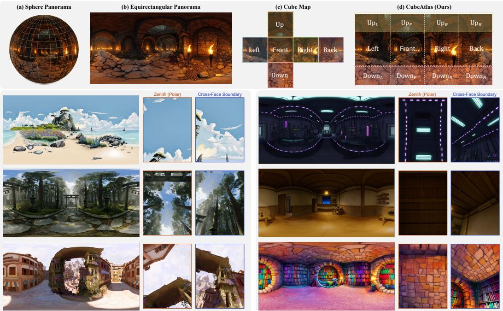  
Figure 1: SQUARING-THE-SPHERE reconciles global panorama continuity with perspectiveface geometry. Upper: ERP represents the full panorama on a single canvas but severely stretches the polar regions; cubemaps preserve perspective geometry but introduce disconnected face boundaries. CubeAtlas packs the four equatorial faces and rotated half-polar regions into a compact canvas, making their geometric adjacencies local for joint generation. Lower: SQUARING-THE-SPHERE produces seamless, geometrically coherent panoramas across diverse indoor and outdoor scenes, shown as ERP renderings with perspective crops.

To address this trade-off, we propose SQUARING-THE-SPHERE, a framework built on a new panorama representation termed CubeAtlas. Rather than generating an ERP image or six independent cube faces, SQUARING-THE-SPHERE unfolds the complete cubemaps into a single image-like grid and enables a diffusion transformer (DiT) (Peebles & Xie, 2023) to model the entire panorama jointly in one forward pass, as illustrated by the CubeAtlas layout in the upper part of Figure 1. By combining half-polar rotation and packing for seam-aware yet compact face alignment with layout aware sparse attention for efficient token interactions, SQUARING-THE-SPHERE promotes crossview continuity without the cost of dense global attention. Crucially, our representation is compatible with existing DiT-based image generators without modifying their backbone architectures or positional encodings, thereby inheriting large-scale 2D image priors with minimal adaptation.

Concretely, CubeAtlas re-arranges the six cubemap faces into a compact three-band, four-column layout, as detailed in Figure 2. For each equatorial orientation, it retains only the equator-adjacent half of the upper and lower faces, rotated to align with the corresponding equatorial view. This halfpolar layout retains the local context needed to connect each polar region to its neighboring equatorial faces while avoiding redundant polar tokens; complementary rotated copies are later combined to reconstruct the complete polar faces. Polar rotation aligns polar content with the correspond ing equatorial views, turning otherwise discontinuous cross-face relationships into locally organized neighborhoods within the grid, thereby facilitating seamless grid-to-ERP assembly. We further introduce layout-aware sparse attention that preserves the intra-face and continuity-related interactions required for panorama generation while masking irrelevant token pairs. Specifically, full attention is retained within each latitude band for horizontal consistency, while cross-latitude communication is mediated solely by the equatorial band: upper and lower regions never interact directly, and each equatorial region attends only to the polar regions on the same left–right or front–back axis. Finally, we reproject the ERP into overlapping perspective cube views and apply a training-free 4× superresolution model (Lu et al., 2026a) to each view. Low-frequency correction preserves coherent color and illumination in the final ERP, while linear blending of overlaps solves discontinuities.

We summarize three contributions of this paper as follows:

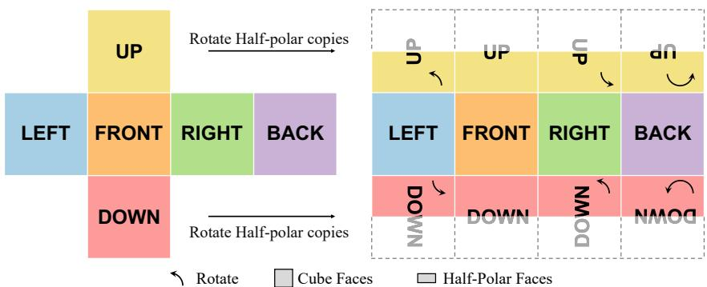  
Figure 2: CubeAtlas representation. Four equatorial faces are unfolded into the central band. The upper and lower faces are rotated into orientation-aligned half-polar copies and placed next to their corresponding equatorial faces, forming a compact layout for joint generation.

• CubeAtlas representation is proposed that unfolds an entire cubemap into a single compact canvas with orientation-aligned half-polar regions. It retains only the equator-adjacent portions of rotated polar copies to reduce redundant polar tokens while preserving the context required for full polar reconstruction. The representation preserves the perspective geometry of cubemaps, while resolving cross-face discontinuities, enabling seamless panorama generation and direct reuse of 2D image priors from pre-trained DiT generators.

• Layout-aware sparse attention retains full attention within each latitude band while restricting cross-band interactions according to the spatial structure of CubeAtlas. This structured connectivity preserves the interactions needed for joint panorama modeling while avoiding unnecessary all-to-all attention among target tokens.

• Comprehensive evaluation. We evaluate panorama generation from complementary perspectives, including distributional fidelity, ERP and cubemap boundary continuity, equatorial and polar perceptual quality, geometric distortion, text adherence, and human preference. Extensive comparisons and controlled ablations across diverse benchmarks demonstrate consistent gains in cross-face continuity and spherical geometric fidelity.

## 2 RELATED WORK

360◦ Panorama Generation. Existing panorama generators are largely distinguished by how they represent the sphere (Xia et al., 2026). ERP-based methods synthesize a single canvas, which facilitates global generation (Chen et al., 2022; Zhang et al., 2024; Feng et al., 2023), but polar stretching creates a mismatch with the perspective-image distribution of pretrained generators. Panoramaspecific adaptations address this mismatch through seam-aware processing (Wu et al., 2026; Kang et al., 2026; Lu et al., 2026b) or hybrid perspective–panorama training (Feng et al., 2026). Cubemapbased methods instead preserve perspective geometry while explicitly adapting the model to communicate across separate faces. CubeDiff (Kalischek et al., 2025) jointly denoises six faces through inflated attention and augments their latents with spherical UV coordinates, while DreamCube (Huang et al., 2025) uses spherical coordinates and synchronizes attention to improve boundary consistency. Although both support joint generation within a single forward pass, they retain separate face-wise spatial grids and introduce panorama-specific positional signals or operators to mitigate cross-face seams. Our method instead packs orientation-aligned cubemap faces into a single CubeAtlas canvas, turning cross-face adjacencies into local 2D neighborhoods and enabling seam-consistent panorama generation with the pretrained DiT’s native positional encoding and backbone structure.

Image-to-Panorama Generation. Image-to-panorama methods extend a narrow-field perspective image into a complete environment. Earlier diffusion-based approaches typically formulate the task as panoramic outpainting, using camera-aware projection and inpainting to align the conditioning image with an ERP target (Wu et al., 2024). More recently, 360Anything (Wu et al., 2026) and HY-Pano 2.0 (HY-World Team et al., 2026) learn the perspective-to-ERP mapping directly from data in a geometry-free manner, without explicit camera metadata or camera calibration. SQUARING-THE-SPHERE shares this geometry-free formulation: it consumes the conditioning image as-is, without camera calibration, explicit input projection, or geometric inpainting. Unlike methods that directly generate ERP, it learns this mapping in the CubeAtlas, whose perspective-aligned layout is better matched to the target image prior.

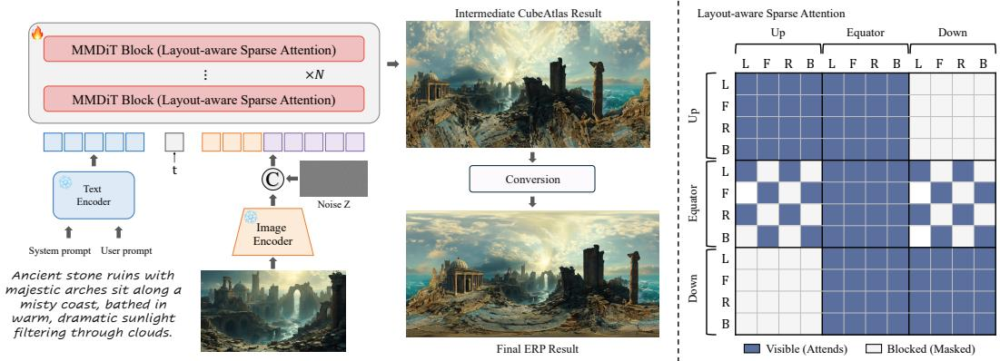  
Figure 3: Overview of SQUARING-THE-SPHERE. Given a perspective image and text prompts, the DiT denoises the complete CubeAtlas in a single pass. Layout-aware sparse attention retains withinband interactions while restricting cross-latitude communication: for each pole, an equatorial region attends only to the two axis-aligned half-polar regions that reconstruct a complete polar face. The generated CubeAtlas is then fused and stitched into the final ERP panorama.

Priors from Generative Image Models. Large-scale diffusion and flow-based image generators (Esser et al., 2024; Black Forest Labs, 2024; Wu et al., 2025) provide strong priors for highfidelity, controllable perspective-image synthesis. Directly transferring these planar priors to ERP panoramas is nevertheless non-trivial: their standard spatial representations do not encode spherical periodicity or polar convergence. Recent training-free adaptations, e.g., SpheRoPE (Hirschorn et al., 2026) and SphereDiff (Park et al., 2026), modify positional encoding or use spherical projection at inference time to inject these spherical constraints into frozen generators (Hayakawa et al., 2026). Such methods demonstrate the useful panoramic priors already present in foundation models, but their generation capability must still be induced at inference time rather than learned in a panoramaspecific representation. SQUARING-THE-SPHERE instead fine-tunes a pre-trained generative DiT on CubeAtlas formulations, preserving its perspective-image prior while learning joint cross-face generation in a representation designed for panoramic continuity.

## 3 METHOD

We introduce SQUARING-THE-SPHERE, an effective approach for generating high-quality, seamless 360◦ panoramas, as provided in Figure 3. We first motivate the CubeAtlas layout by reviewing common panorama representations in Section 3.1. Then we describe model details in Section 3.2.

## 3.1 PANORAMIC REPRESENTATION

A panorama captures a complete 360◦ ×180◦ view of a scene from a fixed viewpoint, and the choice of how to lay this view out on a flat image plane has a decisive effect on generation quality.

## 3.1.1 PREVIOUS REPRESENTATIONS

Equirectangular Projection (ERP). ERP maps longitude and latitude onto the horizontal and vertical axes of a 2 : 1 rectangular image, providing a simple and compact representation of the full sphere. However, its sampling becomes increasingly non-uniform toward the poles, causing severe horizontal stretching and departing from the perspective-image domain of pretrained diffusion models. This mismatch makes it difficult to generate faithful geometry in polar regions. Moreover, spherical continuity is split across the left and right image boundaries, requiring explicit handling of horizontal wrap-around.

Cubemap. A cubemap projects the sphere onto six perspective faces, each with a 90◦ Field-of-View (FoV). It avoids the severe polar stretching of ERP and better aligns with the perspective-image domain of pretrained diffusion models. However, content that is continuous on the sphere is split across separate face boundaries. Without effective cross-face modeling, generated faces can become inconsistent in appearance, semantics, and geometry, resulting in visible seams along cube edges.

## 3.1.2 CUBEATLAS

To unify both advantages, we propose a new representation that retains the perspective-face geometry of cubemaps while organizing their cross-face relationships into a single image-like canvas. Let S denote the side length of each cube face in latent space. We denote the six standard cubemap orientations by $\Omega = \{ \bar { \mathrm { L } } , \mathrm { F } , \mathrm { R } , \mathrm { B } , \mathrm { U } , \mathrm { D } \}$ , corresponding to left, front, right, back, up, and down. The four equatorial orientations $( \mathrm { L } , \mathrm { F } , \mathrm { R } , \bar { \mathrm { B } } )$ are placed side by side in the central band. Jointly denoising this complete band in one forward pass allows the model to learn the horizontal continuity directly.

The more challenging boundaries are vertical. In a conventional cubemap-cross representation, only the front face is directly adjacent to the upper and lower faces; the left, right, and back faces are spatially separated from their corresponding polar neighborhoods and receive incompatible positional relationships. CubeAtlas therefore creates an in-plane-rotated copy of each polar face for every equatorial orientation, such that its equator-adjacent half is vertically aligned with the corresponding equatorial face. We denote these upper half-regions by $\mathrm { U _ { L } , U _ { F } , \bar { U } _ { R } , \bar { U } _ { B } }$ , while the lower ones are $\mathrm { D _ { L } , D _ { F } , D _ { R } , D _ { B } }$ . The core layout of CubeAtlas can be presented as:

$$
\mathrm { C u b e A t l a s } = \left[ \begin{array} { c c c c } { \mathrm { U _ { L } } } & { \mathrm { U _ { F } } } & { \mathrm { U _ { R } } } & { \mathrm { U _ { B } } } \\ { \mathrm { L } } & { \mathrm { F } } & { \mathrm { R } } & { \mathrm { B } } \\ { \mathrm { D _ { L } } } & { \mathrm { D _ { F } } } & { \mathrm { D _ { R } } } & { \mathrm { D _ { B } } } \end{array} \right] \in \mathbb { R } ^ { 2 S \times 4 S \times C } ,\tag{1}
$$

where C is the number of latent channels. The equatorial band [L, F, R, B] has a shape $S \times 4 S \times C$ while the upper and lower polar bands $[ \mathrm { U _ { L } , U _ { F } , \bar { U } _ { R } , U _ { B } } ]$ and $\mathrm { \bar { [ D _ { L } , D _ { F } , \bar { D } _ { R } , D _ { B } ] } }$ each has a shape $( S / 2 ) \times 4 \bar { S } ^ { ^ { . } } \times C$ . Thus, each equatorial face is locally connected to its corresponding upper and lower neighborhoods. Meanwhile, full attention within each polar band lets the differently oriented half-regions learn a consistent polar appearance, jointly resolving the cubemap seams.

Although each pole is represented by four rotated copies, CubeAtlas retains only the equatoradjacent half of each copy. Its core canvas therefore has size $2 S \times 4 S \times C$ , equal to an ERP latent canvas at the same resolution, while retaining the perspective geometry of cubemap faces. This half-polar packing avoids redundant polar tokens and keeps the base computation comparable to ERP even before the further savings from our sparse attention mask. To encode horizontal periodicity, we append a context strip copied from the left edge to the right boundary before VAE encoding. The resulting CubeAtlas is processed as a single image in one VAE forward pass, producing the latent representation used for diffusion training.

Representation Conversion. During training, panoramas are represented and supervised directly in CubeAtlas space. To remain compatible with standard panorama rendering, storage, and evaluation pipelines, a generated CubeAtlas is deterministically converted into a standard cubemap and subsequently into ERP. The equatorial band directly provides the four lateral faces, while the rotated half-regions in the upper and lower bands provide complementary observations for reconstructing the two polar faces. All polar reconstruction and blending operations are performed in pixel space after decoding the CubeAtlas latents.

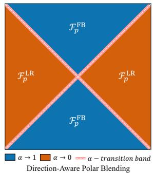

We first form two complementary full-face fusions. For the upper pole, the front- and back-aligned half-regions $\big ( \mathrm { U } _ { \mathrm { F } } , \mathrm { U } _ { \mathrm { B } } \big )$ are rotated back to their canonical orientations and joined to form a

Figure 4: The direction-aware polar blending mask.

front–back (FB) estimate $\mathcal { F } _ { \mathrm { U } } ^ { \mathrm { F B } }$ . Similarly, $( \mathrm { U } _ { \mathrm { L } } , \mathrm { U } _ { \mathrm { R } } )$ form a left–right (LR) estimate $\mathcal { F } _ { \mathrm { U } } ^ { \mathrm { L R } }$ . Because each pair contains complementary halves of the same polar face, joining them along their shared boundary recovers a complete face. We construct $\mathcal { F } _ { \mathrm { D } } ^ { \mathrm { F B } }$ and $\mathcal { F } _ { \mathrm { D } } ^ { \mathrm { L R } }$ for the lower pole in the same manner. The resulting FB and LR fusions are geometrically aligned estimates of the same polar face, supported by complementary directional observations. Although joint CubeAtlas generation already encourages them to be consistent, local differences may remain around complex structures near the polar center. We therefore combine two estimates using the direction-aware blending rule as illustrated in Figure 4. For each reconstructed polar face, let $( u , v ) \in [ - 1 , 1 ] ^ { 2 }$ denote its normalized pixel coordinates. For $p \in \{ \mathrm { U } , \mathrm { D } \}$ , the rule favors $\mathcal { F } _ { p } ^ { \mathrm { F B } }$ where $| v | > | u |$ and $\mathcal { F } _ { p } ^ { \mathrm { L R } }$ where $| u | > | v |$ , while smoothly blending them near the diagonals $| u | \approx | v |$ . With blending width τ and $[ \cdot ] _ { 0 } ^ { \mathrm { i } } = \dot { \mathrm { c l i p } } ( \cdot , 0 , 1 )$ , we obtain:

$$
\alpha ( u , v ) = \bigg [ \frac { | v | - | u | + \tau } { 2 \tau } \bigg ] _ { 0 } ^ { 1 } , \qquad \mathcal { F } _ { p } = \alpha \mathcal { F } _ { p } ^ { \mathrm { F B } } + ( 1 - \alpha ) \mathcal { F } _ { p } ^ { \mathrm { L R } } , \quad p \in \{ \mathrm { U } , \mathrm { D } \} .\tag{2}
$$

This fusion preserves the directional consistency of all four polar observations and provides a smooth transition between the FB- and LR-dominant regions. The reconstructed upper and lower faces, together with the four equatorial faces, form a standard cubemap, which is finally reprojected into the output ERP panorama.

## 3.2 MODEL DESIGN

Geometry-Free Panorama Generation. We build SQUARING-THE-SPHERE on a pre-trained image-editing DiT. The conditioning image is consumed directly: we neither estimate nor provide camera intrinsics, camera pose, or an explicit projection of the input onto the sphere. Instead, the model learns from data how to place the input content on the $3 6 0 ^ { \circ }$ CubeAtlas layout and synthesize its surrounding context.

The conditioning image follows the standard dual-path design. It is jointly encoded with the text by the frozen multimodal encoder (Bai et al., 2025) for semantic context, and independently encoded by the frozen VAE into clean visual condition tokens. These condition tokens are concatenated with noisy CubeAtlas target tokens, and the DiT operates on the joint text, target, and condition sequence. We fully fine-tune the DiT using the standard linear flow-matching objective, which predicts $\epsilon - x _ { 0 }$ from $x _ { \sigma } = ( 1 - \sigma ) x _ { 0 } + \sigma \epsilon$ , with σ sampled from a logit-normal distribution. We make no changes to the DiT architecture or its rotary position embeddings. Consequently, SQUARING-THE-SPHERE preserves the strong perspective-image prior of the base model while adapting it to joint panorama generation in CubeAtlas space.

Layout-Aware Sparse Attention. Although the CubeAtlas canvas has a token count comparable to that of ERP, dense attention over all its regions is not always necessary to maintain panoramic consistency. A key advantage of CubeAtlas is that it makes geometrically adjacent faces locally connected while retaining a structured decomposition of the panorama. We exploit this property with a layout-aware sparse attention mask over target-to-target interactions; text and condition tokens remain globally connected to every target token.

Specifically, we partition the target into upper, equatorial, and lower bands. We retain full attention within each band to preserve horizontal consistency, but block direct interactions between the upper and lower polar bands. For cross-latitude communication, each equatorial face attends only to the polar half-regions aligned with its axis. For example, L attends to $\{ \mathrm { U _ { L } , U _ { R } , D _ { L } , D _ { R } } \}$ , whose complementary halves reconstruct its neighboring upper and lower faces. Conversely, a polar query attends to all equatorial keys, allowing the equatorial band to serve as the cross-latitude bridge. Overall, the layout-aware mask retains 75% of the target-to-target attention connectivity of dense attention, as illustrated in Figure 3, while text and image-conditioning tokens remain globally connected to all target tokens. Blocking direct attention between some regions does not prevent information exchange: features can still propagate through the equatorial band across successive DiT layers. The mask therefore structures cross-region communication rather than separating the panorama into independently modeled regions. Our experiments further show that this structured sparsity supports cross-view consistency while improving efficiency.

Panoramic Super-Resolution. To obtain high-resolution panoramas without heavy training, we apply a frozen 4× Pixel Diffusion Decoder (PiD) (Lu et al., 2026a) in perspective space. Specifically, the fused ERP is reprojected into six overlapping cubemap views with an enlarged FoV of $9 2 . 7 9 ^ { \circ }$ , which are independently enhanced by PiD and mapped back to the ERP domain. This process upsamples the base panorama by 4× along each spatial dimension, producing 10k ERP panoramas. We linearly blend overlapping regions outside the FoV range of $\mathrm { { \dot { 9 } 0 ^ { \circ } } }$ to suppress cross-view discontinuities. Since generative super-resolution may introduce low-frequency shifts, we further apply a correction strategy (Yue et al., 2025) to anchor the global color and illumination to the base panorama while retaining the generated high-frequency details.

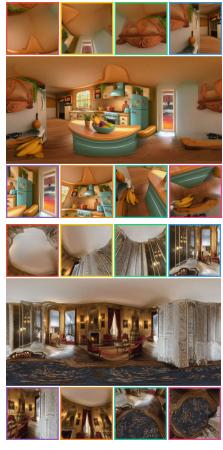

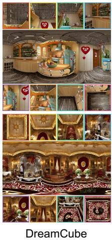

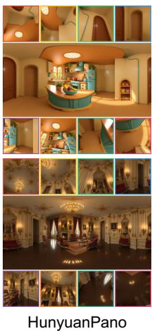

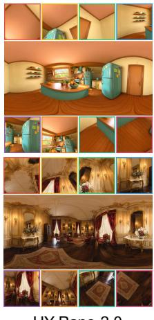

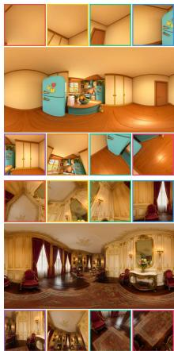  
Ours  
Figure 5: Qualitative comparison with perspective cubemaps. Our results enjoy superior crossface structures and pole geometry compared to ERP-native and cubemap-based baselines.

## 4 EXPERIMENTS

Implementation Details. We initialize SQUARING-THE-SPHERE from Wu et al. (2025). The VAE and Qwen2.5-VL condition encoder are kept frozen, while the denoising Transformer is fully fine-tuned for 8,000 steps with a global batch size of 64 and a learning rate of $\mathrm { \bar { 1 } 0 ^ { - 5 } }$ . We apply Flex-Attention (Guessous et al., 2024) for the sparse attention implementation. Each cubemap face in CubeAtlas has a resolution of 640 × 640, corresponding to a fused ERP panorama of 1280 × 2560. The super-resolution stage further upsamples the panorama by 4× along each spatial dimension, producing a 5120 × 10240 panorama with a horizontal resolution of 10K. Our evaluation benchmark consists of 100 self-collected images, together with 100, 100, and 118 panoramas from the RealSee3D (Li et al., 2026), Laval-Indoor (Gardner et al., 2017), and SUN360 (Xiao et al., 2012) test sets, respectively. We compare against CubeDiff (Kalischek et al., 2025), DreamCube (Huang et al., 2025), HunyuanPano (HunyuanWorld et al., 2025), and HY-Pano-2.0 (HY-World Team et al., 2026) using their official inference configurations. Unless otherwise specified, all comparisons are conducted on the base-resolution outputs without super-resolution refinement, ensuring a fair com parison across methods. Additional datasets and evaluation details are provided in Section B.

## 4.1 MAIN RESULTS

Quantitative Results. Table 1 compares SQUARING-THE-SPHERE with representative panorama generation systems. The metrics cover distributional fidelity (FID, KID, and CLIP-FID), ERP and cubemap boundary continuity $( \mathrm { S e a m } _ { \mathrm { E R P } } , \mathrm { S e a m } _ { \mathrm { C u b e } } )$ , equatorial and polar perceptual and geometric quality $( \mathrm { E q ^ { \ast } } ^ { \ast }$ and Pole-\*), and prompt adherence (TextAdh); full definitions are provided in Section D. SQUARING-THE-SPHERE achieves the lowest Seam on all four benchmarks, reducing the cube-edge error by 63–78% relative to CubeDiff. These results support the effectiveness of generating a single canvas directly to eliminate cross-face discontinuities. Note that at Seam values around 0.01, further numerical differences may not translate into perceptible differences in boundary seams. We therefore interpret this metric together with the qualitative comparisons. SQUARING-THE-SPHERE also leads Eq-GI and Pole-GI on every benchmark and ranks first or second in Pole-IQ, demonstrating improved equatorial and polar geometry. Meanwhile, it achieves the best CLIP-FID on all three public benchmarks, leads FID and KID on RealSee3D and FID on Laval-Indoor, and obtains the highest TextAdh. These results confirm that SQUARING-THE-SPHERE improves spherical structure without sacrificing visual realism or textual consistency.

Qualitative Results. Figure 5 compares SQUARING-THE-SPHERE with CubeDiff, DreamCube, HunyuanPano, and HY-Pano-2.0 using perspective cubemap views. Across diverse indoor and outdoor scenes, SQUARING-THE-SPHERE maintains coherent geometry and lighting across both the ERP wrap boundary and adjacent cubemap views, while conventional cubemap-based methods often exhibit visible face seams. In the upper and lower polar regions, it also substantially reduces the radial stretching, pinching, and structural collapse typical of direct ERP generation. These visual improvements align with the seam-continuity and regional-geometry results in Table 1.

Table 1: Quantitative image-to-panorama comparison on our self-collected set, RealSee3D, Laval-Indoor, and SUN360. FID, KID, and CLIP-FID are evaluated by $9 0 °$ perspective views split along 12 icosahedral directions (eight valid directions for Laval-Indoor) and are not reported on the self-collected set without ground-truth ERPs. ${ \mathrm { S e a m } } _ { \mathrm { C u b e } }$ is reported only for methods with native cube-face outputs.
<table><tr><td>Method</td><td>FID↓</td><td>KID↓</td><td>CLIP-FID ↓</td><td>SeamERP ↓</td><td>SeamCube ↓ Eq-IQ ↑ Eq-Aes ↑ Eq-GI ↑ Pole-IQ ↑</td><td></td><td></td><td></td><td></td><td></td><td>Pole-GI↑ TextAdh ↑</td></tr><tr><td colspan="10">Self-Collected</td></tr><tr><td>CubeDiff</td><td></td><td></td><td></td><td>0.0126</td><td>0.0361</td><td>3.685</td><td>3.565</td><td>3.465</td><td>3.780</td><td>3.725</td><td>4.100</td></tr><tr><td>DreamCube</td><td></td><td></td><td></td><td>0.0279</td><td>0.0445</td><td>2.730</td><td>2.605</td><td>2.607</td><td>2.870</td><td>2.935</td><td>3.490</td></tr><tr><td>HunyuanPano</td><td></td><td></td><td></td><td>0.0154</td><td></td><td>4.475</td><td>4.247</td><td>4.468</td><td>4.495</td><td>4.120</td><td>4.300</td></tr><tr><td>HY-Pano-2.0</td><td></td><td></td><td></td><td>0.0199</td><td></td><td>4.580</td><td>4.355</td><td>4.480</td><td>4.705</td><td>4.685</td><td>4.470</td></tr><tr><td>Ours</td><td></td><td></td><td></td><td>0.0142</td><td>0.0132</td><td>4.690</td><td>4.402</td><td>4.782</td><td>4.675</td><td>4.730</td><td>4.640</td></tr><tr><td colspan="10">RealSee3D</td></tr><tr><td>CubeDiff</td><td>47.10</td><td>0.0085</td><td>5.60</td><td>0.0083</td><td>0.0229</td><td>3.217</td><td>2.803</td><td>3.375</td><td>3.700</td><td>3.770</td><td>3.060</td></tr><tr><td>DreamCube</td><td>61.66</td><td>0.0189</td><td>10.93</td><td>0.0189</td><td>0.0286</td><td>2.960</td><td>2.715</td><td>2.980</td><td>3.360</td><td>3.500</td><td>3.370</td></tr><tr><td>HunyuanPano</td><td>42.05</td><td>0.0068</td><td>4.61</td><td>0.0080</td><td></td><td>4.093</td><td>3.415</td><td>4.450</td><td>4.400</td><td>4.175</td><td>3.120</td></tr><tr><td>HY-Pano-2.0</td><td>38.96</td><td>0.0050</td><td>3.00</td><td>0.0121</td><td></td><td>4.758</td><td>4.250</td><td>4.787</td><td>4.795</td><td>4.735</td><td>4.380</td></tr><tr><td>Ours</td><td>35.54</td><td>0.0036</td><td>2.50</td><td>0.0085</td><td>0.0064</td><td>4.723</td><td>4.062</td><td>4.867</td><td>4.820</td><td>4.795</td><td>4.620</td></tr><tr><td colspan="10">Laval-Indoor</td></tr><tr><td></td><td></td><td></td><td>7.75</td><td>0.0064</td><td>0.0181</td><td>3.235</td><td>2.665</td><td>3.385</td><td>3.815</td><td>3.900</td><td>3.450</td></tr><tr><td>CubeDiff DreamCube</td><td>55.17 92.06</td><td>0.0082 0.0334</td><td>22.14</td><td>0.0245</td><td>0.0306</td><td>2.658</td><td>2.290</td><td>2.708</td><td>3.130</td><td>3.355</td><td>3.350</td></tr><tr><td>HunyuanPano</td><td>45.58</td><td>0.0049</td><td>4.31</td><td>0.0051</td><td></td><td>3.895</td><td>3.277</td><td>4.548</td><td>4.430</td><td>4.105</td><td>3.760</td></tr><tr><td>HY-Pano-2.0</td><td>45.34</td><td>0.0034</td><td>6.08</td><td>0.0094</td><td></td><td>4.228</td><td>3.635</td><td>4.482</td><td>4.740</td><td>4.680</td><td>4.480</td></tr><tr><td>Ours</td><td>43.37</td><td>0.0037</td><td>4.03</td><td>0.0070</td><td>0.0039</td><td>4.237</td><td>3.625</td><td>4.750</td><td>4.665</td><td>4.710</td><td>4.670</td></tr><tr><td colspan="10">SUN360</td></tr><tr><td></td><td></td><td></td><td>12.30</td><td>0.0125</td><td>0.0315</td><td>2.557</td><td>2.284</td><td>2.716</td><td>3.123</td><td>3.089</td><td>3.051</td></tr><tr><td>CubeDiff DreamCube</td><td>75.41 66.28</td><td>0.0318 0.0301</td><td>14.05</td><td>0.0192</td><td>0.0281</td><td>2.617</td><td>2.445</td><td>2.737</td><td>3.267</td><td>3.483</td><td>3.508</td></tr><tr><td>HunyuanPano</td><td>37.28</td><td>0.0103</td><td>7.11</td><td>0.0069</td><td></td><td>3.710</td><td>3.364</td><td>4.059</td><td>4.072</td><td>3.877</td><td>3.441</td></tr><tr><td>HY-Pano-2.0</td><td>36.71</td><td>0.0076</td><td>5.75</td><td>0.0106</td><td></td><td>4.017</td><td>3.843</td><td>4.222</td><td>4.496</td><td>4.369</td><td>4.424</td></tr><tr><td>Ours</td><td>38.70</td><td>0.0105</td><td>5.62</td><td>0.0101</td><td>0.0068</td><td>4.184</td><td>3.843</td><td>4.379</td><td>4.530</td><td>4.470</td><td>4.661</td></tr></table>

Table 2: Ablation on panorama representation and efficiency-oriented designs. “Tokens” denotes the target-token sequence length, and “Time” denotes denoising time under the same settings. Both are reported as relative multipliers normalized to the ERP baseline (1.00×). “Sparse Attn.” indicates the layout-aware sparse attention used by SQUARING-THE-SPHERE.
<table><tr><td rowspan="2">Variant</td><td colspan="2">Computational Profile</td><td colspan="8">Quality and Continuity</td></tr><tr><td>Tokens</td><td>Time</td><td>SeamERP ↓</td><td> ${ \mathrm { S e a m } } _ { \mathrm { C u b e } } \downarrow$ </td><td>Eq-IQ↑</td><td>Eq-Aes↑</td><td>Eq-GI↑</td><td>Pole-IQ↑</td><td>Pole-GI↑</td><td>TextAdh↑</td></tr><tr><td>ERP</td><td>1.00×</td><td>1.00×</td><td>0.0209</td><td></td><td>4.607</td><td>4.370</td><td>4.575</td><td>4.690</td><td>4.660</td><td>4.550</td></tr><tr><td>Cubemap</td><td>0.75×</td><td>0.76×</td><td>0.0147</td><td>0.0260</td><td>4.428</td><td>4.270</td><td>4.332</td><td>4.490</td><td>4.455</td><td>4.560</td></tr><tr><td>CubeAtlas</td><td>1.00×</td><td>1.00×</td><td>0.0103</td><td>0.0143</td><td>4.697</td><td>4.353</td><td>4.690</td><td>4.705</td><td>4.705</td><td>4.640</td></tr><tr><td>+ Sparse Attn.</td><td>1.00×</td><td>0.84×</td><td>0.0142</td><td>0.0132</td><td>4.690</td><td>4.402</td><td>4.782</td><td>4.675</td><td>4.730</td><td>4.640</td></tr></table>

## 4.2 ABLATION

Panorama Representation. We first compare our CubeAtlas with ERP and cubemap generation, while keeping the backbone and other training settings fixed. Both the ERP baseline and CubeAtlas use the same horizontal padding scheme, while all results are obtained without super-resolution or additional restoration for fair comparisons. As shown in Table 2, cubemap avoids ERP’s polar distortion but suffers from serious cube-boundary inconsistency. CubeAtlas substantially reduces this error and achieves the strongest Eq-IQ and Pole-IQ, together with competitive distortion scores. The visual comparison in Figure 6 further shows that CubeAtlas reduces both cross-face discontinuities in the cubemap and polar deformation in ERP.

Layout-Aware Sparse Attention. We compare dense and sparse attention under the same CubeAt las representation. As shown in Table 2, sparse attention preserves comparable overall generation quality: it reduces ${ \mathrm { S e a m } } _ { \mathrm { C u b e } }$ and improves Eq-Aes, Eq-GI, and Pole-GI, while incurring only minor degradations in Eq-IQ and Pole-IQ and a modest increase in $\mathrm { S e a m } _ { \mathrm { E R P } }$ . By reducing unnecessary target-to-target interactions, the sparse mask lowers the attention cost of CubeAtlas without changing its token count. Across representations, cubemap remains the most efficient due to its smaller token budget, whereas CubeAtlas is more efficient than ERP at the same token count. Importantly, CubeAtlas delivers consistently better generation quality than both representations, as shown quantitatively in Table 2 and qualitatively in Figure 6.

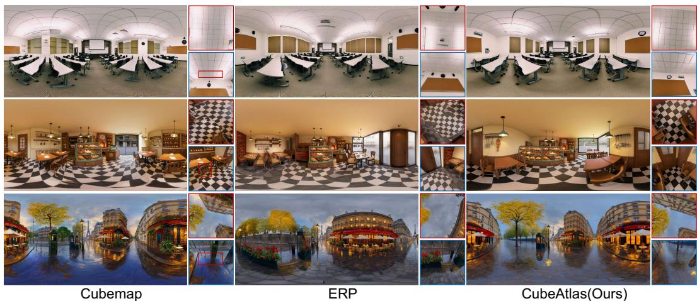

Figure 6: Visual comparison of panorama representations. CubeAtlas reduces cubemap face discontinuities while preserving polar structures more faithfully than direct ERP generation.  
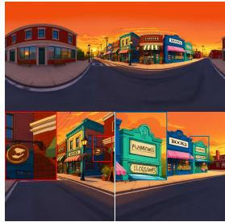  
Native Sampling

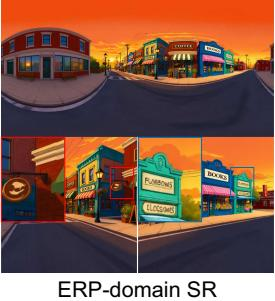

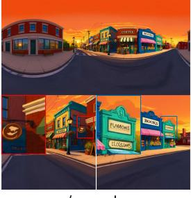

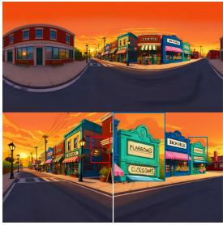  
Ours  
Figure 7: Qualitative comparison of panoramic super-resolution. Our method recovers sharper details while maintaining cross-face consistency.

Panoramic Super-Resolution. Figure 7 compares native interpolation-based sampling, ERPbased super-resolution, perspective super-resolution without overlap fusion, and our full pipeline. The interpolation-based sampling lacks fine detail, while ERP-based processing produces uneven enhancement because of spherical distortion. Processing cubemap views without overlap fusion sharpens local details but introduces inconsistencies across face boundaries. Our full pipeline recovers sharper structures and textures while maintaining a coherent appearance across the panorama.

## 5 CONCLUSION

We presented SQUARING-THE-SPHERE, a representation-driven framework for text-guided imageto-panorama generation. Its CubeAtlas representation jointly generates a compact grid of equatorial faces and rotated half-polar regions, combining cubemap perspective geometry with global continuity while retaining an ERP-like token count. Layout-aware sparse attention further removes unnecessary cross-region interactions, and geometry-free conditioning transfers pretrained image priors without camera calibration or architectural modification. A training-free perspective-space superresolution stage produces the final high-resolution ERP. Across diverse benchmarks, SQUARING-THE-SPHERE improves seam continuity and spherical geometry while preserving visual fidelity and text adherence. These results highlight panorama representation as a simple and effective route for adapting generative image models to omnidirectional synthesis.

## AI USE STATEMENT

In this work, we used generative AI tools to assist with manuscript writing and language editing. We also used generative AI tools to generate textual captions for training and evaluation, and to perform automated evaluation. We have reviewed all AI-assisted work. We take responsibility for the final content of this work, including text, claims or artifacts produced with the aid of generative AI.

## REFERENCES

Shuai Bai, Keqin Chen, Xuejing Liu, Jialin Wang, Wenbin Ge, Sibo Song, Kai Dang, Peng Wang, Shijie Wang, Jun Tang, Humen Zhong, Yuanzhi Zhu, Mingkun Yang, Zhaohai Li, Jianqiang Wan, Pengfei Wang, Wei Ding, Zheren Fu, Yiheng Xu, Jiabo Ye, Xi Zhang, Tianbao Xie, Zesen Cheng, Hang Zhang, Zhibo Yang, Haiyang Xu, and Junyang Lin. Qwen2.5-VL technical report. arXiv preprint arXiv:2502.13923, 2025.

Mikołaj Binkowski, Danica J. Sutherland, Michael Arbel, and Arthur Gretton. Demystifying MMD´ GANs. In International Conference on Learning Representations (ICLR), 2018.

Black Forest Labs. FLUX. https://github.com/black-forest-labs/flux, 2024.

Vukasin Bozic, Isidora Slavkovic, Dominik Narnhofer, Nando Metzger, Denis Rozumny, Konrad Schindler, and Nikolai Kalischek. Unified panoramic geometry estimation via multi-view foundation models. arXiv preprint arXiv:2605.26368, 2026.

Siyu Cao, Hangting Chen, Peng Chen, Yiji Cheng, Yutao Cui, Xinchi Deng, Ying Dong, Kipper Gong, Tianpeng Gu, Xiusen Gu, et al. HunyuanImage 3.0 technical report. arXiv preprint arXiv:2509.23951, 2025.

Zhaoxi Chen, Guangcong Wang, and Ziwei Liu. Text2Light: Zero-shot text-driven HDR panorama generation. ACM Transactions on Graphics, 41(6):195:1–195:16, 2022. doi: 10.1145/3550454. 3555447.

Patrick Esser, Sumith Kulal, Andreas Blattmann, Rahim Entezari, Jonas Muller, Harry Saini, Yam¨ Levi, Dominik Lorenz, Axel Sauer, Frederic Boesel, Dustin Podell, Tim Dockhorn, Zion English, and Robin Rombach. Scaling rectified flow transformers for high-resolution image synthesis. In Proceedings ofthe 41st International Conference on Machine Learning, volume 235 of Proceedings ofMachine Learning Research, pp. 12606–12633. PMLR, 2024.

Haoran Feng, Dizhe Zhang, Xiangtai Li, Bo Du, and Lu Qi. DiT360: High-fidelity panoramic image generation via hybrid training. In Proceedings ofthe IEEE/CVF Conference on Computer Vision and Pattern Recognition (CVPR), pp. 23367–23377, 2026.

Mengyang Feng, Jinlin Liu, Miaomiao Cui, and Xuansong Xie. Diffusion360: Seamless 360 degree panoramic image generation based on diffusion models. arXiv preprint arXiv:2311.13141, 2023.

Marc-Andre Gardner, Kalyan Sunkavalli, Ersin Yumer, Xiaohui Shen, Emiliano Gambaretto, Chris-´ tian Gagne, and Jean-Franc¸ois Lalonde. Learning to predict indoor illumination from a single´ image. ACM Transactions on Graphics, 36(6):1–14, 2017. doi: 10.1145/3130800.3130891.

Driss Guessous, Yanbo Liang, Joy Dong, and Horace He. FlexAttention: The flexibility of PyTorch with the performance of FlashAttention. https://pytorch.org/blog/ flexattention/, 2024. Accessed: 2026-09-18.

Akio Hayakawa, Yusuke Mukuta, and Tatsuya Harada. Linear fusion MultiDiffusion for fast training-free spherical panorama generation. In Computer Vision – ECCV 2026, volume 17075 of Lecture Notes in Computer Science, pp. 439–455. Springer Nature Switzerland, 2026. doi: 10.1007/978-3-032-37032-7 24.

Martin Heusel, Hubert Ramsauer, Thomas Unterthiner, Bernhard Nessler, and Sepp Hochreiter. GANs trained by a two time-scale update rule converge to a local Nash equilibrium. In Advances in Neural Information Processing Systems (NeurIPS), 2017.

Or Hirschorn, Aaron Olender, Eli Alshan, Ianir Ideses, Lior Fritz, and Sagie Benaim. SpheRoPE: Zero-shot optimization-free 360◦ panorama generation with spherical RoPE. arXiv preprint arXiv:2606.32033, 2026.

Yukun Huang, Yanning Zhou, Jianan Wang, Kaiyi Huang, and Xihui Liu. DreamCube: RGB-D panorama generation via multi-plane synchronization. In Proceedings of the IEEE/CVF International Conference on Computer Vision (ICCV), pp. 24922–24932, October 2025.

Yukun Huang, Jiwen Yu, Yanning Zhou, Jianan Wang, Xintao Wang, Pengfei Wan, and Xihui Liu. OmniX: From unified panoramic generation and perception to graphics-ready 3D scenes. In European Conference on Computer Vision (ECCV), pp. 547–565, 2026.

Humus. Humus: Textures. https://www.humus.name/index.php?page=Textures, n.d. Accessed: 2026-09-18.

Team HunyuanWorld, Zhenwei Wang, Yuhao Liu, Junta Wu, Zixiao Gu, Haoyuan Wang, Xuhui Zuo, Tianyu Huang, Wenhuan Li, Sheng Zhang, et al. HunyuanWorld 1.0: Generating immersive, explorable, and interactive 3D worlds from words or pixels. arXiv preprint arXiv:2507.21809, 2025.

HY-World Team, Chenjie Cao, Xuhui Zuo, Zhenwei Wang, Yisu Zhang, Junta Wu, Zhenyang Liu, Yuning Gong, Yang Liu, Bo Yuan, et al. HY-World 2.0: A multi-modal world model for reconstructing, generating, and simulating 3D worlds. arXiv preprint arXiv:2604.14268, 2026.

Chenhao Ji, Weicai Ye, Zheng Chen, Junyao Gao, Xiaoshui Huang, Xuekuan Wang, Guofeng Zhang, Songhai Zhang, Tong He, Wanli Ouyang, and Cairong Zhao. DiffPano++: Scalable and consistent multi-view panorama generation with spherical epipolar-aware diffusion. International Journal of Computer Vision, 134(4):154, 2026. doi: 10.1007/s11263-026-02758-7.

Jinrang Jia, Zhenjia Li, Yijiang Hu, and Yifeng Shi. PanoWorld: A generative spatial world model for consistent whole-house panorama synthesis. arXiv preprint arXiv:2605.17916, 2026.

Nikolai Kalischek, Michael Oechsle, Fabian Manhardt, Philipp Henzler, Konrad Schindler, and Federico Tombari. CubeDiff: Repurposing diffusion-based image models for panorama generation. In International Conference on Learning Representations (ICLR), volume 2025, pp. 81169–81181, 2025.

Jungwoon Kang, Jaehun Kim, Yiwon Yu, Hyungyum Jang, Sanghoon Lee, and Jongyoo Kim. SHERPA: Seam-aware harmonized ERP adaptation for open-domain 360◦ panorama generation. arXiv preprint arXiv:2606.12213, 2026.

Tuomas Kynka¨anniemi, Tero Karras, Miika Aittala, Timo Aila, and Jaakko Lehtinen. The role ¨ of ImageNet classes in Frechet inception distance. In´ International Conference on Learning Representations (ICLR), 2023.

Linyuan Li, Yan Wu, Xi Li, Lingli Wang, Tong Rao, Jie Zhou, Cihui Pan, and Xinchen Hui. Realsee3D: A large-scale multi-view RGB-D dataset of indoor scenes. Zenodo, 2026. Version v1.1.0.

Dong Liang, Yuhao Liu, Jinyuan Jia, Youjun Zhao, and Rynson W. H. Lau. World-Shaper: A unified framework for 360◦ panoramic editing. In Proceedings of the 43rd International Conference on Machine Learning, volume 306 of Proceedings ofMachine Learning Research. PMLR, 2026.

Taiming Lu, Tianmin Shu, Alan Yuille, Daniel Khashabi, and Jieneng Chen. GenEx: Generating an explorable world. In International Conference on Learning Representations (ICLR), pp. 52310– 52335, 2025.

Yifan Lu, Qi Wu, Jay Zhangjie Wu, Zian Wang, Huan Ling, Sanja Fidler, and Xuanchi Ren. PiD: Fast and high-resolution latent decoding with pixel diffusion. arXiv preprint arXiv:2605.23902, 2026a.

Yuqin Lu, Haofeng Liu, Yang Zhou, Yihua Dai, Guiqing Li, Shengfeng He, and Jun Liang. Gimbal360: Canonicalizing planar diffusion for spherical panorama completion. arXiv preprint arXiv:2603.23179, 2026b.

Mapillary. Mapillary. https://www.mapillary.com/, n.d. Accessed: 2026-09-18.

Minho Park, Taewoong Kang, Jooyeol Yun, Sungwon Hwang, and Jaegul Choo. SphereDiff: Tuning-free 360◦ static and dynamic panorama generation via spherical latent representation. Proceedings of the AAAI Conference on Artificial Intelligence, 40(10):8305–8313, 2026. doi: 10.1609/aaai.v40i10.37779.

Gaurav Parmar, Richard Zhang, and Jun-Yan Zhu. On aliased resizing and surprising subtleties in GAN evaluation. In Proceedings of the IEEE/CVF Conference on Computer Vision and Pattern Recognition (CVPR), pp. 11400–11410. IEEE, 2022.

William Peebles and Saining Xie. Scalable diffusion models with transformers. In Proceedings of the IEEE/CVF International Conference on Computer Vision (ICCV), pp. 4172–4182. IEEE, 2023.

Poly Haven. Poly Haven: HDRIs. https://polyhaven.com/hdris, n.d. Accessed: 2026- 09-18.

Shitao Tang, Fuyang Zhang, Jiacheng Chen, Peng Wang, and Yasutaka Furukawa. MVDiffusion: Enabling holistic multi-view image generation with correspondence-aware diffusion. In Advances in Neural Information Processing Systems, volume 36, pp. 51202–51233, 2023.

World Labs. Marble. https://marble.worldlabs.ai/, 2025. Online; accessed August 1, 2026.

Chenfei Wu, Jiahao Li, Jingren Zhou, Junyang Lin, Kaiyuan Gao, Kun Yan, Sheng-ming Yin, Shuai Bai, Xiao Xu, Yilei Chen, Yuxiang Chen, Zecheng Tang, Zekai Zhang, Zhengyi Wang, An Yang, Bowen Yu, Chen Cheng, Dayiheng Liu, Deqing Li, Hang Zhang, Hao Meng, Hu Wei, Jingyuan Ni, Kai Chen, Kuan Cao, Liang Peng, Lin Qu, Minggang Wu, Peng Wang, Shuting Yu, Tingkun Wen, Wensen Feng, Xiaoxiao Xu, Yi Wang, Yichang Zhang, Yongqiang Zhu, Yujia Wu, Yuxuan Cai, and Zenan Liu. Qwen-Image technical report. arXiv preprint arXiv:2508.02324, 2025.

Tianhao Wu, Chuanxia Zheng, and Tat-Jen Cham. PanoDiffusion: 360-degree panorama outpainting via diffusion. In International Conference on Learning Representations (ICLR), 2024.

Ziyi Wu, Daniel Watson, Andrea Tagliasacchi, David J. Fleet, Marcus A. Brubaker, and Saurabh Saxena. 360Anything: Geometry-free lifting of images and videos to 360◦. In European Conference on Computer Vision (ECCV), 2026.

Jiyuan Xia, Yuanshen Guan, Ruikang Xu, and Zhiwei Xiong. Arbitrary-shaped image generation via spherical neural field diffusion. In The Fourteenth International Conference on Learning Representations, 2026. URL https://openreview.net/forum?id=UNeL5NdLzc.

Jianxiong Xiao, Krista A. Ehinger, Aude Oliva, and Antonio Torralba. Recognizing scene viewpoint using panoramic place representation. In Proceedings of the IEEE Conference on Computer Vision and Pattern Recognition (CVPR), pp. 2695–2702, 2012. doi: 10.1109/CVPR.2012.6247991.

Zongsheng Yue, Kang Liao, and Chen Change Loy. Arbitrary-steps image super-resolution via diffusion inversion. In Proceedings ofthe IEEE/CVF Conference on Computer Vision and Pattern Recognition (CVPR), pp. 23153–23163, 2025.

Cheng Zhang, Qianyi Wu, Camilo Cruz Gambardella, Xiaoshui Huang, Dinh Phung, Wanli Ouyang, and Jianfei Cai. Taming stable diffusion for text to 360◦ panorama image generation. In Proceedings of the IEEE/CVF Conference on Computer Vision and Pattern Recognition (CVPR), pp. 6347–6357. IEEE, 2024.

## APPENDIX

## A LIMITATIONS

Our current model is trained and evaluated at a fixed base resolution and does not explicitly support arbitrary-resolution generation. In practice, however, the perspective-space super-resolution pipeline produces panoramas up to 5120 × 10240 resolution, which is sufficient for most downstream applications and makes output resolution unlikely to be a practical bottleneck. As a generative model, SQUARING-THE-SPHERE also depends on the quality of its textual conditioning. We observe that accurate and detailed captions provide substantially stronger semantic guidance, particularly for regions that are not visible in the input perspective image, whereas vague or incomplete descriptions may lead to less coherent or less controllable generations. More fundamentally, generating a complete 360◦ environment from a single perspective observation is inherently under-constrained. Content outside the observed FoV must be synthesized rather than faithfully recovered, and multiple plausible panoramas may correspond to the same input image. Finally, our current study focuses on static panoramas. Extending CubeAtlas to temporally consistent panoramic video and interactive scene generation remains an interesting direction for future work.

## B SUPPLEMENTARY IMPLEMENTATION DETAILS

Training Datasets. Our training corpus combines publicly available, internally collected, and synthetic panoramas. The public portion includes PolyHaven (Poly Haven, n.d.), Humus (Humus, n.d.), and PanoInfinigen (Bozic et al., 2026), together with additional street-view panoramas collected from Mapillary (Mapillary, n.d.). After quality filtering, these public sources provide approximately 50K panoramas. We further include 20K internally collected panoramas covering street scenes and indoor environments, and render 5K synthetic data from Unreal Engine assets following the pipeline in Lu et al. (2025). Together, these sources form a training corpus of roughly 80K panoramas. We sample real and synthetic panoramas during training at an approximate ratio of 6:4.

Evaluation Datasets. Our evaluation suite consists of three public panorama benchmarks and one self-collected image set. Specifically, we evaluate on 100 panoramas from RealSee3D (Li et al., 2026), 100 panoramas from the Laval-Indoor test set (Gardner et al., 2017), and 118 panoramas from the SUN360 test set (Xiao et al., 2012). For each panorama, we render a 90◦-FoV perspective view centered at the canonical viewing direction as the conditioning image. Gemini-3.5-Flash generates the text prompt from the complete ground-truth panorama, providing a description of both the observed and unobserved regions. This setting therefore evaluates panorama generation unde relatively complete scene-level textual guidance.

Our self-collected set provides a more challenging evaluation setting. It contains 100 perspective images spanning diverse visual styles, with 50 indoor and 50 outdoor scenes. Unlike the public benchmarks, no ground-truth panorama is available, and the text prompt is generated solely from the conditioning image. The model must therefore infer plausible content for the unobserved surroundings rather than relying on textual descriptions of the complete scene. Since ground-truth ERP images are unavailable for this set, we report only reference-free metrics.

Importantly, none of the evaluation images are used during training. The same separation is maintained for all ablation models, ensuring that both the main model and all ablated variants are evaluated on entirely unseen data.

Formulation Details of CubeAtlas. Training targets for SQUARING-THE-SPHERE are constructed online in CubeAtlas space. Before VAE encoding, a 32-pixel-wide strip copied from the left edge is appended to the right boundary as auxiliary horizontal context. This padding facilitates wrap-around seam handling but does not belong to the core CubeAtlas representation. During output assembly, the decoded padding context is used for boundary blending and then removed. The ERP ablation uses the same context-padding scheme for a fair comparison. Sparse attention is applied only to target-to-target interactions, while text and image-conditioning tokens remain globally connected.

Condition Sampling and Captioning. For each training panorama, we render a perspective conditioning view by uniformly sampling the FoV from [50◦, 90◦] and the pitch angle from $\left[ - 7 5 ^ { \circ } , 7 5 ^ { \circ } \right]$ while fixing the yaw and roll angles to 0◦. To improve robustness to diverse input formats, we render the conditioning image at a nominal resolution of 1024 pixels, with its aspect ratio sampled from {3 : 4, 1 : 1, 4 : 3, 16 : 9, 9 : 16}. For text conditioning, we use Gemini-3.5-Flash to describe the complete panorama rather than the sampled perspective view. For each panorama, we generate both a concise and a detailed caption and randomly use one of them during training, exposing the model to scene-level descriptions at different levels of granularity.

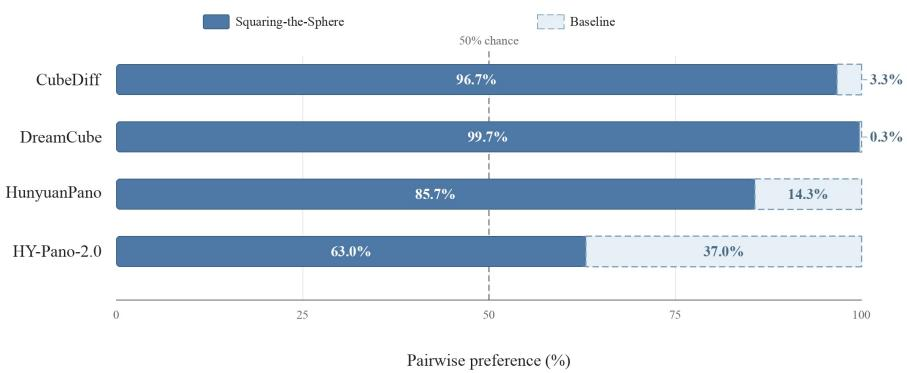  
Figure 8: User study. Each stacked bar summarizes 700 valid judgments comparing SQUARING-THE-SPHERE (solid blue) with one competitor (light fill with a dashed border). The vertical dashed line denotes the 50% equal-preference reference.

Optimization Details. We train with AdamW using a global batch size of 64, a learning rate of 10−5, betas (0.9, 0.999), weight decay 0.01, and gradient clipping at 1.0. The learning rate is linearly warmed up for 100 optimization steps and then kept constant. We train our final model for 8,000 steps using exponential moving average (EMA). Training uses BF16 forward computation, FP32 master weights and gradient reduction, and activation checkpointing. All experiments are based on 64 H20 NVIDIA GPUs.

Super-Resolution Details. We use frozen Flux-based PiD weights (Lu et al., 2026a) without panorama-specific fine-tuning. To enable seamless fusion after super-resolution, the base ERP is reprojected into six overlapping perspective cubemap views by slightly enlarging the FoV to 92.79◦. Each view has a spatial resolution of $6 7 2 \times 6 7 2$ , where the additional context beyond the canonical 90◦ cubemap face forms the overlap regions with neighboring views. PiD independently upsamples each view by $4 \times \mathrm { t o ~ } 2 6 8 8 \times 2 6 8 8$ , so the overlap regions are enhanced together with the valid face content. The super-resolved views are then reprojected back to the ERP domain, where overlapping regions are linearly blended to suppress cross-view discontinuities. After removing the corresponding 128px boundary context, each effective cube face has a resolution of 2560 × 2560, yielding a final ERP panorama of 5120 × 10240.

## C USER STUDY

We conduct a two-alternative forced-choice user study with 28 volunteers. Participants are divided into four groups of seven, with each group comparing SQUARING-THE-SPHERE against one competing method. Each participant evaluates all 100 scenes assigned to their group, resulting in 700 valid comparisons per competing method and 2,800 comparisons in total. Each trial requires a binary preference with no tie option. For all methods, we use the base-resolution outputs without super-resolution. Compared methods are produced using their official implementations and inference settings. In each trial, participants are shown the conditioning image and text prompt together with two anonymized panorama results presented in randomized left–right order. Both panoramas can be freely explored using an interactive 360◦ viewer. Participants are asked to select the better result by jointly considering conditioning fidelity, visual quality, boundary continuity, and polar geometry. As shown in Figure 8, SQUARING-THE-SPHERE is preferred over CubeDiff, DreamCube, HunyuanPano, and HY-Pano-2.0 in 96.7%, 99.7%, 85.7%, and 63.0% of comparisons, respectively.

## D EVALUATION METRICS

We evaluate image-to-panorama generation along four complementary dimensions: distributional fidelity, boundary continuity, regional perceptual and geometric quality, and text adherence.

Distributional Fidelity. We evaluate distributional fidelity using FID (Heusel et al., 2017), KID (Binkowski et al.´ , 2018), and CLIP-FID (Kynka¨anniemi et al.¨ , 2023). Because their feature encoders are trained on perspective images, we compute these metrics on tangent perspective views rather than directly on ERP panoramas. For each benchmark, both generated and ground-truth panoramas are resized to the native resolution of the ground-truth set and rendered into $9 0 ^ { \circ }$ square views centered at the 12 vertices of a regular icosahedron. All rendered views are pooled at the dataset level for metric computation. FID and KID use Inception-V3 features, while CLIP-FID uses CLIP ViT-B/32 features; all metrics are computed with clean-fid Parmar et al. (2022), with lower values indicating better performance. KID is reported without additional scaling.

RealSee3D and SUN360 use all 12 viewing directions. For Laval-Indoor, views centered below $- 2 3 ^ { \circ }$ are excluded from both generated and ground-truth sets due to invalid lower regions in the ground-truth panoramas, leaving eight valid directions. Distributional metrics are not reported on our self-collected set because ground-truth panoramas are unavailable.

Boundary Continuity. We use two reference-free diagnostics for representation-specific seams, both computed as RGB mean absolute error in normalized [0, 1] color space. For panorama $I _ { i } \in$ $[ 0 , 1 ] ^ { H \times W \times 3 }$ , the ERP wrap-around error is

$$
s _ { \mathrm { E R P } } ( I _ { i } ) = \frac { 1 } { 3 H } \sum _ { h , c } \left| I _ { i } ( h , 0 , c ) - I _ { i } ( h , W - 1 , c ) \right| ,\tag{3}
$$

$$
\mathrm { S e a m } _ { \mathrm { E R P } } = \frac { 1 } { N } \sum _ { i = 1 } ^ { N } s _ { \mathrm { E R P } } ( I _ { i } ) .\tag{4}
$$

For ${ \mathrm { S e a m } } _ { \mathrm { C u b e } } ,$ , the six native cubemap faces are resized to $5 1 2 \times 5 1 2$ , aligned according to cubemap topology, and evaluated over all 12 shared edge pairs:

$$
\mathrm { S e a m } _ { \mathrm { C u b e } } = \frac { 1 } { 1 2 N } \sum _ { i = 1 } ^ { N } \sum _ { e = 1 } ^ { 1 2 } \mathrm { M A E } \Big ( E _ { i , e } ^ { ( a ) } , E _ { i , e } ^ { ( b ) } \Big ) .\tag{5}
$$

Lower values indicate better boundary continuity. $\mathrm { S e a m _ { C u b e } }$ is computed from native faces and is therefore undefined for methods that output only ERP images. Because these pixel-level diagnostics are also affected by local texture variation, we interpret them together with the qualitative comparisons.

VLM-based Regional Quality and Text Adherence. We use Gemini-3.5-Flash to evaluate regional visual quality and text adherence on a shared five-point scale: Excellent (5), Good (4), Fair (3), Poor (2), and Awful (1). Each generated ERP is resized to $2 0 4 8 \times 1 0 2 4$ before evaluation. For the equatorial region, we render four $5 1 2 \times 5 1 2$ perspective views with a $9 0 °$ FoV at pitch $0 ^ { \circ }$ and yaw $\dot { \{ 0 ^ { \circ } , 9 0 ^ { \circ } , 1 8 0 ^ { \circ } , 2 7 0 ^ { \circ } \} }$ , and concatenate them into a strip labeled Front, Right, Back, and Left. For the polar regions, we render two $5 1 2 \times 5 1 2 , 9 0 ^ { \circ }$ perspective views centered at $\mathrm { p i t c h + 9 0 ^ { \circ } }$ and −90◦, labeled Zenith and Nadir, and place them above the full ERP, which is provided only as contextual reference. The regional prompts ask the judge to evaluate each view separately and then provide a score. For each view and criterion, they require a brief rationale followed by an integer score.

Eq-IQ and Pole-IQ correspond to the “Image Quality” criterion, which asks for the overall quality of each equatorial view or polar close-up. Eq-Aes corresponds to “Aesthetic”, which asks how visually pleasing each equatorial view is. Eq-GI and Pole-GI correspond to the “Distortion” criterion in the respective regional prompts and are reported as geometric integrity for clarity, without changing the numerical scores. Higher scores indicate fewer distortion-related visual artifacts. For ${ \mathrm { E q } } { \bar { - } } { \mathrm { G } } { \bar { \mathrm { I } } }$ the prompt asks whether the view resembles a normal camera photo, with wavy or rippling lines, melted or broken objects, and shimmering moire or banding on regular textures lowering the score. For Pole-GI, the prompt asks whether the pole converges naturally and identifies swirl or vortex patterns, central black holes, radial cracks or seams, warped geometry, smearing, and nadir camera or tripod patches as defects. Thus, these criteria cover the specified geometric and structural artifacts as well as texture artifacts or polar patches, rather than a purely geometric reconstruction error. For each regional criterion, we first average scores over the corresponding views within each panorama, then over panoramas.

TextAdh uses the same judge and five-point scale, but evaluates the complete ERP together with its input caption. The prompt asks the judge to assess only whether the visible content matches the description, considering objects, attributes, counts, and spatial relations. Its anchors range from all described elements being present and correct (5), through minor omissions or small mismatches (4), several missing or incorrect elements (3), and most of the description being unsatisfied (2), to a scene nearly unrelated to the prompt (1). Scores are averaged over samples with non-empty prompts. The scoring prompts are provided below.

VLM Scoring Instructions. We provide the task-specific scoring prompts for equatorial quality, polar quality, and text adherence below. Equatorial evaluation covers overall image quality, visual appeal, and distortion-related artifacts in perspective views, while polar evaluation covers close-up quality and the specified polar defects. Text adherence is assessed with a separate prompt focused on semantic matching.

The examples in Figure 9 illustrate how the VLM grounds its ratings in visible image content. From top to bottom, the figure presents equatorial quality, polar quality, and text-adherence evaluation, with input on the left and VLM rationales and scores on the right. Regional outputs are shown for selected views, while TextAdh evaluates the full panorama.

## A. Equatorial Evaluation

You are an evaluator assessing a panorama generation model. The input is one stitched strip of four rectilinear eye-level perspective views labeled Front, Right, Back, Left, cropped from one generated 360- degree panorama. Evaluate EACH of the four views separately, and then provide a score based on the following three criteria:

1. Image Quality: overall quality of the view.

2. Aesthetic: how visually pleasing the view is.

3. Distortion: does it look like a photo from a normal camera? Wavy/rippling lines, melted or broken objects, or shimmering moire/banding on regular textures lower it.

Each criterion uses a five-point scale: Excellent (5), Good (4), Fair (3), Poor (2), Awful (1). For every view and criterion, give a brief reason first, then the integer score.

Forward your response as follows:

\- Image Quality: (Brief reason) → Score

\- Aesthetic: (Brief reason) → Score

\- Distortion: (Brief reason) → Score

<IMAGE>

## B. Polar Evaluation

You are an evaluator assessing a panorama generation model. The input shows two rectilinear 90-degree polar close-ups labeled Zenith (up) and Nadir (down) on top; the full equirectangular panorama (ERP) is below for context only. Evaluate EACH polar view separately, and then provide a score based on the following two criteria:

1. Image Quality: overall quality of the close-up.

2. Distortion: does the pole converge naturally, or is there swirl/vortex, a central black hole, radial cracks/seams, warped geometry, smearing, or a nadir camera/tripod patch?

Each criterion uses a five-point scale: Excellent (5), Good (4), Fair (3), Poor (2), Awful (1). For every view and criterion, give a brief reason first, then the integer score.

Forward your response as follows:

\- Image Quality: (Brief reason) → Score

\- Distortion: (Brief reason) → Score

<IMAGE>

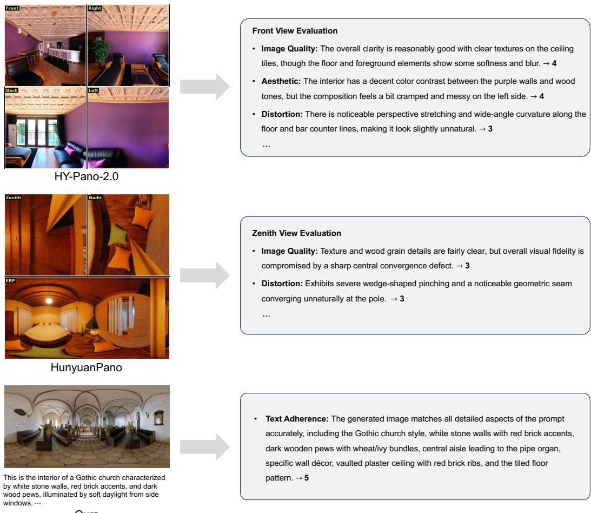  
Figure 9: Examples of VLM-based evaluation. Regional examples show rationales and scores for the Front and Zenith views. “Distortion” denotes geometric integrity (GI), with higher scores indicating fewer artifacts. Equatorial views are rearranged for display, and the input caption is excerpted.

Table 3: Agreement between VLM scores and human judgments. Spearman rank correlations between VLM scores and human MOS on 30 generated panoramas, each evaluated by three raters. Higher values indicate stronger rank agreement with human judgments.
<table><tr><td>Metric</td><td>Eq-IQ</td><td>Eq-Aes</td><td>Pole-IQ</td><td>Eq-GI</td><td>Pole-GI</td><td>TextAdh</td></tr><tr><td>Spearman ρ</td><td>0.9358</td><td>0.8820</td><td>0.8757</td><td>0.9281</td><td>0.7698</td><td>0.8804</td></tr></table>

## C. Text Adherence

You are evaluating how well a generated 360-degree panorama matches its text prompt. The image is one equirectangular panorama (ERP) showing the full 360 scene at once; Judge ONLY whether the visible content matches the description below.

Prompt: ”<TEXT PROMPT>”

Rate text adherence on a five-point scale — Excellent (5): all described objects, attributes, counts, and spatial relations are present and correct; Good (4): minor omissions or small mismatches; Fair (3): several described elements missing or wrong; Poor (2): most of the description is not satisfied; Awful (1): the scene is nearly unrelated to the prompt.

Forward your response as follows:

\- Text Adherence: (Brief reason) → Score

Table 4: Full-polar vs half-polar packing. Padding tokens are omitted from the token length counting for simplification. “+ Sparse Attn.” denotes layout-aware sparse attention.
<table><tr><td></td><td colspan="3">Computational Profile</td><td colspan="7">Quality and Continuity</td></tr><tr><td>Variant</td><td>Tokens</td><td>Time</td><td>SeamERP ↓ SeamCube ↓ Eq-IQ↑ Eq-Aes↑ Eq-GI↑ Pole-IQ↑ Pole-GI↑</td><td></td><td></td><td></td><td></td><td></td><td></td><td>TextAdh↑</td></tr><tr><td>Half-polar</td><td>1.00×</td><td>1.00×</td><td>0.0103</td><td>0.0143</td><td>4.697</td><td>4.353</td><td>4.690</td><td>4.705</td><td>4.705</td><td>4.640</td></tr><tr><td>+ Śparse Attn.</td><td>1.00×</td><td>0.84×</td><td>0.0142</td><td>0.0132</td><td>4.690</td><td>4.402</td><td>4.782</td><td>4.675</td><td>4.730</td><td>4.640</td></tr><tr><td>Full-polar</td><td>1.50×</td><td>1.63×</td><td>0.0106</td><td>0.0134</td><td>4.610</td><td>4.410</td><td>4.670</td><td>4.660</td><td>4.710</td><td>4.580</td></tr><tr><td>+ Šparse Attn.</td><td>1.50×</td><td>1.15×</td><td>0.0103</td><td>0.0136</td><td>4.620</td><td>4.410</td><td>4.720</td><td>4.660</td><td>4.680</td><td>4.620</td></tr></table>

Agreement with Human Judgments. To validate the VLM-based evaluation, we sample 10 test cases and select outputs from three randomly chosen methods per case, yielding 30 panoramas that collectively cover CubeDiff, DreamCube, HunyuanPano, HY-Pano-2.0, and our method. Three independent raters, blinded to method identities and VLM scores, evaluate each panorama on Eq-IQ, Eq-Aes, Pole-IQ, Eq-GI, Pole-GI, and TextAdh using a five-point scale. Regional panels are rated as a whole. We average the three human ratings to obtain a mean opinion score (MOS) for each panorama and criterion. For each criterion, we compute Spearman’s rank correlation across the 30 panoramas between MOS and the corresponding panorama-level VLM scores. As shown in Table 3, VLM scores correlate strongly with human judgments across all six criteria, with $\rho$ ranging from 0.7698 to 0.9358.

## E ADDITIONAL RESULTS

## E.1 FULL-POLAR VS HALF-POLAR PACKING

Table 4 compares a full-polar variant of SQUARING-THE-SPHERE with the half-polar design adopted in our final model. The full-polar variant retains a complete orientation-aligned copy of each polar face above and below every equatorial face, resulting in a fully occupied grid. Compared with the half-polar design, this increases the token count by 50% and incurs approximately 37% higher computational cost (even enhanced by the sparse attention). All quality metrics and efficiency measurements in Table 4 are evaluated on the self-collected benchmark.

Despite its substantially higher computational cost, the full-polar variant does not yield a clear improvement over the half-polar design across the evaluated metrics. This suggests that retaining only the equator-adjacent halves already provides sufficient polar context for high-quality panorama generation, while avoiding the redundancy introduced by complete polar copies. The half-polar packing therefore offers a superior quality-and-efficiency trade-off and is adopted in our final design.

## E.2 GEOMETRY-FREE GENERATION FROM ARBITRARY VIEWS

Figure 12 demonstrates the versatility of our geometry-free formulation across perspective inputs with varying FoV and viewing directions, including upward- and downward-looking images. Rather than relying on camera calibration or explicitly projecting the input onto a predefined panoramic coordinate system, SQUARING-THE-SPHERE learns from data to infer the input view’s placement in the panorama and synthesize its surrounding content accordingly. Red outlines mark the regions in the generated ERPs that correspond to the input views.

## E.3 ADDITIONAL QUALITATIVE RESULTS

Figure 10, Figure 11, and Figure 13 provide additional qualitative results. Figure 10 includes comparisons on Laval-Indoor, SUN360, and RealSee3D across diverse indoor and outdoor scenes. Figure 11 shows high-resolution synthesis results obtained with different super-resolution strategies, including native sampling, ERP-domain super-resolution, perspective-space enhancement without overlap fusion, and our complete pipeline. Figure 13 presents further generations spanning realistic, cinematic, stylized, and illustrative scenes. Together, these examples provide a broader qualitative view of panorama generation across input viewing directions, cross-view consistency, and highresolution detail synthesis.

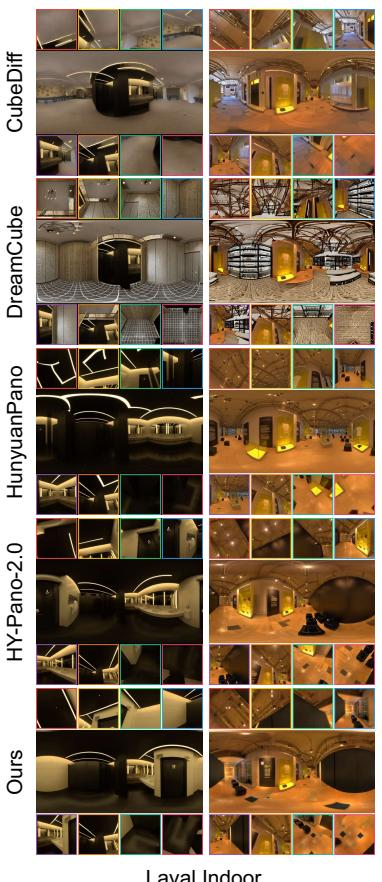

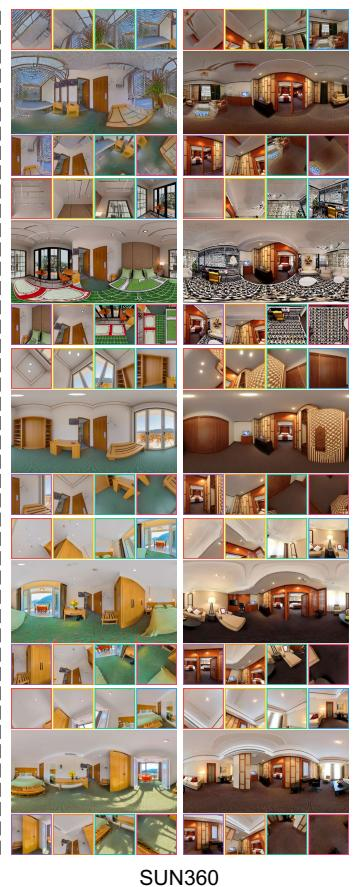

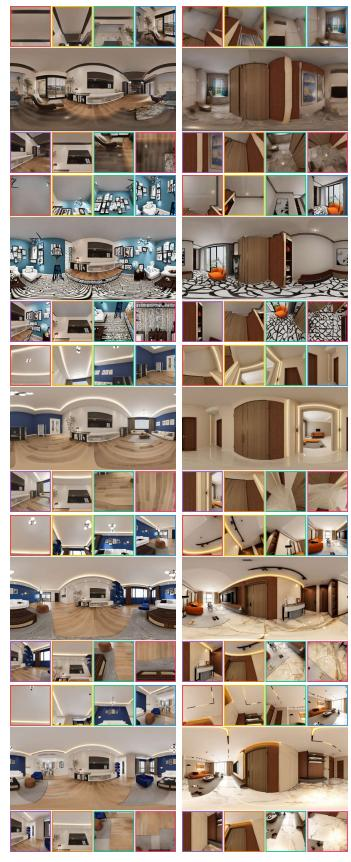

Figure 10: Additional qualitative comparisons on Laval-Indoor, SUN360, and RealSee3D. Results are shown for S - -S , HY-Pano-2.0, HunyuanPano, DreamCube, and CubeDiff.  
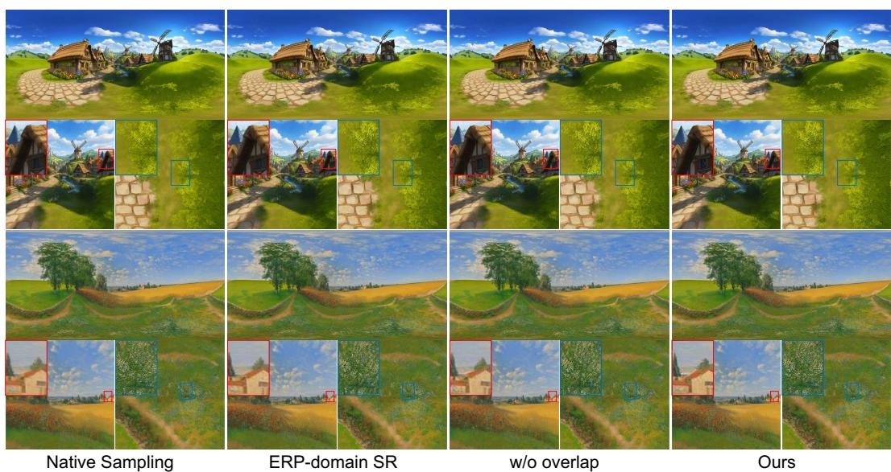  
Figure 11: Additional qualitative results for high-resolution synthesis. From left to right: Native Sampling, ERP-domain SR, perspective-space SR without overlap fusion, and the complete superresolution pipeline. Enlarged crops compare local detail recovery and cross-view consistency.

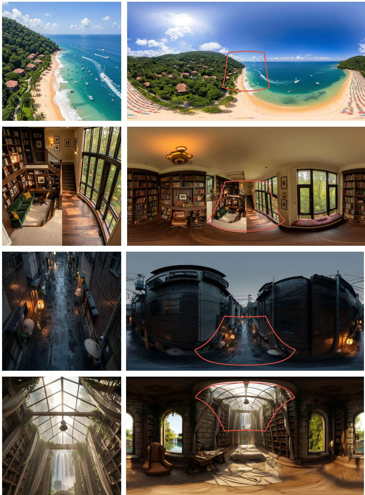  
Figure 12: Panorama generation from diverse input viewing directions. Each row shows a perspective input (left) and the generated ERP panorama (right). Our method accommodates downward- and upward-looking inputs without camera calibration or explicit input projection. Red outlines indicate the corresponding input regions in the generated panoramas.

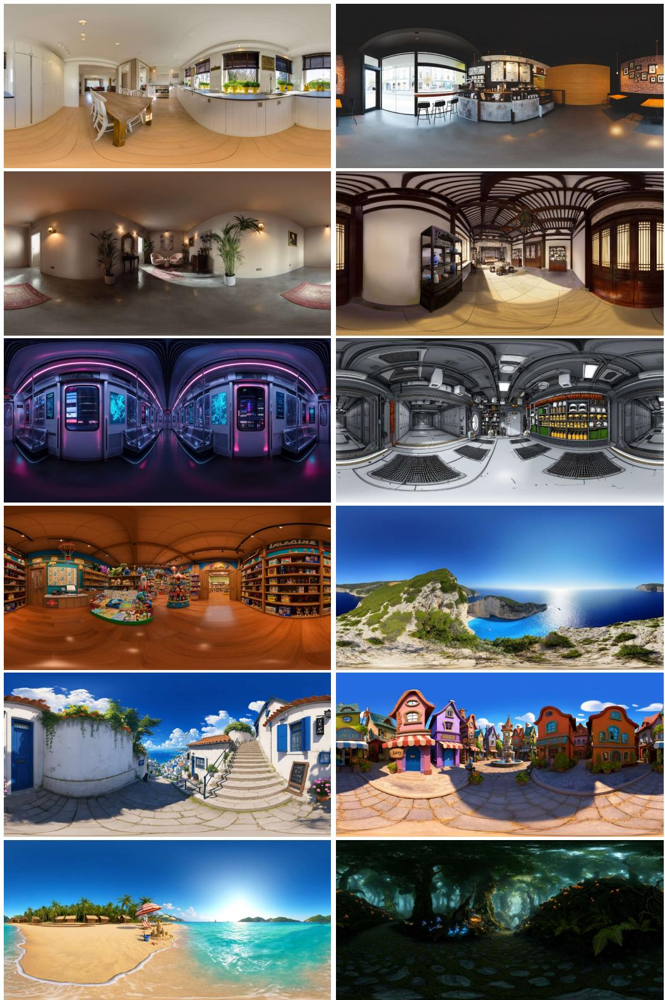  
Figure 13: More qualitative results from SQUARING-THE-SPHERE. We show diverse indoor and outdoor scenes with realistic and stylized appearances. The generated panoramas preserve the conditioning content and visual style while maintaining coherent structures throughout the complete 360◦ FoV.