# Sensorimotor Alignment: A Platonic Proxy for Embodied Policy Success

Yunfei Xie1, Howard H. Qian1, Shiyi Lan2, Kaiyu Hang1, Chen Wei1†

1Rice University, 2NVIDIA

## Abstract

Robotic foundation models are typically evaluated through costly closed-loop rollouts, which motivates cheap offline proxies for model capability. The Platonic Representation Hypothesis (PRH) [20] suggests that as representations improve, different modalities such as vision and language converge toward a shared statistical model of reality. We ask whether motion trajectories form another such modality: as embodied models become more capable, should their sensory representations converge toward the structure of physical motion? To examine this, we propose Sensorimotor Alignment $( \mathsf { S } ^ { 2 } )$ , a training-free offline metric that measures how well a model’s sensory representation aligns with the geometry of physical motion. We find that $S ^ { 2 }$ correlates positively with downstream robot task success across embodied model families, making it a low-cost offline proxy for prioritizing models before closed-loop evaluation. $S ^ { 2 }$ can also identify promising vision-language model (VLM) backbones even before costly fine-tuning into vision-language-action models (VLAs). Beyond this correlation, $S ^ { 2 }$ offers representation-level explanations for phenomena observed in VLAs and world action models (WAMs). With ${ \mathsf S } ^ { 2 }$ , we extend PRH to embodied models and make sensorimotor alignment empirically measurable, offering insight into why an embodied model succeeds beyond its closed-loop success rate.

Website https://yunfeixie233.github.io/s2/

Code https://github.com/yunfeixie233/sensorimotor-alignment

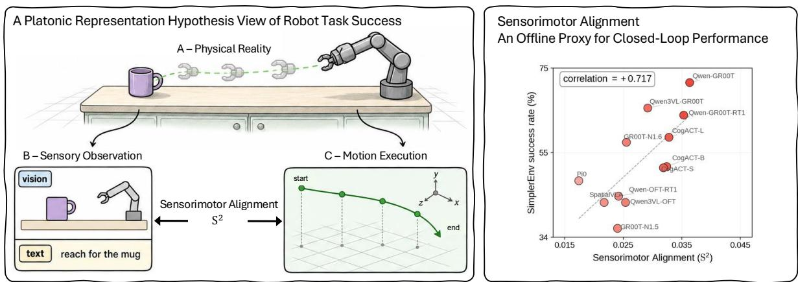  
Figure 1 | Left: We test the Platonic Representation Hypothesis (PRH) in robotics, using image–text features as the sensory representation and end-effector trajectories as the motor representation: a more capable embodied model should have sensory representations that align more closely with this motor representation. To validate this, we define Sensorimotor Alignment (S2). Right: We measure S2 across 12 vision-language-action models (VLAs) and find that S2 correlates positively with SimplerEnv task success rate (Pearson � = +0.717), providing empirical support for this PRH-inspired view of embodiment.

## 1. Introduction

Robotic foundation models increasingly build on large pretrained vision-language models [3, 4], video models [48], and world action models [5, 14, 27]. Yet selecting and evaluating these models remains expensive: the most reliable test is still closed-loop rollout in simulation [29, 32] or the real world [1], where evaluation is slow, noisy, and benchmark-dependent. This expense motivates low-cost offline proxies for robotic capability.

A natural approach is to use existing perception-side proxies, such as visual question answering scores for VLMs [30, 55] or pixel-level video quality for world models [17, 22, 50]. However, these metrics measure passive perception or generation quality, not whether a representation is organized for action [23, 34, 45, 57]. Two scenes may look visually different but require similar robot motions; conversely, two visually similar scenes may demand different trajectories. For robot task success, a model must produce motions of different tasks even for scenes alike. This requires aligning the visual representation with the motor representation.

This perspective connects robotics to the Platonic Representation Hypothesis (PRH) [20], which argues that as models of different modalities scale and solve diverse tasks, they are converging to a shared statistical model of reality in each of their own representation spaces. For example, images and text are both projections of a common underlying reality. As vision and language models scale, they increasingly agree on the relative distances between data points. We bring PRH to robotics and ask: can physical motion be viewed as another projection of the world, such that scaled embodied models better align vision and language representations with the structure of robot trajectories?

We test this prediction of PRH: the more capable an embodied model is, the more closely its sensory representations align with its motor representation. In other words, episodes nearby in sensory representation space should also be nearby in motor representation space.

We formalize this as Sensorimotor Alignment (S2), a training-free metric, illustrated in Figure 1. For each episode in a robot dataset, a model’s image and text features form its sensory representation, and the recorded end-effector trajectory forms its motor representation. We measure alignment by comparing each episode’s nearest neighbors in sensory and motor spaces. More overlap between the two neighbor sets means stronger sensorimotor alignment.

In Section 3, we show that $S ^ { 2 }$ correlates positively with downstream robot task success across model families, in simulated and real-world settings. The correlation is strong for Vision-Language-Action models (VLAs) in closed-loop manipulation, indicating that models with higher sensorimotor alignment tend to perform better. $\mathsf { \dot { S } } ^ { 2 }$ computed on raw Vision-Language Models (VLMs) also correlates with the success of the VLAs later fine-tuned from them, more strongly than their general visual question answering (VQA) scores do. For World Action Models (WAMs), $S ^ { 2 }$ is likewise a better indicator of success than video quality metrics such as FID [17], SSIM [50], and PSNR [18], and for real-robot policies, $S ^ { 2 }$ computed offline correlates with physical-robot success under consistent conditions. These results suggest sensorimotor alignment reflects embodied performance better than passive perception or pixel quality.

Prior work has observed several phenomena in VLAs and WAMs only through closedloop results, without explaining them at the representation level. We use $\mathsf { \bar { S } } ^ { 2 }$ to supply that explanation, as shown in Section 4. For example, fine-tuned VLAs often ignore the language instruction and act mainly on what they see; we find that their task success correlates with the $S ^ { 2 }$ of their vision features, not their text features.

Our contributions are threefold:

• Inspired by the Platonic Representation Hypothesis, we propose a new view of embodiment: stronger embodied models should align their sensory representations more closely with their motor representation. To test this, we introduce $\mathrm { \dot { \boldsymbol { S } } } ^ { 2 }$ , a training-free offline metric that measures alignment between sensory and motor representations.

• Across model families, in simulation and on real robots, higher $S ^ { 2 }$ goes with higher task success, making $S ^ { 2 }$ a low-cost offline proxy for choosing models before closed-loop evaluation.

• We further find that $S ^ { 2 }$ explains, at the representation level, phenomena that prior work observed only through closed-loop results, making it a diagnostic tool for understanding how design choices shape embodied models.

We make sensorimotor alignment measurable, offering a cheap, representation-level account of embodied model success that closed-loop success rates alone cannot reveal.

## 2. Measuring Sensorimotor Alignment

Motivated by the Platonic Representation Hypothesis (PRH) [20], we hypothesize that the more capable an embodied model is, the more closely its sensory representations align with its motor representation. Here, sensory representations are the model’s image and text features, and each episode’s end-effector trajectory is its motor representation.

To make this alignment measurable, we define Sensorimotor Alignment $( S ^ { 2 } )$ by constructing both representations and comparing their neighborhoods, as follows:

Reference dataset. To measure cross-modal alignment, we use the DROID [25] and Bridge-DataV2 [47] datasets, which pair sensory inputs with physical motions. From a dataset, we sample � episodes and compute both representations from each episode. For episode $i ,$ we randomly sample one image frame and pair it with the task instruction; this image–text pair forms the sensory input $\mathbf { x } _ { i }$ . Sampling details are provided in Appendix A.1.

Sensory representation. For each episode �, we encode the image frame and text instruction with the vision and text encoders of a robot foundation model, obtaining a sensory embedding

$$
\mathbf { z } _ { i } = f ( \mathbf { x } _ { i } ) \in \mathbb { R } ^ { d } ,
$$

where $f$ applies the vision encoder to the image and the text encoder to the instruction, and we average-pool the output token features into a single �-dimensional vector.

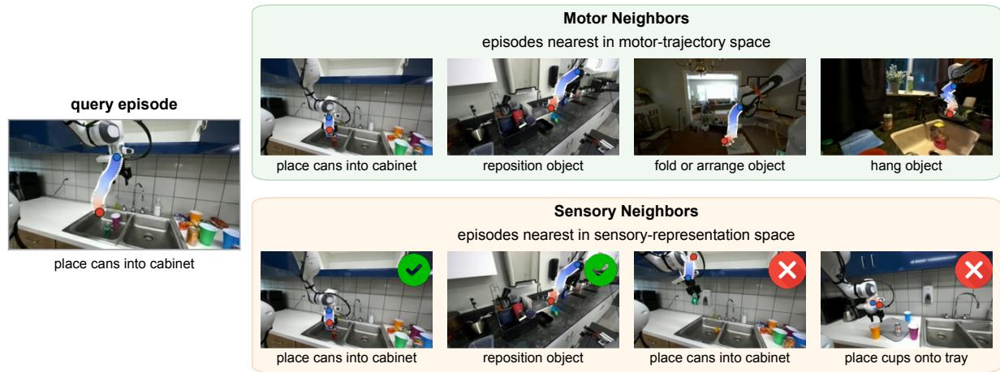  
Figure 2 | Measuring Sensorimotor Alignment $( S ^ { 2 } )$ by nearest-neighbor overlap. For the query episode (left), sensory neighbors (bottom right) have similar vision-text features, and motor neighbors (top right) have similar trajectories. Green checks mark shared neighbors; red crosses mark neighbors found only in the sensory set. A larger overlap means that episodes with similar sensory representations also follow similar motor trajectories.

Motor representation. For the sampled frame in $\mathbf { x } _ { i } ,$ we extract end-effector positions, orientations, and gripper states over the next ℎ steps, forming episode $i \prime \mathrm { s }$ motor representation:

$$
\pmb { \tau } _ { i } = ( x _ { i } , y _ { i } , z _ { i } , \phi _ { i } , \theta _ { i } , \psi _ { i } , g _ { i } ) \in \mathbb { R } ^ { h \times 7 } ,
$$

where row � is the state � steps after the sampled frame: $x , y ,$ � are position coordinates, �, �, � are roll, pitch, and yaw angles, and $g$ is the recorded gripper coordinate. We encode positions as vectors in $\mathbb { R } ^ { 3 }$ and orientation angles as rotations in SO(3) so that distances reflect the geometry of translations and rotations. Details are in Appendix A.2.

Sensorimotor alignment. We measure alignment with a mutual nearest-neighbor metric comparing the �-nearest-neighbor sets in sensory and motor spaces; greater overlap indicates stronger alignment between an episode’s sensory and motor representations.

We use cosine distance in sensory space and Dynamic Time Warping (DTW) [39] in motor space to compare trajectories at different speeds. For episodes � and $j \colon$

$$
d _ { \mathrm { s e n s o r y } } ( i , j ) = 1 - \cos ( \mathbf { z } _ { i } , \mathbf { z } _ { j } ) , \qquad d _ { \mathrm { m o t o r } } ( i , j ) = \mathrm { D T W } ( \pmb { \tau } _ { i } , \pmb { \tau } _ { j } ) .
$$

Smaller distances mean closer neighbors. Appendices A.2–A.3 detail DTW and normalization.

For each episode $i ,$ we use $d _ { \mathrm { s e n s o r y } }$ to form the sensory �-nearest-neighbor set $\mathcal { N } _ { \mathrm { s e n s o r y } } ( i )$ and $d _ { \mathrm { m o t o r } }$ to form the motor �-nearest-neighbor set $ { N _ { \mathrm { m o t o r } } } ( i )$ . We then take the intersection of the two sets, divide its size by $k ,$ and average over all � episodes [20]:

$$
m _ { \mathrm { N N } } = \frac { 1 } { N k } \sum _ { i = 1 } ^ { N } \left| N _ { \mathrm { s e n s o r y } } ( i ) \cap N _ { \mathrm { m o t o r } } ( i ) \right| .\tag{1}
$$

Greater overlap indicates that episodes with similar sensory representations also have similar motor trajectories, as shown in Figure 2.

In practice, our reported $S ^ { 2 }$ uses a centered, normalized variant of CKNNA with $k = 1 0$ neighbors unless stated otherwise; details are given in Appendix A.3.

## 3. Sensorimotor Alignment Correlates with Robot Task Success Rate

The Platonic Representation Hypothesis (PRH) [20] argues that as models of different modalities become more capable, their representations converge toward a shared statistical model of reality.

While the evidence for PRH comes from observational data such as images and text, robotics provides a harder test case: action is not another passive observation, but a physical trajectory through the world. We test the prediction that models whose image–text representations align more closely with end-effector trajectories should achieve higher downstream task success.

We quantify this alignment using Sensorimotor Alignment $( \mathsf { S } ^ { 2 } )$ , which compares episode neighborhoods in sensory and motor space, as defined in Section 2. A positive correlation between $S ^ { 2 }$ and task success would provide empirical support for this PRH-inspired view of embodiment. It would also support using $S ^ { 2 }$ as a low-cost offline proxy for deciding which models to evaluate in closed loop first.

Section 3.1 establishes this positive correlation across 3 model families and real-robot policies. Section 3.2 shows that $S ^ { 2 }$ correlates with task success more closely than VQA and video-quality metrics. Section 3.3 confirms that these findings are robust to experimental design choices.

## 3.1. $S ^ { 2 }$ Correlates with Task Success Across Model Families

In Figure 3, we test 3 model families and real-robot policies, comparing each model’s $S ^ { 2 }$ on a reference dataset (�-axis) with its downstream manipulation success rate (�-axis).

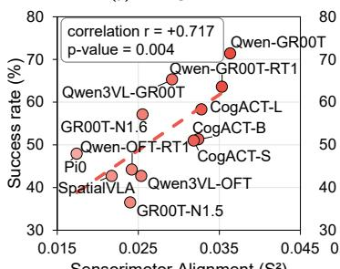

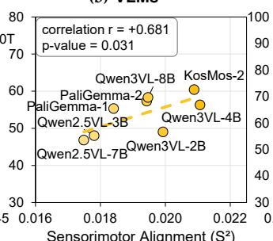

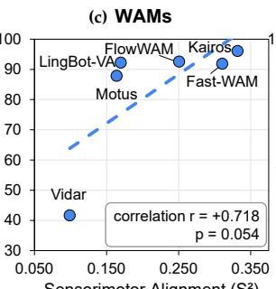

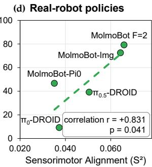  
Figure 3 | Sensorimotor Alignment $( S ^ { 2 } )$ correlates with task success across model families and in simulated and real-world evaluations. Each panel plots offline $S ^ { 2 } \left( x \mathrm { - } \mathrm { a x i s } \right)$ against downstream task success rate (�-axis) for (a) fine-tuned vision-language-action models (VLAs), (b) raw vision-language models (VLMs), (c) world action models (WAMs), and (d) real-robot policies. For raw VLMs, task success is measured after VLA fine-tuning. These correlations (Pearson’s �; unadjusted one-tailed �-values) support $S ^ { 2 }$ as an offline proxy across model families.

Vision-language-action models (VLAs). We test 12 VLAs against their SimplerEnv [29] success rates. In Figure 3a, the Pearson correlation $r = + 0 . 7 1 7$ is strong, with a model-bootstrap 95% confidence interval of $\left[ + 0 . 4 3 6 , \ + 0 . 9 1 2 \right]$ . Thus, models with higher sensorimotor alignment tend to achieve higher task success rates. The correlation holds across reference datasets, model families, scales, and VLA training setups, as shown in Figure 7 and Appendix B.2.

Vision-language models (VLMs). We ask whether $S ^ { 2 }$ computed on a raw VLM, before any robot fine-tuning, correlates with the task success of the VLA that is later fine-tuned from that backbone. We compute $S ^ { 2 }$ for 8 raw VLM backbones from VLM4VLA [57] and compare it with the SimplerEnv [29] success rate of the VLAs that VLM4VLA fine-tunes from them. We find a strong correlation, $r = + 0 . 6 8 1$ with one-tailed $p = 0 . 0 3 1$ , as shown in Figure 3b. $S ^ { 2 }$ can therefore identify promising VLM backbones even before costly VLA fine-tuning. Appendix B.3 lists the backbones and the $S ^ { 2 }$ settings.

World action models (WAMs). Finally, we test WAMs, which build on video generators rather than VLMs. We compute $S ^ { 2 }$ for 6 WAMs on the bimanual ALOHA dataset [59] and compare it with their success rates on RoboTwin 2.0 [32]. For WAMs, the sensory representation is the video-generator latent used for action decoding, and all 6 models share the same ALOHA trajectories and $S ^ { 2 }$ settings. $S ^ { 2 }$ again correlates strongly, $r = + 0 . 7 1 8$ with one-tailed $p = 0 . 0 5 4 .$ , as shown in Figure 3c. Appendix B.4 lists the 6 WAM models and shared evaluation protocol.

Real-robot policies. We test whether the correlation observed in simulation extends to real robots. Because real-world success rates depend on many factors, such as the task set, robot, cameras, and protocol, we take them all from a single unified setting: the physical-robot results that MolmoB0T [10] reports for 5 policies on 40 tasks. We then compute $\mathrm { \dot { S } } ^ { 2 }$ for their public checkpoints on the same DROID reference dataset. We find a strong correlation with real-robot success, $r = + 0 . 8 3 1$ with one-tailed $p = 0 . 0 4 1$ , as shown in Figure 3d. Appendix B.5 describes the shared evaluation conditions and checkpoint scoring.

We further validate that $S ^ { 2 }$ correlates with downstream task success for frozen vision backbones under low-data behavior cloning and visual-reward learning, as shown in Appendix B.6.

## 3.2. $S ^ { 2 }$ Correlates with Task Success More Closely Than Alternative Metrics

Prior work asks whether offline scores correlate with downstream task performance. VLM4VLA [57] examines the correlation between VQA benchmark scores and the performance of the resulting VLA policies, finding weak or even negative correlations. For video models, Tian et al. [45] find that the quality of predicted video agrees inconsistently with downstream performance across tasks. A common limitation is that these metrics measure language understanding or pixel-level video quality, neither of which depends on the motion the robot must execute. $\mathsf { \Pi } _ { \mathsf { S } ^ { 2 } } ^ { \circ }$ instead compares the nearest-neighbor sets of sensory embeddings and motor trajectories. As we show below, $S ^ { 2 }$ correlates more strongly with task success rate than any VQA or video-quality metric we evaluate.

$S ^ { 2 }$ correlates with VLA success rate where VQA scores do not. We compare $S ^ { 2 }$ with aggregate VQA scores as offline proxies, using the same 8 raw VLM backbones and evaluation setting as in Section 3.1. We find that VQA scores show virtually no correlation with VLA success rate, at $r = - 0 . 1 5 4$ (right panel of Figure 4). $S ^ { 2 }$ , by contrast, correlates strongly, at $r = + 0 . 6 8 1$ with one-tailed $p = 0 . 0 3 1$ (left panel of Figure 4).

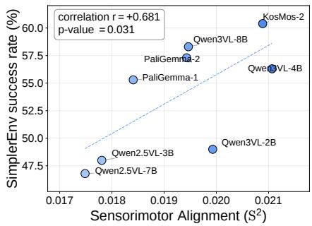

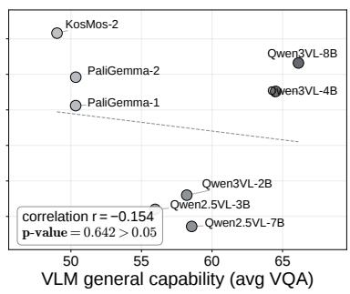

Figure 4 | Sensorimotor Alignment (S2) correlates with VLA success rate where VQA scores do not. Across 8 raw vision-language models (VLMs) $[ 5 7 ] , \breve { \mathbf { S } ^ { 2 } }$ (left) correlates strongly with SimplerEnv task success after fine-tuning into vision-language-action models (VLAs), whereas visual question answering (VQA) scores (right) show virtually no correlation.

$S ^ { 2 }$ correlates with WAM success rate more closely than video-quality metrics. We compare $S ^ { 2 }$ with standard video-quality metrics (FID [17], SSIM [50], and PSNR [18]) on 3 of the WAMs, Motus [5], LingBot-VA [27], and Vidar [14], evaluated on RoboTwin. We find that these metrics correlate weakly with task success: SSIM reaches only $r = + 0 . 5 5 8$ and PSNR only $r = + 0 . 4 6 8 ,$ while FID even runs backwards, at $r = + 0 . 6 8 0$ , where lower video quality goes with higher success (Figure 5). By contrast, $S ^ { 2 }$ on ALOHA correlates more strongly, at $r = + 0 . 9 9 9$

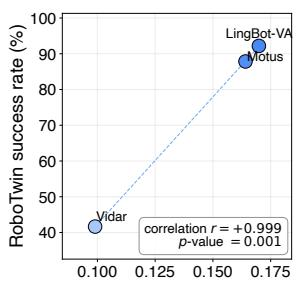  
Sensorimotor Alignment (S2) →

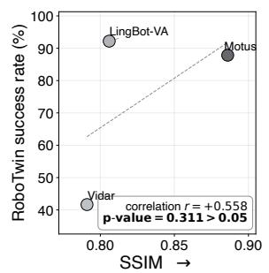

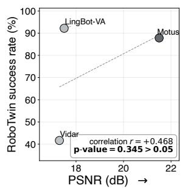

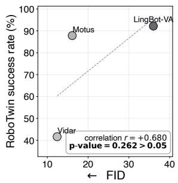  
Figure 5 | Sensorimotor Alignment $( \mathsf { S } ^ { 2 } )$ correlates with WAM success rate more closely than video-quality metrics. For 3 world action models (WAMs) evaluated on RoboTwin, video-quality metrics (SSIM, PSNR, FID) show no significant correlations with task success. In contrast, only $S ^ { 2 }$ correctly recovers the success-rate ordering. Only 3 of the 6 WAMs are compared because the others do not generate future video during closed-loop task evaluation.

## 3.3. $S ^ { 2 }$ Is Robust to Evaluation Choices

We next check that the correlation does not depend on a particular choice of settings. We test this in two ways. First, we vary how $S ^ { 2 }$ is computed and find that the positive correlation with task success holds. Second, as a negative control, we deliberately compute $S ^ { 2 }$ on reference data from a mismatched embodiment, where a sound metric should lose its correlation with task success. The correlation drops as expected, validating the design of $S ^ { 2 }$

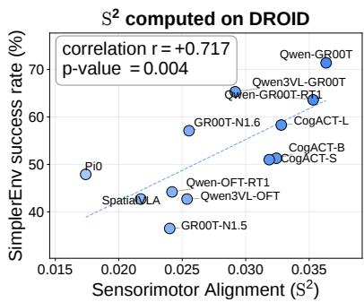

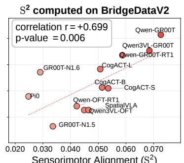  
Sensorimotor Alignment (S2)

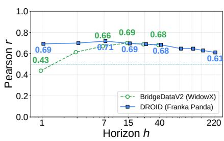  
Figure 6 | The correlation transfers across reference datasets. For 12 vision-language-action models, Sensorimotor Alignment (S2) on DROID (left) and BridgeDataV2 (right) correlates strongly with the same SimplerEnv-WidowX task success rates, so the correlation does not depend on the reference dataset.  
Figure 7 | Stable correlations across horizons. For 12 vision-language-action models, Sensorimotor Alignment (S2) and SimplerEnv-WidowX success rate have Pearson � > 0.5 at nearly all tested horizons ℎ (future steps) on DROID and BridgeDataV2.

$S ^ { 2 }$ is stable across computation choices. In the first check, we vary eight settings: the reference dataset, the trajectory horizon, five implementation choices, and DTW warping. The correlation with task success stays positive under all eight. We discuss the first two below; Appendix C.1 gives per-model $\mathsf { S } ^ { 2 ^ { \circ } }$ by horizon, and Appendices C.2 and C.3 cover the other six.

The correlation transfers across reference datasets. We compute $S ^ { 2 }$ on both DROID (Franka Panda) and BridgeDataV2 [47] (WidowX), robots with different arm kinematics, and both correlate near $r = + 0 . 7$ with success for the 12 VLAs on SimplerEnv (Figure 6).

The correlation is also stable across trajectory horizons. It stays above $r { = } 0 . 5$ at all DROID horizons through $h = 2 2 0$ and at BridgeDataV2 horizons from $h = 3$ through 40 (Figure 7).

$S ^ { 2 }$ is sensitive to embodiment mismatch. In the negative control, we compute $S ^ { 2 }$ for 3 bimanual WAMs on a single-arm reference dataset (DROID) rather than the matched bimanual one (ALOHA). This embodiment mismatch drops the $S ^ { 2 . }$ –success correlation from $r = + 0 . 9 9 9$ to $r = + 0 . 2 4 6 ,$ , indicating that $S ^ { 2 }$ responds to the difference in arm configuration rather than reporting alignment indiscriminately. Appendix C.4 gives the full comparison.

## 4. Representation-Level Explanations with $S ^ { 2 }$

Several phenomena reported for VLAs and WAMs rest only on closed-loop results and still lack a representation-level explanation. Because $S ^ { 2 }$ correlates with task success, as shown in Section 3, we use it to explain each of these phenomena, as summarized below:

• Modality dominance: prior work observes that VLAs often struggle with instruction grounding: they act on what the scene visually suggests rather than on what the language instruction asks [12, 13, 58]. In Section 4.1, we explain that after VLA fine-tuning, task success is associated with vision-feature $S ^ { 2 }$ but not text-feature $S ^ { 2 }$ , indicating that fine-tuned VLAs draw on what they see, not on the instruction, to produce their motion.

• Frozen encoders: prior work observes that freezing the vision encoder during VLA finetuning degrades downstream task performance [57]. In Section 4.2, we explain that freezing also prevents the $S ^ { 2 }$ gain from end-to-end fine-tuning, indicating that VLAs gain performance by bringing their sensory representation closer to the motor representation.

• Iterative denoising: prior work observes that WAMs can skip iterative video denoising at test time, decoding actions without generating future video, with little loss in task success [54]. In Section 4.3, we explain that the $\mathsf { \Pi } _ { \mathsf { S } ^ { 2 } } ^ { \circ }$ of WAM features is already high at the earliest denoising step and changes little afterwards, indicating that the first denoising steps already yield features aligned closely enough with robot trajectories to act on.

• Mid-depth blocks: prior work observes that mid-depth blocks of video diffusion transformers matter most for semantic reasoning [49]. In Section 4.4, we explain that these blocks also carry the strongest ${ \mathsf S } ^ { 2 } .$ , indicating that the layers that reason about video semantics are also the layers most aligned with robot motion.

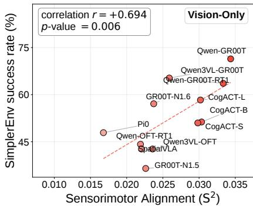

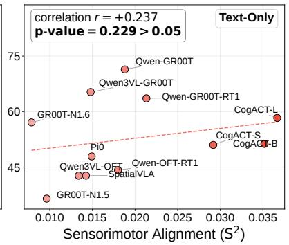

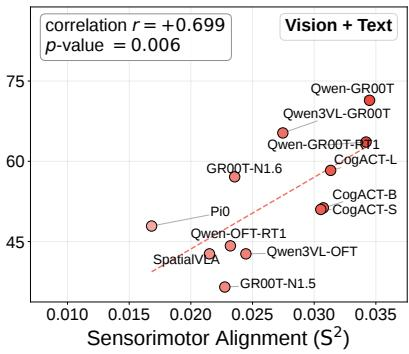

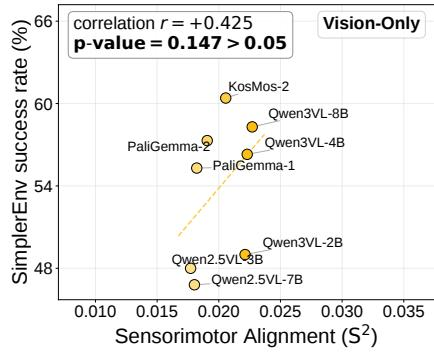

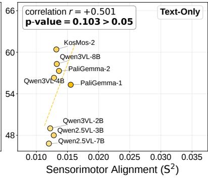

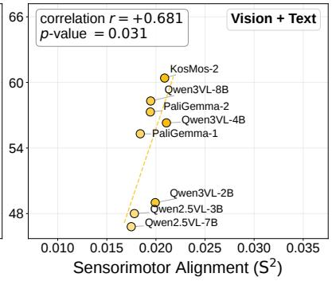  
Figure 8 | Fine-tuned VLAs rely mainly on visual rather than language representations. We correlate Sensorimotor Alignment $( \mathsf { S } ^ { 2 } )$ from vision, text, and joint vision-text features (left to right) with SimplerEnv task success rate. Top: For fine-tuned vision-language-action models (VLAs), vision and joint features correlate similarly strongly, while text features correlate weakly. Bottom: For raw vision-language models (VLMs), joint-feature $S ^ { 2 }$ correlates with task success after VLA fine-tuning, while neither modality alone reaches significance.

## 4.1. What Carries the Correlation: Vision, Text, or Both?

VLAs often struggle with instruction grounding [12, 13, 58]. We use $S ^ { 2 }$ to explain this at the representation level, asking which modality the correlation with task success depends on: vision, text, or both. In Figure 8, we compute $S ^ { 2 }$ separately for each modality. We take the VLM output tokens read by the action head and form visionfeatures from the image tokens, text features from the instruction tokens, and joint vision-text features from all tokens.

Fine-tuned VLAs rely mainly on visual rather than language representations. In the 12 fine-tuned $\mathrm { V L A s } , S ^ { 2 }$ from vision features correlates with SimplerEnv success rate at $r = + 0 . 6 9 4$ nearly matching the joint vision-text features at $r = + 0 . 6 9 9 _ { , }$ , whereas text features show no significant correlation at $r = + 0 . 2 3 7$ . The raw VLMs reverse this pattern: before fine-tuning, text features correlate at $r = + 0 . 5 0 1$ , more strongly than vision features at $r = + 0 . 4 2 5$ , and joint vision-text features correlate most strongly at $r = + 0 . 6 8 1$

We infer that, after fine-tuning, VLAs produce their motion mainly from visual rather than language representations, which explains their weak instruction grounding at the representation level. Appendix D.1 reports per-model $S ^ { 2 }$ at all feature positions.

## 4.2. Freezing Vision Encoders Limits $S ^ { 2 }$ Gain

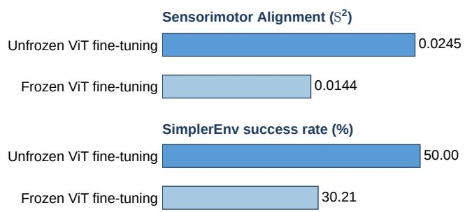  
Figure 9 | Freezing the vision encoder reduces both Sensorimotor Alignment (S2) and task success rate. For Qwen2.5-VL-3B vision-language-action models fine-tuned on BridgeDataV2, we compare end-to-end training with a frozen vision encoder. Freezing lowers $S ^ { 2 }$ from joint vision-text features (top) and SimplerEnv success rate (bottom), linking lower success to weaker alignment. Trajectory horizon $h = 7 .$

VLM4VLA [57] reports that VLAs perform substantially worse when their vision encoder stays frozen during fine-tuning. We use $\mathsf { \bar { S } } ^ { 2 }$ to explain this drop at the representation level, testing whether freezing also prevents the sensorimotor-alignment gain from end-to-end fine-tuning.

In Figure 9, we compare 2 VLAs that follow the same VLM4VLA [57] recipe and differ only in whether the vision encoder is trained or kept frozen. For each, we compute $S ^ { 2 }$ and measure SimplerEnv success rate. Freezing the encoder reduces $S ^ { 2 }$ by 41% and the success rate by 40%, with more detail in Appendix D.2. These results suggest that end-to-end fine-tuning improves performance by aligning the sensory representation more closely with the motor representation.

## 4.3. Features at Early Denoising Steps Already Carry Strong Sensorimotor Alignment

Most WAMs generate future video through iterative denoising and decode actions from the resulting latents. Fast-WAM [54] shows that WAMs can skip this video generation and decode actions directly, with little loss in task success. We examine the representation-level reason: whether features at the earliest denoising steps already align with robot trajectories.

We measure $S ^ { 2 }$ for 3 WAMs [5, 14, 27] on RoboTwin [32], as shown in Figure 10a. We compute $S ^ { 2 }$ from each model’s latent features at 5 positions in its native denoising schedule, from 0% to 100%, not at matched noise levels. $S ^ { 2 }$ is already high at the earliest step and remains nearly flat, varying by about 6% at most from its initial value across the 3 models. We infer that early-step features are already sufficiently aligned with robot trajectories to generate actions.

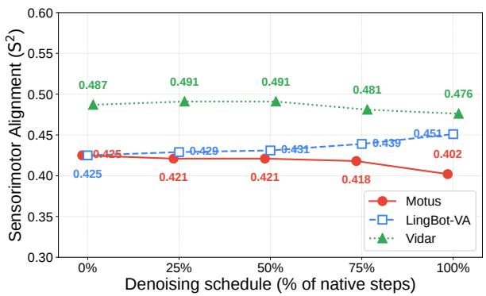  
(a) $S ^ { 2 }$ is nearly flat across the schedule.

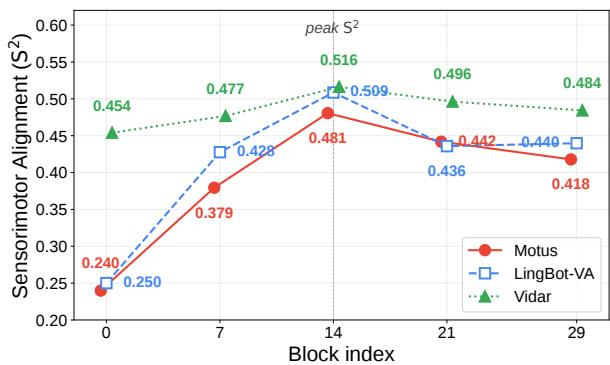  
(b) Block 14 has the strongest $S ^ { 2 }$ in all 3 WAMs.  
Figure 10 | Sensorimotor Alignment $( S ^ { 2 } )$ is already high at early denoising steps and peaks at mid-depth blocks. For 3 world action models (WAMs), (a) $S ^ { 2 }$ remains nearly flat across denoising, suggesting early-step features already align with robot trajectories; (b) schedule-averaged $S ^ { 2 }$ peaks at Block 14, showing peak alignment at mid-depth.

Because $S ^ { 2 }$ correlates with WAM success rate, as shown in Section 3.1, this result explains why skipping iterative video denoising barely lowers task success.

## 4.4. Mid-Depth Blocks Carry the Strongest Sensorimotor Alignment

Prior analysis of Chain-of-Steps [49] shows that mid-depth layers in Video Diffusion Transformers are especially important for semantic reasoning over objects and interactions. We ask whether the layers with the highest $S ^ { 2 }$ also lie in this mid-depth range.

In Figure 10b, we compute $S ^ { 2 }$ at different depths of 3 WAMs [5, 14, 27] on RoboTwin. All 3 share a 30-block video backbone; we extract features from Blocks 0, 7, 14, 21, and 29. Block 14 yields the highest $S ^ { 2 }$ in every model. This peak falls in the mid-depth range that Chain-of-Steps [49] identifies as semantically important, suggesting that the layers handling video semantic reasoning align most closely with robot motion. Details are in Appendix D.3.

## 5. Related Work

Representation learning in robotics. Many robotics studies pretrain visual representations to improve task performance [31, 33, 38]. However, there remains limited understanding of which representational properties lead to downstream task success. A few studies ask what makes a pretrained vision encoder useful for robot learning. Hu et al. [19] evaluate 14 frozen vision encoders and find that the correlation between vision encoder and downstream task success rate is not stable across policy-learning methods. Burns et al. [8] find that emergent segmentation predicts manipulation success under visual distribution shifts, but only for Vision Transformers. Theia [41] hypothesizes that higher feature-norm entropy improves robot learning, but reports the supporting correlations only within separate groups of encoders. These studies examine only vision encoders rather than a broader range of embodied models, and none of them accounts for the trajectories the robot executes when measuring the representation. By contrast, $S ^ { 2 }$ compares �-nearest-neighbor sets in sensory and motor spaces, grounding the evaluation in robot behavior. The same $\mathsf { \bar { S } } ^ { 2 }$ measure correlates with success across VLAs, raw VLMs, WAMs, and the encoders that Hu et al. [19] evaluate.

Platonic Representation Hypothesis. Recent work has applied the Platonic Representation Hypothesis (PRH) [20] to several new domains. In image generation, REPA [52] aligns diffusiontransformer features with self-supervised vision encoders, improving training speed and quality. CREPA [21] extends this recipe to video diffusion. In multimodal understanding, VIRAL [51] re-aligns multimodal large language models (LLMs) with their vision encoders, recovering visual detail lost in multimodal training. For cross-modal alignment, Schnaus et al. [40] match independently trained vision and language encoders through their shared geometry, without paired data. PRH has not yet been brought into robotics; we extend it to robotics by treating robot trajectories as another projection of the world, and find that more capable embodied models align their sensory representations more closely with it.

## 6. Conclusion

We introduce Sensorimotor Alignment $( \mathsf { S } ^ { 2 } )$ , a training-free offline metric of alignment between sensory representations and end-effector trajectories. Across ${ \mathrm { V L A s } } ,$ raw VLMs, and WAMs in simulation, and across real-robot policies, $S ^ { 2 }$ correlates positively with downstream task success, which supports this PRH-inspired view of embodiment. $S ^ { 2 ^ { \cdot } }$ correlates more strongly with success than VQA scores and video-quality metrics, and explains, at the representation level, VLA and WAM phenomena previously seen only in closed-loop behavior: modality dominance, the performance drop from freezing the vision encoder, the small task-success cost of skipping iterative denoising, and the importance of mid-depth blocks for semantic reasoning. We use $S ^ { \bar { 2 } }$ only offline as a low-cost model-selection and diagnostic tool before closed-loop evaluation, but this correlation motivates optimizing embodied models directly for sensorimotor alignment.

Limitations. Our study has three main limitations. (1) The positive relationship between $S ^ { 2 }$ and task success is correlational across the tested models; we have not yet demonstrated that sensorimotor alignment can be used directly during training to improve task success rates. (2) Models with similar $S ^ { 2 }$ values can still achieve different success rates, so $S ^ { 2 }$ is best used as a low-cost offline proxy for identifying promising models and VLM backbones before costly fine-tuning or closed-loop testing, which remains the final step of model selection. (3) Our evaluation covers limited model families, benchmarks, and training recipes, few models per comparison, and a single real-robot setting; broader generalization remains to be tested.

## References

[1] Pranav Atreya, Karl Pertsch, Tony Lee, Moo Jin Kim, Arhan Jain, Artur Kuramshin, Clemens Eppner, Cyrus Neary, Edward Hu, Fabio Ramos, et al. RoboArena: Distributed real-world evaluation of generalist robot policies. In CoRL, 2025.

[2] Shuai Bai, Yuxuan Cai, Ruizhe Chen, Keqin Chen, Xionghui Chen, Zesen Cheng, Lianghao Deng, Wei Ding, Chang Gao, Chunjiang Ge, et al. Qwen3-VL technical report. arXiv:2511.21631, 2025.

[3] Shuai Bai, Keqin Chen, Xuejing Liu, Jialin Wang, Wenbin Ge, Sibo Song, Kai Dang, Peng Wang, Shijie Wang, Jun Tang, Humen Zhong, Yuanzhi Zhu, Mingkun Yang, Zhaohai Li, Jianqiang Wan, Pengfei Wang, Wei Ding, Zheren Fu, Yiheng Xu, Jiabo Ye, Xi Zhang, Tianbao Xie, Zesen Cheng, Hang Zhang, Zhibo Yang, Haiyang Xu, and Junyang Lin. Qwen2.5-VL technical report. arXiv:2502.13923, 2025.

[4] Lucas Beyer, Andreas Steiner, André Susano Pinto, Alexander Kolesnikov, Xiao Wang, Daniel Salz, Maxim Neumann, Ibrahim Alabdulmohsin, Michael Tschannen, Emanuele Bugliarello, et al. PaliGemma: A versatile 3B VLM for transfer. arXiv:2407.07726, 2024.

[5] Hongzhe Bi, Hengkai Tan, Shenghao Xie, Zeyuan Wang, Shuhe Huang, Haitian Liu, Ruowen Zhao, Yao Feng, Chendong Xiang, Yinze Rong, et al. Motus: A unified latent action world model. In CVPR, 2026.

[6] Johan Bjorck, Fernando Castañeda, Nikita Cherniadev, Xingye Da, Runyu Ding, Linxi Fan, Yu Fang, Dieter Fox, Fengyuan Hu, Spencer Huang, et al. GR00T N1: An open foundation model for generalist humanoid robots. arXiv:2503.14734, 2025.

[7] Kevin Black, Noah Brown, Danny Driess, Adnan Esmail, Michael Equi, Chelsea Finn, Niccolo Fusai, Lachy Groom, Karol Hausman, Brian Ichter, et al. �0: A vision-languageaction flow model for general robot control. In RSS, 2025.

[8] Kaylee Burns, Zach Witzel, Jubayer Ibn Hamid, Tianhe Yu, Chelsea Finn, and Karol Hausman. What makes pre-trained visual representations successful for robust manipulation? In CoRL, 2024.

[9] Yixiang Chen, Peiyan Li, Yuan Xu, Qisen Ma, et al. FlowWAM: Optical flow as a unified action representation for world action models. arXiv:2607.13017, 2026.

[10] Abhay Deshpande, Maya Guru, Rose Hendrix, Snehal Jauhri, et al. MolmoB0T: Large-scale simulation enables zero-shot manipulation. In CoRL, 2026.

[11] Alexey Dosovitskiy, Lucas Beyer, Alexander Kolesnikov, Dirk Weissenborn, Xiaohua Zhai, et al. An image is worth 16x16 words: Transformers for image recognition at scale. In ICLR, 2021.

[12] Yu Fang, Yuchun Feng, Dong Jing, Jiaqi Liu, Yue Yang, Zhenyu Wei, Daniel Szafir, and Mingyu Ding. When vision overrides language: Evaluating and mitigating counterfactual failures in VLAs. In CoRL, 2026.

[13] Senyu Fei, Siyin Wang, Junhao Shi, Zihao Dai, Jikun Cai, Pengfang Qian, Li Ji, Xinzhe He, Shiduo Zhang, Zhaoye Fei, et al. LIBERO-Plus: A progressive robustness benchmark for visual-language-action models. In CVPR, 2026.

[14] Yao Feng, Hengkai Tan, Xinyi Mao, Chendong Xiang, Guodong Liu, Shuhe Huang, Hang Su, and Jun Zhu. Vidar: Embodied video diffusion model for generalist manipulation. arXiv:2507.12898, 2025.

[15] Abhishek Gupta, Vikash Kumar, Corey Lynch, Sergey Levine, and Karol Hausman. Relay policy learning: Solving long-horizon tasks via imitation and reinforcement learning. In CoRL, 2019.

[16] Kaiming He, Xiangyu Zhang, Shaoqing Ren, and Jian Sun. Deep residual learning for image recognition. In CVPR, 2016.

[17] Martin Heusel, Hubert Ramsauer, Thomas Unterthiner, Bernhard Nessler, and Sepp Hochreiter. GANs trained by a two time-scale update rule converge to a local Nash equilibrium. In NeurIPS, 2017.

[18] Alain Horé and Djemel Ziou. Image quality metrics: PSNR vs. SSIM. In ICPR, 2010.

[19] Yingdong Hu, Renhao Wang, Li Erran Li, and Yang Gao. For pre-trained vision models in motor control, not all policy learning methods are created equal. In ICML, 2023.

[20] Minyoung Huh, Brian Cheung, Tongzhou Wang, and Phillip Isola. The Platonic representation hypothesis. In ICML, 2024.

[21] Sungwon Hwang, Hyojin Jang, Kinam Kim, Minho Park, and Jaegul Choo. Cross-frame representation alignment for fine-tuning video diffusion models. arXiv:2506.09229, 2025.

[22] Sadeep Jayasumana, Srikumar Ramalingam, Andreas Veit, Daniel Glasner, Ayan Chakrabarti, and Sanjiv Kumar. Rethinking FID: Towards a better evaluation metric for image generation. In CVPR, 2024.

[23] Nikita Kachaev, Mikhail Kolosov, Daniil Zelezetsky, Alexey K Kovalev, and Aleksandr I Panov. Don’t blind your VLA: Aligning visual representations for OOD generalization. In AAMAS, 2026.

[24] Kairos Team, Fei Wang, Shan You, Qiming Zhang, et al. Kairos: A regret-aware native world-action model stack for physical AI. arXiv:2606.16533, 2026.

[25] Alexander Khazatsky, Karl Pertsch, Suraj Nair, Ashwin Balakrishna, Sudeep Dasari, Siddharth Karamcheti, Soroush Nasiriany, Mohan Kumar Srirama, Lawrence Yunliang Chen, Kirsty Ellis, et al. DROID: A large-scale in-the-wild robot manipulation dataset. In RSS, 2024.

[26] Simon Kornblith, Mohammad Norouzi, Honglak Lee, and Geoffrey Hinton. Similarity of neural network representations revisited. In ICML, 2019.

[27] Lin Li, Qihang Zhang, Yiming Luo, Shuai Yang, Ruilin Wang, Luyao Zhang, Mingrui Yu, Zelin Gao, Nan Xue, Boyu Zhou, et al. Causal world modeling for robot control. In RSS, 2026.

[28] Qixiu Li, Yaobo Liang, Zeyu Wang, Lin Luo, Xi Chen, Mozheng Liao, Fangyun Wei, Yu Deng, Sicheng Xu, Yizhong Zhang, et al. CogACT: A foundational visionlanguage-action model for synergizing cognition and action in robotic manipulation. arXiv:2411.19650, 2024.

[29] Xuanlin Li, Kyle Hsu, Jiayuan Gu, Karl Pertsch, Oier Mees, Homer Rich Walke, Chuyuan Fu, Ishikaa Lunawat, Isabel Sieh, Sean Kirmani, et al. Evaluating real-world robot manipulation policies in simulation. In CoRL, 2024.

[30] Yuan Liu, Haodong Duan, Yuanhan Zhang, Bo Li, Songyang Zhang, Wangbo Zhao, Yike Yuan, Jiaqi Wang, Conghui He, Ziwei Liu, et al. MMBench: Is your multi-modal model an all-around player? In ECCV, 2024.

[31] Arjun Majumdar, Karmesh Yadav, Sergio Arnaud, Jason Ma, Claire Chen, Sneha Silwal, Aryan Jain, Vincent-Pierre Berges, Tingfan Wu, Jay Vakil, et al. Where are we in the search for an artificial visual cortex for embodied intelligence? In NeurIPS, 2023.

[32] Yao Mu, Tianxing Chen, Zanxin Chen, Shijia Peng, Zhiqian Lan, Zeyu Gao, Zhixuan Liang, Qiaojun Yu, Yude Zou, Mingkun Xu, et al. RoboTwin: Dual-arm robot benchmark with generative digital twins. In CVPR, 2025.

[33] Suraj Nair, Aravind Rajeswaran, Vikash Kumar, Chelsea Finn, and Abhinav Gupta. R3M: A universal visual representation for robot manipulation. In CoRL, 2022.

[34] Jonas Pai, Liam Achenbach, Oliver Sanchez, Stefanos Charalambous, Victoriano Montesinos, Benedek Forrai, Oier Mees, and Elvis Nava. mimic-video: Video-action models for generalizable robot control beyond VLAs. In RSS, 2026.

[35] Zhiliang Peng, Wenhui Wang, Li Dong, Yaru Hao, Shaohan Huang, Shuming Ma, Qixiang Ye, and Furu Wei. KOSMOS-2: Grounding multimodal large language models to the world. In ICLR, 2024.

[36] Delin Qu, Haoming Song, Qizhi Chen, Yuanqi Yao, Xinyi Ye, Yan Ding, Zhigang Wang, JiaYuan Gu, Bin Zhao, Dong Wang, et al. SpatialVLA: Exploring spatial representations for visual-language-action models. In RSS, 2025.

[37] Alec Radford, Jong Wook Kim, Chris Hallacy, Aditya Ramesh, Gabriel Goh, et al. Learning transferable visual models from natural language supervision. In ICML, 2021.

[38] Ilija Radosavovic, Tete Xiao, Stephen James, Pieter Abbeel, Jitendra Malik, and Trevor Darrell. Real-world robot learning with masked visual pre-training. In CoRL, 2022.

[39] H. Sakoe and S. Chiba. Dynamic programming algorithm optimization for spoken word recognition. IEEE TASSP, 1978.

[40] Dominik Schnaus, Thomas Dagès, Daniel Cremers, Xi Wang, and Phillip Isola. Shared geometry as a Rosetta stone: Cross-modal alignment without paired data. arXiv:2610.09411, 2026.

[41] Jinghuan Shang, Karl Schmeckpeper, Brandon B. May, Maria Vittoria Minniti, Tarik Kelestemur, David Watkins, and Laura Herlant. Theia: Distilling diverse vision foundation models for robot learning. In CoRL, 2024.

[42] Le Song, Alex Smola, Arthur Gretton, Justin Bedo, and Karsten Borgwardt. Feature selection via dependence maximization. Journal of Machine Learning Research, 13:1393–1434, 2012.

[43] StarVLA Community. StarVLA: A Lego-like codebase for vision-language-action model developing. arXiv:2604.05014, 2026.

[44] Andreas Steiner, André Susano Pinto, Michael Tschannen, Daniel Keysers, Xiao Wang, Yonatan Bitton, Alexey Gritsenko, Matthias Minderer, Anthony Sherbondy, Shangbang Long, et al. PaliGemma 2: A family of versatile VLMs for transfer. arXiv:2412.03555, 2024.

[45] Stephen Tian, Chelsea Finn, and Jiajun Wu. A control-centric benchmark for video prediction. In ICLR, 2023.

[46] Michael Tschannen, Alexey Gritsenko, Xiao Wang, Muhammad Ferjad Naeem, et al. SigLIP 2: Multilingual vision-language encoders with improved semantic understanding, localization, and dense features. arXiv:2502.14786, 2025.

[47] Homer Rich Walke, Kevin Black, Abraham Lee, Moo Jin Kim, Max Du, Chongyi Zheng, Tony Z Zhao, Philippe Hansen-Estruch, Quan Vuong, Andre Wang He, et al. BridgeData V2: A dataset for robot learning at scale. In CoRL, 2023.

[48] Wan Team, Ang Wang, Baole Ai, Bin Wen, Chaojie Mao, Chen-Wei Xie, Di Chen, Feiwu Yu, Haiming Zhao, Jianxiao Yang, et al. Wan: Open and advanced large-scale video generative models. arXiv:2503.20314, 2025.

[49] Ruisi Wang, Zhongang Cai, Fanyi Pu, Junxiang Xu, Wanqi Yin, Maijunxian Wang, Ran Ji, Chenyang Gu, Bo Li, Ziqi Huang, et al. Demystifying video reasoning. In ECCV, 2026.

[50] Zhou Wang, A.C. Bovik, H.R. Sheikh, and E.P. Simoncelli. Image quality assessment: From error visibility to structural similarity. IEEE TIP, 2004.

[51] Heeji Yoon, Jaewoo Jung, Junwan Kim, Hyungyu Choi, Heeseong Shin, Sangbeom Lim, Honggyu An, Chaehyun Kim, Jisang Han, Donghyun Kim, et al. Visual representation alignment for multimodal large language models. arXiv:2509.07979, 2025.

[52] Sihyun Yu, Sangkyung Kwak, Huiwon Jang, Jongheon Jeong, Jonathan Huang, Jinwoo Shin, and Saining Xie. Representation alignment for generation: Training diffusion transformers is easier than you think. In ICLR, 2025.

[53] Tianhe Yu, Deirdre Quillen, Zhanpeng He, Ryan Julian, Karol Hausman, Chelsea Finn, and Sergey Levine. Meta-World: A benchmark and evaluation for multi-task and meta reinforcement learning. In CoRL, 2019.

[54] Tianyuan Yuan, Zibin Dong, Yicheng Liu, and Hang Zhao. Fast-WAM: Do world action models need test-time future imagination? In NeurIPS, 2026.

[55] Xiang Yue, Yuansheng Ni, Kai Zhang, Tianyu Zheng, Ruoqi Liu, Ge Zhang, Samuel Stevens, Dongfu Jiang, Weiming Ren, Yuxuan Sun, et al. MMMU: A massive multi-discipline multimodal understanding and reasoning benchmark for expert AGI. In CVPR, 2024.

[56] Xiaohua Zhai, Basil Mustafa, Alexander Kolesnikov, and Lucas Beyer. Sigmoid loss for language image pre-training. In ICCV, 2023.

[57] Jianke Zhang, Xiaoyu Chen, Yanjiang Guo, Yucheng Hu, and Jianyu Chen. VLM4VLA: Revisiting vision-language-models in vision-language-action models. In ICLR, 2026.

[58] Ninghao Zhang, Bin Zhu, Shijie Zhou, and Jingjing Chen. Restoring linguistic grounding in VLA models via train-free attention recalibration. In ECCV, 2026.

[59] Tony Z Zhao, Vikash Kumar, Sergey Levine, and Chelsea Finn. Learning fine-grained bimanual manipulation with low-cost hardware. In RSS, 2023.

[60] Yuke Zhu, Josiah Wong, Ajay Mandlekar, Roberto Martín-Martín, et al. robosuite: A modular simulation framework and benchmark for robot learning. arXiv:2009.12293, 2020.

## Appendix

## Contents

A. Sensorimotor Alignment Metric . 17   
A.1. Reference Datasets and Sampling . 17   
A.2. Trajectory Distance. .17   
A.3. Alignment Estimator. .18   
B. Experiments on $S ^ { 2 }$ and Task Success 19   
B.1. Vision-Language-Action Models . 20   
B.2. Confound Controls for the VLA Correlation . . 20   
B.3. Raw Vision-Language Models . . 20   
B.4. World Action Models. .21   
B.5. Real-Robot Policies . . 21   
B.6. Frozen Vision Encoders Under Downstream Policy Learning . . 21   
C. Robustness of $S ^ { 2 }$ . 22   
C.1. Trajectory Horizon . . 22   
C.2. Implementation Choices . . 24   
C.3. DTW Alignment . 24   
C.4. Sensitivity to Embodiment Mismatch . 25   
D. Details of the Representation-Level Explanations . 25   
D.1. S2 Across Feature Positions . 26   
D.2. Frozen Versus Unfrozen Vision Encoder . 27   
D.3. WAM Features Along the Denoising Schedule. .28

## A. Sensorimotor Alignment Metric

This section gives the full computation of $S ^ { 2 }$ summarized in Section 2: the reference datasets and how we sample from them, the trajectory distance that defines motor neighbors, and the estimator that scores alignment between sensory and motor neighbor sets.

## A.1. Reference Datasets and Sampling

We use three reference datasets. We use the single-arm DROID and BridgeDataV2 datasets for VLAs, raw VLMs, frozen vision encoders, and real-robot policies. ALOHA is a bimanual dataset, which we use for the WAMs. DROID and BridgeDataV2 contain teleoperated robot demonstrations with RGB images, proprioceptive states, and language task annotations. Each state is a 7D vector $\mathbf { s } = ( x , y , z , \phi , \theta , \psi , g )$ , where $( x , y , z )$ is the end-effector position in meters, $( \phi , \theta , \psi )$ are the roll, pitch, and yaw angles in radians, and $g$ is the recorded gripper position. This shared format supports the same DTW and $S ^ { 2 }$ computation on both single-arm datasets.

BridgeDataV2. BridgeDataV2 [47] contains 53,192 WidowX episodes recorded at 5 Hz. We use the recorded 7D state and retain 38,307 episodes with non-empty task labels.

DROID. DROID [25] contains 95,658 episodes on a Franka Panda arm recorded at 15 Hz, spanning 86 task categories across 564 scenes in offices, kitchens, and homes. We form the 7D state by concatenating the 6D Cartesian end-effector pose with the gripper position, which is 0 when open and 1 when closed. We retain episodes with a language annotation. As the observation image, we use the exterior\_image\_1\_left camera at 180×320, the fixed exterior view closest to the third-person camera of BridgeDataV2.

ALOHA. For WAMs evaluated on bimanual RoboTwin, we sample $N = 8 3 9$ trajectory windows from the bimanual ALOHA dataset [59]. Each trajectory row is the recorded 14- dimensional joint-position action vector, with six joints and a gripper coordinate per arm.

Anchor sampling across horizons. We compute $S ^ { 2 }$ at several trajectory horizons ℎ. To keep these evaluations comparable, we draw one sample set at a maximum horizon $H _ { \mathrm { m a x } }$ and reuse it at every shorter horizon. The sampling rule draws an integer anchor index $t _ { i }$ for episode � of length $L _ { i }$ uniformly from $\{ 0 , \dots , L _ { i } - 1 - H _ { \operatorname* { m a x } } \}$ . At horizon $1 \leq h \leq H _ { \operatorname* { m a x } } ,$ row � of $\pmb { \tau } _ { i }$ is the recorded state at frame $t _ { i } + u ,$ for $u = 1 , \ldots , h$ . The image at frame $t _ { i }$ and the task instruction form the fixed sensory input $\mathbf { x } _ { i } ,$ whose embedding $\mathbf { z } _ { i }$ is computed once. The horizon sweep therefore changes only the trajectory length, not the episodes, anchors, or sensory inputs. On BridgeDataV2, we set $H _ { \mathrm { m a x } } { = } 4 0$ . From a pool of $^ { 7 , 7 6 2 }$ episodes with $L _ { i } > 4 0 _ { , }$ , we retain non-empty task labels and at most three episodes per distinct task instruction, leaving $N = 3 { , } 2 4 5$ . We sweep $h \in \{ 1 , 3 , 7 , 1 5 , 2 5 , 4 0 \}$ . On DROID, we set $H _ { \operatorname* { m a x } } = 2 2 0$ , which covers about the same fraction of the dataset-wide mean episode length. The sampling rule also requires $L _ { i } \ge 2 H _ { \operatorname* { m a x } } + 1 = 4 4 1$ so that anchors are not concentrated at the start of short episodes. For the $N { = } 6 , 0 0 0$ retained episodes, we sweep ℎ ∈ {1, 3, 7, 15, 25, 40, 75, 110, 150, 220}.

## A.2. Trajectory Distance

For BridgeDataV2 and DROID, we compare end-effector trajectories in each robot’s recorded base frame. We do not transform trajectories into a shared world or camera frame. Appendix C.2 compares this choice with positions expressed relative to the start of each trajectory.

Local cost. For the single-arm trajectories, let $\mathbf { p } _ { i , u } = ( x _ { i , u } , y _ { i , u } , z _ { i , u } ) ^ { \top }$ and let $\mathbf { q } _ { i , u } \in \mathbb { R } ^ { 4 }$ be the unit quaternion obtained from the recorded roll, pitch, and yaw using extrinsic rotations about

the $x , y ,$ then � axes. Quaternions q and −q represent the same rotation in $S O ( 3 )$ , the group of three-dimensional rotations. For steps � and � of episodes � and �, the local cost is

$$
\begin{array} { r l } & { d _ { \mathrm { p o s } } = \Vert \mathbf { p } _ { i , u } - \mathbf { p } _ { j , \nu } \Vert _ { 2 } , \qquad d _ { \mathrm { g r i p } } = \vert g _ { i , u } - g _ { j , \nu } \vert , } \\ & { d _ { \mathrm { r o t } } = 2 \operatorname { a r c c o s } \left( \operatorname* { m i n } \{ 1 , \vert \mathbf { q } _ { i , u } ^ { \top } \mathbf { q } _ { j , \nu } \vert \} \right) , } \\ & { c _ { u \nu } = w _ { \mathrm { p o s } } d _ { \mathrm { p o s } } + w _ { \mathrm { r o t } } d _ { \mathrm { r o t } } + w _ { \mathrm { g r i p } } d _ { \mathrm { g r i p } } . } \end{array}
$$

The pair $( i , j )$ is suppressed in $c _ { u \nu }$ and the component distances. All weights default to one.   
Components use meters, radians, and recorded gripper values without further scaling.

Dynamic time warping. We use the symmetric2 DTW recurrence with no warping window. For a fixed trajectory pair, let $D _ { u \nu }$ be the accumulated cost through steps $u , \nu ,$ with

$$
D _ { 1 1 } = c _ { 1 1 } , \qquad D _ { u 1 } = \sum _ { a = 1 } ^ { u } c _ { a 1 } , \qquad D _ { 1 \nu } = \sum _ { b = 1 } ^ { \nu } c _ { 1 b } .
$$

For $u , \upsilon \geq 2 ,$

$$
D _ { u \nu } = \operatorname * { m i n } \{ D _ { u - 1 , \nu } + c _ { u \nu } , \ D _ { u , \nu - 1 } + c _ { u \nu } , \ D _ { u - 1 , \nu - 1 } + 2 c _ { u \nu } \} .
$$

For two ℎ-step trajectories, the distance is $D _ { h h }$ without path-length normalization; $h = 1$ gives the single-state cost $c _ { 1 1 }$ . ALOHA trajectories (Appendix A.1) use the same DTW recurrence with Euclidean distance between 14-dimensional joint-position vectors as the local cost.

## A.3. Alignment Estimator

We follow the progression from HSIC to CKA and centered kernel nearest-neighbor alignment (CKNNA) in Appendix A of Huh et al. [20], specializing their construction to a sensory kernel and a motor neighbor matrix. CKA scores alignment across all sample pairs; CKNNA restricts the comparison to mutual nearest neighbors, which measures alignment locally.

Similarity matrices. For the � paired samples in Section 2, normalize sensory features as

$$
\widehat { \mathbf { z } } _ { i } = \frac { \mathbf { z } _ { i } } { \operatorname* { m a x } ( \| \mathbf { z } _ { i } \| _ { 2 } , \varepsilon _ { z } ) } , \qquad \varepsilon _ { z } = 1 0 ^ { - 1 2 } .
$$

Let ${ \bf K } , { \bf L } \in \mathbb { R } ^ { N \times N }$ denote the sensory and motor matrices used in the score, with entries

$$
K _ { i j } = \widehat { \mathbf { z } } _ { i } ^ { \intercal } \widehat { \mathbf { z } } _ { j } , \qquad L _ { i j } = \mathbb { 1 } \{ j \in N _ { \mathrm { m o t o r } } ( i ) \} .
$$

Here $K _ { i j } = \cos ( { \bf z } _ { i } , { \bf z } _ { j } )$ , with zero features mapped to zero, so K is the inner-product (linear) kernel on ℓ2-normalized features used by Huh et al. [20]. The motor set $ { N _ { \mathrm { m o t o r } } } ( i )$ contains the � other samples with smallest DTW distance, as defined in Appendix A.2. Thus DTW selects motor neighbors, and L assigns them unit weight; L is a directed similarity matrix, not necessarily a positive-semidefinite kernel. For $1 \leq k < N ,$ , we write $N _ { \mathbf { K } } ( i )$ and ${ \cal N } _ { \mathrm { L } } ( i )$ for the sets of � other sample indices with the largest entries in row � of K and $\mathbf { L } ;$ these are the sensory set $\mathcal { N } _ { \mathrm { s e n s o r y } } ( i )$ and motor set $ { N _ { \mathrm { m o t o r } } } ( i )$ from Section 2.

HSIC and centered kernel alignment. For two kernel matrices A, $\textbf { B } \in \mathbb { R } ^ { N \times N }$ , let ${ \textbf { H } } =$ $\begin{array} { r } { { \mathbf I } _ { N } - \frac { 1 } { N } { \mathbf 1 } { \mathbf 1 } ^ { \top } } \end{array}$ be the centering matrix, where ${ \mathbf { I } } _ { N }$ is the identity and $\mathbf { 1 } \in \mathbb { R } ^ { N }$ is the all-ones vector. Define $\overline { { \mathbf { A } } } = \mathbf { H } \mathbf { A } \mathbf { H }$ and ${ \overline { { \mathbf { B } } } } = \mathbf { H } \mathbf { B } \mathbf { H } .$ . The biased empirical Hilbert–Schmidt independence criterion (HSIC) and its normalized counterpart, centered kernel alignment (CKA) [26], are

$$
\begin{array} { r l } & { \mathsf { H S I C } _ { \mathrm { b } } ( \mathbf { A } , \mathbf { B } ) = \frac { \mathsf { t r } ( \overline { { \mathbf { A } } } \overline { { \mathbf { B } } } ) } { ( N - 1 ) ^ { 2 } } , } \\ & { \mathsf { C K A } ( \mathbf { A } , \mathbf { B } ) = \frac { \mathsf { H S I C } _ { \mathrm { b } } ( \mathbf { A } , \mathbf { B } ) } { \sqrt { \mathsf { H S I C } _ { \mathrm { b } } ( \mathbf { A } , \mathbf { A } ) \mathsf { H S I C } _ { \mathrm { b } } ( \mathbf { B } , \mathbf { B } ) } } . } \end{array}
$$

Here tr denotes the trace and ⊤ denotes transpose; the subscript b identifies the biased empirical estimator. Expanding the trace writes HSIC as a sum over all ordered sample pairs,

$$
\operatorname { t r } ( { \overline { { \mathbf { A } } } } { \overline { { \mathbf { B } } } } ) = \sum _ { i } \sum _ { j } { \overline { { A } } } _ { i j } { \overline { { B } } } _ { j i } ,
$$

so CKA measures alignment globally, across every pair of samples, and is defined when both self terms are positive [20, 26]. Restricting this sum to mutual nearest neighbors, as below, biases the measure toward local structure.

For nearest-neighbor alignment, we use the diagonal-corrected estimator of Song et al. [42], as in the released CKNNA implementation of Huh et al. $[ 2 0 ] . ^ { 1 }$ Let $\widetilde { \mathbf { A } } , \widetilde { \mathbf { B } }$ be copies of A, B with zero diagonals. For $N > 3 ,$ , define

$$
\widehat { \mathsf { H S I C } } _ { \mathrm { u } } ( \mathbf { A } , \mathbf { B } ) = \frac { 1 } { N ( N - 3 ) } \left[ \mathrm { t r } ( \widetilde { \mathbf { A } } \widetilde { \mathbf { B } } ) + \frac { ( \mathbf { 1 } ^ { \top } \widetilde { \mathbf { A } } \mathbf { 1 } ) ( \mathbf { 1 } ^ { \top } \widetilde { \mathbf { B } } \mathbf { 1 } ) } { ( N - 1 ) ( N - 2 ) } - \frac { 2 \mathbf { 1 } ^ { \top } \widetilde { \mathbf { A } } \widetilde { \mathbf { B } } \mathbf { 1 } } { N - 2 } \right] .
$$

The subscript u denotes this unbiased estimator, which corrects the finite-sample bias of HSIC under i.i.d. sampling. We apply the same algebra to the directed neighbor matrices: the trace term is $\begin{array} { r } { \sum _ { i , j } \widetilde { A } _ { i j } \widetilde { B } _ { j i } , } \end{array}$ and we do not symmetrize the matrices.

Centered kernel nearest-neighbor alignment. For A, $\mathbf { B } \in \{ \mathbf { K } , \mathbf { L } \}$ , using the neighbor sets $N _ { \mathbf { K } }$ and ${ \cal N } _ { \mathrm { L } }$ defined above, we define the shared-neighbor mask for each matrix pair by

$$
\alpha _ { i j } ( \mathbf { A } , \mathbf { B } ) = \mathbb { 1 } \{ j \in N _ { \mathbf { A } } ( i ) \cap N _ { \mathbf { B } } ( i ) \} ,
$$

where $\mathbb { 1 } \{ \cdot \}$ is one when its condition holds and zero otherwise. Self-neighbors are excluded, and motor-neighbor indices are reused across models. The mask is directed: $\alpha _ { i j }$ need not equal $\alpha _ { j i }$ . As in Huh et al. [20], “mutual” means membership in both neighbor sets.

Using ⊙ for entrywise multiplication, define

$$
\mathrm { A l i g n } _ { \mathrm { k n n } } ( \mathbf { A } , \mathbf { B } ) = \widehat { \mathrm { H S I C } } _ { \mathrm { u } } ( \alpha ( \mathbf { A } , \mathbf { B } ) \odot \mathbf { A } , \alpha ( \mathbf { A } , \mathbf { B } ) \odot \mathbf { B } ) .
$$

This follows the released CKNNA code’s masking-before-HSIC computation. Separate masks cover the cross term (K, L) and the self terms $( \mathbf { K } , \mathbf { K } )$ and $( \mathbf { L } , \mathbf { L } )$ . Because L is binary, $\alpha ( \mathbf { K } , \mathbf { L } ) \odot \mathbf { L } =$ ${ \pmb { \alpha } } ( { \bf K } , { \bf L } )$ : shared neighbors retain sensory similarities and receive unit motor weights.

The reported score follows the CKNNA normalization:

$$
S ^ { 2 } = \frac { \mathsf { A l i g n } _ { \mathbf { k } \mathrm { n n } } ( \mathbf { K } , \mathbf { L } ) } { \sqrt { \mathsf { m a x } \{ \mathsf { A l i g n } _ { \mathbf { k } \mathrm { n n } } ( \mathbf { K } , \mathbf { K } ) \ : \mathsf { A l i g n } _ { \mathbf { k } \mathrm { n n } } ( \mathbf { L } , \mathbf { L } ) , \varepsilon _ { A } \} } } , \qquad \varepsilon _ { A } = 1 0 ^ { - 1 0 } .\tag{2}
$$

Following the relaxation of Huh et al. [20], treating all shared neighbors as equidistant replaces the sensory weights by one, and the resulting count of shared neighbors recovers the overlap of Equation 1: $\begin{array} { r } { \sum _ { i , j } \alpha _ { i j } ( { \bf K } , { \bf L } ) = N k m _ { \mathrm { N N } } , } \end{array}$ so � $\begin{array} { r } { \mathbb { N } = ( N k ) ^ { - 1 } \sum _ { i , j } \alpha _ { i j } ( \bar { \bf K } , { \bf L } ) \in [ 0 , 1 ] } \end{array}$ . The directed, centered score $S ^ { 2 }$ keeps the sensory weights and is not guaranteed to lie in this interval.

## B. Experiments on $S ^ { 2 }$ and Task Success

This section details the experiments in Section 3.1 by model family, plus VLA confound controls and a test of frozen vision encoders under downstream policy learning.

## B.1. Vision-Language-Action Models

The 12 evaluated VLAs include 5 StarVLA [43] variants (Qwen2.5-GR00T-Bridge, Qwen2.5- GR00T-RT-1-Bridge, Qwen2.5-OFT-RT-1-Bridge, Qwen3-GR00T-RT-1-Bridge, and Qwen3-OFT-RT-1-Bridge), CogACT [28] in Small, Base, and Large sizes, GR00T-N1.5-Bridge, GR00T-N1.6- Bridge [6], Pi0-Bridge [7], and SpatialVLA-Bridge [36]. They cover 4 action-head types (flow matching, diffusion, autoregressive, and deterministic MLP) and 3 VLM training regimes, from frozen to end-to-end. We use reported SimplerEnv success rates from the model papers and public evaluation repositories, including https://github.com/starVLA/starVLA and https://github.com/DelinQu/SimplerEnv-OpenVLA.

## B.2. Confound Controls for the VLA Correlation

The 12 VLAs in Appendix B.1 differ in architecture, model scale, pretraining data, action head, and training recipe. Three checks show that none of these factors alone explains the correlation. Each check retains its main-paper experiment’s reference data and feature settings.

Training recipe. The raw-VLM experiment in Appendix B.3 holds the recipe fixed. All 8 VLMs become VLAs under the same VLM4VLA [57] recipe: the same action head, objective, BridgeDataV2 data, and hyperparameters. The correlation remains strong at $r = + 0 . 6 8 1$ with one-tailed $_ { p = 0 . 0 3 1 }$ , so the fine-tuning recipe cannot explain this within-cohort association.

Model family and scale. CogACT [28] Small, Base, and Large share the same VLM backbone and action-head design and differ only in action-head size. Within this family, the correlation is also positive, at $r { = } { + } 0 . 8 2 6$ . With only 3 models, this check has little statistical power (one-tailed $\scriptstyle p = 0 . 1 9 1 )$ , but its direction matches the full cohort.

Architecture groups. We remove each of the 5 architecture groups in turn and recompute the correlation on the remaining models, with results in Table 1. The correlation stays positive in all 5 cases, from $r { = } { + } 0 . 5 2 6$ to $r = + 0 . 7 8 5$ , and remains significant at the 0.05 level in 4 of them. The exception removes the 5 StarVLA variants, leaving 7 models with one-tailed $p = 0 . 1 1 3$

Table 1 | Leave-one-out over architecture groups for 12 fine-tuned vision-language-action models. Each row removes one group and recomputes the correlation between Sensorimotor Alignment (S2) and SimplerEnv-WidowX task success rate. The remaining model counts � are 7, 9, 10, 11, and 11 in row order.
<table><tr><td>Removed group</td><td>Pearson&#x27;s r</td><td>One-tailed p</td></tr><tr><td>StarVLA</td><td>+0.526</td><td>0.113</td></tr><tr><td>CogACT</td><td>+0.785</td><td>0.006</td></tr><tr><td>GR00T</td><td>+0.745</td><td>0.007</td></tr><tr><td>Pi0</td><td>+0.783</td><td>0.002</td></tr><tr><td>SpatialVLA</td><td>+0.687</td><td>0.010</td></tr></table>

## B.3. Raw Vision-Language Models

We evaluate VLM4VLA’s [57] 8 raw VLMs: KosMos-2 [35], PaliGemma [4], PaliGemma 2 [44], Qwen2.5-VL-3B and Qwen2.5-VL-7B [3], and Qwen3-VL-2B, Qwen3-VL-4B, and Qwen3-VL-8B [2]. Their success rates come from the VLAs that VLM4VLA fine-tunes from each backbone on BridgeDataV2 and evaluates on SimplerEnv. We compute $S ^ { 2 }$ on the raw backbones before any robot fine-tuning, using DROID [25] as the reference dataset, which differs from the fine-tuning data in robot and scenes. We use ℎ = 3 and pool image and instruction tokens.

## B.4. World Action Models

We evaluate 6 WAMs: Vidar [14], LingBot-VA [27], Motus [5], Fast-WAM [54], FlowWAM [9], and Kairos [24]. For all 6 models, we compute $S ^ { 2 }$ on identical bimanual ALOHA trajectories, fixing feature position, trajectory horizon, number of neighbors, and DTW computation. The reported comparison uses video-backbone Block 7 features at $h = 1 5$ and $k = 1 0$

## B.5. Real-Robot Policies

We use success rates from MolmoB0T’s physical-robot evaluation [10], which tests all policies on the same tasks, robots, and cameras. Policies run on 3 Franka DROID platforms in 4 environments (kitchen, workroom, bedroom, and office) at 2 institutions. Each environment has 10 pick-and-place tasks with 3 trials per task, giving 120 trials per policy. A trial succeeds if the policy places the named object stably in or on the receptacle within 900 steps. The evaluation compares 5 policies, three MolmoB0T variants (MolmoB0T, MolmoB0T-Img, and MolmoB0T-Pi0) and two baselines $( \pi _ { 0 } { \mathrm { - } } \mathrm { D R O I D }$ and $\pi _ { 0 . 5 ^ { - } } \mathrm { D R O I D } )$ . We compute $S ^ { 2 }$ from public checkpoints’ joint LLM-output features on the 6,000-episode DROID subset at $h = 1 1 0$ . This is an exploratory horizon; the prespecified $h = 7$ gives $r = + 0 . 4 2 9$ with one-tailed $p = 0 . 2 3 6$

## B.6. Frozen Vision Encoders Under Downstream Policy Learning

We ask whether $S ^ { 2 }$ can rank frozen vision backbones without training a policy. Hu et al. [19] provide a benchmark: they evaluate 14 pretrained vision backbones (9 ResNet-50 [16] and 5 ViT-B/16 [11]) on 21 tasks in Meta-World [53], Robosuite [60], and Franka-Kitchen [15]. For each backbone, they freeze it and train policies on top, so only the backbone changes. We compute $S ^ { 2 }$ for their released checkpoints on the same 6,000-episode DROID subset as in the main paper, with all other settings unchanged. We take the interquartile mean (IQM) success rates from their paper for two policy-learning methods. Behavior cloning (BC) learns from expert demonstrations, and we use the smallest budget of 1 demonstration per task (5 on Robosuite). The visual reward function (VRF) method uses reinforcement learning, with rewards computed from distances between the backbone’s embeddings of agent and expert observations.

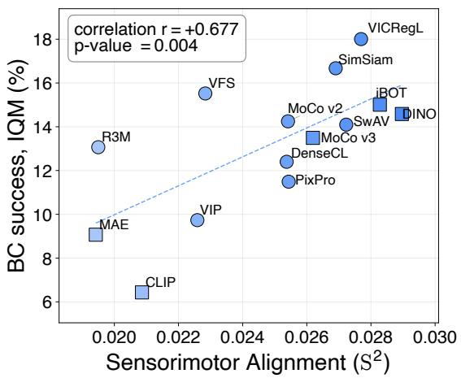  
ResNet-50

ViT-B/16  
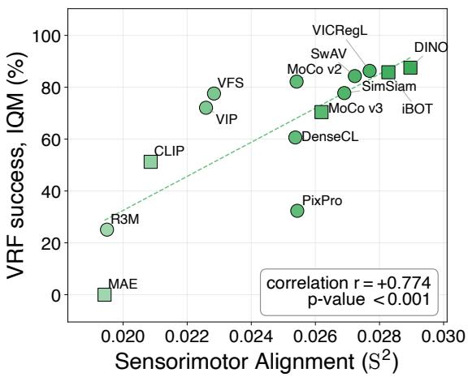  
Figure 11 | Sensorimotor Alignment (S2) of frozen vision encoders correlates with downstream policy success rate. Points represent the 14 frozen backbones of Hu et al. [19], scored by $S ^ { 2 }$ on DROID without policy training. The vertical axis shows the interquartile mean (IQM) of task success rates over 21 tasks, using low-data behavior cloning (left) or reinforcement learning with visual reward functions (right).

We find a strong correlation between the backbone’s $S ^ { 2 }$ and downstream task success under both policy-learning methods, as shown in Figure 11. For BC, $r = + 0 . 6 7 7$ with one-tailed $p \ = \ 0 . 0 0 4$ . For VRF, $r = + 0 . 7 7 4$ with one-tailed $p ~ < ~ 0 . 0 0 1$ . Both methods rely directly on the frozen representation: low-data BC maps frozen features to actions from as little as one demonstration per task, and VRF computes its reward from distances in the embedding space. The correlation follows how strongly the policy relies on the representation. As the BC budget grows, it decreases to $r = + 0 . 2 3 6$ at the largest budget, consistent with more demonstrations letting the policy compensate for a weaker representation. For reinforcement learning, which Hu et al. [19] find too variable across random seeds to evaluate vision backbones reliably, we find no positive correlation on two Meta-World seed sets or on Robosuite, where � lies between −0.193 and −0.002. These results show that $S ^ { 2 }$ measures a frozen representation’s contribution to the policy and is most informative when the policy relies directly on it.

## C. Robustness of $S ^ { 2 }$

This section extends Section 3.3, which asks that a useful offline metric stay stable under changes in how it is computed and react to a mismatch between the reference data and the target robot. Appendices C.1–C.3 test stability across the trajectory horizon, five implementation choices, and DTW warping. Appendix C.4 tests sensitivity to a mismatch in arm configuration.

## C.1. Trajectory Horizon

Tables 2 to 4 report $S ^ { 2 }$ for the 12 finetuned VLAs at all 10 DROID horizons $( N = 6 , 0 0 0 , k = 1 0 )$ , for the joint, vision-token, and text-token features selected from the same LLM output; Figure 7 summarizes the joint-feature correlation on both reference datasets. Models are sorted by SimplerEnv WidowX success rate (SR). Bottom rows give Spearman’s $\rho$ and Pearson’s � with success rate, each followed by its one-tailed �-value for a positive association. We find that $S ^ { 2 }$ from joint vision-text features and from vision features correlates significantly with the success rate at every horizon, with � from +0.610 to +0.717 and from +0.554 to +0.703, respectively. Text-feature $S ^ { 2 }$ is not significant under Pearson’s � at any horizon, where � ranges from +0.227 to +0.274, consistent with the modality analysis in Section 4.1.

Table 2 | Sensorimotor Alignment $( \mathsf { S } ^ { 2 } )$ from joint vision-text features at the language-model output versus SimplerEnv-WidowX task success rate (SR) across trajectory horizons ℎ. We score 12 fine-tuned vision-language-action models on DROID $( N = 6 { , } 0 0 0$ episodes, $k = 1 0$ neighbors). Bottom rows report Spearman’s � and Pearson’s � with their one-tailed �-values. Bold marks the horizon of peak Pearson � $( h = 7 )$
<table><tr><td>Model</td><td>SR (%)</td><td>h=1</td><td>h=3</td><td>h=7</td><td>h=15</td><td>h=25</td><td>h=40</td><td>h=75</td><td>h=110</td><td>h=150</td><td>h=220</td></tr><tr><td>Qwen2.5-GR00T-Bridge</td><td>71.4</td><td>0.034</td><td>0.034</td><td>0.036</td><td>0.040</td><td>0.043</td><td>0.051</td><td>0.065</td><td>0.076</td><td>0.086</td><td>0.097</td></tr><tr><td>Qwen3-GR00T-RT-1-Bridge</td><td>65.3</td><td>0.028</td><td>0.027</td><td>0.029</td><td>0.032</td><td>0.036</td><td>0.044</td><td>0.057</td><td>0.071</td><td>0.083</td><td>0.096</td></tr><tr><td>Qwen2.5-GR00T-RT-1-Bridge</td><td>63.6</td><td>0.034</td><td>0.034</td><td>0.035</td><td>0.040</td><td>0.042</td><td>0.048</td><td>0.062</td><td>0.071</td><td>0.080</td><td>0.090</td></tr><tr><td>CogACT-Large</td><td>58.3</td><td>0.031</td><td>0.031</td><td>0.033</td><td>0.037</td><td>0.040</td><td>0.048</td><td>0.062</td><td>0.075</td><td>0.086</td><td>0.097</td></tr><tr><td>GR00T-N1.6-Bridge</td><td>57.1</td><td>0.023</td><td>0.024</td><td>0.026</td><td>0.029</td><td>0.031</td><td>0.038</td><td>0.051</td><td>0.064</td><td>0.076</td><td>0.091</td></tr><tr><td>CogACT-Base</td><td>51.3</td><td>0.031</td><td>0.031</td><td>0.032</td><td>0.037</td><td>0.040</td><td>0.049</td><td>0.062</td><td>0.074</td><td>0.086</td><td>0.098</td></tr><tr><td>CogACT-Small</td><td>51.0</td><td>0.031</td><td>0.031</td><td>0.032</td><td>0.036</td><td>0.040</td><td>0.047</td><td>0.060</td><td>0.071</td><td>0.083</td><td>0.092</td></tr><tr><td>Pi0-Bridge</td><td>47.9</td><td>0.017</td><td>0.017</td><td>0.017</td><td>0.020</td><td>0.022</td><td>0.025</td><td>0.033</td><td>0.044</td><td>0.053</td><td>0.061</td></tr><tr><td>Qwen2.5-OFT-RT-1-Bridge</td><td>44.2</td><td>0.024</td><td>0.023</td><td>0.024</td><td>0.028</td><td>0.030</td><td>0.036</td><td>0.049</td><td>0.061</td><td>0.070</td><td>0.082</td></tr><tr><td>Qwen3-OFT-RT-1-Bridge</td><td>42.7</td><td>0.024</td><td>0.024</td><td>0.025</td><td>0.029</td><td>0.031</td><td>0.038</td><td>0.051</td><td>0.064</td><td>0.075</td><td>0.086</td></tr><tr><td>SpatialVLA-Bridge</td><td>42.7</td><td>0.021</td><td>0.022</td><td>0.022</td><td>0.024</td><td>0.026</td><td>0.033</td><td>0.044</td><td>0.054</td><td>0.063</td><td>0.073</td></tr><tr><td>GR00T-N1.5-Bridge</td><td>36.5</td><td>0.023</td><td>0.023</td><td>0.024</td><td>0.027</td><td>0.030</td><td>0.036</td><td>0.048</td><td>0.058</td><td>0.069</td><td>0.080</td></tr><tr><td>Spearman ρ</td><td></td><td>0.736</td><td>0.764</td><td>0.802</td><td>0.788</td><td>0.767</td><td>0.767</td><td>0.774</td><td>0.746</td><td>0.774</td><td>0.725</td></tr><tr><td>p</td><td></td><td>0.003</td><td>0.002</td><td>0.001</td><td>0.001</td><td>0.002</td><td>0.002</td><td>0.002</td><td>0.003</td><td>0.002</td><td>0.004</td></tr><tr><td>Pearson r</td><td></td><td>0.692</td><td>0.699</td><td>0.717</td><td>0.696</td><td>0.689</td><td>0.683</td><td>0.647</td><td>0.646</td><td>0.629</td><td>0.610</td></tr><tr><td>p</td><td></td><td>0.006</td><td>0.006</td><td>0.004</td><td>0.006</td><td>0.007</td><td>0.007</td><td>0.012</td><td>0.012</td><td>0.014</td><td>0.018</td></tr></table>

Table 3 | Sensorimotor Alignment $( S ^ { 2 } )$ from vision features at the language-model output versus SimplerEnv-WidowX task success rate (SR) across trajectory horizons ℎ. We score 12 fine-tuned vision-language-action models on DROID $( N = 6 { , } 0 0 0$ episodes, � = 10 neighbors). Bottom rows report Spearman’s � and Pearson’s � with their one-tailed �-values. Bold marks the horizon of peak Pearson � $( h = 1 \bar { 5 } )$
<table><tr><td>Model</td><td>SR (%)</td><td>h=1</td><td>h=3</td><td>h=7</td><td>h=15</td><td>h=25</td><td>h=40</td><td>h=75</td><td>h=110</td><td>h=150</td><td>h=220</td></tr><tr><td>Qwen2.5-GR00T-Bridge</td><td>71.4</td><td>0.034</td><td>0.034</td><td>0.035</td><td>0.039</td><td>0.043</td><td>0.049</td><td>0.062</td><td>0.074</td><td>0.084</td><td>0.093</td></tr><tr><td>Qwen3-GR00T-RT-1-Bridge</td><td>65.3</td><td>0.026</td><td>0.026</td><td>0.027</td><td>0.031</td><td>0.034</td><td>0.041</td><td>0.054</td><td>0.067</td><td>0.080</td><td>0.092</td></tr><tr><td>Qwen2.5-GR00T-RT-1-Bridge</td><td>63.6</td><td>0.033</td><td>0.033</td><td>0.035</td><td>0.038</td><td>0.041</td><td>0.047</td><td>0.059</td><td>0.070</td><td>0.079</td><td>0.088</td></tr><tr><td>CogACT-Large</td><td>58.3</td><td>0.030</td><td>0.030</td><td>0.032</td><td>0.035</td><td>0.039</td><td>0.047</td><td>0.061</td><td>0.073</td><td>0.084</td><td>0.095</td></tr><tr><td>GR00T-N1.6-Bridge</td><td>57.1</td><td>0.024</td><td>0.024</td><td>0.026</td><td>0.029</td><td>0.032</td><td>0.039</td><td>0.051</td><td>0.064</td><td>0.077</td><td>0.091</td></tr><tr><td>CogACT-Base</td><td>51.3</td><td>0.031</td><td>0.030</td><td>0.032</td><td>0.036</td><td>0.040</td><td>0.048</td><td>0.060</td><td>0.073</td><td>0.085</td><td>0.098</td></tr><tr><td>CogACT-Small</td><td>51.0</td><td>0.030</td><td>0.030</td><td>0.031</td><td>0.035</td><td>0.039</td><td>0.046</td><td>0.059</td><td>0.070</td><td>0.082</td><td>0.092</td></tr><tr><td>Pi0-Bridge</td><td>47.9</td><td>0.017</td><td>0.017</td><td>0.017</td><td>0.020</td><td>0.022</td><td>0.025</td><td>0.033</td><td>0.044</td><td>0.053</td><td>0.061</td></tr><tr><td>Qwen2.5-OFT-RT-1-Bridge</td><td>44.2</td><td>0.022</td><td>0.022</td><td>0.023</td><td>0.026</td><td>0.028</td><td>0.035</td><td>0.046</td><td>0.058</td><td>0.068</td><td>0.079</td></tr><tr><td>Qwen3-OFT-RT-1-Bridge</td><td>42.7</td><td>0.024</td><td>0.024</td><td>0.025</td><td>0.028</td><td>0.030</td><td>0.037</td><td>0.050</td><td>0.063</td><td>0.074</td><td>0.087</td></tr><tr><td>SpatialVLA-Bridge</td><td>42.7</td><td>0.022</td><td>0.022</td><td>0.022</td><td>0.025</td><td>0.026</td><td>0.033</td><td>0.045</td><td>0.055</td><td>0.064</td><td>0.075</td></tr><tr><td>ĠR00T-N1.5-Bridge</td><td>36.5</td><td>0.023</td><td>0.023</td><td>0.024</td><td>0.027</td><td>0.029</td><td>0.035</td><td>0.048</td><td>0.059</td><td>0.069</td><td>0.079</td></tr><tr><td>Spearman ρ</td><td></td><td>0.767</td><td>0.757</td><td>0.767</td><td>0.746</td><td>0.746</td><td>0.739</td><td>0.725</td><td>0.711</td><td>0.683</td><td>0.704</td></tr><tr><td>p</td><td></td><td>0.002</td><td>0.002</td><td>0.002</td><td>0.003</td><td>0.003</td><td>0.003</td><td>0.004</td><td>0.005</td><td>0.007</td><td>0.005</td></tr><tr><td>Pearson r</td><td></td><td>0.686</td><td>0.694</td><td>0.701</td><td>0.703</td><td>0.690</td><td>0.647</td><td>0.606</td><td>0.618</td><td>0.601</td><td>0.554</td></tr><tr><td>p</td><td></td><td>0.007</td><td>0.006</td><td>0.006</td><td>0.005</td><td>0.007</td><td>0.011</td><td>0.018</td><td>0.016</td><td>0.019</td><td>0.031</td></tr></table>

Table 4 | Sensorimotor Alignment $( \mathsf { S } ^ { 2 } )$ from text features at the language-model output versus SimplerEnv-WidowX task success rate (SR) across trajectory horizons ℎ. We score 12 fine-tuned vision-language-action models on DROID $( N = 6 { , } 0 0 0$ episodes, � = 10 neighbors). Bottom rows report Spearman’s � and Pearson’s � with their one-tailed �-values. Bold marks the highest Spearman � (ℎ = 150).
<table><tr><td>Model</td><td>SR (%)</td><td>h=1</td><td>h=3</td><td>h=7</td><td>h=15</td><td>h=25</td><td>h=40</td><td>h=75</td><td>h=110</td><td>h=150</td><td>h=220</td></tr><tr><td>Qwen2.5-GR00T-Bridge</td><td>71.4</td><td>0.018</td><td>0.019</td><td>0.019</td><td>0.022</td><td>0.025</td><td>0.030</td><td>0.039</td><td>0.046</td><td>0.053</td><td>0.059</td></tr><tr><td>Qwen3-GR00T-RT-1-Bridge</td><td>65.3</td><td>0.015</td><td>0.015</td><td>0.016</td><td>0.018</td><td>0.020</td><td>0.024</td><td>0.031</td><td>0.040</td><td>0.048</td><td>0.057</td></tr><tr><td>Qwen2.5-GR00T-RT-1-Bridge</td><td>63.6</td><td>0.022</td><td>0.021</td><td>0.022</td><td>0.026</td><td>0.028</td><td>0.032</td><td>0.040</td><td>0.048</td><td>0.053</td><td>0.058</td></tr><tr><td>CogACT-Large</td><td>58.3</td><td>0.037</td><td>0.037</td><td>0.038</td><td>0.042</td><td>0.045</td><td>0.054</td><td>0.068</td><td>0.081</td><td>0.091</td><td>0.104</td></tr><tr><td>GR00T-N1.6-Bridge</td><td>57.1</td><td>0.008</td><td>0.008</td><td>0.008</td><td>0.010</td><td>0.010</td><td>0.014</td><td>0.020</td><td>0.024</td><td>0.029</td><td>0.033</td></tr><tr><td>CogACT-Base</td><td>51.3</td><td>0.035</td><td>0.035</td><td>0.037</td><td>0.041</td><td>0.044</td><td>0.053</td><td>0.068</td><td>0.080</td><td>0.090</td><td>0.104</td></tr><tr><td>CogACT-Small</td><td>51.0</td><td>0.030</td><td>0.029</td><td>0.030</td><td>0.034</td><td>0.038</td><td>0.044</td><td>0.057</td><td>0.064</td><td>0.070</td><td>0.080</td></tr><tr><td>Pi0-Bridge</td><td>47.9</td><td>0.014</td><td>0.015</td><td>0.016</td><td>0.019</td><td>0.021</td><td>0.024</td><td>0.033</td><td>0.043</td><td>0.052</td><td>0.061</td></tr><tr><td>Qwen2.5-OFT-RT-1-Bridge</td><td>44.2</td><td>0.019</td><td>0.018</td><td>0.018</td><td>0.022</td><td>0.024</td><td>0.028</td><td>0.036</td><td>0.044</td><td>0.051</td><td>0.060</td></tr><tr><td>Qwen3-OFT-RT-1-Bridge</td><td>42.7</td><td>0.013</td><td>0.013</td><td>0.014</td><td>0.015</td><td>0.016</td><td>0.020</td><td>0.026</td><td>0.034</td><td>0.040</td><td>0.045</td></tr><tr><td>SpatialVLA-Bridge</td><td>42.7</td><td>0.014</td><td>0.014</td><td>0.014</td><td>0.016</td><td>0.017</td><td>0.022</td><td>0.030</td><td>0.036</td><td>0.043</td><td>0.049</td></tr><tr><td>GR00T-N1.5-Bridge</td><td>36.5</td><td>0.010</td><td>0.010</td><td>0.010</td><td>0.011</td><td>0.011</td><td>0.014</td><td>0.019</td><td>0.024</td><td>0.029</td><td>0.033</td></tr><tr><td>Spearman ρ</td><td></td><td>0.438</td><td>0.452</td><td>0.452</td><td>0.452</td><td>0.452</td><td>0.452</td><td>0.501</td><td>0.452</td><td>0.508</td><td>0.291</td></tr><tr><td>p</td><td></td><td>0.077</td><td>0.070</td><td>0.070</td><td>0.070</td><td>0.070</td><td>0.070</td><td>0.049</td><td>0.070</td><td>0.046</td><td>0.180</td></tr><tr><td>Pearson r</td><td></td><td>0.227</td><td>0.238</td><td>0.245</td><td>0.265</td><td>0.274</td><td>0.259</td><td>0.254</td><td>0.265</td><td>0.255</td><td>0.233</td></tr><tr><td>p</td><td></td><td>0.239</td><td>0.229</td><td>0.222</td><td>0.203</td><td>0.194</td><td>0.208</td><td>0.213</td><td>0.202</td><td>0.212</td><td>0.233</td></tr></table>

## C.2. Implementation Choices

We vary one choice at a time, keeping the main-paper defaults otherwise: the 6,000-episode DROID subset, $h = 7 , k = 1 0 .$ , the joint vision-text features at the language-model output, and the 12 finetuned VLAs. Table 5 reports the Pearson � between $S ^ { 2 }$ and SimplerEnv success rate for each setting. All settings of $k ,$ normalization, component weights, rotation distance, and pooling keep the correlation positive and significant, with � between +0.634 and +0.752.

Table 5 | Sensitivity of the Sensorimotor Alignment (S2)–success-rate correlation to implementation choices. Pearson’s � and one-tailed � compare $S ^ { 2 }$ with SimplerEnv-WidowX task success rate across 12 fine-tuned visionlanguage-action models. Each block varies one choice; ∗ marks the default.
<table><tr><td>Setting</td><td>r</td><td>Setting</td><td>r</td><td>p</td></tr><tr><td>Number of neighbors k</td><td>0.0076</td><td>Weights (position, rotation, gripper)  $( 1 , \bar { 1 } , 1 ) ^ { * }$ </td><td></td><td></td></tr><tr><td> $k = 2$ </td><td>+0.679</td><td></td><td>+0.717 (0.5,1,1)</td><td>0.0043</td></tr><tr><td> $k = 5$ </td><td>+0.667</td><td></td><td>+0.698</td><td>0.0058</td></tr><tr><td> $k = 1 0 ^ { * }$ </td><td>+0.717</td><td></td><td>+0.708</td><td>0.0050</td></tr><tr><td> $k = 1 5$ </td><td>+0.665</td><td></td><td>+0.694</td><td>0.0062</td></tr><tr><td> $k = 2 0$ </td><td>+0.644 0.0119</td><td>(1,2,1)</td><td>+0.703</td><td>0.0054</td></tr><tr><td>Trajectory normalization</td><td></td><td></td><td>+0.702</td><td>0.0055</td></tr><tr><td>Absolute pose*</td><td>+0.717 0.0043</td><td>(1,1,2)</td><td>+0.699</td><td>0.0057</td></tr><tr><td>Anchor-relative</td><td>+0.752</td><td>(0,1,1)</td><td>+0.745</td><td>0.0027</td></tr><tr><td>Rotation distance</td><td>0.0024</td><td>(1,0,1) (1,1,0)</td><td>+0.658</td><td>0.0100</td></tr><tr><td>SO(3) geodesic*</td><td>+0.717 0.0043</td><td></td><td>+0.634</td><td>0.0135</td></tr><tr><td>Quaternion squared chordal</td><td>+0.686 0.0069</td><td></td><td></td><td></td></tr><tr><td>XYZ Euler  $\ell _ { 2 }$ </td><td>+0.660 0.0097</td><td></td><td></td><td></td></tr><tr><td>Token pooling</td><td></td><td></td><td></td><td></td></tr><tr><td>Masked mean*</td><td>+0.717</td><td>0.0043</td><td></td><td></td></tr><tr><td>Masked max</td><td>+0.653 0.0107</td><td></td><td></td><td></td></tr><tr><td>Masked min</td><td>+0.730</td><td></td><td></td><td></td></tr></table>

Number of neighbors �. We use � =10 in the main paper, following Huh et al. [20]. Across $k \in \{ 2 , 5 , 1 0 , 1 5 , 2 0 \}$ , � ranges from +0.644 to +0.717, with a mild peak at the default � =10.

Trajectory normalization. The anchor-relative setting replaces each position with its offset from the starting frame and keeps rotation and gripper state unchanged. It gives a slightly higher � than absolute poses, possibly because removing the workspace offset emphasizes the shape of the motion. We keep absolute poses for simplicity.

Component weights. The DTW step cost in Appendix A.2 combines position, rotation, and gripper-state distances with weights $w _ { \mathrm { p o s } } , w _ { \mathrm { r o t } }$ , and $w _ { \mathrm { g r i p } } ,$ all equal to one by default. Halving, doubling, or removing one weight keeps � between +0.634 and +0.745. Removing rotation or gripper lowers � most, suggesting both carry information beyond position.

Rotation distance and token pooling. The SO(3) geodesic gives the highest � of the three rotation distances. The quaternion alternative uses the scaled squared chordal quantity $1 - | \mathbf { q } ^ { \intercal } \mathbf { q } ^ { \prime } |$ ; the Euler alternative uses the $\ell _ { 2 }$ distance between recorded angle triples, without wrapping angular differences. Each alternative is rescaled to match the mean geodesic distance on 40,000 sampled state pairs. For pooling the LLM-output tokens, masked min gives a slightly higher � than the default masked mean, and masked max gives the lowest.

## C.3. DTW Alignment

$S ^ { 2 }$ aligns trajectory pairs with DTW before measuring their distance, so the same motion at different speeds counts as similar. To test whether the correlation depends on this warping, we compare DTW with the lockstep distance $\begin{array} { r } { d _ { \mathrm { l o c k } } ( i , j ) = \sum _ { u = 1 } ^ { h } c _ { u u } , } \end{array}$ , which matches frames by time index using the local cost in Appendix A.2. The lockstep sum weights every matched state once, whereas symmetric2 DTW weights diagonal transitions twice. Table 6 reports the comparison. DTW raises $S ^ { 2 }$ for all 12 VLAs from $h = 7$ onward, and the gain grows with the horizon, from 1.2% at $h = 7$ to $3 4 . 1 \%$ at $h = 2 2 0 .$ , since longer trajectories contain more variation in speed. Because DTW raises the $S ^ { 2 }$ of all models by a similar amount, $( 3 4 \pm 4 ) \%$ (mean ± standard deviation across models) at $h = 2 2 0$ , the correlation with task success barely changes. Across the 10 horizons, � ranges from +0.617 to +0.713 without DTW and from +0.610 to +0.717 with DTW, a relative difference between −3.2% and $+ 0 . 6 \%$ . The $S ^ { 2 } .$ –success-rate correlation is therefore not an artifact of warping.

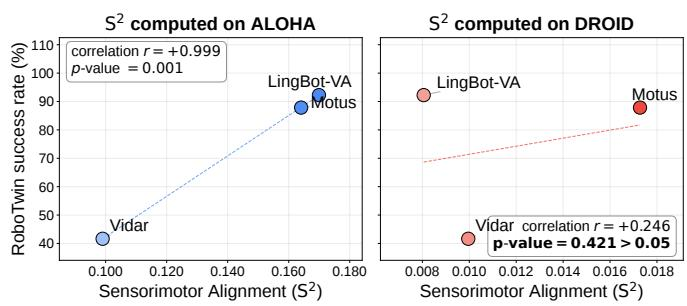

Table 6 | Comparing Sensorimotor Alignment $( S ^ { 2 } )$ with and without Dynamic Time Warping (DTW). DTW raises absolute $S ^ { 2 }$ more at longer trajectory horizons $h ,$ while its Pearson correlation � with SimplerEnv-WidowX task success rate (SR) stays stable. Each relative change is $1 0 0 ( \nu _ { \mathrm { D T W } } / \nu _ { \mathrm { n o D T W } } - 1 ) \%$ for the quantity � in that block.
<table><tr><td rowspan="2"></td><td colspan="3"> $S ^ { 2 }$  (mean over 12 VLAs)</td><td colspan="3"> $S ^ { 2 } .$  -SR Pearson r</td></tr><tr><td>Horizon h w/ DTW</td><td>w/o DTW</td><td>rel. change</td><td> $\ l { \bf w } / \ l$  DTW</td><td> $\mathbf { w } / \mathbf { o }$  DTW</td><td>rel. change</td></tr><tr><td>1</td><td>0.0268</td><td>0.0268</td><td>+0.0%</td><td>+0.692</td><td>+0.692</td><td>+0.0%</td></tr><tr><td>3</td><td>0.0268</td><td>0.0269</td><td>-0.6%</td><td>+0.699</td><td>+0.700</td><td>-0.1%</td></tr><tr><td>7</td><td>0.0280</td><td>0.0277</td><td>+1.2%</td><td>+0.717</td><td>+0.713</td><td>+0.6%</td></tr><tr><td>15</td><td>0.0314</td><td>0.0302</td><td>+4.1%</td><td>+0.696</td><td>+0.710</td><td>-2.0%</td></tr><tr><td>25</td><td>0.0342</td><td>0.0317</td><td>+7.7%</td><td>+0.689</td><td>+0.711</td><td>-3.2%</td></tr><tr><td>40</td><td>0.0410</td><td>0.0365</td><td>+12.4%</td><td>+0.683</td><td>+0.680</td><td>+0.4%</td></tr><tr><td>75</td><td>0.0537</td><td>0.0442</td><td>+21.7%</td><td>+0.647</td><td>+0.663</td><td>-2.5%</td></tr><tr><td>110</td><td>0.0653</td><td>0.0533</td><td>+22.4%</td><td>+0.646</td><td>+0.661</td><td>-2.2%</td></tr><tr><td>150</td><td>0.0758</td><td>0.0602</td><td>+25.9%</td><td>+0.629</td><td>+0.633</td><td>-0.7%</td></tr><tr><td>220</td><td>0.0870</td><td>0.0649</td><td>+34.1%</td><td>+0.610</td><td>+0.617</td><td>-1.1%</td></tr></table>

## C.4. Sensitivity to Embodiment Mismatch

A useful offline metric should respond when the reference data no longer matches the target robot. We test this with 3 bimanual WAMs evaluated on RoboTwin, scoring them with two reference datasets that differ in arm configuration, as shown in Figure 12. With the matched bimanual ALOHA reference [59], $S ^ { 2 }$ recovers the success-rate order of all 3 models, at $r = + 0 . 9 9 9$ With the single-arm DROID reference, the correlation drops to $r = + 0 . 2 4 6$ with $p { = } 0 . 4 2 1 . \ S ^ { 2 }$ therefore responds to the mismatch in arm configuration rather than reporting alignment indiscriminately. This sensitivity complements the stability across single-arm references in Section 3.3, where DROID and BridgeDataV2 differ in robot, scenes, and tasks yet give nearly the same correlation for the 12 VLAs. A reference dataset therefore need not come from the exact target robot, but it should match the target’s arm configuration.

Figure 12 | Sensorimotor Alignment $( S ^ { 2 } )$ is sensitive to a mismatch in arm configuration. For 3 world action models (WAMs) evaluated on bimanual RoboTwin, the matched bimanual ALOHA reference (left) recovers the success-rate ordering, while the single-arm DROID reference (right) weakens the correlation. $S ^ { 2 }$ thus reflects whether reference data matches the target arm configuration.

## D. Details of the Representation-Level Explanations

This section gives the full data behind the representation-level explanations in Section 4.

## D.1. $S ^ { 2 }$ Across Feature Positions

Section 4.1 compares $S ^ { 2 }$ from vision, text, and joint features at the LLM output. Here we extend the comparison to every feature position, from the vision-encoder output (ViT-out) through the language-model input (LLM-in) to the language-model output (LLM-out).

Correlation with task success. Table 7 reports the correlation between $S ^ { 2 }$ and SimplerEnv success rate for the 12 fine-tuned VLAs at each feature position on DROID $( N = 6 , 0 0 0 , h = 7 )$ ; Section 4.1 reports $h = 3 ,$ , and Appendix C.1 gives every horizon. The correlation holds at every visual feature position and grows with depth, from $r = + 0 . 5 6 7$ at the vision-encoder output to $r { = } { + } 0 . 7 1 7$ at the LLM output. Text-only features show no significant correlation at either position. This agrees with reports that VLAs follow visual cues despite conflicting instructions [12, 58].

Table 7 | Correlation between Sensorimotor Alignment (S2) and task success by feature position. Pearson’s � and one-tailed � compare $S ^ { 2 }$ with SimplerEnv-WidowX task success rate across 12 fine-tuned vision-language-action models on DROID $( N = 6 { , } 0 0 0$ episodes, trajectory horizon ℎ = 7). ViT-out, LLM-in, and LLM-out denote the vision-encoder output, language-model input, and language-model output; ∗ marks the default feature.
<table><tr><td>Feature position</td><td>Pearson&#x27;s r</td><td>One-tailed  $p$ </td></tr><tr><td>ViT-out</td><td>+0.567</td><td>0.0274</td></tr><tr><td>LLM-in vision-text</td><td>+0.580</td><td>0.0239</td></tr><tr><td>LLM-out vision-only</td><td>+0.701</td><td>0.0056</td></tr><tr><td>LLM-out vision-text*</td><td>+0.717</td><td>0.0043</td></tr><tr><td>LLM-in text-only</td><td>-0.325</td><td>0.8486</td></tr><tr><td>LLM-out text-only</td><td>+0.245</td><td>0.2215</td></tr></table>

$S ^ { 2 }$ by model group. Table 8 reports the mean $S ^ { 2 }$ at each feature position for 3 groups of models on DROID $\left( N { = } 6 , 0 0 0 , h { = } 7 \right)$ , which are 3 standalone vision encoders, the 8 raw VLMs, and the 12 finetuned VLAs. Table 9 gives the per-model values. For the vision, text, and joint vision-text features of Section 4.1, we average-pool the selected output tokens and apply the feature normalization in Appendix A.3. The VLA group has higher mean $S ^ { 2 }$ than the raw-VLM group at every compared position. The relative difference is larger at the LLM output, from +29.9% to +45.0%, than at the vision-encoder output and LLM input, from +12.7% to +18.1%.

Table 8 | Mean Sensorimotor Alignment $( \mathsf { S } ^ { 2 } )$ by feature position on DROID (� = 6,000 episodes, trajectory horizon $h = 7 )$ . ViT-out, LLM-in, and LLM-out denote the vision-encoder output, language-model input, and language-model output; standalone vision encoders have only ViT-out features. The last column is $1 0 0 ( \overline { { S ^ { 2 } } } _ { \mathrm { V L A } } / \overline { { S ^ { 2 } } } _ { \mathrm { V L M } } - 1 ) \%$ , where each bar denotes the model-group mean.
<table><tr><td>Feature</td><td>Vision encoder (mean, n =3)</td><td>Raw VLM (mean, n =8)</td><td>Finetuned VLA (mean, n =12)</td><td>Relative change</td></tr><tr><td>ViT-out</td><td>0.0246</td><td>0.0247</td><td>0.0278</td><td>+12.7%</td></tr><tr><td>LLM-in vision-only</td><td></td><td>0.0244</td><td>0.0275</td><td>+12.7%</td></tr><tr><td>LLM-in vision-text</td><td></td><td>0.0233</td><td>0.0275</td><td>+18.1%</td></tr><tr><td>LLM-out vision-only</td><td>一</td><td>0.0212</td><td>0.0275</td><td>+29.9%</td></tr><tr><td>LLM-out text-only</td><td></td><td>0.0140</td><td>0.0202</td><td>+45.0%</td></tr><tr><td>LLM-out vision-text</td><td></td><td>0.0204</td><td>0.0280</td><td>+37.4%</td></tr></table>

Table 9 | Per-model Sensorimotor Alignment $( S ^ { 2 } )$ by feature position on DROID (� = 6,000 episodes, trajectory horizon ℎ = 7). ViT-out, LLM-in, and LLM-out denote the vision-encoder output, language-model input, and language-model output. Vision-only, text-only, and vision-text select image tokens, instruction tokens, or both from the same model input. Group means are in Table 8.
<table><tr><td>Model</td><td>ViT-out</td><td>LLM-in vision-only</td><td>LLM-in text-only</td><td>LLM-in vision-text</td><td>LLM-out vision-only</td><td>LLM-out text-only</td><td>LLM-out vision-text</td></tr><tr><td colspan="8">Pretrained vision encoders, no LLM attached (n=3)</td></tr><tr><td>CLIP-ViT-L/14 [37]</td><td>0.0240</td><td></td><td></td><td></td><td></td><td></td><td></td></tr><tr><td>SigLIP-SO400M [56]</td><td>0.0247</td><td></td><td></td><td></td><td></td><td></td><td></td></tr><tr><td>SigLIP-2 Large [46]</td><td>0.0250</td><td>一</td><td></td><td></td><td></td><td></td><td></td></tr><tr><td colspan="8">Raw VLMs from VLM4VLA (n=8)</td></tr><tr><td>KosMos-2</td><td>0.0257</td><td>0.0238</td><td>0.0093</td><td>0.0239</td><td>0.0214</td><td>0.0151</td><td>0.0216</td></tr><tr><td>PaliGemma 1</td><td>0.0249</td><td>0.0251</td><td>0.0082</td><td>0.0193</td><td>0.0193</td><td>0.0160</td><td>0.0191</td></tr><tr><td>PaliGemma 2</td><td>0.0250</td><td>0.0251</td><td>0.0087</td><td>0.0222</td><td>0.0196</td><td>0.0142</td><td>0.0192</td></tr><tr><td>Qwen2.5-VL-3B</td><td>0.0241</td><td>0.0239</td><td>0.0079</td><td>0.0239</td><td>0.0185</td><td>0.0139</td><td>0.0188</td></tr><tr><td>Qwen2.5-VL-7B</td><td>0.0231</td><td>0.0234</td><td>0.0083</td><td>0.0234</td><td>0.0188</td><td>0.0127</td><td>0.0190</td></tr><tr><td>Qwen3-VL-2B</td><td>0.0242</td><td>0.0237</td><td>0.0089</td><td>0.0237</td><td>0.0236</td><td>0.0127</td><td>0.0217</td></tr><tr><td>Qwen3-VL-4B</td><td>0.0253</td><td>0.0254</td><td>0.0089</td><td>0.0254</td><td>0.0239</td><td>0.0135</td><td>0.0232</td></tr><tr><td>Qwen3-VL-8B</td><td>0.0250</td><td>0.0245</td><td>0.0088</td><td>0.0245</td><td>0.0240</td><td>0.0136</td><td>0.0207</td></tr><tr><td colspan="8">Finetuned VLAs (n=12)</td></tr><tr><td>Qwen2.5-GR00T-Bridge</td><td>0.0344</td><td>0.0335</td><td>0.0078</td><td>0.0335</td><td>0.0354</td><td>0.0192</td><td>0.0363</td></tr><tr><td>Qwen2.5-GR00T-RT-1-Bridge</td><td>0.0355</td><td>0.0345</td><td>0.0077</td><td>0.0345</td><td>0.0350</td><td>0.0224</td><td>0.0353</td></tr><tr><td>Qwen2.5-OFT-RT-1-Bridge</td><td>0.0265</td><td>0.0265</td><td>0.0082</td><td>0.0265</td><td>0.0234</td><td>0.0185</td><td>0.0242</td></tr><tr><td>Qwen3-GR00T-RT-1-Bridge</td><td>0.0264</td><td>0.0266</td><td>0.0085</td><td>0.0266</td><td>0.0274</td><td>0.0158</td><td>0.0292</td></tr><tr><td>Qwen3-OFT-RT-1-Bridge</td><td>0.0263</td><td>0.0257</td><td>0.0086</td><td>0.0257</td><td>0.0248</td><td>0.0136</td><td>0.0254</td></tr><tr><td>CogACT Small</td><td>0.0301</td><td>0.0303</td><td>0.0097</td><td>0.0303</td><td>0.0313</td><td>0.0300</td><td>0.0319</td></tr><tr><td>CogACT Base</td><td>0.0301</td><td>0.0298</td><td>0.0096</td><td>0.0298</td><td>0.0319</td><td>0.0368</td><td>0.0324</td></tr><tr><td>CogACT Large</td><td>0.0298</td><td>0.0298</td><td>0.0097</td><td>0.0298</td><td>0.0317</td><td>0.0379</td><td>0.0328</td></tr><tr><td>GR00T-N1.5-Bridge</td><td>0.0252</td><td>0.0244</td><td>0.0090</td><td>0.0243</td><td>0.0238</td><td>0.0099</td><td>0.0240</td></tr><tr><td>GR00T-N1.6-Bridge</td><td>0.0251</td><td>0.0245</td><td>0.0090</td><td>0.0245</td><td>0.0258</td><td>0.0082</td><td>0.0255</td></tr><tr><td>Pi0-Bridge</td><td>0.0176</td><td>0.0178</td><td>0.0090</td><td>0.0180</td><td>0.0174</td><td>0.0161</td><td>0.0174</td></tr><tr><td>SpatialVLA-Bridge</td><td>0.0266</td><td>0.0263</td><td>0.0087</td><td>0.0265</td><td>0.0219</td><td>0.0145</td><td>0.0217</td></tr></table>

## D.2. Frozen Versus Unfrozen Vision Encoder

Following VLM4VLA [57], both VLAs in Section 4.2 attach an FCDecoder action head to Qwen2.5-VL-3B [3] and are fine-tuned on BridgeDataV2. Training differs only in whether the vision encoder is frozen. We compare each configuration’s checkpoint with the best observed success rate: step 10,000 for the unfrozen model and step 30,000 for the frozen model. Table 10 compares all 10 horizons using mean-pooled LLM-output vision-text features, as in the main experiments, rather than the action-token state read by the action head. The frozen model has lower $S ^ { 2 }$ at every horizon, with relative reductions from 38.1% at ℎ=1 to 49.4% at ℎ=220.

Table 10 | Sensorimotor Alignment $( \mathsf { S } ^ { 2 } )$ with a frozen and an unfrozen vision encoder across trajectory horizons ℎ. Qwen2.5-VL-3B vision-language-action models trained with the same recipe, evaluated using joint vision-text features at the language-model output on DROID (� = 6,000 episodes). Relative change is $1 0 0 ( S _ { \mathrm { f r o z e n } } ^ { 2 } / S _ { \mathrm { u n f r o z e n } } ^ { 2 } - 1 ) \%$
<table><tr><td>Horizon h</td><td> $\mathbf { U n f r o z e n } S ^ { 2 }$ </td><td> $\mathbf { F r o z e n } S ^ { 2 }$ </td><td>Relative change</td></tr><tr><td>1</td><td>0.0231</td><td>0.0143</td><td>-38.1%</td></tr><tr><td>3</td><td>0.0232</td><td>0.0141</td><td>-39.0%</td></tr><tr><td>7</td><td>0.0245</td><td>0.0144</td><td>-41.1%</td></tr><tr><td>15</td><td>0.0268</td><td>0.0158</td><td>-41.2%</td></tr><tr><td>25</td><td>0.0295</td><td>0.0166</td><td>-43.8%</td></tr><tr><td>40</td><td>0.0352</td><td>0.0191</td><td>-45.7%</td></tr><tr><td>75</td><td>0.0481</td><td>0.0258</td><td>-46.4%</td></tr><tr><td>110</td><td>0.0614</td><td>0.0326</td><td>-46.9%</td></tr><tr><td>150</td><td>0.0733</td><td>0.0390</td><td>-46.8%</td></tr><tr><td>220</td><td>0.0861</td><td>0.0435</td><td>-49.4%</td></tr></table>

## D.3. WAM Features Along the Denoising Schedule

Table 11 reports $S ^ { 2 }$ for 3 WAMs at 7 feature positions and 5 points of each model’s denoising schedule. Figure 10a plots the final-layer-norm row; Figure 10b, each row’s schedule average. Block 14 has the highest $S ^ { 2 }$ at 13 of the 15 model and schedule points. The columns correspond to Motus steps 1, 3, 5, 8, and 10 of 10; LingBot-VA steps 0, 6, 13, 19, and 25 of 25; and Vidar steps 0, 5, 10, 15, and 19 of 20. The last Motus and Vidar features precede their final denoising update.

Table 11 | Layer-wise Sensorimotor Alignment $( \mathsf { S } ^ { 2 } )$ along the denoising schedule for 3 world action models (WAMs). Columns label 5 selected positions in each model’s native schedule, not matched noise levels. Motus and LingBot-VA use 500 episodes over 50 RoboTwin tasks; Vidar uses 480 episodes over 48 tasks. Rows give 6 video-backbone positions and the text embedding. Block 14 (bold) has the highest $S ^ { 2 }$ at 13 of the 15 model and schedule positions. The random baseline is the mean ± standard deviation (divisor 10) over 10 draws of independent standard-normal features with the same shape.
<table><tr><td>Feature</td><td>0% earliest</td><td>25%</td><td>50%</td><td>75%</td><td>100% latest</td></tr><tr><td></td><td colspan="5"></td></tr><tr><td>Motus Block 0</td><td>random baseline = 0.012 ± 0.002</td><td>0.203</td><td>0.307</td><td>0.321</td><td>0.324</td></tr><tr><td>Block 7</td><td>0.044 0.342</td><td>0.388</td><td>0.399</td><td>0.390</td><td>0.378</td></tr><tr><td>Block 14</td><td>0.479</td><td>0.492</td><td>0.482</td><td>0.479</td><td>0.471</td></tr><tr><td>Block 21</td><td>0.454</td><td>0.448</td><td>0.447</td><td>0.436</td><td>0.424</td></tr><tr><td>Block 29</td><td>0.420</td><td>0.424</td><td>0.419</td><td>0.421</td><td>0.405</td></tr><tr><td>Final layer norm</td><td>0.425</td><td>0.421</td><td>0.421</td><td>0.418</td><td></td></tr><tr><td>Text embedding</td><td>0.325</td><td>0.325</td><td>0.325</td><td>0.325</td><td>0.402</td></tr><tr><td></td><td></td><td></td><td></td><td></td><td>0.325</td></tr><tr><td>LingBot-VA random baseline = 0.012 ± 0.001</td><td></td><td></td><td></td><td></td><td></td></tr><tr><td>Block 0</td><td>0.142</td><td>0.160</td><td>0.238</td><td>0.326</td><td>0.384</td></tr><tr><td>Block 7</td><td>0.404</td><td>0.399</td><td>0.431</td><td>0.449</td><td>0.455</td></tr><tr><td>Block 14</td><td>0.498</td><td>0.504</td><td>0.514</td><td>0.514</td><td>0.513</td></tr><tr><td>Block 21</td><td>0.422</td><td>0.435</td><td>0.428</td><td>0.445</td><td>0.449</td></tr><tr><td>Block 29</td><td>0.423</td><td>0.440</td><td>0.441</td><td>0.447</td><td>0.448</td></tr><tr><td>Final layer norm</td><td>0.425</td><td>0.429</td><td>0.431</td><td>0.439</td><td>0.451</td></tr><tr><td>Text embedding</td><td>0.355</td><td>0.355</td><td>0.355</td><td>0.355</td><td>0.355</td></tr><tr><td colspan="6">Vidar random baseline = 0.013 ± 0.004</td></tr><tr><td>Block 0</td><td>0.483</td><td>0.477</td><td>0.459</td><td>0.429</td><td>0.422</td></tr><tr><td>Block 7</td><td>0.467</td><td>0.484</td><td>0.485</td><td>0.479</td><td>0.469</td></tr><tr><td>Block 14</td><td>0.504</td><td>0.555</td><td>0.531</td><td>0.518</td><td>0.473</td></tr><tr><td>Block 21</td><td>0.508</td><td>0.510</td><td>0.500</td><td>0.488</td><td>0.475</td></tr><tr><td>Block 29</td><td>0.487</td><td>0.490</td><td>0.489</td><td>0.481</td><td>0.474</td></tr><tr><td>Final layer norm</td><td>0.487</td><td>0.491</td><td>0.491</td><td>0.481</td><td>0.476</td></tr><tr><td>Text embedding</td><td>0.467</td><td>0.467</td><td>0.467</td><td>0.467</td><td>0.467</td></tr></table>

Behavioral validation. To check that $S ^ { 2 }$ along the denoising schedule correlates with task success, we vary the number of video denoising steps in LingBot-VA [27]. We measure $S ^ { 2 }$ and closed-loop success rate on the RoboTwin turn\_switch task over 100 episodes. Reducing the steps from the default 25 to 5 lowers the success rate from 56% to 48% and $S ^ { 2 }$ from 0.288 to 0.241, so $S ^ { 2 }$ and task success change together.