# SpectralCanary: Embarrassingly Simple Low-Frequency Traces for T2I Dataset-Use Auditing

Sy-Tuyen Ho1 Anirudh Satheesh Soham Chawathe1 Huy Nghiem1 Yongkyun Lee∀ Andrew Adams Schoen∀ Furong Huang∀, 1

∀ All Purpose AI 1University of Maryland

Auditing whether a text-to-image (T2I) model was fine-tuned on a particular image collection is dificult: a model can absorb collection-level visual characteristics without reproducing training images. Proactive dataset-use auditing plants a shared signal in a dataset before release, then later checks whether that signal appears in a suspect model’s generated outputs. Existing approaches often trade of verifiability, fidelity, robustness, and deployability. We introduce SpectralCanary, which uses a smooth low-pass mask to blend a fixed canary image into every collection image while leaving captions unchanged and requiring neither auxiliary generation nor perimage optimization. A lightweight verifier detects the transferred signal in suspect-model outputs. Across eight tests on the Pokemon dataset and three realistic data transformations, spanning two architectures families, SpectralCanary achieves the highest average per-generation TPR@1% FPR (91.1%) and fixed threshold modellevel accuracy using 30 generations (94.8%) among the evaluated methods. Across five datasets spanning artistic, medical, satellite, and fashion domains with SD3.5, SpectralCanary averages 92.4% per-generation TPR@1% FPR while preserving the released images (SSIM 0.989, LPIPS 0.022) with a near-zero mean change FID (mean ΔFID 0.05) across datasets. Matched-energy ablations on Pokemon and ROCOv2 support our design choice, low-frequency placement transfers more reliably compared to mid/high-frequency placement. Under the evaluated adaptive atacks, the most efective removal requires aggressive modification and incurs more than 25 ΔFID points. These results identify low-frequency visual signals as efective carriers for collection-level T2I audit traces.

Project: https://hosytuyen.github.io/projects/SpectralCanary Code repository: https://github.com/hosytuyen/SpectralCanary Contact: stho@umd.edu

allpurpose

## 1. Introduction

Creative and scientific image collections embody substantial human labor, expertise, and investment. Adapting text-to-image (T2I) models to such collections can support legitimate personalization, education, design, and scientific communication [7, 11, 27]. The same capability, however, allows a third party to fine-tune and deploy a model on a collection without the rights holder’s consent, attribution, or compensation. Because a model can absorb a collection’s visual characteristics without reproducing individual images, rights holders may have little evidence that their work was used [14, 22]. Practical dataset-use auditing can strengthen accountability and licensing compliance while allowing images to remain available for legitimate use.

We study proactive dataset-use auditing, commonly termed data traceability or unauthorized data-use verification in prior works. A practical method should satisfy four requirements. (Req. 1) Collection level verifiability. It should provide evidence from black-box outputs even when no training image is reproduced. (Req. 2) Fidelity and utility preservation. Protected samples should preserve their original appearance and the utility of models trained on them, avoiding harm to legitimate use while resisting easy filtering. (Req. 3) Pipeline robustness. The trace should remain detectable across model architectures, after augmentation such as image regeneration or recaptioning. (Req. 4) Operational deployability. The protection transform should be model-agnostic and scale eficiently to large collections without auxiliary generation or iterative per-image optimization.

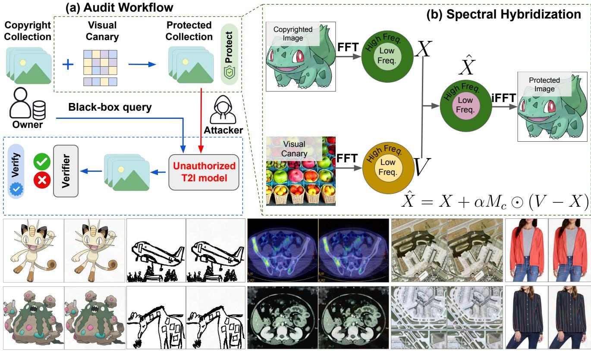  
(c) Visual Fidelity: Original-Protected Pairs  
Figure 1. SpectralCanary overview. (a) Auditing workflow. An owner protects a collection before release, then queries a suspect T2I model and tests whether its generated outputs contain the canary. (b) Spectral hybridization. SpectralCanary blends a fixed canary through a smooth low-pass mask � with strength �, retaining most of the remaining spectrum. A lightweight verifier trained on original–protected pairs detects the trace in model generations. (c) Visual fidelity. Original–protected pairs across five datasets, including sparse sketches.

Prior approaches typically sacrifice at least one requirement. Reactive auditing: limited collectionlevel evidence (Req. 1). Membership and similarity tests rely on sample-specific evidence that generalization may erase [14, 22]. Pixel-level watermarks: limited robustness (Req. 3). Weak signals may be attenuated by augmentation, regeneration, or fail to transfer across model backbones [14, 35]. Explicit canaries: fidelity and robustness trade-ofs (Reqs. 2–3). Repeated templates can be conspicuous and filterable, while recaptioning can remove textual triggers [26]. Adjacent data-poisoning objectives. Poisoning induces chosen behavior rather than provides evidence of dataset use. Persistent behavior may not be unique or reliably elicited, so it does not by itself establish use of a particular collection [12, 34]. Across proactive methods, auxiliary generation, filtering, and iterative optimization can also limit deployability (Req. 4) by increasing computational cost or requiring external models, domain-specific assumptions [12, 14, 26]. These limitations motivate a subtle, transferable, caption independent, and inexpensive trace.

We propose SpectralCanary, whose key design choice is the frequency band used for the shared trace. Before release, the dataset owner chooses one fixed canary image. For each collection image, SpectralCanary mixes a small amount of the canary’s low-frequency Fourier content into the original while retaining most of its spectrum and leaving its caption unchanged (Fig. 1(b)). The protected spectra are thereby shifted toward a common low-frequency target, creating a collection-level signal. Low frequencies encode broad spatial structure that neural networks preferentially learn [25, 38] and that is important to T2I generation [18, 40]. This motivates our hypothesis that a weak low-frequency trace can transfer during fine-tuning. The dataset owner then queries a suspect model and uses a lightweight verifier to test whether its generated outputs contain the trace (Fig. 1(a)). Importantly, SpectralCanary uses a single deterministic transform requiring no caption changes, auxiliary gener ator, or per-image optimization.

We evaluate all four requirements. Robustness tests cover a convolutional latent-difusion U-Net [27], a transformer-based rectified-flow model [7]; data augmentation, image regeneration [43], and recaptioning. Direct baselines include pixel-level traces (SIREN [14], DIAGNOSIS [35]) and explicit canaries (EnTruth [26]). We also adapt Silent Branding [12] but report its evaluation separately in Appx. Q, because it targets visual branding rather than dataset-use auditing.

Auditing efectiveness and robustness. For per-generation discrimination, AUC measures verifierscore separation, while TPR at 1% FPR measures detection of outputs from protected-data models. Across eight Pokemon settings, SpectralCanary achieves 98.0% AUC and 91.1% TPR. In fixedthreshold model-level verification using 30 generations, it achieves 94.8% average accuracy under the same settings. Fidelity and utility preservation. SSIM and LPIPS compare original and protected images, while ΔFID measures the change in generative quality. Across five visual domains with SD3.5, SpectralCanary achieves 99.5% AUC and 92.4% TPR with SSIM 0.989, LPIPS 0.022, with a near-zero mean change FID (ΔFID 0.05). On sparse Sketch-Scene drawings, it achieves 100% AUC and TPR with SSIM 0.997 and LPIPS 0.002. Operational deployability. Protection takes 0.39 seconds per image on our CPU setup (Appx. E). Mechanism and boundary. In matched-energy ablations on Pokemon and ROCOv2, we show that low-frequency placement transfers more reliably compared to mid/high-frequency placement. Within the evaluated adaptive attacks, efective removal requires aggressive modification and incurs more than 25 ΔFID points.

## Our main contributions are:

• We identify low-frequency visual structure as an efective carrier for weak collection-level traces during T2I fine-tuning. In matched band size and perturbation energy ablations on Pokemon and ROCOv2 with SD1.5, we show that low-frequency placement yields higher per-generation TPR than mid/high-frequency placement.

• We introduce SpectralCanary, a deterministic and caption-preserving spectral hybridization method. It protects each image with one inexpensive transform, requiring neither an auxiliary generator nor per-image optimization.

• We jointly evaluate per-generation discrimination, KS-based multi-query auditing, fixed-threshold model-level verification, image fidelity, generative utility, robustness, and protection cost across two architecture families, five datasets, three direct auditing baselines, an adapted poisoning baseline, and three realistic data transformations. This evaluation establishes a strong empirical operating point and characterizes the boundary under adaptive spectral replacement.

## 2. SpectralCanary

Problem setup. Let $\mathcal { D } = \{ ( x _ { i } , t _ { i } ) \} _ { i = } ^ { N }$ be the defender’s image–caption collection, with $x _ { i } \in [ 0 , 1 ] ^ { H \times W \times 3 }$ Given a canary $v ^ { \star }$ , protected fraction $\delta \in ( 0 , 1 ]$ , blending strength $\alpha \in [ 0 , 1 ]$ , and Gaussian bandwidth $c > 0 ,$ , SpectralCanary constructs protected collection $\bar { \mathcal { D } }$ and trains verifier $f _ { \theta } \left( \mathrm { A l g . 1 } \right)$ . A third party may fine-tune a T2I model $\mathcal { G }$ on ${ \widehat { \mathcal { D } } } .$ The defender audits its black-box generations against clean reference scores (Alg. 2).

Threat model. The algorithm and released collection are public. $\delta , \alpha ,$ and � may be known. The defender retains the originals, $v ^ { \star }$ , and $f _ { \theta }$ and has only black-box access to ${ \mathcal { G } } .$ The audit provides calibrated statistical evidence, not cryptographic attribution or white-box robustness. Revealing the canary spectrum enables the idealized inversion below.

Algorithm 1: Protection and Verifier Training   
Require: $\mathcal { D } , v ^ { \star } , \delta , c , \alpha$ Algorithm 2: Auditing a Suspect Model   
Ensure: $\hat { \mathcal { D } } , f _ { \theta }$ Require: $\mathcal { G } , \mathcal { P } , f _ { \theta } ,$ clean-data reference scores ${ \mathcal { R } } ,$ level �   
1: Construct $M _ { c }$ using Eq. 2 Ensure: ${ \mathcal { S } } ^ { \mathcal { G } } ,$ , �-value $q ^ { \mathcal { G } } ,$ , decision $a ^ { \mathcal { G } }$   
2: $\mathcal { I } _ { \delta } \gets \mathrm { U n i f } { \mathrm { \Omega } }$ ormSubset $( [ N ] , \left\lfloor \delta N \right\rfloor )$ 1: $\mathcal { S } ^ { \mathcal { G } }  \mathcal { O }$   
3: $V  \mathcal { F } _ { c } ( v ^ { \star } ) ; \widehat { \mathcal { D } }  \mathcal { D }$ 2: for all $p _ { j } \in \mathcal P$ do   
4: for all $i \in \mathcal { I } _ { \delta }$ do 3: Generate $x _ { j } ^ { \mathcal { G } } \sim \mathcal { G } ( p _ { j } )$   
5: $X _ { i } \gets \mathcal { F } _ { c } ( x _ { i } )$   
6: $\widehat { X } _ { i } \gets X _ { i } + \alpha M _ { c } \odot ( V - X _ { i } )$ 4: $s _ { j }  f _ { \theta } ( x _ { j } ^ { \mathcal { G } } )$   
7: $\tilde { x } _ { i } \gets \Pi _ { 8 } \big ( \Re [ \mathcal { F } _ { c } ^ { - 1 } ( \widehat { X } _ { i } ) ] \big )$ 5: Add $s _ { j }$ to $\mathring { \mathbf { \mathcal { S } } } ^ { \mathcal { G } }$   
6: end for   
8: $\begin{array} { r } { \widehat { \mathcal { D } } [ i ] \gets ( \tilde { x } _ { i } , t _ { i } ) } \end{array}$ 7: $q _ { \mathbf { \Phi } _ { \mathrm { - } } } ^ { \mathcal { G } }  \mathrm { K S } _ { \pm } ( \mathcal { S } ^ { \mathcal { G } } , \mathcal { R } )$   
9: end for 8: $\dot { a } ^ { \mathcal { G } } \gets \mathbb { I } [ q ^ { \mathcal { G } } < \gamma ]$   
10: Train $f _ { \theta }$ on $\mathcal { I } _ { \delta }$ using Eq. 5 9: return $\mathring { \mathcal { S } } ^ { \mathcal { G } } , q ^ { \mathcal { G } } , \mathring { a } ^ { \mathcal { G } }$   
11: return $\hat { \mathcal { D } } , f _ { \theta }$

Design motivation. Low frequencies encode broad structure that neural networks preferentially learn [25, 38] and that is important to T2I generation [18, 40]. They are therefore a plausible trace carrier. However, strong modification is visible. SpectralCanary uses a smooth low-pass mask to weight frequencies and a small blending strength to control the overall change. Our controlled study in Sec. 4.5 shows low-frequency placement yields higher detection rates than mid/high-frequency placement.

Fourier convention. Throughout, $\mathcal { F } _ { c }$ denotes the centered channel-wise 2D discrete Fourier transform and $\mathcal { F } _ { c } ^ { - 1 }$ denotes its inverse:

$$
\mathcal { F } _ { c } = \mathrm { f f t s h i f t o D F T } _ { 2 } , \qquad \mathcal { F } _ { c } ^ { - 1 } = \mathrm { I D F T } _ { 2 } \circ \mathrm { i f f t s h i f t } .\tag{1}
$$

We use unitary normalization and apply the transform channel-wise. Any matched forward–inverse scaling gives the same reconstruction because Eq. 4 is homogeneous in $X _ { i }$ and �. Real inputs and the real, conjugate-symmetric mask make the inverse real up to roundof. Let $\Pi _ { 8 }$ denote clipping to [0, 1] followed by 8-bit quantization.

Stage I: Constructing protected images. Alg. 1 uniformly selects $\left| \mathcal { I } _ { \delta } \right| = \left\lfloor \delta N \right\rfloor$ images; only these are replaced and used to train the verifier $( \delta = 1$ by default). For $i \in \mathcal I _ { \delta }$ , we resize $v ^ { \star }$ as specified in Appx. A and compute $X _ { i } = \mathcal { F } _ { c } ( x _ { i } )$ and $V = \mathcal { F } _ { c } ( v ^ { \star } )$ . We define a smooth radial low-pass mask:

$$
M _ { c } ( k , \ell ) = \exp \left( - \frac { r ( k , \ell ) ^ { 2 } } { 2 c ^ { 2 } } \right) ,\tag{2}
$$

where $( k , \ell )$ indexes the shifted Fourier grid, whose center is $( k _ { 0 } , \ell _ { 0 } ) = ( \lfloor { H } / { 2 } \rfloor , \lfloor { W } / { 2 } \rfloor )$ , and

$$
r ( k , \ell ) = \sqrt { \left( \frac { k - k _ { 0 } } { H } \right) ^ { 2 } + \left( \frac { \ell - \ell _ { 0 } } { W } \right) ^ { 2 } } .\tag{3}
$$

Normalizing the two axes separately also accommodates rectangular images. The mask equals one at the spectral center and decays smoothly with radial distance; a smaller bandwidth � concentrates the weighting more tightly around the lowest frequencies. The protected spectrum is

$$
\widehat { X } _ { i } = X _ { i } + \alpha M _ { c } \odot ( V - X _ { i } ) = ( 1 - \alpha M _ { c } ) \odot X _ { i } + \alpha M _ { c } \odot V ,\tag{4}
$$

where $\alpha \in [ 0 , 1 ]$ is the blending strength and ⊙ denotes elementwise multiplication. We export $\tilde { x } _ { i } =$ $\Pi _ { 8 } ( \Re [ \mathcal { F } _ { c } ^ { - 1 } ( \widehat { X } _ { i } ) ] )$ . Eq. 4 moves each weighted coeficient toward target �. It combines shared term $\alpha M _ { c } \odot V$ with image-specific term $( 1 - \alpha M _ { c } ) \odot X _ { i }$ . The collection mean shifts toward �, while variation contracts in low-pass-weighted frequencies. Appx. F reports learning dynamics. Fig. 1(c) and Appx. N show visual fidelity. The deterministic construction requires neither an auxiliary generative model nor iterative per-image optimization. Appx. E reports runtime.

Training the verifier. Let $f _ { \theta } ( x ) \in ( 0 , 1 )$ denote the predicted probability that image � contains the protection signal. Using selected protected images as positives and their original counterparts as negatives, we minimize

$$
\mathcal { L } _ { \mathrm { v e r } } ( \theta ) = - \frac { 1 } { | \mathcal { I } _ { \delta } | } \sum _ { i \in \mathcal { I } _ { \delta } } \left[ \log f _ { \theta } ( \widetilde { x } _ { i } ) + \log ( 1 - f _ { \theta } ( x _ { i } ) ) \right] .\tag{5}
$$

Training uses no model generations. Each original–protected pair shares semantic content, making the protection transform the only systematic label-aligned diference. This encourages but does not guarantee trace learning. Transfer to unseen generations is evaluated in Sec. 4.2.

Stage II: Auditing a suspect model. Let ℛ contain clean-data reference scores and $\mathcal { P }$ be triggerfree audit prompts (collection captions in our experiments). For suspect model �, we collect $\mathcal { S } ^ { \mathcal { \bar { G } } }$ and apply a one-sided two-sample Kolmogorov–Smirnov test for larger suspect scores, rejecting at level $\gamma .$ Experiments use matched clean-data models. Deployment calibrates ℛ on representative independent models. This yields the KS-based multi-query audit decision. AUC and TPR are per-generation discrimination metrics (Appx. A.1).

Invertibility. If an attacker knows the canary spectrum �, blending strength $\alpha ,$ and Gaussian bandwidth $c ,$ then $M _ { c }$ is known and Eq. 4 can be inverted as

$$
X _ { i } = \frac { \widehat { X } _ { i } - \alpha M _ { c } \odot V } { 1 - \alpha M _ { c } } ,\tag{6}
$$

This recovers pre-export �� exactly when $\alpha < 1$ , but clipping and quantization prevent exact recovery from the released image. Our threat model may reveal � and � but keeps � private. These are threatmodel assumptions, not security guarantees.

## 3. Related Work

Reactive and proactive auditing. Reactive methods test an already trained model using membership inference or similarity between generated and reference images [3, 20, 22, 24]. Such evidence can weaken when fine-tuning transfers collection-level characteristics without retaining identifiable information about individual samples. Proactive methods instead modify a collection before release. Anti-learning methods aim to prevent or redirect customization [1, 16, 31, 33, 44]. Proactive traceability aims to preserve customization utility while making later use statistically auditable.

Proactive traceability. Pixel-level methods such as DIAGNOSIS [35] and SIREN [14] insert weak transformations or learned signals that can be detected in generated images. Their subtle signals preserve appearance, but can be attenuated by augmentation, regeneration, or model backbone changes. EnTruth instead inserts explicit canary samples containing a repeated template and textual trigger [26]. This coherent signal can transfer strongly, but the injected samples are conspicuous and caption triggers can be removed. Our direct comparisons span the two main proactive families including subtle pixel-level traces and explicit visual canary samples.

Relation to poisoning. Data poisoning induces chosen behaviors such as concept corruption, reproduction, or persistent branding [12, 34]. Persistence alone is insuficient for auditing. Auditing instead requires a collection-specific signal detectable under ordinary, trigger-free queries with controlled false positives. SpectralCanary targets this auditing objective rather than model corruption. Appx. S provides further discussion and a method taxonomy.

## 4. Experiments

## 4.1 Experimental Setup and How to Read the Results

Our experiments ask four concrete questions. First, can SpectralCanary reveal that a model was trained on a protected collection, even when the model architecture or training data are changed? Second, does adding the trace visibly change the released images or make a model trained on them produce worse images? Third, is protection fast enough for a large collection? Finally, why do low frequencies matter, and what happens when an informed attacker tries to remove the trace?

Datasets and models. We cover distinct image domains: charater art (Pokemon-BLIP-Captions [23]), sparse scene drawings (Sketch-Scene [4]), medical (ROCOv2 [28]), satellite (RSICD [17]), and fashion (FACAD [39]). We fine-tune Stable Difusion v1.5 (SD1.5) [27] and Stable Difusion 3.5 (SD3.5) [7]. The main experiments use LoRA, a common parameter-eficient form of T2I adaptation. Appx. G repeats the key test with full-parameter fine-tuning.

Comparisons and stress tests. We compare with SIREN [14] and DIAGNOSIS [35], which modify training images, and EnTruth [26], which adds explicit canary samples. Appx. Q separately adapts Silent Branding [12], whose original goal is visual branding rather than dataset-use auditing. On Pokemon, we test each method under ordinary training and after three realistic changes to the training set: image augmentation, difusion-based recreation of each training image (image regeneration) [43], and automatic recaptioning with Qwen2.5-VL 7B [2].

How to read the metrics. We distinguish the embedded trace from two evaluation levels. Per generation discrimination scores each generated image independently and asks whether outputs from protected-data models receive higher verifier scores than outputs from clean-data models. AUC summarizes this score separation over all thresholds. TPR at 1% FPR is the fraction of outputs from protected-data models detected at a threshold that falsely flags at most 1% of outputs from clean data models; thus, a TPR of 90% means detecting about 90 of 100 protected-data-model outputs while flagging about 1 of 100 clean-data-model outputs. At the model level, we evaluate two decision protocols. KS-based multi-query auditing combines scores from 30 generated images in a statistical test and reports the rejection rate on protected-data models. Fixed-threshold model-level verification aggregates 30 generations from each held-out model and applies a threshold fixed after independent calibration, reporting TPR, FPR, precision, F1, and accuracy (Appx. H). For image fidelity, lower LPIPS [42] means that a protected image is closer to its original. For generated-image quality, $\Delta \mathrm { F I D } = \mathrm { F I D } _ { \mathrm { p r o t e c t e d } } - \mathrm { F I D } _ { \mathrm { c l e a n } } { \overline { { \ } } }$ [29]; values near or below zero indicate no measured quality loss, whereas large positive values indicate degradation. Unless stated otherwise, SpectralCanary uses $\alpha = 0 . 0 2 , c = 0 . 2 0$ , and � = 1. Every model-training and image-sampling setting is repeated with three independent runs. Detailed protocols are in Appx. A.

## 4.2 Per-Generation Discrimination Survives Changes to Models and Training Data

SpectralCanary has the strongest average per-generation discrimination across the eight Pokemon settings. Fig. 2 reports per-generation TPR for both model families under ordinary training, training-time augmentation, prompt recaptioning, and image regeneration. SpectralCanary averages 91.1% TPR at 1% FPR, compared with 73.2% for the next-best method. Its weakest individual result is 65.9% under SD3.5 with training-time augmentation; the best competing method has a worst-case result of only 19.4%. No method wins every individual setting: DIAGNOSIS is strongest for ordinary SD1.5 training, and EnTruth is strongest for SD3.5 with training-time augmentation. The complete per-generation AUC, TPR at 5% FPR, and run-level results are in Appx. C. Appx. J separately reports KS-based multi-query auditing across query budgets, showing that more queries generally provide stronger evidence of training on protected data.

Per-generation discrimination translates well to fixed-threshold model-level verification. We aggregate 30 generations per held-out model, following Li et al. [14], and apply a threshold independently calibrated for each method–architecture pair and fixed across transformations. Fig. 3 reports model-level accuracy across the same eight settings. Each method–architecture–transformation set ting includes five clean-data and five protected-data models, yielding 320 held-out models across the four methods. SpectralCanary achieves 94.8% average model-level accuracy, showing that its pergeneration discrimination signal supports dataset-use decisions at the model level. Appx. H provides the detailed protocol and TPR, FPR, precision, and F1 results.

<table><tr><td>Method</td><td colspan="2">None</td><td colspan="2">Aug.</td><td colspan="2">Recap.</td><td colspan="2">Regen.</td><td colspan="2">Summary</td><td rowspan="6">100 75</td></tr><tr><td>TPR@1% FPR ↑</td><td>SD1.5</td><td>SD3.5</td><td>SD1.5</td><td>SD3.5</td><td></td><td>SD1.5 SD3.5</td><td></td><td>SD1.5 SD3.5</td><td>Worst</td><td>Avg.</td><td></td></tr><tr><td>EnTruth</td><td>85.3</td><td>93.9</td><td>76.2</td><td>95.3</td><td>19.4</td><td>35.9</td><td>88.1</td><td>91.7</td><td>19.4</td><td></td><td>73.2</td></tr><tr><td>SIREN</td><td>66.3</td><td>91.9</td><td>6.9</td><td>18.8</td><td>63.6</td><td>92.0</td><td>44.4</td><td>37.2</td><td>6.9</td><td>52.6</td><td>50</td></tr><tr><td>DIAGNOSIS</td><td>99.9</td><td>2.3</td><td>88.3</td><td>8.2</td><td>0.4</td><td>13.0</td><td>43.9</td><td>1.7</td><td>0.4</td><td>32.2</td><td>25</td></tr><tr><td>SpectralCanary</td><td>97.7</td><td>100.0</td><td>79.2</td><td>65.9</td><td>93.6</td><td>100.0</td><td>92.5</td><td></td><td>100.0</td><td>65.9</td><td>91.1 10</td></tr></table>

Figure 2. SpectralCanary maintains strong per-generation discrimination across model and data changes. Each cell reports per-generation TPR at 1% FPR. “Worst” is the lowest of a method’s eight results, and “Avg.” is their mean.

<table><tr><td rowspan="2">Method Accuracy ↑</td><td colspan="2">None</td><td colspan="2">Aug.</td><td colspan="2">Recap.</td><td colspan="2">Regen.</td><td colspan="2">Summary</td><td rowspan="2">100</td></tr><tr><td>SD1.5</td><td>SD3.5</td><td>SD1.5</td><td>SD3.5</td><td>SD1.5</td><td>SD3.5</td><td>SD1.5 SD3.5</td><td></td><td>Worst</td><td>Avg.</td></tr><tr><td>EnTruth</td><td>100.0</td><td>82.0</td><td>100.0</td><td>90.3</td><td>78.7</td><td>50.0</td><td>100.0</td><td>90.0</td><td>50.0</td><td>86.4</td><td>75 (%) ACccy</td></tr><tr><td>SIREN</td><td>100.0</td><td>100.0</td><td>52.3</td><td>50.0</td><td>100.0</td><td>100.0</td><td>99.7</td><td>50.0</td><td>50.0</td><td>81.5</td><td>50</td></tr><tr><td>DIAGNOSIS</td><td>100.0</td><td>63.7</td><td>100.0</td><td>88.6</td><td>50.0</td><td>73.1</td><td>100.0</td><td>65.0</td><td>50.0</td><td></td><td>80.1 25</td></tr><tr><td>SpectralCanary</td><td>100.0</td><td>100.0</td><td>99.6</td><td>58.5</td><td>100.0</td><td>100.0</td><td>100.0</td><td>100.0</td><td>58.5</td><td>94.8</td><td>0</td></tr></table>

Figure 3. SpectralCanary is more consistent across transformations and models than the baselines. Each cell is Acc. “Worst” is the lowest of a method’s eight results, and “Avg.” is their mean.

## 4.3 The Same Seting Works Across Five Image Types

We next test whether the same SpectralCanary setting works beyond Pokemon by asking three questions: Does a single generated output support reliable per-generation discrimination? Do the pro tected images still resemble the originals? Does training on those images degrade model outputs?

SpectralCanary performs well on all three questions. At a per-generation FPR of 1%, it achieves an average per-generation TPR of 92.4% across outputs from models trained on protected data. The protected images remain close to their originals: average LPIPS is 0.022, where zero means identical images. Training on the protected images causes almost no average change in model output quality: mean ΔFID is 0.05, where zero means no change. On the sparse Sketch-Scene drawings, Spectral-Canary achieves 100% per-generation TPR with LPIPS 0.002. The hardest dataset is RSICD, where it achieves 78.9% per-generation TPR with LPIPS 0.048.

Fig. 4 compares all methods. Each point shows one method on one dataset. Good results appear near the upper-left corner: high per-generation TPR with little change to either the training images or the trained model’s outputs. SpectralCanary’s green points remain near this region across all five datasets. DIAGNOSIS changes the original images little but usually provides weak per-generation discrimination. SIREN works well on some datasets but poorly on others and makes the largest image

(b) Detection vs. cost

Image distortion, LPIPS

(a) Detection vs. utility  
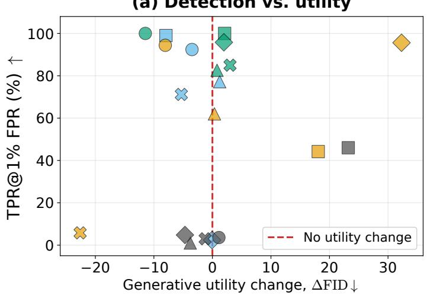  
(b) Detection vs. fidelity

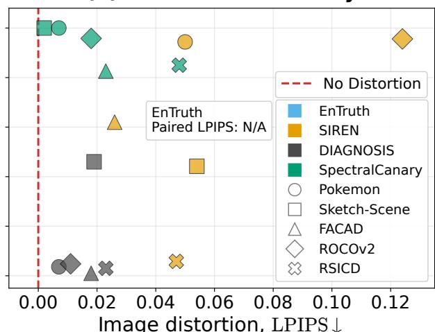  
Figure 4. SpectralCanary works consistently across five image types. Each point shows one method on one dataset. The vertical axis is the per-generation TPR at 1% FPR: the percentage of outputs from protected-data models detected while 1% of outputs from clean-data models are falsely flagged. In (a), the horizontal axis measures the change in the trained model’s output quality; zero means no change. In (b), it measures the change from an original image to its protected copy; zero means identical images. The best results are near the upper-left corner.

changes. EnTruth works well on several datasets but fails on ROCOv2. It has no LPIPS value because it adds new canary images rather than making a protected copy of each original. Fig. 1(c) and Appx. N show protected images beside their originals; Appx. B reports all numerical results.

## 4.4 Protection Is Fast as Well as Efective

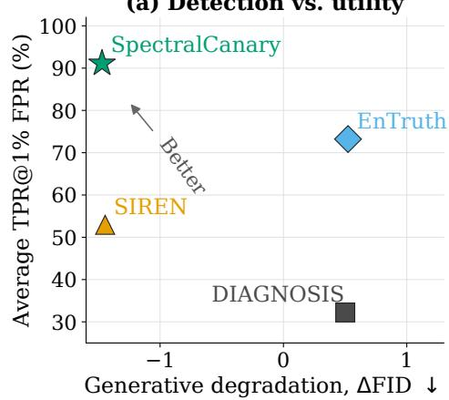

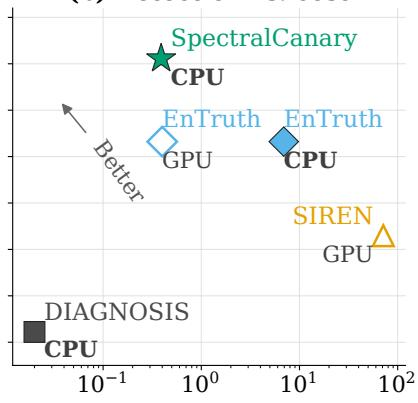

(c) Detection vs. fidelity  
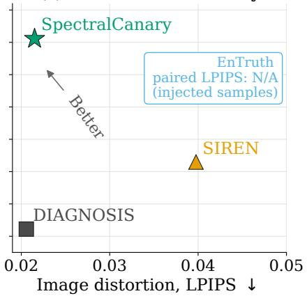  
Figure 5. SpectralCanary achieves high per-generation discrimination with low quality and runtime cost. Average per-generation TPR at 1% FPR over the eight Pokemon setings is compared with (a) change in FID, (b) protection time, and (c) paired-image LPIPS. Preferred results lie upward and to the left. EnTruth adds 0.5% auxiliary samples, so paired-image LPIPS is not defined for it.

SpectralCanary protects an image in 0.39 seconds on CPU while retaining the highest average per-generation TPR. Fig. 5 compares per-generation discrimination with generated-image quality, protection time, and image distortion on Pokemon. DIAGNOSIS is faster, but its average TPR is only 32.2%. SIREN and EnTruth require substantially more computation while achieving lower pergeneration TPR. SpectralCanary also has no average FID penalty and the lowest paired-image LPIPS among the methods that modify every image. These timings are hardware-dependent, and CPU and

GPU measurements are not perfectly interchangeable; their main purpose is to distinguish a single deterministic FFT-based transform from methods that require generating auxiliary images or performing iterative optimization. Appx. E gives the complete timing results.

## 4.5 Low Frequencies Carry the Trace More Reliably

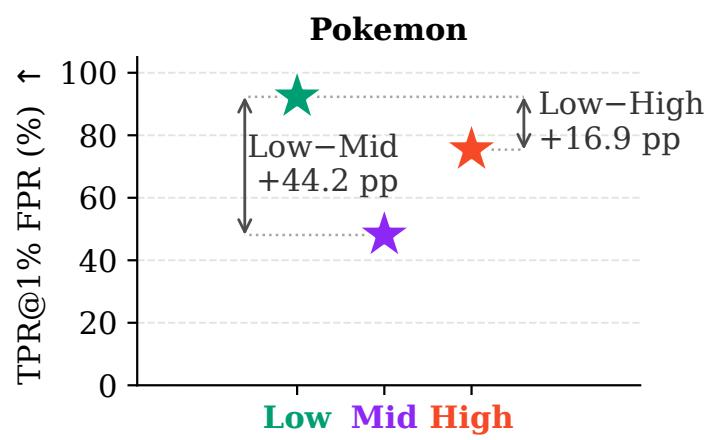

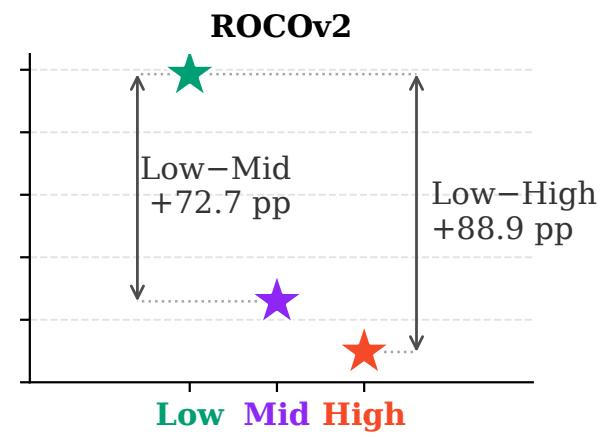  
Figure 6. Matched low-frequency traces transfer more reliably than mid- or high-frequency traces. Points show mean per-generation TPR at 1% FPR over three canary images. Arrows show the performance gaps.

The advantage of low frequencies remains after controlling for the amount of spectral change. We compare disjoint low-, mid-, and high-frequency bands on Pokemon and ROCOv2 with SD1.5. The bands contain the same number of Fourier coeficients, and we give them the same total amount of Fourier-domain change as the deployed smooth low-pass mask. This comparison prevents one band from winning merely because it changes more of the image. Fig. 6 shows that the low-frequency band has the highest per-generation TPR on both datasets. It exceeds the high-frequency band by 16.9 percentage points on Pokemon and 88.9 points on ROCOv2; the mid-frequency band is also weaker in both cases. Appx. K describes the construction, and Tab. 6 reports per-generation discrimination, image fidelity, generated-image quality, and variation across three canary images.

## 4.6 Removal Atacks Damage Quality Before Erasing the Trace

In our evaluated attacks, substantially reducing per-generation TPR also substantially damages the training data or the resulting model. The attacker knows the protection algorithm and may know � and �, but not the canary, original images, or verifier. We test three attacks. A donor is an unrelated, unprotected image whose low-frequency content is used as a replacement source. Fixed-donor replacement uses the same donor for all protected images. Per-image replacement uses a diferent donor for each image. The third attack estimates the shared low-frequency pattern directly from the protected collection and removes it. Appx. M gives the equations and settings.

Fig. 7 follows each attack from mild to aggressive removal. Mild attacks leave per-generation TPR largely intact. Driving TPR toward the clean-training baseline requires more than 25 additional FID points under the strongest evaluated attack and also produces large LPIPS changes. This establishes a removal–quality boundary for these three attacks; it is not a guarantee against every possible attack, especially one that can inspect the model or verifier.

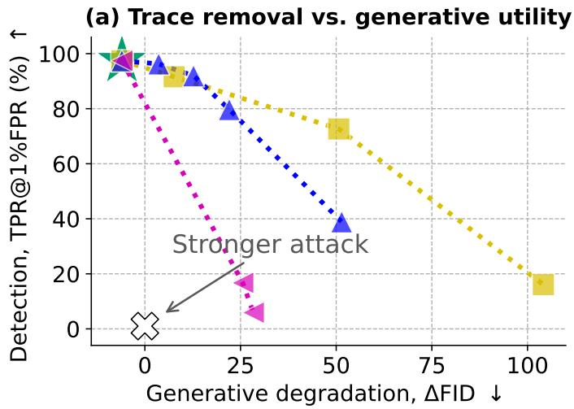

(b) Trace removal vs. image distortion  
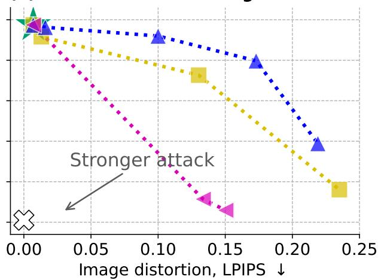  
Figure 7. The evaluated atacks erase the trace only after causing substantial damage. From the unatacked point, stronger atacks move down and to the right, indicating per-generation TPR falls, but ΔFID and LPIPS increase. The clean-training marker shows the target TPR.

## 5. Limitations and Responsible Use

Our evaluation covers two T2I architecture families, five datasets, and both LoRA and full-parameter fine-tuning. It does not establish transfer to every model, or mixture of a protected collection with a larger unprotected corpus. The main experiments also use one fixed natural canary image. Although the phase-randomized controls in Appx. L isolate the role of spatial coherence, broader evaluation across independently chosen canary images and key reuse is needed.

The adaptive evaluation assumes that the canary image and verifier remain private. If the attacker learns �, �, and �, Eq. 6 permits exact inversion before clipping or quantization. The three evaluated attacks (fixed-donor replacement, per-image donor replacement, and shared-structure estimation) characterize only this secrecy-dependent threat model and do not provide a cryptographic or whitebox robustness guarantee. Future evaluations should consider collusion across releases, learned re moval models, stronger shared-structure estimators, and adaptive access to verifier feedback.

SSIM, LPIPS, and FID capture only part of image fidelity and generative utility. Human perceptual studies and task-specific utility measurements would be needed to support stronger claims about invisibility or harmlessness. Likewise, our KS-test rejection rates on protected-data models estimate statistical power under the stated sampling protocol, while fixed-threshold model-level verification uses separate clean-data and protected-data models for calibration. A deployment would require broader calibration across representative clean-data models and should treat a positive result as sta tistical evidence under the threat model, not as standalone proof of unauthorized use.

SpectralCanary is intended to help data owners audit model customization, but proactive traces can also be inserted into data without the knowledge of downstream users. Responsible use requires authorization to modify the collection, disclosure where appropriate, respect for dataset licenses, and safeguards against unsupported attribution. Decisions with legal or reputational consequences should combine the audit with independent evidence.

## 6. Conclusion

We propose SpectralCanary, a deterministic and inexpensive approach to proactive T2I dataset use auditing. SpectralCanary injects a weak shared visual trace through a smooth low-pass mask while leaving captions unchanged. Across eight Pokemon model–transformation settings, it provides the strongest average per-generation discrimination and reliable KS-based multi-query auditing among the evaluated methods. The same operating point generalizes across five visual domains while preserving protected-image fidelity and generative utility. Matched-energy frequency-location experiments further show that low-frequency placement transfers more consistently than mid/highfrequency placement across datasets. Finally, the adaptive evaluation identifies a scoped robustness boundary, showing that the evaluated sanitization attacks substantially reduce per-generation TPR only at the cost of considerable image-quality or generative-utility degradation. Together, these re sults establish SpectralCanary as a practical method for T2I dataset-use auditing, while the limitations discussed above motivate future work.

## Acknowledgments

Ho and Huang are supported by DARPA HR001124S0029-AIQ-FP-019 and the National Science Foundation TRAILS Institute (2229885). Private support was provided by Open Philanthropy and Apple. The authors acknowledge the National Artificial Intelligence Research Resource (NAIRR) Pilot for supporting this research.

## References

[1] Namhyuk Ahn, KiYoon Yoo, Wonhyuk Ahn, Daesik Kim, and Seung-Hun Nam. Nearly zero-cost protection against mimicry by personalized difusion models. In Proceedings of the Computer Vision and Pattern Recognition Conference, pages 28801–28810, 2025.

[2] Shuai Bai, Keqin Chen, Xuejing Liu, Jialin Wang, Wenbin Ge, Sibo Song, Kai Dang, Peng Wang, Shijie Wang, Jun Tang, Humen Zhong, Yuanzhi Zhu, Mingkun Yang, Zhaohai Li, Jianqiang Wan, Pengfei Wang, Wei Ding, Zheren Fu, Yiheng Xu, Jiabo Ye, Xi Zhang, Tianbao Xie, Zesen Cheng, Hang Zhang, Zhibo Yang, Haiyang Xu, and Junyang Lin. Qwen2.5-vl technical report. arXiv preprint arXiv:2502.13923, 2025.

[3] Yuetian Chen, Kaiyuan Zhang, Yuntao Du, Edoardo Stoppa, Charles Fleming, Ashish Kundu, Bruno Ribeiro, and Ninghui Li. Membership inference attacks against fine-tuned difusion language models. In The Fourteenth International Conference on Learning Representations, 2026. URL https://openreview.net/forum?id=oWKJursYpW.

[4] Pinaki Nath Chowdhury, Aneeshan Sain, Ayan Kumar Bhunia, Tao Xiang, Yulia Gryaditskaya, and Yi-Zhe Song. Fs-coco: Towards understanding of freehand sketches of common objects in context. In ECCV, 2022.

[5] Yingqian Cui, Jie Ren, Yuping Lin, Han Xu, Pengfei He, Yue Xing, Lingjuan Lyu, Wenqi Fan, Hui Liu, and Jiliang Tang. Ft-shield: A watermark against unauthorized fine-tuning in text-toimage difusion models. SIGKDD Explor. Newsl., 26(2):76–88, January 2025. ISSN 1931-0145. doi: 10.1145/3715073.3715080. URL https://doi.org/10.1145/3715073.3715080.

[6] Yingqian Cui, Jie Ren, Han Xu, Pengfei He, Hui Liu, Lichao Sun, Yue Xing, and Jiliang Tang. Difusionshield: A watermark for data copyright protection against generative difusion models. SIGKDD Explor. Newsl., 26(2):60–75, January 2025. ISSN 1931-0145. doi: 10.1145/3715073.3715079. URL https://doi.org/10.1145/3715073.3715079.

[7] Patrick Esser, Sumith Kulal, Andreas Blattmann, Rahim Entezari, Jonas Müller, Harry Saini, Yam Levi, Dominik Lorenz, Axel Sauer, Frederic Boesel, et al. Scaling rectified flow transformers

for high-resolution image synthesis. In Forty-first international conference on machine learning, 2024.

[8] Jonas Geiping, Liam H Fowl, W. Ronny Huang, Wojciech Czaja, Gavin Taylor, Michael Moeller, and Tom Goldstein. Witches’ brew: Industrial scale data poisoning via gradient matching. In International Conference on Learning Representations, 2021. URL https://openreview.net/forum ?id=01olnfLIbD.

[9] Kaiming He, Xiangyu Zhang, Shaoqing Ren, and Jian Sun. Deep residual learning for image recognition. In Proceedings of the IEEE conference on computer vision and pattern recognition, pages 770–778, 2016.

[10] Sy-Tuyen Ho, Yaseema Rusiru Ariyarathna Epa, Yasoda Lasiru Ariyarathna Epa, Andrew Mendez, Kecheng Liu, Xudong Jiang, Alex Kot, Furong Huang, and Ngai-Man Cheung. Memory makes the poison: Over memorization drives visual poisoning in LVLMs, 2025. URL https://openreview.net/forum?id=2HGL1Szcp2.

[11] Edward J Hu, yelong shen, Phillip Wallis, Zeyuan Allen-Zhu, Yuanzhi Li, Shean Wang, Lu Wang, and Weizhu Chen. LoRA: Low-rank adaptation of large language models. In International Conference on Learning Representations, 2022. URL https://openreview.net/forum?id=nZeVKeeFYf9.

[12] Sangwon Jang, June Suk Choi, Jaehyeong Jo, Kimin Lee, and Sung Ju Hwang. Silent branding attack: Trigger-free data poisoning attack on text-to-image difusion models. In 2025 IEEE/CVF Conference on Computer Vision and Pattern Recognition (CVPR), pages 8203–8212. IEEE, 2025.

[13] Wojciech Łapacz, Stanisław Pawlak, Jan Dubiński, Franziska Boenisch, and Adam Dziedzic. Dataset usage inference without shadow models or held-out data. arXiv preprint arXiv:2606.26257, 2026.

[14] Boheng Li, Yanhao Wei, Yankai Fu, Zhenting Wang, Yiming Li, Jie Zhang, Run Wang, and Tianwei Zhang. Towards Reliable Verification of Unauthorized Data Usage in Personalized Text-to Image Difusion Models . In 2025 IEEE Symposium on Security and Privacy (SP), pages 2564– 2582, Los Alamitos, CA, USA, May 2025. IEEE Computer Society. doi: 10.1109/SP61157.2025.000 73. URL https://doi.ieeecomputersociety.org/10.1109/SP61157.2025.00073.

[15] Chumeng Liang and Jiaxuan You. Real-world benchmarks make membership inference attacks fail on difusion models. arXiv preprint arXiv:2410.03640, 2024.

[16] Yixin Liu, Chenrui Fan, Yutong Dai, Xun Chen, Pan Zhou, and Lichao Sun. Metacloak: Preventing unauthorized subject-driven text-to-image difusion-based synthesis via meta-learning. In Proceedings of the IEEE/CVF Conference on Computer Vision and Pattern Recognition (CVPR), pages 24219–24228, June 2024.

[17] Xiaoqiang Lu, Binqiang Wang, Xiangtao Zheng, and Xuelong Li. Exploring models and data for remote sensing image caption generation. IEEE Transactions on Geoscience and Remote Sensing, 56(4):2183–2195, 2017.

[18] Zehong Ma, Longhui Wei, Shuai Wang, Shiliang Zhang, and Qi Tian. Deco: Frequency-decoupled pixel difusion for end-to-end image generation. In Computer Vision and Pattern Recognition (CVPR), 2026. URL https://zehong-ma.github.io/DeCo/.

[19] Tuan Anh Nguyen and Anh Tuan Tran. Wanet - imperceptible warping-based backdoor attack. In International Conference on Learning Representations, 2021. URL https://openreview.net/for um?id=eEn8KTtJOx.

[20] Maxime Oquab, Timothée Darcet, Théo Moutakanni, Huy V. Vo, Marc Szafraniec, Vasil Khali dov, Pierre Fernandez, Daniel HAZIZA, Francisco Massa, Alaaeldin El-Nouby, Mido Assran, Nicolas Ballas, Wojciech Galuba, Russell Howes, Po-Yao Huang, Shang-Wen Li, Ishan Misra, Michael Rabbat, Vasu Sharma, Gabriel Synnaeve, Hu Xu, Herve Jegou, Julien Mairal, Patrick Labatut, Armand Joulin, and Piotr Bojanowski. DINOv2: Learning robust visual features with out supervision. Transactions on Machine Learning Research, 2024. ISSN 2835-8856. URL https://openreview.net/forum?id=a68SUt6zFt. Featured Certification.

[21] Zhuoshi Pan, Yuguang Yao, Gaowen Liu, Bingquan Shen, H. Vicky Zhao, Ramana Rao Kompella, and Sijia Liu. From trojan horses to castle walls: Unveiling bilateral data poisoning efects in difusion models. In The Thirty-eighth Annual Conference on Neural Information Processing Systems, 2024. URL https://openreview.net/forum?id=yiXZZC5qDI.

[22] Yan Pang and Tianhao Wang. Black-box membership inference attacks against fine-tuned difusion models. In NDSS, 2025.

[23] Justin N. M. Pinkney. Pokemon blip captions. https://huggingface.co/datasets/lambdalabs/pok emon-blip-captions/, 2022.

[24] Alec Radford, Jong Wook Kim, Chris Hallacy, Aditya Ramesh, Gabriel Goh, Sandhini Agarwal, Girish Sastry, Amanda Askell, Pamela Mishkin, Jack Clark, et al. Learning transferable visual models from natural language supervision. In International conference on machine learning, pages 8748–8763. PmLR, 2021.

[25] Nasim Rahaman, Aristide Baratin, Devansh Arpit, Felix Draxler, Min Lin, Fred Hamprecht, Yoshua Bengio, and Aaron Courville. On the spectral bias of neural networks. In International conference on machine learning, pages 5301–5310. PMLR, 2019.

[26] Jie Ren, Yingqian Cui, Chen Chen, Yue Xing, Hui Liu, and Lingjuan Lyu. Entruth: Tracing the unauthorized dataset usage in difusion models. In Generative and Protective AI for Content Creation, 2025. URL https://openreview.net/forum?id=mbreZbKz6m.

[27] Robin Rombach, Andreas Blattmann, Dominik Lorenz, Patrick Esser, and Björn Ommer. Highresolution image synthesis with latent difusion models. In Proceedings of the IEEE/CVF Conference on Computer Vision and Pattern Recognition (CVPR), pages 10684–10695, June 2022.

[28] Johannes Rückert, Louise Bloch, Raphael Brüngel, Ahmad Idrissi-Yaghir, Henning Schäfer, Cyn thia S Schmidt, Sven Koitka, Obioma Pelka, Asma Ben Abacha, Alba G. Seco de Herrera, et al. Rocov2: Radiology objects in context version 2, an updated multimodal image dataset. Scientific Data, 11(1):688, 2024.

[29] Maximilian Seitzer. pytorch-fid: FID Score for PyTorch. https://github.com/mseitzer/pytorch-f id, August 2020. Version 0.3.0.

[30] Ali Shafahi, W Ronny Huang, Mahyar Najibi, Octavian Suciu, Christoph Studer, Tudor Dumitras, and Tom Goldstein. Poison frogs! targeted clean-label poisoning attacks on neural networks. Advances in neural information processing systems, 31, 2018.

[31] Shawn Shan, Jenna Cryan, Emily Wenger, Haitao Zheng, Rana Hanocka, and Ben Y. Zhao. Glaze: Protecting artists from style mimicry by Text-to-Image models. In 32nd USENIX Security Symposium (USENIX Security 23), pages 2187–2204, Anaheim, CA, August 2023. USENIX Association. ISBN 978-1-939133-37-3. URL https://www.usenix.org/conference/usenixsecurity23/presentat ion/shan.

[32] Shawn Shan, Wenxin Ding, Josephine Passananti, Stanley Wu, Haitao Zheng, and Ben Y Zhao. Nightshade: Prompt-specific poisoning attacks on text-to-image generative models. In 2024 IEEE symposium on security and privacy (SP), pages 807–825. IEEE, 2024.

[33] Thanh Van Le, Hao Phung, Thuan Hoang Nguyen, Quan Dao, Ngoc N Tran, and Anh Tran. Antidreambooth: Protecting users from personalized text-to-image synthesis. In Proceedings of the IEEE/CVF International Conference on Computer Vision, pages 2116–2127, 2023.

[34] Haonan Wang, Qianli Shen, Yao Tong, Yang Zhang, and Kenji Kawaguchi. The stronger the difusion model, the easier the backdoor: Data poisoning to induce copyright breaches without adjusting finetuning pipeline. In Ruslan Salakhutdinov, Zico Kolter, Katherine Heller, Adrian Weller, Nuria Oliver, Jonathan Scarlett, and Felix Berkenkamp, editors, Proceedings of the 41st International Conference on Machine Learning, volume 235 of Proceedings of Machine Learning Research, pages 51465–51483. PMLR, 21–27 Jul 2024. URL https://proceedings.mlr.press/v235 /wang24bm.html.

[35] Zhenting Wang, Chen Chen, Lingjuan Lyu, Dimitris N. Metaxas, and Shiqing Ma. DIAGNOSIS: Detecting unauthorized data usages in text-to-image difusion models. In The Twelfth Interna-

tional Conference on Learning Representations, 2024. URL https://openreview.net/forum?id=f8 S3aLm0Vp.

[36] Yanhao Wei, Xiaokang Zhao, Boheng Li, Yang Zhang, and Run Wang. RECOVER: Reliable detection of unauthorized data usage in text-to-image difusion models via inversion robustness. In Forty-third International Conference on Machine Learning, 2026. URL https://openreview.n et/forum?id=HYZ3ooGuew.

[37] Yuancheng Xu, Jiarui Yao, Manli Shu, Yanchao Sun, Zichu Wu, Ning Yu, Tom Goldstein, and Furong Huang. Shadowcast: Stealthy data poisoning attacks against vision-language models. Advances in Neural Information Processing Systems, 37:57733–57764, 2024.

[38] Zhi-Qin John Xu, Yaoyu Zhang, Tao Luo, Yanyang Xiao, and Zheng Ma. Frequency principle: Fourier analysis sheds light on deep neural networks. arXiv preprint arXiv:1901.06523, 2019.

[39] Xuewen Yang, Heming Zhang, Di Jin, Yingru Liu, Chi-Hao Wu, Jianchao Tan, Dongliang Xie, Jue Wang, and Xin Wang. Fashion captioning: Towards generating accurate descriptions with semantic rewards. In European conference on computer vision, pages 1–17. Springer, 2020.

[40] Mingyang Yi, Aoxue Li, Yi Xin, and Zhenguo Li. Towards understanding the working mechanism of text-to-image difusion model. Advances in Neural Information Processing Systems, 37: 55342–55369, 2024.

[41] Shengfang Zhai, Yinpeng Dong, Qingni Shen, Shi Pu, Yuejian Fang, and Hang Su. Text-to-image difusion models can be easily backdoored through multimodal data poisoning. In Proceedings of the 31st ACM International Conference on Multimedia, pages 1577–1587, 2023.

[42] Richard Zhang, Phillip Isola, Alexei A Efros, Eli Shechtman, and Oliver Wang. The unreasonable efectiveness of deep features as a perceptual metric. In CVPR, 2018.

[43] Xuandong Zhao, Kexun Zhang, Zihao Su, Saastha Vasan, Ilya Grishchenko, Christopher Kruegel, Giovanni Vigna, Yu-Xiang Wang, and Lei Li. Invisible image watermarks are provably removable using generative AI. In The Thirty-eighth Annual Conference on Neural Information Processing Systems, 2024. URL https://openreview.net/forum?id=7hy5fy2OC6.

[44] Zhengyue Zhao, Jinhao Duan, Xing Hu, Kaidi Xu, Chenan Wang, Rui Zhang, Zidong Du, Qi Guo, and Yunji Chen. Unlearnable examples for difusion models: Protect data from unauthorized exploitation. In ICLR 2024 Workshop on Reliable and Responsible Foundation Models, 2024. URL https://openreview.net/forum?id=CHTRtLPYNF.

[45] Jie Zhu and Leye Wang. Auditing data provenance in real-world text-to-image difusion models for privacy and copyright protection. arXiv preprint arXiv:2506.11434, 2025.

## Appendix

## Appendix Roadmap

The appendix is organized into five blocks:

• Protocol and primary evidence: Appx. A specifies the metrics and implementation, Appx. C and B give the complete benchmark tables, Appx. D reports hyperparameter sweeps, and Appx. E reports protection cost.

• Additional training and auditing evidence: Appx. F studies learning dynamics, Appx. G evaluates full-parameter fine-tuning, Appx. H reports fixed-threshold model-level verification, Appx. I shows generated samples, and Appx. J provides KS-based multi-query auditing results.

• Mechanism and robustness analyses: Appx. K and L study spectral location and canary structure, while M and N provide adaptive-attack details, and additional protected-image examples.

• Baseline analyses: Appx. O and P analyze EnTruth, while Appx. Q adapts Silent Branding.

• Foundations and context: Appx. R provides the theoretical analysis, and Appx. S gives extended related work.

## A. Detailed Experimental Protocol

## A.1 Auditing Metrics

Per-generation AUC and TPR at a target FPR. In each experiment setting, we train one cleandata LoRA $\mathcal { G } ^ { - }$ and one protected-data LoRA ${ \mathcal { G } } ^ { + }$ . We query both models using the same prompt list, generate one image per prompt, and score every generated image independently with the verifier. This produces the score sets $\mathcal { S } ^ { - } = \{ s _ { j } ^ { \mathcal { G } ^ { - } } \} _ { j = 1 } ^ { K }$ and $\mathcal { S } ^ { + } = \{ s _ { j } ^ { \mathcal { G } ^ { + } } \} _ { j = 1 } ^ { K }$ . The AUC measures separation between these distributions and equals the probability that an independently sampled generation from the protected-data model receives a higher score than an independently sampled generation from the clean-data model, with ties counted as half correct:

$$
\mathrm { A U C } = \operatorname* { P r } _ { s ^ { + } \sim \mathcal { S } ^ { + } , s ^ { - } \sim \mathcal { S } ^ { - } } [ s ^ { + } > s ^ { - } ] + \frac { 1 } { 2 } \operatorname* { P r } _ { s ^ { + } \sim \mathcal { S } ^ { + } , s ^ { - } \sim \mathcal { S } ^ { - } } [ s ^ { + } = s ^ { - } ] .\tag{7}
$$

For a score threshold �, the empirical false-positive and true-positive rates are

$$
\mathrm { F P R } ( t ) = \frac { 1 } { | \mathcal { S } ^ { - } | } \sum _ { s \in \mathcal { S } ^ { - } } \mathbb { I } [ s \geq t ] , \qquad \mathrm { T P R } ( t ) = \frac { 1 } { | \mathcal { S } ^ { + } | } \sum _ { s \in \mathcal { S } ^ { + } } \mathbb { I } [ s \geq t ] .\tag{8}
$$

At a target per-generation FPR $r ,$ we enumerate the empirical operating points induced by the observed score thresholds and select the feasible operating point with the largest FPR satisfying $\mathrm { F P R } \leq r ;$ ties are broken by larger TPR. We report the corresponding TPR at FPR targets of 5% and 1%.

KS-based multi-query auditing. Following Li et al. [14], we evaluate whether suspect-model generations are statistically distinguishable from clean-data-model generations. For each setting, we uniformly sample one fixed clean reference set ℛ of 300 clean-data-model scores. Each trial indepen dently samples a suspect query set $\mathcal { Q } _ { b }$ of $N _ { q } = 3 0$ protected-data-model scores without replacement within that trial; scores may reappear across trials. The one-sided alternative follows the verifier’s score direction. For methods in which lower scores indicate protected-data use, we use the alternative below; for methods in which higher scores indicate protected-data use, its direction is reversed.

$$
H _ { 0 } : F _ { \mathcal { Q } _ { b } } = F _ { \mathcal { R } } , \qquad H _ { 1 } : F _ { \mathcal { Q } _ { b } } > F _ { \mathcal { R } } ,\tag{9}
$$

with statistic

$$
D _ { b } ^ { + } = \operatorname* { s u p } _ { z } \left[ \widehat { F } _ { \mathcal { Q } _ { b } } ( z ) - \widehat { F } _ { \mathcal { R } } ( z ) \right] .\tag{10}
$$

For significance level $\gamma ,$ the KS rejection rate on protected-data models is

$$
\mathrm { R e j e c t R a t e } ( \gamma ) = \frac { 1 } { B } \sum _ { b = 1 } ^ { B } \mathbf { 1 } [ p _ { b } < \gamma ] ,\tag{11}
$$

where $B = 1 0 0 { , } 0 0 0$ . We perform the resampling independently for each of three runs and report the mean and standard deviation.

## A.2 Implementation Details

Fine-tuning and auditing across methods. We follow Li et al. [14] for the main setting and use at most 1,000 training images. For each dataset, backbone, method, and transformation, we train one clean-data and one protected-data LoRA. SD1.5 uses resolution 512 × 512, batch size 4, LoRA rank 64, AdamW, learning rate 10−4, and 80 epochs. Generation uses Euler ancestral sampling with 30 steps and classifier-free guidance 7.5. SD3.5 uses LoRA rank 16, learning rate $1 0 ^ { - 4 }$ , AdamW, a constant schedule, and 80 epochs. Its objective uses the unpreconditioned linear flow-matching target $u = \epsilon - x _ { 0 }$ . SD3.5 generations use resolution 1024 × 1024 and 30 steps.

The clean-data and protected-data models receive the same ordered prompt list, and every generation is scored independently. SIREN and SpectralCanary use original captions as audit prompts; DIAG-NOSIS appends its trigger token; EnTruth uses method-specific trigger prompts. SD1.5 experiments generate 1,000 images per model and SD3.5 experiments generate 500.

EnTruth [26]. As there is no oficial code, we follow its shared-template pipeline. Candidate templates use the prompts “billboard for big sale”, “a painting with a frame”, “photo frame with a family”, “a window with mountains outside”. Foregrounds use “fruits for sale” and “fruit stand”, with 50 images per foreground prompt and one per template prompt, generated by SD1.5. The hard trigger is “[Tgr]”, the soft trigger keyword is “fruit”. The injected samples rate is 0.5%. An ImageNet-pretrained ResNet-50 verifier uses selected templated samples as positives and original samples as negatives. The main paper reports the stronger hard-trigger result from Appx. P.

DIAGNOSIS [35]. We follow the oficial code. DIAGNOSIS applies a WaNet-style image transformation [19] to 20% of the training set, uses hard trigger token “tq”, and sets � = 128 and � = 1.0. An ImageNet-pretrained ResNet-50 classifier uses transformed images as positives and their originals as negatives.

SIREN [14]. We follow the oficial code. SIREN first trains a clean-data LoRA initialization, then fine-tunes its encoder–decoder for 60 epochs. The learned encoder–decoder protects the full dataset and directly scores generated samples. No trigger prompt is required.

SpectralCanary protection and export. We use the fixed RGB canary in Fig. 1(b). Protection is applied at the stored image resolution before downstream resizing or transformations. We convert to sRGB, scale channels to [0, 1], resize the canary with antialiased bicubic interpolation, apply the unitary channel-wise transform, discard numerical imaginary residue, clip to [0, 1], quantize to 8-bit RGB, and save lossless PNG files. Defaults are � = 1, � = 0.02, and $c = 0 . 2 0$ . For � < 1, the run seed selects subset $\mathcal { I } _ { \delta }$ for both protection and verifier training.

SpectralCanary verifier. We initialize an ImageNet-pretrained ResNet-50 [9] with a binary head. Source indices are split 80/20 before pairing, so each original and protected counterpart stays in the same partition. Inputs are resized to 224 × 224 and ImageNet-normalized without stochastic augmentation. We fine-tune all layers with AdamW, learning rate 10−4, weight decay 10−4, batch size 32, and 20 epochs, selecting the lowest validation-loss checkpoint. Each dataset and run trains a separate verifier without T2I generations.

## Data transformations.

• Training-time augmentation. Images first pass through the bucketed training resize and are randomly cropped when larger than the target resolution. With probability 0.33, color augmentation applies either a hue shift in [−8, 8] degrees or gamma adjustment with � ∼ �(0.95, 1.05). Horizontal flipping has probability 0.5.

• Prompt recaptioning. Every caption is rewritten using Qwen2.5-VL 7B Instruct; images remain unchanged. The prompt is:

Rewrite the caption for this image as a high-quality caption. Keep the important visual content, remove redundant wording, and avoid mentioning text quality, watermarks, camera metadata, or that this is a rewrite. Output only the rewritten caption. Current caption: {current\_caption}

• Image regeneration. WatermarkAttacker uses the sd2-community Stable Difusion 2.1 checkpoint, VAE encoding, noise\_step=60, 50 denoising steps, guidance 7.5, an empty prompt, and fixed seed 1024. It preserves the source resolution. The regenerated datasets train suspect LoRAs under the same downstream protocol.

## B. Full Cross-Domain Results

Table 1. SD3.5 comparison across datasets. Paired training-image fidelity is deterministic for a fixed protected dataset. EnTruth injects 0.5% auxiliary samples and therefore has no directly comparable paired-LPIPS value.
<table><tr><td rowspan="2">Dataset</td><td rowspan="2">Method</td><td colspan="3">Per-Generation Discrimination (%) ↑</td><td colspan="3">KS Rejection Rate on Protected-Data Models (%) ↑</td><td rowspan="2">Utility △FID↓</td><td colspan="2">Fidelity</td></tr><tr><td></td><td>AUC TPR@5% FPR TPR@1% FPR</td><td></td><td> $\gamma = 1 0 ^ { - 5 } \quad \gamma = 1 0 ^ { - 9 } \quad \gamma = 1 0 ^ { - 1 5 }$ </td><td></td><td></td><td>SSIM ↑ LPIPS↓</td><td></td></tr><tr><td rowspan="4">Pokemon</td><td>EnTruth</td><td> $9 6 . 5 \pm 1 . 1$ </td><td> $9 4 . 9 \pm 1 . 7$ </td><td> $9 3 . 9 \pm 1 . 1$ </td><td>100.0 ± 0.0 100.0 ± 0.0 100.0 ± 0.0</td><td></td><td></td><td> $- 3 . 0 6 \pm 0 . 6 0$ </td><td>N/A</td><td>N/A</td></tr><tr><td>SIREN</td><td> $9 9 . 1 \pm 0 . 1 $ </td><td> $9 6 . 9 \pm 0 . 7$ </td><td></td><td>91.9 ± 1.8 100.0 ± 0.0 100.0 ± 0.0 100.0 ± 0.0</td><td></td><td></td><td> $- 6 . 5 8 \pm 1 . 0 4$ </td><td>0.980</td><td>0.050</td></tr><tr><td>DIAGNOSIS</td><td> $5 3 . 6 \pm 1 . 5$ </td><td> $8 . 2 \pm 0 . 4$ </td><td></td><td></td><td></td><td></td><td> $2 . 3 \pm 1 . 1 0 . 0 \pm 0 . 0 0 0 . 0 \pm 0 . 0 0 \pm 0 . 0 \hphantom { 0 0 0 0 0 } 3 . 6 5 \pm 2 . 5 4$ </td><td>0.994</td><td>0.007</td></tr><tr><td>SpectralCanary</td><td> $1 0 0 . 0 \pm 0 . 0$ </td><td> $1 0 0 . 0 \pm 0 . 0$ </td><td></td><td> $1 0 0 . 0 \pm 0 . 0 1 0 0 . 0 \pm 0 . 0 1 0 0 . 0 \pm 0 . 0 1 0 0 . 0 \pm 0 . 0 - 9 . 0 0 \pm 1 . 8 2$ </td><td></td><td></td><td></td><td>0.998</td><td>0.007</td></tr><tr><td rowspan="4">Sketch-Scene</td><td>EnTruth</td><td> $9 9 . 8 \pm 0 . 1 $ </td><td> $9 8 . 8 \pm 0 . 7 $ </td><td></td><td></td><td></td><td></td><td> $9 7 . 5 \pm 1 . 0 1 0 0 . 0 \pm 0 . 0 1 0 0 . 0 \pm 0 . 0 1 0 0 . 0 \pm 0 . 0 8 \pm 1 . 5 0$ </td><td>N/A</td><td>N/A</td></tr><tr><td>SIREN</td><td> $9 7 . 5 \pm 0 . 6 $ </td><td> $9 0 . 6 \pm 1 . 3$ </td><td></td><td> $4 4 . 2 \pm 2 1 . 3 ~ 1 0 0 . 0 \pm 0 . 0 ~ 1 0 0 . 0 \pm 0 . 0 ~ 1 0 0 . 0 \pm 0 . 0$ </td><td></td><td></td><td> $1 9 . 0 6 \pm 0 . 7 6$ </td><td>0.975</td><td>0.054</td></tr><tr><td>DIAGNOSIS</td><td> $9 6 . 0 \pm 1 . 4$ </td><td> $8 0 . 3 \pm 7 . 9$ </td><td></td><td> $5 6 . 5 \pm 1 2 . 0 \ 1 0 0 . 0 \pm 0 . 0 \ 1 0 0 . 0 \pm 0 . 0 \ 8 7 . 7 \pm 1 1 . 2$ </td><td></td><td></td><td> $2 1 . 7 5 \pm 1 . 0 4$ </td><td>0.980</td><td>0.019</td></tr><tr><td>SpectralCanary</td><td> $1 0 0 . 0 \pm 0 . 0$ </td><td> $1 0 0 . 0 \pm 0 . 0$ </td><td></td><td> $1 0 0 . 0 \pm 0 . 0 ~ 1 0 0 . 0 \pm 0 . 0 ~ 1 0 0 . 0 \pm 0 . 0 ~ 1 0 0 . 0 \pm 0 . 0$ </td><td></td><td></td><td> $4 . 7 6 \pm 2 . 5 3$ </td><td>0.997</td><td>0.002</td></tr><tr><td rowspan="4">FACAD</td><td>EnTruth</td><td> $9 8 . 0 \pm 0 . 7 $ </td><td> $9 1 . 1 \pm 4 . 1$ </td><td></td><td> $7 4 . 3 \pm 6 . 5 ~ 1 0 0 . 0 \pm 0 . 0 ~ 1 0 0 . 0 \pm 0 . 0 ~ 1 0 0 . 0 \pm 0 . 0$ </td><td></td><td></td><td> $1 . 1 5 \pm 0 . 3 2$ </td><td>N/A</td><td>N/A</td></tr><tr><td>SIREN</td><td> $9 6 . 2 \pm 0 . 3 $ </td><td> $8 0 . 8 \pm 2 . 0$ </td><td></td><td>57.8 ± 6.2 100.0 ± 0.0 100.0 ± 0.0</td><td></td><td>99.0 ± 0.1</td><td> $1 . 4 2 \pm 0 . 7 6$ </td><td>0.985</td><td>0.026</td></tr><tr><td>DIAGNOSIS</td><td> $5 2 . 8 \pm 2 . 0$ </td><td> $5 . 9 \pm 0 . 3$ </td><td>1.3 ± 0.2</td><td>0.0 ± 0.1</td><td>0.0 ± 0.0</td><td>0.0 ± 0.0</td><td> $- 3 . 0 2 \pm 1 . 0 8$ </td><td>0.992</td><td>0.018</td></tr><tr><td>SpectralCanary</td><td> $9 9 . 4 \pm 0 . 1 $ </td><td> $9 9 . 7 \pm 0 . 4 $ </td><td></td><td>86.0 ± 2.4 100.0 ± 0.0 100.0 ± 0.0 100.0 ± 0.0</td><td></td><td></td><td> $1 . 1 7 \pm 0 . 4 0$ </td><td>0.986</td><td>0.023</td></tr><tr><td rowspan="4">ROCOv2</td><td>EnTruth</td><td> $5 9 . 3 \pm 1 . 7$ </td><td> $1 2 . 5 \pm 2 . 9$ </td><td> $2 . 7 \pm 0 . 8$ </td><td>0.4 ± 0.1</td><td>0.0 ± 0.0</td><td>0.0 ± 0.0</td><td> $2 . 5 1 \pm 1 . 8 2$ </td><td>N/A</td><td>N/A</td></tr><tr><td>SIREN</td><td> $9 9 . 9 \pm 0 . 0$ </td><td> $1 0 0 . 0 \pm 0 . 0$ </td><td></td><td>96.8 ± 1.6 100.0 ± 0.0 100.0 ± 0.0 100.0 ± 0.0</td><td></td><td></td><td> $2 2 . 3 0 \pm 7 . 0 8$ </td><td>0.909</td><td>0.124</td></tr><tr><td>DIAGNOSIS</td><td> $6 3 . 4 \pm 1 . 1$ </td><td> $1 5 . 0 \pm 1 . 1$ </td><td> $4 . 8 \pm 0 . 8$ </td><td>2.1 ± 0.5</td><td>0.0 ± 0.0</td><td>0.0 ± 0.0</td><td> $- 5 . 2 7 \pm 0 . 4 6$ </td><td>0.992</td><td>0.011</td></tr><tr><td>SpectralCanary</td><td> $9 9 . 8 \pm 0 . 1 $ </td><td> $9 9 . 3 \pm 0 . 3 $ </td><td></td><td>97.1 ± 1.6 100.0 ± 0.0 100.0 ± 0.0 100.0 ± 0.0</td><td></td><td></td><td> $1 . 9 0 \pm 1 . 0 6$ </td><td>0.976</td><td>0.028</td></tr><tr><td rowspan="4">RSICD</td><td>EnTruth</td><td> $9 2 . 2 \pm 5 . 6 $ </td><td> $6 8 . 7 \pm 2 1 . 0$ </td><td>44.7 ± 24.0</td><td></td><td></td><td></td><td>98.3 ± 2.4 76.6 ± 33.1 66.0 ± 46.5 −18.00 ± 9.06</td><td>N/A</td><td>N/A</td></tr><tr><td>SIREN</td><td> $7 1 . 7 \pm 1 . 4$ </td><td> $1 0 . 5 \pm 0 . 5$ </td><td>3.9 ± 1.9 41.3 ± 11.3</td><td></td><td>0.0 ± 0.1</td><td></td><td> $0 . 0 \pm 0 . 0 \ - 2 1 . 1 0 \pm 1 . 1 7$ </td><td>0.975</td><td>0.047</td></tr><tr><td>DIAGNOSIS</td><td> $5 5 . 6 \pm 1 . 3$ </td><td> $1 1 . 2 \pm { 1 . 8 }$ </td><td>4.5 ± 2.1</td><td>0.0 ± 0.0</td><td>0.0 ± 0.0</td><td></td><td> $0 . 0 \pm 0 . 0 - 2 . 7 0 \pm 1 . 1 2$ </td><td>0.975</td><td>0.023</td></tr><tr><td>SpectralCanary</td><td> $9 8 . 1 \pm 0 . 8 $ </td><td> $9 2 . 3 \pm 2 . 8 $ </td><td></td><td>78.9 ± 4.4 100.0 ± 0.0 100.0 ± 0.0</td><td></td><td>99.7 ± 0.4</td><td> $1 . 4 4 \pm 1 . 3 3$ </td><td>0.986</td><td>0.048</td></tr><tr><td rowspan="4">Average</td><td>EnTruth</td><td>89.2</td><td>73.2</td><td>62.6</td><td>79.7</td><td>75.3</td><td>73.2</td><td>-4.68</td><td>N/A</td><td>N/A</td></tr><tr><td>SIREN</td><td>92.9</td><td>75.8</td><td>58.9</td><td>88.3</td><td>80.0</td><td>79.8</td><td>3.02</td><td>0.965</td><td>0.060</td></tr><tr><td>DIAGNOSIS</td><td>64.3</td><td>24.1</td><td>13.9</td><td>20.4</td><td>20.0</td><td>17.5</td><td>2.88</td><td>0.987</td><td>0.016</td></tr><tr><td>SpectralCanary</td><td>99.5</td><td>98.3</td><td>92.4</td><td>100.0</td><td>100.0</td><td>99.9</td><td>0.05</td><td>0.989</td><td>0.022</td></tr></table>

Fig. 4 gives the summary results. Tab. 1 reports the corresponding numerical results, including pergeneration AUC, TPR at 5% FPR, KS-test rejection rates on protected-data models, generative utility, and image fidelity.

## C. Full Pokemon Benchmark Results

Tab. 2 expands the per-generation discrimination summary in Fig. 2 into its architecture-specific AUC and TPR results at 5% and 1% FPR.

## D. Protection-Hyperparameter Ablations

We vary blending strength �, protected fraction �, and Gaussian bandwidth � on Pokemon with SD1.5. When $\delta < 1$ , we use a random subset and paired-verifier protocol in Alg. 1. Fig. 8 shows that the canary becomes increasingly visible as � grows. Fig. 9 shows improved discrimination with stronger blending and a larger protected fraction, while the bandwidth sweep saturates near the default $c = 0 . 2 0$ These sweeps motivate the default $\alpha = 0 . 0 2 , \delta = 1$ , and $c = 0 . 2 0$ operating point.

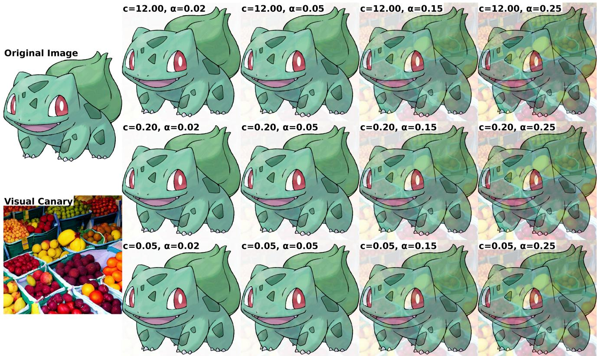  
Figure 8. Protected images under diferent blending strengths � and Gaussian bandwidths �.

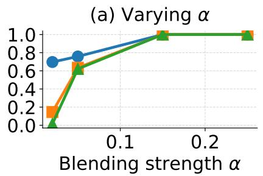

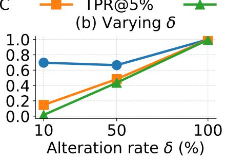

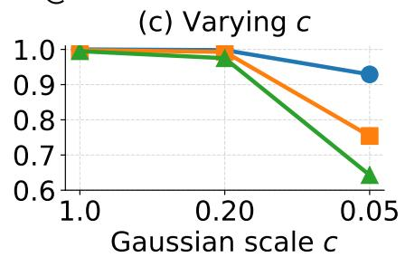  
Figure 9. Protection-hyperparameter ablations on Pokemon with SD1.5: (a) blending strength, fixing $c = 0 . 2 , \delta = 1 0 \% ;$ (b) protected fraction, fixing $c = 0 . 2 , \alpha = 0 . 0 2 ;$ and (c) Gaussian bandwidth, fixing $\delta = 1 0 0 \% , \alpha = 0 . 0 2$

## Additional Evidence and Robustness Analyses

## E. Dataset Protection Cost

SpectralCanary protects an image with one FFT-based blend followed by an inverse transform. It requires neither iterative optimization nor an auxiliary generative model. Because the baselines use diferent protection pipelines, operation counts are not directly comparable, where SIREN optimizes a learned watermark, Silent Branding fine-tunes a DreamBooth model and performs region selection and iterative refinement, and EnTruth generates and filters auxiliary samples. We therefore measure the end-to-end time required to produce each protected dataset on identical hardware. GPU measurements use one NVIDIA RTX A6000 with eight CPU cores; CPU-only measurements use the same system with the GPU disabled.

Tab. 3 reports 0.39 seconds per image for SpectralCanary on CPU. The remaining columns repeat the corresponding averages from the main Pokemon evaluation so that protection cost can be compared with downstream per-generation discrimination.

## F. The Trace Appears Early in Fine-Tuning

The main experiments follow Li et al. [14] and fine-tune each method for 80 epochs. To measure when the trace appears, we apply the verifier to generations from intermediate checkpoints and report pergeneration AUC and TPR at a target FPR. At each checkpoint, we generate 100 matched images from the clean-data and protected-data models using the same captions. In Fig. 10, the base models at epoch 0 are near chance (AUC ≈ 0.500). After five epochs, AUC reaches 0.956 and TPR at 1% FPR reaches 0.730; performance approaches saturation by epochs 10–15 and remains similar through epoch 80.

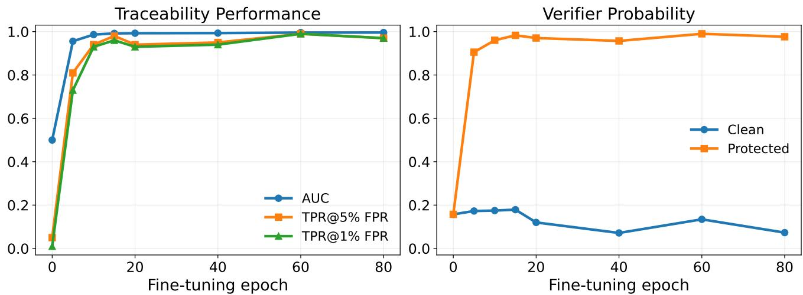  
Figure 10. Per-generation discrimination emerges early and remains stable during fine-tuning. Using a defender’s verifier, we report (left) per-generation AUC and TPR at FPRs of 5% and 1%, and (right) the mean predicted protected-class probability for clean-data-model and protected-data-model generations. Each checkpoint uses 100 matched Pokemon generations per condition with the same captions.

## G. Full Fine-Tuning Evaluation

The main paper evaluates SpectralCanary with LoRA fine-tuning, which is the most practical customization setting for T2I models because it requires substantially less memory and storage than updating all base-model parameters. To test robustness of the trace beyond LoRA, we additionally evaluate full-parameter fine-tuning of SD1.5 on Pokemon. We follow the same SD1.5/Pokemon setup but train the T2I models for 50 epochs.

Tab. 4 shows that SpectralCanary remains efective under full-parameter fine-tuning. It achieves 98.8% AUC, 91.7% TPR at 1% FPR, and an essentially perfect KS rejection rate on protected-data models even at $\gamma = 1 0 ^ { - 1 5 }$ . Prompt recaptioning and image regeneration remain similarly robust. Training-time augmentation is the most challenging setting, reducing TPR at 1% FPR to 61.9% and the KS rejection rate at $\gamma = 1 0 ^ { - 1 5 }$ to 30.0%, but the trace remains detectable at less stringent levels. Across all four settings, the average AUC is 95.2% and the average TPR at 1% FPR is 83.8%.

## H. Model-Level Verification

Our per-generation discrimination evaluation measures how well verifier scores separate generations from clean-data and protected-data models. This protocol enables a controlled comparison across methods without threshold calibration or query aggregation. Fixed-threshold model-level verification instead translates aggregated per-generation scores into a model-level decision that answers: was a suspect model trained on the protected dataset?

We first calibrate a model-level decision threshold and then keep it fixed for all held-out evaluations. For each method and T2I architecture, we reserve one independently trained clean-data model $\mathcal { G } _ { \mathrm { c a l } } ^ { - }$ and one protected-data model ${ \mathcal G } _ { \mathrm { c a l } } ^ { + }$ for threshold calibration.

Given � audit prompts, we generate one image per prompt and define the aggregate score of a model � as

$$
q _ { K } ( \mathcal { G } ) = \frac { 1 } { K } \sum _ { j = 1 } ^ { K } f _ { \theta } \bigl ( y _ { j } ^ { \mathcal { G } } \bigr ) ,\tag{12}
$$

where $f _ { \theta }$ is the method-specific verifier and $y _ { j } ^ { \mathcal { G } }$ is the image generated for prompt �.

For calibration, we use all available generations with $K _ { \mathrm { c a l } } = 1 0 0 0$ for SD1.5 and $K _ { \mathrm { c a l } } = 5 0 0$ for SD3.5. We set the method–architecture-specific threshold to the midpoint between the clean-data and protecteddata calibration scores:

$$
t = \frac { q _ { K _ { \mathrm { c a l } } } ( \mathcal { G } _ { \mathrm { c a l } } ^ { - } ) + q _ { K _ { \mathrm { c a l } } } ( \mathcal { G } _ { \mathrm { c a l } } ^ { + } ) } { 2 } .\tag{13}
$$

The midpoint provides a simple symmetric decision boundary between the two calibration models without favoring either class. The calibration models are excluded from evaluation. Each threshold is calibrated once under the no-transformation setting and then held fixed across all transformation settings, so evaluation does not assume prior knowledge of the transformation applied by the unau thorized trainer.

For each method, architecture, and transformation setting, we independently train five clean-data and five protected-data test models using diferent random seeds. Each suspect model is evaluated using only $K _ { \mathrm { t e s t } } = 3 0$ queries and is classified as trained on protected data when

$$
q _ { 3 0 } ( \mathcal { G } ) \geq t .
$$

Across 4 methods, 2 architectures, and 4 transformation settings, this gives 320 held-out test models. We report TPR, FPR, precision, F1 score, and accuracy over the resulting model-level decisions. To quantify variation due to the 30-query budget, we repeat the query subsampling 1,000 times from the available held-out generations and report the mean and standard deviation across these resampled query sets.

## I. Generations from Models Fine-Tuned on Protected Data

Fig. 11 shows samples from models fine-tuned on SpectralCanary-protected data. The examples complement the quantitative fidelity and utility measurements in Tab. 1.

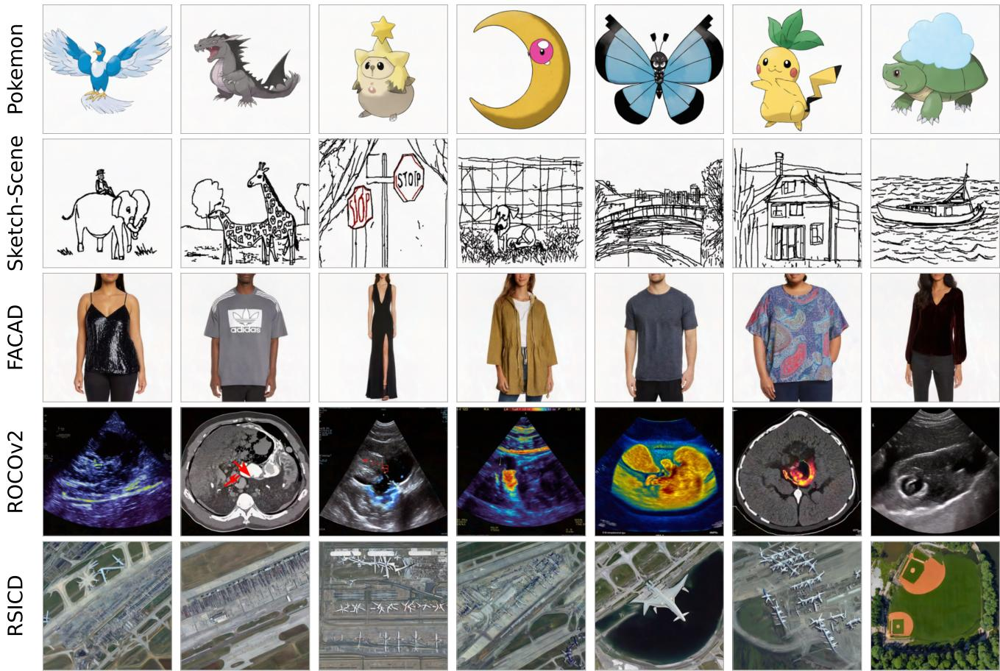  
Figure 11. Qualitative generations from unauthorized models fine-tuned on SpectralCanary protected data.

## J. Multi-Query Performance at Diferent Query Budgets

The main paper uses � = 30 generated images per KS test. Here we vary the budget over $N \in \{ 1 0 , 2 0 , 3 0 \}$ and average KS rejection rates on protected-data models across the eight model–transformation settings in Tab. 2.

SpectralCanary has the highest average KS rejection rate on protected-data models at each evaluated query budget.

## K. Efect of Spectral Location on Trace Transfer

In this section, we investigate whether SpectralCanary’s trace transfer depends on the spectral location of the protection signal. SpectralCanary uses a smooth radial low-pass mask $M _ { c ^ { \star } }$ , with blending strength $\alpha ^ { \star } = 0 . 0 2$ and Gaussian bandwidth $c ^ { \star } = 0 . 2 0$

We construct three disjoint binary radial masks, $B _ { \mathrm { l o w } } , \ B _ { \mathrm { m i d } } ,$ and $B _ { \mathrm { h i g h } }$ , over the shifted Fourier grid. Following the centered Fourier convention in Sec. 2, let $X _ { i } = \mathcal { F } _ { c } ( x _ { i } ) , V = \mathcal { F } _ { c } ( v ^ { \star } )$ , and $r ( k , \ell )$ denote the normalized radial frequency of Fourier coeficient $( k , \ell )$ . Let $q _ { 1 }$ and $q _ { 2 }$ denote the one-third and two-thirds quantiles of the radii of all Fourier coeficients. We define

$$
\begin{array} { r l } & { B _ { \mathrm { l o w } } ( k , \ell ) = \mathbb { I } \left[ r ( k , \ell ) \le q _ { 1 } \right] , } \\ & { B _ { \mathrm { m i d } } ( k , \ell ) = \mathbb { I } \left[ q _ { 1 } < r ( k , \ell ) \le q _ { 2 } \right] , } \\ & { B _ { \mathrm { h i g h } } ( k , \ell ) = \mathbb { I } \left[ r ( k , \ell ) > q _ { 2 } \right] . } \end{array}\tag{14}
$$

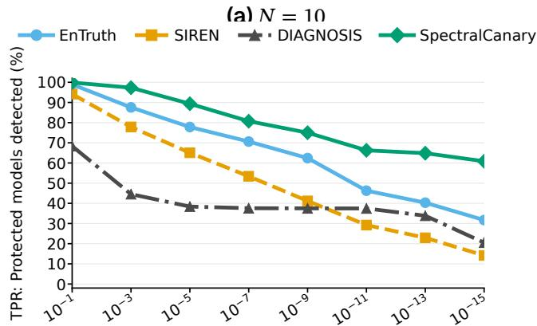  
Significance level γ: Stricter evidence requirement →

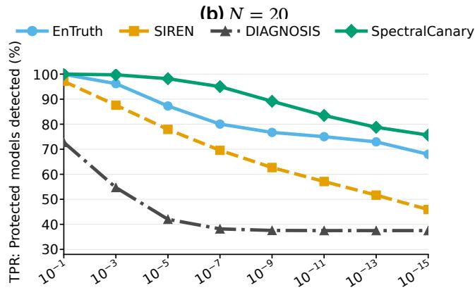  
Significance level γ: Stricter evidence requirement →

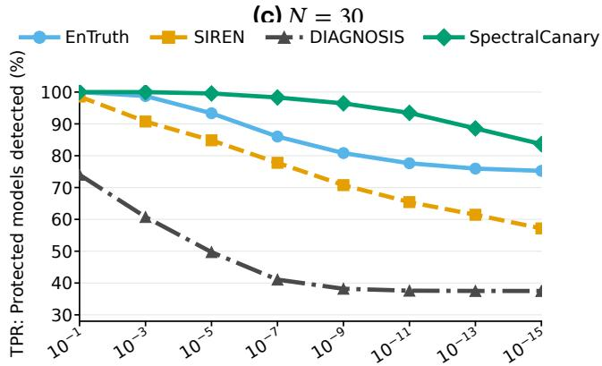  
Significance level γ: Stricter evidence requirement →  
Figure 12. KS-based multi-query auditing improves with the query budget.

For each band $b \in$ {low, mid, high}, the protected spectrum is

$$
\widehat { X } _ { i } ^ { ( b ) } = X _ { i } + \alpha _ { b } B _ { b } \odot ( V - X _ { i } ) ,\tag{15}
$$

where $\alpha _ { b }$ is the band-specific blending strength. To control for protection strength, we select $\alpha _ { b }$ such that the average pre-inverse-FFT spectral perturbation energy of each binary-band condition matches that of the default Gaussian low-pass SpectralCanary setting:

$$
\frac { 1 } { N } \sum _ { i = 1 } ^ { N } \left. \alpha _ { b } B _ { b } \odot ( V - X _ { i } ) \right. _ { 2 } ^ { 2 } = \frac { 1 } { N } \sum _ { i = 1 } ^ { N } \left. \alpha ^ { \star } M _ { c ^ { \star } } \odot ( V - X _ { i } ) \right. _ { 2 } ^ { 2 } .\tag{16}
$$

Thus, the low-, mid-, and high-frequency conditions place the signal in diferent disjoint spectral regions while matching both the number of selected Fourier coeficients and average pre-IFFT perturbation energy.

We conduct this experiment on the Pokemon and ROCOv2 datasets using SD1.5. For each dataset, we select three diferent canaries and evaluate each canary under the low-, mid-, and high-frequency conditions. Tab. 6 reports results averaged across the three canaries. Low-band coating is consistently strongest, especially at low FPR. Mid-frequency coating is markedly weaker on both datasets. Highfrequency coating is somewhat competitive on Pokemon but degrades substantially on ROCOv2. The energy ratios are 1.000 to the displayed precision, confirming the intended energy matching without reporting resolution-dependent raw DFT units. For completeness, the energy-matching constraint uses the unnormalized pre-IFFT DFT energy

$$
E = \frac { 1 } { N } \sum _ { i = 1 } ^ { N } \left\| \Delta \boldsymbol { X } _ { i } \right\| _ { 2 } ^ { 2 } , \qquad \Delta { X } _ { i } = \alpha _ { b } B _ { b } \odot ( V - X _ { i } ) .
$$

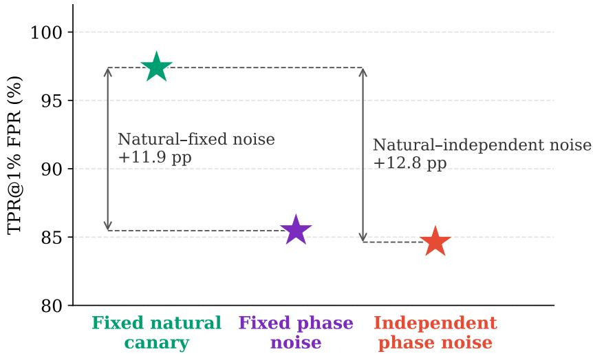  
Figure 13. Natural spatial structure enables more reliable visual-canary transfer.

Images are represented in RGB [0, 1], and $\mathcal { F } _ { c }$ uses NumPy’s default unnormalized forward DFT. Consequently, � scales with image area squared. The matched raw energies are $( 6 . 8 3 \pm 0 . 7 3 ) \times 1 0 ^ { 8 }$ for Pokemon and $( 2 . 5 8 \pm 0 . 2 8 ) \times 1 0 ^ { \overline { { 8 } } }$ for ROCOv2, averaged across three canaries. We therefore report the dimensionless ratio $E _ { b } / E _ { \mathrm { r e f } }$ in Tab. 6.

## L. Efect of the Canary’s Spatial Structure

The main canary has coherent natural structure. We test whether this structure contributes beyond the canary’s spectral magnitude using Pokemon, $\delta = 1 0 0 \% , \alpha = 0 . 0 2$ , and the SD1.5 protocol. Given $X _ { i } = \mathcal { F } _ { c } ( x _ { i } )$ , each protected image is

$$
\widetilde { \boldsymbol { x } } _ { i } = \mathcal { F } _ { c } ^ { - 1 } [ \boldsymbol { X } _ { i } + \alpha \boldsymbol { M } _ { c } \odot ( \boldsymbol { V } _ { i } - \boldsymbol { X } _ { i } ) ] .\tag{17}
$$

We compare the original fixed fruit canary with two phase-randomized controls constructed using iterative amplitude-adjusted Fourier transform (IAAFT)

$$
v _ { \mathrm { f i x e d } } = \mathrm { I A A F T } ( v _ { \mathrm { f r u i t } } ; s ) , \qquad v _ { \mathrm { i n d } , i } = \mathrm { I A A F T } ( v _ { \mathrm { f r u i t } } ; s _ { i } ) ,\tag{18}
$$

where � denotes a fixed random seed shared across the dataset and $s _ { i }$ denotes an independently sampled seed for image �. The canary spectrum is then

$$
V _ { i } = \left\{ \begin{array} { l l } { \mathcal { F } _ { c } ( v _ { \mathrm { f r u i t } } ) , } & { \mathrm { f x e d ~ n a t u r a l ~ c a n a r y } , } \\ { \mathcal { F } _ { c } ( v _ { \mathrm { f i x e d } } ) , } & { \mathrm { f x e d ~ p h a s e - r a n d o m i z e d ~ c o n t r o l } , } \\ { \mathcal { F } _ { c } ( v _ { \mathrm { i n d } , i } ) , } & { \mathrm { i n d e p e n d e n t ~ p h a s e - r a n d o m i z e d ~ c o n t r o l } . } \end{array} \right.\tag{19}
$$

IAAFT randomizes the spatial organization of the fruit canary while preserving its empirical RGB value distribution and closely matching its channel-wise Fourier magnitude. Because the controls are constructed as real valued images before applying $\mathcal { F } _ { c } ,$ , their spectra satisfy the required conjugate symmetry by construction. The fixed control uses the same IAAFT realization for every protected image. The independent control uses a diferent realization for each image. This comparison shows the contribution of natural spatial structure while approximately controlling spectral magnitude and pixel-value distribution. We characterize how well the spectral protection signal is learned by apply ing the verifier to generated samples and reporting AUC and TPR@FPR.

In Fig. 13, the fixed natural canary yields the highest discrimination, particularly at the 1% falsepositive rate. Both phase-randomized controls nevertheless retain substantial discrimination. Coherent natural structure therefore improves strict-FPR performance in this experiment but is not necessary for trace transfer.

## M. Additional Adaptive Spectral-Sanitization Settings

In the main paper, we evaluate adaptive spectral sanitization. Here, we provide implementation details and visualize a broader range of attack variants.

Consistent with the threat model in Sec. 2, the attacker knows the SpectralCanary algorithm and released protected collection; � and � may also be known. The defender retains the original images, canary $v ^ { \star }$ , its spectrum �, and verifier $f _ { \theta } . W$ ithout access to the original images or verifier, attack strength is selected using fidelity to the released protected images as an observable constraint.

Quality-constrained fixed donor replacement. Given a protected spectrum $\widehat { X } _ { i }$ and an unprotected natural donor image � with centered spectrum $D = \mathcal { F } _ { c } ( d )$ , the donor-replacement attack is

$$
\widehat { X } _ { i } ^ { s } = \widehat { X } _ { i } + \beta M _ { c _ { a } } \odot ( D - \widehat { X } _ { i } ) ,\tag{20}
$$

where $\beta \in \left[ 0 , 1 \right]$ controls the attack strength and $M _ { c _ { a } }$ is an attacker-chosen smooth radial low-pass mask with Gaussian bandwidth $c _ { a } .$ The attacked image is $x _ { i } ^ { s } = \mathcal { F } _ { c } ^ { - 1 } ( \widehat { X } _ { i } ^ { s } )$ . As shown in Eq. 21, increasing $\beta$ or broadening $M _ { c _ { a } }$ suppresses more of the protection signal but simultaneously modifies more originalimage content. Fig. 14 visualizes the following attack settings.

Writing the protection signal as $\Delta _ { \mathrm { p r o t } , i } = \widehat { X } _ { i } - X _ { i }$ gives

$$
\widehat { X } _ { i } ^ { s } = X _ { i } + \underbrace { \beta M _ { c _ { a } } \odot ( D - X _ { i } ) } _ { \mathrm { m o d i f i e d ~ o r i g i n a l - i m a g e ~ c o n t e n t } } + \underbrace { ( 1 - \beta M _ { c _ { a } } ) \odot \Delta _ { \mathrm { p r o t } , i } } _ { \mathrm { r e s i d u a l ~ p r o t e c t i o n ~ s i g n a l } } .\tag{21}
$$

The decomposition makes the trade-of explicit: greater mask overlap and replacement strength attenuate more of the protection signal while changing more original low-frequency content.

The attacker replaces low-frequency content using the fixed external RGB donor �. For each attacker Gaussian bandwidth $c _ { a } ,$ , the same donor and global replacement strength $\beta$ are applied to every protected image.

We use attacker Gaussian bandwidth $c _ { a } = 0 . 3 0 { } _ { ; }$ , which is broader than the defender’s $c = 0 . 2 0$ and therefore covers more of the protection signal’s frequency support. For each target similarity $\tau ,$ we select the strongest replacement from the grid $\mathcal { B } = \{ \bar { 0 } , 0 . 0 1 , \bar { \ldots } , 0 . \bar { 5 } 0 \}$ that satisfies a dataset-level fidelity constraint:

$$
\beta ^ { \star } ( \tau , c _ { a } ) = \operatorname* { m a x } _ { \beta \in \mathcal { B } } \left\{ \beta \bigg | \frac { 1 } { N } \sum _ { i = 1 } ^ { N } \mathrm { S S I M } \big ( \tilde { x } _ { i } , x _ { i } ^ { s } ( \beta , c _ { a } ) \big ) \geq \tau \right\} .\tag{22}
$$

Here, SSIM is measured against the released protected image $\tilde { x } _ { i } ,$ so parameter selection requires neither the original image nor verifier feedback. Fig. 14(a) visualize sanitized samples using this attack setting.

Quality-constrained per-image donor replacement. This attack is similar to the quality-constrained fixed-donor replacement above, except that we use a diferent unprotected donor for each protected image. Specifically, we use unprotected images from another dataset as the donor set (i.e., ROCOv2 images for the Pokemon setting). Fig. 14(b) visualizes sanitized samples using this attack setting.

Shared-structure estimate attack. We additionally consider a stronger sanitization attack that estimates the shared canary structure. The attacker knows the defense parameters $( \alpha , c )$ and has access to the released protected collection, but does not know the private canary $v ^ { \star }$ or have access to the original clean images, verifier $f _ { \theta } .$ . Let $A = \alpha M _ { c }$ . The protected image is then

$$
\widetilde { X } _ { i } = \left( 1 - A \right) \odot X _ { i } + A \odot V .
$$

Because the same canary is used throughout the collection, the mean protected spectrum is

$$
\overline { { \widetilde { X } } } = \frac { 1 } { N } \sum _ { i = 1 } ^ { N } \widetilde { X } _ { i } = \left( 1 - A \right) \odot \overline { { X } } + A \odot V ,
$$

Subtracting the protected collection mean cancels the shared canary contribution:

$$
\widetilde { X } _ { i } - \overline { { \widetilde { X } } } = ( 1 - A ) \odot ( X _ { i } - \overline { { X } } ) .
$$

Therefore, the attacker can undo the known attenuation to obtain

$$
R _ { i } = \frac { \widetilde X _ { i } - \overline { { \widetilde X } } } { 1 - \alpha M _ { c } } = X _ { i } - \overline { { X } } ,
$$

where division is applied element-wise. Thus, $R _ { i }$ contains no shared canary component under the idealized coating model, but it also removes the genuine collection-level spectral mean.

Let $W$ denote the attacker-selected frequency mask. In our implementation, � is a binary lowfrequency disk using the known defense cutof �:

$$
W ( u , v ) = \mathbb { 1 } [ r ( u , v ) \leq c ] ,
$$

where $r ( u , v )$ is the normalized centered Fourier radius. Thus, the attacker applies collection centering only within the defense’s nominal low-frequency region, while preserving all coeficients outside this disk exactly.

The attacker interpolates between the released protected spectrum and the collection-centered estimate:

$$
X _ { i } ^ { \mathrm { s a n } } ( \lambda ) = \left( 1 - \lambda W \right) \odot \widetilde { X } _ { i } + \lambda W \odot \frac { \widetilde { X } _ { i } - \overline { { \widetilde { X } } } } { 1 - \alpha M _ { c } } \qquad \lambda \in \{ 0 . 2 5 , 0 . 5 0 , 0 . 7 5 , 1 . 0 0 \} .
$$

Equivalently,

$$
X _ { i } ^ { \mathrm { s a n } } ( \lambda ) = \widetilde { X } _ { i } + \lambda W \odot \left( R _ { i } - \widetilde { X } _ { i } \right) .
$$

At $\lambda = 0 ;$ , the released protected spectrum is unchanged. $\mathbf { A } \mathbf { t } \lambda = 1$ , all frequencies within � are replaced by their collection-centered estimates. Coeficients outside � remain equal to ${ \widetilde { X } } _ { i } .$ Fig. 14(c) visualize sanitized samples using this attack setting.

Full donor replacement. We next consider the extreme setting $\beta = 1$ in Eq. 20:

$$
\widehat { X } _ { i } ^ { s } = ( 1 - M _ { c _ { a } } ) \odot \widehat { X } _ { i } + M _ { c _ { a } } \odot D .\tag{23}
$$

This can strongly suppress the protection signal in the low-pass-weighted frequencies. Fig. 14(d), however, shows that full replacement also transfers substantial coarse structure from the donor. We omit this setting from the main evaluation because it severely degrades image fidelity.

Direct low-frequency removal. Finally, the attacker can suppress low-frequency coeficients without a donor:

$$
\widehat { X } _ { i } ^ { s } = ( 1 - M _ { c _ { a } } ) \odot \widehat { X } _ { i } .\tag{24}
$$

This suppresses the protection signal within the attacked region together with original-image content at the same frequencies. Fig. 14(e) shows severe fidelity degradation, so we also omit this setting from the main evaluation.

## N. Additional Protected-Image Examples

Fig. 15, Fig. 16, Fig. 17, Fig. 18, and Fig. 19 provide original–protected comparisons for all five datasets.

## Baseline-Specific Analyses

## O. EnTruth Injected-Sample Visualization

We visualize EnTruth’s injected and protected samples for the Pokemon setting in Fig. 20. The injected samples are visually distinct from the original collection and require explicit trigger tokens in their captions. Moreover, EnTruth protects a dataset by inserting auxiliary templated samples rather than preserving the content of the original samples. For curated collections such as artwork datasets, these synthetic templated images may be inconsistent with the original data distribution, reducing datasetlevel fidelity and making the protection easier to identify.

## P. EnTruth Ablation: Soft- and Hard-Trigger Auditing

EnTruth uses both hard-trigger and soft-trigger prompts at audit time. We compare its hard trigger ([Tgr]) and soft trigger (fruit) in Tab. 7. Because the hard trigger is generally stronger, we report hard-trigger results in the main paper for EnTruth.

## Q. Repurposing T2I Data Poisoning for Dataset-Use Auditing

We test whether Silent Branding [12] can be repurposed for dataset-use auditing under the Pokemon protocol. We preserve its pipeline: Stage 1 trains a personalized difusion model on the method’s logo set; Stage 2 selects plausible regions in Pokemon images and refines the inserted logo using detection, masking, and inpainting. We then fine-tune SD1.5 and SD3.5 on the edited dataset. Tab. 8 reports per-generation discrimination, and Tab. 3 reports KS-based multi-query auditing performance and protection time.

Silent Branding depends on finding semantically appropriate regions and on auxiliary models for logo placement, detection, and refinement. In the Pokemon setting, its inserted signal transfers less consistently than SpectralCanary’s shared spectral component. This experiment shows that the evaluated branding pipeline is a weaker dataset-use auditing baseline under this protocol; it does not establish that all semantic insertion methods are unsuitable for dataset-use auditing.

## R. Theoretical Analysis

We give an idealized Gaussian analysis of trace learnability under the SD1.5-style noise-prediction objective and the SD3.5-style linear flow-matching objective. The analysis keeps the exact coating’s variance contraction and separates it from the shared population mean shift.

## R.1 Assumptions and Setup

Let ℱ denote the unitary two-dimensional discrete Fourier transform and let $X = { \mathcal { F } } ( x )$ . We use � to index the full frequency grid and write $\mu ( f ) = \mathbb { E } [ X ( f ) ]$ and $P ( f ) = \mathbb { E } | X ( f ) - \mu ( f ) | ^ { 2 }$ for the mean and power

of a clean image coeficient. Because images are real valued, their Fourier coeficients obey conjugate symmetry, and all sums below are over the full grid unless stated otherwise.

Forward noising process. We model difusion training and difusion-based regeneration transformations using the variance-preserving forward process

$$
\begin{array} { r } { x _ { t } = \sqrt { \bar { \alpha } _ { t } } x _ { 0 } + \sqrt { 1 - \bar { \alpha } _ { t } } \epsilon , \qquad \epsilon \sim \mathcal { N } ( 0 , I ) , } \end{array}\tag{25}
$$

where $\bar { \alpha } _ { t }$ decreases from one to zero. Unitary Fourier transformation preserves the isotropic noise, so the model separates by frequency. For linear flow matching, the path is $x _ { t } = ( 1 - t ) x _ { 0 } + t \epsilon$ and the target is $u = \epsilon - x _ { 0 }$ . Because this target difers from noise prediction, the two training losses are derived separately below.

Assumption 1 (Natural-image spectral prior). We select one coeficient from each conjugatesymmetric frequency pair and approximate each clean-image Fourier coeficient with the following complex Gaussian model:

$$
X _ { 0 } ( f ) = \mu ( f ) + \sqrt { P ( f ) } Z ( f ) , \qquad Z ( f ) \sim \mathcal { C N } ( 0 , 1 ) ,\tag{26}
$$

where the $Z ( f )$ are independent and unit variance; self-conjugate frequencies use the analogous real Gaussian. Beyond a small cutof $f _ { \mathrm { m i n } } .$ , we assume $P ( f )$ decreases with $| f |$ . Gaussianity and frequency independence are analytical approximations.

Exact coating and shared-shift decomposition. Let $\gamma ( f ) : = 1 - \alpha M _ { c } ( f )$ . Under Eq. 4 and Assumption 1,

$$
\Delta _ { \mathrm { s a m p l e } } ( f ; X ) : = \widehat { X } ( f ) - X ( f ) = \alpha M _ { c } ( f ) \bigl ( V ( f ) - X ( f ) \bigr ) ,\tag{27}
$$

$$
\Delta ( f ) : = \mathbb { E } [ \widehat { X } ( f ) ] - \mu ( f ) = \alpha M _ { c } ( f ) \big ( V ( f ) - \mu ( f ) \big ) ,\tag{28}
$$

$$
\widehat { X } _ { 0 } ( f ) = \mu ( f ) + \Delta ( f ) + \gamma ( f ) \sqrt { P ( f ) Z ( f ) } , \qquad \mathrm { V a r } ( \widehat { X } _ { 0 } ( f ) ) = \gamma ( f ) ^ { 2 } P ( f ) .\tag{29}
$$

Thus, $\Delta _ { \mathrm { s a m p l e } }$ varies with the image, whereas $\Delta$ is the shared population shift. To isolate this shift, define the variance-preserving surrogate

$$
\widetilde { X } _ { 0 } ^ { \mathrm { m s } } ( f ) : = X _ { 0 } ( f ) + \Delta ( f ) = \mu ( f ) + \Delta ( f ) + \sqrt { P ( f ) } Z ( f ) ,\tag{30}
$$

The exact results retain the contraction $\gamma ( f ) ^ { 2 } P ( f ) ;$ surrogate terms are stated only as nonnegative lower-bound components.

Normalized trace energy. For analytical comparison, we normalize the trace energy at each frequency by the corresponding clean-image power:

$$
B ^ { 2 } = \sum _ { f } b ( f ) , \qquad b ( f ) = \frac { | \Delta ( f ) | ^ { 2 } } { P ( f ) } .\tag{31}
$$

Here $b ( f )$ is the squared mean shift measured in units of the natural coeficient variance, and $B ^ { 2 }$ is its total normalized energy. This is a mathematical normalization used by the Gaussian analysis; we do not assume that it is a model of human perceptual visibility.

For the variance-preserving difusion process, the key frequency-wise quantity is the signal-to-noise ratio and its Wiener coeficient,

$$
\mathrm { S N R } _ { t } ( f ) = \frac { \bar { \alpha } _ { t } } { 1 - \bar { \alpha } _ { t } } P ( f ) , \qquad w _ { t } ( f ) = \frac { \mathrm { S N R } _ { t } ( f ) } { 1 + \mathrm { S N R } _ { t } ( f ) } .\tag{32}
$$

The coeficient $w _ { t } ( f )$ is the fraction of the signal at frequency � that remains above the difusion noise floor. It increases with natural-image power and decreases with the noise level. Linear flow matching has the analogous signal-to-noise ratio $( 1 - t ) ^ { 2 } P ( f ) / t ^ { 2 }$ , but its velocity-prediction loss induces a diferent objective-specific weight, derived below.

## R.2 Learnability of the Low-Frequency Trace

We distinguish two related questions. First, how much of the trace remains statistically distinguish able after the training image is noised? Second, how strongly does the model’s training objective encourage it to represent that trace? For difusion noise prediction, the mean-shift component is governed by $w _ { t } ( f ) ( 1 - w _ { t } ( f ) )$ . Linear flow matching has a diferent objective-specific weight, derived below. This distinction explains both the advantage of low-frequency carriers and why concentrating the trace at the very lowest frequencies is not necessarily optimal.

For the carrier-band optimization in Part (v), we consider the feasible set

$$
\mathcal { B } ( B , b _ { \operatorname* { m a x } } ) = \{ b : \mathcal { F }  \mathbb { R } _ { \ge 0 } \middle | b ( f ) = b ( - f ) , \sum _ { f \in \mathcal { F } } b ( f ) \leq B ^ { 2 } , 0 \leq b ( f ) \leq b _ { \operatorname* { m a x } } \forall f \} .\tag{33}
$$

The constraint $\begin{array} { r } { \sum _ { f } b ( f ) \le B ^ { 2 } } \end{array}$ is the normalized trace-energy budget from Eq. 31. The condition $0 ~ \leq$ $b ( f ) \leq b _ { \operatorname* { m a x } }$ is a box constraint that limits how much normalized trace energy may be concentrated in any single coeficient, modeling a fixed finite per-frequency coating strength. Conjugate symmetry ensures that the allocation corresponds to a real-valued image. The box constraint is needed only for the band-allocation result; parts (i)–(iv) do not use it.

Theorem 1 (Learnability of the exact coating and its mean-shift component). Let $q _ { t } , \hat { q } _ { t } ,$ , and $q _ { t } ^ { \mathrm { m s } }$ denote the noised clean, exactly coated, and additive mean-shift-surrogate distributions, respectively. Write $a _ { t } = \bar { \alpha } _ { t }$ and define

$$
v _ { t } ( f ) : = a _ { t } P ( f ) + 1 - a _ { t } , \qquad \hat { v } _ { t } ( f ) : = a _ { t } \gamma ( f ) ^ { 2 } P ( f ) + 1 - a _ { t } ,\tag{34}
$$

and

$$
\kappa _ { t } ( f ) : = \log \frac { v _ { t } ( f ) } { \hat { v } _ { t } ( f ) } + \frac { \hat { v } _ { t } ( f ) } { v _ { t } ( f ) } - 1 \geq 0 .\tag{35}
$$

Under Assumption 1 and the exact coating in Eq. 4, the following statements hold.

(i) Discriminability after noising. The exact divergence is

$$
D _ { \mathrm { K L } } ( { \hat { q } } _ { t } \parallel q _ { t } ) = { \frac { 1 } { 2 } } \sum _ { f } { \left[ { \kappa _ { t } ( f ) + b ( f ) w _ { t } ( f ) } \right] } \geq { \frac { 1 } { 2 } } \sum _ { f } { b ( f ) w _ { t } ( f ) } = D _ { \mathrm { K L } } ( q _ { t } ^ { \mathrm { m s } } \parallel q _ { t } ) .\tag{36}
$$

Thus, $B ^ { 2 } / 2$ is the clean-data KL of the mean-shift surrogate and a lower bound for the exact coating, whose additional nonnegative term comes from variance contraction.

(ii) Survival window of the mean-shift component. Define the last noise level at which the clean spectral power at frequency � remains above the noise floor as

$$
t ^ { \star } ( f ) = \operatorname* { s u p } \{ t : \mathrm { S N R } _ { t } ( f ) \geq 1 \} .\tag{37}
$$

Then $w _ { t } ( f ) \geq 1 / 2$ for $t \leq t ^ { \star } ( f )$ and $w _ { t } ( f ) \leq \mathrm { S N R } _ { t } ( f )$ afterward. Because �(�) decreases with frequency, $t ^ { \star } ( f )$ also decreases with $| f |$ . This describes the frequency dependence of the meanshift terms in parts (i) and (iii).

(iii) Difusion noise-prediction signal. Let $\varepsilon _ { t } ^ { 0 }$ and $\varepsilon _ { t } ^ { \mathrm { c o a t } }$ be the Bayes-optimal noise predictors under the clean and exact coated distributions. Their squared diference on coated data is

$$
R _ { t } ^ { \mathrm { { c o a t } } } = \sum _ { f } \big [ b ( f ) w _ { t } ( f ) \big ( 1 - w _ { t } ( f ) \big ) + \zeta _ { t } ( f ) \big ] \geq R _ { t } ^ { \mathrm { { m s } } } : = \sum _ { f } b ( f ) w _ { t } ( f ) \big ( 1 - w _ { t } ( f ) \big ) ,\tag{38}
$$

where

$$
\zeta _ { t } ( f ) : = \frac { ( 1 - a _ { t } ) \bigl ( v _ { t } ( f ) - \hat { v } _ { t } ( f ) \bigr ) ^ { 2 } } { v _ { t } ( f ) ^ { 2 } \hat { v } _ { t } ( f ) } \geq 0 .\tag{39}
$$

The mean-shift component $R _ { t } ^ { \mathrm { m s } }$ is largest at $\mathrm { S N R } _ { t } ( f ) = 1$ , where $w _ { t } ( f ) ( 1 - w _ { t } ( f ) ) = 1 / 4 .$

(iv) Rectified-flow velocity signal. For the linear interpolation $X _ { t } ^ { \mathrm { R F } } ( f ) = ( 1 - t ) X _ { 0 } ( f ) + t E ( f )$ , let $u _ { t } ^ { 0 }$ and $u _ { t } ^ { \mathrm { c o a t } }$ be the Bayes-optimal predictors of the canonical velocity target $U ( f ) = E ( f ) - X _ { 0 } ( f )$ under the clean and exact coated distributions. Set $A _ { t } = 1 - t$ and

$$
v _ { t } ^ { \mathrm { R F } } ( f ) : = A _ { t } ^ { 2 } P ( f ) + t ^ { 2 } ,
$$

$$
\hat { v } _ { t } ^ { \mathrm { R F } } ( f ) : = A _ { t } ^ { 2 } \gamma ( f ) ^ { 2 } P ( f ) + t ^ { 2 } .\tag{40}
$$

Their squared diference on coated data is

$$
R _ { t , \mathrm { R F } } ^ { \mathrm { c o a t } } = \sum _ { f } \left[ b ( f ) h _ { t } ^ { \mathrm { R F } } ( f ) + \zeta _ { t } ^ { \mathrm { R F } } ( f ) \right] \geq R _ { t , \mathrm { R F } } ^ { \mathrm { m s } } : = \sum _ { f } b ( f ) h _ { t } ^ { \mathrm { R F } } ( f ) ,\tag{41}
$$

where

$$
h _ { t } ^ { \mathrm { R F } } ( f ) : = \frac { t ^ { 2 } P ( f ) } { v _ { t } ^ { \mathrm { R F } } ( f ) ^ { 2 } } , \qquad \zeta _ { t } ^ { \mathrm { R F } } ( f ) : = \frac { A _ { t } ^ { 2 } t ^ { 2 } ( 1 - \gamma ( f ) ^ { 2 } ) ^ { 2 } P ( f ) ^ { 2 } } { v _ { t } ^ { \mathrm { R F } } ( f ) ^ { 2 } \hat { v } _ { t } ^ { \mathrm { R F } } ( f ) } \ge 0 .\tag{42}
$$

For each fixed $t \in ( 0 , 1 )$ , the mean-shift weight $h _ { t } ^ { \mathrm { R F } } ( f )$ is maximized when $A _ { t } ^ { 2 } P ( f ) / t ^ { 2 } = 1$ . It is not obtained by merely substituting the rectified-flow interpolation coeficients into the difusion noise-prediction risk.

(v) Carrier bands for the objective-specific mean-shift lower bounds. Let $\pi _ { \varepsilon } ( d t )$ and $\pi _ { \mathrm { R F } } ( d t )$ denote the efective training distributions over noise levels, including any deterministic timestep loss weighting, for difusion noise prediction and linear flow matching, respectively. Define

$$
G _ { \varepsilon } ( f ) = \int w _ { t } ( f ) \big ( 1 - w _ { t } ( f ) \big ) \pi _ { \varepsilon } ( d t ) , \qquad G _ { \mathrm { R F } } ( f ) = \int h _ { t } ^ { \mathrm { R F } } ( f ) \pi _ { \mathrm { R F } } ( d t ) .\tag{43}
$$

For either objective $o \in \{ \varepsilon , \mathrm { R F } \}$ , let $\begin{array} { r } { J _ { o } ( b ) = \sum _ { f } b ( f ) G _ { o } ( f ) } \end{array}$ . Over $b \in \mathcal { B } ( B , b _ { \operatorname* { m a x } } ) , J _ { o } ( b )$ is maximized by allocating the budget to frequencies with the largest values of the corresponding objectivespecific weight $G _ { o } ( f )$ . This optimizes only the mean-shift lower-bound component; the exact coated risks also contain their nonnegative variance-contraction terms. For difusion noise prediction, if $\pi _ { \varepsilon }$ has no point mass at the zero- or infinite-SNR endpoints, then $G _ { \varepsilon } ( f )$ approaches zero when $P ( f )$ is either very small or very large. The integrated rectified-flow weight generally difers because it emphasizes timesteps diferently.

Proof. Using the variances in Eq. 34, write

$$
\lambda _ { t } : = \frac { a _ { t } } { 1 - a _ { t } } ,
$$

$$
w _ { t } ( f ) = \frac { a _ { t } P ( f ) } { v _ { t } ( f ) } .\tag{44}
$$

Let ${ \mathcal { F } } _ { + }$ contain one representative from each non-self-conjugate frequency pair and let $\mathcal { F } _ { \mathrm { s c } }$ contain the self-conjugate frequencies.

We first record one identity used for both training objectives. Let $X _ { 0 } \sim \mathcal { C N } ( m , Q )$ and define an afine noising path and target

$$
Y = A X _ { 0 } + B E , \qquad T = r E + s X _ { 0 } , \qquad E \sim { \mathcal { C N } } ( 0 , 1 ) .\tag{45}
$$

Writing $v _ { Q } = A ^ { 2 } Q + B ^ { 2 }$ and $k _ { Q } = ( r B + s A Q ) / v _ { Q }$ , Gaussian conditioning gives

$$
\mathbb { E } [ T \mid Y ; m , Q ] = s m + k _ { Q } ( Y - A m ) .\tag{46}
$$

Additionally, $\mathbb { E } [ T ] = s m , \mathbb { E } [ Y ] = A m , \mathrm { V a r } ( Y ) = v _ { Q } \mathrm { . }$ , and $\operatorname { C o v } ( T , Y ) \ : = \ : r B + s A Q$ . Comparing the clean parameters $( m , Q ) = ( \mu , P )$ with the coated parameters $( m , Q ) = ( \mu + \Delta , \gamma ^ { 2 } P )$ on coated data, let $V : =$ $Y - A ( \mu + \Delta )$ and abbreviate $k _ { 0 } : = k _ { P } , k _ { 1 } : = k _ { \gamma ^ { 2 } P }$ . Then

$$
\tau _ { 0 } ( Y ) - \tau _ { 1 } ( Y ) = ( A k _ { 0 } - s ) \Delta + ( k _ { 0 } - k _ { 1 } ) V ,\tag{47}
$$

$$
\mathbb { E } _ { \hat { q } } | \tau _ { 0 } ( Y ) - \tau _ { 1 } ( Y ) | ^ { 2 } = ( A k _ { 0 } - s ) ^ { 2 } | \Delta | ^ { 2 } + ( k _ { 0 } - k _ { 1 } ) ^ { 2 } v _ { \gamma ^ { 2 } P } .\tag{48}
$$

The cross term vanishes because � is zero mean. Thus, the first term is the additive mean-shift contribution and the second is the nonnegative correction caused by the exact coating’s variance contraction.

Part (i). At a non-self-conjugate frequency, the clean and coated noised distributions are

$$
\begin{array} { r } { q _ { t } = \mathcal { C N } ( \sqrt { a _ { t } } \mu , v _ { t } ) , \qquad \hat { q } _ { t } = \mathcal { C N } ( \sqrt { a _ { t } } ( \mu + \Delta ) , \hat { v } _ { t } ) . } \end{array}
$$

Using

$$
D _ { \mathrm { K L } } ( \mathcal { C N } ( m _ { 1 } , v _ { 1 } ) | | \mathcal { C N } ( m _ { 0 } , v _ { 0 } ) ) = \log \frac { v _ { 0 } } { v _ { 1 } } + \frac { v _ { 1 } + | m _ { 1 } - m _ { 0 } | ^ { 2 } } { v _ { 0 } } - 1
$$

gives the per-frequency contribution $\kappa _ { t } ( f ) + b ( f ) w _ { t } ( f )$ . A self-conjugate real coeficient contributes half as much, so the full-grid convention yields Eq. 36. Setting $\hat { v } _ { t } = v _ { t }$ removes $\kappa _ { t }$ and recovers the additive mean-shift surrogate. $\mathbf { A } \mathbf { t } \ t = 0 .$ , its KL is $B ^ { 2 } / \bar { 2 } ;$ ; for the default $\alpha = 0 . 0 2$ , the largest exact variance correction is $- \log ( 0 . 9 6 0 4 ) \stackrel { - } { + } 0 . 9 6 0 4 - 1 \approx 8 . 0 5 \times 1 0 ^ { - 4 }$ per non-self-conjugate coeficient.

Part (ii). Write $S _ { t } ( f ) = \mathrm { S N R } _ { t } ( f ) = \lambda _ { t } P ( f )$ . Since $w _ { t } = S _ { t } / ( 1 + S _ { t } )$

$$
w _ { t } ( f ) \geq { \frac { 1 } { 2 } } \iff S _ { t } ( f ) \geq 1 , \qquad S _ { t } ( f ) < 1 \implies w _ { t } ( f ) \leq S _ { t } ( f ) .
$$

The monotonicity of $\lambda _ { t }$ therefore makes Eq. 37 the unique SNR-one crossing. $\operatorname { I f } | f _ { 1 } | < | f _ { 2 } |$ , then $P ( f _ { 1 } ) >$ $P ( f _ { 2 } )$ by Assumption 1, so $S _ { t ^ { \star } ( f _ { 2 } ) } ( f _ { 1 } ) > S _ { t ^ { \star } ( f _ { 2 } ) } ( f _ { 2 } ) = 1$ . Frequency $f _ { 1 }$ must therefore cross one later, proving $t ^ { \star } ( f _ { 1 } ) > \mathsf { \bar { } } t ^ { \star } ( f _ { 2 } )$

Part (iii). Apply Eq. 48 with

$$
A = \sqrt { a _ { t } } , \quad B = \sqrt { 1 - a _ { t } } , \quad r = 1 , \quad s = 0 .
$$

Then $k _ { 0 } = B / v _ { t } , k _ { 1 } = B / \hat { v } _ { t }$ , and the mean-shift term is

$$
( A k _ { 0 } ) ^ { 2 } | \Delta | ^ { 2 } = \frac { a _ { t } ( 1 - a _ { t } ) | \Delta | ^ { 2 } } { v _ { t } ^ { 2 } } = b ( f ) w _ { t } ( f ) ( 1 - w _ { t } ( f ) ) .
$$

The variance term is $B ^ { 2 } ( v _ { t } - \hat { v } _ { t } ) ^ { 2 } / ( v _ { t } ^ { 2 } \hat { v } _ { t } ) = \zeta _ { t } ( f )$ . Summing over frequencies proves Eq. 38. Finally, $w ( 1 - w ) = 1 / 4 - ( w - 1 / 2 ) ^ { 2 }$ , so the mean-shift contribution is maximized at $w = 1 / 2 ,$ , equivalently $\mathrm { S N R } _ { t } ( f ) =$ 1.

Part (iv). Apply Eq. 48 to linear flow matching with

$$
A = 1 - t , \quad B = t , \quad r = 1 , \quad s = - 1 .
$$

The clean gain is $k _ { 0 } = ( t - A P ) / v _ { t } ^ { \mathrm { R F } }$ , and $A k _ { 0 } - s = 1 + A k _ { 0 } = t / v _ { t } ^ { \mathrm { R F } }$ . Moreover,

$$
k _ { 0 } - k _ { 1 } = - \frac { A t ( 1 - \gamma ^ { 2 } ) P } { v _ { t } ^ { \mathrm { R F } } \hat { v } _ { t } ^ { \mathrm { R F } } } .
$$

Substitution into Eq. 48 gives Eq. 41. For fixed $t \in ( 0 , 1 )$ ,

$$
\frac { \partial h _ { t } ^ { \mathrm { R F } } } { \partial P } = \frac { t ^ { 2 } ( t ^ { 2 } - A ^ { 2 } P ) } { ( A ^ { 2 } P + t ^ { 2 } ) ^ { 3 } } ,
$$

so the flow weight is maximized when $A ^ { 2 } P / t ^ { 2 } = 1$ . The corresponding velocity-prediction gap is $t \Delta / v _ { t } ^ { \mathrm { R F } }$ not the $A t \Delta / v _ { t } ^ { \mathrm { R F } }$ gap obtained by treating the target as noise.

Part (v). Exchanging the finite frequency sum with the training integral gives, for either objective $o \in \{ \varepsilon , \mathrm { R F } \}$

$$
\int R _ { t , o } ^ { \mathrm { m s } } \pi _ { o } ( d t ) = \sum _ { f } b ( f ) G _ { o } ( f ) = J _ { o } ( b ) ,
$$

where $R _ { t , \varepsilon } ^ { \mathrm { m s } } : = R _ { t } ^ { \mathrm { m s } }$ . If $G _ { o } ( f _ { 1 } ) > G _ { o } ( f _ { 2 } )$ while $b ( f _ { 1 } ) < b _ { \mathrm { m a x } }$ and $b ( f _ { 2 } ) > 0$ , transferring

$$
\delta = \operatorname* { m i n } \{ b _ { \operatorname* { m a x } } - b ( f _ { 1 } ) , b ( f _ { 2 } ) \}
$$

from $f _ { 2 }$ to $f _ { 1 }$ preserves feasibility and increases the objective by $\delta ( G _ { o } ( f _ { 1 } ) - G _ { o } ( f _ { 2 } ) ) > 0$ . Hence every optimum fills frequencies in descending order of the relevant objective-specific weight. Finally,

$$
G _ { \varepsilon } ( P ) = \int \frac { \lambda _ { t } P } { ( 1 + \lambda _ { t } P ) ^ { 2 } } \pi _ { \varepsilon } ( d t ) .
$$

The integrand is bounded by $1 / 4$ and tends to zero as $P  0$ or $P  \infty$ at every interior noise level. Dominated convergence proves the stated difusion limits. □

Connection to the Gaussian-scale ablation. Theorem 1 gives separate objective-specific carrier weights. For SD1.5-style noise prediction, the mean-shift weight is $G _ { \varepsilon } ( f ) ;$ for the SD3.5-style linear flow-matching target, it is $G _ { \mathrm { R F } } ( f )$ . At each fixed interior noise level, both weights are maximized when the corresponding frequency has signal-to-noise ratio one, although their integration over training timesteps difers. This supports an intermediate-band mechanism but does not imply identical optimal mask scales for the two objectives. In Fig. $9 , c = 0 . 2 0$ is a near-saturating eficiency–bandwidth choice, while $c = 1 . 0 0$ gives marginally higher traceability by modifying a broader frequency range; $c = 0 . 0 5$ is too narrow to provide the same trace strength. This comparison remains qualitative because the coating is applied in pixel space whereas SD1.5 and SD3.5 train in learned latent spaces, and the ablation changes total trace energy rather than holding the normalized budget fixed. The three tested scales therefore do not constitute empirical evidence for a non-monotonic trend or an interior optimum under the theorem’s fixed-budget constraint.

## S. Extended Related Work

Reactive auditing. Reactive methods leave the released data unchanged and later test whether a model was trained on it. Membership inference estimates whether a particular image or prompt– image pair belonged to the training set; recent work studies this problem for fine-tuned difusion models in black-box settings [3, 13, 22, 45]. RECOVER [36] instead identifies individual fine-tuning images through their increased robustness under stochastic inversion–reconstruction, without modifying the images or requiring the pre-fine-tuned model. Other methods compare generated images with protected examples using representations such as CLIP [24] or DINO [20]. These methods apply to collections that have already been published, but their evidence can weaken when a T2I model generalizes without retaining identifiable information about individual samples [14, 15, 26].

Proactive protection and auditing. Anti-learning methods, including Glaze [31], AdvDM [44], Anti DreamBooth [33], FastProtect [1], and MetaCloak [16], modify images to prevent or redirect unauthorized customization. Proactive dataset-use auditing instead inserts a signal intended to transfer into the customized model. Its goal is not to make fine-tuning fail, but to make outputs from a model trained on the protected collection statistically distinguishable from outputs of clean-data reference models.

Pixel-level traces. DIAGNOSIS [35], DifusionShield [6], FT-Shield [5], and SIREN [14] insert watermarks, transformations, or trigger-like signals that can later be detected in generated images. Their protected images remain close to the originals, but weak nonsemantic signals may be attenuated by image editing, regeneration, augmentation, or a change in T2I backbone. SpectralCanary shares the goal of preserving image appearance but uses a common low-frequency visual component rather than an optimized or pixel-local signal.

Explicit visual canaries. EnTruth [26] inserts samples with a repeated visual template and a textual trigger. The coherent template transfers more readily than a weak pixel-level pattern, but the samples are visibly out of distribution (Appx. O) and can be removed by visual filtering or caption cleaning. SpectralCanary instead distributes a weak version of the same visual component across the original collection and does not alter captions.

Relation to T2I data poisoning. Dataset-use auditing and data poisoning both modify training data so that the resulting model acquires an additional behavior [8, 10, 30, 37]. BBadT2I [41] implants triggerdependent pixel-, object-, or style-level behaviors. Nightshade [32] corrupts targeted concepts through modified image–text pairs, Bilateral Data Poisoning [21] induces persistent backdoor behavior, and SilentBadDifusion [34] elicits attacker-specified content under trigger prompts. Silent Branding [12] is especially relevant because it modifies only images and induces reproduction of a repeated visual logo without a textual trigger. We adapt it as a dataset-use auditing baseline under the same downstream fine-tuning and auditing protocol (Appx. Q).

Table 2. Per-generation discrimination on Pokemon. Means and standard deviations over three runs.
<table><tr><td>Transformation</td><td>Model</td><td>Method</td><td> $A U C ( \% ) \uparrow$ </td><td>TPR@5% FPR (%) ↑</td><td>TPR@1% FPR (%) ↑</td></tr><tr><td rowspan="7">None</td><td rowspan="3">SD1.5</td><td>EnTruth</td><td> $9 8 . 8 \pm 0 . 2 $ </td><td> $9 4 . 1 \pm 0 . 5$ </td><td> $8 5 . 3 \pm 2 . 6$ </td></tr><tr><td>SIREN</td><td> $9 8 . 4 \pm 0 . 1 $ </td><td> $9 3 . 9 \pm 0 . 3$ </td><td> $6 6 . 3 \pm 1 . 1$ </td></tr><tr><td>DIAGNOSIS</td><td> $9 9 . 7 \pm 0 . 2 $ </td><td> $1 0 0 \pm 0 . 0$ </td><td> $9 9 . 9 \pm 0 . 1 $ </td></tr><tr><td rowspan="4">SD3.5</td><td>SpectralCanary</td><td> $9 9 . 7 \pm 0 . 1 $ </td><td> $9 8 . 8 \pm 0 . 4$ </td><td> $9 7 . 7 \pm 0 . 5$ </td></tr><tr><td>EnTruth</td><td> $9 6 . 5 \pm 1 . 1$ </td><td> $9 4 . 9 \pm 1 . 7$ </td><td> $9 3 . 9 \pm 1 . 1$ </td></tr><tr><td>SIREN</td><td> $9 9 . 1 \pm 0 . 1 $ </td><td> $9 6 . 9 \pm 0 . 7$ </td><td> $9 1 . 9 \pm 1 . 8$ </td></tr><tr><td>DIAGNOSIS</td><td> $5 3 . 6 \pm 1 . 5$ </td><td> $8 . 2 \pm 0 . 4$ </td><td> $2 . 3 \pm 1 . 1$ </td></tr><tr><td rowspan="7">Training-Time Augmentation</td><td rowspan="4">SD1.5</td><td>SpectralCanary</td><td> $1 0 0 \pm 0 . 0$ </td><td> $1 0 0 \pm 0 . 0$ </td><td> $1 0 0 \pm 0 . 0$ </td></tr><tr><td>EnTruth</td><td> $9 7 . 4 \pm 0 . 9$ </td><td> $9 1 . 8 \pm 2 . 2$ </td><td> $7 6 . 2 \pm 6 . 3$ </td></tr><tr><td>SIREN</td><td> $6 4 . 0 \pm 0 . 8$ </td><td> $1 8 . 1 \pm 1 . 3$ </td><td> $6 . 9 \pm 1 . 4$ </td></tr><tr><td>DIAGNOSIS SpectralCanary</td><td> $9 9 . 6 \pm 0 . 4$   $9 4 . 9 \pm 1 . 5$ </td><td> $1 0 0 \pm 0 . 0$ </td><td> $8 8 . 3 \pm 1 0 . 4$ </td></tr><tr><td rowspan="4">SD3.5</td><td></td><td></td><td> $8 5 . 5 \pm 7 . 8$ </td><td> $7 9 . 2 \pm 1 2 . 3$ </td></tr><tr><td>EnTruth SIREN</td><td> $9 9 . 1 \pm 0 . 6 $ </td><td> $9 7 . 3 \pm 1 . 7 $ </td><td> $9 5 . 3 \pm 1 . 6$ </td></tr><tr><td>DIAGNOSIS</td><td> $8 0 . 0 \pm 3 . 2 $   $7 6 . 0 \pm 0 . 5$ </td><td> $4 0 . 2 \pm 2 . 1$ </td><td> $1 8 . 8 \pm 1 . 7$ </td></tr><tr><td>SpectralCanary</td><td></td><td> $2 5 . 3 \pm 0 . 3$ </td><td> $8 . 2 \pm 2 . 6$ </td></tr><tr><td rowspan="8">Prompt Recaptioning</td><td rowspan="4">SD1.5</td><td></td><td> $9 1 . 3 \pm 8 . 9$ </td><td> $7 6 . 6 \pm 2 0 . 4$ </td><td> $6 5 . 9 \pm 2 2 . 4$ </td></tr><tr><td>EnTruth</td><td> $7 5 . 7 \pm 1 . 1$ </td><td> $3 4 . 9 \pm 1 . 5$ </td><td> $1 9 . 4 \pm 2 . 2$ </td></tr><tr><td>SIREN DIAGNOSIS</td><td> $9 7 . 0 \pm 0 . 8$ </td><td> $8 2 . 5 \pm 1 . 1$ </td><td> $6 3 . 6 \pm 1 . 0$ </td></tr><tr><td>SpectralCanary</td><td> $3 5 . 3 \pm { 1 . 8 }$   $9 9 . 2 \pm 0 . 2 $ </td><td> $2 . 4 \pm 0 . 2$   $9 6 . 0 \pm 0 . 4$ </td><td> $0 . 4 \pm 0 . 3$ </td></tr><tr><td></td><td></td><td></td><td></td><td> $9 3 . 6 \pm 1 . 6$ </td></tr><tr><td rowspan="4">SD3.5</td><td>EnTruth</td><td> $8 3 . 6 \pm 1 . 7$ </td><td> $5 2 . 3 \pm 3 . 1$ </td><td> $3 5 . 9 \pm 1 . 6$ </td></tr><tr><td>SIREN DIAGNOSIS</td><td> $9 9 . 0 \pm 0 . 2 $ </td><td> $9 7 . 6 \pm 0 . 9$ </td><td> $9 2 . 0 \pm 1 . 1$ </td></tr><tr><td>SpectralCanary</td><td> $7 5 . 0 \pm 0 . 9$ </td><td> $3 0 . 4 \pm 5 . 8$ </td><td> $1 3 . 0 \pm 7 . 9$ </td></tr><tr><td></td><td> $1 0 0 \pm 0 . 0$ </td><td> $1 0 0 \pm 0 . 0$ </td><td> $1 0 0 \pm 0 . 0$ </td></tr><tr><td rowspan="8">Image Regeneration</td><td rowspan="4">SD1.5</td><td>EnTruth</td><td> $9 9 . 1 \pm 0 . 3 $ </td><td> $9 5 . 7 \pm 1 . 0$ </td><td> $8 8 . 1 \pm 3 . 2 $ </td></tr><tr><td>SIREN</td><td> $9 3 . 5 \pm 1 . 0$ </td><td> $7 0 . 0 \pm 0 . 9$ </td><td> $4 4 . 4 \pm 2 . 4$ </td></tr><tr><td>DIAGNOSIS</td><td> $9 8 . 8 \pm 0 . 5$ </td><td> $1 0 0 \pm 0 . 0$ </td><td> $4 3 . 9 \pm 2 4 . 6$ </td></tr><tr><td>SpectralCanary</td><td> $9 9 . 2 \pm 0 . 3 $ </td><td> $9 5 . 3 \pm 1 . 0$ </td><td> $9 2 . 5 \pm 1 . 2$ </td></tr><tr><td rowspan="4">SD3.5</td><td>EnTruth</td><td> $9 5 . 4 \pm 2 . 4$ </td><td> $9 3 . 1 \pm 3 . 1 $ </td><td> $9 1 . 7 \pm 3 . 4$ </td></tr><tr><td>SIREN</td><td> $8 5 . 0 \pm 1 . 3$ </td><td> $5 8 . 0 \pm 2 . 1 $ </td><td> $3 7 . 2 \pm 2 . 1$ </td></tr><tr><td>DIAGNOSIS</td><td> $5 9 . 6 \pm 1 . 5$ </td><td> $7 . 5 \pm 0 . 7$ </td><td> $1 . 7 \pm 0 . 4$ </td></tr><tr><td>SpectralCanary</td><td> $1 0 0 \pm 0 . 0$ </td><td> $1 0 0 \pm 0 . 0$ </td><td> $1 0 0 \pm 0 . 0$ </td></tr><tr><td rowspan="4" colspan="2">Average over all eight settings</td><td>EnTruth</td><td>93.2</td><td>81.8</td><td>73.2</td></tr><tr><td>SIREN</td><td>89.5</td><td>69.7</td><td>52.6</td></tr><tr><td>DIAGNOSIS</td><td>74.7</td><td>46.7</td><td>32.2</td></tr><tr><td>SpectralCanary</td><td>98.0</td><td>94.0</td><td>91.1</td></tr></table>

Table 3. End-to-end dataset protection cost and downstream per-generation discrimination on Pokemon. Protec tion time includes every stage required to produce the protected dataset and is amortized over samples. We omit CPU measurements for SIREN and Silent Branding because their pipelines require GPU-based optimization. DIAGNOSIS and SpectralCanary require no GPU for protection and therefore do not benefit from GPU acceleration. KS-based multi-query auditing uses 30 generated images per test.
<table><tr><td rowspan="2"></td><td colspan="2">Protection time (s/img) ↓</td><td colspan="3">Per-Generation Discrimination (%)↑</td><td colspan="3">KS-Based Multi-Query Audit Rejection Rate (%) ↑</td></tr><tr><td>Method CPU</td><td>GPU</td><td>AUC</td><td>TPR@5% FPR</td><td>TPR@1% FPR</td><td> $\gamma = 1 0 ^ { - 5 }$ </td><td> $\gamma = 1 0 ^ { - 9 }$ </td><td> $\gamma = 1 0 ^ { - 1 5 }$ </td></tr><tr><td>DIAGNOSIS</td><td>0.02</td><td>0.02</td><td>74.7</td><td>46.7</td><td>32.2</td><td>49.7</td><td>38.2</td><td>37.5</td></tr><tr><td>SIREN</td><td></td><td>71.38</td><td>89.5</td><td>69.7</td><td>52.6</td><td>84.8</td><td>70.8</td><td>57.2</td></tr><tr><td>EnTruth</td><td>6.92</td><td>0.40</td><td>93.2</td><td>81.8</td><td>73.2</td><td>93.3</td><td>80.8</td><td>75.2</td></tr><tr><td>Silent Branding</td><td></td><td>273.13</td><td>80.9</td><td>32.5</td><td>12.8</td><td>73.8</td><td>34.1</td><td>2.7</td></tr><tr><td>SpectralCanary</td><td>0.39</td><td>0.39</td><td>98.0</td><td>94.0</td><td>91.1</td><td>99.6</td><td>96.4</td><td>83.6</td></tr></table>

Table 4. SpectralCanary under full SD1.5 fine-tuning on Pokemon. We report mean and standard deviation across three runs.
<table><tr><td rowspan="2">Transformation</td><td colspan="3">Per-Generation Discrimination (%)↑</td><td colspan="3">KS Rejection Rate on Protected-Data Models (%) ↑</td></tr><tr><td></td><td>AUC TPR@5% FPR TPR@1% FPR</td><td></td><td> $\gamma = 1 0 ^ { - 5 }$ </td><td> $\gamma = 1 0 ^ { - 9 }$ </td><td> $\gamma = 1 0 ^ { - 1 5 }$ </td></tr><tr><td>None</td><td> $9 8 . 8 \pm 0 . 3 $ </td><td> $9 4 . 0 \pm 1 . 7$ </td><td> $9 1 . 7 \pm 2 . 9$ </td><td> $1 0 0 . 0 \pm 0 . 0$ </td><td> $1 0 0 . 0 \pm 0 . 0$ </td><td> $1 0 0 . 0 \pm 0 . 0$ </td></tr><tr><td>Training-Time Augmentation</td><td> $8 4 . 3 \pm 4 . 9$ </td><td> $6 6 . 4 \pm 1 0 . 2$ </td><td> $6 1 . 9 \pm 1 2 . 0$ </td><td> $9 1 . 7 \pm 1 1 . 6$ </td><td> $6 8 . 2 \pm 3 6 . 3$ </td><td> $3 0 . 0 \pm 2 7 . 9$ </td></tr><tr><td>Prompt Recaptioning</td><td> $9 7 . 9 \pm 0 . 2$ </td><td> $8 8 . 8 \pm 1 . 5$ </td><td> $8 5 . 5 \pm 3 . 0$ </td><td> $1 0 0 . 0 \pm 0 . 0$ </td><td> $1 0 0 . 0 \pm 0 . 0$ </td><td> $9 9 . 5 \pm 0 . 2 $ </td></tr><tr><td>Image Regeneration</td><td> $9 9 . 7 \pm 0 . 1 $ </td><td> $9 7 . 8 \pm 0 . 8$ </td><td> $9 6 . 0 \pm 1 . 6$ </td><td> $1 0 0 . 0 \pm 0 . 0$ </td><td> $1 0 0 . 0 \pm 0 . 0$ </td><td> $1 0 0 . 0 \pm 0 . 0$ </td></tr><tr><td>Average</td><td>95.2</td><td>86.7</td><td>83.8</td><td>97.9</td><td>92.1</td><td>82.3</td></tr></table>

Table 5. Thirty-query fixed-threshold model-level verification across transformation setings. Thresholds are calibrated once from all 1,000 SD1.5 or 500 SD3.5 queries of separate no-transformation calibration models. Each suspect model is evaluated using 30 queries. We repeat the 30-query sampling 1,000 times from the held-out generations and report the mean and standard deviation of model-level metrics across these resampled query sets.
<table><tr><td colspan="3">Transformations Model Method</td><td> $T P R ( \% ) \uparrow$ </td><td> $F P R ( \% ) \downarrow$ </td><td>Precision (%)↑ F1 (%)↑</td><td></td><td>Accuracy (%)↑</td></tr><tr><td rowspan="7">None</td><td rowspan="3">SD1.5</td><td>EnTruth</td><td> $1 0 0 . 0 \pm 0 . 0$ </td><td> $0 . 0 \pm 0 . 0$ </td><td> $1 0 0 . 0 \pm 0 . 0$ </td><td> $1 0 0 . 0 \pm 0 . 0$ </td><td> $1 0 0 . 0 \pm 0 . 0$ </td></tr><tr><td>SIREN</td><td> $1 0 0 . 0 \pm 0 . 0$ </td><td> $0 . 0 \pm 0 . 0$ </td><td> $1 0 0 . 0 \pm 0 . 0$ </td><td> $1 0 0 . 0 \pm 0 . 0$ </td><td> $1 0 0 . 0 \pm 0 . 0$ </td></tr><tr><td>DIAGNOSIS</td><td> $1 0 0 . 0 \pm 0 . 0$ </td><td> $0 . 0 \pm 0 . 0$ </td><td> $1 0 0 . 0 \pm 0 . 0$ </td><td> $1 0 0 . 0 \pm 0 . 0$ </td><td> $1 0 0 . 0 \pm 0 . 0$ </td></tr><tr><td></td><td>SpectralCanary</td><td> $1 0 0 . 0 \pm 0 . 0$ </td><td> $0 . 0 \pm 0 . 0$ </td><td> $1 0 0 . 0 \pm 0 . 0$ </td><td> $1 0 0 . 0 \pm 0 . 0$ </td><td> $1 0 0 . 0 \pm 0 . 0$ </td></tr><tr><td rowspan="4">SD3.5</td><td>EnTruth</td><td> $6 4 . 1 \pm 8 . 1$ </td><td> $0 . 0 \pm 0 . 0$ </td><td> $1 0 0 . 0 \pm 0 . 0$ </td><td> $7 7 . 8 \pm 5 . 6$ </td><td> $8 2 . 0 \pm 4 . 0$ </td></tr><tr><td>SIREN</td><td> $1 0 0 . 0 \pm 0 . 0$ </td><td> $0 . 0 \pm 0 . 0$ </td><td> $1 0 0 . 0 \pm 0 . 0$ </td><td> $1 0 0 . 0 \pm 0 . 0$ </td><td> $1 0 0 . 0 \pm 0 . 0$ </td></tr><tr><td>DIAGNOSIS</td><td> $5 5 . 0 \pm 1 7 . 0$ </td><td> $2 7 . 5 \pm 1 4 . 9$ </td><td> $6 7 . 5 \pm 1 6 . 1$ </td><td> $5 9 . 4 \pm 1 4 . 6$ </td><td> $6 3 . 7 \pm 1 1 . 5$ </td></tr><tr><td>SpectralCanary</td><td> $1 0 0 . 0 \pm 0 . 0$ </td><td> $0 . 0 \pm 0 . 0$ </td><td> $1 0 0 . 0 \pm 0 . 0$ </td><td> $1 0 0 . 0 \pm 0 . 0$ </td><td> $1 0 0 . 0 \pm 0 . 0$ </td></tr><tr><td rowspan="6">Training-Time Augmentation</td><td rowspan="4">SD1.5</td><td>EnTruth</td><td> $1 0 0 . 0 \pm 0 . 0$ </td><td> $0 . 0 \pm 0 . 0$ </td><td> $1 0 0 . 0 \pm 0 . 0$ </td><td> $1 0 0 . 0 \pm 0 . 0$ </td><td> $1 0 0 . 0 \pm 0 . 0$ </td></tr><tr><td>SIREN</td><td> $4 . 7 \pm 9 . 3$ </td><td> $0 . 0 \pm 0 . 0$ </td><td> $2 1 . 6 \pm 4 1 . 2$ </td><td> $7 . 6 \pm 1 4 . 9$ </td><td> $5 2 . 3 \pm 4 . 6$ </td></tr><tr><td>DIAGNOSIS</td><td> $1 0 0 . 0 \pm 0 . 0$ </td><td> $0 . 0 \pm 0 . 0$ </td><td> $1 0 0 . 0 \pm 0 . 0$ </td><td> $1 0 0 . 0 \pm 0 . 0$ </td><td> $1 0 0 . 0 \pm 0 . 0$ </td></tr><tr><td>SpectralCanary</td><td> $9 9 . 2 \pm 3 . 8 $ </td><td> $0 . 0 \pm 0 . 0$ </td><td> $1 0 0 . 0 \pm 0 . 0$ </td><td> $9 9 . 6 \pm 2 . 1 $ </td><td> $9 9 . 6 \pm 1 . 9$ </td></tr><tr><td rowspan="4">SD3.5</td><td>EnTruth</td><td> $8 0 . 7 \pm 3 . 7$ </td><td> $0 . 0 \pm 0 . 0$ </td><td> $1 0 0 . 0 \pm 0 . 0$ </td><td> $8 9 . 3 \pm 2 . 0$ </td><td> $9 0 . 3 \pm 1 . 8 $ </td></tr><tr><td>SIREN</td><td> $0 . 0 \pm 0 . 0$ </td><td> $0 . 0 \pm 0 . 0$ </td><td> $0 . 0 \pm 0 . 0$ </td><td> $0 . 0 \pm 0 . 0$ </td><td> $5 0 . 0 \pm 0 . 0$ </td></tr><tr><td>DIAGNOSIS</td><td> $9 4 . 6 \pm 9 . 8$ </td><td> $1 7 . 4 \pm 1 2 . 8$ </td><td> $8 5 . 4 \pm 1 0 . 1$ </td><td> $8 9 . 3 \pm 7 . 9$ </td><td> $8 8 . 6 \pm 8 . 3$ </td></tr><tr><td>SpectralCanary</td><td> $1 7 . 0 \pm 1 0 . 5$ </td><td> $0 . 0 \pm 0 . 0$ </td><td> $7 7 . 5 \pm 4 1 . 8$ </td><td> $2 7 . 6 \pm 1 6 . 1$ </td><td> $5 8 . 5 \pm 5 . 3 $ </td></tr><tr><td rowspan="6">Prompt Recaptioning SD3.5</td><td rowspan="3">SD1.5</td><td>EnTruth</td><td> $5 7 . 4 \pm 1 3 . 7$ </td><td> $0 . 0 \pm 0 . 0$ </td><td> $1 0 0 . 0 \pm 0 . 0$ </td><td> $7 2 . 0 \pm 1 1 . 1$ </td><td> $7 8 . 7 \pm 6 . 9$ </td></tr><tr><td>SIREN</td><td> $1 0 0 . 0 \pm 0 . 0$ </td><td> $0 . 0 \pm 0 . 0$ </td><td> $1 0 0 . 0 \pm 0 . 0$ </td><td> $1 0 0 . 0 \pm 0 . 0$ </td><td> $1 0 0 . 0 \pm 0 . 0$ </td></tr><tr><td>DIAGNOSIS</td><td> $0 . 0 \pm 0 . 0$ </td><td> $0 . 0 \pm 0 . 0$ </td><td> $0 . 0 \pm 0 . 0$ </td><td> $0 . 0 \pm 0 . 0$ </td><td> $5 0 . 0 \pm 0 . 0$ </td></tr><tr><td rowspan="4"></td><td>SpectralCanary</td><td> $1 0 0 . 0 \pm 0 . 0$ </td><td> $0 . 0 \pm 0 . 0$ </td><td> $1 0 0 . 0 \pm 0 . 0$ </td><td> $1 0 0 . 0 \pm 0 . 0$ </td><td> $1 0 0 . 0 \pm 0 . 0$ </td></tr><tr><td>EnTruth</td><td> $0 . 0 \pm 0 . 0$ </td><td> $0 . 0 \pm 0 . 0$ </td><td> $0 . 0 \pm 0 . 0$ </td><td> $0 . 0 \pm 0 . 0$ </td><td> $5 0 . 0 \pm 0 . 0$ </td></tr><tr><td>SIREN</td><td> $1 0 0 . 0 \pm 0 . 0$ </td><td> $0 . 0 \pm 0 . 0$ </td><td> $1 0 0 . 0 \pm 0 . 0$ </td><td> $1 0 0 . 0 \pm 0 . 0$ </td><td> $1 0 0 . 0 \pm 0 . 0$ </td></tr><tr><td>DIAGNOSIS</td><td> $4 9 . 2 \pm 1 6 . 1$ </td><td> $3 . 0 \pm 7 . 6 $ </td><td> $9 5 . 3 \pm 1 1 . 9$ </td><td> $6 3 . 3 \pm 1 4 . 8$ </td><td> $7 3 . 1 \pm 9 . 0$ </td></tr><tr><td rowspan="6">Image Regeneration</td><td rowspan="4">SD1.5</td><td>SpectralCanary</td><td> $1 0 0 . 0 \pm 0 . 0$ </td><td> $0 . 0 \pm 0 . 0$ </td><td> $1 0 0 . 0 \pm 0 . 0$ </td><td> $1 0 0 . 0 \pm 0 . 0$ </td><td> $1 0 0 . 0 \pm 0 . 0$ </td></tr><tr><td>EnTruth</td><td> $1 0 0 . 0 \pm 0 . 0$ </td><td> $0 . 0 \pm 0 . 0$ </td><td> $1 0 0 . 0 \pm 0 . 0$ </td><td> $1 0 0 . 0 \pm 0 . 0$ </td><td> $1 0 0 . 0 \pm 0 . 0$ </td></tr><tr><td>SIREN</td><td> $9 9 . 4 \pm 3 . 3 $ </td><td> $0 . 0 \pm 0 . 0$ </td><td> $1 0 0 . 0 \pm 0 . 0$ </td><td> $9 9 . 7 \pm 1 . 8 $ </td><td> $9 9 . 7 \pm 1 . 7 $ </td></tr><tr><td>DIAGNOSIS SpectralCanary</td><td> $1 0 0 . 0 \pm 0 . 0$ </td><td> $0 . 0 \pm 0 . 0$ </td><td> $1 0 0 . 0 \pm 0 . 0$ </td><td> $1 0 0 . 0 \pm 0 . 0$ </td><td> $1 0 0 . 0 \pm 0 . 0$ </td></tr><tr><td></td><td> $1 0 0 . 0 \pm 0 . 0$ </td><td> $0 . 0 \pm 0 . 0$ </td><td> $1 0 0 . 0 \pm 0 . 0$ </td><td> $1 0 0 . 0 \pm 0 . 0$ </td><td> $1 0 0 . 0 \pm 0 . 0$ </td></tr><tr><td rowspan="4">SD3.5</td><td>EnTruth SIREN</td><td> $8 0 . 0 \pm 0 . 0$ </td><td> $0 . 0 \pm 0 . 0$ </td><td> $1 0 0 . 0 \pm 0 . 0$ </td><td> $8 8 . 9 \pm 0 . 0$ </td><td> $9 0 . 0 \pm 0 . 0$ </td></tr><tr><td></td><td> $0 . 0 \pm 0 . 0$ </td><td> $0 . 0 \pm 0 . 0$ </td><td> $0 . 0 \pm 0 . 0$ </td><td> $0 . 0 \pm 0 . 0$ </td><td> $5 0 . 0 \pm 0 . 0$ </td></tr><tr><td>DIAGNOSIS</td><td> $3 3 . 7 \pm 2 1 . 0$ </td><td> $3 . 7 \pm 8 . 1$ </td><td> $8 1 . 5 \pm 3 4 . 3$ </td><td> $4 5 . 6 \pm 2 4 . 0$ </td><td> $6 5 . 0 \pm 1 1 . 2$ </td></tr><tr><td>SpectralCanary</td><td> $1 0 0 . 0 \pm 0 . 0$ </td><td> $0 . 0 \pm 0 . 0$ </td><td> $1 0 0 . 0 \pm 0 . 0$ </td><td> $1 0 0 . 0 \pm 0 . 0$ </td><td> $1 0 0 . 0 \pm 0 . 0$ </td></tr><tr><td>Average over all model-transformation settings</td><td></td><td></td><td></td><td></td><td></td><td></td></tr></table>

<table><tr><td colspan="6">Average over all model-transformation settings</td></tr><tr><td>EnTruth</td><td>72.8</td><td>0.0</td><td>87.5</td><td>78.5</td><td>86.4</td></tr><tr><td>SIREN</td><td>63.0</td><td>0.0</td><td>65.2</td><td>63.4</td><td>81.5</td></tr><tr><td>DIAGNOSIS</td><td>66.6</td><td>6.5</td><td>78.7</td><td>69.7</td><td>80.1</td></tr><tr><td>SpectralCanary</td><td>89.5</td><td>0.0</td><td>97.2</td><td>90.9</td><td>94.8</td></tr></table>

Table 6. Frequency location afects traceability under matched perturbation energy. We use disjoint binary low-, mid-, and high-frequency bands, each containing one-third of Fourier coeficients. For each canary, we match the mean pre-IFFT spectral perturbation energy to the default Gaussian low-pass SpectralCanary reference; thus, we report the dimensionless energy ratio $E / E _ { \mathrm { r e f } }$ rather than resolution-dependent raw DFT energy. Results are mean ± standard deviation across three canaries.
<table><tr><td>Dataset</td><td>Band</td><td> $E / E _ { \mathrm { r e f } }$ </td><td>AUC ↑</td><td> $\mathsf { T P R @ 5 \% F P R \uparrow }$ </td><td> $T \mathsf { P R @ 1 9 6 ~ F P R ~ } \uparrow$ </td><td>∆FID↓</td><td>SSIM↑</td><td>LPIPS↓</td></tr><tr><td rowspan="3">Pokemon</td><td>Low</td><td>1.000</td><td> $0 . 9 9 1 \pm 0 . 0 0 7$ </td><td> $0 . 9 4 8 \pm 0 . 0 3 8$ </td><td> $0 . 9 2 3 \pm 0 . 0 4 2$ </td><td> $- 2 . 8 4 \pm 4 . 3 5$ </td><td> $0 . 9 9 8 \pm 0 . 0 0 0$ </td><td> $0 . 0 0 5 \pm 0 . 0 0 2$ </td></tr><tr><td>Mid</td><td>1.000</td><td> $0 . 9 0 8 \pm 0 . 0 6 9$ </td><td> $0 . 6 6 4 \pm 0 . 2 2 6$ </td><td> $0 . 4 8 1 \pm 0 . 3 6 1$ </td><td> $- 4 . 8 1 \pm 3 . 8 7$ </td><td> $0 . 9 4 7 \pm 0 . 0 0 3$ </td><td> $0 . 0 4 9 \pm 0 . 0 0 4$ </td></tr><tr><td>High</td><td>1.000</td><td> $0 . 9 7 6 \pm 0 . 0 1 7$ </td><td> $0 . 8 9 9 \pm 0 . 0 7 1$ </td><td> $0 . 7 5 4 \pm 0 . 1 5 5$ </td><td> $- 5 . 1 6 \pm 3 . 8 2$ </td><td> $0 . 9 6 1 \pm 0 . 0 0 3$ </td><td> $0 . 0 0 6 \pm 0 . 0 0 1$ </td></tr><tr><td rowspan="3">ROCOv2</td><td>Low</td><td>1.000</td><td> $0 . 9 9 9 \pm 0 . 0 0 1$ </td><td> $0 . 9 9 6 \pm 0 . 0 0 5$ </td><td> $0 . 9 8 6 \pm 0 . 0 1 0$ </td><td> $6 . 9 2 \pm 2 . 1 9$ </td><td> $0 . 9 0 5 \pm 0 . 0 0 8$ </td><td> $0 . 0 6 9 \pm 0 . 0 2 5$ </td></tr><tr><td>Mid</td><td>1.000</td><td> $0 . 8 7 9 \pm 0 . 0 6 6$ </td><td> $0 . 4 9 2 \pm 0 . 1 5 8$ </td><td> $0 . 2 5 9 \pm 0 . 0 9 6$ </td><td> $2 . 2 8 \pm 2 . 6 2$ </td><td> $0 . 8 6 6 \pm 0 . 0 0 9$ </td><td> $0 . 2 0 4 \pm 0 . 0 1 8$ </td></tr><tr><td>High</td><td>1.000</td><td> $0 . 7 8 8 \pm 0 . 1 1 1$ </td><td> $0 . 3 0 3 \pm 0 . 1 9 9$ </td><td> $0 . 0 9 7 \pm 0 . 0 6 4$ </td><td> $7 . 9 5 \pm 0 . 9 3$ </td><td> $0 . 8 7 4 \pm 0 . 0 1 1$ </td><td> $0 . 0 3 5 \pm 0 . 0 0 5$ </td></tr></table>

Table 7. EnTruth auditing under hard-trigger and soft-trigger prompting across the Pokemon and Sketch-Scene benchmarks using SD3.5.
<table><tr><td>Dataset</td><td>Transformation</td><td>Audit Prompt</td><td>AUC (%)↑</td><td>TPR@5% FPR (%)↑</td><td>TPR@1% FPR (%) ↑</td></tr><tr><td rowspan="7">Pokemon</td><td>None</td><td>Hard Trigger</td><td> ${ \bf 9 6 . 5 \pm 1 . 1 }$ </td><td> ${ \bf 9 4 . 9 \pm 1 . 7 }$ </td><td> ${ \bf 9 3 . 9 \pm 1 . 1 }$ </td></tr><tr><td>Training-Time</td><td>Soft Trigger</td><td> $5 9 . 2 \pm 1 . 8 $ </td><td> $2 7 . 0 \pm 1 . 0$ </td><td> $2 0 . 6 \pm 1 . 8$ </td></tr><tr><td>Augmentation</td><td>Hard Trigger Soft Trigger</td><td> ${ \bf 9 9 . 1 \pm 0 . 6 }$   $6 3 . 8 \pm 3 . 7$ </td><td> ${ \bf 9 7 . 3 \pm 1 . 7 }$   $1 9 . 7 \pm 1 2 . 1 $ </td><td> ${ \bf 9 5 . 3 \pm 1 . 6 }$   $1 2 . 6 \pm 1 0 . 4$ </td></tr><tr><td>Prompt</td><td>Hard Trigger</td><td></td><td></td><td></td></tr><tr><td>Recaptioning</td><td>Soft Trigger</td><td> ${ \bf 8 3 . 6 \pm 1 . 7 }$   $6 1 . 9 \pm 0 . 6$ </td><td> ${ \bf 5 2 . 3 \pm 3 . 1 }$ </td><td> ${ \bf 3 5 . 9 \pm 1 . 6 }$ </td></tr><tr><td>Image</td><td></td><td></td><td> $2 5 . 7 \pm 1 . 5$ </td><td> $1 4 . 5 \pm 3 . 4$ </td></tr><tr><td>Regeneration</td><td>Hard Trigger</td><td> ${ \ 9 5 . 4 \pm 2 . 4 }$ </td><td> ${ \bf 9 3 . 1 \pm 3 . 1 }$ </td><td> ${ \bf 9 1 . 7 \pm 3 . 4 }$ </td></tr><tr><td rowspan="8">Sketch-Scene</td><td></td><td>Soft Trigger</td><td> $6 9 . 9 \pm 2 . 2$ </td><td> $1 9 . 4 \pm 5 . 0$ </td><td> $6 . 5 \pm 2 . 1$ </td></tr><tr><td>None</td><td>Hard Trigger Soft Trigger</td><td> ${ \bf 9 9 . 8 \pm 0 . 1 }$ </td><td> ${ \bf 9 8 . 8 \pm 0 . 7 }$ </td><td> $9 7 . 5 \pm 1 . 0$ </td></tr><tr><td>Training-Time</td><td></td><td> $6 1 . 6 \pm 1 . 2$ </td><td> $3 1 . 5 \pm 0 . 8$ </td><td> $2 5 . 7 \pm 2 . 2$ </td></tr><tr><td>Augmentation</td><td>Hard Trigger Soft Trigger</td><td> ${ \bf 9 9 . 7 \pm 0 . 3 }$ </td><td> ${ \bf 9 9 . 8 \pm 0 . 3 }$ </td><td> ${ \bf 9 2 . 3 \pm 8 . 0 }$ </td></tr><tr><td>Prompt</td><td></td><td> $6 5 . 8 \pm 1 . 9$ </td><td> $3 6 . 3 \pm 1 . 5$ </td><td> $3 3 . 9 \pm 2 . 7$ </td></tr><tr><td>Recaptioning</td><td>Hard Trigger Soft Trigger</td><td> $7 6 . 0 \pm 1 . 2$ </td><td> $4 8 . 8 \pm 3 . 4$ </td><td> $4 4 . 8 \pm 4 . 9$ </td></tr><tr><td>Image</td><td></td><td> ${ \bf 8 1 . 6 \pm 4 . 0 }$ </td><td> ${ \bf 6 1 . 9 \pm 1 1 . 2 }$ </td><td> ${ \bf 5 8 . 4 \pm 1 1 . 5 }$ </td></tr><tr><td>Regeneration</td><td>Hard Trigger</td><td> ${ \bf 9 9 . 9 \pm 0 . 1 }$ </td><td> ${ \bf 9 9 . 9 \pm 0 . 1 }$ </td><td> $9 6 . 9 \pm 2 . 0$ </td></tr><tr><td rowspan="2">Average over all settings</td><td></td><td>Soft Trigger</td><td> $7 6 . 9 \pm 0 . 9$ </td><td> $4 6 . 9 \pm 2 . 9$ </td><td> $4 1 . 5 \pm 5 . 2$ </td></tr><tr><td></td><td>Hard Trigger</td><td>93.8</td><td>85.6</td><td>81.1</td></tr><tr><td colspan="2"></td><td>Soft Trigger</td><td>67.6</td><td>33.6</td><td>26.7</td></tr></table>

SSIM = 0.850, β = 0.5

a=0.3 quality constrained (a) Fixed donor a=0.3

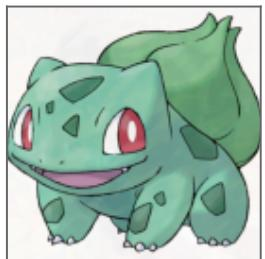

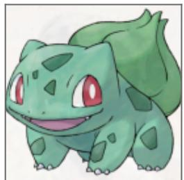

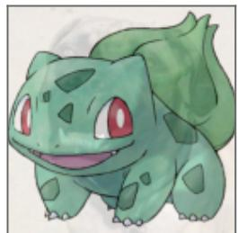

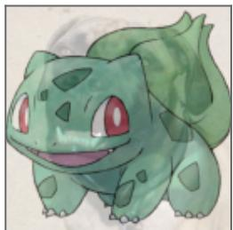  
SSIM = 0.995, β = 0.05 SSIM = 0.990, β = 0.08 SSIM = 0.950, β = 0.22 SSIM = 0.900, β = 0.34

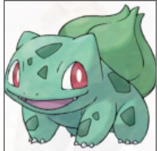

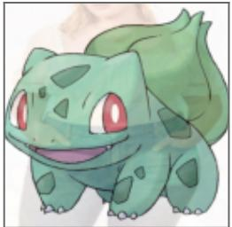

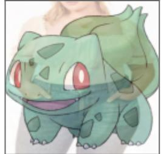

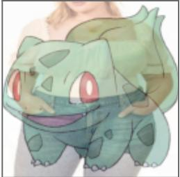

stimat (c) Shared-structure

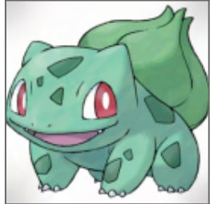

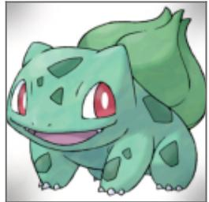

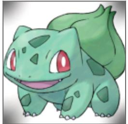

β=1 replacement (d) Full donor

  
ca = 0.15

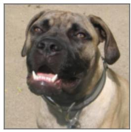

emov low-frequency removal ) Direc

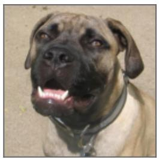

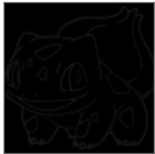  
ca = 0.05

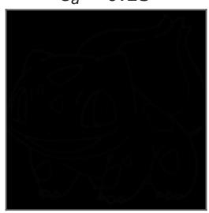  
ca = 0.15

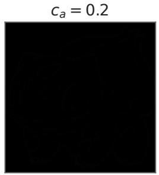  
ca = 0.2

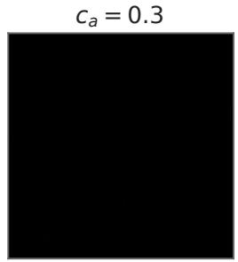  
ca = 0.3

Figure 14. Visualization of adaptive spectral sanitization setings. (a) Fixed donor quality-constrained replacement, (b) Per-image donor quality constrained replacement, (c) Shared-structure estimate, (d) Full donor replacement, (e) Direct lowfrequency removal. Stronger sanitization suppresses more of the protection signal but increasingly alters original-image content.

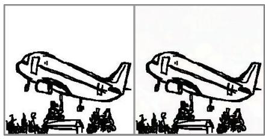  
Original Image Protected Image

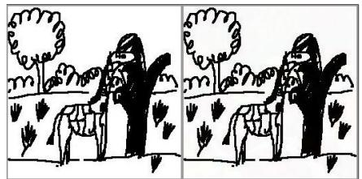  
Original Image Protected Image  
Original Image Protected Image

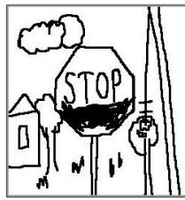

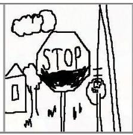

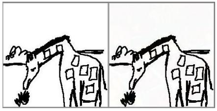

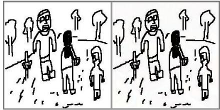

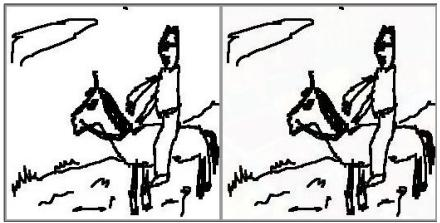

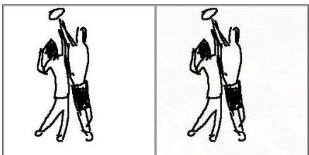

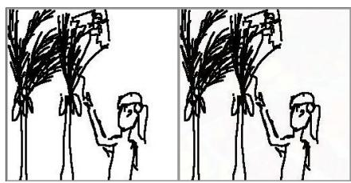  
Figure 15. Visualization on Sketch-Scene. Paired visualization of original image and protected image by Spectral-Canary

## Original Image Protected Image

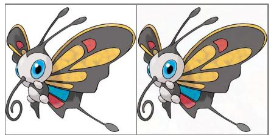

Original Image Protected Image

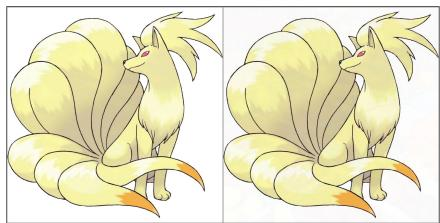

## Original Image Protected Image

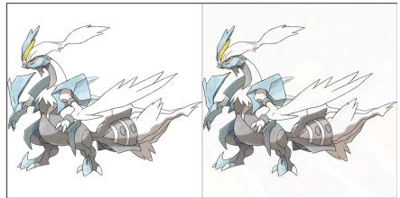

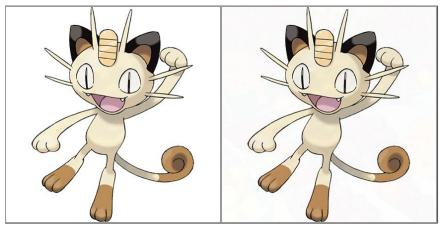

  
Figure 16. Visualization on Pokemon. Paired visualization of original image and protected image by SpectralCanary.

Original Image  
Protected Image  
Original Image  
Protected Image  
  
Original Image  
Protected Image  
Figure 17. Visualization on ROCOv2. Paired visualization of original image and protected image by SpectralCanary.

## Original Image Protected Image

Original Image Protected Image  

Original Image Protected Image  

  
Figure 18. Visualization on RSICD. Paired visualization of original image and protected image by SpectralCanary.

Original Image

Protected Image

Original Image

Protected Image

Original Image

Protected Image

Original Image

Protected Image

  
Figure 19. Visualization on FACAD. Paired visualization of original image and protected image by SpectralCanary.

## (a) Injected Samples

## (b) Protected Samples

  
a drawing of a cartoon character holding two green balls

  
Figure 20. EnTruth’s injected samples are visually distinct from the protected samples. The injected samples share a repeated framed template and fruit foreground, while representative Pokemon samples exhibit the diverse character appearance of the protected dataset.

  
a cartoon character flying through the air

Table 8. Comparison between adapted Silent Branding and SpectralCanary across transformation setings. We follow the presentation of Tab. 2 on Pokemon with SD1.5 and SD3.5. We report mean and standard deviation across three runs; the best result within each seting is bolded.
<table><tr><td>Transformation</td><td>Model</td><td>Method</td><td>AUC (%) ↑</td><td>TPR@5% FPR (%) ↑</td><td>TPR@1% FPR (%) ↑</td></tr><tr><td rowspan="3">None</td><td rowspan="2">SD1.5</td><td>Silent Branding</td><td> $8 5 . 1 \pm 5 . 1$ </td><td> $4 4 . 8 \pm 1 5 . 3$ </td><td> $1 9 . 2 \pm 6 . 0$ </td></tr><tr><td>SpectralCanary</td><td> ${ \bf 9 9 . 7 \pm 0 . 1 }$ </td><td> ${ \bf 9 8 . 8 \pm 0 . 4 }$ </td><td> ${ \bf 9 7 . 7 \pm 0 . 5 }$ </td></tr><tr><td rowspan="2">SD3.5</td><td>Silent Branding</td><td> $7 8 . 9 \pm 1 . 6$ </td><td> $2 4 . 2 \pm 5 . 9$ </td><td> $1 0 . 6 \pm 6 . 3$ </td></tr><tr><td></td><td>SpectralCanary</td><td> ${ \bf 1 0 0 \pm 0 . 0 }$ </td><td> ${ \bf 1 0 0 \pm 0 . 0 }$ </td><td> ${ \bf 1 0 0 \pm 0 . 0 }$ </td></tr><tr><td rowspan="2">Training-Time Augmentation</td><td rowspan="2">SD1.5</td><td>Silent Branding SpectralCanary</td><td> $8 5 . 2 \pm 2 . 5$   ${ \pm } 4 . 9 \pm 1 . 5$ </td><td> $4 5 . 1 \pm 3 . 4$   ${ \bf 8 5 . 5 \pm 7 . 8 }$ </td><td> $2 3 . 2 \pm 6 . 7$   ${ \bf 7 9 . 2 \pm 1 2 . 3 }$ </td></tr><tr><td>Silent Branding</td><td> $8 0 . 5 \pm 2 . 1 $ </td><td> $3 1 . 7 \pm 2 . 0$ </td><td> $1 0 . 4 \pm 2 . 1$ </td></tr><tr><td rowspan="4">Prompt Recaptioning</td><td rowspan="2">SD3.5 SD1.5</td><td>SpectralCanary</td><td> ${ \bf 9 1 . 3 \pm 8 . 9 }$ </td><td> $7 6 . 6 \pm 2 0 . 4$ </td><td> ${ \bf 6 5 . 9 \pm 2 2 . 4 }$ </td></tr><tr><td>Silent Branding</td><td> $8 8 . 0 \pm 1 . 9$ </td><td> $4 1 . 9 \pm 8 . 1$ </td><td> $1 6 . 8 \pm 6 . 0$ </td></tr><tr><td rowspan="2">SD3.5</td><td>SpectralCanary</td><td> ${ \bf 9 9 . 2 \pm 0 . 2 }$ </td><td> ${ \bf 9 6 . 0 \pm 0 . 4 }$ </td><td> ${ \bf 9 3 . 6 \pm 1 . 6 }$ </td></tr><tr><td>Silent Branding</td><td> $7 1 . 5 \pm 1 . 1$ </td><td> $1 6 . 8 \pm 1 . 7$ </td><td> $3 . 9 \pm 1 . 0$ </td></tr><tr><td rowspan="4">Image Regeneration</td><td rowspan="2">SD1.5</td><td>SpectralCanary</td><td> ${ \bf 1 0 0 \pm 0 . 0 }$ </td><td> ${ \bf 1 0 0 \pm 0 . 0 }$ </td><td> ${ \bf 1 0 0 \pm 0 . 0 }$ </td></tr><tr><td>Silent Branding</td><td> $8 4 . 9 \pm 2 . 6 $ </td><td> $3 7 . 3 \pm 5 . 5$ </td><td> $1 4 . 0 \pm 2 . 5$ </td></tr><tr><td rowspan="2"></td><td>SpectralCanary</td><td> ${ \bf 9 9 . 2 \pm 0 . 3 }$ </td><td> ${ \bf 9 5 . 3 \pm 1 . 0 }$ </td><td> ${ \bf 9 2 . 5 \pm 1 . 2 }$ </td></tr><tr><td>Silent Branding</td><td> $7 3 . 4 \pm 0 . 6$ </td><td> $1 8 . 5 \pm 1 . 2$ </td><td> $4 . 4 \pm 2 . 3$ </td></tr><tr><td></td><td>SD3.5</td><td>SpectralCanary</td><td> ${ \bf 1 0 0 \pm 0 . 0 }$ </td><td> ${ \bf 1 0 0 \pm 0 . 0 }$ </td><td> ${ \bf 1 0 0 \pm 0 . 0 }$ </td></tr><tr><td rowspan="2"></td><td rowspan="2"></td><td></td><td>Average over all settings</td><td></td><td></td></tr><tr><td>Silent Branding SpectralCanary</td><td>80.9 98.0</td><td>32.5 94.0</td><td>12.8 91.1</td></tr></table>

Table 9. Comparison of T2I data-poisoning and proactive dataset-use auditing methods. We consider methods that modify only the released training data and assume a standard training or fine-tuning pipeline. Content-preserving indicates that the modification does not intentionally alter the image’s original semantic content.
<table><tr><td>Method</td><td>Venue</td><td>Goal</td><td>Image modification</td><td>Caption modification</td></tr><tr><td>Nightshade</td><td>IEEE S&amp;P 2024</td><td>Disrupt T2I concepts</td><td>Content-preserving adversarial perturbation</td><td>None</td></tr><tr><td>SilentBadDiffusion ICML 2024</td><td></td><td>Induce copyright Semantic elements reproduction</td><td>inserted into synthetic images</td><td>Element-specific phrases</td></tr><tr><td>Bilateral Data Poisoning Silent Branding</td><td>NeurIPS 2024 CVPR 2025</td><td>Corrupt T2I generation</td><td>Adversarial image modification</td><td>Poisoned captions None</td></tr><tr><td></td><td></td><td>Inject persistent visual branding</td><td>Semantic elements inserted into protected samples</td><td></td></tr><tr><td>DIAGNOSIS</td><td>ICLR 2024</td><td>Dataset-use auditing</td><td>Content-preserving image warping</td><td>Rare trigger token added</td></tr><tr><td>SIREN</td><td>IEEE S&amp;P 2025</td><td>Dataset-use auditing</td><td>Content-preserving perturbation</td><td>None</td></tr><tr><td>EnTruth</td><td>NeurIPS 2025 GenProCC</td><td>Dataset-use auditing</td><td>Semantically distinct samples injected</td><td>Trigger captions introduced</td></tr><tr><td>SpectralCanary</td><td>一</td><td>Dataset-use auditing</td><td>Content-preserving spectral hybridization</td><td>None</td></tr></table>