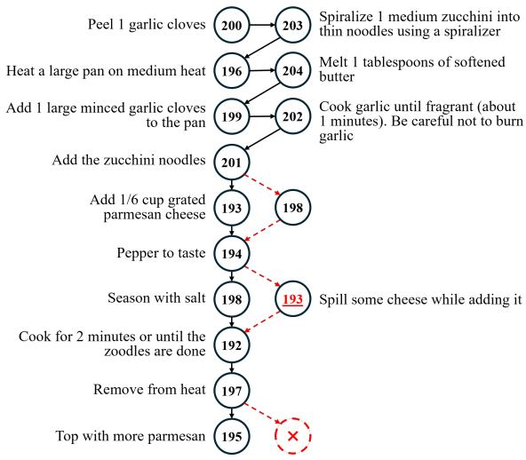
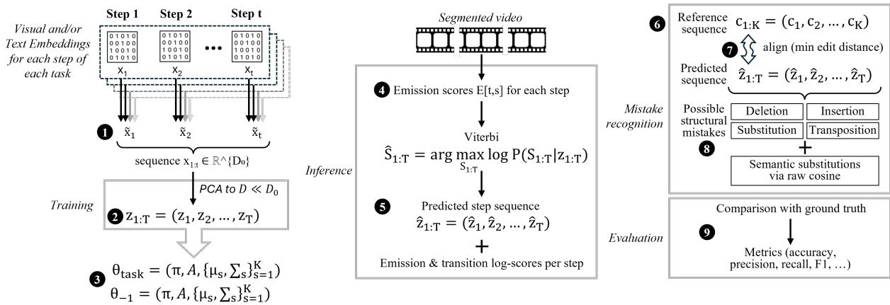

# Through a PRISM, Clearly: Step-Sequence Reasoning for Mistake Recognition in Procedural Videos

Olga Loginova   
University of Trento   
Trento, Italy   
olga.loginova@unitn.it

Oleksandr Bezrukov Gran Sasso Science Institute L’Aquila, Italy oleksandr.bezrukov@gssi.it

Frank Keller University of Edinburgh Edinburgh, United Kingdom keller@inf.ed.ac.uk

## Abstract

Procedural mistake recognition requires identifying deviations from valid multi-step activities. We study post-completion recognition from videos with benchmark-provided step bound aries. We introduce PRISM (Procedural mistake Recognition via Interpretable Semantic Modeling), which grounds video segments in language and maps their descriptions to procedural states using a lightweight hidden Markov model trained on correct executions. Reference alignment and semantic checks identify errors in step content and order. To support evaluation across heterogeneous benchmarks, we map dataset-specific annotations to four edit-based error types: insertion, deletion, substitution, and transposition. Across three benchmarks, we compare gold and VLM-generated descriptions in raw, semantic-role, and action–object forms. Decoder controls show consistent gains from the trained local decoder over nearestcandidate matching, with additional, datasetdependent benefits from sequence decoding. Semantic role labeling improves Any-F1 in all six matched grounded comparisons, although the gains vary across datasets and do not translate into uniform improvements under separate configuration selection. These results establish language grounding as an effective interface for explicit procedural mistake reasoning and characterize the contributions of representation and decoding.

## 1 Introduction

A visually flawless plate of zoodles reaches the table, only for the first bite to reveal overboiled vegetables. The procedure appears finished before the failure becomes clear.

Some procedural errors become apparent only after task completion (Byrne and Davis, 2006; Reason, 2000). For AI systems monitoring or assisting human activity, the key question is retrospective: given the full video of an apparently completed task and a reference procedure, did the execution succeed, and if not, where did it go wrong? We focus on post-completion mistake recognition, which identifies errors from the complete recorded execution. This setting matters for troubleshooting, quality assurance, training, and human–AI assistance in real procedural environments (Norman, 2002; Garfield and Franklin, 2016).

Despite progress in temporal action segmentation and recognition (Ding et al., 2023b; Ding and Wang, 2025; Lai et al., 2024), procedural mistake detection remains underexplored (Mazzamuto et al., 2025; Bacharidis and Argyros, 2025). Existing approaches are fragmented: they are often vision-first and use different error labels, annotation units, and evaluation protocols (Peddi et al., 2024; Haneji et al., 2025; Lee and Elhamifar, 2025). Recent work on procedural error taxonomies also highlights the need for shared categories across datasets (Loginova and Keller, 2026). These differences complicate comparisons across datasets and obscure the contributions of grounding, representation, and procedural reasoning.

Following the procedural video taxonomy of Bacharidis and Argyros (2025), we distinguish temporal localization from logical error identification after action completion. Temporal segmentation and action recognition determine what happened and when. We study the subsequent reasoning problem: given step-level evidence and a reference procedure, does the completed execution deviate from the protocol, and where?

We evaluate this reasoning problem on EgoPER (Lee et al., 2024), CaptainCook4D (Peddi et al., 2024), and EgoOops (Haneji et al., 2025). Related systems include EgoPED (Lee et al., 2024),

  
Figure 1: PRISM representation of the valid Zoodles procedure and an erroneous execution from Captain-Cook4D. Circles contain Step IDs, adjacent text gives step descriptions, and solid arrows trace the reference order. Red marks show a transposition of Steps 193, 194, and 198, a substitution at Step 193, and the deletion of Step 195.

AMNAR (Huang et al., 2025), and AEM (Guo et al., 2026). Their temporal input and evaluation protocols are discussed in Section 4. We model this reasoning problem over discrete step semantics: procedural errors depend on what step was performed, with which arguments, and in what order.

This view motivates our language-grounded framework, because these constructs are naturally expressed in language. We propose a video → language → reasoning pipeline.

Like an optical prism refracting raw light into its constituent colors, our PRISM (Procedural mistake Recognition via Interpretable Semantic Modeling) makes procedural structure explicit through steps, semantic roles, and their order.1 Benchmarkprovided segment boundaries isolate mistake recognition from temporal segmentation. For each segment, a vision-language model (VLM) receives the clip and the task’s candidate descriptions as context, then generates a free-form step description. PRISM encodes this description as raw text or as a semantic role representation produced through semantic role labeling (SRL). A hidden Markov model (HMM) maps the representation to a task-local step identifier (Step ID). Edit alignment identifies deviations from a valid reference sequence. We reconcile the benchmark-specific annotation schemes through a common taxonomy of four edit operations: insertion, deletion, substitution, and transposition. Figure 1 contrasts a valid procedure with an erroneous execution under this taxonomy. Circles denote HMM states labeled by Step IDs. The adjacent step descriptions are encoded as observations, and the ordered state sequence represents the procedure.

Our contributions are:

• PRISM, a language-grounded framework that combines a lightweight HMM trained on correct executions with reference alignment and semantic checks to identify procedural mistakes.

• Cross-benchmark error analysis through a shared edit representation of procedural deviations.

• A controlled study of step representations and decoding, comparing gold and VLMgenerated descriptions, matched Raw–SRL configurations, action–object abstractions, and independent versus transition-aware inference.

## 2 Related work

Mistake-aware procedural video benchmarks. Despite progress in procedural video understanding, only a small subset of benchmarks explicitly annotates mistakes. Current benchmarks span cooking (Peddi et al., 2024; Lee et al., 2024), assembly (Sener et al., 2022; Schoonbeek et al., 2023; Jang et al., 2019; Wang et al., 2023b), laboratory tasks (Qian et al., 2022), and mixed scenarios (Haneji et al., 2025) but suffer from heterogeneous error definitions, annotation levels (video vs. step), and description styles (free-form vs. labels). Loginova and Keller (2026) similarly argue that procedural video datasets need shared categories for mistakes and corrections across tasks and domains. Our experiments span CaptainCook4D, EgoPER, and EgoOops: CaptainCook4D contains 384 videos across 24 cooking tasks; EgoPER concentrates 386 videos in five cooking tasks; and EgoOops adds 50 videos from five mixed-domain procedures. This combination tests VLM grounding and PRISM under broad task coverage, dense repetition within tasks, and limited data outside cooking.

Mistake recognition in procedural videos. Prior approaches are predominantly vision-centric, modeling deviations from video features via recognition, anticipation, action-effect modeling, or structured prediction (Lee et al., 2024; Peddi et al., 2024; Lee and Elhamifar, 2025; Mazzamuto et al., 2025; Huang et al., 2025; Guo et al., 2026). Recent work also explores interpretability in error reasoning (Storks et al., 2025). Some work focuses on online detection and intervention forecasting using modified datasets (Flaborea et al., 2024; Plini et al., 2024; Wang et al., 2023b; Seminara et al., 2025). We target post-completion recognition, similarly to Huang et al. (2025); Narasimhan et al. (2023); Moriwaki et al. (2022); Ding et al. (2023a); Haneji et al. (2025); Li et al. (2025). We perform core reasoning in the language space by grounding video executions into textual step sequences.

Semantic roles and structured step representations. Semantic role labeling provides a structured interface for events through predicate– argument structures (Baker et al., 1998; Gildea and Jurafsky, 2002; Palmer et al., 2005; Chen et al., 2025). In multimodal settings, semantic structure supports video understanding (Sadhu et al., 2021), procedural instruction tracking (Batra et al., 2025), and fine-grained mistake attribution (Li et al., 2025).

We use SRLs as an intermediate normalization layer to bridge free-form step text and mistake reasoning.

## 3 Methodology

Figure 2 summarizes PRISM. Intuitively, our HMM captures two complementary aspects of a correct procedure: what a valid step looks like (emission) and how steps logically progress (transition), learning both exclusively from successful executions.

Each task provides candidate step descriptions, valid reference sequences, and correct training executions. Candidate steps define the task-local state inventory. We encode each segment using the representations in Section 3.4 and estimate HMM parameters from correct executions. At inference, the HMM decodes the executed step sequence. Reference alignment identifies structural edits, while emission, transition, and semantic similarity scores identify atypical observations and transitions. Appendix D reports the configuration-specific settings.

The grounding interface, SRL schema, textencoding stage, HMM estimator and decoder, and edit-alignment procedure remain unchanged across tasks. Each procedure supplies its task-local candidate inventory and reference sequences, while its HMM parameters are estimated from correct executions.

## 3.1 HMM training

Each video is represented as a sequence of presegmented step clips. Section 3.4 defines the textual, SRL, action–object, visual, and multimodal representations used for each clip. For a video with $T$ clips, let

$$
\pmb { x } _ { 1 : T } = ( \pmb { x } _ { 1 } , \ldots , \pmb { x } _ { T } ) , \qquad \pmb { x } _ { t } \in \mathbb { R } ^ { D _ { 0 } } .
$$

When specified by the configuration, we L2- normalize the embeddings and add Gaussian jitter to a random subset of training embeddings. We fit principal component analysis (PCA) on the training embeddings and obtain

$$
\pmb { z } _ { t } = \mathrm { P C A } ( \pmb { x } _ { t } ) \in \mathbb { R } ^ { D } .
$$

For task a, the hidden-state set $\begin{array} { r l } { S _ { a } } & { { } = } \end{array}$ $\{ 1 , \ldots , K _ { a } \}$ contains its Step IDs. The projected embeddings $z _ { 1 : T }$ are the observations. The model parameters are

$$
\theta _ { a } = ( \pi , A , \{ \phi _ { s } \} _ { s \in { \cal S } _ { a } } ) ,
$$

where π is the initial-state distribution, A is the transition matrix, and $\phi _ { s }$ contains the emission parameters for state s. For Gaussian emissions, $\phi _ { s } = ( \mu _ { s } , \Sigma _ { s } )$ . We estimate $\pmb { \mu } _ { s }$ from the state observations and $\Sigma _ { s }$ with Ledoit–Wolf shrinkage. For cosine emissions, $\pmb { \mu } _ { s }$ serves as the state prototype.

For the transition model, let $c _ { s s ^ { \prime } }$ denote the number of times the transition $s  s ^ { \prime }$ is observed in the training set. We then apply Laplace smoothing with parameter $\beta \colon$

$$
A _ { s s ^ { \prime } } = \frac { c _ { s s ^ { \prime } } + \beta } { \sum _ { k = 1 } ^ { K _ { a } } ( c _ { s k } + \beta ) } .\tag{1}
$$

After Laplace smoothing, we apply local transition constraints based on the valid reference sequences by suppressing out-of-band transitions and renormalizing each row. We estimate the initial state distribution in the same way. Let $m _ { s }$ be the number of correct training videos whose first step is s. We then define $\begin{array} { r } { \pi _ { s } = \frac { m _ { s } + \beta } { \sum _ { j = 1 } ^ { K _ { a } } \left( m _ { j } + \beta \right) } } \end{array}$ . Thus, both the start distribution and the transition matrix are smoothed empirical estimates from correct executions.

  
Figure 2: The PRISM pipeline for post-completion mistake recognition. (1) For each step of each training video, we obtain a textual, visual, or multimodal encoding, $\pmb { x } _ { t } . \left( 2 \right)$ After PCA regularization, we obtain the representation of each step, $z _ { t } . \left( 3 \right)$ During training, the model $\theta _ { \mathrm { t a s k } }$ learns from sequences of ${ \boldsymbol { z } } _ { t }$ for each task. Additionally, when we put all tasks together, we obtain a global HMM $\theta _ { - 1 }$ . (4) At inference time, we obtain embeddings for each video segment in the same way as during training and compute the emissions $[ \pmb { E } ] _ { t , s } . ( 5 )$ We then run Viterbi for sequence inference and keep the emission and transition scores for each step. (6) For each task, we also have a set of possible non-erroneous sequences. (7) We align the predicted sequence to the reference sequence using the selected sequence-alignment method. (8) Mismatches in the alignment indicate possible structural errors. Falling below the predefined thresholds for emission and transition scores indicates possible low-probability events. (9) During evaluation, we compare the predicted errors with the gold-standard error annotations of the dataset.

During training we record calibration statistics (mean, quantiles) of emission log-likelihoods and transition log-probabilities on correct videos. Let $\delta _ { t , s } = z _ { t } - \mu _ { s }$ . The log emission likelihood is

$$
\begin{array} { l } { \log p ( \boldsymbol { z } _ { t } \mid S _ { t } = s ) = - \displaystyle \frac { 1 } { 2 } \Big [ \delta _ { t , s } ^ { \top } \Sigma _ { s } ^ { - 1 } \delta _ { t , s } } \\ { \qquad + \log \left| \Sigma _ { s } \right| + D \log ( 2 \pi ) \Big ] . } \end{array}\tag{2}
$$

These standard log-likelihood statistics are stored for analysis and threshold tuning.

The term $\log | \Sigma _ { s } |$ penalizes the volume of the Gaussian, and $D \log ( 2 \pi )$ is the normalization constant ensuring that the Gaussian density integrates to 1.

## 3.2 HMM inference

At test time, the model extracts, normalizes, and projects step-level features $\mathbf { \Delta } \mathbf { x } _ { t }$ into ${ \boldsymbol { z } } _ { t }$ identically to training.

We then compute an emission score matrix $\pmb { { \cal E } } \in$ $\mathbb { R } ^ { T \times K }$ , where $E _ { t , k }$ is the emission score assigned to observation $z _ { t }$ under state k. For Gaussian emissions, we compute $E _ { t , k } = \log \mathcal { N } ( \boldsymbol { z } _ { t } ; \boldsymbol { \mu } _ { k } , \boldsymbol { \Sigma } _ { k } )$

We also evaluate cosine-based emissions for normalized embeddings. In that case, $\begin{array} { r l } { E _ { t , k } } & { { } = } \end{array}$ $T _ { \mathrm { c o s } } \cos ( z _ { t } , \mu _ { k } )$ , where $T _ { \mathrm { { c o s } } } > 0$ is a temperature parameter.

This cosine form matches the geometry of embedding spaces trained or commonly used with angular similarity, and can be interpreted as an unnormalized state score. We L2-normalize vectors before cosine to obtain a bounded, temperaturescaled score.

We also support a global emission scaling factor $\alpha ,$ so that $[ \tilde { E } ] _ { t , k } = \alpha [ E ] _ { t , k }$ . This adjusts the relative weight between emission and transition terms in the Viterbi objective.

We then use the Viterbi algorithm (Viterbi, 1967) to decode the highest-scoring step sequence $\hat { S } _ { 1 : T } =$ arg $\begin{array} { r } { \operatorname* { m a x } _ { S _ { 1 : T } } \mathrm { S c o r e } ( S _ { 1 : T } , z _ { 1 : T } ) } \end{array}$ . The path score is

$$
\begin{array} { l } { { \displaystyle \mathrm { S c o r e } ( S _ { 1 : T } , z _ { 1 : T } ) = \log \pi _ { S _ { 1 } } + \sum _ { t = 2 } ^ { T } \log A _ { S _ { t - 1 } , S _ { t } } } } \\ { { \displaystyle ~ + \sum _ { t = 1 } ^ { T } \tilde { E } _ { t , S _ { t } } . } } \end{array}\tag{3}
$$

For Gaussian emissions, this reduces to a sum of start, transition, and emission log-likelihood terms.

After predicting the sequence, we record for each time step t the emission score $\ell _ { t } ^ { \mathrm { e m } } = \tilde { E } _ { t , \hat { S } _ { t } }$ and for each step $t \ > \ 1$ the transition score $\ell _ { t } ^ { \mathrm { t r } } = \log A _ { \hat { S } _ { t - 1 } , \hat { S } _ { t } }$ . We refer to these as the HMM scores along the Viterbi path.

## 3.3 Step alignment and mistake recognition

Each procedure, regardless of its specific execution in the dataset, has one or more valid correct step sequences. This is an abstract representation of the different ways to successfully complete the task. The pool of such reference sequences is formed either from the corresponding written instructions provided by annotation guidelines or from errorfree videos. Let a reference sequence for a given procedure be $\pmb { r } _ { 1 : L } = ( r _ { 1 } , \ldots , r _ { L } )$ , where each $r _ { \ell }$ is a step ID and $L$ is the length of that reference sequence.

Next we compare the sequence predicted by the algorithm $\hat { S } _ { 1 : T }$ with one of the reference sequences, namely, the closest reference variant under the selected alignment method. We align the predicted sequence to the chosen reference sequence using global sequence alignment.2 This alignment identifies structural errors: insertions (extra steps), deletions (missing steps), transpositions (wrong order of correct steps)3, and substitutions (mismatched steps at an aligned position).

In addition to structural errors, we use the Viterbi-path scores directly. Low values of $\ell _ { t } ^ { \mathrm { { e m } } }$ indicate atypical observations under the assigned state, and low values of $\ell _ { t } ^ { \mathrm { t r } }$ indicate atypical state transitions. Given the configuration-specific thresholds $\tau _ { \mathrm { e m } }$ and $\tau _ { \mathrm { t r } } ,$ reported in Appendix D, we flag a LowProbEmission if $\ell _ { t } ^ { \mathrm { e m } } < \tau _ { \mathrm { e m } }$ , and for $t > 1$ a LowProbTransition if $\ell _ { t } ^ { \mathrm { t r } } < \tau _ { \mathrm { t r } }$ . These two classes provide score-based diagnostics that complement the edit labels: LowProbEmission flags an observation that is unlikely under its decoded step state, while LowProbTransition flags an unlikely adjacent step transition in the decoded path. They can overlap with edit-based errors, but they also identify low-confidence or locally implausible events that are not cleanly summarized by a single insertion, deletion, substitution, or transposition4.

Structural alignment cannot expose an altered execution when the predicted and reference steps share the same Step ID. In this case, we compute the cosine similarity between the observation and the mean embedding of its assigned state. A similarity below $\tau _ { \mathrm { s e m } } = 0 . 8 5$ produces a semantic Substitution. This rule captures changes in quantities, tools, destinations, and other arguments hidden by a shared Step ID.

## 3.4 Language grounding and step representations

We use language as the interface between video and procedural reasoning. We call benchmark-provided or benchmark-derived step descriptions gold text and VLM-generated descriptions grounded text. Gold-text runs bypass video grounding and do not use video. Grounded runs use descriptions generated by a VLM. The HMM decodes the resulting embedding sequence into task-local Step IDs.

Gold step text. We start from the canonical step descriptions provided by each benchmark. For erroneous steps, we use the benchmark-specific observed or modified step descriptions when they are available. When a benchmark provides only a short error cue instead of a full observed step, we convert it into a complete modified description by combining the canonical step text with the error cue. We also apply minimal text cleanup to remove benchmark-specific artifacts that do not carry procedural meaning. Appendix A gives representative dataset-specific examples.

The resulting representation keeps the lexical detail of the original annotation, including quantities, destinations, surfaces, and local modifiers. That detail matters because many procedural mistakes differ from the canonical step in terms of the arguments, not only in terms of the main verb.

Semantic role representations. We convert each step description into a predicate–argument form that makes its action, participants, and attributes explicit. We use the form PREDICATE(Role: value, Role: value, . . . ). For example, PEEL(Agent: you, Object: onion(Size: medium, Quantity: 1)). SRL representations preserve distinctions in object identity, quantity, destination, surface, and manner while reducing variation in surface form. These arguments often determine whether a step is correct. This structure is useful for CaptainCook4D, where near-duplicate steps can have different descriptions or $\mathrm { I D s } , { ^ { 5 } }$ and for EgoOops, where long step descriptions are paired with short error cues.

We construct SRL representations with both a proprietary model, GPT-5.3 (OpenAI, 2025), and an open-weight model, Qwen3.6-27B (Qwen Team, 2026b). The two generators follow the same constrained predicate–argument format. We treat their outputs as two alternative SRL variants and compare how differences in role labeling and event decomposition affect downstream performance. Appendix C gives additional SRL details, including the prompt and generation settings for each model and systematic differences with examples.

Action–object representations. We also derive an action–object abstraction that retains the main predicate and a flat set of salient entities, including tools and contacted objects. It removes quantities, attributes, manner, and the semantic relations that distinguish roles such as Destination and Surface. This is used as an ablation to test how much procedural detail can be removed before mistake recognition drops.

Video-to-text grounding with VLMs. For each segment, the VLM receives the clip and the candidate descriptions for its task. The candidates provide task-specific closedset guidance. The VLM returns a structured output containing predicted\_description, action\_name, and objects. Raw-text runs encode predicted\_description directly. The action–object ablation uses the two auxiliary fields. Grounded SRL runs retrieve a cached representation keyed only by the normalized predicted\_description. Annotated Step IDs, canonical descriptions, and modified descriptions do not enter this lookup.

## 4 Experiments and results

Benchmarks and protocol. We adopt a common post-completion protocol across Captain-Cook4D (Peddi et al., 2024), EgoPER (Lee et al., 2024), and EgoOops (Haneji et al., 2025): the input is a fully observed, step-segmented procedural video, and the model must recover the executed step sequence and detect deviations from a valid reference procedure. We follow the text augmentation and cleanup protocol described in Section 3.4.

For CaptainCook4D and EgoPER, we use the benchmark-provided train, validation, and test splits and train each HMM on correct training videos. For Table 1, we select one complete configuration within each representation family by validation Any-F1; Type-F1, AUC, and Seq break ties in that order. Test data are used only for final reporting. Decision thresholds are fixed before test evaluation and reported in Appendix D. EgoOops has no official validation split. We train its HMMs on all 21 correct videos. For each representation family, we transfer the complete configuration with the highest mean validation Any-F1 across CaptainCook4D and EgoPER; Type-F1, AUC, and Seq again break ties. EgoOops error-video labels are not used for selection. The matched representation and decoder studies use the configurations reported in Table 15.

Under this step-level class imbalance (20.8%– 39.2% errors across datasets), accuracy can obscure poor error recall. We prioritize F1 and AUC metrics.

Models and representations. For visual step embeddings, we use frozen VideoMAE-v2 (Wang et al., 2023a) and V-JEPA 2 (Assran et al., 2025) backbones. For text, we sweep frozen CLIP (Radford et al., 2021), all-MiniLM (Wang et al., 2020), all-MPNet (Song et al., 2020), SimCSE (Gao et al., 2021), Instructor-XL (Su et al., 2023), and OpenAI text-embedding-3-large (OpenAI, 2024). For video-to-text grounding, we compare Gemini 3 Flash (Doshi and the Gemini Team, 2025) and Qwen 3.5-27B (Qwen Team, 2026a). For Qwen + GPT-SRL and Gemini + GPT-SRL, we first generate grounded step descriptions with the VLM and then convert these generated descriptions into SRL representations6 before text encoding and HMM inference. On the language side, we evaluate step text, semantic role representations, and action–object abstractions.

Metrics. We report four main metrics for the unified post-completion task. Any-F1 is our primary metric. It treats a segment as erroneous if it carries any of the four edit-based labels: Insertion, Deletion, Substitution, or Transposition. Type-F1 requires both the error location and its edit-based type to match the gold annotation. Seq (Sequence accuracy) aligns the decoded and annotated executed Step-ID sequences with Needleman–Wunsch and reports the number of identical non-gap pairs divided by the number of evaluated segments. AUC uses the negative emission score as a continuous anomaly score and measures threshold-free discrimination over observed segments. A gold Deletion is represented by an annotated position without an observed clip; it contributes to Any-F1 and Type-F1 but has no emission score and is excluded from AUC.

<table><tr><td></td><td colspan="4">EgoOops</td><td colspan="3">EgoPER</td><td colspan="4">CC4D</td></tr><tr><td>Family</td><td>Seq</td><td>Any-F1 Type-F1 AUC</td><td></td><td></td><td>Seq</td><td></td><td>Any-F1 Type-F1 AUC</td><td>Seq</td><td>Any-F1 Type-F1 AUC</td><td></td><td></td></tr><tr><td>Gold text</td><td>0.713</td><td>0.480</td><td>0.446</td><td>0.756 0.903</td><td>0.741</td><td>0.673</td><td></td><td>0.918 0.617</td><td>0.631</td><td>0.466</td><td>0.761</td></tr><tr><td>Vision</td><td>0.328</td><td>0.454</td><td>0.439</td><td>0.523 0.372</td><td>0.519</td><td>0.527</td><td></td><td>0.580 0.159</td><td>0.556</td><td>0.464</td><td>0.478</td></tr><tr><td>Gold + GPT-SRL</td><td>0.742</td><td>0.510</td><td>0.533</td><td>0.775 0.913</td><td>0.736</td><td></td><td>0.675</td><td>0.908 0.638</td><td>0.629</td><td>0.495</td><td>0.757</td></tr><tr><td>Qwen text</td><td>0.493</td><td>0.441</td><td>0.451</td><td>0.564 0.802</td><td>0.607</td><td></td><td>0.599</td><td>0.736 0.517</td><td>0.603</td><td>0.498</td><td>0.640</td></tr><tr><td>Qwen + GPT-SRL</td><td>0.499</td><td>0.409</td><td>0.407</td><td>0.623 0.816</td><td>0.601</td><td></td><td>0.594</td><td>0.742 0.485</td><td>0.592</td><td>0.505</td><td>0.648</td></tr><tr><td>Gemini text</td><td>0.557</td><td>0.408</td><td>0.361</td><td>0.610 0.845</td><td>0.642</td><td></td><td>0.589</td><td>0.748 0.577</td><td>0.603</td><td>0.516</td><td>0.656</td></tr><tr><td>Gemini + GPT-SRL 0.560</td><td></td><td>0.353</td><td>0.314</td><td>0.611 0.854</td><td>0.631</td><td></td><td>0.595</td><td>0.749 0.554</td><td>0.595</td><td>0.513</td><td>0.669</td></tr></table>

Table 1: Family-level leaderboard. Each row reports all metrics from one complete configuration. Encoder and HMM settings may differ across rows. Seq denotes sequence accuracy, and CC4D denotes CaptainCook4D. Appendix E.1 lists the corresponding configurations.
<table><tr><td></td><td colspan="4">Gold</td><td colspan="4">Qwen</td><td colspan="4">Gemini</td></tr><tr><td>Dataset</td><td>Raw</td><td>GPT-SRL</td><td>Δ</td><td>Act.+Obj.</td><td>Raw</td><td>GPT-SRL</td><td>Δ</td><td>Act.+Obj. |</td><td>Raw</td><td>GPT-SRL</td><td>Δ</td><td>Act.+Obj.</td></tr><tr><td>EgoOops</td><td>0.400</td><td>0.434</td><td>+0.034</td><td>0.318</td><td>0.321</td><td>0.356</td><td>+0.036</td><td>0.444</td><td>0.349</td><td>0.353</td><td>+0.003</td><td>0.414</td></tr><tr><td>EgoPER</td><td>0.681</td><td>0.725</td><td>+0.044</td><td>0.540</td><td>0.578</td><td>0.601</td><td>+0.024</td><td>0.550</td><td>0.602</td><td>0.631</td><td>+0.030</td><td>0.552</td></tr><tr><td>CaptainCook4D</td><td>0.629</td><td>0.629</td><td>+0.000</td><td>0.571</td><td>0.587</td><td>0.592</td><td>+0.005</td><td>0.566</td><td>0.595</td><td>0.596</td><td>+0.001</td><td>0.570</td></tr></table>

Table 2: Any-F1 by text source and representation. Each Raw–GPT-SRL pair uses identical downstream settings, and ∆ is GPT-SRL minus Raw. Act.+Obj. reports the best configuration within that representation family. Bold marks the highest score within each dataset–source group. Differences are computed before rounding.

For comparison with prior work, we report Error Detection Accuracy (EDA) and area under the ROC curve (AUC) on EgoPER and Captain-Cook4D and Precision only for CaptainCook4D, following the original EgoPED (Lee et al., 2024), AMNAR (Huang et al., 2025) and AEM (Guo et al., 2026) evaluation protocols. We use these metrics only to compare with prior work.

For Tables 1 and 4, all metrics within each row come from a single configuration. The family-level leaderboard uses the validation-based selection protocol described above. The matched Raw–SRL and decoder comparisons use fixed downstream configurations and perform no independent selection between conditions. For Table 4, we select one configuration per family using validation EDA and report all benchmark-specific test metrics from that configuration.

Family-level results. Table 1 compares representation families under the configuration-selection protocol described above. Gold-text families achieve the highest Any-F1 on each dataset. Grounded text-based variants outperform visual embeddings on EgoPER and CaptainCook4D, while vision performs better on EgoOops. This contrast highlights the importance of the available step descriptions. Within the separately selected grounded configurations, Raw achieves higher Any-F1 than SRL in all six pairs, although SRL improves Seq in four. Table 2 therefore examines representation changes under identical downstream settings.

Matched Raw–SRL comparison. Under identical downstream settings, GPT-SRL improves Any-F1 in all six grounded comparisons by 0.001–0.036. The largest gain occurs for Qwen on EgoOops. Gains on CaptainCook4D are small for both VLMs. Gold-description comparisons show improvements on EgoOops and EgoPER and a tie on Captain-Cook4D. Together with Table 1, these results indicate that the benefit of SRL depends on the downstream configuration and selection criterion. Paired video-level bootstrap intervals for the Any-F1 difference exclude zero in three of the six grounded comparisons (Appendix F.5).

GPT-SRL also exceeds the independently selected Act.+Obj. configurations in seven of nine dataset–source settings; both exceptions occur with grounded EgoOops descriptions. This comparison complements the matched Raw–SRL analysis by showing the performance of a coarser representation. Appendix F.3 reports effects by grounding stratum.

<table><tr><td rowspan="2">Dataset</td><td rowspan="2">VLM</td><td colspan="2">Nearest candidate</td><td colspan="2">Greedy emission</td><td colspan="2">Viterbi</td></tr><tr><td>Raw</td><td>SRL</td><td>Raw</td><td>SRL</td><td>Raw</td><td>SRL</td></tr><tr><td rowspan="2">EgoOops</td><td>Qwen</td><td>0.337</td><td>0.335</td><td>0.339</td><td>0.351</td><td>0.321</td><td>0.356</td></tr><tr><td>Gemini</td><td>0.305</td><td>0.315</td><td>0.339</td><td>0.328</td><td>0.349</td><td>0.353</td></tr><tr><td rowspan="2">EgoPER</td><td>Qwen</td><td>0.547</td><td>0.524</td><td>0.578</td><td>0.601</td><td>0.578</td><td>0.601</td></tr><tr><td>Gemini</td><td>0.571</td><td>0.557</td><td>0.602</td><td>0.631</td><td>0.602</td><td>0.631</td></tr><tr><td rowspan="2">CaptainCook4D</td><td>Qwen</td><td>0.567</td><td>0.559</td><td>0.581</td><td>0.578</td><td>0.587</td><td>0.592</td></tr><tr><td>Gemini</td><td>0.538</td><td>0.528</td><td>0.564</td><td>0.561</td><td>0.595</td><td>0.596</td></tr></table>

Table 3: Decoder controls under the matched Raw–SRL configurations. Nearest-candidate matching uses cosine similarity and no HMM. Greedy decoding uses learned emissions without start or transition probabilities. Viterb uses the complete HMM. Bold marks the highest Any-F1 within each dataset–VLM–representation condition.
<table><tr><td rowspan="2">Method</td><td colspan="2">EgoPER</td><td colspan="3">CaptainCook4D</td></tr><tr><td>EDA</td><td>AUC</td><td>Precision</td><td>EDA</td><td>AUC</td></tr><tr><td>AMNAR</td><td>0.644</td><td>0.685</td><td>0.668</td><td>0.723</td><td>0.602</td></tr><tr><td>AEM (pred. segments)</td><td>0.667</td><td>0.738</td><td>0.681</td><td>0.719</td><td>0.625</td></tr><tr><td>AEM (GT segments)</td><td>0.747</td><td>0.867</td><td></td><td></td><td></td></tr><tr><td>Ours (Qwen)</td><td>0.704</td><td>0.751</td><td>0.253</td><td>0.646</td><td>0.694</td></tr><tr><td>Ours (Qwen + GPT-SRL)</td><td>0.699</td><td>0.753</td><td>0.785</td><td>0.841</td><td>0.900</td></tr><tr><td>Ours (Gemini)</td><td>0.725</td><td>0.768</td><td>0.291</td><td>0.711</td><td>0.753</td></tr><tr><td>Ours (Gemini + GPT-SRL)</td><td>0.713</td><td>0.762</td><td>0.809</td><td>0.843</td><td>0.900</td></tr></table>

Score sources. AMNAR and AEM results come from their original papers (Huang et al., 2025; Guo et al., 2026). AEM (GT segments) is an inference-time ablation that replaces predicted segments with ground-truth segments.  
Table 4: System-level results under benchmark-specific protocols. PRISM uses benchmark-provided step boundaries. AEM results are shown for predicted and ground-truth (GT) segmentation. Baseline scores are taken from the original papers; all metrics in each PRISM row come from one configuration.

Decoder controls. Table 3 separates independent candidate matching, the trained local decoder, and sequence decoding. Greedy emission decoding improves Any-F1 over nearest-candidate matching in all twelve conditions. Adding Viterbi improves seven conditions, matches four, and reduces one; it exceeds nearest-candidate matching in eleven conditions overall. EgoPER’s reported Any-F1 is unchanged by transition-aware decoding. The only decrease relative to greedy decoding occurs for Qwen Raw on EgoOops, where transition estimation relies on 21 correct videos across five tasks. These results show consistent benefits from the trained local decoder and dataset-dependent benefits from sequence decoding.

Comparison with prior work. Table 4 contextualizes PRISM against published systems under their respective protocols. On CaptainCook4D, the SRL configurations obtain EDA of 0.841–0.843 and AUC of 0.900. On EgoPER, AEM with groundtruth segmentation achieves higher EDA and AUC than PRISM. Differences in segmentation and configuration selection matter when interpreting these system-level results. Tables 2 and 3 provide the controlled comparisons of representation and decoding within PRISM.

## 5 Conclusion

We introduced PRISM, a language-grounded framework for post-completion procedural mistake recognition that combines an HMM trained on correct executions with reference alignment and semantic checks. Across three benchmarks, the trained local decoder consistently improves over nearest-candidate matching, while sequence decoding provides additional, dataset-dependent gains. SRL improves Any-F1 in all six matched grounded comparisons, with benefits that depend on the dataset and downstream configuration. Our unified edit-based evaluation makes these effects comparable across benchmarks. Together, the results support language grounding as an effective interface for reasoning about procedural step content and order, making the underlying deviation explicit even when the failure appears only as a plate of overboiled zoodles.

## Limitations

Our evaluation assumes benchmark-provided step boundaries, task-specific candidate descriptions, and valid reference procedures. Gold-text experiments bypass video grounding, whereas grounded experiments depend on the VLM preserving errorrelevant details. The results therefore characterize mistake reasoning under these inputs. Deployment additionally requires reliable temporal segmentation and grounding, and adapting PRISM to a new procedure requires specifying its candidate steps and reference sequences and estimating its taskspecific parameters.

Although the SRL generator comparison between GPT-5.3 and Qwen3.6-27B suggests that the pipeline is stable across SRL generators, the method still assumes consistent role normalization. Inconsistent semantic parses can propagate into HMM reasoning.

Our four label classes capture structural sequence edits, but they do not exhaust the full granularity of procedural mistake semantics. They align with recent unified mistake-taxonomy efforts, but for compatibility with current benchmarks we collapse Correction into Insertion and Wrong Execution into Substitution. This choice supports crossdataset evaluation, at the cost of merging some semantically distinct cases. A natural next step is to refine the substitution class into full-step substitutions and role-level wrong executions, using SRL arguments to localize which part of a step changed and to support more fine-grained automated mistake attribution.

## Ethical considerations

This work uses existing benchmark datasets and does not involve new data collection, humansubject experiments, or deployment in real-world decision-making settings. Nevertheless, procedural mistake detection may raise ethical concerns in workplace, educational, or assistive settings, where video-based monitoring could be used for surveillance or overly punitive evaluation. Our method also depends on VLM-based grounding, so mistakes in generated step descriptions may propagate into downstream reasoning and lead to incorrect or misleading error labels. These systems should therefore be used only as decision-support tools under human oversight, rather than as standalone grounds for sanctions or safety-critical decisions. Any real deployment should additionally account for privacy, consent, secure data handling, and appropriate safeguards for affected users. Upon acceptance, we will release our code and scripts for generating SRL representations, in accordance with the licenses of the original benchmarks.

## References

Mido Assran, Adrien Bardes, David Fan, Quentin Garrido, Russell Howes, Mojtaba Komeili, Matthew Muckley, Ammar Rizvi, Claire Roberts, Koustuv Sinha, Artem Zholus, Sergio Arnaud, Abha Gejji, Ada Martin, Francois Robert Hogan, Daniel Dugas, Piotr Bojanowski, Vasil Khalidov, Patrick Labatut, and 10 others. 2025. V-JEPA 2: Self-supervised video models enable understanding, prediction and planning. Preprint, arXiv:2506.09985.

Konstantinos Bacharidis and Antonis A. Argyros. 2025. Vision-based mistake analysis in procedural activities: A review of advances and challenges. Preprint, arXiv:2510.19292.

Collin F. Baker, Charles J. Fillmore, and John B. Lowe. 1998. The Berkeley FrameNet project. In 36th Annual Meeting of the Association for Computational Linguistics and 17th International Conference on Computational Linguistics, Volume 1, pages 86–90, Montreal, Quebec, Canada. Association for Computational Linguistics.

Anil Batra, Laura Sevilla-Lara, Marcus Rohrbach, and Frank Keller. 2025. Predicting implicit arguments in procedural video instructions. In Proceedings ofthe 63rd Annual Meeting ofthe Associationfor Computational Linguistics (Volume 1: Long Papers), pages 30399–30419, Vienna, Austria. Association for Computational Linguistics.

Michael D. Byrne and Elizabeth M. Davis. 2006. Task structure and postcompletion error in the execution of a routine procedure. Human Factors, 48(4):627–638.

Huiyao Chen, Meishan Zhang, Jing Li, Min Zhang, Lilja Øvrelid, Jan Hajic, and Hao Fei. 2025.ˇ Semantic role labeling: A systematical survey. Preprint, arXiv:2502.08660.

Guodong Ding, Fadime Sener, Shugao Ma, and Angela Yao. 2023a. Every mistake counts in assembly. ArXiv, abs/2307.16453.

Guodong Ding, Fadime Sener, and Angela Yao. 2023b. Temporal action segmentation: An analysis of modern techniques. Preprint, arXiv:2210.10352.

Xi Ding and Lei Wang. 2025. The journey of action recognition. Companion Proceedings ofthe ACM on Web Conference 2025.

Tulsee Doshi and the Gemini Team. 2025. Gemini 3 Flash: Frontier intelligence built for speed. Official announcement.

Alessandro Flaborea, Guido Maria D’Amely di Melendugno, Leonardo Plini, Luca Scofano, Edoardo De Matteis, Antonino Furnari, G. Farinella, and Fabio Galasso. 2024. PREGO: Online mistake detection in procedural egocentric videos. 2024 IEEE/CVF Conference on Computer Vision and Pattern Recognition (CVPR), pages 18483–18492.

Tianyu Gao, Xingcheng Yao, and Danqi Chen. 2021. SimCSE: Simple contrastive learning of sentence embeddings. In Proceedings of the 2021 Conference on Empirical Methods in Natural Language Processing, pages 6894–6910, Online and Punta Cana, Dominican Republic. Association for Computational Linguistics.

Sara Garfield and B.D. Franklin. 2016. Understanding models of error in clinical practice. Pharmaceutical Journal, 296:361–364.

Daniel Gildea and Daniel Jurafsky. 2002. Automatic labeling of semantic roles. Computational Linguistics, 28(3):245–288.

Wenliang Guo, Yujiang Pu, and Yu Kong. 2026. Procedural mistake detection via action effect modeling. Preprint, arXiv:2512.03474.

Yuto Haneji, Taichi Nishimura, Hirotaka Kameko, Keisuke Shirai, Tomoya Yoshida, Keiya Kajimura, Koki Yamamoto, Taiyu Cui, Tomohiro Nishimoto, and Shinsuke Mori. 2025. EgoOops: A dataset for mistake action detection from egocentric videos referring to procedural texts. Preprint, arXiv:2410.05343.

Wei-Jin Huang, Yuan-Ming Li, Zhi-Wei Xia, Yu-Ming Tang, Kun-Yu Lin, Jian-Fang Hu, and Wei-Shi Zheng. 2025. Modeling multiple normal action representations for error detection in procedural tasks. Preprint, arXiv:2503.22405.

Youngkyoon Jang, Brian T. Sullivan, Casimir J. H. Ludwig, Iain D. Gilchrist, Dima Damen, and W. Mayol-Cuevas. 2019. EPIC-Tent: An egocentric video dataset for camping tent assembly. 2019 IEEE/CVF International Conference on Computer Vision Workshop (ICCVW), pages 4461–4469.

Bolin Lai, Sam Toyer, Tushar Nagarajan, Rohit Girdhar, Shengxin Zha, James M. Rehg, Kris Kitani, Kristen Grauman, Ruta Desai, and Miao Liu. 2024. Human action anticipation: A survey. Preprint, arXiv:2410.14045.

Shih-Po Lee and Ehsan Elhamifar. 2025. Error recognition in procedural videos using generalized task graph. In Proceedings of the IEEE/CVF International Conference on Computer Vision (ICCV), pages 10009–10021.

Shih-Po Lee, Zijia Lu, Zekun Zhang, Minh Hoai, and Ehsan Elhamifar. 2024. Error detection in egocentric procedural task videos. In Proceedings of the IEEE/CVF Conference on Computer Vision and Pattern Recognition (CVPR), pages 18655–18666.

Yayuan Li, Aadit Jain, Filippos Bellos, and Jason J. Corso. 2025. Mistake attribution: Fine-grained mistake understanding in egocentric videos. Preprint, arXiv:2511.20525.

Olga Loginova and Frank Keller. 2026. How to correctly make mistakes: A framework for constructing and benchmarking mistake aware egocentric procedural videos. In Proceedings ofthe IEEE/CVF Conference on Computer Vision and Pattern Recognition (CVPR) Workshops, pages 8843–8853.

Michele Mazzamuto, Antonino Furnari, Yoichi Sato, and Giovanni Maria Farinella. 2025. Gazing into missteps: Leveraging eye-gaze for unsupervised mistake detection in egocentric videos of skilled human activities. Preprint, arXiv:2406.08379.

Kosuke Moriwaki, Gaku Nakano, and Tetsuo Inoshita. 2022. The BRIO-TA dataset: Understanding anomalous assembly process in manufacturing. In 2022 IEEE International Conference on Image Processing (ICIP), pages 1991–1995.

Medhini Narasimhan, Licheng Yu, Sean Bell, Ning Zhang, and Trevor Darrell. 2023. Learning and verification of task structure in instructional videos. Preprint, arXiv:2303.13519.

Donald A. Norman. 2002. The Design of Everyday Things, with a new introduction by the author edition. Basic Books, New York, N.Y.

OpenAI. 2024. New embedding models and API updates. Introduces text-embedding-3-large.

OpenAI. 2025. GPT-5 system card. Technical report, OpenAI. Version August 13, 2025.

Martha Palmer, Daniel Gildea, and Paul Kingsbury. 2005. The Proposition Bank: An annotated corpus of semantic roles. Computational Linguistics, 31(1):71– 106.

Rohith Peddi, Shivvrat Arya, Bharath Challa, Likhitha Pallapothula, Akshay Vyas, Bhavya Gouripeddi, Jikai Wang, Qifan Zhang, Vasundhara Komaragiri, Eric Ragan, Nicholas Ruozzi, Yu Xiang, and Vibhav Gogate. 2024. CaptainCook4D: A dataset for understanding errors in procedural activities. Preprint, arXiv:2312.14556.

Leonardo Plini, Luca Scofano, Edoardo De Matteis, Guido Maria D’Amely di Melendugno, Alessandro Flaborea, Andrea Sanchietti, G. Farinella, Fabio Galasso, and Antonino Furnari. 2024. TI-PREGO: Chain of thought and in-context learning for online mistake detection in procedural egocentric videos. ArXiv, abs/2411.02570.

Yicheng Qian, Weixin Luo, Dongze Lian, Xu Tang, Peilin Zhao, and Shenghua Gao. 2022. SVIP: Sequence verification for procedures in videos. Preprint, arXiv:2112.06447.

Qwen Team. 2026a. Qwen3.5: Towards native multimodal agents.

Qwen Team. 2026b. Qwen3.6-27B: Flagship-level coding in a 27B dense model.

Alec Radford, Jong Wook Kim, Chris Hallacy, Aditya Ramesh, Gabriel Goh, Sandhini Agarwal, Girish Sastry, Amanda Askell, Pamela Mishkin, Jack Clark, Gretchen Krueger, and Ilya Sutskever. 2021. Learning transferable visual models from natural language supervision. Preprint, arXiv:2103.00020.

James Reason. 2000. Human error: models and management. BMJ, 320 7237:768–70.

Arka Sadhu, Tanmay Gupta, Mark Yatskar, Ram Nevatia, and Aniruddha Kembhavi. 2021. Visual semantic role labeling for video understanding. Preprint, arXiv:2104.00990.

Tim J. Schoonbeek, Tim Houben, Hans Onvlee, Peter H. N. de With, and Fons van der Sommen. 2023. IndustReal: A dataset for procedure step recognition handling execution errors in egocentric videos in an industrial-like setting. Preprint, arXiv:2310.17323.

Luigi Seminara, Giovanni Maria Farinella, and Antonino Furnari. 2025. Differentiable task graph learning: Procedural activity representation and online mistake detection from egocentric videos. Preprint, arXiv:2406.01486.

Fadime Sener, Dibyadip Chatterjee, Daniel Shelepov, Kun He, Dipika Singhania, Robert Wang, and Angela Yao. 2022. Assembly101: A large-scale multi-view video dataset for understanding procedural activities. 2022 IEEE/CVF Conference on Computer Vision and Pattern Recognition (CVPR), pages 21064–21074.

Kaitao Song, Xu Tan, Tao Qin, Jianfeng Lu, and Tie-Yan Liu. 2020. MPNet: Masked and permuted pre-training for language understanding. Preprint, arXiv:2004.09297.

Shane Storks, Itamar Bar-Yossef, Yayuan Li, Zheyuan Zhang, Jason J. Corso, and Joyce Chai. 2025. Transparent and coherent procedural mistake detection. Preprint, arXiv:2412.11927.

Hongjin Su, Weijia Shi, Jungo Kasai, Yizhong Wang, Yushi Hu, Mari Ostendorf, Wen tau Yih, Noah A. Smith, Luke Zettlemoyer, and Tao Yu. 2023. One embedder, any task: Instruction-finetuned text embeddings. Preprint, arXiv:2212.09741.

A. Viterbi. 1967. Error bounds for convolutional codes and an asymptotically optimum decoding algorithm. IEEE Transactions on Information Theory, 13(2):260–269.

Limin Wang, Bingkun Huang, Zhiyu Zhao, Zhan Tong, Yinan He, Yi Wang, Yali Wang, and Yu Qiao. 2023a. VideoMAE V2: Scaling video masked autoencoders with dual masking. In Proceedings of the IEEE/CVF Conference on Computer Vision and Pattern Recognition (CVPR), pages 14549–14560.

Wenhui Wang, Furu Wei, Li Dong, Hangbo Bao, Nan Yang, and Ming Zhou. 2020. MiniLM: Deep self-attention distillation for task-agnostic compression of pre-trained transformers. Preprint, arXiv:2002.10957.

Xin Wang, Taein Kwon, Mahdi Rad, Bowen Pan, Ishani Chakraborty, Sean Andrist, D. Bohus, Ashley Feniello, Bugra Tekin, F. Frujeri, Neel Joshi, and Marc Pollefeys. 2023b. HoloAssist: an egocentric human interaction dataset for interactive AI assistants in the real world. 2023 IEEE/CVF International Conference on Computer Vision (ICCV), pages 20213– 20224.

## A Dataset-specific annotation profiles

The benchmarks differ in scale, domain, annotation style, and lexical variability. Table 5 summarizes CaptainCook4D (Peddi et al., 2024), EgoPER (Lee et al., 2024), and EgoOops (Haneji et al., 2025). CaptainCook4D spans 24 cooking tasks. EgoPER has a similar number of videos concentrated in five cooking tasks. EgoOops covers five non-cooking procedures. The following profiles describe the annotation differences that affect representation and evaluation.

<table><tr><td>Dataset</td><td>Videos</td><td>Tasks</td><td>Hours</td><td>Step instances</td></tr><tr><td>CaptainCook4D</td><td>384</td><td>24</td><td>94.5</td><td>5.3K</td></tr><tr><td>EgoPER</td><td>386</td><td>5</td><td>28.0</td><td>5,369</td></tr><tr><td>EgoOops</td><td>50</td><td>5</td><td>6.8</td><td>538</td></tr></table>

Table 5: Benchmark scale. Hours denote total video duration. The Step instances column reports annotated procedural units used for step-level training and evaluation. The benchmark papers use different names for these units.

CaptainCook4D. CaptainCook4D contains cooking procedures with relatively short step descriptions, but the surface forms are noisy. The benchmark includes duplicated predicate prefixes such as Pour-Pour and Peel-Peel, which we remove during text cleanup because they do not add procedural meaning. The dataset also contains near-duplicate step descriptions with different IDs, for example singular/plural variants such as Peel 1 garlic clove and Peel 1 garlic cloves. Modified descriptions often encode quantity, duration, temperature, instrument, or destination changes inside the step arguments. For example, Microwave the plate, covered, on highfor 5 minutes instead of 1.5 minutes differs from the canonical step mainly through duration. Similarly, the contrast between Cut the English muffin into two pieces with a knife and Cut the English muffin into two pieces with hand reflects a change in instrument, and the contrast between Top cup with 1 tablespoon of salsa and Top cup with 1 teaspoon ofsalsa reflects a change in quantity. These cases illustrate why argument-level information remains important for mistake recognition. SRL preserves these distinctions in an explicit predicate–argument form.

EgoPER. EgoPER uses short and fairly regular cooking instructions in a visually consistent environment. Its step descriptions are more atomic than in EgoOops and less lexically variable than in CaptainCook4D. Many errors are local substitutions of action, object, or destination, such as changing the target surface or replacing the intended manipulation with a visibly different one. For example, Place tortilla on cutting board becomes Place tortilla on table, and Transfer water to kettle becomes Spill out water. Because text descriptions and their deviations are often short, explicit, and lexically close, text descriptions and SRL remain close in performance. Action–object abstractions are still weaker because they remove distinctions that remain useful for mistake recognition, but the drop is more interpretable than in CaptainCook4D or EgoOops.

EgoOops. EgoOops has the most heterogeneous step language. Some canonical steps are long and contain multiple subevents, for example Pour about 15mL of water into a cup, dip the tip of a red highlighter in the water and squeeze out a drop. Its error annotations are also unusual: the benchmark often provides a short error cue instead of a full observed step description. We therefore construct complete modified descriptions by concatenating the canonical step with the error cue. For example, the canonical step Turn on the switch S2. plus the error cue Blow up the propeller. becomes Turn on the switch S2. Blow up the propeller. Other cases modify object identity or orientation inside the step, for example Connect the battery box and switch S1 in series. becoming Connect the battery box and switch S2 instead of switch S1 in series. EgoOops errors may also introduce an extra event inside a step, for example Bridge two long thin cuboid blocks on the upright blocks from left to right in the order of yellow and red. Collapse blocks. These patterns make the benchmark especially sensitive to role fillers, argument structure, and multi-event step descriptions. SRL makes these roles and appended deviations explicit.

Grounded descriptions. The same benchmark differences also affect video-to-text grounding. Gemini usually produces gold-aligned step descriptions more accurately than Qwen, especially on CaptainCook4D. On EgoPER, both VLMs are closer to the candidate-step vocabulary because the step language is shorter and more regular. On EgoOops, grounded descriptions remain harder because the benchmark steps can be long, compositional, and error cues may add an extra event to an otherwise canonical step.

## B Unified label mapping

We map the benchmark-specific error annotations to a unified edit-based taxonomy with four labels: Insertion, Deletion, Substitution, and Transposition. Table 6 summarizes the dataset-specific mappings. This mapping defines the gold targets for Type-F1 and converts native annotations into the four edit labels predicted after sequence alignment. It does not affect HMM training or Step-ID decoding. Because the benchmarks use different error inventories and annotation conventions, the mapping rules are dataset-specific.

When a task admits several valid references, the evaluator selects the reference closest to the decoded sequence. Structural targets are instantiated relative to that reference, as detailed in Appendix F.4.

CaptainCook4D. CaptainCook4D provides explicit categories for erroneous steps. Additional executed actions that are not part of the reference sequence are treated as Insertion. In the original dataset annotations, omitted steps are represented with start\_time = -1.0 and end\_time = -1.0; we keep this convention when constructing deletion labels.

EgoPER. EgoPER defines a psychologically motivated taxonomy of procedural errors and does not include a native Transposition category. We derive transpositions by aligning the annotated executed Step-ID sequence with the valid reference sequence and identifying steps that occur in a different position. As in CaptainCook4D, omitted steps are represented by missing aligned actions and receive start\_time = -1.0 and end\_time = -1.0 in the derived sequence-level representation.

<table><tr><td>Dataset</td><td>Native label / description</td><td>Unified label</td></tr><tr><td rowspan="6">CC4D</td><td>Order Error</td><td>Transposition</td></tr><tr><td>Missing Step</td><td>Deletion</td></tr><tr><td>Preparation Error</td><td>Substitution</td></tr><tr><td>Measurement Error</td><td>Substitution</td></tr><tr><td>Timing Error</td><td>Substitution</td></tr><tr><td>Technique Error Temperature Error</td><td>Substitution</td></tr><tr><td rowspan="6"></td><td></td><td>Substitution Substitution</td></tr><tr><td>Other</td><td></td></tr><tr><td>additional executed step outside the reference sequence</td><td>Insertion</td></tr><tr><td>step omission</td><td>Deletion</td></tr><tr><td>addition</td><td>Insertion</td></tr><tr><td rowspan="6">EgoPER</td><td>correction</td><td>Insertion</td></tr><tr><td>modification</td><td>Substitution</td></tr><tr><td>slip</td><td>Substitution</td></tr><tr><td>step aligned as a deletion and insertion of the same Step ID</td><td>Transposition</td></tr><tr><td>working with wrong objects</td><td></td></tr><tr><td>grasping wrong objects and releasing them without using</td><td>Substitution Insertion</td></tr><tr><td rowspan="8">EgoOops</td><td>correction of mistake actions</td><td>Insertion</td></tr><tr><td>unintended actions</td><td></td></tr><tr><td>working in the wrong way or moving</td><td>Substitution</td></tr><tr><td>others: mix all the liquid and shine a black light on it</td><td>Substitution</td></tr><tr><td>others: not able to fold because there are no incisions</td><td>Insertion Substitution</td></tr><tr><td>others: can&#x27;t fold cardboard</td><td>Substitution</td></tr><tr><td>others: after turning on the switch s1, turn off it</td><td>Substitution</td></tr><tr><td>others: at the same time, also turn on the switch s1 then turn off it</td><td>Substitution</td></tr><tr><td rowspan="8"></td><td>others: place two magnesium plates on the last step and put one back</td><td></td></tr><tr><td></td><td>Substitution</td></tr><tr><td>others: pour much water but should pour about 15 ml / knock over an empty cup</td><td>Substitution</td></tr><tr><td>others: pour powdered detergent into a cup of yellow liquid but should mix in an</td><td>Substitution</td></tr><tr><td>empty cup others: put two drops on a copper plate</td><td>Substitution</td></tr><tr><td>others: scatter pieces of zinc / put three zinc plates on the right column, but should Substitution</td><td></td></tr><tr><td>on the center column others: put two drops on the metal plate in the center of the microplate</td><td></td></tr><tr><td>others: place blocks from left to right in the order of red and yellow but should put Substitution them in the order of yellow and red</td><td>Substitution</td></tr></table>

Table 6: Mapping from benchmark-specific error labels to the unified edit-based taxonomy used in this work. For EgoOops, the rare others cases are resolved individually from the textual error descriptions. CC4D is Captain-Cook4D.

EgoOops. EgoOops often encodes the deviation as a short textual cue attached to an otherwise canonical step and does not contain Deletion or Transposition. The native category others is rare and is resolved case by case from the textual error description. Within this group, only mix all the liquid and shine a black light on it is mapped to Insertion; all remaining listed others cases are mapped to Substitution.

<table><tr><td>Dataset</td><td>Type</td><td>ID</td><td>Step description</td><td>SRL representation</td></tr><tr><td rowspan="3">CC4D</td><td>modified</td><td>20</td><td>Microwave the plate, covered, on high for 5 minutes instead of 1.5 minutes</td><td>MICROWAVE(Agent: you, Object: plate(State: covered), Setting: high, Duration: minute(Quantity: 5), Manner: INSTEAD_OF(Duration: minute(Quantity: 1.5)))</td></tr><tr><td>modified 28</td><td></td><td>Measure 1/8 teaspoon of salt using dirty measuring spoon and add it to the mug</td><td>ADD(Agent: you, Object: salt(Measurement: teaspoon(Quantity: 1/8)), Destination: mug, Instrument: dirty(measuring_spoon), Manner: after(MEASURE(Agent: you, Object: salt(Measurement: teaspoon(Quantity: 1/8)),</td></tr><tr><td></td><td>canonical 54</td><td>Put all the Vegetables in a microwave-safe bowl</td><td>Instrument: dirty(measuring_spoon)))) PUT(Agent: you, Object: vegetables(Quantity: all), Destination: bowl(Property: microwave_safe))</td></tr><tr><td rowspan="2">EgoOops</td><td>canonical 211</td><td></td><td>Put chopsticks through the cutout in the lid to widen the hole. Pour about 15mL of water into</td><td>PUT(Agent: you, Object: chopsticks, Path: through(cutout(Location: in(lid))), Purpose: WIDEN(Agent: you, Object: hole)) POUR(Agent: you, Object: water(Measurement:</td></tr><tr><td></td><td>modified 10</td><td>a cup, dip the tip of a red highlighter in the water and squeeze out a drop. Knock over an empty cup.</td><td>ml(Quantity: 15, Approx: about)), Destination: into(cup)); DIP(Agent: you, Object: tip(of(red_highlighter)), Destination: in(water(Location: in(cup)))); SQUEEZE_OUT(Agent: you, Object: drop); KNOCK_OVER(Agent: you, Object: empty_cup)</td></tr><tr><td rowspan="3">EgoPER</td><td>canonical</td><td>57</td><td>Put banana slices on tortilla</td><td>PUT(Agent: you, Object: banana_slices, Destination: on(tortilla))</td></tr><tr><td>canonical</td><td>37</td><td>Microwave for X seconds</td><td>MICROWAVE(Agent: you, Temporal: for(second(Quantity: x)))</td></tr><tr><td>canonical</td><td>18</td><td>Drop tea bag</td><td>DROP(Agent: you, Object: tea_bag)</td></tr></table>

Table 7: Representative SRL examples from the three benchmarks. We include both canonical and modified step descriptions to show how the representation handles quantities, instruments, destinations, purposes, and multi-event modified steps. CC4D is CaptainCook4D.

<table><tr><td>Hyperparameter</td><td>Sym.</td><td>Tags</td><td>Meaning</td><td>Value effect</td><td>Default settings &amp; rationale</td></tr><tr><td>Frames per step</td><td>n</td><td>t/i</td><td>Number of frames per step averaged into the image feature.</td><td>object coverage, but more IO/latency and possible over-smoothing on very short content in short steps but can steps; low: faster and crisper, help with long, stable steps.</td><td>High: stronger denoising and 3: a good robustness-latency trade-off; using more frames may introduce irrelevant</td></tr><tr><td>PCA dimension</td><td>d</td><td>t/i</td><td>Output dimensionality after PCA (fit on train; applied at inference) before Gaussian emissions.</td><td>to accidental frames. High: preserves fine semantics, but makes and can overfit; low: better conditioning and</td><td>128: stable Ledoit-Wolf covariances with modest covariance estimation harder memory/compute; increase with ample per-class data.</td></tr><tr><td>Laplace smoothing</td><td>3</td><td>t</td><td>Add-β smoothing for transition A and start prior π rare or omitted transitions, (counts+β, renormalize).</td><td>drops discriminative cues. High: flatter A, π, safer on and less brittle; low: sharper priors that mirror train paths, but more risk of overfitting</td><td>3.0: applied before reference-based transition masking.</td></tr><tr><td>Banding (local moves)</td><td>band</td><td>t</td><td>For each valid reference sequence, let i and j be the sequence. Mask  $A _ { s s ^ { \prime } }$  unless  $| i { \overset { \cdot } { - } } j | \leq 1$  in at least one valid reference, then renormalize each row;</td><td>ordering quirks. On: restricts non-local transitions and produces positions of two states in that more locally ordered paths; off: allows global jumps for branched workflows, but raises transposition false</td><td>On with  $| i - j | \leq 1 \colon$  disabling recommended only if tasks truly need non-local transitions.</td></tr><tr><td>Jitter probability</td><td> $p _ { \mathrm { j i t } }$ </td><td>t</td><td>procedures. Probability to add Gaussian noise to a training vector before PCA.</td><td>High: more invariance to ambience and lighting, but too much blurs class boundaries; low: crisper clusters, but more brittle to domain shift.</td><td>0.15: mild diversity without collapsing adjacent steps; co-tuned with σ.</td></tr></table>

Table 8 : Core HMM hyperparameters for sequence modeling and training-time regularization. Tags indicate whether a hyperparameter is used during training (t) or inference (i)

<table><tr><td>Hyperparameter</td><td>Sym.</td><td>Tags</td><td>Meaning</td><td>Value effect</td><td>Default settings &amp; rationale</td></tr><tr><td>Jitter std</td><td>σ</td><td>t</td><td>Noise scale in  ${ \mathcal { N } } ( 0 , \sigma ^ { 2 } I )$  before PCA.</td><td>High: more robust, but can distort likelihoods and increase class overlap; low:</td><td>0.3 in configurations that use jitter.</td></tr><tr><td>Per-modality normalization</td><td>12/None</td><td>t/i</td><td>L2-normalize each modality before fusion and HMM; stabilizes scales and PCA.</td><td>minimal regularization. 12: avoids dominance by high-variance channels and yields steadier thresholds; none: preserves raw magnitudes, but can skew</td><td>12: matches CLIP best practice; lets w modulate content, not scale.</td></tr><tr><td>Emission family</td><td>Gauss or Cosine</td><td></td><td>Observation model at inference: Gaussian log-likelihoods vs. cosine</td><td>likelihoods. Gauss: calibrated of PCA plus Ledoit-Wolf; similarity (with temperature). cosine: magnitude-invariant, PCA. but needs a temperature and</td><td>Gauss default; switch to log-likelihoods and good use Cosine for strongly angular features or when skipping</td></tr><tr><td>Cosine temperature</td><td>T</td><td></td><td>Scale for cosine emissions  $( E = T$  •cos); controls emission/transition balance.</td><td>rebalancing. High: more emission-dominant, peak-following paths; low: more transition-dominant,</td><td>N/A for Gauss. For Cosine, tuned T to match the dynamic range of log-transitions.</td></tr><tr><td>Emission scaling</td><td>α</td><td></td><td>Global multiplier  $\tilde { \pmb { {cal E } } } = \alpha \pmb { { { \cal E } } }$  to retune emission vs. transition influence.</td><td>to per-step scores; low: more ranges. transition-driven, smoother, and more prior-driven.</td><td>High: more emission-driven 1.0: adjustment needed only Viterbi, hence more sensitive if domain shift skews score</td></tr><tr><td>Semantic substitution threshold</td><td> $\tau _ { \mathrm { s e m } }$ </td><td>i</td><td>Cosine-similarity threshold between an observation and the mean embedding of its decoded state. A lower score produces a semantic Substitution when structural alignment retains the same</td><td>High: detects subtler argument-level changes but may increase false positives; low: is more conservative but may miss modified executions.</td><td>0.85 in all reported experiments.</td></tr></table>

Table 9 : Core HMM hyperparameters for normalization and emission control. Tags indicate whether a hyperparameter is used during training (t) or inference (i) .

<table><tr><td>Hyperparameter</td><td> $\mathbf { S y m . }$ </td><td>Tags</td><td>Meaning</td><td>Value effect</td><td>Default settings &amp; rationale</td></tr><tr><td>Emission anomaly threshold</td><td> $\tau _ { \mathrm { e m } }$ </td><td>i</td><td>low  $\tau _ { \mathrm { e m } }$ </td><td>lower thresholds are more conservative.</td><td>Flag if the selected-state emission score is be- Higher thresholds flag more observations; —10 for Gaussian emissions and 0 for cosine emissions.</td></tr><tr><td>Transition anomaly threshold</td><td> $\tau _ { \mathrm { t r } }$ </td><td>i</td><td>Flag if log  $A _ { S _ { t - 1 } , S _ { t } } < \tau _ { \mathrm { t r } } .$ </td><td>Higher thresholds flag more transitions; lower —23.5 for CaptainCook4D and thresholds are more conservative.</td><td> $^ { - 5 }$  for EgoPER and EgoOops.</td></tr><tr><td>Alignment mode</td><td>NW or difflib</td><td>i</td><td>Align prediction to a canonical variant to label NW: stable edit metric (use sub=2, gap=1 for Deletion, Insertion, Substitution, or Transposi- reports). tion.</td><td></td><td>difflib is our default in the main experiments because it performs well across grounded set- difflib: forgiving for narratives and qualitative tings; NW remains competitive and is pre- ferred in some paper-facing or family-specific</td></tr><tr><td>Global fallback HMM</td><td>task= -1</td><td>i</td><td>available when task-specific parameters are task-specific model is available.</td><td>Task-agnostic model pooled over all tasks and Provides an implementation fallback when no Implemented but not invoked in the reported</td><td>comparisons. experiments.</td></tr><tr><td>Vision weight (mm)</td><td>w</td><td>mm (t/i)</td><td>missing. Fusion in joint space:  ${ \pmb x } = w { \pmb v } _ { i m g } + ( 1 -$  w)  ${ \mathbf { } } v _ { t x t }$  (or scaled-concat in disjoint space).</td><td>High: vision-led.</td><td>Task-dependent. Optimal w≈0.2–0.4: for Low: text-led; better when phrasing disam- subtle manipulations; increase when distinc-</td></tr><tr><td>Use superstructure (mm)</td><td>on/off</td><td>mm (t/i)</td><td>Add structured phrases (objects/actions) as text On: boosts separability for visually similar Off for clean baselines; On in before fusion.</td><td>biguates or clarifies visuals. steps; sensitive to noisy phrases.</td><td>tive visuals drive the step.  $\mathrm { V } + \mathrm { A O }$  style variants with reliable extractors and prompt</td></tr><tr><td>Superstructure top-k</td><td>k</td><td>mm (t/i)</td><td>Keep top-k phrases by confidence to control High: broader context, more recall but more context breadth.</td><td>Off: simpler; may blur key discriminators. distractors. Low: focused cues; risk missing secondary</td><td>filtering.  $k = 3 – 5 \mathrm { : }$  small slate gives gains without flood- ing the encoder.</td></tr><tr><td>Superstructure threshold</td><td>T</td><td>mm (t/i)</td><td>Minimum confidence for phrases included in High: precise/sparse cues. superstructure.</td><td>hints. Low: recall-oriented; may add noise and hurt coverage vs. noise. calibration.</td><td>Moderate τ: to be tuned jointly with k for</td></tr></table>

Table 1 0 : Additional HMM hyperparameters for anomaly scoring, alignment, and multimodal variants . Tags indicate whether a hyperparameter is used during training (t) , inference (i) or in a multimodal setting (mm) ; entries like mm (t/i) denote multimodal settings with separate training/inference use.

## C Semantic representation construction

Each step is mapped to an SRL representation of the form PREDICATE(Role: value, Role: value, ...). The representation makes the main event, its participants, and key attributes explicit. We use nested structures when the step meaning requires internal attachment, scope, or composition. Table 7 gives examples from all three benchmarks.

We generate SRL representations offline with two LLM generators: GPT-5.3 (OpenAI, 2025) and Qwen3.6-27B (Qwen Team, 2026b). Both generators use the same constrained few-shot prompt and the same output fields. This keeps the target SRL interface fixed across models. The model-specific differences are in decoding and output enforcement: GPT-5.3 is queried with strict JSON-schema decoding at temperature 0.1, while Qwen3.6-27B is run with thinking disabled, temperature 0.0, topp = 0.8, and top-k = 20, after which we parse the returned JSON object.

The generation process covers three vocabularies: (1) step descriptions from correct videos, (2) modified descriptions for erroneous steps, and (3) VLM-predicted descriptions that are not already covered by the first two sets.

Both generators use the same predicate– argument interface, but they produce different formalisms. For example, GPT-5.3 tends to preserve the surface predicate, while Qwen3.6-27B more often rewrites the instruction into a normalized action representation.

The two generators also differ in role inventory: GPT-5.3 uses 98 distinct role labels, while Qwen3.6-27B uses 71. Several GPT-5.3 labels correspond to distinctions that Qwen3.6-27B encodes with more general roles or nested modifiers.

For example, GPT-5.3 sometimes uses Setting, Surface, Position, and Container, while Qwen3.6-27B usually uses Location, Destination, or nested entity structure. Similarly, GPT-5.3 separates labels such as Duration, Range, and Approx; Qwen3.6-27B usually places these distinctions inside Temporal or Measurement. Quantity-related labels such as Fraction, Portion, and Amount are also more often collapsed into Quantity or Measurement in Qwen3.6-27B. Table 11 gives more representative examples.

Manual inspection calibrates the prompt and role schema. We inspect preliminary outputs for role consistency, attachment, lexical form, and coordination scope. Recurring issues lead to a schema clarification or an additional few-shot example. This iterative process produced the final nine-example prompt.

After the final inspection, each generator regenerates the complete dictionaries automatically. No roles or argument structures in the final dictionaries are edited manually. Scripted checks verify valid JSON, required fields, and balanced delimiters.

Prompt calibration uses ontology descriptions without access to split membership, mistake labels, HMM predictions, or evaluation results. Each unique description is converted once, independent of its video occurrence or dataset split.

We apply the same calibrated prompt to all unique descriptions across the three datasets.

Table 13 summarizes the core prompt design and output schema.

## D HMM hyperparameters and computational details

Tables 8–10 define the supported HMM parameters. Section E reports the settings used in each experiment.

Computational details. Experiments were run on an institutional compute node with one NVIDIA A100 (80 GB) GPU and an AMD EPYC 7282 CPU (8 cores and 56 GB RAM allocated per job). HMM training and inference are CPU-bound, and a pertask HMM trains in seconds; the cost of the experiments comes from configuration sweeps. The complete multimodal sweeps on CaptainCook4D, the largest benchmark, consumed ≈57 node-hours (≈454 CPU-core-hours). GPU compute is required for the frozen encoders and the locally hosted open-weight models: video-to-text grounding with Qwen 3.5-27B took roughly 24 GPU-hours on the largest benchmark and less on the other two, and SRL generation with Qwen3.6-27B for all three benchmarks took 2.65 GPU-hours (batch size 1, reasoning mode disabled). Across all benchmarks, representation families, and configuration sweeps, the reported experiments consumed several hundred node-hours in total. Gemini 3 Flash and GPT-5.3 were accessed through their public APIs. We do not train or fine-tune any neural model; parameter counts of the open models are given in the cited papers and model names, and those of the proprietary models are not publicly disclosed.

<table><tr><td>GPT-5.3 label</td><td>Step description</td><td>GPT-5.3</td><td>Qwen3.6-27B</td></tr><tr><td>Setting</td><td>Microwave the ramekin cup uncov- Setting: high ered on high for 10 seconds</td><td></td><td>Manner: uncovered on(high)</td></tr><tr><td>Surface</td><td>Brush 2 slices of baguette with Surface: both_sides olive oil on both sides</td><td></td><td>Location: on(both_sides)</td></tr><tr><td>Position</td><td>Put three copper plates on the left column(of(microplate),</td><td></td><td>left_column( of(microplate))</td></tr><tr><td>Container</td><td>column of the microplate In the mug, whisk two eggs</td><td>Position: left) eggs(Quantity:</td><td>2, eggs(Quantity: 2),</td></tr><tr><td>Duration</td><td>Microwave the plate, uncovered, Duration: minute(Quantity: Temporal:</td><td>Container: mug) 5)</td><td>Location: in(mug)</td></tr><tr><td>Range</td><td>Continue to microwave for 15–30 seconds (Range: 15-30)</td><td></td><td>for(minute(Quantity: 5)) seconds(Quantity: 15-30)</td></tr><tr><td>Approx</td><td>more seconds Slice one tomato into about 1/2 Thickness: inch(Quantity: Thickness:</td><td></td><td></td></tr><tr><td>Portion</td><td>inch thick slices Slice 1/4 medium onion into pieces Portion: quarter(Quantity: Quantity: 1/4</td><td>0.5, Approx: about)</td><td>about(1/2(inch))</td></tr><tr><td>Fraction</td><td>Add 1/4 teaspoon cinnamon to the teaspoon(Fraction: 1/4)</td><td></td><td>teaspoon(Quantity: 1/4)</td></tr><tr><td>Amount</td><td>mug Pour a small amount of milk into Amount: small the filter</td><td></td><td>Quantity: small_amount</td></tr><tr><td>Alternative_to</td><td>Squeeze out a drop of a green high- Alternative_to: lighter into a cup and pour much water(Measurement:</td><td></td><td>Manner: instead_of( about(15mL(of(water))))</td></tr><tr><td>Contrast</td><td>ter Add tomatoes to the pan, but Contrast: splash some tomatoes outside</td><td>water instead of about 15mL of wa- ml(Quantity: 15, Approx: about)) BUT(SPLASH(...))</td><td>ADD(...) &amp; SPLASH(...)</td></tr></table>

Table 11: Examples of role-inventory differences between GPT-5.3 and Qwen3.6-27B. GPT-5.3 uses some lowfrequency labels that Qwen3.6-27B often represents with broader roles, nested modifiers, or explicit event composition.

## E Reported configurations

This section reports the configurations used for (1) the family-level leaderboard in Table 1, (2) the matched representation and decoder studies in Tables 2 and 3, and (3) the PRISM rows in the systemlevel comparison in Table 4.

## E.1 Family-level configurations

Table 14 reports the configurations used for the family-level leaderboard. CaptainCook4D and EgoPER configurations were selected by validation Any-F1; Type-F1, AUC, and Seq break ties in that order. EgoOops uses the configuration with the highest mean validation Any-F1 across CaptainCook4D and EgoPER for each representation family. EgoOops error-video labels do not enter selection. All test metrics in a leaderboard row come from the same configuration.

## E.2 Representation comparison configurations

Table 15 lists the fixed downstream configurations for the matched Raw–GPT-SRL comparisons in

Table 2. Each configuration applies to both VLMs within one dataset.

## E.3 Prior-work comparison configurations

Table 16 reports the configurations used for the PRISM rows in Table 4. CaptainCook4D and EgoPER configurations were selected by validation EDA. EgoPER’s validation split contains only correct videos, so its validation EDA measures the proportion of correct segments accepted as normal and does not measure error recall. Test metrics were not used for selection. All benchmark-specific metrics within each row come from the same configuration.

## F Additional results and diagnostics

## F.1 Grounding accuracy

Table 17 reports Exact, the proportion of evaluated segments whose generated description matches the target description word for word. Seq instead measures Step-ID recovery after Needleman–Wunsch alignment, as defined in Section 4. A non-verbatim description can therefore fail Exact while still producing the correct Step ID. Table 19 reports positionwise Step-ID accuracy within grounding strata, without sequence alignment.

<table><tr><td>Difference</td><td>Step description</td><td>GPT-5.3</td><td colspan="3">Qwen3.6-27B</td></tr><tr><td rowspan="2">Predicate choice</td><td rowspan="2">Use a butter knife to scoop nut butter from the jar; Use scissors to cut the bag in half</td><td>USE(Object: butter_knife, Purpose: SCOOP(Object: SCoOP(Object: nut_butter,Origin: Instrument:</td><td rowspan="2"></td><td></td><td>nut_butter, butter_knife, Origin:</td></tr><tr><td>CUT(Object: bag, Result: in_half))</td><td></td><td>jar));USE(Object: scissors, Purpose: jar); CUT(Object: bag, Instrument:</td></tr><tr><td>Alternative action</td><td>Chop or grate the cucumber</td><td>CHOP_OR_GRATE(Object: cucumber)</td><td></td><td>scissors, Result: in(half)) CHOP(Object: GRATE(Object: cucumber)</td><td>cucumber) I</td></tr><tr><td>Event decomposition</td><td>Measure and add 2 tbsp water to the ADD(Object: bowl</td><td>tablespoon(Quantity: Destination: bowl, Manner: MEASURED)</td><td></td><td>2)), tablespoon(Quantity: ADD(Object: water(...), Destination:</td><td>water(Measurement: MEASURE(Object: water(Measurement: 2))) &amp;</td></tr><tr><td>Predicate normalization</td><td>Slice mushrooms</td><td>SLICE(Object: mushrooms)</td><td></td><td>to(bow1)) CUT(Object:</td><td>mushrooms, Result:</td></tr><tr><td>State change Error-event scope</td><td>Return to low heat</td><td>RETURN(Destination: to(low_heat))</td><td></td><td>slices) SET(Object: heat, Result: low)</td><td></td></tr><tr><td></td><td>Spill while cracking an egg in the bowl</td><td>SPILL(Temporal: WHILE(CRACK(Object: CRACK(Object: egg, Destination: in(bowl))))</td><td></td><td>bowl, Manner: spill)</td><td>egg, Destination:</td></tr><tr><td>Negation</td><td>Can&#x27;t fold along the incisions of the cardboard</td><td>FOLD(Object: along(incisions(of(cardboard))), Polarity: negative,</td><td>cardboard,</td><td>Path: NEG(CAN(Action: cardboard, Ability: along(incisions(of(cardboard))))))</td><td>FOLD(Object: Path:</td></tr><tr><td>Incorporated argument</td><td></td><td>can_not) SEASON(Instrument: pepper, Manner: ADD(Object:</td><td></td><td></td><td></td></tr><tr><td></td><td>Extract and add contents of an egg to</td><td>Destination:</td><td></td><td></td><td></td></tr><tr><td></td><td>a mug</td><td>EXTRACT(Object: contents(of(egg)))) Destination: to(mug))</td><td>mug,</td><td>Purpose: &amp; ADD(Object:</td><td>contents(of(egg)),</td></tr><tr><td></td><td></td><td></td><td></td><td></td><td></td></tr><tr><td></td><td></td><td></td><td></td><td></td><td>pepper(Measurement:</td></tr><tr><td></td><td>Pepper to taste</td><td></td><td></td><td></td><td></td></tr><tr><td></td><td></td><td></td><td></td><td></td><td></td></tr><tr><td></td><td></td><td></td><td></td><td></td><td></td></tr><tr><td></td><td></td><td>to_taste)</td><td></td><td>to_taste))</td><td></td></tr><tr><td>Coordination</td><td></td><td></td><td></td><td></td><td></td></tr><tr><td></td><td></td><td></td><td></td><td></td><td>contents(of(egg)))</td></tr><tr><td></td><td></td><td>ADD(Object:</td><td>contents(of(egg)), EXTRACT(Object:</td><td></td><td></td></tr></table>

Table 12: Differences between SRL representations generated by GPT-5.3 and Qwen3.6-27B. The two models use the same predicate–argument syntax but differ in predicate choice, role assignment, event decomposition, and scope representation. Examples are shortened where needed.

## F.2 Second SRL generator

Table 18 repeats the matched grounded comparison with Qwen3.6-27B SRLs. Qwen-SRL improves five of six Raw conditions. GPT-SRL gives higher Any-F1 in five conditions. The two generators tie after rounding on CaptainCook4D with Gemini grounding. Gains occur with both SRL generators, although their magnitude varies across conditions.

## F.3 Stratified SRL analysis

Table 19 stratifies the matched Viterbi outputs to locate the Step-ID changes caused by GPT-SRL. For this diagnostic, each decoded ID is compared with the annotated ID of the same input segment before sequence alignment. Exact contains word-for-word target matches. Same ID contains non-verbatim descriptions associated with the annotated ID. Other ID contains descriptions associated with another ontology ID. Ambiguous/open contains strings associated with multiple IDs or absent from the ontology. Modified is an overlapping subset whose target annotation contains a modified description. The analysis uses annotations only to define diagnostic strata. This positionwise diagnostic differs from the alignment-aware Seq metric reported in Table 27.

## F.4 Performance by error type

Table 20 reports type-specific F1 and support for all twelve matched grounded conditions in Table 2. The Support columns report TP + FN. A single value applies to both Raw and GPT-SRL. Raw/GPT-SRL values are shown when support differs after reference selection. EgoOops has no gold Deletion or Transposition instances. Their F1 is zero under the evaluator’s zero-division convention.

For each decoded Step-ID sequence, the evaluator selects the valid reference with the lowest alignment cost; the number of ordering inversions breaks ties. The selected reference defines both the predicted structural edits and the structural targets for that condition. Different predictions may therefore select different valid references, so structuralerror support may vary across conditions. Insertions and deletions correspond to unmatched executed and reference steps. A transposition pairs an insertion and deletion of the same Step ID at different alignment positions. Substitution targets come from the benchmark annotations after the mapping in Appendix B. Any-F1 uses the same referenceselection and error-construction procedure.

## F.5 Bootstrap confidence intervals

We estimate uncertainty for the six matched Raw– SRL comparisons in Table 2 with a paired videolevel bootstrap. We sample test videos with replacement and recompute Any-F1 from the pooled steplevel counts. Raw and GPT-SRL use the same sampled videos in each of 10,000 replicates. Table 21 reports percentile 95% confidence intervals for both conditions and their paired difference.

<table><tr><td>Component</td><td>Content</td></tr><tr><td>System instruction</td><td>You are a linguistic semantic analyzer. For each procedural step description, generate the semantic representation in roles.</td></tr><tr><td>Prompt guidance</td><td>Predicates are uppercase. Concrete manipulated entities are usually encoded under Object. Agent: you is used unless another agent is explicitly specified. Entity names are nor- malized as lowercase_with_underscores. Nested structures are allowed when needed, e.g.,</td></tr><tr><td>ples</td><td>tip(of(red_highlighter)) or water(Location: in(cup)). The prompt also gives typ- ical role names such as Object, Coobject, Destination, Location, Instrument, Manner, Purpose, Temporal, Origin, and Result. Selected few-shot exam- INSERT(Agent: you, Object: test_swab, Destination: into(nostril(of(her)))); ADD(Agent: you, Object: coffee_grounds, Origin: bowl, Destination: filter(Location: in(french_press))); ADD(Agent: you, Object: cut(onions), Coobject: egg(Location: in(mixing_bowl)));</td></tr><tr><td></td><td>TOP(Agent:you, Object: cup, Coobject: with(salsa(Measurement: tablespoon(Quantity: 1)))); POUR(Agent: you, Object: egg(Quantity: 1), Destination: into(ramekin_cup)).</td></tr><tr><td>Output schema</td><td>Strict JSON with one item per step, containing the fields id, step_description, and semantic_representation. Prompt calibration and Iterative manual inspection calibrates the role schema and nine-example prompt. Each gen-</td></tr><tr><td>checks</td><td>erator then regenerates the complete dictionaries automatically. Scripted checks verify valid JSON, required fields, and balanced delimiters. No final role or argument structure is manually</td></tr><tr><td>Covered vocabularies</td><td>edited. Gold canonical descriptions, modified descriptions, and VLM-predicted descriptions not</td></tr></table>

Table 13: Core design of the prompt and schema used to generate SRL representations.

The interval for the SRL gain excludes zero for Qwen on EgoOops and for both VLMs on EgoPER. It includes zero for Gemini on EgoOops and for both CaptainCook4D comparisons. The point estimate remains positive in all six comparisons. These intervals quantify uncertainty within PRISM. They do not establish statistical superiority over the published systems in Table 4, whose per-video predictions are unavailable.

## F.6 Multimodal fusion sweep

Table 22 reports the multimodal weight sweep. In the multimodal setting, we combine a visual step embedding with its paired text embedding by weighted interpolation, sweeping from textdominant to vision-dominant mixtures over a fixed grid of weights to test how much visual signal can be added before HMM sequence recovery and mistake recognition degrade.

The result pattern is consistent with the familylevel results. Text-heavy mixtures are strongest on EgoOops. On CaptainCook4D, increasing the visual weight gives a small Any-F1 gain but reduces Seq and AUC. On EgoPER, larger visual weight raises Seq and AUC but leaves Any-F1 nearly flat. We therefore do not present multimodal fusion as the universal solution. In this HMM setting, textual embeddings anchor the state space more sharply than frozen visual features.

## F.7 Multimodal results with Qwen3.6-27B SRL

Table 23 compares multimodal runs that use GPT-SRL and Qwen-SRL. The runs are matched by dataset, VLM text source, visual encoder, feature dimension, fusion weights, emission model, and alignment method. The table reports mean deltas, computed as Qwen-SRL minus GPT-SRL.

Across the matched multimodal runs, the mean differences between GPT-SRL and Qwen-SRL are close to zero on all three datasets. Neither generator has a consistent average advantage under the evaluated configurations. Individual configurations may respond differently.

## G Additional qualitative examples

This appendix illustrates the qualitative patterns behind the main quantitative results. We focus on three questions: when SRL helps over grounded text without SRL, what the action–object abstraction preserves and loses, and how the unified editbased view applies across datasets.

<table><tr><td>Dataset</td><td>Family</td><td>Encoder</td><td>d</td><td>Norm</td><td>Emission</td><td>Temp</td><td>Align</td></tr><tr><td rowspan="7">EgoOops</td><td>Vision</td><td>V-JEPA</td><td>1024</td><td>L2</td><td>Gaussian</td><td></td><td>NW</td></tr><tr><td>Gold text</td><td>CLIP</td><td>128</td><td>none</td><td>cosine</td><td>6</td><td>NW</td></tr><tr><td>Gold + GPT-SRL</td><td>CLIP</td><td>128</td><td>none</td><td>cosine</td><td>12</td><td>difflib</td></tr><tr><td>Qwen text</td><td>Instructor-XL</td><td>64</td><td>L2</td><td>Gaussian</td><td></td><td>difflib</td></tr><tr><td>Qwen + GPT-SRL</td><td>Instructor-XL</td><td>64</td><td>none</td><td>Gaussian</td><td></td><td>difflib</td></tr><tr><td>Gemini text</td><td>all-MPNet</td><td>768</td><td>L2</td><td>Gaussian</td><td></td><td>difflib</td></tr><tr><td>Gemini + GPT-SRL</td><td>Instructor-XL</td><td>64</td><td>none</td><td>Gaussian</td><td>一</td><td>difflib</td></tr><tr><td rowspan="7">EgoPER</td><td>Vision</td><td>VideoMAE-v2</td><td>128</td><td>L2</td><td>cosine</td><td>6</td><td>difflib</td></tr><tr><td>Gold text</td><td>CLIP</td><td>256</td><td>none</td><td>Gaussian</td><td>一</td><td>difflib</td></tr><tr><td>Gold + GPT-SRL</td><td>RoBERTa-SimCSE</td><td>256</td><td>L2</td><td>Gaussian</td><td></td><td>NW</td></tr><tr><td>Qwen text</td><td>CLIP</td><td>256</td><td>L2</td><td>Gaussian</td><td></td><td>NW</td></tr><tr><td>Qwen + GPT-SRL</td><td>RoBERTa-SimCSE</td><td>256</td><td>none</td><td>Gaussian</td><td></td><td>NW</td></tr><tr><td>Gemini text</td><td>CLIP</td><td>256</td><td>L2</td><td>Gaussian</td><td></td><td>NW</td></tr><tr><td>Gemini + GPT-SRL</td><td>RoBERTa-SimCSE</td><td>128</td><td>L2</td><td>Gaussian</td><td>一</td><td>NW</td></tr><tr><td rowspan="7">CaptainCook4D</td><td>Vision</td><td>VideoMAE-v2</td><td>768</td><td>none</td><td>cosine</td><td>6</td><td>diflib</td></tr><tr><td>Gold text</td><td>RoBERTa-SimCSE</td><td>256</td><td>none</td><td>cosine</td><td>10</td><td>NW</td></tr><tr><td>Gold + GPT-SRL</td><td>RoBERTa-SimCSE</td><td>256</td><td>none</td><td>cosine</td><td>10</td><td>diflib</td></tr><tr><td>Qwen text</td><td>all-MiniLM</td><td>256</td><td>L2</td><td>cosine</td><td>12</td><td>diflib</td></tr><tr><td>Qwen + GPT-SRL</td><td>RoBERTa-SimCSE</td><td>256</td><td>L2</td><td>cosine</td><td>10</td><td>difflib</td></tr><tr><td>Gemini text</td><td>RoBERTa-SimCSE</td><td>128</td><td>none</td><td>cosine</td><td>12</td><td>difflib</td></tr><tr><td>Gemini + GPT-SRL</td><td>RoBERTa-SimCSE</td><td>256</td><td>none</td><td>cosine</td><td>10</td><td>difflib</td></tr></table>

Table 14: Configurations used for the family-level leaderboard in Table 1. CaptainCook4D and EgoPER configurations are selected by validation Any-F1. EgoOops configurations are transferred from the best mean validation result across these two datasets. EgoOops error-video labels do not enter selection.
<table><tr><td>Dataset</td><td>Encoder</td><td>Output d</td><td>PCA d</td><td>Norm</td><td>Emission</td><td>Temp.</td><td>Align</td></tr><tr><td>EgoOops</td><td>Instructor-XL</td><td>768</td><td>128</td><td>L2</td><td>cosine</td><td>8</td><td>NW</td></tr><tr><td>EgoPER</td><td>RoBERTa-SimCSE</td><td>1024</td><td>128</td><td>L2</td><td>Gaussian</td><td></td><td>NW</td></tr><tr><td>CaptainCook4D</td><td>RoBERTa-SimCSE</td><td>1024</td><td>256</td><td>L2</td><td>cosine</td><td>10</td><td>difflib</td></tr></table>

Table 15: Fixed downstream configurations for the matched Raw–GPT-SRL comparisons and decoder controls. Output d is the encoder output dimension; PCA d is the dimension after projection.

## G.1 Error-relevant semantic distinctions

Table 24 lists error-relevant distinctions that SRL can represent explicitly, including relations, destinations, materials, and nested events.

## G.2 What action–object preserves and loses

Table 25 shows what the action–object abstraction preserves and what it weakens. Our action–object representation retains the main action together with all visually involved objects, not only the semantic patient. Tools and contacted objects are therefore preserved, which makes the representation useful for some mistakes but too coarse for others.

EgoPER contributes a different qualitative pattern from EgoOops and CaptainCook4D. For EgoPER, the VLM receives the task-specific candidate-step vocabulary as grounding context. Its short and regular candidate descriptions limit lexical variation, so Raw and SRL remain close on this dataset. The more informative contrast in EgoPER may appear between richer textual representations and the compressed action–object abstraction, especially for manner-sensitive steps such as Slowly pour the rest of water in circular motion, POUR(Agent: you, Object: rest(of(water)), Manner: slowly & in(circular\_motion)).

## G.3 Examples of the unified error taxonomy

Table 26 shows how the unified taxonomy matches the procedural structure of the observed deviations across datasets.

## H Decoder Ablations

We use the matched inputs and alignment methods from Table 15. The nearest–greedy comparison adds PCA and the trained emission model. The greedy–Viterbi comparison changes only the decoding rule.

Independent nearest-candidate matching (no HMM). Let $x _ { t }$ denote the description generated by the VLM for video segment t. Let $ { \boldsymbol { S } } _ { a }$ denote the candidate step set for task $^ { a , }$ and let $d _ { s }$ denote the canonical description of step s. In the GPT-SRL condition, both $x _ { t }$ and $d _ { s }$ are replaced by their semantic role representations.

<table><tr><td>Dataset</td><td>VLM</td><td>Representation</td><td>Encoder</td><td>PCA d</td><td>Norm</td><td>Emission</td><td>Align</td></tr><tr><td rowspan="4">EgoPER</td><td>Qwen</td><td>Raw</td><td>all-MiniLM</td><td>256</td><td>L2</td><td>Gaussian</td><td>difflib</td></tr><tr><td>Qwen</td><td>GPT-SRL</td><td>RoBERTa-SimCSE</td><td>64</td><td>none</td><td>Gaussian</td><td>difflib</td></tr><tr><td>Gemini</td><td>Raw</td><td>all-MiniLM</td><td>256</td><td>L2</td><td>Gaussian</td><td>difflib</td></tr><tr><td>Gemini</td><td>GPT-SRL</td><td>RoBERTa-SimCSE</td><td>64</td><td>none</td><td>Gaussian</td><td>NW</td></tr><tr><td rowspan="4">CaptainCook4D</td><td>Qwen</td><td>Raw</td><td>RoBERTa-SimCSE</td><td>256</td><td>none</td><td>Gaussian</td><td>difflib</td></tr><tr><td>Qwen</td><td>GPT-SRL</td><td>RoBERTa-SimCSE</td><td>256</td><td>L2</td><td>Gaussian</td><td>difflib</td></tr><tr><td>Gemini</td><td>Raw</td><td>RoBERTa-SimCSE</td><td>256</td><td>L2</td><td>Gaussian</td><td>difflib</td></tr><tr><td>Gemini</td><td>GPT-SRL</td><td>RoBERTa-SimCSE</td><td>256</td><td>L2</td><td>Gaussian</td><td>difflib</td></tr></table>

Table 16: Configurations used for the PRISM rows in the system-level comparison in Table 4. PCA d is the projected dimensionality.
<table><tr><td>Dataset</td><td>Qwen Exact</td><td>Gemini Exact</td><td> $\Delta$ </td></tr><tr><td>EgoOops</td><td>0.425</td><td>0.496</td><td>+0.070</td></tr><tr><td>EgoPER</td><td>0.806</td><td>0.864</td><td>+0.057</td></tr><tr><td>CaptainCook4D</td><td>0.578</td><td>0.695</td><td>+0.117</td></tr></table>

Table 17: Word-for-word grounding accuracy before Step-ID decoding. $\Delta$ is Gemini minus Qwen; differences are computed before rounding.

The text encoder e encodes the generated description and every candidate description. All embeddings are L2-normalized. Each segment is assigned independently to the candidate with the highest cosine similarity:

$$
\hat { s } _ { t } = \arg \operatorname* { m a x } _ { s \in S _ { a } } \cos ( e ( x _ { t } ) , e ( d _ { s } ) ) .
$$

This decoder uses no HMM checkpoint, start probabilities, transition probabilities, or trained emission parameters. It assigns each Step ID without information from adjacent segments. Candidate cosine similarity supplies the LowProbEmission score; LowProbTransition is disabled because this decoder has no transition model. The semanticsubstitution check compares the observation with the assigned candidate embedding rather than a learned state mean. The predicted sequence $\hat { s } _ { 1 : T }$ enters the same edit-alignment and error-detection modules as PRISM. Sequence information enters only at the alignment stage.

This baseline isolates the performance provided by the frozen language representation, the taskspecific candidate vocabulary, and edit alignment, without any trained HMM component. The Raw– SRL difference measures the contribution of SRL without HMM training or sequence priors. The procedure is deterministic once the VLM descriptions and text encoder are fixed.

Greedy emission decoding (without transition modeling). PRISM obtains each observation vector as

$$
z _ { t } = P ( N ( e ( x _ { t } ) ) ) ,
$$

where e is the text encoder, N is the configured normalization, and $P$ is the fitted PCA projection. It then computes an emission score $E _ { t , s }$ for every segment t and state s. The complete HMM applies the Viterbi objective in Equation 3 to the emission matrix E.

The greedy decoder uses the same observation vectors and the same trained emission model. It assigns each segment independently:

$$
\hat { s } _ { t } ^ { \mathrm { g r e e d y } } = \arg \operatorname* { m a x } _ { s \in S _ { a } } E _ { t , s } .
$$

In implementation, this operation applies a rowwise argmax to the emission matrix $\bar { E } \in \mathbb { R } ^ { T \times | S _ { a } | }$ The decoder removes the start probabilities, transition probabilities, and Viterbi search. It retains the encoder, PCA projection, normalization, trained emission parameters, and all downstream settings. The resulting Step ID sequence is passed to the same edit-alignment module.

This ablation isolates the contribution of global sequence decoding. The comparison between nearest-candidate matching and greedy decoding measures the combined contribution of the fitted PCA projection and trained local emission model. The comparison between greedy and Viterbi decoding measures the contribution of the sequence prior.

<table><tr><td>Dataset</td><td>Grounding</td><td>Raw</td><td>GPT-SRL</td><td>Qwen-SRL</td></tr><tr><td rowspan="2">EgoOops</td><td>Qwen</td><td>0.321</td><td>0.356</td><td>0.341</td></tr><tr><td>Gemini</td><td>0.349</td><td>0.353</td><td>0.341</td></tr><tr><td rowspan="2">EgoPER</td><td>Qwen</td><td>0.578</td><td>0.601</td><td>0.584</td></tr><tr><td>Gemini</td><td>0.602</td><td>0.631</td><td>0.613</td></tr><tr><td rowspan="2">CaptainCook4D</td><td>Qwen</td><td>0.587</td><td>0.592</td><td>0.588</td></tr><tr><td>Gemini</td><td>0.595</td><td>0.596</td><td>0.596</td></tr></table>

Table 18: Matched Any-F1 with GPT-5.3 and Qwen3.6-27B SRLs. Every row uses the fixed downstream configuration reported in Table 15.
<table><tr><td>Dataset</td><td>VLM</td><td>Exact</td><td>Same ID</td><td>Other ID</td><td>Ambiguous/open</td><td>Modified</td></tr><tr><td>EgoOops</td><td>Qwen</td><td>+0.021 (145)</td><td>+0.095 (21)</td><td>-0.006 (170)</td><td>-0.200 (5)</td><td>+0.034 (59)</td></tr><tr><td>EgoOops</td><td>Gemini</td><td>+0.000 (169)</td><td>+0.000 (19)</td><td>+0.020 (153)</td><td></td><td>+0.000 (59)</td></tr><tr><td>EgoPER</td><td>Qwen</td><td>+0.014 (1771)</td><td>-0.008 (121)</td><td>+0.000 (284)</td><td>+0.250 (20)</td><td>+0.054 (500)</td></tr><tr><td>EgoPER</td><td>Gemini</td><td>+0.006 (1897)</td><td>+0.000 (104)</td><td>-0.005 (182)</td><td>+0.077 (13)</td><td>+0.024 (500)</td></tr><tr><td>CaptainCook4D</td><td>Qwen</td><td>-0.004 (891)</td><td>-0.013 (80)</td><td>-0.013 (550)</td><td>+0.048 (21)</td><td>-0.006 (363)</td></tr><tr><td>CaptainCook4D</td><td>Gemini</td><td>+0.014 (1071)</td><td>+0.000 (130)</td><td>+0.013 (318)</td><td>-0.087 (23)</td><td>+0.025 (363)</td></tr></table>

Table 19: Change in positionwise decoded-ID accuracy from Raw to GPT-SRL within each grounding stratum, before sequence alignment. Support appears in parentheses. Modified overlaps the first four strata. A dash marks an empty stratum.

Configurations and evaluation. The nearestcandidate decoder uses the matched text encoder and alignment method. It operates on the native encoder embeddings with L2 normalization and raw cosine similarity. PCA dimension, HMM emission family, and emission temperature do not apply to this decoder.

The greedy decoder uses the complete matched PRISM configurations reported in Table 15. All settings remain fixed except the decoding rule.

Greedy decoding improves Any-F1 over nearestcandidate matching in all twelve conditions. Viterbi improves Any-F1 for both VLMs on Captain-Cook4D and in three EgoOops conditions. It leaves all four EgoPER conditions unchanged: Gaussian emissions already select the same Step IDs before sequence decoding. It lowers Qwen Raw on EgoOops from 0.339 to 0.321, where transition estimation uses 21 correct videos across five tasks. On CaptainCook4D, Viterbi improves Any-F1 and lowers Seq. Seq measures Step-ID recovery; Any-F1 measures mistake recognition after alignment.

<table><tr><td></td><td></td><td colspan="3">Qwen grounding</td><td colspan="3">Gemini grounding</td></tr><tr><td>Dataset</td><td>Error type</td><td>Raw</td><td>GPT-SRL</td><td>Support</td><td>Raw</td><td>GPT-SRL</td><td>Support</td></tr><tr><td rowspan="4">EgoOops</td><td>Insertion</td><td>0.082</td><td>0.119</td><td>89</td><td>0.151</td><td>0.170</td><td>90</td></tr><tr><td>Deletion</td><td>0.000</td><td>0.000</td><td>0</td><td>0.000</td><td>0.000</td><td>0</td></tr><tr><td>Substitution</td><td>0.220</td><td>0.215</td><td>62</td><td>0.164</td><td>0.177</td><td>62</td></tr><tr><td>Transposition</td><td>0.000</td><td>0.000</td><td>0</td><td>0.000</td><td>0.000</td><td>0</td></tr><tr><td rowspan="4">EgoPER</td><td>Insertion</td><td>0.203</td><td>0.189</td><td>199/195</td><td>0.185</td><td>0.208</td><td>209/207</td></tr><tr><td>Deletion</td><td>0.742</td><td>0.720</td><td>307</td><td>0.778</td><td>0.777</td><td>306</td></tr><tr><td>Substitution</td><td>0.349</td><td>0.430</td><td>354</td><td>0.384</td><td>0.442</td><td>354</td></tr><tr><td>Transposition</td><td>0.093</td><td>0.117</td><td>66/64</td><td>0.100</td><td>0.133</td><td>53/57</td></tr><tr><td rowspan="4">CaptainCook4D</td><td>Insertion</td><td>0.000</td><td>0.000</td><td>4</td><td>0.000</td><td>0.000</td><td>4</td></tr><tr><td>Deletion</td><td>0.167</td><td>0.218</td><td>71</td><td>0.208</td><td>0.257</td><td>71</td></tr><tr><td>Substitution</td><td>0.137</td><td>0.146</td><td>238</td><td>0.146</td><td>0.175</td><td>238</td></tr><tr><td>Transposition</td><td>0.279</td><td>0.281</td><td>366</td><td>0.298</td><td>0.306</td><td>366/367</td></tr></table>

Table 20: Type-specific F1 and evaluation support for all matched grounded conditions in Table 2. Support is TP + FN. Raw/GPT-SRL values are shown when support differs between conditions.

<table><tr><td>Dataset</td><td>VLM</td><td>Raw Any-F1 [95% CI]</td><td>GPT-SRL Any-F1 [95% CI]</td><td>∆ [95% CI]</td></tr><tr><td rowspan="2">EgoOops</td><td>Qwen</td><td>0.321 [0.252, 0.380]</td><td>0.356 [0.295, 0.407]</td><td>+0.036 [+0.005, +0.076]</td></tr><tr><td>Gemini</td><td>0.349 [0.287, 0.414]</td><td>0.353 [0.279, 0.426]</td><td>+0.003 [-0.028, +0.035]</td></tr><tr><td rowspan="2">EgoPER</td><td>Qwen</td><td>0.578 [0.544, 0.611]</td><td>0.601 [0.565, 0.638]</td><td>+0.024 [+0.007, +0.041]</td></tr><tr><td>Gemini</td><td>0.602 [0.569, 0.633]</td><td>0.631 [0.594, 0.668]</td><td>+0.030 [+0.011, +0.048]</td></tr><tr><td rowspan="2">CaptainCook4D</td><td>Qwen</td><td>0.587 [0.520, 0.643]</td><td>0.592 [0.525, 0.650]</td><td>+0.005 [-0.007, +0.017]</td></tr><tr><td>Gemini</td><td>0.595 [0.530, 0.649]</td><td>0.596 [0.533, 0.649]</td><td>+0.001 [-0.013, +0.015]</td></tr></table>

Table 21: Paired video-level bootstrap 95% confidence intervals for Any-F1 in the six matched grounded comparisons. We use 10,000 replicates and percentile intervals. ∆ is GPT-SRL minus Raw; each replicate uses identical sampled video IDs for both conditions. Differences are computed before rounding.

<table><tr><td></td><td colspan="3">EgoOops</td><td colspan="3">EgoPER</td><td colspan="3">CC4D</td></tr><tr><td>Weights  $( w _ { \mathrm { i m g } } , w _ { \mathrm { t x t } } )$ </td><td>Seq</td><td>Any-F1</td><td>AUC</td><td>Seq</td><td>Any-F1</td><td>AUC</td><td>Seq</td><td>Any-F1</td><td>AUC</td></tr><tr><td>(0.2,0.8)</td><td>0.651</td><td>0.437</td><td>0.558</td><td>0.235</td><td>0.478</td><td>0.441</td><td>0.598</td><td>0.547</td><td>0.604</td></tr><tr><td>(0.4, 0.6)</td><td>0.651</td><td>0.429</td><td>0.562</td><td>0.479</td><td>0.474</td><td>0.558</td><td>0.569</td><td>0.550</td><td>0.576</td></tr><tr><td>(0.6, 0.4)</td><td>0.651</td><td>0.429</td><td>0.563</td><td>0.629</td><td>0.463</td><td>0.597</td><td>0.538</td><td>0.554</td><td>0.561</td></tr><tr><td>(0.8, 0.2)</td><td>0.651</td><td>0.429</td><td>0.562</td><td>0.700</td><td>0.466</td><td>0.599</td><td>0.502</td><td>0.558</td><td>0.549</td></tr></table>

Table 22: Multimodal fusion sweep over interpolation weights between visual and textual step embeddings. For each dataset, we fix one visual–textual configuration and vary only the fusion weights.

<table><tr><td>Dataset</td><td>Matched runs</td><td>∆ Seq</td><td>∆ Any-F1</td><td>∆ Type-F1</td><td>Δ AUC</td></tr><tr><td>EgoOops</td><td>160</td><td>-0.0003</td><td>-0.0003</td><td>+0.0016</td><td>-0.0002</td></tr><tr><td>EgoPER</td><td>240</td><td>+0.0007</td><td>-0.0014</td><td>-0.0005</td><td>+0.0005</td></tr><tr><td>CaptainCook4D</td><td>240</td><td>+0.0007</td><td>+0.0002</td><td>-0.0006</td><td>-0.0004</td></tr></table>

Table 23: Matched multimodal comparison of GPT-SRL and Qwen-SRL. Deltas are computed as Qwen-SRL minus GPT-SRL. AUC denotes Step-AUC.

<table><tr><td>Dataset</td><td>Reference step</td><td>Observed / grounded variant</td><td>Semantic distinction</td></tr><tr><td rowspan="2">CC4D</td><td>Place the egg from the cup over the Place the egg from the cup under lettuce</td><td>the lettuce</td><td>Makes the relation contrast explicit: over vs. under. Isolates destination and</td></tr><tr><td>Invert the mug to release the cake onto a plate</td><td>Invert the mug to release the cake onto a bowl Invert the mug to release the cake onto an unclean plate</td><td>destination-property changes while preserving the same event structure.</td></tr><tr><td rowspan="2"></td><td>Invert the mug to release the cake onto a plate Measure and add 1.5 tbsp sugar to</td><td>Use a spoon to invert the mug to release the cake onto a plate Qwen: Measure and add 1.5 tbsp</td><td>Preserves the added instrumental subevent as nested structure. Preserves the MEASURE&amp; ADD</td></tr><tr><td>the mixing bowl Put three zinc plates on the center Qwen: Put three copper plates on</td><td>brown sugar to the mixing bowl</td><td>structure and highlights the ingredient mismatch.</td></tr><tr><td>EgoOops</td><td>pair of tweezers</td><td>column of the microplate using the the left column of the microplate using the pair of tweezers</td><td>Makes both material and location drift explicit.</td></tr></table>

Table 24: Examples of error-relevant distinctions that SRL can represent explicitly, including relations, destinations, properties, materials, and nested events. CC4D denotes CaptainCook4D.

<table><tr><td>Effect</td><td>Dataset</td><td>Reference step</td><td>Contrasting step</td><td>What action-object captures or loses</td></tr><tr><td rowspan="2">Preserves</td><td>EgoPER</td><td>Use knife to scoop jelly</td><td>Use spoon to scoop jelly</td><td>Preserves the tool distinction because tools remain in the</td></tr><tr><td>CC4D</td><td>Sprinkle 1 tablespoon of cheese on cup</td><td>Pour 1 tablespoon of cheese on Preserves the predicate cup</td><td>object set. change.</td></tr><tr><td rowspan="4">Weakens</td><td>CC4D</td><td>Microwave just until cheese melts, about 10 seconds</td><td>Microwave for 30 seconds</td><td>Loses duration and completion-condition information.</td></tr><tr><td>CC4D</td><td>salsa</td><td>Top cup with 1 tablespoon of Top cup with 1/2 tablespoon of Loses scalar quantity salsa</td><td>information.</td></tr><tr><td>EgoPER</td><td>Slowly pour the rest of water in circular motion</td><td></td><td>Loses manner information,</td></tr><tr><td>CC4D</td><td>Replace the top of the English Flip over the top muffin and muffin</td><td>replace it on top</td><td>Weakens multi-action structure.</td></tr><tr><td>Type</td><td>Dataset</td><td>Example</td><td>Why it belongs to this type</td></tr><tr><td rowspan="3">Insertion</td><td>EgoOops</td><td>Extra grasp actions such as Grasp black light or Grasp a long blue thin cuboid sequence. block</td><td>Extra steps outside the successful reference</td></tr><tr><td>EgoPER</td><td>Pour water from the second bowl to the first one</td><td colspan="2">Corrective action inserted after an earlier mistake.</td></tr><tr><td>EgoOops</td><td>Mix all the liquid and shine a black light on it</td><td colspan="2">Composite action inserted outside the reference sequence.</td></tr><tr><td>Deletion</td><td>EgoPER</td><td>Put bananas annotated as Skipped this step</td><td>Reference step missing from the observed sequence.</td></tr><tr><td rowspan="3">Substitution</td><td>CC4D</td><td>Place the egg from the cup over the lettuce vs. ... under the lettuce</td><td>Same step slot, wrong relation.</td></tr><tr><td>CC4D</td><td>Invert the mug to release the cake onto a plate vs.... onto a bowl</td><td colspan="2">Same step slot, wrong destination.</td></tr><tr><td>CC4D</td><td>mixing bowl vs. ... 1.5 tbsp brown sugar ..</td><td colspan="2">Measure and add 1.5 tbsp sugar to the Same step structure, wrong ingredient.</td></tr><tr><td>Transposition</td><td>CC4D</td><td>Sprinkle 2 tablespoon of cheese on cup is performed before Microwave for 10 seconds</td><td>Wrong local order of otherwise valid steps.</td></tr></table>

Table 25: Qualitative examples of what the action–object abstraction preserves and what it weakens. It remains informative for predicate and tool changes, but loses detail when the mistake depends on duration, scalar quantity, manner, or multi-action structure. CC4D denotes CaptainCook4D.

Table 26: Qualitative examples of the unified edit-based taxonomy across benchmarks. The same four types remain interpretable despite different dataset-specific error labels and annotation styles. CC4D denotes CaptainCook4D.

<table><tr><td></td><td></td><td></td><td colspan="2">Nearest</td><td colspan="2">Greedy</td><td colspan="2">Viterbi</td></tr><tr><td>Dataset</td><td>VLM</td><td>Repr.</td><td>Seq</td><td>Any-F1</td><td>Seq</td><td>Any-F1</td><td>Seq</td><td>Any-F1</td></tr><tr><td rowspan="4">EgoOops</td><td>Qwen</td><td>Raw</td><td>0.501</td><td>0.337</td><td>0.501</td><td>0.339</td><td>0.575</td><td>0.321</td></tr><tr><td>Qwen</td><td>GPT-SRL</td><td>0.499</td><td>0.335</td><td>0.501</td><td>0.351</td><td>0.587</td><td>0.356</td></tr><tr><td>Gemini</td><td>Raw</td><td>0.560</td><td>0.305</td><td>0.572</td><td>0.339</td><td>0.619</td><td>0.349</td></tr><tr><td>Gemini</td><td>GPT-SRL</td><td>0.560</td><td>0.315</td><td>0.569</td><td>0.328</td><td>0.613</td><td>0.353</td></tr><tr><td rowspan="4">EgoPER</td><td>Qwen</td><td>Raw</td><td>0.803</td><td>0.547</td><td>0.803</td><td>0.578</td><td>0.803</td><td>0.578</td></tr><tr><td>Qwen</td><td>GPT-SRL</td><td>0.816</td><td>0.524</td><td>0.816</td><td>0.601</td><td>0.816</td><td>0.601</td></tr><tr><td>Gemini</td><td>Raw</td><td>0.849</td><td>0.571</td><td>0.849</td><td>0.602</td><td>0.849</td><td>0.602</td></tr><tr><td>Gemini</td><td>GPT-SRL</td><td>0.854</td><td>0.557</td><td>0.854</td><td>0.631</td><td>0.854</td><td>0.631</td></tr><tr><td rowspan="4">CaptainCook4D</td><td>Qwen</td><td>Raw</td><td>0.630</td><td>0.567</td><td>0.631</td><td>0.581</td><td>0.499</td><td>0.587</td></tr><tr><td>Qwen</td><td>GPT-SRL</td><td>0.630</td><td>0.559</td><td>0.630</td><td>0.578</td><td>0.485</td><td>0.592</td></tr><tr><td>Gemini</td><td>Raw</td><td>0.782</td><td>0.538</td><td>0.783</td><td>0.564</td><td>0.542</td><td>0.595</td></tr><tr><td>Gemini</td><td>GPT-SRL</td><td>0.785</td><td>0.528</td><td>0.783</td><td>0.561</td><td>0.555</td><td>0.596</td></tr></table>

Table 27: Decoder ablations under the matched configurations. Nearest-candidate matching uses no HMM. Greedy decoding retains the trained local decoder. Viterbi adds start and transition probabilities and global sequence search.