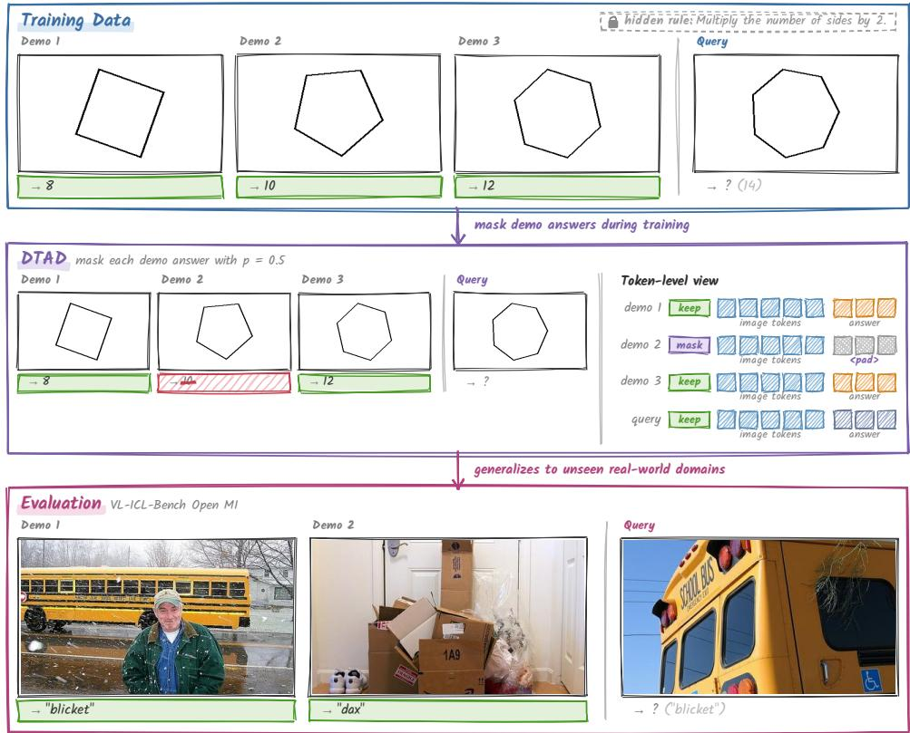
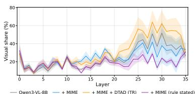
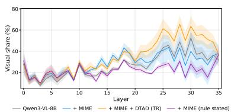
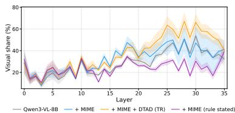
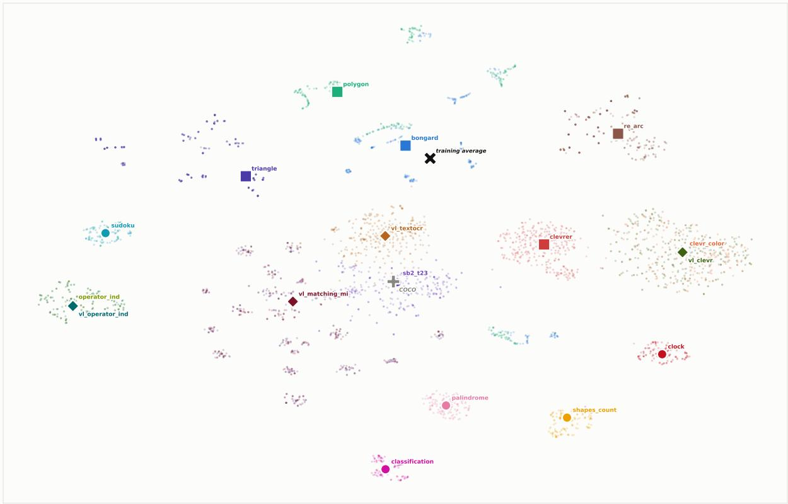

# Watch and Learn: Teaching Visual In-Context Learning by Removing Textual Shortcuts

Nimrod Shabtay1,2 Asaf Yehudai1 Avihu Dekel1 Eli Schwartz1 Raja Giryes2 1IBM Research 2Tel-Aviv University

## Abstract

Vision-language models (VLMs) struggle with incontext learning compared to their textual counterparts. Our preliminary study shows that VLMs rely on textual shortcuts and underutilize the visual demonstrations. We therefore hypothesize that VLMs are insufficiently trained to perform visual in-context learning (vICL). To this end, we construct MIME, a task-agnostic vICL training set without textual shortcuts. We ensure the instruction does not state the rule linking the demonstration images to their answers, so the model must infer it from the visual demonstrations. Fine-tuning on MIME improves vICL accuracy by 8.1–18.0 points across three VLMs, preserves single-image performance, and improves multi-image and textonly in-context learning. In contrast, stating the rule in the training data sharply reduces this gain. We further propose DTAD (Demonstration Text Attention Dropout), which randomly withholds demonstration labels during training so that the VLM must infer the rule from the demonstration images. While achieving comparable vICL accuracy to fine-tuning on MIME, DTAD yields more consistent attention to the demonstration im ages. On TrueMICL, Qwen3-VL-8B trained on MIME matches frontier models such as Claude Opus 5, and surpasses them with DTAD. Finally, adding MIME to the instruction-tuning mix of LLaVA-1.5-13B more than doubles its vICL accuracy without hurting single-image abilities, whereas a same-size multi-image set improves it only slightly. These results suggest that vICL data should be a standard component of VLM training.

## 1 Introduction

In-context learning is a defining emergent capability of large language models (LLMs): given a handful of demonstrations, an LLM infers the latent task and applies it to a new query without any parameter update (Brown et al., 2020; Todd et al., 2024; Olsson et al., 2022). Vision-language models (VLMs) are built on LLMs and are routinely prompted with few-shot demonstrations, yet they struggle with visual in-context learning (vICL), where the task must be inferred from the demonstration images rather than from the accompanying text (Baldassini et al., 2024; Chen et al., 2025b; Santos et al., 2025; Wang and Li, 2026; Jia et al., 2025). One plausible cause is the pretraining data. In text, the demonstration-queryanswer structure occurs naturally at pretraining scale (Han et al., 2023; Hahn and Goyal, 2023; Chen et al., 2024), whereas its multimodal analogue is likely absent (Doveh et al., 2024).

Prior work on improving vICL follows three approaches. The first is motivated by the finding that VLMs attend to the demonstration text rather than the demonstration images (Chen et al., 2025c; Jia et al., 2025), and rebalances attention toward the images. Chen et al. (2025c) train an attention-reweighting layer (DARA), while Wang and Li (2026) reweight attention at inference time (MGI). The second extracts task-specific steering or task vectors from many-shot activations (Huang et al., 2024; Li et al., 2025). The third fits demonstration-retrieval policies per task (Zhang et al., 2023; Doveh et al., 2024, 2025). All three are tailored to a specific task or model, and none of them yields a general vICL ability.

We start by asking why VLMs struggle with vICL (§2). On two TrueMICL tasks, Qwen3-VL-8B reaches near-perfect accuracy (99.8%) when the demonstrations are given as text, or when it first transcribes the images itself. Hence, neither perception nor core in-context learning is the bottleneck. Instead, the model relies on textual shortcuts. Its accuracy falls from 78.3% to 44.8% when the task-specific instruction is replaced with a generic one that gives no hint about the task. The model thus underutilizes the visual demonstrations, even when the task can only be learned from them. We therefore hypothesize that VLMs are insufficiently trained to perform vICL, and that training on dedicated vICL data without textual shortcuts will teach them to attend to and learn from the demonstration images.

Accordingly, we curate MIME (Multi-source Induction from Mute Episodes), a diverse, task-agnostic vICL training set (§3.1). It spans five sources with different rule types and visual domains, so the model cannot solve it by learning a single task. We construct each instance so that no text states the rule linking the demonstration images to their answers, and the model can infer it only from the demonstrations. To further shift attention from the demonstration text to the demonstration images, we propose DTAD (Demonstration Text Attention Dropout, §3.2). During fine-tuning, DTAD randomly withholds each demonstration’s label. A demonstration without its label can inform the query only through its image, so the model must learn to read the demonstration images.

  
Figure 1: We fine-tune on MIME, synthetic in-context instances whose task is a hidden rule that must be inferred from the demonstrations. Despite being synthetic, MIME improves results on unseen real-world benchmarks. DTAD, which masks demonstration answers, produces more stable attention patterns that focus on the demonstration images.

In our experiments, fine-tuning on MIME improves average vICL accuracy by 8.1–18.0 points across 11 tasks and three VLMs, whereas DARA and MGI leave the base model unchanged (§4.2). Training on MIME also preserves single-image performance and improves multi-image and text-only in-context learning (§4.5). This suggests that the model learns a general way of reading demonstrations rather than an image-specific patch. DTAD matches the accuracy of fine-tuning on MIME while attending to the demonstration images more strongly and more consistently across tasks and shot counts (§5.4). It is also more robust to changes in the prompt format (§A.2.2). On TrueMICL, Qwen3-VL-8B trained on MIME matches frontier models such as Claude Opus 5, and surpasses them with DTAD.

Our analysis attributes these gains to the design of MIME (§5). Models trained on MIME depend on their demonstrations. Shuffling either the images or the labels hurts them more than the base model, showing that they learn the rule from the image-label pairs (§5.1). Hiding the rule is necessary. Training on the same instances with the rule stated sharply reduces the gain, and the model then attends to the demonstration images less than the base model in the mid-to-late layers (§5.2).

MIME also belongs in instruction tuning, not only in post-hoc fine-tuning. We retrain LLaVA-1.5-13B (Liu et al., 2023) on its original instruction-tuning mix, adding either MIME or a same-size set of multi-image conversations (§4.3). MIME more than doubles TrueMICL accuracy (18.9 to 39.7) with no single-image regression, whereas the multi-image data barely helps (21.5) and lowers POPE by 30 points. These results suggest that vICL data should be a standard component of VLM training.

## 2 Preliminary

## Study: The Text Shortcut in vICL

We investigate the source of VLMs’ shortcomings in vICL through a preliminary study using Qwen3-VL-8B (Bai et al., 2025) on two tasks from TrueMICL (Chen et al., 2025c). We consider four alternative settings that progressively remove textual cues to examine whether the model can learn from visual demonstrations independently of textual shortcuts. The first uses task metadata to formulate the task as pure text-ICL. The second transcribes the images into text before answering the question based on the resulting descriptions. The third uses a per-task instruction (“What is the mathematical result of the blue number and the red number?”) and the fourth uses a generic instruction (“Look at the demonstrations and answer the final query.”) that provides no task-specific hint.

Table 9 reports the results. Both pure text-ICL and the transcribe-and-answer settings achieve nearperfect accuracy (∼100%), indicating that the model can both perceive the relevant visual information and perform ICL over textual demonstrations. This suggests that neither visual perception nor textual ICL alone explains the performance gap in vICL. The task-specific setting achieves 78.3% accuracy, and removing the task-specific hint further reduces accuracy to 44.8%, suggesting that the model relies heavily on textual cues rather than learning from the visual demonstrations themselves.

These findings motivate our hypothesis that current VLMs are insufficiently trained to perform ICL over visual demonstrations. This limitation may also reflect a tendency to underutilize visual tokens when solving tasks that require learning from contextual examples. If so, fine-tuning on vICL data designed to eliminate textual shortcuts could encourage models to attend to and learn from visual contextual signals.

## 3 Enhancing General vICL abilities

## 3.1 MIME: A Task-Agnostic vICL Training Set

We build MIME with instances where the rule is deducible only by using the demonstration images. Hence, a model can solve an instance only by inducing the rule across shots. MIME contains 23,578 instances (Table 13). Each instance has 1–5 demonstration shots, each an (image, label) pair, followed by a query image whose label is the held-out target. We construct MIME to adhere to the following properties, requiring true visual induction.

1. The rule is expressed only through the demonstrations. The image–label pairs carry the rule, and nothing else in the instance conveys it. Shuffling either the images or the labels sharply degrades a trained model’s accuracy (§5.1), so neither half carries the rule alone.

2. The rule is never stated. All instances share one generic rule-agnostic instruction, so the prompt never describes the rule. A stated rule would let the model solve the instance from text alone, which is the bypass we aim to remove.

3. The images are needed. Without the images, a text-only Qwen3-8B (Yang et al., 2025) stays at near random chance on average.

4. Demonstrations and queries are instancedisjoint. No query repeats a demonstration image or its underlying instance, so the model cannot answer by matching the query to a demonstration.

We apply the schema to five diverse sources. These sources have different types of rules and different visual domains. This ensures that the model does not learn a task-specific ability:

• Polygon (Chia et al., 2024): rules for the number of sides of a polygon.

• Bongard-style (Nie et al., 2020): concepts about shape properties, for example, fill, size, and rotation.

• ARC-style (Chollet, 2019; Hodel, 2024): transforms from an input grid to an output grid.

• Triangle arithmetic (Chia et al., 2024): arithmetic with the values at the vertices. We mask the value of one vertex.

• CLEVR (Johnson et al., 2017): counting and arithmetic with the objects in a frame.

We ablate these design choices in §5.2 and Appendix A.3.5, and verify the properties in §5.3 and Appendix A.3.3.

## 3.2 DTAD:

## Demonstration Text Attention Dropout

MIME already pushes the model to extract the task from the demonstration images. DTAD strengthens this by targeting the text-over-image bias directly, as VLMs attend to the demonstration text rather than the demonstration images (Figure 1). For each demonstration, we independently withhold its text label with probability p and keep its image. A withheld label leaves only one path from that demonstration to the query label, through its image, so minimizing the query loss requires reading the image. Because demonstrations are dropped independently, an instance mixes fully visible and image-only demonstrations, and the model learns to use both routes jointly. The query is always shown in full and is the sole target of the loss. Inference is unchanged.

We withhold labels in one of two ways: replacing the label tokens with a placeholder, or blocking attention to them at every layer. Both preserve the conversation structure, sequence length, and image content. We compare DTAD against fine-tuning on the same data in §4.4.

## 4 Experimental Results

We organize the results around four findings. First, fine-tuning on MIME improves vICL on all three backbones, while existing attention-rebalancing methods leave the baseline unchanged. With MIME, an 8B model matches frontier models, and surpasses them with DTAD (§4.2). Second, the gain comes from the demonstration structure of MIME, not from multi-image exposure. Added to LLaVA-1.5’s full instruction-tuning mix, it more than doubles vICL accuracy with no single-image regression (§4.3). Third, DTAD matches this accuracy while attending to the demonstration images more stably (§4.4). Finally, training on MIME preserves single-image performance and transfers to multi-image, abstract visual reasoning, and text-only ICL (§4.5).

## 4.1 Experimental Setup

Models. We use three models: Qwen3-VL-8B (Bai et al., 2025), LLaVA-OneVision-1.5-8B (An et al., 2025), and Granite-Vision-4.1-4B (Team et al., 2025). We fine-tune each model with LoRA (r=8) for one epoch on MIME, with a learning rate of $2 \times 1 0 ^ { - 4 }$ and an effective batch size of 16. For DTAD, we use p=0.5 with token replacement (TR). We report the attention-mask (AM) variant as an ablation (§5.4).

Benchmarks. We evaluate on 11 tasks: Five TrueMICL tasks (Chen et al., 2025c) (Clock, Operator Induction, Palindrome, Shapes, Classification), the vICL task of SEED-Bench-2 (Task 23) (Li et al., 2024), and five VL-ICL-Bench tasks (Zong et al., 2024) (Operator Induction, Interleaved, TextOCR, Open MI, Match MI). We exclude the Sudoku task, where every model has a perfect score, and CLEVR-based benchmarks, whose images overlap the training data (§5.3). We report accuracy averaged over 1/2/4-shots and three demonstration seeds.

Two protocols. The official protocol keeps each benchmark’s task-specific question. The generic instruction protocol replaces it with one generic instruction for all tasks (“Each demonstration shows an image and the correct answer. Look at the demonstrations and answer the final query.”), so the rule can only be deduced from the demonstrations. We adopt the generic instruction protocol as our primary protocol and use it henceforth throughout the paper The results under the official protocol are reported in Appendix A.2.1. Baselines. We compare our approach against the untrained Qwen3-VL models, DARA (Chen et al., 2025c), and inference-time attention rebalancing (MGI) (Wang and Li, 2026). We use the official Qwen3-VL implementations of DARA and MGI.

## 4.2 MIME Drives the Accuracy Gain

Main result. Table 1 reports the generic instruction results. Fine-tuning on MIME improves all three backbones, by +15.1, +8.1, and +18.0 points on average. Under the official protocol, the gains are +7.8, +9.7, and +31.6 points (Appendix Table 10). DTAD trained on the same data scores on par with the fine-tuned models, staying within about a one-point range on average. This indicates that the core of the improvement comes from the data itself.

Existing methods barely change the base model’s performance. On Qwen3-VL-8B, DARA and MGI stay within ±0.2 points of the untrained model under both protocols (official 69.8/69.7, generic instruction 62.3/62.3). They change only a small fraction of outputs.

Outperforming frontier models on vICL. Training Qwen3-VL-8B on MIME makes it competitive with frontier models and with open models approximately 30× larger. It outscores Qwen3-VL-235B-A22B, InternVL3.5-241B-A28B, and Claude Opus 4.6, and matches Claude Opus 5 (Anthropic, 2026a,b). With DTAD, it outperforms all other models (Table 2). The advantage of DTAD is largest on tasks where the model must understand the rule from the images, and not the text. This indicates that even frontier models do not necessarily obtain strong vICL capabilities. Furthermore, this emphasizes the relevance of our approach for frontier model training.

## 4.3 The Data Belongs in the Training Mix

To assess MIME usefulness beyond general finetuning, we retrain LLaVA-1.5-13B (Liu et al., 2023) on its original 665K instruction-tuning mix with MIME added, and compare against adding a samesize set of multi-image conversational data (sampled from Mantis (Jiang et al., 2024a) training set) (Table 3). MIME results more than double TrueMICL accuracy (18.9 to 39.7), while the multi-image data only improve slightly, to 21.5. Moreover, MIME causes no regression on single-image abilities (POPE (Li et al., 2023b) or MME (Fu et al., 2026)), whereas the Multi-Image training set drops POPE by 30 points. Per-task results are in Appendix Table 17. Therefore, multiimage exposure alone does not directly improve vICL; the demonstration structure of MIME does, and it can be added directly to a model’s instruction training mix.

Table 1: Visual ICL results (generic instruction protocol). Accuracy (%) of each base model before and after fine-tuning on MIME, averaged over 1/2/4 shots and three seeds.
<table><tr><td rowspan="2">Model</td><td colspan="5">TrueMICL</td><td rowspan="2">SB-2</td><td colspan="5">VL-ICL-Bench</td><td rowspan="2">Avg</td><td rowspan="2">∆</td></tr><tr><td>Clock</td><td>Op.Ind</td><td>Palin</td><td>Shapes</td><td>Classif</td><td>T23 Op.Ind</td><td>Interl</td><td>TextOCR</td><td>Open MI</td><td>Match MI</td></tr><tr><td>Qwen3-VL-8B</td><td>12.8</td><td>76.7</td><td>63.9</td><td>95.8</td><td>45.7</td><td>35.8</td><td>78.5</td><td>59.4</td><td>59.2</td><td>72.1</td><td>85.8</td><td>62.3±0.9</td><td>一</td></tr><tr><td>+ DARA (Chen et al., 2025c)</td><td>12.6</td><td>76.7</td><td>64.2</td><td>95.8</td><td>45.3</td><td>35.8</td><td>78.3</td><td>59.8</td><td>59.5</td><td>71.8</td><td>85.8</td><td>62.3</td><td>+0.0</td></tr><tr><td>+ MGI (Wang and Li, 2026)</td><td>12.9</td><td>76.6</td><td>64.3</td><td>96.0</td><td>45.4</td><td>35.8</td><td>78.3</td><td>59.4</td><td>59.6</td><td>72.2</td><td>85.2</td><td>62.3</td><td>+0.0</td></tr><tr><td>+MIMÊ</td><td>62.8</td><td>88.9</td><td>68.8</td><td>97.3</td><td>63.4</td><td>50.0</td><td>91.1</td><td>86.9</td><td>58.7</td><td>98.2</td><td>85.3</td><td> $\overline { { 7 7 . 4 } } \pm 1 . 2$ </td><td>+ī5.1</td></tr><tr><td>+ MIME + DTAD</td><td>70.1</td><td>88.1</td><td>79.3</td><td>99.2</td><td>53.9</td><td>45.8</td><td>90.0</td><td>87.8</td><td>60.7</td><td>94.9</td><td>81.5</td><td> $7 7 . 4 { \scriptstyle \pm 1 . 5 }$ </td><td>+15.1</td></tr><tr><td>LLaVA-OV-1.5-8B</td><td>17.8</td><td>74.9</td><td>67.1</td><td>92.6</td><td>38.9</td><td>41.7</td><td>83.1</td><td>56.9</td><td>49.5</td><td>51.7</td><td>54.7</td><td> $5 7 . 2 { \scriptstyle \pm 0 . 1 }$ </td><td>1</td></tr><tr><td>+ MIME</td><td>30.8</td><td>83.6</td><td>63.7</td><td>99.6</td><td>55.8</td><td>40.8</td><td>88.3</td><td>53.7</td><td>56.5</td><td>84.4</td><td>60.8</td><td> ${ \bf 6 5 . 3 _ { \pm 0 . 9 } }$ </td><td>+8.1</td></tr><tr><td>+ MIME + DTAD</td><td>31.6</td><td>80.3</td><td>72.7</td><td>98.8</td><td>53.5</td><td>34.2</td><td>87.2</td><td>61.3</td><td>55.5</td><td>72.3</td><td>57.5</td><td> $6 4 . 1 { \pm } 1 . 3 $ </td><td>+6.9</td></tr><tr><td>Granite-Vision-4.1-4B</td><td>4.0</td><td>41.1</td><td>61.2</td><td>53.4</td><td>29.8</td><td>30.8</td><td>45.6</td><td>9.8</td><td>39.8</td><td>49.2</td><td>50.0</td><td> $3 7 . 7 { \pm } 0 . 2 $ </td><td></td></tr><tr><td>+ MIME</td><td>24.4</td><td>66.8</td><td>62.8</td><td>99.0</td><td>43.9</td><td>30.8</td><td>73.3</td><td>22.6</td><td>39.1</td><td>97.0</td><td>53.4</td><td> $5 5 . 7 _ { \pm 0 . 3 }$ </td><td>+18.0</td></tr><tr><td>+ MIME + DTAD</td><td>21.0</td><td>57.6</td><td>92.6</td><td>98.8</td><td>47.4</td><td>29.2</td><td>66.5</td><td>37.4</td><td>40.0</td><td>84.6</td><td>50.1</td><td> ${ \bar { \bf 5 6 . 8 _ { \pm 1 . 5 } } }$ </td><td>+19.1</td></tr></table>

Table 2: Comparison to frontier and Large models on TrueMICL. Per-task and overall accuracy on the five TrueMICL tasks. Fine-tuned on MIME, Qwen3-VL-8B outperforms models roughly 30× larger and Claude Opus 4.6, and matches Claude Opus 5; with DTAD, it outperforms all of them.
<table><tr><td>Model</td><td>Size</td><td>Clock</td><td>Op.Ind</td><td>Palin</td><td>Shapes</td><td>Classif</td><td>Overall</td></tr><tr><td>Qwen3-VL-235B-A22B</td><td>235B</td><td>31.0</td><td>99.3</td><td>86.0</td><td>97.8</td><td>64.2</td><td>75.7</td></tr><tr><td>InternVL3.5-241B-A28B</td><td>241B</td><td>15.3</td><td>99.7</td><td>79.0</td><td>83.9</td><td>48.4</td><td>65.3</td></tr><tr><td>Claude Opus 4.6</td><td>1</td><td>43.3</td><td>90.2</td><td>76.7</td><td>99.1</td><td>39.6</td><td>69.8</td></tr><tr><td>Claude Opus 5</td><td>-</td><td>36.1</td><td>88.6</td><td>95.1</td><td>99.6</td><td>61.0</td><td>76.1</td></tr><tr><td>Qwen3-VL-8B</td><td>8B</td><td>12.8</td><td>76.7</td><td>63.9</td><td>95.8</td><td>45.7</td><td>59.0</td></tr><tr><td>+ MIME</td><td>8B</td><td>62.8</td><td>88.9</td><td>68.8</td><td>97.3</td><td>63.4</td><td>76.2</td></tr><tr><td>+ MIME + DTAD</td><td>8B</td><td>70.1</td><td>88.1</td><td>79.3</td><td>99.2</td><td>53.9</td><td>78.1</td></tr></table>

Table 3: Full retraining of LLaVA-1.5-13B. MIME and a same-size multi-image set (Mantis) are each added to the original instruction-tuning mix. TrueMICL accuracy is averaged over 1/2/4 shots.
<table><tr><td rowspan="2">Training mix</td><td rowspan="2">TrueMICL Avg</td><td colspan="3">Regression check</td></tr><tr><td>POPE</td><td>MME-P</td><td>MME-C</td></tr><tr><td>LLaVA-1.5-13B (official)</td><td>18.9</td><td>84.2</td><td>1561</td><td>118</td></tr><tr><td>+ Multi-Image data</td><td>21.5</td><td>54.1</td><td>1509</td><td>116</td></tr><tr><td>+ MIME</td><td>39.7</td><td>85.2</td><td>1575</td><td>127</td></tr></table>

## 4.4 DTAD: Improved

## Visual Pathway at No Accuracy Cost

Table 1 shows that DTAD performs on par with fine-tuning on MIME (+ MIME) across the three models Qwen3-VL-8B, LLaVA-OV-1.5-8B, and Granite-Vision-4.1-4B (tied at 77.4, 64.1 vs. 65.3, and 56.8 vs. 55.7).

Stable visual attention and robustness to prompt format. In our attention analysis (§5.4) we find that although DTAD drops labels and discards information, it teaches the model to attend to the demonstration images more strongly and more consistently across tasks. DTAD builds a stable visual pathway: its late layers attend to the visual signal more than the untrained model at every layer and shot count. Similarly, DTAD is more robust to prompts. When the prompt departs from the training format, it maintains higher performance, reducing the average drop by about two-thirds relative to fine-tuning (§A.2.2).

Table 4: Beyond visual ICL. SI (single-image): average of MMStar, RealWorldQA, POPE, and InfoVQA. MI (multi-image): average of Mantis and LLaVA-Interleave. MARVEL is evaluated as multi-turn visual ICL (chance 25%). Text-only ICL uses multi-turn demonstrations.
<table><tr><td></td><td colspan="2">Regression</td><td></td><td colspan="3">Text-only ICL</td></tr><tr><td>Model</td><td>SI</td><td>MI</td><td>MARVEL MMLU</td><td></td><td>GSM8K GPQA</td><td></td></tr><tr><td>Qwen3-VL-8B</td><td></td><td>76.1 54.9</td><td>27.0</td><td>74.6</td><td>89.8</td><td>36.4</td></tr><tr><td>+ MIME</td><td></td><td>76.4 57.5</td><td>29.1</td><td>75.6</td><td>91.4</td><td>37.1</td></tr><tr><td>+ MIME + DTAD</td><td>76.9</td><td>58.1</td><td>31.6</td><td>75.8</td><td>92.7</td><td>37.1</td></tr></table>

## 4.5 Beyond vICL Benchmarks

In Table 4 we examine the effect of training on other abilities, assessing whether it degrades or transfers to them (Per-benchmark results in Appendix A.2.3). Single-image performance is preserved (MMStar, MME, RealWorldQA, POPE, InfoVQA), and multi-image performance improves by 2.6 points (Mantis (Jiang et al., 2024a), LLaVA-Interleave). On MARVEL (Jiang et al., 2024b), where the rule must be induced from abstract visual puzzles, visual-ICL accuracy improves from 27.0 to 29.1. Finally, the skill transfers to text-only in-context learning, improving accuracy on MMLU (Hendrycks et al., 2020), GSM8K (Cobbe et al., 2021), and GPQA (Rein et al., 2023) although training uses only visual demonstrations. This suggests the model learns a general way of reading demonstrations rather than

Table 5: Trained models depend on the demonstrations. Accuracy with correct demonstrations, and change in points under each corruption, on the five TrueMICL tasks (generic instruction protocol, three seeds).
<table><tr><td>Model</td><td>Correct</td><td>Answers shuffled</td><td>Images shuffled</td><td>Foreign rule</td><td>No demos</td></tr><tr><td>2 shots Qwen3-VL-8B</td><td>57.5</td><td>-19.3</td><td>-19.8</td><td>-43.5</td><td>-25.3</td></tr><tr><td>+MIME + DTAD (AM)</td><td>74.5 74.3</td><td>-35.7 -32.5</td><td>-35.1 -33.4</td><td>-63.8 -70.7</td><td>-48.7 -42.3</td></tr><tr><td>+ DTAD (TR)</td><td>77.8</td><td>-34.6</td><td>-33.6</td><td>-71.4</td><td>-47.6</td></tr><tr><td>4 shots</td><td></td><td></td><td>-30.5</td><td></td><td></td></tr><tr><td>Qwen3-VL-8B</td><td>66.6</td><td>-30.9</td><td></td><td>-50.2</td><td>-34.2</td></tr><tr><td>+MIME</td><td>88.6</td><td>-52.3</td><td>-52.0</td><td>-78.6</td><td>-62.9</td></tr><tr><td>+ DTAD (AM)</td><td>87.7</td><td>-49.5</td><td>-49.3</td><td>-83.6</td><td>-55.7</td></tr><tr><td>+ DTAD (TR)</td><td>90.0</td><td>-50.7</td><td>-49.3</td><td>-81.5</td><td>-59.9</td></tr></table>

a patch specific to images.

## 5 Ablations & Analysis

This section investigates the causes of the gains in §4. We first show that trained models require their demonstrations and use both the images and the answers (§5.1). We then analyze the training data. We show that the design choice not to state the rule in MIME is crucial, and stating it reduces the gain dramatically (§5.2). We also ensure the evaluation benchmarks are visually far from the training data, so the gains are not due to memorization (§5.3). Next, we demonstrate that DTAD produces more stable visual attention patterns. It uses visual pathways that are consistent across shots. We also show that when the demonstration text is absent, the model moves its attention to the demonstration images (§5.4). We establish that DTAD is more robust to changes in the prompt format (§A.2.2). Finally, we measure how the accuracy changes when the number of shots increases (§5.5).

## 5.1 Trained models rely on the demonstrations

If a model induces the rule from the demonstrations, corrupting them should hurt it. We corrupt the demonstrations in four ways: shuffling answers across demonstrations, shuffling images across demonstrations, replacing them with demonstrations of a different rule (foreign rule), and removing them altogether.

Shuffling the answers or the images reduces the accuracy of trained models by 33–52 points, and removing the demonstrations reduces it by 42–63 points; the untrained model loses much less (Table 5). The two shuffles cause about the same drop, so the rule is in the image–label pairs, not in either half alone. Foreign-rule demonstrations cause the largest drop for DTAD, larger than for fine-tuning: a DTAD model follows the rule the demonstrations show, even

Table 6: Stating the rule substantially reduces the transfer gain. Accuracy (2 / 4 shots) on the TrueMICL tasks of Table 5, and change under shuffled demonstration answers.
<table><tr><td>Training data</td><td>TrueMICL</td><td>Answers shuffled</td></tr><tr><td>Untrained</td><td>57.5 / 66.6</td><td>-19.3 / -30.9</td></tr><tr><td>Rule stated</td><td>69.6 / 78.9</td><td>-26.3 / -42.8</td></tr><tr><td>Rule hidden (ours)</td><td>74.5 / 88.6</td><td>-35.7 /-52.3</td></tr></table>

when that rule is wrong for the query.

## 5.2 Hiding the rule is necessary

We construct MIME to never explicitly state the rule (§3.1). To test this choice effect, we train the same model on the same instances, demonstrations, and order, with one change: the prompt also states the demonstration rule. Both models use fine-tuning with identical hyperparameters.

Table 6 shows that stating the rule reduces the gain to +12.1 / +12.3 points over the untrained model, relative to +17.0 / +22.0 when the rule is hidden. The rule-stated model is also less sensitive to shuffled answers. Given the rule, it learns to read the rule and relies less on the demonstrations than the MIMEtrained model. Similarly, its visual share falls below the base model in the mid-to-late layers (Figure 2).

Single-image control. To control for the presence of the demonstrations, we train on the same query images, with each rule stated in text, but without the demonstrations (Appendix Table 14). The control average score over the five TrueMICL tasks reaches 61.5, above the untrained model (59.0) but far below using MIME (76.2). Together, the two experiments show that stating the rule reduces the gain when the demonstrations are kept, and nearly eliminates it when they are removed.

## 5.3 Training data analysis

Train-test separation. To verify that the gains reflect generalization rather than memorization, we measure the distance between training and evaluation images. Each image is embedded by a frozen SigLIP (Tschannen et al., 2025) encoder and L2-normalized. We calibrate distances per source between two anchors: the floor is the centroid distance to a held-out split of the same source, and the ceiling is the distance to COCO photographs. A calibrated value near 0% means the benchmark is visually indistinguishable from that training source; near 100% means it is as distant as natural photographs.

Every evaluation benchmark lies at 70–170% calibrated distance from its nearest training source, i.e., closer to unrelated photographs than to the training data. The one exception is CLEVR-based tasks (CLEVR-Color and VL-CLEVR). They sit at 8% from CLEVR, with 93% of their images above 0.95 cosine similarity to a training image, so we exclude them from evaluation. A t-SNE projection of the embeddings is in Appendix Figure 3.

MIME properties We ensure the data adhere to the properties listed in §3.1. We check all of the instances (Appendix A.3.3). Text alone. With the images removed, a text-only Qwen3-8B reaches near chance on average.

Instance disjointness. No query repeats a demonstration image or its underlying instance (0 violations).

## 5.4 DTAD builds a stable, usable visual pathway

DTAD achieves comparable accuracy to fine-tuning on most vICL tasks (§4.4). Yet, DTAD builds a stable visual pathway that is robust across tasks, and shot counts. Specifically, it absorbs the largest share of attention when demonstration text is blocked (Table 7).

DTAD raises visual attention in late layers.

$$
s _ { h } = \frac { \sum _ { q \in \mathcal { Q } } \sum _ { t \in \mathcal { T } } a _ { h , q , t } } { \sum _ { q \in \mathcal { Q } } \sum _ { t \in \mathcal { T } } a _ { h , q , t } + \sum _ { q \in \mathcal { Q } } \sum _ { t \in \mathcal { T } } a _ { h , q , t } } ,\tag{1}
$$

For each head $h ,$ we take the attention from the query text tokens $\mathcal { Q }$ to the demonstrations. The visual share $s _ { h } \left( \mathrm { E q . ~ } 1 \right)$ is the fraction of this attention that goes to the demonstration image tokens I rather than to the demonstration text tokens $\tau$ . For each layer, we average $s _ { h }$ over its heads, and we report the mean and standard deviation over the 5 TrueMICL tasks. Figure 2 shows the visual share of each layer at 1, $^ { 2 , }$ and 4 shots. In layers 0–11, all models overlap. The differences appear only in the middle and late layers, consistent with prior works (Neo et al., 2025; Cohen et al., 2025; Kaduri et al., 2025). Fine-tuning increases the visual share mainly in the middle layers (by 6–9 pp over the base model in layers 12–23). In the late layers (24–35), it has the largest spread across tasks (12–14 pp SD). When the prompt states the rule, the model relies on the text: its visual share is below the base model on mid-to-late layers. The untrained model also has a low visual share. This shows that pretraining alone does not make the model attend to visual demonstrations. Thus, dedicated vICL training data is necessary. DTAD raises the visual share above the base model from the middle layers onward, and the gap widens in the late layers, where DTAD is above the base model at every layer and every shot count. Its late-layer visual share stays nearly constant across shot counts, and its spread across tasks decreases as the number of shots increases. Prior work shows that models extract object information in mid-to-late layers (Neo et al., 2025; Cohen et al., 2025; Kaduri et al., 2025) and also that heads which encode fine-grained visual details are in the deepest layers (Chen et al., 2025a). Our results agree with these findings, and DTAD strengthens the late-layer visual pathway that already exists in the base model, and makes it consistent across shot counts and tasks.

Table 7: Attention redistribution under demonstrationtext blocking. Absorption: share (%) of the attention freed by blocking demonstration text that moves to demonstration images, all layers, mean ± SD over 5 TrueMICL tasks.
<table><tr><td>Model</td><td>1 shot</td><td>2 shots</td><td>4 shots</td></tr><tr><td> $\mathrm { Q w e n 3 - V L - 8 B }$ </td><td> $1 9 . 9 \pm 2 . 0$ </td><td> $2 0 . 6 \pm 1 . 7$ </td><td> $2 4 . 6 \pm 1 . 8$ </td></tr><tr><td>+ MIME (rule stated)</td><td> $2 0 . 2 \pm 3 . 2$ </td><td> $2 2 . 3 \pm 2 . 5$ </td><td> $2 6 . 9 \pm 2 . 9$ </td></tr><tr><td>+ MIME</td><td> $2 2 . 1 \pm 3 . 4$ </td><td> $2 6 . 1 \pm 4 . 8$ </td><td> $2 9 . 7 \pm 3 . 5$ </td></tr><tr><td> $+ \mathrm { M I M E } + \mathrm { D T A D } \left( \mathrm { T R } \right)$ </td><td> $2 2 . 9 \pm 2 . 6$ </td><td> $2 6 . 3 \pm 2 . 8$ </td><td> $3 1 . 3 \pm 3 . 3$ </td></tr></table>

Attention redistribution. We block attention to all demonstration-text positions at inference and measure where the freed attention goes (Table 7). For all models, as the number of shots increases, the share that moves to the demonstration image grows. DTAD absorbs the largest share at every shot count, reaching 31.3% at 4 shots, compared with 24.6% for the untrained model. Fine-tuning follows closely (29.7% at 4 shots) but has the largest spread across tasks at every shot count, while training with the rule stated stays close to the untrained model (20.2–26.9%). DTAD also performs consistently across tasks. It exceeds the untrained model in 14 of the 15 task–shot pairs (12 of 15 for fine-tuning). Together, these results show that MIME teaches the model to redirect attention to the demonstration images, and that DTAD pushes this further, with the largest and most consistent redirection across tasks.

## 5.5 Scaling with shot count

To assess our approach’s ability to generalize beyond the shot counts seen during training, we evaluate on five TrueMICL tasks with 4 and 16 shots. We report the error reduction rate (ERR), namely: (acc@16−acc@4)/(100−acc@4).

Table 8 shows that DTAD obtains the largest ERR (69.0%), followed by fine-tuning on MIME (67.5%), both above the untrained model (53.9%). Although the trained models start from a much higher 4-shot accuracy (88.6 and 90.0 vs. 66.6), leaving less room to improve, both DTAD and fine-tuning improve as demonstrations are added, and relative to their remaining headroom, they improve more than the

  
Figure 2: Mean visual share per layer for 1-shot (left), 2-shot (center), and 4-shot (right); lines show the mean over the 5 TrueMICL tasks and shaded bands show ±1 SD across tasks. DTAD raises the visual share in the late layers above the base model at every shot count, with a narrow spread across tasks. Fine-tuning on the same data increases it mainly in the middle layers; in the late layers it varies widely across tasks. Training with the rule stated in the prompt lowers the visual share below the base model, indicating that the model relies mostly on the textual pathway.

Table 8: Error reduction from 4 to 16 shots (TrueMICL). Error reduction is the fraction of the 4-shot error removed at 16 shots. DTAD and fine-tuning keep improving with more demonstrations. The higher ERR demonstrates they improve more relative to their stronger starting point.
<table><tr><td></td><td>Qwen3-VL-8B</td><td>+ MIME</td><td>+ DTAD (TR)</td></tr><tr><td>Acc@4</td><td>66.6</td><td>88.6</td><td>90.0</td></tr><tr><td>Acc@16</td><td>84.6</td><td>96.3</td><td>96.9</td></tr><tr><td>Error reduction</td><td>53.9%</td><td>67.5%</td><td>69.0%</td></tr></table>

untrained model.

## 6 Related Work

Visual ICL models and benchmarks. Few-shot prompting was a design goal of interleaved VLMs from the outset: Flamingo trains on interleaved image-text web sequences and reports large few-shot gains on captioning and VQA (Alayrac et al., 2022), a recipe reproduced by OpenFlamingo (Awadalla et al., 2023) and extended to multi-image instruction tuning by Otter (Li et al., 2023a). Interleaved data is now a standard pretraining ingredient (Laurençon et al., 2024), included explicitly to enable in-context learning (Bai et al., 2025; An et al., 2025; Team et al., 2025), so few-shot ability is assumed rather than specially built for. Few benchmarks evaluate visual ICL directly. VL-ICL Bench (Zong et al., 2024) argues that few-shot VQA and captioning do not test ICL’s limits and instead covers perception, induction, reasoning, and long-context tasks; TrueMICL (Chen et al., 2025c) claims VLMs imitate demonstration text while neglecting visual cues, and builds tasks that require both modalities; SEED-Bench-2 (Li et al., 2024) includes in-context captioning from two image-caption pairs as one dimension of a broader interleaved suite.

Addressing the visual ICL gap. Prior work traces the failure to attention allocation (Chen et al., 2025c): VLMs attend to demonstration text over demonstration images, leaving the visual half of each shot largely unused. Wang and Li (2026) instead locate it earlier, in how the task mapping is built and propagated across layers. Three families of fixes follow. The first reweights attention toward demonstration images: DARA trains the first attention layer to attend to them (Chen et al., 2025c), while Wang and Li (2026) rebalance attention at inference. Both give only marginal gains over the untrained model. The second steers activations instead: multimodal task and in-context vectors, the analogue of task and function vectors in LMs (Todd et al., 2024), are extracted from many-shot activations and injected at inference, one per task (Huang et al., 2024; Li et al., 2025). The third leaves the model untouched and fits per-task demonstration selection policies (Zhang et al., 2023; Doveh et al., 2024, 2025). Separately, Jia et al. (2025) penalize text shortcutting via preference optimization against symbol-substituted demonstrations. These methods are typically task- or domain-specific and do not yield a general capability.

## 7 Conclusions

Vision-language models learn less from visual demonstrations than from textual ones: they route attention to demonstration text rather than images. We introduced MIME, a cross-task vICL training set in which the rule is carried only by the demonstrations and never stated. Fine-tuning on it improves vICL by 8.1–18.0 points across several architectures, while preserving single-image ability and improving multi-image and text-only ICL. Our analysis shows that trained models rely on their demonstrations, and that this dependence arises because the rule is hidden: stating it reduces the gain significantly. DTAD, which withholds demonstration text during training, performs on par when the rule must come from the demonstrations, while strengthening late-layer attention to the demonstration images, consistently across shot counts and tasks. A controlled full retrain of LLaVA-1.5-13B further shows that MIME outperforms same-size multi-image data, demonstrating its benefit for the general instruction tuning of VLMs. We hope these results will establish vICL data and demonstration-text dropout as standard components of VLM training.

## Limitations

Our controlled instruction-tuning experiment is limited to LLaVA-1.5-13B, since the training data and pipelines of current state-of-the-art VLMs are not public. We therefore cannot measure the full effect of adding MIME to the pretraining and instruction-tuning stages of modern VLMs. Still, adding MIME to the LLaVA-1.5 mix more than doubles its vICL accuracy, which suggests that modern training pipelines could benefit as well.

Our fine-tuning experiments are similarly limited in scale. We train 4B–8B models with LoRA adapters, and leave full-parameter training with larger backbones unexplored. Even this lightweight setup lets an 8B model match frontier models on TrueMICL, leaving clear room for further gains under stronger training regimes.

Finally, we evaluate MIME and DTAD in isolation and do not combine them with other approaches to vICL. Because both act on the training data and objective, they are complementary to inference-time methods such as demonstration retrieval and task vectors, and combining them offers a promising path to further gains.

## References

Jean-Baptiste Alayrac, Jeff Donahue, Pauline Luc, Antoine Miech, Iain Barr, Yana Hasson, Karel Lenc, Arthur Mensch, Katherine Millican, Malcolm Reynolds, et al. 2022. Flamingo: a visual language model for few-shot learning. Advances in neural information processing systems, 35:23716–23736.

Xiang An, Yin Xie, Kaicheng Yang, Wenkang Zhang, Xiuwei Zhao, Zheng Cheng, Yirui Wang, Songcen Xu, Changrui Chen, Didi Zhu, et al. 2025. Llavaonevision-1.5: Fully open framework for democratized multimodal training. arXiv preprint arXiv:2509.23661.

Anthropic. 2026a. Claude Opus 4.6 System Card. Technical report, Anthropic.

Anthropic. 2026b. Claude Opus 5 System Card. Technical report, Anthropic.

Anas Awadalla, Irena Gao, Josh Gardner, Jack Hessel, Yusuf Hanafy, Wanrong Zhu, Kalyani Marathe, Yonatan Bitton, Samir Gadre, Shiori Sagawa, et al. 2023. Openflamingo: An open-source framework for training large autoregressive vision-language models. arXiv preprint arXiv:2308.01390.

Shuai Bai, Yuxuan Cai, Ruizhe Chen, Keqin Chen, Xionghui Chen, Zesen Cheng, Lianghao Deng, Wei Ding, Chang Gao, Chunjiang Ge, et al. 2025. Qwen3-vl technical report. arXiv preprint arXiv:2511.21631.

Folco Bertini Baldassini, Mustafa Shukor, Matthieu Cord, Laure Soulier, and Benjamin Piwowarski. 2024. What makes multimodal in-context learning work? In 2024 IEEE/CVF Conference on Computer Vision and Pattern Recognition Workshops (CVPRW), pages 1539–1550. IEEE.

Tom Brown, Benjamin Mann, Nick Ryder, Melanie Subbiah, Jared D Kaplan, Prafulla Dhariwal, Arvind Neelakantan, Pranav Shyam, Girish Sastry, Amanda Askell, et al. 2020. Language models are few-shot learners. Advances in neural information processing systems, 33:1877–1901.

Junzhe Chen, Tianshu Zhang, Shiyu Huang, Yuwei Niu, Linfeng Zhang, Lijie Wen, and Xuming Hu. 2025a. Ict: Image-object cross-level trusted intervention for mitigating object hallucination in large vision-language models. In 2025 IEEE/CVF Conference on Computer Vision and Pattern Recognition (CVPR), pages 4209–4221. IEEE.

Shuo Chen, Zhen Han, Bailan He, Jianzhe Liu, Mark Buckley, Yao Qin, Philip Torr, Volker Tresp, and Jindong Gu. 2025b. Can multimodal large language models truly perform multimodal in-context learning? In 2025 IEEE/CVF Winter Conference on Applications ofComputer Vision (WACV), pages 6000–6010. IEEE.

Shuo Chen, Jianzhe Liu, Zhen Han, Yan Xia, Daniel Cremers, Philip Torr, Volker Tresp, and Jindong Gu. 2025c. True multimodal in-context learning needs attention to the visual context. arXiv preprint arXiv:2507.15807.

Yanda Chen, Chen Zhao, Zhou Yu, Kathleen McKeown, and He He. 2024. Parallel structures in pre-training data yield in-context learning. In Proceedings of the 62nd Annual Meeting of the Association for Computational Linguistics (Volume 1: Long Papers), pages 8582–8592.

Yew Ken Chia, Vernon Toh, Deepanway Ghosal, Lidong Bing, and Soujanya Poria. 2024. Puzzlevqa: Diagnosing multimodal reasoning challenges of language models with abstract visual patterns. In Findings ofthe Associationfor Computational Linguistics: ACL 2024, pages 16259–16273.

François Chollet. 2019. On the measure of intelligence. arXiv preprint arXiv:1911.01547.

Karl Cobbe, Vineet Kosaraju, Mohammad Bavarian, Mark Chen, Heewoo Jun, Lukasz Kaiser, Matthias Plappert, Jerry Tworek, Jacob Hilton, Reiichiro Nakano, et al. 2021. Training verifiers to solve math word problems. arXiv preprint arXiv:2110.14168.

Ido Cohen, Daniela Gottesman, Mor Geva, and Raja Giryes. 2025. Performance gap in entity knowledge extraction across modalities in vision language models. In Proceedings of the 63rd Annual Meeting of the Associationfor Computational Linguistics (Volume 1: Long Papers), pages 29095–29108.

Sivan Doveh, Shaked Perek, M Jehanzeb Mirza, Wei Lin, Amit Alfassy, Assaf Arbelle, Shimon Ullman, and Leonid Karlinsky. 2024. Towards multimodal in-context learning for vision and language models. In European Conference on Computer Vision, pages 250–267. Springer.

Sivan Doveh, Nimrod Shabtay, Eli Schwartz, Hilde Kuehne, Raja Giryes, Rogerio Feris, Leonid Karlinsky, James Glass, Assaf Arbelle, Shimon Ullman, et al. 2025. Teaching vlms to localize specific objects from in-context examples. In 2025 IEEE/CVF International Conference on Computer Vision (ICCV), pages 9572–9582. IEEE.

Chaoyou Fu, Peixian Chen, Yunhang Shen, Yulei Qin, Mengdan Zhang, Xu Lin, Jinrui Yang, Xiawu Zheng, Ke Li, Xing Sun, et al. 2026. Mme: A comprehensive evaluation benchmark for multimodal large language models. Advances in Neural Information Processing Systems, 38.

Michael Hahn and Navin Goyal. 2023. A theory of emergent in-context learning as implicit structure induction. arXiv preprint arXiv:2303.07971.

Xiaochuang Han, Daniel Simig, Todor Mihaylov, Yulia Tsvetkov, Asli Celikyilmaz, and Tianlu Wang. 2023. Understanding in-context learning via supportive pretraining data. In Proceedings of the 61st Annual Meeting of the Association for Computational Linguistics (Volume 1: Long Papers), pages 12660–12673.

Dan Hendrycks, Collin Burns, Steven Basart, Andy Zou, Mantas Mazeika, Dawn Song, and Jacob Steinhardt. 2020. Measuring massive multitask language understanding. arXiv preprint arXiv:2009.03300.

Michael Hodel. 2024. Addressing the abstraction and reasoning corpus via procedural example generation. arXiv preprint arXiv:2404.07353.

Brandon Huang, Chancharik Mitra, Assaf Arbelle, Leonid Karlinsky, Trevor Darrell, and Roei Herzig. 2024. Multimodal task vectors enable many-shot multimodal in-context learning. Advances in Neural Information Processing Systems, 37:22124–22153.

Hongrui Jia, Chaoya Jiang, Haiyang Xu, Wei Ye, Mengfan Dong, Ming Yan, Ji Zhang, Fei Huang, and Shikun Zhang. 2025. Symdpo: Boosting in-context learning of large multimodal models with symbol demonstration direct preference optimization. In 2025 IEEE/CVF Conference on Computer Vision and Pattern Recognition (CVPR), pages 9361–9371. IEEE.

Dongfu Jiang, Xuan He, Huaye Zeng, Cong Wei, Max W.F. Ku, Qian Liu, and Wenhu Chen. 2024a. Mantis: Interleaved multi-image instruction tuning. Transactions on Machine Learning Research, 2024.

Yifan Jiang, Jiarui Zhang, Kexuan Sun, Zhivar Sourati, Kian Ahrabian, Kaixin Ma, Filip Ilievski, and Jay Pujara. 2024b. Marvel: Multidimensional abstraction and reasoning through visual evaluation and learning. arXiv preprint arXiv:2404.13591.

Justin Johnson, Bharath Hariharan, Laurens Van Der Maaten, Li Fei-Fei, C Lawrence Zitnick, and Ross Girshick. 2017. Clevr: A diagnostic dataset for compositional language and elementary visual reasoning. In Proceedings of the IEEE conference on computer vision andpattern recognition, pages 2901–2910.

Omri Kaduri, Shai Bagon, and Tali Dekel. 2025. What’s in the image a deep-dive into the vision of vision language models. In 2025 IEEE/CVF Conference on Computer Vision and Pattern Recognition (CVPR), pages 14549–14558. IEEE.

Hugo Laurençon, Léo Tronchon, Matthieu Cord, and Victor Sanh. 2024. What matters when building visionlanguage models? Advances in Neural Information Processing Systems, 37:87874–87907.

Bo Li, Yuanhan Zhang, Liangyu Chen, Jinghao Wang, Jingkang Yang, and Ziwei Liu. 2023a. Otter: a multi-modal model with in-context instruction tuning. corr abs/2305.03726 (2023).

Bohao Li, Yuying Ge, Yixiao Ge, Guangzhi Wang, Rui Wang, Ruimao Zhang, and Ying Shan. 2024. Seed-bench: Benchmarking multimodal large language models. In 2024 IEEE/CVF Conference on Computer Vision and Pattern Recognition (CVPR), pages 13299–13308. IEEE.

Yanshu Li, Hongyang He, Yi Cao, Qisen Cheng, Xiang Fu, and Ruixiang Tang. 2025. M2iv: Towards efficient and fine-grained multimodal in-context learning in large vision-language models. arXiv e-prints, pages arXiv–2504.

Yifan Li, Yifan Du, Kun Zhou, Jinpeng Wang, Xin Zhao, and Ji-Rong Wen. 2023b. Evaluating object hallucination in large vision-language models. In Proceedings of the 2023 Conference on Empirical Methods in Natural Language Processing, pages 292–305. Association for Computational Linguistics.

Haotian Liu, Chunyuan Li, Qingyang Wu, and Yong Jae Lee. 2023. Visual instruction tuning. In NeurIPS.

Clement Neo, Luke Ong, Philip Torr, Mor Geva, David Krueger, and Fazl Barez. 2025. Towards interpreting visual information processing in vision-language models. In International Conference on Learning Representations, volume 2025, pages 57172–57189.

Weili Nie, Zhiding Yu, Lei Mao, Ankit B Patel, Yuke Zhu, and Anima Anandkumar. 2020. Bongard-logo: A new benchmark for human-level concept learning and reasoning. Advances in neural information processing systems, 33:16468–16480.

Catherine Olsson, Nelson Elhage, Neel Nanda, Nicholas Joseph, Nova DasSarma, Tom Henighan, Ben Mann, Amanda Askell, Yuntao Bai, Anna Chen, et al. 2022. In-context learning and induction heads. arXiv preprint arXiv:2209.11895.

David Rein, Betty Li Hou, Asa Cooper Stickland, Jackson Petty, Richard Yuanzhe Pang, Julien Dirani, Julian Michael, and Samuel R Bowman. 2023. Gpqa: A graduate-level google-proof q&a benchmark. arXiv preprint arXiv:2311.12022.

Gabriel O dos Santos, Esther Colombini, and Sandra Avila. 2025. What do vision-language models see in the context? investigating multimodal in-context learning. arXiv preprint arXiv:2510.24331.

Granite Vision Team, Leonid Karlinsky, Assaf Arbelle, Abraham Daniels, Ahmed Nassar, Amit Alfassi, Bo Wu, Eli Schwartz, Dhiraj Joshi, Jovana Kondic, et al. 2025. Granite vision: a lightweight, open-source multimodal model for enterprise intelligence. arXiv preprint arXiv:2502.09927.

Eric Todd, Millicent Li, Arnab Sen Sharma, Aaron Mueller, Byron Wallace, and David Bau. 2024. Function vectors in large language models. In International conference on learning representations, volume 2024, pages 17282–17333.

Michael Tschannen, Alexey Gritsenko, Xiao Wang, Muhammad Ferjad Naeem, Ibrahim Alabdulmohsin, Nikhil Parthasarathy, Talfan Evans, Lucas Beyer, Ye Xia, Basil Mustafa, et al. 2025. Siglip 2: Multilingual vision-language encoders with improved semantic understanding, localization, and dense features. arXiv preprint arXiv:2502.14786.

Yu Wang and Sharon Li. 2026. Why multimodal in-context learning lags behind? unveiling the inner mechanisms and bottlenecks. In Proceedings of the 64th Annual Meeting of the Association for Computational Linguistics (Volume 1: Long Papers), pages 13670–13685.

An Yang, Anfeng Li, Baosong Yang, Beichen Zhang, Binyuan Hui, Bo Zheng, Bowen Yu, Chang Gao, Chengen Huang, Chenxu Lv, et al. 2025. Qwen3 technical report. arXiv preprint arXiv:2505.09388.

Yuanhan Zhang, Kaiyang Zhou, and Ziwei Liu. 2023. What makes good examples for visual in-context learning? Advances in Neural Information Processing Systems, 36:17773–17794.

Yongshuo Zong, Ondrej Bohdal, and Timothy Hospedales. 2024. Vl-icl bench: The devil in the details of benchmarking multimodal in-context learning. arXiv preprint arXiv:2403.13164.

## A Appendix

This appendix collects the full experimental tables and additional analyses referenced in the main text. We begin with the motivating experiment that isolates the visual ICL bottleneck (Table 9). We then ablate the prompt format along the multi-turn/single-turn and instruction/no-instruction axes (Table 11). Next, we detail the training set composition (Table 13) and analyze the contribution of each data source via leave-one-out training (Table 16). Finally, we report a full-model retraining experiment on LLaVA-1.5-13B, including POPE and MME regression checks and a multi-image QA control (Table 17).

## A.1 Preliminary Study

To locate the source of the visual ICL gap, we evaluate Qwen3-VL-8B on TrueMICL Clock and Operator Induction tasks while progressively removing textual descriptions of the demonstrations. Table 9 shows that the model solves the task perfectly once the relevant information is available as text, even when it extracts that information from the images itself, but fails when it must infer the task directly from visual demonstrations.

<table><tr><td>Setting</td><td>Shots</td><td>Clock</td><td>Operator induction</td><td>Mean</td></tr><tr><td rowspan="4">Pure text-ICL</td><td>1</td><td>100.0</td><td>99.0</td><td>99.5</td></tr><tr><td>2</td><td>100.0</td><td>100.0</td><td>100.0</td></tr><tr><td>4</td><td>100.0</td><td>100.0</td><td>100.0</td></tr><tr><td>Avg</td><td>100.0</td><td>99.7</td><td>99.8</td></tr><tr><td rowspan="4">Transcribe &amp; answer</td><td>1</td><td>100.0</td><td>99.0</td><td>99.5</td></tr><tr><td>2</td><td>100.0</td><td>100.0</td><td>100.0</td></tr><tr><td>4</td><td>100.0</td><td>100.0</td><td>100.0</td></tr><tr><td>Avg</td><td>100.0</td><td>99.7</td><td>99.8</td></tr><tr><td rowspan="4">vICL, task instruction (baseline)</td><td>1</td><td>56.3</td><td>77.3</td><td>66.8</td></tr><tr><td>2</td><td>69.7</td><td>82.3</td><td>76.0</td></tr><tr><td>4</td><td>85.3</td><td>98.7</td><td>92.0</td></tr><tr><td>Avg</td><td>70.4</td><td>86.1</td><td>78.3</td></tr><tr><td rowspan="4">vICL, generic instruction</td><td>1</td><td>9.3</td><td>62.0</td><td>35.7</td></tr><tr><td>2</td><td>11.7</td><td>76.7</td><td>44.2</td></tr><tr><td>4</td><td>17.3</td><td>91.3</td><td>54.3</td></tr><tr><td>Avg</td><td>12.8</td><td>76.7</td><td>44.8</td></tr></table>

Table 9: Preliminary study: what limits vICL? Accuracy (%) of Qwen3-VL-8B on two TrueMICL tasks (Clock, Operator induction). Pure text-ICL: the task is posed as text-only ICL using the task metadata. Transcribe & answer: the model first transcribes the images, then answers. Task instruction (baseline): standard vICL with the official TrueMICL prompt. Generic instruction: vICL with an instruction that gives no hint about the task. Avg: mean over shots; Mean: mean over the two tasks. Near-perfect text-ICL and transcribe & answer scores show that perception and textual ICL are not the bottleneck, while the drop under a generic instruction indicates reliance on textual cues.

## A.2 Results

## A.2.1 Official protocol results

Table 10 reports per-task results under the official protocol, which keeps each benchmark’s task-specific question. Fine-tuning on MIME improves all three backbones under this protocol as well (+7.8, +9.7, and +31.6 points), while DARA and MGI remain within seed variation of the untrained model.

Table 10: Visual ICL results under the official protocol. Per-task accuracy (%) with each benchmark’s task-specific question, averaged over 1/2/4 shots and three demonstration seeds; subscripts give the standard deviation of the overall average across seeds.
<table><tr><td></td><td colspan="4">TrueMICL</td><td colspan="4">SB-2</td><td colspan="4">VL-ICL-Bench</td></tr><tr><td>Model</td><td>Clock</td><td>Op.Ind</td><td>Palin</td><td>Shapes</td><td>Classif</td><td>T23</td><td>Op.Ind</td><td>Interl</td><td>TextOCR</td><td>Open MI</td><td>Match MI</td><td>Overall</td></tr><tr><td>Qwen3-VL-8B</td><td>70.4</td><td>86.1</td><td>96.4</td><td>81.0</td><td>50.0</td><td>35.8</td><td>78.1</td><td>66.9</td><td>57.2</td><td>60.3</td><td>85.8</td><td> $6 9 . 8 { \scriptstyle \pm 0 . 6 }$ </td></tr><tr><td>+ DARA</td><td>70.3</td><td>85.6</td><td>96.6</td><td>80.3</td><td>49.5</td><td>35.8</td><td>78.5</td><td>66.9</td><td>57.5</td><td>60.5</td><td>85.8</td><td> $6 9 . 8 { \scriptstyle \pm 0 . 5 }$ </td></tr><tr><td>+MGI</td><td>70.2</td><td>85.8</td><td>96.7</td><td>81.2</td><td>49.1</td><td>35.8</td><td>77.6</td><td>66.7</td><td>57.5</td><td>60.7</td><td>85.2</td><td> $6 9 . 7 _ { \pm 0 . 4 }$ </td></tr><tr><td>+ MIME</td><td>86.4</td><td>85.7</td><td>96.7</td><td>92.0</td><td>52.8</td><td>50.0</td><td>86.3</td><td>80.2</td><td>55.4</td><td>83.1</td><td>85.3</td><td> $7 7 . 6 _ { \pm 0 . 2 }$ </td></tr><tr><td>+ MIME + DTAD</td><td>86.1</td><td>83.4</td><td>96.6</td><td>97.8</td><td>43.2</td><td>45.8</td><td>83.1</td><td>78.0</td><td>62.0</td><td>82.2</td><td>81.5</td><td> $7 6 . 3 { \scriptstyle \pm 0 . 7 }$ </td></tr><tr><td>LLaVA-OV-1.5-8B</td><td>51.2</td><td>78.4</td><td>76.2</td><td>85.8</td><td>34.4</td><td>41.7</td><td>76.7</td><td>26.9</td><td>38.9</td><td>9.2</td><td>54.7</td><td> $5 2 . 2 { \scriptstyle \pm 0 . 4 }$ </td></tr><tr><td>+ MIME</td><td>64.1</td><td>86.6</td><td>83.0</td><td>98.0</td><td>38.2</td><td>40.8</td><td>84.6</td><td>39.1</td><td>49.8</td><td>35.9</td><td>60.8</td><td> ${ \bf 6 1 . 9 _ { \pm 0 . 4 } }$ </td></tr><tr><td>+ MIME + DTAD</td><td>48.6</td><td>80.2</td><td>84.6</td><td>98.6</td><td>41.1</td><td>34.2</td><td>85.7</td><td>48.1</td><td>49.6</td><td>17.1</td><td>57.5</td><td> $5 8 . 7 { \scriptstyle \pm 0 . 4 }$ </td></tr><tr><td>Granite-Vision-4.1-4B</td><td>13.0</td><td>3.1</td><td>41.2</td><td>26.7</td><td>21.7</td><td>30.8</td><td>0.6</td><td>0.4</td><td>25.8</td><td>24.1</td><td>50.0</td><td> $2 1 . 6 { \pm } 0 . 3$ </td></tr><tr><td>+ MIME</td><td>41.1</td><td>78.3</td><td>62.7</td><td>91.7</td><td>39.2</td><td>30.8</td><td>77.6</td><td>18.5</td><td>35.4</td><td>56.7</td><td>53.4</td><td> ${ \pm } 3 . 2 { \scriptstyle \pm } 0 . 7 $ </td></tr><tr><td>+ MIME + DTAD</td><td>29.1</td><td>67.6</td><td>82.4</td><td>94.6</td><td>38.9</td><td>29.2</td><td>70.9</td><td>22.0</td><td>29.7</td><td>16.8</td><td>50.1</td><td> $4 8 . 3 _ { \pm 0 . 3 }$ </td></tr></table>

## A.2.2 Prompt Format Ablation

Our adapters are trained with a multi-turn prompt that includes a generic instruction. Table 11 evaluates all models under the four combinations of turn structure and instruction presence to test robustness to this choice.

Table 11: Prompt format ablation. TrueMICL accuracy under four prompt formats: {multi-turn, single-turn} × {with instruction, without instruction}. Multi-turn with instruction is the format the adapters were trained on. Overall is the unweighted mean of Clock, Op.Ind, Palindrome, Shapes and Classification (each averaged over 1/2/4 shots). $\Delta _ { \mathrm { M T + I } }$ is the difference from the multi-turn + instruction cell. Trained models score higher with multi-turn prompts, while the untrained baseline scores highest with single-turn + instruction (60.5). Removing the instruction costs the baseline and FT 6.8–7.2 pp on multi-turn; DTAD models are the most robust to it (−0.5 and −2.1 pp).
<table><tr><td rowspan="2">Format</td><td rowspan="2">Model</td><td colspan="5">TrueMICL</td><td rowspan="2">Overall</td><td rowspan="2">∆MT+I</td></tr><tr><td>Clock</td><td>Op.Ind</td><td>Palin</td><td>Shapes</td><td>Classif</td></tr><tr><td rowspan="4">Multi-turn + instruction</td><td>Qwen3-VL-8B (baseline)</td><td>12.8</td><td>76.7</td><td>63.9</td><td>95.8</td><td>45.7</td><td>59.0</td><td></td></tr><tr><td>+ MIME</td><td>62.8</td><td>88.9</td><td>68.8</td><td>97.3</td><td>63.4</td><td>76.2</td><td></td></tr><tr><td>+ MIME + DTAD (Attn Mask)</td><td>62.3</td><td>85.3</td><td>91.7</td><td>99.9</td><td>37.8</td><td>75.4</td><td></td></tr><tr><td>+ MIME + DTAD (Token Replace)</td><td>70.1</td><td>88.1</td><td>79.3</td><td>99.2</td><td>53.9</td><td>78.1</td><td>-</td></tr><tr><td rowspan="4">Multi-turn no instruction</td><td>Qwen3-VL-8B (baseline)</td><td>6.7</td><td>82.0</td><td>44.0</td><td>92.6</td><td>33.7</td><td>51.8</td><td>-7.2</td></tr><tr><td>+ MIME</td><td>48.3</td><td>89.7</td><td>67.0</td><td>96.1</td><td>45.9</td><td>69.4</td><td>-6.8</td></tr><tr><td>+ MIME + DTAD (Attn Mask)</td><td>62.0</td><td>84.7</td><td>83.3</td><td>99.6</td><td>37.0</td><td>73.3</td><td>-2.1</td></tr><tr><td>+ MIME + DTAD (Token Replace)</td><td>64.7</td><td>94.0</td><td>86.0</td><td>99.2</td><td>44.3</td><td>77.6</td><td>-0.5</td></tr><tr><td rowspan="4">Single-turn + instruction</td><td>Qwen3-VL-8B (baseline)</td><td>9.0</td><td>89.3</td><td>71.7</td><td>93.6</td><td>39.0</td><td>60.5</td><td>+1.5</td></tr><tr><td>+ MIME</td><td>53.0</td><td>86.3</td><td>73.3</td><td>98.3</td><td>42.7</td><td>70.7</td><td>-5.5</td></tr><tr><td>+ MIME + DTAD (Attn Mask)</td><td>57.3</td><td>83.0</td><td>87.7</td><td>99.8</td><td>45.1</td><td>74.6</td><td>-0.8</td></tr><tr><td>+ MIME + DTAD (Token Replace)</td><td>59.0</td><td>88.7</td><td>82.0</td><td>98.8</td><td>46.7</td><td>75.0</td><td>-3.1</td></tr><tr><td rowspan="4">Single-turn no instruction</td><td>Qwen3-VL-8B (baseline)</td><td>7.7</td><td>78.0</td><td>11.0</td><td>87.9</td><td>39.4</td><td>44.8</td><td>-14.2</td></tr><tr><td>+ MIME</td><td>47.7</td><td>86.0</td><td>43.3</td><td>95.1</td><td>39.8</td><td>62.4</td><td>-13.8</td></tr><tr><td>+ MIME + DTAD (Attn Mask)</td><td>54.3</td><td>83.3</td><td>73.3</td><td>99.1</td><td>41.1</td><td>70.2</td><td>-5.2</td></tr><tr><td>+ MIME + DTAD (Token Replace)</td><td>58.7</td><td>87.7</td><td>74.0</td><td>98.7</td><td>44.3</td><td>72.7</td><td>-5.4</td></tr></table>

## A.2.3 Beyond vICL tasks

Table 12 reports per-benchmark results for §4.5. Fine-tuning on MIME preserves single-image performance (76.1 vs. 76.4 on average), improves both multi-image benchmarks, and raises accuracy on MARVEL, as well as on all three text-only ICL benchmarks.

Table 12: Beyond visual ICL: per-benchmark results. Single-image and multi-image benchmarks check that training on MIME does not regress general ability; MARVEL and text-only ICL test transfer. MARVEL is evaluated as multi-turn visual ICL (chance 25%). Text-only ICL uses multi-turn demonstrations. MME is reported as perception/cognition.
<table><tr><td rowspan="2">Model</td><td rowspan="2"></td><td colspan="9">Single-image</td><td colspan="3">Text-only ICL</td></tr><tr><td>MME P/C</td><td>RealWorldQA</td><td>POPE</td><td>InfoVQA</td><td>Avg</td><td>Mantis</td><td>LLaVA-Interleave</td><td>Avg</td><td>MARVEL</td><td>MMLU</td><td>GSM8K</td><td>GPQA</td></tr><tr><td>Qwen3-VL-8B</td><td>63.6</td><td>1723.4/641.1</td><td>69.4</td><td>88.8</td><td>82.7</td><td>76.1</td><td>69.1</td><td>40.6</td><td>54.9</td><td>27.0</td><td>74.6</td><td>89.8</td><td>36.4</td></tr><tr><td>+ MIME</td><td>65.1</td><td>1735.1/649.3</td><td>68.9</td><td>88.9</td><td>82.7</td><td>76.4</td><td>73.3</td><td>41.7</td><td>57.5</td><td>29.1</td><td>75.6</td><td>91.4</td><td>37.1</td></tr><tr><td>+ MIME + DTAD</td><td>65.4</td><td>1749.4/637.9</td><td>71.4</td><td>88.5</td><td>82.4</td><td>76.9</td><td>71.4</td><td>44.7</td><td>58.1</td><td>31.6</td><td>75.8</td><td>92.7</td><td>37.1</td></tr></table>

## A.3 Data

## A.3.1 Statistics

Our training set combines five sources, each contributing up to 5,000 episodes with 1–5 demonstrations per episode. Table 13 lists the per-source episode counts and shot distributions.

Table 13: Composition of the training set by source, showing the number of episodes, the range of shots used, and the mean number of shots per episode.
<table><tr><td>Source</td><td>Episodes</td><td>Shots</td><td>Mean shots</td></tr><tr><td>PuzzleVQA polygon sides</td><td>5000</td><td>{2,3,4}</td><td>2.94</td></tr><tr><td>Bongard-LOGO shape concept</td><td>5000</td><td>{2,4}</td><td>3.00</td></tr><tr><td>RE-ARC transform induction</td><td>5000</td><td>{3,4,5}</td><td>3.97</td></tr><tr><td>PuzzleVQA triangle arithmetic</td><td>5000</td><td>{2,3,4}</td><td>3.00</td></tr><tr><td>CLEVR</td><td>3578</td><td>{1,2,4}</td><td>2.64</td></tr><tr><td>Total</td><td>23578</td><td>{1,.,5}</td><td>3.14</td></tr></table>

## A.3.2 Single-Image Control

To separate the effect of the demonstration structure from exposure to the training images, we train a control on the same query images with each episode’s rule stated in text and no demonstrations, using the same hyperparameters. Table 14 shows that the control improves over the untrained model (61.5 vs. 59.0) but stays well below training on our vICL data (76.2). The gap is sharpest on Clock, whose rule exists only in the visual demonstrations: the control does not improve over the untrained model (11.0 vs. 12.8), while DTAD reaches 70.1. The control’s gain comes from Palindrome (+16.4) and Operator Induction (+12.0), whose rules are easily stated in words, and it drops below the untrained model on Classification (−12.4) and Shapes (−1.5).

## A.3.3 Dataset design choices

We verify each property of our dataset directly on the 23,578 training episodes. The demonstration-only and hidden-rule properties are tested by corrupting demonstrations and by retraining with the rule stated (Tables 5 and 6); Table 15 reports, per source, text-only predictability, and query–demonstration instance violations.

Table 14: Single-image control. TrueMICL per-task accuracy (%, Qwen3-VL-8B, averaged over 1/2/4 shots). The control trains on the same query images with each rule stated in text and no demonstrations. It improves over the untrained model but falls far short of training on our vICL data. The gap is largest on Clock, whose rule exists only in the visual demonstrations.
<table><tr><td>Model</td><td>Clock</td><td>Op.Ind</td><td>Palin</td><td>Shapes</td><td>Classif</td><td>Avg</td></tr><tr><td>Qwen3-VL-8B</td><td>12.8</td><td>76.7</td><td>63.9</td><td>95.8</td><td>45.7</td><td>59.0</td></tr><tr><td>Single-image control</td><td>11.0</td><td>88.7</td><td>80.3</td><td>94.3</td><td>33.3</td><td>61.5</td></tr><tr><td>+ MIME</td><td>62.8</td><td>88.9</td><td>68.8</td><td>97.3</td><td>63.4</td><td>76.2</td></tr></table>

Table 15: Per-source audit (%). Text-only predictability and query-demonstration instance violations.
<table><tr><td></td><td>Polygon</td><td>Bongard</td><td>RE-ARC</td><td>Triangle</td><td>CLEVR</td></tr><tr><td>Chance</td><td>7.1</td><td>50.0</td><td>14.3</td><td>4.5</td><td>4.5</td></tr><tr><td>Qwen3-8B text-only</td><td>23.0</td><td>27.5</td><td>4.5</td><td>11.5</td><td>4.5</td></tr><tr><td>Query-demo violations (count)</td><td>0</td><td>0</td><td>0</td><td>0</td><td>0</td></tr></table>

## A.3.4 Train-Test Separation

Figure 3 shows a t-SNE projection of the SigLIP (Tschannen et al., 2025) image embeddings used in §5.3. Each training source forms a tight, well-separated cluster, and the evaluation benchmarks fall outside these clusters, at 70–170% calibrated distance from their nearest training source (0% = a held-out split of that source, 100% = COCO photographs). The exception is CLEVR-based benchmarks, which lie within the CLEVR training cluster (8% calibrated distance, with 93% of its images above 0.95 cosine similarity to a training image); we therefore exclude them from evaluation.

  
Figure 3: t-SNE of SigLIP image embeddings. Training sources (squares) form tight clusters. Evaluation benchmarks (circles, diamonds) lie at 70–170% calibrated distance from the nearest training source (0% = held-out split of that source, 100% = COCO), except CLEVR-based benchmarks (8% to CLEVR), which we therefore exclude from evaluation.

## A.3.5 Source Contribution

To measure the contribution of each source, we train leave-one-out (LOO) adapters, each omitting one source, under all three training strategies, evaluating each at 1, 2, and 4 shots on the TrueMICL benchmarks (Table 16).

The value of source diversity depends on the training strategy. Under both DTAD variants, removing any source costs 3.0–16.7 points, whereas under naïve fine-tuning only removing Triangle has a clear effect (−10.2); the other changes are within ±2.6 points. CLEVR is the clearest case: removing it costs 16.7 points under DTAD (AM) but only 1.0 under naïve fine-tuning.

Table 16: Leave-one-out. Change in TrueMICL average accuracy when one source is removed from the full mix.
<table><tr><td>Removed source</td><td>Naïve FT</td><td>DTAD (AM)</td><td>DTAD (TR)</td></tr><tr><td>Polygon</td><td>-2.6</td><td>-3.0</td><td>-9.7</td></tr><tr><td>Bongard-LOGO</td><td>+2.6</td><td>-3.9</td><td>-6.5</td></tr><tr><td>RE-ARC</td><td>-2.4</td><td>-4.1</td><td>-4.6</td></tr><tr><td>Triangle</td><td>-10.2</td><td>-8.3</td><td>-7.4</td></tr><tr><td>CLEVR</td><td>-1.0</td><td>-16.7</td><td>-6.7</td></tr></table>

## A.4 Full-Model Retraining on LLaVA-1.5-13B

Finally, we test whether MIME also helps when mixed into a model’s original instruction-tuning stage: we retrain LLaVA-1.5-13B from its 665K instruction mix with our visual ICL data added, and compare against the official checkpoint and a multi-image QA control trained on Mantis (Table 17).

Table 17: Full-model retraining: LLaVA-1.5-13B with visual ICL data. TrueMICL mean accuracy for the official LLaVA-1.5-13B model, a model retrained with our 5-source visual ICL data mixed into the llava training data (MIME), and a multi-image (MI) QA control (Mantis, 23.5K episodes, no ICL pattern). MIME training gives large ICL gains (+26 pp Clock, +32 pp Op.Ind, +46 pp Shapes; +20.8 pp average) with no regression on POPE or MME. The Mantis control shows that multi-image exposure alone does not teach visual ICL (+2.6 pp average), and it causes a severe POPE regression (−30 pp, yes-bias).
<table><tr><td rowspan="2">Model</td><td colspan="6">TrueMICL (avg 1/2/4-shot)</td><td colspan="3">Regression check</td></tr><tr><td>Clock</td><td>Op.Ind</td><td>Palin</td><td>Shapes</td><td>Classif</td><td>Avg</td><td>POPE</td><td>MME-P</td><td>MME-C</td></tr><tr><td>Official</td><td>5.3</td><td>5.0</td><td>25.7</td><td>35.9</td><td>22.6</td><td>18.9</td><td>84.2</td><td>1561</td><td>118</td></tr><tr><td>MI</td><td>5.7</td><td>9.0</td><td>30.3</td><td>41.0</td><td>21.4</td><td>21.5</td><td>54.1</td><td>1509</td><td>116</td></tr><tr><td>MIME</td><td>31.7</td><td>37.3</td><td>25.3</td><td>81.9</td><td>22.2</td><td>39.7</td><td>85.2</td><td>1575</td><td>127</td></tr></table>