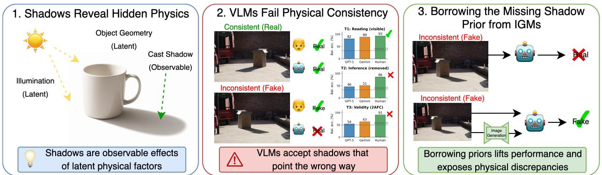
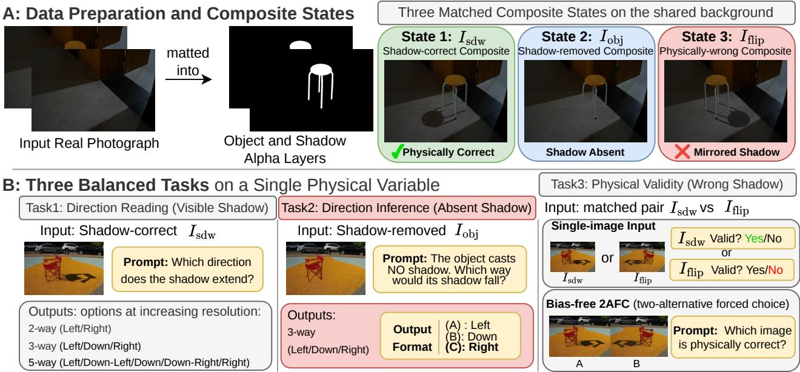
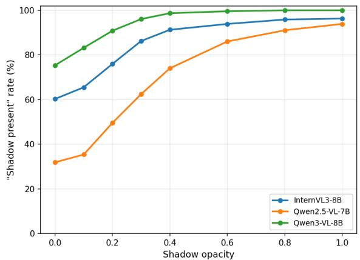
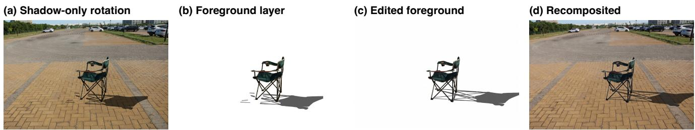
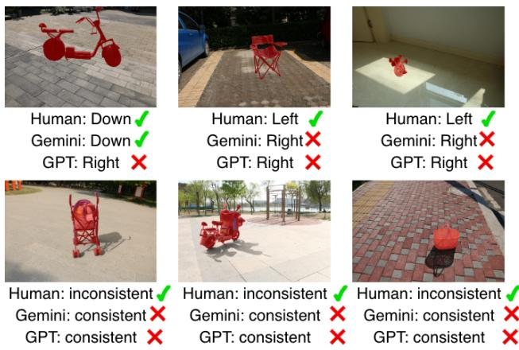

# Where Did the Light Come From? Diagnosing Cast-Shadow Reasoning in VLMs and Borrowing the Missing Shadow Prior from Image Generation Models

Ryugo Morita1,2 Shunsuke Kitada3 Stanislav Frolov1 Brian Bernhard Moser1 Ko Watanabe1 Riku Takahashi1,3 Jinjia Zhou3 Andreas Dengel1,2 1DFKI, Germany 2RPTU Kaiserslautern-Landau, Germany 3Hosei University, Japan

  
Figure 1. We introduce ShadowBench, which probes one facet of illumination understanding, whether VLMs know which way a cas shadow should fall. (i) Reading: VLMs read a visible shadow’s direction well above chance, scaling with size. (ii) Inferring: with the shadow removed, they recover it weakly. (iii) Validating: they barely exceed chance on a bias-free two-alternative test, while humans reach 85–98%. Letting the VLM borrow an Image Generation Model’s cast shadow prior lifts its weak inference and exposes wrong-direction shadows it otherwise accepts. The prior VLMs lack already resides in IGMs, pointing toward transferring it into VLM training.

## Abstract

Shadows are observable consequences of latent physical causes, arising from the interaction between illumination, object geometry, and scene structure. A model that understands shadows should be able not only to read a shadow’s direction, but also to infer where a shadow should fall when it is absent, and to judge whether a shadow is physically consistent with the scene. We introduce Shadow-Bench, builtfrom real photographs, which poses these three questions to vision-language models (VLMs). From each scene, we build a correct-shadow, a shadow-removed, and a human-annotated wrong-direction state. Evaluating 19 open VLMs (2B to 78B) and frontier proprietary models, we find that VLMs read a visible shadow’s direction well above chance and improve with scale, yet infer the absent direction only weakly and fall to chance at judging physical consistency even under a bias-free two-alternative test that removes the yes-bias of single-image naturalness questions. Only Gemini-3.1-pro exceeds chance on validity, and even then only modestly and far below humans. Chain-of-Thought (CoT) does not help. The missing ingredient is not reasoning but knowledge that image generation models

(IGMs) already hold. Routing a VLM through an IGM lifts its inference well above its direct attempt and helps it flag the wrong-direction shadows it otherwise accepts. Castshadow direction is a single facet of illumination understanding, but the sharp gap it reveals between VLMs and IGMs suggests image-generation or reconstruction objectives as a route toward illumination-aware VLMs.

## 1. Introduction

A cast shadow is a rare gift for studying physical understanding, a single visible mark that encodes one hidden variable, the direction of the light. A shadow that points the wrong way makes an ordinary photograph look unmistakably broken [8], making shadows an unusually clean probe of whether a model reasons about scene physics or merely about pixels. Shadows have long been exploited through detection [25], removal [36], and generation [33], and modern diffusion models [9, 28] control illumination explicitly [16, 40]. Yet as vision-language models (VLMs) are promoted to general visual reasoners, a basic question remains unanswered. Do they understand the physics a shadow encodes, or only register that a shadow is there?

Producing or accepting a plausible shadow does not require understanding it. A cast shadow encodes essentially one physical quantity, the direction of the light relative to the object, and a model that has internalized this relation should be able to use it in three ways, (i) reading the direction of a visible shadow, (ii) inferring where a shadow should fall when it is absent, and (iii) validating whether a shown shadow is physically consistent with the scene. Reading only locates a visible cue, whereas inferring and validating require relating the shadow to the scene’s global information. Existing physical-reasoning benchmarks probe spatial relations [4, 14], 3D structure [29, 31], occlusion [24], and broad plausibility [6, 32], but none isolate cast-shadow direction, and none separate reading a shadow from understanding it, which is precisely the distinction that decides whether a model has internalized the shadow–illumination relation.

To this end, we introduce ShadowBench, built from real photographs. From each scene, we recover the object and its shadow as an alpha-matted layer, and recompose three matched states on a shared background, a shadow-correct, a shadow-removed, and a human-curated wrong-direction state. Evaluating 19 open VLMs (2B–78B) and frontier proprietary models, we find a sharp split. Reading works; VLMs read a visible shadow’s direction well above chance, improving with scale. Understanding does not; the same models infer the absent direction only weakly and cannot reliably tell a wrong-direction shadow from a correct one, accepting it as natural even under a bias-free two-alternative test, while humans perform every task at 85–98%. The sole exception, Gemini-3.1-pro, exceeds chance only modestly. Chain-of-Thought (CoT) [17] repairs neither failure, so the bottleneck is not reasoning.

VLMs are trained to produce text conditioned on images, with no objective requiring them to reproduce the physics of a scene, whereas Image Generation Models (IGMs) are trained to reconstruct physically plausible images and must respect illumination, geometry, and the other constraints the visible world obeys. We therefore let the VLM borrow this knowledge through a loop it drives end-to-end, prompting an IGM to draw the shadow the scene implies and then reading it back, rather than judging from the scene alone. This recovers both inference and validity well above the VLM’s direct attempt, supplying the missing prior that CoT did not. It points to folding generation or reconstruction objectives into VLM training as a route to internalizing the priors IGMs hold. Our contributions are summarized as follows:

• We introduce ShadowBench, which uses cast shadows to probe whether VLMs hold the illuminationdirection knowledge a cast shadow encodes. Matched alpha-composites (shadow-correct, shadow-removed, and a wrong-direction state) make direction the only changed variable, and three balanced tasks separate reading a visible shadow from inferring an absent one and validating a shown one, each with a human baseline.

• Across 19 open VLMs (2B–78B) and frontier proprietary models, VLMs read a visible shadow’s direction well above chance but infer the absent direction weakly and, with the sole exception of Gemini-3.1-pro, stay at chance when telling a wrong-direction shadow from a correct one, even under CoT, while humans reach 85–98%.

• We show that the cast-shadow knowledge VLMs lack already resides in IGMs, and that bringing these illumination priors into the VLM’s decision lifts its inference and flags many of the wrong-direction shadows it otherwise accepts, motivating generation-based training and knowledge transfer toward illumination-aware VLMs.

## 2. Related Works

## 2.1. Illumination Control and Estimation

Illumination-aware image modeling has evolved from harmonization, which aligns a composite’s foreground with its background [21, 27, 37], through increasingly fine-grained relighting [5, 15, 26], to diffusion models that condition explicitly on shading, radiance, or shadow cues [10, 16, 38, 40, 42]. Generative models thus encode strong, controllable priors over light and shadow, but these priors are used to render illumination into an image, not to read it back out. Conversely, inverse rendering and lighting estimation recover scene illumination explicitly [7, 22, 44]; these methods are trained to invert image formation, so given suitable inputs they solve our inference task by construction. ShadowBench asks a different question, whether generalpurpose VLMs hold this knowledge at all. The informative comparison is VLMs vs. IGMs, as neither is trained for illumination estimation, yet only the latter holds a usable directional prior (Sec. 4.4). This locates the gap in the training objective rather than in the task’s solvability.

## 2.2. Shadow Modeling and Analysis

Shadows have long served computer vision as cues for scene understanding and realism [8]. Work on detection [25] and removal [36] showed that robust shadow handling needs global context and object–shadow associations rather than local appearance alone [11], and recent work extends to generation and composition [3, 13, 23, 33, 42]. These works operate at the pixel level, treating the shadow itself as the target rather than as a cue to the single latent variable that produced it, the direction of the light.

## 2.3. Benchmarks for Vision-Language Models

VLM evaluation [2, 12, 43] has expanded from recognition to structured reasoning: spatial relations [4, 14], 3D and metric understanding [29, 31], occlusion [24], physical plausibility [6, 32], and causal or counterfactual probes under controlled interventions [18, 39]. No benchmark isolates shadow as a physical variable or distinguishes reading a visible shadow from inferring or validating an absent one; ShadowBench fills this gap with matched interventions that change only the shadow’s direction relative to the scene.

  
Figure 2. Overview of ShadowBench. From each real photograph, we recover the object and its cast shadow as an alpha-matted layer and recompose matched states on a shared background: the shadow-correct $I _ { \mathrm { s d w } }$ , the shadow-removed $I _ { \mathrm { o b j } }$ , and the physically-wrong composite $I _ { \mathrm { H i p } } ,$ , produced by a horizontal flip to change the shadow’s direction. The target object is highlighted in red. These states drive three tasks of increasing demand on the shadow–illumination relation: Direction Reading from a visible shadow at increasing angula resolution (Task 1); Direction Inference, recovering the direction from $I _ { \mathrm { o b j } }$ once the shadow is removed (Task 2); and Physical Validity, judging whether a shown shadow is consistent with the scene, in single-image and a bias-free two-alternative form on $I _ { \mathrm { s d w } }$ vs. $I _ { \mathrm { H i p } }$ (Task 3).

## 3. ShadowBench

As shown in Fig. 2, ShadowBench is built from the realimage dataset collected with OBER [41], which provides, for each scene, a clean background image $I _ { \mathrm { b a c k } }$ , an image $I _ { \mathrm { a l l } }$ captured after placing a foreground object, and annotated masks for the object $( M _ { \mathrm { o b j } } )$ and for the region affected by its cast shadow $( M _ { \mathrm { e f f } } )$

We isolate the cast shadow as a soft alpha layer. Within the shadow region $R = M _ { \mathrm { { e f f } } } \ \backslash \ M _ { \mathrm { { o b j } } }$ , a shadowed pixel is darker than the clean background, so its opacity follows from how far the per-pixel ratio between the two captures drops below one,

$$
\alpha = \mathrm { c l i p } ( 1 - \mathrm { l u m } ( I _ { \mathrm { a l l } } \oslash I _ { \mathrm { b a c k } } ) , 0 , 1 ) \odot \nVdash [ R ] ,\tag{1}
$$

where $\oslash$ is per-pixel division and lum(·) denotes luminance. The clip maps non-shadowed pixels, whose ratio meets or exceeds one, to zero opacity. Writing the object as an alpha-matted layer $L _ { \mathrm { o b j } } = ( C _ { \mathrm { o b j } } , M _ { \mathrm { o b j } } )$ and the compositing operator Comp( $\bar { B _ { , } } ( C , A ) ) \overset { \cdot } { = } A \odot \bar { C } + ( 1 - A ) \odot B$ we recompose three matched states on the shared background $I _ { \mathrm { b a c k } }$

$$
I _ { \mathrm { s d w } } = \mathrm { C o m p } ( I _ { \mathrm { b a c k } } \odot ( 1 - \alpha ) , L _ { \mathrm { o b j } } ) ,
$$

$$
I _ { \mathrm { o b j } } = \mathrm { C o m p } ( I _ { \mathrm { b a c k } } , L _ { \mathrm { o b j } } ) ,\tag{2}
$$

(3)

$$
I _ { \mathrm { f l i p } } = \mathrm { C o m p } ( I _ { \mathrm { b a c k } } \odot ( 1 - \alpha ^ {  } ) , L _ { \mathrm { o b j } } ^ {  } ) ,\tag{4}
$$

where $( \cdot ) ^ {  }$ denotes a horizontal mirror of the foreground (object and shadow), applied while the background is held fixed. $I _ { \mathrm { s d w } }$ is the physically-correct composite with the object and its cast shadow; $I _ { \mathrm { o b j } }$ removes the shadow; and $I _ { \mathrm { H i p } }$ keeps the identical object and shadow but mirrors them as a unit, so the shadow points inconsistently with the unchanged scene lighting. The mirror is applied only to the foreground, so the background’s own illumination cues (neighboring shadows, sky, lighting) are shared by $I _ { \mathrm { s d w } }$ and $I _ { \mathrm { H i p } }$ , and the two composites differ only in the direction of the shadow relative to this fixed lighting. Table 1 summarizes the three states and the tasks each one drives.

## 3.1. Curation and ground truth

The raw pool of composites contains failure cases that would confound the tasks, and the direction tasks require a per-scene ground-truth direction. We curate in two stages. Stage 1: Background consistency. We automatically reject scenes whose residual $| I _ { \mathrm { a l l } } - I _ { \mathrm { b a c k } } |$ is large outside the object and shadow regions, since a large off-object residual signals a confound between the two captures (camera motion, background motion, or a lighting change) that would corrupt the extracted layers.

<table><tr><td>State</td><td>Source</td><td>Shadow</td><td>Phys.</td><td>Used in</td></tr><tr><td> $I _ { \mathrm { s d w } }$ </td><td>composite</td><td>correct</td><td>correct</td><td>Task 1,3</td></tr><tr><td> $I _ { \mathrm { o b j } }$ </td><td>composite</td><td>removed</td><td>wrong</td><td>Task 2,3</td></tr><tr><td> $I _ { \mathrm { H i p } }$ </td><td>composite</td><td>mirrored</td><td>wrong</td><td>Task 3</td></tr></table>

Table 1. Canonical scene states in ShadowBench. $I _ { \mathrm { s d w } }$ serves as the direction-reading stimulus and the validity positive, $I _ { \mathrm { H i p } }$ as the wrong-direction negative with the foreground mirrored, and $I _ { \mathrm { o b j } }$ as the inference input and the negative of the presence 2AFC.

Stage 2: Human filtering and direction ground truth. Three annotators independently inspect each surviving scene and reject it if the object is incompletely separated, the object mask is defective (clipped, fragmented, or spilling onto the background), or the underlying photograph is unusable (heavy motion blur or severe over/underexposure). A scene is excluded if any annotator marks any failure. For each accepted scene, the same annotators place a single point at the center of the object’s cast shadow at its base, and we average these points across the three annotators. The shadow’s own center is taken as the centroid of the shadow mask, and the per-scene ground-truth direction is the angle of the line from the averaged origin point to that centroid. From the 2,715 scenes, curation yields 458 scenes with reliable per-scene direction ground truth for the reading and inference tasks (Tasks 1 and 2).

For the validity task (Task 3), the mirrored foreground is kept at its flipped position by default. Only when this position is physically implausible (e.g. the object floats or intersects scene geometry) does an annotator shift the foreground to the nearest plausible location, applying the smallest correction needed. Curation counts for every stage are listed in Appendix Sec. 18.

## 3.2. Three tasks on a single physical variable

As shown in Fig. 2, ShadowBench probes the shadow direction implied by the scene through three tasks. Task 1 (Direction Reading, Sec. 3.2.1) asks the model to read the direction of a visible cast shadow; Task 2 (Direction Inference, Sec. 3.2.2) removes the shadow and asks the model to infer that direction from the remaining scene; and Task 3 (Physical Validity, Sec. 3.2.3) asks the model to judge whether a shown shadow is physically consistent with the scene, using the matched composites $I _ { \mathrm { s d w } } , I _ { \mathrm { f l i p } }$ , and $I _ { \mathrm { o b j } }$ Reading needs only to locate a visible cue, whereas inference and validity both require relating the shadow to the rest of the scene, including other cast shadows, directional shading, and visible light sources. All three tasks are posed as multiple-choice questions using a fixed set of directional words, scored against the per-scene ground-truth directions.

## 3.2.1. Task 1: Direction Reading

The first task asks whether the model can read the direction of a visible cast shadow. Given the shadow-correct image $I _ { \mathrm { s d w } }$ with the target object highlighted, the model chooses the direction in which the object’s shadow extends. To probe the granularity of this ability, we pose the question at three angular resolutions: a two-way left/right choice (chance 50%), a three-way left/down/right choice (chance 33%), and a five-way choice left/down-left/down/downright/right (chance 20%). We omit the upward directions, which never occur in the captured scenes for ground-cast shadows. Reading sets the ceiling against which the two comprehension tasks below are compared. We read from $I _ { \mathrm { s d w } }$ rather than the original capture $I _ { \mathrm { a l l } }$ to match the compositing pipeline of the other tasks, and verify the two give the same reading accuracy (Appendix Sec. 7).

## 3.2.2. Task 2: Direction Inference

The second task removes the shadow entirely and asks the model to infer where it would fall. Given the shadowremoved composite $I _ { \mathrm { o b j } }$ with the target object highlighted, the model chooses the direction in which the object’s shadow would extend if it were present, as a three-way left/down/right choice (chance 33%). With the shadow absent, the answer can only be recovered from the scene (neighboring shadows, sky, lighting), so this task assesses whether the model can infer the latent direction rather than read it directly. It uses the same option set and ground-truth direction as the three-way form of Task 1, making the two directly comparable, so the gap between them isolates the cost of removing the visible shadow.

## 3.2.3. Task 3: Physical Validity

The third task asks whether the model can judge if a shadow is physically consistent with the scene, which again requires relating the shadow to the rest of the scene rather than merely locating it. We use the matched composites $I _ { \mathrm { s d w } }$ (correct) and $I _ { \mathrm { H i p } }$ (wrong-direction) in both single-image and bias-free two-alternative forms.

Single-image (Yes/No). The model is shown one image, $I _ { \mathrm { s d w } }$ or $I _ { \mathrm { H i p } }$ , and asked whether the highlighted object’s shadow is physically consistent. The correct answer is Yes for $I _ { \mathrm { s d w } }$ and No for $I _ { \mathrm { H i p } }$ . This form mirrors the naturalness questions common in prior work.

Bias-free two-alternative (2AFC). To remove the response bias such a single-image question can invite, we place $I _ { \mathrm { s d w } }$ and $I _ { \mathrm { H i p } }$ side by side and ask which is physically correct. Every pair is presented twice, with the correct image on each side, so any fixed-option strategy scores 50% and preference separates from discrimination. Both images contain a shadow that differs only in direction, so the flip isolates direction as the only cue separating the correct composite from the wrong one. We call this the direction 2AFC. As a control, we also include a presence 2AFC that pits $I _ { \mathrm { s d w } }$ against the shadow-removed $I _ { \mathrm { o b j } }$ , testing only whether the model expects a grounded object to cast some shadow. Contrasting these two 2AFCs separates a model’s sensitivity to shadow direction from its sensitivity to shadow presence.

## 4. Experiment

## 4.1. Experiment Setup

Dataset and metrics. We evaluate ShadowBench on 458 curated scenes, each with a reliable per-scene ground-truth direction. Direction Reading poses each scene at three angular resolutions (two-, three-, and five-way), and Direction Inference at three-way resolution. Physical Validity runs in two forms, a single-image Yes/No over both states (916 balanced records) and a within-scene counterbalanced 2AFC presenting each pair in both orders (458 pairs, 916 records). Every task is scored by balanced accuracy, the mean of perclass recall, and compared against a human baseline.

Evaluated models. We evaluate 19 open VLMs from 2B to 78B across five families: the Qwen-VL series (2/2.5/3- VL [2]), InternVL3 [43], LLaVA-OneVision [20], Gemma-4 [30], and Pixtral [1], together with two frontier proprietary models, GPT-5 and Gemini-3.1-pro. For the human baseline, three master’s students distinct from the curation annotators each answer the same multiple-choice questions on a random subset of 80 scenes per task, and we report their mean accuracy. The transfer analysis routes a single editor, FLUX.1-Kontext-dev [19], and we compare it against three further image generation models, the open OmniGen2 [35] and the proprietary gpt-image-2 and Gemini-3-pro-image (Appendix Sec. 13). All proprietary models are accessed via their official APIs in June 2026.

## 4.2. Results & Analysis

## 4.2.1. T1: Reading a visible shadow

Table 2 (Reading columns) shows that VLMs read the direction of a visible cast shadow well above chance, and that the ability improves with model size (Spearman $\rho = 0 . 5 3$ over the open models). The trend is cleanest within a single family, where Gemma-4 rises 70→ 87 →90% from 4B to 31B. In two-way left/right reading, the accuracy climbs from 50–70% for sub-4B models to 88–92% for the strongest models. Gemini-3.1-pro reaches 92.4% and Gemma-4-31B 90.0%, approaching the human 97.6%. Size does not fully determine the score (InternVL3-78B reaches only 68%), but every model is well above chance. Finer angular resolution lowers every score yet preserves the ordering, with threeway reading peaking at 88.6% and five-way at 74.8%, both from Gemini-3.1-pro, against human 93.2% and 84.7%. Two Google-lineage models stand out here, Gemini-3.1- pro leading every resolution, and the larger open Gemma-

<table><tr><td rowspan="2">Model</td><td colspan="3">Reading (T1)</td><td rowspan="2">Infer (T2)</td><td colspan="2">Validity (T3)</td></tr><tr><td> $2 \mathrm { w }$ </td><td>3w</td><td> $_ { 3 \mathrm { w } }$ </td><td>Y/N</td><td>2AFC</td></tr><tr><td colspan="7">≤ 4B (2-4B)</td></tr><tr><td>Qwen2-VL-2B</td><td>50.0</td><td>33.3</td><td>20.9</td><td>28.5</td><td>50.0</td><td>50.0</td></tr><tr><td>Qwen3-VL-2B</td><td>68.4</td><td>35.7</td><td>18.1</td><td>33.0</td><td>50.0</td><td>50.0</td></tr><tr><td>Qwen2.5-VL-3B</td><td>50.0</td><td>47.2</td><td>27.3</td><td>33.8</td><td>50.3</td><td>50.0</td></tr><tr><td>Gemma-4-E4B</td><td>69.7</td><td>61.8</td><td>33.7</td><td>34.4</td><td>49.7</td><td>50.0</td></tr><tr><td colspan="7">7-9B</td></tr><tr><td>Qwen2-VL-7B</td><td>72.0</td><td>71.6</td><td>42.2</td><td>41.7</td><td>50.6</td><td>51.3</td></tr><tr><td>Qwen2.5-VL-7B</td><td>78.8</td><td>48.1</td><td>42.3</td><td>33.3</td><td>51.1</td><td>50.2</td></tr><tr><td>InternVL3-8B</td><td>71.6</td><td>55.9</td><td>33.9</td><td>33.3</td><td>50.0</td><td>11.9†</td></tr><tr><td>Qwen3-VL-8B</td><td>80.0</td><td>66.7</td><td>44.1</td><td>33.5</td><td>50.2</td><td>50.2</td></tr><tr><td colspan="7">12-14B</td></tr><tr><td>Gemma-4-12B</td><td>86.9</td><td>85.8</td><td>52.6</td><td>42.0</td><td>50.0</td><td>56.0</td></tr><tr><td>Pixtral-12B</td><td>77.0</td><td>45.6</td><td>22.0</td><td>34.2</td><td>50.6</td><td>53.4</td></tr><tr><td>InternVL3-14B</td><td>72.2</td><td>60.4</td><td>23.7</td><td>34.5</td><td>50.2</td><td>49.8</td></tr><tr><td colspan="7">26-38B</td></tr><tr><td>Gemma-4-26B</td><td>88.2</td><td>86.6</td><td>57.3</td><td>43.8</td><td>52.5</td><td>51.9</td></tr><tr><td>Qwen3-VL-30B</td><td>76.9</td><td>63.1</td><td>32.2</td><td>37.0</td><td>51.4</td><td>52.5</td></tr><tr><td>Gemma-4-31B</td><td>90.0</td><td>86.8</td><td>67.4</td><td>42.0</td><td>51.3</td><td>50.3</td></tr><tr><td>Qwen2.5-VL-32B</td><td>78.2</td><td>57.9</td><td>38.1</td><td>34.2</td><td>50.3</td><td>50.0</td></tr><tr><td>InternVL3-38B</td><td>81.6</td><td>58.4</td><td>24.5</td><td>33.6</td><td>51.6</td><td>51.4</td></tr><tr><td colspan="7">72-78B</td></tr><tr><td>Qwen2.5-VL-72B</td><td>79.1</td><td>75.8</td><td>38.1</td><td>37.5</td><td>50.8</td><td>55.2</td></tr><tr><td>LLaVA-OV-72B</td><td>80.5</td><td>62.3</td><td>31.0</td><td>33.9</td><td>51.3</td><td>54.7</td></tr><tr><td>InternVL3-78B</td><td>68.1</td><td>59.2</td><td>31.0</td><td>32.7</td><td>50.5</td><td>48.6</td></tr><tr><td colspan="7">Proprietary</td></tr><tr><td>GPT-5</td><td>88.1</td><td>81.7</td><td>52.2</td><td>46.4</td><td>52.7</td><td>54.1</td></tr><tr><td>Gemini-3.1-pro</td><td>92.4</td><td>88.6</td><td>74.8</td><td>50.8</td><td>52.4</td><td>63.0</td></tr><tr><td>Human</td><td>97.6</td><td>93.2</td><td>84.7</td><td>85.7</td><td>92.6</td><td>90.9</td></tr><tr><td>Chance</td><td>50.0</td><td>33.3</td><td>20.0</td><td>33.3</td><td>50.0</td><td>50.0</td></tr></table>

Table 2. Main results on ShadowBench (balanced accuracy, %), all 19 open and 2 proprietary models. Reading (T1) is at two-/three-/five-way resolution; Infer (T2) is three-way with the shadow removed; Validity (T3) is single-image Yes/No and the bias-free 2AFC. †: verbose non-parseable answers, scored as incorrect. Reading is well above chance and scales with size, while inference stays near chance and validity is at chance for every model except Gemini-3.1-pro (63.0%), far below humans.

4 models surpassing the frontier GPT-5 at every resolution. When the shadow is present, it is a cue that most models can locate and verbalize, the smallest (sub-4B Qwen) staying at chance. The gap to humans widens with angular resolution, but reading is not where the capable models fail.

## 4.2.2. T2: Remove the shadow and inference

The Infer column of Table 2 tells the opposite story. With the cast shadow removed, every model falls to within a few points of the 33.3% three-way chance. The best model is Gemini-3.1-pro at 50.8%, the only entry clearly above chance and still 35 points below the human 85.7%. GPT-5 reaches 46.4% and the strongest open model (Gemma-4- 26B) 43.8%, while the bulk of the output sits at 33–35%. As shown in Table 3, this chance score is not random guessing but a collapse onto a constant answer, with 14 of the 19 open models predicting a single direction on at least 80% of scenes, so balanced accuracy becomes one near-perfect class recall averaged with two near-zeros. Gemma-4-26B is the clean case. It reads the three-way direction at 86.6% with the shadow drawn, yet once the shadow is removed its inference falls to 43.8%, a 43-point drop, as it defaults to “right” on 84% of scenes (per-class recalls 10/28/93). The strongest readers fall the furthest, with Gemma-4-31B dropping 86.8 → 42.0% and Gemma-4-12B 85.8 → 42.0%, so the directions a model reads almost perfectly become nearunrecoverable the moment the shadow is gone. The collapse does not stem from the answer format. Inference shares its prompt and option order with three-way reading, which the same models solve, and shuffling the options changes nothing (Appendix Sec. 15). Reading and inferring a shadow are different abilities, and current VLMs have only the former.

<table><tr><td rowspan="2">Model</td><td colspan="3">Direction 3-way</td><td colspan="2">Validity Y/N</td><td colspan="3">Validity 2AFC</td></tr><tr><td>Read</td><td>Infer</td><td>top</td><td>bal</td><td>top</td><td>bal</td><td>top</td><td>both√</td></tr><tr><td>Gemma-4-12B</td><td>85.8</td><td>42.0</td><td>R75</td><td>50.0</td><td>N 100</td><td>56.0</td><td>B52</td><td>29.2</td></tr><tr><td>Gemma-4-26B</td><td>86.6</td><td>43.8</td><td>R84</td><td>52.5</td><td>N90</td><td>51.9</td><td>B68</td><td>18.8</td></tr><tr><td>Qwen3-VL-30B</td><td>63.1</td><td>37.0</td><td>L 81</td><td>51.4</td><td>Y 94</td><td>52.5</td><td>B 93</td><td>9.4</td></tr><tr><td>Gemma-4-31B</td><td>86.8</td><td>42.0</td><td>R 87</td><td>51.3</td><td>N50</td><td>50.3</td><td>B98</td><td>2.2</td></tr><tr><td>InternVL3-38B</td><td>58.4</td><td>33.6</td><td>R98</td><td>51.6</td><td>Y76</td><td>51.4</td><td>B 93</td><td>7.5</td></tr><tr><td>Qwen2.5-VL-72B</td><td>75.8</td><td>37.5</td><td>R66</td><td>50.8</td><td>Y97</td><td>55.2</td><td>B 61</td><td>23.8</td></tr><tr><td>GPT-5</td><td>81.7</td><td>46.4</td><td>R57</td><td>52.7</td><td>Y92</td><td>54.1</td><td>B 85</td><td>17.2</td></tr><tr><td>Gemini-3.1-pro</td><td>88.6</td><td>50.8</td><td>R48</td><td>52.4</td><td>N77</td><td>63.0</td><td>A61</td><td>45.5</td></tr></table>

Table 3. The read-to-infer dissociation, per class. Read/Infer are three-way balanced accuracy with the shadow present/removed; top is the most-predicted class and its share (for validity: Yes/No, or side A/B); both✓ is the share of pairs answered correctly under both 2AFC orders, where a fixed-side strategy scores 0% and random guessing 25%. Once the shadow is removed, inference collapses onto a single direction (top 57–98%) and balanced accuracy falls toward chance; single-image validity collapses to a fixed Yes/No and the 2AFC to a fixed side. The full panel is in Table 9.

## 4.2.3. T3: Judging physical validity

The Validity columns ask whether a shadow is physically consistent with the scene. In the single-image Yes/No form (Table 2), every model is pinned at chance (49.7–52.7%), and the per-class breakdown reveals the cause in Table 3. Most models answer “yes, consistent” regardless of the image, a real-photograph default that holds even when the shadow is mirrored to the wrong direction. The default direction is itself model-specific. Most models pin to “yes”, but the Gemma family and Gemini to “no”, so the fixed answer reflects a response bias rather than the image, leaving even Gemini-3.1-pro at 52.4%. The bias-free 2AFC, which removes this default by forcing a choice between a correctand a wrong-direction shadow, leaves most of the field unchanged. Every open model stays within 3 points of 50%, and GPT-5 reaches only 54.1%. The per-class recall exposes the same image-independent strategy in a new guise. 11 of the 19 open models answer a single side (A or B) on 90% or more of trials regardless of which shadow is correct, and the counterbalanced design cancels that constant to exactly 50%. Because every pair is shown in both presentation orders, option preference and discrimination separate: a preference-only strategy is never correct on both orders of a pair (random guessing: 25%), yet the panel’s median both-orders-correct rate is just 4.85% (Appendix Table 9). The constant answers are image-independent, not a preference masking latent sensitivity. Gemini-3.1-pro is the one exception. The same model sits at chance on Yes/No, where its $\mathbf { \tilde { \mu } } _ { \mathrm { n o } } \mathbf { \vec { \mu } } _ { \mathrm { ~ } }$ bias masks any real signal, yet reaches 63.0% on the 2AFC once that bias is removed, and is correct on both orders of 45.5% of pairs, confirming image-driven discrimination rather than option preference in Table 3. It is the only model to clear chance on validity, though still far below the human 90.9%. Validity is the hardest of the three tasks and, for all but this model, entirely out of reach.

The validity failure is specific to direction. The validity 2AFC pits a correct shadow against a wrong-direction one. A failure there has two possible causes. The model might recognize the shadow but misjudge its direction, or it might be unable to use the shadow at all. The 2AFC alone cannot tell these apart. We run a second 2AFC, counterbalanced identically, that instead pits the correct-shadow image against the shadow-removed image, the same object casting no shadow. The output is far above chance. The open models average 80% (Gemma-4-12B and Qwen2.5- VL-72B reach 93%), against 51% on the direction 2AFC in Appendix Table 8. Models thus hold a coarse prior that a grounded object should cast some shadow and can flag its absence, but cannot tell whether a shadow that is present points the right way. The presence comparison can be partly solved by a low-level “the more complete image is the rea one” heuristic, whereas the direction 2AFC is immune to it, since both images contain a shadow.

The chance-level validity is not an artifact of the mirror. The mirror changes the shadow’s direction by ≥ 90◦ in 85.4% of the validity scenes (median 153◦), and dropping the 14 near-vertical scenes whose direction barely moves leaves every score essentially unchanged (Appendix Sec. 18). The mirror also moves the object’s shading together with its shadow, and the chance-level result might therefore reflect the foreground rather than the shadow. Rotating the shadow matte alone, with the object pixels untouched, does not settle this. Models read such negatives at 64.0%, well above chance, as a rotated shadow is no longer a shape the pictured object could cast, and the contradiction is visible without reading the scene’s lighting. We therefore rebuild the negative so that the shadow’s shape stays coherent (Appendix Fig. 4). The shadow-rotated matte is placed on a white canvas with the scene removed, so the editor has no lighting context to re-infer the true direction from, and the redrawn shadow is clamped to the rotated matte’s support so that the direction cannot drift. FLUX.1-Kontext-dev then redraws the shadow, which we composite back into the original photograph before pasting the original foreground on top, leaving the object bit-identical to the positive. Three annotators judge 98 of the 1,374 edits free of visible artifacts. On these, models reach 52.3%, close to the 51.4% they reach on the mirror. Any artifact the editor leaves behind would make the negative easier to spot, which makes this an upper bound on what the manipulation leaks. We keep the mirror as the benchmark’s negative, as a shadowonly rotation carries its own confounds and the editing step succeeds on only some scenes (Appendix Sec. 14).

<table><tr><td>Task</td><td>Chance</td><td>Base</td><td>ZS-CoT ∆</td><td>Ctx-CoT ∆</td></tr><tr><td>Reading 2-way</td><td>50.0</td><td>66.5</td><td>-1.3</td><td>-3.3</td></tr><tr><td>Reading 3-way</td><td>33.3</td><td>50.1</td><td>-0.6</td><td>-2.5</td></tr><tr><td>Reading 5-way</td><td>20.0</td><td>33.9</td><td>-0.7</td><td>-2.8</td></tr><tr><td>Inference 3-way</td><td>33.3</td><td>35.6</td><td>+0.4</td><td>+0.4</td></tr><tr><td>Validity Y/N</td><td>50.0</td><td>50.6</td><td>-2.2</td><td>-0.1</td></tr><tr><td>Validity 2AFC</td><td>50.0</td><td>51.4</td><td>-1.0</td><td>-0.4</td></tr></table>

Table 4. CoT ablation, mean balanced accuracy (%). Base is the non-CoT score, ZS-CoT is zero-shot CoT, and Ctx-CoT is a taskspecific scaffold pointing to the relevant lighting cues (comprehension tasks only). Means are over 19 open models, with InternVL3- 8B excluded from the 2AFC for its parser floor, as in Table 10.

## 4.3. CoT does not supply the missing prior

In Table 4, we test two scaffolds on the comprehension tasks, a generic zero-shot CoT [17, 34] and a contextual scaffold that names the shadow as removed and enumerates the alternative cues (neighboring shadows, sky, lighting) to reason from. Neither scaffold helps, and the comprehension tasks are unmoved. On direction inference, the mean shift is +0.4 points for zero-shot CoT and +0.4 for the contextual scaffold. On validity, the shift stays within 3 points (−2.2 on Yes/No, −0.1 with the contextual scaffold, and −1.0 on the bias-free 2AFC, the test that removes the yes-bias). The per-model shifts are mostly small and centered near zero, with occasional larger swings (down to −19 points) that are inconsistent in sign across models in Appendix Table 10, the signature of added noise rather than added competence. Even on the easy Reading tasks, CoT is a wash (mean −1.3 / −0.6 / −0.7). The bottleneck is not a failure to reason over a physical variable the model possesses.

## 4.4. The missing knowledge already lives in imagegeneration models

T2: borrowing the IGM’s shadow prior. If the inference failure is one of missing knowledge rather than missing reasoning, then supplying that knowledge from outside should let the VLM recover the direction it cannot infer on its own. We test this by routing the VLM through an IGM, a loop that the VLM drives end-to-end. For each shadowremoved scene, the VLM writes an editing prompt asking an image editing model to add a cast shadow, the editor synthesizes it, and the same VLM then reads the direction of that synthesized shadow, the task it is good at, instead of inferring the missing one. The prompt never specifies which way the shadow should point, so the IGM must decide that itself from the same scene cues the VLM had, the background shadows, the sky, and the shading on the object. Of the four IGMs we tested, we route FLUX.1-Kontext-dev, and detail the comparison in Appendix Sec. 13.

<table><tr><td rowspan="2">Model</td><td colspan="3">Direction inference</td><td colspan="3">Physical validity</td></tr><tr><td>Direct +Gen</td><td></td><td>∆</td><td>Direct +Gen</td><td></td><td>∆</td></tr><tr><td colspan="7">&lt; 4B (2-4B)</td></tr><tr><td>Qwen2-VL-2B</td><td>28.5</td><td>33.3</td><td>+4.8</td><td>50.0</td><td>50.0</td><td>+0.0</td></tr><tr><td>Qwen3-VL-2B</td><td>33.0</td><td>33.6</td><td>+0.6</td><td>50.0</td><td>65.9</td><td>+15.9</td></tr><tr><td>Qwen2.5-VL-3B</td><td>33.8</td><td>47.6</td><td>+13.8</td><td>50.0</td><td>50.0</td><td>+0.0</td></tr><tr><td>Gemma-4-E4B</td><td>34.4</td><td>52.1</td><td>+17.7</td><td>50.0</td><td>69.7</td><td>+19.7</td></tr><tr><td colspan="7">7-9B</td></tr><tr><td>Qwen2-VL-7B</td><td>41.7</td><td>68.5</td><td>+26.8</td><td>51.3</td><td>74.3</td><td>+23.0</td></tr><tr><td>Qwen2.5-VL-7B</td><td>33.3</td><td>50.4</td><td>+17.1</td><td>50.2</td><td>76.8</td><td>+26.6</td></tr><tr><td>InternVL3-8B</td><td>33.3</td><td>55.6</td><td>+22.3</td><td>11.9†</td><td>73.3</td><td></td></tr><tr><td>Qwen3-VL-8B</td><td>33.5</td><td>63.0</td><td>+29.5</td><td>50.2</td><td>75.4</td><td> $+ 2 5 . 3$ </td></tr><tr><td colspan="7">12-14B</td></tr><tr><td>Gemma-4-12B</td><td>42.0</td><td>77.2</td><td>+35.2</td><td>56.0</td><td>88.6</td><td>+32.7</td></tr><tr><td>Pixtral-12B</td><td>34.2</td><td>51.3</td><td>+17.1</td><td>53.4</td><td>72.7</td><td>+19.3</td></tr><tr><td>InternVL3-14B</td><td>34.5</td><td>57.3</td><td>+22.8</td><td>49.8</td><td>76.4</td><td>+26.6</td></tr><tr><td colspan="7">26-38B</td></tr><tr><td>Gemma-4-26B</td><td>43.8</td><td>79.7</td><td>+35.9</td><td>51.9</td><td>87.1</td><td>+35.2</td></tr><tr><td>Qwen3-VL-30B</td><td>37.0</td><td>63.8</td><td>+26.7</td><td>52.5</td><td>74.8</td><td>+22.2</td></tr><tr><td>Gemma-4-31B</td><td>42.0</td><td>79.7</td><td>+37.8</td><td>50.3</td><td>89.6</td><td>+39.3</td></tr><tr><td>Qwen2.5-VL-32B</td><td>34.2</td><td>56.3</td><td>+22.1</td><td>50.0</td><td>80.3</td><td>+30.3</td></tr><tr><td>InternVL3-38B</td><td>33.6</td><td>61.6</td><td>+27.9</td><td>51.4</td><td>78.9</td><td>+27.5</td></tr><tr><td colspan="7">72-78B</td></tr><tr><td>Qwen2.5-VL-72B</td><td>37.5</td><td>71.5</td><td>+34.0</td><td>55.2</td><td>69.4</td><td>+14.3</td></tr><tr><td>LLaVA-OV-72B</td><td>33.9</td><td>58.6</td><td>+24.7</td><td>54.7</td><td>75.9</td><td>+21.2</td></tr><tr><td>InternVL3-78B</td><td>32.7</td><td>57.2</td><td>+24.5</td><td>48.6</td><td>67.7</td><td>+19.2</td></tr><tr><td>Mean</td><td>35.6</td><td>58.9</td><td>+23.2</td><td>51.4</td><td>73.5</td><td>+22.1</td></tr></table>

Table 5. Borrowing the IGM’s shadow prior recovers both comprehension tasks (balanced accuracy %; chance 33.3/50). Direct: the VLM alone (Infer column of Table 2; 2AFC on Isdw vs. $I _ { \mathrm { H i p } } ) .$ +Gen: the IGM places the shadow the scene implies, and the VLM reads it (inference) or matches the candidates against it (validity). Both tasks recover well above chance for every model above the 2–3B tier. †Parser floor on the direct 2AFC; ∆ omitted.

As shown in Table 5, direction inference rises from 35.6% to 58.9%, with every one of the 19 models improving. What matters is not the size of the gain but where it comes from. The prompt and the read-back are the VLM’s own, so the recovery can only come from the IGM’s shadow prior, placed in the direction the scene implies from the very cues that left the VLM at chance. The IGM holds this prior as a by-product of its training, as learning to reconstruct physically plausible images forces it to place a cast shadow where the lighting demands.

The gain comes from the IGM’s prior, not from the decomposition. One could object that generation-thenreading, rather than the IGM’s knowledge, produces the gain. The pipeline carries nothing of its own. Holding it fixed and injecting a random direction leaves reading at chance against the scene’s truth (30.7%), and injecting the ground-truth direction reaches 67.9%, so what the VLM recovers is exactly what was put in. FLUX, choosing the direction itself from the shadow-free scene, is read at 65.0%, within three points of that ceiling. It is the editor that infers where the light comes from, and three blind annotators confirm this on its output, which places the missing shadow in the GT direction on 85.9% of scenes and repairs a wrongdirection one on 83.2% (Appendix Secs. 16 and 17).

T3: judging validity from a synthesized shadow. The same prior reaches the validity failure, where even the best VLM, Gemini-3.1-pro, judges the bias-free 2AFC at only 63%. We let the IGM answer instead, through the same loop. The VLM writes the editing prompt, FLUX.1- Kontext-dev infers the shadow direction from the scene’s lighting cues and draws the shadow that direction implies, and the VLM then picks which of $I _ { \mathrm { s d w } } / I _ { \mathrm { f l i p } }$ matches it, turning the judgment into the matching task the VLM is good at. The 2AFC rises from 51.4% to 73.5% (Table 5). One might worry this is circular, that the same IGM both builds and judges the wrong-direction image. It does not, as $I _ { \mathrm { H i p } }$ is made by the mirror of Sec. 3, never by an IGM, so the judging IGM plays no part in constructing the pair it scores.

The same borrowed prior thus recovers both comprehension tasks, confirming the gap is one of missing knowledge that IGMs already hold. The loop, however, surfaces this prior only at test time, leaning on a separate model for every query. The lasting route is to acquire it in the weights, a direction we return to in Sec. 5.

## 5. Limitations & Future works

From borrowing the prior to acquiring it. Our pipeline routes a single editor through every VLM and is an existence proof rather than a tuned system, so its gains are a lower bound. Acquiring the prior in the weights, rather than borrowing it at test time, is future work, by folding generation or reconstruction objectives into VLM training. Whether such a reconstructive objective is a general route to physical understanding remains open.

Scope: one probe of illumination, not physics in general. ShadowBench measures a single relation, the screenspace direction of a cast shadow relative to its scene, and our claims are limited to it. Shading, specular and interreflections, soft shadows, multiple light sources, and material effects are untested, and reading a coarse screenspace direction is not equivalent to recovering a physical light source. Our explanation is itself a trainingobjective account, as image-conditioned text never requires the shadow–illumination relation while reconstruction does, so the failure reflects what current training instills rather than an inherent inability. A single cast shadow is only the first step, yet the same account extends naturally to the other cues, which is why transferring the objective, rather than more prompting, is the route we advocate.

Continuous-angle evaluation. The reading and inference tasks discretize the continuous shadow-direction space into two-, three-, and five-way bins. The ground truth is annotated as continuous arrows. The discrete bins are an evaluation choice, the easiest version of the task, at which models already fail. In a preliminary finer-grained probe, we ask models to report the visible shadow’s direction on a 12- hour clock face (30◦ bins). The best model reaches 31% exact and 44% within ±30◦ (chance 8.3%/25%; five-mode means 16%/32%), so directional emission degrades sharply well before the continuous limit. A regression formulation awaits a reliable interface for continuous angles and is future work that the continuous annotations already support.

## 6. Conclusion

We presented ShadowBench, which asks one physical question: in which direction does a cast shadow extend, in three increasing-difficulty forms. Reading a visible shadow is easy and scales with model size; the best model achieves 92% against humans’ 98%. Inferring the same direction once the shadow is removed collapses to near chance for every model, the single frontier exception reaching only 51% against humans’ 86%, and judging physical validity is at chance for all but one model (63% vs. human 91%). CoT closes neither gap. The dissociation between reading and inference shows the failure is a lack of knowledge, not reasoning. That knowledge is not absent from the multimodal stack. Image generation models (IGMs) must place a plausible shadow whenever they synthesize an object on a ground plane, and routing one editor’s output back through the VLM’s strong reading ability lifts inference by +23 points on average. The missing cast-shadow direction prior already lives in IGMs. ShadowBench isolates this gap, and the generation-grounded recovery points toward closing it, a first step toward illumination-aware multimodal models.

## Acknowledgments

This work was supported by the BMBF Project Albatross (Grant 01IW24002). All compute was done thanks to the Pegasus cluster at DFKI.

## References

[1] Pravesh Agrawal, Szymon Antoniak, Emma Bou Hanna, Baptiste Bout, Devendra Chaplot, Jessica Chudnovsky, Diogo Costa, Baudouin De Monicault, Saurabh Garg, Theophile Gervet, et al. Pixtral 12b. arXiv:2410.07073, 2024. 5

[2] Shuai Bai, Yuxuan Cai, Ruizhe Chen, Keqin Chen, Xionghui Chen, Zesen Cheng, Lianghao Deng, Wei Ding, Chang Gao, Chunjiang Ge, et al. Qwen3-vl technical report. arXiv:2511.21631, 2025. 2, 5

[3] Haoming Cai, Tsung-Wei Huang, Shiv Gehlot, Brandon Y Feng, Sachin Shah, Guan-Ming Su, and Christopher Metzler. Parametric shadow control for portrait generation in text-to-image diffusion models. In ICCV, pages 18207–18217, 2025. 2

[4] Boyuan Chen, Zhuo Xu, Sean Kirmani, Brain Ichter, Dorsa Sadigh, Leonidas Guibas, and Fei Xia. Spatialvlm: Endowing vision-language models with spatial reasoning capabilities. In CVPR, pages 14455– 14465, 2024. 2

[5] Jun Myeong Choi, Annie Wang, Pieter Peers, Anand Bhattad, and Roni Sengupta. Scribblelight: Single image indoor relighting with scribbles. In CVPR, pages 5720–5731, 2025. 2

[6] Wei Chow, Jiageng Mao, Boyi Li, Daniel Seita, Vitor Guizilini, and Yue Wang. Physbench: Benchmarking and enhancing vision-language models for physical world understanding. arXiv:2501.16411, 2025. 2, 3

[7] Yuxin Dai, Qi Wang, Jingsen Zhu, Yuchi Huo, Chen Qian, Ying He, et al. Inverse rendering using multibounce path tracing and reservoir sampling. In ICLR, pages 20526–20547, 2025. 2

[8] Paul Debevec. Rendering synthetic objects into real scenes: Bridging traditional and image-based graphics with global illumination and high dynamic range photography. In Acm siggraph 2008 classes, pages 1– 10. ACM, 2008. 1, 2

[9] Patrick Esser, Sumith Kulal, Andreas Blattmann, Rahim Entezari, Jonas Muller, Harry Saini, Yam Levi,¨ Dominik Lorenz, Axel Sauer, Frederic Boesel, et al. Scaling rectified flow transformers for high-resolution image synthesis. In Forty-first international conference on machine learning, 2024. 1

[10] Fred´ eric Fortier-Chouinard, Zitian Zhang, Louis-´ Etienne Messier, Mathieu Garon, Anand Bhattad, and Jean-Franc¸ois Lalonde. Spotlight: Shadow-guided object relighting via diffusion. arXiv:2411.18665, 2024. 2

[11] Lanqing Guo, Siyu Huang, Ding Liu, Hao Cheng, and Bihan Wen. Shadowformer: Global context helps shadow removal. In AAAI, pages 710–718, 2023. 2

[12] Wenyi Hong, Wenmeng Yu, Xiaotao Gu, Guo Wang, Guobing Gan, Haomiao Tang, Jiale Cheng, Ji Qi, Junhui Ji, Lihang Pan, et al. Glm-4.5 v and glm-4.1 v-thinking: Towards versatile multimodal reasoning with scalable reinforcement learning. arXiv:2507.01006, 2025. 2

[13] Andrew Hou, Zhixin Shu, Xuaner Zhang, He Zhang, Yannick Hold-Geoffroy, Jae Shin Yoon, and Xiaoming Liu. Compose: comprehensive portrait shadow editing. In ECCV, pages 356–373. Springer, 2024. 2

[14] Amita Kamath, Jack Hessel, and Kai-Wei Chang. What’s “up” with vision-language models? investigating their struggle with spatial reasoning. In Proceedings of the 2023 Conference on Empirical Methods in Natural Language Processing, pages 9161–9175, 2023. 2

[15] Hoon Kim, Minje Jang, Wonjun Yoon, Jisoo Lee, Donghyun Na, and Sanghyun Woo. Switchlight: Codesign of physics-driven architecture and pre-training framework for human portrait relighting. In CVPR, pages 25096–25106, 2024. 2

[16] Peter Kocsis, Julien Philip, Kalyan Sunkavalli, Matthias Nießner, and Yannick Hold-Geoffroy. Lightit: Illumination modeling and control for diffusion models. In CVPR, pages 9359–9369, 2024. 1, 2

[17] Takeshi Kojima, Shixiang Shane Gu, Machel Reid, Yutaka Matsuo, and Yusuke Iwasawa. Large language models are zero-shot reasoners. NeurIPS, 35:22199– 22213, 2022. 2, 7

[18] Aneesh Komanduri, Karuna Bhaila, and Xintao Wu. Causalvlbench: Benchmarking visual causal reasoning in large vision-language models. In Proceedings ofthe 2025 Conference on Empirical Methods in Natural Language Processing, pages 30648–30668, 2025. 3

[19] Black Forest Labs, Stephen Batifol, Andreas Blattmann, Frederic Boesel, Saksham Consul, Cyril Diagne, Tim Dockhorn, Jack English, Zion English, Patrick Esser, et al. Flux. 1 kontext: Flow matching for in-context image generation and editing in latent space. arXiv:2506.15742, 2025. 5

[20] Bo Li, Yuanhan Zhang, Dong Guo, Renrui Zhang, Feng Li, Hao Zhang, Kaichen Zhang, Peiyuan Zhang, Yanwei Li, Ziwei Liu, et al. Llava-onevision: Easy visual task transfer. arXiv:2408.03326, 2024. 5

[21] Ruibin Li, Jingcai Guo, Qihua Zhou, and Song Guo. Freepih: Training-free painterly image harmonization with diffusion model. In ACM MM, pages 7464–7473, 2024. 2

[22] Chih-Hao Lin, Jia-Bin Huang, Zhengqin Li, Zhao Dong, Christian Richardt, Tuotuo Li, Michael Zollhofer, Johannes Kopf, Shenlong Wang, and ¨

Changil Kim. Iris: Inverse rendering of indoor scenes from low dynamic range images. In CVPR, pages 465–474. IEEE, 2025. 2

[23] Qingyang Liu, Junqi You, Jianting Wang, Xinhao Tao, Bo Zhang, and Li Niu. Shadow generation for composite image using diffusion model. In CVPR, pages 8121–8130, 2024. 2

[24] Zhaochen Liu, Kaiwen Gao, Shuyi Liang, Bin Xiao, Limeng Qiao, Lin Ma, and Tingting Jiang. Beyond the visible: Benchmarking occlusion perception in multimodal large language models. arXiv:2508.04059, 2025. 2

[25] El´ıas Masquil, Roger Mar´ı, Thibaud Ehret, Enric Meinhardt-Llopis, Pablo Muse, and Gabriele Facci-´ olo. S-eo: A large-scale dataset for geometry-aware shadow detection in remote sensing applications. In CVPR, pages 2383–2393, 2025. 1, 2

[26] Puntawat Ponglertnapakorn, Nontawat Tritrong, and Supasorn Suwajanakorn. Difareli: Diffusion face relighting. In ICCV, pages 22646–22657, 2023. 2

[27] Mengwei Ren, Wei Xiong, Jae Shin Yoon, Zhixin Shu, Jianming Zhang, HyunJoon Jung, Guido Gerig, and He Zhang. Relightful harmonization: Lighting-aware portrait background replacement. In CVPR, pages 6452–6462, 2024. 2

[28] Robin Rombach, Andreas Blattmann, Dominik Lorenz, Patrick Esser, and Bjorn Ommer. High-¨ resolution image synthesis with latent diffusion models. In CVPR, pages 10684–10695, 2022. 1

[29] Chenggang Rong, Tao Han, Zhiyuan Zhao, Yaowu Fan, Jia Wan, Song Guo, Yuan Yuan, and Junyu Gao. Unicbench: Unified counting benchmark for mllm. arXiv:2603.00595, 2026. 2

[30] Gemma Team, Thomas Mesnard, Cassidy Hardin, Robert Dadashi, Surya Bhupatiraju, Shreya Pathak, Laurent Sifre, Morgane Riviere, Mihir Sanjay Kale,\` Juliette Love, et al. Gemma: Open models based on gemini research and technology. arXiv:2403.08295, 2024. 5

[31] Jiayu Wang, Yifei Ming, Zhenmei Shi, Vibhav Vineet, Xin Wang, Yixuan Li, and Neel Joshi. Is a picture worth a thousand words? delving into spatial reasoning for vision language models. NeurIPS, 37:75392– 75421, 2024. 2

[32] Jin Wang, Chenghui Lv, Xian Li, Shichao Dong, Huadong Li, Kelu Yao, Chao Li, Wenqi Shao, and Ping Luo. Forensics-bench: A comprehensive forgery detection benchmark suite for large vision language models. In CVPR, pages 4233–4245, 2025. 2, 3

[33] Tianyu Wang, Jianming Zhang, Haitian Zheng, Zhihong Ding, Scott Cohen, Zhe Lin, Wei Xiong, Chi-Wing Fu, Luis Figueroa, and Soo Ye Kim.

Metashadow: Object-centered shadow detection, removal, and synthesis. In CVPR, pages 28252–28262, 2025. 1, 2

[34] Jason Wei, Xuezhi Wang, Dale Schuurmans, Maarten Bosma, Fei Xia, Ed Chi, Quoc V Le, Denny Zhou, et al. Chain-of-thought prompting elicits reasoning in large language models. NeurIPS, 35:24824–24837, 2022. 7

[35] Chenyuan Wu, Pengfei Zheng, Ruiran Yan, Shitao Xiao, Xin Luo, Yueze Wang, Wanli Li, Xiyan Jiang, Yexin Liu, Junjie Zhou, et al. Omnigen2: Exploration to advanced multimodal generation. arXiv:2506.18871, 2025. 5

[36] Jiamin Xu, Yuxin Zheng, Zelong Li, Chi Wang, Renshu Gu, Weiwei Xu, and Gang Xu. Detail-preserving latent diffusion for stable shadow removal. In CVPR, pages 7592–7602, 2025. 1, 2

[37] Ziqi Yu, Jing Zhou, Zhongyun Bao, Gang Fu, Weilei He, Chao Liang, and Chunxia Xiao. Cfdiffusion: Controllable foreground relighting in image compositing via diffusion model. In ACM MM, pages 3647–3656, 2024. 2

[38] Chong Zeng, Yue Dong, Pieter Peers, Youkang Kong, Hongzhi Wu, and Xin Tong. Dilightnet: Fine-grained lighting control for diffusion-based image generation. In ACM SIGGRAPH 2024 Conference Papers, pages 1–12, 2024. 2

[39] Jusheng Zhang, Kaitong Cai, Yijia Fan, Jian Wang, and Keze Wang. Cf-vlm: Counterfactual visionlanguage fine-tuning. arXiv:2506.17267, 2025. 3

[40] Lvmin Zhang, Anyi Rao, and Maneesh Agrawala. Scaling in-the-wild training for diffusion-based illumination harmonization and editing by imposing consistent light transport. In ICLR, 2025. 1, 2

[41] Jixin Zhao, Shangchen Zhou, Zhouxia Wang, Peiqing Yang, and Chen Change Loy. Objectclear: Complete object removal via object-effect attention. arXiv:2505.22636, 2025. 3

[42] Jing Zhou, Ziqi Yu, Zhongyun Bao, Gang Fu, Weilei He, Chao Liang, and Chunxia Xiao. Foreground harmonization and shadow generation for composite image. In ACM MM, pages 8267–8276, 2024. 2

[43] Jinguo Zhu, Weiyun Wang, Zhe Chen, Zhaoyang Liu, Shenglong Ye, Lixin Gu, Hao Tian, Yuchen Duan, Weijie Su, Jie Shao, et al. Internvl3: Exploring advanced training and test-time recipes for open-source multimodal models. arXiv:2504.10479, 2025. 2, 5

[44] Rui Zhu, Zhengqin Li, Janarbek Matai, Fatih Porikli, and Manmohan Chandraker. Irisformer: Dense vision transformers for single-image inverse rendering in indoor scenes. In CVPR, pages 2812–2821. IEEE, 2022. 2

# Where Did the Light Come From? Diagnosing Cast-Shadow Reasoning in VLMs and Borrowing the Missing Shadow Prior from Image Generation Models

Supplementary Material

## 7. Reading is the same on the capture and the composite

Direction reading uses the composite $I _ { \mathrm { s d w } }$ rather than the real capture $I _ { \mathrm { a l l } } .$ , to share the compositing pipeline of the other tasks. $I _ { \mathrm { s d w } }$ re-inserts the object’s own extracted shadow onto the shared background, so it differs from $I _ { \mathrm { a l l } }$ only by faint residuals left by the compositing. To check that this does not change what the models read, we run the three-way reading task on both $I _ { \mathrm { a l l } }$ and $I _ { \mathrm { s d w } }$ for each of the 19 open models over the same 458 scenes. The gap is negligible. As shown in Table 6, the mean balanced accuracy is 60.1% on $I _ { \mathrm { a l l } }$ and 61.2% on $I _ { \mathrm { s d w } } , \mathbf { a } + 1 . 1$ -point shift that, if anything, slightly favors the cleaner composite, and every model stays within 3 points. Reading accuracy is thus a property of the shadow and its direction, not of whether the pixels come from the raw photograph or the recomposite, so the reading ceiling reported in the main text is unaffected by the choice of source.

## 8. Shadow perception scales with opacity

A precondition for our reading and inference results is that the VLMs actually perceive the shadow when it is present. Otherwise, the failures would reduce to a perception problem rather than a reasoning one. We test this directly with an opacity sweep. Starting from the shadow-removed plate, we recompose the object’s own cast shadow at a graded set of opacities from 0 (no shadow) to 1 (full strength), and at each level ask the single-image detection question, does the main object cast a visible shadow? If the models perceive the shadow, the detection rate should rise smoothly with opacity.

Figure 3 shows that the “shadow present” rate climbs monotonically and smoothly with opacity, a clean psychometric curve (Qwen2.5-VL-7B 31.9 → 93.9%, InternVL3- 8B 60.3 → 96.3%, Qwen3-VL-8B 75.3 → 100%). The graded response confirms that the shadow is registered as a perceptual quantity whose salience scales with its physical strength. Shadow presence is thus reliably available to the models, so the comprehension failures cannot be attributed to a perceptual deficit.

## 9. Which lighting conditions are hardest?

Having varied the shadow’s strength, we now ask whether its length affects reading and inference. We measure shadow reach/object height for each of the 458 scenes (the

<table><tr><td>Model</td><td> $I _ { \mathrm { a l l } }$ </td><td> $I _ { \mathrm { s d w } }$ </td><td>∆</td></tr><tr><td>Qwen2-VL-2B</td><td>33.3</td><td>33.3</td><td>+0.0</td></tr><tr><td>Qwen3-VL-2B</td><td>33.3</td><td>35.7</td><td>+2.4</td></tr><tr><td>Qwen2.5-VL-3B</td><td>46.7</td><td>47.2</td><td>+0.5</td></tr><tr><td>Gemma-4-E4B</td><td>59.1</td><td>61.8</td><td>+2.7</td></tr><tr><td>Qwen2-VL-7B</td><td>73.2</td><td>71.6</td><td>-1.6</td></tr><tr><td>Qwen2.5-VL-7B</td><td>49.8</td><td>48.1</td><td>-1.7</td></tr><tr><td>InternVL3-8B</td><td>52.9</td><td>55.9</td><td>+3.0</td></tr><tr><td>Qwen3-VL-8B</td><td>66.2</td><td>66.7</td><td>+0.5</td></tr><tr><td>Gemma-4-12B</td><td>83.4</td><td>85.8</td><td>+2.3</td></tr><tr><td>Pixtral-12B</td><td>42.7</td><td>45.6</td><td>+2.9</td></tr><tr><td>InternVL3-14B</td><td>57.9</td><td>60.4</td><td>+2.4</td></tr><tr><td>Gemma-4-26B</td><td>87.6</td><td>86.6</td><td>-1.1</td></tr><tr><td>Qwen3-VL-30B</td><td>62.1</td><td>63.1</td><td>+1.0</td></tr><tr><td>Gemma-4-31B</td><td>84.5</td><td>86.8</td><td>+2.3</td></tr><tr><td>Qwen2.5-VL-32B</td><td>58.2</td><td>57.9</td><td>-0.3</td></tr><tr><td>InternVL3-38B</td><td>58.3</td><td>58.4</td><td>+0.1</td></tr><tr><td>Qwen2.5-VL-72B</td><td>74.8</td><td>75.8</td><td>+1.0</td></tr><tr><td>LLaVA-OV-72B</td><td>60.8</td><td>62.3</td><td>+1.6</td></tr><tr><td>InternVL3-78B</td><td>56.5</td><td>59.2</td><td>+2.7</td></tr><tr><td>Mean</td><td>60.1</td><td>61.2</td><td>+1.1</td></tr></table>

Table 6. Reading is the same on the capture $I _ { \mathrm { a l l } }$ and the composite $I _ { \mathrm { s d w } } .$ Three-way direction reading on each image source and their difference $\Delta .$ . The means differ by +1.1 points, so the reading ceiling is unchanged by the choice of source.

95th-percentile distance of the shadow mask from the object centroid, normalized by object height) and split at the median ratio (1.15) into short- and long-shadow halves. Table 7 shows the mean accuracy in each half. The trend is modest but monotonic. Reading improves with shadow length (three-way 61.0 → 64.4% from short to long), and inference is weakest on short shadows, the output sitting at 36.5%, near the 33% chance level, and rising to 41.9% for long shadows. The hardest case is thus a short cast shadow with little geometry to anchor the direction. The effect is consistent across tasks, but small, so directional understanding is limited across the board rather than confined to a single shadow-length regime.

## 10. Presence vs. direction validity (per model)

Table 8 gives the per-model breakdown behind the presence vs. direction comparison of Sec. 4.2. The presence 2AFC pits the correct shadow against the shadow-removed image, the direction 2AFC against the wrong-direction one. Every open model above the 2–3B tier is far above chance on presence yet at chance on direction, and the gap ∆ localizes the failure to shadow direction rather than shadow presence.

  
Figure 3. Shadow-detection psychometric curve. The object’s own cast shadow is recomposed at opacities from 0 (no shadow) to 1 (full), and at each level we ask whether the object casts a visible shadow. For the three models shown (InternVL3-8B, Qwen2.5- VL-7B, Qwen3-VL-8B), the detection rate rises smoothly and monotonically with opacity, showing that shadow presence is perceived as a graded quantity that scales with physical strength. Some models instead answer “yes” at every opacity, a response bias rather than a perceptual deficit.

<table><tr><td rowspan="2">Task</td><td colspan="2">Shadow length</td><td rowspan="2">chance</td></tr><tr><td>short &lt; 1.15</td><td>long &gt; 1.15</td></tr><tr><td>Reading 2-way</td><td>73.9</td><td>75.1</td><td>50.0</td></tr><tr><td>Reading 3-way</td><td>61.0</td><td>64.4</td><td>33.3</td></tr><tr><td>Inference 3-way</td><td>36.5</td><td>41.9</td><td>33.3</td></tr></table>

Table 7. Reading and inference accuracy stratified by shadow length, split at the median shadow reach/object height (1.15), the mean over the 19 open models, 229 scenes per half. Every task improves monotonically with shadow length, and inference on shortshadow scenes sits near the 33% chance level. Bold marks the better half per row.

## 11. Per-class breakdown, full panel

Table 9 extends the per-class breakdown of Table 3 to the 19 open VLMs and the two proprietary models, on the three comprehension tasks. The pattern is uniform. On inference, 14 of the 19 open models commit at least 80% of their predictions to a single direction. On the single-image Yes/No task, every model collapses to a single answer: 16 to “yes” and the larger Gemma models and Gemini to “no”. On the 2AFC, most pins point to one side. The balanced score near chance is therefore a constant, image-independent answer, not per-image guessing. Gemini-3.1-pro is the only model whose predictions spread near the label priors and whose balanced score clears chance on the comprehension tasks.

<table><tr><td>Model</td><td>Presence 2AFC</td><td>Direction 2AFC</td><td>∆</td></tr><tr><td>Qwen2-VL-2B</td><td>58.0</td><td>50.0</td><td>+8.0</td></tr><tr><td>Qwen3-VL-2B</td><td>51.9</td><td>50.0</td><td>+1.9</td></tr><tr><td>Qwen2.5-VL-3B</td><td>54.7</td><td>50.0</td><td>+4.7</td></tr><tr><td>Gemma-4-E4B</td><td>85.0</td><td>50.0</td><td>+35.0</td></tr><tr><td>Qwen2-VL-7B</td><td>84.6</td><td>51.3</td><td>+33.3</td></tr><tr><td>Qwen2.5-VL-7B</td><td>84.8</td><td>50.2</td><td>+34.6</td></tr><tr><td>InternVL3-8B</td><td>65.7</td><td>11.9†</td><td></td></tr><tr><td>Qwen3-VL-8B</td><td>69.9</td><td>50.2</td><td>+19.7</td></tr><tr><td>Gemma-4-12B</td><td>93.3</td><td>56.0</td><td>+37.3</td></tr><tr><td>Pixtral-12B</td><td>87.5</td><td>53.4</td><td>+34.1</td></tr><tr><td>InternVL3-14B</td><td>61.1</td><td>49.8</td><td>+11.3</td></tr><tr><td>Gemma-4-26B</td><td>92.8</td><td>51.9</td><td>+40.9</td></tr><tr><td>Qwen3-VL-30B</td><td>80.1</td><td>52.5</td><td>+27.6</td></tr><tr><td>Gemma-4-31B</td><td>92.0</td><td>50.3</td><td>+41.7</td></tr><tr><td>Qwen2.5-VL-32B</td><td>86.7</td><td>50.0</td><td>+36.7</td></tr><tr><td>InternVL3-38B</td><td>84.8</td><td>51.4</td><td>+33.4</td></tr><tr><td>Qwen2.5-VL-72B</td><td>93.3</td><td>55.2</td><td>+38.1</td></tr><tr><td>LLaVA-OV-72B</td><td>92.3</td><td>54.7</td><td>+37.6</td></tr><tr><td>InternVL3-78B</td><td>84.8</td><td>48.6</td><td>+36.2</td></tr><tr><td></td><td></td><td></td><td></td></tr><tr><td>Mean Chance</td><td>79.9 50.0</td><td>51.4 50.0</td><td>+28.5</td></tr></table>

Table 8. Presence vs. direction validity 2AFC on the 458 validity scenes (916 counterbalanced records each). Presence pits the correct-shadow image against the same object casting no shadow. Direction is the main-text validity 2AFC, pitting the correct shadow against a wrong-direction one. Both are counterbal anced, so a constant side cancels to the 50% chance. Every open model above the 2–3B tier is far above chance on presence yet at chance on direction. The gap ∆ isolates shadow direction, not shadow presence, as the locus of the validity failure. †: InternVL3- 8B returns a verbose string rather than a single letter on the direction 2AFC, so that score is a parser floor and its ∆ is omitted. This means we exclude InternVL3-8B, as in Tables 4 and 5, and the mean ∆ is the difference between the two column means.

## 12. Per-model CoT breakdown

Table 10 reports the full CoT results behind the means of Table 4, for the three comprehension tasks (direction inference, validity Yes/No, and the bias-free validity 2AFC). For each model, we list the non-CoT base score and the change under generic zero-shot CoT (ZS-∆) and the task-specific contextual scaffold (Ctx-∆). The deltas are sizable for individual models but inconsistent in sign and centered near zero, with no model lifted from chance to competence on any comprehension task. This is the per-model spread that the means in Table 4 average over.

## 13. Which IGM to route through the pipeline

The generation-grounded pipeline in Sec. 4.4 routes one image editor, FLUX.1-Kontext-dev, through the VLM. Here, we justify that choice and show that the shadow-direction prior it yields is not specific to a single IGM. We evaluate all four IGMs through the identical VLM-driven loop of Sec. 4.4, never a fixed instruction. For each of the 458 scenes, the VLM writes its own editing prompt asking for a cast shadow without ever stating which way it should point, and the IGM must infer the direction from the same scene cues the VLM had. We compare the open editors FLUX.1-Kontext-dev and OmniGen2 and the proprietary gpt-image-2 and Gemini-3-pro-image, each receiving the VLM-authored prompt for the shadow-removed input. We then score each editor exactly as the pipeline uses it: we run the full read-back step, marking the object and passing the edit to a single fixed VLM reader (Gemma-4-31B, the strongest reader in Table 5) that reports the three-way direction (left/down/right) of the added shadow, and compare to the per-scene human ground truth. Fixing the reader across all four editors isolates the editor’s prior from the reader, so the numbers are directly comparable across IGMs and to the +Gen column of Table 5 (the FLUX entry is that same pipeline). Table 11 reports the resulting three-way direction-inference accuracy. Two points follow. First, the prior is broadly shared. All four IGMs, open and proprietary, drive the reader far above the 33.3% three-way chance (61–80%). The shadow-direction knowledge the VLMs lack on their own is therefore a general property of modern IGMs rather than one model’s quirk. Second, FLUX.1- Kontext-dev ranks highest on the three-way score (79.7%), edging the proprietary Gemini-3-pro-image (79.0%) while being open and freely reproducible, so we route it through the pipeline as the best reproducible choice. OmniGen2, the other open editor, trails, and the two proprietary editors regenerate larger regions of the image, further favoring a cleanly localized open editor whose edit isolates the added shadow.

<table><tr><td rowspan="2">Model</td><td colspan="4">Direction 3-way</td><td colspan="2">Validity Y/N</td><td colspan="3">Validity 2AFC</td></tr><tr><td>Read</td><td>Infer</td><td>rec L/D/R</td><td>top</td><td>bal</td><td>top</td><td>bal</td><td>top</td><td>both√</td></tr><tr><td>Qwen2-VL-2B</td><td>33.3</td><td>28.5</td><td>0/67/18</td><td>D73</td><td>50.0</td><td>Y 100</td><td>50.0</td><td>A 100</td><td>0.0</td></tr><tr><td>Qwen3-VL-2B</td><td>35.7</td><td>33.0</td><td>0/0/99</td><td>R 100</td><td>50.0</td><td>Y 100</td><td>50.0</td><td>B 100</td><td>0.0</td></tr><tr><td>Qwen2.5-VL-3B</td><td>47.2</td><td>33.8</td><td>1/1/100</td><td>R 100</td><td>50.3</td><td>Y 100</td><td>50.0</td><td>A 100</td><td>0.3</td></tr><tr><td>Gemma-4-E4B</td><td>61.8</td><td>34.4</td><td>0/5/98</td><td>R96</td><td>49.7</td><td>Y62</td><td>50.0</td><td>B 100</td><td>0.0</td></tr><tr><td>Qwen2-VL-7B</td><td>71.6</td><td>41.7</td><td>9/59/57</td><td>R51</td><td>50.6</td><td>Y98</td><td>51.3</td><td>A 84</td><td>9.4</td></tr><tr><td>Qwen2.5-VL-7B</td><td>48.1</td><td>33.3</td><td>0/0/100</td><td>R 100</td><td>51.1</td><td>Y96</td><td>50.2</td><td>B99</td><td>0.6</td></tr><tr><td>InternVL3-8B</td><td>55.9</td><td>33.3</td><td>0/0/100</td><td>R 100</td><td>50.0</td><td>Y 100</td><td>11.9†</td><td></td><td></td></tr><tr><td>Qwen3-VL-8B</td><td>66.7</td><td>33.5</td><td>5/0/95</td><td>R96</td><td>50.2</td><td>Y 100</td><td>50.2</td><td>B 100</td><td>0.3</td></tr><tr><td>Gemma-4-12B</td><td>85.8</td><td>42.0</td><td>30/13/83</td><td>R75</td><td>50.0</td><td>N 100</td><td>56.0</td><td>B52</td><td>29.2</td></tr><tr><td>Pixtral-12B</td><td>45.6</td><td>34.2</td><td>0/5/98</td><td>R 97</td><td>50.6</td><td>Y96</td><td>53.4</td><td>A70</td><td>13.8</td></tr><tr><td>InternVL3-14B</td><td>60.4</td><td>34.5</td><td>14/0/90</td><td>R 86</td><td>50.2</td><td>Y 100</td><td>49.8</td><td>B 100</td><td>0.0</td></tr><tr><td>Gemma-4-26B</td><td>86.6</td><td>43.8</td><td>10/28/93</td><td>R 84</td><td>52.5</td><td>N90</td><td>51.9</td><td>B68</td><td>18.8</td></tr><tr><td>Qwen3-VL-30B</td><td>63.1</td><td>37.0</td><td>90/0/21</td><td>L 81</td><td>51.4</td><td>Y94</td><td>52.5</td><td>B 93</td><td>9.4</td></tr><tr><td>Gemma-4-31B</td><td>86.8</td><td>42.0</td><td>16/15/94</td><td>R 87</td><td>51.3</td><td>N50</td><td>50.3</td><td>B98</td><td>2.2</td></tr><tr><td>Qwen2.5-VL-32B</td><td>57.9</td><td>34.2</td><td>4/0/99</td><td>R 98</td><td>50.3</td><td>Y99</td><td>50.0</td><td>A 100</td><td>0.3</td></tr><tr><td>InternVL3-38B</td><td>58.4</td><td>33.6</td><td>3/0/98</td><td>R 98</td><td>51.6</td><td>Y76</td><td>51.4</td><td>B 93</td><td>7.5</td></tr><tr><td>Qwen2.5-VL-72B</td><td>75.8</td><td>37.5</td><td>42/0/71</td><td>R 66</td><td>50.8</td><td>Y97</td><td>55.2</td><td>B61</td><td>23.8</td></tr><tr><td>LLaVA-OV-72B</td><td>62.3</td><td>33.9</td><td>14/1/87</td><td>R 84</td><td>51.3</td><td>Y97</td><td>54.7</td><td>A69</td><td>20.7</td></tr><tr><td>InternVL3-78B</td><td>59.2</td><td>32.7</td><td>40/0/58</td><td>R59</td><td>50.5</td><td>Y95</td><td>48.6</td><td>A70</td><td>16.0</td></tr><tr><td>GPT-5</td><td>81.7</td><td>46.4</td><td>46/20/74</td><td>R57</td><td>52.7</td><td>Y92</td><td>54.1</td><td>B85</td><td>17.2</td></tr><tr><td>Gemini-3.1-pro</td><td>88.6</td><td>50.8</td><td>59/30/63</td><td>R48</td><td>52.4</td><td>N77</td><td>63.0</td><td>A61</td><td>45.5</td></tr></table>

Table 9. The read-to-infer dissociation, per class, full panel. Columns as in Table 3: Read/Infer are three-way direction balanced accuracy with the shadow present/removed, rec L/D/R the per-direction inference recall, and top the single most-predicted class with the percentage of items assigned to it. Open models are listed by size, the two proprietary models below. Reading scales with size while inference stays near the 33.3% chance for all but Gemini-3.1-pro, and the gap is largest for the strongest readers; the single-image validity and the 2AFC likewise collapse onto a fixed class. †InternVL3-8B emits a verbose string rather than a single letter on the 2AFC, a parser floor, so its top class is undefined. both✓: share of pairs answered correctly under both presentation orders of the 2AFC; a fixed-side strategy scores 0% and random guessing 25%, so only Gemini-3.1-pro clearly exceeds the random reference.
<table><tr><td rowspan="2">Model</td><td colspan="3">Inference 3-way</td><td colspan="3">Validity Y/N</td><td colspan="3">Validity 2AFC</td></tr><tr><td>Base</td><td>ZS-∆</td><td>Ctx-∆</td><td>Base</td><td>ZS-∆</td><td>Ctx-∆</td><td>Base</td><td>ZS-∆</td><td>Ctx-∆</td></tr><tr><td>Qwen2-VL-2B</td><td>28.5</td><td>+2.5</td><td>+4.8</td><td>50.0</td><td>+1.1</td><td>-1.9</td><td>50.0</td><td>+0.0</td><td>+0.0</td></tr><tr><td>Qwen3-VL-2B</td><td>33.0</td><td>-1.1</td><td>+0.4</td><td>50.0</td><td>-9.1</td><td>+0.0</td><td>50.0</td><td>+0.2</td><td>+1.2</td></tr><tr><td>Qwen2.5-VL-3B</td><td>33.8</td><td>-1.0</td><td>+3.6</td><td>50.3</td><td>+0.5</td><td>-0.3</td><td>50.0</td><td>-0.9</td><td>+0.0</td></tr><tr><td>Gemma-4-E4B</td><td>34.4</td><td>+0.3</td><td>+2.1</td><td>49.7</td><td>-0.6</td><td>+1.0</td><td>50.0</td><td>+0.0</td><td>+0.0</td></tr><tr><td>Qwen2-VL-7B</td><td>41.7</td><td>-4.5</td><td>-7.6</td><td>50.6</td><td>-0.2</td><td>+1.7</td><td>51.3</td><td>+0.0</td><td>+0.5</td></tr><tr><td>Qwen2.5-VL-7B</td><td>33.3</td><td>+0.1</td><td>+0.0</td><td>51.1</td><td>+0.2</td><td>+1.9</td><td>50.2</td><td>+0.3</td><td>-1.4</td></tr><tr><td>InternVL3-8B</td><td>33.3</td><td>+0.8</td><td>-1.1</td><td>50.0</td><td>-1.7</td><td>+2.4</td><td>11.9†</td><td></td><td></td></tr><tr><td>Qwen3-VL-8B</td><td>33.5</td><td>+4.0</td><td>+2.8</td><td>50.2</td><td>-0.2</td><td>-0.2</td><td>50.2</td><td>+0.6</td><td>+1.3</td></tr><tr><td>Gemma-4-12B</td><td>42.0</td><td>+1.6</td><td>+7.5</td><td>50.0</td><td>-6.4</td><td>-2.0</td><td>56.0</td><td>-2.9</td><td>-2.3</td></tr><tr><td>Pixtral-12B</td><td>34.2</td><td>-0.3</td><td>-0.8</td><td>50.6</td><td>+0.5</td><td>-0.3</td><td>53.4</td><td>-3.3</td><td>-1.9</td></tr><tr><td>InternVL3-14B</td><td>34.5</td><td>+1.1</td><td>+0.9</td><td>50.2</td><td>-0.3</td><td>+0.9</td><td>49.8</td><td>-0.9</td><td>+0.6</td></tr><tr><td>Gemma-4-26B</td><td>43.8</td><td>-4.6</td><td>-4.1</td><td>52.5</td><td>-4.2</td><td>-2.5</td><td>51.9</td><td>-3.4</td><td>-3.6</td></tr><tr><td>Qwen3-VL-30B</td><td>37.0</td><td>-2.3</td><td>-3.7</td><td>51.4</td><td>-18.9</td><td>-0.8</td><td>52.5</td><td>-2.5</td><td>-1.6</td></tr><tr><td>Gemma-4-31B</td><td>42.0</td><td>+0.9</td><td>+0.1</td><td>51.3</td><td>+3.1</td><td>+1.0</td><td>50.3</td><td>-0.1</td><td>+3.9</td></tr><tr><td>Qwen2.5-VL-32B</td><td>34.2</td><td>+3.9</td><td>+1.0</td><td>50.3</td><td>-2.4</td><td>-0.3</td><td>50.0</td><td>+0.5</td><td>+1.1</td></tr><tr><td>InternVL3-38B</td><td>33.6</td><td>+3.2</td><td>+0.7</td><td>51.6</td><td>-1.9</td><td>-1.6</td><td>51.4</td><td>-0.4</td><td>-1.2</td></tr><tr><td>Qwen2.5-VL-72B</td><td>37.5</td><td>+0.3</td><td>-1.0</td><td>50.8</td><td>-0.8</td><td>-0.9</td><td>55.2</td><td>-3.7</td><td>-3.6</td></tr><tr><td>LLaVA-OV-72B</td><td>33.9</td><td>-0.5</td><td>+2.4</td><td>51.3</td><td>+0.0</td><td>-0.6</td><td>54.7</td><td>-5.0</td><td>-3.1</td></tr><tr><td>InternVL3-78B</td><td>32.7</td><td>+3.3</td><td>-0.4</td><td>50.5</td><td>-0.2</td><td>+0.6</td><td>48.6</td><td>+3.9</td><td>+3.8</td></tr></table>

Table 10. Per-model CoT ablation on the three comprehension tasks, balanced accuracy (%). Base is the non-CoT score; ZS-∆ and Ctx-∆ are the change under generic zero-shot CoT and the task-specific contextual scaffold. Deltas are large in magnitude but sign-inconsistent across models and centered near zero, the signature of added noise rather than added competence; this is the per-model spread summarized in Table 4. †InternVL3-8B emits no parseable A/B on the 2AFC without CoT (base is a format artifact, not a judgment), so its deltas are omitted and it is excluded from the 2AFC column statistics.

<table><tr><td>Editor</td><td>Type</td><td>3-way</td></tr><tr><td>FLUX.1-Kontext-dev open</td><td></td><td>79.7</td></tr><tr><td>OmniGen2</td><td>open</td><td>61.0</td></tr><tr><td>gpt-image-2</td><td>prop.</td><td>73.4</td></tr><tr><td>Gemini-3-pro-image</td><td>prop.</td><td>79.0</td></tr><tr><td>Chance</td><td></td><td>33.3</td></tr></table>

Table 11. Editor-intrinsic shadow-direction accuracy on the 458 scenes, scored through the same VLM-driven loop as the main text. Each IGM receives the VLM-authored editing prompt, which never states the shadow direction, and adds a cast shadow to the shadow-removed input; a single fixed VLM reader (Gemma-4-31B) then reports the added shadow’s three-way direction (left/down/right), which we compare to the human GT. This is the same loop, metric, and reader as the +Gen inference column of Table 5 (chance 33.3); the FLUX entry is that same pipeline. prop. is proprietary; Gemini-3-pro-image is nano-banana-pro. Bold is the best. All four IGMs exceed three-way chance by a wide margin; FLUX.1-Kontext-dev is best overall, edging the proprietary Gemini-3-pro-image while remaining open and reproducible, so we route it through the pipeline.

## 14. The shadow-only rotation control

This section details the control summarized in Sec. 4.2: validity negatives that alter only the shadow.

Construction. A ground-cast shadow can extend slightly above the object when the light is near the horizon, but it never points straight up. We therefore exclude only a narrow cone about the vertical, admitting $\mathcal { A } = \{ a : | a - 9 0 ^ { \circ } | >$ θ} with $\theta = 3 0 ^ { \circ } ~ ( 0 ^ { \circ } = \mathrm { r i g h t }$ , counter-clockwise, so 90◦ is straight up), and rotate within A: a full-circle rotation would place the shadow directly above the object, a configuration the benchmark never contains and a leak of its own. For each of the 458 validity scenes we recover the soft shadow matte α (Sec. 3) and construct three negatives by advancing the scene’s ground-truth angle a along A in equal steps, skipping the excluded cone, and keeping only offsets that land in a different three-way class than a. The matte is rotated about the annotated shadow origin, zeroed under the object mask, and recomposited as $I _ { \mathrm { b a c k } } \odot ( 1 - \alpha _ { \mathrm { r o t } } )$ with the original object pixels pasted on top, bit-identical to the positive. The positive of each pair is the $0 ^ { \circ }$ recomposite of the same pipeline, so both candidates share one processing history. Each pair is evaluated in both presentation orders, as in the main 2AFC.

Why the control leaks non-lighting cues. Rotating only the shadow necessarily produces an image whose shadow could not be cast by the pictured object under any light source: the silhouette no longer matches the object’s projection, the rotation can strand the shadow on implausible supports or send it behind the object, and image-space rotation breaks fine compositing statistics. Two of these are directly screenable, and we apply the screens in turn. First, the negative’s visible shadow mass – the total opacity falling on the background outside the object – must stay within 80% of the positive’s, since a rotation that hides the shadow behind the object or pushes it off the plate turns the pair into a test of shadow presence, a cue the main text shows models exploit at 80%; this retains 200 of the 1,374 rotated composites. Second, a human screener must rate the compositing clean, retaining 112. That 112 of 1,374 survive both screens is itself the measurement: the overwhelming majority of shadow-only rotations are distinguishable from the positive without ever consulting the scene’s lighting. The silhouette mismatch admits no such screen, as it is intrinsic to any shadow-only rotation.

Result: accuracy tracks the leaks, not the lighting. Table 12 reports open-panel accuracy under successively stricter curation. Uncurated, the panel reads the rotated negatives at 64.0% and the five best models at 76.8%; equating visible shadow mass lowers these to 60.7%/69.2%, and additionally requiring clean compositing to 57.1%/62.4%. Accuracy falls monotonically as each non-lighting cue is removed, which is the signature of a construction whose detectability comes from the manipulation rather than from the lighting it is meant to probe, and the residual above chance is what the silhouette mismatch, which no screen can remove, still supplies. Humans answer the same curated pairs at 94.4% (three annotators, 93.7/98.5/91.0%; majority vote 98.5%; mean pairwise agreement 90.0%; 92.9% on the mass-equated subset), so the pairs remain fully decidable from lighting alone, and the models’ decline is not a loss of signal but a loss of shortcut. The mirror construction avoids every one of these leaks by design, which is why the main benchmark uses it.

<table><tr><td>Curation level</td><td>Pooled panel</td><td>Top-5 models</td></tr><tr><td>None (1,374 pairs)</td><td>64.0</td><td>76.8</td></tr><tr><td>Shadow mass ≥ 0.8 (200)</td><td>60.7</td><td>69.2</td></tr><tr><td>+ clean compositing (112)</td><td>57.1</td><td>62.4</td></tr><tr><td>Editor-refined (1,374)</td><td>56.3</td><td>63.8</td></tr><tr><td>+ shadow mass ≥ 0.8 (358)</td><td>54.6</td><td>58.3</td></tr><tr><td>+ artifact-free (98)</td><td>52.3</td><td>55.1</td></tr><tr><td>Mirror (main, 458)</td><td>51.4</td><td>53.4</td></tr></table>

Table 12. Shadow-only rotation 2AFC under successively stricter curation (balanced accuracy %, chance 50; open panel of Table 2, InternVL3-8B excluded from means for its parser floor as there). Top-5 follows the five best models on each construction’s uncurated set through curation. Top block: human curation of the raw rotation (equated shadow mass, then clean compositing). Middle block: the editor-refined construction, in which FLUX.1- Kontext-dev redraws the rotated shadow’s shape on a white canvas (scene hidden) before recompositing; three annotators retain 98 of 1,374 edits as artifact-free. Removing the non-lighting leaks (shadow-mass asymmetry, broken compositing, residual artifacts) drives accuracy monotonically toward chance along both routes, while the mirror construction, which has none of these leaks, sits at chance.

An editor-naturalized variant converges to the same conclusion. Because rotation alone breaks compositing, we also rebuilt every negative with an image editor (Fig. 4): the rotated matte is pasted on a white canvas with the scene removed, so the editor has no lighting context to re-infer the direction from; FLUX.1-Kontext-dev redraws the shadow’s shape, and the re-extracted shadow is composited back, the 0◦ positive passing through the identical pipeline. Three annotators screen all 1,374 edits and judge 98 free of visible artifacts. On these, the panel reads the negatives at 52.3%, close to the 51.4% it reaches on the mirror, and any artifact the editor leaves behind would only make the negative easier to spot, so this is an upper bound on what the manipulation leaks. Both constructions converge: removing nonlighting leaks, whether by human curation (64.0 → 57.1%) or by generative refinement (64.0 → 52.3%), drives detectability toward chance, while the leak-free mirror sits at chance.

<table><tr><td rowspan="2">Model</td><td colspan="2">Reading 3-way</td><td colspan="2">Inference 3-way</td></tr><tr><td>fixed</td><td>shuffled</td><td>fixed</td><td>shuffled</td></tr><tr><td>Qwen2-VL-2B</td><td>33.3</td><td>33.9</td><td>28.5</td><td>32.0</td></tr><tr><td>Qwen3-VL-2B</td><td>35.7</td><td>34.0</td><td>33.0</td><td>33.1</td></tr><tr><td>Qwen2.5-VL-3B</td><td>47.2</td><td>46.3</td><td>33.8</td><td>32.3</td></tr><tr><td>Gemma-4-E4B</td><td>61.8</td><td>59.1</td><td>34.4</td><td>35.4</td></tr><tr><td>Qwen2-VL-7B</td><td>71.6</td><td>68.4</td><td>41.7</td><td>36.4</td></tr><tr><td>Qwen2.5-VL-7B</td><td>48.1</td><td>51.1</td><td>33.3</td><td>33.0</td></tr><tr><td>InternVL3-8B</td><td>55.9</td><td>50.0</td><td>33.3</td><td>33.3</td></tr><tr><td>Qwen3-VL-8B</td><td>66.7</td><td>67.1</td><td>33.5</td><td>33.5</td></tr><tr><td>Gemma-4-12B</td><td>85.8</td><td>83.1</td><td>42.0</td><td>43.5</td></tr><tr><td>Pixtral-12B</td><td>45.6</td><td>48.5</td><td>34.2</td><td>38.7</td></tr><tr><td>InternVL3-14B</td><td>60.4</td><td>50.9</td><td>34.5</td><td>33.6</td></tr><tr><td>Gemma-4-26B</td><td>86.6</td><td>85.7</td><td>43.8</td><td>44.1</td></tr><tr><td>Qwen3-VL-30B</td><td>63.1</td><td>57.6</td><td>37.0</td><td>33.3</td></tr><tr><td>Gemma-4-31B</td><td>86.8</td><td>85.0</td><td>42.0</td><td>43.4</td></tr><tr><td>Qwen2.5-VL-32B</td><td>57.9</td><td>60.7</td><td>34.2</td><td>34.9</td></tr><tr><td>InternVL3-38B</td><td>58.4</td><td>60.6</td><td>33.6</td><td>33.3</td></tr><tr><td>Qwen2.5-VL-72B</td><td>75.8</td><td>68.2</td><td>37.5</td><td>35.3</td></tr><tr><td>LLaVA-OV-72B</td><td>62.3</td><td>61.3</td><td>33.9</td><td>36.3</td></tr><tr><td>InternVL3-78B</td><td>59.2</td><td>54.3</td><td>32.7</td><td>31.6</td></tr><tr><td>Mean</td><td>61.2</td><td>59.2</td><td>35.6</td><td>35.6</td></tr></table>

Table 13. Shuffling the option-word order changes no conclusion (balanced accuracy %). Reading and inference rerun with the direction words listed in a per-scene random order.

## 15. Option-order robustness

The reading and inference prompts list the direction words in a fixed order. Table 13 repeats both tasks with the option order independently shuffled per scene, for the full open panel. Reading is essentially unchanged (61.2 → 59.2% mean) and inference remains at chance (35.6→35.6%): the same manipulation leaves the high task high and the chance task at chance, as a knowledge account predicts and a formatting account cannot. Task 3 needs no such rerun, as its 2AFC already presents every pair in both orders, which cancels any fixed side to 50% and separates preference from discrimination (Sec. 4.2).

## 16. Direction-source controls for the pipeline

Table 14 holds the generation-then-reading pipeline fixed and varies only where the injected direction comes from, on a 10-model subset spanning all sizes. Random composites the extracted shadow matte at a random rotation and asks the model to read it; scored against the scene’s ground truth it sits at chance, while scored against the direction actually injected the same predictions are far above chance – the models faithfully read whatever shadow they are given, so the pipeline transmits exactly the knowledge injected and no more. GT composite injects the ground-truth direction through the identical compositing pipeline and bounds what a matte-composited shadow can transmit. IGM is the same models’ +Gen score (Table 5), where FLUX chooses the direction itself: it is read at the level of the ground-truth composite, so the generator supplies essentially all of the direction knowledge the pipeline can carry.

  
Figure 4. Naturalising the shadow-only rotation with an image editor. (a) the negative a bare rotation produces: the soft shadow matte is rotated about the annotated origin and recomposited, the object pixels left untouched. An image-space rotation cannot yield a silhouette the pictured object could actually cast, and it disturbs the fine compositing statistics along the shadow’s edge – cues a model can exploit without consulting the scene’s lighting at all. We therefore rebuild every negative: (b) the object and its rotated shadow are lifted onto a white canvas, the scene removed so the editor has no lighting context to re-infer the direction from; (c) FLUX.1-Kontext-dev redraws the shadow’s shape under an instruction to keep its direction, length and size, and the result is clamped to the seed’s rotated support so the direction cannot drift; (d) the redrawn shadow is recomposited into the captured background plate, with the object pixels taken unchanged from the positive so that the shadow is the only difference within a pair. Detectability falls from 64.0% on (a) to 56.3% on (d), while humans answer the same pairs at 94.4% (Table 12).

<table><tr><td colspan="2">Random direction</td><td colspan="3">GT comp. IGM (FLUX)</td></tr><tr><td>Model</td><td>vs. GT vs. injected</td><td></td><td>vs. GT</td><td>vs. GT</td></tr><tr><td>Gemma-4-E4B</td><td>32.0</td><td>49.9</td><td>61.8</td><td>52.1</td></tr><tr><td>Qwen2.5-VL-7B</td><td>28.8</td><td>41.3</td><td>48.1</td><td>50.4</td></tr><tr><td>Qwen3-VL-8B</td><td>29.7</td><td>50.9</td><td>66.7</td><td>63.0</td></tr><tr><td>Gemma-4-12B</td><td>32.4</td><td>67.2</td><td>85.8</td><td>77.2</td></tr><tr><td>Pixtral-12B</td><td>30.7</td><td>38.4</td><td>45.6</td><td>51.3</td></tr><tr><td>Gemma-4-26B</td><td>32.6</td><td>65.3</td><td>86.6</td><td>79.7</td></tr><tr><td>Qwen3-VL-30B</td><td>31.2</td><td>50.3</td><td>63.1</td><td>63.8</td></tr><tr><td>Gemma-4-31B</td><td>31.3</td><td>66.0</td><td>86.8</td><td>79.7</td></tr><tr><td>InternVL3-38B</td><td>31.3</td><td>43.9</td><td>58.4</td><td>61.6</td></tr><tr><td>Qwen2.5-VL-72B</td><td>26.8</td><td>65.9</td><td>75.8</td><td>71.5</td></tr><tr><td>Mean</td><td>30.7</td><td>53.9</td><td>67.9</td><td>65.0</td></tr></table>

Table 14. Only the injected direction carries signal (balanced accuracy %, chance 33.3). Reading a composited shadow at a random rotation is at chance against the scene’s truth yet far above chance against the direction actually injected; the identical composite in the ground-truth direction reaches 67.9%; the IGMsynthesized shadow (+Gen of Table 5, same models) is read at 65.0%, at ground-truth-composite level.

## 17. Human measurement of the generator’s direction

Automatic direction extraction from a synthesized image is itself noisy, so we measure the generators the same way the ground truth is defined: by human observation. Three annotators, blind to the annotated ground-truth direction, view the shadow-free original and the edited image side by side and report the three-way direction of the added shadow, stratified by ground-truth class. For FLUX.1- Kontext-dev, the read direction matches the scene’s ground truth on 85.9% of scenes (three annotators; majority vote 87.9%; mean pairwise agreement 88.9%; chance 33.3%), independently confirming the automatic read-back (79.7%, Table 11). Table 15 summarizes the human-rated accuracy for both the synthesis and the repair setting.

<table><tr><td>Edit set</td><td>Human 3-way acc. (%)</td></tr><tr><td>Synthesis (FLUX)</td><td>85.9</td></tr><tr><td>Repair (FLUX)</td><td>83.2</td></tr></table>

Table 15. Human-rated shadow direction of the FLUX edits (chance 33.3%).

Repair. The same prior corrects as well as synthesizes. We give the editor the wrong-direction composite and the instruction to make the shadow consistent with the scene’s lighting, restricted to the scenes whose mirrored direction falls in a different three-way class than the ground truth, so that a correct repair is distinguishable from leaving the shadow as it is. The same annotators label the corrected output identically; the shadow is redrawn into the groundtruth class in 83.2% of scenes (three annotators; majority vote 82.8%; mean pairwise agreement 87.2%; chance 33.3%). This is precisely the consistency judgment that Task 3 poses, held by the generator but not by any VLM we test.

## 18. Curation statistics and record counts

From the 2,715 captured scenes, automated backgroundconsistency filtering and the three-annotator review of Sec. 3.1 yield 458 scenes with reliable direction ground truth (Tasks 1–2; per stage: 2,715 → 1,098 after the automated filter, 458 after the usability review). All 458 curated scenes form the Task-3 validity set (916 Yes/No records; 458 pairs × 2 orders = 916 2AFC records). Ground-truth directions are annotated as continuous arrows; the mirror changes the direction $\mathsf { b y } \geq \mathsf { 9 0 } ^ { \circ }$ in 85.4% of the arrowannotated validity scenes (median 153◦), and re-scoring the recorded predictions without the 14 near-vertical scenes (mirror displacement $< 1 5 ^ { \circ } )$ leaves the open-panel 2AFC mean unchanged (51.4%) and moves Gemini-3.1-pro from 63.0 to 63.4%, changing no conclusion.

Class definitions. With the annotated angle a in scene coordinates $( 0 ^ { \circ } = { \mathrm { r i g h t } } .$ , counter-clockwise), the two-way task labels Right for cos $a ~ > ~ 0$ and Left otherwise; the three-way task labels right for $a ~ \in ~ ( 3 1 5 ^ { \circ } , 4 5 ^ { \circ } ]$ , left for $a \ \in \ ( 4 5 ^ { \circ } , 2 2 5 ^ { \circ } ]$ , and down otherwise; the five-way task splits the lower half-plane at 45◦ boundaries (left, downleft, down, down-right, right). Upward bins are omitted because ground-cast shadows essentially never point above the horizon in the captured scenes.

Source filtering. Stage 1 automatically rejects scenes whose residual $| I _ { \mathrm { a l l } } - I _ { \mathrm { b a c k } } |$ outside the object and effect masks exceeds a fixed threshold, which removes capture pairs with camera motion, background motion, or lighting changes; stage 2 is the unanimous three-annotator review of Sec. 3.1.

Compute cost. All open-model evaluations run on single nodes (1–4 GPUs) of A100/H100 class; the full panel over all tasks, ablations, and controls totals roughly 2,800 GPUhours, and each IGM edit takes 5–25 seconds per image. The pipeline adds one editor call and one reading call per scene at test time.

## 19. Failure cases

Figure 5 shows representative failures of the two frontier models on the comprehension tasks. On inference (top), GPT-5 answers right on every scene while Gemini-3.1-pro follows the same default on two of the three; the collapse is quantified in Table 9. On validity (bottom), both accept the mirrored composite that human annotators reject.

  
Figure 5. Failure cases. Top: direction inference on $I _ { \mathrm { o b j } }$ (Task 2). Bottom: single-image validity on $I _ { \mathrm { H i p } }$ (Task 3). The target object is highlighted in red, as in the evaluation prompts.