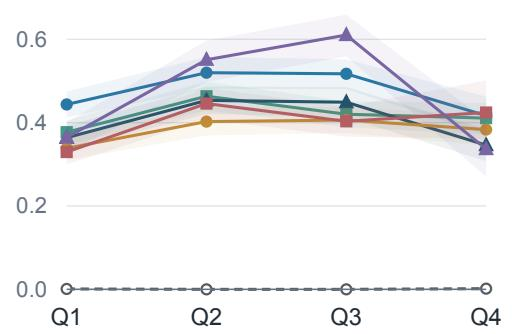
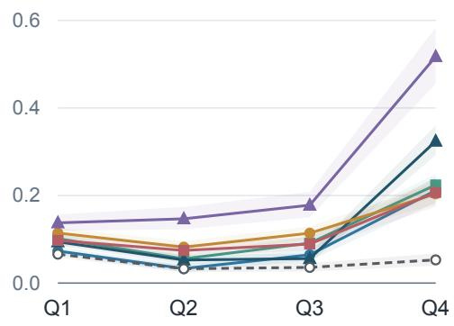
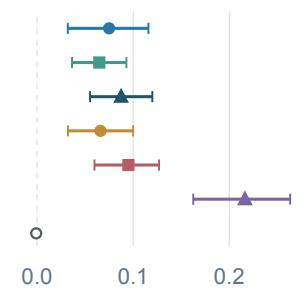
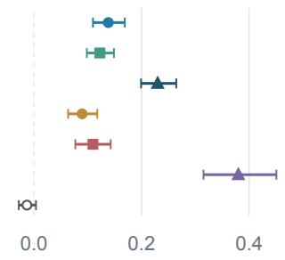
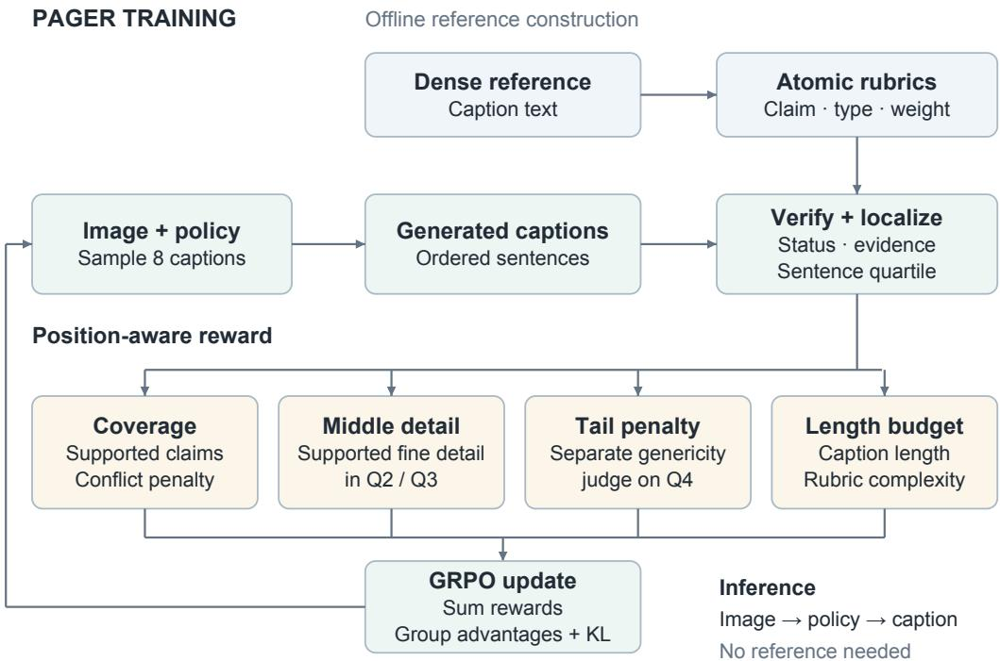
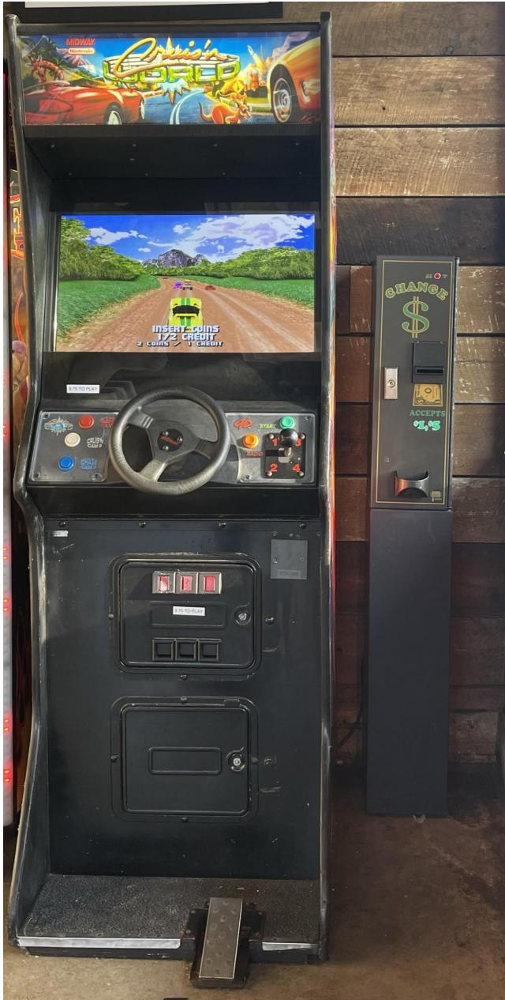

# Where Do Long Captions Fail? Position-Aware Diagnosis and Reinforcement Learning for Detailed Image Captioning

Yuanze Hu1,2,\* Zhichao Yang1 Junwei Jing2,3 Xin Yang2,4 Wenxuan Liu2 Tinghai Zhang2 Jia Fu2 Hongzhi Zhang2 Xiangyu Wu2,† Ruiming Tang2 Tingting Gao2 Han Li2

1Beihang University 2Kuaishou Technology 3Fudan University 4Zhejiang University

## Abstract

Detailed image captioning is usually framed as an amount problem: a model should mention more visual facts while avoiding hallucination. However, autoregressive VLMs generate captions as ordered sequences, and later generations may be produced under weaker or noisier visual grounding. We therefore argue that longform captioning should be studied not only by what facts are mentioned, but also by where they appear. We introduce a position-aware rubric representation that decomposes dense human references into atomic visual claims, verifies generated captions against those claims, and induces a quartile-wise composition of supported, hallucinated, and generic content. This lens reveals two qualitatively different failures in long captions: models tend to produce unsupported specificity in the middle, while the final portion often escapes into vague, non-evidential language rather than simply accumulating more hallucination. A same-reference human control does not exhibit these patterns; additional human audits examine the visual validity of the induced labels. Motivated by this diagnosis, we propose PAGER (Position-Aware Grounded Evidence Reinforcement), a GRPO training objective with separate signals for supported fine-grained middle evidence, evidence-bearing tail continuation, claim coverage, and content-aware length control. The result is a closed loop: the same ordered claim representation identifies where long captions fail and supplies the position-specific reward needed to repair those failures. Experiments on detailed-caption benchmarks show that PAGER improves positionwise grounding and pairwise caption preference while preserving competitive global caption quality.

## 1 Introduction

A detailed caption is not just a bag of visual facts. It is a sequence. The first sentences usually describe salient entities and global context; later sentences are expected to add attributes, relations, smaller objects, and scene-specific detail. Yet detailed-caption evaluation still largely reports global summaries: how many visual elements were covered, how many claims were factual, or which of two captions was preferred [1–4]. These scores are useful, but they collapse the temporal structure of generation. They can tell us that a long caption is imperfect, but not where it starts to fail or what kind of content replaces grounded description.

This paper starts from a simple question: when a model writes a long detailed caption, where do unsupported and uninformative sentences appear? The question is motivated by recent evidence that multimodal generation can become less visually grounded as decoding proceeds [5–7]. A mechanism-level decline in visual reliance, however, does not determine the semantic form of the failure. A model might hallucinate increasingly specific details; it might become vague; or it might alternate between the two. These cases require different training signals.

We answer the question with a position-aware rubric representation. For each image, a dense human reference is decomposed into atomic visual claims. A verifier judges whether each claim is supported, contradicted, or missing in a generated caption and returns the evidence span. By locating evidence spans inside the generated caption, we induce a quartile-wise composition $( S _ { q } , \dot { H } _ { q } , G _ { q } ) \colon$ supported, hallucinated, and generic content at each position. GENERIC is not produced by an auxiliary classifier; it is the residual category for sentences cited by no supported or contradicted claim. This distinguishes reference conflict from unmatched content, which can include filler and correct details absent from the reference.

Across six evaluated captioners from the Qwen, InternVL, and LLaVA families, this lens reveals two stable position-dependent failures. Mid-caption unsupported specificity: hallucination peaks in $Q _ { 2 } / Q _ { 3 }$ , where models attempt to add fine-grained attributes and relations. Tail generic escape: the final quartile contains many more generic sentences than the first quartile. Both effects appear across the evaluated model families. Dense human references do not exhibit the patterns under a same-reference consistency check; independent image-based audits are reported in Appendix J.2.

The central conceptual point is that these failures are not a single monotonic degradation. In three of six models, tail hallucination is lower than head hallucination even though tail genericity is much higher. The tail is not always more hallucinated; it is often less evidential. A vague sentence such as “the overall atmosphere is calm and pleasant” may be neither contradicted nor supported by any visual rubric. It avoids specific hallucination by escaping into generic language. A reward that simply encourages more late-caption content can therefore trade one failure for the other: it may reduce genericity by inducing fabricated detail. This motivates a split objective rather than a uniform late-position weight.

We propose PAGER (Position-Aware Grounded Evidence Reinforcement), which turns the diagnos tic representation into a GRPO reward. PAGER combines claim coverage, a middle-position reward for supported fine-grained evidence, a tail-position penalty for generic escape, and a content-aware length budget. The reward components deliberately mirror the diagnostic findings: the middle and tail regions fail differently and are trained with different signals. The rubric data construction proceeds in two stages: we first build rubrics from curated dense-caption data, then train the final GRPO policy on a larger PixMo-derived rubric set filtered for image quality, caption length, and pre-inference judge quality.

Our contributions are:

1. We introduce a position-aware rubric representation of detailed captions as ordered visual claims, enabling decomposition into supported, hallucinated, and generic content by caption position.

2. We identify two reliable and qualitatively distinct position-dependent failures—mid-caption unsupported specificity and tail generic escape—and show that both are stable across six evaluated captioners but absent in dense human references.

3. We distinguish tail substitution from monotonic error accumulation, challenging a simple “later tokens are worse” interpretation and directly constraining reward design.

4. We propose PAGER, a position-aware GRPO objective whose components map one-to-one onto the diagnostic findings, and evaluate whether it closes the loop by reducing the exact failures that motivated it.

## 2 A position-aware lens for long captions

This section defines the object used throughout the paper. The goal is not to introduce another global caption metric. The goal is to build a common representation that supports both diagnostic measurement in Section 3 and reward construction in Section 4.

Reference rubrics. For an image x paired with a dense human reference caption, an LLM extractor decomposes the reference into atomic visual claims

$$
\begin{array} { r } { \mathcal { R } ( x ) = \{ r _ { i } \} _ { i = 1 } ^ { N _ { x } } . } \end{array}\tag{1}
$$

Each rubric ri is visually checkable and has a dimension $d _ { i } \in  { \mathcal { C } }$ {ENTITY, VISUAL\_DETAIL, INTERACTION, SCENE\_CONTEXT} and a weight $w _ { i } . \mathrm { ~ \textbf ~ { ~ W { e } ~ } ~ }$ use default weights 1.0 for ENTITY, 2.0 for VISUAL\_DETAIL, 1.5 for INTERACTION, and 1.0 for SCENE\_CONTEXT. Compound attributes referring to the same property of the same entity, such as “black-and-white dog,” are preserved as one claim to avoid artificial self-contradictions. Extraction prompts and normalization rules are in Appendix A.

Position-aware verification. Given a generated caption y, a verifier judges each rubric against the full caption and returns

$$
z _ { i } ( y ) \in \{ \mathrm { S U P P O R T E D } , \mathrm { C O N T R A D I C T E D } , \mathrm { M I S S I N G } \}\tag{2}
$$

plus an evidence span quoted from $y$ whenever $z _ { i } ( y ) \neq$ MISSING. We split y into sentences $\{ s _ { k } \} _ { k = 1 } ^ { n }$ and partition them into four ordered quartile bins by sentence index,

$$
Q _ { q } = { \left\{ s _ { k } \ : \ \right\} \left\lfloor 4 ( k - 1 ) / n \right\rfloor + 1 = q }  , \qquad q \in \{ 1 , 2 , 3 , 4 \} ,\tag{3}
$$

so that $y = Q _ { 1 } \cup Q _ { 2 } \cup Q _ { 3 } \cup Q _ { 4 } . \mathrm { ~ A ~ }$ non-missing rubric inherits the quartile index $q _ { i } ( y ) \in \{ 1 , 2 , 3 , 4 \}$ of the sentence containing its evidence span, i.e. the unique $q$ with that sentence in $Q _ { q }$ . The resulting tuple $( r _ { i } , z _ { i } , q _ { i } )$ is a position-aware claim judgment.

This verification is reference-supported rather than directly image-grounded. Mere absence from the reference does not imply contradiction: a sentence with no supporting or conflicting evidence remains GENERIC. An incorrect or incomplete reference can nevertheless create a false contradiction. We use this conservative setting because it gives a stable target across many images and captioners. Section 7 and Appendices H and J.2 discuss and measure this limitation.

From claims to caption composition. The per-rubric judgments induce sentence labels without an auxiliary classifier. Let $\mathcal { R } _ { k } ^ { + }$ be the supported rubrics whose evidence cites sentence $s _ { k }$ , and let $\mathcal { R } _ { k } ^ { - }$ be the contradicted rubrics whose evidence cites $s _ { k }$ . We define

$$
\ell ( s _ { k } ) = \left\{ \begin{array} { l l } { \mathrm { S U P P O R T E D } } & { \mathrm { i f ~ } \mathcal { R } _ { k } ^ { + } \ne \emptyset , } \\ { \mathrm { C O N T R A D I C T E D } } & { \mathrm { i f ~ } \mathcal { R } _ { k } ^ { + } = \emptyset \mathrm { ~ a n d ~ } \mathcal { R } _ { k } ^ { - } \ne \emptyset , } \\ { \mathrm { G E N E R I C } } & { \mathrm { i f ~ } \mathcal { R } _ { k } ^ { + } = \emptyset \mathrm { ~ a n d ~ } \mathcal { R } _ { k } ^ { - } = \emptyset . } \end{array} \right.\tag{4}
$$

A sentence is therefore GENERIC precisely when it contributes no evidence to any reference rubric, whether supported or contradicted. For each quartile bin $Q _ { q }$ , weighted sentence counts give the within-bin composition

$$
\bigl ( S _ { { \cal Q } _ { q } } , { \cal H } _ { { \cal Q } _ { q } } , { \cal G } _ { { \cal Q } _ { q } } \bigr ) , \qquad S _ { { \cal Q } _ { q } } + { \cal H } _ { { \cal Q } _ { q } } + { \cal G } _ { { \cal Q } _ { q } } = 1 ,\tag{5}
$$

where $S _ { Q _ { q } } , H _ { Q _ { q } }$ , and $G _ { Q _ { q } }$ are the fractions of supported, contradicted, and generic sentence weight in $Q _ { q } .$ , normalized by the total sentence weight $\sum { _ { s _ { k } \in Q _ { q } } \omega ( s _ { k } ) }$ within that bin (sentence weights $\omega ( s _ { k } )$ are defined in Appendix $\mathbf { A } )$ . Missing rubrics contribute to caption-level coverage but, having no evidence span, do not enter the within-bin denominator, which is why the three rates sum to one. The cross-model diagnosis uses rubric-dimension weights; Appendix B.1 reports its unweighted counterpart. Table 3 reports the downstream policy comparison using unweighted sentence counts $( \omega ( s _ { k } ) = 1 )$

Effect sizes. We summarize the two position effects, together with the matching shift in supported content, by

$$
\begin{array} { r } { D _ { \mathrm { m i d } } = \frac 1 2 \big ( H _ { Q _ { 2 } } + H _ { Q _ { 3 } } \big ) - H _ { Q _ { 1 } } , \qquad D _ { \mathrm { t a i l } } = G _ { Q _ { 4 } } - G _ { Q _ { 1 } } , \qquad \Delta S = S _ { Q _ { 4 } } - S _ { Q _ { 1 } } . } \end{array}\tag{6}
$$

Positive $D _ { \mathrm { m i d } }$ means hallucination is elevated in the middle relative to the opening; positive $D _ { \mathrm { t a i l } }$ means generic content is elevated in the final quartile; negative $\Delta S$ means supported content is depleted by the tail. We use these signed conventions consistently in Section 3 and the main tables.

(a) Middle contradiction  

(b) Tail genericity  
  
(c) Middle effect  
(d) Tail effect  
Qwen-PlusQwen3-VL-8BQwen3-VL-4BInternVL3.5-8BT InternVL3.5-4BLLaVA-v1.5-7BHuman reference

  
Figure 1: Position-dependent failures in detailed captioning. Top: hallucination rate $H _ { q }$ and generic rate $G _ { q }$ across caption quartiles. Six colored lines are evaluated captioners; the dashed human line is a same-reference control. Statistics use rubric-dimension weights. Shaded regions show 95% image-level paired bootstrap CIs. Bottom: forest plots for $D _ { \mathrm { m i d } }$ and $D _ { \mathrm { t a i l } }$ . Every model has positive effects with CIs excluding zero; human references do not.

What distinguishes this from prior rubric work. Several recent methods already use rubrics, decomposed units, or checklist-style feedback for caption evaluation and training [2, 8–10]. We do not claim novelty for using rubrics per se. The distinction is threefold. First, our rubrics are position-aware: each claim is tied to an evidence span and therefore to a region of the generated caption. Second, we induce GENERIC content as the residual of claim verification, which exposes a failure mode that hallucination-only metrics miss. Third, the reward is not a global rubric score; it targets the positions where the diagnostic shows distinct failures. This is why the same representation can support both a diagnostic claim and a training intervention.

## 3 Diagnosing position-dependent failure

The diagnostic study asks whether long detailed captions exhibit systematic position-dependent failures, and whether those failures are artifacts of our pipeline or properties of model-generated text.

Setup. We evaluate six captioners on a mixed IIW-400 + DOCCI dense-caption evaluation set, using the subset of $n = 1 9 8$ images for which predictions and reference rubrics are available. The evaluated models are Qwen-Plus, Qwen3-VL-8B/4B [11], InternVL3.5-8B/4B [12], and LLaVA-v1.5-7B [13]. All verifier calls use deterministic decoding. For the cross-model diagnostic, uncertainty is estimated by image-level paired bootstrap with $B = 2 0 0 0$ replicates; Figure 1 shows the 95% confidence intervals. Verifier reliability is measured against human-majority labels in Appendix C. As a control, we apply the identical pipeline to dense human reference captions, using rubrics derived from each reference as that caption’s verification target.

Table 1: Human-reference control. Applying the same pipeline to dense human references yields near-zero mid-caption hallucination and no tail generic escape. This is a same-reference consistency check rather than an independent completeness test.
<table><tr><td>Metric</td><td>Generated captions, mean of 6 models</td><td>Human references</td></tr><tr><td> $S _ { Q _ { 1 } }$ </td><td>0.527</td><td>0.933</td></tr><tr><td> $S _ { Q _ { 4 } }$ </td><td>0.333</td><td>0.945</td></tr><tr><td> $G _ { Q _ { 1 } }$ </td><td>0.103</td><td>0.066</td></tr><tr><td> $G _ { Q _ { 4 } }$ </td><td>0.281</td><td>0.053</td></tr><tr><td> $D _ { \mathrm { m i d } }$  (CI95)</td><td>+0.101</td><td>-0.001 [-0.003, +0.000]</td></tr><tr><td> $D _ { \mathrm { t a i l } }$  (CI95)</td><td>+0.178</td><td>-0.013 [−0.028, +0.004]</td></tr></table>

Table 2: The diagnostic findings translate into concrete constraints on reward design.
<table><tr><td>Requirement</td><td>Diagnostic reason</td><td>Reward implication</td></tr><tr><td>Sub-caption granu- larity Mid-caption speci-</td><td>Global scores hide where the composi- tion changes. rises when models add fine</td><td>Reward must operate on claims and sen- tence positions. Reward supported fine-grained evidence</td></tr><tr><td>ficity Tail evidence den-</td><td> $H _ { Q _ { 2 } } / H _ { Q _ { 3 } }$  details.  $G _ { Q _ { 4 } }$  rises even when  $H _ { Q _ { 4 } }$  does not.</td><td>in the middle, not arbitrary specificity. Penalize non-evidential tail sentences</td></tr><tr><td>sity Length control</td><td>Coverage rewards can be hacked by ver-</td><td>without rewarding fabricated detail. Budget length according to im-</td></tr><tr><td></td><td>bosity.</td><td>age/reference complexity.</td></tr></table>

Mid-caption unsupported specificity. Figure 1 shows that hallucination is not flat across the caption. For all six models, $\bar { H _ { q } }$ rises in the middle, and $D _ { \mathrm { m i d } }$ is positive with a 95% CI excluding zero. The across-model mean is +0.101, with values ranging from +0.065 for Qwen3-VL-8B to +0.216 for LLaVA-v1.5-7B. We call this failure mid-caption unsupported specificity. The head of a caption typically covers salient, easy-to-ground content; the middle is where models attempt to add finer attributes, smaller objects, and relations, and where many of these additions are unsupported by the reference. This reframes hallucination in long captions: the peak error region is where the caption is trying to become more informative.

Tail generic escape. The second pattern is different. Generic content rises sharply in the final quartile for every model. The mean $D _ { \mathrm { t a i l } }$ is +0.178, with model-level values from +0.090 for InternVL3.5-8B to +0.380 for LLaVA-v1.5-7B. Because generic sentences are defined as sentences cited by no rubric judgment, this effect means that the final quartile increasingly contains text unmatched to the reference-derived rubric. The corresponding supported content drops substantially: averaged across models, $\Delta S = S _ { Q _ { 4 } } - S _ { Q _ { 1 } } = - 0 . 1 \bar { 9 } 5$ . Thus the end of the caption is not merely lower quality in a global sense; it is compositionally different.

Substitution rather than monotonic decay. A tempting interpretation is that all errors worsen monotonically with position. The data reject that explanation. Comparing the tail to the head, three of the six models have lower hallucination in $Q _ { 4 }$ than in $Q _ { 1 } \colon$ Qwen-Plus (−0.027), Qwen3-VL-4B (−0.018), and $\mathrm { L L a V A – v 1 . 5 – 7 B ( - 0 . 0 2 7 ) }$ . The remaining three show modest increases from +0.034 to +0.094. Yet $D _ { \mathrm { t a i l } }$ is large and positive for every model. The observed composition is consistent with substitution. Near the end of a long caption, models often avoid making concrete claims at all. A vague sentence may be neither contradicted nor supported; it simply does not serve as evidence for any visual claim. Hallucination-only metrics miss this behavior.

Human-reference control. Table 1 is a same-reference sanity check. Human references have weighted contradiction rates at or below 0.002, $D _ { \mathrm { m i d } } \approx 0 .$ , and slightly negative $D _ { \mathrm { t a i l } }$ . Their tail support remains high $( S _ { Q _ { 4 } } = 0 . 9 4 5 )$ , whereas model captions average 0.333. Because the verification target is derived from the same text, this result does not test cross-writer agreement or reference under-coverage.

From diagnosis to reward design. For training, the implication is direct: reducing tail genericity by encouraging more specificity can create new tail hallucinations unless factuality and evidence density are controlled separately. Table 2 summarizes the constraints that the diagnostic imposes on the reward. PAGER implements one reward component per constraint.

  
Evaluation outside training: positional metrics, DeepSeek, and human audits.  
Figure 2: PAGER training pipeline. Reference-derived rubrics and generated captions provide claim judgments and sentence positions. Four reward terms guide $\mathrm { G R P O ; }$ the tail term uses a separate sentence-level genericity judge. DeepSeek and human audits are used only for evaluation. At inference, the policy takes an image without a reference or rubric.

## 4 PAGER: Position-Aware GRPO

PAGER reuses the objects from Section 2: rubrics $\mathcal { R } ( x )$ , itemwise verification labels $z _ { i } ( y )$ , evidence quartiles $q _ { i } ( y )$ , and induced sentence labels $\ell ( s _ { k } )$ . Its reward is a sum of four terms, each matched to a diagnostic requirement (Figure 2). The diagnostic, coverage reward, and mid-caption reward use itemwise checklist judgments with evidence spans; the tail reward uses a lightweight sentence-level genericity judge on final-quartile sentences. A holistic checklist judge, which returns only a single caption-level score, is used only as an ablation baseline and never for the position-wise analysis.

Claim coverage. The base factuality term rewards supported rubric items and penalizes contradicted items. Let $\begin{array} { r } { W _ { x } = \sum _ { i = 1 } ^ { N _ { x } } w _ { i } } \end{array}$ be the total rubric weight for image x. We use the normalized reward

$$
R _ { \mathrm { c o v } } ( y , x ) = \frac { 1 } { W _ { x } } \sum _ { i = 1 } ^ { N _ { x } } w _ { i } \left[ \alpha { \mathbb I } ( z _ { i } = \mathbf { S } \mathbf { U P P O R T E D } ) - \beta { \mathbb I } ( z _ { i } = \mathbf { C O N T R A D I C T E D } ) \right] .\tag{7}
$$

Missing rubrics are neutral. This avoids forcing the model to guess details that it cannot ground and keeps reward magnitudes comparable across images with different numbers of rubrics.

Mid-caption specificity. The diagnostic shows that the middle failure is fabricated fine-grained detail. We therefore reward supported fine-grained rubrics whose evidence falls in $Q _ { 2 } / Q _ { 3 } ;$

$$
R _ { \mathrm { m i d } } ( y , x ) = \lambda _ { \mathrm { m i d } } \frac { \sum _ { i : z _ { i } = \mathrm { S U P o R T E D } , q _ { i } ( y ) \in \{ 2 , 3 \} , \ d _ { i } \in \{ \mathrm { V i S U A L } _ { - } \mathrm { D E T A I L } , \mathrm { I N T E R A C T I O N } \} } w _ { i } } { W _ { r } } .\tag{8}
$$

Here $d _ { i }$ is the dimension associated with rubric item $r _ { i }$ , and $q _ { i } ( y )$ is the caption quartile containing its evidence span. Rubric metadata supplies the claim type; evidence localization supplies its caption position. This term is restricted in both position and content type: it rewards reference-supported fine-grained middle evidence.

Tail evidence density. The tail failure is generic escape. During diagnosis, GENERIC is induced as the residual category of the itemwise verification pipeline. During training, to reduce reward latency and token cost, we use a sentence-level genericity judge only on final-quartile sentences. Let $g ( s _ { k } ) = 1$ if the sentence-level judge labels $s _ { k }$ as generic and 0 otherwise. A reconstructed reference prompt is provided in Appendix A.2. The tail reward is

$$
R _ { \mathrm { t a i l } } ( y , x ) = - \lambda _ { \mathrm { t a i l } } \frac { \sum _ { s _ { k } \in Q _ { 4 } } g ( s _ { k } ) } { \operatorname* { m a x } \left( 1 , | \{ s _ { k } \in Q _ { 4 } \} | \right) } .\tag{9}
$$

This term does not directly reward any non-generic tail sentence. If the model replaces vague filler with fabricated detail, the contradiction penalty in $R _ { \mathrm { c o v } }$ applies. The split between $R _ { \mathrm { m i d } }$ and $R _ { \mathrm { t a i l } }$ is therefore essential: the two failure modes are structurally different.

Content-aware length budget. A coverage reward can be increased by writing longer captions. We set an image-specific budget

$$
L ^ { \star } ( x ) = L _ { 0 } + c | \mathcal { R } ( x ) |\tag{10}
$$

for training examples with rubrics, and penalize only over-budget length:

$$
R _ { \mathrm { l e n } } ( y , x ) = - \lambda _ { \mathrm { l e n } } \log \left( 1 + \operatorname* { m a x } ( 0 , | y | - L ^ { \star } ( x ) ) \right) .\tag{11}
$$

Here $| y |$ is computed as the character length of the generated caption in the implementation. At inference time, $\bar { | \mathcal { R } ( x ) }$ | is unavailable; the reported evaluations therefore use the decoding budget described in Appendix D.

Rubric data curriculum. We first used curated DCI and DOCCI training captions to build dense reference rubrics and validate the checklist pipeline. For the final GRPO training set, we moved to a larger PixMo-derived caption corpus. To avoid training on noisy rubrics, we filter examples using image-quality criteria, caption length constraints, and a pre-inference-and-judge pass: the current policy first generates candidate captions, the rubric judge scores their factuality and usefulness, and low-quality image–caption–rubric triples are removed. This curriculum preserves the clean structure of the original dense-caption rubrics while increasing diversity and scale for GRPO.

GRPO optimization. The full reward is

$$
R _ { \mathrm { P A G E R } } ( y , x ) = R _ { \mathrm { c o v } } + R _ { \mathrm { m i d } } + R _ { \mathrm { t a i l } } + R _ { \mathrm { l e n } } .\tag{12}
$$

We optimize with GRPO. For each image prompt, we sample a group of captions, compute $R _ { \mathrm { P A G E R } }$ for each caption, normalize rewards within the group to obtain relative advantages, and update the policy under a KL penalty to the reference policy. A schematic summary of the advantage and KL terms is

$$
\operatorname* { m a x } _ { \theta } \ \mathbb { E } _ { y \sim \pi _ { \theta } ( \cdot | x ) } \left[ A ( y , x ) - \eta \mathrm { K L } ( \pi _ { \theta } \| \pi _ { \mathrm { r e f } } ) \right] ,\tag{13}
$$

where $A ( y , x )$ is the group-relative advantage induced by $R _ { \mathrm { P A G E R } }$ . Training hyperparameters are in Appendix D.

## 5 Experiments

The experiments are organized around one central test: does PAGER close the diagnostic loop? That is, after training, does the model reduce the mid-caption hallucination peak, sustain evidence-bearing content into the tail, and avoid replacing generic endings with new tail hallucinations?

## 5.1 Setup

Base model and training data. Base model: Qwen3-VL-4B-Instruct. PAGER applies GRPO directly to this initialization; CapRL is treated as an external baseline when reported, not as the initialization for the main run. The reward rubrics were constructed through data filtering. Early rubric construction used curated DCI and DOCCI training captions; the final GRPO run uses a larger PixMo-derived caption corpus whose examples are filtered by image quality, caption length, preinference outputs, and judge scores to remove low-quality samples. Final main-run hyperparameters are reported in Appendix D; Appendix J.8 gives the filtering funnel and measured token costs.

Table 3: Unweighted position metrics on the mixed IIW-400 + DOCCI diagnostic subset $( n = 1 9 8 )$ $\Delta S = S _ { Q _ { 4 } } - \bar { S } _ { Q _ { 1 } } , \bar { \Delta } H = H _ { Q _ { 4 } } - H _ { Q _ { 1 } }$ , and $D _ { \mathrm { t a i l } } = G _ { Q _ { 4 } } - G _ { Q _ { 1 } }$ . Best/second-best values are bold/underlined. Methods are defined in the setup.
<table><tr><td>Method</td><td> $D _ { \mathrm { m i d } }$  →</td><td> $S _ { Q _ { 4 } }$  ↑</td><td> $H _ { Q _ { 4 } }$  ↓</td><td> $G _ { Q _ { 4 } } \downarrow$ </td><td> $\Delta S \uparrow$ </td><td> $\Delta H \downarrow$ </td><td> $D _ { \mathrm { t a i l } } \downarrow$ </td></tr><tr><td>Base</td><td>+.096</td><td>.290</td><td>.298</td><td>.412</td><td>-.241</td><td>-.028</td><td>+.269</td></tr><tr><td>SFT</td><td>+.091</td><td>.296</td><td>.267</td><td>.437</td><td>-.203</td><td>-.053</td><td>+.256</td></tr><tr><td>CapRL</td><td>+.125</td><td>.395</td><td>.283</td><td>.322</td><td>-.151</td><td>+.028</td><td>+.123</td></tr><tr><td>PÁGER</td><td>+.036</td><td>.436</td><td>.235</td><td>.329</td><td>-.094</td><td>-.083</td><td>+.177</td></tr></table>

Table 4: Global benchmark summaries. CAPTURE and DCScore-F1 are quality metrics; facts per 100 tokens and mean token length describe density and verbosity. CapArena excludes ties: each baseline faces PAGER, whose row pools those three comparisons. Scores are descriptive; no significance of small quality-score differences is claimed.
<table><tr><td>Dataset</td><td>Method</td><td>CAPTURE↑</td><td>DCScore-F1↑</td><td>Facts/100tok↑</td><td>Length (tok)</td><td>CapArena4↑</td></tr><tr><td rowspan="4">IIW-400</td><td>Base</td><td>.638</td><td>.507</td><td>5.46</td><td>257</td><td>4.32%</td></tr><tr><td>SFT</td><td>.622</td><td>.402</td><td>6.27</td><td>131</td><td>1.03%</td></tr><tr><td>CapRL</td><td>.640</td><td>.552</td><td>3.20</td><td>475</td><td>8.25%</td></tr><tr><td>PÁGER</td><td>.642</td><td>.526</td><td>3.43</td><td>412</td><td>96.28%</td></tr><tr><td rowspan="4">DOCCI</td><td>Base</td><td>.593</td><td>.482</td><td>5.32</td><td>229</td><td>5.93%</td></tr><tr><td>SFT</td><td>.601</td><td>.398</td><td>6.27</td><td>128</td><td>2.06%</td></tr><tr><td>CapRL</td><td>.604</td><td>.524</td><td>3.28</td><td>464</td><td>7.32%</td></tr><tr><td>PAGER</td><td>.610</td><td>.502</td><td>3.33</td><td>423</td><td>95.62%</td></tr></table>

Baselines. The reported comparisons include: Base, the unmodified Qwen3-VL-4B-Instruct model; SFT, a supervised fine-tuning baseline on PixMo-Cap, reported as PixMol-4B; and CapRL [8], treated as an external captioning/RL baseline rather than as our initialization. The ablations in Section 5 isolate the value of PAGER’s position-aware components by removing each reward term or replacing the split middle/tail design with simpler alternatives.

Benchmarks and metrics. We report global quality and density metrics on both IIW-400 and DOCCI, including CAPTURE, DCScore-F1, facts per 100 tokens, and average caption length. We also report four-model CapArena preference under the pairwise protocol [4]. For each dataset, the CapArena value is computed only from the methods displayed in Table 4: each baseline is compared directly against PAGER, ties are excluded from the win-rate denominator, and the PAGER row pools the three direct comparisons. Table 3 uses the same mixed IIW-400 + DOCCI diagnostic subset (n = 198) as Section 3, measuring unweighted quartile-wise composition $( S _ { q } , H _ { q } , \breve { G _ { q } } )$ . We report $\Delta S = S _ { Q _ { 4 } } - S _ { Q }$ and $\Delta H = H _ { Q _ { 4 } } - H _ { Q _ { 1 } }$ separately to distinguish changes in tail support from changes in tail hallucination. Unless otherwise stated, all main results in Tables 3 and 4 are averaged over three repeated evaluation runs; the tables report the mean value. Repeated evaluations are distinct from independent training seeds; Appendix J.7 separately reports the three-seed transfer update.

## 5.2 Main results: global quality and positional repair

Table 3 is the central closed-loop result. On the same 198-image diagnostic subset, PAGER reduces the mid-caption hallucination effect from $D _ { \mathrm { m i d } } = + . 0 9 6$ for the base model to +.036, obtains the highest tail supported rate $( S _ { Q _ { 4 } } = . 4 3 6 )$ , and achieves the lowest tail hallucination rate $( H _ { Q _ { 4 } } = . 2 3 5 )$ . The tail repair is therefore not a trade-off where generic endings are replaced by fabricated details: relative to the base model, PAGER both increases final-quartile supported content and lowers final-quartile hallucination. Table 4 gives the complementary global picture. PAGER has the best

Table 5: Component ablations under the position-aware diagnostic. Holistic checklist uses a captionlevel score; monotone weight replaces separate middle/tail rewards with increasing late-position weight. Removing each reward term tests its contribution to the target region.
<table><tr><td>Variant</td><td> $H _ { Q _ { 2 } }$  ↓</td><td> $H _ { Q _ { 3 } }$  ↓</td><td> $S _ { Q _ { 4 } }$  ↑</td><td> $H _ { Q _ { 4 } }$  ↓</td><td> $G _ { Q _ { 4 } }$  ↓</td><td> $D _ { \mathrm { m i d } }$ </td><td>↓ ∆S↑</td><td>∆H↓</td></tr><tr><td>PAGER full</td><td>.364</td><td>.344</td><td>.436</td><td>.235</td><td>.329</td><td>+.036</td><td>-.094</td><td>-.083</td></tr><tr><td>w/o  $R _ { \mathrm { m i d } }$ </td><td>.421</td><td>.408</td><td>.418</td><td>.241</td><td>.341</td><td>+.103</td><td>-.112</td><td>-.071</td></tr><tr><td>w/o  $R _ { \mathrm { t a i l } }$ </td><td>.371</td><td>.350</td><td>.374</td><td>.248</td><td>.378</td><td>+.039</td><td>-.156</td><td>-.074</td></tr><tr><td>w/o  $R _ { \mathrm { l e n } }$ </td><td>.378</td><td>.356</td><td>.408</td><td>.252</td><td>.340</td><td>+.047</td><td>-.118</td><td>-.068</td></tr><tr><td>w/o filtering</td><td>.393</td><td>.375</td><td>.401</td><td>.258</td><td>.341</td><td>+.064</td><td>-.127</td><td>-.062</td></tr><tr><td>Holistic checklist</td><td>.388</td><td>.367</td><td>.421</td><td>.244</td><td>.335</td><td>+.058</td><td>-.103</td><td>-.076</td></tr><tr><td>Monotone weight</td><td>.370</td><td>.347</td><td>.402</td><td>.291</td><td>.307</td><td>+.037</td><td>-.138</td><td>-.031</td></tr></table>

CAPTURE score on IIW-400 (.642) and DOCCI (.610), with small margins over CapRL. DCScore-F1 favors CapRL, so the evidence should be read as a trade-off: PAGER improves CAPTURE and four-model pairwise preference while not maximizing every global metric. Facts density should also be interpreted with length in mind: the SFT and base models are denser partly because they produce much shorter captions, whereas PAGER is denser than the longer CapRL baseline while producing shorter captions.

For CapArena, we compute a four-model tie-excluded pairwise win rate using the direct comparisons among the methods displayed in Table 4. For example, on IIW-400, PAGER wins 133–6 against Qwen3-VL-4B-Instruct, 89–8 against CapRL-Qwen3VL-4B, and 192–2 against PixMol-4B, excluding ties. Pooling these comparisons gives $\mathrm { \bar { 4 1 4 } } / ( 4 1 4 + 1 6 ) = 9 6 . 2 8 \%$ for PAGER.

## 5.3 Ablations and robustness

Component ablations. Table 5 supports the intended division of labor among the reward terms. Removing $R _ { \mathrm { m i d } }$ produces the clearest mid-caption degradation: $H _ { Q _ { 2 } }$ rises from .364 to .421, $H _ { Q _ { 3 } }$ from .344 to .408, and $D _ { \mathrm { m i d } }$ from +.036 to +.103. Removing $R _ { \mathrm { t a i l } }$ mainly hurts the final quartile: $S _ { Q _ { 4 } }$ drops from .436 to .374 and $G _ { Q _ { 4 } }$ rises from .329 to .378, while $D _ { \mathrm { m i d } }$ remains close to the full model. Removing $R _ { \mathrm { l e n } }$ and removing PixMo filtering both weaken the positional repair, increasing $D _ { \mathrm { m i d } }$ and lowering $S _ { Q _ { 4 } }$ relative to the full model. The holistic checklist reward is also weaker than the itemwise evidence-span reward, which suggests that caption-level supervision does not fully recover the targeted position-specific behavior. Finally, the monotone position-weight baseline has a similar mid-caption effect $( D _ { \mathrm { m i d } } = . 0 3 7$ versus .036) and lowers $G _ { Q _ { 4 } }$ to .307 while raising $H _ { Q _ { 4 } }$ to .291, the highest tail hallucination rate among the ablations. This is the failure mode anticipated by the diagnostic: a single late-position incentive can reduce genericity by encouraging unsupported tail detail, whereas PAGER separates middle specificity from tail evidence density.

Verifier reliability and human evaluation. Qwen3-8B supplies training judgments; DeepSeek-V3.2 remains outside the training loop. Both support the main positional comparison (Appendix J.5); their agreement with human labels on 347 rubric judgments is $\kappa = . 8 9 / . 9 2$ (Appendix C). Supplementary image audits and human preferences provide descriptive evidence (Appendix J.2–J.3). The post-RL residual-label audit describes the composition of unmatched tail sentences, with intervals spanning zero (Appendix J.4).

Stronger models and transfer. Additional foundation-model diagnostics retain a positive tail effect (Appendix J.6). At a 100-step budget, three-seed 8B/32B training gives mean $\bar { D _ { \mathrm { m i d } } } = . 0 4 1 / . 0 4 3$ and $H _ { Q _ { 4 } } = . 2 1 6 / . 2 1 4$ . Appendix J.7 presents single-run comparisons, CapRL continuation, and three-seed replication under a 100-step budget with per-scale learning rates.

Qualitative example. Appendix G includes a concrete example for image aar\_test\_04938, comparing the base Qwen3-VL-4B-Instruct caption, the CapRL baseline, and PAGER. The example illustrates how the positional patterns measured in Tables 3–5 appear in an individual caption.

## 6 Related work

Detailed captioning and evaluation. Image captioning has moved from short sentence generation toward dense, hyper-detailed description covering objects, attributes, relations, and scene context [14– 17]. Classical metrics such as BLEU, METEOR, CIDEr, and SPICE measure overlap or scene-graph content [18–21]. Recent detailed-caption metrics evaluate factuality, coverage, and preference: CAPTURE extracts visual elements [1]; DCScore decomposes captions into primitive units [2]; CompreCap evaluates scene-graph completeness [3]; and CapArena and VELA evaluate long captions with preference- or long-caption-specific protocols [4, 22]. These methods mostly produce global scores. Our work is complementary: we ask where supported, hallucinated, and generic content occurs inside the caption.

Rubrics, checklists, and feedback. Decomposed claims and checklists support both evaluation and optimization: FeedQuill uses DCScore-derived feedback [2]; CapRL uses caption-only QA rewards [8]; RubiCap uses sample-specific rubrics [9]; and CCCaption and SC-Captioner target correctness, completeness, and self-correction [10, 23]. Huang et al. [24] study rubric anchors for open-ended reinforcement learning. Beyond captioning, DeepSynth-Eval evaluates long-form survey synthesis through factual-coverage and structural-constraint checklists [25]. PoSh uses scene-graph rubrics to localize detailed-caption errors, introduces DOCENT with expert references and human error annotations, and also serves as a reward [26]. Our focus is position-dependent error composition and its implications for separate middle and tail rewards.

Hallucination and position effects. CHAIR, POPE, and FaithScore measure object- or claimlevel visual hallucination [27–29]; FActScore verifies atomic claims in long-form text [30]. At the representation level, TinyAlign improves cross-modal alignment through retrieved context [31], while CoSE uses retrieved semantically connected latent samples to mitigate hallucinations [32]. Recent studies suggest that multimodal models may rely less on visual information as generation proceeds [5–7], and long-context language models show position-dependent reliability [33]. We provide a semantic, caption-level decomposition of such effects and show that late-caption failure is often generic escape rather than increased hallucination.

## 7 Discussion and limitations

This paper argues that long detailed captions should be evaluated and trained as ordered sequences, rather than unordered collections of facts. Our diagnostic separates two failures that global scores conflate: unsupported specificity in the middle and generic escape at the tail. The latter is not merely “more hallucination later,” but a shift toward content unmatched to the reference rubric. PAGER captures this structure by assigning separate reward terms to the corresponding failure regions.

Limitations. Reference verification can miss correct unreferenced details or create false contradictions. Additional human studies used unpaid volunteers from the authors’ personal circle. The post-RL audit characterizes selected residual sentences descriptively. Diversity comparisons control sentence count while caption lengths differ. Transfer findings apply to the tested short-budget settings with per-scale learning rates; controlled scaling and reward-overfitting analyses require broader evaluation.

Broader implications. The same recipe—decomposing outputs into ordered claims, diagnosing position-wise composition, and aligning training signals to observed failure regions—may extend beyond captioning to long-form multimodal reasoning, text generation, and tool-use trajectories.

## Acknowledgments and Disclosure of Funding

We thank the volunteers who helped with the human evaluations without monetary compensation. We thank Kuaishou Technology for providing computational resources and supporting the conference registration fee. Yuanze Hu carried out this work during an internship at Kuaishou Technology.

## References

[1] Hongyuan Dong, Jiawen Li, Bohong Wu, Jiacong Wang, Yuan Zhang, and Haoyuan Guo. Benchmarking and improving detail image caption. arXiv preprint arXiv:2405.19092, 2024.

[2] Qinghao Ye, Xianhan Zeng, Fu Li, Chunyuan Li, and Haoqi Fan. Painting with words: Elevating detailed image captioning with benchmark and alignment learning. arXiv preprint arXiv:2503.07906, 2025.

[3] Fan Lu, Wei Wu, Kecheng Zheng, Shuailei Ma, Biao Gong, Jiawei Liu, Wei Zhai, Yang Cao, Yujun Shen, and Zheng-Jun Zha. Benchmarking large vision-language models via directed scene graph for comprehensive image captioning. In Proceedings of the Computer Vision and Pattern Recognition Conference, pages 19618–19627, 2025.

[4] Kanzhi Cheng, Wenpo Song, Jiaxin Fan, Zheng Ma, Qiushi Sun, Fangzhi Xu, Chenyang Yan, Nuo Chen, Jianbing Zhang, and Jiajun Chen. Caparena: Benchmarking and analyzing detailed image captioning in the llm era. In Findings of the Association for Computational Linguistics: ACL 2025, pages 14077–14094, 2025.

[5] Feilong Tang, Chengzhi Liu, Zhongxing Xu, Ming Hu, Zile Huang, Haochen Xue, Ziyang Chen, Zelin Peng, Zhiwei Yang, Sijin Zhou, et al. Seeing far and clearly: Mitigating hallucinations in mllms with attention causal decoding. In Proceedings ofthe Computer Vision and Pattern Recognition Conference, pages 26147–26159, 2025.

[6] Tianyun Yang, Ziniu Li, Juan Cao, and Chang Xu. Understanding and mitigating hallucination in large vision-language models via modular attribution and intervention. In The Thirteenth International Conference on Learning Representations, 2025.

[7] Mingi Jung, Saehyung Lee, Eunji Kim, and Sungroh Yoon. Visual attention never fades: Selective progressive attention recalibration for detailed image captioning in multimodal large language models. In International Conference on Machine Learning, pages 28527–28551. PMLR, 2025.

[8] Long Xing, Xiaoyi Dong, Yuhang Zang, Yuhang Cao, Jianze Liang, Qidong Huang, Jiaqi Wang, Feng Wu, and Dahua Lin. Caprl: Stimulating dense image caption capabilities via reinforcement learning. arXiv preprint arXiv:2509.22647, 2025.

[9] Tzu-Heng Huang, Sirajul Salekin, Javier Movellan, Frederic Sala, and Manjot Bilkhu. Rubicap: Rubric-guided reinforcement learning for dense image captioning. arXiv preprint arXiv:2603.09160, 2026.

[10] Zhijiang Tang, Linhua Wang, Jiaxin Qi, Weihao Jiang, Peng Hou, Anxiang Zeng, and Jianqiang Huang. Cccaption: Dual-reward reinforcement learning for complete and correct image captioning. arXiv preprint arXiv:2602.21655, 2026.

[11] Shuai Bai, Yuxuan Cai, Ruizhe Chen, Keqin Chen, Xionghui Chen, Zesen Cheng, Lianghao Deng, Wei Ding, Chang Gao, Chunjiang Ge, et al. Qwen3-vl technical report. arXiv preprint arXiv:2511.21631, 2025.

[12] Weiyun Wang, Zhangwei Gao, Lixin Gu, Hengjun Pu, Long Cui, Xingguang Wei, Zhaoyang Liu, Linglin Jing, Shenglong Ye, Jie Shao, et al. Internvl3. 5: Advancing open-source multimodal models in versatility, reasoning, and efficiency. arXiv preprint arXiv:2508.18265, 2025.

[13] Haotian Liu, Chunyuan Li, Qingyang Wu, and Yong Jae Lee. Visual instruction tuning. Advances in neural information processing systems, 36:34892–34916, 2023.

[14] Yasumasa Onoe, Sunayana Rane, Zachary Berger, Yonatan Bitton, Jaemin Cho, Roopal Garg, Alexander Ku, Zarana Parekh, Jordi Pont-Tuset, Garrett Tanzer, et al. Docci: Descriptions of connected and contrasting images. In European Conference on Computer Vision, pages 291–309. Springer, 2024.

[15] Jack Urbanek, Florian Bordes, Pietro Astolfi, Mary Williamson, Vasu Sharma, and Adriana Romero-Soriano. A picture is worth more than 77 text tokens: Evaluating clip-style models on dense captions. In Proceedings ofthe IEEE/CVF Conference on Computer Vision and Pattern Recognition, pages 26700–26709, 2024.

[16] Roopal Garg, Andrea Burns, Burcu Karagol-Ayan, Yonatan Bitton, Ceslee Montgomery, Yasumasa Onoe, Andrew Bunner, Ranjay Krishna, Jason Michael Baldridge, and Radu Soricut. Imageinwords: Unlocking hyper-detailed image descriptions. In Proceedings of the 2024 Conference on Empirical Methods in Natural Language Processing, pages 93–127, 2024.

[17] Matt Deitke, Christopher Clark, Sangho Lee, Rohun Tripathi, Yue Yang, Jae Sung Park, Mohammadreza Salehi, Niklas Muennighoff, Kyle Lo, Luca Soldaini, et al. Molmo and pixmo: Open weights and open data for state-of-the-art vision-language models. In Proceedings of the Computer Vision and Pattern Recognition Conference, pages 91–104, 2025.

[18] Kishore Papineni, Salim Roukos, Todd Ward, and Wei-Jing Zhu. Bleu: a method for automatic evaluation of machine translation. In Pierre Isabelle, Eugene Charniak, and Dekang Lin, editors, Proceedings of the 40th Annual Meeting of the Association for Computational Linguistics, pages 311–318, Philadelphia, Pennsylvania, USA, July 2002. Association for Computational Linguistics. doi: 10.3115/1073083.1073135. URL https://aclanthology.org/P02-1040/.

[19] Satanjeev Banerjee and Alon Lavie. METEOR: An automatic metric for MT evaluation with improved correlation with human judgments. In Jade Goldstein, Alon Lavie, Chin-Yew Lin, and Clare Voss, editors, Proceedings ofthe ACL Workshop on Intrinsic and Extrinsic Evaluation Measures for Machine Translation and/or Summarization, pages 65–72, Ann Arbor, Michigan, June 2005. Association for Computational Linguistics. URL https://aclanthology.org/ W05-0909/.

[20] Ramakrishna Vedantam, C Lawrence Zitnick, and Devi Parikh. Cider: Consensus-based image description evaluation. In Proceedings of the IEEE conference on computer vision and pattern recognition, pages 4566–4575, 2015.

[21] Peter Anderson, Basura Fernando, Mark Johnson, and Stephen Gould. Spice: Semantic propositional image caption evaluation. In European conference on computer vision, pages 382–398. Springer, 2016.

[22] Kazuki Matsuda, Yuiga Wada, Shinnosuke Hirano, Seitaro Otsuki, and Komei Sugiura. Vela: An llm-hybrid-as-a-judge approach for evaluating long image captions. In Proceedings ofthe 2025 Conference on Empirical Methods in Natural Language Processing, pages 8691–8707, 2025.

[23] Lin Zhang, Xianfang Zeng, Kangcong Li, Gang Yu, and Tao Chen. Sc-captioner: Improving image captioning with self-correction by reinforcement learning. In Proceedings of the IEEE/CVF International Conference on Computer Vision, pages 23145–23155, 2025.

[24] Zenan Huang, Yihong Zhuang, Guoshan Lu, Zeyu Qin, Haokai Xu, Tianyu Zhao, Ru Peng, Jiaqi Hu, Zhanming Shen, Xiaomeng Hu, Xijun Gu, Peiyi Tu, Jiaxin Liu, Wenyu Chen, Yuzhuo Fu, Zhiting Fan, Yanmei Gu, Yuanyuan Wang, Zhengkai Yang, Jianguo Li, and Junbo Zhao. Reinforcement learning with rubric anchors. arXiv preprint arXiv:2508.12790, 2025. URL https://arxiv.org/abs/2508.12790.

[25] Hongzhi Zhang, Yuanze Hu, Tinghai Zhang, Jia Fu, Tao Wang, Junwei Jing, Zhaoxin Fan, Wei Bi, Ruiming Tang, Han Li, Guorui Zhou, and Kun Gai. DeepSynth-Eval: Objectively evaluating information consolidation in deep survey writing. In Findings of the Association for Computational Linguistics: ACL 2026, pages 33805–33822. Association for Computational Linguistics, 2026. URL https://aclanthology.org/2026.findings-acl.1688/.

[26] Amith Ananthram, Elias Stengel-Eskin, Lorena A. Bradford, Julia Demarest, Adam Purvis, Keith Krut, Robert Stein, Rina Elster Pantalony, Mohit Bansal, and Kathleen McKeown. PoSh: Using scene graphs to guide LLMs-as-a-judge for detailed image descriptions. In International Conference on Learning Representations, 2026. URL https://arxiv.org/ abs/2510.19060.

[27] Anna Rohrbach, Lisa Anne Hendricks, Kaylee Burns, Trevor Darrell, and Kate Saenko. Object hallucination in image captioning. In Proceedings of the 2018 Conference on Empirical Methods in Natural Language Processing, pages 4035–4045, 2018.

[28] Yifan Li, Yifan Du, Kun Zhou, Jinpeng Wang, Xin Zhao, and Ji-Rong Wen. Evaluating object hallucination in large vision-language models. In Houda Bouamor, Juan Pino, and Kalika Bali, editors, Proceedings ofthe 2023 Conference on Empirical Methods in Natural Language Processing, pages 292–305, Singapore, December 2023. Association for Computational Linguistics. doi: 10.18653/v1/2023.emnlp-main.20. URL https://aclanthology.org/2023. emnlp-main.20/.

[29] Liqiang Jing, Ruosen Li, Yunmo Chen, and Xinya Du. FaithScore: Fine-grained evaluations of hallucinations in large vision-language models. In Yaser Al-Onaizan, Mohit Bansal, and Yun-Nung Chen, editors, Findings ofthe Associationfor Computational Linguistics: EMNLP 2024, pages 5042–5063, Miami, Florida, USA, November 2024. Association for Computational Linguistics. doi: 10.18653/v1/2024.findings-emnlp.290. URL https://aclanthology.org/ 2024.findings-emnlp.290/.

[30] Sewon Min, Kalpesh Krishna, Xinxi Lyu, Mike Lewis, Wen-tau Yih, Pang Koh, Mohit Iyyer, Luke Zettlemoyer, and Hannaneh Hajishirzi. FActScore: Fine-grained atomic evaluation of factual precision in long form text generation. In Houda Bouamor, Juan Pino, and Kalika Bali, editors, Proceedings ofthe 2023 Conference on Empirical Methods in Natural Language Processing, pages 12076–12100, Singapore, December 2023. Association for Computational Linguistics. doi: 10.18653/v1/2023.emnlp-main.741. URL https://aclanthology.org/ 2023.emnlp-main.741/.

[31] Yuanze Hu, Xinyu Wang, Zhichao Yang, Gen Li, Ye Qiu, Zhaoxin Fan, Yifan Sun, Wenjun Wu, Jin Dong, and Xiaotie Deng. TinyAlign: Boosting lightweight vision-language models by mitigating modal alignment bottlenecks. In Findings of the Association for Computational Linguistics: ACL 2026, pages 4585–4597. Association for Computational Linguistics, 2026. doi: 10.18653/v1/2026.findings-acl.223. URL https://aclanthology.org/2026. findings-acl.223/.

[32] Yuanze Hu, Zhaoxin Fan, Gen Li, Zhichao Yang, Xinyu Wang, Ye Qiu, Wenjun Wu, Kejian Wu, Yifan Sun, Xiaotie Deng, Jin Dong, and Ziyu Jia. CoSE: Connectivity-oriented semantic enhancement for mitigating hallucinations in multimodal LLMs. Information Fusion, 135: 104478, 2026. doi: 10.1016/j.inffus.2026.104478.

[33] Nelson F. Liu, Kevin Lin, John Hewitt, Ashwin Paranjape, Michele Bevilacqua, Fabio Petroni, and Percy Liang. Lost in the middle: How language models use long contexts. Transactions of the Association for Computational Linguistics, 12:157–173, 2024. doi: 10.1162/tacl\_a\_00638. URL https://aclanthology.org/2024.tacl-1.9/.

[34] Aixin Liu, Aoxue Mei, Bangcai Lin, Bing Xue, Bingxuan Wang, Bingzheng Xu, Bochao Wu, Bowei Zhang, Chaofan Lin, Chen Dong, et al. Deepseek-v3. 2: Pushing the frontier of open large language models. arXiv preprint arXiv:2512.02556, 2025.

[35] An Yang, Anfeng Li, Baosong Yang, Beichen Zhang, Binyuan Hui, Bo Zheng, Bowen Yu, et al. Qwen3 technical report. arXiv preprint arXiv:2505.09388, 2025. URL https://arxiv.org/ abs/2505.09388.

,→ actions).

You are an expert in Visual-Linguistic Decomposition.   
Your task is to break down a ground-truth image caption into a structured   
,→ list   
of atomic visual facts (a checklist).

- "wooden and metal table" -> Split into "The table is wooden" +   
"The table is metal"

## A Diagnostic pipeline details

## A.1 Reference rubric construction

For each image x, an LLM extractor decomposes the dense human reference caption into atomic visual rubrics. Each rubric item contains a claim, dimension, weight, and keyword. The extractor resolves pronouns to explicit nouns, preserves compound attributes referring to the same property of the same entity, deduplicates case- and whitespace-normalized claims, and discards empty or extremely short claims. The prompt is shown below.

## Extractor system prompt.

## ### Objective

Create a high-precision verification set. We need to ensure the model ,→ captures

both main subjects and fine-grained visual details without hallucination.

## ### Taxonomy & Weights

Classify each extracted fact into one of these dimensions:

1. Entity (Weight: 1.0): Core objects/nouns.

2. Visual\_Detail (Weight: 2.0): Adjectives describing appearance (colors,   
materials, shapes, counts).

3. Interaction (Weight: 1.5): Relations between entities (spatial,

4. Scene\_Context (Weight: 1.0): Global context.

## ### Strict Constraints

1. Atomicity: One visual fact per item - but keep compound attributes ,→ together.

2. No Hallucination: Stick strictly to the input text. Do not infer or add information.

3. Coreference Resolution: Resolve pronouns like "it/they/them" to specific nouns.

4. Keyword: Pick the single most discriminative word as the anchor.

5. Format: Output valid JSON only.

6. Compound Attributes Rule (CRITICAL):

\- When multiple values describe the SAME property of an entity, keep ,→ them in

\- Properties include: color, material, size, pattern, texture, etc.

CORRECT Examples:

\- "white and black dog" -> "The dog has white and black coloring"

\- "wooden and metal table" -> "The table is made of wood and metal"

\- "large and round eyes" -> "The eyes are large and round"

\- "red, blue and yellow stripes" -> "The stripes are red, blue and ,→ yellow"

WRONG Examples (DO NOT do this):

- "white and black dog" -> Split into "The dog is white" + "The dog is   
,→ black"

7. Semantic Completeness: Each claim must be semantically complete and   
non-contradictory when evaluated independently.   
### Decision Tree for Compound Attributes   
Ask yourself: "If I split this into separate claims, would they contradict   
,→ each   
other or lose meaning?"   
- If YES -> Keep together in one claim   
- If NO -> Can split into separate atomic facts   
Examples:   
- "A red car and a blue truck" -> Split OK (different entities)   
- "A red and blue car" -> Keep together (same entity, same property)   
- "The dog is sitting and wagging its tail" -> Split OK (different actions)   
- "The ball is large and round" -> Keep together (related size/shape of   
,→ same   
object)   
Extractor user template.   
# Task   
Decompose the following text into atomic visual facts following the rules   
,→ in the   
system prompt.   
# Input Text   
"""{gt\_text}"""   
# Critical Reminder   
- Compound Attributes: Keep multiple values for the SAME property together   
- "white and black dog" -> ONE claim: "The dog has white and black   
,→ coloring"   
- NOT two claims: "The dog is white" + "The dog is black"   
# Output Schema (JSON)   
{   
"rubric": [   
{   
"claim": "Atomic sentence with resolved nouns and compound attributes   
,→ preserved.",   
"dimension": "Entity|Visual\_Detail|Interaction|Scene\_Context",   
"weight": <float>,   
"keyword": "most\_discriminative\_anchor\_word"   
}   
]   
}   
# Output Requirements   
- Valid JSON format   
- Each claim must be verifiable from the input text   
- Preserve compound attributes (colors, materials, sizes) in single claims   
- Resolve all pronouns to specific nouns

## A.2 Position-aware checklist verification

Given generated caption y and rubric set $\mathcal { R } ( x )$ , the main judge is itemwise: it returns a status $z _ { i } \in \{ \mathrm { S U P P O R T E D }$ , CONTRADICTED, MISSING} and evidence span for every rubric. The judge sees the full caption, not presegmented sentences. We independently segment y into sentences using punctuation-based splitting, discard very short fragments, and assign quartiles by sentence index. For a caption with n valid sentences indexed $k = 1 , \ldots , n ,$ , sentence $s _ { k }$ is assigned to the quartile bin $Q _ { q }$

with index

$$
q _ { k } = \left\lfloor { \frac { 4 ( k - 1 ) } { \operatorname* { m a x } ( n , 1 ) } } \right\rfloor + 1 \in \{ 1 , 2 , 3 , 4 \} ,\tag{14}
$$

matching the partition $Q _ { q } = \{ s _ { k } : q _ { k } = q \}$ used in Section 2.

Evidence spans are matched back to sentences by exact string matching after normalization; unmatched spans are handled by fuzzy matching to the nearest sentence, and examples with unresolved evidence are excluded from the position-wise aggregation.

## Itemwise judge prompt used for the main diagnostic and PAGER reward.

You are a strict fact-checking assistant.   
Given a CAPTION and a list of CHECKLIST ITEMS, evaluate the relationship.   
For each item, classify the status as one of the following:   
- 'supported': The caption explicitly supports the claim.   
- 'contradicted': The caption explicitly contradicts the claim or states   
,→ the opposite.   
- 'missing': The caption does not mention the claim at all.   
Return ONLY a JSON object where keys are the item indices (0, 1, 2...) and   
,→ values   
are objects with \`status\` (string) and \`evidence\` (string, leave empty if   
,→ missing).   
Caption: {caption}   
Checklist Items:   
{checklist\_text}

JSON Output:

Sentence-level tail-genericity judge: reference prompt. The following reference template documents the sentence-level decision rule used in training; its wording is reconstructed for documentation. It classifies a sentence’s specificity rather than verifying its truth against an image or reference.

Decide whether this sentence is generic filler in an image caption.   
Set generic=1 if it contains only vague summaries, subjective impressions,   
or commentary, with no concrete visually checkable detail.   
Set generic=0 if it contains a concrete object, attribute, action, or   
spatial relation. Specificity alone does not establish factual correctness.   
Return only JSON: {"generic": 0} or {"generic": 1}.   
Sentence: {sentence}

The returned binary value is g(sk) in the tail-reward definition. Apply it only to $s _ { k } \in Q _ { 4 }$ and average the flags with the negative coefficient −λtail. Diagnostic $G _ { q }$ remains the residual category from itemwise verification.

Holistic judge prompt used only for ablation. The holistic judge removes itemwise evidence spans and therefore cannot produce the position-aware quantities $( \bar { \cal S } _ { q } , { \cal H } _ { q } , { \cal G } _ { q } )$ . We include it only as an ablation to test whether a single caption-level checklist score can substitute for itemwise position-aware supervision.

You are a strict evaluation assistant.   
Given a CAPTION and a list of CHECKLIST ITEMS, evaluate how well the   
,→ caption   
satisfies the checklist as a whole.   
Consider completeness, factual consistency, and overall coverage.   
Return ONLY a JSON object with:   
- \`score\`: a float between 0.0 and 1.0   
- \`evidence\`: a brief explanation string   
Caption: {caption}

Checklist Items: {checklist\_text}

JSON Output:

## A.3 Sentence-level induced labels and aggregation

For each sentence $s _ { k } ,$ let $\mathcal { R } _ { k } ^ { + }$ and $\mathcal { R } _ { k } ^ { - }$ denote the sets of supported and contradicted rubrics whose evidence span cites s . $s _ { k }$ The induced sentence label $\ell ( s _ { k } ) \in$ {SUPPORTED, CONTRADICTED, GENERIC} follows the rule in Section 2. Each sentence receives a weight

$$
\begin{array} { r } { \omega ( s _ { k } ) = \left\{ \begin{array} { l l } { \sum _ { r _ { i } \in \mathcal { R } _ { k } ^ { + } } w _ { i } } & { \ell ( s _ { k } ) = \mathrm { S U P P O R T E D } , } \\ { \sum _ { r _ { i } \in \mathcal { R } _ { k } ^ { - } } w _ { i } } & { \ell ( s _ { k } ) = \mathrm { C O N T R A D I C T E D } , } \\ { 1 } & { \ell ( s _ { k } ) = \mathrm { G E N E R I C } . } \end{array} \right. } \end{array}\tag{15}
$$

Let $\begin{array} { r } { W _ { Q _ { q } } = \sum _ { s _ { k } \in Q _ { q } } \omega ( s _ { k } ) } \end{array}$ denote the total sentence weight in quartile bin $Q _ { q }$ (defined in Section 2). Under the correspondence c(S) = SUPPORTED, c(H) = CONTRADICTED, c(G) = GENERIC, the within-bin rates are

$$
X _ { Q _ { q } } = \frac { 1 } { W _ { Q _ { q } } } \sum _ { s _ { k } \in Q _ { q } } \omega ( s _ { k } ) \mathbb { I } \big [ \ell ( s _ { k } ) = c ( X ) \big ] , \qquad X \in \{ S , H , G \} .\tag{16}
$$

Missing rubrics contribute to caption-level coverage but, having no evidence span, do not enter any bin’s denominator $W _ { Q _ { q } } ;$ ; consequently $S _ { Q _ { q } } + H _ { Q _ { q } } + G _ { Q _ { q } } = 1$ within every bin.

## A.4 Bootstrap confidence intervals

Confidence intervals for the cross-model diagnostic rates and effects use image-level paired bootstrap with B = 2000 replicates. Each replicate samples images with replacement, pools all sentences from sampled images, and re-aggregates quartile counts. This accounts for correlation among sentences from the same image.

## B Additional diagnostic statistics

Table 6: Weighted per-model rubric-based position-wise composition on the mixed IIW-400 + DOCCI set (n = 198). S/H/G are weighted sentence-level rates. Effect sizes use image-level paired bootstrap (B = 2000).
<table><tr><td>Model</td><td> $Q _ { 1 }$  S/H/G</td><td> $Q _ { 2 }$  S/H/G</td><td> $Q _ { 3 }$  S/H/G</td><td> $Q _ { 4 }$  S/H/G</td></tr><tr><td>Qwen-Plus</td><td>.483/.444/.073</td><td>.447/.520/.033</td><td>.418/.517/.065</td><td>.372/.417/.211</td></tr><tr><td>Qwen3-VL-8B</td><td>.521/.377/.102</td><td>.481/.463/.055</td><td>.488/.420/.091</td><td>.365/.411/.224</td></tr><tr><td>Qwen3-VL-4B</td><td>.542/.364/.094</td><td>.494/.453/.053</td><td>.495/.449/.056</td><td>.330/.346/.324</td></tr><tr><td>InternVL3.5-8B</td><td>.547/.339/.114</td><td>.515/.403/.082</td><td>.480/.406/.114</td><td>.413/.383/.204</td></tr><tr><td>InternVL3.5-4B</td><td>.573/.330/.097</td><td>.480/.446/.075</td><td>.508/.403/.089</td><td>.369/.424/.207</td></tr><tr><td>LLaVA-v1.5-7B</td><td>.498/.364/.138</td><td>.302/.551/.147</td><td>.212/.610/.178</td><td>.146/.337/.517</td></tr><tr><td>Human ref.</td><td>.933/.001/.066</td><td>.967/.000/.033</td><td>.964/.000/.036</td><td>.945/.002/.053</td></tr></table>

<table><tr><td>Model</td><td> $D _ { \mathrm { m i d } }$  [95% CI]</td><td> $D _ { \mathrm { t a i l } }$  [95% CI]</td></tr><tr><td>Qwen-Plus</td><td>+.075 [+.032,+.116]</td><td>+.138 [+.110,+.169]</td></tr><tr><td>Qwen3-VL-8B</td><td>+.065 [+.036,+.093]</td><td>+.122 [+.098,+.149]</td></tr><tr><td>Qwen3-VL-4B</td><td>+.087 [+.055,+.120]</td><td>+.230 [+.199,+.264]</td></tr><tr><td>InternVL3.5-8B</td><td>+.066 [+.032,+.100]</td><td>+.090 [+.063,+.118]</td></tr><tr><td>InternVL3.5-4B</td><td>+.095 [+.060,+.127]</td><td>+.110 [+.077,+.143]</td></tr><tr><td>LLaVA-v1.5-7B</td><td>+.216 [+.162,+.263]</td><td>+.380 [+.315,+.450]</td></tr><tr><td>Human ref.</td><td>-.001 [-.003,+.000]</td><td>-.013[-.028,+.004]</td></tr></table>

Table 7: Unweighted position-wise diagnostic statistics on the mixed IIW-400 + DOCCI subset (n = 198). This table reports the same diagnostic without rubric-dimension weighting, supporting that the two position effects are not artifacts of the weighting scheme. $\Delta _ { \mathrm { h a l l u c } } \doteq \bar { H _ { Q _ { 4 } } } - \bar { H _ { Q } }$ and $\Delta _ { \mathrm { s u p p o r t e d } } = S _ { Q _ { 1 } } - S _ { Q _ { 4 } }$
<table><tr><td>Model</td><td> $Q _ { 1 }$  S/H/G</td><td></td><td>Q₂ S/H/G</td><td>Q3 S/H/G</td><td>Q₄S/H/G</td></tr><tr><td rowspan="4">InternVL3.5-4B InternVL3.5-8B Qwen3-VL-4B Qwen3-VL-8B LLaVA-v1.5-7B</td><td rowspan="4">.562/.289/.149 .529/.297/.174 .531/.326/.142 .515/.329/.156 .486/.336/.178</td><td rowspan="4">.477/.407/.116 .498/.374/.128 .496/.422/.082</td><td rowspan="4"></td><td>.504/.366/.131 .459/.370/.171</td><td>.351/.362/.287 .367/.343/.291</td></tr><tr><td>.497/.421/.082</td><td>.290/.298/.412</td></tr><tr><td>.474/.389/.137</td><td>.335/.347/.318</td></tr><tr><td>.200/.573/.227</td><td>.120/.293/.586</td></tr><tr><td rowspan="9">Human ref. Model</td><td rowspan="9"></td><td rowspan="9">.899/.001/.100</td><td rowspan="9">.943/.000/.057</td><td rowspan="9"></td><td rowspan="9">.943/.000/.057</td><td></td><td>.359/.349/.293</td></tr><tr><td>.462/.485/.053 .426/.476/.098</td><td></td></tr><tr><td></td><td>.921/.001/.078</td></tr><tr><td> $D _ { \mathrm { m i d } }$ </td><td> $D _ { \mathrm { t a i l } }$   $\Delta H$ </td></tr><tr><td>+.098</td><td>+.138 +.073</td></tr><tr><td>+.075</td><td>+.117</td></tr><tr><td>5353 5623 +.096</td><td>+.046 +.270</td></tr><tr><td>6339</td><td>-.028</td></tr><tr><td>Qwen3-VL-8B</td><td>+.082 +.206</td><td></td><td>+.162</td><td>+.018</td><td>+.241 +.180</td></tr><tr><td></td><td>LLaVA-v1.5-7B</td><td>2130</td><td>+.408</td><td>-.043</td><td>+.365</td></tr><tr><td>Qwen-Plus</td><td></td><td>4894</td><td>+.083</td><td>+.178 -.049</td><td>+.129</td></tr><tr><td>Human ref.</td><td></td><td>4582</td><td></td><td></td><td></td></tr><tr><td></td><td></td><td>-.001</td><td>-.022</td><td>+.000</td><td>-.022</td></tr></table>

## B.1 Unweighted diagnostic statistics

The main diagnostic aggregates the mixed IIW-400 + DOCCI evaluation subset of 198 images to characterize position effects across both dense-caption sources.

## C Verifier reliability

We assess the verifier on 347 held-out rubric–caption judgments stratified by model and quartile. Each rubric-level judgment is labeled by human annotators as SUPPORTED, CONTRADICTED, or MISSING, and we compare three LLM judges to the human-majority label. Inter-annotator agreement is Cohen’s κ = 0.94. We use human-majority labels as the reliability target.

Table 8: Verifier reliability against human annotations. All LLM judges are within 0.05 of the human inter-annotator ceiling in Cohen’s $\kappa ;$ the contradicted class remains the hardest.
<table><tr><td>Source</td><td>κ vs. human</td><td>F1-Supp.</td><td>F1-Contr.</td><td>F1-Miss.</td></tr><tr><td>Primary judge (Qwen3-8B)</td><td>0.89</td><td>0.92</td><td>0.87</td><td>0.91</td></tr><tr><td>Secondary judge (Qwen3-14B)</td><td>0.90</td><td>0.92</td><td>0.88</td><td>0.91</td></tr><tr><td>Independent judge (DeepSeek-V3.2)</td><td>0.92</td><td>0.94</td><td>0.90</td><td>0.93</td></tr><tr><td>Inter-annotator ceiling</td><td>0.94</td><td>0.96</td><td>0.92</td><td>0.95</td></tr></table>

The human-reference control in Table 1 provides an additional sanity check: when the verifier evaluates dense human captions against rubrics derived from those captions, reference contradiction remains at or below 0.002 in every quartile.

## D Training details

Model and data. The main GRPO policy is initialized directly from Qwen3-VL-4B-Instruct. The final GRPO prompts come from a PixMo-derived long-caption corpus stored as a parquet dataset. During training, validation uses the DCI densely-captioned-images test parquet. The prompt key is problem, the answer key is answer, and images are read from images. Earlier rubric-construction experiments used DCI and DOCCI training captions, but the reported main GRPO run uses the filtered PixMo-derived rubric data described in Section 4.

Run configuration. Table 9 reports the main-run configuration. The main GRPO run used 4 nodes with 8 A100 GPUs per node and took approximately two days of wall-clock time.

Table 9: Main GRPO training hyperparameters.
<table><tr><td>Setting</td><td>Value</td></tr><tr><td>Base model</td><td>Qwen3-VL-4B-Instruct</td></tr><tr><td>Training data</td><td>filtered PixMo-derived long-caption parquet</td></tr><tr><td>Training validation file</td><td>DCI densely-captioned-images test parquet</td></tr><tr><td>Prompt / answer / image keys</td><td>problem / answer / images</td></tr><tr><td>Prompt template</td><td>caption chat template</td></tr><tr><td>Shuffle / seed</td><td>true / 1</td></tr><tr><td>Filter overlong prompts</td><td>disabled</td></tr><tr><td>Maximum prompt length</td><td>6144 tokens</td></tr><tr><td>Maximum response length</td><td>8192 tokens</td></tr><tr><td>Minimum / maximum image pixels</td><td>262,144 / 4,194,304</td></tr><tr><td>Rollout group size</td><td>8 captions per prompt</td></tr><tr><td>Rollout temperature / top-p</td><td>1.0 / 1.0</td></tr><tr><td>Validation decoding</td><td>temperature 0.6, top-p 0.95, n = 1</td></tr><tr><td>Rollout batch size</td><td>1024</td></tr><tr><td>Validation batch size</td><td>1024</td></tr><tr><td>Actor global batch size</td><td>256</td></tr><tr><td>Actor update micro-batch per device</td><td>2</td></tr><tr><td>Experience/log-prob micro-batch per de- vice</td><td>4</td></tr><tr><td>Maximum batched rollout tokens</td><td>14,336</td></tr><tr><td>Epochs</td><td>3</td></tr><tr><td>Nodes / GPUs per node</td><td>4/8</td></tr></table>

Optimization and KL control. We optimize the Qwen3-VL-4B-Instruct policy with GRPO and KL regularization to the reference policy. Table 10 reports the optimizer and systems settings used for the main run. The reward implementation is the remote itemwise checklist reward described in Section 4. Table 11 reports the reward hyperparameters used by the main run.

Table 10: Optimization and systems configuration for the main GRPO run.
<table><tr><td>Setting</td><td>Value</td></tr><tr><td>Advantage estimator</td><td>GRPO</td></tr><tr><td>KL loss / penalty</td><td>enabled; low-variance KL</td></tr><tr><td>KL coefficient</td><td>1.0 × 10−2</td></tr><tr><td>Optimizer</td><td>AdamW</td></tr><tr><td>Learning rate</td><td> $1 . 0 \times 1 0 ^ { - 6 }$ </td></tr><tr><td>Weight decay</td><td> $1 . 0 \times 1 0 ^ { - 2 }$ </td></tr><tr><td>Warmup ratio</td><td>0.0 1.0</td></tr><tr><td>Maximum gradient norm</td><td></td></tr><tr><td>Online filtering</td><td>disabled</td></tr><tr><td>Padding-free / dynamic batching</td><td>enabled / enabled</td></tr><tr><td>Ulysses size LoRA</td><td>1 disabled (rank 0); visual-module exclusion pattern specified</td></tr><tr><td></td><td>but inactive</td></tr><tr><td>Gradient checkpointing</td><td>enabled</td></tr><tr><td>Vision tower Actor FSDP</td><td>not frozen</td></tr><tr><td>Actor offload</td><td>full shard enabled, CPU offload disabled, rank-0 init enabled</td></tr><tr><td>Reference FSDP</td><td>parameter offload disabled; optimizer offload enabled</td></tr><tr><td>Reference offload</td><td>full shard enabled, CPU offload disabled, rank-0 init enabled parameter offload disabled</td></tr><tr><td>Rollout backend settings</td><td>vLLM V1 enabled, tensor parallel size 1, GPU memory</td></tr><tr><td></td><td>utilization 0.9, eager mode disabled, chunked prefill disabled</td></tr><tr><td>Data/system settings</td><td>DataLoader workers 2; Ray object store 10GB; plasma direc- tory on local disk; Arrow IPC zero-copy disabled</td></tr></table>

Table 11: Reward hyperparameters for the main PAGER run. The reward is $R _ { \mathrm { P A G E R } } = R _ { \mathrm { c o v } } +$ $R _ { \mathrm { m i d } } + R _ { \mathrm { t a i l } } + R _ { \mathrm { l e n } } \mathrm { ~ }$
<table><tr><td>Parameter</td><td>Value</td><td>Role</td></tr><tr><td>α</td><td>1.0</td><td>Reward for a supported checklist item in  $R _ { \mathrm { c o v } }$ </td></tr><tr><td> $\beta$ </td><td>0.5</td><td>Penalty weight for a contradicted check- list item in  $\scriptstyle { \dot { R } } _ { \mathrm { c o v } }$ </td></tr><tr><td> $\lambda _ { \mathrm { m i d } }$ </td><td>0.3</td><td>Weight for supported fine-grained evi- dence in  $Q _ { 2 } / Q _ { 3 }$ </td></tr><tr><td> $\lambda _ { \mathrm { t a i l } }$ </td><td>0.2</td><td>Penalty weight for generic final-quartile sentences</td></tr><tr><td> $L _ { 0 }$ </td><td>512</td><td>Base caption length budget</td></tr><tr><td> $c$ </td><td>100</td><td>Additional length budget per rubric item</td></tr><tr><td> $\lambda _ { \mathrm { l e n } }$ </td><td>0.05</td><td>Weight for the logarithmic over-budget length penalty</td></tr><tr><td>Judge model</td><td>models/Qwen3-8B</td><td>Itemwise checklist and sentence-level genericity judge</td></tr><tr><td>Judge decoding Concurrency</td><td>temperature 0.0</td><td>Deterministic reward evaluation</td></tr><tr><td></td><td>2048</td><td>Maximum asynchronous reward-judge concurrency</td></tr><tr><td>Itemwise reward Rubric weighting</td><td>true</td><td>Enables itemwise  $R _ { \mathrm { c o v } }$  and  $R _ { \mathrm { m i d } }$ </td></tr><tr><td></td><td>true</td><td>Uses rubric item weights in  $R _ { \mathrm { c o v } }$  and  $R _ { \mathrm { m i d } }$ </td></tr></table>

## D.1 Inference-time length handling

At inference, $\vert \mathcal { R } ( x ) \vert$ is unavailable. The reported run uses the generation budget above, with validation decoding set to temperature 0.6, top-p 0.95, and one sample per prompt.

## E Evaluation protocol details

For the reported PAGER run, validation decoding uses temperature 0.6, top-p 0.95, and one completion per prompt. The maximum prompt length is 6144 tokens and the maximum response length is 8192 tokens. All verifier and reward-judge calls use deterministic decoding with temperature 0.0.

CAPTURE, DCScore-F1, facts per 100 tokens, and average length are computed from saved benchmark predictions. CapArena4 is evaluated on IIW-400 and DOCCI using the four methods displayed in Table 4. Each displayed baseline is compared directly against PAGER, and each judgment returns one of three outcomes: PAGER wins, the baseline wins, or tie. The reported $\mathrm { C a p A r e n a _ { 4 } }$ values exclude ties from the denominator; the PAGER row pools the three direct comparisons against the displayed baselines for each dataset.

The verifier reliability study contains 347 human-labeled rubric-level judgments. We evaluate LLM judges against human-majority labels and report Cohen’s κ and class-wise F1 in Table 8. The paper authors annotated these 347 held-out rubric-level judgments. The additional volunteer sentence audits and caption-preference study are described separately in Appendix J.1.

## F Existing assets, licenses, and terms of use

Table 12 summarizes the existing assets used in this work, their role in the paper, and the licenses or terms of use identified from the corresponding public project pages or model/data cards. We use all assets for research and evaluation purposes, cite the original creators, and do not redistribute third-party model weights, images, datasets, or evaluation resources unless their licenses explicitly permit redistribution.

Additional assets. The text-only Qwen3-8B/14B judges and Qwen3-30B-A3B-Thinking extractor are distinct from the Qwen3-VL policies; the Qwen text-model family is described in Yang et al. [35]. Additional 8B/32B policies use the Qwen3-VL family. GPT-5.5, Gemini-3.1-Pro, and Qwen-Plus are hosted-service labels governed by provider terms, rather than inferred open-weight licenses. No third-party model weights or dataset packages are redistributed with this manuscript.

Table 12: Existing assets used in this work and their licenses or terms of use. “No redistribution” means that the paper reports aggregate results or uses the resource internally, but does not repackage or release the third-party asset.
<table><tr><td>Asset</td><td>Role in this paper</td><td>License / terms identified Use in this work</td><td></td></tr><tr><td>Qwen3-VL-4B- Instruct [11]</td><td>Base captioning model and main GRPO initialization</td><td>Apache-2.0</td><td>Used for research training and evaluation; no third-party weights are redistributed by this paper.</td></tr><tr><td>Qwen3-VL-8B / Qwen3-8B [11]</td><td>Evaluated captioner and Apache-2.0 checklist / reward judge</td><td></td><td>Used for deterministic judging and evaluation; no third-party weights are redistributed by this paper.</td></tr><tr><td>InternVL3.5-8B / InternVL3.5-4B [12]</td><td>Evaluated captioners in the diagnostic study</td><td>Apache-2.0</td><td>Used for research evaluation; no third-party weights are redistributed by this paper. Used for research evaluation</td></tr><tr><td>LLaVA-v1.5-7B [13]</td><td>Evaluated captioner in the diagnostic study</td><td>Apache-2.0 for the project; use is also subject to the licenses and terms of its underlying datasets and base models</td><td>only; no LLaVA weights, datasets, or checkpoints are redistributed.</td></tr><tr><td>DeepSeek-V3.2 [34]</td><td>Independent verifier in the reliability study</td><td>MIT</td><td>Used for verifier reliability and independent diagnostic comparison; no model weights are redistributed.</td></tr><tr><td>PixMo-Cap / PixMo-derived captions [17]</td><td>Source of long-caption training data for the final GRPO run</td><td>ODC-BY-1.0; intended for research and educational use under Ai2 Responsible Use Guidelines; generated text may also be subject</td><td>Used to construct filtered training prompts/rubrics; derived training data are not redistributed unless allowed by the upstream terms.</td></tr><tr><td>DOCCI [14]</td><td>Dense-caption evaluation and rubric construction source</td><td>to provider terms CC BY 4.0</td><td>Used for research evaluation and rubric construction with attribution.</td></tr><tr><td>DCI / densely captioned images [15] in rubric construction</td><td>Dense-caption data used CC-BY-NC; underlying and validation</td><td>images are from SA-1B and require compliance with the SA-1B license</td><td>Used for non-commercial research; underlying images are not redistributed.</td></tr><tr><td>ImageInWords / IIW-400 [16]</td><td>Main dense-caption evaluation benchmark</td><td>agreement CC BY 4.0</td><td>Used for benchmark evaluation with attribution.</td></tr><tr><td>CAPTURE [1]</td><td>Global caption-quality metric</td><td>Apache-2.0</td><td>Used for evaluation; metric outputs are reported in aggregate.</td></tr></table>

  
Figure 3: Case-study image aar\_test\_04938. The image shows an old Cruis’n World arcade racing cabinet standing next to a black change machine against a horizontal wooden plank wall.

## G Qualitative case study

Figure 3 shows a representative qualitative example for image aar\_test\_04938. We include the image, the dense human reference, and captions from Qwen3-VL-4B-Instruct, CapRL-Qwen3VL-4B, and PAGER. Colored spans mark representative local judgments: green indicates visually supported content, red indicates incorrect or unsupported specific content, and gray indicates generic or nonevidential content. This case is illustrative; the quantitative claims are supported by the aggregate results in Tables 3–5.

## G.1 Dense Human Reference

A narrow portrait-oriented indoor shot of an old Cruise’n standup arcade game placed alongside an arcade change machine inside a building with horizontal wood plank walls. The arcade game is very tall and narrow, with a top rectangle that colorfully portrays the game title, along with an orange kangaroo in the middle of a red car racing in from the left and an orange car racing in from the right. The cartoon road itself is under the word “Cruise’n” displayed in cursive handwriting in yellow, and the word “WORLD,” printed in green block letters against a blue sky. The action monitor for the arcade game is directly below that top rectangle. The monitor displays a yellow cartoon race car driving away from the camera on a wide dirt track where several other cars are ahead of it, and green grass and tall trees appear on either side under a blue sky with white clouds. Partially covering the yellow car’s rear bumper are white words that read “INSERT COINS” stacked on top of “1/2 CREDITS”, with indescribable text stacked below.

Table 13: Summary of local caption behavior for Figure 3. The base model is mostly correct at the global level but ends with generic interpretation. CapRL is long and structured, but introduces a salient title error and speculative game identification. PAGER keeps more of the caption anchored to visible text, hardware, layout, and environmental evidence.
<table><tr><td>Method</td><td>Supported evidence</td><td>Hallucinated / unsupported detail</td><td>Generic or non-evidential content</td></tr><tr><td>Qwen3-VL-4B- Instruct</td><td>Correctly identifies a Cruis&#x27;n World racing cabinet, active racing screen, steering wheel, change machine, wooden wall, and concrete-like floor.</td><td>Introduces a “dragon&quot; in the marquee and misreads the change machine as accepting “$1.50”.</td><td>Ends with broad nostalgic framing such as “ready for play&quot; and “retro atmosphere&quot;.</td></tr><tr><td>CapRL- Qwen3VL-4B</td><td>Covers the arcade cabinet, screen, steering wheel, coin area, foot pedal, change machine, wooden wall, and left-edge red lights.</td><td>Misreads the title as Crashin&#x27; World and speculates that the game is a version of Crash Bandicoot.</td><td>Uses verbose sectioning and late explanatory language that is not directly visual evidence.</td></tr><tr><td>PAGER</td><td>Correctly identifies the Cruis&#x27;n World cabinet, screen text, control layout, coin hardware, change machine, wooden wall, floor, and left-edge red LEDs.</td><td>Minor risk remains in over-specific decorative marquee interpretation, but the caption avoids the major title error and unrelated franchise speculation.</td><td>Contains a short meta-style ending, but most tail content remains grounded in visible layout, text, materials, and colors.</td></tr></table>

Below the monitor is a simple black plastic steering wheel on a black plastic dashboard with lights in red, white, blue, orange, and green. Below the steering wheel is a long black rectangle with a place to put money into the machine and a place to take out money once a square black door is unlocked. Finally, on the floor of the game, partly resting on the floor of the building, is the accelerator pedal, probably made of metal and brown in color. The floor of the building that houses the arcade game is tan and stained, the back wall is brown, and a tall, thin black change machine with a green dollar sign and the word “CHANGE” arched over it stands at the back wall.

## G.2 Model Captions with Local Annotations

## CapRL-Qwen3VL-4B.

Based on the provided image, here is a detailed description:

Image Caption:

The image shows a vintage arcade game machine, specifically a racing game titled “Crashin’ World,” standing next to a change machine against a wooden plank wall.

## Detailed Breakdown:

The Arcade Machine: “Crashin’ World”

• Game Title: The top marquee displays “Crashin’ World” in a stylized, colorful font. The “MIDWAY Nintendo” logo is visible in the top-left corner. The artwork features a red sports car, a kangaroo, and a yellow car on a dirt road.

• Screen: The screen is active and displays a racing game in progress. A bright yellow-green car is driving down a dirt road under a blue sky with green hills and mountains. The on-screen text reads: “INSERT COINS 1/2 CREDIT” and “2 COINS / 1 CREDIT.”

• Control Panel: Below the screen is a black, retro-style control panel.

– A large, silver or black steering wheel is in the center, with a “MIDWAY” logo in the middle.

– To the left of the wheel are three buttons: a white button labeled “CRUSH CAM,” a red button, and a blue button labeled “CHASE CAM.”

– To the right is a “START” button and a “RADIO” button with a black joystick or selector knob labeled 1, 2, 3, 4.

– A small white sticker reads “\$0.75 TO PLAY” next to the steering wheel.

• Coin Mechanism: Below the steering wheel is a black panel with three red, illuminated slots, likely for coin insertion, with a “\$0.75 TO PLAY” sticker below them. Beneath that is a black rectangular door or compartment.

• Foot Pedal: At the bottom, a metal foot pedal is visible, likely for the accelerator, with a textured, diamond-plate pattern.

• Machine Color: The entire machine is black, with a worn, slightly dirty appearance, suggesting age or use.

Game in Progress: The game appears to be “Crashin’ World,” a racing game from Midway, likely a version of “Crash Bandicoot” or a similar racing title, as it features a kangaroo and a dirt track.

## Change Machine:

• To the right of the arcade machine is a black, vertical change machine.

• It has a green dollar sign and the word “CHANGE” at the top.

• Below it, it says “ACCEPTS \$1.5” in green text, next to a slot for a dollar bill or coin.

• It has a small slot with a dollar bill graphic and a metal coin slot below it.

## Background:

• The arcade machine is set against a wall of dark, weathered wooden planks.

• The floor appears to be concrete or a dirt floor, with a brownish, earthy tone.

• A vertical strip of red LED lights is visible on the far left, likely from another arcade machine.

## Qwen3-VL-4B-Instruct.

This image shows a vintage arcade game machine, specifically “Cruis’n World,” standing in a room with a rustic wooden wall. The machine is a black cabinet with a large screen displaying the game in progress.

## Main Game Cabinet:

• Top Marquee: The top of the cabinet features a colorful, vibrant marquee with the game’s title, “Cruis’n World,” in stylized yellow and green lettering. The logo includes the “Midway” and “Nintendo” brand names. The artwork depicts a red sports car racing on a road with a kangaroo and a dragon in a tropical, cartoonish landscape.

• Screen: The screen is active, showing a 3D racing game scene. A yellow race car is driving down a dirt road with green hills and a blue sky. Text on the screen reads “INSERT COINS 1/2 CREDIT” and “2 COINS / 1 CREDIT.”

• Control Panel: Below the screen is the control panel, which includes:

– A large, black, three-spoke steering wheel.

– A set of buttons labeled “CHASE CAM” and “CRUSH CAM” on the left.

– A “START” button with a green light, a “RADIO” button with an orange light, and a selector knob with numbers 1, 2, 3, and 4.

– A small, rectangular panel with three red lights, likely indicating the game’s status or credits.

– A small, rectangular panel with a label that reads “\$.75 TO PLAY.”

• Foot Pedal: At the bottom of the cabinet, there is a metal foot pedal for controlling the car’s acceleration.

## Change Machine:

• To the right of the arcade machine is a tall, black change machine with a green dollar sign symbol and the word “CHANGE” at the top. It has a slot for inserting coins or bills and a small display indicating it accepts “\$1.50.”

## Background:

• The arcade machine is positioned against a wall made of dark, weathered wooden planks, giving the setting a rustic or garage-like feel.

• The floor is concrete, and the overall lighting is dim, with some ambient light illuminating the machine.

The image captures a nostalgic moment of arcade gaming, with the machine ready for play and the surrounding environment adding to the retro atmosphere.

## PAGER.

This is a full-frontal, eye-level photograph of a vintage “Cruis’n World” arcade racing game cabinet by Midway, licensed from Nintendo, positioned indoors against a rustic wooden plank wall. To its right stands a tall, black change machine.

## Arcade Cabinet – Upper Section:

• Marquee: At the top, a colorful illuminated marquee displays the game’s title “Cruis’n World” in stylized yellow and green lettering with a metallic sheen. The background artwork features red sports cars speeding on a road, flanked by tropical scenery including palm trees, mountains, and cartoonish dinosaurs. Logos for “MIDWAY” and “Nintendo” appear in the upper left corner.

• Screen: Below the marquee, a CRT monitor shows active gameplay: a thirdperson view of a bright yellow car driving down a dirt road through a lush green landscape under a blue sky with white clouds. Other colored cars are visible ahead. On-screen text reads: INSERT COINS, 1/2 CREDIT, and 2 COINS / 1 CREDIT. A small white sticker to the left of the screen says “\$ .75 TO PLAY”.

## Control Panel:

• Centered below the screen is a large, three-spoke steering wheel with a silver rim and black center hub bearing the “Midway” logo.

• To the left of the wheel: four circular buttons — red “CRUIS’N CAM #”, white, blue “CHASE CAM 3”, and another unlabeled button above them. Above these is a small decal reading “USA”.

• To the right of the wheel: an orange “RADIO” button, a green “START” button, and a black gear shifter with positions labeled 1–4 in red numerals around it.

• The entire control panel surface is dark gray or black plastic with slight wear.

## Lower Cabinet Body:

• The main body is matte black metal/plastic with visible screws and seams.

• Two recessed panels are stacked vertically:

– Upper Panel: Contains three vertical coin slots with red indicator lights above each. Below them is a horizontal slot labeled “\$ .75 TO PLAY”, followed by three empty rectangular cutouts. A small round keyhole is to the right.

– Lower Panel: A larger access door with a horizontal handle and a keyhole on the right side.

• At the bottom front, a textured black rubber mat covers the floor area where players stand.

• Protruding forward from the base is a single, wide, metallic foot pedal with raised dots for grip, mounted on a black bracket.

## Change Machine (Right Side):

• Tall, narrow, black unit standing adjacent to the arcade cabinet.

• Top section has gold-trimmed labeling: “CHANGE” arched over a large green dollar sign symbol.

• Below that: a bill acceptor slot, then a graphic of a \$1 bill, and text reading “ACCEPTS \$1, \$5” in green.

• Further down: a curved metal tray for dispensing coins.

• Small red LED indicator light near the top right.

• The lower half is plain black with no controls or labels.

## Background & Environment:

• Wall behind both machines consists of horizontally aligned, weathered wood planks in varying shades of brown, showing grain, knots, and gaps between boards.

• Floor appears to be concrete or painted cement, slightly stained and worn.

• Lighting is ambient indoor illumination, casting soft shadows beneath the machines.

• Partially visible to the far left edge is another arcade machine with glowing red vertical LEDs along its side.

## Textures & Colors Summary:

• Arcade cabinet: predominantly black with glossy screen, matte control panel, metallic accents on wheel and pedal.

• Marquee: vibrant blues, greens, reds, yellows.

• Change machine: matte black with gold trim and green/red text/symbols.

• Wood wall: rough, natural texture with earthy browns.

• Overall impression: well-used but functional retro gaming equipment in a casual or bar-like setting.

No people are present. All visible text is legible and transcribed as shown. No speculative details about functionality beyond what is visibly labeled or implied by standard arcade design.

Case-study takeaway. This example illustrates differences in the distribution of detail and highlights both grounded descriptions and remaining errors. The base model ends with generic atmosphere and includes specific errors. CapRL’s incorrect title reading, Crashin’ World, leads to further speculation about Crash Bandicoot. More of PAGER’s late description refers to visible objects and layout, but its annotated errors remain. The color annotations show image-based assessments; the quantitative diagnostic uses reference-induced labels.

## H Diagnostic limitations

The diagnostic measures agreement with a dense reference, rather than exhaustive image entailment. A visually correct detail absent from the reference can remain GENERIC; a false CONTRADICTED label requires active conflict with an imperfect reference. Appendix J.2 checks supported and contradicted content against images; Appendix J.4 describes residual-label composition after training. The sampled image recheck motivates an additional confirmation step for contradictions, but the reported main experiments retain the original rule. Reference omissions, ambiguity, and shared judge biases remain relevant limitations.

## I Broader impacts

Detailed image captioning can have positive societal impacts in accessibility, assistive technology, image search, dataset auditing, and visual-content understanding. By diagnosing where long captions become unsupported or generic, and by training models to maintain evidence-bearing detail, thi work may help make generated visual descriptions more faithful and easier to audit.

The same capabilities can also create risks. More fluent and detailed captions may increase user over-trust, especially when a caption is used in assistive, educational, journalistic, or safety-relevant settings. Captioning systems can also expose sensitive information present in images, support largescale surveillance or profiling, or reproduce dataset and verifier biases about people, places, activities, and cultural contexts. In addition, our reference-supported diagnostic may mark visually correct but reference-omitted details as unsupported, which can create uneven behavior across image domains.

We do not deploy the system in a real-world application, do not evaluate it for high-stakes decisionmaking, and do not release a high-risk scraped dataset. Responsible use of detailed captioning systems should include privacy filtering, clear communication of uncertainty, human review in high-stakes settings, compliance with dataset and model licenses, and additional evaluation on demographic, cultural, and domain-specific failure modes before deployment.

## J Additional validation and robustness experiments

This appendix provides complementary validation through image-based audits, human preferences, post-training residual-content analysis, an independent-verifier comparison, and stronger-model diagnosis and training. These studies examine visual validity, caption preference, judge consistency, and transfer under the tested settings.

## J.1 Human evaluation protocol

The additional human evaluations used unpaid volunteers recruited from the authors’ personal circle, including friends. Participation was voluntary. System identities were hidden, but personal familiarity with the authors remains a potential source of bias; the sample is not a representative panel of users.

Two annotators conducted the image-based and post-training residual-label audits. In the imagebased audits, they inspected the source image and classified selected claims or sentences as visually confirmed, incorrect, or ambiguous. The residual-label audit distinguished filler, correct unreferenced details, and visually incorrect details. Source systems and study hypotheses were hidden for these audits.

Five volunteers performed the preference study, ranking three anonymized captions per image in randomized order and providing a short justification. The study covers 100 images and 500 first-place judgments, with ratings clustered by image and annotator. The original 347-item verifier study in Appendix C used author annotations and is distinct from these additional volunteer studies.

Ethics and participant protection. The research conforms to the NeurIPS Code of Ethics. Potential risks associated with the evaluation tasks were considered and disclosed to participants. The studies followed the applicable institutional ethics review requirements, and the required review or equivalent approval was obtained. No monetary compensation was provided.

## J.2 Image-based audits

Two volunteers checked 150 SUPPORTED claims from PAGER, sampled across rubric dimensions and caption quartiles: 142 (94.7%) were confirmed against the image and 8 (5.3%) were unconfirmed or ambiguous, with inter-annotator κ = .88. The unconfirmed category includes visually ambiguous cases.

A separate audit examined 150 CONTRADICTED sentences across the six diagnosed models and four quartiles: 139 (92.7%) conflicted with the image, 3 (2.0%) were correct but conflicted with the reference, and 8 (5.3%) were ambiguous or partially occluded, with inter-annotator $\kappa = . 8 7$

Table 14: Image-based audits of supported claims from PAGER and contradicted sentences from the six diagnosed models. Results are descriptive.
<table><tr><td>Audit</td><td>Outcome</td><td>Count</td><td>Share</td></tr><tr><td rowspan="2">SUPPORTED claims (PAGER)</td><td>Confirmed true Not confirmed / ambiguous</td><td>142/150 8/150</td><td>94.7% 5.3%</td></tr><tr><td>Genuine image conflict</td><td>139/150</td><td>92.7%</td></tr><tr><td rowspan="3">CONTRADICTED sen- tences (six models)</td><td></td><td></td><td></td></tr><tr><td>Correct but conflicts with reference</td><td>3/150</td><td>2.0%</td></tr><tr><td>Ambiguous / partly occluded</td><td>8/150</td><td>5.3%</td></tr></table>

Relabeling the three false contradictions changed the six-model mean $D _ { \mathrm { m i d } }$ from .101 to .099 (a change below .005). This sampled recheck motivates retaining a CONTRADICTED label only after image confirmation. The recheck concerns the sampled claims; the main experiments use the original reference-supported rule. These cases identify reference errors as a source of pseudo-contradictions; the sensitivity result applies to the sampled recheck.

## J.3 Blind three-way human preference

Table 15 summarizes the first-place votes: 389/500 (77.8%) for PAGER, with every rater’s overall ordering PAGER > CapRL > SFT. Fleiss’ $\kappa = . 6 6$ summarizes agreement across the three firstchoice categories. Shares use the three-way first-choice vote denominator.

Table 15: Blind preference study with five unpaid volunteers: 100 images and 500 first-place votes.
<table><tr><td>Method</td><td>Votes</td><td>Share</td><td>Per-rater share range</td></tr><tr><td>PAGER</td><td>389</td><td>77.8%</td><td>72–84%</td></tr><tr><td>CapRL</td><td>91</td><td>18.2%</td><td>14–22%</td></tr><tr><td>SFT</td><td>20</td><td>4.0%</td><td>2-6%</td></tr></table>

The raters’ explanations mentioned anchored transitions and fuller coverage for PAGER, occasional formulaic phrasing, list-like descriptions for CapRL, and omissions for SFT. These comments qualitatively support the observed caption-level preferences and positional patterns.

## J.4 Post-training residual content and lexical diversity

The post-training audit sampled about 100 qualifying $Q _ { 4 }$ GENERIC sentences per condition from Base and PAGER on the same 198-image set. The candidate pools were approximately 210 and 130 sentences, respectively. Two volunteers applied the same image-based three-way classification, blind to the system. The audit measures composition within the selected residual-sentence class.

Table 16: Post-RL residual-label percentages and differences (percentage points), with 95% bootstrap intervals. The comparison is descriptive.
<table><tr><td>Category</td><td>Base (%)</td><td>PAGER (%)</td><td>Difference [95% CI]</td></tr><tr><td>Non-evidential filler</td><td>88</td><td>81</td><td> $- 7 . 0 \ [ - 1 7 . 4 , 3 . 6 ]$ </td></tr><tr><td>Correct, absent from reference</td><td>8</td><td>14</td><td>+6.0 [−2.8, 15.1]</td></tr><tr><td>Visually incorrect</td><td>4</td><td>5</td><td>+1.0 [−5.2, 7.3]</td></tr><tr><td>Inter-annotator κ</td><td>.84</td><td>.85</td><td></td></tr></table>

All three intervals include zero, so these differences are interpreted descriptively. Percentages are conditional on the selected residual class; changes in its size also affect the corresponding absolute counts.

The diversity comparison uses two $Q _ { 4 }$ sentences per caption from the same 198 images. The comparison controls sentence count while retaining each system’s generated length; overall captions averaged 257 tokens for Base and 412 for PAGER. The changes in Table 17 indicate a modest stylistic concentration and are consistent with the occasional formulaic phrasing noted by human raters.

Table 17: Tail lexical diversity with two sentences per caption.
<table><tr><td>Metric</td><td>Base</td><td>PAGER</td></tr><tr><td>Distinct-1</td><td>.71</td><td>.68</td></tr><tr><td>Distinct-2</td><td>.58</td><td>.55</td></tr><tr><td>Self-BLEU-4</td><td>.19</td><td>.24</td></tr></table>

During reward development, coverage-only optimization produced repeated or reworded high-weight details. Length regularization addressed this behavior; a fixed budget could then over-compress information-rich images, motivating the rubric-dependent budget. These qualitative development observations motivated the content-aware length regularizer.

## J.5 Independent-verifier comparison

Qwen3-8B supplies training and main diagnostic judgments. DeepSeek-V3.2 never enters the GRPO loop. On the 347 human-labeled rubric judgments, their Cohen’s κ values are .89 and .92, respectively (Appendix C). This reliability study is distinct from the full policy comparison below.

Table 18: Position metrics under Qwen3-8B / DeepSeek-V3.2 on the same mixed IIW-400 + DOCCI diagnostic subset (n = 198).
<table><tr><td>Method</td><td> $D _ { \mathrm { m i d } }$ </td><td> $S _ { Q _ { 4 } }$ </td><td> $H _ { Q _ { 4 } }$ </td><td> $G _ { Q _ { 4 } }$ </td></tr><tr><td>Base</td><td>.096 / .089</td><td>.290 / .301</td><td>.298 / .289</td><td>.412 / .410</td></tr><tr><td>CapRL</td><td>.125 / .118</td><td>.395 / .388</td><td>.283 / .276</td><td>.322 / .336</td></tr><tr><td>PAGER</td><td>.036 / .041</td><td>.436 / .429</td><td>.235 / .241</td><td>.329 / .330</td></tr></table>

The rankings favor PAGER on $D _ { \mathrm { m i d } } , S _ { Q _ { 4 } } ,$ and $H _ { Q _ { 4 } }$ under both judges. Residual genericity is slightly lower for CapRL under Qwen3-8B (.322 versus .329), but for PAGER under DeepSeek-V3.2 (.330 versus .336). The diagnostic outputs have 90% agreement and κ = .83. These checks provide evidence beyond the training judge, while two reference-based judges can still share systematic blind spots. The separate image audits and human preferences address complementary aspects of that risk.

## J.6 Stronger foundation-model diagnosis

We applied the same reference-relative diagnostic, without retraining, to GPT-5.5 and Gemini-3.1-Pro on the same 198-image set. Qwen-Plus and the original six-model mean are included for context.

Table 19: Additional foundation-model tail diagnostics.
<table><tr><td>Model / summary</td><td> $D _ { \mathrm { t a i l } }$ </td><td>Reported 95% CI</td></tr><tr><td>Six-model mean (original)</td><td>.178</td><td></td></tr><tr><td>Qwen-Plus (original)</td><td>.138</td><td>[.110,.169]</td></tr><tr><td>GPT-5.5</td><td>.132</td><td>[.101,.159]</td></tr><tr><td>Gemini-3.1-Pro</td><td>.124</td><td>[.091,.154]</td></tr></table>

Both additional models have positive tail effects within the original six-model range: InternVL3.5-8B has .090, Qwen3-VL-8B has .122 [.098, .149], and LLaVA-v1.5-7B has .380. Thus the observed tail pattern is not confined to the smallest captioners. This comparison evaluates the positional diagnostic on pretrained foundation models.

## J.7 Short-budget transfer and three-seed replication

The exploratory transfer study evaluated the same mixed IIW-400 + DOCCI diagnostic subset (n = 198), with one 100-step run for each new variant: CapRL+PAGER continuation and PAGER initialized from Qwen3-VL-8B/32B. Each had a single evaluation pass; per-scale learning rates were adjusted, with the other main-run settings unchanged. The pretrained 8B baseline uses captions regenerated for this study and evaluated separately from the original diagnostic in Table 7. Table 20 reports all seven metrics; generic rates satisfy $\dot { G _ { q } } = 1 - \dot { S _ { q } } - \dot { H _ { q } }$ , and their shifts satisfy $D _ { \mathrm { t a i l } } =$ $- \Delta S - \Delta H$ . The main 4B comparison is reproduced for context.

The summaries show lower $D _ { \mathrm { m i d } }$ and $H _ { Q _ { 4 } }$ and higher $S _ { Q _ { 4 } }$ after PAGER training relative to the corresponding pretrained rows. CapRL continuation changes $D _ { \mathrm { m i d } }$ from .125 to .121 and ∆H from +.028 to +.016. These comparisons assess short-budget transfer under the specified per-scale training settings. The evaluation uses caption-quality and positional metrics; model size and learning rate vary together.

The 8B/32B experiments were subsequently repeated with three training seeds at the same 100-step budget and evaluated on the same 198-image subset. Table 21 presents three positional metrics with 95% t intervals over training seeds.

The three-seed means are close to the corresponding single-run values. The $S _ { Q _ { 4 } }$ intervals overlap, with greater variability for 8B. These replications provide additional support for the three reported positional metrics under the tested short-budget settings.

Table 20: Short-budget transfer results. New trained variants use 100 steps. The two blocks contain the same rows; $\Delta S \stackrel { \smile } { = } S _ { Q _ { 4 } } - S _ { Q } .$ and $\Delta H = H _ { Q _ { 4 } } - H _ { Q _ { 1 } }$
<table><tr><td>Method</td><td>Backbone</td><td> $D _ { \mathrm { m i d } }$ </td><td> $S _ { Q _ { 4 } }$ </td><td> $H _ { Q _ { 4 } }$ </td><td> $G _ { Q _ { 4 } }$ </td></tr><tr><td>Pretrained</td><td>4B</td><td>.096</td><td>.290</td><td>.298</td><td>.412</td></tr><tr><td>Pretrained</td><td>8B</td><td>.101</td><td>.312</td><td>.293</td><td>.395</td></tr><tr><td>Pretrained</td><td>32B</td><td>.112</td><td>.326</td><td>.288</td><td>.386</td></tr><tr><td>CapRL CapRL + PAGER</td><td>4B 4B</td><td>.125 .121</td><td>.395 .401</td><td>.283 .277</td><td>.322 .322</td></tr><tr><td>PAGER (main) PAGER</td><td>4B 8B</td><td>.036 .042</td><td>.436 .455</td><td>.235</td><td>.329</td></tr><tr><td>PAGER</td><td>32B</td><td>.044</td><td>.459</td><td>.221 .217</td><td>.324 .324</td></tr><tr><td>Method</td><td>Backbone</td><td>∆S</td><td></td><td>∆H</td><td></td></tr><tr><td>Pretrained</td><td>4B</td><td></td><td></td><td></td><td> $D _ { \mathrm { t a i l } }$ </td></tr><tr><td>Pretrained</td><td>8B</td><td>-.241</td><td></td><td>-.028</td><td>.269</td></tr><tr><td>Pretrained</td><td></td><td>-.203</td><td></td><td>+.002</td><td>.201</td></tr><tr><td>CapRL</td><td>32B</td><td>-.194</td><td></td><td>+.014</td><td>.180</td></tr><tr><td></td><td>4B</td><td>-.151</td><td></td><td>+.028</td><td>.123</td></tr><tr><td>CapRL + PAGER</td><td>4B</td><td>-.147</td><td>+.016</td><td></td><td>.131</td></tr><tr><td>PAGER (main)</td><td>4B</td><td>-.094</td><td>-.083</td><td></td><td>.177</td></tr><tr><td>PAGER</td><td></td><td></td><td></td><td></td><td>.151</td></tr><tr><td>PAGER</td><td>8B 32B</td><td>-.086 -.081</td><td></td><td>-.065 -.060</td><td>.141</td></tr></table>

Table 21: Three-seed, 100-step update: mean [95% t CI], n = 3.
<table><tr><td>Backbone</td><td> $D _ { \mathrm { m i d } }$ </td><td> $S _ { Q _ { 4 } }$ </td><td> $H _ { Q _ { 4 } }$ </td></tr><tr><td>8B</td><td>.041 [.039,.043]</td><td>.457 [.423,.491]</td><td>.216 [.214,.219]</td></tr><tr><td>32B</td><td>.043 [.041,.045]</td><td>.467 [.455,.480]</td><td>.214 [.214,.215]</td></tr></table>

## J.8 Construction details and measured cost

Data filtering. Starting from 500,000 PixMo-derived candidates, an image-quality screen and meanclaim-length constraint retain 494,596. The length constraint excludes rubric sets with mean claim length below approximately five words. One pre-inference rollout per candidate is then scored by the judge, retaining 297,839 after removing uninformative or unsolvable cases and already-saturated examples. This offline filtering is distinct from online filtering during GRPO. The approach follows rubric-based curation in Huang et al. [24].

Mixed evidence. The sensitivity sample contained 187 of 11,714 sentences (1.6%) with both supported and conflicting evidence. Reversing the SUPPORTED-precedence rule changed $D _ { \mathrm { m i d } }$ and $D _ { \mathrm { t a i l } }$ by less than .01. This tests label precedence; the unweighted diagnostic in Appendix B.1 separately tests rubric-dimension weighting.

Token footprint. Rubric extraction is an offline, reusable step; verification is repeated per generated caption. Table 22 reports mean token counts. These token counts cover extraction and itemwise verification; online training additionally includes sentence-level tail judging. The main 4B run used 32 A100 GPUs for approximately two days (Appendix D).

Table 22: Mean input/output token counts per call.
<table><tr><td>Stage / model</td><td>Input</td><td>Output</td><td>Frequency</td></tr><tr><td>Rubric extraction / Qwen3-30B-A3B-Thinking</td><td>1186</td><td>423</td><td>Once per image</td></tr><tr><td>Itemwise verification / Qwen3-8B</td><td>548</td><td>596</td><td>Per caption</td></tr></table>

## NeurIPS Paper Checklist

## 1. Claims

Question: Do the main claims made in the abstract and introduction accurately reflect the paper’s contributions and scope?

Answer: [Yes]

Justification: The abstract, introduction, and discussion distinguish reference-relative diagnostics from image truth. Claims about preference and larger backbones are limited to the volunteer sample and short-budget experiments in Appendix J; the conclusions are scoped to those evaluation settings.

Guidelines:

• The answer [N/A] means that the abstract and introduction do not include the claims made in the paper.

• The abstract and/or introduction should clearly state the claims made, including the contributions made in the paper and important assumptions and limitations. A [No] or [N/A] answer to this question will not be perceived well by the reviewers.

• The claims made should match theoretical and experimental results, and reflect how much the results can be expected to generalize to other settings.

• It is fine to include aspirational goals as motivation as long as it is clear that these goals are not attained by the paper.

## 2. Limitations

Question: Does the paper discuss the limitations of the work performed by the authors?

Answer: [Yes]

Justification: Section 7 and Appendices H and J discuss reference omissions, false contradictions, finite human samples, personal-circle recruitment, judge dependence, and learning-rate confounding.

Guidelines:

• The answer [N/A] means that the paper has no limitation while the answer [No] means that the paper has limitations, but those are not discussed in the paper.

• The authors are encouraged to create a separate “Limitations” section in their paper.

• The paper should point out any strong assumptions and how robust the results are to violations of these assumptions (e.g., independence assumptions, noiseless settings, model well-specification, asymptotic approximations only holding locally). The authors should reflect on how these assumptions might be violated in practice and what the implications would be.

• The authors should reflect on the scope of the claims made, e.g., if the approach was only tested on a few datasets or with a few runs. In general, empirical results often depend on implicit assumptions, which should be articulated.

• The authors should reflect on the factors that influence the performance of the approach. For example, a facial recognition algorithm may perform poorly when image resolution is low or images are taken in low lighting. Or a speech-to-text system might not be used reliably to provide closed captions for online lectures because it fails to handle technical jargon.

• The authors should discuss the computational efficiency of the proposed algorithms and how they scale with dataset size.

• If applicable, the authors should discuss possible limitations of their approach to address problems of privacy and fairness.

• While the authors might fear that complete honesty about limitations might be used by reviewers as grounds for rejection, a worse outcome might be that reviewers discover limitations that aren’t acknowledged in the paper. The authors should use their best judgment and recognize that individual actions in favor of transparency play an important role in developing norms that preserve the integrity of the community. Reviewers will be specifically instructed to not penalize honesty concerning limitations.

## 3. Theory assumptions and proofs

Question: For each theoretical result, does the paper provide the full set of assumptions and a complete (and correct) proof?

Answer: [N/A]

Justification: The paper does not present formal theoretical results such as theorems or lemmas. The equations define the diagnostic representation, effect sizes, and reward components rather than theoretical claims requiring proof.

Guidelines:

• The answer [N/A] means that the paper does not include theoretical results.

• All the theorems, formulas, and proofs in the paper should be numbered and crossreferenced.

• All assumptions should be clearly stated or referenced in the statement of any theorems.

• The proofs can either appear in the main paper or the supplemental material, but if they appear in the supplemental material, the authors are encouraged to provide a short proof sketch to provide intuition.

• Inversely, any informal proof provided in the core of the paper should be complemented by formal proofs provided in appendix or supplemental material.

• Theorems and Lemmas that the proof relies upon should be properly referenced.

## 4. Experimental result reproducibility

Question: Does the paper fully disclose all the information needed to reproduce the main experimental results of the paper to the extent that it affects the main claims and/or conclusions of the paper (regardless of whether the code and data are provided or not)?

Answer: [Yes]

Justification: Sections 2–4 define the diagnostic quantities and training objective. Appendix A gives rubric extraction, itemwise verification, sentence aggregation, the tail-judge decision rule, and bootstrap procedures. Appendix D specifies the main model, data sources, optimizer and learning rate, decoding settings, and reward hyperparameters; Appendix E describes evaluation. Together these details provide an implementation-level description of the method and settings underlying the main results.

Guidelines:

• The answer [N/A] means that the paper does not include experiments.

• If the paper includes experiments, a [No] answer to this question will not be perceived well by the reviewers: Making the paper reproducible is important, regardless of whether the code and data are provided or not.

• If the contribution is a dataset and/or model, the authors should describe the steps taken to make their results reproducible or verifiable.

• Depending on the contribution, reproducibility can be accomplished in various ways. For example, if the contribution is a novel architecture, describing the architecture fully might suffice, or if the contribution is a specific model and empirical evaluation, it may be necessary to either make it possible for others to replicate the model with the same dataset, or provide access to the model. In general. releasing code and data is often one good way to accomplish this, but reproducibility can also be provided via detailed instructions for how to replicate the results, access to a hosted model (e.g., in the case of a large language model), releasing of a model checkpoint, or other means that are appropriate to the research performed.

• While NeurIPS does not require releasing code, the conference does require all submissions to provide some reasonable avenue for reproducibility, which may depend on the nature of the contribution. For example

(a) If the contribution is primarily a new algorithm, the paper should make it clear how to reproduce that algorithm.

(b) If the contribution is primarily a new model architecture, the paper should describe the architecture clearly and fully.

(c) If the contribution is a new model (e.g., a large language model), then there should either be a way to access this model for reproducing the results or a way to reproduce the model (e.g., with an open-source dataset or instructions for how to construct the dataset).

(d) We recognize that reproducibility may be tricky in some cases, in which case authors are welcome to describe the particular way they provide for reproducibility. In the case of closed-source models, it may be that access to the model is limited in some way (e.g., to registered users), but it should be possible for other researchers to have some path to reproducing or verifying the results.

## 5. Open access to data and code

Question: Does the paper provide open access to the data and code, with sufficient instructions to faithfully reproduce the main experimental results, as described in supplemental material?

Answer: [No]

Justification: The method and experimental settings are documented in the paper. The training code, checkpoints, and prediction files are not publicly released with this manuscript. Guidelines:

• The answer [N/A] means that paper does not include experiments requiring code.

• Please see the NeurIPS code and data submission guidelines (https://neurips.cc/ public/guides/CodeSubmissionPolicy) for more details.

• While we encourage the release of code and data, we understand that this might not be possible, so [No] is an acceptable answer. Papers cannot be rejected simply for not including code, unless this is central to the contribution (e.g., for a new open-source benchmark).

• The instructions should contain the exact command and environment needed to run to reproduce the results. See the NeurIPS code and data submission guidelines (https: //neurips.cc/public/guides/CodeSubmissionPolicy) for more details.

• The authors should provide instructions on data access and preparation, including how to access the raw data, preprocessed data, intermediate data, and generated data, etc.

• The authors should provide scripts to reproduce all experimental results for the new proposed method and baselines. If only a subset of experiments are reproducible, they should state which ones are omitted from the script and why.

• At submission time, to preserve anonymity, the authors should release anonymized versions (if applicable).

• Providing as much information as possible in supplemental material (appended to the paper) is recommended, but including URLs to data and code is permitted.

## 6. Experimental setting/details

Question: Does the paper specify all the training and test details (e.g., data splits, hyperparameters, how they were chosen, type of optimizer) necessary to understand the results?

Answer: [Yes]

Justification: Section 4 defines the reward and optimization objective. Appendix D, including Tables 9–11, specifies the main 4B model, data sources, optimizer, learning rate, training budget, decoding settings, and reward coefficients. Appendices A and E describe the diagnostic and evaluation protocols. Appendix J states the scope and settings of the supplementary studies.

Guidelines:

• The answer [N/A] means that the paper does not include experiments.

• The experimental setting should be presented in the core of the paper to a level of detail that is necessary to appreciate the results and make sense of them.

• The full details can be provided either with the code, in appendix, or as supplemental material.

## 7. Experiment statistical significance

Question: Does the paper report error bars suitably and correctly defined or other appropriate information about the statistical significance of the experiments?

Answer: [Yes]

Justification: The cross-model diagnostic uses 95% image-level bootstrap CIs. Appendix J.7 reports 95% t intervals over three training seeds. The post-RL intervals span zero and are interpreted descriptively. Evaluation repeats, training seeds, and image-clustered human ratings are identified separately in the experimental protocols.

Guidelines:

• The answer [N/A] means that the paper does not include experiments.

• The authors should answer [Yes] if the results are accompanied by error bars, confidence intervals, or statistical significance tests, at least for the experiments that support the main claims of the paper.

• The factors of variability that the error bars are capturing should be clearly stated (for example, train/test split, initialization, random drawing of some parameter, or overall run with given experimental conditions).

• The method for calculating the error bars should be explained (closed form formula, call to a library function, bootstrap, etc.)

• The assumptions made should be given (e.g., Normally distributed errors).

• It should be clear whether the error bar is the standard deviation or the standard error of the mean.

• It is OK to report 1-sigma error bars, but one should state it. The authors should preferably report a 2-sigma error bar than state that they have a 96% CI, if the hypothesis of Normality of errors is not verified.

• For asymmetric distributions, the authors should be careful not to show in tables or figures symmetric error bars that would yield results that are out of range (e.g., negative error rates).

• If error bars are reported in tables or plots, the authors should explain in the text how they were calculated and reference the corresponding figures or tables in the text.

## 8. Experiments compute resources

Question: For each experiment, does the paper provide sufficient information on the computer resources (type of compute workers, memory, time of execution) needed to reproduce the experiments?

Answer: [No]

Justification: The compute disclosure covers the main 32-A100 run (approximately two days) and extraction/itemwise-verification token averages in Appendices D and J.8. These are component-level measurements rather than total project compute.

Guidelines:

• The answer [N/A] means that the paper does not include experiments.

• The paper should indicate the type of compute workers CPU or GPU, internal cluster, or cloud provider, including relevant memory and storage.

• The paper should provide the amount of compute required for each of the individual experimental runs as well as estimate the total compute.

• The paper should disclose whether the full research project required more compute than the experiments reported in the paper (e.g., preliminary or failed experiments that didn’t make it into the paper).

## 9. Code of ethics

Question: Does the research conducted in the paper conform, in every respect, with the NeurIPS Code of Ethics https://neurips.cc/public/EthicsGuidelines?

Answer: [Yes]

Justification: The research conforms to the NeurIPS Code of Ethics. The paper discloses the existing datasets and the additional volunteer evaluations, including personal-circle recruit ment and the absence of monetary compensation. Appendix J.1 describes the evaluation protocol and compliance with the applicable institutional ethics review requirements.

Guidelines:

• The answer [N/A] means that the authors have not reviewed the NeurIPS Code of Ethics.

• If the authors answer [No], they should explain the special circumstances that require a deviation from the Code of Ethics.

• The authors should make sure to preserve anonymity (e.g., if there is a special consideration due to laws or regulations in their jurisdiction).

## 10. Broader impacts

Question: Does the paper discuss both potential positive societal impacts and negative societal impacts of the work performed?

Answer: [Yes]

Justification: Appendix I discusses positive impacts such as accessibility, assistive technology, image search, dataset auditing, and more faithful visual descriptions. It also discusses risks including over-trust, privacy leakage, surveillance or profiling, dataset and verifier bias, and the need for safeguards such as privacy filtering, uncertainty communication, human review, and license compliance.

Guidelines:

• The answer [N/A] means that there is no societal impact of the work performed.

• If the authors answer [N/A] or [No], they should explain why their work has no societal impact or why the paper does not address societal impact.

• Examples of negative societal impacts include potential malicious or unintended uses (e.g., disinformation, generating fake profiles, surveillance), fairness considerations (e.g., deployment of technologies that could make decisions that unfairly impact specific groups), privacy considerations, and security considerations.

• The conference expects that many papers will be foundational research and not tied to particular applications, let alone deployments. However, if there is a direct path to any negative applications, the authors should point it out. For example, it is legitimate to point out that an improvement in the quality of generative models could be used to generate Deepfakes for disinformation. On the other hand, it is not needed to point out that a generic algorithm for optimizing neural networks could enable people to train models that generate Deepfakes faster.

• The authors should consider possible harms that could arise when the technology is being used as intended and functioning correctly, harms that could arise when the technology is being used as intended but gives incorrect results, and harms following from (intentional or unintentional) misuse of the technology.

• If there are negative societal impacts, the authors could also discuss possible mitigation strategies (e.g., gated release of models, providing defenses in addition to attacks, mechanisms for monitoring misuse, mechanisms to monitor how a system learns from feedback over time, improving the efficiency and accessibility of ML).

## 11. Safeguards

Question: Does the paper describe safeguards that have been put in place for responsible release of data or models that have a high risk for misuse (e.g., pre-trained language models, image generators, or scraped datasets)?

Answer: [N/A]

Justification: This manuscript does not describe a new public release of a high-risk scraped dataset or model checkpoint. Potential misuse and deployment safeguards are discussed in Appendix I. Any later asset release requires its own documentation and safeguards.

Guidelines:

• The answer [N/A] means that the paper poses no such risks.

• Released models that have a high risk for misuse or dual-use should be released with necessary safeguards to allow for controlled use of the model, for example by requiring that users adhere to usage guidelines or restrictions to access the model or implementing safety filters.

• Datasets that have been scraped from the Internet could pose safety risks. The authors should describe how they avoided releasing unsafe images.

• We recognize that providing effective safeguards is challenging, and many papers do not require this, but we encourage authors to take this into account and make a best faith effort.

## 12. Licenses for existing assets

Question: Are the creators or original owners of assets (e.g., code, data, models), used in the paper, properly credited and are the license and terms of use explicitly mentioned and properly respected?

Answer: [No]

Justification: Appendix F credits the source assets and lists identified licenses and terms. Hosted models are governed by provider service terms; the appendix does not enumerate all version-specific terms.

Guidelines:

• The answer [N/A] means that the paper does not use existing assets.

• The authors should cite the original paper that produced the code package or dataset.

• The authors should state which version of the asset is used and, if possible, include a URL.

• The name of the license (e.g., CC-BY 4.0) should be included for each asset.

• For scraped data from a particular source (e.g., website), the copyright and terms of service of that source should be provided.

• If assets are released, the license, copyright information, and terms of use in the package should be provided. For popular datasets, paperswithcode.com/datasets has curated licenses for some datasets. Their licensing guide can help determine the license of a dataset.

• For existing datasets that are re-packaged, both the original license and the license of the derived asset (if it has changed) should be provided.

• If this information is not available online, the authors are encouraged to reach out to the asset’s creators.

## 13. New assets

Question: Are new assets introduced in the paper well documented and is the documentation provided alongside the assets?

Answer: [N/A]

Justification: This paper presents a method and experimental evaluations using existing assets; it does not accompany a new public dataset, code, or checkpoint release.

Guidelines:

• The answer [N/A] means that the paper does not release new assets.

• Researchers should communicate the details of the dataset/code/model as part of their submissions via structured templates. This includes details about training, license, limitations, etc.

• The paper should discuss whether and how consent was obtained from people whose asset is used.

• At submission time, remember to anonymize your assets (if applicable). You can either create an anonymized URL or include an anonymized zip file.

## 14. Crowdsourcing and research with human subjects

Question: For crowdsourcing experiments and research with human subjects, does the paper include the full text of instructions given to participants and screenshots, if applicable, as well as details about compensation (if any)?

## Answer: [No]

Justification: Appendix J.1 describes the additional evaluations, task criteria, blinding, and recruitment of unpaid friends who volunteered to help. No monetary compensation was provided. The original instruction sheets and interface screenshots are not included. The original 347-item author-annotation study is distinguished from the additional volunteer studies.

## Guidelines:

• The answer [N/A] means that the paper does not involve crowdsourcing nor research with human subjects.

• Including this information in the supplemental material is fine, but if the main contribution of the paper involves human subjects, then as much detail as possible should be included in the main paper.

• According to the NeurIPS Code of Ethics, workers involved in data collection, curation, or other labor should be paid at least the minimum wage in the country of the data collector.

## 15. Institutional review board (IRB) approvals or equivalent for research with human subjects

Question: Does the paper describe potential risks incurred by study participants, whether such risks were disclosed to the subjects, and whether Institutional Review Board (IRB) approvals (or an equivalent approval/review based on the requirements of your country or institution) were obtained?

Answer: [Yes]

Justification: Appendix J.1 describes the volunteer evaluations and states that potential participant risks were considered and disclosed and that the applicable institutional ethics review requirements were followed, with the required review or equivalent approval obtained.

Guidelines:

• The answer [N/A] means that the paper does not involve crowdsourcing nor research with human subjects.

• Depending on the country in which research is conducted, IRB approval (or equivalent) may be required for any human subjects research. If you obtained IRB approval, you should clearly state this in the paper.

• We recognize that the procedures for this may vary significantly between institutions and locations, and we expect authors to adhere to the NeurIPS Code of Ethics and the guidelines for their institution.

• For initial submissions, do not include any information that would break anonymity (if applicable), such as the institution conducting the review.

## 16. Declaration of LLM usage

Question: Does the paper describe the usage of LLMs if it is an important, original, or non-standard component of the core methods in this research? Note that if the LLM is used only for writing, editing, or formatting purposes and does not impact the core methodology, scientific rigor, or originality of the research, declaration is not required.

Answer: [Yes]

Justification: LLMs are central to rubric extraction, itemwise verification, and tail-genericity judging. The paper distinguishes Qwen3-8B training/main judging from DeepSeek-V3.2 evaluation outside the GRPO loop, and reports the extractor and additional captioning models in Appendix J.

Guidelines:

• The answer [N/A] means that the core method development in this research does not involve LLMs as any important, original, or non-standard components.

• Please refer to our LLM policy in the NeurIPS handbook for what should or should not be described.