# WildDepth-v2: A Synchronized RGB–LiDAR–Radar Dataset and Benchmark for Metric Depth, Motion, and Tracking of Wildlife

Muhammad Aamir 1\*, Sangyun Shin 1, Naoya Muramatsu 2, Matthew Wijers 3, Amir Patel 4, Andrew Loveridge 3, and Andrew Markham 1

1Department of Computer Science, University of Oxford, Oxford, UK 2University of Cape Town, Cape Town, South Africa 3Wildlife Conservation Research Unit, Department of Biology, University of Oxford, UK 4Department of Computer Science, University College London, UK

€ Project Page

## Abstract

Measuring where an animal is, how far it is, and how it moves, in metres and metres per second rather than pixels – underpins distance-sampling abundance estimates, morphometrics, and movement ecology. Monocular video, the dominant wildlife data source, carries no metric scale, and existing animal datasets provide no metric ground truth against which to test methods that try to recover it. We previously introduced WildDepth, a synchronized RGB–LiDAR wildlife dataset from three sites on two continents. Here we present WildDepth-v2, which extends it in three directions. (i) A third sensing modality: 37 sequences (19,716 synchronized frames) of RGB–LiDAR–4D-imaging-radar recordings of animals, with per-point Doppler velocity and a measured error budget, to our knowledge the first wildlife data captured with imaging radar. (ii) A frozen, held-out benchmark: a checksummed hidden test set for RGB-only distance estimation and RGB+sparse-LiDAR depth completion, scored separately on animal and background pixels. (iii) Motion and tracking tasks: metric 3D animal trajec tories obtained by lifting 2D tracks with LiDAR, radar, or monocular depth. On 48,723 animal frames, object-level radar range calibrates a monocular depth model better than scene-level LiDAR calibration and without LiDAR at inference (AbsRel 0.120 vs. 0.198): note however LiDAR at inference on the animal remains more accurate (0.052). Over 431 animal tracks, scaling monocular depth by radar once per track reduces 3D position error four-fold (2.20→0.58 m) and the bias of a distance-sampling detection function from −13% to −2%, matching a LiDAR calibration made once per track. Doppler velocity, transferred onto the co-registered LiDAR, yields motion masks 3.7× denser than radar alone at 72% precision, is able to gate multi-second LiDAR accumulation on moving animals (−37% error), and tracks radial animal speed (r = 0.60), although it under-reads it by half. We also map radar’s limits: a 1.8 m vertical versus 0.1 m in-plane extrinsic residual rules out direct per-pixel radar depth at this point. Data, calibration, benchmark, and code are released.

## 1 Introduction

Non-invasive monitoring of animals is increasingly vital as biodiversity faces unprecedented pressure from habitat loss, poaching, and climate change [13, 52]. Computer vision has made detection, species classification, and individual identification routine at scale [6, 17, 23], and multi-object tracking now links detections into trajectories in video [38, 49, 61]. Many of the questions ecologists ask of these trajectories, however, are metric: how far away is the animal (the input to distance-sampling abundance estimates [11, 24]), how large is it (body condition, sexual dimorphism, population structure [16]), and how fast and where does it move (behaviour, energetics). The overwhelming majority of wildlife imagery – camera traps, hand-held and aerial video [6, 22, 32] – is monocular RGB and carries no metric scale. Modern monocular depth estimators (MDEs) recover plausible relative geometry, but whether their metric outputs can be trusted for a distant, deformable animal in unstructured terrain has been dificult to test, because animal datasets do not contain metric ground truth.

In the conference version of this work [5] we introduced WildDepth, a synchronized RGB–LiDAR dataset collected at three ecologically distinct sites including Kgalagadi Transfrontier Park (South Africa), Bubye Valley Conservancy (Zimbabwe), and Longleat Safari Park (UK), and used it to show that of-theshelf MDEs degrade sharply at range while sparse LiDAR anchoring roughly halves their metric error. LiDAR, however, is expensive, power-consuming, and mechanically delicate, which limits how widely such a rig can be deployed; and neither LiDAR nor a single RGB frame measures motion directly, which is exactly the quantity a tracker must reason about.

Millimetre-wave 4D imaging radar ofers a complementary trade-of that has transformed automotive perception [12, 43, 44]: it is inexpensive, low-power, robust to dust, rain and darkness, and it measures each return’s radial velocity through the Doppler efect. Radar–camera fusion for depth, detection, and tracking is now an active area in driving [33, 35, 41, 57], but the targets there are large, rigid, and retro-reflective. Wildlife inverts these conditions: animals possess small, low-reflectivity, non-rigid bodies whose Doppler signature is dominated by limb motion, observed at tens of metres superimposed on natural clutter. Whether radar transfers to this regime is, to our knowledge, untested.

This paper, WildDepth-v2, extends WildDepth to address both gaps, a cheaper source of metric scale, and a direct measurement of motion and transforms the dataset into a benchmark for metric animal perception over time. Our contributions are:

The first RGB–LiDAR–radar wildlife recordings (Sec. 3.2). We add a synchronized Altos V2 4D imaging radar to the Longleat subset: 37 sequences and 19,716 frames in which RGB, LiDAR, and radar are all present, with per-point Doppler velocity and radar cross-section. We release the radar→LiDAR extrinsic together with a measured error budget (radar–LiDAR timing, and a strongly anisotropic extrinsic residual), rather than assuming one.

A frozen, held-out WildDepth benchmark (Sec. 4). A checksummed hidden test set drawn from unreleased footage, with two tracks, first RGB-only camera-to-animal distance and RGB+sparse-LiDAR dense depth and second a scorer that separates animal from background error, and a documented construction recipe and defect list.

Radar as a metric anchor and a motion sensor (Secs. 5.3–5.5). Object-level radar range calibrates monocular depth better than scene-level LiDAR calibration without LiDAR at inference (AbsRel 0.120 vs. 0.198 on 20,869 test animal frames), though not as well as LiDAR on the animal. Doppler, transferred to the co-registered LiDAR through anisotropic association, yields motion masks 3.7× denser than radar alone at 72% precision, and can gate multi-second LiDAR accumulation so that moving animals are not smeared.

Metric motion and tracking tasks (Sec. 5.6). We lift 2D animal tracks to metric 3D trajectories using LiDAR, radar, or monocular depth and evaluate position, speed, jitter and distance-sampling bias. Scaling monocular depth by radar once per track matches a once-per-track LiDAR calibration (0.58 vs. 0.52 m position error) and cuts the detection-function bias of monocular depth from −13% to −2%.

An objective map of radar’s operating envelope for wildlife (Sec. 5.7), by including negative results we believe are useful to others: per-pixel radar depth fails because of a 1.8 m vertical extrinsic residual; radar does not extend coverage or see through vegetation in our data; Doppler tracks radial animal speed but under-reads it by half; and per-frame extrinsic refinement can drift far enough to corrupt LiDAR ground truth.

Relative to the conference paper [5], the radar modality, the hidden benchmark and its baselines, the motion and tracking tasks, and the envelope analysis are new; the monocular-depth evaluation has been recomputed on the publicly released snippets with seven models (Sec. 5.1); and the behaviour and 3D-reconstruction baselines are summarized for completeness (Sec. 5.8).

## 2 Related Work

Wildlife datasets. Camera traps, aerial surveys, and hand-held video have produced large animal datasets for detection, identification, and behaviour recognition [6, 47]. MammAlps [22], LoTE [34], KABR [29] and BaboonLand [18] provide video benchmarks for behaviour; Animal Kingdom [42] and MammalNet [14] capture species appearance from internet video; ChimpACT [37] and the Meerkat dataset [48] target tracking and behaviour of a single species. These datasets are RGB-only (occasionally with audio) and contain no metric geometry. WildPose [40] demonstrated long-range RGB–LiDAR capture of wild animals, and WildDepth [5] turned it into a multi-site dataset. WildDepth-v2 adds imaging radar and a held-out benchmark (Table 1).

Animal tracking. Tracking-by-detection with Kalman-filter motion models and IoU or appearance association, SORT [8], DeepSORT [56], ByteTrack [61], is the default for animals in video, alongside laboratory trackers for collectives [49] and pose trackers [38, 39, 59]. In driving, tracking has moved to metric 3D space [55, 60] and is scored with CLEAR-MOT and HOTA [7, 36]. Animal tracking in the wild remains almost entirely 2D because metric 3D ground truth has been unavailable; WildDepth-v2 provides it through LiDAR and adds per-point radial velocity from radar.

Monocular depth estimation. MDE has advanced from self-supervised CNNs [30] to large transformers DPT [45], Depth Anything [58], Depth Pro [10], and metric geometry models such as MoGe-2 [54] evaluated mainly on driving and indoor benchmarks [31, 51]. Wildlife scenes are unstructured, their subjects are non-rigid and often tens of metres away, and they are under-represented in training data; recent work has begun lifting monocular animal observations to metric 3D [4, 50, 62]. We provide the metric ground truth to test such methods and study which sparse sensor can supply the missing scale.

Radar for depth, motion, and tracking. Automotive radar datasets such as nuScenes [12], View-of Delft [44], K-Radar [43] enabled radar–camera fusion for depth completion [33, 35], detection [41], and Doppler-aware tracking of dynamic objects [57]. Doppler also gives platform ego-motion [28], and micro Doppler from limbs and rotating parts is a well-known signature of articulated targets [15]. All of this work targets vehicles and pedestrians on roads. Wildlife inverts the assumptions: small, low-reflectivity, deformable targets at long range, in natural clutter, with Doppler dominated by gait. We are not aware of prior work that evaluates imaging radar on animals.

## 3 The WildDepth-v2 Dataset

WildDepth-v2 consists of the RGB–LiDAR collection of WildDepth [5] (Sec. 3.1), a new radar-equipped subset (Sec. 3.2), and a new held-out test set (Sec. 4). Figure 1 gives an overview.

## 3.1 RGB–LiDAR Collection (from WildDepth)

WildDepth comprises three subsets collected in 2022 and 2025 in wild habitats and a semi-controlled safari park (Table 2). The Kgalagadi subset (Kgalagadi Transfrontier Park, South Africa, December 2022) was captured over 13 days with the vehicle-mounted WildPose system [40], a zoom-lens camera with a Livox TELE-15 LiDAR, and covers 26 species, apex predators such as lion, cheetah and leopard, and herbivores such as springbok and gemsbok, at 12–140 m. The Bubye subset (Bubye Valley Conservancy, Zimbabwe, June 2025) used a custom 4K RGB camera with a Livox Mid-70, in mobile (vehicle window) and stationary configurations, over mopane and acacia woodland; it covers six species at 5–50 m. The

Table 1: Publicly available wildlife datasets. WildDepth-v2 is the only one with metric depth, and the only one with imaging radar. Frame counts are curated frames.
<table><tr><td>Dataset</td><td>Source</td><td># Species</td><td># Frames</td><td>RGB</td><td>LiDAR</td><td>Radar</td></tr><tr><td>AnimalKingdom [42]</td><td>YouTube</td><td>850</td><td>30k</td><td>√</td><td>X</td><td>X</td></tr><tr><td>MammalNet [14]</td><td>YouTube</td><td>173</td><td>20k</td><td>√</td><td>X</td><td>x</td></tr><tr><td>KABR [29]</td><td>Drone</td><td>3</td><td>13k</td><td>√</td><td>X</td><td>x</td></tr><tr><td>Meerkats [48]</td><td>Zoo</td><td>1</td><td>848k</td><td>√</td><td>x</td><td>x</td></tr><tr><td>ChimpACT [37]</td><td>Zoo</td><td>1</td><td>160k</td><td>√</td><td>x</td><td>x</td></tr><tr><td>MammAlps [22]</td><td>Camera traps</td><td>5</td><td>6k</td><td>√</td><td>X</td><td>x</td></tr><tr><td>LoTE [34]</td><td>Camera traps</td><td>11</td><td>10k</td><td>√</td><td>x</td><td>X</td></tr><tr><td>BaboonLand [18]</td><td>Drone</td><td>1</td><td>30k</td><td>√</td><td>x</td><td>x</td></tr><tr><td>WildDepth [5]</td><td>Camera/LiDAR</td><td>29</td><td>202k</td><td>√</td><td>√</td><td>x</td></tr><tr><td>WildDepth-v2 (ours)</td><td>Camera/LiDAR/Radar</td><td>29</td><td>202k†</td><td>√</td><td>√</td><td>√</td></tr></table>

†Plus a held-out hidden test set (Sec. 4). ‡19,716 RGB–LiDAR–radar frames from the Longleat subset (Sec. 3.2).

Table 2: WildDepth-v2 statistics. A snippet is a sequence of consecutive frames of the same species (or group) in a consistent setting.
<table><tr><td>Subset</td><td>Species</td><td>Snippets</td><td>Frames</td><td>Range (m)</td><td>Radar</td></tr><tr><td>Kgalagadi</td><td>26</td><td>131</td><td>75,741</td><td>12-140</td><td>X</td></tr><tr><td>Bubye</td><td>6</td><td>37</td><td>84,700</td><td>5-50</td><td>X</td></tr><tr><td>Longleat</td><td>10</td><td>70</td><td>42,500</td><td>5-50</td><td>partial</td></tr><tr><td>Longleat subset (new)</td><td>10</td><td>37</td><td>19,716*</td><td>5-55†</td><td>√</td></tr><tr><td>Hidden test (Sec. 4)</td><td>一</td><td>13 scenes</td><td>902</td><td>5-50</td><td>X</td></tr></table>

∗Frames in which RGB, LiDAR and radar are all present (22,348 radar frames in total). †Range of evaluated animals; radar returns extend beyond 200 m.

Longleat subset (Longleat Safari Park, UK, July 2025) covers ten species in open enclosures at 5–50 m, recorded with an RGB camera and a Livox Mid-70 LiDAR (first rig) and, in parallel, with a second vehicle-mounted rig that additionally carries the imaging radar described below. The curated release totals 202,941 frames in species-balanced “snippets”, and the full raw recordings are also released.

The LiDARs are prism-scanning time-of-flight sensors rated at ≈2 cm (1σ) range precision that stays roughly constant over our operating distances [1–3]; the WildPose system was independently validated at a median absolute error of 45.2 mm at 160 m [40]. LiDAR runs at 10 Hz and the cameras at 30 Hz; each LiDAR scan is paired with the camera frame nearest in time (±10 ms). Animals were detected with MegaDetector [6], tracked with ByteTrack [61], and every track was verified for species and behaviour.

Release format. Each snippet ships RGB frames, a projected LiDAR depth map per frame (16-bit PNG, 0 = no return), a video, and metadata with global frame indices; calibration (rectified intrinsics, distortion, LiDAR→camera extrinsic) is released per record. Depth units difer between records – millimetres for Longleat and centimetres for Bubye – and are stated in each record’s README; the benchmark bundle re-encodes all depth to millimetres.

RGB + LiDAR + 4D radar

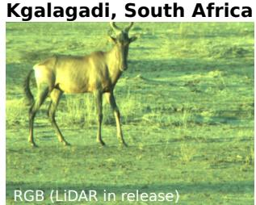

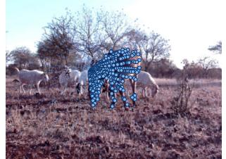

Longleat, UK  
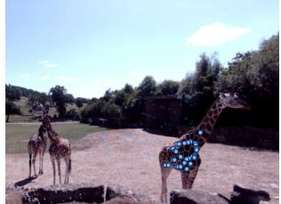

Longleat, UK  
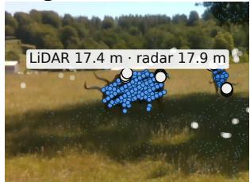

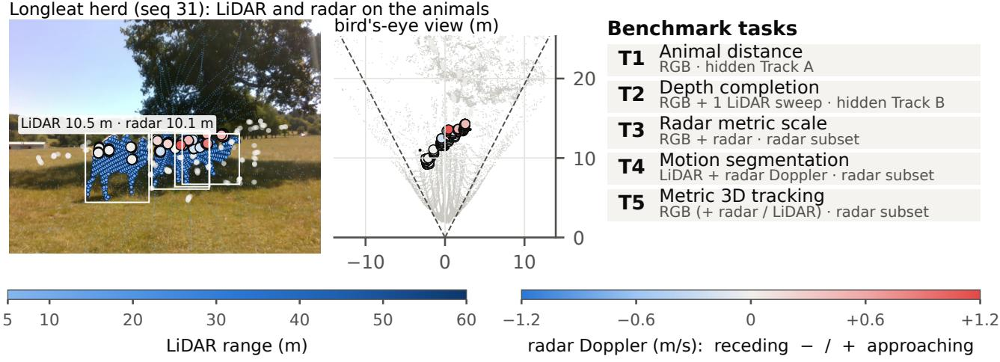  
Figure 1: WildDepth-v2 overview. RGB–LiDAR recordings from three sites (left), a synchronized RGB– LiDAR–radar subset at Longleat in which each radar return carries range, azimuth, elevation, Doppler velocity and RCS (centre), and the benchmark tasks (right).

## 3.2 RGB–LiDAR–Radar Subset (new)

Sensor. On the second rig we rigidly co-mounted an Altos V2 4D imaging radar with the LiDAR and an Intel RealSense colour camera (640×480). Per frame, the radar returns a sparse point cloud in which each point carries its Cartesian position (x, y, z), its radial (Doppler) velocity h in ${ \mathrm { m / s } } ,$ its signal strength (a radar-cross-section proxy, s), and a coarse three-way motion class $v \in \{ - 1 , 0 , + 1 \}$ ; we recommend the continuous $h ,$ since the motion class under-counts moving returns by roughly an order of magnitude on our data. Angular resolution is about 1.38◦ in azimuth and $1 . 4 3 ^ { \circ }$ in elevation. A typical frame holds 679 valid returns (median over sequences) against 19,390 LiDAR points; returns extend beyond 200 m, but the animals we study lie within 55 m. On animals, the radar returns associated with a detection (Sec. 4.3) number a median of 45, 28 and 22 at 5–20, 20–30 and 30–55 m, against 109, 54 and 47 single-sweep LiDAR points inside the animal’s mask (Fig. 2); many of the associated radar returns come from ground and background seen past the animal. Radar is therefore much sparser on the animal than the LiDAR it accompanies, but it measures range and velocity directly.

Coverage. Radar was recorded on two days. On the second day (July 8) it is healthy in all 37 snippets; on the first day (July 7) the sensor stopped publishing and the recorder repeated a stale message, so every radar frame within a snippet is byte-identical. We detected this with a per-snippet checksum test and exclude July 7 radar from the release and all experiments. The radar subset thus contains 37 snippets, 22,348 radar frames, and 19,716 frames with RGB, LiDAR and radar all present (one LiDAR file is empty and excluded).

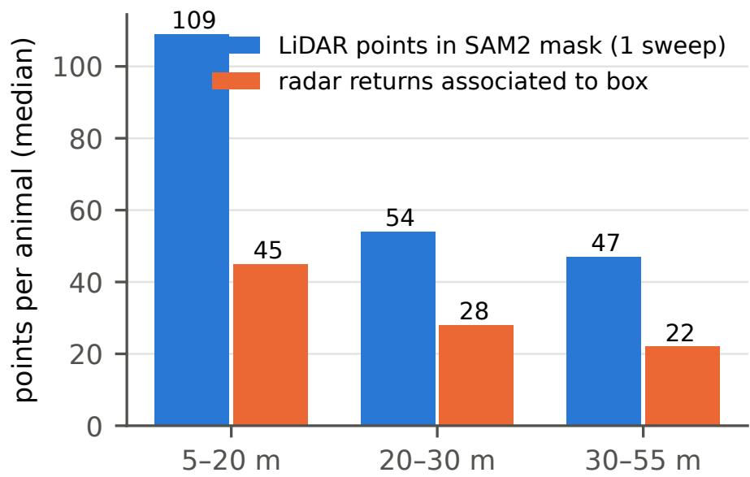  
Figure 2: Sensor density on animals, by ground-truth distance: single-sweep LiDAR points inside the SAM2 mask and radar returns associated with the detection box (median over 48,723 animals).

Synchronization. All three streams share one global 10 Hz frame index, so radar, LiDAR and RGB with the same index form a synchronized triple; the index is also the key that links the second rig record ings to the released Longleat snippets. Radar messages are matched to the nearest LiDAR timestamp, and we release the per-frame ofset. The mean absolute radar–LiDAR ofset is 16.8 ms (95th percentile 31.5 ms), with rare dropouts up to 350 ms that we flag (Fig. 10); at a walking speed of 5 m/s a 20 ms ofset corresponds to 10 cm of displacement.

Calibration and its error budget. The LiDAR→camera extrinsic of the second rig rig was solved once per sequence (the anchor) and then refined per frame by joint correspondence and gradient optimization (intrinsics frozen). The per-frame refinement drifts: by a median of 2.1◦ from the anchor and by up to 25◦ in some sequences, which is implausible for a rigid mount. An independent check – the spread of LiDAR depth inside SAM2 animal masks, which grows when background leaks into the mask – favours the anchor wherever the drift exceeds 5◦ (in-mask IQR 0.83 vs. 1.27 m; 116 vs. 50 LiDAR points on the animal), and the two agree below 1◦. We therefore use the anchor extrinsic for all ground truth. The depth maps shipped with the public second rig record were projected with the per-frame extrinsics and are afected in the high-drift sequences; we release re-projected maps with WildDepth-v2.

The radar→LiDAR extrinsic is a single rigid transform, because the two sensors share one mount; it was initialized by aligning static structure and refined manually on one sequence. We measured its residual on 827k static radar returns across all 37 sequences, matching each to the nearest accumulated-LiDAR point in the ground plane, and found it strongly anisotropic: a median of 0.10 m in range and azimuth (75th percentile 0.26 m) but 1.84 m in elevation (Fig. 10), a direct consequence of the radar’s few elevation bins. This anisotropy governs every radar experiment in this paper: projecting a radar return into the image can move it by several animal heights vertically, so we always associate radar to an animal at the object level, the robust median range of the radar returns whose projection falls in the animal’s box and never per pixel. We release the extrinsic, the residual analysis, and the association code.

Ethics and privacy. All recordings were made from public roads or viewing platforms under permission of the site operators, without interacting with the animals.

RGB + LiDAR (range)  
RGB + radar (Doppler) and detections  
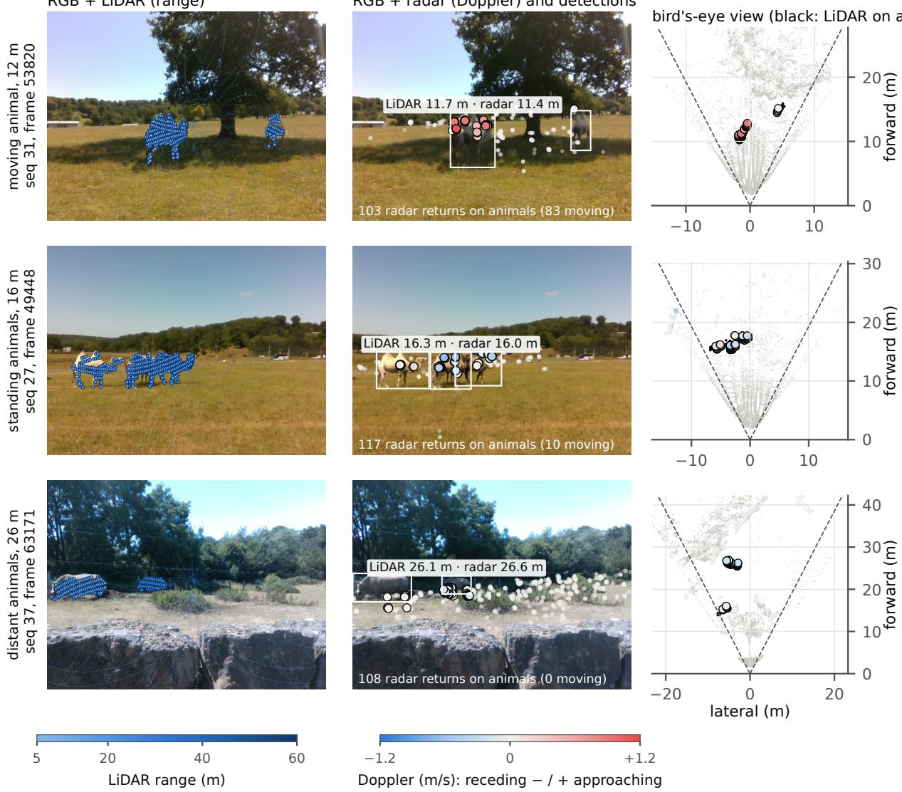  
Figure 3: RGB–LiDAR–radar examples. Radar returns (coloured by Doppler velocity) sit on the animals in range and azimuth but are displaced vertically when projected into the image, reflecting the 1–2 m elevation uncertainty of the radar extrinsic.

## 4 Tasks, Benchmark, and Baseline Methods

We define five tasks (Table 3). T1 and T2 are scored on a frozen hidden test set; T3–T5 use the radar subset.

## 4.1 Hidden Test Set (T1, T2)

A benchmark built from released data invites overfitting, so we built a hidden test set from unreleased Longleat MorphoCam footage recorded between released snippets. Construction, in order: (1) exclude every released snippet range with a guard band of ±300 frames; (2) keep only frames where the rig is static, measured by phase correlation against a running reference (≤0.2 px at $1 / 8$ scale), so that LiDAR can be accumulated; (3) accumulate 11 LiDAR sweeps as dense ground truth; (4) detect animals with MegaDetector (confidence ≥0.5) and segment them with SAM2 [46]; (5) keep detections whose ground truth distance lies in 5–50 m; (6) drop masks whose in-mask LiDAR depth has an inter-quartile range above 3 m, which removes detections corrupted by background leakage. Two scenes with a fence across the lens (121 frames) were removed entirely.

Table 3: WildDepth-v2 tasks. GT = ground truth.
<table><tr><td>Task</td><td>Input</td><td>Output</td><td>GT / data</td></tr><tr><td>T1 Animal distance</td><td>RGB</td><td>metric depth map</td><td>LiDAR in mask; hidden A</td></tr><tr><td>T2 Depth completion</td><td>RGB + 1 LiDAR sweep</td><td>metric depth map</td><td>11-sweep LiDAR; hidden B</td></tr><tr><td>T3 Radar metric scale</td><td> $\mathrm { R G B } + \mathrm { r a d a r }$ </td><td>metric distance</td><td>LiDAR in mask; radar subset</td></tr><tr><td>T4 Motion segmentation</td><td> $\mathrm { L i D A R + r a d a r }$ </td><td>moving points</td><td>RGB boxes / flow; radar subset</td></tr><tr><td>T5 Metric 3D tracking</td><td> $\mathrm { R G B } \ \mathrm { ( + L i D A R / r a d a r ) }$ </td><td>3D tracks, speed</td><td>LiDAR tracks; radar subset</td></tr></table>

Hidden test is systematically farther than the released data  
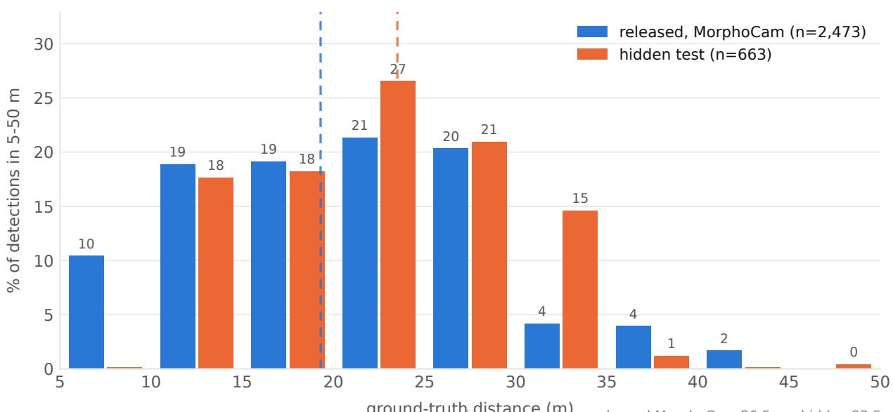  
ground-truth distance (m)in-range medians: released MorphoCam 20.5 m · hidden 23.5 m released bars are a 1.97% sample of the release (stride 10, <=40 frames/snippet); frame-weighting the sample moves the median only 20.5 -> 21.3 m  
Figure 4: Ground-truth camera-to-animal distance of released-snippet detections versus the hidden test set.

The result has 13 scenes, 352 frames with 510 animal detections for Track A (T1), and 902 frames for Track B (T2), plus a public validation split (137 frames, 298 detections). The set is frozen: an SHA-256 manifest covers all 4,046 files, the scorer refuses to run if the reference no longer matches it, and two independently verified copies are kept. The current version (v1.3) merges the sparsely populated 5–10 m bin into 10–20 m (Fig. 4).

Known limitations, stated up front. The hidden set is frame-disjoint from the release (minimum gap 301 frames against all 81,856 released MorphoCam frames), but not session-disjoint: 48% of its frames lie within one minute of a released snippet (median 58 s), and a second, public rig recorded the same enclosures on the same days. It therefore measures in-domain performance, not cross-site transfer. Its RGB–LiDAR extrinsic is one static calibration per record; we attempted automatic per-scene refinement and rejected it after independent validation (Sec. 5.7), and instead rely on the mask-coherence filter of step (6), which reduced the median in-mask depth IQR from 0.84 to 0.65 m at the cost of 140 detections.

## 4.2 Evaluation Protocols and Metrics

Camera-to-animal distance (T1, T3). For each detection, SAM2 segments the animal inside its MegaDetector box; ground truth $d ^ { * }$ is the median LiDAR depth inside the mask. A method’s prediction ˆd is read from its depth map at the mask centroid. We report RMSE, AbsRel $= | \hat { d } - d ^ { * } | / d ^ { * }$ , SILog, and $\delta { < } 1 . 2 5$ , per distance bin and overall. We evaluate each MDE in two modes. Uncalibrated (UC): a single scale $s = d ^ { \mathrm { l i d a r } } / d ^ { \mathrm { m d e } }$ from the one LiDAR point nearest the image centre. Calibrated: a per-frame afine map $D ^ { \mathrm { m e t r i c } } = s D ^ { \mathrm { m d e } } + t$ fitted by robust least squares to a set of metric anchors. The anchor set defines the variant: all LiDAR points in the frame (LC-scene); LiDAR points inside animal masks (LC-box); or object-level radar ranges (RC, below). Because MDEs such as MoGe-2 over-predict far depth, a single scene-wide afine fit is biased by distant background; we restrict anchors to <55 m.

Dense depth (T2). Per-pixel RMSE, MAE, AbsRel and $\delta { < } 1 . 2 5$ against the 11-sweep accumulated Li-DAR, reported separately on animal-mask pixels and background pixels, together with coverage (fraction of test frames submitted) so that partial submissions cannot win by cherry-picking.

Motion segmentation (T4). Precision is the fraction of points labelled moving that fall inside an animal box; densification is the ratio of moving LiDAR points to moving radar returns. Agreement with an independent motion label is measured per animal against Farnebäck optical flow [19] between consecutive frames (median flow in the mask minus background median flow ${ \mathrm { > } } 1 { \mathrm { p x } } )$ .

Metric 3D tracking (T5). Given 2D tracks, each track is lifted to a metric 3D trajectory $\left\{ \mathbf { p } _ { k } \right\}$ by back-projecting the mask centroid at a depth given by LiDAR, radar, or calibrated MDE. Against LiDAR-lifted reference trajectories we report 3D position RMSE, distance AbsRel, speed error (on tracks whose reference speed exceeds $0 . 3 \mathrm { m } / \mathrm { s } )$ , and the frame-to-frame jitter of the raw distance. For distance sampling we fit a half-normal detection function to per-track distances and report the bias of its scale σ and a two-sample KS test against LiDAR. Association quality (HOTA [36], IDF1/MOTA [7]) requires identity labels and is left to future work.

## 4.3 Baseline Methods

Radar-anchored metric scale (RC). Radar returns are transformed to the LiDAR frame and then to the camera. For each animal box b we collect the radar returns whose projection falls within the box columns (azimuth is accurate) and within the box rows padded by one box height on either side (elevation is not). These returns mix the animal with ground and background seen past it, so their median is biased far. We compare four LiDAR-free estimators of the animal’s range $r _ { b } \textrm { -- }$ the median, the nearest cluster of $\geq 3$ returns within 2 m, the densest such cluster, and the median of the returns within $\pm 3 5 \%$ of the MDE’s own metric prediction, and select one on development sequences (Sec. 5.3). The anchor pairs $\{ ( D _ { b } ^ { \mathrm { m d e } } , r _ { b } ) \}$ , with $D _ { b } ^ { \mathrm { m d e } }$ the robust median MDE depth in the animal mask, are used to fit the per-frame map: afine with two or more anchors, scale-only with one. Associating at the object level is what makes radar usable at all: per-pixel association inherits the 1–2 m elevation error of the extrinsic.

Doppler transfer to LiDAR (motion masks). Radar marks motion but sparsely; LiDAR is dense but static in time. We transfer Doppler to LiDAR by nearest-neighbour search in an anisotropic metric: each LiDAR point inherits the Doppler of the nearest radar return within an ellipsoid of radii $( 0 . 6 , 1 . 0 , 1 . 5 )$ m in $( x , y , z )$ , the elongated vertical axis absorbing the radar’s elevation error. LiDAR points inheriting $| h | > 0 . 5 \mathrm { m / s }$ are labelled moving. Doppler on a moving platform is dominated by egomotion, which follows a cosine in azimuth; per frame we fit $h ( \phi ) = v _ { x } \cos \phi + v _ { y } \sin \phi + c$ with iterative inlier re-fitting [28] and treat the frame as ego-motion if $R ^ { 2 } > 0 . 5$ or the fitted speed exceeds $1 \mathrm { m / s }$ with more than 70% inliers.

Motion-aware LiDAR accumulation. A single LiDAR sweep is too sparse on a distant animal, so dense depth is obtained by accumulating sweeps over a short window and fusing them with an MDE prior (MoGe-2) via RANSAC scale-shift alignment on SAM2-masked points, with a Sobel boundary filter against telephoto edge artefacts [9, 21, 26]. Accumulation is valid only for still animals; a moving animal is smeared. Our gated variant marks an animal as moving when at least three of the LiDAR points in its mask inherit $| h | > 0 . 5 \mathrm { m / s }$ through the Doppler transfer and, for those animals only, uses the current sweep alone. We evaluate on static-platform frames, where past sweeps are already registered, with windows of 5, 15 and 30 sweeps, and compare against a gate driven by optical flow.

Metric track lifting. 2D tracks are formed by SORT-style IoU association [8] of MegaDetector detections with Hungarian matching (IoU ≥0.3, tracks kept alive for 5 frames). Each observation is backprojected at its mask centroid with a depth from one of the sources – LiDAR (reference), MoGe-2, UC or LC-scene per frame, a LiDAR scale fixed on the first frame of the track, object-level radar range, or MoGe-2 scaled by the median radar/MoGe-2 ratio over the track – and every trajectory is smoothed with the same constant-velocity Kalman filter and RTS smoother [25].

## 5 Experiments

We first re-establish the RGB–LiDAR baselines on the released data and the hidden test (Secs. 5.1–5.2), then study what radar adds for metric scale (Sec. 5.3) and motion (Secs. 5.4–5.5), evaluate metric 3D tracking (Sec. 5.6), and close with radar’s operating envelope (Sec. 5.7). LiDAR is the metric reference throughout. All radar-subset experiments run on every synchronized July-8 frame (19,716 frames): MegaDetector V6 (confidence ≥0.3), SAM2.1 masks, and MoGe-2 depth are computed once per frame, and every number is produced by a released script (Code availability). Ground truth uses the anchor LiDAR→camera extrinsic of each sequence (Sec. 3.2).

## 5.1 Monocular Distance to Animals (T1)

Released snippets. We evaluate seven MDEs – Depth Anything v1/v2/v3 [58], DPT [45], Depth Pro [10], MonoDepth2 [30], and MoGe-2 [54] – on 11,498 animal detections from 3,695 frames of the released snippets (every 10th frame, at most 40 per snippet; re-weighting by true frame counts moves the median ground-truth distance only from 20.5 to 21.3 m). Table 4 summarizes the results. Uncalibrated predictions are unreliable in absolute terms (AbsRel 0.38–0.83, δ<1.25 of 0.26–0.46). Per-frame LiDAR calibration roughly halves RMSE for every model and raises δ<1.25 to 0.50–0.79. MoGe-2, Depth Anything v3 and v1 are the strongest calibrated models (AbsRel ≈0.15), and error is highest in the 30–50 m bin for every model (Fig. 5).

Hidden test, Track A. Table 5 reports organiser baselines on the frozen hidden test, scored by the public scoring program against the checksum-verified reference. MoGe-2 is clearly strongest (LC AbsRel 0.094), followed by the metric-outdoor Depth Anything V2 (0.169) and the difusion-based Marigold (0.252). Models that predict relative disparity (DPT, relative Depth Anything V2) are handicapped when inverted to depth for an RGB-only submission, because the scorer’s afine alignment operates in depth; we report them for completeness but recommend metric or afine-invariant-depth models for Track A.

## 5.2 Depth Completion from One LiDAR Sweep (T2)

Track B asks for dense depth from RGB and one raw LiDAR sweep. Table 6 shows that the split into animal and background pixels matters: a nearest-neighbour fill of the sweep is 35% worse on animals (RMSE 6.10 m) than on background (4.51 m), and aligning MoGe-2 to the sweep improves the animals

Table 4: Camera-to-animal distance on the released snippets, all bins (11,498 detections, 5–50 m). UC = uncalibrated; LC = per-frame LiDAR-calibrated (scene anchors).
<table><tr><td>Model</td><td colspan="2">RMSE (m)↓ UC LC</td><td colspan="2">AbsRel↓ UC LC</td><td colspan="2">SILog↓ UC LC</td><td colspan="2">δ&lt;1.25↑ UC LC</td></tr><tr><td></td><td></td><td>4.43</td><td></td><td></td><td></td><td></td><td></td><td></td></tr><tr><td>DepthAnything DA-v2</td><td>8.69 11.91</td><td>6.42</td><td>0.38 0.41</td><td>0.155 0.210</td><td>0.72 0.99</td><td>0.245 0.274</td><td>0.45 0.39</td><td>0.767 0.590</td></tr><tr><td>DA-v3</td><td>10.33</td><td>4.14</td><td>0.47</td><td>0.153</td><td>0.82</td><td>0.225</td><td>0.41</td><td>0.787</td></tr><tr><td></td><td>12.03</td><td>5.66</td><td>0.56</td><td>0.243</td><td>0.82</td><td>0.323</td><td>0.42</td><td>0.625</td></tr><tr><td>DepthPro DPT</td><td>13.62</td><td>5.79</td><td>0.72</td><td>0.278</td><td>0.70</td><td>0.293</td><td>0.34</td><td>0.588</td></tr><tr><td>MonoDepth2</td><td>16.23</td><td>7.68</td><td>0.83</td><td>0.381</td><td>0.98</td><td>0.402</td><td>0.26</td><td>0.498</td></tr><tr><td>MoGe-2</td><td>11.02</td><td>4.36</td><td>0.41</td><td>0.152</td><td>0.81</td><td>0.219</td><td>0.46</td><td>0.791</td></tr></table>

Table 5: Hidden test, Track A (RGB only; 510 detections in 352 frames, 13 scenes), scored by the competition’s scoring program. †Relative disparity inverted to depth. ‡Afine-invariant depth (UC not meaningful).
<table><tr><td>Model</td><td>LC AbsRel</td><td>LC RMSE (m)</td><td>LC SILog</td><td>LC δ&lt;1.25</td><td>UC AbsRel</td></tr><tr><td>MoGe-2</td><td>0.094</td><td>3.25</td><td>0.206</td><td>0.97</td><td>0.335</td></tr><tr><td>Depth Anything V2 (metric outdoor)</td><td>0.169</td><td>4.16</td><td>0.168</td><td>0.89</td><td>0.458</td></tr><tr><td>Marigold v1.1‡</td><td>0.252</td><td>6.51</td><td>0.247</td><td>0.40</td><td>0.359</td></tr><tr><td>DPT†</td><td>0.274</td><td>6.57</td><td>0.337</td><td>0.65</td><td>0.871</td></tr><tr><td>Depth Pro</td><td>0.337</td><td>7.14</td><td>0.375</td><td>0.53</td><td>3.064</td></tr><tr><td>Depth Anything V2 (relative)†</td><td>0.398</td><td>9.21</td><td>0.470</td><td>0.22</td><td>0.317</td></tr></table>

(5.33 m) while leaving the background unchanged. Neither baseline closes the animal gap, which is the headroom the track is designed to measure.

## 5.3 Radar as a Metric Anchor (T3)

Can object-level radar range replace LiDAR as the anchor that gives monocular depth its metric scale? We compare anchor sources on 48,723 animals in 18,879 frames (Table 7). All methods are scored against the same held-out ground truth: each mask’s LiDAR points are split at random, one half defines the ground truth and the other half is the LC-box anchor, so no LiDAR baseline is scored on its own anchor points. The LiDAR-free radar range estimator was chosen on odd-numbered (development) sequences (Table 8) and all results are reported on the even-numbered (test) sequences.

Four findings follow. (i) Radar is usable only at the object level. Per-pixel radar anchors (RC-pixel) are worse than no anchor at all (AbsRel 0.48), because the elevation error places returns on the wrong image rows. (ii) Object-level radar beats scene-level LiDAR calibration and the MDE alone, without LiDAR. RCbox reaches AbsRel 0.120 (median error 0.60 m) against 0.198 for the scene-level LiDAR calibration used in WildDepth and 0.146 for MoGe-2’s own metric output. A scene-wide afine fit is dominated by ground and background points, which is why it can hurt a model that is already metric. (iii) Where radar sees the animal, its range is nearly as good as LiDAR. On the 15,196 test animals with an associated radar range (73%), that range alone has AbsRel 0.064, against 0.144 for MoGe-2 and 0.046 for held-out LiDAR on the same animals. The best estimator gates the returns in the box with MoGe-2’s metric prediction (±35%) and is therefore an RGB+radar method; a radar-only estimator (nearest range cluster) reaches a 4.2% median relative error at 90% coverage but has a heavy tail. (iv) Radar does not replace LiDAR. Box-level LiDAR remains more than twice as accurate (0.052 vs. 0.120), radar’s advantage vanishes beyond 30 m (Fig. 6), and animals without their own radar anchor inherit a frame-level fit that is much less accurate (leave-own-anchor-out AbsRel 0.239). We also note a correction to an earlier analysis of these data: the anchor that snaps radar to LiDAR (last row) needs LiDAR at inference and does not replicate at scale (AbsRel 0.572). The conclusions are unchanged when the per-frame extrinsic is used for ground truth instead of the anchor extrinsic.

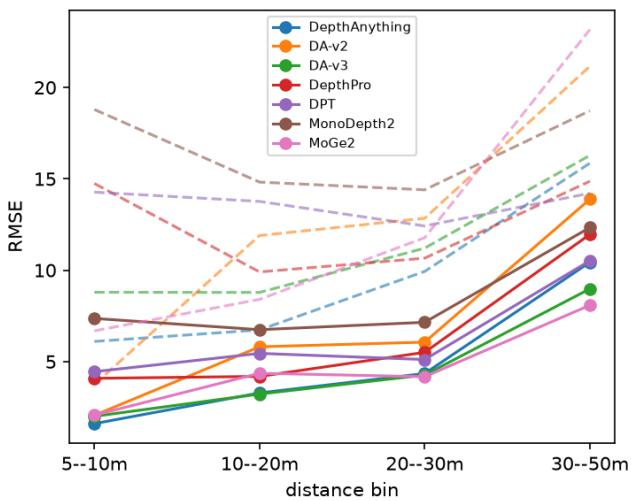  
(a) RMSE vs. distance

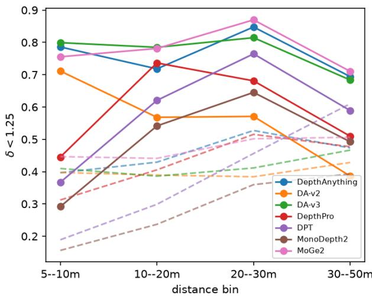  
(b) δ<1.25 vs. distance  
Figure 5: Per-distance camera-to-animal error on the released snippets. Solid: LiDAR-calibrated; dashed: uncalibrated.

Table 6: Hidden test, Track B (RGB + one LiDAR sweep; 902 frames). Per-pixel error on animal-mask and background pixels.
<table><tr><td>Method</td><td>RMSE animal</td><td>RMSE bg.</td><td>AbsRel animal</td><td>AbsRel all</td><td>δ&lt;1.25</td></tr><tr><td>Nearest-neighbour fill</td><td>6.10</td><td>4.51</td><td>0.191</td><td>0.122</td><td>0.92</td></tr><tr><td>MoGe-2 + scale-shift to sweep</td><td>5.33</td><td>4.52</td><td>0.193</td><td>0.203</td><td>0.80</td></tr></table>

## 5.4 Doppler as a Motion Cue (T4)

Where is Doppler on animals? On the vehicle-mounted rig most Doppler is ego-motion: the perframe cosine fit flags 35% of frames as ego-motion frames, which we exclude, leaving 12,596 static-platform frames that contain animals. In these, Doppler above 0.5 m/s is associated with 8.5% of animal detections, concentrated in walking herds.

Doppler transfer yields dense motion masks. In the 2,783 static-platform frames where an animal box contains at least three moving radar returns, transferring Doppler to single-sweep LiDAR (Sec. 4.3) multiplies the number of moving points by 3.7×; 72% of transferred moving LiDAR points fall on an animal, against 65% of the raw moving radar returns (Table 9). Precision varies by sequence from 0.39 – where moving safari vehicles share the view – to 0.96–0.98 on walking camel herds (Fig. 7). The anisotropic association radius is what makes the transfer dense: an isotropic 0.6 m radius yields only 1.75× densification at the same precision. Doppler and optical flow flag diferent animals (precision 0.57, recall 0.28 of radar against a flow motion label), as expected since radar measures radial and flow lateral

Table 7: Metric calibration of MoGe-2 by anchor source: camera-to-animal distance on the test sequences, frames that contain at least one radar-associated animal (20,869 animals). Sensor used at inference: L = LiDAR, R = radar. 95% CIs from a frame-level bootstrap. ∗The anchor used in an earlier version of this study, which snaps radar returns to their nearest LiDAR point and uses the LiDAR depth.
<table><tr><td>Anchor</td><td>Sensor</td><td>AbsRel [95% CI]</td><td>medAE (m)</td><td>δ&lt;1.25</td><td>Cov.</td></tr><tr><td>MoGe-2 metric, no anchor</td><td>一</td><td>0.146 [0.145, 0.148]</td><td>1.93</td><td>0.80</td><td>1.00</td></tr><tr><td>UC: 1 LiDAR point (scale)</td><td>L</td><td>0.442 [0.437, 0.448]</td><td>6.53</td><td>0.21</td><td>1.00</td></tr><tr><td>LC-scene: all LiDAR &lt;55 m</td><td>L</td><td>0.198 [0.196, 0.201]</td><td>2.49</td><td>0.55</td><td>1.00</td></tr><tr><td>LC-box: held-out LiDAR in masks</td><td>L</td><td>0.052 [0.050, 0.054]</td><td>0.17</td><td>0.95</td><td>1.00</td></tr><tr><td>RC-pixel: radar returns per pixel</td><td>R</td><td>0.483 [0.471, 0.495]</td><td>4.54</td><td>0.41</td><td>1.00</td></tr><tr><td>RC-box: object-level radar (affine)</td><td>R</td><td>0.120 [0.113, 0.131]</td><td>0.60</td><td>0.85</td><td>1.00</td></tr><tr><td>RC-box, scale only</td><td>R</td><td>0.123 [0.121, 0.125]</td><td>0.85</td><td>0.81</td><td>1.00</td></tr><tr><td>RC-box, leave-own-anchor-out</td><td>R</td><td>0.239 [0.208, 0.277]</td><td>1.28</td><td>0.75</td><td>0.87</td></tr><tr><td>Radar snapped to LiDAR (earlier study)*</td><td>L+R</td><td>0.572 [0.549, 0.602]</td><td>2.04</td><td>0.58</td><td>1.00</td></tr><tr><td colspan="5">Same animals, where a radar range estimate exists (15,196 animals)</td><td></td></tr><tr><td>MoGe-2 metric, no anchor</td><td></td><td>0.144 [0.142, 0.146]</td><td>1.92</td><td>0.80</td><td></td></tr><tr><td>LC-box: held-out LiDAR</td><td>L</td><td>0.046 [0.043, 0.049]</td><td>0.13</td><td>0.96</td><td></td></tr><tr><td>Radar range only (MoGe-gated)</td><td>R</td><td>0.064 [0.063, 0.066]</td><td>0.41</td><td>0.94</td><td></td></tr></table>

Table 8: LiDAR-free radar range estimators, development sequences (errors relative to held-out LiDAR).
<table><tr><td>Radar range estimator</td><td>coverage</td><td>median rel. err.</td><td>AbsRel</td></tr><tr><td>median of box returns</td><td>0.90</td><td>0.064</td><td>0.728</td></tr><tr><td>nearest range cluster</td><td>0.90</td><td>0.042</td><td>0.349</td></tr><tr><td>densest range cluster</td><td>0.90</td><td>0.052</td><td>0.763</td></tr><tr><td>MoGe-2-gated (±35%)</td><td>0.76</td><td>0.026</td><td>0.056</td></tr></table>

motion.

## 5.5 Motion-Aware Densification

Temporal LiDAR accumulation gives dense, coherent surfaces for still animals (Fig. 11) but can smear moving ones. We test whether Doppler gating (Sec. 4.3) helps, with identical LiDAR densification in all rows and per-pixel error measured against a held-out half of the current sweep (Table 10). The answer depends on the accumulation window. Over 0.5 s (5 sweeps), accumulation helps even moving animals and gating is unnecessary. Over 1.5 s gating reduces the error on Doppler-flagged animals by 11%, and over 3 s by 37% (2.60→1.64 m), with gate precision rising from 0.54 to 0.85. Across all animals at 3 s, an optical-flow gate is better than the Doppler gate (2.08 vs. 2.17 m) because it fires on more of the movers; Doppler is the more precise gate, and the only one that does not depend on illumination.

## 5.6 Metric 3D Animal Tracking (T5)

We now use these depth sources for the task a tracker must solve: turning 2D animal tracks into metric trajectories. An IoU tracker links detections over all 19,716 frames; the 431 tracks with at least 20 observations (50,338 observations) are lifted to 3D with each depth source and smoothed with the same constant-velocity Kalman/RTS smoother, and the LiDAR-lifted track is the reference (Table 11).

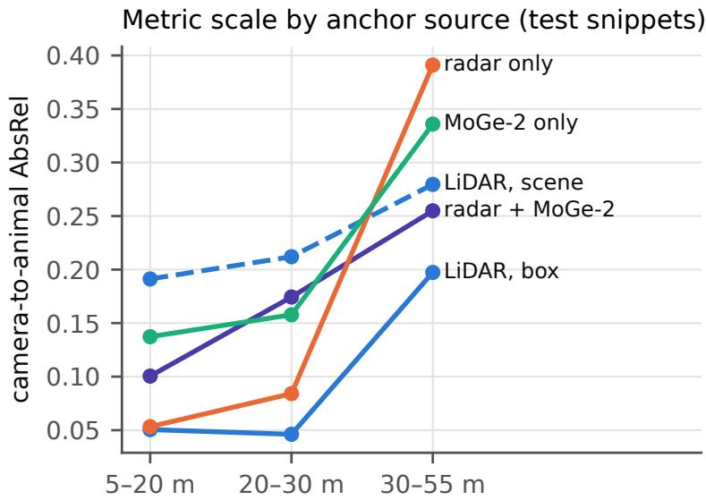  
Figure 6: Camera-to-animal AbsRel by distance and anchor source (test sequences). Radar range is the best LiDAR-free cue below 30 m and the worst beyond it, where few returns land on the animal.

Trajectory accuracy. MoGe-2 alone places animals 2.2 m from their true position (distance AbsRel 0.149), and per-frame calibration from a single LiDAR point (UC) is far worse (6.3 m), because its frameto-frame scale jitter (1.7 m) becomes spurious motion. Per-frame scene-level LiDAR calibration reduces the error to 1.5 m. Calibrating once per track is much better than calibrating every frame: a LiDAR scale taken from the first frame only gives 0.52 m. Without any LiDAR, scaling MoGe-2 by the median radar/MoGe-2 ratio over the track gives 0.58 m position error, 3.3% distance error and $0 . 1 0 \mathrm { m } / \mathrm { s }$ speed error, matching the once-per-track LiDAR calibration and improving on MoGe-2 alone by a factor of four. Radar range alone is equally accurate in position but twice as jittery (0.72 m).

Application: distance sampling. Distance-sampling abundance estimates depend on the distribution of detection distances [11, 24]. Fitting a half-normal detection function to per-track distances (Fig. 8), MoGe-2 alone underestimates its scale σ by 13% (the distance distribution difers from LiDAR’s, KS $p < 1 0 ^ { - 6 } )$ ; with a per-track radar scale the bias falls to −2.1% and the distributions are statistically indistinguishable (KS $p = 0 . 5 8 )$

Can Doppler measure animal speed? For 29,347 track observations with radar returns at the animal’s range, in-box Doppler correlates with the LiDAR range rate at $r = 0 . 5 7 \ ( r = 0 . 6 1$ on the static platform). On moving animals (range rate above $0 . 3 \mathrm { m / s } , n = 3 , 0 8 0 )$ the correlation is $r = 0 . 6 0$ and the sign agrees 72% of the time, but Doppler under-reads the radial speed by about half (Theil–Sen slope 0.47, median error 0.29 m/s; Fig. 9), consistent with limb micro-Doppler [15] and static returns mixing into the box. Doppler thus measures the direction and approximate magnitude of radial motion; it is a usable, if biased, velocity observation for a tracker. The spread of in-box Doppler also increases with speed (Spearman 0.54), which suggests it as a cue for activity. This corrects an earlier analysis of these data that reported no correlation.

## 5.7 Radar’s Operating Envelope for Wildlife

Elevation error dominates. Over 827k static radar returns matched to LiDAR, the radar extrinsic residual has a median of 0.10 m in the ground plane but 1.84 m vertically (Fig. 10); this is why per-pixel radar anchoring fails and every positive result above uses object-level association.

Table 9: Doppler transfer from radar to single-sweep LiDAR (static-platform event frames). Densification = moving LiDAR points / moving radar returns; precision = fraction inside animal boxes.
<table><tr><td>Radii (m)</td><td> $\tau \ ( \mathrm { m / s } )$ </td><td>event frames</td><td>densif.</td><td>prec. radar</td><td>prec. LiDAR</td></tr><tr><td>0.6/1.0/1.5 (ours)</td><td>0.3</td><td>3,815</td><td>4.0×</td><td>0.64</td><td>0.75</td></tr><tr><td>0.6/1.0/1.5 (ours)</td><td>0.5</td><td>2,783</td><td>3.7×</td><td>0.65</td><td>0.72</td></tr><tr><td>0.6/1.0/1.5 (ours)</td><td>0.7</td><td>1,995</td><td>3.2×</td><td>0.63</td><td>0.65</td></tr><tr><td>0.6/1.0/1.5 (ours)</td><td>1.0</td><td>1,375</td><td>2.9×</td><td>0.62</td><td>0.57</td></tr><tr><td> $0 . 6 / 0 . 6 / 0 . 6$ </td><td>0.5</td><td>2,783</td><td>1.8×</td><td>0.65</td><td>0.72</td></tr><tr><td> $0 . 6 / 0 . 6 / 0 . 6$ </td><td>1.0</td><td>1,375</td><td>1.3×</td><td>0.62</td><td>0.55</td></tr><tr><td> $1 . 0 / 1 . 0 / 1 . 0$ </td><td>0.5</td><td>2,783</td><td>3.2×</td><td>0.65</td><td>0.72</td></tr><tr><td> $1 . 0 / 1 . 0 / 1 . 0$ </td><td>1.0</td><td>1,375</td><td>2.5×</td><td>0.62</td><td>0.60</td></tr><tr><td> $0 . 6 / 1 . 0 / 2 . 5$ </td><td>0.5</td><td>2,783</td><td>4.6×</td><td>0.65</td><td>0.69</td></tr><tr><td> $0 . 6 / 1 . 0 / 2 . 5$ </td><td>1.0</td><td>1,375</td><td>3.5×</td><td>0.62</td><td>0.53</td></tr></table>

Table 10: Doppler-gated LiDAR accumulation: dense-depth MAE (m) against held-out single-sweep LiDAR, by accumulation window. Gate precision = fraction of gated animals whose error decreases.
<table><tr><td rowspan="2">Sweeps</td><td colspan="3">Doppler-moving animals</td><td colspan="2">all animals</td><td rowspan="2"></td><td colspan="2">gate (Doppler)</td></tr><tr><td>single</td><td>accum.</td><td>gated</td><td>accum.</td><td>Doppler flow</td><td>prec.</td><td>rate</td></tr><tr><td>5 (0.5s)</td><td>2.02</td><td>1.96</td><td>2.02</td><td>2.05</td><td>2.05</td><td>2.06</td><td>0.54</td><td>0.09</td></tr><tr><td>15 (1.5 s)</td><td>1.81</td><td>2.04</td><td>1.81</td><td>2.13</td><td>2.11</td><td>2.09</td><td>0.72</td><td>0.08</td></tr><tr><td>30 (3.0 s)</td><td>1.64</td><td>2.60</td><td>1.64</td><td>2.25</td><td>2.17</td><td>2.08</td><td>0.85</td><td>0.08</td></tr></table>

No coverage extension and no foliage penetration. Moving radar returns without nearby LiDAR exist but are vehicles, foliage, or far clutter – none are animals after a depth-consistency check – and a search for animals seen through vegetation found only artefacts; the Longleat enclosures are open grassland, and the vegetated sites have no radar.

Doppler does not clean calibration anchors. Removing moving points from the anchors changes the calibration error by +0.01 m over 2,426 animals in an earlier analysis on 32 sequences.

Automatic RGB–LiDAR ofset refinement fails. For the MorphoCam rig, maximizing agreement between LiDAR depth edges and RGB gradients over image shifts produced optima that tracked the search bound, and 11 of 13 scenes failed an independent in-mask spread check; edge agreement has no interior optimum on sparse LiDAR in natural scenes.

Per-frame extrinsic refinement can drift. The per-frame LiDAR→camera extrinsics of the CPS2 rig drift away from the sequence anchor by up to $2 5 ^ { \circ } { : }$ ; where the drift exceeds $5 ^ { \circ }$ , the anchor extrinsic puts more than twice as many LiDAR points on the animal (116 vs. 50) with a tighter in-mask depth spread (0.83 vs. 1.27 m). We therefore use the anchor extrinsic throughout (Sec. 3.2).

## 5.8 Densification, Behaviour and 4D Reconstruction (from WildDepth)

For completeness we summarize the remaining WildDepth baselines [5]. Densification: on a walking red hartebeest at ≈97 m (Kgalagadi), MoGe-2 + LiDAR scale-shift alignment reaches positive $R ^ { 2 }$ (0.25) where a planar fit does not (−0.10), at similar MAE (Table 12, Fig. 11). Behaviour: VideoMAE [53] classifiers over 12 activities and 20 fine-grained actions (per-class F1 in the supplementary material). 4D reconstruction: SAM2 masks with a Gaussian-splatting deformation field [20] (Fig. 12). Robustness to the MDE: repeating the anchor comparison with the difusion-based Marigold [27] on a 233-frame subset leaves the conclusions unchanged (supplementary Table S1): with anchors, Marigold is on par with MoGe-2 (e.g. RC-box 0.131 vs. 0.137), but it is afine-invariant and cannot be used without an anchor.

seq 27, frame 49048: moving radar returns (n=518)  
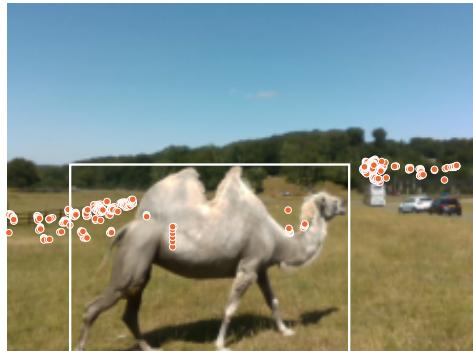

seq 27, frame 49048: LiDAR after Doppler transfer (n=3235)  
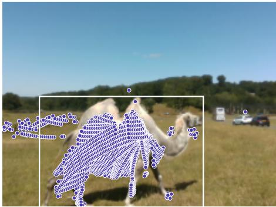

seq 31, frame 52812: moving radar returns (n=89)  
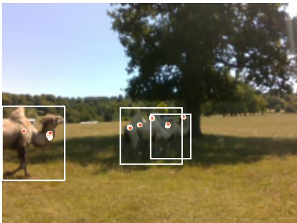

seq 31, frame 52812: LiDAR after Doppler transfer (n=1666)  
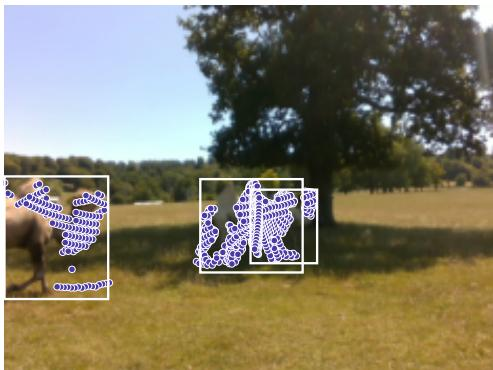  
Figure 7: Doppler transfer. Sparse moving radar returns (left, projected with their elevation error) become a dense motion mask on the co-registered LiDAR (right) for walking camels.

## 6 Discussion

What radar is for in the wild. Our results separate three roles that are often conflated. As a dense depth sensor, radar is not (yet) competitive with LiDAR: it is much sparser on the animal and its vertical extrinsic error rules out per-pixel use. As radar MIMO antenna count increases with technological improvements, point cloud density and angular resolution will increase, making it a viable dense sensor. As a scale anchor, it is genuinely useful: object-level radar range calibrates a monocular model better than scene-level LiDAR calibration, and on the three quarters of animals where it sees them its range is within 6% of LiDAR – on a sensor rig that costs and consumes a fraction of a LiDAR. As a motion sensor, it measures something neither commonly available LiDAR nor a single image can: which returns are moving now, and in which radial direction. Transferred onto LiDAR it gives dense motion masks, and it can decide when multi-second temporal fusion is safe.

Implications for tracking. For metric tracking, the temporal structure of depth error matters more than its per-frame average: a scale that jitters from frame to frame appears as motion. Calibrating once per track rather than once per frame is therefore the single most efective choice – it reduced position error three-fold with LiDAR (1.52→0.52 m) – and radar makes it possible without LiDAR (0.58 m). For ecological inference the consequence is concrete: monocular depth alone biases the scale of a distancesampling detection function by −13%, which would inflate density estimates, whereas a per-track radar scale reduces the bias to −2%. Doppler is a biased but informative velocity observation $( \mathrm { r } = 0 . 6 0$ , slope 0.47 on moving animals), suitable as a radial-velocity measurement in a tracker’s filter once the gain is calibrated.

Table 11: Metric 3D tracking on the radar subset (431 tracks). Errors against LiDAR-lifted trajectories (median over tracks); speed error on 169 tracks with reference speed ${ > } 0 . 3 \mathrm { m / s } ;$ jitter = std of the raw frame-to-frame distance change; σ bias = bias of the half-normal detection-function scale fitted to per track distances (distance sampling).
<table><tr><td>Depth source</td><td>LiDAR</td><td>Pos. RMSE (m)</td><td>Dist. AbsRel</td><td>Speed err.  $\mathrm { ( m / s ) }$ </td><td>Jitter (m)</td><td>σ bias</td></tr><tr><td>MoGe-2 metric</td><td></td><td>2.20</td><td>0.149</td><td>0.15</td><td>0.31</td><td>-13.2%</td></tr><tr><td>UC, per frame</td><td>L</td><td>6.27</td><td>0.399</td><td>0.28</td><td>1.72</td><td>-8.1%</td></tr><tr><td>LC-scene, per frame</td><td>L</td><td>1.52</td><td>0.089</td><td>0.11</td><td>0.28</td><td>-3.6%</td></tr><tr><td>LiDAR scale, first frame only</td><td>L (1 frame)</td><td>0.52</td><td>0.031</td><td>0.10</td><td>0.35</td><td>+0.2%</td></tr><tr><td>Radar range (object level)</td><td>R</td><td>0.53</td><td>0.036</td><td>0.13</td><td>0.72</td><td>-2.1%</td></tr><tr><td>MoGe-2 × radar scale (per track)</td><td>R</td><td>0.58</td><td>0.033</td><td>0.10</td><td>0.35</td><td>-2.1%</td></tr><tr><td>LiDAR (reference)</td><td>L</td><td>0</td><td>0.005</td><td>0</td><td>0.12</td><td>0</td></tr></table>

Table 12: RGB–LiDAR densification, red hartebeest at ≈97 m.
<table><tr><td>Method</td><td>MAE (m)↓</td></tr><tr><td>Planar depth  $0 . 1 3 \pm 1 . 1 4$ </td><td> $- 0 . 1 0 \pm 0 . 1 3$ </td></tr><tr><td> $\mathrm { M o G e { - } 2 + S S A }$ </td><td> $0 . 1 6 \pm 1 . 1 2$   $0 . 2 5 \pm 1 . 3 6$ </td></tr></table>

Implications for sensor design. Elevation resolution drives the dominant extrinsic error and blocks per-pixel radar–camera fusion; a static or ego-compensated mount matters because ego-motion swamped the Doppler in 35% of our frames; and extrinsic calibration should be validated against an independent signal – in our data the per-frame refined extrinsics drifted by up to $2 5 ^ { \circ }$ while their own optimization objective reported success. An approach to increasingly elevation angular resolution is to use a second radar (V) mounted orthogonally to the original radar (H). In addition, it should be noted that the Altos radar is optimized for automotive applications in terms of its modulation parameters and signal processing chain – a suggested next step would be to capture raw I/Q mmWave radar for custom signal processing.

Limitations. Radar is available at one site, on one day, in daylight and in open enclosures; its illumination invariance and its behaviour in vegetation are observed rather than measured here. The radar results are strongest below 30 m, where most of our animals are, and radar range becomes unreliable beyond it. The best radar range estimator uses the monocular model’s metric prediction to select returns and is therefore an RGB+radar method; the purely radar estimator has a heavy tail. The radar→LiDAR extrinsic is hand-refined on one sequence, and LiDAR ground truth inherits the calibration and synchro nization errors we characterize rather than eliminate. The tracking reference is itself LiDAR-derived and our tracker is a simple IoU tracker; identity-level metrics (HOTA, IDF1) require identity labels we do not yet have. The hidden test set is in-domain (not session-disjoint), small in Track A (510 detections), and contains visible visitors and number plates that must be anonymized before public release.

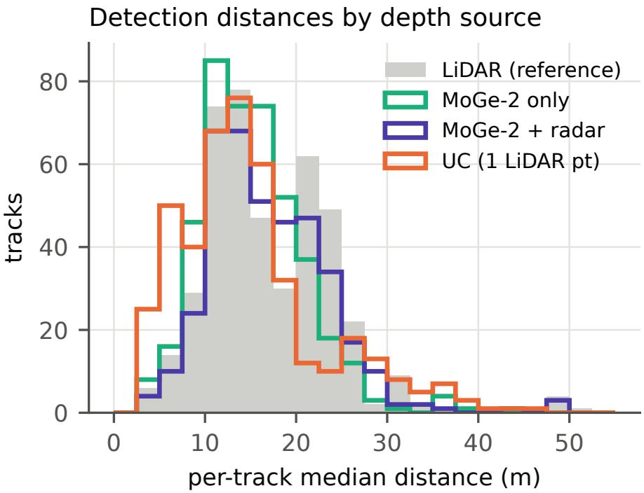  
Figure 8: Per-track detection distances from LiDAR (grey), MoGe-2 alone, MoGe-2 scaled by radar per track, and single-point LiDAR calibration (UC).

Future work. A night-time RGB–thermal–radar collection (the CPS2 rig also carries a thermal camera) is the natural next step to measure the low-light regime that most motivates radar; identity-verified herd sequences would allow testing whether range and Doppler improve association; and a session-disjoint, multi-site hidden test would turn the benchmark into a generalization test.

## 7 Conclusion

WildDepth-v2 extends WildDepth from a static RGB–LiDAR depth dataset to a benchmark for metric perception of animals over time. It adds the first synchronized RGB–LiDAR–radar recordings of animals with a measured calibration and timing error budget, a frozen hidden test with a public scorer, and tasks for metric scale, motion segmentation, and 3D tracking. Monocular depth models remain meters of at wildlife ranges without a metric anchor; radar supplies that anchor cheaply – enough to track animals in metric 3D and to remove most of the distance-sampling bias of monocular depth without LiDAR – and, through Doppler, adds a motion signal that LiDAR lacks, while its elevation error and attenuated Doppler set clear limits. We release the data, calibration, benchmark, and code, and hope they help turn the millions of existing monocular wildlife images and tracks into metric measurements that ecologists can use.

## References

[1] Livox Avia User Manual, .

[2] Livox TELE-15 User Manual, .

[3] Livox Mid-70 User Manual, February 2021.

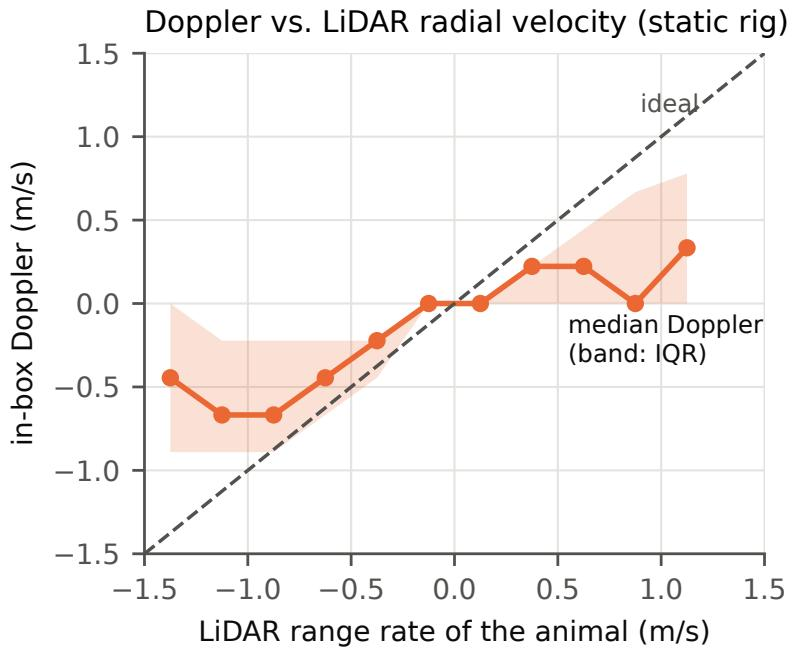  
Figure 9: In-box Doppler against LiDAR-derived range rate (static platform; median and inter-quartile band per bin).

[4] Muhammad Aamir, Matthew Wijers, Andrew Loveridge, and Andrew Markham. A robust metric distance and height estimation pipeline for wildlife camera trap imagery. Ecological Informatics, 92: 103520, December 2025. ISSN 1574-9541. doi: 10.1016/j.ecoinf.2025.103520.

[5] Muhammad Aamir, Naoya Muramatsu, Sangyun Shin, Matthew Wijers, Jia-Xing Zhong, Xinyu Hou, Amir Patel, Andrew Loveridge, and Andrew Markham. WildDepth: A multimodal dataset for 3D wildlife perception and depth estimation. In European Conference on Computer Vision (ECCV), 2026.

[6] Sara Beery, Dan Morris, and Siyu Yang. Eficient pipeline for camera trap image review. CoRR, abs/1907.06772, 2019. URL http://arxiv.org/abs/1907.06772.

[7] Keni Bernardin and Rainer Stiefelhagen. Evaluating multiple object tracking performance: The CLEAR MOT metrics. EURASIP Journal on Image and Video Processing, 2008:246309, 2008.

[8] Alex Bewley, Zongyuan Ge, Lionel Ott, Fabio Ramos, and Ben Upcroft. Simple online and realtime tracking. In IEEE International Conference on Image Processing (ICIP), pages 3464–3468, 2016.

[9] Reiner Birkl, Diana Wofk, and Matthias Müller. Midas v3. 1–a model zoo for robust monocular relative depth estimation. arXiv preprint arXiv:2307.14460, 2023.

[10] Aleksei Bochkovskii, AmaÃG, l Delaunoy, Hugo Germain, Marcel Santos, Yichao Zhou, Stephan R Richter, and Vladlen Koltun. Depth pro: Sharp monocular metric depth in less than a second. arXiv preprint arXiv:2410.02073, 2024.

[11] Stephen T. Buckland, David R. Anderson, Kenneth P. Burnham, Jefrey L. Laake, David L. Borchers, and Len Thomas. Introduction to Distance Sampling: Estimating Abundance of Biological Populations. Oxford University Press, 2001.

[12] Holger Caesar, Varun Bankiti, Alex H Lang, Sourabh Vora, Venice Erin Liong, Qiang Xu, Anush Krishnan, Yu Pan, Giancarlo Baldan, and Oscar Beijbom. nuscenes: A multimodal dataset for

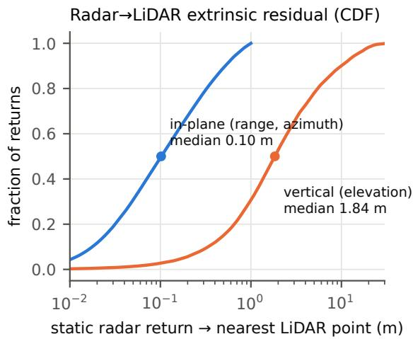

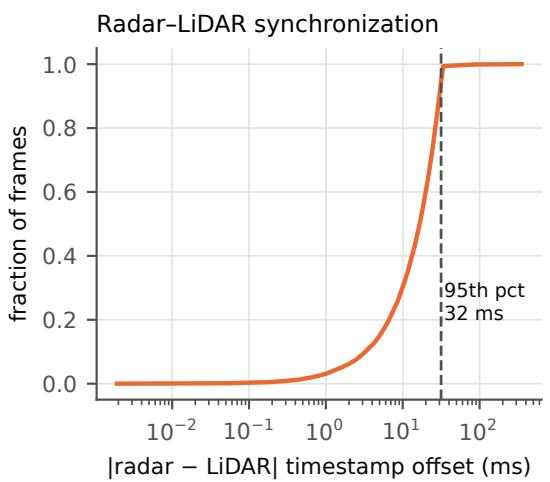  
Figure 10: Radar error budget. Left: residual of static radar returns to the nearest LiDAR point, in the ground plane (range/azimuth; matches gated at 1 m) and vertically. Right: radar–LiDAR timestamp ofset.

autonomous driving. In Proceedings of the IEEE/CVF conference on computer vision and pattern recognition, pages 11621–11631, 2020.

[13] Gerardo Ceballos, Paul R. Ehrlich, and Rodolfo Dirzo. Biological annihilation via the ongoing sixth mass extinction signaled by vertebrate population losses and declines. Proceedings of the National Academy of Sciences, 114(30):E6089–E6096, July 2017. doi: 10.1073/pnas.1704949114.

[14] Jun Chen, Ming Hu, Darren J Coker, Michael L Berumen, Blair Costelloe, Sara Beery, Anna Rohrbach, and Mohamed Elhoseiny. Mammalnet: A large-scale video benchmark for mammal recog nition and behavior understanding. In Proceedings of the IEEE/CVF conference on computer vision and pattern recognition, pages 13052–13061, 2023.

[15] Victor C. Chen, Fayin Li, Shen-Shyang Ho, and Harry Wechsler. Micro-Doppler efect in radar: Phenomenon, model, and simulation study. IEEE Transactions on Aerospace and Electronic Systems, 42(1):2–21, 2006.

[16] Andrew B. Davies and Gregory P. Asner. Advances in animal ecology from 3D-LiDAR ecosystem mapping. Trends in Ecology & Evolution, 29(12):681–691, December 2014. ISSN 0169-5347. doi: 10.1016/j.tree.2014.10.005.

[17] Helena Gurjão Pinheiro do Val, Juarez Carlos Brito Pezzuti, and Elildo Alves Ribeiro Carvalho-Jr. Identifying ocelots by individual coat pattern marks using the Whiskerbook. Mammalogy Notes, 10 (2):413–413, September 2024. ISSN 2382-3704. doi: 10.47603/mano.v10n2.413.

[18] Isla Duporge, Maksim Kholiavchenko, Roi Harel, Scott Wolf, Daniel I Rubenstein, Margaret C Crofoot, Tanya Berger-Wolf, Stephen J Lee, Julie Barreau, Jenna Kline, et al. Baboonland dataset: Tracking primates in the wild and automating behaviour recognition from drone videos. International Journal of Computer Vision, pages 1–12, 2025.

[19] Gunnar Farnebäck. Two-frame motion estimation based on polynomial expansion. In Scandinavian Conference on Image Analysis (SCIA), volume 2749 of LNCS, pages 363–370, 2003.

[20] Yutao Feng, Xiang Feng, Yintong Shang, Ying Jiang, Chang Yu, Zeshun Zong, Tianjia Shao, Hongzhi Wu, Kun Zhou, Chenfanfu Jiang, et al. Gaussian splashing: Unified particles for versatile motion

synthesis and rendering. In Proceedings of the Computer Vision and Pattern Recognition Conference, pages 518–529, 2025.

[21] Martin A. Fischler and Robert C. Bolles. Random sample consensus: A paradigm for model fitting with applications to image analysis and automated cartography. Commun. ACM, 24(6):381–395, June 1981. ISSN 0001-0782. doi: 10.1145/358669.358692.

[22] Valentin Gabef, Haozhe Qi, Brendan Flaherty, Gencer Sumbul, Alexander Mathis, and Devis Tuia. Mammalps: A multi-view video behavior monitoring dataset of wild mammals in the swiss alps. In Proceedings of the Computer Vision and Pattern Recognition Conference, pages 13854–13864, 2025.

[23] Tomer Gadot, Stefan Istrate, Hyungwon Kim, Dan Morris, Sara Beery, Tanya Birch, and Jorge Ahumada. To crop or not to crop: Comparing whole-image and cropped classification on a large dataset of camera trap images. October 2024. doi: 10.1049/cvi2.12318.

[24] Eric J. Howe, Stephen T. Buckland, Marie-Lyne Després-Einspenner, and Hjalmar S. Kühl. Distance sampling with camera traps. Methods in Ecology and Evolution, 8(11):1558–1565, 2017.

[25] Rudolph E. Kalman. A new approach to linear filtering and prediction problems. Journal of Basic Engineering, 82(1):35–45, 1960.

[26] N. Kanopoulos, N. Vasanthavada, and R.L. Baker. Design of an image edge detection filter using the Sobel operator. IEEE Journal of Solid-State Circuits, 23(2):358–367, April 1988. ISSN 1558-173X. doi: 10.1109/4.996.

[27] Bingxin Ke, Anton Obukhov, Shengyu Huang, Nando Metzger, Rodrigo Caye Daudt, and Konrad Schindler. Repurposing difusion-based image generators for monocular depth estimation. In IEEE/CVF Conference on Computer Vision and Pattern Recognition (CVPR), 2024.

[28] Dominik Kellner, Michael Barjenbruch, Jens Klappstein, Jürgen Dickmann, and Klaus Dietmayer. Instantaneous ego-motion estimation using Doppler radar. In IEEE International Conference on Intelligent Transportation Systems (ITSC), 2013.

[29] Maksim Kholiavchenko, Jenna Kline, Michelle Ramirez, Sam Stevens, Alec Sheets, Reshma Babu, Namrata Banerji, Elizabeth Campolongo, Matthew Thompson, Nina Van Tiel, et al. Kabr: In-situ dataset for kenyan animal behavior recognition from drone videos. In Proceedings of the IEEE/CVF Winter Conference on Applications of Computer Vision, pages 31–40, 2024.

[30] Chaoqun Li, Chenxi Yue, Yanyan Liu, Minglin Bie, Guoning Li, Zengming Lv, and Jin Li. An improved monodepth2 algorithm for vehicle monocular depth estimation. Optik, 311:171936, 2024.

[31] Yiyi Liao, Jun Xie, and Andreas Geiger. Kitti-360: A novel dataset and benchmarks for urban scene understanding in 2d and 3d. IEEE Transactions on Pattern Analysis and Machine Intelligence, 45 (3):3292–3310, 2022.

[32] LILA Sciences. LILA Sciences: Labeled Information Library of Alexandria, 2026. URL https: //lila.science/. Accessed: 2026-03-03.

[33] Juan-Ting Lin, Dengxin Dai, and Luc Van Gool. Depth estimation from monocular images and sparse radar data. In IEEE/RSJ International Conference on Intelligent Robots and Systems (IROS), 2020.

[34] Dan Liu, Jin Hou, Shaoli Huang, Jing Liu, Yuxin He, Bochuan Zheng, Jifeng Ning, and Jingdong Zhang. Lote-animal: A long time-span dataset for endangered animal behavior understanding. In Proceedings ofthe IEEE/CVF international conference on computer vision, pages 20064–20075, 2023.

[35] Yunfei Long, Daniel Morris, Xiaoming Liu, Marcos Castro, Punarjay Chakravarty, and Praveen Narayanan. Radar-camera pixel depth association for depth completion. In Proceedings of the IEEE/CVF Conference on Computer Vision and Pattern Recognition (CVPR), 2021.

[36] Jonathon Luiten, Aljoša Ošep, Patrick Dendorfer, Philip Torr, Andreas Geiger, Laura Leal-Taixé, and Bastian Leibe. HOTA: A higher order metric for evaluating multi-object tracking. International Journal of Computer Vision, 129:548–578, 2021.

[37] Xiaoxuan Ma, Stephan Kaufhold, Jiajun Su, Wentao Zhu, Jack Terwilliger, Andres Meza, Yixin Zhu, Federico Rossano, and Yizhou Wang. Chimpact: A longitudinal dataset for understanding chimpanzee behaviors. Advances in Neural Information Processing Systems, 36:27501–27531, 2023.

[38] Alexander Mathis, Pranav Mamidanna, Kevin M. Cury, Taiga Abe, Venkatesh N. Murthy, Macken zie Weygandt Mathis, and Matthias Bethge. DeepLabCut: Markerless pose estimation of user-defined body parts with deep learning. Nature Neuroscience, 21:1281–1289, 2018.

[39] Mackenzie Weygandt Mathis and Alexander Mathis. Deep learning tools for the measurement of animal behavior in neuroscience. Current Opinion in Neurobiology, 60:1–11, February 2020. ISSN 0959-4388. doi: 10.1016/j.conb.2019.10.008.

[40] Naoya Muramatsu, Sangyun Shin, Qianyi Deng, Andrew Markham, and Amir Patel. WildPose: A long-range 3D wildlife motion capture system. Journal of Experimental Biology, 228(5):JEB249987, March 2025. ISSN 0022-0949. doi: 10.1242/jeb.249987.

[41] Ramin Nabati and Hairong Qi. Centerfusion: Center-based radar and camera fusion for 3d object detection. In Proceedings of the IEEE/CVF Winter Conference on Applications of Computer Vision (WACV), 2021.

[42] Xun Long Ng, Kian Eng Ong, Qichen Zheng, Yun Ni, Si Yong Yeo, and Jun Liu. Animal kingdom: A large and diverse dataset for animal behavior understanding. In Proceedings of the IEEE/CVF conference on computer vision and pattern recognition, pages 19023–19034, 2022.

[43] Dong-Hee Paek, Seung-Hyun Kong, and Kevin Tirta Wijaya. K-radar: 4d radar object detection for autonomous driving in various weather conditions. In Advances in Neural Information Processing Systems (NeurIPS), 2022.

[44] Andras Palfy, Ewoud Pool, Srimannarayana Baratam, Julian F P Kooij, and Dariu M Gavrila. Multi-class road user detection with 3+1d radar in the view-of-delft dataset. IEEE Robotics and Automation Letters, 7(2):4961–4968, 2022.

[45] René Ranftl, Alexey Bochkovskiy, and Vladlen Koltun. Vision transformers for dense prediction. In Proceedings of the IEEE/CVF international conference on computer vision, pages 12179–12188, 2021.

[46] Nikhila Ravi, Valentin Gabeur, Yuan-Ting Hu, Ronghang Hu, Chaitanya Ryali, Tengyu Ma, Haitham Khedr, Roman Rädle, Chloe Rolland, Laura Gustafson, Eric Mintun, Junting Pan, Kalyan Vasudev Alwala, Nicolas Carion, Chao-Yuan Wu, Ross Girshick, Piotr Dollár, and Christoph Feichtenhofer. SAM 2: Segment Anything in Images and Videos, August 2024.

[47] Prashanth C Ravoor and TSB Sudarshan. Deep learning methods for multi-species animal reidentification and tracking–a survey. Computer Science Review, 38:100289, 2020.

[48] Mitchell Rogers, Gaël Gendron, David Arturo Soriano Valdez, Mihailo Azhar, Yang Chen, Shahrokh Heidari, Caleb Perelini, Padriac O’Leary, Kobe Knowles, Izak Tait, et al. Meerkat behaviour recognition dataset. arXiv preprint arXiv:2306.11326, 2023.

[49] Francisco Romero-Ferrero, Mattia G. Bergomi, Robert C. Hinz, Francisco J. H. Heras, and Gonzalo G. de Polavieja. idtracker.ai: Tracking all individuals in small or large collectives of unmarked animals. Nature Methods, 16:179–182, 2019.

[50] Vandita Shukla, Fabio Remondino, Blair Costelloe, and Benjamin Risse. WildLIFT: Lifting monocular drone video to 3D for species-agnostic wildlife monitoring, April 2026.

[51] Nathan Silberman, Derek Hoiem, Pushmeet Kohli, and Rob Fergus. Indoor segmentation and support inference from rgbd images. In European conference on computer vision, pages 746–760. Springer, 2012.

[52] Devis Tuia, Benjamin Kellenberger, Sara Beery, Blair R. Costelloe, Silvia Zufi, Benjamin Risse, Alexander Mathis, Mackenzie W. Mathis, Frank van Langevelde, Tilo Burghardt, Roland Kays, Holger Klinck, Martin Wikelski, Iain D. Couzin, Grant van Horn, Margaret C. Crofoot, Charles V. Stewart, and Tanya Berger-Wolf. Perspectives in machine learning for wildlife conservation. Nature Communications, 13(1):792, February 2022. ISSN 2041-1723. doi: 10.1038/s41467-022-27980-y.

[53] Limin Wang, Bingkun Huang, Zhiyu Zhao, Zhan Tong, Yinan He, Yi Wang, Yali Wang, and Yu Qiao. Videomae v2: Scaling video masked autoencoders with dual masking. In Proceedings of the IEEE/CVF conference on computer vision and pattern recognition, pages 14549–14560, 2023.

[54] Ruicheng Wang, Sicheng Xu, Yue Dong, Yu Deng, Jianfeng Xiang, Zelong Lv, Guangzhong Sun, Xin Tong, and Jiaolong Yang. MoGe-2: Accurate Monocular Geometry with Metric Scale and Sharp Details, July 2025.

[55] Xinshuo Weng, Jianren Wang, David Held, and Kris Kitani. 3D multi-object tracking: A baseline and new evaluation metrics. In IEEE/RSJ International Conference on Intelligent Robots and Systems (IROS), 2020.

[56] Nicolai Wojke, Alex Bewley, and Dietrich Paulus. Simple online and realtime tracking with a deep association metric. In IEEE International Conference on Image Processing (ICIP), pages 3645–3649, 2017.

[57] Bin Yang, Runsheng Guo, Ming Liang, Sergio Casas, and Raquel Urtasun. RadarNet: Exploit ing radar for robust perception of dynamic objects. In European Conference on Computer Vision (ECCV), 2020.

[58] Lihe Yang, Bingyi Kang, Zilong Huang, Xiaogang Xu, Jiashi Feng, and Hengshuang Zhao. Depth anything: Unleashing the power of large-scale unlabeled data. In Proceedings of the IEEE/CVF conference on computer vision and pattern recognition, pages 10371–10381, 2024.

[59] Shaokai Ye, Anastasiia Filippova, Jessy Lauer, Stefen Schneider, Maxime Vidal, Tian Qiu, Alexan der Mathis, and Mackenzie Weygandt Mathis. Superanimal pretrained pose estimation models for behavioral analysis. Nature communications, 15(1):5165, 2024.

[60] Tianwei Yin, Xingyi Zhou, and Philipp Krähenbühl. Center-based 3D object detection and tracking. In IEEE/CVF Conference on Computer Vision and Pattern Recognition (CVPR), 2021.

[61] Yifu Zhang, Peize Sun, Yi Jiang, Dongdong Yu, Fucheng Weng, Zehuan Yuan, Ping Luo, Wenyu Liu, and Xinggang Wang. Bytetrack: Multi-object tracking by associating every detection box. In European conference on computer vision, pages 1–21. Springer, 2022.

[62] Silvia Zufi, Ylva Mellbin, Ci Li, Markus Hoeschle, Hedvig Kjellström, Senya Polikovsky, Elin Hern lund, and Michael J. Black. Varen: Very accurate and realistic equine network. In Proceedings of the IEEE/CVF Conference on Computer Vision and Pattern Recognition (CVPR), pages 5374–5383, June 2024.

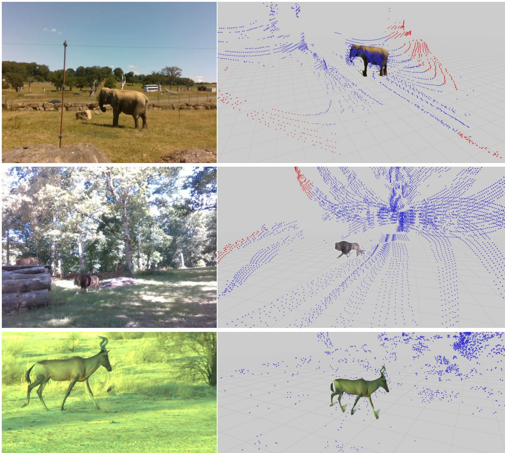  
Figure 11: Target-point densification: RGB (left) and dense metric point cloud (right) for an elephant and a lion (Longleat) and a red hartebeest (Kgalagadi).

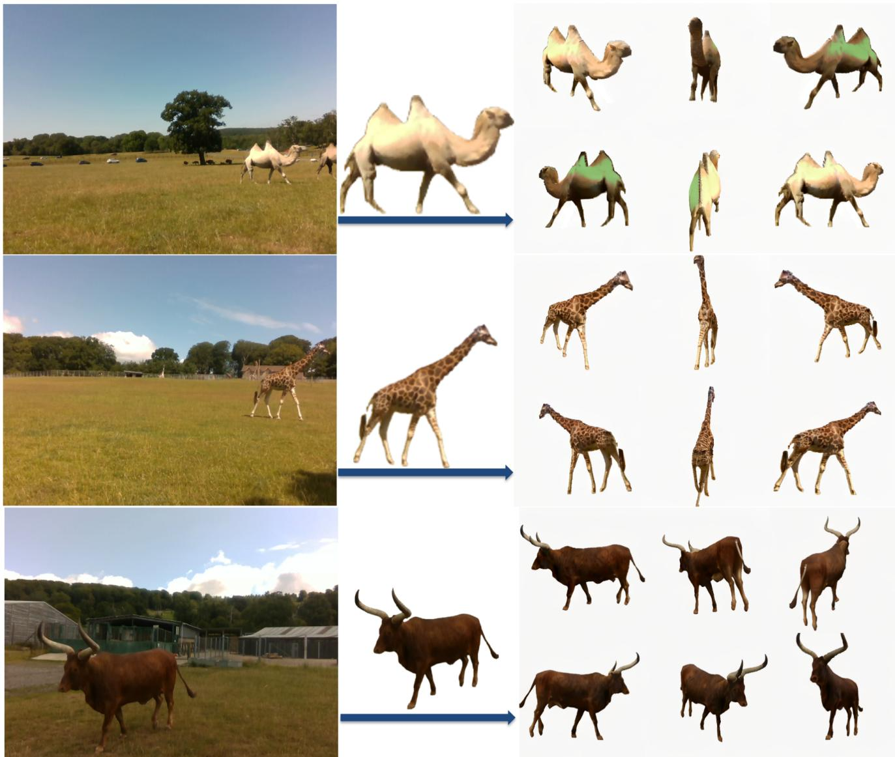  
Figure 12: 4D reconstructions of a walking camel (top), girafe (middle) and Ankole cow (bottom).