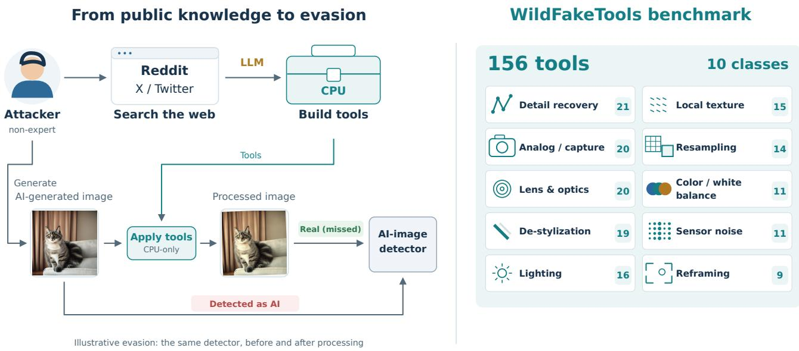
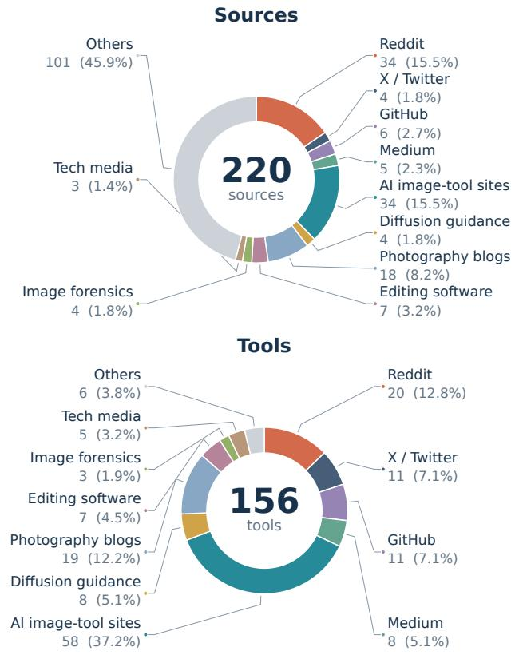
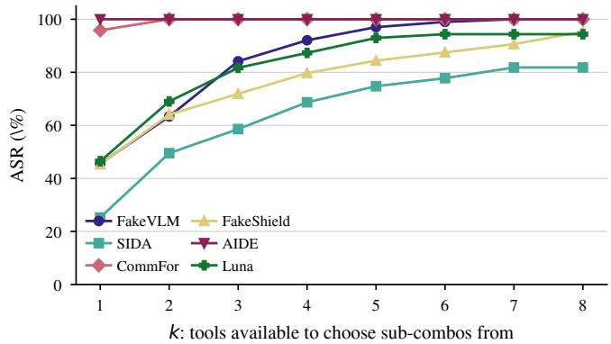
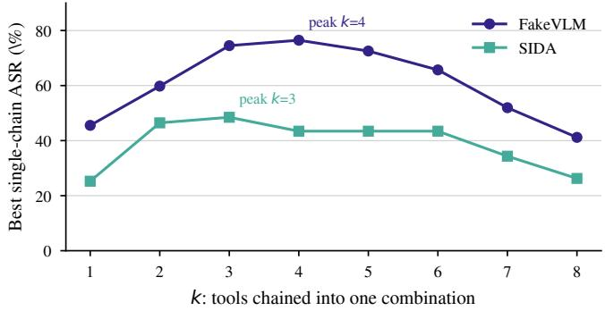
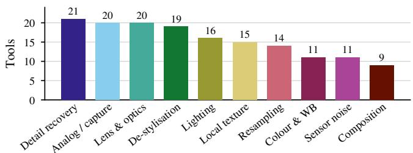
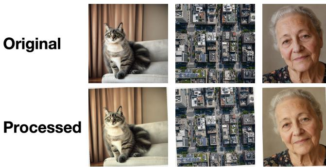
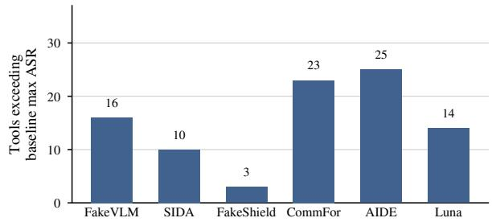

# WildFakeToolBench: Benchmarking AI-Generated Image Detectors with Web-Sourced Image Processing

Mingjie Li<sup>1</sup> Yukun Jiang<sup>1</sup> Yicong Tan<sup>1</sup> Yang Zhang<sup>1</sup>

<sup>1</sup>CISPA Helmholtz Center for Information Security

October 23, 2026

## Abstract

As AI generated images are getting popular these days, discussions on such generations are widely existed in current public forums, software repositories, and photography tutorials. Moreover, with the help of LLM-assisted code translation, malicious actors can adopt such information to evade detectors without specialized knowledge or local GPU execution of the resulting tools. To evaluate such risks, we introduce WILDFAKETOOLBENCH, a benchmark suite of 156 executable image-processing tools derived from 220 public sources across 142 domains. Each tool retains its source evidence and passes syntax, execution, and output-distortion checks without using feedback from the evaluated detectors. On 105 generated images from five generators, we evaluate six state-of-the-art detectors with images processed by the tools in our collected bench to assess their effectiveness against such in-the-wild risks. The strongest individual tools achieve attack success rates of 25.25%–100% across detectors, exceeding the strongest of six selected imageprocessing baselines for each detector. Evaluating subsets of an eight-tool pool yields worst-case coverage above 80% for every detector. Effectiveness is sparse and detector-specific: high coverage across candidates does not imply reliable oneshot evasion. These findings not only highlight the potential of such web-sourced risks, but also show the potential on establishing AI-image detector robustness evaluation framework based on those in-the-wild information. Code and benchmark can be found in https://github.com/Tru stAIRLab/WildFakeToolBench.

## 1 Introduction

As AI-generated images become increasingly accessible, more users are discussing them online. However, these images can also be used for malicious purposes, such as spreading misinformation. Although several detectors have been proposed to identify statistical, frequency-domain, or visualartifact cues, prior work has shown that their robustness against various attacks remains limited [6, 12, 25]. Moreover, malicious actors can draw on publicly accessible web knowledge about photographic appearance, camera artifacts, and detector evasion. With the help of current LLMs, they can translate this knowledge into image-processing operations that make generated images evade detectors. Because these operations can be applied by non-experts with imageprocessing knowledge using only a CPU, this risk should not be overlooked.

Such knowledge is distributed across forums, software repositories, image-tool sites, and photography tutorials. Some sources explicitly discuss evasion, while others describe ordinary editing or simulated capture effects. Although these sources often provide informal descriptions rather than directly applicable code or software, attackers can use LLMs to translate them into runnable code, reducing the implementation expertise required. Most resulting transformations can also be performed with standard imageprocessing libraries on CPUs. The relevant question is therefore whether accessible public experience can supply effective robustness tests for current detectors, even without detector-specific attack optimization.

We introduce WILDFAKETOOLBENCH, a suite of 156 executable tools with source provenance and a common evaluation protocol. The tools are generated by our WildFake agent framework, which performs text retrieval, method extraction, deduplication, and code generation. They span ten categories, including artifact repair, color adjustment, resampling, and simulated capture effects. To reflect attackers with limited resources, the image-processing operations in our benchmark require no local GPU. Neither tool synthesis nor image-specific parameter proposals use detector feedback. Our contribution is the resulting benchmark resource and its assessment of an accessible processing space, rather than a new detector-specific optimization algorithm.

To measure the robustness of current state-of-the-art AI detectors in our settings, we evaluate six state-of-the-art AI detectors after processing our collected tools on an image set collected across five generators and seven content categories. For each tool and image, we process the tool with five parameter candidates generated by GPT-4o-mini and retain outputs with SSIM at least 0.75. Based on the evaluation, we find that every evaluated detector is vulnerable to at least one tool, and the strongest individual tool exceeds the strongest of six selected baselines for each detector. Although most tools cannot effectively affect the prediction of the state-of-the-art detectors, we still find many useful tools for current detectors. For example, the maximum single-tool attack success rate (ASR) for FAKEVLM is 45.54%, demonstrating substantial weaknesses for current detectors.

  
Figure 1: WILDFAKETOOLBENCH overview. Threat Model (Left): a non-expert user searches public web experience and uses LLMassisted translation to obtain CPU-compatible image-processing tools for detector evasion. WildFakeToolBench (Right): we organize the recovered methods into a benchmark of 156 tools across ten processing classes. The paired images illustrate the software print\_ rescan transformation.

Besides single-tools, malicious actors may also collect several attack tools, combine them for effective attacks. Therefore, we also evaluate the coverage obtained by trying subsets of several available tools. It exposes broader weaknesses, but measures a worst-case candidate portfolio rather than one-shot evasion. Since the combination of all tools are too many, we select a candidate pool from our single-tool evaluation to our coverage evaluation. Besides the measurement on the risks, our in-the-wild analysis also traces how public sources contribute executable methods and how too categories and source types appear among effective candidates. Our contributions are threefold:

• We introduce WILDFAKETOOLBENCH, a benchmark of 156 executable, provenance-linked image-processing tools derived from public web knowledge, with CPUcompatible implementations and shared validity checks.

• We evaluate six AI-image detectors under single-tool and multiple-candidate protocols, revealing substantial but detector-specific weaknesses beyond six selected image-processing baselines.

• We analyze the conversion of public knowledge into tools, the processing strategies it covers, and the sources represented among effective tools, providing a basis for reproducible robustness testing.

## 2 Related Work

## 2.1 AI Image Generators

AI image generation has progressed through several modeling paradigms, making high-quality synthesis increasingly accessible. Early generative adversarial networks [10,15,30] often produced lower-fidelity images. Therefore, diffusion [13, 28] and latent-diffusion models [24] subsequently became dominant, particularly for high-fidelity text-to-image synthesis [1, 22], and attracted substantial public attention. However, diffusion models can still struggle to follow complex user prompts, limiting their utility for some practical tasks. Newer generation systems, such as GPT-Image and Nano Banana [9,17,18], improve prompt understanding with their internal language models [5, 16] while producing highquality images. This evolution is relevant to detection because different generator families may leave different color, spectral, or processing artifacts. We therefore include five popular generators in our evaluation.

## 2.2 AI-Generated Image Detectors

AI-generated images can be used to spread rumors and misinformation online, potentially causing substantial social harm. Researchers have therefore developed detectors to distinguish AI-generated images from real ones [11]. Traditional neural-classifier-based detectors are commonly trained on large datasets of generated images [21, 26] or on specific artifacts associated with image generation [8, 35, 36]. Some methods leverage the generator models themselves for zeroshot fake-image classification [27].

More recently, the strong visual understanding capabilities of vision-language models have motivated VLM-based detectors. FAKEVLM [32] is fine-tuned to reason about visual artifacts associated with generated images. SIDA-13B [14] and FAKESHIELD [34] further combine classification with localization or segmentation of manipulated regions, while ViGText [3] also adopt graph neural networks for analysis. In our evaluation, we assess the robustness of these detectors against tools derived from in-the-wild knowledge.

## 3 WildFakeToolBench Benchmark

## 3.1 Threat Model

As AI models are easily accessible for common people, we now consider a non-professional, in-the-wild malicious actor who seeks to make an AI-generated image evade detection by having it classified as real. The actor can search publicly available online knowledge and use a general-purpose LLM to translate relevant advice into image-processing tools, but is not assumed to have specialized image-forensics expertise or local GPU resources. The actor can submit images to a black-box detector and observe its binary decision (real or AI-generated). The detector’s identity and all other information—including its architecture, parameters, training data, confidence scores, and decision threshold—are unknown to the actor. Thus, the threat model permits only label-level feedback, not white-box access or detector-specific knowledge.

## 3.2 Benchmark Collection Framework

To collect web-based tools can be utilized by malicious actors, we build a agent framework called WILDFAKE by simulating the actors’ operation on collecting knowledge and converting them to applicable tools. The framework contains three stages as follow,

• Retrieval and Knowledge Processing: We first adopt Tavily to collect knowledge about AI-generated images from public sources. Then we adopt GPT-4o-mini to preprocess the collected texts, removing the low quality terms like short and out-of-scope texts. And we finally formulate them in a constant template for provenance.

• Method Extraction and Deduplication: After collected the information, we adopt GPT-4o-mini to extract actionable methods and other information related to the method for further analysis, like quoted evidence. Then we also adopt the model to identify the repeated techniques and merge them to preserve the unique tools for our benchmark.

• Tool Synthesis and Validation: After extracted the methods, we adopt GPT-4o-mini to convert the retained method into a parameterized Python image-processing tool. Since our threat models targets on the nonprofessional attackers, our generated image-processor are all applicable for CPU tools as such attackers usually do not have sufficient GPU resources for diffusion or other techniques. We also check the tools by evaluating their interface validity, execution, non-identity output, and distortion. Failures can be revised using software diagnostics without detector feedback.

The details of our agent framework are listed in Appendix A.

## 3.3 The Obtained WildFakeToolBench

As shown in the right part of Figure 1, our obtained WILD-FAKETOOLBENCH contains 156 validated tools derived from 220 public sources across 142 domains. These synthesized image-processing operations use standard libraries and require no local GPU. The tools retain source provenance and executable implementations, and are organized into ten categories spanning operations such as color adjustment, resampling, and simulated capture effects, details are described in Appendix B. Their goals fall into broader patterns: reducing recognizable synthetic appearance through detail repair, destylization, and texture changes; adjusting lighting and color; adding simulated capture cues through analog effects, lens effects, noise, and reframing; and reproducing resizing or reencoding associated with image sharing.

Example: Translating Capturing Techniques. A Reddit discussion describes printing an image and scanning it back. We list its source, idea and implementation as below. We note it is a software simulation, not a physical print-and-scan experiment. Its 25.25% ASR against SIDA-13B illustrates how public advice can yield a runnable test without detectorspecific optimization.

Example: print\_rescan

Source idea: Print the image and scan it back in. The synthesized tool approximates this operation in software. Source: Reddit “How to prevent AI image detection?”<sup>a</sup>. Software implementation. The tool uses paper-fibre noise with low-frequency brightness variation to simulate printed paper, gamma and color adjustments to reproduce printing and scanning shifts. It also adopts a small rotation to mimic the scan misalignment, and Gaussian blur to model recapture softness.

<sup>a</sup>https://www.reddit.com/r/StableDiffusion/comments/13eqp8v/

## 3.4 Settings of our Benchmark Evaluation

Detectors and Baselines We evaluate four VLMbased systems, FAKEVLM [32], SIDA-13B [14], FAKESHIELD [34], and GPT-5.6-LUNA [19], and two neural classifiers, COMMFORENSICS [21] and AIDE [35]. We use FAKESHIELD’s DTE-FDM component for classification and prompt GPT-5.6-LUNA directly. Additional detector descriptions and the prompt appear in Appendices C.1 and E.6.

We compare against six selected image-processing baselines: Gaussian/salt-and-pepper noise, spectral suppression, defocus blur, Poisson–Gaussian noise, simulated camera processing, and Reinhard color transfer [4, 7, 12, 23, 33]. All use the same candidate and distortion-filtering protocol. This comparison measures additional stress-testing value relative to these implementations, rather than superiority over all academic attacks. Details appear in Appendix C.2.

Evaluated Images Our image set for evaluation contains 105 generated images: 21 shared prompts submitted to Stable Diffusion 2.1 [1], Qwen-Image-2.0 [29], Midjourney [2], GPT Image 2 [20], and Nano Banana 2 [9]. Following prior work [32], prompts span animal, object, document, human, scene, satellite, and face-portrait categories, with three prompts per category. GPT-4o-mini proposes prompts, which are manually reviewed. For each prompt–generator pair, we generate three candidates and manually select the highest-quality output. This controlled, curated set supports paired processing comparisons but does not represent the full distribution of generated images.

Single-Tool Protocol For each tool and image, GPT-4omini proposes five parameter settings spanning processing strengths, before any detector query. We discard outputs with SSIM [31] below 0.75 relative to the input. This threshold controls measured structural distortion, without guaranteeing naturalness or semantic preservation. If all candidates fail the filter, the attack fails on that image.

Let $\mathcal { B } _ { d }$ be the images initially classified as fake by detector d. A tool succeeds $\mathsf { o n } x \in \mathcal { B } _ { d }$ if any retained candidate is classified as real. ASR is the fraction of $\mathcal { B } _ { d }$ successfully attacked. Table 1 reports the detector-specific denominators, so baseline detection errors are not credited as attacks. For example, FAKEVLM detects 101 of 105 original images (over 96%), with four errors. Different denominators also limit direct ASR comparisons between detectors.

Multiple-Tool Coverage For a set $\mathcal { T }$ of k available tools, we evaluate every non-empty subset $c \subseteq \mathcal { T }$ . For each image and subset, GPT-4o-mini proposes one execution order and five joint parameter settings, without detector feedback. We do not enumerate alternative orders. Let $\mathcal { Y } ( x , c )$ be the outputs passing the same SSIM filter. Stacked ASR measures candidate coverage. Let $E _ { d } ( x , \mathcal { T } )$ be the event that some nonempty subset $c \subseteq { \mathcal { T } }$ yields $y \in \mathcal { Y } ( x , c )$ with $d ( y ) = \operatorname { R E A L }$ Then

$$
\mathsf { A S R } _ { d } ^ { \mathcal { T } } = \frac { 1 } { | \mathscr { B } _ { d } | } \sum _ { x \in \mathcal { B } _ { d } } \mathcal { H } [ E _ { d } ( x , \mathcal { T } ) ] .\tag{1}
$$

This is an oracle, worst-case coverage measure over evaluated candidates: different images may succeed with different subsets. There are up to $5 ( 2 ^ { k } - 1 )$ ) candidates per image before filtering, or 1,275 at $k = 8$ . It does not measure one-shot success, require all k tools to be applied, or establish a practical tool-selection policy.

Exhaustive search over 156 tools is infeasible. We form a fixed eight-tool pool from the top two single tools for FAKEVLM,SIDA-13B,FAKESHIELD, COMMFOREN-SICS and AIDE, using their evaluation ASRs. Results therefore describe a performance-selected pool on this image set. Tool construction and parameter proposals remain independent of detector feedback; pool selection and identification of the best successful candidate do not.

  
Figure 2: Source and tool composition by source category. Each label reports the count and its percentage of all 220 collected sources (upper) or 156 validated tools (lower). Colors identify the same categories in both charts. Percentages are rounded to one decimal place. Full source counts, per-source yields, and largest contributors are retained in Table 2.

## 4 Benchmark Results

In this section, we first conduct some analysis on our obtained WildFakeToolBench and then conduct evaluations on current detectors the collected tools in our benchmark to show the risks of state-of-the-art detectors.

## 4.1 Benchmark Source Analysis

First, we analyze the contribution of different sources in our benchmark collection. Figure 2 distinguishes absolute contribution from tools per collected source. From the figure, one can see that, AI image-tool sites supply the largest group in our collection, 58 tools from 34 sources. Tools/Src exceed one is because a source may contain several methods. Besides AI image-tool sites, Reddit also supplies 20 tools from 34 related sources, and photography blogs 19 from 18. We also notice some small groups also generate a lot of tools: X/Twitter contributes 11 tools from four sources, diffusionguidance sites eight from four, and GitHub 11 from six. The possible reason is those sources collected from these websites are more detailed and technical and are easy for implementation, like GitHub. Besides the famous sites or technical domains, we also collect a lot of related information from other wide websites, with 101 collected sources. However, the knowledge of these domains is not effective for fake-toreal attacks, mainly because there are only general discussions on AI-images with only 6 accessible tools finally generated.

Table 1: Single-tool ASR on initially detected images. $| \mathcal { B } _ { d } |$ is number of images which are detectable for sepcific detectors among 105 inputs. Max and Mean summarize the web-derived suite; Base Max is the strongest of six selected baselines; $N _ { > \mathrm { b a s e } }$ counts tools exceeding Base Max. Resizing tools are excluded from the FAKESHIELD comparison, following the original evaluation’s output-quality exclusion.
<table><tr><td></td><td>Detector</td><td> $| \mathcal { B } _ { d } |$ </td><td>Max ASR</td><td>Mean ASR</td><td>Base Max</td><td> $N _ { > \mathrm { b a s e } }$ </td></tr><tr><td rowspan="4">VLM</td><td>FAKEVLM</td><td>101</td><td>45.54%</td><td>3.22%</td><td>6.93%</td><td>16</td></tr><tr><td>SIDA-13B</td><td>99</td><td>25.25%</td><td>4.84%</td><td>12.12%</td><td>10</td></tr><tr><td>FAKESHIELD</td><td>64</td><td>46.88%</td><td>11.60%</td><td>39.06%</td><td>3</td></tr><tr><td>GPT-5.6-LUNA</td><td>72</td><td>66.67%</td><td>21.87%</td><td>33.80%</td><td>14</td></tr><tr><td rowspan="2">Classifier</td><td>COMMFORENSICS</td><td>48</td><td>95.83%</td><td>21.77%</td><td>41.67%</td><td>23</td></tr><tr><td>AIDE</td><td>85</td><td>100.00%</td><td>23.10%</td><td>55.29%</td><td>25</td></tr></table>

  
Figure 3: Maximum candidate coverage (stacked ASR) over k-tool available sets from the performance-selected eight-tool pool.

Source Contribution. We list the sources with largest contributors in Table 2. From the results, one can see that the sources of our benchmark include terms from both specialized image-processing resources and general community discussions. Within AI image-tool sites, imagera.ai supplies ten tools. Other leading contributors are medium.com with seven, stable-diffusion-art.com with eight, craigbo ehman.com and kdnuggets.com with four each, and vsc o.co with two. The concentration of sources for our collected attack tools reflects the non-negligible impact of those publicly accessible websites, malicious actors can get attack techniques from those domains.

Tools Production. Editing-software sources produce 1.0 tool per source and image-forensics sources 0.75. Moreover, Medium and tech media exceed 1.5. Specifically, although AI image-tool sites provide the largest tool pool, some smaller source groups also contain several actionable methods per page. Reddit and photography blogs contribute substantial coverage despite lower yields than X/Twitter or diffusion-guidance sites. Besides the tool generation analysis, we also analyze the detector-specific effectiveness separately in Section 4.5.

## 4.2 Single-Tool Effectiveness

We apply the collected tools in our benchmark respectively on the evaluated 105 generated images on six state-of-the-art detectors. The summarized results are listed in Table 1.

Max Single-Tool ASR Reveal Substantial Vulnerabilities. The strongest single-tool ASRs in Table 1 range from 25.25% against SIDA-13B to 100% against AIDE. The highest ASRs are 45.54% for FAKEVLM, 46.88% for FAKESHIELD, and 66.67% for GPT-5.6-LUNA. These results demonstrate that in-the-wild malicious actors could find effective single tools through internet knowledge conversion.

Lot Web-derived Tools Outperforms Academic Baselines. Besides the best performed web-derived tools, there also exist a lot effective tools. Compared with the six selected academic baselines, each detectors are vulnerable to a set of web-derived tools whose ASR are higher. For example, over 10 tools achieves higher ASR than the best academic baselines for five evalauted detectors except FAKESHIELD, but FAKESHIELD also have 3 tools whose ASR is higher than 40%. These results demonstrate that the effective tools are not rarely exist in the internet.

Tool Effectiveness Varies Across Detectors. Although our obtained tool bench contain serveral effective tools for detectors, not all of them are effective. Morevoer, tool performance are also different across different detectors. For example, print\_rescan reaches 25.25% against SIDA-13B and 3.96% against FAKEVLM.

## 4.3 Results on Combining Multiple Available Tools

Besides simply adopting single-tools, malicious attackers may collect several useful tools and combine them for effective attack. To explore such risks, we first select eight effective tools as the candidate pool, which are selected the top-2 effective tools based on its single performance on FAKEVLM,SIDA-13B,FAKESHIELD, COMMFOREN-SICS and AIDE. And then we select subsets of them, apply the tool set on the image and then evaluate on the detectors.

Table 2: Full benchmark source statistics. Named platforms are listed separately; other sites are grouped by content type. Tools/Src may exceed one because a source can provide several methods.
<table><tr><td>Source category</td><td>Src.</td><td>Tools</td><td>Tools/Src</td><td>Largest contributor</td></tr><tr><td>Reddit</td><td>34</td><td>20</td><td>0.59</td><td>reddit.com (20)</td></tr><tr><td>X / Twitter</td><td>4</td><td>11</td><td>2.75</td><td>x.com (11)</td></tr><tr><td>GitHub</td><td>6</td><td>11</td><td>1.83</td><td>github.com(11)</td></tr><tr><td>Medium</td><td>5</td><td>8</td><td>1.60</td><td>medium.com(7)</td></tr><tr><td>AI image-tool sites</td><td>34</td><td>58</td><td>1.71</td><td>imagera.ai (10)</td></tr><tr><td>Diffusion guidance</td><td>4</td><td>8</td><td>2.00</td><td>stable-diffusion-art.com (8)</td></tr><tr><td>Photography blogs</td><td>18</td><td>19</td><td>1.06</td><td>craigboehman.com(4)</td></tr><tr><td>Editing software</td><td>7</td><td>7</td><td>1.00</td><td>vsco.co (2)</td></tr><tr><td>Image forensics</td><td>4</td><td>3</td><td>0.75</td><td>ampedsoftware (2)</td></tr><tr><td>Tech media</td><td>3</td><td>5</td><td>1.67</td><td>kdnuggets.com (4)</td></tr><tr><td>Others</td><td>101</td><td>6</td><td>0.06</td><td>qwe.edu.pl (5)</td></tr><tr><td>Total</td><td>220</td><td>156</td><td>0.71</td><td></td></tr></table>

Table 3: Candidate-coverage results for all two-, three-, and four-tool available sets selected from the fixed eight-tool pool defined in Section 4.3. The evaluation includes 28, 56, and 70 sets of the respective sizes. Max: the highest stacked ASR among available tool sets of that size. >25%/>50%: the number of sets exceeding the corresponding ASR threshold.
<table><tr><td></td><td></td><td colspan="3">Two</td><td colspan="3">Three</td><td colspan="3">Four</td></tr><tr><td></td><td>Detector</td><td>Max</td><td>&gt;25%</td><td>&gt;50%</td><td>Max</td><td>&gt;25%</td><td>&gt;50%</td><td>Max</td><td>&gt;25%</td><td>&gt;50%</td></tr><tr><td rowspan="4">VLM</td><td>FAKEVLM</td><td>63.37%</td><td>16</td><td>6</td><td>84.16%</td><td>46</td><td>30</td><td>92.08%</td><td>65</td><td>63</td></tr><tr><td>SIDA-13B</td><td>49.49%</td><td>15</td><td>0</td><td>58.59%</td><td>55</td><td>12</td><td>68.69%</td><td>70</td><td>52</td></tr><tr><td>FAKESHIELD</td><td>64.06%</td><td>20</td><td>4</td><td>71.88%</td><td>55</td><td>27</td><td>79.69%</td><td>70</td><td>70</td></tr><tr><td>GPT-5.6-LUNA</td><td>69.01%</td><td>28</td><td>23</td><td>81.69%</td><td>56</td><td>56</td><td>87.32%</td><td>70</td><td>70</td></tr><tr><td rowspan="2">Neural</td><td>COMMFORENSICS</td><td>100.00%</td><td>28</td><td>27</td><td>100.00%</td><td>56</td><td>56</td><td>100.00%</td><td>70</td><td>70</td></tr><tr><td>AIDE</td><td>100.00%</td><td>25</td><td>25</td><td>100.00%</td><td>56</td><td>56</td><td>100.00%</td><td>70</td><td>70</td></tr></table>

Stack Performance Across Different Tool Subsets. Figure 3 shows that larger tool pools provide more opportunities to find combinations that change a detector’s decision. For FAKEVLM, maximum coverage rises from 63.37% with two available tools to 84.16% with three and 92.08% with four. Four-tool sets reach 68.69% for SIDA-13B, 79.69% for FAKESHIELD, and 87.32% for GPT-5.6-LUNA. COMM-FORENSICS and AIDE both reach 100%. With all eight tools available, coverage reaches 100% for FAKEVLM, exceeds 95% for FAKESHIELD and GPT-5.6-LUNA, and exceeds 80% for SIDA-13B. These results show that tools derived from public knowledge can provide effective candidates for detector evasion.

Table 3 also shows that effective combinations are common in this selected pool. More than half of the threetool sets exceed 50% ASR for FAKEVLM, GPT-5.6-LUNA, COMMFORENSICS, and AIDE. For SIDA-13B, 12 of the 56 three-tool sets exceed that threshold. Among four-tool sets, at least 52 of 70 exceed 50% ASR for every detector, and all 70 do so for FAKESHIELD, GPT-5.6-LUNA, COMMFOREN-SICS, and AIDE. This suggests that attackers could combine publicly available techniques, translated into tools with an LLM, to find effective options against a range of detectors.

  
Figure 4: Best reported ASR for applying all k tools sequentially in a chain. Longer chains need not improve performance.

Simultaneously Apply More Tools not Improve Performance. Figure 4 instead applies every tool in a chain. From the figure, one can see that the best-chain performance peaks at four tools for FAKEVLM and three for SIDA-13B, and the ASR will decrease with the increment of k after that. The results demonstrate that more tools do not also mean better performance. The existing validation results also show fewer retained parameter candidates for long chains: approximately four of five pass the SSIM threshold for two-tool processing, compared with approximately two for eight-tool processing. Besides the accumulated distortion, a possible reason for the failure of applying too many tools is that they may affect each other. For example, guassian blurring can mitigate the effect of the photography processing.

Table 4: Operation categories represented in the highest-ASR available sets. For each detector, Single reports the category and ASR of the strongest individual tool. The two-/three-/four-tool columns report the distinct categories represented in the highest-ASR available tool set of each size and its corresponding stacked ASR. AC=Analog/capture, DS=De-stylization, DR=Detail recovery, CP=Composition, CW=Color/white balance, RS=Resampling, and LT=Local texture. Categories are defined in Appendix B.
<table><tr><td>Detector</td><td>Single</td><td>ASR</td><td>Two</td><td>ASR</td><td>Three</td><td>ASR</td><td>Four</td><td>ASR</td></tr><tr><td>FAKEVLM</td><td>AC</td><td>45.54%</td><td>AC, DS</td><td>63.37%</td><td>RS, DS, DR</td><td>84.16%</td><td>RS, CP, DS, DR</td><td>92.08%</td></tr><tr><td>SIDA-13B</td><td>AC</td><td>25.25%</td><td>CP, AC</td><td>49.49%</td><td>CP, AC, DR</td><td>58.59%</td><td>CP, CW, AC, DR</td><td>68.69%</td></tr><tr><td>FAKESHIELD</td><td>DS</td><td>46.88%</td><td>CP, CW</td><td>64.06%</td><td>CP, AC, CW</td><td>71.88%</td><td>CP, AC, CW</td><td>79.69%</td></tr><tr><td>GPT-5.6-LUNA</td><td>LT</td><td>66.67%</td><td>CP, DR</td><td>69.01%</td><td>CP, CW, DR</td><td>81.69%</td><td>CP, CW, AC, DR</td><td>87.32%</td></tr><tr><td>COMMFORENSICS</td><td>CW</td><td>95.83%</td><td>DR, CW</td><td>100.00%</td><td>DS, DR, CW</td><td>100.00%</td><td>AC, DS, DR, CW</td><td>100.00%</td></tr><tr><td>AIDE</td><td>RS</td><td>100.00%</td><td>RS, DR</td><td>100.00%</td><td>RS, DS, DR</td><td>100.00%</td><td>CP, AC, DS, DR</td><td>100.00%</td></tr></table>

  
Figure 5: Tool counts across ten assigned processing categories. Categories describe intended operations rather than verified perceptual improvements.

## 4.4 Observed Weaknesses of Current Detectors.

Our results also point to weaknesses that differ across detectors. Table 4 lists the categories of the strongest individual tools and highest-coverage sets.

Single-Aspect Weaknesses The strongest single tools fall into different categories, suggesting that each detector responds differently to image processing. The strongest tools for FAKEVLM and SIDA-13B use analog or capture effects, while those for FAKESHIELD, GPT-5.6-LUNA, COMMFORENSICS, and AIDE use destylization, localtexture, color/white-balance, and resampling operations, respectively.

Weaknesses from Combination Views. Tool combinations also provide new perspectives on detector weaknesses because the strongest individual tool does not always be included in the best combination. For FAKEVLM, the strongest three-tool set combines resampling, de-stylization, and detail recovery, reaching 84.16% coverage. Adding composition raises coverage to 92.08% in the strongest fourtool set. However, none of them include the original analog/- capture technique. Although the best combination attack in SIDA-13B includes its related strongest single-tool, results on tool combination more weaknesses of it, especially for the composition attack, which improves the ASR by 25% when including it. The strongest portfolios for FAKESHIELD and GPT-5.6-LUNA also differ from their best individual tools. FAKESHIELD’s strongest single tool uses de-stylization, but its four-tool set spans composition, color/white balance, and analog/capture. For GPT-5.6-LUNA, local texture leads among single tools, while the strongest four-tool set includes composition, color/white balance, analog/capture, and detail recovery. These further reveals more weaknesses of current detectors. For COMMFORENSICS and AIDE, the strongest single tools point to color and resampling as useful stress tests, respectively, though other weaknesses may also exist.

Together, these results point to detector-specific weaknesses and suggest directions for future improvements. They also show why web-sourced advice poses a broad risk: discussions span many aspects of image editing and photography, and can therefore yield tools that target different weaknesses across detectors.

## 4.5 Source-Level Effectiveness

We summarize source membership among the strongest individual tools and highest-ASR tool sets in Table 5. AI imagetool sites contribute the strongest single tools for four detectors. Reddit provides the strongest single tool for SIDA-13B and appears in the highest-ASR sets for all six detectors. Tech media provides the strongest single tool for GPT-5.6-LUNA. These results show that these publicly accessible sources can also generate tools effective against different detectors, highlighting the potential reach of web-sourced risks. In contrast, GitHub and diffusion-guidance sources have relatively high tool generation but do not appear in the reported highest-ASR sets. One possible explanation is that detector designers already consider techniques from these sources as they are more professional.

## 4.6 Engagement and Effectiveness.

Besides the analysis on attack effectiveness and sources, we also explores whether the relationship between the source engagement and the effectiveness of the extracted tools. Since not all sources have the engagement score, we only provide some case study in this section. In the Reddit case study, nat ural\_color\_correction comes from a thread with 56 upvotes and reaches 75.00% ASR against COMMFORENSICS. A tool from a post with zero upvotes and 20 comments, up scale\_grain\_denoise, reaches 91.67%. These examples show that more engagement may be related to the effectiveness of the extracted tools which should pay more attention as a defender.

Table 5: Source platforms represented in the highest-ASR available sets. For each detector, Single reports the source platform and ASR of the strongest individual tool. The two-/three-/four-tool columns report the source platforms represented in the highest-ASR available tool set of each size and its corresponding stacked ASR. AI=AI tool sites, RD=Reddit, MD=Medium, ES=Editing software, and TM=Tech media.
<table><tr><td>Detector</td><td>Single</td><td>ASR</td><td>Two</td><td>ASR</td><td>Three</td><td>ASR</td><td>Four</td><td>ASR</td></tr><tr><td>FAKEVLM</td><td>AI</td><td>45.54%</td><td>AI, MD</td><td>63.37%</td><td>AI, MD, RD</td><td>84.16%</td><td>AI, RD, MD</td><td>92.08%</td></tr><tr><td>SIDA-13B</td><td>RD</td><td>25.25%</td><td>RD</td><td>49.49%</td><td>RD</td><td>58.59%</td><td>RD, AI</td><td>68.69%</td></tr><tr><td>FAKESHIELD</td><td>AI</td><td>46.88%</td><td>RD, ES</td><td>64.06%</td><td>RD, AI, ES</td><td>71.88%</td><td>RD, AI, ES</td><td>79.69%</td></tr><tr><td>COMMFORENSICS</td><td>AI</td><td>95.83%</td><td>RD, ES</td><td>100.00%</td><td>MD, RD, ES</td><td>100.00%</td><td>RD, MD, ES</td><td>100.00%</td></tr><tr><td>AIDE</td><td>AI</td><td>100.00%</td><td>AI, RD</td><td>100.00%</td><td>AI, MD, RD</td><td>100.00%</td><td>RD, MD</td><td>100.00%</td></tr><tr><td>GPT-5.6-LUNA</td><td>TM</td><td>66.67%</td><td>RD</td><td>69.01%</td><td>RD, AI</td><td>81.69%</td><td>RD, AI</td><td>87.32%</td></tr></table>

  
Figure 6: Original images and the images processed by our collected print\_rescan in the tool bench.

## 4.7 Example of Processed Images

We also show some images processed by an example tool p rint\_rescan in our WildFakeToolBench with their original images. From the figure, one can see that the processed images are almost same as its origin, with only a rotation and some slight noise to mimic the scanning process. However, such a small variant can convert over 25% detectable fake images from fake to real on SIDA-13B, demonstrating the vulnerable of current detectors.

## 5 Conclusion

We present WILDFAKETOOLBENCH, a collection of 156 executable image-processing tools derived from 220 public sources across 142 domains. The tools run on CPUs, retain their source evidence, and are synthesized and validated without detector feedback.

We evaluate the tools on 105 images from five generators against six detectors. Every detector is vulnerable to at least one tool. The strongest individual tools achieve ASRs from 25.25% to 100% and exceed the strongest of six selected baselines for each detector. An eight-tool pool achieves candidate coverage above 80% for all six detectors. Effectiveness varies by detector, and high coverage does not ensure one-shot evasion. These findings show that web-sourced knowledge can complement researcher-selected robustness evaluations.

## Ethics Considerations

This work has clear dual-use implications. The transformations collected and synthesized by WILDFAKE can help researchers identify weaknesses in AI-image detectors, but they can also be used to make generated images harder to detect. We therefore present these tools as a robustnessevaluation resource intended for authorized defensive research and detector development.

Our collection is restricted to content accessible through open-web retrieval, and we evaluate the resulting tools in a controlled setting on an AI-generated benchmark. We do not join closed communities, interact with users to obtain data, or deploy the tools against real-world moderation systems. These measures reduce, but do not eliminate, the potential risks associated with releasing a dual-use evaluation resource.

## References

[1] https://stability.ai/news-updates/stabledi ffusion2-1-release7-dec-2022. 2, 4

[2] Midjourney. https://midjourney.com/. 4

[3] Ahmad Albarqawi, Mahmoud Nazzal, Issa Khalil, Abdallah Khreishah, and NhatHai Phan. ViGText: Deepfake Image Detection with Vision-Language Model Explanations and Graph Neural Networks. In Network and Distributed System Security Symposium (NDSS). Internet Society, 2026. 3

[4] Tim Brooks, Ben Mildenhall, Tianfan Xue, Jiawen Chen, Dillon Sharlet, and Jonathan T. Barron. Unprocessing Images for Learned Raw Denoising. In IEEE Conference on Computer Vision and Pattern Recognition (CVPR), pages 11036–11045. IEEE, 2019. 3, 11

[5] Tom B. Brown, Benjamin Mann, Nick Ryder, Melanie Subbiah, Jared Kaplan, Prafulla Dhariwal, Arvind Neelakantan, Pranav Shyam, Girish Sastry, Amanda Askell, Sandhini Agarwal, Ariel Herbert Voss, Gretchen Krueger, Tom Henighan, Rewon Child, Aditya Ramesh, Daniel M. Ziegler, Jeffrey Wu,

Clemens Winter, Christopher Hesse, Mark Chen, Eric Sigler, Mateusz Litwin, Scott Gray, Benjamin Chess, Jack Clark, Christopher Berner, Sam McCandlish, Alec Radford, Ilya Sutskever, and Dario Amodei. Language Models are Few-Shot Learners. In Annual Conference on Neural Information Processing Systems (NeurIPS). NeurIPS, 2020. 2

[6] Hicham Eddoubi, Jonas Ricker, Federico Cocchi, Lorenzo Baraldi, Angelo Sotgiu, Maura Pintor, Marcella Cornia, Lorenzo Baraldi, Asja Fischer, Rita Cucchiara, and Battista Biggio. RAID: A Dataset for Testing the Adversarial Robustness of AI-Generated Image Detectors. CoRR abs/2506.03988, 2025. 1

[7] Alessandro Foi, Mejdi Trimeche, Vladimir Katkovnik, and Karen O. Egiazarian. Practical Poissonian-Gaussian Noise Modeling and Fitting for Single-Image Raw-Data. IEEE Transactions on Image Processing, 2008. 3, 11

[8] Joel Frank, Thorsten Eisenhofer, Lea Schönherr, Asja Fischer, Dorothea Kolossa, and Thorsten Holz. Leveraging Frequency Analysis for Deep Fake Image Recognition. In International Conference on Machine Learning (ICML), pages 3247–3258. PMLR, 2020. 2

[9] Gemini. Nano Banana2. https://gemini.google/ overview/image-generation/. 2, 4

[10] Ian Goodfellow, Jean Pouget-Abadie, Mehdi Mirza, Bing Xu, David Warde-Farley, Sherjil Ozair, Aaron Courville, and Yoshua Bengio. Generative Adversarial Nets. In Annual Conference on Neural Information Processing Systems (NIPS), pages 2672–2680. NIPS, 2014. 2

[11] Anna Yoo Jeong Ha, Josephine Passananti, Ronik Bhaskar, Shawn Shan, Reid Southen, Haitao Zheng, and Ben Y. Zhao. Organic or Diffused: Can We Distinguish Human Art from AI-generated Images? In ACM SIGSAC Conference on Computer and Communications Security (CCS), pages 4822–4836. ACM, 2024. 2

[12] Dan Hendrycks and Thomas G. Dietterich. Benchmarking Neural Network Robustness to Common Corruptions and Perturbations. In International Conference on Learning Representations (ICLR), 2019. 1, 3, 11

[13] Jonathan Ho, Ajay Jain, and Pieter Abbeel. Denoising Diffusion Probabilistic Models. In Annual Conference on Neural Information Processing Systems (NeurIPS). NeurIPS, 2020. 2

[14] Zhenglin Huang, Jinwei Hu, Xiangtai Li, Yiwei He, Xingyu Zhao, Bei Peng, Baoyuan Wu, Xiaowei Huang, and Guangliang Cheng. SIDA: Social Media Image Deepfake Detection, Localization and Explanation with Large Multimodal Model. In IEEE Conference on Computer Vision and Pattern Recognition (CVPR), pages 28831–28841. IEEE, 2025. 3, 11

[15] Mehdi Mirza and Simon Osindero. Conditional Generative Adversarial Nets. CoRR abs/1411.1784, 2014. 2

[16] OpenAI. GPT-4 Technical Report. CoRR abs/2303.08774, 2023. 2

[17] OpenAI. GPT Image 1. https://openai.com/index /image-generation-api/, 2025. 2

[18] OpenAI. GPT Image 1.5. https://developers.ope nai.com/api/docs/models/gpt-image-1.5, 2025. 2

[19] OpenAI. GPT-5.6 Luna. https://developers.ope nai.com/api/docs/models/gpt-5.6-luna, 2026. 3, 11

[20] OpenAI. GPT Image 2. https://developers.opena i.com/api/docs/models/gpt-image-2, 2026. 4

[21] Jeongsoo Park and Andrew Owens. Community Forensics: Using Thousands of Generators to Train Fake Image Detectors. In IEEE Conference on Computer Vision and Pattern Recognition (CVPR), pages 8245– 8257. IEEE, 2025. 2, 3, 11

[22] Dustin Podell, Zion English, Kyle Lacey, Andreas Blattmann, Tim Dockhorn, Jonas Müller, Joe Penna, and Robin Rombach. SDXL: Improving Latent Diffusion Models for High-Resolution Image Synthesis. CoRR abs/2307.01952, 2023. 2

[23] Erik Reinhard, Michael Ashikhmin, Bruce Gooch, and Peter Shirley. Color Transfer between Images. IEEE Computer Graphics and Applications, 2001. 3, 11

[24] Robin Rombach, Andreas Blattmann, Dominik Lorenz, Patrick Esser, and Björn Ommer. High-Resolution Image Synthesis with Latent Diffusion Models. In IEEE Conference on Computer Vision and Pattern Recognition (CVPR), pages 10684–10695. IEEE, 2022. 2

[25] Nataniel Ruiz, Sarah Adel Bargal, and Stan Sclaroff. Disrupting Deepfakes: Adversarial Attacks Against Conditional Image Translation Networks and Facial Manipulation Systems. In European Conference on Computer Vision (ECCV) Workshop, pages 236–251. Springer, 2020. 1

[26] Zeyang Sha, Zheng Li, Ning Yu, and Yang Zhang. DE-FAKE: Detection and Attribution of Fake Images Generated by Text-to-Image Generation Models. CoRR abs/2210.06998, 2022. 2

[27] Zeyang Sha, Yicong Tan, Mingjie Li, Michael Backes, and Yang Zhang. ZeroFake: Zero-Shot Detection of Fake Images Generated and Edited by Text-to-Image Generation Models. In ACM SIGSAC Conference on Computer and Communications Security (CCS), pages 4852–4866. ACM, 2024. 2

[28] Jiaming Song, Chenlin Meng, and Stefano Ermon. Denoising Diffusion Implicit Models. In International Conference on Learning Representations (ICLR), 2021. 2

[29] Qwen Team. Qwen-Image-2.0 Technical Report. CoRR abs/2605.10730, 2026. 4

[30] Ting-Chun Wang, Ming-Yu Liu, Jun-Yan Zhu, Andrew Tao, Jan Kautz, and Bryan Catanzaro. High-Resolution Image Synthesis and Semantic Manipulation With Conditional GANs. In IEEE Conference on Computer Vision and Pattern Recognition (CVPR), pages 8798– 8807. IEEE, 2018. 2

[31] Zhou Wang, Alan C. Bovik, Hamid R. Sheikh, and Eero P. Simoncelli. Image Quality Assessment: from Error Visibility to Structural Similarity. IEEE Transactions on Image Processing, 2004. 4

[32] Siwei Wen, Junyan Ye, Peilin Feng, Hengrui Kang, Zichen Wen, Yize Chen, Jiang Wu, Wenjun Wu, Conghui He, and Weijia Li. Spot the Fake: Large Multimodal Model-Based Synthetic Image Detection with Artifact Explanation. In Annual Conference on Neural Information Processing Systems (NeurIPS). NeurIPS, 2025. 2, 3, 4, 11

[33] Vera Wesselkamp, Konrad Rieck, Daniel Arp, and Erwin Quiring. Misleading Deep-Fake Detection with GAN Fingerprints. CoRR abs/2205.12543, 2022. 3, 11

[34] Zhipei Xu, Xuanyu Zhang, Runyi Li, Zecheng Tang, Qing Huang, and Jian Zhang. FakeShield: Explainable Image Forgery Detection and Localization via Multimodal Large Language Models. In International Conference on Learning Representations (ICLR), 2025. 3, 11

[35] Shilin Yan, Ouxiang Li, Jiayin Cai, Yanbin Hao, Xiaolong Jiang, Yao Hu, and Weidi Xie. A Sanity Check for AI-generated Image Detection. In International Conference on Learning Representations (ICLR), 2025. 2, 3, 11

[36] Ning Yu, Larry Davis, and Mario Fritz. Attributing Fake Images to GANs: Learning and Analyzing GAN Fingerprints. In IEEE International Conference on Computer Vision (ICCV), pages 7555–7565. IEEE, 2019. 2

## A Construction Details

Overview. WILDFAKE constructs the tool benchmark through retrieval, method extraction and deduplication, code synthesis, and validation. Figure 1 presents the benchmark overview; the detailed construction procedure is documented below.

## A.1 Retrieval and Corpus Processing

GPT-4o-mini assists with queries covering explicit detectorevasion advice and indirect photography knowledge. Tavily retrieves up to five results per query, including URLs and page text. Platform-specific searches supplement general search for Reddit and X. Collection is limited to public web content; this restriction does not itself determine the licensing of retrieved material. Query strings appear in Appendix E.1.

We discard pages with fewer than 300 extracted characters, remove exact-URL duplicates, and suppress domains primarily returning videos, marketplace listings, or other non-text content. Each normalized Post record stores a stable identifier, page text, URL, domain, matched discourse category, originating query, and available retrieval metadata. Source records support provenance and the source-level analysis.

## A.2 Method Extraction and Deduplication

GPT-4o-mini examines sources for actionable processing ideas and their stated mechanisms, retaining quoted evidence. The extraction prompt is reproduced in Appendix E.2. Methods need not specify exact numeric parameters, since synthesis subsequently supplies concrete implementations.

Deduplication distinguishes repeated concrete techniques from related operations. For example, film-grain overlays and sensor-noise injection need not be merged merely because both add noise. Our deduplication procedure first groups duplicates within batches, then uses compact method summaries for a global pass. Candidate duplicate groups are checked for functional similarity, including comparison of generated implementations. Overlapping verified groups are merged by transitive closure, retaining one representative and source provenance. The duplicate-detection and mechanismgrouping prompts are distinguished in Appendix E.3.

## A.3 Tool Interface and Admission Checks

GPT-4o-mini converts each retained idea into a Python class with an image-processing method, a parameter schema, and usage guidance. Implementations use common numeric image-processing libraries and do not load a neural imageediting model. The supplied synthesis prompt prohibits importing PyTorch. Parameters control properties such as noise strength, rotation, and blur; image-specific settings are proposed later during evaluation.

Checks test syntax, the class/interface and parameter dictionary, execution on a fixed validation image, non-identity output, and SSIM-based output distortion. When validation fails, the code and diagnostic are returned to the LLM, with at most three generation attempts per method. The validation image and synthesis prompt are documented in Appendix E.4. Validation errors provide software feedback; no detector score or decision is used to repair or admit tools.

## A.4 From Public Sources to Executable Tools

The collection contains 220 sources across 142 domains. Method mining labels 77 sources valuable and 143 discard, with no borderline assignments, and extracts 204 method records. Deduplication removes 35 redundant records and leaves 169 records; code synthesis and validation admit 156 tools, approximately 92% of the deduplicated methods. Of the 13 failures, five produce identity outputs and eight fail to yield runnable implementations within three attempts. This shows that informal advice can often be converted into executable processing, while also revealing limitations of method extraction and code translation. Conversion success does not imply detector evasion.

## B Tool Category Definitions

• Detail Recovery & Artifact Repair These tools restore local details that image generators often smooth out. Typical operations add edge variation, repair blurred regions, and reduce the over-smoothed appearance.

• Analog Medium & Capture Chain These tools simulate the processing history of physically captured images, like adding film grain or in-camera JPEG artifacts. The goal is to make a generated image resemble one captured and processed by real hardware.

• Lens and Optical Characteristics These tools simulate imperfections introduced by real lenses, such as chromatic aberration and barrel distortion, targeting the unrealistically clean optical appearance of AI images.

• De-stylisation & Anti-enhancement These tools reduce common stylized effects of image generators, such as beauty-filter smoothing, exaggerated symmetry, and excessive enhancement.

• Lighting Realism These tools improve lighting consistency by adjusting shadows, color temperature, and light sources across a scene.

• Local Texture These tools adjust fine-grained surface textures, such as skin and facial details.

• Resolution & Resampling These tools simulate the resizing and re-encoding that images processed when shared online, such transformations test sensitivity to changes in resolution and interpolation.

• Color & White Balance These tools adjust global image properties, including white balance, saturation, exposure, and tone mapping, to reproduce the color behavior of real photographs.

• Sensor Noise Injection These tools add noise associated with digital image sensors, like PRNU-like patterns, targeting statistical noise associated with digital capture rather than film grain.

• Composition & Reframing These tools change framing and composition to mimic casual human photography. Examples include off-center subjects, unusual aspect ratios, and less deliberate staging.

## C Detector and Baseline Details

## C.1 Detector Configurations

FAKEVLM [32] It fine-tunes a LLaVA-1.5-7B on their collected 100k-image dataset annotated with naturallanguage artifact clues. Thereby, it can enable the VLM’s ability of reasoning to spot the fake features and then recognize the fake images with explanations.

SIDA-13B [14] It fine-tunes LISA to emit a classification token and a segmentation token from one forward pass. Then the model can not only classify the fake images, but also localize the patterns of the fake images. Such segmentation ability also helps its classification.

FAKESHIELD [34] It contains two separately-trained modules: DTE-FDM concatenates a domain-tag classifier’s output with image tokens and feeds an LLM for real/fake judgment and explanation; MFLM then takes that explanation plus image tokens to produce a SAMaligned tamper mask. We only use DTE-FDM for verdict.

COMMFORENSICS [21] It fine-tunes a CLIP-ViT-S backbone to build a binary classifier with 2.7M images sampled from 4803 generators.

AIDE [35] It is a mixture-of-experts detector: DCT-based patch scoring selects the highest- and lowest-frequency patches, whose SRM noise residual is each fed to a dedicated fine-tuned ResNet-50. Moreover, it also combines a separately fine-tuned ConvNeXt-based Open-CLIP branch encodes the whole image or global semantics. Finally, all three pooled features are concatenated into an MLP for the final score.

GPT-5.6-LUNA [19] A hosted vision-language model evaluated by direct prompting. We directly prompt the image and prompt them to classify the image, the prompt is listed in Appendix E.6.

## C.2 Selected Image-Processing Baselines

Gaussian or Salt-and-Pepper Noise [12] This tool applies either additive Gaussian noise with a randomly drawn standard deviation or salt-and-pepper impulse noise.

Spectral Suppression [33] This tool removes periodic spectral peaks using the FFT and related spectral transformations, based on the observation that such peaks can serve as fingerprints of generated images.

Defocus Blur [12] This widely used robustness test applies Gaussian blur with a radius that scales linearly with the strength parameter to mimic optical defocus.

Practical Poisson & Gaussian Noise [7] This tool applies signal-dependent Poisson noise together with additive Gaussian noise across the image. It is designed to model two dominant noise sources of a real camera sensor within one transformation.

Camera Processing Motivated by search results on camera processing, we include a commonly used academic method [4] for this goal. It applies a white-balance scalar, a power-law tone curve for contrast, and Gaussian blur as a proxy for noise reduction to model a real ISP pipeline.

Reinhard Color Transfer Motivated by our search results on image realism, we adopt a widely used academic method [23] for this goal. It matches the colors of the generated image to those of a real reference image.

## D Additional Result Details

In this section, we also provide some additional results for our evaluation.

Single-Tool Comparisons. Relative to the strongest selected baseline, maximum single-tool ASR improves by 38.61 percentage points for FAKEVLM, 13.13 for SIDA-13B, 7.82 for FAKESHIELD, 32.87 for GPT-5.6-LUNA, 54.16 for COMMFORENSICS, and 44.71 for AIDE. The baseline-exceedance counts are reported in Figure 7. Mean single-tool ASRs of 21.77%, 23.10%, and 21.87% for COMMFORENSICS, AIDE, and GPT-5.6-LUNA, respectively, indicate that a broader portion of the tested suite affects these systems than affects FAKEVLM or SIDA-13B under the current protocol.

Failure-Case Analysis for SIDA-13B. We also analyze the 18 images that remain classified as FAKE by SIDA-13B. These failures are distributed across all 5 generators: 5 are from Midjourney, 4 each from GPT Image 2 and Qwen-Image, 3 from Nano Banana 2, and 2 from Stable Diffusion. No single generator dominates the remaining failures. Stable Diffusion, despite being the oldest generator in the benchmark, has the fewest failed images. This distribution suggests that the failures are not clearly determined by generator source or image quality. We also compare failures across content categories. The ASRs for document, face portrait, object, and satellite images are higher than those for animal and human images. One possible explanation is that SIDA-13B is more robust on animal and human content.

Example for Source Age and Effectiveness. The source for print\_rescan dates to 2023, whereas some methods from 2026 sources reach only approximately 1% ASR. From such examples, we do not find that the relationship effectivness and source age.

  
Figure 7: Number of released tools whose single-tool ASR exceeds the strongest of the 6 academic-sourced baseline tools, per detector.

## E Retrieval Queries and Archived Prompts

In this section, we provide queries and prompts for extraction, duplicate detection, mechanism grouping, tool synthesis, parameter selection, and detector evaluation. The grouping prompt is distinct from duplicate detection.

## E.1 Web-Retrieval Queries

The following queries are used to retrieve explicit detectorevasion advice and indirect photographic knowledge from the open web.

## List of Queries

• how to make AI images pass deepfake detector postprocessing;

• bypass AI image detector techniques site:photography OR site:reddit;

• AI generated image detection evasion image processing;

• undetectable AI image tutorial 2024 2025.

• make AI images look less artificial photography tips workflow;

• remove AI sheen look stable diffusion photography;

• make stable diffusion image look like real photograph;

• midjourney photorealistic tips post processing;

• how to make AI art look like real photo tutorial.

• add film grain analog look AI generated image;

• film emulation analog photography AI image Lightroom;

• Portra 400 film simulation digital photo realistic;

• halation light leak film overlay photography realistic;

• matte lifted blacks fade film look photography.

• phone camera filter realistic AI image mobile ISP processing;

• iPhone camera noise shadow processing realistic photo;

• mobile camera processing pipeline noise compression artifacts.

• camera sensor noise PRNU fingerprint photography forensics;

• sensor noise pattern real photograph vs AI image;

• Poisson Gaussian sensor noise model photography.

• print scan recapture AI image realistic photograph;

• photograph printed AI image realistic laundering;

• recaptured screen image moire pattern forensics.

• JPEG compression artifacts camera realistic photo AI;

• JPEG quantization table camera identification forensics;

• JPEG ringing blocking artifacts authentic photograph.

• high frequency texture noise floor real photograph vs AI.

• frequency separation skin pore texture overlay photography;

• fix plastic AI headshot restore skin pores Photoshop;

• skin texture frequency separation retouching realistic.

• unsharp mask high-pass filter photography realistic sharpness;

• detail enhancement clarity texture boost photography;

• dithering noise floor photography forensics.

• chromatic aberration lens fringing photography realistic;

• barrel distortion lens geometry photography realistic;

• vignetting lens corner darkening photography authentic;

• depth of field blur aperture photography realistic AI.

• white balance temperature tint realistic photograph correction;

• shadow highlight recovery photography tone realistic;

• color grading S-curve split toning cinema photography;

• desaturation HDR tone mapping photography realistic.

• Poisson blending color harmonization composite photography;

• light harmonization compositing realistic shadows.

• resample upscale downscale chain image processing photog  
raphy;   
• ComfyUI upscale tile img2img relaundering workflow.   
• GAN fingerprint spectral artifacts detection AI image foren  
sics.   
• adversarial perturbation fool deepfake detector FGSM imper  
ceptible.   
• remove invisible AI watermark SynthID stable signature.   
• EXIF metadata spoofing camera fingerprint injection foren  
sics.

## E.2 Method-Mining Prompt

The analyzer uses the following prompt to identify actionable methods and retain their supporting evidence from each retrieved source.

Method-Mining Prompt   
You are mining a community post (Reddit thread or   
blog/forum article) for IDEAS   
that could make AI-generated images pass as real   
photographs and thereby evade   
VLM-based fake-image detectors (FakeVLM, FakeShield,   
SIDA).   
WHAT WE WANT -- the IDEA, not a finished recipe.   
We are NOT asking for exact PIL/OpenCV parameters. We   
want the \*concept\* and the   
\*mechanism\*: the intuition a practitioner described   
for why an AI image looks fake   
and what they do about it. A downstream coding agent   
will turn each idea into a   
concrete tool later. Example of a good extraction:   
idea: "photograph or re-scan the AI image at a   
slight tilt, like a phone snapshot   
of a printout"   
mechanism: "introduces perspective skew, re  
photography sensor noise and JPEG   
history that real shared photos have   
but clean AI renders lack"   
That is fully acceptable EVEN THOUGH no exact   
rotation angle is given.   
A method may be a single step or many steps -- STEP   
COUNT DOES NOT MATTER.   
Do NOT discard an idea just because it is "only one   
operation". Judge ideas by   
NOVELTY and FEASIBILITY (defined below), not by   
complexity.   
CLASSIFY each extracted idea into one method\_type:   
- "generative" : uses a generative model to do the   
work -- T2I/img2img prompt   
tricks, negative prompts, low  
denoise regeneration, LoRA/   
checkpoint swaps, diffusion   
inpainting of artifacts.   
- "numeric" : a deterministic signal/pixel   
operation or pipeline -- grain,   
compression, sensor-noise, color/   
tone, geometric, capture-pipeline   
mimicry. No neural model needed at   
apply time.   
- "hybrid" : explicitly combines the two (e.g.   
numeric pipeline THEN a   
generative regeneration pass, or   
generate-then-launder).

SKIP only genuinely empty content: venting, news/   
ethics commentary, pure   
"is this fake?" guessing with no technique, or vague   
aesthetic praise with no   
actionable mechanism. Set verdict="discard" and   
candidate\_methods=[] for those.   
Score the POST on three axes (1=worst, 10=best):   
- novelty : how unusual / under-the-radar are   
these ideas? Favor techniques a   
detector is UNLIKELY to have been   
trained against (recent tricks,   
niche capture pipelines, creative   
model-side moves). Common,   
obvious moves score low; clever or   
fresh ideas score high.   
feasibility : could an LLM coding agent   
realistically implement these as an   
image tool? (a PIL/OpenCV op, or a   
call to a local generative   
model). Concrete, mechanism-clear   
ideas score high; hand-wavy or   
research-grade ("train a new GAN")   
ideas score low.   
- relevance : does the content actually concern   
making AI images look real /   
evading detection (vs. unrelated   
photo editing)?   
For each candidate idea capture:   
- name (snake\_case, \~2-4 words)   
- idea (one sentence: the concept)   
- mechanism (one sentence: WHY it makes the image   
look real / why a detector   
might miss it)   
- method\_type ("generative" | "numeric" | "hybrid")   
- quoted\_evidence (exact phrase you took it from,   
<= 200 chars)   
- source ("post" | "comment\_<author>")   
Output ONLY valid JSON, schema:   
"post\_id": "<echo>",   
"verdict": "valuable" | "borderline" | "discard",   
"scores": {   
"novelty": <int 1-10>,   
"feasibility": <int 1-10>,   
"relevance": <int 1-10>   
},   
"overall\_value": <int 1-10>,   
"rationale": "<2-3 sentences>",   
"candidate\_methods": [   
{   
"name": "...",   
"idea": "...",   
"mechanism": "...",   
"method\_type": "generative" | "numeric" | "   
hybrid",   
"quoted\_evidence": "...",   
"source": "..."   
]

## E.3 Deduplication Prompts

Batch Deduplication Prompt. The following prompt identifies duplicate methods within each processing batch.

Batch Deduplication Prompt   
You are given a flat list of specific attack-method   
ideas (each already   
individually catalogued), pooled from several   
independent batches. Because   
each batch was processed separately, the SAME   
concrete technique may appear   
more than once under slightly different names/   
wordings.   
Your ONLY job: find groups of ids that describe the   
SAME concrete technique   
(near-identical concept and mechanism -- not just the   
same broad theme).   
BE CONSERVATIVE. Two methods are duplicates only if a   
downstream coding agent   
would end up writing essentially the same tool for   
both of them. Methods that   
are merely related or thematically similar (e.g. "   
film grain overlay" vs.   
"sensor noise injection" vs. "print re-scan blur")   
are NOT duplicates -- leave   
them ungrouped. If you are not confident two ids are   
the same technique, do   
not group them.   
Do not invent new ids. Do not include singleton   
groups (a group only makes   
sense with >= 2 members). Most ids will not appear in   
any group -- that is   
expected and correct.   
Output ONLY valid JSON, schema:   
{   
"duplicate\_groups": [   
["m3", "m17", "m42"],   
["m8", "m55"]   
]   
}

Mechanism-Grouping Prompt. The following archived prompt groups deduplicated methods into higher-level mechanism categories.

Mechanism-Grouping Prompt   
You are given the FINAL deduplicated list of specific   
attack-method ideas   
(for making AI-generated images pass as real / evade   
VLM fake-image   
detectors). Each has already been individually   
catalogued and scored   
elsewhere -- you are not re-scoring or dropping any   
of them here.   
Your job: group these specific methods into a smaller   
set of GENERALIZED /   
ARCHETYPE methods -- higher-level strategies that   
explain WHY a cluster of   
specific methods works (the shared mechanism), for   
use in reporting and   
strategy selection. This is an ADDITIONAL summary   
layer on top of the   
specific list, not a replacement for it -- every   
specific method stays in the   
specific list regardless of which cluster it lands in   
here.

```jsonl
Guidelines:
- Produce however many clusters naturally fit the
data -- typically
somewhere in the 6-15 range for ~100-150 specific
methods, fewer if the
pool is smaller. Do not force a fixed count.
- Every specific method should belong to exactly
one cluster. A method that
is genuinely singular (no others share its
mechanism) may form a
cluster of one -- that’s fine, don’t force it
into a bad fit.
- Name each cluster for the shared MECHANISM (e.g.
"capture_pipeline_mimicry",
"signal_domain_texture_injection", "
semantic_prompt_evasion"), not for a
single member’s name.
‘member_names‘ must reference the exact ‘name‘
field of specific methods
from the input list.
‘priority‘ for a cluster = the max priority among
its members (rounded to
1 decimal).
Output ONLY valid JSON, schema:
{
"generalized_methods": [
{
"name": "snake_case_cluster_name",
"description": "<1-2 sentences: the shared
mechanism/strategy>",
"member_names": ["specific_method_a", "
specific_method_b"],
"priority": <float, 1 decimal>
}
]
}
```

## E.4 Tool Synthesis and Validation

Tool-Synthesis Prompt. The following prompt converts each retained method into a runnable image-processing tool that follows the framework’s common interface.

Prompt for Tool Synthesis   
You are a Python engineer implementing an image  
manipulation tool for an   
adversarial-attack research framework. You are given   
a single ADVERSARIAL IDEA   
mined from a community blog/forum (concept +   
mechanism), and you must turn it   
into a concrete, runnable tool.   
The tool defeats a fake-image detector by post  
processing an AI-generated image   
so it reads as a real photograph. Implement the IDEA   
faithfully -- choose sensible   
concrete operations and parameter ranges yourself;   
the idea gives you the concept,   
you supply the realization.   
You MUST output a single, self-contained Python   
module that defines ONE class   
subclassing ‘BaseTool‘. Follow this exact contract:   
‘‘‘python   
from typing import Dict, Any   
from PIL import Image

```python
import numpy as np
# you may also import: scipy.ndimage, scipy.signal,
math, random (all available)
# DO NOT import torch -- numpy + PIL + scipy .
from .base_tool import BaseTool
class <CamelCaseName>Tool(BaseTool):
def __init__(self):
super().__init__(
name="<snake_case_name>",
# MUST match the given name
description="<what the transform does,
effect-only, 1-3 sentences>",
)
def apply(self, image: Image.Image, params: Dict[
str, Any]) -> Image.Image:
self.validate_params(params)
# read params with .get(name, default);
convert image to RGB if needed;
# operate via numpy/PIL/scipy/cv2; return a
NEW PIL.Image (mode "RGB").
def get_param_schema(self) -> Dict[str, Any]:
# 1-4 params, each: {"type": "int|float|str",
"min":.., "max":..,
# "description":.., "
default":.., "required": False}
def get_guidance(self) -> str:
return "<one line: parameter ranges + when
this tool is most useful>"
11
```

Validation Image and Retry Procedure. The test image is not iid noise. A 24 × 24 uniform random field is bicubically upsampled to 512 × 512 and a σ = 8 Gaussian grain is added on top, under a fixed RandomState(42). The reason is on pure iid noise there is no spatial correlation for a blur, geometric or texture-matching operation to preserve, so SSIM measurement cannot be done. If validation fails, the generated tool and the failure reason are returned to the LLM for revision. We allow at most 3 generation attempts per method.

## E.5 Tool-Parameter Selection Prompt

The following prompt asks GPT-4o-mini to select five imagespecific parameter settings that span the applicable strength range of a tool.

Tool-Parameter Selection Prompt   
You are proposing parameter settings for an image  
editing tool, to test how a fake-image detector   
responds to different intensities of the SAME   
tool applied to the SAME image.   
Tool: {tool.name}   
Description: {tool.description}   
Parameters: {\_param\_desc(tool)}   
Usage guidance: {guidance}

```jsonl
You will be shown ONE image. Look at it and propose
exactly {N_CANDIDATES} DIVERGING candidate
parameter settings for this tool, spanning a
clear intensity range from very light to very
strong. Each candidate must be genuinely
different (not near-duplicate values) so
together they explore the tool’s effective range
on this specific image. Base your choices on
what you can see in the image (e.g. its existing
quality, texture, lighting) as well as the tool
’s guidance above.
IMPORTANT: even "very_strong" must stay a PLAUSIBLE
edit -- the image must still look like a real,
undamaged photo afterward. Do not propose
settings so extreme that they visibly destroy
the image (heavy artifacting, unrecognizable
content, obvious tampering). A candidate that
wrecks image quality will be discarded during
evaluation regardless of whether it fools the
detector, so there is no benefit to being overly
aggressive -- stay within the range where the
edit could plausibly pass as an unedited photo
to a human viewer.
Respond with ONLY valid JSON, no other text:
{"candidates": [
{"tier": "very_light", "params": {...}, "reasoning
": "..."},
{"tier": "light", "params": {...}, "reasoning":
"..."},
{"tier": "moderate", "params": {...}, "reasoning":
"..."},
{"tier": "strong", "params": {...}, "reasoning":
"..."},
{"tier": "very_strong", "params": {...}, "reasoning
": "..."}
]}
```

## E.6 GPT-Based Detector Prompt

The following prompt is used to obtain a binary real/fake judgment and a corresponding probability from GPT-5.6- LUNA.

GPT-Based AI-Image Detection Prompt   
Estimate the probability that this image is AI  
generated or manipulated by AI generators.   
This image comes from a mixed pool of real   
photographs and generated images. You are NOT   
told the proportion, so do not assume it: judge   
this image on its own evidence.   
Both mistakes cost the same. Calling a real   
photograph FAKE is as damaging as letting a   
generated one pass, so do not shade your answer   
toward either. Use the full 0-100 range and mean   
it: 90+ only with a clear artifact you can name   
, 50 for genuinely ambiguous, 10 or below when   
the image carries positive signs of real capture   
. If you would be unwilling to defend the number   
to someone holding the ground truth, move it   
toward 50.   
Reply with ONLY this JSON: {"p\_fake": <integer   
0-100>, "verdict": "FAKE" or "REAL", "why": "<8   
words max>"}. p\_fake is your probability the   
image is AI-generated or manipulated by AI

generators; verdict must agree with it (>=50 means FAKE).