# WovenAnchor Matcher: Specialized Intra- and Inter-Image Context Modeling for Feature Matching

Zhiyang Li1 Ruijiang Jin1 Thibaut Klenke1 Yusuke Sekikawa2 Nakamasa Inoue1 1Institute of Science Tokyo, Tokyo, Japan 2Denso IT Laboratory, Tokyo, Japan li.z.6a09@m.isct.ac.jp

## Abstract

Semi-dense local feature matching commonly aggregates contextual information before coarse-to-fine correspondence estimation. However, intra-image and inter-image aggregation serve different roles: the former should propagate spatial evidence within each image while retaining structured two-dimensional dependencies, whereas the latter should gather information from plausible corresponding regions while limiting noise from unrelated locations. We propose WovenAnchor Matcher (WAM), a semi-dense matching framework based on role-specialized context aggregation. WAM introduces two complementary operators. WovenMamba performs intra-image aggregation through horizontalthen-vertical state-space propagation, allowing vertical updates to operate on horizontally contextualized features and thereby encouraging a structured twodimensional receptive-field bias. AnchorCrossAttention performs inter-image aggregation by using cross-attention to gather context from plausible corresponding regions across the image pair. It performs this exchange over local representative anchors that aggregate feature evidence within each window. On MegaDepth, WAM achieves 66.1 pose AUC@5◦, improving on the JamMa baseline by 2.0 AUC points under the same evaluation setup. Ablations show that removing or replacing either specialized component reduces accuracy, providing evidence that intra-image propagation and inter-image retrieval benefit from role-specific aggregation designs. Code and pretrained weights are available at https://github.com/mmaiLab/WovenAnchorMatcher.

## 1 Introduction

Local feature matching is a core component of visual localization, structure-from-motion, SLAM, and image alignment [1–5]. Modern semi-dense matchers estimate many correspondences from learned feature maps and commonly follow a coarse-to-fine pipeline [6–8]. Before coarse matching, a context aggregation block updates descriptors using information from both the same image and the paired image.

These two sources of context are not interchangeable. Intra-image aggregation should propagate spatial evidence while respecting the image’s two-dimensional layout. Inter-image aggregation should instead gather evidence from plausible corresponding regions and avoid contaminating descriptors with visually similar but unrelated content. This matters because dense affinities can be unreliable under repetition, viewpoint changes, and local ambiguity.

Existing matchers only partially encode this asymmetry. LoFTR-style methods explicitly separate self-attention and cross-attention, but both rely on attention-based token interaction as a generic aggregation primitive [6, 9–12]. JamMa improves efficiency by replacing attention-heavy aggregation with Mamba-based sequence modeling, but its JointMamba block applies a closely related sequence-modeling bias to within-image propagation and cross-image interaction [7]. These designs are effective, but do not fully tailor their aggregation structures to the distinct requirements of intra-image propagation and inter-image retrieval.

We propose WovenAnchor Matcher (WAM), a semi-dense matcher that makes this operatorlevel asymmetry explicit. WAM keeps the standard coarse-to-fine matching framework but replaces the generic context block with a rolespecialized WovenAnchorModule. For intraimage aggregation, WovenMamba applies horizontal state-space propagation followed by vertical propagation. Since the vertical stage operates on horizontally contextualized features, the operator encourages composed twodimensional dependencies rather than an additive combination of independent directional scans. We analyze this bias with a simplified linear model on a finite grid. This structured receptive field is important because intra-image context should preserve where supporting evidence appears, not only whether similar evidence exists somewhere in the image.

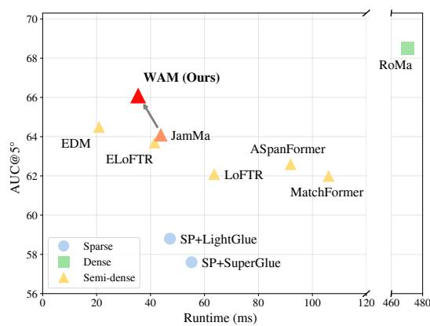  
Figure 1: Relative pose AUC@5◦ vs. runtime on MegaDepth. Runtime is measured on a single NVIDIA H100 GPU.

For inter-image aggregation, AnchorCrossAttention uses cross-attention to gather context from plausible corresponding regions, but performs this exchange over local representative anchors instead of dense point-wise tokens [13–15]. Multiple anchors are formed within each local neighborhood, allowing different structures in the same area to receive different cross-image updates. This design aims to reduce reliance on ambiguous token-level affinities by aggregating local evidence before cross-image retrieval.

Experiments support the value of this role-specialized design. On MegaDepth, WAM improves over JamMa under our setup, increasing pose AUC@5◦ from 64.1 to 66.1. Component-removal and operator-replacement ablations show that removing or substituting either WovenMamba or AnchorCrossAttention lowers accuracy. Shared/reversed-role experiments further support the proposed assignment of WovenMamba to intra-image propagation and AnchorCrossAttention to inter-image retrieval.

Our contributions are threefold. First, we formulate semi-dense context aggregation as two roles with different inductive biases: spatially structured intra-image propagation and correspondenceaware inter-image retrieval. Second, we introduce WovenMamba, a horizontal-then-vertical SSM composition whose simplified receptive field exhibits direction- and distance-dependent twodimensional support. Third, we introduce AnchorCrossAttention, a cross-attention operator that retrieves cross-image context through locally grouped anchors.

## 2 Related work

Local feature matching. Feature matching methods can be grouped into sparse, dense, and semidense approaches. Sparse pipelines detect keypoints and match descriptors [16, 17], with represen tative learned systems including SuperPoint with SuperGlue and LightGlue [18–20]. Dense matchers such as DKM and RoMa estimate correspondences over denser grids and can achieve strong accuracy at higher computational cost [21, 22]. Semi-dense matchers seek a balance by learning dense coarse features and refining selected correspondences; representative examples include LoFTR, JamMa, and EDM [6–8]. WAM belongs to this semi-dense family and is most directly related to JamMa in its overall coarse-to-fine framework.

Context aggregation for semi-dense matching. LoFTR introduced detector-free matching with self-attention and cross-attention over coarse feature maps [6, 9]. Later methods improve attention structure, feature interaction, or efficiency while retaining attention-based aggregation [10–12]. JamMa replaces attention-heavy aggregation with a Mamba-based module for efficient long-range modeling [7]. WAM follows this JamMa-like coarse-to-fine setting, but differs mainly in context aggregation. Instead of using a shared mechanism for both roles, WAM separates them into structured spatial propagation within each image and correspondence-aware aggregation across images.

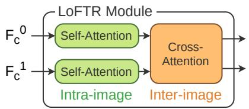

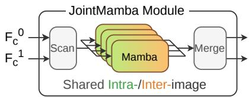  
(b) JamMa shared context aggregation.

(a) LoFTR context aggregation.  
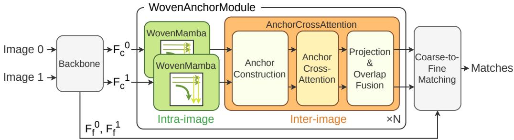  
(c) WAM specialized context aggregation.  
Figure 2: Context aggregation designs. LoFTR uses separate self-/cross-attention, JamMa uses a shared JointMamba design, and WAM explicitly separates intra-image and inter-image aggregation into WovenMamba and AnchorCrossAttention. The diagrams are schematic summaries of the coarse context aggregation blocks rather than layer-by-layer implementations.

State-space models and compact cross-image interaction. State-space sequence models such as Mamba provide an efficient alternative to attention for long-range modeling [23, 24], and recent vision variants adapt scan-based SSMs to image grids [25, 26]. For image features, the scan order determines the spatial inductive bias; WovenMamba differs from scan-and-sum designs by composing the two scan orders rather than summing independent directional responses. For inter-image aggregation, dense cross-attention can mix information from non-corresponding regions, especially when noise or visual ambiguity increases their apparent similarity. This motivates compact local representations for more correspondence-aware cross-image aggregation.

## 3 Method

## 3.1 Overview

Given an image pair $( I ^ { 0 } , I ^ { 1 } )$ , the backbone extracts coarse feature maps $\mathbf { F } _ { c } ^ { 0 } , \mathbf { F } _ { c } ^ { 1 } \in \mathbb { R } ^ { H _ { c } \times W _ { c } \times C _ { c } }$ and fine feature maps $F _ { f } ^ { 0 } , \mathbf { F } _ { f } ^ { 1 }$ WAM updates the coarse features with WovenAnchorModule stages. Each stage first applies WovenMamba independently to the two images for structured intra-image propagation, then applies AnchorCrossAttention to aggregate cross-image context around likely correspondences, followed by a feed-forward block. The updated coarse features are used for coarse matching, while the fine features are used for standard local refinement.

Figure 2 summarizes the architectural distinction. LoFTR uses self-attention and cross-attention, and JamMa uses a shared JointMamba aggregation module, whereas WAM separates intra-image and inter-image aggregation into specialized components. We first describe WovenMamba and the receptive-field analysis that motivates its design, and then present AnchorCrossAttention.

## 3.2 WovenMamba for intra-image aggregation

Since local appearance alone may be insufficient to distinguish visually similar features, especially in repetitive patterns or locally ambiguous regions, WovenMamba enriches each descriptor with surrounding two-dimensional spatial context. To preserve the directional and distance structure

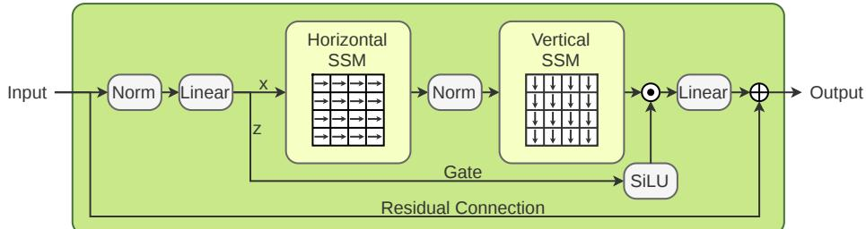  
Figure 3: WovenMamba. The input is split into propagation and gate branches. The propagation branch is processed by horizontal-then-vertical SSM propagation, then gated, projected, and added back through a residual connection. The arrows illustrate the dominant horizontal and vertical scan orders; the implementation uses the corresponding row-major and column-major flattenings.

of this context, it uses horizontal-then-vertical state-space propagation rather than scan-and-sum aggregation of independent directional scans.

Let $\mathbf { F } \in \mathbb { R } ^ { H \times W \times C }$ denote the input feature map, with the batch dimension omitted for clarity. WovenMamba first maps the normalized input into a propagation branch X and a gate branch $\mathbf { z } ;$

$$
( \mathbf { X } , \mathbf { Z } ) = { \mathrm { S p l i t } } ( \operatorname { L i n e a r } _ { \mathrm { i n } } ( \operatorname { N o r m } ( \mathbf { F } ) ) ) .\tag{1}
$$

Here, Split divides the projected channels into the propagation and gate branches.

For an order $a \in \{ h , v \}$ , let $ { \boldsymbol { S } } _ { a }$ denote a Mamba-style SSM scan [23] applied after flattening the grid according to a horizontal or vertical order:

$$
\mathcal { S } _ { a } ( \mathbf { G } ) = \mathrm { U n s c a n } _ { a } ( \mathrm { S S M } _ { a } ( \mathrm { S c a n } _ { a } ( \mathbf { G } ) ) ) .\tag{2}
$$

Here, ${ \mathrm { S c a n } } _ { h }$ and $\mathrm { S c a n } _ { v }$ list grid positions in row-major order and column-major order, respectively; Unsca $\mathrm { n } _ { a }$ maps the scanned sequence back to the grid. For a scanned sequence $\{ \mathbf { s } _ { t } \} _ { t = 1 } ^ { L ^ { * } } , \mathrm { S S M } _ { a }$ produces $\{ \mathbf { o } _ { t } \bar  \} _ { t = 1 } ^ { L }$ through the selective state-space update

$$
\mathbf { h } _ { t } = \bar { \mathbf { A } } _ { t } \mathbf { h } _ { t - 1 } + \bar { \mathbf { B } } _ { t } \mathbf { s } _ { t } , \qquad \mathbf { o } _ { t } = \mathbf { C } _ { t } \mathbf { h } _ { t } + \mathbf { D } \mathbf { s } _ { t } .\tag{3}
$$

Here, $\mathbf { h } _ { t }$ is the recurrent state; $\bar { \mathbf { A } } _ { t }$ and $\bar { \mathbf { B } } _ { t }$ are input-dependent transition and input terms after discretization; $\mathbf { C } _ { t }$ is an input-dependent output term; and D is a direct skip term.

WovenMamba then computes

$$
{ \bf O } = { \mathcal S } _ { v } ( \mathrm { N o r m } ( S _ { h } ( { \bf X } ) ) ) , \qquad { \bf Y } = { \bf F } + \mathrm { L i n e a r } _ { \mathrm { o u t } } \left( { \bf O } \odot \mathrm { S i L U } ( { \bf Z } ) \right) .\tag{4}
$$

Here, Norm denotes the intermediate normalization between the two scans, SiLU is the gating nonlinearity, and $\odot$ denotes element-wise multiplication. The key design is the composition $\mathcal { S } _ { v } ( \mathrm { N o r m } ( S _ { h } ( \mathbf { \bar { X } } ) ) )$ : the vertical scan operates on horizontally contextualized features, producing a composed two-dimensional dependency pattern instead of an additive combination of independent directional scans.

Receptive-field intuition. We include a simplified linear analysis to clarify the spatial bias of WovenMamba for intra-image aggregation. In feature matching, contextual evidence should remain spatially structured: a local descriptor may need to distinguish whether supporting evidence appears above, to the left, or at a diagonal offset. The goal is not to model the full selective, gated, and inputdependent block, but to isolate the effect of composing a horizontal-order scan with a vertical-order scan.

Consider a one-dimensional linear state-space scan along an order $a \in \{ h , v \}$

$$
\mathbf { h } _ { a } ( t ) = A _ { a } \mathbf { h } _ { a } ( t - 1 ) + B _ { a } \mathbf { s } _ { a } ( t ) , \qquad \mathbf { o } _ { a } ( t ) = C _ { a } \mathbf { h } _ { a } ( t ) + D _ { a } \mathbf { s } _ { a } ( t ) .\tag{5}
$$

For nonnegative lags $\Delta \geq 0 .$ , this simplified scan induces the causal kernel

$$
{ \cal K } _ { a } ( \Delta ) = C _ { a } A _ { a } ^ { \Delta } B _ { a } + D _ { a } { \bf 1 } [ \Delta = 0 ] ,\tag{6}
$$

with negative lags treated as zero. For an $H \times W$ grid, define

$$
\pi _ { h } ( i , j ) = i W + j , \qquad \pi _ { v } ( i , j ) = j H + i .\tag{7}
$$

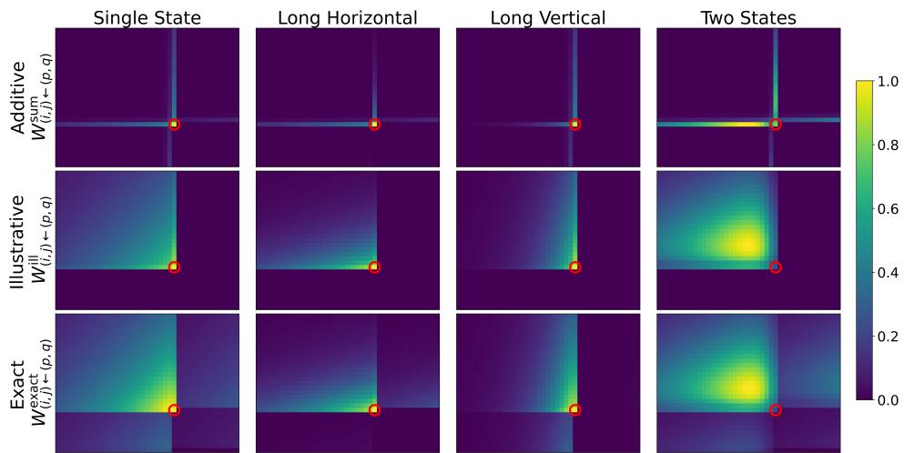  
Figure 4: Receptive-field intuition under simplified linear models. The red circle marks the output position $( i , j )$ , and color indicates the normalized influence from each source position $( p , q )$ Rows compare the additive scan-and-sum baseline $W ^ { \mathrm { s u m } }$ , the dominant-path approximation $W ^ { \mathrm { i l l } }$ and the exact finite-grid kernel $W ^ { \mathrm { e x a c t } }$ of the simplified WovenMamba composition. Columns show different one-dimensional decay settings: Single State, Long Horizontal, Long Vertical, and Two States.

The exact finite-grid kernel of the simplified horizontal-then-vertical composition is

$$
W _ { ( i , j )  ( p , q ) } ^ { \mathrm { e x a c t } } = \sum _ { r , s } K _ { v } ( \pi _ { v } ( i , j ) - \pi _ { v } ( r , s ) ) K _ { h } ( \pi _ { h } ( r , s ) - \pi _ { h } ( p , q ) ) .\tag{8}
$$

Thus, information from $( p , q )$ reaches $( i , j )$ through intermediate grid positions $( r , s )$ : the second scan acts on features already contextualized by the first scan.

For visualization, we also show a dominant-path approximation that keeps the intuitive same-row then same-column route:

$$
W _ { ( i , j )  ( p , q ) } ^ { \mathrm { i l l } } = \mathbf { 1 } [ p \leq i ] \mathbf { 1 } [ q \leq j ] K _ { v } ( i - p ) K _ { h } ( j - q ) .\tag{9}
$$

This approximation is not a separate module; it is only used to make the composition effect easier to interpret. The main comparison in Figure 4 is between the additive baseline $W ^ { \mathrm { s u m } }$ and the exact composed kernel $W ^ { \mathrm { e x a c t } }$

By contrast, a scan-and-sum design applies horizontal and vertical scans independently and add their outputs:

$$
W _ { ( i , j )  ( p , q ) } ^ { \mathrm { s u m } } = K _ { h } ( \pi _ { h } ( i , j ) - \pi _ { h } ( p , q ) ) + K _ { v } ( \pi _ { v } ( i , j ) - \pi _ { v } ( p , q ) ) .\tag{10}
$$

This additive form overlays independent one-dimensional responses, whereas WovenMamba composes them into direction- and distance-dependent two-dimensional support. Section 4.4 complements this simplified analysis with effective receptive fields from trained models.

## 3.3 AnchorCrossAttention for inter-image aggregation

AnchorCrossAttention (ACA) complements WovenMamba’s intra-image context aggregation by retrieving evidence from potentially corresponding regions in the paired image. Because individual token affinities can be ambiguous due to noise or viewpoint changes, ACA allows dense tokens to retrieve context through anchors that aggregate local feature evidence [13–15]. As shown in Figure 5, ACA performs anchor construction, Anchor CrossAttention, and anchor-to-feature projection, followed by overlap fusion on the dense feature grid.

Anchor construction. A local window can contain different structures, so we use multiple anchors to support separate contextual updates. We construct anchors by soft clustering within each window, using learned assignment probabilities to pool the features. Let $\widetilde { \mathbf { F } } _ { c } ^ { 0 } , \widetilde { \mathbf { F } } _ { c } ^ { 1 } \ \in \ \mathbb { R } ^ { H _ { c } \times W _ { c } \times C _ { c } }$ denote the coarse feature maps after WovenMamba. We extract M overlapping windows of size w × w with stride $w / 2$ . Let $\mathcal { W } _ { m }$ denote the set of coarse-grid positions in the m-th window, where m $\in \{ 1 , \ldots , \dot { M } \}$ . For each position $( u , v ) \in \mathcal { W } _ { m } .$ , we compute the soft assignment probability $P _ { m , k } ( u , v )$ of its feature to anchor $k \in \{ 0 , \ldots , K - 1 \}$ }. These assignments are computed separately for each image; we omit the image index for clarity:

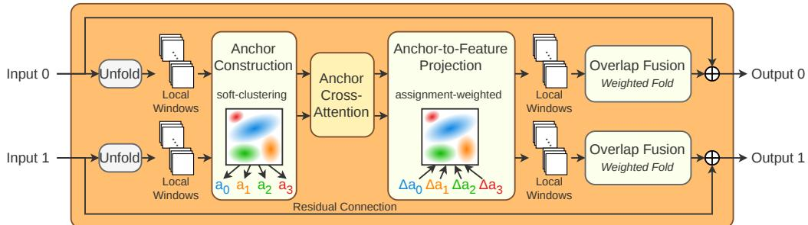  
Figure 5: AnchorCrossAttention. Anchor construction pools local window features into anchors using soft clustering. After cross-image attention, anchor-to-feature projection distributes the anchor updates using the same assignment probabilities. Overlap fusion combines the window-specific updates on the dense grid through a weighted Fold using normalized overlap weights.

$$
\begin{array} { r } { P _ { m , k } ( u , v ) = \mathrm { s o f t m a x } _ { k } \left( \mathbf { q } _ { k } ^ { \top } \bar { \mathbf { x } } _ { m } ( u , v ) / \tau \right) , } \end{array}\tag{11}
$$

where $\bar { \mathbf x } _ { m } ( u , v ) \in \mathbb R ^ { C _ { c } }$ denotes the window-wise normalized feature at $( u , v )$ and $\tau > 0$ is a learned temperature. The clustering vectors $\mathbf { q } _ { k } \ \in \ \mathbb { R } ^ { C _ { c } }$ are shared across all windows and both images within each ACA block, providing a common assignment parameterization. Each window produces an assignment matrix of size $w ^ { 2 } \times K$ . For anchor k, we pool raw and normalized features using $P _ { m , k } ( u , v )$ as weights, normalizing by the total assignment weight, to obtain $\mathbf { f } _ { m , k } ^ { \mathrm { r a w } } , \mathbf { f } _ { m , k } ^ { \mathrm { n o r m } } \in \mathbb { R } ^ { C _ { c } ^ { \mathbf { \tilde { c } } } }$ Because pooling discards spatial arrangement, we also encode the assignment center, covariance, and mass into $\mathbf { f } _ { m , k } ^ { \mathrm { g e o } } \in \mathbb { R } ^ { C _ { s } }$ . The anchor descriptor is

$$
\begin{array} { r } { \mathbf { a } _ { m , k } = \mathrm { L i n e a r } _ { \mathrm { a n c } } \left( \left[ \mathbf { f } _ { m , k } ^ { \mathrm { r a w } } , \mathbf { f } _ { m , k } ^ { \mathrm { n o r m } } , \mathbf { f } _ { m , k } ^ { \mathrm { g e o } } \right] \right) \in \mathbb { R } ^ { D } . } \end{array}\tag{12}
$$

Appendix D provides the detailed pooling and geometry formulas.

Anchor CrossAttention. For each anchor ID k, we stack the descriptors $\mathbf { a } _ { m , k } ^ { i }$ from the M windows as the rows of $\mathbf { A } _ { k } ^ { i } \in \mathbb { R } ^ { M \times D }$ , where $i \in \{ 0 , 1 \}$ is the image index. Anchor-level attention connects each anchor to all M anchors with the same ID in the other image. We compute

$$
\mathbf { C } _ { k } ^ { i } = \mathrm { A t t n } ( \mathbf { A } _ { k } ^ { i } , \mathbf { A } _ { k } ^ { 1 - i } , \mathbf { A } _ { k } ^ { 1 - i } ) , \qquad \Delta \mathbf { A } _ { k } ^ { i } = \mathrm { L i n e a r } _ { \Delta } ( \mathbf { A } _ { k } ^ { i } + \mathbf { C } _ { k } ^ { i } ) ,\tag{13}
$$

where Attn(Q, K, V) denotes multi-head cross-attention [9] with query, key, and value inputs Q, K, and V, respectively, and $\Delta \mathbf { A } _ { k } ^ { i } \in \mathbb { R } ^ { M \times C _ { c } }$ contains the anchor feature updates. Its m-th row, $\Delta \mathbf { a } _ { m , k } ^ { i } .$ , is the update for anchor k in window m. Grouping by ID reduces anchor-attention interactions from $O ( K ^ { 2 } M ^ { 2 } )$ for joint attention over all anchors to $O ( K M ^ { 2 } )$ , while retaining access to all windows in the paired image.

Anchor-to-feature projection and overlap fusion. Anchor-to-feature projection combines the updates from the K anchors at each position within a window using the same assignment probabilities. Since the concentration of a token’s anchor assignments can vary across overlapping windows, we use assignment entropy as a cue to learn the relative contributions of the window-specific updates. Let $\bar { \mathcal { T } } ( u , v ) = \{ \bar { m } \ | \ ( u , v ) \in \mathcal { W } _ { m } \}$ denote the indices of windows containing (u, v) and $\lambda _ { m } ^ { i } ( u , v )$ the overlap weights normalized over those windows. The updated coarse features are

$$
\widehat { \mathbf { F } } _ { c } ^ { i } ( u , v ) = \widetilde { \mathbf { F } } _ { c } ^ { i } ( u , v ) + \sum _ { m \in \mathcal { Z } ( u , v ) } \lambda _ { m } ^ { i } ( u , v ) \sum _ { k = 0 } ^ { K - 1 } P _ { m , k } ^ { i } ( u , v ) \Delta \mathbf { a } _ { m , k } ^ { i } .\tag{14}
$$

The inner sum performs assignment-weighted anchor-to-feature projection, while the outer weighted sum implements overlap fusion as a weighted Fold. Appendix D provides the overlap-weighting formulas, component ablations, and assignment analysis.

Table 1: MegaDepth-1500 relative pose estimation. We report parameters, runtime, and poseerror AUC. Best and second-best semi-dense results are highlighted. XFeat∗ denotes the semi-dense variant with match refinement. WAM† reports the checkpoint whose AUC@5◦ equals the median over seven runs; full repeated-run statistics are in Appendix E.
<table><tr><td rowspan="2">Model family</td><td rowspan="2">Matcher</td><td rowspan="2">Params (M)</td><td rowspan="2">Runtime (ms)</td><td colspan="3">Relative pose error AUC ↑</td></tr><tr><td> $@ 5 ^ { \circ }$ </td><td> $@ 1 0 ^ { \circ }$ </td><td> $@ 2 0 ^ { \circ }$ </td></tr><tr><td rowspan="3">Sparse</td><td>XFeat [33]</td><td>0.7</td><td>12.5</td><td>44.2</td><td>58.2</td><td>69.2</td></tr><tr><td>SP+SuperGlue [19]</td><td>13.3</td><td>55.2</td><td>57.6</td><td>72.6</td><td>83.5</td></tr><tr><td>SP+LightGlue [20]</td><td>13.2</td><td>47.2</td><td>58.8</td><td>73.6</td><td>84.1</td></tr><tr><td rowspan="2">Dense</td><td>DKM [21]</td><td>72.3</td><td>315.9</td><td>67.3</td><td>79.7</td><td>88.1</td></tr><tr><td>RoMa [22]</td><td>111.3</td><td>470.2</td><td>68.5</td><td>80.6</td><td>88.8</td></tr><tr><td rowspan="9">Semi-dense</td><td>XFeat* [33]</td><td>1.5</td><td>25.4</td><td>50.8</td><td>66.8</td><td>78.8</td></tr><tr><td>RCM [34]</td><td>9.8</td><td>53.0</td><td>58.3</td><td>72.8</td><td>83.5</td></tr><tr><td>LoFTR [6]</td><td>11.6</td><td>63.6</td><td>62.1</td><td>75.6</td><td>85.0</td></tr><tr><td>MatchFormer [10]</td><td>20.3</td><td>106.0</td><td>62.0</td><td>75.6</td><td>84.9</td></tr><tr><td>ASpanFormer [11]</td><td>15.8</td><td>91.9</td><td>62.6</td><td>76.1</td><td>85.7</td></tr><tr><td>ELoFTR [12]</td><td>16.0</td><td>41.5</td><td>63.7</td><td>77.0</td><td>86.4</td></tr><tr><td>JamMa [7]</td><td>5.7</td><td>43.8</td><td>64.1</td><td>77.4</td><td>86.5</td></tr><tr><td>EDM [8]</td><td>10.3</td><td>20.9</td><td>64.5</td><td>77.6</td><td>86.8</td></tr><tr><td>WAM (Ours)†</td><td>4.5</td><td>35.4</td><td>66.1</td><td>78.9</td><td>87.7</td></tr></table>

## 4 Experiments

## 4.1 Experimental setup

Implementation. WAM follows the overall framework family of JamMa [7] with a lightweight ConvNeXtV2-style encoder [27]. Coarse features at $1 / 8$ resolution are updated by two WovenAnchorModule stages, while fine features at $1 / 2$ resolution are used for local refinement. Anchor-CrossAttention uses $8 \times 8$ windows with a stride of 4 and $K = 4$ anchors per window. We train on MegaDepth images resized and padded to 832 × 832 [28] for 20 epochs with batch size 8, using AdamW with a base learning rate of $4 \times 1 0 ^ { - 4 }$ , linear warm-up for 14,550 optimization steps (approximately 3.16 epochs), and cosine annealing. Training takes about 26 hours on a single NVIDIA H100 GPU. Appendix A provides the remaining hyperparameters, matching thresholds, RANSAC settings, and runtime protocol.

Evaluation. We evaluate relative pose estimation on MegaDepth-1500, an outdoor benchmark based on MegaDepth [28], and zero-shot relative pose estimation on ScanNet-1500, an indoor benchmark based on ScanNet [29], following the LoFTR/JamMa protocol [6, 7]. MegaDepth images are resized and padded to $8 3 2 \times 8 3 2 ;$ ScanNet images are resized to 640 × 480. We use LO-RANSAC [30] and report pose AUC at 5◦, 10◦, and $2 0 ^ { \overline { { \circ } } }$ . For zero-shot homography evaluation on HPatches, a planar homography benchmark with viewpoint and illumination changes [31], we follow LoFTR/JamMa: resize to a 480-pixel short edge, retain the top 1000 matches by confidence, and use vanilla RANSAC [32]. We report corner-error AUC at 3, 5, and 10 pixels. Runtimes are measured with batch size 1 on the same H100 GPU, including feature extraction and matching but excluding image I/O and RANSAC.

## 4.2 Benchmark comparison

Table 1 reports MegaDepth relative pose estimation. WAM follows a JamMa-style coarse-to-fine pipeline, with its architectural contribution centered on role-specialized intra-image and inter-image context aggregation. The WAM† row reports the checkpoint whose $\mathrm { A U C } @ 5 ^ { \circ }$ equals the median over seven runs; it achieves 66.1 AUC@5◦, compared with 64.1 for JamMa and 64.5 for EDM. WAM’s full-matcher runtime is 35.4 ms, compared with 43.8 ms for JamMa. This runtime difference primarily comes from coarse-matching optimizations, while WovenAnchorModule itself is more expensive than JointMamba. Appendix A provides the detailed runtime breakdown and im plementation explanation. Figure 1 summarizes the accuracy–runtime comparison.

Table 2: Zero-shot transfer using MegaDepth-trained weights. ScanNet reports relative pose AUC at angular error thresholds; HPatches reports homography AUC at corner-error thresholds in pixels.
<table><tr><td rowspan="2">Matcher</td><td colspan="3">ScanNet relative pose error AUC ↑</td><td colspan="3">HPatches homography error AUC ↑</td></tr><tr><td>@5°</td><td>@10°</td><td>@20°</td><td>@3px</td><td>@5px</td><td>@10px</td></tr><tr><td>SP+SuperGlue [19]</td><td>16.5</td><td>32.2</td><td>48.8</td><td>53.9</td><td>68.3</td><td>81.7</td></tr><tr><td>SP+LightGlue [20]</td><td>15.9</td><td>32.2</td><td>49.7</td><td>54.2</td><td>68.3</td><td>81.5</td></tr><tr><td>LoFTR [6]</td><td>20.7</td><td>37.7</td><td>53.4</td><td>65.9</td><td>75.6</td><td>84.6</td></tr><tr><td>ASpanFormer [11]</td><td>21.9</td><td>40.6</td><td>57.4</td><td>67.4</td><td>76.9</td><td>85.6</td></tr><tr><td>JamMa [7]</td><td>18.5</td><td>35.6</td><td>51.3</td><td>68.1</td><td>77.0</td><td>85.4</td></tr><tr><td>EDM [8]</td><td>22.7</td><td>40.8</td><td>56.9</td><td>68.5</td><td>78.1</td><td>86.6</td></tr><tr><td>WAM (Ours)</td><td>23.2</td><td>41.2</td><td>57.2</td><td>68.5</td><td>77.9</td><td>86.4</td></tr></table>

Table 3: Component ablations on MegaDepth-1500. We report pose-error AUC under WAM component removals. Runtime is measured for the full matcher.
<table><tr><td rowspan="2">Variant</td><td rowspan="2">Runtime (ms)</td><td colspan="3">Relative pose error AUC ↑</td></tr><tr><td>@5°</td><td>@10°</td><td>@20°</td></tr><tr><td>WovenAnchorModule (Default)</td><td>35.4</td><td>66.1</td><td>78.9</td><td>87.7</td></tr><tr><td>w/o WovenMamba</td><td>30.5</td><td>64.6</td><td>77.7</td><td>86.6</td></tr><tr><td>w/o AnchorCrossAttention</td><td>27.4</td><td>64.0</td><td>77.0</td><td>86.1</td></tr><tr><td>w/o both</td><td>20.9</td><td>62.0</td><td>75.0</td><td>84.7</td></tr></table>

Appendix B details the spatial representations used by WovenAnchorModule and coarse matching.

Table 2 reports zero-shot relative pose estimation on ScanNet and homography estimation on HPatches using MegaDepth-trained weights, without fine-tuning on either benchmark. WAM improves over JamMa on both benchmarks and remains competitive with EDM, suggesting that the proposed aggregation transfers beyond MegaDepth.

## 4.3 Controlled ablations

The ablations are conducted under the same setup. The component ablation first shows that both intra-image and inter-image context aggregation are useful. The alternative-module comparisons and the shared/reversed-role experiment then evaluate which operators are better suited to each role.

Component ablation. Table 3 removes the two context aggregation components of WAM. Removing WovenMamba reduces AUC@5◦ from 66.1 to 64.6, while removing AnchorCrossAttention reduces it to 64.0. Removing both gives 62.0. These results show that both intra-image and interimage context aggregation are important.

Intra-image alternatives. Table 4 compares intra-image context modules while keeping Anchor-CrossAttention fixed. UniMamba, BiMamba, OrthMamba, and FourMamba are directional-scan baselines with one, two opposite, two orthogonal, and four independent scan directions, respectively. All scan variants are below WovenMamba, and FourMamba increases runtime without matching WovenMamba’s accuracy. Self-Attention serves as an attention-based intra-image alternative, but it is slower and less accurate. These results suggest that the proposed woven horizontal-then-vertical propagation gives a better accuracy–efficiency trade-off than either independent directional scans or self-attention.

Inter-image alternatives. Table 5 compares inter-image modules with WovenMamba fixed. The CrossMamba variants process the paired image with a Mamba scan and inject the resulting features through a residual update. They show that context from the paired image can help to some extent, but they lack explicit correspondence-aware retrieval based on cross-image feature affinities. Dense CrossAttention yields lower AUC@5◦ and higher full-matcher runtime than ACA under the same setup. AnchorCrossAttention achieves the best accuracy among these alternatives, supporting locally grouped anchors for inter-image aggregation.

Table 4: Intra-image ablations on MegaDepth-1500. ACA is fixed. Runtime is measured for the full matcher.
<table><tr><td rowspan="2">Variant</td><td>Time</td><td colspan="2">Pose AUC ↑</td></tr><tr><td>(ms)</td><td>5°</td><td>10° 20°</td></tr><tr><td>WovenMamba</td><td>35.4</td><td>66.1</td><td>78.9 87.7</td></tr><tr><td>UniMamba</td><td>33.1</td><td>65.2</td><td>78.3 87.3</td></tr><tr><td>BiMamba</td><td>35.7</td><td>65.2</td><td>78.4 87.3</td></tr><tr><td>OrthMamba</td><td>36.0</td><td>65.2</td><td>78.2 87.3</td></tr><tr><td>FourMamba</td><td>40.4</td><td>65.3</td><td>78.5 87.4</td></tr><tr><td>Self-Attention</td><td>49.0</td><td>64.8</td><td>77.8 86.9</td></tr></table>

Table 5: Inter-image ablations on MegaDepth-1500. WovenMamba is fixed. Runtime is measured for the full matcher.
<table><tr><td rowspan="2">Variant</td><td rowspan="2">Time (ms)</td><td colspan="2">Pose AUC ↑</td></tr><tr><td>5°</td><td>10° 20°</td></tr><tr><td>AnchorCrossAttention</td><td>35.4</td><td>66.1 78.9</td><td>87.7</td></tr><tr><td>CrossUniMamba</td><td>29.7</td><td>65.3</td><td>78.3 87.1</td></tr><tr><td>CrossBiMamba</td><td>34.6</td><td>65.3</td><td>78.2 87.1</td></tr><tr><td>CrossOrthMamba</td><td>32.3</td><td>65.3</td><td>78.2 87.0</td></tr><tr><td>CrossFourMamba</td><td>37.1</td><td>65.4</td><td>78.2 87.2</td></tr><tr><td>Dense CrossAttention</td><td>50.3</td><td>65.0</td><td>78.2 87.4</td></tr></table>

Table 6: Operator-to-role assignment on MegaDepth-1500. ASA: AnchorSelfAttention; CWM: CrossWovenMamba. Runtime is measured for the full matcher.
<table><tr><td>Intra-image</td><td>Inter-image</td><td>AUC@5°</td><td>AUC@10°</td><td>AUC@20°</td><td>Runtime (ms)</td></tr><tr><td>WovenMamba</td><td>a ACA (default)</td><td>66.1</td><td>78.9</td><td>87.7</td><td>35.4</td></tr><tr><td>ASA</td><td>ACA</td><td>64.7</td><td>77.8</td><td>86.7</td><td>38.6</td></tr><tr><td>WovenMamba</td><td>CWM</td><td>65.4</td><td>78.3</td><td>87.4</td><td>33.9</td></tr><tr><td>ASA</td><td>CWM</td><td>64.9</td><td>77.7</td><td>86.7</td><td>36.0</td></tr></table>

Operator-to-role assignment. Table 6 tests whether the gains depend on the operator-to-role assignment. AnchorSelfAttention (ASA) applies the anchor operator within each image, while Cross-WovenMamba (CWM) adapts WovenMamba to exchange context between images. Using the same operator family for both roles or reversing their assignment reduces pose AUC relative to Woven-Mamba for intra-image propagation and ACA for inter-image retrieval. These results support the proposed specialization of the two operators under the evaluated setup. Appendix A describes the adaptations.

## 4.4 Visualizations

Qualitative matching results. Figure 6 shows representative successes and a failure case. In the first two pairs, WAM produces dense and geometrically consistent matches under large appearance or viewpoint changes. The last pair shows a limitation: repetitive or weakly constrained regions can still lead to incorrect matches.

Learned anchor assignments. Appendix D.1 visualizes the learned soft assignments used to construct anchors for two image pairs. Brighter heatmap colors indicate higher assignment probabilities to the corresponding anchor; categorical colors identify the highest-probability anchor. In these examples, the first ACA block (ACA-1) shows comparatively diffuse responses, although different anchors already respond to low-texture regions and contours. The second ACA block (ACA-2) exhibits more distinct spatial preferences: anchor 1 often emphasizes the structure side of building and statue boundaries, while anchor 3 emphasizes adjacent exterior regions, particularly the sky side. Anchors 0 and 2 show broader responses over low-texture surfaces and less structured regions. These spatial preferences suggest that the anchors summarize different local structures within each window. Projecting their cross-image updates through the learned assignments allows tokens associated with different structures to receive different contextual information. This may help disambiguate visually similar features during matching. The larger assignment variances in ACA-2 (Table 11) provide complementary evidence of greater variation in assignment strength.

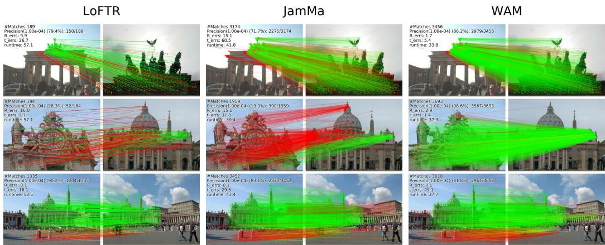  
Figure 6: Qualitative matching examples. We compare LoFTR, JamMa, and WAM. Green and red lines indicate geometrically consistent and inconsistent matches, respectively.

Learned effective receptive fields. Appendix C compares local effective receptive fields (ERFs) of trained horizontal-then-vertical WovenMamba and the OrthMamba scan-and-sum baseline. Brighter colors indicate greater relative sensitivity of the target’s residual update to the block input, normalized separately for each target and shown on a logarithmic scale. In the examples shown, WovenMamba emphasizes a coherent two-dimensional neighborhood above and to the left of the target, while OrthMamba exhibits more pronounced ridges along the target’s row and column together with diffuse, content-dependent responses away from these axes. The WovenMamba pattern is qualitatively consistent with the directional and distance-dependent bias suggested by the simplified composition analysis. Such spatially structured context may help distinguish locations with similar local appearances by incorporating the target’s neighboring structure. These observations complement the controlled intra-image ablations in Table 4.

## 5 Discussion and limitations

The additional visual localization evaluation in Appendix G provides a diagnostic view of how WAM behaves in a larger localization pipeline. The experiments support the value of specializing intraimage and inter-image aggregation: the simplified receptive-field analysis, trained-model ERFs, and intra-image ablations support horizontal-then-vertical propagation, while the inter-image ablations support local anchor grouping for correspondence-aware retrieval. A limitation is computational cost and scalability. WovenAnchorModule has a higher measured runtime than JointMamba in our evaluation (Table 8). Although AnchorCrossAttention reduces the number of interactions relative to dense token-wise cross-attention, its interaction complexity remains quadratic in the number of local windows, limiting scalability at high input resolutions. Another limitation is the JamMastyle nearest-neighbor matching strategy, which may produce many-to-one correspondences and may contribute to the localization gap between WAM and LoFTR in the Aachen pipeline. WAM generally improves over JamMa under the same matching strategy, but these results do not isolate the effect of match filtering.

## 6 Conclusion

We presented WAM, a semi-dense matcher that specializes context aggregation for intra-image and inter-image modeling. WovenMamba organizes spatial context with horizontal-then-vertical SSM propagation, while AnchorCrossAttention retrieves cross-image context through locally grouped anchors. A simplified receptive-field analysis suggests that WovenMamba provides a structural bias toward composed two-dimensional dependencies. Controlled ablations show that both forms of context are useful and that the proposed specialized designs are better suited to their respective roles. Benchmark results further show that WAM improves over JamMa under our setup. Overall, these results support designing semi-dense matchers with context modules matched to the different requirements of intra-image and inter-image aggregation.

## Acknowledgments and Disclosure of Funding

This work was supported by DENSO IT LAB Recognition, Control, and Learning Algorithm Collaborative Research Chair (Science Tokyo) and the experiments were conducted using TSUBAME 4.0 supercomputer. The authors declare no competing interests.

## References

[1] Torsten Sattler, Will Maddern, Carl Toft, Akihiko Torii, Lars Hammarstrand, Erik Stenborg, Daniel Safari, Masatoshi Okutomi, Marc Pollefeys, Josef Sivic, Fredrik Kahl, and Tomas Pajdla. Benchmarking 6DOF outdoor visual localization in changing conditions. In CVPR, pages 8601–8610, 2018.

[2] Paul-Edouard Sarlin, Cesar Cadena, Roland Siegwart, and Marcin Dymczyk. From coarse to fine: Robust hierarchical localization at large scale. In CVPR, pages 12716–12725, 2019.

[3] Johannes L. Schönberger and Jan-Michael Frahm. Structure-from-motion revisited. In CVPR, pages 4104–4113, 2016.

[4] Raul Mur-Artal, J. M. M. Montiel, and Juan D. Tardos. ORB-SLAM: A versatile and accurate monocular SLAM system. IEEE Transactions on Robotics, 31(5):1147–1163, 2015.

[5] Richard Hartley and Andrew Zisserman. Multiple View Geometry in Computer Vision. Cambridge University Press, 2 edition, 2004.

[6] J. Sun, Z. Shen, Y. Wang, H. Bao, and X. Zhou. Loftr: Detector-free local feature matching with transformers. In CVPR, pages 8922–8931, 2021.

[7] X. Lu and S. Du. JamMa: Ultra-lightweight local feature matching with joint mamba. In CVPR, pages 14934–14943, 2025.

[8] Xi Li, Tong Rao, and Cihui Pan. Edm: Efficient deep feature matching. In ICCV, pages 26198–26208, 2025.

[9] Ashish Vaswani, Noam Shazeer, Niki Parmar, Jakob Uszkoreit, Llion Jones, Aidan N. Gomez, Lukasz Kaiser, and Illia Polosukhin. Attention is all you need. In NeurIPS, 2017.

[10] Q. Wang, J. Zhang, K. Yang, K. Peng, and R. Stiefelhagen. Matchformer: Interleaving attention in transformers for feature matching. In ACCV, pages 2746–2762, 2022.

[11] H. Chen, Z. Luo, L. Zhou, Y. Tian, M. Zhen, T. Fang, D. McKinnon, Y. Tsin, and L. Quan. Aspanformer: Detector-free image matching with adaptive span transformer. In ECCV, pages 20–36, 2022.

[12] Y. Wang, X. He, S. Peng, D. Tan, and X. Zhou. Efficient loftr: Semi-dense local feature matching with sparse-like speed. In CVPR, pages 21666–21675, 2024.

[13] James C. Bezdek. Pattern Recognition with Fuzzy Objective Function Algorithms. Advanced Applications in Pattern Recognition. Plenum Press, New York, 1981. ISBN 978-0-306-40671- 3.

[14] Relja Arandjelovic, Petr Gronat, Akihiko Torii, Tomas Pajdla, and Josef Sivic. NetVLAD: CNN architecture for weakly supervised place recognition. In CVPR, pages 5297–5307, 2016.

[15] Juho Lee, Yoonho Lee, Jungtaek Kim, Adam Kosiorek, Seungjin Choi, and Yee Whye Teh. Set transformer: A framework for attention-based permutation-invariant neural networks. In Proceedings of the 36th International Conference on Machine Learning, 2019.

[16] David G. Lowe. Distinctive image features from scale-invariant keypoints. IJCV, 60(2):91– 110, 2004.

[17] Ethan Rublee, Vincent Rabaud, Kurt Konolige, and Gary Bradski. Orb: An efficient alternative to sift or surf. In ICCV, pages 2564–2571, 2011.

[18] D. DeTone, T. Malisiewicz, and A. Rabinovich. Superpoint: Self-supervised interest point detection and description. In CVPRW, pages 224–236, 2018.

[19] P. Sarlin, D. DeTone, T. Malisiewicz, and A. Rabinovich. Superglue: Learning feature matching with graph neural networks. In CVPR, pages 4938–4947, 2020.

[20] P. Lindenberger, P. Sarlin, and M. Pollefeys. Lightglue: Local feature matching at light speed. In ICCV, pages 17627–17638, 2023.

[21] J. Edstedt, I. Athanasiadis, M. Wadenbäck, and M. Felsberg. Dkm: Dense kernelized feature matching for geometry estimation. In CVPR, pages 17765–17775, 2023.

[22] J. Edstedt, Q. Sun, G. Bökman, M. Wadenbäck, and M. Felsberg. Roma: Robust dense feature matching. In CVPR, pages 19790–19800, 2024.

[23] A. Gu and T. Dao. Mamba: Linear-time sequence modeling with selective state spaces. In COLM, 2024.

[24] Tri Dao and Albert Gu. Transformers are SSMs: Generalized models and efficient algorithms through structured state space duality. In ICML, 2024.

[25] L. Zhu, B. Liao, Q. Zhang, X. Wang, W. Liu, and X. Wang. Vision mamba: Efficient visual representation learning with bidirectional state space model. In ICML, 2024.

[26] Y. Liu, Y. Tian, Y. Zhao, H. Yu, L. Xie, Y. Wang, Q. Ye, J. Jiao, and Y. Liu. Vmamba: Visual state space model. In NeurIPS, 2024.

[27] Sanghyun Woo, Shoubhik Debnath, Ronghang Hu, Xinlei Chen, Zhuang Liu, In So Kweon, and Saining Xie. Convnext v2: Co-designing and scaling convnets with masked autoencoders. In CVPR, pages 16133–16142, 2023.

[28] Z. Li and N. Snavely. MegaDepth: Learning Single-View Depth Prediction from Internet Photos. In CVPR, pages 2041–2050, 2018.

[29] Angela Dai, Angel X. Chang, Manolis Savva, Maciej Halber, Thomas Funkhouser, and Matthias Nießner. Scannet: Richly-annotated 3d reconstructions of indoor scenes. In CVPR, pages 2432–2443, 2017.

[30] Ondrej Chum, Jiri Matas, and Josef Kittler. Locally optimized RANSAC. In Proc. DAGM Symposium, pages 236–243, 2003.

[31] V. Balntas, K. Lenc, A. Vedaldi, and K. Mikolajczyk. Hpatches: A benchmark and evaluation of handcrafted and learned local descriptors. In CVPR, pages 5173–5182, 2017.

[32] M. A. Fischler and R. C. Bolles. Random sample consensus: a paradigm for model fitting with applications to image analysis and automated cartography. Communications of the ACM, 24 (6):381–395, 1981. doi: 10.1145/358669.358692.

[33] G. Potje, F. Cadar, A. Araujo, R. Martins, and E. R. Nascimento. Xfeat: Accelerated features for lightweight image matching. In CVPR, pages 2682–2691, 2024.

[34] X. Lu and S. Du. Raising the ceiling: Conflict-free local feature matching with dynamic view switching. In ECCV, pages 256–273, 2024.

[35] Zichao Zhang, Torsten Sattler, and Davide Scaramuzza. Reference pose generation for longterm visual localization via learned features and view synthesis. IJCV, 129:821–844, 2021.

## A Implementation and evaluation details

Architecture details. Unless otherwise stated, WAM uses a coarse feature dimension of $C _ { c } = 2 5 6$ and a fine feature dimension of 64. The WovenMamba propagation branch has dimension 512, corresponding to an expansion ratio of 2. WovenMamba uses state dimension 8 and $3 \times 3$ depthwise convolutions before the horizontal and vertical SSM scans. RMSNorm is used in all WovenMamba and AnchorCrossAttention blocks. AnchorCrossAttention uses overlapping windows of size $8 \times 8$ with a stride of 4, $K = 4$ anchors per window, anchor dimension $D \stackrel { \textstyle \warrow } { = } 2 5 6$ , geometry feature dimension $C _ { g } = 1 6 $ , 4 attention heads, and zero attention dropout. We use two WovenAnchorModule stages unless otherwise stated.

WovenMamba separator tokens. For the reported WovenMamba models, we insert fixed separator tokens into the flattened scan sequences at scan-boundary positions: row boundaries for the horizontal-order scan and column boundaries for the vertical-order scan. The SSM is applied to the augmented sequence; after unscanning the augmented output, we remove the separator positions and keep only the original image-grid tokens. At separator positions, we add a fixed offset of 6.0 to the pre-softplus SSM step-size parameter. This is a boundary-handling implementation detail and is not treated as a separate contribution.

Table 7: Effect of WovenMamba separator tokens.
<table><tr><td rowspan="2">Variant</td><td colspan="3">MegaDepth-1500</td><td colspan="3">ScanNet-1500</td></tr><tr><td>AUC@5°</td><td>AUC@10°</td><td>AUC@20°</td><td>AUC@5°</td><td>AUC@10°</td><td>AUC@20°</td></tr><tr><td>w/o separators</td><td>66.0</td><td>78.8</td><td>87.7</td><td>22.5</td><td>40.6</td><td>56.5</td></tr><tr><td>with separators</td><td>66.1</td><td>78.9</td><td>87.7</td><td>23.2</td><td>41.2</td><td>57.2</td></tr></table>

Table 7 shows that the separators have little effect on MegaDepth accuracy, but improve the zeroshot ScanNet results in our evaluation. We therefore use them in the reported model as a small robustness-oriented implementation detail, while keeping the main claims focused on WovenMamba and AnchorCrossAttention.

Matching details. For coarse matching, we apply softmax independently along the rows and columns of the similarity matrix with a temperature of 0.1. We retain directional nearest-neighbor matches with probability greater than 0.2 and take the union of the two sets, assigning the larger directional probability to duplicate pairs. For fine matching, we use a fine matching window of size $5 \times 5$ , dual-softmax temperature 0.1, and confidence threshold 0.1. Unless otherwise stated, the same matching thresholds are used for the main benchmark results and ablations.

Training details. The main model is trained on MegaDepth for 20 epochs with batch size 8 using the training protocol described in Section 4.1. Training uses a single NVIDIA H100 GPU; the peak allocated GPU memory for the main model is about 85GB. Each WAM training run takes about 26 hours on one H100 GPU. The sub-pixel refinement loss uses a squared symmetric epipolar distance threshold of $1 0 ^ { - 4 }$ on MegaDepth. The main benchmark tables use a representative WAM checkpoint whose MegaDepth AUC@5◦ equals the median over seven runs, as reported in Appendix E. Results labeled as zero-shot transfer evaluate this representative MegaDepth-trained checkpoint on the target dataset without additional fine-tuning.

Ablation protocol. All ablation variants are trained on MegaDepth using the same training protocol as the main model, unless otherwise stated. We change only the component specified in each ablation table and keep the backbone, feature resolutions, number of WovenAnchorModule stages, optimizer, learning-rate schedule, batch size, matching thresholds, and evaluation protocol fixed. This ensures that the ablations isolate the contribution of the modified component rather than changes in the training or evaluation setup. Ablation variants are single-run controlled trainings unless repeated-run statistics are explicitly reported.

Role-assignment adaptations. For Table 6, AnchorSelfAttention retains ACA’s anchor construction, anchor-to-feature projection, and overlap fusion, but replaces cross-image attention with selfattention over the windows of each image within each anchor-ID group. CrossWovenMamba computes WovenMamba’s residual updates separately for the two images and adds each update to the paired image’s features. The shared and reversed variants retain two stages and the same feature dimensions and training/evaluation protocol as the default model.

Table 8: Runtime breakdown on MegaDepth (ms). Stage timings exclude some overhead and therefore do not sum exactly to the end-to-end totals.
<table><tr><td>Component</td><td>WAM (ms)</td><td>JamMa (ms)</td></tr><tr><td>Backbone</td><td>5.6</td><td>5.9</td></tr><tr><td>Context module</td><td>14.0</td><td>2.9</td></tr><tr><td>Coarse matching</td><td>4.7</td><td>20.9</td></tr><tr><td>Fine matching</td><td>9.7</td><td>10.2</td></tr><tr><td>End-to-end total</td><td>35.4</td><td>43.8</td></tr></table>

Pose and homography evaluation. For relative pose estimation on MegaDepth and ScanNet, we estimate the essential matrix using LO-RANSAC [30] implemented in PoseLib 2.0.4 with a threshold of 0.5 pixels, leaving the remaining RANSAC options at their library defaults. Pose accuracy is reported using the area under the cumulative error curve at 5◦, 10◦, and 20◦, following the standard protocol for these benchmarks. For homography estimation on HPatches, we retain the top 1000 matches by confidence and estimate the homography using vanilla RANSAC [32] with threshold 3.0, confidence 0.99999, and a maximum of 3000 iterations.

Runtime measurement. Unless otherwise stated, we measure runtime on a single NVIDIA H100 GPU with batch size 1 using MegaDepth image pairs resized and padded to 832 × 832. We perform 50 warm-up steps before timing and exclude them from the reported mean runtimes over the evaluated image pairs. End-to-end timing includes backbone feature extraction and matching, but excludes image I/O and RANSAC.

Runtime breakdown. Table 8 reports per-stage runtimes. WovenAnchorModule takes 14.0 ms, compared with 2.9 ms for JointMamba. WAM’s lower end-to-end runtime primarily comes from implementation optimizations in coarse matching, which takes 4.7 ms for WAM and 20.9 ms for JamMa. Specifically, coarse matching computes directional softmax maxima and their indices directly, without materializing dense probability matrices. This implementation choice contributes to full-matcher efficiency; the architectural contribution is role-specialized context aggregation.

## B Spatial resolutions in WAM

Table 9 summarizes the representations used by WAM. The backbone produces dense coarse features at $1 / 8$ of the input resolution. Both WovenAnchorModule stages preserve this grid: WovenMamba propagates context over its positions, and ACA constructs anchors from overlapping windows, then uses anchor-to-feature projection and overlap fusion to return their updates to the same grid. Coarse matching uses the resulting dense 1/8 features.

With the default 8 × 8 windows and stride 4, adjacent ACA window centers are separated by four coarse cells, or 32 input pixels. Each window supplies K = 4 anchors. Thus, the 1/32 windowcenter spacing describes the sampling of anchor windows, rather than a dense 1/32 feature map. For a padded 832×832 input, the coarse grid is 104×104 and ACA constructs 25×25 windows, giving 2500 anchors per image. Cross-attention is applied separately to the 625 anchors in each anchor-ID group. Padded image regions are masked; ACA’s window-boundary padding and masking are described in Appendix D.

## C Trained-model effective receptive fields

Figure 7 compares the first spatial block of WovenMamba and OrthMamba for image pair 1. Figure 8 shows their second spatial block for the same pair, and Figures 9 and 10 show both blocks for image

Table 9: Spatial representations in WAM. Grid sizes illustrate a padded $8 3 2 \times 8 3 2$ input with the default window and anchor settings.
<table><tr><td>Stage</td><td>Representation</td><td>Spatial sampling</td></tr><tr><td>Before WovenAnchorModule</td><td>104 × 104 coarse features</td><td>Dense 1/8 grid</td></tr><tr><td>WovenMamba</td><td>104 × 104 coarse features</td><td>Dense 1/8 grid</td></tr><tr><td>ACA anchor construction</td><td>8 × 8 coarse cells/window</td><td>Dense 1/8 grid</td></tr><tr><td>ACA cross-attention</td><td>25 × 25 windows, 4 anchors each 1/32 center spacing</td><td></td></tr><tr><td>ACA anchor-to-feature projection and overlap fusion</td><td>104 × 104 coarse features</td><td>Dense 1/8 grid</td></tr><tr><td>Coarse matching</td><td>104 × 104 coarse features</td><td>Dense 1/8 grid</td></tr></table>

pair 2. The visualizations use the learned parameters of the respective trained models, including their nonlinearities, gating, and normalization. Each operator visualization has two image rows, with target locations in the first column and the corresponding ERFs in the remaining five columns.

Computation. Let X denote the input feature map to spatial block b, and let $\Delta _ { b } ( { \mathbf X } )$ denote its residual update before adding the identity connection. For a target position $t ,$ we compute the channel-wise gradient magnitude at each source position p:

$$
E _ { t } ( \boldsymbol { p } ) = \left. \frac { \partial \lVert \Delta _ { b } ( \mathbf { X } ) _ { t } \rVert _ { 2 } } { \partial \mathbf { X } _ { p } } \right. _ { 2 } .\tag{15}
$$

For valid positions V, the displayed value is

$$
\widehat { E } _ { t } ( p ) = \log _ { 1 0 } \left( \operatorname* { m a x } \left( \frac { E _ { t } ( p ) } { \operatorname* { m a x } _ { q \in V } E _ { t } ( q ) } , 1 0 ^ { - 6 } \right) \right) .\tag{16}
$$

Thus, all maps use the same color range $[ - 6 , 0 ]$ and show relative spatial influence rather than absolute gradient magnitudes. We select five valid coarse-grid targets near the upper left, upper right, center, lower left, and lower right, and mask padded positions. Gradients are taken with respect to the current block input, detached from preceding layers. In particular, the second-block maps describe local sensitivity at a later contextualized representation, rather than gradients through the entire matcher to the input image.

Observed spatial patterns. The contrast between WovenMamba’s coherent two-dimensional neighborhood responses and OrthMamba’s more pronounced row- and column-aligned responses recurs across both image pairs and spatial blocks shown.

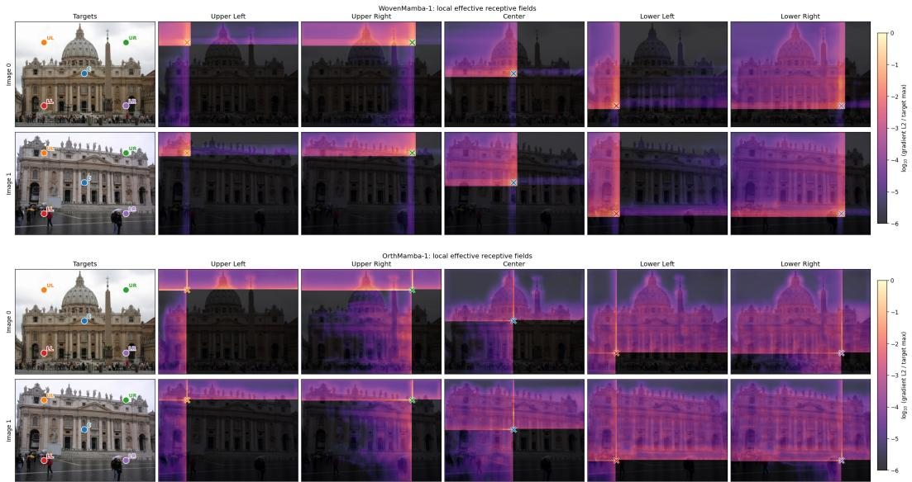  
Figure 7: Local ERFs of trained intra-image context aggregation blocks. WovenMamba-1 (top) and OrthMamba-1 (bottom) for image pair 1. Brighter colors indicate greater relative sensitivity to the block input.

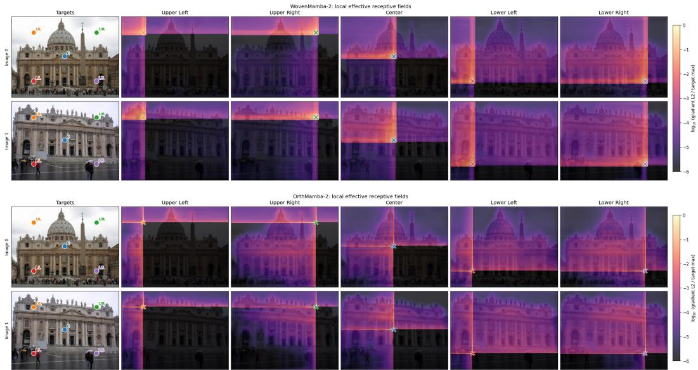  
Figure 8: Local ERFs of trained intra-image context aggregation blocks. WovenMamba-2 (top) and OrthMamba-2 (bottom) for image pair 1. Panel layout and color normalization follow the protocol in Appendix C.

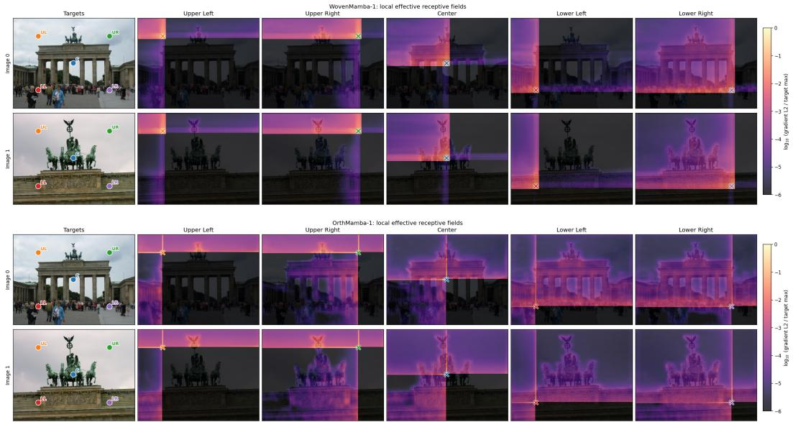  
Figure 9: Local ERFs of trained intra-image context aggregation blocks. WovenMamba-1 (top) and OrthMamba-1 (bottom) for image pair 2. Panel layout and color normalization follow the protocol in Appendix C.

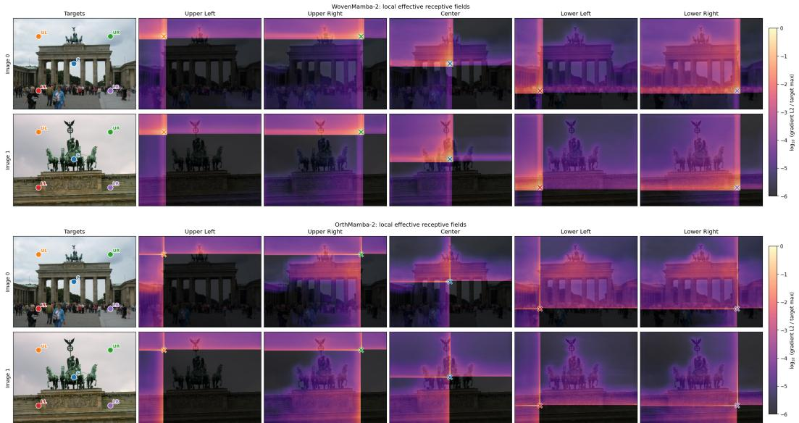  
Figure 10: Local ERFs of trained intra-image context aggregation blocks. WovenMamba-2 (top) and OrthMamba-2 (bottom) for image pair 2. Panel layout and color normalization follow the protocol in Appendix C.

## D AnchorCrossAttention details

Window definition. Let $\left( u _ { m } , v _ { m } \right)$ denote the top-left coordinate of the m-th window on the coarse feature grid. Its spatial support is

$$
\mathcal { W } _ { m } = \{ ( u , v ) \in \mathbb { Z } ^ { 2 } : u _ { m } \leq u < u _ { m } + w , \quad v _ { m } \leq v < v _ { m } + w \} .\tag{17}
$$

Window origins are spaced $w / 2$ apart along both axes. When needed, we zero-pad the bottom and right boundaries to align the grid with the stride and mask padded positions during computation.

Anchor construction. Omitting the image superscript, let $\mathbf { x } _ { m } ( u , v )$ denote the feature at $( u , v )$ in window $\mathcal { W } _ { m }$ of $\widetilde { \mathbf { F } } _ { c }$ . Within each window, we normalize each feature channel using its spatial mean and variance over valid positions, adding $1 0 ^ { - 5 }$ to the variance for numerical stability. Soft assignments are computed from these normalized features, while both raw and normalized features contribute to the anchor descriptor. Let $\begin{array} { r } { S _ { m , k } = \sum _ { ( u , v ) \in \mathcal { W } _ { m } } P _ { m , k } \mathopen { } \mathclose \bgroup \left( u , v \aftergroup \egroup \right) } \end{array}$ and $\varepsilon = 1 0 ^ { - 6 }$ . We divide the average weighted features by the average assignment weight, clamped below at ε for numerical stability. The appearance summaries are

$$
\begin{array} { r l } & { \mathbf { f } _ { m , k } ^ { \mathrm { r a w } } = \frac { \frac { 1 } { w ^ { 2 } } \sum _ { ( u , v ) \in \mathcal { W } _ { m } } P _ { m , k } ( u , v ) \mathbf { x } _ { m } ( u , v ) } { \operatorname* { m a x } \left( \frac { S _ { m , k } } { w ^ { 2 } } , \varepsilon \right) } , } \\ & { \mathbf { f } _ { m , k } ^ { \mathrm { n o r m } } = \frac { \frac { 1 } { w ^ { 2 } } \sum _ { ( u , v ) \in \mathcal { W } _ { m } } P _ { m , k } ( u , v ) \bar { \mathbf { x } } _ { m } ( u , v ) } { \operatorname* { m a x } \left( \frac { S _ { m , k } } { w ^ { 2 } } , \varepsilon \right) } . } \end{array}\tag{18}
$$

To complement the pooled appearance features, we encode the spatial distribution of each anchor’s assignments within its window. The assignment-weighted center and covariance summarize spatial location and spread, while the assignment mass measures the total membership weight. Using local coordinates $\bar { \mathbf { p } _ { m } } ( u , v ) \in [ - 1 , 1 ] ^ { 2 }$ and $Z _ { m , k } = S _ { m , k } + \varepsilon$ , we compute the center and covariance as follows:

$$
\mu _ { m , k } = \frac { \sum _ { ( u , v ) \in \mathcal { W } _ { m } } P _ { m , k } ( u , v ) \mathbf { p } _ { m } ( u , v ) } { Z _ { m , k } } ,\tag{19}
$$

$$
\Sigma _ { m , k } = \frac { \sum _ { ( u , v ) \in \mathcal { W } _ { m } } P _ { m , k } ( u , v ) \mathbf { d } _ { m , k } ( u , v ) \mathbf { d } _ { m , k } ( u , v ) ^ { \top } } { Z _ { m , k } } ,\tag{20}
$$

where $\mathbf { d } _ { m , k } ( u , v ) = \mathbf { p } _ { m } ( u , v ) - \pmb { \mu } _ { m , k }$ . The six geometry statistics are

$$
\begin{array} { r } { \mathbf { g } _ { m , k } = [ \pmb { \mu } _ { m , k } , \Sigma _ { m , k } ^ { x x } , \Sigma _ { m , k } ^ { y y } , \Sigma _ { m , k } ^ { x y } , \log Z _ { m , k } ] . } \end{array}\tag{21}
$$

A learned linear layer maps these statistics to $\mathbf { f } _ { m , k } ^ { \mathrm { g e o } } \in \mathbb { R } ^ { C _ { g } }$ . We then form

$$
\begin{array} { r } { \mathbf { a } _ { m , k } = \mathrm { L i n e a r } _ { \mathrm { a n c } } \left( [ \mathbf { f } _ { m , k } ^ { \mathrm { r a w } } , \mathbf { f } _ { m , k } ^ { \mathrm { n o r m } } , \mathbf { f } _ { m , k } ^ { \mathrm { g e o } } ] \right) . } \end{array}\tag{22}
$$

Clustering parameters are shared across windows and images within a block; different ACA blocks have separate parameters. Within cross-attention, each anchor descriptor is normalized with RM-SNorm before the learned query, key, and value projections.

Overlap weighting. A token can have different assignment distributions in different overlapping windows. For overlap fusion after anchor-to-feature projection, we use assignment entropy as a cue for learning their relative contributions. For each valid token position, let $e _ { m } ( u , v )$ denote assignment entropy, $c _ { m } ( u , v )$ ) the unnormalized window weight, and $\lambda _ { m } ( u , v )$ its normalized counterpart. With the same $\varepsilon = 1 0 ^ { \dot { - } 6 }$ , we compute

$$
e _ { m } ( u , v ) = - \sum _ { k = 0 } ^ { K - 1 } P _ { m , k } ( u , v ) \log ( P _ { m , k } ( u , v ) + \varepsilon ) ,\tag{23}
$$

$$
c _ { m } ( u , v ) = \mathrm { s i g m o i d } \big ( \alpha _ { c } e _ { m } ( u , v ) + \beta _ { c } \big ) ,\tag{24}
$$

$$
\lambda _ { m } ( u , v ) = \frac { c _ { m } ( u , v ) } { \operatorname* { m a x } \Bigl ( \sum _ { m ^ { \prime } \in \mathcal { T } ( u , v ) } c _ { m ^ { \prime } } \bigl ( u , v \bigr ) , \varepsilon \Bigr ) } .\tag{25}
$$

The scalars $\alpha _ { c }$ and $\beta _ { c }$ are learned. This parameterization learns how entropy affects the contribution of each window; it does not impose a fixed preference for lower-entropy assignments.

Component analysis. Table 10 evaluates the ACA components on MegaDepth-1500 while keeping the remaining configuration fixed. Uniform assignments, removing geometry features, and uniform overlap weighting each reduce AUC@5◦, supporting learned assignments, spatial information, and adaptive overlap weighting under the evaluated setting. Joint attention across all anchor IDs improves $\operatorname { \bar { A } U C } @ 5 ^ { \circ }$ by 0.2 points at a cost of 1.0 ms in full-matcher runtime. We therefore use attention within each anchor-ID group as an accuracy–computation trade-off.

Table 10: ACA component ablations on MegaDepth-1500. Runtime is measured for the full matcher.
<table><tr><td>Variant</td><td>AUC@5°</td><td>AUC@10°</td><td>AUC@20°</td><td>Runtime (ms)</td></tr><tr><td>Default ACA</td><td>66.1</td><td>78.9</td><td>87.7</td><td>35.4</td></tr><tr><td>Without geometry features</td><td>65.8</td><td>78.7</td><td>87.6</td><td>35.1</td></tr><tr><td>Joint attention across anchor IDs</td><td>66.3</td><td>79.1</td><td>87.8</td><td>36.4</td></tr><tr><td>Uniform anchor assignments</td><td>65.7</td><td>78.7</td><td>87.4</td><td>34.7</td></tr><tr><td>Uniform overlap weights</td><td>65.7</td><td>78.8</td><td>87.7</td><td>34.8</td></tr></table>

Anchor assignment behavior. Table 11 summarizes the assignment probabilities in the first (ACA-1) and second (ACA-2) ACA blocks on MegaDepth-1500. We pool valid token–window entries from both images of all evaluation pairs; occurrences in overlapping windows are counted separately. ACA-1 has nearly balanced mean assignments, while ACA-2 has less uniform means and larger population variances for all four anchors, indicating greater variation in the assignment probabilities. Shared clustering parameters provide a common assignment basis across images. Together with the assignment maps for two image pairs in Appendix D.1, these statistics suggest recurring spatial preferences that become more distinct in ACA-2. These observations do not establish fixed semantic categories.

Table 11: Anchor assignment statistics on MegaDepth-1500. Mean and population variance of assignment probabilities in the two ACA blocks.
<table><tr><td rowspan="2">Anchor k</td><td colspan="2">ACA-1</td><td colspan="2">ACA-2</td></tr><tr><td>Mean</td><td>Variance</td><td>Mean</td><td>Variance</td></tr><tr><td>0</td><td>0.251</td><td>0.008</td><td>0.217</td><td>0.012</td></tr><tr><td>1</td><td>0.249</td><td>0.007</td><td>0.267</td><td>0.042</td></tr><tr><td>2</td><td>0.253</td><td>0.008</td><td>0.232</td><td>0.020</td></tr><tr><td>3</td><td>0.247</td><td>0.006</td><td>0.284</td><td>0.047</td></tr></table>

Sensitivity to anchor count and window size. Table 12 reports sweeps over $K \in \{ 2 , 3 , 4 , 5 , 6 \}$ with $w = 8$ and $w \in \{ 4 , 6 , 8 , 1 0 , 1 2 \}$ with $K = 4 ,$ , retaining 50% overlap. Among the tested anchor counts, $K = 4$ achieves the highest $\operatorname { A U C } \ @ 5 ^ { \circ }$ ; increasing K beyond 4 adds runtime without improving accuracy. A smaller window of size 4 achieves 66.3 $\mathrm { A U } \dot { \mathrm { C } } @ 5 ^ { \circ }$ at 41.3 ms, compared with 66.1 at 35.4 ms for the default window size 8. The default configuration balances accuracy and computation within the tested range.

## D.1 Anchor assignment visualizations and analysis

Figures 11–14 show image pair 1; Figures 15–18 show image pair 2 from a different scene. Each ACA block is shown as two image rows, with columns for selected windows, the highest-probability anchor, and assignment probabilities for anchors 0–3.

With 8×8 windows and stride 4, the windows form four interleaved subsets with origin offsets (0, 0), (0, 4), (4, 0), and (4, 4), measured as (row, column) coordinates on the coarse grid. Each displayed subset has stride 8 on the coarse grid, so its windows do not overlap. We visualize each subset separately to retain its window-specific assignments. The categorical maps show arg ma $\mathrm { x } _ { k } P _ { m , k } ( u , v )$ and the heatmaps show the individual assignment probabilities on a common $[ \bar { 0 } , 1 ]$ scale. Assignment overlays are masked out at padded positions and outside the selected windows, leaving the underlying image visible.

Table 12: Sensitivity to anchor count and window size on MegaDepth-1500. Runtime is measured for the full matcher.
<table><tr><td>Setting</td><td>AUC@5°</td><td>AUC@10°</td><td>AUC@20°</td><td>Runtime (ms)</td></tr><tr><td colspan="5">(a) Anchor count, with w = 8</td></tr><tr><td>K = 2</td><td>65.5</td><td>78.4</td><td>87.3</td><td>32.9</td></tr><tr><td>K = 3</td><td>65.7</td><td>78.6</td><td>87.4</td><td>33.8</td></tr><tr><td>K = 4 (default)</td><td>66.1</td><td>78.9</td><td>87.7</td><td>35.4</td></tr><tr><td>K = 5</td><td>65.7</td><td>78.8</td><td>87.6</td><td>36.1</td></tr><tr><td>K = 6</td><td>65.7</td><td>78.6</td><td>87.5</td><td>37.1</td></tr><tr><td colspan="5">(b) Window size, with K = 4</td></tr><tr><td>w = 4</td><td>66.3</td><td>79.1</td><td>87.7</td><td>41.3</td></tr><tr><td>w = 6</td><td>66.0</td><td>78.8</td><td>87.6</td><td>38.3</td></tr><tr><td>w = 8 (default)</td><td>66.1</td><td>78.9</td><td>87.7</td><td>35.4</td></tr><tr><td>w = 10</td><td>66.0</td><td>78.7</td><td>87.5</td><td>35.6</td></tr><tr><td>w = 12</td><td>65.8</td><td>78.5</td><td>87.3</td><td>35.7</td></tr></table>

Spatial preferences in the two ACA blocks. The maps show recurring anchor preferences across the two views of each pair, with more distinct spatial responses in ACA-2. They complement Table 11 by showing the spatial distribution of the assignments.

Interpretation for anchor grouping. Shared clustering vectors provide a common assignment basis within each ACA block. Different blocks have separate parameters, so an anchor ID need not retain the same role across depth. Table 10 evaluates the accuracy–computation trade-off of attention within anchor-ID groups.

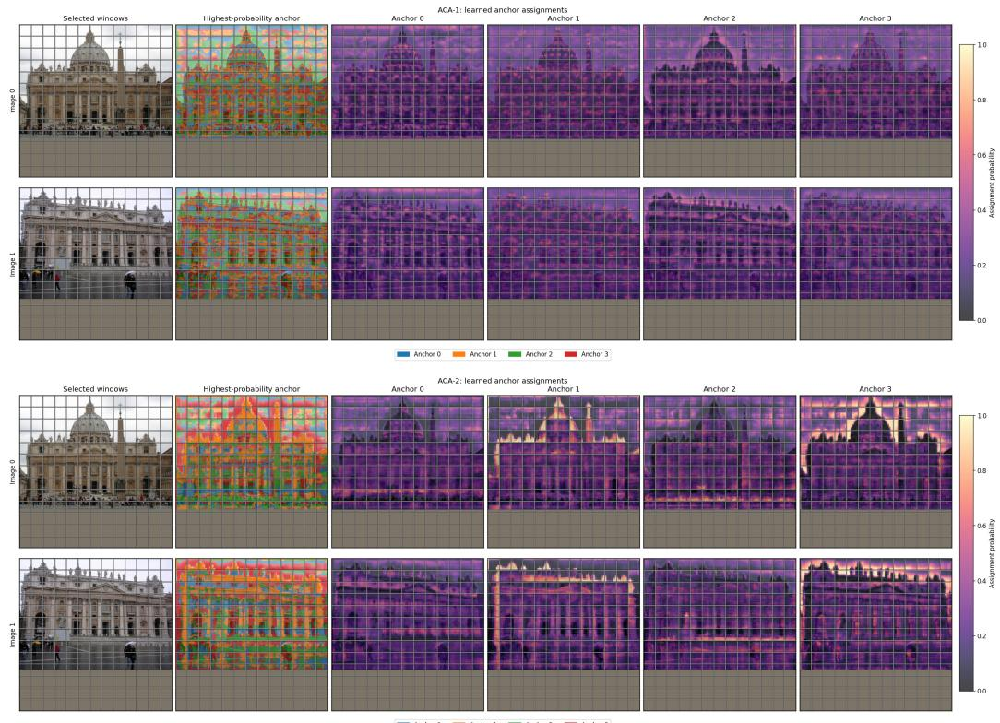  
Figure 11: Learned anchor assignments in AnchorCrossAttention. ACA-1 (top) and ACA-2 (bottom) for image pair 1, window offset (0, 0). Brighter heatmap colors indicate higher assignment probabilities.

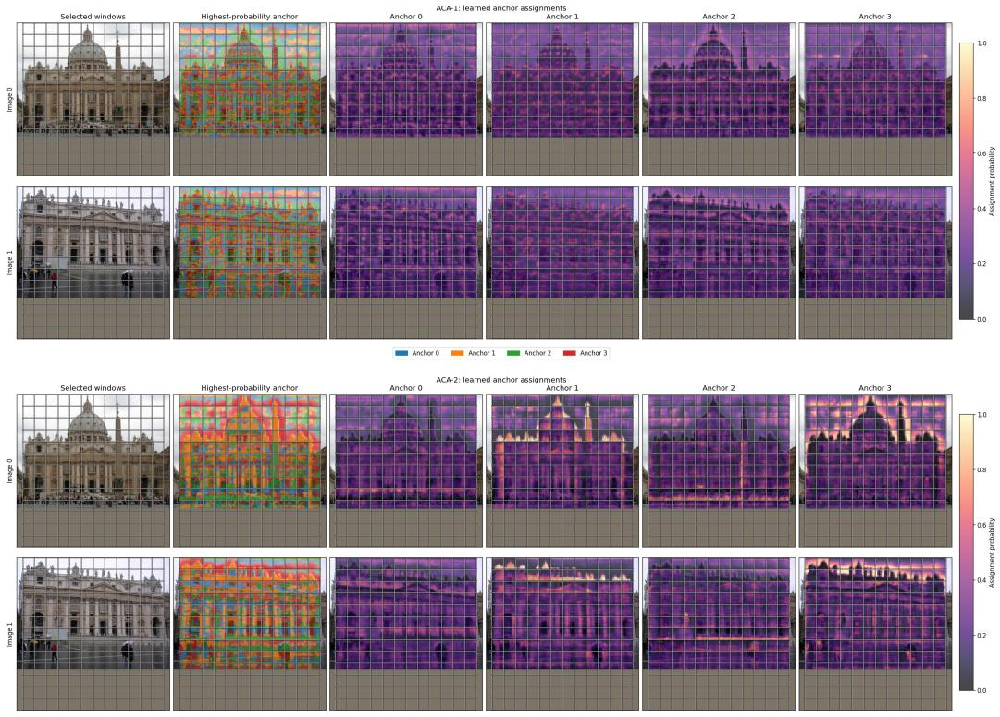  
Figure 12: Learned anchor assignments in AnchorCrossAttention. ACA-1 (top) and ACA-2 (bottom) for image pair 1, window offset (0, 4). See Appendix D.1 for visualization details.

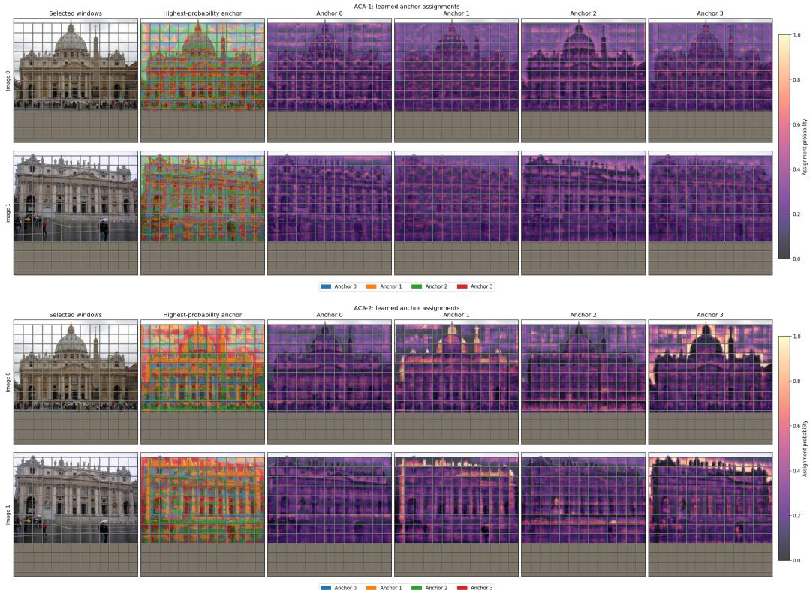  
Figure 13: Learned anchor assignments in AnchorCrossAttention. ACA-1 (top) and ACA-2 (bottom) for image pair 1, window offset (4, 0). See Appendix D.1 for visualization details.

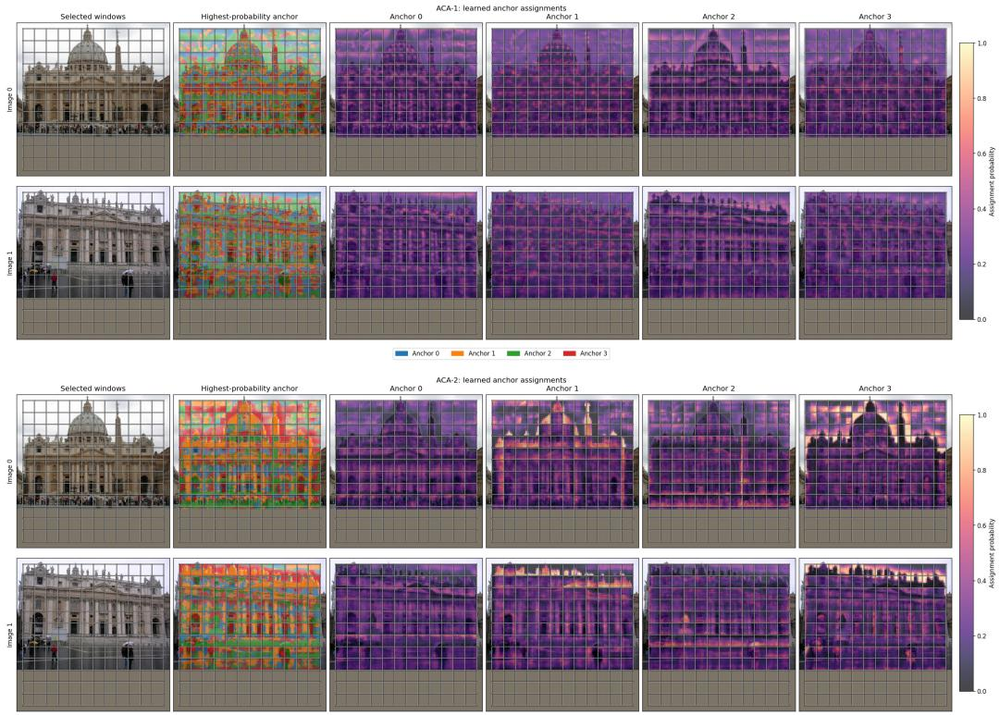  
Figure 14: Learned anchor assignments in AnchorCrossAttention. ACA-1 (top) and ACA-2 (bottom) for image pair 1, window offset (4, 4). See Appendix D.1 for visualization details.

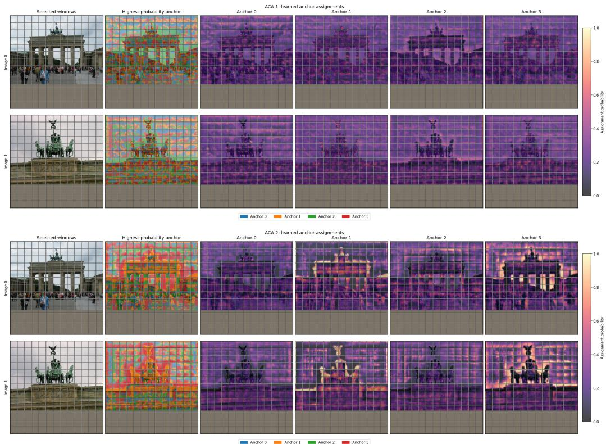  
Figure 15: Learned anchor assignments in AnchorCrossAttention. ACA-1 (top) and ACA-2 (bottom) for image pair 2, window offset (0, 0). See Appendix D.1 for visualization details.

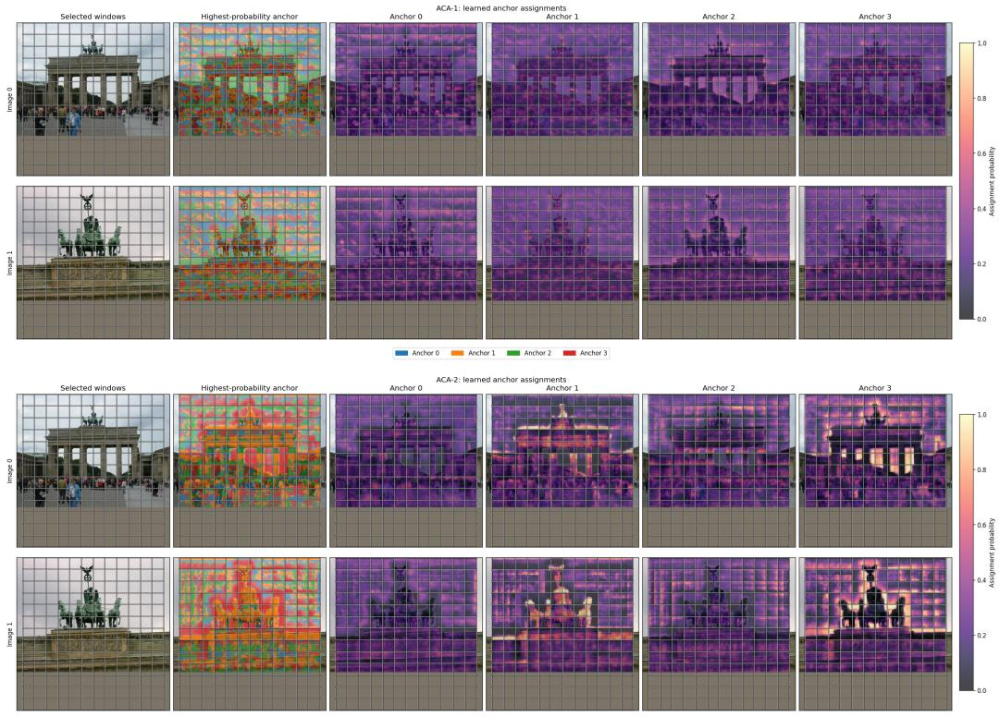  
Figure 16: Learned anchor assignments in AnchorCrossAttention. ACA-1 (top) and ACA-2 (bottom) for image pair 2, window offset (0, 4). See Appendix D.1 for visualization details.

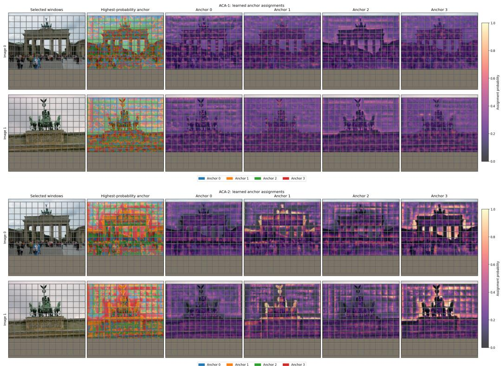  
Figure 17: Learned anchor assignments in AnchorCrossAttention. ACA-1 (top) and ACA-2 (bottom) for image pair 2, window offset (4, 0). See Appendix D.1 for visualization details.

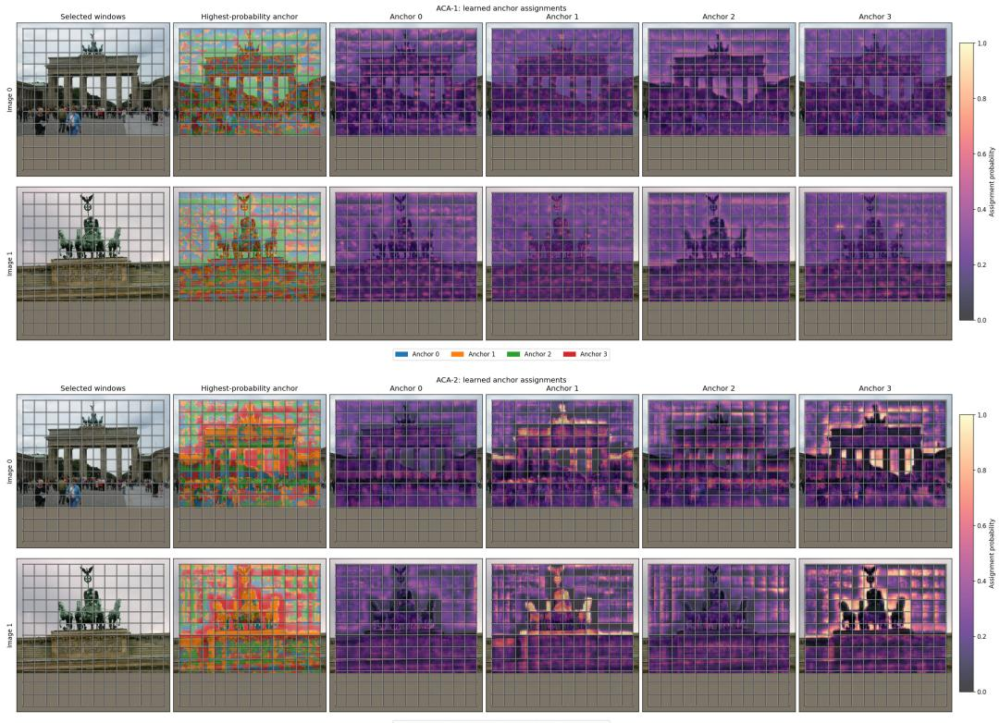  
Figure 18: Learned anchor assignments in AnchorCrossAttention. ACA-1 (top) and ACA-2 (bottom) for image pair 2, window offset (4, 4). See Appendix D.1 for visualization details.

## E Repeated-run variability

Table 13 reports seven independent WAM training runs on MegaDepth-1500 under the same configuration. The run identifiers are arbitrary. The default checkpoint used in the main tables is Run D, whose AUC@5◦ equals the median AUC@5◦ over the seven runs; “std” denotes sample standard deviation.

Table 13: Repeated-run variability of WAM on MegaDepth-1500. Runtime is measured on a single NVIDIA H100 GPU under the protocol in Appendix A.
<table><tr><td>Run</td><td>AUC@5°</td><td>AUC@10°</td><td>AUC@20°</td><td>Runtime (ms)</td></tr><tr><td>A</td><td>66.4</td><td>78.9</td><td>87.5</td><td>34.9</td></tr><tr><td>B</td><td>66.3</td><td>79.0</td><td>87.7</td><td>35.0</td></tr><tr><td>C</td><td>66.2</td><td>78.9</td><td>87.6</td><td>35.0</td></tr><tr><td>D (default)</td><td>66.1</td><td>78.9</td><td>87.7</td><td>35.4</td></tr><tr><td>E</td><td>66.1</td><td>78.8</td><td>87.7</td><td>34.8</td></tr><tr><td>F</td><td>65.9</td><td>78.5</td><td>87.4</td><td>35.0</td></tr><tr><td>G</td><td>65.8</td><td>78.5</td><td>87.3</td><td>35.8</td></tr><tr><td>Mean ± std</td><td>66.1±0.2</td><td>78.8±0.2</td><td>87.6±0.2</td><td>35.1±0.3</td></tr><tr><td>Median</td><td>66.1</td><td>78.9</td><td>87.6</td><td>35.0</td></tr><tr><td>Min-max</td><td>65.8–66.4</td><td>78.5-79.0</td><td>87.3-87.7</td><td>34.8-35.8</td></tr></table>

For context, all non-default component-removal and replacement variants in Tables 3–5 are below the minimum WAM AUC@5◦ observed across these seven runs.

## F Input-resolution scalability

We vary the MegaDepth resize-and-pad resolution and evaluate WAM and JamMa using their respective MegaDepth-trained checkpoints and the same matching thresholds. We report both fullmatcher and context-module times across resolutions.

Table 14: Input-resolution scalability on MegaDepth. We report pose AUC and runtime when varying the input resize-and-pad resolution. Context time measures WovenAnchorModule for WAM and JointMamba Module for JamMa.
<table><tr><td rowspan="2">Input size</td><td rowspan="2">Coarse size</td><td rowspan="2">Method</td><td colspan="3">Pose AUC ↑</td><td rowspan="2">Matcher time Context time (ms)</td><td rowspan="2">(ms)</td></tr><tr><td>@5°</td><td>@10°</td><td>@20°</td></tr><tr><td>480</td><td>60 × 60</td><td>WAM JamMa</td><td>55.9 53.3</td><td>71.2 68.2</td><td>82.4</td><td>15.4 16.0</td><td>6.7 2.8</td></tr><tr><td>640</td><td>80 × 80</td><td>WAM JamMa</td><td>63.7 60.3</td><td>76.7</td><td>79.2 86.3</td><td>22.0</td><td>8.8</td></tr><tr><td>832</td><td>104 × 104</td><td>WAM JamMa</td><td>66.1 64.1</td><td>73.9 78.9 77.4</td><td>83.8 87.7</td><td>25.0 35.4</td><td>2.8 14.0</td></tr><tr><td></td><td>1024 128 × 128</td><td>WAM JamMa</td><td>67.2 65.8</td><td>79.6 78.4</td><td>86.5 88.0</td><td>43.8 52.9</td><td>2.9 20.7</td></tr><tr><td>1152</td><td>2 144 × 144</td><td>WAM JamMa</td><td>67.6 66.2</td><td>79.8</td><td>87.1 88.3</td><td>64.7 68.2</td><td>3.5 26.2</td></tr><tr><td></td><td>1312 164 × 164</td><td>WAM JamMa</td><td>68.0 66.2</td><td>78.5 80.1 78.6</td><td>87.3 88.4 87.3</td><td>86.4 91.7 121.0</td><td>4.9 34.1 5.8</td></tr></table>

In Table 14, WAM obtains higher pose AUC than JamMa at all tested resolutions, supporting the role-specialized design beyond the default 832 × 832 setting. Full-matcher times reflect the complete implementation, including coarse-matching optimizations; context times isolate the cost of the aggregation modules. WovenAnchorModule has a higher measured context-module runtime than

JointMamba at all tested resolutions. AnchorCrossAttention retains quadratic interaction complexity in the number of local windows.

## G Additional visual localization evaluation

Aachen Day-Night v1.1. We additionally evaluate WAM on Aachen Day-Night v1.1 [1, 35] for visual localization using the public HLoc benchmark pipeline [2]. Since detailed evaluation settings for some published matcher baselines are not always fully specified, we report results from our own evaluation under a shared pipeline. All methods are evaluated with the same localization settings and the same HLoc-based evaluation code. The results should therefore be interpreted as a controlled comparison under our evaluation setup rather than a reproduction of each method’s official leaderboard submission. Following the Aachen Day-Night v1.1 protocol, we report localization recall at (0.25 m, 2◦), (0.5 m, 5◦), and (5.0 m, 10◦).

Table 15: Visual localization results on Aachen Day-Night v1.1. We report localization recall at $( 0 . 2 5 \mathrm { m } , 2 ^ { \circ } ) / \left( 0 . 5 \mathrm { m } , 5 ^ { \circ } \right) / \left( 5 . 0 \mathrm { m } , 1 0 ^ { \circ } \right)$ . All methods are evaluated under the same HLoc-based pipeline.
<table><tr><td>Method</td><td>Day</td><td>Night</td></tr><tr><td>LoFTR [6]</td><td>88.7 / 95.8 / 98.8</td><td>76.4 / 91.1 / 97.9</td></tr><tr><td>JamMa [7]</td><td>86.4 / 94.5 / 97.6</td><td>72.8 / 90.1 / 98.4</td></tr><tr><td>WAM (Ours)</td><td>87.5 / 94.5 / 98.2</td><td>74.3 / 91.1 / 97.9</td></tr></table>

Discussion. WAM generally improves over JamMa under this controlled HLoc-based evaluation, but it does not outperform LoFTR on Aachen Day-Night v1.1. One possible reason is the match selection strategy. Like JamMa, WAM uses nearest-neighbor matching, which can produce many-toone assignments. Aggregating or suppressing such matches may introduce additional sensitivity in the localization pipeline. In contrast, LoFTR uses mutual nearest-neighbor filtering in our evaluated pipeline, which more directly suppresses many-to-one correspondences. Compared with JamMa, which uses a similar nearest-neighbor selection strategy, WAM generally performs better, suggesting that the proposed WovenAnchorModule yields more effective matching features than JointMamba in this setting.

## H Limitations and broader impact

Responsible use. Improved local feature matching can benefit visual localization, SfM, SLAM, mapping, image alignment, augmented reality, and robotic perception [1–5]. Potential negative uses include privacy-invasive localization, surveillance, and reconstruction from imagery without adequate consent. Incorrect matches may also propagate errors to downstream robotic or mapping systems. Responsible deployment should consider privacy constraints, consent for imagery, benchmark limitations, and downstream failure handling.

Limitations. The nearest-neighbor-based matching strategy can produce many-to-one correspondences, which may contribute to the localization gap observed on Aachen in Appendix G. The comparison does not isolate the effect of match filtering; localization performance may depend on both the learned features and how correspondences are filtered and aggregated. Another limitation is computational scaling. WovenAnchorModule has a higher measured context-module runtime than JointMamba at the default resolution (Table 8). Although local anchors reduce the number of interactions relative to dense token-wise cross-attention, AnchorCrossAttention retains quadratic interaction complexity in the number of local windows, limiting scalability at high input resolutions. Future work could combine WAM with stronger mutual filtering, one-to-one assignment, localization-specific match pruning, or more scalable anchor retrieval.

Datasets. The work uses existing public computer-vision benchmarks and does not involve new human-subject data collection, crowdsourcing, or participant intervention. The method is not a generative model and does not introduce a new scraped dataset.

Existing assets and licenses. Table 16 summarizes the main existing datasets, benchmark codebases, and model components used in this work. We use these assets for research evaluation. The source package includes adapted third-party code and evaluation metadata inherited from prior work, with applicable licenses and attribution preserved. Dataset images, depth maps, and third-party checkpoints are not bundled.

Table 16: Existing assets and licenses/terms.
<table><tr><td>Asset</td><td>Use</td><td>License / terms Citation</td></tr><tr><td>MegaDepth</td><td>Training MegaDepth-1500 els, and related derived assets; original Internet relative pose evalu- images retain their original licenses ation</td><td>and CC BY 4.0 for released depth maps, SfM mod- [28]</td></tr><tr><td>ScanNet</td><td>1500 relative pose code evaluation</td><td>Zero-shot ScanNet- ScanNet Terms of Use for data; MIT license for [29]</td></tr><tr><td>HPatches</td><td>raphy evaluation</td><td>Zero-shot homog- MIT license for the HPatches dataset repository; [31] BSD-2-Clause license for the HPatches bench- mark/evaluation code; no dataset assets are redis- tributed</td></tr><tr><td>Night v1.1</td><td>evaluation</td><td>Aachen Day- Visual localization Official dataset/benchmark terms as specified in [1, 35] the accompanying README files; no dataset as-</td></tr><tr><td>HLoc</td><td>pipeline</td><td>sets are redistributed Visual localization Apache-2.0 license for the HLoc codebase; third- [2] party components follow their own licenses</td></tr><tr><td>JamMa code- Base base</td><td>WAM</td><td>implemen- JamMa code is released under MIT license. Its [6, 7] tation adapted for repository notes that parts of the code are based on upstream LoFTR-family repositories under their own licenses, terms, and conditions; we preserve</td></tr><tr><td>Mamba / se- Reference lective SSM</td><td>plementation for mentation WovenMamba</td><td>applicable notices and do not redistribute third- party checkpoints im- Apache-2.0 license for the official Mamba imple- [23]</td></tr><tr><td></td><td>SSM-style blocks tion</td><td>ConvNeXtV2- Backbone architec- MIT license for official ConvNeXtV2 code. Offi- [27] style encoder ture and initializa- cial ImageNet pre-trained/fine-tuned weights are under CC-BY-NC; we use them under those terms and do not redistribute third-party weights</td></tr><tr><td>LightGlue</td><td>utilities censes</td><td>GlueFactory / HPatches evalu- Apache-2.0 license for GlueFactory and Light- [20] ation code and Glue code/trained models; third-party models baseline evaluation used through GlueFactory follow their own li-</td></tr></table>

For other baseline matchers, we cite the corresponding papers and follow the licenses and terms of their official implementations and checkpoints.

## NeurIPS Paper Checklist

## 1. Claims

Question: Do the main claims made in the abstract and introduction accurately reflect the paper’s contributions and scope?

Answer: [Yes]

Justification: The abstract and introduction state the main scope and contributions: rolespecialized intra-image and inter-image aggregation, WovenMamba, and AnchorCrossAttention. These claims are supported by the benchmark comparisons and controlled ablations in Sections 4.2–4.3.

Guidelines:

• The answer [N/A] means that the abstract and introduction do not include the claims made in the paper.

• The abstract and/or introduction should clearly state the claims made, including the contributions made in the paper and important assumptions and limitations. A [No] or [N/A] answer to this question will not be perceived well by the reviewers.

• The claims made should match theoretical and experimental results, and reflect how much the results can be expected to generalize to other settings.

• It is fine to include aspirational goals as motivation as long as it is clear that these goals are not attained by the paper.

## 2. Limitations

Question: Does the paper discuss the limitations of the work performed by the authors?

Answer: [Yes]

Justification: The paper discusses limitations in Section 5 and Appendix H, including the nearest-neighbor matching strategy, Aachen localization behavior, responsible-use considerations, and computational scaling of the context module. Appendix F provides a diagnostic resolution-scaling study supporting the computational discussion.

Guidelines:

• The answer [N/A] means that the paper has no limitation while the answer [No] means that the paper has limitations, but those are not discussed in the paper.

• The authors are encouraged to create a separate “Limitations” section in their paper.

• The paper should point out any strong assumptions and how robust the results are to violations of these assumptions (e.g., independence assumptions, noiseless settings, model well-specification, asymptotic approximations only holding locally). The authors should reflect on how these assumptions might be violated in practice and what the implications would be.

• The authors should reflect on the scope of the claims made, e.g., if the approach was only tested on a few datasets or with a few runs. In general, empirical results often depend on implicit assumptions, which should be articulated.

• The authors should reflect on the factors that influence the performance of the approach. For example, a facial recognition algorithm may perform poorly when image resolution is low or images are taken in low lighting. Or a speech-to-text system might not be used reliably to provide closed captions for online lectures because it fails to handle technical jargon.

• The authors should discuss the computational efficiency of the proposed algorithms and how they scale with dataset size.

• If applicable, the authors should discuss possible limitations of their approach to address problems of privacy and fairness.

• While the authors might fear that complete honesty about limitations might be used by reviewers as grounds for rejection, a worse outcome might be that reviewers discover limitations that aren’t acknowledged in the paper. The authors should use their best judgment and recognize that individual actions in favor of transparency play an important role in developing norms that preserve the integrity of the community. Reviewers will be specifically instructed to not penalize honesty concerning limitations.

## 3. Theory assumptions and proofs

Question: For each theoretical result, does the paper provide the full set of assumptions and a complete (and correct) proof?

Answer: [N/A]

Justification: The paper does not present formal theoretical results or theorems. The receptive-field discussion in Section 3.2 is an illustrative simplified linear analysis, and the simplifying assumptions are stated there.

Guidelines:

• The answer [N/A] means that the paper does not include theoretical results.

• All the theorems, formulas, and proofs in the paper should be numbered and crossreferenced.

• All assumptions should be clearly stated or referenced in the statement of any theorems.

• The proofs can either appear in the main paper or the supplemental material, but if they appear in the supplemental material, the authors are encouraged to provide a short proof sketch to provide intuition.

• Inversely, any informal proof provided in the core of the paper should be complemented by formal proofs provided in appendix or supplemental material.

• Theorems and Lemmas that the proof relies upon should be properly referenced.

## 4. Experimental result reproducibility

Question: Does the paper fully disclose all the information needed to reproduce the main experimental results of the paper to the extent that it affects the main claims and/or conclusions of the paper (regardless of whether the code and data are provided or not)?

Answer: [Yes]

Justification: The paper describes the model components, architecture hyperparameters, training setup, datasets, evaluation metrics, RANSAC settings, runtime protocol, and ablation protocol in Sections 3–4 and Appendix A. These details provide a reasonable path to reproduce the main results.

Guidelines:

• The answer [N/A] means that the paper does not include experiments.

• If the paper includes experiments, a [No] answer to this question will not be perceived well by the reviewers: Making the paper reproducible is important, regardless of whether the code and data are provided or not.

• If the contribution is a dataset and/or model, the authors should describe the steps taken to make their results reproducible or verifiable.

• Depending on the contribution, reproducibility can be accomplished in various ways. For example, if the contribution is a novel architecture, describing the architecture fully might suffice, or if the contribution is a specific model and empirical evaluation, it may be necessary to either make it possible for others to replicate the model with the same dataset, or provide access to the model. In general. releasing code and data is often one good way to accomplish this, but reproducibility can also be provided via detailed instructions for how to replicate the results, access to a hosted model (e.g., in the case of a large language model), releasing of a model checkpoint, or other means that are appropriate to the research performed.

• While NeurIPS does not require releasing code, the conference does require all submissions to provide some reasonable avenue for reproducibility, which may depend on the nature of the contribution. For example

(a) If the contribution is primarily a new algorithm, the paper should make it clear how to reproduce that algorithm.

(b) If the contribution is primarily a new model architecture, the paper should describe the architecture clearly and fully.

(c) If the contribution is a new model (e.g., a large language model), then there should either be a way to access this model for reproducing the results or a way to reproduce the model (e.g., with an open-source dataset or instructions for how to construct the dataset).

(d) We recognize that reproducibility may be tricky in some cases, in which case authors are welcome to describe the particular way they provide for reproducibility. In the case of closed-source models, it may be that access to the model is limited in some way (e.g., to registered users), but it should be possible for other researchers to have some path to reproducing or verifying the results.

## 5. Open access to data and code

Question: Does the paper provide open access to the data and code, with sufficient instructions to faithfully reproduce the main experimental results, as described in supplemental material?

Answer: [Yes]

Justification: Code and a pretrained checkpoint are publicly available at https:// github.com/mmaiLab/WovenAnchorMatcher. The repository provides setup and data access instructions, MegaDepth training, evaluation on MegaDepth-1500, ScanNet-1500, and HPatches, and ablation configurations. The release focuses on WAM; baseline-specific scripts, the seven-run seed/checkpoint mapping, and Aachen/HLoc integration are not included. Dataset access remains subject to the original terms.

## Guidelines:

• The answer [N/A] means that paper does not include experiments requiring code.

• Please see the NeurIPS code and data submission guidelines (https://neurips. cc/public/guides/CodeSubmissionPolicy) for more details.

• While we encourage the release of code and data, we understand that this might not be possible, so [No] is an acceptable answer. Papers cannot be rejected simply for not including code, unless this is central to the contribution (e.g., for a new open-source benchmark).

• The instructions should contain the exact command and environment needed to run to reproduce the results. See the NeurIPS code and data submission guidelines (https: //neurips.cc/public/guides/CodeSubmissionPolicy) for more details.

• The authors should provide instructions on data access and preparation, including how to access the raw data, preprocessed data, intermediate data, and generated data, etc.

• The authors should provide scripts to reproduce all experimental results for the new proposed method and baselines. If only a subset of experiments are reproducible, they should state which ones are omitted from the script and why.

• At submission time, to preserve anonymity, the authors should release anonymized versions (if applicable).

• Providing as much information as possible in supplemental material (appended to the paper) is recommended, but including URLs to data and code is permitted.

## 6. Experimental setting/details

Question: Does the paper specify all the training and test details (e.g., data splits, hyperparameters, how they were chosen, type of optimizer) necessary to understand the results?

Answer: [Yes]

Justification: Sections 4.1 and Appendix A specify the datasets, image resizing, optimizer, learning rate schedule, batch size, training duration, architecture hyperparameters, matching thresholds, RANSAC settings, and runtime measurement protocol.

Guidelines:

• The answer [N/A] means that the paper does not include experiments.

• The experimental setting should be presented in the core of the paper to a level of detail that is necessary to appreciate the results and make sense of them.

• The full details can be provided either with the code, in appendix, or as supplemental material.

## 7. Experiment statistical significance

Question: Does the paper report error bars suitably and correctly defined or other appropriate information about the statistical significance of the experiments?

## Answer: [No]

Justification: Appendix E reports mean, sample standard deviation, median, and min–max over seven WAM training runs on MegaDepth-1500. However, not all baselines and ablation variants are repeated due to computational cost. Ablation variants are controlled single-run comparisons unless otherwise stated.

## Guidelines:

• The answer [N/A] means that the paper does not include experiments.

• The authors should answer [Yes] if the results are accompanied by error bars, confidence intervals, or statistical significance tests, at least for the experiments that support the main claims of the paper.

• The factors of variability that the error bars are capturing should be clearly stated (for example, train/test split, initialization, random drawing of some parameter, or overall run with given experimental conditions).

• The method for calculating the error bars should be explained (closed form formula, call to a library function, bootstrap, etc.)

• The assumptions made should be given (e.g., Normally distributed errors).

• It should be clear whether the error bar is the standard deviation or the standard error of the mean.

• It is OK to report 1-sigma error bars, but one should state it. The authors should preferably report a 2-sigma error bar than state that they have a 96% CI, if the hypothesis of Normality of errors is not verified.

• For asymmetric distributions, the authors should be careful not to show in tables or figures symmetric error bars that would yield results that are out of range (e.g., negative error rates).

• If error bars are reported in tables or plots, the authors should explain in the text how they were calculated and reference the corresponding figures or tables in the text.

## 8. Experiments compute resources

Question: For each experiment, does the paper provide sufficient information on the computer resources (type of compute workers, memory, time of execution) needed to reproduce the experiments?

Answer: [Yes]

Justification: Section 4.1 and Appendix A report the GPU type, peak allocated GPU memory, training time, batch size, and runtime protocol. Each WAM training run takes about 26 hours on one H100 GPU; the seven WAM runs used for variability analysis correspond to about 182 H100-GPU hours. Ablation variants use the same training schedule unless otherwise stated.

Guidelines:

• The answer [N/A] means that the paper does not include experiments.

• The paper should indicate the type of compute workers CPU or GPU, internal cluster, or cloud provider, including relevant memory and storage.

• The paper should provide the amount of compute required for each of the individual experimental runs as well as estimate the total compute.

• The paper should disclose whether the full research project required more compute than the experiments reported in the paper (e.g., preliminary or failed experiments that didn’t make it into the paper).

## 9. Code of ethics

Question: Does the research conducted in the paper conform, in every respect, with the NeurIPS Code of Ethics https://neurips.cc/public/EthicsGuidelines?

Answer: [Yes]

Justification: The work uses existing public computer-vision benchmarks and does not involve new human-subject data collection, crowdsourcing, or high-risk generative model release. We discuss responsible use and possible negative applications in Appendix H.

Guidelines:

• The answer [N/A] means that the authors have not reviewed the NeurIPS Code of Ethics.

• If the authors answer [No], they should explain the special circumstances that require a deviation from the Code of Ethics.

• The authors should make sure to preserve anonymity (e.g., if there is a special consideration due to laws or regulations in their jurisdiction).

## 10. Broader impacts

Question: Does the paper discuss both potential positive societal impacts and negative societal impacts of the work performed?

Answer: [Yes]

Justification: Appendix H discusses positive applications such as localization, SfM, SLAM, mapping, image alignment, AR, and robotic perception, as well as negative uses such as privacy-invasive localization, surveillance, and reconstruction without consent.

Guidelines:

• The answer [N/A] means that there is no societal impact of the work performed.

• If the authors answer [N/A] or [No], they should explain why their work has no societal impact or why the paper does not address societal impact.

• Examples of negative societal impacts include potential malicious or unintended uses (e.g., disinformation, generating fake profiles, surveillance), fairness considerations (e.g., deployment of technologies that could make decisions that unfairly impact specific groups), privacy considerations, and security considerations.

• The conference expects that many papers will be foundational research and not tied to particular applications, let alone deployments. However, if there is a direct path to any negative applications, the authors should point it out. For example, it is legitimate to point out that an improvement in the quality of generative models could be used to generate Deepfakes for disinformation. On the other hand, it is not needed to point out that a generic algorithm for optimizing neural networks could enable people to train models that generate Deepfakes faster.

• The authors should consider possible harms that could arise when the technology is being used as intended and functioning correctly, harms that could arise when the technology is being used as intended but gives incorrect results, and harms following from (intentional or unintentional) misuse of the technology.

• If there are negative societal impacts, the authors could also discuss possible mitigation strategies (e.g., gated release of models, providing defenses in addition to attacks, mechanisms for monitoring misuse, mechanisms to monitor how a system learns from feedback over time, improving the efficiency and accessibility of ML).

## 11. Safeguards

Question: Does the paper describe safeguards that have been put in place for responsible release of data or models that have a high risk for misuse (e.g., pre-trained language models, image generators, or scraped datasets)?

Answer: [N/A]

Justification: The paper does not release high-risk generative models, scraped datasets, or assets that require special safeguards. It proposes a local feature matching method evaluated on existing public benchmarks.

Guidelines:

• The answer [N/A] means that the paper poses no such risks.

• Released models that have a high risk for misuse or dual-use should be released with necessary safeguards to allow for controlled use of the model, for example by requiring that users adhere to usage guidelines or restrictions to access the model or implementing safety filters.

• Datasets that have been scraped from the Internet could pose safety risks. The authors should describe how they avoided releasing unsafe images.

• We recognize that providing effective safeguards is challenging, and many papers do not require this, but we encourage authors to take this into account and make a best faith effort.

## 12. Licenses for existing assets

Question: Are the creators or original owners of assets (e.g., code, data, models), used in the paper, properly credited and are the license and terms of use explicitly mentioned and properly respected?

Answer: [Yes]

Justification: The paper cites the datasets, benchmark pipelines, and model components used in the experiments. Appendix H lists their licenses or usage terms. The public repository preserves license texts and attribution for inherited code and documents the evaluation metadata separately. Dataset images, depth maps, and third-party checkpoints are obtained from their respective sources rather than bundled; ScanNet access remains subject to its Terms of Use.

Guidelines:

• The answer [N/A] means that the paper does not use existing assets.

• The authors should cite the original paper that produced the code package or dataset.

• The authors should state which version of the asset is used and, if possible, include a URL.

• The name of the license (e.g., CC-BY 4.0) should be included for each asset.

• For scraped data from a particular source (e.g., website), the copyright and terms of service of that source should be provided.

• If assets are released, the license, copyright information, and terms of use in the package should be provided. For popular datasets, paperswithcode.com/datasets has curated licenses for some datasets. Their licensing guide can help determine the license of a dataset.

• For existing datasets that are re-packaged, both the original license and the license of the derived asset (if it has changed) should be provided.

• If this information is not available online, the authors are encouraged to reach out to the asset’s creators.

## 13. New assets

Question: Are new assets introduced in the paper well documented and is the documentation provided alongside the assets?

Answer: [Yes]

Justification: The released code and pretrained checkpoint are documented in the repository README and setup guide, covering installation, data access, training, evaluation, and ablation usage. Original code contributions are licensed under MIT; inherited components retain their respective licenses. The pretrained checkpoint is released under CC BY-NC 4.0. No new dataset is introduced.

Guidelines:

• The answer [N/A] means that the paper does not release new assets.

• Researchers should communicate the details of the dataset/code/model as part of their submissions via structured templates. This includes details about training, license, limitations, etc.

• The paper should discuss whether and how consent was obtained from people whose asset is used.

• At submission time, remember to anonymize your assets (if applicable). You can either create an anonymized URL or include an anonymized zip file.

## 14. Crowdsourcing and research with human subjects

Question: For crowdsourcing experiments and research with human subjects, does the paper include the full text of instructions given to participants and screenshots, if applicable, as well as details about compensation (if any)?

Answer: [N/A]

Justification: The work does not involve crowdsourcing, participant studies, or new humansubject data collection.

Guidelines:

• The answer [N/A] means that the paper does not involve crowdsourcing nor research with human subjects.

• Including this information in the supplemental material is fine, but if the main contribution of the paper involves human subjects, then as much detail as possible should be included in the main paper.

• According to the NeurIPS Code of Ethics, workers involved in data collection, curation, or other labor should be paid at least the minimum wage in the country of the data collector.

## 15. Institutional review board (IRB) approvals or equivalent for research with human subjects

Question: Does the paper describe potential risks incurred by study participants, whether such risks were disclosed to the subjects, and whether Institutional Review Board (IRB) approvals (or an equivalent approval/review based on the requirements of your country or institution) were obtained?

Answer: [N/A]

Justification: The work does not involve crowdsourcing or research with human subjects, so IRB approval or equivalent review is not applicable.

Guidelines:

• The answer [N/A] means that the paper does not involve crowdsourcing nor research with human subjects.

• Depending on the country in which research is conducted, IRB approval (or equivalent) may be required for any human subjects research. If you obtained IRB approval, you should clearly state this in the paper.

• We recognize that the procedures for this may vary significantly between institutions and locations, and we expect authors to adhere to the NeurIPS Code of Ethics and the guidelines for their institution.

• For initial submissions, do not include any information that would break anonymity (if applicable), such as the institution conducting the review.

## 16. Declaration of LLM usage

Question: Does the paper describe the usage of LLMs if it is an important, original, or non-standard component of the core methods in this research? Note that if the LLM is used only for writing, editing, or formatting purposes and does not impact the core methodology, scientific rigor, or originality of the research, declaration is not required.

Answer: [N/A]

Justification: The core method, experiments, and analysis do not use LLMs as an important, original, or non-standard component. Any writing or editing assistance, if used, does not affect the methodology, scientific rigor, or originality of the research.

Guidelines:

• The answer [N/A] means that the core method development in this research does not involve LLMs as any important, original, or non-standard components.

• Please refer to our LLM policy in the NeurIPS handbook for what should or should not be described.