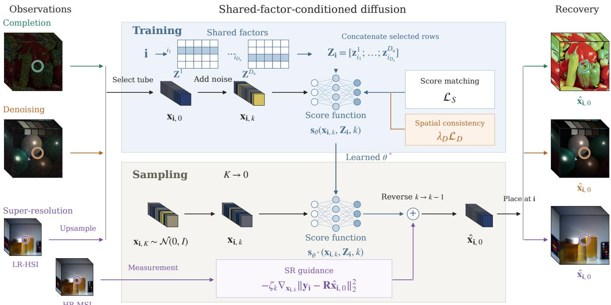
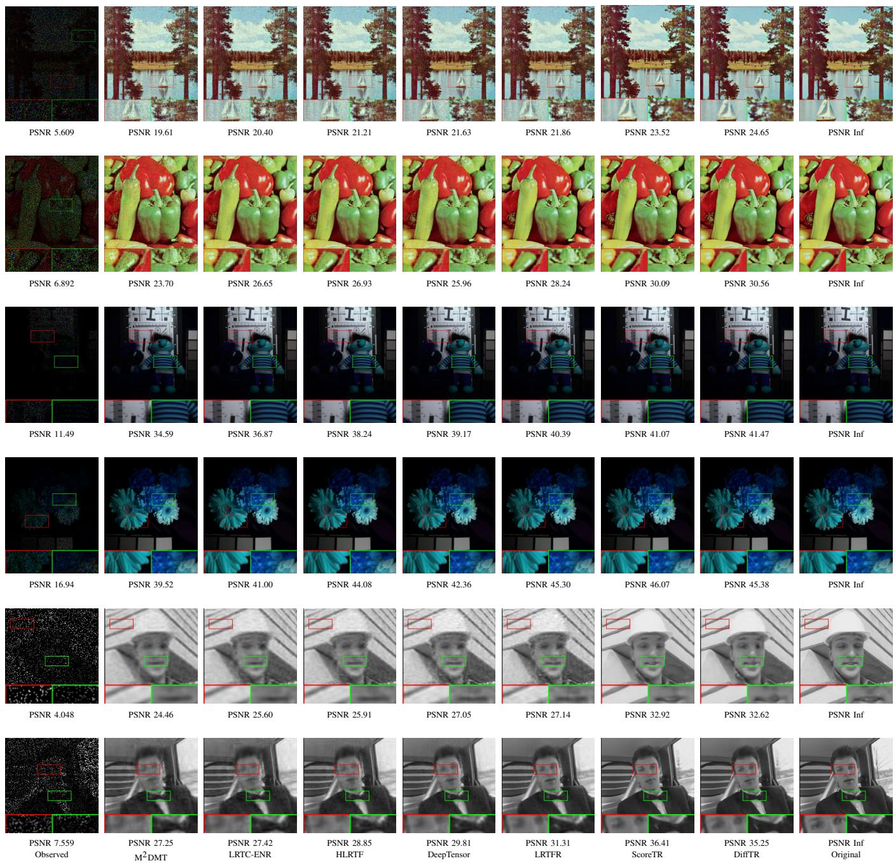
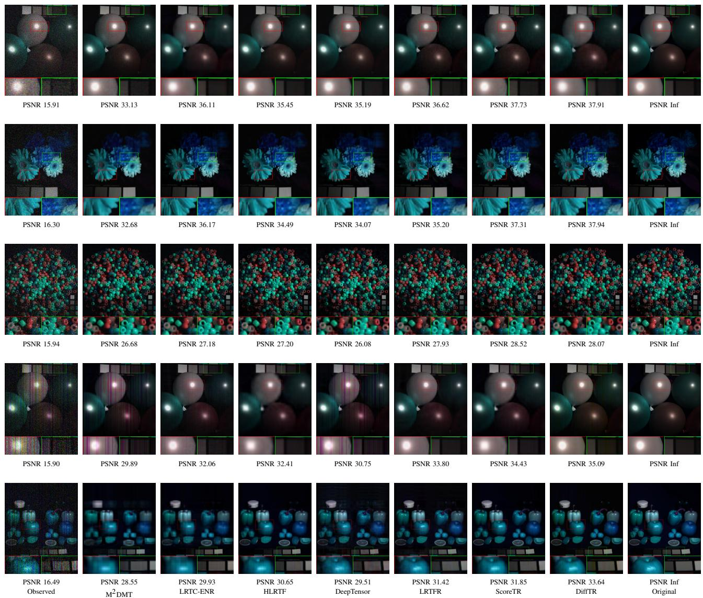
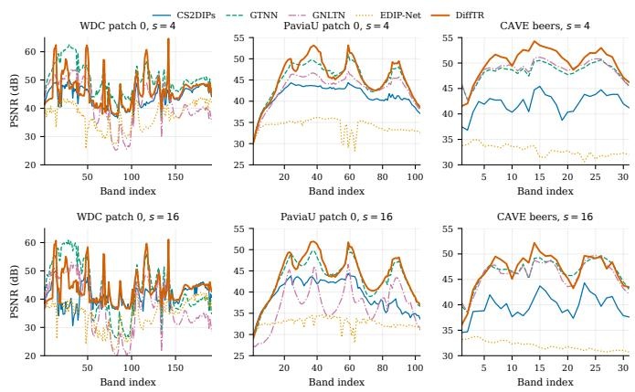
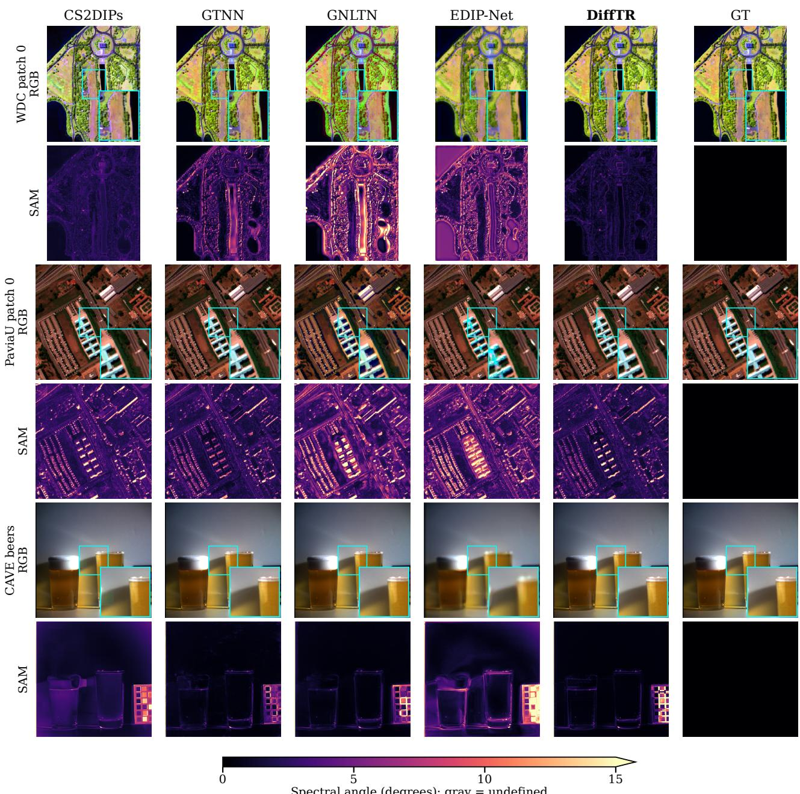
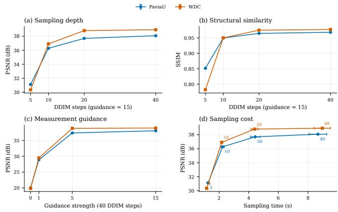

# Shared-Factor-Conditioned Diffusion for Low-Rank Tensor Recovery

Zhengyun Cheng , Guanwen Zhang , and Wei Zhou

Abstract—Tensor recovery spans heterogeneous data structures and observation processes, calling for a representation that can adapt across modalities and tasks. We propose DiffTR, an unsupervised framework that unifies tensor completion, denoising, and hyperspectral super-resolution through coordinate-conditioned diffusion. Shared factors indexed by tensor coordinates condition a compact score network, and score matching jointly learns the factors and an implicit tensor representation from the available observations. Scalar and vector-valued outputs accommodate individual entries and entire tubes, enabling a common formulation for tabular tensors, images, and videos. The framework separates representation learning from task-specific observation modeling: reverse diffusion recovers missing values; estimation via Tweedie’s formula, soft thresholding, and optional spatial consistency support mixed-noise denoising; and measurement-guided sampling transfers a prior learned from low-resolution hyperspectral observations to high-resolution reconstruction, followed by post sampling refinement with data consistency and spectral subspace regularization. This separation makes the representation compatible with different corruption models and permits taskspecific constraints to be incorporated within the same recovery framework. Experiments across multiple tensor modalities and recovery tasks demonstrate competitive reconstruction quality and the flexibility of a unified conditional generative representation. The code is available at https://github.com/CZY-Code/DiffTR

Index Terms—Low-rank , Diffusion , Tensor Recovery

## I. INTRODUCTION

Tensor recovery estimates an underlying tensor from incomplete, corrupted, or indirect measurements. This problem arises in sparse multiway tables, continuous-time records, RGB images, multispectral images, hyperspectral images, and videos. Applications span completion [1], [2], denoising, spectral super-resolution, factor analysis [3], sequence modeling [4], model compression [5], [6], and generative modeling [7], [8]. A general recovery framework must accommodate both heterogeneous structure and heterogeneous observations. Sparse tables encode interactions among discrete entities, whereas visual tensors exhibit spatial, spectral, and temporal correlations. Missing entries, missing tubes, mixed noise, and resolution loss impose different constraints on these structures. We use MSI and HSI to denote multispectral and hyperspectral images, respectively.

Classical low-rank tensor recovery combines a tensor representation, an observation model, and an optimization procedure. CP [9], Tucker [10], tensor train [11], tensor ring [12], and tensor networks such as fully connected and tensor wheel decompositions [13], [14] prescribe how latent factors or cores are contracted into tensor entries. Structure search improves the representation by adapting network topology and mode assignments [15], [16], but the resulting model still relies on an explicit contraction. Many methods based on implicit neural representations (INRs) extend tensor models with fixed contraction structures to continuous domains [17], [18]. Their effectiveness therefore depends on matching the contraction structure to the data, which can be challenging when spatial, spectral, temporal, and entity-level dependencies differ across modalities.

CoSTCo and POND address the restrictions of multilinear interactions through convolutional networks and Gaussian processes with neural kernels, respectively [19], [20]. Energybased tensor models learn entry–factor compatibility without prescribed contractions, but primarily operate on scalar entries [21], [22]. Extending these formulations to joint tube recovery and indirect measurements requires corresponding treatment of vector-valued outputs and observation constraints. Building on these advances, we seek a common conditional diffusion framework that accommodates heterogeneous tensor modalities, scalar entries and vector-valued tubes, and task-specific observation models across completion, denoising, and HSI super-resolution.

We introduce DiffTR, a diffusion framework conditioned on coordinate-indexed tensor factors. For each mode, an Rdimensional factor vector is associated with every index or coordinate, either retrieved from a factor matrix for discrete modes or generated by an implicit neural representation for continuous modes. Atoms that share an index within the same mode reuse the corresponding factor vector, so that their observations jointly inform its learning. The resulting factor vectors are concatenated to condition a score network. Here, an atom refers to a scalar entry or a vector-valued tube, indexed by its positions across the modes. Denoising score matching jointly learns the factors and the conditional score, and reverse diffusion recovers the target atoms. We define the representation rank R as the feature dimension of each factor vector. By learning interactions among factors, the score network provides a flexible alternative to prescribed multilinear contractions.

DiffTR adopts a unified coordinate-conditioned diffusion formulation for completion, denoising, and HSI super-resolution, with learning and recovery procedures tailored to the available observations. For completion, it learns from observed entries or tubes and generates the missing ones. For denoising, it alternates score learning, clean-value estimation via Tweedie’s formula, and sparse-noise separation, with optional spatial consistency enforcement. For HSI super-resolution, it learns from the upsampled LR-HSI, guides reverse diffusion with HR-MSI measurements, and applies post-sampling refinement to improve data consistency. Each tensor is trained on its own observations, and the number of diffusion steps can be adjusted according to its structure and recovery requirements.

The main contributions are summarized as follows:

• We formulate tensor recovery as conditional diffusion over scalar entries or vector-valued tubes, where shared mode-wise factors condition a score network that learns factor interactions.

• We develop an extensible, unsupervised framework that learns from each tensor’s own observations and supports completion, denoising, and HSI super-resolution across tabular, image, and video tensors via task-specific obser vation models.

• We evaluate DiffTR across tensor modalities and recovery tasks, demonstrating competitive reconstruction quality and analyzing the effects of key components and computational cost.

## II. RELATED WORK

## A. Tensor Completion

Tensor completion exploits dependencies among modes to infer missing values. Classical approaches use CP, Tucker, and tensor-network factorizations [9], [12], [13], unfoldingbased trace norms [23], or tensor-tensor-product models [24]. Recent work combines low-rank Tucker factor priors with spatial–spectral graph regularization to capture global correlations and nonlinear manifold structure in HSI completion [25]. Bayesian and nonparametric methods incorporate rank adaptation, nonlinear interactions, and uncertainty [1], [20], [26], [27], while continuous-time models capture temporal variation through splines or neural dynamics [28]–[30]. Neural methods learn factor-to-value mappings, continuous tensor functions, frequency-aware representations, and deep latent parameterizations [17]–[19], [31], [32]. EnergyTD and ScoreTR further introduce implicit distributional modeling [21], [22].

Existing formulations typically target specific output units or coordinate domains, making it difficult to jointly support scalar entries, vector-valued tubes, and side information. Prescribed contractions can also restrict expressiveness when their structure poorly matches the dependencies in different tensor modalities. DiffTR addresses these limitations by supporting scalar and tube-valued atoms within a unified conditional diffusion formulation. Mode-wise factors are retrieved for discrete indices or generated by INRs for continuous coordinates, including timestamps. A conditional score network learns their interactions without prescribing a multilinear contraction.

## B. Tensor Denoising

Tensor denoising combines structural priors with noise models. Tensor robust principal component analysis separates low-rank structure from sparse outliers [33], while Schatten-p regularization provides a nonconvex low-rank prior [34]. A concave singular-value penalty combined with gradient tensors has been proposed to balance low-rankness and smoothness in sparse-noise removal [35]. Learned factorizations and continuous tensor functions provide flexible representations [17], [36], while total variation (TV) and coordinate-Jacobian regularization promote spatial smoothness [18]. Score matching offers a distributional approach by estimating gradients of noiseperturbed log densities [37], [38].

The effectiveness of these methods depends on how well their structural priors and noise assumptions match the data. Mixed-noise recovery requires coordinated treatment of dense noise and sparse outliers, since fitting corrupted values directly can embed noise in the learned representation. DiffTR alternates score learning, clean-value estimation via Tweedie’s formula, and sparse-noise separation by soft thresholding. An optional spatial-consistency loss penalizes score differences at nearby coordinates, incorporating local smoothness into the same conditional representation.

## C. Hyperspectral Image Super-Resolution

HSI super-resolution combines the spectral information of an LR-HSI with the spatial information of an HR-MSI. Coupled tensor methods share latent structure between the two observations [39], [40]. Other approaches employ generalized tensor nuclear norms [41], nonlinear transforms [42], or self supervised decomposition networks [43]. Fang et al. estimate spatial coefficients in an LR-HSI-derived spectral subspace using a spatial-frequency network and data-fidelity refinement [44]. Diffusion and score-based models offer generative priors [45], [46], while diffusion posterior sampling uses measurements to guide reverse diffusion [47].

Generative priors describe plausible HSI structure, while reconstruction must also remain consistent with both the LR-HSI and HR-MSI observations. Spatial blur and downsampling couple neighboring locations, requiring observation constraints that account for the full spatial and spectral degradation operators. DiffTR learns a conditional HSI score from the upsampled LR-HSI and uses HR-MSI measurements to guide reverse diffusion. Post-sampling refinement combines data consistency under both full observation operators with spectral subspace regularization, extending the common tensor recovery formulation to HSI super-resolution.

## III. METHODOLOGY

Figure 1 illustrates the DiffTR framework, which uses coordinate-indexed shared factors to condition diffusion over scalar entries or vector-valued tubes. Task-specific learning and recovery procedures extend this common formulation to tensor completion, denoising, and HSI super-resolution.

Following standard tensor notation [9], we denote scalars, vectors, matrices, and tensors by lowercase, bold lowercase, bold uppercase, and calligraphic uppercase letters, respectively. Let $\mathcal { X } \in \mathbb { R } ^ { I _ { 1 } \times \cdots \times I _ { D } }$ be a Dth-order tensor. An atom $\mathbf { x _ { i } } \in \mathbb { R } ^ { C }$ is indexed by $\mathbf { i } = ( i _ { 1 } , \dots , i _ { D _ { \mathrm { a } } } )$ , where $D _ { \mathrm { a } }$ is the number of coordinate modes. Scalar entries have $D _ { \mathrm { a } } = D$ and $C = 1$ tubes have $D _ { \mathrm { a } } = D - 1$ and $C = I _ { D }$ , with the retained mode placed last by permutation if needed. The set of observed atom coordinates is Ω, and Ω¯ is its complement.

  
Fig. 1: Overview of the DiffTR framework. Coordinate-indexed shared factors condition a score network for tensor completion, denoising, and HSI super-resolution. Green, orange, and purple denote completion, denoising constraints, and super-resolution guidance, respectively. Matched circles indicate the same spatial location.

## A. Preliminaries

Denoising diffusion probabilistic models (DDPMs) [45] define a fixed forward Markov chain that gradually perturbs a clean sample $\mathbf { x } _ { \mathrm { 0 } }$ with Gaussian noise:

$$
q ( \mathbf { x } _ { k } \mid \mathbf { x } _ { k - 1 } ) = { \mathcal { N } } ( \mathbf { x } _ { k } ; { \sqrt { \alpha _ { k } } } \mathbf { x } _ { k - 1 } , \beta _ { k } \mathbf { I } ) ,\tag{1}
$$

where $\alpha _ { k } \ = \ 1 - \beta _ { k } , \ k \ \in \ \{ 1 , \ldots , K \}$ , and $\{ \beta _ { k } \} _ { k = 1 } ^ { K }$ is a prescribed variance schedule. With $\begin{array} { r } { \bar { \alpha } _ { k } \ = \ \prod _ { s = 1 } ^ { k } \alpha _ { s } , } \end{array}$ , the marginal at any noise level is available in closed form:

$$
q ( \mathbf { x } _ { k } \mid \mathbf { x } _ { 0 } ) = \mathcal { N } \big ( \mathbf { x } _ { k } ; \sqrt { \bar { \alpha } _ { k } } \mathbf { x } _ { 0 } , ( 1 - \bar { \alpha } _ { k } ) \mathbf { I } \big ) .\tag{2}
$$

For a sufficiently long schedule, $q ( { \bf x } _ { K } )$ approaches a standard Gaussian. The reverse process is parameterized as

$$
p _ { \theta } ( \mathbf { x } _ { k - 1 } \mid \mathbf { x } _ { k } ) = { \mathcal { N } } { \Big ( } \mathbf { x } _ { k - 1 } ; \mu _ { \theta } ( \mathbf { x } _ { k } , k ) , { \tilde { \beta } } _ { k } \mathbf { I } { \Big ) } ,\tag{3}
$$

where $\tilde { \beta } _ { k }$ is the reverse variance and

$$
\mu _ { \theta } ( \mathbf { x } _ { k } , k ) = \frac { 1 } { \sqrt { \alpha _ { k } } } \left( \mathbf { x } _ { k } + \beta _ { k } \mathbf { s } _ { \theta } ( \mathbf { x } _ { k } , k ) \right) .\tag{4}
$$

The network $\mathbf { s } _ { \theta }$ approximates $\nabla _ { \mathbf { x } _ { k } } \log q _ { k } ( \mathbf { x } _ { k } )$ . Denoising score matching trains it against the tractable conditional score induced by Eq. (2) [37], [38]. Starting with $\mathbf { x } _ { K } \sim \mathcal { N } ( \mathbf { 0 } , \mathbf { I } )$ , ancestral sampling applies

$$
\mathbf { x } _ { k - 1 } = \frac { 1 } { \sqrt { \alpha _ { k } } } \left( \mathbf { x } _ { k } + \beta _ { k } \mathbf { s } _ { \theta } ( \mathbf { x } _ { k } , k ) \right) + \sqrt { \tilde { \beta } _ { k } } \epsilon ,\tag{5}
$$

where $\mathbf { \epsilon } \gets \mathcal { N } ( \mathbf { 0 } , \mathbf { I } )$ for $k > 1$ and is zero at the final step.

## B. Shared-Factor-Conditioned Diffusion

Let Y be an incomplete, noisy, or degraded observation of the target tensor X. For each coordinate mode $d \in \{ 1 , \ldots , D _ { \mathrm { a } } \}$ DiffTR uses a factor matrix $\mathbf { Z } ^ { d } \in \mathbb { R } ^ { I _ { d } \times R }$ . Throughout this paper, the representation rank R denotes the feature dimension of a shared factor. For atom coordinate i, the condition

$$
{ \bf Z _ { i \lambda } } = [ { \bf z } _ { i _ { 1 } } ^ { 1 } ; \ldots ; { \bf z } _ { i _ { D _ { \mathrm { a } } } } ^ { D _ { \mathrm { a } } } ] \in \mathbb { R } ^ { D _ { \mathrm { a } } R }\tag{6}
$$

concatenates the selected factor rows. Atoms sharing index $i _ { d }$ use the same factor $\mathbf { z } _ { i _ { d } } ^ { d }$ , coupling their representations across the tensor. The score network learns the mapping from this condition to atom values. For visual tensors, sinusoidal coordinate features [48] provide a continuous coordinate-based condition, written as $\mathbf { Z _ { i } } = \gamma _ { \phi } ( \mathbf { i } )$ . For sparse tabular tensors, the factor rows are optimized directly.

A conventional tensor decomposition makes X a deterministic contraction of its factors. DiffTR instead models the conditional distribution of each scalar or tube-valued atom. At diffusion level k,

$$
\nabla _ { \mathbf { x _ { i , } } k } \log p _ { k } ( \mathbf { x _ { i , } } _ { k } \mid \mathbf { Z _ { i } } ) = \nabla _ { \mathbf { x _ { i , } } k } \log p _ { k } ( \mathbf { x _ { i , } } _ { k } , \mathbf { Z _ { i } } ) ,\tag{7}
$$

where the equality holds because $p ( \mathbf { Z _ { i } } )$ is constant with respect $\mathrm { t o } \ \mathbf { x } _ { \mathrm { i } , k }$ . We approximate this conditional score with ${ \bf s } _ { \theta } ( { \bf x } _ { \bf i } , k , { \bf Z } _ { \bf i } , k )$

For completion, training samples the observed atoms. For denoising, it uses the current clean-atom estimates obtained by the alternating procedure below; for super-resolution, it uses the upsampled LR-HSI. Conditioned on a training atom ${ \bf x _ { i , 0 } } .$

Algorithm 1 Reverse-diffusion sampling for tensor recovery.   
Input: Trained $\theta ^ { * }$ and $\mathcal { Z } ;$ schedule $\{ \alpha _ { k } , \tilde { \beta } _ { k } \} _ { k = 1 } ^ { K } ;$ target coor  
dinates $\mathcal { T } .$   
1: for $\mathbf { i } \in \mathcal { T }$ do   
2: Initialize ${ \bf x } _ { \mathbf { i } , K } \sim \mathcal { N } ( { \bf 0 } , { \bf I } ) .$   
3: for $k  K$ to 1 do   
4: Draw $\mathbf { \epsilon } \gets \mathcal { N } ( \mathbf { 0 } , \mathbf { I } )$ if $k > 1 ;$ otherwise set $\epsilon = 0 .$   
5: $\begin{array} { r } { \mathbf { x _ { i , { k - 1 } } }  \frac { 1 } { \sqrt { \alpha _ { k } } } ( \mathbf { x _ { i , { k } } } + \beta _ { k } \mathbf { s } _ { \theta ^ { * } } ( \mathbf { x _ { i , { k } } } , \mathbf { Z _ { i } } , k ) ) + \sqrt { \tilde { \beta } _ { k } } \epsilon . } \end{array}$   
6: end for   
7: end for   
8: Fold the recovered atoms and retain observations where   
required by the task.   
Output: Recovered tensor $\hat { \mathcal { X } } .$

the forward perturbation is independent of $\mathbf { Z _ { i } } . \operatorname { E q } . \left( 2 \right)$ therefore provides the score-matching target

$$
\nabla _ { \mathbf { x _ { i , \boldsymbol { k } } } } \log q ( \mathbf { x _ { i , \boldsymbol { k } } } \mid \mathbf { x _ { i , \boldsymbol { 0 } } } ) = - \frac { \mathbf { x _ { i , \boldsymbol { k } } } - \sqrt { \bar { \alpha } _ { \boldsymbol { k } } } \mathbf { x _ { i , \boldsymbol { 0 } } } } { 1 - \bar { \alpha } _ { \boldsymbol { k } } } .\tag{8}
$$

We jointly optimize the score network and shared factors using the score-matching loss $\mathcal { L } _ { S } \mathrm { : }$

$$
\begin{array} { r l } & { \mathcal { L } _ { S } ( \theta , \mathcal { Z } ; \mathcal { X } _ { \Omega } ) = \displaystyle \frac { 1 } { 2 } \mathbb { E } _ { \mathbf { \mu _ { x , \tilde { k } } } \sim \boldsymbol { \Omega } , k , \mathbf { \Omega } } \Big [ \omega ( k ) } \\ & { \qquad \left\| \mathbf { s } _ { \theta } ( \mathbf { x } _ { \mathbf { i } , k } , \mathbf { Z } _ { \mathbf { i } } , k ) - \nabla _ { \mathbf { x } _ { \mathbf { i } , k } } \log q ( \mathbf { x } _ { \mathbf { i } , k } \mid \mathbf { x } _ { \mathbf { i } , 0 } ) \right\| _ { 2 } ^ { 2 } ] . } \end{array}\tag{9}
$$

where $\omega ( k )$ balances the noise levels. The network separately embeds the noisy atom, shared-factor condition, and diffusion index; concatenates the features; and maps them to an output with the atom dimension:

$$
\mathbf { s } _ { \theta } = g _ { \theta _ { o } } ( [ g _ { \theta _ { x } } ( \mathbf { x _ { i , \ / k } } ) ; g _ { \theta _ { z } } ( \mathbf { Z _ { i } } ) ; g _ { \theta _ { k } } ( k ) ] ) .\tag{10}
$$

Scalar atoms are used for entry-wise completion, whereas vector atoms are used for tube-wise completion and joint spectral recovery. Algorithm 1 summarizes conditional reverse-diffusion sampling at the target coordinates.

For completion, $\mathcal { T } = \bar { \Omega }$ and sampled atoms are combined with the observations in Ω. For denoising and super-resolution, the reverse process is modified as described next.

## C. Sparse-Noise Separation and Spatial Consistency

For denoising, DiffTR learns the tensor’s implicit representation by score matching while separating corruption from the training targets. We write $y = x + s + \varepsilon$ , where $s$ represents sparse or structured outliers and E represents dense residual noise. Conditioned on the shared factors,

$$
p _ { \theta } ( \mathcal { X } , \mathcal { S } \mid \mathcal { Y } , \mathcal { Z } ) \propto p ( \mathcal { Y } \mid \mathcal { X } , \mathcal { S } ) p ( \mathcal { S } ) p _ { \theta } ( \mathcal { X } \mid \mathcal { Z } ) .\tag{11}
$$

A Gaussian data term models dense residual noise, and a Laplace prior $p ( S ) \propto \exp ( - \lambda \| S \| _ { 1 } )$ promotes sparse corruption. We alternate clean-atom estimation, sparse-noise separation, and score-model updates. Tweedie’s formula expresses the clean estimate in terms of the learned score:

$$
\hat { \mathbf { x } } _ { \mathbf { i } , 0 } \approx \frac { 1 } { \sqrt { \bar { \alpha } _ { k } } } \left( \mathbf { x _ { i , } } _ { k } + ( 1 - \bar { \alpha } _ { k } ) \mathbf { s } _ { \theta } ( \mathbf { x _ { i , } } _ { k } , \mathbf { Z _ { i , } } _ { k } ) \right) ,\tag{12}
$$

Algorithm 2 Block coordinate descent for tensor denoising.   
Input: Noisy tensor $y ;$ λ; diffusion schedule; outer iterations   
$T .$   
1: Initialize the model parameters.   
2: for $t \gets 1$ to $T$ do   
3: Sample $\mathbf { i } , k ,$ and Gaussian noise $\epsilon ;$ perturb $\mathbf { y _ { i } }$ using   
Eq. (2) and predict $\hat { \mathbf { x } } _ { \mathbf { i } , 0 } ^ { ( t ) }$ without gradients.   
4: $\mathbf { s } _ { \mathbf { i } } ^ { ( t ) } \gets \mathrm { S o f t } _ { \lambda / 2 } ( \mathbf { y _ { i } } - \hat { \mathbf { x } } _ { \mathbf { i , 0 } } ^ { ( t ) } ) .$   
5: Set $\mathbf { x _ { i , 0 } ^ { ( t ) } = y _ { i } - s _ { i } ^ { ( t ) } }$ and perturb it using the same k and   
$\epsilon .$   
6: Take a gradient step on $\mathcal { L } _ { S } + \lambda _ { D } \mathcal { L } _ { D }$ with the clean   
target fixed.   
7: end for   
8: Recover $\hat { \mathcal X }$ by reverse diffusion and compute the total   
noise residual $\hat { \mathcal { N } } = \mathcal { Y } - \hat { \mathcal { X } }$   
Output: Denoised tensor $\hat { \mathcal X }$ and total residual $\hat { \mathcal { N } }$ (sparse and   
dense noise).

and the sparse update is

$$
\mathcal { S } \gets \mathrm { S o f t } _ { \boldsymbol { \lambda } / 2 } ( \mathcal { V } - \hat { \mathcal { X } } ) , \quad \mathrm { S o f t } _ { \tau } ( u ) = \mathrm { s g n } ( u ) \operatorname* { m a x } ( | u | - \tau , 0 ) .\tag{13}
$$

Spatial consistency offers a coordinate-based alternative to TV regularization. For tensors with local spatial correlations, we perturb an atom’s coordinate and penalize the resulting change in its conditional score. This optional regularizer introduces spatial smoothness through mini-batches while preserving the shared recovery formulation. The loss is

$$
\begin{array} { r l } & { \mathcal { L } _ { D } ( \theta , \phi ) = \mathbb { E } _ { \varepsilon \sim \mathcal { N } ( \mathbf { 0 } , \sigma _ { c } ^ { 2 } \mathbf { I } ) , } \Big [ } \\ & { \qquad \quad \big \| \mathbf { s } _ { \theta } ( \mathbf { x _ { i , k } } , \gamma _ { \phi } ( \mathbf { i } + \varepsilon ) , k ) - \mathbf { s } _ { \theta } ( \mathbf { x _ { i , k } } , \gamma _ { \phi } ( \mathbf { i } ) , k ) \big \| _ { 2 } ^ { 2 } \Big ] . } \end{array}\tag{14}
$$

where $\sigma _ { c }$ sets the coordinate neighborhood. Gradients propagate through both score evaluations by default; Section $\mathrm { V } { \cdot } \mathrm { A }$ compares this choice with a stop-gradient target. The denoising objective is $\mathcal { L } _ { S } + \lambda _ { D } \mathcal { L } _ { D }$ , with $\lambda _ { D }$ controlling the spatial constraint and allowing it to be disabled for tasks that do not require local continuity. Algorithm 2 summarizes the block coordinate descent (BCD) procedure and subsequent tensor recovery.

The same coordinate-conditioned network also supports likelihood-based fitting of a deterministic clean estimate. A Gaussian–outlier mixture accounts for clipping, with noise parameters learned from the observations. Optional proximal refinement balances the noise-scaled likelihood against a quadratic penalty on corrections within an estimated spectral subspace. A two-stage variant first fits a deterministic estimate, then trains diffusion on this fixed target and applies proximal guidance during denoising diffusion implicit model (DDIM) sampling. Section V-B compares these choices; Appendix B gives their objectives and optimization steps.

## D. Likelihood-Guided Sampling for HSI Super-Resolution

Let $\mathcal { X } \in \mathbb { R } ^ { I _ { H } \times I _ { W } \times I _ { C } }$ be the target HR-HSI. The LR-HSI $\mathcal { X } _ { \mathrm { L R } } \in \mathbb { R } ^ { I _ { h } \times I _ { w } \times I _ { C } }$ preserves spectral resolution, whereas the

HR-MSI $\mathcal { V } \in \mathbb { R } ^ { I _ { H } \times I _ { W } \times I _ { c } }$ preserves spatial resolution, with $I _ { h } < I _ { H } , I _ { w } < I _ { W }$ , and $I _ { c } < I _ { C }$ . We use

$$
\mathcal { X } _ { \mathrm { L R } } = \mathcal { X } \times _ { 1 } \mathbf { P } _ { 1 } \times _ { 2 } \mathbf { P } _ { 2 } + \mathcal { E } _ { \mathcal { X } } ,\tag{15}
$$

$$
y = \mathcal { X } \times _ { 3 } \mathbf { R } + \mathcal { E } _ { y } ,\tag{16}
$$

where ${ \bf P } _ { 1 }$ and $\mathbf { P } _ { 2 }$ model spatial degradation and $\mathbf { R } \in \mathbb { R } ^ { I _ { c } \times I _ { C } }$ is the spectral response. At spatial coordinate i,

$$
\mathbf { y _ { i } } = \mathbf { R } \mathbf { x _ { i } } + \epsilon ,\tag{17}
$$

with spectral signature $\mathbf { x _ { i } } \in \mathbb { R } ^ { I _ { C } }$ treated as a tube-valued atom. We spatially upsample $\mathcal { X } _ { \mathrm { L R } }$ and use it to learn the conditional HSI score. During reconstruction, Bayes’ rule gives

$$
\begin{array} { r l } & { \nabla _ { \mathbf x _ { \mathbf i , k } } \log p ( \mathbf x _ { \mathbf i , k } \mid \mathbf Z _ { \mathbf i } , \mathbf y _ { \mathbf i } ) } \\ & { \quad = \nabla _ { \mathbf x _ { \mathbf i , k } } \log p ( \mathbf x _ { \mathbf i , k } \mid \mathbf Z _ { \mathbf i } ) + \nabla _ { \mathbf x _ { \mathbf i , k } } \log p ( \mathbf y _ { \mathbf i } \mid \mathbf x _ { \mathbf i , k } ) . } \end{array}\tag{18}
$$

The first term is approximated by $\mathbf { s } _ { \theta ^ { * } }$ . Following diffusion posterior sampling [47], the second is evaluated at the denoised estimate:

$$
p ( \mathbf { y _ { i } } \mid \mathbf { x _ { i , \boldsymbol { k } } } ) \approx p ( \mathbf { y _ { i } } \mid \hat { \mathbf { x _ { i , 0 } } } ) ,\tag{19}
$$

where $\begin{array} { r l r } { \hat { \bf x } _ { \bf i , 0 } } & { = } & { \frac { 1 } { \sqrt { \bar { \alpha } _ { k } } } \left( { \bf x } _ { \bf i , } { \bf \Phi } + ( 1 - \bar { \alpha } _ { k } ) { \bf s } _ { \theta ^ { * } } \right) } \end{array}$ . Under Gaussian measurement noise,

$$
\begin{array} { r } { \nabla _ { { \bf x } _ { { \bf i } , k } } \log p ( { \bf y } _ { { \bf i } } \mid \hat { \bf x } _ { { \bf i } , 0 } ) \propto - \nabla _ { { \bf x } _ { { \bf i } , k } } \| { \bf y } _ { \bf i } - { \bf R } \hat { \bf x } _ { { \bf i } , 0 } \| _ { 2 } ^ { 2 } . } \end{array}\tag{20}
$$

The LR-HSI supplies the learned prior, and the HR-MSI guides reverse diffusion through the pixelwise spectral residual in Algorithm 3, producing an initial HR-HSI estimate $\widehat { \mathcal { X } } .$ We use guidance weights $\zeta _ { k } = g \bar { \alpha } _ { k }$ , where g controls the guidance strength. The main experiments use DDPM sampling; Section V-C examines deterministic DDIM updates $( \eta = 0 )$ with the same likelihood correction to vary the number of reverse steps at fixed model weights.

For observations with spatial blur, post-sampling refinement combines data consistency under both full observation operators with spectral subspace regularization. Let $\mathcal { U } \in \mathbb { R } ^ { I _ { H } \times I _ { W } \times I _ { C } }$ denote the candidate HR-HSI. We obtain $\mathcal { X } ^ { + } = \arg \operatorname* { m i n } _ { \mathcal { U } } \mathcal { I } _ { \tau , \gamma } ( \mathcal { U } ; \widehat { \mathcal { X } } )$ , where

$$
\begin{array} { r l } { \mathcal { I } _ { \tau , \gamma } ( \mathcal { U } ; \widehat { \mathcal { X } } ) = \frac { 1 } { 2 } \| \mathcal { U } - \widehat { \mathcal { X } } \| _ { F } ^ { 2 } } & { } \\ { + \frac { \tau } { 2 } \displaystyle \sum _ { q \in \{ L , M \} } \frac { \| A _ { q } ( \mathcal { U } ) - \mathcal { Y } _ { q } \| _ { F } ^ { 2 } } { b _ { q } } } & { } \\ { + \frac { \gamma } { 2 } \| \mathbf { U } _ { \mathrm { s p } } ( I - B B ^ { \top } ) \| _ { F } ^ { 2 } . } \end{array}\tag{21}
$$

Here, $A _ { L }$ and $A _ { M }$ are the full LR-HSI and HR-MSI observation operators, including spatial degradation; $\mathcal { V } _ { L } = \mathcal { X } _ { \mathrm { L R } }$ and $\mathcal { N } _ { M } =$ Y. The scalars $b _ { q } > 0$ normalize the operators. Each row of $\mathbf { U } _ { \mathrm { s p } } \in \mathbb { R } ^ { I _ { H } I _ { W } \times I _ { C } ^ { \star } }$ is a pixel spectrum, and B is an orthonormal spectral basis estimated from the LR-HSI. The three terms preserve the sampled estimate, fit the observations, and penalize spectral components outside this subspace, respectively. We solve this quadratic problem by conjugate gradients (CG) and then clip $\mathcal { X } ^ { + }$ to [0, 1]. Appendix C.2 gives the derivation and solver settings.

Algorithm 3 Overview of likelihood-guided diffusion for HSI   
super-resolution.   
Input: Trained $\theta ^ { * }$ and $\mathcal { Z } ;$ HR-MSI Y; R; guidance weights   
$\{ \zeta _ { k } \} _ { k = 1 } ^ { K } .$   
1: for each HR spatial coordinate i do   
2: Initialize ${ \bf x } _ { \bf i , } \kappa \sim \mathcal { N } ( { \bf 0 , I } )$   
3: for $k  K$ to 1 do   
4: Compute $\hat { \mathbf { x } } _ { \mathbf { i } , 0 }$ and take a reverse step conditioned on   
$\mathbf { Z _ { i } }$ to $\mathbf { x _ { i , k - 1 } ^ { \prime } } .$   
5: $\mathbf { x _ { i , k - 1 } }  \mathbf { x _ { i , k - 1 } ^ { \prime } } - \zeta _ { k } \nabla _ { \mathbf { x _ { i , k } } } \| \mathbf { y _ { i } } - \mathbf { R } \hat { \mathbf { x _ { i , 0 } } } \| _ { 2 } ^ { 2 } .$   
6: end for   
7: end for   
8: Fold $\{ \mathbf { x _ { i , 0 } } \}$ into ${ \hat { \mathcal { X } } } .$   
Output: Initial HR-HSI estimate ${ \hat { \mathcal { X } } } .$

## IV. EXPERIMENTS

We evaluate DiffTR on tabular completion, visual inpainting, mixed-noise denoising, and HSI super-resolution. The experiments measure recovery accuracy across modalities and examine how coordinate conditioning, task-specific observation models, and computational budget affect performance.

## A. Tensor Completion

1) Sparse Tensor Completion: We evaluate DiffTR on two sparsely observed tensors [50]. Alog is a file-access log with dimensions 200 users ×100 actions ×200 resources and approximately 0.33% nonzero entries. ACC is constructed from a code-repository management system and has dimensions 3k users ×150 actions ×30k resources, with approximately 0.009% nonzero entries. We follow the split of [21] and report five-fold cross-validation results.

The baselines cover deterministic, probabilistic, neural, and undirected generative tensor models: CP-WOPT [49], GPTF [1], HGP-GPTF [27], POND [20], CoSTCo [19], EnergyTD [21], and ScoreTR [22]. We evaluate factor dimensions $R \in \{ 3 , 5 , 8 , 1 0 \}$ for all applicable methods. POND is omitted from ACC because of its reported computational and memory requirements in this setting.

Table I shows that DiffTR achieves the lowest mean RMSE in all eight dataset–rank comparisons and the lowest mean MAE in seven; ScoreTR leads MAE on Alog at R = 3. At R = 10, DiffTR reduces RMSE relative to ScoreTR, the strongest baseline, by 3.2% on Alog and 8.8% on ACC. Its RMSE decreases as R increases on both datasets, showing that the learned factor interactions effectively use additional representation capacity. These results demonstrate the effectiveness of DiffTR’s sharedfactor-conditioned diffusion for recovering sparsely observed multiway data.

2) Continuous-Time Tensor Completion: We next consider two timestamped tensors. Air is the Beijing air-quality dataset [51], containing approximately $1 0 ^ { 4 }$ observations over 12 sites and 6 pollutants. Click is an advertising click-through tensor [29] with 7 banner positions, 2842 site domains, and 4127 mobile applications, and contains approximately $5 \times 1 0 ^ { 4 }$ timestamped observations. We follow the split of [29] and report five-fold cross-validation results. We compare DiffTR

TABLE I: Quantitative comparison of sparse tensor completion. Results are obtained by five-fold cross-validation on Alog and ACC. Lower RMSE and MAE indicate better recovery.

$$
A l o g \ ( 2 0 0 \times 1 0 0 \times 2 0 0 )
$$

$$
1 . 4 8 6 \pm 0 . 2 8 2
$$

$$
1 . 3 8 6 \pm 0 . 0 4 3
$$

$$
1 . 2 2 8 \pm 0 . 0 6 3
$$

$$
0 . 8 6 7 \pm 0 . 0 0 8
$$

$$
1 . 3 5 5 \pm 0 . 0 7 9
$$

$$
0 . 9 1 1 \pm 0 . 0 0 8
$$

$$
0 . 8 7 8 \pm 0 . 0 0 9
$$

$$
0 . 6 9 4 \pm 0 . 0 9 8
$$

$$
0 . 6 6 4 \pm 0 . 0 1 8
$$

$$
0 . 6 1 0 \pm 0 . 0 2 7
$$

$$
0 . 6 5 8 \pm 0 . 0 2 6
$$

$$
0 . 8 8 4 \pm 0 . 0 0 9
$$

$$
0 . 8 6 7 \pm 0 . 0 0 9
$$

$$
0 . 5 1 1 \pm 0 . 0 0 5
$$

$$
0 . 4 9 4 \pm 0 . 0 0 4
$$

$$
0 . 5 5 4 \pm 0 . 0 0 6
$$

$$
0 . 5 3 0 \pm 0 . 0 0 4
$$

$$
0 . 8 9 6 \pm 0 . 0 1 1
$$

$$
0 . 8 5 0 \pm 0 . 0 1 1
$$

$$
0 . 8 4 4 \pm 0 . 0 0 6
$$

$$
0 . 8 7 1 \pm 0 . 0 1 3
$$

$$
0 . 4 7 9 \pm 0 . 0 0 7
$$

$$
0 . 4 7 3 \pm 0 . 0 0 3
$$

$$
0 . 4 7 4 \pm 0 . 0 0 4
$$

$$
0 . 8 8 5 \pm 0 . 0 1 0
$$

$$
0 . 4 8 0 \pm 0 . 0 0 4
$$

$$
0 . 8 5 8 \pm 0 . 0 0 9
$$

$$
0 . 8 5 7 \pm 0 . 0 1 1
$$

$$
0 . 4 6 3 \pm 0 . 0 0 4
$$

$$
0 . 9 3 6 \pm 0 . 0 1 7
$$

$$
0 . 4 5 4 \pm 0 . 0 0 5
$$

$$
0 . 4 4 4 \pm 0 . 0 0 5
$$

$$
0 . 4 4 3 \pm 0 . 0 0 6
$$

$$
0 . 9 9 9 \pm 0 . 0 0 7
$$

$$
0 . 9 3 0 \pm 0 . 0 2 4
$$

$$
0 . 9 0 9 \pm 0 . 0 1 4
$$

$$
0 . 5 2 3 \pm 0 . 0 0 6
$$

$$
0 . 4 8 1 \pm 0 . 0 0 7
$$

$$
0 . 8 6 4 \pm 0 . 0 1 1
$$

$$
0 . 5 1 4 \pm 0 . 0 3 1
$$

$$
0 . 8 3 5 \pm 0 . 0 1 1
$$

$$
0 . 4 8 1 \pm 0 . 0 0 8
$$

$$
0 . 8 4 0 \pm 0 . 0 1 3
$$

$$
0 . 8 3 3 \pm 0 . 0 1 6
$$

$$
0 . 4 5 0 \pm 0 . 0 0 6
$$

$$
0 . 4 3 3 \pm 0 . 0 0 6
$$

$$
0 . 4 2 4 \pm 0 . 0 0 5
$$

$$
0 . 8 4 5 \pm 0 . 0 1 3
$$

$$
0 . 8 2 4 \pm 0 . 0 0 8
$$

$$
0 . 4 0 9 \pm 0 . 0 0 4
$$

$$
0 . 8 1 3 \pm 0 . 0 1 5
$$

$$
0 . 8 1 1 \pm 0 . 0 1 2
$$

$$
\mathbf { 0 . 4 0 9 \ : \pm 0 . 0 1 0 }
$$

$$
\underline { { 0 . 3 9 7 \pm 0 . 0 0 8 } }
$$

$$
\underline { { 0 . 3 9 1 \pm 0 . 0 0 7 } }
$$

$$
0 . 3 8 7 \pm 0 . 0 0 5
$$

$$
\mathbf { \overline { { 0 . 8 3 4 \pm 0 . 0 0 8 } } }
$$

$$
\overline { { { \bf 0 . 8 0 3 \pm 0 . 0 1 0 } } }
$$

$$
\mathbf { 0 . 7 9 2 \pm 0 . 0 0 9 }
$$

$$
0 . 4 2 3 \pm 0 . 0 0 4
$$

$$
\overline { { { \bf 0 . 3 9 5 \pm 0 . 0 0 7 } } }
$$

$$
\mathbf { 0 . 3 8 6 \ : \pm { \ : 0 . 0 0 6 } }
$$

$$
\mathbf { \overline { { 0 . 3 6 9 \pm 0 . 0 0 6 } } }
$$

$$
( 3 k \times 1 5 0 \times 3 0 k )
$$

$$
0 . 5 3 3 \pm 0 . 0 3 9
$$

$$
0 . 5 9 2 \pm 0 . 0 3 7
$$

$$
0 . 6 0 3 \pm 0 . 0 2 8
$$

$$
0 . 5 8 9 \pm 0 . 0 2 2
$$

$$
0 . 1 3 8 \pm 0 . 0 0 4
$$

$$
0 . 1 4 7 \pm 0 . 0 0 5
$$

$$
0 . 1 4 8 \pm 0 . 0 0 3
$$

$$
0 . 3 6 7 \pm 0 . 0 0 1
$$

$$
0 . 3 5 7 \pm 0 . 0 0 1
$$

$$
0 . 1 4 7 \pm 0 . 0 0 4
$$

$$
0 . 3 5 9 \pm 0 . 0 0 1
$$

$$
0 . 3 6 8 \pm 0 . 0 0 1
$$

$$
0 . 1 5 2 \pm 0 . 0 0 2
$$

$$
0 . 1 6 7 \pm 0 . 0 0 2
$$

$$
0 . 3 5 5 \pm 0 . 0 0 1
$$

$$
0 . 3 4 1 \pm 0 . 0 0 1
$$

$$
0 . 1 8 2 \pm 0 . 0 0 1
$$

$$
0 . 3 3 8 \pm 0 . 0 0 1
$$

$$
0 . 1 2 5 \pm 0 . 0 0 3
$$

$$
0 . 1 2 9 \pm 0 . 0 0 1
$$

$$
0 . 1 3 9 \pm 0 . 0 0 0
$$

$$
0 . 3 8 5 \pm 0 . 0 0 3
$$

$$
0 . 3 7 6 \pm 0 . 0 1 8
$$

$$
0 . 3 6 3 \pm 0 . 0 0 4
$$

$$
0 . 1 4 5 \pm 0 . 0 0 2
$$

$$
0 . 3 4 8 \pm 0 . 0 0 2
$$

$$
0 . 1 1 7 \pm 0 . 0 0 4
$$

$$
0 . 1 3 7 \pm 0 . 0 2 0
$$

$$
0 . 1 0 7 \pm 0 . 0 0 4
$$

$$
0 . 3 4 8 \pm 0 . 0 0 5
$$

$$
0 . 3 3 6 \pm 0 . 0 0 4
$$

$$
0 . 1 0 1 \pm 0 . 0 0 4
$$

$$
0 . 3 2 8 \pm 0 . 0 0 3
$$

$$
0 . 1 1 0 \pm 0 . 0 0 8
$$

$$
0 . 1 0 1 \pm 0 . 0 0 6
$$

$$
0 . 3 2 5 \pm 0 . 0 0 6
$$

$$
\underline { { 0 . 3 1 9 \pm 0 . 0 0 4 } }
$$

$$
0 . 3 2 2 \pm 0 . 0 0 3
$$

$$
0 . 0 9 4 \pm 0 . 0 0 6
$$

$$
0 . 3 2 0 \pm 0 . 0 0 3
$$

$$
0 . 1 0 1 \pm 0 . 0 0 9
$$

$$
\underline { { 0 . 0 7 6 \pm 0 . 0 1 0 } }
$$

$$
\overline { { { \bf 0 . 3 2 3 \pm 0 . 0 0 3 } } }
$$

$$
\overline { { { \bf 0 . 3 1 4 \pm 0 . 0 0 5 } } }
$$

$$
\overline { { { \bf 0 . 2 9 7 \pm 0 . 0 0 4 } } }
$$

$$
\underline { { 0 . 0 7 3 \pm 0 . 0 0 6 } }
$$

$$
\mathbf { \overline { { 0 . 2 9 2 \pm 0 . 0 0 5 } } }
$$

$$
\underline { { 0 . 0 7 3 \pm 0 . 0 0 7 } }
$$

$$
\overline { { { \bf 0 . 0 7 3 \pm 0 . 0 0 9 } } }
$$

$$
\underline { { 0 . 0 7 4 \pm 0 . 0 0 6 } }
$$

$$
\overline { { { \bf 0 . 0 7 1 \pm 0 . 0 0 7 } } }
$$

$$
\mathbf { 0 . 0 6 6 \pm 0 . 0 0 7 }
$$

$$
\overline { { { \bf 0 . 0 6 5 \pm 0 . 0 0 3 } } }
$$

TABLE II: Quantitative comparison of continuous-time tensor completion. Results are obtained by five-fold cross-validation on Air and Click. Lower RMSE and MAE indicate better recovery.

$$
1 . 0 2 0 \pm 0 . 0 0 2
$$

$$
1 . 0 2 2 \pm 0 . 0 0 2
$$

$$
A i r \ ( 1 2 \times 6 \times T )
$$

$$
0 . 4 7 5 \pm 0 . 0 0 0
$$

$$
0 . 4 6 3 \pm 0 . 0 0 0
$$

$$
1 . 0 2 2 \pm 0 . 0 0 2
$$

$$
0 . 7 8 4 \pm 0 . 0 0 2
$$

$$
0 . 4 5 9 \pm 0 . 0 0 0
$$

$$
0 . 4 5 8 \pm 0 . 0 0 0
$$

$$
0 . 7 8 5 \pm 0 . 0 0 2
$$

$$
1 . 0 1 3 \pm 0 . 0 0 1
$$

$$
0 . 7 8 7 \pm 0 . 0 0 2
$$

$$
0 . 7 8 7 \pm 0 . 0 0 2
$$

$$
1 . 0 0 5 \pm 0 . 0 0 5
$$

$$
0 . 3 1 8 \pm 0 . 0 0 0
$$

$$
0 . 9 9 9 \pm 0 . 0 0 9
$$

$$
0 . 3 0 4 \pm 0 . 0 0 0
$$

$$
1 . 0 1 3 \pm 0 . 0 0 2
$$

$$
0 . 3 0 1 \pm 0 . 0 0 0
$$

$$
0 . 2 9 9 \pm 0 . 0 0 0
$$

$$
0 . 3 7 7 \pm 0 . 0 0 4
$$

$$
0 . 7 8 0 \pm 0 . 0 0 1
$$

$$
0 . 3 6 4 \pm 0 . 0 0 2
$$

$$
0 . 3 3 4 \pm 0 . 0 0 4
$$

$$
0 . 3 2 8 \pm 0 . 0 0 4
$$

$$
0 . 7 7 6 \pm 0 . 0 0 3
$$

$$
0 . 7 8 0 \pm 0 . 0 0 1
$$

$$
0 . 2 4 7 \pm 0 . 0 0 3
$$

$$
0 . 2 3 9 \pm 0 . 0 0 2
$$

$$
0 . 2 1 7 \pm 0 . 0 0 3
$$

$$
0 . 2 1 2 \pm 0 . 0 0 4
$$

$$
0 . 3 5 1 \pm 0 . 0 0 5
$$

$$
0 . 2 2 8 \pm 0 . 0 0 3
$$

$$
0 . 5 6 9 \pm 0 . 0 0 1
$$

$$
0 . 5 6 6 \pm 0 . 0 0 4
$$

$$
0 . 5 4 2 \pm 0 . 0 0 5
$$

$$
0 . 5 4 1 \pm 0 . 0 0 2
$$

$$
0 . 4 1 5 \pm 0 . 0 0 2
$$

$$
0 . 4 0 9 \pm 0 . 0 0 4
$$

$$
0 . 3 9 1 \pm 0 . 0 0 1
$$

$$
0 . 3 9 5 \pm 0 . 0 0 4
$$

$$
0 . 3 0 2 \pm 0 . 0 0 8
$$

$$
0 . 2 9 1 \pm 0 . 0 0 6
$$

$$
0 . 3 0 0 \pm 0 . 0 1 2
$$

$$
0 . 2 8 3 \pm 0 . 0 0 4
$$

$$
0 . 1 8 4 \pm 0 . 0 0 6
$$

$$
0 . 2 4 2 \pm 0 . 0 0 3
$$

$$
0 . 1 7 7 \pm 0 . 0 0 3
$$

$$
0 . 1 7 2 \pm 0 . 0 0 6
$$

$$
0 . 2 5 9 \pm 0 . 0 0 9
$$

$$
0 . 1 8 4 \pm 0 . 0 0 3
$$

$$
0 . 2 4 0 \pm 0 . 0 0 3
$$

$$
\underline { { 0 . 1 7 0 \pm 0 . 0 0 3 } }
$$

$$
\mathbf { 0 . 2 3 5 \ : \pm 0 . 0 0 5 }
$$

$$
0 . 1 6 8 \pm 0 . 0 0 6
$$

$$
\underline { { 0 . 1 5 4 \pm 0 . 0 0 3 } }
$$

$$
\mathbf { 0 . 2 3 1 \pm 0 . 0 0 4 }
$$

$$
{ \bf 0 . 2 2 9 \pm 0 . 0 0 2 }
$$

$$
\mathbf { 0 . 2 3 0 \pm 0 . 0 0 8 }
$$

$$
\mathbf { 0 . 1 4 5 \ : \pm { \ : 0 . 0 0 4 } }
$$

$$
\mathbf { 0 . 1 4 3 \ : \pm { 0 . 0 0 5 } }
$$

$$
\mathbf { 0 . 1 4 3 \ : \pm 0 . 0 0 5 }
$$

$$
\mathbf { 0 . 1 4 0 \pm 0 . 0 0 4 }
$$

$$
C l i c k ~ ( 7 \times 2 8 4 2 \times 4 1 2 7 \times T )
$$

$$
2 . 0 6 3 \pm 0 . 0 0 9
$$

$$
2 . 0 2 0 \pm 0 . 0 2 5
$$

$$
2 . 0 6 8 \pm 0 . 0 1 2
$$

$$
1 . 4 2 4 \pm 0 . 0 0 2
$$

$$
1 . 4 0 4 \pm 0 . 0 0 4
$$

$$
1 . 4 2 3 \pm 0 . 0 0 4
$$

$$
1 . 0 0 0 \pm 0 . 0 0 9
$$

$$
1 . 3 9 2 \pm 0 . 0 0 2
$$

$$
0 . 9 7 7 \pm 0 . 0 2 1
$$

$$
1 . 0 0 5 \pm 0 . 0 1 0
$$

$$
0 . 8 8 0 \pm 0 . 0 0 3
$$

$$
0 . 9 6 9 \pm 0 . 0 1 2
$$

$$
1 . 8 2 0 \pm 0 . 0 0 5
$$

$$
0 . 8 7 7 \pm 0 . 0 0 3
$$

$$
0 . 8 5 6 \pm 0 . 0 0 2
$$

$$
0 . 8 4 9 \pm 0 . 0 0 1
$$

$$
1 . 4 1 8 \pm 0 . 0 0 5
$$

$$
1 . 4 0 9 \pm 0 . 0 0 4
$$

$$
1 . 4 0 7 \pm 0 . 0 0 2
$$

$$
1 . 4 1 1 \pm 0 . 0 0 6
$$

$$
1 . 3 6 5 \pm 0 . 0 0 4
$$

$$
1 . 4 1 0 \pm 0 . 0 0 4
$$

$$
0 . 8 5 8 \pm 0 . 0 0 2
$$

$$
0 . 8 5 9 \pm 0 . 0 0 3
$$

$$
0 . 8 5 6 \pm 0 . 0 0 2
$$

$$
0 . 8 6 3 \pm 0 . 0 0 6
$$

$$
1 . 4 0 8 \pm 0 . 0 0 2
$$

$$
1 . 4 1 3 \pm 0 . 0 0 2
$$

$$
0 . 8 5 3 \pm 0 . 0 0 4
$$

$$
1 . 3 9 5 \pm 0 . 0 0 3
$$

$$
0 . 8 3 2 \pm 0 . 0 0 4
$$

$$
0 . 8 1 2 \pm 0 . 0 0 2
$$

$$
1 . 3 9 6 \pm 0 . 0 0 3
$$

$$
1 . 3 5 6 \pm 0 . 0 0 1
$$

$$
1 . 3 8 5 \pm 0 . 0 0 3
$$

$$
1 . 3 5 7 \pm 0 . 0 0 1
$$

$$
0 . 8 3 6 \pm 0 . 0 0 4
$$

$$
0 . 8 3 2 \pm 0 . 0 0 2
$$

$$
1 . 3 5 5 \pm 0 . 0 0 1
$$

$$
1 . 3 6 8 \pm 0 . 0 0 2
$$

$$
1 . 3 7 4 \pm 0 . 0 0 3
$$

$$
0 . 8 2 9 \pm 0 . 0 0 3
$$

$$
0 . 7 7 7 \pm 0 . 0 0 3
$$

$$
\mathbf { 1 } . 3 3 7 \pm \mathbf { 0 . 0 0 2 }
$$

$$
0 . 7 7 5 \pm 0 . 0 0 3
$$

$$
\mathbf { 1 } . 3 4 \mathbf { 0 } \pm \mathbf { 0 } . \mathbf { 0 } \mathbf { 0 } 2
$$

$$
0 . 7 7 2 \pm 0 . 0 0 2
$$

$$
\mathbf { \overline { { 1 . 3 3 8 \pm 0 . 0 0 3 } } }
$$

$$
\mathbf { 1 . 3 4 2 \pm 0 . 0 0 5 }
$$

$$
0 . 7 4 6 \pm 0 . 0 0 5
$$

$$
0 . 7 7 3 \pm 0 . 0 0 1
$$

$$
\mathbf { 0 . 7 3 0 \pm 0 . 0 0 3 }
$$

$$
\underline { { 0 . 7 4 9 } } \pm 0 . 0 0 4
$$

$$
0 . 7 4 4 \pm 0 . 0 0 4
$$

$$
\mathbf { 0 . 7 2 3 \pm 0 . 0 0 3 }
$$

$$
\mathbf { 0 . 7 2 2 \pm 0 . 0 0 5 }
$$

$$
\underline { { 0 . 7 4 7 } } \pm 0 . 0 0 3
$$

$$
\overline { { { \bf 0 . 7 2 3 \pm 0 . 0 0 5 } } }
$$

## B. Image Recovery

with CTCP [28], CTGP [1], CTNN [19], NNDTN and NONFAT [29], THIS-ODE [30], EnergyTD [21], and ScoreTR [22]. These baselines span spline-based factor trajectories, Gaussian processes, recurrent and ordinary-differential-equation dynamics, and undirected generative models.

For visual inpainting and denoising, we compare with representative explicit and implicit low-rank priors: M2DMT [52], LRTC-ENR [34], HLRTF [36], DeepTensor [53], LRTFR [17], CNet [54], DTR [32], FA-INR [31], and ScoreTR [22]. The comparison spans multilinear, neural-factor, implicitcoordinate, and score-based representations.

Table II shows that DiffTR achieves the lowest mean RMSE and MAE on both datasets at every tested factor dimension. On Air at R = 5, it reduces RMSE and MAE relative to ScoreTR by 10.8% and 15.9%, respectively. Its RMSE remains within 0.229–0.235 on Air and 1.337–1.342 on Click, indicating limited sensitivity to the tested factor dimensions. Together with the discrete-tensor results, these gains demonstrate that DiffTR incorporates temporal coordinates within the same conditional representation while maintaining competitive accuracy with compact factors.

1) Multidimensional Visual Data Inpainting: We consider three visual modalities: RGB images from the USC-SIPI database1, MSIs from CAVE2, and videos from the Xiph collection3. Random entry-wise observations are evaluated at sampling rates of 5%, 10%, 15%, 20%, and 25%. We report

TABLE III: Quantitative comparison of entry-wise visual inpainting. Results are averaged over the listed scenes. Higher PSNR and SSIM and lower NRMSE indicate better recovery.
<table><tr><td colspan="2">Sampling rate</td><td colspan="2">0.05</td><td colspan="2"></td><td colspan="2">0.1</td><td colspan="2">0.15</td><td colspan="2"></td><td colspan="2">0.2</td><td colspan="2">0.25</td></tr><tr><td>Data</td><td>Method</td><td>PSNR</td><td>SSIM</td><td>NRMSE</td><td>PSNR</td><td>SSIM</td><td>NRMSE</td><td>PSNR</td><td>SSIM</td><td>NRMSE</td><td>PSNR SSIM</td><td>NRMSE</td><td>PSNR</td><td>SSIM</td><td>NRMSE</td></tr><tr><td></td><td>Observed</td><td>4.597</td><td>0.016</td><td>0.976</td><td>4.846</td><td>0.023</td><td>0.949</td><td>5.095 0.030 24.53</td><td>0.922</td><td>5.358</td><td>0.038</td><td>0.895</td><td>5.621</td><td>0.046</td><td>0.868</td></tr><tr><td>Color images</td><td>DeepTensor [53]</td><td>18.47</td><td>0.286</td><td>0.182</td><td>21.50</td><td>0.484</td><td>0.150</td><td>0.682</td><td>0.118</td><td>26.31</td><td>0.717</td><td>0.101</td><td>28.09</td><td>0.752</td><td>0.084</td></tr><tr><td>Sailboat</td><td>LRTFR [17] CNet [54]</td><td>19.84</td><td>0.499</td><td>0.180</td><td>23.03</td><td>0.597</td><td>0.132</td><td>26.22 0.695</td><td>0.084</td><td>27.49 25.39</td><td>0.741</td><td>0.073</td><td>28.76</td><td>0.787 0.743</td><td>0.062 0.084</td></tr><tr><td>House</td><td>DTR [32]</td><td>20.57 21.10</td><td>0.401 0.540</td><td>0.162 0.145</td><td>22.49 23.90</td><td>0.540</td><td>0.136</td><td>24.41 0.679</td><td>0.110</td><td></td><td>0.711</td><td>0.097</td><td>26.37</td><td></td><td></td></tr><tr><td>Peppers Plane</td><td>FA-INR [31]</td><td>22.20</td><td>0.600</td><td>0.127</td><td></td><td>0.650</td><td>0.115</td><td>25.90 0.730</td><td>0.091</td><td>27.10</td><td>0.780</td><td>0.077</td><td>28.10</td><td>0.810</td><td>0.068</td></tr><tr><td></td><td>ScoreTR [22]</td><td>23.46</td><td>0.706</td><td>0.109</td><td>24.70 25.34</td><td>0.700 0.755</td><td>0.103 0.092</td><td>26.70 0.770 27.22</td><td>0.082</td><td>27.80</td><td>0.810</td><td>0.071</td><td>28.70</td><td>0.830</td><td>0.063</td></tr><tr><td>(512 × 512 × 3)</td><td>DiffTR</td><td>24.74</td><td>0.715</td><td>0.099</td><td>26.92</td><td>0.779</td><td>0.077 28.19</td><td>0.804 0.812</td><td>0.075</td><td>28.14</td><td>0.829 0.832</td><td>0.068</td><td>29.06</td><td>0.845 0.848</td><td>0.061 0.057</td></tr><tr><td></td><td></td><td></td><td></td><td></td><td></td><td></td><td></td><td></td><td>0.067</td><td>28.99</td><td></td><td>0.062</td><td>29.61</td><td></td><td></td></tr><tr><td></td><td>Observed</td><td>13.71</td><td>0.354</td><td>0.976</td><td>13.96</td><td>0.386</td><td>0.949 14.21</td><td>0.418</td><td>0.922</td><td>14.47</td><td>0.447</td><td>0.894</td><td>14.73</td><td>0.476</td><td>0.866</td></tr><tr><td>MSIs Beers</td><td>DeepTensor [53]</td><td>36.81</td><td>0.943</td><td>0.099</td><td>38.40</td><td>0.947</td><td>0.088 39.99</td><td>0.951</td><td>0.077</td><td>41.20</td><td>0.965</td><td>0.066</td><td>42.41</td><td>0.979</td><td>0.055</td></tr><tr><td>Clay</td><td>LRTFR [17]</td><td>39.35</td><td>0.921</td><td>0.068</td><td>42.23</td><td>0.947</td><td>0.047 43.40</td><td>0.954</td><td>0.041</td><td>44.42</td><td>0.957</td><td>0.036</td><td>45.14</td><td>0.961</td><td>0.034</td></tr><tr><td></td><td>CNet [54]</td><td>34.00 38.50</td><td>0.928</td><td>0.106</td><td>36.32</td><td>0.935</td><td>0.091 38.64</td><td>0.942</td><td>0.076</td><td>40.19</td><td>0.955</td><td>0.067</td><td>41.74</td><td>0.968</td><td>0.058</td></tr><tr><td>Flowers Balloons</td><td>DTR [32]</td><td>40.87</td><td>0.935 0.952</td><td>0.075 0.054</td><td>41.60</td><td>0.958</td><td>0.054</td><td>43.30 0.968</td><td>0.043</td><td>44.50</td><td>0.974</td><td>0.036</td><td>45.40</td><td>0.978</td><td>0.032 0.022</td></tr><tr><td></td><td>FA-INR [31]</td><td>42.30</td><td>0.960</td><td>0.047</td><td>44.17</td><td>0.967 0.975</td><td>0.036 46.08</td><td>0.973</td><td>0.028</td><td>47.09</td><td>0.977</td><td>0.024</td><td>47.81</td><td>0.979</td><td>0.021</td></tr><tr><td>(256 × 256 × 31)</td><td>ScoreTR [22]</td><td>42.83</td><td>0.986</td><td>0.044</td><td>44.72</td><td>0.032 0.027</td><td>44.22 48.72</td><td>0.990 0.994</td><td>0.030 0.021</td><td>46.28</td><td>0.993</td><td>0.024</td><td>48.34</td><td>0.995</td><td>0.016</td></tr><tr><td></td><td>DiffTR</td><td></td><td></td><td></td><td>46.85</td><td>0.992</td><td></td><td></td><td></td><td>49.78</td><td>0.995</td><td>0.018</td><td>50.62</td><td>0.996</td><td></td></tr><tr><td></td><td>Observed</td><td>5.299</td><td>0.010</td><td>0.976</td><td>5.548</td><td>0.017</td><td>0.949</td><td>5.797 0.024</td><td>0.922</td><td>6.059</td><td>0.031</td><td>0.894</td><td>6.321</td><td>0.038</td><td>0.866</td></tr><tr><td>Videos</td><td>DeepTensor [53]</td><td>24.00</td><td>0.771</td><td>0.148</td><td>25.67</td><td>0.813</td><td>0.114 27.34</td><td>0.855</td><td>0.080</td><td>28.89</td><td>0.851</td><td>0.075</td><td>30.44</td><td>0.852</td><td>0.069</td></tr><tr><td>Foreman</td><td>LRTFR [17]</td><td>25.80</td><td>0.802</td><td>0.134</td><td>28.53</td><td>0.828</td><td>0.103 29.36</td><td>0.854</td><td>0.087</td><td>29.77</td><td>0.866</td><td>0.077</td><td>30.18</td><td>0.878</td><td>0.070</td></tr><tr><td>News</td><td>CNet [54]</td><td>22.83</td><td>0.706</td><td>0.135</td><td>24.66</td><td>0.768</td><td>0.104 26.49</td><td>0.830</td><td>0.085</td><td>28.10</td><td>0.837</td><td>0.071</td><td>29.71</td><td>0.844</td><td>0.068</td></tr><tr><td>Tempete</td><td>DTR [32]</td><td>24.80</td><td>0.790</td><td>0.135</td><td>27.80</td><td>0.850</td><td>0.105 29.40</td><td>0.880</td><td>0.087</td><td>30.40</td><td>0.900</td><td>0.077</td><td>31.20</td><td>0.914</td><td>0.070</td></tr><tr><td>Paris</td><td>FA-INR [31]</td><td>25.20</td><td>0.800</td><td>0.132</td><td>28.20</td><td>0.860</td><td>0.102 29.80</td><td>0.890</td><td>0.084</td><td>30.80</td><td>0.908</td><td>0.074</td><td>31.60</td><td>0.920</td><td>0.067</td></tr><tr><td>(288× 352× 3 × 10)</td><td>ScoreTR [22]</td><td>26.17</td><td>0.820</td><td>0.128</td><td>28.88</td><td>0.875</td><td>0.097</td><td>30.56 0.901</td><td>0.079</td><td>31.52</td><td>0.914</td><td>0.070</td><td>32.26</td><td>0.923</td><td>0.065</td></tr><tr><td></td><td>DiffTR</td><td>26.67</td><td>0.829</td><td>0.124</td><td>29.38</td><td>0.886</td><td>0.093</td><td>31.01 0.910</td><td>0.078</td><td>31.97</td><td>0.922</td><td>0.069</td><td>32.66</td><td>0.931</td><td>0.064</td></tr></table>

TABLE IV: Quantitative comparison of tube-wise visual inpainting. Results are averaged over the listed scenes. Bold and underlined values indicate the best and second-best results, respectively, including ties.
<table><tr><td colspan="2">Sampling rate</td><td colspan="4">0.05</td><td colspan="3">0.1</td><td colspan="3">0.15</td><td colspan="3">0.2</td><td colspan="3">0.25</td></tr><tr><td>Data</td><td>Method</td><td>PSNR</td><td>SSIM</td><td>NRMSE</td><td>PSNR</td><td>SSIM</td><td>NRMSE</td><td>PSNR</td><td>SSIM</td><td>NRMSE</td><td>PSNR</td><td>SSIM</td><td>NRMSE</td><td></td><td>PSNR</td><td>SSIM</td><td>NRMSE</td></tr><tr><td></td><td>Observed</td><td>4.613</td><td>0.015</td><td>0.975</td><td>4.848</td><td>0.023</td><td>0.949</td><td>5.095</td><td>0.030</td><td>0.922</td><td>5.360</td><td>0.038</td><td></td><td>0.894</td><td>5.641</td><td>0.046</td><td>0.866</td></tr><tr><td>Color images</td><td>DeepTensor [53]</td><td>16.60</td><td>0.350</td><td>0.250</td><td>20.60</td><td>0.470</td><td>0.159</td><td>23.70</td><td>0.670</td><td></td><td>0.111</td><td>25.70</td><td>0.710</td><td>0.090</td><td>27.10</td><td>0.750</td><td>0.076</td></tr><tr><td>Sailboat</td><td>LRTFR [17]</td><td>18.30</td><td>0.470</td><td>0.205</td><td>22.20</td><td>0.580</td><td>0.133</td><td>25.40</td><td>0.690</td><td>0.092</td><td></td><td>26.80 0.740</td><td></td><td>0.078</td><td>28.00</td><td>0.770</td><td>0.069</td></tr><tr><td>House</td><td>CNet [54]</td><td>18.70</td><td>0.420</td><td>0.196</td><td>21.60</td><td>0.530</td><td>0.142</td><td>23.60</td><td>0.670</td><td></td><td>0.113</td><td>24.70</td><td>0.710</td><td>0.100</td><td>25.80</td><td>0.740</td><td>0.089</td></tr><tr><td>Peppers</td><td>DTR [32]</td><td>19.60</td><td>0.560</td><td>0.177</td><td>23.20</td><td>0.680</td><td>0.117</td><td>25.30</td><td>0.740</td><td></td><td>0.093</td><td>26.70</td><td>0.790</td><td>0.079</td><td>27.90</td><td>0.820</td><td>0.070</td></tr><tr><td>Plane</td><td>FA-INR [31]</td><td>20.30</td><td>0.590</td><td>0.163</td><td>23.90</td><td>0.710</td><td>0.108</td><td>25.90</td><td>0.760</td><td>0.087</td><td></td><td>27.10 0.800</td><td></td><td>0.076</td><td>28.20</td><td>0.830</td><td>0.067</td></tr><tr><td>(512 × 512 × 3)</td><td>ScoreTR [22]</td><td>21.70 23.82</td><td>0.640 0.688</td><td>0.139 0.109</td><td>24.50</td><td>0.740</td><td>0.102</td><td>26.40</td><td>0.790</td><td>0.082</td><td>27.50</td><td>0.820</td><td></td><td>0.073</td><td>28.50</td><td>0.840</td><td>0.065</td></tr><tr><td></td><td>DiffTR</td><td></td><td></td><td></td><td>26.05</td><td>0.765</td><td>0.085</td><td>27.38</td><td>0.802</td><td>0.073</td><td>28.34</td><td>0.827</td><td></td><td>0.066</td><td>29.20</td><td>0.848</td><td>0.060</td></tr><tr><td></td><td>Observed</td><td>14.18</td><td>0.259</td><td>0.975</td><td>14.41</td><td>0.286</td><td>0.949</td><td>14.66</td><td>0.310</td><td>0.922</td><td>14.92</td><td>0.333</td><td></td><td>0.894</td><td>15.20</td><td>0.354</td><td>0.867</td></tr><tr><td>MSIs Beers</td><td>DeepTensor [53]</td><td>24.30</td><td>0.880</td><td>0.341</td><td>27.40</td><td>0.910</td><td>0.246</td><td>29.40</td><td>0.930</td><td>0.199</td><td></td><td>31.40 0.950</td><td></td><td>0.161</td><td>32.80</td><td>0.960</td><td>0.139</td></tr><tr><td>Clay</td><td>LRTFR [17]</td><td>28.30</td><td>0.880</td><td>0.215</td><td>31.20</td><td>0.910</td><td>0.158</td><td>32.80</td><td>0.930</td><td>0.135</td><td></td><td>34.60 0.940</td><td></td><td>0.111</td><td>35.80</td><td>0.950</td><td>0.099</td></tr><tr><td>Flowers</td><td>CNet [54]</td><td>21.80 28.60</td><td>0.860</td><td>0.454</td><td>25.30</td><td>0.900</td><td>0.313</td><td>28.10</td><td>0.920</td><td>0.233</td><td></td><td>30.30 0.940</td><td></td><td>0.181</td><td>31.80</td><td>0.950</td><td>0.156</td></tr><tr><td></td><td>DTR [32]</td><td>29.80</td><td>0.810</td><td>0.208</td><td>32.50</td><td>0.870</td><td>0.137</td><td>35.00</td><td>0.910</td><td>0.104</td><td></td><td>37.00 0.940</td><td></td><td>0.084</td><td>38.40</td><td>0.950</td><td>0.073 0.072</td></tr><tr><td>Balloons</td><td>FA-INR [31]</td><td>28.60</td><td>0.900 0.890</td><td>0.181 0.208</td><td>33.10</td><td>0.930</td><td>0.127</td><td>35.50</td><td>0.950</td><td>0.099</td><td></td><td>37.20 0.960</td><td></td><td>0.082</td><td>38.50</td><td>0.970</td><td></td></tr><tr><td>(256 × 256 × 31)</td><td>ScoreTR [22] DiffTR</td><td>32.60</td><td>0.931</td><td>0.131</td><td>31.60 35.81</td><td>0.930 0.959</td><td>0.151</td><td>33.60</td><td>0.950</td><td>0.123</td><td>36.40</td><td>0.960</td><td></td><td>0.090</td><td>38.00</td><td>0.970</td><td>0.077 0.053</td></tr><tr><td></td><td></td><td></td><td></td><td></td><td></td><td></td><td>0.093</td><td>38.13</td><td>0.972</td><td>0.073</td><td></td><td>39.94 0.979</td><td></td><td>0.060</td><td>41.22</td><td>0.983</td><td></td></tr><tr><td></td><td>Observed</td><td>7.231</td><td>0.022</td><td>0.975</td><td>7.466</td><td>0.039</td><td>0.949</td><td>7.715</td><td>0.056</td><td>0.922</td><td></td><td>7.978 0.073</td><td></td><td>0.894</td><td>8.259</td><td>0.091</td><td>0.866</td></tr><tr><td>Videos</td><td>DeepTensor [53]</td><td>20.60</td><td>0.680</td><td>0.242</td><td>23.60</td><td>0.780</td><td>0.178</td><td>25.20</td><td>0.830</td><td>0.150</td><td></td><td>26.90 0.830</td><td></td><td>0.124</td><td>27.80</td><td>0.850</td><td>0.112</td></tr><tr><td>Foreman</td><td>LRTFR [17]</td><td>23.50</td><td>0.710</td><td>0.174</td><td>26.40</td><td>0.790</td><td>0.128</td><td>27.30</td><td>0.830</td><td>0.119</td><td></td><td>27.80 0.840</td><td></td><td>0.112</td><td>28.50</td><td>0.860</td><td>0.103</td></tr><tr><td>News</td><td>CNet [54]</td><td>19.60</td><td>0.640</td><td>0.272</td><td>22.60</td><td>0.730</td><td>0.200</td><td>24.40</td><td>0.800</td><td>0.165</td><td></td><td>26.10 0.810</td><td></td><td>0.136</td><td>27.10</td><td>0.830</td><td>0.121</td></tr><tr><td>Tempete</td><td>DTR [32]</td><td>22.80</td><td>0.710</td><td>0.188</td><td>25.80</td><td>0.800</td><td>0.138</td><td>27.60</td><td>0.840</td><td>0.114</td><td></td><td>28.90 0.870</td><td></td><td>0.099</td><td>29.80</td><td>0.890</td><td>0.089</td></tr><tr><td>Paris</td><td>FA-INR [31]</td><td>23.20</td><td>0.740</td><td>0.180</td><td>26.20</td><td>0.820</td><td>0.132</td><td>27.90</td><td>0.860</td><td>0.110</td><td></td><td>29.10 0.880 29.60 0.890</td><td></td><td>0.096 0.092</td><td>30.00 30.40</td><td>0.890 0.900</td><td>0.087 0.083</td></tr><tr><td>(288× 352× 3 × 10)</td><td>ScoreTR [22] DiffTR</td><td>24.10 24.56</td><td>0.760 0.782</td><td>0.162 0.153</td><td>26.80 27.27</td><td>0.840 0.852</td><td>0.123 0.116</td><td>28.50 28.92</td><td>0.870 0.883</td><td>0.103 0.098</td></table>

PSNR, SSIM, and normalized RMSE (NRMSE), averaged over the listed scenes. We also evaluate tube-wise sampling to test whether vector-valued atoms can be recovered without changing the conditional diffusion formulation.

Tables III and IV show that DiffTR achieves the best PSNR, SSIM, and NRMSE across all 30 combinations of modality, sampling rate, and observation pattern. At a 5% entry-wise sampling rate, it exceeds the strongest baseline in PSNR by 1.28 dB on RGB images, 0.53 dB on MSIs, and 0.50 dB on videos. For tube-wise MSI recovery, it outperforms FA-INR by 2.63–2.80 dB across the tested sampling rates. The reconstructions in Figure 2 further illustrate its preservation of object boundaries and local detail. Together, these results demonstrate that DiffTR effectively recovers both missing entries and tubes across diverse tensor modalities within a common conditional diffusion formulation.

2) Image Denoising: We evaluate mixed-noise removal on WDC Mall and Pavia University HSIs and four CAVE MSIs. Following LRTFR [17], we use five noise settings. Case 1 adds Gaussian noise with standard deviation 0.2. Case 2 combines Gaussian noise with σ = 0.1 and 10% sparse corruption. Case 3 adds zero-valued corruption to Case 2. Case 4 adds stripe noise to Case 2, affecting 10% of pixels in 40% of the bands. Case 5 adds zero-valued corruption to Case 4. DiffTR uses independent per-voxel zero masks in Cases 3 and 5. Training and configuration-selection settings are given in Appendix B.4.

Table V shows that DiffTR achieves the highest PSNR and lowest NRMSE in Case 4 across all three datasets, with PSNR gains of 0.72, 0.85, and 0.94 dB over the strongest baseline on WDC, PaviaU, and CAVE, respectively. It also leads both metrics on CAVE in Cases 3 and 5, while ScoreTR performs better on the HSI datasets in Cases 1–3. Figure 3 illustrates its preservation of object contours and local detail under independently generated noise realizations. These results demonstrate DiffTR’s effectiveness for mixed-noise recovery, particularly in the tested stripe-noise setting.

  
Fig. 2: Qualitative comparison of visual inpainting. RGB images, MSIs, and videos are reconstructed at sampling rates of 0.1 (odd rows) and 0.2 (even rows). Insets show enlarged details.

## C. Hyperspectral Image Super-Resolution

We evaluate unsupervised HSI super-resolution on WDC, PaviaU, and four CAVE scenes (Beers, Clay, Flowers, and Balloons), comparing DiffTR with CS2DIPs [55], GTNN [41], GNLTN [42], and EDIP-Net [56]. The observations are $\mathcal { X } _ { \mathrm { L R } } =$ $D _ { s } G _ { \sigma } ( \mathcal { X } )$ and $\mathcal { V } = G _ { \sigma } ( \mathcal { X } \times _ { 3 } \mathbf { R } )$ , where $G _ { \sigma }$ applies a $7 \times 7$ Gaussian kernel with standard deviation $\sigma ,$ and $D _ { s }$ performs block-average downsampling by a factor of s. Both degradation operators are known, and no measurement noise is added. We test $( s , \sigma ) \in \{ ( 4 , 0 . 5 ) , ( 4 , 2 ) , ( 8 , 0 . 5 ) , ( 8 , 2 ) , ( 1 6 , 0 . 5 ) \}$ }. Each DiffTR model is trained on nearest-neighbor-upsampled LR-HSI. Reconstruction uses guided DDPM sampling followed by post-sampling refinement in Eq. (21), with $\tau = 1 0 ^ { 3 } , \gamma = 1 0 ,$ and a basis B retaining 99.9% of the uncentered LR-HSI spectral energy. These settings are fixed across all experiments in this subsection.

Table VI covers all 50 combinations of scenes and degradation settings. DiffTR scores average three sampling runs per fixed final checkpoint and then average over scenes. Baseline optimization budgets match DiffTR’s initialization and training time; its additional sampling and refinement costs enter the total reconstruction time in Table VII. Implementation and refinement-selection details appear in Appendix C. DiffTR achieves the highest PSNR in 8 of 15 dataset–setting comparisons. At $( s , \sigma ) = ( 4 , 2 )$ , it exceeds the best baseline by 1.43 dB on PaviaU and 1.92 dB on CAVE; at (16, 0.5), it leads all three metrics on WDC and PaviaU. GTNN leads PSNR on the remaining WDC settings and on CAVE at $s = 8 , 1 6$ with weak blur.

TABLE V: Quantitative comparison of HSI and MSI denoising. Entries report dataset-average PSNR/SSIM/NRMSE under five noise settings. Bold and underlined values indicate the best and second-best results, respectively, including ties.
<table><tr><td>Noise case</td><td></td><td colspan="3"> $\mathbf { C a s e 1 }$ </td><td colspan="3">Case 2</td><td colspan="3"> $\mathrm { C a s e } \ 3$ </td><td colspan="3"> $\mathrm { C a s e } ~ 4$ </td><td colspan="3">Case 5</td></tr><tr><td>Data</td><td>Method</td><td>PSNR</td><td>SSIM</td><td>NRMSE</td><td>PSNR</td><td>SSIM</td><td>NRMSE</td><td>PSNR</td><td>SSIM</td><td>NRMSE</td><td>PSNR</td><td>SSIM</td><td>NRMSE</td><td>PSNR</td><td>SSIM</td><td>NRMSE</td></tr><tr><td></td><td>Observed LRTC-ENR [34]</td><td>15.44</td><td>0.1560</td><td>0.5890</td><td>16.12</td><td>0.2010</td><td>0.5450</td><td>15.20</td><td>0.1710</td><td>0.6060</td><td>15.73</td><td>0.1910</td><td>0.5700</td><td>14.91</td><td>0.1650</td><td>0.6260</td></tr><tr><td>HSIs</td><td>HLRTF [36]</td><td>28.07 27.76</td><td>0.7250 0.7360</td><td>0.1570 0.1440</td><td>28.41 28.95</td><td>0.8200</td><td>0.1260 0.1200</td><td>28.79 30.87</td><td>0.7920 0.8390</td><td>0.1100 0.09300</td><td>26.25 28.03</td><td>0.7680 0.7810</td><td>0.1670 0.1510</td><td>25.21 27.69</td><td>0.7460 0.7420</td><td>0.1510 0.1440</td></tr><tr><td>WDC mall</td><td>DeepTensor [53]</td><td>26.41</td><td>0.7410</td><td>0.1410</td><td>27.88</td><td>0.8260 0.8090</td><td>0.1610</td><td>27.66</td><td>0.7710</td><td>0.1630</td><td>25.81</td><td>0.7540</td><td>0.1580</td><td>24.11</td><td>0.7340</td><td>0.1790</td></tr><tr><td>4 × (320 × 307 × 191)</td><td>LRTFR [17]</td><td>30.89</td><td>0.8410</td><td>0.1000</td><td>33.35</td><td>0.8980</td><td>0.07500</td><td>31.08</td><td>0.8840</td><td>0.09800</td><td>28.11</td><td>0.8120</td><td>0.1370</td><td>27.96</td><td>0.8080</td><td>0.1400</td></tr><tr><td></td><td>ScoreTR [22]</td><td>31.89</td><td>0.9133</td><td>0.08982</td><td>35.00</td><td>0.9362</td><td>0.06277</td><td>31.63</td><td>0.9268</td><td>0.09224</td><td>28.67</td><td>0.8615</td><td>0.1302</td><td>27.70</td><td>0.8600</td><td>0.1460</td></tr><tr><td></td><td>DiffTR</td><td>30.64</td><td>0.8247</td><td>0.1025</td><td>33.38</td><td>0.8943</td><td>0.07480</td><td>30.58</td><td>0.8478</td><td>0.1032</td><td>29.39</td><td>0.8290</td><td>0.1180</td><td>27.75</td><td>0.7990</td><td>0.1430</td></tr><tr><td></td><td></td><td></td><td></td><td></td><td></td><td></td><td></td><td></td><td></td><td></td><td></td><td></td><td></td><td></td><td></td><td></td></tr><tr><td></td><td>Observed</td><td>15.54 28.58</td><td>0.1500</td><td>0.8150</td><td>16.11</td><td>0.1950</td><td>0.7630</td><td>15.81</td><td>0.1720</td><td>0.7900</td><td>15.95</td><td>0.1850</td><td>0.7780</td><td>15.67</td><td>0.1650</td><td>0.8030</td></tr><tr><td>MSIs</td><td>LRTC-ENR [34]</td><td>29.12</td><td>0.7740</td><td>0.1810</td><td>29.38</td><td>0.8260</td><td>0.1550</td><td>28.23</td><td>0.8310</td><td>0.1690</td><td>26.61</td><td>0.7670</td><td>0.1830</td><td>27.92</td><td>0.8080</td><td>0.1890 0.2470</td></tr><tr><td>PaviaU</td><td>HLRTF [36] DeepTensor [53]</td><td>26.73</td><td>0.7870 0.7200</td><td>0.1690 0.1900</td><td>30.08 27.66</td><td>0.8420 0.8200</td><td>0.1320 0.1790</td><td>28.82 27.52</td><td>0.8380 0.8200</td><td>0.1600 0.1670</td><td>27.89 26.04</td><td>0.7720</td><td>0.1760 0.1820</td><td>25.47 24.83</td><td>0.7520 0.7350</td><td>0.2630</td></tr><tr><td>2 × (305 × 340 × 103)</td><td>LRTFR [17]</td><td>29.52</td><td>0.7940</td><td>0.1630</td><td>31.64</td><td>0.8650</td><td>0.1280</td><td>29.84</td><td>0.8410</td><td>0.1570</td><td>28.11</td><td>0.7880 0.7970</td><td>0.1920</td><td>26.44</td><td>0.7620</td><td>0.2320</td></tr><tr><td></td><td>ScoreTR [22]</td><td>30.52</td><td>0.8876</td><td>0.1464</td><td>33.29</td><td>0.9156</td><td>0.1071</td><td>30.39</td><td>0.8997</td><td>0.1478</td><td>28.67</td><td>0.8505</td><td>0.1825</td><td>26.18</td><td>0.8264</td><td>0.2419</td></tr><tr><td></td><td>DiffTR</td><td>29.34</td><td>0.7900</td><td>0.1660</td><td>31.06</td><td>0.8328</td><td>0.1367</td><td>28.88</td><td>0.8070</td><td>0.1750</td><td>29.52</td><td>0.8160</td><td>0.1630</td><td>27.70</td><td>0.7850</td><td>0.2010</td></tr><tr><td></td><td></td><td></td><td></td><td></td><td></td><td></td><td></td><td></td><td></td><td></td><td></td><td></td><td></td><td></td><td></td><td></td></tr><tr><td>MSIs</td><td>Observed LRTC-ENR [34]</td><td>16.22</td><td>0.08400</td><td>0.9020</td><td>16.26</td><td>0.1090</td><td>0.9000</td><td>16.12</td><td>0.1010</td><td>0.9120</td><td>16.20</td><td>0.1070</td><td>0.9060</td><td>16.07</td><td>0.1010</td><td>0.9170</td></tr><tr><td>Balloons</td><td></td><td>31.26 30.57</td><td>0.7560</td><td>0.1520</td><td>33.88</td><td>0.8450</td><td>0.1270</td><td>31.49</td><td>0.7700</td><td>0.1560</td><td>28.96</td><td>0.7530</td><td>0.1740</td><td>28.07</td><td>0.7800</td><td>0.2160</td></tr><tr><td>Beads</td><td>HLRTF [36]</td><td></td><td>0.7310</td><td>0.1590</td><td>32.75</td><td>0.7810</td><td>0.1520</td><td>31.51</td><td>0.7910</td><td>0.1580</td><td>29.53</td><td>0.7560</td><td>0.1730</td><td>27.93</td><td>0.7740</td><td>0.2280 0.2210</td></tr><tr><td>Flowers</td><td>DeepTensor [53]</td><td>29.97</td><td>0.7250</td><td>0.1550</td><td>31.03</td><td>0.7470</td><td>0.1400</td><td>30.79</td><td>0.7860</td><td>0.1690</td><td>29.77</td><td>0.7410</td><td>0.1790</td><td>27.89</td><td>0.7720</td><td></td></tr><tr><td>Fruits</td><td>LRTFR [17]</td><td>31.32 32.32</td><td>0.7360</td><td>0.1670</td><td>32.89 34.54</td><td>0.7840</td><td>0.1410</td><td>31.96</td><td>0.7940 0.8700</td><td>0.1530</td><td>31.27</td><td>0.7760</td><td>0.1620</td><td>29.97</td><td>0.7820</td><td>0.1870 0.1950</td></tr><tr><td>(256 × 256 × 31)</td><td>ScoreTR [22]</td><td></td><td>0.8560</td><td>0.1500</td><td></td><td>0.8650</td><td>0.1180</td><td>32.51</td><td></td><td>0.1440</td><td>31.83</td><td>0.8350</td><td>0.1540</td><td>29.71</td><td>0.8410</td><td></td></tr><tr><td></td><td>DiffTR</td><td>32.19</td><td>0.8080</td><td>0.1530</td><td>34.52</td><td>0.8590</td><td>0.1200</td><td>32.70</td><td>0.8600</td><td>0.1420</td><td>32.77</td><td>0.8470</td><td>0.1410</td><td>30.80</td><td>0.8370</td><td>0.1730</td></tr></table>

  
Fig. 3: Qualitative comparison of MSI denoising. Rows show Balloons, Flowers, Beads, Balloons, and Fruits under Cases 1–5, respectively. Insets show enlarged details.

TABLE VI: Quantitative comparison of HSI super-resolution. Results are averaged over scenes under matched optimization budgets. Bold and underlined values indicate the best and second-best results, respectively, including ties.
<table><tr><td colspan="2">Setting</td><td colspan="4"> $s = 4 , \sigma = 0 . 5$ </td><td colspan="3"> $s = 4 , \sigma = 2$ </td><td colspan="3"> $s = 8 , \sigma = 0 . 5$ </td><td colspan="3"> $s = 8 , \sigma = 2$ </td><td colspan="3"> $s = 1 6 , \sigma = 0 . 5$ </td></tr><tr><td>Data</td><td>Method</td><td>|PSNR↑ SSIM↑ NRMSE↓</td><td></td><td></td><td>|PSNR↑</td><td>SSIM↑</td><td>NRMSE↓|</td><td>PSNR↑</td><td>SSIM↑ NRMSE↓|</td><td></td><td>PSNR↑</td><td>SSIM↑</td><td>NRMSE↓ |PSNR↑</td><td></td><td></td><td>SSIM↑ NRMSE↓</td></tr><tr><td rowspan="7">WDC mall 4 patches</td><td>LR-HSI</td><td>26.03</td><td>0.716</td><td>0.174</td><td>25.52</td><td>0.665</td><td>0.185</td><td>23.74</td><td>0.549</td><td>0.227</td><td>23.69</td><td>0.539</td><td>0.228</td><td>22.43</td><td>0.479</td><td>0.264</td></tr><tr><td>CS2DIPs [55]</td><td>41.39</td><td>0.988</td><td>0.030</td><td>28.57</td><td>0.822</td><td>0.130</td><td>40.40</td><td>0.981</td><td>0.033</td><td>28.94</td><td>0.830</td><td>0.125</td><td>37.83</td><td>0.967</td><td>0.045</td></tr><tr><td>GTNN [41]</td><td>45.91</td><td>0.995</td><td>0.018</td><td>29.98</td><td>0.876</td><td>0.111</td><td>42.63</td><td>0.990</td><td>0.026</td><td>29.84</td><td>0.870</td><td>0.112</td><td>34.60</td><td>0.946</td><td>0.065</td></tr><tr><td>GNLTN [42]</td><td>34.35</td><td>0.943</td><td>0.067</td><td>28.71</td><td>0.831</td><td>0.128</td><td>30.68</td><td>0.877</td><td>0.102</td><td>27.37</td><td>0.760</td><td>0.149</td><td>29.08</td><td>0.848</td><td>0.123</td></tr><tr><td> $3 2 0 \times 2 5 6 \times 1 9 1$  EDIP-Net [56]</td><td>33.28</td><td>0.930</td><td>0.076</td><td>27.95</td><td>0.796</td><td>0.140</td><td>31.88</td><td>0.909</td><td>0.089</td><td>27.75</td><td>0.782</td><td>0.143</td><td>29.78</td><td>0.869</td><td>0.113</td></tr><tr><td>DiffTR</td><td>42.78</td><td>0.991</td><td>0.025</td><td>28.93</td><td>0.845</td><td>0.125</td><td>41.00</td><td>0.985</td><td>0.031</td><td>28.62</td><td>0.830</td><td>0.129</td><td>39.37</td><td>0.980</td><td>0.038</td></tr><tr><td>LR-HSI</td><td>26.80</td><td>0.718</td><td>0.224</td><td>26.27</td><td>0.667</td><td>0.238</td><td>24.39</td><td>0.533</td><td>0.295</td><td>24.34</td><td>0.525</td><td>0.297</td><td>22.85</td><td>0.438</td><td>0.353</td></tr><tr><td rowspan="6">PaviaU 2 patches  $\mathrm { 3 2 0 \times \hat { 3 2 0 } \times 1 0 3 }$ </td><td>CS2DIPs [55]</td><td>39.97</td><td>0.977</td><td>0.049</td><td>30.06</td><td>0.848</td><td>0.154</td><td>39.39</td><td>0.975</td><td>0.052</td><td>30.11</td><td>0.850</td><td>0.153</td><td>37.36</td><td>0.969</td><td>0.066</td></tr><tr><td>GTNN [41]</td><td>41.95</td><td>0.981</td><td>0.039</td><td>30.12</td><td>0.851</td><td>0.153</td><td>40.88</td><td>0.978</td><td>0.044</td><td>30.08</td><td>0.849</td><td>0.153</td><td>39.82</td><td>0.976</td><td>0.050</td></tr><tr><td>GNLTN [42]</td><td>40.53</td><td>0.977</td><td>0.046</td><td>29.95</td><td>0.848</td><td>0.156</td><td>37.86</td><td>0.966</td><td>0.063</td><td>29.66</td><td>0.836</td><td>0.161</td><td>34.95</td><td>0.949</td><td>0.088</td></tr><tr><td>EDIP-Net [56]</td><td>32.92</td><td>0.927</td><td>0.111</td><td>28.60</td><td>0.800</td><td>0.182</td><td>32.80</td><td>0.927</td><td>0.112</td><td>28.39</td><td>0.790</td><td>0.186</td><td>32.48</td><td>0.921</td><td>0.116</td></tr><tr><td>DiffTR</td><td>41.77</td><td>0.982</td><td>0.040</td><td>31.55</td><td>0.894</td><td>0.129</td><td>41.02</td><td>0.980</td><td>0.044</td><td>31.46</td><td>0.892</td><td>0.131</td><td>40.46</td><td>0.979</td><td>0.046</td></tr><tr><td></td><td></td><td>0.954</td><td></td><td></td><td></td><td></td><td></td><td></td><td></td><td></td><td></td><td></td><td></td><td></td><td>0.226</td></tr><tr><td rowspan="6">CAVE 4 images  $5 1 2 \times 5 1 \bar { 2 } \times 3 1$ </td><td>LR-HSI</td><td>34.87 42.75</td><td>0.979</td><td>0.095 0.037</td><td>34.28</td><td>0.945</td><td>0.102 0.066</td><td>30.59</td><td>0.894</td><td>0.154</td><td>30.54</td><td>0.892</td><td>0.155</td><td>27.25 39.68</td><td>0.842 0.970</td><td>0.053</td></tr><tr><td>CS2DIPs [55]</td><td>49.40</td><td>0.995</td><td></td><td>37.93</td><td>0.961</td><td></td><td>42.26 47.95</td><td>0.966</td><td>0.040 0.021</td><td>38.86</td><td>0.950</td><td>0.060 0.054</td><td></td><td>0.992</td><td></td></tr><tr><td>GTNN [41]]</td><td>49.55</td><td>0.996</td><td>0.017 0.017</td><td>39.88</td><td>0.975</td><td>0.054 0.049</td><td>47.24</td><td>0.994</td><td>0.023</td><td>39.75</td><td>0.973 0.979</td><td>0.052</td><td>46.13 44.75</td><td>0.990</td><td>0.026 0.031</td></tr><tr><td>GNLTN [42]</td><td>35.01</td><td>0.940</td><td>0.089</td><td>40.57 32.66</td><td>0.981 0.907</td><td>0.119</td><td>33.92</td><td>0.993 0.924</td><td>0.103</td><td>40.15 32.85</td><td>0.905</td><td>0.117</td><td>33.98</td><td>0.930</td><td>0.101</td></tr><tr><td>EDIP-Net [56]</td><td>50.18</td><td>0.996</td><td>0.016</td><td>42.49</td><td>0.986</td><td>0.040</td><td>46.73</td><td>0.993</td><td>0.025</td><td>40.86</td><td>0.978</td><td>0.048</td><td>43.78</td><td>0.988</td><td></td></tr><tr><td>DiffTR</td><td></td><td></td><td></td><td></td><td></td><td></td><td></td><td></td><td></td><td></td><td></td><td></td><td></td><td></td><td>0.035</td></tr></table>

Figure 4 shows that DiffTR matches or exceeds GTNN on most bands of PaviaU patch 0 and CAVE Beers at $s = 4$ , and avoids several pronounced PSNR drops observed for GTNN on WDC patch 0 at $s = 1 6$ . Figure 5 further illustrates spatial boundary preservation at $s = 1 6 ,$ , with fewer regions of large spectral-angle error than GNLTN and EDIP-Net on WDC and PaviaU. Together, these comparisons show that DiffTR recovers both spatial detail and spectral structure.

  
Fig. 4: Bandwise PSNR comparison for HSI super-resolution. Columns show WDC patch 0, PaviaU patch 0, and CAVE Beers. The top and bottom rows use $s = 4$ and $s = 1 6$ , respectively, with $\sigma = 0 . 5$ . Unsmoothed curves follow the budget protocol in Table VI; DiffTR uses one reconstruction per setting.

Table VII reports mean optimization time $( T _ { \mathrm { o p t } } ) _ { \cdot }$ , mean total reconstruction time $( T _ { \mathrm { r e c } } )$ , and peak GPU memory for each dataset. DiffTR uses 3.12–7.82 million parameters and 0.54– 0.97 GiB of GPU memory, both lower than CS2DIPs and EDIP-Net on every dataset. On CAVE, it uses 0.54 GiB, compared with 11.45 GiB and 19.40 GiB, respectively. Sampling and refinement add 8.03–16.33 s, giving total reconstruction times of 127.68–135.00 s. Under this optimization-budget protocol, DiffTR combines competitive reconstruction quality with low memory use among the neural methods, while GTNN and GNLTN achieve shorter total runtimes.

## V. ABLATION AND DISCUSSION

We examine DiffTR’s representation and task-specific observation models through denoising component ablations, noiseaware recovery, and studies of sampling depth, measurement guidance, and post-sampling refinement. Evaluation protocols are provided in Appendix B.4 for denoising and Appendix C.4 for super-resolution.

## A. Denoising Component Ablation

We evaluate coordinate conditioning, sparse-noise separation, and spatial consistency on top-left $1 2 8 \times 1 2 8$ crops of PaviaU and WDC, retaining 103 and 191 bands, respectively, after bandwise normalization of each full scene. Case 3 combines Gaussian noise $( \sigma = 0 . 1 )$ , sparse corruption (density 0.1), and 12 dead columns per band. All variants use one-step diffusion with clean-sample prediction, rank 8, batch size 1,024, and 3,000 training updates with a cosine learning-rate schedule starting at $1 0 ^ { - 3 }$ . We vary one component at a time, match corruptions and training samples across variants, and evaluate final exponential moving average (EMA) weights. Table VIII reports means and sample standard deviations over three runs.

Replacing all input coordinates with zero makes the condition $\gamma _ { \phi } ( \mathbf { i } )$ in Section III-B constant while preserving the architecture and parameter count. PSNR drops by 6.46 dB on PaviaU and 12.99 dB on WDC, highlighting the importance of coordinate conditioning for the visual tensor representation. Disabling the sparse update in Eq. (13) reduces PSNR by 0.08 dB on PaviaU and 1.99 dB on WDC, and SSIM by 0.0257 and 0.1448, respectively. Explicit separation improves mixed-noise recovery on both datasets, with a larger effect on WDC. Setting $\lambda _ { D } = 0$ removes the spatial-consistency loss in Eq. (14) and increases

TABLE VII: Computational cost comparison for HSI super-resolution. Parameter counts, runtime, and peak GPU memory follow the protocol in Table VI. Bold values indicate the lowest cost per dataset; n/a denotes an inapplicable parameter count.
<table><tr><td rowspan="2">Method</td><td colspan="3">Parameters (M)</td><td colspan="3"> $T _ { \mathrm { o p t } } \ ( \mathrm { s } )$ </td><td colspan="3"> $T _ { \mathrm { r e c } } ~ ( \mathrm { s } )$ </td><td colspan="3">Peak GPU memory (GiB)</td></tr><tr><td>WDC</td><td>PaviaU</td><td>CAVE</td><td>WDC</td><td>PaviaU</td><td>CAVE</td><td>WDC</td><td>PaviaU</td><td>CAVE</td><td>WDC</td><td>PaviaU</td><td>CAVE</td></tr><tr><td>CS2DIPs</td><td>8.16–9.39</td><td>8.18-9.72</td><td>8.34-12.27</td><td>118.61</td><td>119.62</td><td>119.49</td><td>118.61</td><td>119.62</td><td>119.49</td><td>4.10</td><td>4.82</td><td>11.45</td></tr><tr><td>GTNN</td><td>n/a</td><td>n/a</td><td>n/a</td><td>92.16</td><td>117.99</td><td>117.18</td><td>92.16</td><td>117.99</td><td>117.18</td><td>0.28</td><td>0.24</td><td>0.42</td></tr><tr><td>GNLTN</td><td>n/a</td><td>n/a</td><td>n/a</td><td>116.32</td><td>115.77</td><td>111.33</td><td>116.32</td><td>115.77</td><td>111.33</td><td>0.33</td><td>0.31</td><td>0.68</td></tr><tr><td>EDIP-Net</td><td>14.06</td><td>12.92</td><td>11.98</td><td>118.53</td><td>119.51</td><td>119.30</td><td>118.53</td><td>119.51</td><td>119.30</td><td>6.81</td><td>8.09</td><td>19.40</td></tr><tr><td>DiffTR</td><td>7.82</td><td>4.65</td><td>3.12</td><td>118.67</td><td>119.67</td><td>119.65</td><td>135.00</td><td>133.00</td><td>127.68</td><td>0.97</td><td>0.66</td><td>0.54</td></tr></table>

  
Fig. 5: Qualitative comparison of HSI super-resolution. RGB reconstructions, enlarged regions, and spectral angle maps are shown at s = 16 and $\sigma = 0 . 5$

TABLE VIII: Component ablation study for tensor denoising. Entries report mean ± standard deviation of PSNR and SSIM on PaviaU and WDC crops under Case 3. Bold values indicate the highest mean in each column.
<table><tr><td></td><td colspan="2">PaviaU</td><td colspan="2">WDC</td></tr><tr><td>Variant</td><td>PSNR (dB)</td><td>SSIM</td><td>PSNR (dB)</td><td>SSIM</td></tr><tr><td>Full implementation</td><td> $2 7 . 0 8 6 \pm 0 . 1 2 8$ </td><td> $0 . 6 3 2 5 \pm 0 . 0 0 8 5$ </td><td> $2 6 . 8 0 3 \pm 0 . 1 5 9$ </td><td> $0 . 7 0 1 7 \pm 0 . 0 0 6 1$ </td></tr><tr><td>Constant condition</td><td> $2 0 . 6 2 4 \pm 0 . 0 0 7$ </td><td> $0 . 4 3 7 0 \pm 0 . 0 0 0 2$ </td><td> $1 3 . 8 0 9 \pm 0 . 0 0 9$ </td><td> $0 . 3 2 9 9 \pm 0 . 0 0 0 3$ </td></tr><tr><td>Without sparse separation</td><td> $2 7 . 0 0 7 \pm 0 . 1 2 7$ </td><td> $0 . 6 0 6 8 \pm 0 . 0 0 7 6$ </td><td> $2 4 . 8 1 2 \pm 0 . 0 3 0$ </td><td> $0 . 5 5 6 9 \pm 0 . 0 0 2 2$ </td></tr><tr><td>Without spatial consistency</td><td> $2 7 . 1 1 0 \pm 0 . 1 2 3$ </td><td> $0 . 6 3 4 6 \pm 0 . 0 0 8 9$ </td><td> $\mathbf { 2 6 . 8 5 1 \pm 0 . 1 6 9 }$ </td><td> $\mathbf { 0 . 7 0 3 9 } \pm 0 . 0 0 5 0$ </td></tr><tr><td>Stop-gradient target</td><td> $\mathbf { 2 7 . 1 1 4 \pm 0 . 1 2 0 }$ </td><td> $\mathbf { 0 . 6 3 5 2 \pm 0 . 0 0 7 8 }$ </td><td> $2 6 . 8 2 5 \pm 0 . 2 0 5$ </td><td> $0 . 7 0 2 4 \pm 0 . 0 0 7 1$ </td></tr></table>

TABLE IX: Comparison of BCD, likelihood fitting, and post-fit proximal refinement. Likelihood denotes the deterministic initial estimate. Entries report PSNR/SSIM/NRMSE; bold indicates the best result for each row and metric, including ties.
<table><tr><td>Data</td><td>Case</td><td>BCD</td><td>Likelihood</td><td>Proximal  $( g = 1 )$ </td><td>Proximal  $( g = 4 )$ </td></tr><tr><td>WDC</td><td>1</td><td>30.94/0.751/0.120</td><td>33.81/0.903/0.086</td><td>33.29/0.796/0.091</td><td>30.94/0.671/0.120</td></tr><tr><td>WDC</td><td>2</td><td>32.73/0.795/0.098</td><td>35.84/0.932/0.068</td><td>36.96/0.927/0.060</td><td>35.80/0.878/0.069</td></tr><tr><td>WDC</td><td>3</td><td>31.17/0.805/0.117</td><td>32.63/0.838/0.099</td><td>33.24/0.857/0.092</td><td>32.78/0.833/0.097</td></tr><tr><td>PaviaU</td><td>1</td><td>30.17/0.715/0.181</td><td>31.52/0.793/0.155</td><td>30.24/0.737/0.179</td><td>27.68/0.632/0.241</td></tr><tr><td>PaviaU</td><td>2</td><td>31.93/0.806/0.147</td><td>33.44/0.865/0.124</td><td>34.03/0.878/0.116</td><td>32.43/0.834/0.139</td></tr><tr><td>PaviaU</td><td>3</td><td>30.21/0.778/0.180</td><td>29.65/0.817/0.192</td><td>29.79/0.824/0.189</td><td>28.90/0.771/0.209</td></tr></table>

TABLE X: Effect of proximal guidance in two-stage diffusion. The initial estimate is obtained by likelihood fitting and provides fixed diffusion training targets. Entries report PSNR/SSIM/NRMSE; bold indicates the best result for each row and metric, including ties.
<table><tr><td>Data</td><td>Case</td><td>Initial estimate (3,000 updates)</td><td> $\mathrm { D D I M } \ ( g = 0 )$ </td><td> $\mathrm { D D I M } \ ( g = 1 )$ </td><td> $\mathrm { D D I M } \ ( g = 4 )$ </td></tr><tr><td>WDC</td><td>1</td><td>33.03/0.895/0.094</td><td>32.90/0.895/0.096</td><td>33.06/0.792/0.094</td><td>30.88/0.667/0.121</td></tr><tr><td>WDC</td><td>2</td><td>34.80/0.920/0.077</td><td>34.14/0.922/0.083</td><td>36.17/0.919/0.066</td><td>35.34/0.868/0.072</td></tr><tr><td>WDC</td><td>3</td><td>32.07/0.830/0.105</td><td>31.76/0.846/0.109</td><td>32.86/0.855/0.096</td><td>32.49/0.830/0.100</td></tr><tr><td>PaviaU</td><td>1</td><td>31.11/0.769/0.162</td><td>31.09/0.768/0.162</td><td>30.24/0.733/0.179</td><td>27.72/0.631/0.239</td></tr><tr><td>PaviaU</td><td>2</td><td>32.97/0.849/0.131</td><td>32.94/0.848/0.131</td><td>33.89/0.874/0.118</td><td>32.42/0.832/0.139</td></tr><tr><td>PaviaU</td><td>3</td><td>29.24/0.795/0.201</td><td>29.25/0.794/0.201</td><td>29.56/0.815/0.194</td><td>28.74/0.765/0.213</td></tr></table>

PSNR by only 0.024 dB on PaviaU and 0.048 dB on WDC. Stopping gradients through the perturbed-coordinate branch while retaining the loss produces similarly small changes. These changes are smaller than the reported standard deviations, indicating limited sensitivity to spatial consistency and its gradient routing in this setting.

## B. Noise-Aware Denoising and Proximal Guidance

We compare two fitting procedures on matched 96 × 96 crops of WDC and PaviaU: BCD alternates sparse separation and model updates (Algorithm 2), whereas Likelihood fits a deterministic estimate using the noise model in Section III-C. Proximal then refines the Likelihood output with fixed model parameters; g controls the correction strength. Two-stage diffusion uses the fitted estimate as its training target and applies the correction during sampling. Each configuration uses one training run; Table XII reports an additional independent Case 2 run. Objectives and protocols are specified in Appendix B.

Table IX shows that likelihood fitting improves PSNR over BCD in five of six cases. Post-fit proximal refinement with $g =$ 1 further raises WDC Case 2 PSNR from 35.84 to 36.96 dB, while the initial estimate remains best in Case 1 on both datasets. In two-stage diffusion (Table X), changing g from 0 to 1 raises WDC Case 2 PSNR from 34.14 to 36.17 dB. Increasing g to 4 reduces PSNR throughout both tables, showing that stronger proximal correction is not consistently beneficial.

Table XI compares MSE and Huber fitting with diffusion trained directly on noisy observations. Huber fitting performs best on both WDC cases, highlighting the importance of handling corruption in the fitting objective and training targets. The additional Case 2 run in Table XII reproduces the gains from likelihood fitting over BCD and from proximal refinement with $g = 1$ over the initial estimate on both datasets.

## C. Sampling Depth

We examine the reverse-sampling stage of Algorithm 3 using deterministic DDIM updates with the same measurement correction and no post-sampling refinement. Fixed checkpoints are evaluated on PaviaU patch 0 (320 × 320 × 103) and WDC patch 0 $( 3 2 0 \times 2 5 6 \times 1 9 1 )$ at s = 4 and $\sigma = 0 . 5 $ , with blur also applied to the HR-MSI. Each setting uses three initial-noise seeds. Varying the number of DDIM steps at fixed weights isolates inference depth from model training.

Figure 6(a) shows that, with $g = 1 5$ , increasing the number of reverse steps from 5 to 20 raises PSNR from 31.11 to 37.70 dB on PaviaU and from 30.35 to 38.81 dB on WDC. Increasing from 20 to 40 steps adds only 0.38 and 0.13 dB, while mean RTX 3090 sampling time rises from 4.44 to 8.67 s and from 4.40 to 8.97 s, respectively (Figure 6(d)). Thus, 20 steps offer a useful balance between speed and quality for these DDIM reconstructions, while 40 steps yield the highest tested PSNR.

TABLE XI: Controls for fitting loss and diffusion training targets. MSE and Huber directly fit the coordinate-conditioned network to observations; noisy-target DDIM trains diffusion on those observations. Entries report PSNR/SSIM/NRMSE; bold indicates the best result for each row and metric, including ties.
<table><tr><td>Data</td><td>Case</td><td>MSE</td><td>Huber</td><td>Noisy-target DDIM  $( g = 0 )$ </td><td>Noisy-target DDIM  $( g = 1 )$ </td><td>Noisy-target DDIM  $( g = 4 )$ </td></tr><tr><td>WDC</td><td>1</td><td>24.53/0.565/0.251</td><td>32.60/0.780/0.099</td><td>16.45/0.076/0.636</td><td>17.11/0.112/0.589</td><td>17.28/0.124/0.578</td></tr><tr><td>WDC</td><td>2</td><td>26.55/0.603/0.199</td><td>34.61/0.818/0.079</td><td>16.85/0.107/0.607</td><td>17.74/0.160/0.548</td><td>18.03/0.195/0.530</td></tr></table>

TABLE XII: Additional quantitative comparison under Case 2. An additional run compares likelihood fitting and proximal refinement. Entries report PSNR/SSIM/NRMSE; bold values indicate the best result for each row and metric, including ties.
<table><tr><td>Data</td><td> $\mathrm { C a s e }$ </td><td>BCD</td><td>Likelihood</td><td>Proximal (g = 1)</td><td>Proximal  $( g = 4 )$ </td></tr><tr><td>WDC</td><td>2</td><td>32.24/0.788/0.103</td><td>35.42/0.924/0.072</td><td>36.72/0.925/0.062</td><td> $3 5 . 7 1 / 0 . 8 7 7 / 0 . 0 6 9$ </td></tr><tr><td>PaviaU</td><td>2</td><td>32.01/0.809/0.146</td><td>33.53/0.869/0.123</td><td>34.01/0.879/0.116</td><td> $3 2 . 4 0 / 0 . 8 3 4 / 0 . 1 4 0$ </td></tr></table>

TABLE XIII: Ablation study of post-sampling refinement. Comparisons cover data consistency, spectral subspace regularization, and the reference reconstruction used in the proximity term. Entries report PSNR/SSIM/NRMSE; bold values indicate the best results.
<table><tr><td>Scene</td><td>S</td><td>σ</td><td>DC-10</td><td>DC-100</td><td>Subspace</td><td>NN + subspace</td></tr><tr><td>WDC patch 0</td><td>4</td><td>0.5</td><td>40.573/0.9853/0.0342</td><td>40.761/0.9860/0.0334</td><td>42.731/0.9883/0.0266</td><td>32.411/0.9397/0.0874</td></tr><tr><td>PaviaU patch 0</td><td>4</td><td>0.5</td><td>41.229/0.9796/0.0422</td><td>41.887/0.9811/0.0391</td><td>41.960/0.9822/0.0388</td><td>41.674/0.9816/0.0401</td></tr><tr><td>CAVE beers</td><td>4</td><td>0.5</td><td>47.993/0.9942/0.0124</td><td>48.924/0.9950/0.0112</td><td>48.602/0.9949/0.0116</td><td>48.666/0.9949/0.0115</td></tr><tr><td>WDC patch 0</td><td>4</td><td>2</td><td>29.134/0.8374/0.1275</td><td>29.482/0.8520/0.1225</td><td>29.592/0.8562/0.1209</td><td>28.207/0.8157/0.1419</td></tr><tr><td>PaviaU patch 0</td><td>4</td><td>2</td><td>29.519/0.8141/0.1625</td><td>30.481/0.8509/0.1455</td><td>30.570/0.8550/0.1440</td><td>29.141/0.8149/0.1697</td></tr><tr><td>CAVE beers</td><td>16</td><td>0.5</td><td>40.238/0.9834/0.0303</td><td>42.245/0.9882/0.0241</td><td>44.857/0.9922/0.0178</td><td>44.859/0.9922/0.0178</td></tr></table>

TABLE XIV: Sensitivity analysis of spectral subspace regularization. Entries report paired PSNR changes (dB) relative to the subspace configuration when varying the spectral penalty or retained energy. Positive values indicate improvement.
<table><tr><td>Scene</td><td>S</td><td>σ</td><td> $\gamma = 1$ </td><td> $\gamma = 1 0 0$ </td><td>Energy 99.99%</td></tr><tr><td>WDC patch 0</td><td>4</td><td>0.5</td><td>-1.374</td><td>-0.572</td><td>+1.094</td></tr><tr><td>PaviaU patch 0</td><td>4</td><td>0.5</td><td>+0.317</td><td>-0.963</td><td>+0.485</td></tr><tr><td>CAVE beers</td><td>4</td><td>0.5</td><td>+0.758</td><td>-4.053</td><td>+0.731</td></tr><tr><td>WDC patch 0</td><td>4</td><td>2</td><td>-0.058</td><td>-0.075</td><td>+0.018</td></tr><tr><td>PaviaU patch 0</td><td>4</td><td>2</td><td>-0.019</td><td>-0.089</td><td>-0.037</td></tr><tr><td>CAVE beers</td><td>16</td><td>0.5</td><td>-0.316</td><td>-2.184</td><td>-1.496</td></tr></table>

## D. Measurement Guidance

We vary g in the guidance schedule $\zeta _ { k } = g \bar { \alpha } _ { k }$ of Algorithm 3, using the same checkpoints and observations as Section V-C, 40 DDIM steps, and no post-sampling refinement. Setting $g = 0$ removes the HR-MSI likelihood correction while retaining the LR-HSI-trained model. Figure 6(c) shows that increasing g from 0 to 15 raises PSNR from 20.03 to 38.08 dB on PaviaU and from 19.84 to 38.94 dB on WDC. The gains from $g = 5$ to $g = 1 5$ are only 0.68 and 0.08 dB, respectively, indicating diminishing returns from stronger measurement guidance.

## E. Data Consistency and Spectral Subspace Regularization

Post-sampling refinement optimizes the reconstruction after diffusion sampling using Eq. (21), with all learned parameters fixed. DC-10, DC-100, and Subspace use $( \tau , \gamma ) = ( 1 0 , 0 )$ (100, 0), and (100, 10), respectively, on the same diffusion outputs. NN + subspace instead uses nearest-neighbor-upsampled LR-HSI as the reference in the proximity term. The spectralpenalty comparison fixes $\tau ~ = ~ 1 0 0 ;$ ; the main results use $\tau = 1 0 0 0$ . Other settings are given in Appendix C.4.

  
Fig. 6: Ablation study of DDIM sampling. PaviaU and WDC patch 0 are evaluated at s = 4, σ = 0.5, and $\eta = 0 ,$ , without post-sampling refinement. Panels (a,b) vary sampling depth, (c) varies guidance strength, and (d) compares PSNR with RTX 3090 sampling time. Error bars indicate sample standard deviations over three runs.

In Table XIII, Subspace improves PSNR over DC-100 in five of six configurations, including gains of 1.97 dB on WDC with weak blur and 2.61 dB on CAVE Beers at $s = 1 6 ,$ with a 0.32 dB decrease on Beers at $s = 4$ . Using the diffusion estimate rather than upsampled LR-HSI as the reference adds 10.32 dB on WDC with weak blur, while the CAVE results differ by less than 0.07 dB. Table XIV shows that increasing the spectral penalty or retained energy does not consistently improve PSNR. The benefits of both spectral subspace regularization and the diffusion reference therefore depend on the scene and degradation.

The ablations demonstrate how the shared representation accommodates coordinate information, corruption models, spatial constraints, and spectral measurements. Their taskdependent effects motivate task-specific observation models within a common recovery framework.

## VI. CONCLUSION

We introduced DiffTR, a unified tensor recovery framework built on shared-factor-conditioned score learning. The same representation supports scalar entries and vector-valued tubes, while task-specific observation models extend recovery from completion to mixed-noise denoising and HSI super-resolution. Likelihood fitting and proximal correction accommodate corruption models, and optional spatial consistency provides a coordinate-based alternative to TV. Experiments across tabular tensors, images, and videos demonstrate the framework’s broad applicability, competitive recovery quality, and efficient neural representation. This separation of representation learning and observation modeling provides a foundation for extending DiffTR to additional tensor structures and inverse problems.

## ACKNOWLEDGMENTS

This research was supported by the National Science and Technology Major Project (2025ZD1401102), and the Innovation Foundation for Doctoral Dissertation of Northwestern Polytechnical University (CX2025074).

## REFERENCES

[1] S. Zhe, K. Zhang, P. Wang, K.-c. Lee, Z. Xu, Y. Qi, and Z. Ghahramani, “Distributed flexible nonlinear tensor factorization,” Advances in neural information processing systems, vol. 29, 2016.

[2] S. Fang, Z. Wang, Z. Pan, J. Liu, and S. Zhe, “Streaming bayesian deep tensor factorization,” in International conference on machine learning. PMLR, 2021, pp. 3133–3142.

[3] R. Chen, D. Yang, and C.-H. Zhang, “Factor models for high-dimensional tensor time series,” Journal of the American Statistical Association, vol. 117, no. 537, pp. 94–116, 2022.

[4] J. Miller, G. Rabusseau, and J. Terilla, “Tensor networks for probabilistic sequence modeling,” in International Conference on Artificial Intelligence and Statistics. PMLR, 2021, pp. 3079–3087.

[5] A. Novikov, D. Podoprikhin, A. Osokin, and D. P. Vetrov, “Tensorizing neural networks,” Advances in neural information processing systems, vol. 28, 2015.

[6] W. Dai, J. Fan, Y. Miao, and K. Hwang, “Deep learning model compression with rank reduction in tensor decomposition,” IEEE Transactions on Neural Networks and Learning Systems, 2023.

[7] I. Glasser, R. Sweke, N. Pancotti, J. Eisert, and I. Cirac, “Expressive power of tensor-network factorizations for probabilistic modeling,” Advances in neural information processing systems, vol. 32, 2019.

[8] M. Kuznetsov, D. Polykovskiy, D. P. Vetrov, and A. Zhebrak, “A prior of a googol gaussians: a tensor ring induced prior for generative models,” Advances in Neural Information Processing Systems, vol. 32, 2019.

[9] T. G. Kolda and B. W. Bader, “Tensor decompositions and applications,” SIAM review, vol. 51, no. 3, pp. 455–500, 2009.

[10] G. Zhou, A. Cichocki, Q. Zhao, and S. Xie, “Efficient nonnegative tucker decompositions: Algorithms and uniqueness,” IEEE Transactions on Image Processing, vol. 24, no. 12, pp. 4990–5003, 2015.

[11] I. V. Oseledets, “Tensor-train decomposition,” SIAM Journal on Scientific Computing, vol. 33, no. 5, pp. 2295–2317, 2011.

[12] Q. Zhao, G. Zhou, S. Xie, L. Zhang, and A. Cichocki, “Tensor ring decomposition,” arXiv preprint arXiv:1606.05535, 2016.

[13] Y.-B. Zheng, T.-Z. Huang, X.-L. Zhao, Q. Zhao, and T.-X. Jiang, “Fully-connected tensor network decomposition and its application to higher-order tensor completion,” Proceedings of the AAAI Conference on Artificial Intelligence, vol. 35, no. 12, pp. 11 071–11 078, 2021.

[14] Z.-C. Wu, T.-Z. Huang, L.-J. Deng, H.-X. Dou, and D. Meng, “Tensor wheel decomposition and its tensor completion application,” Advances in Neural Information Processing Systems, vol. 35, pp. 27 008–27 020, 2022.

[15] C. Li and Z. Sun, “Evolutionary topology search for tensor network decomposition,” in International conference on machine learning. PMLR, 2020, pp. 5947–5957.

[16] C. Li, J. Zeng, Z. Tao, and Q. Zhao, “Permutation search of tensor network structures via local sampling,” in International conference on machine learning. PMLR, 2022, pp. 13 106–13 124.

[17] Y. Luo, X. Zhao, Z. Li, M. K. Ng, and D. Meng, “Low-rank tensor function representation for multi-dimensional data recovery,” IEEE Transactions on Pattern Analysis and Machine Intelligence, 2023.

[18] Z. Cheng, R. Zhang, G. Zhang, Y. Xu, X. Ji, and W. Zhou, “Lowrank tensor recovery via variational schatten-p quasi-norm and jacobian regularization,” Neurocomputing, p. 134312, 2026.

[19] H. Liu, Y. Li, M. Tsang, and Y. Liu, “Costco: A neural tensor completion model for sparse tensors,” in Proceedings of the 25th ACM SIGKDD International Conference on Knowledge Discovery & Data Mining, 2019, pp. 324–334.

[20] C. Tillinghast, S. Fang, K. Zhang, and S. Zhe, “Probabilistic neural-kernel tensor decomposition,” in 2020 IEEE International Conference on Data Mining (ICDM). IEEE, 2020, pp. 531–540.

[21] Z. Tao, T. Tanaka, and Q. Zhao, “Undirected probabilistic model for tensor decomposition,” Advances in Neural Information Processing Systems, vol. 36, pp. 25 837–25 853, 2023.

[22] Z. Cheng, C. Wang, G. Zhang, Y. Xu, W. Zhou, and X. Ji, “Score-based model for low-rank tensor recovery,” arXiv preprint arXiv:2506.22295, 2025.

[23] J. Liu, P. Musialski, P. Wonka, and J. Ye, “Tensor completion for estimating missing values in visual data,” IEEE Transactions on Pattern Analysis and Machine Intelligence, vol. 35, no. 1, pp. 208–220, 2013.

[24] P. Zhou, C. Lu, Z. Lin, and C. Zhang, “Tensor factorization for low-rank tensor completion,” IEEE Transactions on Image Processing, vol. 27, no. 3, pp. 1152–1163, 2018.

[25] X. Tian, K. Xie, J. Wen, and W. Liang, “Manifold regularized tensor completion with low-rank Tucker factor prior for hyperspectral image recovery,” Knowledge-Based Systems, vol. 334, p. 115082, 2026.

[26] Q. Zhao, L. Zhang, and A. Cichocki, “Bayesian cp factorization of incomplete tensors with automatic rank determination,” IEEE transactions on pattern analysis and machine intelligence, vol. 37, no. 9, pp. 1751– 1763, 2015.

[27] C. Tillinghast, Z. Wang, and S. Zhe, “Nonparametric sparse tensor factorization with hierarchical gamma processes,” in International Conference on Machine Learning. PMLR, 2022, pp. 21 432–21 448.

[28] Y. Zhang, X. Bi, N. Tang, and A. Qu, “Dynamic tensor recommender systems,” Journal of machine learning research, vol. 22, no. 65, pp. 1–35, 2021.

[29] Z. Wang and S. Zhe, “Nonparametric factor trajectory learning for dynamic tensor decomposition,” in International Conference on Machine Learning. PMLR, 2022, pp. 23 459–23 469.

[30] S. Li, R. Kirby, and S. Zhe, “Decomposing temporal high-order interactions via latent odes,” in International Conference on Machine Learning. PMLR, 2022, pp. 12 797–12 812.

[31] T.-W. Zhou, X.-L. Zhao, W.-H. Wu, J.-L. Wang, and Y.-S. Luo, “Frequency-aware implicit neural representation for multi-dimensional data recovery,” IEEE Transactions on Circuits and Systems for Video Technology, vol. 35, no. 11, pp. 10 862–10 874, 2025.

[32] T.-W. Zhou, X.-L. Zhao, J.-L. Wang, Y.-S. Luo, M. Wang, X.-X. Bai, and H. Yan, “Dtr: A unified deep tensor representation framework for multimedia data recovery,” IEEE Transactions on Multimedia, vol. 27, pp. 6347–6357, 2025.

[33] C. Lu, J. Feng, Y. Chen, W. Liu, Z. Lin, and S. Yan, “Tensor robust principal component analysis with a new tensor nuclear norm,” IEEE Transactions on Pattern Analysis and Machine Intelligence, vol. 42, no. 4, pp. 925–938, 2020.

[34] J. Fan, L. Ding, C. Yang, Z. Zhang, and M. Udell, “Euclideannorm-induced schatten-p quasi-norm regularization for low-rank tensor completion and tensor robust principal component analysis,” Transactions on Machine Learning Research, 2023.

[35] L. Yang, H. Yang, T. X. Wu, Y. Wang, T. Yang, and Y. Y. Tang, “Tensor singular value-preserving norm for robust visual data recovery,” Knowledge-Based Systems, vol. 341, p. 115831, 2026.

[36] Y. Luo, X.-L. Zhao, D. Meng, and T.-X. Jiang, “Hlrtf: Hierarchical low-rank tensor factorization for inverse problems in multi-dimensional imaging,” in Proceedings of the IEEE/CVF Conference on Computer Vision and Pattern Recognition, 2022, pp. 19 303–19 312.

[37] P. Vincent, “A connection between score matching and denoising autoencoders,” Neural computation, vol. 23, no. 7, pp. 1661–1674, 2011.

[38] Y. Song and S. Ermon, “Generative modeling by estimating gradients of the data distribution,” Advances in neural information processing systems, vol. 32, 2019.

[39] C. I. Kanatsoulis, X. Fu, N. D. Sidiropoulos, and W.-K. Ma, “Hyperspec tral super-resolution: A coupled tensor factorization approach,” IEEE Transactions on Signal Processing, vol. 66, no. 24, pp. 6503–6517, 2018.

[40] T. Xu, T.-Z. Huang, L.-J. Deng, J.-L. Xiao, C. Broni-Bediako, J. Xia, and N. Yokoya, “A coupled tensor double-factor method for hyperspectral and multispectral image fusion,” IEEE Transactions on Geoscience and Remote Sensing, vol. 62, pp. 1–17, 2024.

[41] R. Dian, Y. Liu, and S. Li, “Hyperspectral image fusion via a novel generalized tensor nuclear norm regularization,” IEEE Transactions on Neural Networks and Learning Systems, vol. 36, no. 4, pp. 7437–7448, 2024.

[42] H. Xu, Y. Quan, M. Qin, Y. Wang, C. Fang, Y. Li, and J. Zheng, “Nonlinear learnable triple-domain transform tensor nuclear norm for hyperspectral image super-resolution,” IEEE Transactions on Geoscience and Remote Sensing, 2025.

[43] Y. Chen, M. Zhou, X. Gui, F. Yuan, W. He, and J. Zeng, “Learning a self-supervised low-rank decomposition network for hyperspectral image super-resolution,” IEEE Transactions on Circuits and Systems for Video Technology, 2025.

[44] C. Fang, Y. Li, J. Zhu, H. Qiu, H. Xu, and J. Zheng, “Subspace-frequency regularization for hyperspectral image super-resolution,” Knowledge-Based Systems, vol. 339, p. 115620, 2026.

[45] J. Ho, A. Jain, and P. Abbeel, “Denoising diffusion probabilistic models,” Advances in neural information processing systems, vol. 33, pp. 6840– 6851, 2020.

[46] Y. Song, J. Sohl-Dickstein, D. P. Kingma, A. Kumar, S. Ermon, and B. Poole, “Score-based generative modeling through stochastic differential equations,” in International Conference on Learning Representations, 2021.

[47] H. Chung, J. Kim, M. T. Mccann, M. L. Klasky, and J. C. Ye, “Diffusion posterior sampling for general noisy inverse problems,” in The Eleventh International Conference on Learning Representations, 2023.

[48] M. Tancik, P. Srinivasan, B. Mildenhall, S. Fridovich-Keil, N. Raghavan, U. Singhal, R. Ramamoorthi, J. Barron, and R. Ng, “Fourier features let networks learn high frequency functions in low dimensional domains,” Advances in neural information processing systems, vol. 33, pp. 7537– 7547, 2020.

[49] B. W. Bader and T. G. Kolda, “Efficient matlab computations with sparse and factored tensors,” SIAM Journal on Scientific Computing, vol. 30, no. 1, pp. 205–231, 2008.

[50] S. Zhe, Z. Xu, X. Chu, Y. Qi, and Y. Park, “Scalable nonparametric multiway data analysis,” in Artificial intelligence and statistics. PMLR, 2015, pp. 1125–1134.

[51] S. Zhang, B. Guo, A. Dong, J. He, Z. Xu, and S. X. Chen, “Cautionary tales on air-quality improvement in beijing,” Proceedings of the Royal Society A: Mathematical, Physical and Engineering Sciences, vol. 473, no. 2205, p. 20170457, 2017.

[52] J. Fan, “Multi-mode deep matrix and tensor factorization,” in international conference on learning representations, 2021.

[53] V. Saragadam, R. Balestriero, A. Veeraraghavan, and R. G. Baraniuk, “Deeptensor: Low-rank tensor decomposition with deep network priors,” IEEE Transactions on Pattern Analysis and Machine Intelligence, 2024.

[54] X.-Y. Wang, X.-P. Li, N. D. Sidiropoulos, and H. C. So, “Tensor completion network for visual data,” IEEE Transactions on Signal Processing, 2025.

[55] Y. Fang, Y. Liu, C.-Y. Chi, Z. Long, and C. Zhu, “Cs2dips: Unsupervised hsi super-resolution using coupled spatial and spectral dips,” IEEE Transactions on Image Processing, vol. 33, pp. 3090–3101, 2024.

[56] J. Li, K. Zheng, L. Gao, Z. Han, Z. Li, and J. Chanussot, “Enhanced deep image prior for unsupervised hyperspectral image super-resolution,” IEEE Transactions on Geoscience and Remote Sensing, 2025.

## APPENDIX A GENERAL IMPLEMENTATION SETTINGS

Experiments use Ubuntu 20.04, two Intel Xeon Silver 4214 CPUs, NVIDIA RTX 3090 GPUs, and 128 GB of RAM, with PyTorch 2.1 (2.4.1 for HSI super-resolution). Table I collects training settings for the main comparisons and denoising ablations. Each embedding or score subnetwork is a two-layer multilayer perceptron (MLP) with equal hidden widths unless specified otherwise. Task-specific optimization and evaluation protocols follow in Appendix B and Appendix C.

TABLE I: Implementation settings for tensor recovery. K: diffusion horizon; R: factor dimension; LR: initial learning rate. A dash denotes no diffusion horizon.
<table><tr><td>Task</td><td>Dataset</td><td>Iterations</td><td>Batch</td><td>K</td><td>Hidden widths</td><td>LR</td><td>R</td></tr><tr><td rowspan="2">Sparse tensor completion</td><td>Alog</td><td>40000</td><td>256</td><td>1</td><td>[256, 256]</td><td>5e-3</td><td>{3,5,8,10}</td></tr><tr><td>ACC</td><td>10000</td><td>8192</td><td>3</td><td>[128, 128]</td><td>1e-2</td><td>{3,5,8,10}</td></tr><tr><td rowspan="2">Continuous-time tensor completion</td><td>Air</td><td>40000</td><td>1024</td><td>1</td><td>[64, 64]</td><td>1e-2</td><td>{3,5,8,10}</td></tr><tr><td>Click</td><td>200</td><td>2048</td><td>1</td><td>[64, 64]</td><td>1e-2</td><td>{3,5,8,10}</td></tr><tr><td rowspan="3">Visual data inpainting Entry-wise sampling</td><td>RGB</td><td>20000</td><td>256</td><td>1</td><td>[512, 512]</td><td>1e-3</td><td>64</td></tr><tr><td>MSI</td><td>40000</td><td>256</td><td>1</td><td>[64, 64]</td><td>1e-3</td><td>32</td></tr><tr><td>Video</td><td>40000</td><td>256</td><td>1</td><td>[512, 512]</td><td>1e-3</td><td>32</td></tr><tr><td rowspan="3">Visual data inpainting Tube-wise sampling</td><td>RGB</td><td>20000</td><td>256</td><td>1</td><td>[512, 512]</td><td>1e-3</td><td>64</td></tr><tr><td>MSI</td><td>40000</td><td>256</td><td>10</td><td>[64, 64]</td><td>1e-3</td><td>128</td></tr><tr><td>Video</td><td>40000</td><td>512</td><td>1</td><td>[512, 512]</td><td>2e-3</td><td>64</td></tr><tr><td>Denoising (BCD, main)</td><td>WDC/PaviaU CAVE</td><td>40000</td><td>8192</td><td>1</td><td>[128, 128]</td><td>1e-3</td><td>8/16</td></tr><tr><td>Denoising (likelihood, main)</td><td>WDC/PaviaU</td><td>10000</td><td>8192</td><td></td><td>[128, 128]</td><td>1e-3</td><td>8/16</td></tr><tr><td>Denoising (component ablations)</td><td>WDC/PaviaU</td><td>3000</td><td>1024</td><td>1</td><td>[128, 128]</td><td>1e-3</td><td>8</td></tr><tr><td>Denoising (BCD, crops)</td><td>WDC/PaviaU</td><td>4000</td><td>2048</td><td>1</td><td>[128, 128]</td><td>1e-3</td><td>8</td></tr><tr><td>Denoising (likelihood, crops)</td><td>WDC/PaviaU</td><td>4000</td><td>2048</td><td></td><td>[128, 128]</td><td>1e-3</td><td>8</td></tr><tr><td>Denoising (two-stage, crops)</td><td>WDC/PaviaU</td><td>3000+1000</td><td>2048</td><td>100</td><td>[128, 128]</td><td>1e-3</td><td>8</td></tr><tr><td>Hyperspectral</td><td>CAVE</td><td>10000</td><td>256</td><td>10</td><td>[512, 512]</td><td>1e-3</td><td>128</td></tr><tr><td>super-resolution</td><td>WDC/PaviaU</td><td>10000</td><td>256</td><td>40</td><td>[512, 512]</td><td>2e-4</td><td>128</td></tr></table>

## APPENDIX B DENOISING: OPTIMIZATION AND EVALUATION

BCD and Likelihood provide alternative fitting procedures; Proximal refines a fitted estimate. For an observed voxel $y _ { \mathbf { i } } \in [ 0 , 1 ]$ with band index $b ,$ let $F _ { \psi } ( v , \mathbf { i } , k )$ predict its clean value in normalized [−1, 1] units, with ψ collecting network and coordinatefactor parameters. The corresponding score is $s _ { \psi } = ( \sqrt { \bar { \alpha } _ { k } } F _ { \psi } - v ) / ( 1 - \bar { \alpha } _ { k } )$ . We write $Q _ { k } ( u , \epsilon ) = \sqrt { \bar { \alpha } _ { k } } u + \sqrt { 1 - \bar { \alpha } _ { k } } \epsilon$ for forward perturbation and Π for clipping to [0, 1].

## A. BCD: Sparse-Noise Separation and Model Fitting

The BCD implementation of Algorithm 2 refreshes the sparse estimate on each sampled mini-batch. With $y _ { \mathrm { i } } ^ { \prime } = 2 y _ { \mathrm { i } } - 1$ , it first predicts $\widetilde { u } _ { \mathbf { i } } = F _ { \psi ^ { ( t ) } } ( Q _ { k } ( y _ { \mathbf { i } } ^ { \prime } , \epsilon ) , \mathbf { i } , k )$ without tracking gradients, then computes

$$
\begin{array} { r l } & { s _ { \mathbf { i } } = \arg \operatorname* { m i n } _ { s } \big \{ \frac { 1 } { 2 } ( y _ { \mathbf { i } } ^ { \prime } - \widetilde { u } _ { \mathbf { i } } - s ) ^ { 2 } + \delta | s | \big \} = \mathrm { S o f t } _ { \delta } ( y _ { \mathbf { i } } ^ { \prime } - \widetilde { u } _ { \mathbf { i } } ) , } \\ & { u _ { \mathbf { i } } = y _ { \mathbf { i } } ^ { \prime } - s _ { \mathbf { i } } , \qquad v _ { \mathbf { i } } = Q _ { k } ( u _ { \mathbf { i } } , \epsilon ) . } \end{array}\tag{22}
$$

Here, $\delta = 0 . 0 4$ corresponds to $\lambda / 2$ in Eq. (13). Holding ui fixed, one Adam step updates ψ using the clean-sample prediction loss

$$
\mathcal { L } _ { \mathrm { B C D } } = \mathbb { E } \Bigl [ w _ { k } \Big \{ \left( F _ { \psi } ( v _ { \mathbf { i } } , \mathbf { i } , k ) - u _ { \mathbf { i } } \right) ^ { 2 } + \kappa \bigl ( F _ { \psi } ( v _ { \mathbf { i } } , \mathbf { i } ^ { \prime } , k ) - F _ { \psi } ( v _ { \mathbf { i } } , \mathbf { i } , k ) \bigr ) ^ { 2 } \Big \} \Bigr ] ,\tag{23}
$$

where $w _ { k } = \bar { \alpha } _ { k } / ( 1 - \bar { \alpha } _ { k } )$ and $\kappa = 0 . 0 1$ . The perturbed coordinate i′ retains the band index; spatial offsets are rounded unit-standard-deviation Gaussian draws clipped to image bounds. Both branches share $v _ { \mathrm { i } }$ . BCD uses one diffusion level and reuses ϵ within each update. Checkpoint and evaluation rules are specified in Appendix B.4.

## B. Likelihood: Fitting a Deterministic Estimate

The deterministic prediction is $f _ { \psi } ( \mathbf { i } ) = [ F _ { \psi } ( 0 , \mathbf { i } , 0 ) + 1 ] / 2$ , using the implementation’s zero time index. For band $b ,$ we model Gaussian inliers with scale σ $\sigma _ { b }$ and outliers with probability $\pi _ { b }$ . Clipping gives the likelihood contribution

$$
\begin{array} { r } { h _ { \sigma _ { b } } ( y \mid x ) = \left\{ \begin{array} { l l } { \Phi ( - x / \sigma _ { b } ) , } & { y = 0 , } \\ { \sigma _ { b } ^ { - 1 } \varphi ( ( y - x ) / \sigma _ { b } ) , } & { 0 < y < 1 , } \\ { \Phi ( ( x - 1 ) / \sigma _ { b } ) , } & { y = 1 , } \end{array} \right. } \\ { \ell _ { b } ( x ; y ) = - \log [ ( 1 - \pi _ { b } ) h _ { \sigma _ { b } } ( y \mid x ) + \pi _ { b } c ( y ) ] . } \end{array}\tag{24}
$$

Here, $\varphi$ and $\Phi$ are the standard Gaussian density and distribution functions. Clipping a uniform distribution on [−0.5, 1.5] gives the outlier density $c ( y ) = 1 / 2$ in the interior and mass $1 / 4$ at each endpoint. This mixture approximates the experimental corruption.

Let $m _ { \mathrm { i } } = 0$ for a spatial column whose observed values are at least 95% zero in band b, and $m _ { \mathrm { i } } = 1$ otherwise. This mask is inferred from observations. For a mini-batch B, fitting minimizes

$$
\mathcal { L } _ { \mathrm { l i k e } } = \frac { \sum _ { \mathbf { i } \in \mathcal { B } } m _ { \mathbf { i } } \ell _ { b } ( f _ { \psi } ( \mathbf { i } ) ; y _ { \mathbf { i } } ) } { \operatorname* { m a x } ( 1 , \sum _ { \mathbf { i } \in \mathcal { B } } m _ { \mathbf { i } } ) } + \frac { 1 0 } { \left| \mathcal { B } \right| } \sum _ { \mathbf { i } \in \mathcal { B } } \left[ f _ { \psi } ( \mathbf { i } ) - \Pi ( f _ { \psi } ( \mathbf { i } ) ) \right] ^ { 2 } .\tag{25}
$$

Adam optimizes $\psi ,$ log $\sigma _ { b } ,$ and the logits of $\pi _ { b } ,$ with the resulting noise scales and probabilities constrained to [0.02, 0.5] and $[ 0 . 0 0 1 , 0 . 4 ] .$ . Scales start from the median absolute deviation of valid $2 \times 2$ Haar differences divided by 0.67448975, clipped to $[ 0 . 0 3 , 0 . 4 ] ; \pi _ { b }$ starts at 0.05. Noise-parameter updates begin after 500 steps at learning rate $2 \times 1 0 ^ { - 3 }$ . The clipped final EMA prediction is the Likelihood output. MSE and Huber controls replace $\ell _ { b }$ with squared error and Huber loss (threshold 0.02), retaining the mask and range penalty.

## C. Proximal Refinement and Two-Stage Diffusion

Let $H \in \mathbb { R } ^ { N \times I _ { C } }$ contain the reference spectra of N pixels and $V \in \mathbb { R } ^ { I _ { C } \times r }$ contain the leading $r = 8$ orthonormal eigenvectors of the centered covariance of the Likelihood output. Corrections take the form $C V ^ { \mathsf { T } }$ , where $C \in \mathbb { R } ^ { N \times r }$ . With the network, noise parameters, and basis fixed, the refinement objective is

$$
\begin{array} { r l r } {  { \mathcal E _ { g } ( C ; H ) = \frac 1 2 \| C \| _ { F } ^ { 2 } + g \sum _ { p = 1 } ^ { N } \sum _ { b = 1 } ^ { I _ { C } } m _ { p b } \sigma _ { b } ^ { 2 } \ell _ { b } \big ( ( H + C V ^ { \mathsf { T } } ) _ { p b } ; y _ { p b } \big ) . } } \end{array}\tag{26}
$$

The quadratic term limits the change from $H ,$ and $\sigma _ { b } ^ { 2 }$ scales the likelihood contribution of each band. We approximate the solution with ten gradient steps:

$$
C ^ { ( 0 ) } = 0 , \qquad C ^ { ( j + 1 ) } = C ^ { ( j ) } - \frac { 0 . 2 } { 1 + g } \nabla _ { C } \mathcal { E } _ { g } ( C ^ { ( j ) } ; H ) , \qquad j = 0 , \ldots , 9 .\tag{27}
$$

The output is $\Pi ( H + C ^ { ( 1 0 ) } V ^ { \top } )$ . The post-fit Proximal variant uses the Likelihood output as $H ; g = 0$ leaves it unchanged. Two-stage diffusion trains on frozen Likelihood predictions, starting from the fitted EMA weights with a new optimizer and EMA. The clean-sample prediction loss is weighted by min $\scriptstyle ( w _ { k } , 5 )$ . During 20-step deterministic DDIM sampling, H is the current clean estimate and the correction strength is $g \bar { \alpha } _ { k }$ . The corrected estimate is clipped, mapped to $[ - 1 , 1 ]$ , and inserted into the DDIM update while retaining the preceding noise prediction; the final step returns the corrected estimate. The noisy-target control trains diffusion and estimates its spectral basis directly from observations, keeping noise parameters at their initial values.

## D. Experimental Protocols

Training budgets, batch sizes, and ranks are listed in Table I. In the main comparison (Table V), $R = 1 6$ for WDC Case 3 and $R = 8$ otherwise. Likelihood with proximal refinement is used for WDC Case $1 \ ( g = 1 )$ , WDC Cases 2–3, and PaviaU Case $2 \ ( g = 4 )$ ; other entries use BCD. BCD checkpoints are evaluated every 1,000 updates and selected by clean-reference PSNR. Configurations are selected by dataset-average PSNR within each noise case, with all metrics computed from the same reconstructions.

The component study (Table VIII) uses $1 2 8 \times 1 2 8$ crops and Case 3 dead columns. Corruptions are regenerated across three runs and matched across variants; entries report means and sample standard deviations from final EMA models.

The fitting and guidance comparisons (Tables IX–XII) use $9 6 \times 9 6$ crops with per-voxel zero masks. Network parameters use Adam at initial learning rate $1 0 ^ { - 3 }$ , cosine decay to $1 0 ^ { - 6 }$ , and infinity-norm gradient clipping at two. Each entry reports a single training run evaluated with final EMA weights; Table XII adds an independent Case 2 run. For two-stage training, the two update counts in Table I refer to likelihood fitting and diffusion training, respectively.

## APPENDIX C HSI SUPER-RESOLUTION: REFINEMENT AND EVALUATION

## A. Data and Observation Operators

WDC uses four $3 2 0 \times 2 5 6 \times 1 9 1$ patches starting at rows 0, 320, 640, and 960 and columns 0–255. PaviaU uses two $3 2 0 \times 3 2 0 \times 1 0 3$ patches starting at rows 0 and 290 and columns 0–319, with a 30-row overlap. CAVE uses the full $5 1 2 \times 5 1 2 \times 3 1$ Beers, Clay, Flowers, and Balloons images. WDC/PaviaU are normalized bandwise by full-scene extrema; CAVE is divided by 65535. The five degradation settings yield 20 WDC, 10 PaviaU, and 20 CAVE combinations.

Spatial degradation uses a separable $7 \times 7$ Gaussian kernel with replicate padding and non-overlapping $s \times s$ block averaging. The MSI receives the same blur, without added measurement noise. PaviaU uses zero-based columns 4–106 of the IKONOS-like response, normalized per output channel; CAVE uses the three-channel Nikon D700 response. WDC uses the transposed $1 9 1 \times 8$ SRF matrix.mat from TenFuse, preserving weights and band order. All output-channel weights sum to one; correspondence with the stored HSI band order is assumed because wavelength metadata are unavailable. Earlier WDC sensitivity experiments with five-channel responses use a separate protocol.

## B. Post-Sampling Refinement

The basis B contains the smallest set of leading eigenvectors of $\mathbf { L } _ { \mathrm { s p } } ^ { \mathsf { T } } \mathbf { L } _ { \mathrm { s p } }$ retaining 99.9% of its eigenvalue sum, where rows of $\mathbf { L } _ { \mathrm { s p } }$ are uncentered LR-HSI spectra. The normalization $b _ { q } = \operatorname* { m a x } ( \dot { A } _ { q } ^ { * } A _ { q } { \bf 1 } )$ bounds $\| A _ { q } \| _ { 2 } ^ { 2 }$ for these nonnegative observation operators. Here, 1 is an all-ones tensor and $A _ { q } ^ { * }$ is the adjoint, including the transpose of replicate padding.

Define $[ \mathcal { P } _ { \perp } ( \mathcal { U } ) ] _ { \mathrm { s p } } = \mathbf { U } _ { \mathrm { s p } } ( I - B B ^ { \mathsf { T } } )$ . This orthogonal projection is self-adjoint and idempotent. Setting the gradient of Eq. (21) to zero gives

$$
\begin{array} { c } { { \displaystyle \mathcal { H } = I + \tau \sum _ { \boldsymbol { q } \in \{ L , M \} } \frac { A _ { \boldsymbol { q } } ^ { * } A _ { \boldsymbol { q } } } { b _ { \boldsymbol { q } } } + \gamma \mathcal { P } _ { \perp } , } } \\ { { \mathcal { H } ( \mathcal { U } ) = \widehat { \mathcal { X } } + \tau \displaystyle \sum _ { \boldsymbol { q } \in \{ L , M \} } \frac { A _ { \boldsymbol { q } } ^ { * } \mathcal { V } _ { \boldsymbol { q } } } { b _ { \boldsymbol { q } } } . } } \end{array}\tag{28}
$$

For $\tau , \gamma \geq 0$ , the identity term makes H positive definite, so the minimizer is unique. To reduce cancellation in single precision, we solve for the correction $\Delta = \mathcal { U } - \widehat { \mathcal { X } }$

$$
\begin{array} { r l r } {  { \mathcal { H } ( \Delta ) = \mathcal { R } _ { 0 } , } } \\ & { } & { \mathcal { R } _ { 0 } = \tau \sum _ { q \in \{ L , M \} } \frac { A _ { q } ^ { * } ( \mathcal { V } _ { q } - A _ { q } \widehat { \mathcal { X } } ) } { b _ { q } } - \gamma \mathcal { P } _ { \perp } ( \widehat { \mathcal { X } } ) . } \end{array}\tag{29}
$$

Conjugate gradients start at $\Delta = 0$ and apply H without forming a matrix. The main comparison uses $( \tau , \gamma ) = ( 1 0 0 0 , 1 0 )$ , at most 400 iterations, and stopping rule $\| \mathcal { R } _ { 0 } - \mathcal { H } ( \Delta ) \| _ { F } \leq 1 0 ^ { - 5 } \| \mathcal { R } _ { 0 } \| _ { F }$ . The true residual is recomputed every 25 iterations and before convergence is accepted, with restarts as needed. All 150 reconstructions meet this tolerance. The output is $\mathrm { c l i p } _ { [ 0 , 1 ] } ( \widehat { \mathcal X } + \Delta )$

## C. Training, Selection, and Evaluation

Training follows Table I, with latent widths 256 for WDC and 128 for PaviaU/CAVE and cosine learning-rate decay. Targets are nearest-neighbor-upsampled LR-HSI values. DDPM sampling uses final non-EMA weights and $\zeta _ { k } = 1 5 \bar { \alpha } _ { k }$ . Network fitting and checkpoint selection use no clean HR-HSI. Three reconstructions per checkpoint vary only the sampling seed, measuring sampling variability at fixed trained weights.

Refinement settings were selected by mean PSNR on eight diagnostic combinations: WDC/PaviaU patch 0 and CAVE Beers at $s \in \{ 4 , 1 6 \} , \sigma = 0 . 5$ , plus WDC/PaviaU patch 0 at $s = 4 , \sigma = 2$ . Seven candidates covered sampling corrections, spatial regularization, residual reinjection, and data consistency. Checkpoints and sampling noise were fixed during selection. The chosen settings replaced the earlier $( \tau , \gamma ) = ( 1 0 0 , 1 0 )$ configuration and were applied to the remaining 42 combinations, some sharing scenes with the diagnostic set. Thus, refinement selection is benchmark-informed; all 50 combinations enter the final comparison.

PSNR uses whole-cube MSE and unit data range; SSIM averages bandwise scores with a $7 \times 7$ window; NRMSE is $\| \widehat { \mathcal { X } } - \mathcal { X } \| _ { F } / \| \mathcal { X } \| _ { F }$ . Scores are averaged over reconstructions and then scenes. Figures 4 and 5 use the same fixed DiffTR reconstruction and budget-matched baselines. One-based RGB bands are 101/61/31 (WDC), 61/31/11 (PaviaU), and 31/17/6 (CAVE). Display limits use each reference channel’s 1st–99th percentiles for all methods; spectral angles span $0 { - } 1 5 ^ { \circ }$ , with undefined values in gray. Display normalization does not affect metrics.

## D. Ablation Protocols

The sampling-depth and guidance studies in Figure 6 use the fixed checkpoints and observations described in Section $\mathrm { V - C } ,$ three matched initial-noise seeds, and deterministic DDIM without post-sampling refinement. Only the reverse-step count or guidance strength changes between variants.

Post-sampling refinement ablations use WDC/PaviaU patch 0 at $s = 4 , \sigma \in \{ 0 . 5 , 2 \}$ , and CAVE Beers at $s \in \{ 4 , 1 6 \}$ $\sigma = 0 . 5$ . DDPM step counts follow Table I, with $g = 1 5$ . The DC-10, DC-100, and Subspace settings are defined in Section V-E; their CG limits are 20, 100, and 100 iterations, respectively, with the stopping rule above. The 99.9% energy threshold gives a three-dimensional spectral basis in these cases. Table XIII averages three reconstructions per diffusion-based variant and evaluates the deterministic NN + subspace control once. Table XIV varies one parameter at a time using a single shared diffusion sample and reports paired PSNR differences.

## E. Baseline Budgets and Resource Measurement

Baselines receive DiffTR’s measured initialization-and-training time for each scene and setting. CS2DIPs selects the lowest observed-data Huber loss within 5,000 updates; GTNN and GNLTN allow up to 100 and 50 iterations. Their implementations use Lloyd clustering, bicubic initialization, matched degradation operators, and CPU LAPACK SVD for selected operations. EDIP-Net allocates $2 / 9$ of its budget to stage two (at most 4,000 updates) and the remainder to stage three; learning rate 0.004 is constant for half of each phase, then decays linearly. Allocation rules and architectures are fixed, and retained outputs satisfy both time and iteration limits.

Profiling uses RTX 3090 GPUs, two CPU threads, one process per device, a three-second warm-up, and CUDA-synchronized timing. Baselines have $T _ { \mathrm { r e c } } = T _ { \mathrm { o p t } }$ ; DiffTR also includes basis estimation, operator setup, sampling, and refinement. Training and inference may use different GPUs of the same model. Loading, evaluation, and file I/O are excluded. Parameter counts cover network weights, including both EDIP-Net networks, but exclude optimized inputs, EMA copies, optimizer states, and buffers. Peak GPU memory is the largest allocated value per dataset; DiffTR uses the larger training or standalone-inference peak after releasing the optimizer. CUDA context memory, unused allocator reservations, and CPU SVD memory are excluded.