# Supervising the Visible State: Separating Representation from View Selection in Streaming Video

Yihao Hu1,∗, Pan Wang3,∗, Yitong Lin2,∗, Zhihao Wen4,†, Deyuan Liu1, Hang Wang1, Mingda WAN1, Yiwen Zhao5, Yutong Li6, Yuchen Mao7, Tao Lin1,†

1Westlake University, 2ZJU, 3USTC, 4SMU, 5FDU, 6ECNU, 7SJTU

∗Equal contribution, †Corresponding author

## Abstract

An action seen once and the same action seen three times receive the same action-recognition label, so that supervision does not require a model to count. Answers shared across histories that differ in event order, accumulation, or relations leave those distinctions unconstrained; we call this state under-specification. Visible-State Supervision (ViSS) addresses it by training on source-grounded probes of event identity, order, accumulation, relation change, and answer sufficiency; under the same recent-frame interface it improves OVO-Bench over a strict-matched generic temporal supervision baseline while remaining comparable on StreamingBench, with the largest gain in hallucination detection. Test-Time Causal View Search (TVS) then adapts evidence access while keeping the learned model fixed, expanding from recent frames to sparse event and compact history views on demand. The two interventions separate representation from view selection: supervision particularly benefits hallucination detection and causal reasoning, access particularly benefits event recall and forward reasoning. Together they reach the best reported accuracy among the published systems compared here on StreamingBench and OVO-Bench at a fraction of the processed frames of exhaustive selection, and strict replay shows that most of the remaining gap to a three-view oracle is a correct answer that was later replaced. Streaming accuracy depends on what supervision asks the model to keep, what evidence inference exposes, and whether the model keeps a correct answer once it has one.

Code: https://github.com/yihaohu0118/ViSS

Project Homepage: https://yihaohu0118.github.io/ViSS/

Resources: ViSS model and code on Hugging Face

## 1 Introduction

Picture an assistant that watches through camera glasses. Midway through a workout it is asked, “How many push-ups was that?” Its current frame shows a person at the top of a push-up; whether that was the fifth or the fifteenth is not in the frame. In the kitchen, “Did the garlic go in before the onions?” and “Did I turn the stove off?” are questions of the same kind, and if the stove was never in view, the honest answer is that it cannot tell. This is the streaming setting: at time T, a model answers from the observed prefix $V _ { \leq T }$ under bounded context and computation [4, 35], without the complete recording that offline models [2, 8, 9, 22, 62] and their benchmarks [13, 32, 65] assume. What it can answer depends on what it has retained about the history, not only on what it currently sees.

The push-up question already shows what that retention must contain. Two histories that end with the same movement, one after a single repetition and one after three, receive the same action label; only a counting question separates them. The same holds for the order of events and for the object relations they leave behind. We call the temporal content that a bounded causal view establishes its visible state: which events occurred, in what order, how often, which relations changed, and whether the evidence suffices to answer at all. ❶ Answer-level supervision under-specifies this state: an answer shared across temporally different histories leaves those distinctions unconstrained, so nothing in the target requires the model to keep count, order, or relations. We call this supervision-level ambiguity state under-specification; temporal benchmarks show that exactly these distinctions are where video LLMs remain weak [3, 29, 37, 61]. Related work on sequential state tracking makes intermediate progress explicit by aligning recurrent predictions with operationprefix states [44], connecting the supervision target to the distinctions needed during computation.

Most streaming methods are context-centric: they organize the growing visual context, through token compression [24, 39, 41, 57], persistent memories [17, 19, 50, 59, 60], or event-based retrieval [11, 14, 43, 52], and thereby decide which evidence stays accessible; our focus is how the supervision formulation shapes what the model can infer from that evidence. SimpleStream [38] shows that an off-the-shelf VLM reading a few recent causal frames already matches far more elaborate systems. Yet ❷ a representation, however stateful, can ground only the observations its view exposes: with four recent frames, the history that recall and counting questions need is absent (Figure 1). Representation and view selection are therefore two separable levers, and we measure each with a controlled intervention on one backbone, Qwen3-VL-8B with the latest four frames.

In this paper, we move both levers. First, due to ❶, we design Visible-State Supervision (ViSS), which trains on probes whose targets require the missing distinctions; the 7,677-example mixture is grounded in source annotations or frames and trains in one epoch. Under the same recent-4 interface it improves both benchmarks, and a strict-matched generic temporal SFT control shows that the visible-state formulation adds to the OVO-Bench gain from temporal post-training (Section 5.3). Sufficiency is part of this state: removing examples whose answer is that the evidence does not suffice is associated with lower hallucination-detection accuracy. Second, to address ❷, we introduce Test-Time Causal View Search (TVS), which freezes the ViSS checkpoint and changes only the view, cascading from the recent view to a sparse event view when the recent answer is uncertain and to a compact history view when the two disagree. With the checkpoint frozen it adds further gains on both benchmarks at a third to a half of the frames of exhaustive three-view selection (Section 5.3).

Together the two levers reach 86.33 on StreamingBench and 69.77 on OVO-Bench, +5.81 and +10.80 points over the same backbone (Figure 3); strict replay attributes most of the remaining gap to a three-view oracle to a correct answer that was held and then replaced.

Our contributions are:

• We identify state under-specification in answer-level supervision and address it with ViSS, 7,677 source-grounded probes of event identity, order, accumulation, relation change, and sufficiency. At a matched backbone and budget, it exceeds strict-matched generic temporal SFT by +1.73 points on OVO-Bench and +8.06 points on hallucination detection.

• We distinguish supervision and evidence access through matched-training and fixed-checkpoint comparisons. Supervision mainly improves hallucination detection and causal reasoning; access, through TVS, mainly improves event recall and forward reasoning at a fraction of the frames of exhaustive selection.

• Strict replay attributes 66.9% and 71.9% of the remaining oracle gap to replacing an already correct answer, identifying commitment stability as the main selection limitation within this subset.

## 2 Related Work

Streaming post-training. Prior work adapts multimodal models to causal observation through causal temporal attention [55], large-scale multitask instructions [54], supervised visual clues and response states [23], streaming interaction formats [5, 27, 49], reasoning that evolves with the stream [16, 30] or is reinforced with rule-based rewards [12], and self generated causal trajectories [53]. Counting benchmarks also probe streaming state maintenance [28]. In audio-visual reasoning, OmniVideo-R1 combines query-intensive grounding and modality-attentive fusion within a reinforcement learning framework [7]. We complement these directions by separating temporal post-training, visible-state formulation, and evidence access. In this work, we target the unconstrained temporal distinctions with source-grounded probes under a fixed recent-4 view; the trade-off is that no architectural state is added, so the model can only ground what its view exposes.

View selection. Streaming systems bound what the model sees by compressing visual tokens or KV caches [24, 39, 41, 57], maintaining external or recurrent memories [17, 34, 50, 59, 60], retrieving cached context [10], organizing history through event-aware or query-addressable structures [11, 14, 43, 52], selecting frames [42, 58], or acting as agents that decide what to inspect [47, 51, 56, 63]. AtlasVA organizes reusable visual skills through spatial heatmaps, visual exemplars, and symbolic text skills [45]. SimpleStream [38] shows that a few recent frames already form a strong reference and motivates accessing history on demand (Figure 1). In this work, TVS makes that direction concrete as a fixed family of three causal views with calibrated acquisition and commitment on the frozen ViSS checkpoint; the trade-off is a query-independent view family rather than learned retrieval, which lets its effect be measured separately from supervision.

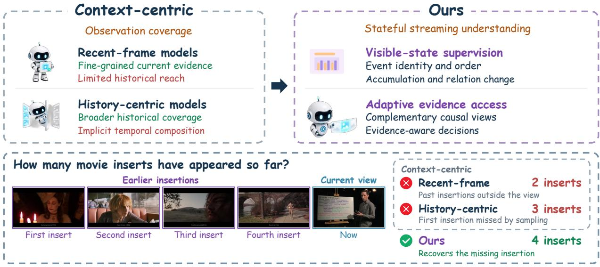  
Figure 1: Context-centric streaming versus supervising the visible state. Top: recent-frame models see little history and history-centric models leave temporal composition implicit; both inherit answer-level supervision, whereas we supervise the visible state and acquire causal views on demand. Bottom: counting movie inserts, the recent view misses earlier ones and historical sampling skips the first; retrieving it restores the count. This example does not separate the two levers.

## 3 Problem Formulation

## 3.1 Causal Streaming Prediction

For episode e, let $V _ { e } = ( ( f _ { i } , \tau _ { i } ) ) _ { i = 1 } ^ { N _ { e } }$ denote a timestamped video. A question $q _ { e }$ with target answer $y _ { e }$ is issued at an exogenous interruption time $T _ { e }$ , when the system has observed the causal prefix $P _ { e } ( T _ { e } ) = \left( ( f _ { i } , \tau _ { i } ) : \tau _ { i } \leq T _ { e } \right)$ . The relevant evidence may be concentrated near $T _ { e }$ , distributed across earlier observations, or insufficient at the time of the query. A causal view is a budgeted rendering of the observed prefix, and the model computes

$$
\begin{array} { r l r l r l } & { x _ { e } = g ( P _ { e } ( T _ { e } ) ) , } & & { I ( x _ { e } ) \subseteq \{ i : \tau _ { i } \leq T _ { e } \} , } & & { z _ { e } = F _ { \theta } ( x _ { e } ) , } & & { \hat { y } _ { e } = G _ { \theta } ( z _ { e } , q _ { e } ) , } \end{array}\tag{1}
$$

where $I ( x _ { e } )$ contains the source-frame indices represented in $x _ { e } ,$ the view constructor g may select, resize, and organize observations while preserving their temporal order, $z _ { e }$ is the visual-temporal representation induced by the view, and $G _ { \theta }$ is the shared answer readout.

## 3.2 State Representation and View Selection

A useful streaming representation preserves the temporal distinctions that support many questions about the same observed process. We call this content the visible state of a causal view and evaluate it behaviorally, through the family of temporal predictions that the shared readout $G _ { \theta }$ supports from $z _ { e }$

View selection determines which causal observations enter $z _ { e }$ . Let $\pi _ { 0 }$ denote the fixed recent-4 policy. An adaptive policy π may sequentially acquire legal views $X _ { e } ^ { \pi } = ( x _ { e , 0 } , \ldots , x _ { e , K _ { e } } )$ and select among the resulting answer proposals, subject to $\textstyle | \bigcup _ { k = 0 } ^ { K _ { e } } I ( x _ { e , k } ) | \leq B _ { f }$ unique source frames and $K _ { e } + 1 \le B _ { c }$ model calls; every acquired view draws exclusively from $P _ { e } ( T _ { e } )$

Controlled interventions. For benchmark score $S ( \theta , \pi )$ , we measure the two factors through

$$
\begin{array} { c } { { \Delta _ { \mathrm { r e p } } = S ( \theta ^ { \star } , \pi _ { 0 } ) - S ( \theta _ { 0 } , \pi _ { 0 } ) , } } \\ { { \Delta _ { \mathrm { a c c e s s } } = S ( \theta ^ { \star } , \pi _ { \mathrm { T V S } } ) - S ( \theta ^ { \star } , \pi _ { 0 } ) . } } \end{array}\tag{2}
$$

The first contrast measures the full post-training gain at fixed evaluation evidence; the second holds every learned parameter fixed and changes only the view policy; their sum is the staged gain from the public initialization to the complete system. Strict replay of all three views on the frozen checkpoint then localizes availability and selection failures within its proposal set.

Scope of claims. Visible state is a behavioral, supervision-level notion: we add no architectural state and claim no unique internal state. The two contrasts are staged, not independent, since a view’s value depends on the checkpoint reading it. All controlled results use one 8B backbone and two benchmarks; TVS thresholds were fixed once on a source-disjoint holdout.

## 4 Method

ViSS first trains shared parameters on temporally structured targets; TVS then freezes them and varies the evidence presented at inference (Figure 2). Evaluating the checkpoint under recent-4 access before enabling TVS yields the two contrasts in Eq. 2.

## 4.1 Visible-State Supervision

Motivation. By ❶, an answer-level target leaves multiplicity, order, relations, and sufficiency unconstrained. The remedy is to ask for them directly: when targets are determined by the supplied view, a separating probe requires a loss-minimizing representation to keep the distinction (Proposition 1, Appendix F), and asking for several jointly makes the requirements complementary rather than task-specific.

Probe families. Each probe pairs a causal training view $x _ { i }$ with a question requesting one temporal readout: identity probes ask which events occurred, order probes their sequence, accumulation probes the quantities established by the prefix, relation probes how observed states changed, and sufficiency probes whether the supplied evidence supports a determinate answer, in the spirit of unanswerable questions [36]. Every family uses the shared computation in Eq. 1, with a direct option, binary value, or integer as the target. An identity target can be satisfied without recovering an event’s multiplicity or position; counting and ordering targets make those distinctions necessary, and sufficiency targets penalize commitment when the evidence is inadequate. Fixed-view evaluation then tests whether the joint requirement transfers to temporal decisions under bounded views.

Source-grounded construction. We construct probes directly from source annotations whenever the required event, timestamp, or relation is available; for capabilities absent from the annotations, a teacher proposes candidate question– answer pairs from source pixels, timestamps, and a family-specific instruction, as in synthetic video instruction data [6, 31, 64], behind a construction firewall that excludes benchmark media, questions, answers, task metadata, student predictions, and evaluation feedback. Every candidate is grounded in the supplied causal prefix through source and timestamp checks, and a semantic stability check retains a candidate only when its answer maps back to the same target under two option permutations $\pi _ { a }$ and $\pi _ { b } , \pi _ { a } ^ { - 1 } ( \tilde { y } _ { i } ^ { \pi _ { a } } ) = \pi _ { b } ^ { - 1 } ( \tilde { y } _ { i } ^ { \pi _ { b } } ) = y _ { i }$ ; the auditor is not given $y _ { i }$ , and disagreeing records are removed rather than relabeled. Source-membership, duplicate-question, and overlap checks complete admission. These checks establish label stability and causal grounding, not that every question needs history (Appendix B). The resulting 7,677-example mixture combines 3,594 source-aligned general video examples, 2,172 repetition-counting probes built on RepCount [18], 1,012 state probes over longer prefixes, 116 sufficiency examples whose answer is that the evidence is insufficient, and 783 teacher-proposed probes of backward state, action sequence, and counting.

Objective. Each admitted example pairs a causal view and probe with a direct target from its answer space and supervision family. We optimize assistant-token-only masked likelihood,

$$
\mathcal { L } _ { \mathrm { V i S S } } ( \theta ) = - \sum _ { i } \alpha _ { i } \sum _ { j \in A _ { i } } \log p _ { \theta } \left( y _ { i , j } \mid x _ { i } , q _ { i } , y _ { i , < j } \right) ,\tag{3}
$$

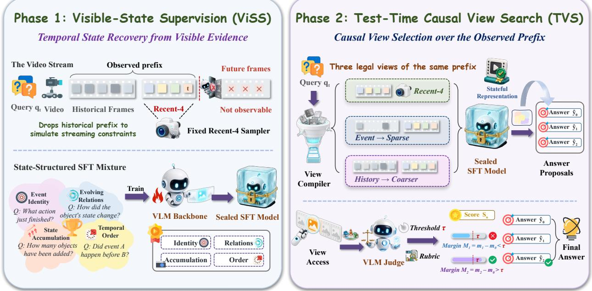  
Figure 2: Overview. Phase 1, ViSS (Section 4.1): probes of event identity, order, accumulation, and relation change (illustrated), together with sufficiency, train a shared representation in one epoch; recent-4 is the dominant training input and the evaluation interface (longer views: Appendix B.3). Phase 2, TVS (Section 4.2): the checkpoint is frozen; the event view is acquired when the recent margin is low, the history view when the two disagree, and a calibrated margin rule keeps one proposal.

where $A _ { i }$ is the assistant-target mask and $\alpha _ { i }$ the fixed loss weight of example $i ;$ the target contains only the direct answer, with source metadata, teacher confidence, rationales, and hidden environment state excluded. A fresh run from the public initialization $\theta _ { 0 }$ produces $\theta ^ { \star }$ (configuration in Section 5.1 and Appendix B.3).

## 4.2 Test-Time Causal View Search

Motivation. By ❷, even the ViSS representation can ground only what its view exposes, and recent-4 omits the history that recall and counting need. Exposing the full history at every query is costly and often unnecessary, so inference compute should go where it helps [40], and the model’s own confidence signals when more evidence is needed [20, 21]. TVS therefore expands the view on demand with the checkpoint frozen.

Causal views. Let $g _ { k }$ denote a question-independent operator that renders the prefix as $x _ { e , k } = g _ { k } ( P _ { e } ( T _ { e } ) )$ ; each view is processed by the same representation and readout in $\operatorname { E q . }$ 1 with $\theta ^ { \star }$ frozen. The recent view $g _ { 0 }$ keeps the latest four frames at full detail; the event view $g _ { 1 }$ adds up to 16 earlier frames ranked by visual change; the compact-history view $g _ { 2 }$ exposes a broader portion of the prefix at reduced resolution while keeping high-resolution recent evidence. All three share the causal endpoint $T _ { e }$ , preserve chronological order, and are independent of the question, options, and task type; each call exposes at most 32 frames, and a three-call path processes at most 56 frames including repeats (Appendix A).

Acquisition. What ifthe recent view is not enough? Each call returns an answer $\hat { y } _ { e , k }$ and a confidence margin $m _ { e , k } ,$ , the difference between the two largest full-vocabulary probabilities at the first answer position. TVS starts from the recent view and expands only when the current prediction warrants it: a recent-view margin below $\tau _ { a }$ activates the event view, and disagreement between the recent and event proposals activates compact history.

Commitment. What ifa later view is wrong? Acquiring evidence and revising the answer are separate decisions, and unlike voting over sampled answers [48], proposals are compared by margin across views. A disagreeing proposal k replaces the retained proposal j only when $m _ { e , k } - m _ { e , j } > \tau _ { c } ;$ because the calibrated $\tau _ { c }$ is negative, an accepted proposal need not have a higher raw margin than the retained answer. Both thresholds are calibrated once on a sourcevideo-disjoint holdout and fixed across benchmarks; exact rules, pseudocode, causality audits, and frame accounting are in Appendix A; Appendix F analyzes the gate and the sign of $\tau _ { c }$

## 5 Experiments

We organize the analysis around four questions. RQ1: does supervising visible-state distinctions help beyond generic temporal post-training at the same budget, and where is the additional gain concentrated? RQ2: what does view selection add on a frozen checkpoint, and at what frame cost (both in Sections 5.2 and 5.3)? RQ3: do supervision and access improve the same tasks (Section 5.2)? RQ4: when TVS still fails, is the correct answer unavailable or lost (Section 5.4)?

## 5.1 Experimental Setup

We evaluate on StreamingBench [25] (2,495 queries) and OVO-Bench (3,035 queries) using the full splits, the official scorers, and the same recent-4 starting view; StreamingBench uses letter-exact accuracy, and OVO-Bench averages task accuracies within its real-time, backward, and forward groups, then the three groups. Published systems in Tables 1 and 2 keep their own protocols (Appendix C.4); our claims rest on the controlled rows, which share one backbone, scorer, and starting view. Within them, representation comparisons vary the checkpoint under fixed recent-4 access, and access comparisons freeze the ViSS checkpoint and vary only the view policy; no policy uses benchmark task labels or task-specific routing. The backbone is Qwen3-VL-8B-Instruct [1]: ViSS is a fresh one-epoch SFT run with a frozen vision tower, taking 98 minutes on two H100 GPUs, and TVS starts from the same recent-4 input, makes at most three calls, and exposes at most 32 causal frames per call, with thresholds fixed on a source-disjoint holdout. Data construction and full configurations are in Appendices B and B.3.

## 5.2 Comparison Experiments

The recent-4 baseline is already strong: Qwen3-VL-8B with four recent frames scores 80.52 and 58.97, above most published systems in Tables 1 and 2, including ones that maintain persistent memories or retrieve events [38], so every gain below is measured against a competitive starting point on the same backbone. Both interventions then add on both benchmarks: the complete ViSS post-training recipe raises the recent-4 scores by +4.25 and +6.24 after one epoch on 7,677 examples, and TVS adds +1.56 and +4.56 with the checkpoint frozen and at most three calls per query. The complete system reaches 86.33 and 69.77, +5.81 and +10.80 points above the same backbone. These are the highest reported scores among the listed systems under their respective protocols, and the two interventions improve different tasks.

OVO-Bench. Table 1 and Figure 3(a) show that supervision and access improve different tasks. Under the same recent-4 interface, the full post-training recipe adds +6.24 points, and most of the Backward gain is hallucination detection, a known weakness of vision-language models [15]: HLD doubles from 37.63 to 75.27, whereas EPM moves from 54.55 to 57.24 and ASI from 62.16 to 60.14. Against strict-matched generic supervision, HLD rises from 67.20 to 75.27; transfer across the other temporal tasks is smaller and heterogeneous. Knowing that the visible evidence does not answer the question is part of the visible state, and the sufficiency-removal comparison in Section 5.3 shows a concentrated decline in hallucination detection. Forward reasoning also improves under fixed views (SSR +7.8, CRR +6.3). Freezing the checkpoint and enabling TVS adds another +4.56 points with the opposite profile: EPM rises to 68.35 and ASI to 68.24, REC nearly doubles from 21.20 to 39.83, and CRR rises to 62.08, while HLD falls to 71.51 and the real-time average slips from 82.20 to 81.27. The slip is consistent with the imperfect preservation of correct recent answers measured in Section 5.4. In short, broader evidence buys recall and forward reasoning at a small cost in hallucination detection and real-time perception (RQ3).

StreamingBench. Table 2 shows the same division. ViSS adds +4.25 points under recent-4 access, concentrated in causal reasoning (CR +12.5), action perception (ACP +8.5), and event understanding (EU +5.7), tasks that ask what the visible frames establish; TVS adds +1.56 points, mainly in prospective reasoning (PR +8.3) and counting (CT +10.9), tasks that depend on frames the recent view no longer holds. The same split on a second benchmark shows that the two levers repair different failures, and together they reach 86.33, the highest among the compared systems in Table 2. Strict-matched generic and ViSS remain comparable on StreamingBench (84.88 versus 84.70 across paired seeds).

Table 1: Full-split OVO-Bench accuracy by official task and group. Overall is the official task-then-group macro; task names are listed in Appendix C.4. Published rows keep their own protocols (Appendix C.4) and serve as context; the Ours rows share one backbone, scorer, and recent-4 starting view and carry the paper’s claims. Pale blue highlights the learned representation; darker blue denotes the complete adaptive system. For TVS, Frames is the per-call maximum.
<table><tr><td></td><td></td><td colspan="2">Real-Time Visual Perception</td><td colspan="2">Backward Tracing Forward Active Responding</td><td></td><td></td></tr><tr><td>Model</td><td>Frames</td><td colspan="2">OCR ACR ATR STU FPD OJR Avg. EPM</td><td colspan="2">ASI HLD Avg.</td><td>CRR Avg.</td><td>Overall</td></tr><tr><td>Human</td><td></td><td colspan="2">93.96 92.57 94.83 92.70 91.09 94.02 93.20 92.59 93.02</td><td>91.37 92.33 95.48</td><td>89.67 93.56</td><td>92.90</td><td>92.81</td></tr><tr><td>Proprietary MLLMs</td><td></td><td colspan="2"></td><td></td><td></td><td></td><td></td></tr><tr><td>Gemini 1.5 Pro</td><td>1 fps</td><td colspan="2">85.9166.97 79.31 58.4363.37 61.96 69.32 58.5976.35 52.6962.54 35.53 74.24 61.67</td><td></td><td></td><td>57.15</td><td>63.00</td></tr><tr><td>GPT-40</td><td>64</td><td colspan="2">69.8064.22 71.55 51.12 70.30 59.7864.46 57.9175.6848.6660.75 27.5873.2159.40</td><td></td><td></td><td>53.40</td><td>59.54</td></tr><tr><td>Open-source offline MLLMs</td><td></td><td colspan="2"></td><td></td><td></td><td>48.74</td><td></td></tr><tr><td>Qwen2-VL-7B InternVL-V2-8B</td><td>64</td><td colspan="2">60.4050.46 56.0347.1966.34 55.4355.9847.8135.4856.0846.46 31.6665.8248.75</td><td></td><td></td><td>46.60</td><td>50.39</td></tr><tr><td>Qwen3-VL-8B</td><td>64 64</td><td colspan="2">67.11 60.5563.7946.0768.32 56.52 60.3948.1557.4324.7343.44 26.5059.14 54.14 75.1758.72 72.4157.3070.3059.2465.52 56.5769.5912.3746.1847.1367.5752.50</td><td></td><td></td><td>55.73</td><td>50.15 55.81</td></tr><tr><td></td><td></td><td colspan="2"></td><td></td><td></td><td></td><td></td></tr><tr><td>Open-source online MLLMs StreamForest-7B</td><td>1 fps</td><td colspan="2">68.46 53.21 71.5547.7565.3560.87 61.2058.92 64.86 32.26 52.02 32.8170.59 57.08</td><td></td><td></td><td>53.49</td><td>55.57</td></tr><tr><td></td><td></td><td colspan="2"></td><td></td><td></td><td></td><td></td></tr><tr><td>Online video agents EventMemAgent</td><td>≤32</td><td colspan="2">75.84 69.72 73.2855.62 67.3367.9368.2959.6070.9543.5558.0333.67 72.02 62.08</td><td></td><td></td><td>55.92</td><td>60.75</td></tr><tr><td></td><td></td><td colspan="2"></td><td></td><td></td><td></td><td></td></tr><tr><td>Ours Qwen3-VL-8B-Instruct</td><td>4</td><td colspan="2">95.30 80.73 82.76 73.60 73.27 82.61 81.38 54.55 62.16 37.63 51.45 19.91 66.93 45.42</td><td></td><td></td><td>44.09</td><td>58.97</td></tr><tr><td>ViSS (recent-4)</td><td>4</td><td colspan="2">95.30 82.57 84.48 72.47 75.25 83.15 82.20 57.24 60.14 75.27 64.21 21.20 74.72 51.67</td><td></td><td></td><td>49.20</td><td>65.21</td></tr><tr><td>ViSS + TVS</td><td>32</td><td colspan="2">96.6 80.7 82.8 67.4 80.2 79.9 81.27 68.4</td><td>68.2 71.5 69.37 39.8 </td><td>74.1 62.1</td><td>58.67</td><td>69.77</td></tr><tr><td></td><td></td><td colspan="2"></td><td></td><td></td><td></td><td></td></tr></table>

Table 2: Full-split StreamingBench real-time accuracy by official task. Column abbreviations follow the benchmark taxonomy. Published rows keep their own protocols and serve as context; the Ours rows share one backbone, scorer, and recent-4 starting view. Pale blue highlights the learned representation; darker blue denotes the complete adaptive system. For TVS, Frames is the per-call maximum, not the union across calls.
<table><tr><td>Model</td><td>Frames</td><td>OP</td><td>CR</td><td>CS</td><td>ATP</td><td>EU</td><td>TR</td><td>PR</td><td>SU</td><td>ACP</td><td>CT</td><td>ALL</td></tr><tr><td>Human</td><td></td><td>89.47</td><td>92.00</td><td>93.60</td><td>91.47</td><td>95.65</td><td>92.52</td><td>88.00</td><td>88.75</td><td>89.74</td><td>91.30</td><td>91.46</td></tr><tr><td>Proprietary MLLMs</td><td></td><td></td><td></td><td></td><td></td><td></td><td></td><td></td><td></td><td></td><td></td><td></td></tr><tr><td>Gemini 1.5 Pro</td><td>1 fps</td><td></td><td></td><td></td><td></td><td></td><td></td><td></td><td></td><td></td><td></td><td>79.0280.4783.5479.6780.0084.74 77.7864.23 71.9548.7075.69</td></tr><tr><td>GPT-40</td><td>64</td><td>77.11</td><td></td><td>80.47 83.91 76.4770.19</td><td></td><td></td><td></td><td></td><td></td><td></td><td></td><td>83.8066.67 62.1969.12 49.22 73.28</td></tr><tr><td>Claude 3.5 Sonnet</td><td>20</td><td>80.49</td><td>77.34</td><td></td><td>82.02 81.73 72.33</td><td></td><td>75.39</td><td>61.11</td><td>61.79</td><td></td><td></td><td>69.3243.0972.44</td></tr><tr><td colspan="9">Open-source offline MLLMs</td><td></td><td></td><td></td></tr><tr><td>InternVL-V2-8B</td><td>16</td><td></td><td></td><td></td><td></td><td></td><td></td><td></td><td></td><td></td><td></td><td>68.12 60.94 69.40 77.12 67.70 62.93 59.26 53.25 54.9656.48 63.72</td></tr><tr><td>Qwen2-VL-7B</td><td>0.2–1 fps 75.20 77.45 73.19 82.81 68.32 71.03 72.22 61.19 61.47 46.11 69.04</td><td></td><td></td><td></td><td></td><td></td><td></td><td></td><td></td><td></td><td></td><td></td></tr><tr><td>Qwen3-VL-8B</td><td>0.2–1 fps 73.57 71.09 76.34 80.39 65.22 74.77 78.70 67.89 61.47 47.67 70.20</td><td></td><td></td><td></td><td></td><td></td><td></td><td></td><td></td><td></td><td></td><td></td></tr><tr><td colspan="9">Open-source online MLLMs</td><td></td><td></td><td></td></tr><tr><td>StreamForest-7B</td><td>1 fps</td><td></td><td></td><td></td><td></td><td></td><td></td><td></td><td></td><td></td><td>83.11 82.81 82.65 84.26 77.5078.19 76.85 69.11 75.64 54.4077.26</td><td></td></tr><tr><td>Online video agents</td><td></td><td></td><td></td><td></td><td></td><td></td><td></td><td></td><td></td><td></td><td></td><td></td></tr><tr><td>EventMemAgent</td><td>≤32</td><td></td><td></td><td></td><td></td><td></td><td></td><td></td><td></td><td></td><td></td><td>83.9276.5687.7085.2977.0279.4477.7868.2972.2448.7077.00</td></tr><tr><td colspan="9">Ours</td><td></td><td></td><td></td></tr><tr><td>Qwen3-VL-8B-Instruct</td><td>4</td><td></td><td></td><td></td><td></td><td></td><td></td><td></td><td></td><td></td><td></td><td>84.74 71.8890.8589.44 76.1089.1081.4878.0579.04 41.9780.52</td></tr><tr><td>ViSS (recent-4)</td><td>4</td><td></td><td></td><td></td><td></td><td></td><td></td><td></td><td></td><td></td><td></td><td>86.92 84.38 94.64 93.0781.7692.21 78.7081.71 87.5444.0484.77</td></tr><tr><td>ViSS + TVS</td><td>&lt; 32</td><td></td><td></td><td></td><td></td><td></td><td></td><td></td><td></td><td></td><td>91.2883.5993.3892.0883.0295.64 87.04 80.4984.9954.92 86.33</td><td></td></tr></table>

## 5.3 Diagnostic Analysis

Supervision under strict matching. Table 3(a) asks whether the target structure matters beyond additional temporal post-training. The control matches the 7,677 training instances, visual inputs, weighting, ordering, optimization, initialization, and seed, comparing the question–target formulation. Generic temporal post-training gains +4.51 OVO points over the base, and ViSS adds +1.73 while changing StreamingBench by −0.20. Across three paired seeds the OVO gap is always positive (mean +1.72); paired bootstrap of this mean gives a 95% CI of [+0.80, +2.60]. The additional gain is concentrated in HLD (Appendix C.1; RQ1).

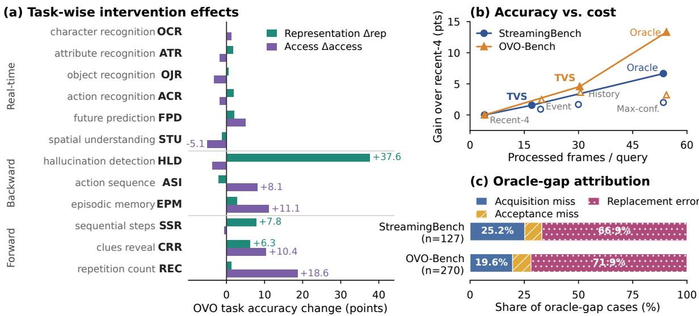  
Figure 3: What supervision and view selection each change, on one Qwen3-VL-8B checkpoint. (a) OVO-Bench task accuracy change from ViSS under fixed recent-4 evidence $\scriptstyle ( \Delta _ { \mathrm { r e p } } )$ and from TVS with the checkpoint frozen $\left( \Delta _ { \mathrm { a c c e s s } } \right)$ . (b) Gain over recent-4 versus processed frames per query (filled: recent-4, TVS, oracle; open: fixed views, max-confidence). (c) Selection-error attribution conditioned on oracle coverage: mostly a correct answer that was held and then replaced.

Family removals assess component sensitivity. Removing the 116 sufficiency examples reduces OVO-Bench by 1.69 and HLD by 4.30 points, with 124 paired regressions against 67 repairs (McNemar $p = 4 . 5 { \times } 1 0 ^ { - 5 } )$ and little change on StreamingBench. Removal also changes training mass, so this is not an isolated semantic effect. The repetition-state removal is retained only as a component-sensitivity result (Appendix C.2).

Table 3: Controlled analysis of state supervision and view selection. (a) fixes recent-4 access; (b) fixes the ViSS checkpoint.
<table><tr><td>Supervision</td><td>SB</td><td>OVO</td></tr><tr><td>Base</td><td>80.52</td><td>58.97</td></tr><tr><td>Strict-matched generic</td><td>84.97</td><td>63.48</td></tr><tr><td>ViSS w/o sufficiency</td><td>84.89</td><td>63.52</td></tr><tr><td>ViSS</td><td>84.77</td><td>65.21</td></tr></table>

(b) View selection
<table><tr><td>View policy</td><td>SB OVO</td></tr><tr><td>Recent-4</td><td>84.77 65.21</td></tr><tr><td>Static history-17</td><td>85.69</td></tr><tr><td>Full history</td><td>86.45 68.84</td></tr><tr><td>TVS</td><td>86.33 69.77</td></tr></table>

Access at a fixed representation. Table 3(b) holds the ViSS checkpoint fixed. Every wider view beats recent-4, and a single history call already reaches 86.45 and 68.84. What TVS adds is adaptive evidence access under a visual-frame budget. On StreamingBench it nearly matches the history call (86.33 versus 86.45) with 43% fewer processed frames (17.08 versus 29.97) and beats static 17-frame sampling at a similar average frame budget by 0.64 points (86.33 versus 85.69); on OVO-Bench it exceeds both the history call and exhaustive max-confidence selection, which runs all three views and keeps the largest-margin answer (69.77 versus 68.84 and 68.43) at 30.33 frames against 54.33 (Figure 3(b)). The acquisition gate is what saves the frames: removing it raises processed frames to 27.26 and 33.31 at essentially unchanged accuracy. The calibrated commit margin is an answer-selection heuristic with no consistent aggregate gain: accepting every disagreeing proposal gives 86.53 and 69.75 (Appendix C.3; RQ2).

## 5.4 Why Correct Alternatives Can Still Be Lost

Strict replay recomputes all three view proposals for every query on the frozen checkpoint, for diagnosis only, and separates two kinds of remaining error. A correct alternative-view proposal exists for 43.7% of recent-view errors on

Lever 1: what supervision requires Same four recent frames, different checkpoint

Query at 147 s: What did the barista just do? A portafilter B milk pitcher C lemon tea D French press

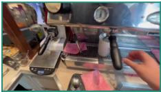

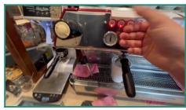

Lever 2: what evidence inference exposes Same frozen ViSS checkpoint, different causal view

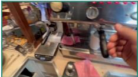  
Query at 145 s: Why is Mr. Bean under the bed now?  
A teddy bear taken by cat B dropped item C hide from someone D look under the bed

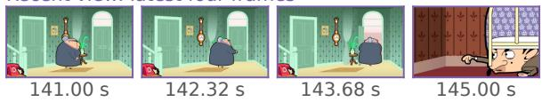

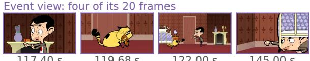  
Figure 4: One query per lever. Left: same four recent frames, two checkpoints (control checkpoint: B, ViSS: A). Right: one frozen ViSS checkpoint, three causal views; margins in parentheses, full trace in Figure 5.

StreamingBench and 37.1% on OVO-Bench; the rest are unresolved by every view (Appendix E.4 shows one whose ambiguity is what to count). When a correct proposal is available, TVS returns it in 63.3% and 71.1% of cases, and it preserves an initially correct recent answer in 96.9% and 92.3%.

The three-view oracle, which uses the reference answer to pick a correct proposal whenever any view produces one, reaches 91.42 and 78.52, 5.09 and 8.75 points above TVS. Trace-level attribution over the 127 and 270 gap queries assigns 66.9% and 71.9% of them to replacement errors, in which a correct proposal was retained and then replaced by a later view (Figure 3(c)); acquisition misses account for most of the remainder, and outright rejection of a correct proposal is rare. Within these oracle-gap cases, retaining an available correct answer is the dominant selection limitation. This diagnosis is conditional on proposal coverage; it does not account for all-view unresolved errors or establish a benefit of the current margin rule (RQ4; Appendices D and A.3).

Related work studies selective correction through diagnosis-guided recovery [46] and the reliability of retaining intermediate results across reasoning attempts [26]. Our replay analysis locates the corresponding selection problem within a fixed visual proposal set: acquiring a correct alternative and preserving it through subsequent revisions are distinct requirements.

One query per lever. Figure 4 shows one query per lever. Left: on the same four recent frames, asked what the barista just did, the control checkpoint answers B (milk pitcher) and ViSS answers A (lock the portafilter), the step the frames show: the difference lies in what the representation reads from one view (lever 1). Right: asked why Mr. Bean is under the bed, the frozen checkpoint answers D from the recent view with margin 0.834, below the acquisition threshold; the event view reaches back to the cat taking the teddy bear at 119.68 s and answers A with margin 0.991, the history view agrees, and TVS commits to A (lever 2).

## 6 Conclusion

Streaming accuracy depends on three separable factors: what the supervision asks the model to preserve, what evidence inference exposes, and whether the model keeps a correct answer once it has one. Visible-state supervision adds to matched temporal post-training, particularly in hallucination detection; causal view search addresses the second, above all event recall and forward reasoning. Within the gap to the current three-view oracle, replacing a retained correct answer is the dominant selection error, motivating more stable answer selection.

The controlled study uses one 8B backbone and two benchmarks; cross-scale and cross-family transfer remain open. Gains vary across tasks: supervision particularly benefits state fidelity, while adaptive access improves recall and forward reasoning at a cost on some recent-state decisions.

## AI use statement

Generative AI was used in two roles. During data construction, a multimodal teacher proposed candidate question– answer pairs and linguistic variants from source video frames, timestamps, and generation instructions. It had no access to evaluation questions, reference answers, task metadata, or student predictions; its outputs entered training only after deterministic semantic, causal, source-membership, and overlap checks. These checks do not certify that every target requires historical evidence. AI assistants also supported code editing, literature search, and manuscript revision. The authors designed the research, verified all code, citations, claims, and reported numbers against source papers and versioned result records, and take responsibility for the complete work.

## Ethics statement

This work uses existing research video datasets and public benchmarks; it recruits no human participants and collects no new video. Videos may contain identifiable people or contextual information, so any release follows the source licenses and does not redistribute benchmark media. Benchmark examples and labels are excluded from training, and benchmark identity and task type are not available to the data compiler or TVS policy. Continuous video understanding can nevertheless enable surveillance and inherit social or demographic biases that we have not audited. We therefore do not claim suitability for surveillance or other high-stakes deployment.

## Reproducibility statement

Appendices B and B.3 specify the data pipeline, 7,677-example training mixture, model initialization, optimization, and evaluation protocols. Every retained SFT comparison is a fresh run from the same public checkpoint; TVS keeps the ViSS checkpoint and its holdout-calibrated thresholds fixed. Model weights, processors, source code, and example configurations are available through the ViSS resource collection. Training annotations, raw media, and internal experiment records are not included in this release. The view compiler excludes question and answer content; timestamp and strict-replay checks are scoped in Appendix A.3. All reported values are defined once in numbers.tex and traced to versioned result records.

## References

[1] Shuai Bai, Yuxuan Cai, Ruizhe Chen, Keqin Chen, Xionghui Chen, Zesen Cheng, Lianghao Deng, Wei Ding, Chang Gao, Chunjiang Ge, Wenbin Ge, Zhifang Guo, Qidong Huang, Jie Huang, Fei Huang, Binyuan Hui, Shutong Jiang, Zhaohai Li, Mingsheng Li, Mei Li, Kaixin Li, Zicheng Lin, Junyang Lin, Xuejing Liu, Jiawei Liu, Chenglong Liu, Yang Liu, Dayiheng Liu, Shixuan Liu, Dunjie Lu, Ruilin Luo, Chenxu Lv, Rui Men, Lingchen Meng, Xuancheng Ren, Xingzhang Ren, Sibo Song, Yuchong Sun, Jun Tang, Jianhong Tu, Jianqiang Wan, Peng Wang, Pengfei Wang, Qiuyue Wang, Yuxuan Wang, Tianbao Xie, Yiheng Xu, Haiyang Xu, Jin Xu, Zhibo Yang, Mingkun Yang, Jianxin Yang, An Yang, Bowen Yu, Fei Zhang, Hang Zhang, Xi Zhang, Bo Zheng, Humen Zhong, Jingren Zhou, Fan Zhou, Jing Zhou, Yuanzhi Zhu, and Ke Zhu. Qwen3-VL technical report. arXiv preprint arXiv:2511.21631, 2025.

[2] Shuai Bai, Keqin Chen, Xuejing Liu, Jialin Wang, Wenbin Ge, Sibo Song, Kai Dang, Peng Wang, Shijie Wang, Jun Tang, et al. Qwen2.5-VL technical report. arXiv preprint arXiv:2502.13923, 2025.

[3] Mu Cai, Reuben Tan, Jianrui Zhang, Bocheng Zou, Kai Zhang, Feng Yao, Fangrui Zhu, Jing Gu, Yiwu Zhong, Yuzhang Shang, Yao Dou, Jaden Park, Jianfeng Gao, Yong Jae Lee, and Jianwei Yang. TemporalBench: Benchmarking fine-grained temporal understanding for multimodal video models. arXiv preprint arXiv:2410.10818, 2024.

[4] Joya Chen, Zhaoyang Lv, Shiwei Wu, Kevin Qinghong Lin, Chenan Song, Difei Gao, Jia-Wei Liu, Ziteng Gao, Dongxing Mao, and Mike Zheng Shou. VideoLLM-online: Online video large language model for streaming video. In Proceedings ofthe IEEE/CVF Conference on Computer Vision and Pattern Recognition, pages 18407–18418, 2024.

[5] Joya Chen, Ziyun Zeng, Yiqi Lin, Wei Li, Zejun Ma, and Mike Zheng Shou. LiveCC: Learning video LLM with streaming speech transcription at scale. In Proceedings of the Computer Vision and Pattern Recognition Conference, pages 29083–29095, 2025.

[6] Lin Chen, Xilin Wei, Jinsong Li, Xiaoyi Dong, Pan Zhang, Yuhang Zang, Zehui Chen, Haodong Duan, Bin Lin, Zhenyu Tang, Li Yuan, Yu Qiao, Dahua Lin, Feng Zhao, and Jiaqi Wang. ShareGPT4Video: Improving video understanding and generation with better captions. In A. Globerson, L. Mackey, D. Belgrave, A. Fan, U. Paquet, J. Tomczak, and C. Zhang, editors, Advances in Neural Information Processing Systems, volume 37, pages 19472–19495. Curran Associates, Inc., 2024. doi: 10.52202/079017-0614.

[7] Zhangquan Chen, Jiale Tao, Ruihuang Li, Yihao Hu, Ruitao Chen, Zhantao Yang, Xinlei Yu, Haodong Jing, Manyuan Zhang, Shuai Shao, Biao Wang, Qinglin Lu, and Ruqi Huang. OmniVideo-R1: Reinforcing audio-visual reasoning with query intention and modality attention. In Proceedings of the 43rd International Conference on Machine Learning, volume 306 of Proceedings ofMachine Learning Research, pages 16910–16928. PMLR, 2026. URL https://proceedings.mlr.press/v306/chen26ed.html.

[8] Zhe Chen, Jiannan Wu, Wenhai Wang, Weijie Su, Guo Chen, Sen Xing, Muyan Zhong, Qinglong Zhang, Xizhou Zhu, Lewei Lu, Bin Li, Ping Luo, Tong Lu, Yu Qiao, and Jifeng Dai. InternVL: Scaling up vision foundation models and aligning for generic visual-linguistic tasks. In Proceedings ofthe IEEE/CVF Conference on Computer Vision and Pattern Recognition, pages 24185–24198, 2024.

[9] Zesen Cheng, Sicong Leng, Hang Zhang, Yifei Xin, Xin Li, Guanzheng Chen, Yongxin Zhu, Wenqi Zhang, Ziyang Luo, Deli Zhao, and Lidong Bing. VideoLLaMA 2: Advancing spatial-temporal modeling and audio understanding in Video-LLMs. arXiv preprint arXiv:2406.07476, 2024.

[10] Shangzhe Di, Zhelun Yu, Guanghao Zhang, Haoyuan Li, Tao Zhong, Hao Cheng, Bolin Li, Wanggui He, Fangxun Shu, and Hao Jiang. Streaming video question-answering with in-context video KV-Cache retrieval. In The Thirteenth International Conference on Learning Representations, 2025.

[11] Haoyang Fan, Dhruv Parikh, Anvitha Ramachandran, Sameh Gobriel, Nilesh Jain, Rajgopal Kannan, and Viktor Prasanna. FOLIO: Focused semantic memory for streaming video understanding. arXiv preprint arXiv:2607.13298, 2026.

[12] Kaituo Feng, Kaixiong Gong, Bohao Li, Zonghao Guo, Yibing Wang, Tianshuo Peng, Junfei Wu, Xiaoying Zhang, Benyou Wang, and Xiangyu Yue. Video-R1: Reinforcing video reasoning in MLLMs. In Advances in Neural Information Processing Systems, volume 38, pages 109844–109867. Neural Information Processing Systems Foundation, Inc., 2025. doi: 10.52202/085713-3310.

[13] Chaoyou Fu, Yuhan Dai, Yongdong Luo, Lei Li, Shuhuai Ren, Renrui Zhang, Zihan Wang, Chenyu Zhou, Yunhang Shen, Mengdan Zhang, et al. Video-MME: The first-ever comprehensive evaluation benchmark of multi-modal LLMs in video analysis. In Proceedings of the Computer Vision and Pattern Recognition Conference, pages 24108–24118, 2025.

[14] Haonan Ge, Yiwei Wang, Hang Wu, and Yujun Cai. What should a streaming video model remember? arXiv preprint arXiv:2606.16353, 2026.

[15] Tianrui Guan, Fuxiao Liu, Xiyang Wu, Ruiqi Xian, Zongxia Li, Xiaoyu Liu, Xijun Wang, Lichang Chen, Furong Huang, Yaser Yacoob, Dinesh Manocha, and Tianyi Zhou. HallusionBench: An advanced diagnostic suite for entangled language hallucination and visual illusion in large vision-language models. In Proceedings of the IEEE/CVF Conference on Computer Vision and Pattern Recognition, pages 14375–14385, 2024.

[16] Yiran Guan, Liang Yin, Dingkang Liang, Jianzhong Ju, Zhenbo Luo, Jian Luan, Yuliang Liu, and Xiang Bai. Video streaming thinking: VideoLLMs can watch and think simultaneously. arXiv preprint arXiv:2603.12262, 2026.

[17] Bo He, Hengduo Li, Young Kyun Jang, Menglin Jia, Xuefei Cao, Ashish Shah, Abhinav Shrivastava, and Ser-Nam Lim. MA-LMM: Memory-augmented large multimodal model for long-term video understanding. In Proceedings ofthe IEEE/CVF Conference on Computer Vision and Pattern Recognition, pages 13504–13514, 2024.

[18] Huazhang Hu, Sixun Dong, Yiqun Zhao, Dongze Lian, Zhengxin Li, and Shenghua Gao. TransRAC: Encoding multi-scale temporal correlation with transformers for repetitive action counting. In Proceedings ofthe IEEE/CVF Conference on Computer Vision and Pattern Recognition, pages 19013–19022, 2022.

[19] Zhenpeng Huang, Xinhao Li, Jiaqi Li, Jing Wang, Xiangyu Zeng, Cheng Liang, Tao Wu, Xi Chen, Liang Li, and Limin Wang. Online video understanding: OVBench and VideoChat-Online. In Proceedings ofthe Computer Vision and Pattern Recognition Conference, pages 3328–3338, 2025.

[20] Saurav Kadavath, Tom Conerly, Amanda Askell, Tom Henighan, Dawn Drain, Ethan Perez, Nicholas Schiefer, Zac Hatfield-Dodds, Nova DasSarma, Eli Tran-Johnson, Scott Johnston, Sheer El-Showk, Andy Jones, Nelson Elhage, Tristan Hume, Anna Chen, Yuntao Bai, Sam Bowman, Stanislav Fort, Deep Ganguli, Danny Hernandez, Josh Jacobson, Jackson Kernion, Shauna Kravec, Liane Lovitt, Kamal Ndousse, Catherine Olsson, Sam Ringer, Dario Amodei, Tom Brown, Jack Clark, Nicholas Joseph, Ben Mann, Sam McCandlish, Chris Olah, and Jared Kaplan. Language models (mostly) know what they know. arXiv preprint arXiv:2207.05221, 2022.

[21] Amita Kamath, Robin Jia, and Percy Liang. Selective question answering under domain shift. In Dan Jurafsky, Joyce Chai, Natalie Schluter, and Joel Tetreault, editors, Proceedings ofthe 58th Annual Meeting ofthe Association for Computational Linguistics, pages 5684–5696, Online, 2020. Association for Computational Linguistics. doi: 10.18653/v1/2020.acl-main.503.

[22] Bo Li, Yuanhan Zhang, Dong Guo, Renrui Zhang, Feng Li, Hao Zhang, Kaichen Zhang, Peiyuan Zhang, Yanwei Li, Ziwei Liu, and Chunyuan Li. LLaVA-OneVision: Easy visual task transfer. Transactions on Machine Learning Research, 2025.

[23] Xinhao Li, Yuhan Zhu, Xiangyu Zeng, Yuhao Dong, Haoning Wu, Zhiqiu Zhang, et al. VideoChat3: Fully open video MLLM for efficient and generalist video understanding. arXiv preprint arXiv:2607.14935, 2026.

[24] Yanwei Li, Chengyao Wang, and Jiaya Jia. LLaMA-VID: An image is worth 2 tokens in large language models. In Aleš Leonardis, Elisa Ricci, Stefan Roth, Olga Russakovsky, Torsten Sattler, and Gül Varol, editors, Computer Vision – ECCV 2024, pages 323–340, Cham, 2024. Springer Nature Switzerland.

[25] Junming Lin, Zheng Fang, Chi Chen, Haoxuan Cheng, Zihao Wan, Fuwen Luo, Ziyue Wang, Peng Li, Yang Liu, and Maosong Sun. StreamingBench: Assessing the gap for MLLMs to achieve streaming video understanding. In IEEE International Conference on Acoustics, Speech and Signal Processing, pages 12147–12151, 2026. doi: 10.1109/ICASSP55912.2026.11463959.

[26] Deyuan Liu, Zecheng Wang, Xuanyi Liu, Jungang Li, Yihao Hu, Mingjie Tang, Bryan Dai, and Jie Fu. When can LLM reasoning reliably reuse intermediate results? arXiv preprint arXiv:2610.27662, 2026. URL https: //arxiv.org/abs/2610.27662.

[27] Jihao Liu, Zhiding Yu, Shiyi Lan, Shihao Wang, Rongyao Fang, Jan Kautz, Hongsheng Li, and Jose M. Alvare. StreamChat: Chatting with streaming video. arXiv preprint arXiv:2412.08646, 2024.

[28] Pengyiang Liu, Zhongyue Shi, Hongye Hao, Qi Fu, Xueting Bi, Siwei Zhang, Xiaoyang Hu, Zitian Wang, Linjiang Huang, and Si Liu. SVCBench: A streaming video counting benchmark for spatial-temporal state maintenance, 2026. URL https://buaa-colalab.github.io/SVCBench/.

[29] Yuanxin Liu, Shicheng Li, Yi Liu, Yuxiang Wang, Shuhuai Ren, Lei Li, Sishuo Chen, Xu Sun, and Lu Hou. TempCompass: Do video LLMs really understand videos? In Lun-Wei Ku, Andre Martins, and Vivek Srikumar, editors, Findings of the Association for Computational Linguistics: ACL 2024, pages 8731–8772, Bangkok, Thailand, 2024. Association for Computational Linguistics. doi: 10.18653/v1/2024.findings-acl.517.

[30] Zikang Liu, Longteng Guo, Handong Li, Ru Zhen, Xingjian He, Ruyi Ji, Xiaoming Ren, Yanhao Zhang, Haonan Lu, and Jing Liu. Thinking in streaming video. arXiv preprint arXiv:2603.12938, 2026.

[31] Muhammad Maaz, Hanoona Rasheed, Salman Khan, and Fahad Shahbaz Khan. Video-ChatGPT: Towards detailed video understanding via large vision and language models. In Lun-Wei Ku, Andre Martins, and Vivek Srikumar, editors, Proceedings of the 62nd Annual Meeting of the Association for Computational Linguistics (Volume 1: Long Papers), pages 12585–12602, Bangkok, Thailand, 2024. Association for Computational Linguistics. doi: 10.18653/v1/2024.acl-long.679.

[32] Karttikeya Mangalam, Raiymbek Akshulakov, and Jitendra Malik. EgoSchema: A diagnostic benchmark for very long-form video language understanding. In A. Oh, T. Naumann, A. Globerson, K. Saenko, M. Hardt, and S. Levine, editors, Advances in Neural Information Processing Systems, volume 36, pages 46212–46244. Curran Associates, Inc., 2023. doi: 10.52202/075280-2004.

[33] Junbo Niu, Yifei Li, Ziyang Miao, Chunjiang Ge, Yuanhang Zhou, Qihao He, Xiaoyi Dong, Haodong Duan, Shuangrui Ding, Rui Qian, Pan Zhang, Yuhang Zang, Yuhang Cao, Conghui He, and Jiaqi Wang. OVO-Bench: How far is your video-LLMs from real-world online video understanding? In Proceedings ofthe Computer Vision and Pattern Recognition Conference, pages 18902–18913, 2025.

[34] Rui Qian, Xiaoyi Dong, Pan Zhang, Yuhang Zang, Shuangrui Ding, Dahua Lin, and Jiaqi Wang. Streaming long video understanding with large language models. In A. Globerson, L. Mackey, D. Belgrave, A. Fan, U. Paquet, J. Tomczak, and C. Zhang, editors, Advances in Neural Information Processing Systems, volume 37, pages 119336–119360. Curran Associates, Inc., 2024. doi: 10.52202/079017-3792.

[35] Rui Qian, Shuangrui Ding, Xiaoyi Dong, Pan Zhang, Yuhang Zang, Yuhang Cao, Dahua Lin, and Jiaqi Wang. Dispider: Enabling video LLMs with active real-time interaction via disentangled perception, decision, and reaction. In Proceedings ofthe Computer Vision and Pattern Recognition Conference, pages 24045–24055, 2025.

[36] Pranav Rajpurkar, Robin Jia, and Percy Liang. Know what you don’t know: Unanswerable questions for SQuAD. In Iryna Gurevych and Yusuke Miyao, editors, Proceedings ofthe 56th Annual Meeting of the Associationfor Computational Linguistics (Volume 2: Short Papers), pages 784–789, Melbourne, Australia, 2018. Association for Computational Linguistics. doi: 10.18653/v1/P18-2124.

[37] Ziyao Shangguan, Chuhan Li, Yuxuan Ding, Yanan Zheng, Yilun Zhao, Tesca Fitzgerald, and Arman Cohan. TOMATO: Assessing visual temporal reasoning capabilities in multimodal foundation models. In The Thirteenth International Conference on Learning Representations, 2025.

[38] Yujiao Shen, Shulin Tian, Jingkang Yang, and Ziwei Liu. A simple baseline for streaming video understanding. arXiv preprint arXiv:2604.02317, 2026.

[39] Yan Shu, Zheng Liu, Peitian Zhang, Minghao Qin, Junjie Zhou, Zhengyang Liang, Tiejun Huang, and Bo Zhao. Video-XL: Extra-long vision language model for hour-scale video understanding. In Proceedings ofthe Computer Vision and Pattern Recognition Conference, pages 26160–26169, 2025.

[40] Charlie Snell, Jaehoon Lee, Kelvin Xu, and Aviral Kumar. Scaling LLM Test-Time compute optimally can be more effective than scaling parameters for reasoning. In The Thirteenth International Conference on Learning Representations, 2025.

[41] Enxin Song, Wenhao Chai, Guanhong Wang, Yucheng Zhang, Haoyang Zhou, Feiyang Wu, Haozhe Chi, Xun Guo, Tian Ye, Yanting Zhang, Yan Lu, Jenq-Neng Hwang, and Gaoang Wang. MovieChat: From dense token to sparse memory for long video understanding. In Proceedings ofthe IEEE/CVF Conference on Computer Vision and Pattern Recognition, pages 18221–18232, 2024.

[42] Xi Tang, Jihao Qiu, Lingxi Xie, Yunjie Tian, Jianbin Jiao, and Qixiang Ye. Adaptive keyframe sampling for long video understanding. In Proceedings ofthe Computer Vision and Pattern Recognition Conference, pages 29118–29128, 2025.

[43] Chao Wang, Xudong Tan, Jianjian Cao, Kangcong Li, and Tao Chen. CurveStream: Boosting streaming video understanding in MLLMs via curvature-aware hierarchical visual memory management. arXiv preprint arXiv:2603.19571, 2026.

[44] Pan Wang, Yihao Hu, Guangyuan Dong, Yitong Lin, Hang Wang, Zimi Liu, Zhihao Wen, Jianshe Li, Jiang-Ming Yang, Wei Wu, and Yongqi Tong. PAR: Progress-aligned recurrence for length generalization in state tracking. arXiv preprint arXiv:2610.27628, 2026. URL https://arxiv.org/abs/2610.27628.

[45] Pan Wang, Yihao Hu, Xiujin Liu, Jingchu Yang, Hang Wang, and Zhihao Wen. AtlasVA: Self-evolving visual skill memory for teacher-free VLM agents. arXiv preprint arXiv:2605.17933, 2026. URL https://arxiv.org/abs/2605. 17933.

[46] Pan Wang, Yihao Hu, Hang Wang, Zirui Lv, Xin Zhang, Jianshe Li, Jiang-Ming Yang, Wei Wu, and Yongqi Tong. Diagnosis before recovery: Turning agent failures into selective self-correction. arXiv preprint arXiv:2608.11772, 2026. URL https://arxiv.org/abs/2608.11772.

[47] Xiaohan Wang, Yuhui Zhang, Orr Zohar, and Serena Yeung-Levy. VideoAgent: Long-form video understanding with large language model as agent. In Aleš Leonardis, Elisa Ricci, Stefan Roth, Olga Russakovsky, Torsten Sattler, and Gül Varol, editors, Computer Vision – ECCV 2024, pages 58–76, Cham, 2024. Springer Nature Switzerland.

[48] Xuezhi Wang, Jason Wei, Dale Schuurmans, Quoc Le, Ed Chi, Sharan Narang, Aakanksha Chowdhery, and Denny Zhou. Self-consistency improves chain of thought reasoning in language models. In The Eleventh International Conference on Learning Representations, 2023.

[49] Yueqian Wang, Xiaojun Meng, Yuxuan Wang, Jianxin Liang, Jiansheng Wei, Huishuai Zhang, and Dongyan Zhao. VideoLLM knows when to speak: Enhancing time-sensitive video comprehension with video-text duet interaction format. In Christos Christodoulopoulos, Tanmoy Chakraborty, Carolyn Rose, and Violet Peng, editors, Findings of the Association for Computational Linguistics: EMNLP 2025, pages 6338–6359, Suzhou, China, 2025. Association for Computational Linguistics. doi: 10.18653/v1/2025.findings-emnlp.336.

[50] Yuxuan Wang, Yiqi Song, Cihang Xie, Yang Liu, and Zilong Zheng. VideoLLaMB: Long streaming video understanding with recurrent memory bridges. In Proceedings of the IEEE/CVF International Conference on Computer Vision, pages 24170–24181, 2025.

[51] Ziyang Wang, Shoubin Yu, Elias Stengel-Eskin, Jaehong Yoon, Feng Cheng, Gedas Bertasius, and Mohit Bansal. VideoTree: Adaptive tree-based video representation for LLM reasoning on long videos. In Proceedings of the Computer Vision and Pattern Recognition Conference, pages 3272–3283, 2025.

[52] Siwei Wen, Zhangcheng Wang, Xingjian Zhang, Lei Huang, and Wenjun Wu. EventMemAgent: Hierarchical event-centric memory for online video understanding with adaptive tool use. arXiv preprint arXiv:2602.15329, 2026.

[53] Zichen Wen, Boxue Yang, Junlong Ke, Jiajie Huang, Chenfei Liao, Junxi Wang, Xuyang Liu, and Linfeng Zhang. EvoStreaming: Your offline video model is a natively streaming assistant. arXiv preprint arXiv:2605.10343, 2026.

[54] Jiaer Xia, Peixian Chen, Mengdan Zhang, Xing Sun, and Kaiyang Zhou. Streaming video instruction tuning. In Proceedings of the IEEE/CVF Conference on Computer Vision and Pattern Recognition, pages 31219–31229, 2026.

[55] Yibin Yan, Jilan Xu, Shangzhe Di, Yikun Liu, Yudi Shi, Qirui Chen, Zeqian Li, Yifei Huang, and Weidi Xie. Learning streaming video representation via multitask training. In Proceedings ofthe IEEE/CVF International Conference on Computer Vision, pages 9900–9912, 2025.

[56] Haolin Yang, Feilong Tang, Lingxiao Zhao, Xinlin Zhuang, Yifan Lu, Xiang An, Ming Hu, Xiaofeng Zhang, Abdalla Swikir, Junjun He, Zongyuan Ge, Muhammad Haris Khan, and Imran Razzak. StreamAgent: Towards anticipatory agents for streaming video understanding. arXiv preprint arXiv:2508.01875, 2025.

[57] Linli Yao, Yicheng Li, Yuancheng Wei, Lei Li, Shuhuai Ren, Yuanxin Liu, Kun Ouyang, Lean Wang, Shicheng Li, Sida Li, Lingpeng Kong, Qi Liu, Yuanxing Zhang, and Xu Sun. Timechat-online: 80% visual tokens are naturally redundant in streaming videos. In Proceedings ofthe 33rd ACM International Conference on Multimedia, pages 10807–10816. ACM, 2025. doi: 10.1145/3746027.3754839.

[58] Sicheng Yu, Chengkai Jin, Huanyu Wang, Zhenghao Chen, Sheng Jin, Zhongrong Zuo, Xiaolei Xu, Zhenbang Sun, Bingni Zhang, Jiawei Wu, Hao Zhang, and Qianru Sun. Frame-Voyager: Learning to query frames for video large language models. In The Thirteenth International Conference on Learning Representations, 2025.

[59] Xiangyu Zeng, Kefan Qiu, Qingyu Zhang, Xinhao Li, Jing Wang, Jiaxin Li, Ziang Yan, Kun Tian, Meng Tian, Xinhai Zhao, Yi Wang, and Limin Wang. StreamForest: Efficient online video understanding with persistent event memory. In Advances in Neural Information Processing Systems, volume 38, pages 84409–84440. Neural Information Processing Systems Foundation, Inc., 2025. doi: 10.52202/085713-2547.

[60] Haoji Zhang, Yiqin Wang, Yansong Tang, Yong Liu, Jiashi Feng, and Xiaojie Jin. Flash-VStream: Efficient real-time understanding for long video streams. In Proceedings ofthe IEEE/CVF International Conference on Computer Vision, pages 21059–21069, 2025.

[61] Jianrui Zhang, Mu Cai, and Yong Jae Lee. Vinoground: Scrutinizing LMMs over dense temporal reasoning with short videos. arXiv preprint arXiv:2410.02763, 2024.

[62] Peiyuan Zhang, Kaichen Zhang, Bo Li, Guangtao Zeng, Jingkang Yang, Yuanhan Zhang, Ziyue Wang, Haoran Tan, Chunyuan Li, and Ziwei Liu. Long context transfer from language to vision. Transactions on Machine Learning Research, 2025.

[63] Yaolun Zhang, Ruohui Wang, Jiahao Wang, Yepeng Tang, Xuanyu Zheng, Haonan Duan, Hao Lu, Hanming Deng, and Lewei Lu. EVA: Efficient reinforcement learning for end-to-end video agent. In Proceedings ofthe IEEE/CVF Conference on Computer Vision and Pattern Recognition, pages 12289–12299, 2026.

[64] Yuanhan Zhang, Jinming Wu, Wei Li, Bo Li, Zejun Ma, Ziwei Liu, and Chunyuan Li. LLaVA-Video: Video instruction tuning with synthetic data. Transactions on Machine Learning Research, 2025.

[65] Junjie Zhou, Yan Shu, Bo Zhao, Boya Wu, Zhengyang Liang, Shitao Xiao, Minghao Qin, Xi Yang, Yongping Xiong, Bo Zhang, Tiejun Huang, and Zheng Liu. MLVU: Benchmarking multi-task long video understanding. In Proceedings ofthe Computer Vision and Pattern Recognition Conference, pages 13691–13701, 2025.

## Appendix Contents

A Causal Views and Adaptive View Selection 17   
A.1 Complementary Causal Views 17   
A.2 Sequential Evidence Selection 17   
A.3 Fixed Protocol and Validity 18   
B Visible-State Supervision Data and Training 19   
B.1 Supervision Units and Families . . 19   
B.2 Source-Grounded Candidate Verificatio 19   
B.3 Optimization and Reproducibility 20   
C Controlled Experiments 21   
C.1 Representation under Fixed Recent Context 21   
C.2 Targeted Supervision Families 22   
C.3 Adaptive Access under Frozen Representation 22   
C.4 Task-Wise Representation and Access Effects 22   
D Error Attribution: View Recoverability and Decision Stability 24   
D.1 Recoverability, Recovery, and Preservation . 24   
D.2 Where Correct Proposals Are Lost . 25   
D.3 Failures Beyond the Current Proposal Set 25   
E Qualitative Case Studies 26   
E.1 A Correct Answer Acquired from History 26   
E.2 A Correct Answer Lost during Revision 27   
E.3 A Correct Historical Proposal Not Acquired 28   
E.4 All-View Unresolved with Counting-Scope Ambiguity 29   
E.5 Additional Archived-Run Comparisons 30   
F Theoretical Analysis 32   
F.1 Setting . 32   
F.2 State Under-Specification . 32   
F.3 Wider Views and Commitment 33   
F.4 The Acquisition Gate and the Commit Threshold 33

## A Causal Views and Adaptive View Selection

This appendix specifies how complementary observations of one causal prefix are constructed and sequentially consulted by TVS. For a query $q _ { e }$ issued at time $t _ { e } ,$ every view is compiled from $V _ { \leq t _ { \epsilon } }$ independently of the query and answer content. All policies use the same frozen ViSS checkpoint $\theta ^ { \star }$ , greedy decoding, and the shared fixed configuration recorded below.

## A.1 Complementary Causal Views

The recent view $x _ { e , 0 }$ preserves local detail at the query frontier; the event view $x _ { e , 1 }$ adds sparse transitions from earlier in the prefix; and the compact-history view $x _ { e , 2 }$ trades historical spatial resolution for greater temporal coverage. Table 4 defines these observation operators. They share a causal endpoint, not an identical frame grid: event and compact-history views are compiled separately and are not strictly nested. Complementarity therefore concerns the observations they provide, rather than a guarantee that every wider view preserves all earlier source-frame IDs.

Table 4: Complementary causal views. Counts are per-call maxima; short prefixes may supply fewer frames. Recent support uses the standard image path, while compact historical images have maximum edge 224 pixels.
<table><tr><td>View</td><td>Recent support</td><td>Historical support</td><td>Frames</td></tr><tr><td>recent  $x _ { e , 0 }$ </td><td>4 frames from the latest 4 seconds</td><td>none</td><td>4</td></tr><tr><td>event  $x _ { e , 1 }$ </td><td>the same recent 4</td><td>up to 16 ranked frames, standard resolution</td><td>20</td></tr><tr><td>compact history  $x _ { e , 2 }$ </td><td>8 frames from the latest 8 seconds</td><td>up to 24 ranked frames, reduced resolution</td><td>32</td></tr></table>

For each historical view, we first reserve its recent-frame IDs. A uniform grid of up to 64 positions spans the causal prefix; positions preceding the earliest reserved frame supply historical candidates. We merge these with the reserved recent frames, remove duplicate source IDs, and compute $1 6 \times 1 6 ~ \mathrm { R G B }$ descriptors $z _ { i }$ in chronological order. Let $\Delta z _ { i } = z _ { i } - z _ { i - 1 }$ and let $R ( \cdot )$ denote average-tie rank normalization to $[ 0 , 1 ]$ . Historical frames are ranked by the single fused score

$$
s _ { i } = \frac { 1 } { 1 5 } \left[ 4 R ( 1 - \cos ( z _ { i } , z _ { i - 1 } ) ) + 9 R ( 1 - \cos ( \Delta z _ { i } , \Delta z _ { i + 1 } ) ) + 2 R ( t _ { i } ) \right] ,\tag{4}
$$

where $t _ { i }$ is the source timestamp. The three terms capture appearance novelty, curvature in visual evolution, and recency, respectively. The ranking has no query-dependent term. Historical slots are filled by ranked candidates, recent slots remain reserved, and selected frames are presented chronologically. As an implementation convention, endpoint and near-zero-norm curvature terms are zero; ties prefer the later timestamp and then the smaller source-frame index. Recent windows use the Qwen sampler’s nominal 1 FPS setting; endpoint rounding determines the exact frame grid.

## A.2 Sequential Evidence Selection

For each acquired view $x _ { e , k }$ , the frozen checkpoint produces an answer proposal $\hat { y } _ { k }$ and a confidence margin $m _ { k }$ . The margin is the difference between the two largest full-vocabulary probabilities at the first assistant answer position.

TVS begins from recent evidence. It consults the event view when the recent proposal is uncertain, and consults compact history when the recent and event views produce different answers. Acquisition changes the evidence presented to the representation; commitment determines whether the resulting proposal should replace the retained answer. Algorithm 1 gives the complete procedure.

Algorithm 1 Sequential causal view acquisition and commitment   
Require: query $q _ { e } ,$ causal prefix $V { \le } { t _ { e } } ,$ compiler ${ \mathcal { C } } ,$ frozen checkpoint $\theta ^ { \star }$ , thresholds $\tau _ { a } , \tau _ { c }$   
Ensure: final answer yˆ   
1: $( x _ { e , 0 } , x _ { e , 1 } , x _ { e , 2 } ) \gets \mathcal { C } ( V _ { \leq t _ { e } } )$   
2: (ˆy , m ) ← DECODEMARGIN $( \theta ^ { \star } , q _ { e } , x _ { e , 0 } )$   
3: $j  0$   
4: if $m _ { 0 } > \tau _ { a }$ then   
5: return $\hat { y } _ { j }$   
6: end if   
7: (ˆy , m ) ← DECODEMARGIN $( \theta ^ { \star } , q _ { e } , x _ { e , 1 } )$   
8: $\mathbf { i f } \hat { y } _ { 1 } \neq \hat { y } _ { j }$ and $m _ { 1 } - m _ { j } > \tau _ { c }$ then   
9: $j  1$   
10: end if   
11: i $\hat { y } _ { 1 } = \hat { y } _ { 0 }$ then   
12: return $\hat { y } _ { j }$   
13: end if   
14: (ˆy2, m2) ← DECODEMARGIN $( \theta ^ { \star } , q _ { e } , x _ { e , 2 } )$   
15: if yˆ2 $\neq \hat { y } _ { j }$ and $m _ { 2 } - m _ { j } > \tau _ { c }$ then   
16: $j  2$   
17: end if   
18: return $\hat { y } _ { j }$

## A.3 Fixed Protocol and Validity

View construction and the two selection thresholds are fixed for both benchmarks. Table 5 records the configuration beyond the view definitions in Table 4.

Table 5: Fixed causal-view and search configuration used on both benchmarks.  
Component Setting   
Historical ranking $1 6 \times 1 6$ RGB descriptors; novelty, trajectory curvature, and recency with weights 4:9:2   
Candidate construction up to 64 prefix-grid positions, plus reserved recent IDs after filtering   
Calibration 300 queries from 300 source-video-disjoint nonbenchmark videos   
Acquisition threshold $\tau _ { a } = 0 . 9 9 7 6 8 9 6$   
Relative-margin tolerance $\tau _ { c } = - 0 . 5 0 5 9$   
Inference budget at most 3 calls; at most 32 frames in any one call   
Decoding frozen checkpoint, greedy decoding, first-answer full-vocabulary margin

The two thresholds are selected jointly on the 300-query disjoint calibration set and then frozen for both benchmarks. We collect recent, event, and history proposals and margins, use observed acquisition scores and disagreement-margin differences as threshold candidates, and replay the complete controller for each candidate pair. Selection maximizes calibration accuracy, breaking ties by fewer processed frames and then fewer model calls. The negative value of $\tau _ { c }$ allows a disagreeing proposal to replace the retained answer despite moderate cross-view variation in raw margin; it should therefore be interpreted as a calibrated replacement tolerance rather than a requirement for strictly higher confidence.

Cost accounting. Compiler probes, unique model-exposed source IDs, and processed frames count different operations. The 64-position prefix grid is not a cap on all compiler inputs: recent IDs are added separately. The event-view records contain up to 67 candidate descriptors. Likewise, 32 is a per-view limit, not a bound on the union across calls. Executing all three views processes at most $4 + 2 0 + 3 2 = 5 6$ frames, counting repeated exposure; short prefixes reduce this total. Since recent-4 is included in the event view, the union has the upper bound $2 0 + 3 2 = 5 2 $ unique source IDs. Table 12 reports actual mean calls and processed frames, without treating these as wall-clock or token costs.

Validity and audit scope. The compiler receives source frames, timestamps, and fixed budgets; questions, answer options, predictions, and benchmark task labels do not enter its ranking. Current complete event-view records cover 2,495 StreamingBench and 3,035 OVO-Bench queries with zero evaluation errors and no selected timestamp beyond the query boundary, allowing 10−3 seconds for numerical rounding. The separate strict-replay audit confirms complete query coverage, reproduction of deployed TVS answers, and exhaustive paired error accounting. These checks establish timestamp compliance and replay consistency; they do not independently establish that a selected view contains all evidence needed to answer its query.

## B Visible-State Supervision Data and Training

This section connects the visible-state targets to actual training records, describes candidate verification, and records the training configuration. The five temporal capabilities in the main text describe what a question asks; the five mixture components below describe where training records come from. These are not one-to-one categories.

## B.1 Supervision Units and Families

A record contains a causal visual input, a question, its answer space, a direct target, and source provenance. The temporal distinction is expressed through the question–target pair, not through an extra latent-state label. Table 6 gives the 7,677-row mixture. A component may support several readouts: for example, a backward-state question can require both event identity and temporal order.

Table 6: Supervision families in the sealed 7,677-example mixture.
<table><tr><td>Family</td><td>Visible-state target</td><td>Rows</td></tr><tr><td>source-aligned anchors</td><td>general causal video understanding and capability retention</td><td>3,594</td></tr><tr><td>repetition-counting probes</td><td>accumulated event count over an ordered visual prefix</td><td>2,172</td></tr><tr><td>prefix-32 state probes</td><td>event state, temporal order, and accumulation over longer prefixes</td><td>1,012</td></tr><tr><td>sufficiency anchors</td><td>whether the available causal evidence supports an answer</td><td>116</td></tr><tr><td>capability probes</td><td>backward state retrieval, action sequence, and counting</td><td>783</td></tr><tr><td colspan="2">Total</td><td>7,677</td></tr></table>

The first three families form the 6,778-example core temporal mixture. Sufficiency anchors teach the model to distinguish supported answers from premature commitments. Capability probes extend the same visible-state principle to backward memory, action sequence, and repetition-counting cases.

Examples of the learning signal. Table 7 shows two serialized records from the training release. The first asks for completed repetitions, so merely naming the visible action does not satisfy its target. The second asks for a gesture before a later hand configuration, distinguishing temporal order from current action recognition. These examples illustrate the intended readouts, not a claim that every training question is impossible from a single frame.

Table 7: Actual training-record examples. Question text and targets are preserved; common chat instructions and multiple-choice distractors are omitted. Frame counts describe the serialized input, not the recent-4 evaluation view.
<table><tr><td>Source and input</td><td>Supervision question</td><td>Direct target</td></tr><tr><td>RepCount annotations; 16 frames</td><td>The frames are chronological causal observations. Count how many complete situp repetitions have fully finished by this point. An incomplete motion does not count. Reply with one integer only.</td><td>2</td></tr><tr><td>Teacher capability probe; 12 frames</td><td>What gesture did the woman make with her right hand before she began speaking with her hand open and palm facing up?</td><td>D: She pointed her index finger upwards.</td></tr></table>

## B.2 Source-Grounded Candidate Verification

Direct probes are constructed from source annotations whenever the required state and timestamp are available. Additional capability probes are proposed by a teacher that receives source pixels, timestamps, and a family-specific generation instruction. A construction firewall excludes benchmark media, questions, labels, task metadata, student predictions, and evaluation feedback from the proposal interface.

Source binding and proposal checks. Generation requests specify the visible source frames and their ordering. The builder joins a proposal to its request and source inventory by record ID, checks the accepted decision and allowed confidence, rejects malformed answers, and removes repeated normalized questions and benchmark-question overlaps. Referenced images must belong to the supplied source inventory. Evidence-group declarations and supporting facts, when included in the proposal schema, are checked for internal consistency. Such declarations remain teacher-generated evidence claims, not an independent visual proof.

Answer stability without relabeling. The option-consensus filter presents the same source images and question twice: once in the original option order and once in a deterministic nonidentity permutation. The auditor does not receive the expected answer. Both predictions must map back to the unchanged source target and satisfy the configured confidence filter; disagreement removes the record rather than replacing its target. For a teacher-proposed question, this checks the proposed target, not an additional human annotation. The release check also requires complete two-presentation coverage and no unresolved audit errors.

What verification establishes. Source binding, causal input checks, overlap filtering, and option consistency address distinct failure modes. They do not establish that an individual question needs multiple frames or that its target is unambiguous to humans. Repeated source pixels may also occur in distinct serialized observations; media deduplication is not equivalent to removing every repeated exposure. The retained capability set contains 783 probes: 452 backwardstate, 236 action-sequence, and 95 repetition-counting probes.

We fix two empirical thresholds for TVS (Appendix A).

## B.3 Optimization and Reproducibility

The sealed run starts from Qwen3-VL-8B-Instruct and uses the assistant-token objective in Eq. 3. The language model and multimodal projector are trainable; the vision tower is frozen. Table 8 groups the settings needed to reproduce this run. Recent-4 is the fixed evaluation interface, not a restriction on all training inputs: the release includes 4-, 12-, 16-, 24-, and 32-frame records. Its serialized weights are also nonuniform: 6,281 rows have $\alpha _ { i } = 1$ and 1,396 have $\alpha _ { i } = 8$

Table 8: Reproducibility settings for the sealed ViSS training run.
<table><tr><td>Setting</td><td>Value</td></tr><tr><td>Model and input</td><td></td></tr><tr><td>Initialization</td><td>Qwen3-VL-8B-Instruct; fresh run from public weights</td></tr><tr><td>Trainable modules</td><td>language model and multimodal projector; vision tower frozen</td></tr><tr><td>Input limits</td><td>8,192 tokens; 200,704 pixels per image</td></tr><tr><td>Loss</td><td>assistant targets only; serialized example weights</td></tr><tr><td>Data and optimization</td><td></td></tr><tr><td>Training data</td><td>7,677 rows; mixed-length causal views</td></tr><tr><td>Ordering</td><td>6,894-row parent stage, then 783 capability rows; stage shuffle seed 59</td></tr><tr><td>Schedule</td><td> $2 \times 1 0 ^ { - 6 }$  one epoch; AdamW; learning rate ; cosine decay</td></tr><tr><td>Regularization</td><td>warmup ratio 0.03; weight decay 0; gradient norm cap 1.0</td></tr><tr><td>Batch</td><td>global 12; microbatch 1 per GPU; 6 accumulation steps</td></tr><tr><td>Execution</td><td></td></tr><tr><td>Precision and sharding</td><td>BF16, TF32 enabled; ZeRO-3 without CPU offload</td></tr><tr><td>Hardware and seed</td><td>2×NVIDIA H100 80GB; random seed 59</td></tr><tr><td>Trainer runtime</td><td>5,885.9 s (98.1 min), excluding data construction</td></tr></table>

Each record is rendered with the standard Qwen chat template. The user message contains the ordered images, question, answer space, and direct-answer instruction; the assistant target contains $y _ { i }$ . Source timestamps remain in construction metadata unless explicitly included in the serialized prompt. Rationales, teacher confidence, hidden environment state, and benchmark metadata are excluded from the supervised target. The training records, loss weights, and deterministic renderer fully specify the training inputs.

## C Controlled Experiments

We organize the controlled experiments around the two factors isolated in the main paper. Representation comparisons hold the recent-4 interface fixed and vary the trained checkpoint. Access comparisons hold the frozen ViSS checkpoint fixed and vary only the causal view policy. For benchmark score S, these comparisons follow the factorization in Section 3, where $\theta _ { 0 }$ is the public initialization, $\theta ^ { \star }$ is the sealed ViSS checkpoint, and the recent-4 view realizes $\pi _ { 0 }$

## C.1 Representation under Fixed Recent Context

This comparison asks whether the ViSS supervision formulation transfers better than generic temporal post-training under matched training conditions. The paired runs share the same 7,677 instances, visual inputs, weights, ordering, optimization, initialization, seed, loss normalization, and recent-4 evaluation interface.

Paired control construction. The pairing unit is a training-record slot with a fixed visual input and loss weight. Write the two records as $r _ { i } ^ { G } = ( x _ { i } , q _ { i } ^ { G } , y _ { i } ^ { G } , \alpha _ { i } )$ and $r _ { i } ^ { V } = ( x _ { i } , q _ { i } ^ { \bar { V } } , y _ { i } ^ { V } , \alpha _ { i } )$ , where $x _ { i }$ includes the ordered source frames and their preprocessing. The row slot, visual exposure, and weight are shared; the question and answer jointly express the generic or visible-state formulation. This comparison evaluates the supervision formulation under the shared training conditions, without separately isolating question wording, label quality, or dependence on historical evidence.

Table 9: Strict-matched supervision control under recent-4 evaluation.
<table><tr><td>Training attribute</td><td>Strict-matched generic</td><td>ViSS</td></tr><tr><td>Rows</td><td>7,677</td><td>7,677</td></tr><tr><td>Visual inputs and exposure</td><td>identical</td><td>identical</td></tr><tr><td>Weights, stages, and order</td><td>identical</td><td>identical</td></tr><tr><td>Optimization, initialization, seed</td><td>identical</td><td>identical</td></tr><tr><td>Question-target formulation</td><td>generic temporal QA</td><td>visible-state probes</td></tr><tr><td>StreamingBench</td><td>84.97</td><td>84.77</td></tr><tr><td>OVO-Bench</td><td>63.48</td><td>65.21</td></tr><tr><td>HLD / EPM / ASI / REC</td><td>67.20 / 56.23 / 60.81 / 20.63</td><td>75.27 / 57.24 / 60.14 / 21.20</td></tr></table>

ViSS improves OVO-Bench by +1.73 points over the strict control while remaining comparable on StreamingBench. HLD improves by +8.06 points, corresponding to 15 additional correct answers out of 186. All differences are computed before rounding the displayed scores. Across paired seeds (Table 10), the mean OVO gap is +1.72 and the mean HLD gap is +7.71. Paired-bootstrap 95% CIs for these three-seed mean effects are [+0.80, +2.60] and [+4.50, +11.30], respectively. We use 10,000 source-video bootstrap replicates with a fixed random seed. Each replicate applies the same video multiplicities to Generic and ViSS predictions across all three fixed training seeds, retaining every query from each sampled video. We recompute the task–group–overall OVO macro within each training seed and then average the three paired differences; HLD is computed analogously within its task.

Table 10: Three paired training seeds, with Generic / ViSS in each cell. Seed rows give correct counts for StreamingBench (N = 2,495) and HLD (N = 186), and official macro scores for OVO. Mean scores are percentages; mean paired differences are percentage points computed before rounding
<table><tr><td>Seed pair</td><td>StreamingBench</td><td>OVO-Bench</td><td>HLD</td></tr><tr><td>1</td><td>2,120 / 2,115</td><td>63.48 / 65.21</td><td>125 / 140</td></tr><tr><td>2</td><td>2,117 / 2,113</td><td>63.21 / 64.90</td><td>124 / 138</td></tr><tr><td>3</td><td>2,116 /2,112</td><td>63.63 / 65.37</td><td>126 / 140</td></tr><tr><td>Mean score</td><td>84.88 / 84.70</td><td>63.44 / 65.16</td><td>67.20 / 74.91</td></tr><tr><td>Mean paired difference</td><td>-0.17</td><td>+1.72</td><td>+7.71</td></tr></table>

## C.2 Targeted Supervision Families

Sufficiency is evaluated by removing its 116 examples from the complete mixture under the same recent-4 interface. Removal changes visual exposure and weighted training mass as well as supervision content; it is a component sensitivity rather than an isolated estimate of sufficiency semantics. Repetition-count supervision is reported below only as an aggregate component sensitivity.

Removing sufficiency produces 124 regressions against 67 repairs on OVO-Bench and concentrates its largest tasklevel decline on HLD. The corresponding StreamingBench transition is nearly symmetric. Removing repetition-count supervision changes aggregate performance only marginally: full ViSS scores 84.77/65.21, versus 84.65/65.70 without it, so the overall gain is not driven by this component alone.

## C.3 Adaptive Access under Frozen Representation

All policies in this experiment share the frozen ViSS checkpoint and the same three query-independent causal views. Fixed-view controls isolate the information supplied by each context. Selector controls test proposal choice. Gate ablations change one decision rule at a time. Checkpoint identity is matched; frame counts, resolutions, visual tokens, and calls are not.

Fixed views and proposal selectors. Recent-only, event-only, and history-only each return one view’s proposal. Static-history-17 uniformly samples 17 causal frames on StreamingBench in one call, approximating TVS’s average processed-frame budget without adaptation. Random-view selects one of the three by a fixed hash of the query record ID, without consulting its content or predictions. Max-confidence evaluates all three views and returns the largest margin, breaking ties in recent–event– history order. The oracle also evaluates all three but uses the reference answer to choose a correct proposal when one exists; it is analysis-only.

Decision-rule ablations. Always-acquire-history makes two calls, recent then history, and applies the same relativemargin criterion; it skips the event view. Without-acquisition- gate always evaluates the event view, retaining both the disagreement trigger for history and the commit criterion. Without-commit-margin preserves the TVS acquisition path but accepts every disagreeing acquired proposal. Thus removing the acquisition gate does not force three calls, and removing the commit margin does not change which views are requested.

What the cost comparison supports. Against exhaustive max-confidence selection, TVS uses fewer calls and processed frames, improves OVO-Bench, and scores lower on StreamingBench. Against a single history call, it uses fewer processed frames on StreamingBench but almost the same number on OVO-Bench, while requiring more calls on both. No universal latency advantage follows from these counts, especially because historical image resolution varies across views. At a comparable average StreamingBench frame budget (17.08 versus 17.00), TVS improves on static sampling by 0.64 points (86.33 versus 85.69), using 1.60 rather than 1.00 calls per query.

The acquisition gate’s clearest effect is cost: removing it raises processed frames from 17.08 to 27.26 on StreamingBench and from 30.33 to 33.31 on OVO-Bench, with accuracy changes of only −0.04 and −0.05 points. Removing the commit margin changes accuracy from 86.33 to 86.53 and from 69.77 to 69.75, respectively. This ablation does not show a consistent accuracy advantage for the margin rule; it also leaves frames and calls unchanged. The calibrated answerselection criterion defines the deployed policy; the trace analysis in Appendix D examines its remaining decision failures.

## C.4 Task-Wise Representation and Access Effects

To localize the two interventions, we report each OVO task after the public initialization, visible-state supervision, test-time view search, and oracle proposal selection. The columns follow the same representation–access progression as Section 4.

Figure 3 in the main text summarizes where each intervention helps, the resulting accuracy–cost trade-off, and the attribution of the remaining oracle gap analyzed in Appendix D; Table 13 gives the underlying task scores. In panel (b) of that figure, connected filled markers show recent-4, TVS, and the three-view oracle, and open markers show fixed wider views and exhaustive max-confidence selection.

Table 11: Sufficiency sensitivity under recent-4 evaluation.  
(a) Absolute benchmark and target-task scores.
<table><tr><td>Configuration</td><td>Rows</td><td>SB</td><td>OVO</td><td>CT</td><td>REC</td><td>HLD</td></tr><tr><td>full ViSS</td><td>7,677</td><td>84.77</td><td>65.21</td><td>44.04</td><td>21.20</td><td>75.27</td></tr><tr><td>without sufficiency</td><td>7,561</td><td>84.89</td><td>63.52</td><td>46.63</td><td>20.63</td><td>70.97</td></tr></table>

(b) Paired query transitionsfor the corresponding contrasts.
<table><tr><td>Removed family</td><td>Benchmark</td><td>Repairs</td><td>Regressions</td><td>p</td></tr><tr><td>sufficiency</td><td>StreamingBench</td><td>36</td><td>33</td><td>0.81</td></tr><tr><td>sufficiency</td><td>OVO-Bench</td><td>67</td><td>124</td><td>4.5×10−5</td></tr></table>

Paired accounting. The reference is full ViSS. Repairs are queries corrected by the removed-sufficiency model; regressions are queries lost by that model. The reported p values use the two-sided exact McNemar test. They test paired query correctness, not differences in OVO’s task-then-group macro, and do not quantify variation across training seeds.

Table 12: Accuracy–cost trade-off under the frozen ViSS representation.
<table><tr><td></td><td colspan="3">StreamingBench</td><td colspan="3">OVO-Bench</td></tr><tr><td>Access policy</td><td>Acc.</td><td>Calls/q</td><td>Frames/q</td><td>Macro</td><td>Calls/q</td><td>Frames/q</td></tr><tr><td>Fixed one-view controls</td><td></td><td></td><td></td><td></td><td></td><td></td></tr><tr><td>recent only</td><td>84.77</td><td>1.00</td><td>4.00</td><td>65.21</td><td>1.00</td><td>4.00</td></tr><tr><td>event only</td><td>85.69</td><td>1.00</td><td>19.51</td><td>67.67</td><td>1.00</td><td>19.79</td></tr><tr><td>history only</td><td>86.45</td><td>1.00</td><td>29.97</td><td>68.84</td><td>1.00</td><td>30.54</td></tr><tr><td>static history-17</td><td>85.69</td><td>1.00</td><td>17.00</td><td></td><td>一</td><td></td></tr><tr><td>random view</td><td>86.05</td><td>1.00</td><td>17.58</td><td>66.93</td><td>1.00</td><td>18.10</td></tr><tr><td>Proposal selectors</td><td></td><td></td><td></td><td></td><td></td><td></td></tr><tr><td>max confidence</td><td>86.77</td><td>3.00</td><td>53.48</td><td>68.43</td><td>3.00</td><td>54.33</td></tr><tr><td>TVS</td><td>86.33</td><td>1.60</td><td>17.08</td><td>69.77</td><td>2.16</td><td>30.33</td></tr><tr><td>Acquire-commit ablations</td><td></td><td></td><td></td><td></td><td></td><td></td></tr><tr><td>always acquire history</td><td>86.49</td><td>2.00</td><td>33.97</td><td>69.51</td><td>2.00</td><td>34.54</td></tr><tr><td>without acquisition gate</td><td>86.29</td><td>2.12</td><td>27.26</td><td>69.72</td><td>2.31</td><td>33.31</td></tr><tr><td>without commit margin</td><td>86.53</td><td>1.60</td><td>17.08</td><td>69.75</td><td>2.16</td><td>30.33</td></tr><tr><td>Proposal-set upper bound</td><td></td><td></td><td></td><td></td><td></td><td></td></tr><tr><td>three-view oracle</td><td>91.42</td><td>3.00</td><td>53.48</td><td>78.52</td><td>3.00</td><td>54.33</td></tr></table>

All entries use the same checkpoint and compiled views. Calls and processed frames are averaged per query. Frames count input frame instances summed across calls, including repeated frames, rather than unique source frames. Compiler access is accounted for separately in Appendix A.3.

Table 13: Task-wise OVO accuracy across representation and access stages. Task names follow Niu et al. [33]; RT, Bwd, and Fwd denote real-time, backward, and forward groups. All four stages use the official scoring rule.

<table><tr><td>Group</td><td>Task</td><td>Base</td><td>ViSS</td><td>+TVS</td><td>Oracle</td></tr><tr><td>RT</td><td>Optical character recognition (OCR)</td><td>95.30</td><td>95.30</td><td>96.64</td><td>97.32</td></tr><tr><td>RT</td><td>Attribute recognition (ATR)</td><td>82.76</td><td>84.48</td><td>82.76</td><td>87.93</td></tr><tr><td>RT</td><td>Object recognition (OJR)</td><td>82.61</td><td>83.15</td><td>79.89</td><td>87.50</td></tr><tr><td>RT</td><td>Action recognition (ACR)</td><td>80.73</td><td>82.57</td><td>80.73</td><td>87.16</td></tr><tr><td>RT</td><td>Future prediction (FPD)</td><td>73.27</td><td>75.25</td><td>80.20</td><td>83.17</td></tr><tr><td>RT</td><td>Spatial understanding (STU)</td><td>73.60</td><td>72.47</td><td>67.42</td><td>78.09</td></tr><tr><td>Bwd</td><td>Hallucination detection (HLD)</td><td>37.63</td><td>75.27</td><td>71.51</td><td>82.26</td></tr><tr><td>Bwd</td><td>Action sequence identification (ASI)</td><td>62.16</td><td>60.14</td><td>68.24</td><td>79.73</td></tr><tr><td>Bwd</td><td>Episodic memory (EPM)</td><td>54.55</td><td>57.24</td><td>68.35</td><td>74.41</td></tr><tr><td>Fwd</td><td>Sequential steps recognition (SSR)</td><td>66.93</td><td>74.72</td><td>74.09</td><td>82.03</td></tr><tr><td>Fwd</td><td>Clues reveal responding (CRR)</td><td>45.42</td><td>51.67</td><td>62.08</td><td>76.25</td></tr><tr><td>Fwd</td><td>Repetition event count (REC)</td><td>19.91</td><td>21.20</td><td>39.83</td><td>51.43</td></tr><tr><td colspan="2">Official three-group macro</td><td>58.97</td><td>65.21</td><td>69.77</td><td>78.52</td></tr></table>

The fixed-view Backward gain is primarily driven by HLD (37.63 to 75.27), while EPM improves modestly and ASI declines slightly. We therefore distinguish hallucination robustness from event recall when interpreting this group, following Shen et al. [38]. With the checkpoint frozen, TVS improves EPM and ASI but reduces HLD and the real-time average. Access also helps forward reasoning, particularly REC and CRR. These effects support a task-dependent account of supervision and access rather than uniform improvement across temporal capabilities. REC reaches only 51.43 under oracle proposal selection. This shows limits of the tested views, but does not establish REC as the largest source of unresolved queries.

Scope of external comparisons. Our controlled StreamingBench evaluations use letter-exact accuracy over all 2,495 real-time queries; OVO-Bench uses the official three-group macro over real-time, backward, and forward tasks. Published systems retain their original settings: EventMemAgent uses up to 32 frames; SimpleStream reports RTVU and averages only real-time and backward OVO; VideoChat3 uses 4 FPS with up to 4,096 frames on StreamingBench and a 2 FPS, 32- frame OVO window; CurveStream and FOLIO report partial OVO task groups. We treat these rows as protocol-specific context rather than strictly matched comparisons. In particular, SimpleStream’s two-group OVO average is not directly comparable to our three-group macro. We retain the official task-then-group scoring rule throughout and use task-wise diagnostics to interpret it, without substituting a flat average over tasks. The Gemini HLD value follows the current official OVO-Bench repository’s scoring example (52.69, with backward average 62.54).1

## D Error Attribution: View Recoverability and Decision Stability

We analyze errors through three concepts: whether a broader view makes an error recoverable, whether TVS selects an available correct proposal, and whether the policy preserves a correct retained answer. For diagnosis only, strict replay computes all three view proposals; it does not alter deployed inference cost.

## D.1 Recoverability, Recovery, and Preservation

Let ${ \mathcal { E } } _ { 0 }$ denote the queries answered incorrectly from the recent view. We further define

$$
\mathcal { R } = \{ e \in \mathcal { E } _ { 0 } : \exists k \in \{ 1 , 2 \} , \ \hat { y } _ { e , k } = y _ { e } \} ,\tag{5}
$$

$$
\mathcal { G } = \{ e \in \mathcal { R } : \hat { y } _ { e } ^ { \mathrm { T V S } } = y _ { e } \} ,\tag{6}
$$

$$
\mathcal { O } = \{ e : \hat { y } _ { e , 0 } = y _ { e } , \hat { y } _ { e } ^ { \mathrm { T V S } } \neq y _ { e } \} .\tag{7}
$$

Here $\mathcal { R }$ contains recent-view errors for which the fixed view family provides a correct alternative, G contains the cases recovered by TVS, and O contains correct recent answers lost during search.

We summarize the decomposition through three conditional diagnostics:

$$
\rho _ { \mathrm { v i e w } } = { \frac { | \mathcal { R } | } { | \mathcal { E } _ { 0 } | } } , \qquad \rho _ { \mathrm { r e c o v e r } } = { \frac { | \mathcal { G } | } { | \mathcal { R } | } } , \qquad \rho _ { \mathrm { p r e s e r v e } } = 1 - { \frac { | \mathcal { O } | } { N - | \mathcal { E } _ { 0 } | } } .\tag{8}
$$

They measure whether the view family contains the missing answer, whether TVS recovers an available answer, and whether it preserves an already correct recent proposal.

Table 14: Conditional diagnostics of view availability and proposal selection. Counts underlying each rate are shown in parentheses.
<table><tr><td>Diagnostic</td><td>Interpretation</td><td>StreamingBench</td><td>OVO-Bench</td></tr><tr><td>View recoverability</td><td>A broader causal view contains a correct proposal</td><td>43.7% (166/380)</td><td>37.1% (447/1,206)</td></tr><tr><td>Policy recovery</td><td>TVS returns the correct answer when one is available</td><td>63.3% (105/166)</td><td>71.1% (318/447)</td></tr><tr><td>Recent-answer preservation</td><td>TVS retains an initially correct recent proposal</td><td>96.9% (2,049/2,115)</td><td>92.3% (1,688/1,829)</td></tr></table>

The complementary all-view unresolved rates, 56.3% on StreamingBench and 62.9% on OVO-Bench, quantify the portion of recent-view errors outside the current proposal set. Proposal selection alone cannot recover these cases.

Recent-answer preservation is 96.9% on StreamingBench and 92.3% on OVO-Bench. Together, successful recoveries and lost recent answers yield net gains of 39 and $1 7 7$ correctly answered queries. The StreamingBench count corresponds to 2,154/2,495 = 86.33%; OVO counts remain diagnostic because its official score is a task-then-group macro.

## D.2 Where Correct Proposals Are Lost

For each oracle-gap query, we inspect the deployed execution trace. A query is assigned to an acquisition miss when no correct proposal is computed, an acceptance miss when a computed correct proposal is never retained, and a replacement error when a retained correct proposal is later replaced. This ordered attribution produces mutually exclusive categories.

Table 15: Attribution of the remaining query-level gap to the three-view oracle. Percentages are conditioned on oracle-gap cases.
<table><tr><td>Failure mechanism</td><td>Trace-level criterion</td><td>StreamingBench</td><td>OVO-Bench</td></tr><tr><td>Acquisition miss</td><td>No correct proposal is computed along the deployed path</td><td>32 (25.2%)</td><td>53 (19.6%)</td></tr><tr><td>Acceptance miss</td><td>A correct proposal is computed but never retained</td><td>10 (7.9%)</td><td>23 (8.5%)</td></tr><tr><td>Replacement error</td><td>A retained correct proposal is subsequently replaced</td><td>85 (66.9%)</td><td>194 (71.9%)</td></tr><tr><td>Total</td><td>Errors containing at least one correct replayed proposal</td><td>127</td><td>270</td></tr></table>

Replacement errors dominate the remaining oracle gap, indicating that stability after retaining a correct proposal is the main selection limitation within this subset. Acquisition misses are the second-largest component; direct rejection of an acquired correct proposal is less common. Replacement counts include both initially correct recent answers and correct intermediate event answers subsequently lost at the history stage. They are therefore larger than the recent-answer regressions in Table 14.

## D.3 Failures Beyond the Current Proposal Set

For 214 StreamingBench queries and 759 OVO-Bench queries, none of the three views produces the reference answer. These cases constitute the majority of recent-view errors on both benchmarks and establish that proposal selection alone cannot close the remaining gap.

An unresolved query may reflect a decisive frame omitted by the compiler, failed interpretation despite adequate evidence, or visual ambiguity. Separating these causes requires dense-prefix evaluation or an independent evidence-coverage audit. We therefore use “all-view unresolved” rather than “representation error”.

## E Qualitative Case Studies

## E.1 A Correct Answer Acquired from History

Figure 5 instantiates the representation–access distinction on one causal query, showing the exact frames, answer proposals, confidence margins, and sequential commitment decisions.

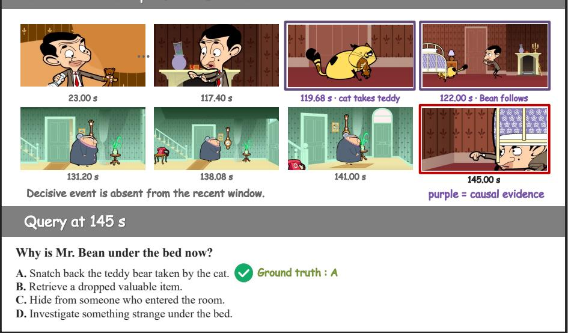

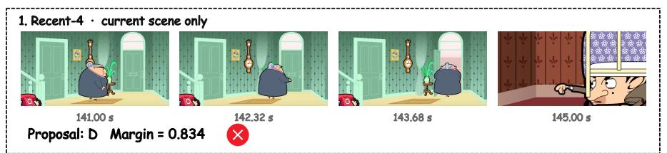

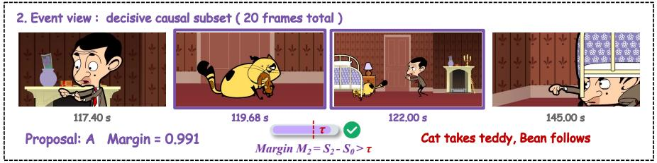

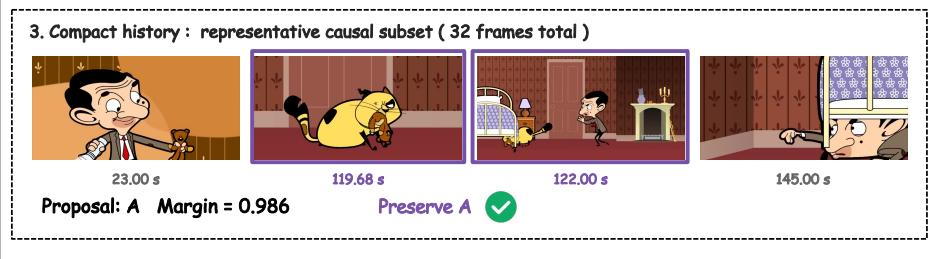  
Figure 5: Qualitative case study of causal view acquisition and proposal commitment. Recent-4 omits the event in which the cat takes the teddy bear and proposes D. The event view exposes the decisive evidence and proposes A; the compact-history view independently supports A, which the acquire–commit policy preserves.

## E.2 A Correct Answer Lost during Revision

A complementary failure appears in StreamingBench record streaming\_57\_0, from sample\_137\_real at 12 seconds. The question and options are:

Which of the following best describes the initial actions shown in the clip?

A. A hand is painting directly on a canvas.

B. A plastic sheet is covered with paint stains, then a name appears.

C. A blank canvas is being prepared for painting.

D. Paint is being dispensed onto a plastic sheet covering a canvas.

The reference is D. Table 16 reconstructs the deployed decisions from the frozen-checkpoint view records and strict replay, without generating new proposals or using the reference answer in the policy.

Table 16: A recorded replacement error. The recent answer is correct, but both subsequent proposals pass the calibrated relative-margin criterion. Margins are rounded for display.

<table><tr><td>Acquired view</td><td>Frames Proposal</td><td></td><td>Margin</td><td>Retained</td></tr><tr><td>recent</td><td>4</td><td>D</td><td>0.5084</td><td>D</td></tr><tr><td>event</td><td>20</td><td>B</td><td>0.1228</td><td>B</td></tr><tr><td>compact history</td><td>29</td><td>C</td><td>0.2416</td><td>C</td></tr></table>

Acquisition and commitment have different effects. The recent margin triggers event acquisition because it is below $\tau _ { a } = 0 . 9 9 7 6 8 9 6 .$ The event proposal has a lower raw margin, but its change relative to the retained answer is approximately −0.3856, which exceeds $\tau _ { c } = - 0 . 5 0 5 9 ;$ B therefore replaces the correct D. Recent–event disagreement triggers history independently of this commitment. Its C proposal then replaces B with a relative margin change of +0.1188. The final answer is wrong even though a correct proposal was available and initially retained.

What the trace establishes. This is a replacement error in the sense of Appendix D, not a case where the view family lacks a correct proposal. It illustrates why the calibrated rule cannot be described as accepting only higher-confidence answers. It does not establish that a different threshold would improve aggregate performance, nor does it identify which image caused the proposal to change.

All recorded frame timestamps lie at or before 12 seconds. The recent view uses 8.00, 9.33, 10.67, and 12.00 seconds; the broader views also include earlier observations. This path processes 53 frame entries but exposes 39 unique source IDs, illustrating the distinction between per-view capacity, cross-call exposure, and repeated processing. Record IDs, exact margins, and frame-index lists for this example accompany the manuscript source.

## E.3 A Correct Historical Proposal Not Acquired

At 6 seconds, StreamingBench record streaming\_461\_0 has reference B (center), but recent-4 proposes A (left). Its margin, 0.999630, exceeds τa ≈ 0.9977, so TVS stops after one call and four frames. The correct event and history proposals in Figure 6 are replay-only, not answers visited by the deployed policy. Their earlier observations retain a left neighbour absent from recent-4. This is an acquisition miss, not evidence that changing the threshold would improve aggregate accuracy.

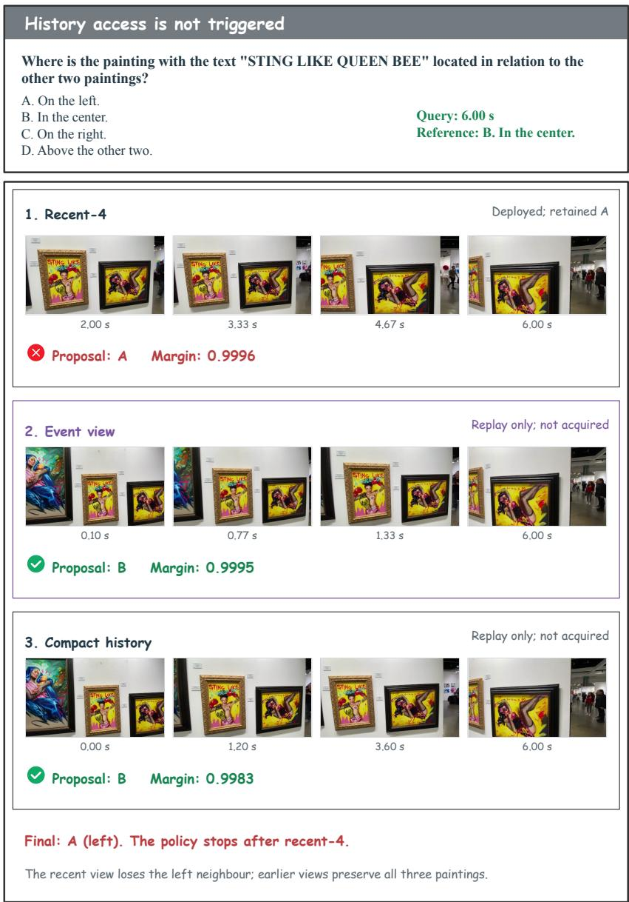  
Figure 6: Corrective historical evidence is not accessed. Four actual frames per view are displayed; complete inputs contain 4 recent, 20 event, and 6 history frames. Earlier frames show all three paintings, while recent-4 loses the left neighbour. All proposals use the same frozen ViSS checkpoint; only recent-4 is executed by TVS.

## E.4 All-View Unresolved with Counting-Scope Ambiguity

At 10 seconds, record streaming\_38\_1 has reference B (three), but all three views propose C (four). Recent and event agree, so TVS stops after two calls and 24 processed frames; history is replay-only. Source frame 300 at 10.00 seconds belongs to all three inputs and shows three framed works beside an electronic display (Figure 7). The recorded proposals cannot recover the reference, but the counting scope remains ambiguous. This is not an established representation failure, nor can we determine whether the model included the display in its count.

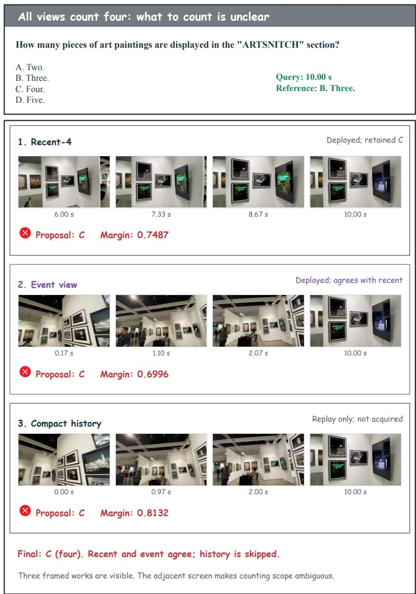  
Figure 7: All-view failure with ambiguity about what to count. Four actual frames per view are displayed; complete inputs contain 4 recent, 20 event, and 21 history frames. The same frozen ViSS checkpoint is used throughout. Exact traces for both cases are provided in supplementary/viss\_failure\_cases.json; no new proposals are generated.

## E.5 Additional Archived-Run Comparisons

Figures 8 and 9 present selected archived-run comparisons. The two controls share a checkpoint; ours uses the ViSS checkpoint. Checkpoints and, for expanded views, visual encodings differ, so these are qualitative examples rather than isolated ablations. Rows show actual input frames, with subsets displayed for longer views; all frames remain within the observed prefix.

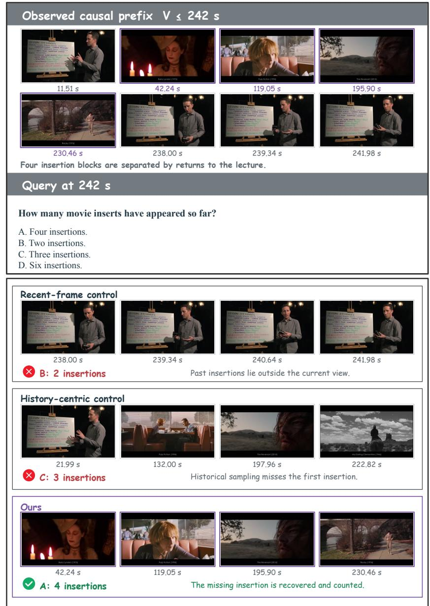  
Figure 8: Accumulating movie insertions. At 242 seconds, the recent-frame control predicts two insertions and the historical-search control predicts three. Historical sampling omits the first insertion block. Our causal-access run exposes this missing evidence and returns four, matching the reference. Each insertion block may contain several consecutive film excerpts.

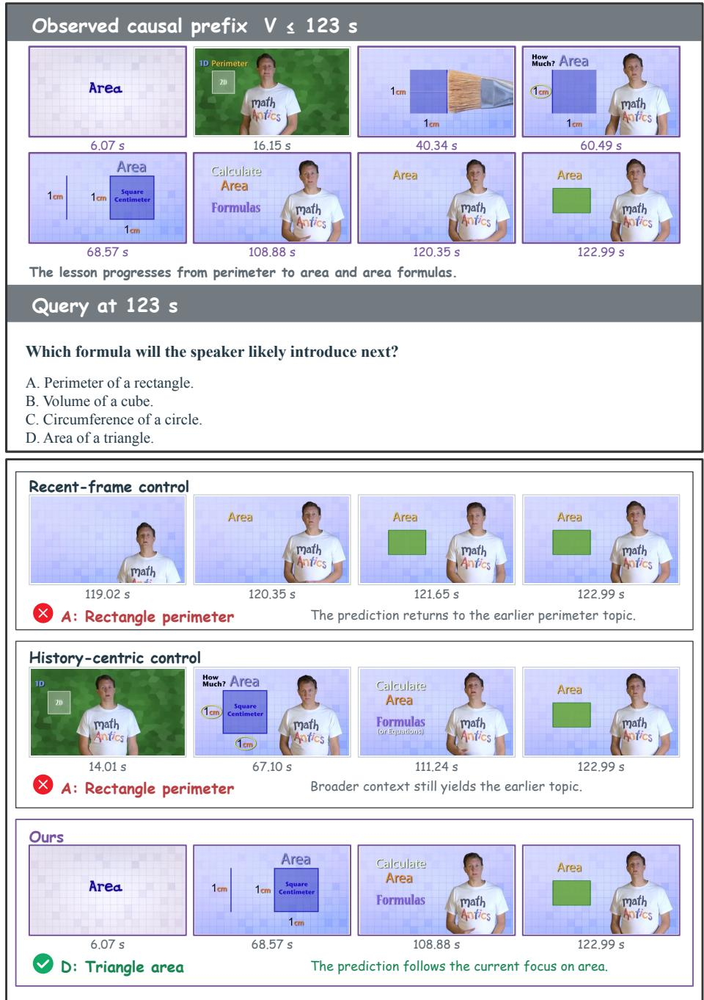  
Figure 9: Following the current lesson topic. The observed lesson moves from perimeter to area and area formulas. Both controls predict rectangle perimeter (A), while our run predicts the annotated triangle-area option (D). The displayed prefix establishes the current area topic; no future frames are exposed to the model.

## F Theoretical Analysis

This appendix makes the two levers precise. Proposition 1 formalizes state under-specification (❶) and shows what a separating probe adds to an answer-level objective. Proposition 2 shows that for a Bayes-optimal readout a wider causal view never loses accuracy and no commitment rule can beat it. The replacement errors in Section 5.4 concern the deployed readout and selection policy within a fixed proposal set. Propositions 3 and 4 give conditions under which the margin gate of TVS is the optimal acquisition rule and explain why its calibrated commit threshold is negative. All statements concern population quantities and unrestricted predictor classes: they describe what the objectives and decision rules can and cannot enforce, not finite-sample behavior.

## F.1 Setting

Let H be the set of causal prefixes (histories), Q the set of questions, and $\boldsymbol { a } : \mathcal { Q } \times \mathcal { H }  \mathcal { V }$ the reference answer map into a finite answer set. A predictor factors as in Eq. $1 \colon f ( q , h ) = G ( F ( g ( h ) ) , q )$ , where g is a fixed view constructor, $F$ maps a view to a representation, and G is a readout returning a distribution over $\mathcal { V } ; G ( z , q ) [ y ]$ denotes the probability assigned to y. A supervision family is a finitely supported distribution $D$ over pairs $( q , h )$ , and its population risk under log loss is

$$
R _ { D } ( F , G ) = \mathbb { E } _ { ( q , h ) \sim D } \left[ - \log G ( F ( g ( h ) ) , q ) [ a ( q , h ) ] \right] .\tag{9}
$$

F and G range over all measurable maps. Call D view-consistent if $a ( q , h ) = a ( q , h ^ { \prime } )$ whenever $g ( h ) = g ( h ^ { \prime } )$ and both $( q , h )$ and $( q , h ^ { \prime } )$ belong to its support. Under this condition, inf $R _ { D } = 0$ is attained by an injective F and a readout assigning the reference answer to each view and question. Without it, information lost by g can leave positive Bayes risk. For a view $x ,$ define its question–answer support across the entire class $g ^ { - 1 } ( x )$ by $\mathcal { L } _ { D } ( x ) = \{ ( q , a ( q , h ) ) : ( q , h ) \in$ supp(D), $g ( h ) = x \}$ . We say that D does not separate two view classes when their $\mathcal { L } _ { D }$ sets are equal. For example, an action-recognition family can leave once-versus-three repetitions indistinguishable; a counting family can separate them.

## F.2 State Under-Specification

Proposition 1 (Answer-level supervision leaves unasked distinctions free). Let $h _ { 1 } \neq h _ { 2 }$ have distinct views $x _ { 1 } = g ( h _ { 1 } )$ and $x _ { 2 } = g ( h _ { 2 } )$ . Suppose D is view-consistent and $\mathcal { L } _ { D } ( x _ { 1 } ) = \mathcal { L } _ { D } ( x _ { 2 } )$

(i) For every minimizer $( F , G )$ of $R _ { D } ,$ , the merged pair $( F ^ { \prime } , G )$ with $F ^ { \prime } ( g ( h _ { 2 } ) ) = F ( g ( h _ { 1 } ) )$ and $F ^ { \prime } = F$ elsewhere is also a minimizer. The objective therefore never requires the representation to keep any attribute in which $h _ { 1 }$ and h2 differ, be it a count, an order, or a relation.

(ii) Let $D _ { p }$ be a probe family with a question $q _ { p }$ such that $a ( q _ { p } , h _ { 1 } ) \ne a ( q _ { p } , h _ { 2 } )$ and $w =$ min $\{ D _ { p } ( q _ { p } , h _ { 1 } )$ $D _ { p } ( q _ { p } , h _ { 2 } ) \} > 0 ,$ , and let $D ^ { \prime } = \lambda D + ( 1 - \lambda ) \bar { D } _ { v }$ with $\lambda \in [ 0 , 1 )$ , and assume $D ^ { \prime }$ is view-consistent. Every $( F , G )$ with $F ( g ( h _ { 1 } ) ) = F ( g ( h _ { 2 } ) )$ satisfies $R _ { D ^ { \prime } } ( F , G ) \geq 2 ( 1 - \lambda )$ w log 2, while inf $R _ { D ^ { \prime } } = 0$ . Hence every minimizer of $R _ { D ^ { \prime } }$ , and every ε-approximate minimizer with $\varepsilon < 2 ( 1 - \lambda )$ w log 2, keeps $F ( g ( h _ { 1 } ) ) \neq F ( g ( h _ { 2 } ) )$ .

Proof. (i) Since inf $R _ { D } = 0$ and every term of Eq. 9 is nonnegative, a minimizer places probability one on $a ( q , h )$ at every support point. The merged pair agrees with $( F , G )$ at every support point with $g ( h ) \neq x _ { 2 }$ . For any support point $( q , h )$ with $g ( h ) = x _ { 2 } , ( q , a ( q , h ) ) \in \mathcal { L } _ { D } ( x _ { 2 } ) = \mathcal { L } _ { D } ( x _ { 1 } )$ , so a support point $( q , \bar { h } )$ with $g ( \bar { h } ) = x _ { 1 }$ has the same target. Hence $G ( F ^ { \prime } ( g ( h ) ) , q ) = G ( F ( x _ { 1 } ) , q )$ assigns probability one to $a ( q , h )$ . Thus $R _ { D } ( F ^ { \prime } , G ) = 0 . \ ( \mathrm { i i } )$ If $F ( g ( h _ { 1 } ) ) = F ( g ( h _ { 2 } ) ) = z$ , the readout returns one distribution $p = G ( z , q _ { p } )$ at both $\left( q _ { p } , h _ { 1 } \right)$ and $\left( q _ { p } , h _ { 2 } \right)$ , whose reference answers y1 $\neq y _ { 2 }$ are distinct. These two support points contribute at least $( 1 - \lambda ) w ( - \log p [ y _ { 1 } ] - \log p [ y _ { 2 } ] )$ to $R _ { D ^ { \prime } }$ , and $p [ y _ { 1 } ] + p [ y _ { 2 } ] \leq 1$ gives $p [ y _ { 1 } ] p [ y _ { 2 } ] \leq 1 / 4$ , so the bracket is at least 2 log 2. All other terms are nonnegative. View-consistency of $D ^ { \prime }$ ensures that an injective F on its support views and a suitable G attain the infimum 0. □

Remark 1 (The view can hide the distinction). If $g ( h _ { 1 } ) = g ( h _ { 2 } )$ , the two histories are the same input to every predictor and no supervision separates them; the distinction must be restored by the view constructor. This is ❷, and it is why TVS changes $g$ while $\theta ^ { \star }$ stays frozen. The semantic-stability check of Section 4.1 tests invariance to option permutation; it does not establish the view-consistency assumption or human unambiguity of a target.

Part (i) formalizes ❶ for view classes with identical supervised question–answer support: the objective permits merging their representations. Part (ii), under view-consistency, is the design rule behind the probe families of Section 4.1: one separating question per distinction, with positive weight, is enough to make every minimizer keep the distinction in $z .$ Whether benchmark readouts then use it is an empirical question, which Section 5.3 answers at a matched budget.

## F.3 Wider Views and Commitment

We now fix the checkpoint and vary the view, as TVS does. Let $( q , h )$ be drawn from a query distribution, let $x = g _ { 0 } ( h )$ be the recent view and $x ^ { \prime } = g _ { 1 } ( h )$ a wider view that contains it, in the sense that $x = \phi ( x ^ { \prime } )$ for a fixed map ϕ (the event view includes the four recent frames). Because a view discards part of the prefix, the reference answer is not a function of the view, and we write $P ( y \mid x , q )$ for its conditional law. A readout on a view is any measurable decision $\delta ( x , q ) \in \mathcal { V } ;$ its accuracy is $A ( \delta ) = P ( \delta ( x , q ) = a ( q , h ) )$ , and the Bayes readout $\delta _ { x } ^ { \star } ( x , q ) = \arg \operatorname* { m a x } _ { y } P ( y \mid x , q )$ attains the Bayes accuracy $A ^ { \star } ( x ) = { \mathbb E } [ \operatorname* { m a x } _ { y } P ( y \mid x , q ) ]$

Proposition 2 (A wider view never loses for a Bayes readout). ${ \cal { I } } f x = \phi ( x ^ { \prime } )$ , then $A ^ { \star } ( x ^ { \prime } ) \geq A ^ { \star } ( x )$ . Moreover, let $\delta _ { 0 }$ and $\delta _ { 1 }$ be anyfixed readouts on x and $x ^ { \prime }$ with margins $m _ { 0 } ( x , q )$ and $m _ { 1 } ( x ^ { \prime } , q )$ , and let $\rho$ be any commitment rule that returns one of the two proposals as a function of $( \delta _ { 0 } , \delta _ { 1 } , m _ { 0 } , m _ { 1 } )$ . Then $A ( \rho ) \leq A ^ { \star } ( x ^ { \prime } )$ , and $i f \delta _ { 1 } = \delta _ { x } ^ { \star }$ ′ then $A ( \rho ) \leq A ( \delta _ { 1 } )$ : no commitment rule improves on always taking the wider view’s proposal.

Proof. Every decision that depends on x depends on $x ^ { \prime }$ through $\phi ,$ so it is a measurable function of $( x ^ { \prime } , q )$ ; the Bayes readout on $x ^ { \prime }$ maximizes accuracy over all such functions, which gives the first claim with $\delta = \delta _ { x } ^ { \star } \circ \phi .$ For the second, the proposals and margins are deterministic functions of $( x ^ { \prime } , q )$ once the readouts are fixed, so $\rho$ is itself a measurable decision on $( x ^ { \prime } , q )$ and $A ( \rho ) \leq A ^ { \star } ( x ^ { \prime } )$ ; when $\delta _ { 1 }$ is the Bayes readout the right-hand side equals $A ( \delta _ { 1 } )$ □

Proposition 2 separates two readings of the replacement errors in Section 5.4. For a Bayes readout on the wider view, replacing the retained answer can still be wrong on individual queries, but no rule that keeps the retained answer more often can raise accuracy. The deployed readout need not be Bayes-optimal, so this result does not imply that proposal selection cannot improve its accuracy. The three-view oracle uses reference answers and is not a Bayes-risk estimate; its gap diagnoses selection failures within the current proposal set. The commit-margin ablation in Section 5.3 evaluates one particular selection rule, not the potential of all commitment rules.

## F.4 The Acquisition Gate and the Commit Threshold

Let $M \ = \ m _ { 0 } ( x , q )$ be the recent-view margin, let $p _ { 0 } ( m ) ~ = ~ P ( \delta _ { 0 } \mathrm { c o r r e c t } | M = m )$ , and let $p _ { 1 } ( m ) \ =$ P(final answer correct $\mid \ M \ = \ m$ , acquire) under the fixed downstream rule of TVS. Let $c ( m )$ be the expected number of additional frames processed when acquiring at margin m, at most the event and history budgets $c _ { 1 } + c _ { 2 } .$ A gate is a measurable set $A \subseteq \mathbb { R }$ of margins at which the event view is acquired, and its value at frame price $\lambda \geq 0$ is $J ( A ) = P ( { \mathrm { c o r r e c t } } ) - \lambda \mathbb { E } [ { \mathrm { f r a m e s } } ]$

Proposition 3 (The margin gate is the optimal acquisition rule). Write $\Delta ( m ) = p _ { 1 } ( m ) - p _ { 0 } ( m )$ for the gain from acquiring at margin m. The gate maximizing J is $A ^ { \star } = \{ m : \Delta ( m ) > \lambda c ( m ) \} . \ I f \Delta ( m ) - \lambda c ( m )$ is non-increasing in m (for instance, $\Delta$ non-increasing and c constant), then $A ^ { \star } = \{ m < \tau _ { a } \}$ with $\tau _ { a } = \operatorname* { s u p } \{ m : \Delta ( m ) > \lambda c ( m ) \}$ }: the optimal rule acquires exactly when the recent marginfalls below a threshold, as TVS does, and its expectedframe count is $c _ { 0 } + P ( M < \tau _ { a } ) \big [ c _ { 1 } + P ( d i s a g r e e \mid M < \tau _ { a } ) c _ { 2 } \big ]$ with $c _ { 0 } , c _ { 1 } , c _ { 2 }$ the per-viewframe budgets.

Proof. $J ( A ) = \mathbb { E } [ p _ { 0 } ( M ) ] - \lambda c _ { 0 } + \mathbb { E } \big [ \mathbf { 1 } \{ M \in A \} \left( \Delta ( M ) - \lambda c ( M ) \right) \big |$ , and the last expectation is maximized pointwise by including m exactly when $\Delta ( m ) > \lambda c ( m )$ . If $\Delta - \lambda c$ is non-increasing, this set is a lower set of the real line, hence $\{ m < \tau _ { a } \}$ up to its boundary point. The frame count follows from the cascade of Section 4.2: the history view is acquired only after the event view and only on disagreement. □

The monotonicity of $\Delta$ says that additional evidence is worth less when the current answer is already confident; it is the assumption behind confidence-gated computation [20, 21, 40], and it can be checked on the calibration holdout by binning M. Without a frame price $( \lambda = 0 )$ the optimal gate acquires whenever $\Delta > 0$ , so a finite $\tau _ { a }$ expresses a positive price on frames rather than a belief that the wider view could hurt.

Proposition 4 (A negative commit threshold is a calibration offset). Suppose disagreeing proposals j (retained) and k (new) have correctness probabilities that depend on the margins only through view-specific increasing calibration maps, $P ( j$ correct $m _ { j } , m _ { k } ) = \varphi _ { j } ( m _ { j } )$ and $P ( k$ correct $\mid m _ { j } , m _ { k } ) = \varphi _ { k } ( m _ { k } )$ . The accuracy-maximizing commitment rule takes k $i f f \varphi _ { k } ( m _ { k } ) > \varphi _ { j } ( m _ { j } )$ . Ifthe two maps differ by a shift $\varphi _ { k } ( m ) = \varphi _ { j } ( m + \delta )$ , this rule reads $m _ { k } - m _ { j } > - \delta$ which is the TVS rule with $\tau _ { c } = - \delta$

Proof. Given the margins, keeping $j$ is correct with probability $\varphi _ { j } ( m _ { j } )$ and taking k with probability $\varphi _ { k } ( m _ { k } )$ , so picking the larger probability maximizes expected accuracy pointwise. Under the shift, $\varphi _ { k } ( m _ { k } ) \ > \ \varphi _ { j } ( m _ { j } )$ iff $\varphi _ { j } ( m _ { k } + \delta ) > \varphi _ { j } ( m _ { j } )$ iff $m _ { k } + \delta > m _ { j }$ , because $\varphi _ { j }$ is increasing. □

A negative calibrated $\tau _ { c }$ (Section 4.2) is thus what one expects when wider views yield lower raw margins at equal accuracy, as happens when more frames spread probability over more plausible answers; the holdout calibration estimates $\delta$ without modeling $\varphi _ { j }$ explicitly. Proposition 2 adds the caveat that, for a Bayes readout on the wider view, the best value of this rule is to always accept, so any accuracy the rule adds in practice is a symptom of readout miscalibration that it partially corrects.