# Synthetic Deformable Tubular Benchmark: A mechanically annotated dataset for evaluating deformable 3D reconstruction

Íñigo Cirauqui-Viloria<sup>a</sup>

<sup>a</sup>Universidad de Zaragoza, Pedro Cerbuna 12, 50009 Zaragoza, Spain

Correspondence: icirauqui@gmail.com

ORCID: 0000-0003-1773-1937

## Abstract

Evaluating deformable 3D reconstruction in tubular environments requires ground truth that distinguishes camera motion, surface deformation, material correspondence and image appearance. Existing endoscopic datasets provide complementary annotations; controlled evaluation additionally benefits from explicit links between observations, material identities and mechanical states. We introduce the Synthetic Deformable Tubular Benchmark, generated with LumenMorph, an open-source toolkit for creating, annotating and evaluating deformable tubular scenes. The release contains 5,580 RGB images. The baseline crosses three surface-motion conditions with moving and stationary cameras in six families; matched appearance variants cover only moving-camera finite-element actions in four families. Known camera poses, surface geometry, depth, deformation fields, persistent material correspondences and discrete finite-element records are accessible through documented public and evaluation interfaces. Separately implemented geometric and mechanical checks assess annotation consistency with the generating models. Structure-from-motion, optical-flow and supplied-geometry displacement-interpolation studies demonstrate the resource’s utility. They distinguish registration coverage from geometric accuracy, expose camera- and surface-motion efects, and test mechanical priors. Persistent triangle identities and material weights let users follow the same surface location across frames, query its three-dimensional trajectory and evaluate predictions against known motion. Public readers, explicit evaluation contracts and the configurable generator support reuse and extension beyond the released acquisitions. Mechanical interpolation illustrates both benefits and mismatch of a prior, rather than a general ranking of estimators. The fixed benchmark provides a reusable reference under explicit synthetic assumptions. Data integrity, fixed-environment repeatability and retained-prediction score replay have distinct verification scopes; anatomical and clinical realism are not claimed.

Keywords: Deformable 3D reconstruction; Synthetic dataset; Ground truth; Finite element method; Endoscopic imaging

## 1 Introduction

Deformable reconstruction in colonoscopy must distinguish camera motion from surface motion under limited visibility. A rigid reconstruction accumulated over time can absorb deformation into biased camera poses or geometry. Surface similarity alone may also conceal correspondence errors: a nearby surface point need not be the same material point—a fixed location on the wall followed as it moves. Evaluation therefore requires linked observations, material identities, geometry and visibility, together with explicit assumptions about the motion-generating model. Known camera poses alone do not resolve the inverse deformation problem.

We present the Synthetic Deformable Tubular Benchmark, a controlled synthetic resource (Cirauqui-Viloria, 2026c). It was generated with LumenMorph, an openly available generator and evaluation toolkit (Cirauqui-Viloria, 2026a). Figure 1 introduces the six scene families: one straight and five bent tubes, each observed under paired motion and camera conditions. A matched appearance extension changes lighting, reflectance and exposure on four of these same families. The resource links material trajectories, discrete finite-element (FE) records, image annotations and estimated reconstructions. This connection allows a user to ask not only whether a surface looks correct, but whether the same material points move correctly and whether missing surface support explains an apparently low error. Data, code and reproduction resources are identified in Sections 7–8.

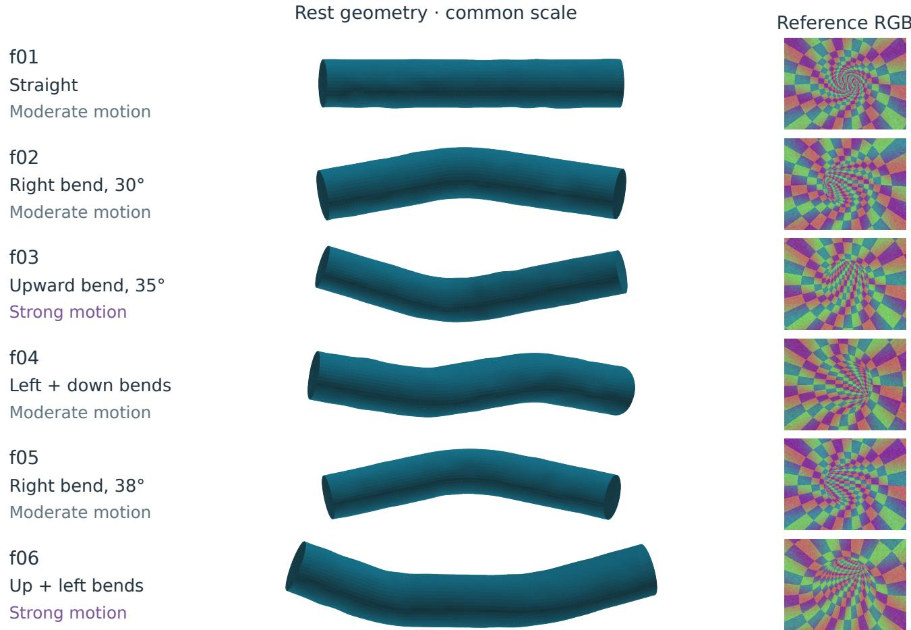  
Figure 1. Six controlled scene families: one straight tube (f01), single bends to the right or upward (f02, f03, f05), and two successive bends (f04, f06). Geometry views share a common scale; the right column shows each family’s reference image with its seeded wall texture. f03 and f06 use twice the displacement-basis amplitudes of the other families. Table 2 specifies bend angles and paired acquisitions.

The methodological contribution is a benchmark with an explicit, accessible and checked connection between image observations, camera states, persistent material identities, deformed geometry and discrete mechanical records. This integration lets researchers evaluate reconstruction accuracy, material-motion consistency and surface support under paired acquisition conditions, without introducing a new reconstruction algorithm. The novelty is the queryable connection, rather than any one annotation or the use of simulation alone. The reusable contribution has two parts: the fixed, versioned benchmark, with linked annotations and separately implemented consistency checks; and LumenMorph, the open-source generator and reader/evaluation toolkit for creating and studying additional tubular configurations. Reconstruction, optical-flow and supplied-geometry mechanical studies illustrate uses of these resources. They distinguish camera accuracy, sparse geometry, surface support and registration coverage, while a static phantom control examines performance on physical imagery under its declared acquisition contract. The engineered scene families provide controlled reconstruction diagnosis, not a sampled clinical population.

## 1.1 Related work

Existing resources address complementary evaluation needs. SimCol3D provides a synthetic depth and pose benchmark with separate anatomies for training and evaluation (Rau et al., 2024), while RealSynCol expands CT-derived geometry and image realism (Lena et al., 2026). C3VD and C3VDv2 provide phantom images acquired with clinical colonoscopes and registered dense labels (Bobrow et al., 2023; Golhar et al., 2026). DynamicColon, the dataset introduced alongside the ColonSplat reconstruction method by Smolak-Dyżewska et al. (2026), provides per-time-step point clouds to evaluate whole-scene motion, beyond appearance along the observed camera path. C3VD-DEFCOL combines parameterized peristalsis and centerline motion with depth-conditioned image translation, reporting 110 videos from 11 colon geometries and dense dynamic annotations (Luk et al., 2026). VR-Caps and SimIntestine extend simulation to capsule endoscopy (Incetan et al., 2021; Singh et al., 2025), and SimuScope incorporates deformable tissues in surgical simulation (Martyniak et al., 2025). Dense dynamic annotations and mechanical simulation are therefore established capabilities. The present work focuses on their auditable connection to persistent material identity, controlled acquisitions and reconstruction-pipeline evaluation.

Prior colonoscopy reconstruction methods also motivate this evaluation setting. Hong et al. used tubular structure to reconstruct virtual colons from video (Hong et al., 2014); Ruano et al. trained shape-from-shading depth estimation with synthetic images (Ruano et al., 2024); and Liu et al. combined synthetic pretraining with intrinsics-guided learning for scale-consistent monocular reconstruction (Liu et al., 2026). Such methods benefit from benchmarks in which image formation, correspondence and motion can be examined separately, while clinical transfer is evaluated using physical data.

Our reconstruction studies use COLMAP’s incremental structure-from-motion (SfM) pipeline (Schönberger and Frahm, 2016) through two separately built implementations: a derivative of COLMAP-for-colonoscopy (Subías Sarrato, n.d.) and a derivative of oficial release 4.2.0. The upstream colonoscopy project supplies the starting implementation; the experimental derivative includes developments described in a subsequent master’s thesis (Cirauqui Viloria, 2022). Section 2.7 defines the two pipelines explicitly, and Section 8 identifies the tested source. The optical-flow study compares Farnebäck and dense inverse search (DIS) (Farnebäck, 2003; Kroeger et al., 2016) with Recurrent All-Pairs Field Transforms (RAFT) (Teed and Deng, 2020), using the implementation and pretrained weights provided by torchvision (PyTorch contributors, 2026). These are complementary usage studies, not new reconstruction or flow algorithms.

The motivation is to provide controlled acquisition and deformation conditions for evaluating reconstruction. The distinguishing feature is the explicit, queryable connection between image observations, persistent surface material identities, geometric states and discrete mechanical records. A persistent triangle and its material weights identify the same surface location across frames; separate public and evaluator interfaces make ground-truth access explicit. Discrete loads, responses and energy terms expose the assumptions behind FE-derived motion. These links allow errors to be examined against known camera and surface motion while controlling appearance variations.

The controls complement the broader anatomy and appearance of other resources; we do not demonstrate superior realism or downstream reconstruction performance against those datasets. The matched appearance extension preserves geometry and motion rather than adding independent anatomies. LumenMorph also lets researchers create additional tubular configurations beyond the fixed release (Section 2.6). Table 1 summarizes the distinctions from related resources.

## 2 Materials and Methods

The resource has two parts: a baseline bank of 42 image streams and a matched appearance extension of 20 image streams, for 5,580 color (RGB) images in total. Every stream shows a camera inside a textured hollow tube. Baseline streams vary wall motion and camera motion under a checker-texture raster renderer; extension streams show the same moving-camera FE actions with path-traced lighting, surface reflectance and exposure variants. A family fixes a seeded tube, texture, camera paths and motion bases; a condition specifies how that tube moves; a stream is one 90-frame acquisition. A package groups one family’s motion condition with its two action-camera modes and a link to the shared reference scan. Table 2 maps every package to its family before those codes are used below.

Figure 2 summarizes generation, annotation, validation and evaluation. LumenMorph defines geometry, material identities and FE states; rendering produces RGB images and dense geometric annotations for specified camera trajectories. Separately implemented checks assess geometric and mechanical consistency; “independent” here describes the check implementation, not validation by an external laboratory. Reconstruction and optical-flow studies then evaluate the resource under their respective input contracts; the reconstruction studies use the two COLMAP builds described in Section 2.7.

PUBLIC IMAGE-INPUT ROUTE  
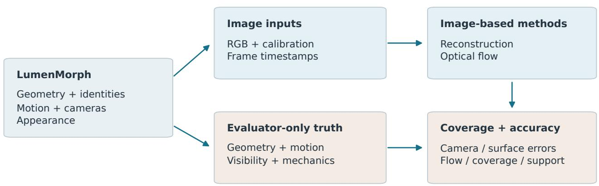  
Truth is used for validation and scoring only.

One linked observation: f01 / FEM / moving camera / frame 52

(a) RGB  
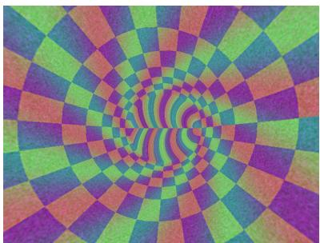

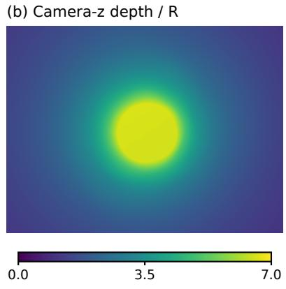

(c) Rest material longitudinal coordinate  
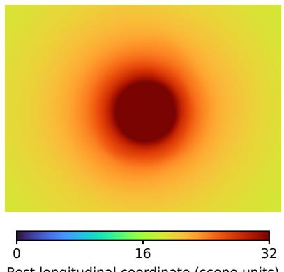  
(f) Deformed surface, cutaway

(d) Displacement from rest / R  
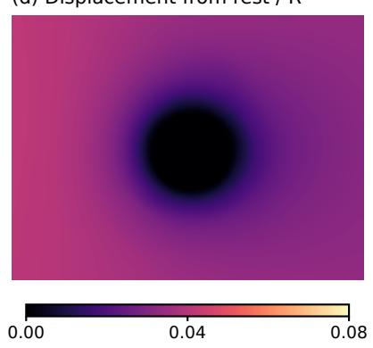

(e) Forward flow, 52 to 53  
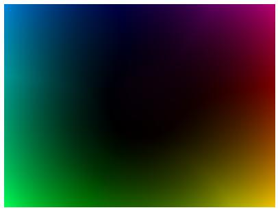  
Black = 0; full colour = 34.48 px

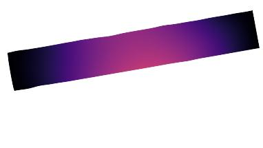  
Same displacement scale as (d)  
Hue: image direction (right/down axes)  
Figure 2. Information flow through LumenMorph and the usage studies. Generation produces both public image inputs and evaluator-only truth. Image-based methods receive the upper route; their predictions are compared with the lower route during scoring. Independently implemented validation also checks truth against the generating geometry and mechanics. Registration, accuracy and surface support are reported separately, so a missing or incomplete output cannot masquerade as a low error. Below, one baseline f01 FEM moving-camera frame (52) links RGB, camera-z depth, persistent material position, displacement from rest, next-frame flow (52 to 53) and deformed surface geometry. The material colour is rest longitudinal position, not a new material label; triangle IDs and barycentrics carry the actual identity. Depth and displacement are normalized by the reference radius R. Flow colour encodes direction and magnitude in pixels; its key gives the display scale. Background is grey in truth maps. The surface view cuts away the near wall for display; all annotations use the complete surface. Codex (version not recorded) assisted the diagram and plotting code.

<table><tr><td>Resource</td><td>Established capability</td><td>Relevant distinction</td></tr><tr><td></td><td>SimCol3D; RealSynCol Synthetic colon depth/pose; broader anatomy or appearance</td><td>Rich geometric annotations precede this resource.</td></tr><tr><td>C3VD; C3VDv2</td><td>Real imaging of phantoms; dense registered static labels</td><td>C3VDv2 deformation videos lack dense per-step labels.</td></tr><tr><td>DynamicColon</td><td>Deforming geometry with per-step point clouds Cage-based motion; three reported scenes. and depth</td><td></td></tr><tr><td>C3VD-DEFCOL</td><td>Parameterized dynamic geometry and depth-conditioned appearance</td><td>Geometric motion; reported biomechanical and appearance-alignment limits.</td></tr><tr><td>VR-Caps; SimIntestine</td><td>Capsule simulation with varied acquisition or peristalsis</td><td>Different acquisition setting; complete mechanical export schemas not verified here.</td></tr><tr><td>SimuScope</td><td>Surgical simulation with deformable tissues and Adjacent anatomy/task; mechanics is instruments</td><td>established simulation practice.</td></tr><tr><td>This resource</td><td>Pixel-to-triangle/material weights link RGB and cameras to surface trajectories and discrete FE records</td><td>Queryable cross-time identity and generating-model checks; appearance flow has a narrower contract.</td></tr></table>

Table 1. Comparison based on primary publications and author release descriptions. It is not an independent numerical validation of competing archives. C3VD-DEFCOL’s release repository lists the dataset as forthcoming (Durr Lab, n.d.); reported capability and downloadable availability are distinct. An unverified export is not evidence that it does not exist. The distinction claimed here is an explicit, accessible and checked connection between annotations, not priority for depth, displacement or FE simulation individually. The six engineered families do not establish clinical realism.
<table><tr><td>Family</td><td>Centerline</td><td></td><td>Motion scale Static / FE / non-FE</td><td>Original role</td><td>Appearance</td></tr><tr><td>f01</td><td>Straight</td><td>1×</td><td> $\mathrm { \Delta v 1 / \ v 2 / \ v 3 }$ </td><td>Development</td><td>Yes</td></tr><tr><td>f02</td><td>Right turn,  $3 0 ^ { \circ }$ </td><td>1×</td><td> $\mathrm { v } 4 \textrm { / } \mathrm { v } 5 \textrm { / } \mathrm { v } 6$ </td><td>Development</td><td>No</td></tr><tr><td>f03</td><td>Upward turn,  $3 5 ^ { \circ }$ </td><td>2×</td><td> $\mathrm { v } 7 / \mathrm { v } 8 / \mathrm { v } 9$ </td><td>Development</td><td>No</td></tr><tr><td>f04</td><td>Left  $2 7 ^ { \circ }$  , down  $2 0 ^ { \circ }$ </td><td>1×</td><td> $\mathrm { v 1 0 ~ / ~ v 1 1 ~ / ~ v 1 2 }$ </td><td>Validation</td><td>Yes</td></tr><tr><td>f05</td><td>Right turn,  $3 8 ^ { \circ }$ </td><td>1×</td><td> $\mathrm { v } 1 3 \mathrm { ~ / ~ v } 1 4 \mathrm { ~ / ~ v } 1 5$ </td><td>Recovery test</td><td>Yes</td></tr><tr><td>f06</td><td> ${ \mathrm { U p ~ 2 5 } } ^ { \circ } ,$  left  $2 5 ^ { \circ }$ </td><td>2×</td><td> $\mathrm { v } 1 6 \ / \ \mathrm { v } 1 7 \ / \ \mathrm { v } 1 8$ </td><td>Recovery test</td><td>Yes</td></tr></table>

Table 2. Complete family/package map. Turns describe the configured centerline; seeded wall perturbations, texture, camera ofset and angular load locations also vary by family. The motion multiplier scales all three spatial bases within each motion class (Section 2.2); it is not the peak composed displacement. Every row supplies seven baseline streams: one rigid reference and three motion conditions observed by two camera modes, or 630 images per family. Each “Yes” adds five 90-frame appearance streams of the moving FE action, or 450 images, without adding a new anatomy. Roles are original design assignments: all six families have been inspected for dataset generation/reconstruction quality checks and are not unseen reconstruction tests.

## 2.1 Population, geometry and acquisition

The downloadable dataset stores the baseline bank in benchmark/. Its subdirectories v1–v18 are condition-package identifiers, not successive releases. They enumerate the six families f01–f06 crossed with static, FE-derived and prescribed non-FE motion. For example, f01 uses v1, v2 and v3; v2 is its FE condition, not a second dataset.

Each surface has 48 circumferential by 112 longitudinal samples (5,376 vertices). We use R for the median reference radius. Seeded radius perturbations add local relief to the straight or piecewise-curved centerline (Figure 1). Terminal rings are closed by fan triangles, an artificial closure rather than anatomical material. The six engineered families do not sample a clinical population.

A family first supplies an undeformed reference scan with a moving camera. Its three action conditions then hold the surface static, apply FE-derived motion, or apply a directly prescribed non-FE field. Each action is observed with a moving camera and with a stationary camera, using identical material states. Thus camera mode and surface-motion condition are crossed in the baseline within every family. The appearance extension is a separate restricted comparison: four families, moving cameras and FE actions only; it does not cross all camera, motion and appearance factors. Six shared references plus $6 \times 3 \times 2 = 3 6$ actions give 42 unique streams, each with 90 images at 640 × 480 pixels and 15 Hz: 3,780 images. Shared references are linked, not counted again inside each package.

(a) Complete action · 90 frames at 15 Hz  
(b) Low-stage detail  
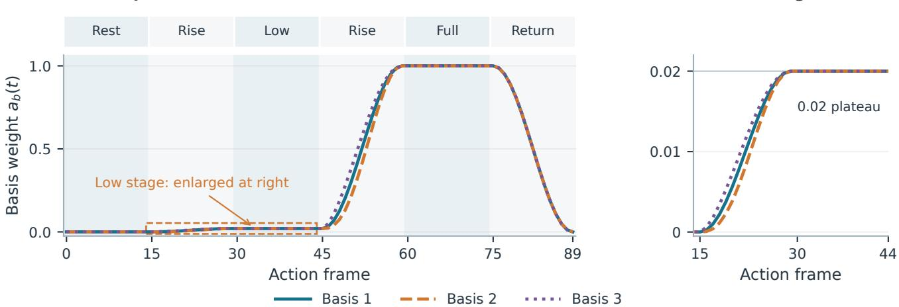  
Weights multiply spatial displacement bases; 0.02 is not a displacement of 0.02R.  
Figure 3. Stored f01 weights for the three displacement bases. (a) The complete action alternates rest, two rises and two plateaux before returning to rest. The phase strip identifies the six 15-frame intervals, and the orange box locates the enlarged region. (b) The first rise and low plateau expose the weight of 0.02 and the three diferent transition profiles. A weight multiplies a vector-valued spatial basis; it is not displacement divided by radius. FE and non-FE actions use this schedule, whereas static actions apply zero displacement. Frames are action-local.

The stationary action uses the last reference pose. The moving action follows a separate trajectory after repositioning; reference and action are distinct acquisitions, and local reconstruction windows must not cross their join. A stationary camera removes camera-induced flow but does not remove surface motion. With no camera translation to provide conventional triangulation baseline, stationary streams are not used for separate local SfM reconstructions. The reference scan and estimated moving-action global map therefore serve diferent purposes; neither should be confused with the FE reference mesh defined next.

Each deforming action combines three fixed spatial displacement patterns, called bases, with dimensionless time weights $a _ { 1 } ( t ) , a _ { 2 } ( t ) , a _ { 3 } ( t )$ . Figure 3 shows when each pattern is activated: rest at frames 0–14, rise at 15–29, low plateau at 30–44, rise at 45–59, full plateau at 60–74, then return to rest by frame 89. The low weight is 0.02 of a basis amplitude, not a displacement of 0.02R. Slightly diferent transition profiles change the mixture during ramps. Static actions apply zero motion throughout. The optical-flow comparison (Section 3.7) uses f01–f03; appearance and reconstruction studies use the four families marked in Table 2. These are exposed usage studies, rather than unseen tests of a deformation-recovery method. For future learning or parameter selection, partition by complete families: one possible declared allocation is f01–f03 for development, f04 for validation and f05–f06 for final evaluation. Keep every motion condition, camera mode, reference and appearance variant of a family in the same partition; random frame splitting would leak shared geometry and motion. All six released families have been inspected in the present QA or usage studies. This allocation is therefore a reuse protocol, not a claim of an untouched test in this article; strictly unexposed confirmation requires separately frozen, uninspected families.

## 2.2 Mechanical and prescribed motion

Three representations must be distinguished. The reference surface is the undeformed textured boundary seen by the renderer. The FE reference mesh is a volumetric discretization of its hollow wall, used to compute displacement bases. A reference scan is an image acquisition of the undeformed scene, not either mesh. Figure 4 shows how the mechanical wall is discretized.

The FE wall has 24 axial intervals and 32 circumferential divisions, with inner and outer nodes on 25 rings: $2 5 \times 3 2 \times 2 = 1$ , 600 nodes. Each wall cell is split into two six-node triangular prisms (C3D6), giving $2 4 \times 3 2 \times 2 = 1$ , 536 volume elements. Each prism has two triangular faces joined by three edges through the wall; the lumen itself has no volume elements. Nodes are mapped onto the family’s geometry before assembling the linear isotropic stifness matrix K. Both terminal rings are fixed. All six families use assigned Young’s modulus $E = 9 0 0 , 0 0 0$ and Poisson ratio $\nu = 0 . 2 8$ . Lengths are in abstract scene units. These assigned parameters define a controlled linear operator for reproducible load–response and energy queries. They were not fitted to tissue measurements: constitutive calibration would require measured stress–strain data, physical units and a validated tissue model, outside this resource’s controlled-kinematics objective.

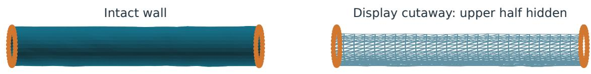

<sub>(a)</sub> <sub>FE</sub> <sub>wall:</sub> <sub>1,600</sub> <sub>nodes,</sub> <sub>1,536</sub> <sub>C3D6</sub> <sub>elements.</sub> <sub>Orange</sub> <sub>marks</sub> <sub>the</sub> <sub>fixed</sub> <sub>end</sub> <sub>rings.</sub>(b) Through-wall section  
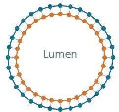  
32 inner + 32 outer nodes(b) Wall section: 32 inner and 32 outer<sup>32</sup> <sup>in</sup> nodes around the empty lumen.

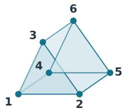  
5Blue: FE nodes · oranBlue(c) Six-node prism topology: two trian-<sup>+</sup> <sup>32</sup> <sup>outer</sup> <sup>nodes</sup> gular faces joined through the wall.

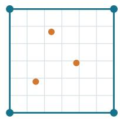  
<sup>material</sup> <sup>samples</sup> nodes · orange: material samples(d) Bilinear transfer from outer FE nodes (blue) to surface samples (orange).  
1Figure 4. From the mechanical wall to the rendering surface. The intact and cutaway views show the stored f01 mesh; the cutaway hides its upper half for viewing only. Element topology and interpolation are schematics. The modeled wall has no longitudinal opening. Codex (version not recorded) assisted the topology and interpolation code.

For the FE condition, three localized smooth Gaussian load patches define three separate load vectors $f _ { b } ,$ b = 1, 2, 3. Each produces a nodal displacement basis $u _ { b }$ by solving the same fixed-end system. With $f$ and c as subscripts denoting free and constrained degrees of freedom, respectively,

$$
K _ { f f } u _ { b , f } = f _ { b , f } , \qquad u _ { b , c } = 0 .\tag{1}
$$

Here $K _ { f f }$ is the free/free stifness block and $u _ { b , c } = 0$ enforces the fixed ends. The response and load are scaled together to the assigned peak surface displacement, preserving the linear equilibrium equation. The package stores node/element topology, fixed degrees of freedom, the stifness matrix in compressed sparse row (CSR) format, loads, displacement, reactions and quadrature strain/stress. CSR stores matrix entries row by row as three arrays: their values, column indices and pointers to each row’s start, avoiding a full dense matrix (SciPy contributors, n.d.). The stored K\_data, K\_indices, K\_indptr and K\_shape reconstruct K directly. Outer-node responses are interpolated bilinearly with periodic circumferential indexing onto the rendering surface. Therefore the rendered material geometry and the generating FE volume are distinct representations.

For time coeficients $a _ { b } ( t )$ , the FE displacement is $\begin{array} { r } { u ( t ) = \sum _ { b } a _ { b } ( t ) u _ { b } } \end{array}$ . Linear loads, reactions, strain and stress compose in the same way. Total strain energy must retain cross terms:

$$
\begin{array} { r } { \boldsymbol { U } ( t ) = \frac { 1 } { 2 } \boldsymbol { u } ( t ) ^ { T } \boldsymbol { K } \boldsymbol { u } ( t ) = \frac { 1 } { 2 } \displaystyle \sum _ { b , c } a _ { b } ( t ) a _ { c } ( t ) \boldsymbol { u } _ { b } ^ { T } \boldsymbol { K } \boldsymbol { u } _ { c } . } \end{array}\tag{2}
$$

Here $U ( t )$ is total strain energy; $u _ { b } ^ { T } K u _ { c }$ measures the interaction of bases b and c. Their deformed regions overlap, so the of-diagonal terms need not vanish. Adding the three individual basis energies would generally be incorrect. The evaluator reader provides time-composed fields and total energy without an additional per-frame mechanical archive. Voigt notation writes a symmetric three-dimensional strain or stress tensor as six components (Bleyer, n.d.). The exported strain order is $\left( \epsilon _ { x x } , \epsilon _ { y y } , \epsilon _ { z z } , 2 \epsilon _ { x y } , 2 \epsilon _ { y z } , 2 \epsilon _ { z x } \right)$ , while stress uses $( \sigma _ { x x } , \sigma _ { y y } , \sigma _ { z z } , \sigma _ { x y } , \sigma _ { y z } , \sigma _ { z x } )$ Thus engineering shear strain is twice the corresponding tensor entry; shear stress has no factor of two.

The prescribed non-FE condition moves the same rendering surface using three Gaussian vector fields, combined with the same time weights and smoothly tapered to zero at the ends. It provides exact kinematic truth without a stifness solve, constitutive model or equilibrium constraint. The static condition instead leaves every surface vertex at its rest position. For moderate families the three FE basis peaks are (0.06, 0.05, 0.04)R, whereas the non-FE peaks are (0.12, 0.10, 0.08)R, with R the median reference radius. Both sets double for f03/f06. Thus amplitude is coupled to family and difers between motion classes. Comparing conditions does not isolate the causal efect of mechanical compatibility. The exact rendered displacement is prescribed kinematic truth. Linear FE equilibrium certifies the declared discrete model, while large displacement can violate its small-strain assumption; this is a model limitation, not an unavoidable property of FE analysis. Nonlinear FE can model other regimes but is not used here.

## 2.3 Rendering and persistent material truth

A pinhole camera with specified intrinsics uses

$$
p _ { c } = R _ { w c } ^ { T } ( p _ { w } - C _ { w } ) , \qquad u = f _ { x } p _ { c , x } / p _ { c , z } + c _ { x } , \quad v = c _ { y } - f _ { y } p _ { c , y } / p _ { c , z } .\tag{3}
$$

Here $p _ { w }$ is a world point, $C _ { w }$ the camera center, and $R _ { w c }$ maps camera axes into world coordinates; $p _ { c }$ is the resulting camera-frame point. Focal lengths $( f _ { x } , f _ { y } )$ and principal point $( c _ { x } , c _ { y } )$ are in pixels. The minus sign in v converts the upward camera axis to downward image rows. Camera axes are right/up/forward and pixe centers are $( \mathrm { c o l u m n } + 0 . 5 , \mathrm { r o w } + 0 . 5 )$ . Depth is camera $z ,$ not Euclidean range. Both synthetic renderers use the PINHOLE model, without lens distortion; their calibration is provided per stream. The reproduction package specifies numerical storage and projection precision.

In the baseline renderer, RGB and dense truth share a perspective-correct z-bufer. A valid pixel records a frontmost triangle $q = ( i _ { 1 } , i _ { 2 } , i _ { 3 } )$ and physical barycentric weights $\lambda = ( \lambda _ { 1 } , \lambda _ { 2 } , \lambda _ { 3 } )$ , the fractional contribution of each triangle vertex to the surface point $( \lambda _ { j } \geq 0 , \sum _ { i } \lambda _ { j } = 1$ up to numerical tolerance). At a vertex its weight is one; inside a triangle the three weights interpolate the position. Its persistent material point is

$$
X _ { t } ( \boldsymbol { q } , \lambda ) = \sum _ { j = 1 } ^ { 3 } \lambda _ { j } V _ { t } ( i _ { j } ) , \qquad \Delta X _ { s , t } = X _ { t } - X _ { s } .\tag{4}
$$

Here $V _ { t } ( i _ { j } )$ is vertex $i _ { j }$ at frame t. The triangle identity $q$ and weights $\lambda _ { j }$ stay fixed while its vertices move; $\Delta X _ { s , t }$ is therefore the displacement of one material point between frames s and t, not the nearest-point diference between two surfaces. These are surface material weights rather than afine image-space weights. They connect RGB pixels to reference and deformed geometry (Figure 5), and support arbitrary sparse material queries. World face normals follow triangle winding. Foreground has a true valid mask, a nonnegative triangle index, positive finite camera depth and finite material weights, positions and normals. Background has a false mask, triangle −1 and NaN geometric values, so it cannot be scored as a surface observation.

The baseline samples a fixed artificial checker texture at each material location, without a physical lighting model. Angular interpolation unwraps seam-crossing triangles before periodic nearest-texel sampling. Per-frame gain jitter (uniform bounds of ±0.5–1.8% by family) and Gaussian noise (standard deviation 0.35–1.3 on the 8-bit channel scale) precede clipping and integer conversion. Thus even a static scene under a fixed camera has photometric variation. The appearance add-on below replaces this image formation with path tracing. Before perspective projection, the current rasterizer clips triangles at the camera near plane $( z = 1 0 ^ { - 5 } )$ . Each new polygon vertex carries material weights on its original face, so fan triangulation retains the original face identity and perspective-correct material interpolation. Preview and dense-truth rendering use the same clipping rule. The sealed baseline uses its retained producer: a complete census of all 3,780 views, checked by a separate implementation with camera-frustum half spaces, finds no visible near-plane-crossing face. The correction therefore preserves the released views while supporting crossing triangles in new configurations.

Forward optical flow projects the same material point into the next camera and subtracts its source pixel. A finite positive-depth projection defines flow validity, independently of target visibility. Continuous target-ray surface queries distinguish visible, occluded, out-of-frame, behind-camera and unresolved points. Visibility uses tolerance $1 0 ^ { - 5 } + 1 0 ^ { - 5 } | z |$ in scene units. The categories are mutually exclusive on source-valid pixels. The final frame has no next-frame flow by definition; backward and long-range flow are derived on demand from the same states and material identities.

## 2.4 Matched appearance and illumination extension

The appearance add-on, stored as appearance/ in the downloadable dataset, changes how an existing scene looks while retaining its motion. It reuses only the moving FE actions of the four families marked in Table 2: f01 (package v2), f04 (v11), f05 (v14) and f06 (v17). These are selections from the baseline bank, not new versions or new anatomies. Each contributes the same 90 states under five conditions: difuse symmetric lighting, difuse asymmetric lighting, coated symmetric lighting, and half/double exposure of the difuse symmetric radiance. Thus

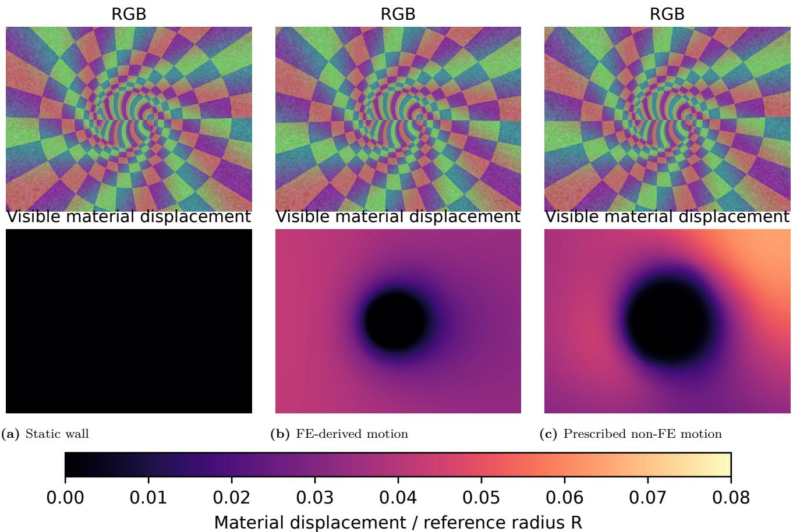

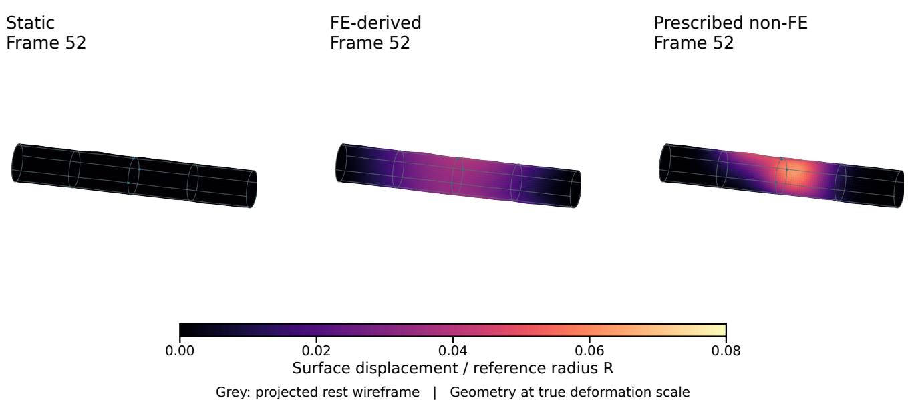  
Figure 5. Stored f01 motion at frame 52. The upper row shows the three-dimensional surface at its true deformation scale, coloured by displacement magnitude divided by reference radius $R ;$ colours average vertex magnitudes per face. Grey lines project the rest wireframe. Below, the retained RGB and image-space material maps use the same stationary camera; each foreground pixel measures its material point’s displacement from rest. Both colour scales span 0–0.08R, without motion magnification. Grey in the image maps denotes background; black denotes zero displacement. FE and non-FE fields have diferent prescribed amplitudes.

360 shared truth states and 1,080 traced radiance maps produce 1,800 RGB images. The compact design selects one originally designated development family (f01), the validation family (f04), and the two recovery-test families (f05/f06); it spans straight, singly bent and doubly bent geometry and both amplitude settings. f02/f03 do not have appearance variants. This bounded selection preserves the original roles and controls production cost; it is not an exhaustive anatomy or curvature experiment. f01 remains development, f04 validation and f05/f06 retain their original final-test designation. All conditions were declared before reconstruction; inspecting this experiment does not leave these scenes unseen for subsequent reconstruction development.

Coordinates are uniformly converted to an assigned median radius of 15 mm. This chosen scale sets the relationship between tube size and the 3 mm light ofsets and permits readable metric units. It is a synthetic scale assignment, not a measurement of a patient’s lumen or a calibration of tissue mechanics. The actual float32 render vertices are stored in metres; source rotations are projected onto proper rotations by singular-value decomposition and retained in float64. This defines the appearance renderer’s actual camera/geometry truth. It does not convert the original abstract-unit FE parameters into validated SI tissue mechanics. Topology and surface materia identities are preserved. Baseline raster labels are not reused as path-tracer labels.

The open-source physically based renderer Mitsuba 3.9.1 (Jakob et al., 2022a) renders the appearance extension. It uses Dr.Jit 1.5.0, a just-in-time compiler for parallel rendering computations (Jakob et al., 2022b). A two-sided surface is rendered at 640 × 480 with pinhole intrinsics $( f _ { x } , f _ { y } , c _ { x } , c _ { y } ) = ( 4 5 5 , 4 5 2 , 3 2 0 , 2 4 0 )$ . Two point lights lie 3 mm to either side of the camera. Symmetric light intensities are (0.0005, 0.0005); asymmetric intensities are (0.00075, 0.00025) in the renderer configuration, preserving their sum. These are controlled numerical intensities, not measured endoscope illumination. The original artificial checker texture is decoded to linear RGB and sampled with periodic bilinear UV interpolation. The difuse control uses difuse reflection; the coated condition uses the renderer’s rough-plastic GGX model with roughness 0.18 and interior/exterior indices 1.38/1 (Mitsuba contributors, 2026). This contrast changes reflectance and brightness jointly, rather than isolating specularity alone.

A bounded development screen fixed 256 samples per pixel, path depth four, eight rendering threads and seed (20260911 + i), where i is the zero-based action-frame index (0–89). Pixel-center rays have no spatial antialiasing or motion blur. Shared seeds match random-number initialization, not identical transport samples across materials. Half/double exposure applies gains 0.5/2 to shared linear radiance, followed by clipping, sRGB encoding and 8-bit rounding; no adaptive exposure or sensor-noise model is applied. Figure 6 shows the fixed development frame 67.

Fresh dense records contain triangle ID, valid mask, camera-z depth and tracer material barycentrics. Positions and geometric face normals are derived from the shared states; float64 label storage does not imply float64 intersection arithmetic. Cross-time material projection provides forward/in-frame support, not occlusion-aware optical flow. Baseline flow/visibility capabilities must therefore not be attributed automatically to this extension. Appearance contrasts hold the inherited moving-camera FE action fixed; they do not establish appearance interactions for stationary cameras, static actions or non-FE motion.

## 2.5 Data organization and inference/evaluation interfaces

Table 3 separates sensor inputs, evaluator truth and estimated reconstructions. The baseline has 3,780 dense maps and 3,738 forward-flow maps: each 90-frame stream has 89 next-frame pairs. The package index resolves every family, condition, acquisition and local reconstruction window; relative links share references without counting them as new observations. The appearance add-on stores five RGB directories per family and shares its geometry, tracer labels and radiance records. Its family directories are appearance/families/f01, f04, f05 and f06; condition-specific images are under each family’s public/ directory.

Checksum manifests identify dataset members and relative links. They distinguish canonical observations, shared references, estimated reconstructions and reproduction records; archive membership and storage totals are supplied with the release, rather than treated as additional samples. Original generation metadata retain their own identifiers and hashes. A verified package mapping and a read-only reproduction view reconcile those records with the public package layout without changing sensor or evaluator payloads.

Mean absolute RGB diference (common square-root color scale) RGB views: square-root brightening, identical for every arm. Diferences: original RGB.  
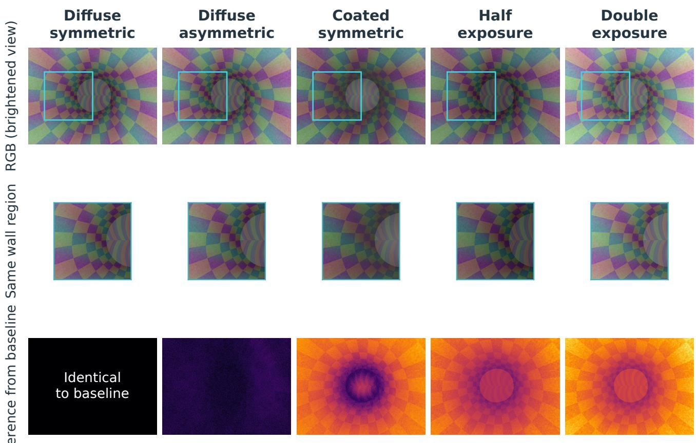

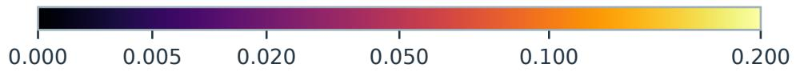  
Figure 6. Matched appearance at f01/frame 67. Each column shows one retained RGB image and enlarges the same cyan-marked 240 × 240-pixel wall region (rows 120–359, columns 80–319, zero-based). To reveal the darker wall, both RGB rows use the identical display mapping $I _ { \mathrm { d i s p l a y } } = \sqrt { I / 2 5 5 }$ on every saved encoded channel I ∈ [0, 255]. This is a viewing adjustment, not regenerated illumination; there is no per-image normalization. The bottom row makes changes relative to difuse symmetric visible: each pixel is the mean absolute diference of its three original encoded RGB channels after division by 255, before display brightening. A common square-root color scale resolves subtle lighting changes without saturating any displayed value; these are image diferences, not physical radiance or reconstruction errors. Geometry, camera and texture coordinates are identical across columns. Lighting redistributes left/right power, coating changes reflectance, and exposure applies a 0.5 or 2 gain to the baseline linear radiance before encoding.

<table><tr><td>Record</td><td>Content</td><td>Information boundary</td></tr><tr><td>public/</td><td>RGB, intrinsics, timestamps, acquisition metadata, shared reference links</td><td>Sensor/acquisition inputs</td></tr><tr><td>evaluation/&lt;stream&gt;/states. npz</td><td>Vertices, displacements, camera transforms, time</td><td>Evaluator-only prescribed geometry</td></tr><tr><td>evaluation/&lt;stream&gt;/dense/*. npz</td><td>Depth, face ID, material barycentrics, normals, valid mask</td><td>Evaluator-only dense truth</td></tr><tr><td>evaluation/&lt;stream&gt;/flow_ forward/*.npz</td><td>Pixel flow and visibility categories</td><td>Evaluator-only correspondence truth</td></tr><tr><td>evaluation/family/</td><td>FE nodes, elements, parameters, stiffness and response bases</td><td>Generating-model state, not inferred tissue</td></tr><tr><td>reconstruction/;</td><td>Estimated reference/action globals and local models; image/window mapping</td><td>Independently estimated additional inputs</td></tr><tr><td>bundles_moving/ Provenance/qualification</td><td>Source/environment records, checksums, generation and camera QA</td><td>Reproduction and interpretation</td></tr></table>

Table 3. Records in a baseline condition package benchmark/vN and their inference/evaluation roles. Paths are relative to that package; <stream> denotes moving or stationary, and relative links provide the shared family/reference assets. The collection contains 24 global and 162 local reconstructions in total, not in each package. Public images, calibration and clocks are separated from privileged geometry, correspondence and mechanics. Dense and forward-flow records describe the baseline bank; the appearance add-on provides fresh tracer labels and cross-time projection, but not baseline-equivalent occlusion-aware flow. Reconstructed models are estimated outputs, not substitutes for ground truth. Lossy MP4 previews are illustrative; PNGs are the canonical images.

These interfaces are Python reader classes in LumenMorph’s backend.src.benchmark\_reader, not directory names. Each is constructed with a condition-package path such as benchmark/v2; the software separates method inputs from evaluation truth:

• PublicDataset reads RGB images, calibration and timestamps from that package’s public/ paths. It never opens evaluator files, so an image-only algorithm cannot obtain ground-truth geometry through this interface.

• EvaluationDataset additionally opens the explicitly privileged evaluation/ paths and provides materialpoint trajectories, displacement, flow and time-composed FE fields. Static actions and rigid references return zero applied mechanical fields; non-FE actions reject FE-mechanics queries because their motion is prescribed without equilibrium.

The appearance extension provides two corresponding readers, AppearancePublic and AppearanceEvaluation, in the module backend.src.appearance\_reader. Each takes a family directory such as appearance/families/f01.

“Evaluator-only” denotes an interface and inference contract, not restricted distribution: the privileged annotations are public and downloadable. Users can open them with the evaluation readers, but must exclude them from image-only inference. Table 4 distinguishes stored annotations from derived quantities and prevents attributing baseline visibility to appearance projections.

The prediction evaluator is a separate scoring utility in LumenMorph, backend.src.benchmark\_evaluate, not a prediction method or RAFT. After any method has produced a saved prediction array, this utility accepts depth, next-frame flow, oriented world normals or material displacement at native image resolution. Submitted arrays have shape $H \times W$ for depth, $H \times W \times 2$ for flow, and $H \times W \times 3$ for world normals or displacement. They are stored in an NPZ file with a prediction array and an optional Boolean availability mask. The utility computes depth absolute error, angular normal error and Euclidean flow/displacement endpoint error, together with prediction coverage. RAFT supplies flow predictions in the usage study; it does not construct the scorer or its ground truth. The eligible truth pixels are fixed before predictions are inspected. An invalid or missing prediction reduces coverage; error over the entire eligible population is available only at full coverage. Otherwise the reported error is explicitly conditional on the available predictions. For example, predicting only an easy wall region cannot receive a full-population score.

<table><tr><td>Annotation</td><td>Baseline bank</td><td>Appearance extension</td></tr><tr><td>RGB, calibration, timestamps</td><td>Stored</td><td>Stored for five matched conditions</td></tr><tr><td>Camera poses, deformed vertices, topology</td><td>Stored</td><td>Stored; shared by appearance conditions</td></tr><tr><td>Depth, validity, triangle ID, material weights</td><td>Stored dense maps</td><td>Stored fresh tracer labels</td></tr><tr><td>World positions, face normals</td><td>Positions derived; normals stored</td><td>Derived by appearance reader</td></tr><tr><td>Material trajectories and displacement</td><td>Derived from identity and states</td><td>Derived from identity and metre-valued states</td></tr><tr><td>Next-frame flow and visibility categories</td><td>Stored; arbitrary stored-time pairs derivable</td><td>Material projection derivable; no equivalent occlusion classification</td></tr><tr><td>FE state, loads, stiffness, stress/strain</td><td>Stored bases; time fields composed for Inherited family generating records; FE actions</td><td>not fresh image-space mechanical labels</td></tr></table>

Table 4. Annotation availability, separate from access permissions. “Derived” means computed from released records, not estimated from RGB. Non-FE actions have prescribed kinematics without applied FE equilibrium; static/reference fields are zero. Appearance coordinates use the declared render-world metre scale and do not calibrate FE forces or tissue properties. The baseline CLI scorer is not an automatic adapter for the appearance schema.
<table><tr><td>Task</td><td>Required prediction</td><td>Evaluation contract</td></tr><tr><td>Per-frame geometry</td><td>Camera-z depth or oriented world normals at Absolute depth / angular normal error and source pixels</td><td>coverage</td></tr><tr><td>Image correspondence</td><td>Next-frame pixel displacement</td><td>Flow endpoint error and coverage on fixed visible support; separate visibility strata</td></tr><tr><td>Material motion</td><td> $\widehat { \Delta X } _ { s , t } ( p )$  for the material point visible at source s</td><td>3D endpoint error against  $X _ { t } ( m _ { p } ) - X _ { s } ( m _ { p } )$  with source-valid denominator</td></tr><tr><td>Complete deformable reconstruction</td><td>Estimated cameras and a time-indexed surface Camera errors, bidirectional geometry/support with predicted cross-time material associations and material-motion error, each with coverage</td><td>and declared gauge</td></tr><tr><td>Supplied-geometry interpolation</td><td>supplied geometry/identities and declared mechanical records</td><td>Displacement field from sparse observations,Displacement error under that privileged-input contract; not image-only reconstruction</td></tr></table>

Table 5. Tasks enabled by the linked annotations. The dense CLI implements the first three task rows for the baseline schema; surface and camera scoring use the separate study tools. Complete deformable reconstruction is a defined evaluation target, not a claim that the present studies solve it or that one CLI command scores an arbitrary dynamic representation.

This evaluator applies no truth-based scale fitting or alignment. An algorithm must return the declared units and coordinate frame. SfM’s arbitrary gauge is handled separately by the camera-center similarity fits defined below. Twelve regression tests and four constant-output controls verify the software contract; scientific accuracy comes from the usage studies rather than these software checks.

Evaluation tasks and outputs. For source pixel p on the surface, let $m _ { p } = ( q _ { p } , \lambda _ { p } )$ denote its recorded material identity. The linked truth is $\{ C _ { t } , R _ { w c , t } , X _ { t } ( m _ { p } ) \} ; m _ { p }$ is used by the evaluator, not supplied to image-only inference. Table 5 defines reusable tasks. Unless a known-information variant is explicitly declared, inputs are the RGB sequence, calibration and timestamps from the public interface. Any estimated reference model used additionally must be identified as such. Freeze the method and predictions before opening evaluator records.

A complete reconstruction must predict associations across time rather than select a new nearest surface point in every frame. A suitable joint target is $\{ \widehat { C } _ { t } , \widehat { R } _ { w c , t } , \widehat { X } _ { t } ( a ) \} _ { t }$ , where a indexes the method’s persistent surface entities. Its declared output adapter must associate these predictions with source observations, report missing associations and evaluate their trajectories against $m _ { p }$ . A single gauge must apply to the sequence and all predicted times; independently fitting each state would obscure motion errors. Without external scale/orientation access, report a declared gauge-invariant or explicitly truth-aligned score, rather than absolute-world recovery. The existing dense scorer performs no such fit. This protocol links camera, geometry and material-motion evaluation without inventing a combined ranking or treating the current quasi-static SfM and privileged interpolation studies as end-to-end deformable reconstruction. A minimal reader/query/scoring example is given in Supplementary Methods S4.

## 2.6 Extending the benchmark with LumenMorph

The fixed dataset and the generator are separately versioned resources. LumenMorph 1.0.2 exposes the staged producer backend.src.benchmark and a JSON specification, exemplified by configs/tubular\_benchmark\_v1. json. Within its supported tubular parameterization, a user can configure seeds, centerline sections, radius, surface sampling and bumps; camera intrinsics and path-progress/ofset parameters; load-patch locations, directions and widths; FE and prescribed non-FE peak amplitudes; and the linear material and volume-mesh parameters. Texture and photometric-noise settings control image generation. The separate appearance producer supplies the matched tracing conditions described above. The benchmark producer in this release retains its predefined 90-state motion schedule; arbitrary temporal waveforms are not a configuration feature.

From a pinned checkout with the mechanics submodule initialized, users copy and edit the specification, then invoke the producer’s freeze, prepare, package and render stages in a fresh output root. For example, freeze –spec custom.json –root ./new\_suite records the chosen specification and sources before family preparation, condition packaging and reference/moving/stationary rendering. The resulting suite exports the linked RGB, geometry, material and mechanical records used by the readers in Section 2.5; generation commands and a complete single-family example are given in Supplementary Methods S3. Supplementary Methods S4 shows how to consume the fixed release without generating another dataset. Each new configuration requires its own consistency checks; validation of the released benchmark does not automatically validate a newly generated scene. The generic plane/tube preview CLI is a separate path and does not imply the full mechanical benchmark schema.

## 2.7 Reconstruction pipelines and reproducible configuration

Two source-traceable CPU builds test whether the resource can reveal diferences between a task-specific recon struction pipeline and a maintained general-purpose implementation:

• Pipeline A: COLMAP-for-colonoscopy 2, a derivative of the colonoscopy adaptation introduced in Subías Sarrato’s bachelor’s thesis (Subías Sarrato, 2021, n.d.), with subsequent developments described in a master’s thesis (Cirauqui Viloria, 2022). Supplementary Methods S1 preserves its inherited geometry/matching changes and source lineage.

• Pipeline B: a derivative of oficial COLMAP 4.2.0, based on the upstream incremental SfM implementation (Schönberger and Frahm, 2016). It provides a separately maintained reference with newer estimation, matching and mapper implementations; Supplementary Methods S1 identifies the execution-order corrections.

Both pipelines share COLMAP ancestry and use fixed public source releases (Section 8). They receive the same images, calibration and requested windows, with disabled intrinsic refinement and frozen thresholds. Their internal algorithms difer, so this is a benchmark usage comparison, not an isolated algorithmic ablation. The declared profiles, source repairs, fresh versus retained stages and runtime receipts are documented in Supplementary Methods S1–S2. Retained stages are not fresh end-to-end reproduction, and the supplied dataset baseline models have a separate source/runtime identity from this corrected comparison.

## 2.8 Cross-pipeline reconstruction experiment

SfM estimates camera poses and a sparse set of 3D feature points from multiple images. A frame is registered when the mapper estimates its pose; registration alone says nothing about its accuracy. The frozen comparison requests 20 family/condition combinations: the moving FE actions of four families under five appearance conditions, with three computational repetitions per pipeline (120 cases and 240 global/local reconstruction routes). Fresh and retained inference stages follow the fixed contract in Supplementary Methods S1–S2. This reuses matching rather than claiming fresh end-to-end B reproduction. Here global means one reconstruction from all 90 consecutive moving-action images, frames 0–89. Local means a separately initialized reconstruction from the 15 consecutive images at frames 60–74, the full-motion plateau in Figure 3. Frame indices are zero-based and local to the action acquisition; this is a fixed temporal window, not 15 randomly selected frames or a subset cropped from the finished global model. The local window deliberately holds the wall state constant while the camera moves. It tests quasi-static reconstruction at a deformed state, rather than tracking a changing surface; the global window spans the complete motion cycle. Inputs are limited to images and calibration; no ground-truth poses, geometry or material identities were supplied. Each mapper receives a private copy of the post-matching database. Thread counts, seeds and source derivatives follow Section 2.7. Extraction, matching, global mapping and local mapping had respective time caps of 300, 3,600, 3,600 and 1,200 seconds. This is the frozen parameter set from the earlier appearance study, translated between pipelines as described in Section 2.7.

For evaluation, each estimated camera trajectory was aligned to ground truth by a separately fitted proper similarity transformation (Sim(3): rotation, translation and positive scale) (Umeyama, 1991), using scored camera centers only. This removes the arbitrary coordinate system and scale of monocular SfM; the fitted errors therefore do not measure absolute-scale recovery. We write the fitted scale, rotation and translation as $( s , Q , t )$ . Synthetic truth is first expressed in the evaluator’s COLMAP-compatible world and camera bases: with $F = \mathrm { d i a g } ( 1 , - 1 , 1 )$ $C _ { \mathrm { r e f } } = F C _ { w }$ and $R _ { \mathrm { { r e f } } } = F R _ { w c } F ;$ geometry uses the same world-basis change. This declared conversion is fixed before fitting. C3VD’s already-native poses receive no additional reflection. Camera-position absolute trajectory error (ATE) is summarized by its root mean square error (RMSE). For camera-to-world rotations $\hat { R } _ { i } , R _ { i }$ , absolute orientation error is the angle of $R _ { i } ^ { T } Q \hat { R } _ { i } ;$ relative orientation compares $\hat { R } _ { j } ^ { T } \hat { R } _ { i }$ with $R _ { j } ^ { T } R _ { i }$ and needs no fitted world gauge. Relative errors use adjacent requested frames only; a gap in registration is not treated as a one-frame increment. Angles use an atan2 expression to retain resolution near zero. For paired centers $\hat { C } _ { i } , C _ { i }$ and fitted similarity $( s , Q , t )$ , ATE<sub>RMSE</sub> = $\textstyle { \sqrt { N ^ { - 1 } \sum _ { i } \| s Q { \hat { C } } _ { i } + t - C _ { i } \| ^ { 2 } } }$ . At least three paired centers, nonstationary center spread and a second/first centered singular-value ratio of $1 0 ^ { - 6 }$ in both trajectories are required; otherwise the alignment-dependent scores are unavailable. Local surface error is the unsigned distance from each retained reconstructed point to the complete, constant truth mesh for frames 60–74. Surface support is measured in the reverse direction, from a fixed visible-surface sample to the nearest reconstructed point. The sample uses every 16th pixel in both image axes across all 15 local frames, independently of registration success. Thus point-to-surface error asks whether reconstructed points are close to the wall, while surface-to-point support asks which visible wall regions have nearby reconstructed points. Neither measures persistent material correspondence by itself. A sparse, incomplete model can score well on the first metric and poorly on the second: a few points on one accurately reconstructed patch have low point-to-surface distance, while uncovered wall regions remain far from every point. We report both distributions, point counts and their tails; a median alone can hide large geometry outliers. Neither nearest-surface direction establishes correct material identity. Figure 7 illustrates the acquisition window, retained local camera/point models and the two metric directions. Its example is fixed to f01/difuse-symmetric/repeat 1 for illustration; quantitative comparisons retain every requested family and appearance condition.

Original and corrected attempts are documented, including failures or missing outputs. Complete final outputs are retained; the earlier raw-stage retention boundary is stated in Section 7. Corrected source, options, cases and evaluators are fixed before replay; no seed, initial pair or threshold is selected from accuracy outcomes.

## 2.9 Repeatability experiment

Three computational repetitions per family/condition and pipeline test stability within a fixed source, runtime and CPU profile. Private database inputs, full-precision outputs, stage completion and registered-frame identities are checked; failures and absent models remain in the denominator. These are repetitions of the same scenes, not independent observations or a portability test. Supplementary Methods S1–S2 gives stage-reuse and hardware details.

Each returned model is scored using its own identifiable camera-center gauge. B-minus-A and condition minus-difuse camera contrasts additionally use the intersection of registered requested frames, fitting each model on that same support. Unidentifiable gauges and unavailable model pairs remain explicit abstentions. All 120 cross-derivative and 192 appearance contrasts are retained. Families are reported separately; no significance test treats frames, points or repetitions as independent acquisitions.

Scoring uses full-precision binary poses and verified exports. A separate implementation fits the proper positive similarity by a quaternion eigensystem (Horn, 1987), checks rotations and computes surface distances. Positive/negative controls and the full-cohort readback are retained in the reproduction material. These agreements validate the scoring calculation, not accuracy beyond the supplied reference.

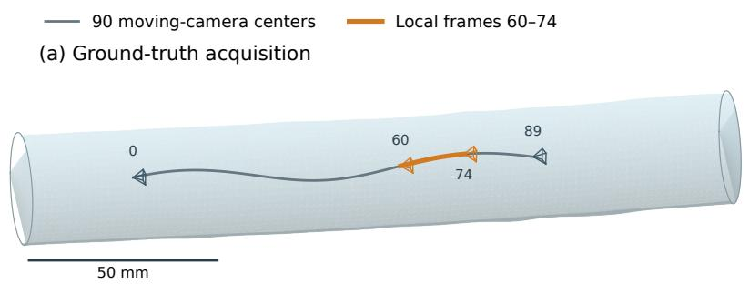

(b) Pipeline A: 6,039 points, 15/15 cameras  
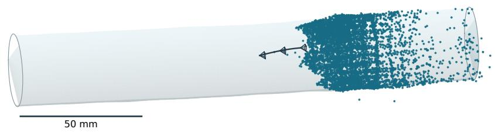

(c) Pipeline B: 5,600 points, 15/15 cameras  
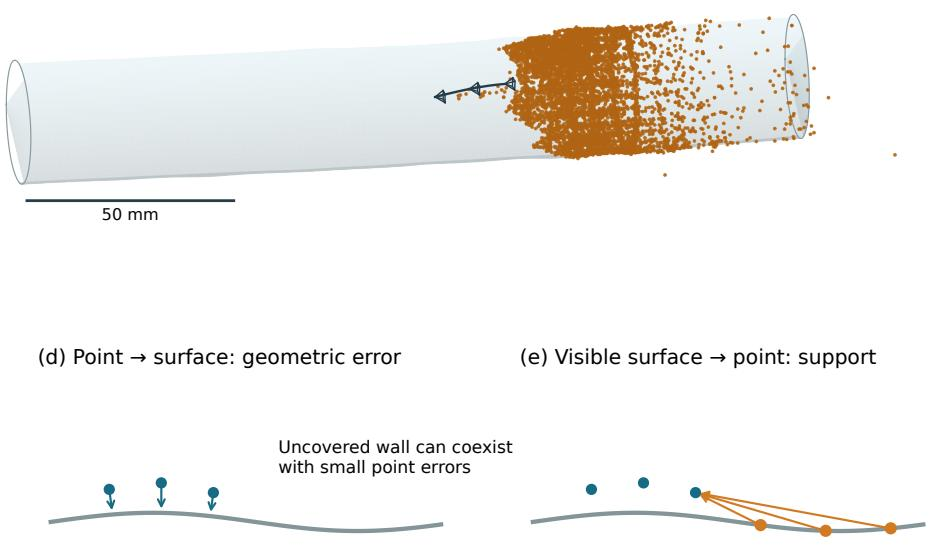  
Schematic only: grey = truth wall; blue = reconstructed points; orange = fixed visible samples.

Figure 7. Spatial interpretation of the reconstruction experiment. (a) The ground-truth moving-camera trajectory and the local frames 60–74 inside the f01 appearance wall at frame 67, which is constant over this plateau. The near half of the wall is omitted for display; the complete mesh is used for scoring. Camera glyphs indicate recorded positions/orientations, not calibrated fields of view. $^ { ( \mathrm { b , c } ) }$ Retained A-SIFT1 and B-ORDER1 local reconstructions for the difuse-symmetric condition, repeat 1. Points and cameras use each model’s recorded center-fitted Sim(3), expressed in the same render-world basis; there is no additional surface fit or absolute-scale recovery claim. Each pipeline has one view retaining every point, including outliers, with identical $\mathrm { A } / \mathrm { B }$ bounds and scale. Scale bars use the assigned millimeter render-world scale. $^ { ( \mathrm { d } , \mathrm { e } ) }$ Schematic cross-sections distinguish point-to-surface error from the distance of fixed visible-surface samples to reconstructed points; they contain no experimental measurements. Codex (version not recorded) assisted the schematic code in $^ { ( \mathrm { d } , \mathrm { e } ) }$

## 2.10 Provided-geometry mechanical-record consumer

To demonstrate a concrete use of the FE records, we test displacement interpolation with supplied rest geometry and material correspondence. This task isolates the efect of an energy prior after observations have been provided; it does not estimate correspondence or deformation from RGB. We use the exposed families f01–f04, static frame 67 and FE/non-FE frames 37, 52 and 67: 28 fields spanning rest, low motion, a ramp and full motion. Fifty-six surface vertices form the observed set: seven axial rings crossed with eight circumferential positions. All methods receive the same noisy Cartesian displacement observations and exact zero-displacement constraints at the two terminal rings. Independent Gaussian noise has component standard deviation 0, 0.001R or 0.01R, each under three fixed seeds. The resulting 252 cases are dependent synthetic conditions, not independent acquisitions.

The baselines are zero displacement and thin-plate-spline radial-basis interpolation in normalized rest-world coordinates, using SciPy RBFInterpolator with kernel $\phi ( r ) = r ^ { 2 } \log r ;$ , a degree-one polynomial and zero smoothing (SciPy contributors, 2026). Supplied fixed-end vertices enter the interpolator with zero displacement. The FE consumer uses the stored volume stifness and periodic bilinear surface transfer, minimizing

$$
\| B _ { f } x - y \| _ { 2 } ^ { 2 } + \lambda x ^ { T } K _ { f f } x / d , \qquad d = \operatorname * { m e d i a n } \operatorname { d i a g } ( K _ { f f } ) .\tag{5}
$$

Here x contains the free nodal displacement components divided by R, y contains the normalized observations, and $B _ { f }$ transfers free outer-node displacements to the 56 observed material locations. Fixed ends are eliminated.   
The two prespecified values $\lambda = 1 0 ^ { - \mathrm { \tilde { 4 } } } , 1 0 ^ { - 2 }$ probe weak and stronger regularization after diagonal normalization.   
They are fixed examples, not optimized settings, and both are reported; neither is selected using heldout error.   
The generating response bases, loads, coeficients, full displacements and motion labels are excluded from inference.   
Providing the true stifness and identities makes this a privileged-input resource demonstration.

Manufactured tests verify the transfer, constrained solve and evaluator-truth isolation. Observations and evaluator truth are sealed separately; predictions are sealed before scoring. Endpoint error is evaluated on the 5,224 surface vertices that are neither observed nor supplied fixed-end constraints. All requested cases and methods are retained. The summaries average seeds and time states within each family, then give families equal weight; static, FE and non-FE motion and noise levels remain separate.

## 2.11 Optical-flow methods and evaluation

Optical flow estimates each visible pixel’s two-dimensional displacement between images. This tests the dense correspondence annotations under separately controlled camera and surface motion. We compare a zero-motion control, the classical Farnebäck and dense inverse search (DIS) methods (Farnebäck, 2003; Kroeger et al., 2016), and RAFT (Teed and Deng, 2020), a neural network trained on external data. “Learned” refers to RAFT’s pretrained estimator; no model is trained on this benchmark. We use the torchvision implementation and its released pretrained weights (raft\_large, C\_T\_SKHT\_V2 recipe, SHA-256 verified) (PyTorch contributors, 2026), with no fine-tuning on any benchmark truth. The fixed development cohort contains three families crossed with static, FE and non-FE motion, moving and stationary cameras, and eight source frames (0, 14, 22, 37, 52, 67, 82 and 88), each paired with its immediate successor: 144 image pairs. Selection uses the public suite index and verifies family, condition and split rather than assuming package numbers. Every pair is checked against its declared family, motion and acquisition before inference and scoring.

All four methods use the same correctly identified pairs. Classical methods receive grayscale and RAFT receives RGB; the released RAFT transform maps uint8 input to [−1, 1], with 12 update iterations, original image dimensions and no resizing. DIS uses its medium preset; Farnebäck parameters and the exact checkpoint hash are fixed in the package. Three fresh processes run the classical methods on one CPU thread and RAFT on an NVIDIA RTX 5070 Ti Laptop GPU (12 GB), with seed zero and deterministic PyTorch algorithms. RAFT uses IEEE float32, with TF32 and autocast disabled, deterministic cuBLAS configuration and cuDNN benchmarking disabled; software and driver versions are retained. Each batch loads a fresh RAFT model. The 1,728 requested arrays are sealed before evaluator truth is read.

Endpoint error, its median and 95th percentile, and fractions above one and three pixels are evaluated separately for visible, occluded and out-of-frame source points. Finite truth defines the eligible denominator; missing or nonfinite predictions reduce reported prediction coverage rather than silently removing requested support. Source frames are averaged within each family before equal-family aggregation, retaining condition, camera stream and visibility stratum. Independent calculations check every pair’s scores and all aggregates, alongside byte equality of the three prediction batches. These computational repetitions do not enlarge the development population.

## 2.12 Static physical-phantom control

Two public C3VD acquisitions provide static physical-phantom controls: the 61-frame trans\_t1\_a sequence and two fixed 30-frame segments, 0–29 and 30–59, of desc\_t4\_a (Bobrow et al., 2023). The segments share one acquisition and are not independent phantoms. A moving clinical colonoscope observes a static physical wall; these controls test image reconstruction and do not measure deformation recovery.

The control is prepared directly from all 121 original public color PNGs, retaining the $0 / 0 / 3 0$ source-frame ofsets. Images are rectified into a 1350×1080 PINHOLE camera with $f _ { x } = f _ { y } = 7 0 0 , c _ { x } = 6 7 5$ and $c _ { y } = 5 4 0$ pixels. The original public calibration is mapped into the same target PINHOLE camera using the authors’ published Python-loader ray convention (DurrLab, n.d.). Native COLMAP target pixel centers are $( \mathrm { c o l u m n } + 0 . 5 , \mathrm { r o w } + 0 . 5 )$ source coordinates follow the loader’s declared principal-center and afine-stretch convention. The alternative C++ matrix convention is distinguished in the provenance record. The map keeps the optical axes fixed; no axis rotation is estimated from reference poses or outcomes. A full-grid forward/inverse ray check verifies the map, and a separate source/replay audit verifies every output PNG. Interpolation and the published calibration remain physical approximations; the numerical map tolerance is not a lens-accuracy claim.

The three fixed image sets and three repetitions of both corrected pipelines request 18 global reconstruction routes. A uses A-SIFT1 and B uses B-ORDER1, both with the CPU-AFFINITY1 profile. All nine A cases extract afresh and execute fresh fixed-afinity mapping; matching follows the same exact-feature-only inheritance rule as the appearance experiment. The nine B cases retain their corresponding closed matching inputs and execute the fixed-afinity mapper. Canonical payload equality, actual stage lineage and all three repetitions are audited separately. Numeric thresholds, seeds, thread counts and stage limits follow the synthetic comparison. No seed, initial pair, field of view or minimum model size is selected to obtain full registration. All returned fragments and failures remain in the requested denominator. Reference poses are reconciled against the authors’ columnmajor serialization and retained CSVs, using native camera axes and the explicit source-frame ofsets. Center and orientation metrics follow the same identifiable proper-Sim(3) gauge rules; partial models with insuficient geometric support receive an accuracy abstention. Position errors are expressed in millimeters in the supplied C3VD coordinate system, as supported by the source’s translation and depth conventions (DurrLab, n.d.), without claiming metrological precision. Supplied C3VD poses are evaluator truth; no known-pose model is used as image-based inference or as surface truth for the rectified images.

## 2.13 Visualization and AI assistance

Data visualizations are generated by recorded Python scripts from retained images, geometry, predictions and scores. Codex (OpenAI; client and model versions not recorded) assisted analysis, validation and plotting code, including explanatory schematics. The executed scripts and their source/input receipts record the reproducible procedures. Figure captions distinguish schematics from measurements and disclose any display transformations. The author reviews the code, results and manuscript and remains responsible for their content.

## 3 Results

## 3.1 Geometry, image consistency and integrity

Separately implemented generation checks distinguish continuous surface geometry from the implementation’s own raster output. A full geometric census covers all 1,161,216,000 pixels of the 3,780 saved frames. Separate sampled audits cover 119,616 flow vectors. Of 604,748 selected texture pixels, 519,638 are checked, including 71,671 seam samples; 85,110 texel-boundary cases are skipped because roundof can change nearest-texel assignment there. They are not counted as successful checks. Normals are also sampled. Exhaustive geometry coverage must not be interpreted as an exhaustive audit of every modality.

The retained criteria require relative physical-depth and material-point-depth errors below $1 0 ^ { - 5 }$ , material reprojection error below $1 0 ^ { - 3 }$ pixels, and zero visibility mismatches. Shared-edge face ambiguity is accepted only under the recorded barycentric/depth rule. The full census maxima are $5 . 9 7 \times 1 0 ^ { - 8 }$ for relative physical depth and $2 . 5 2 \times 1 0 ^ { - 4 }$ pixels for reprojection (rounded upward), with zero recorded depth or identity failures. Sampled flow error is at most $3 . 7 1 \times 1 0 ^ { - 6 }$ pixels against a $1 0 ^ { - 3 } .$ -pixel tolerance. Exact criteria and exception counts accompany the machine-readable reports.

Periodic texture interpolation and higher-precision intermediate projection support consistency across angular seams and grazing views. A complete readback verifies the retained files against their applicable identity records and checks all relative links. Original generation metadata and the public package layout reconcile exactly. These checks establish artifact identity and synthetic consistency; they do not establish anatomical realism or inverse-method accuracy.

<table><tr><td>Family</td><td>max |eij|</td><td>maxt ρt</td><td>min det F</td></tr><tr><td>f01</td><td>0.00994</td><td>0.04022</td><td>0.99076</td></tr><tr><td>f02</td><td>0.01087</td><td>0.03571</td><td>0.99193</td></tr><tr><td>f03</td><td>0.02047</td><td>0.14501</td><td>0.98030</td></tr><tr><td>f04</td><td>0.00876</td><td>0.04245</td><td>0.99109</td></tr><tr><td>f05</td><td>0.01168</td><td>0.07836</td><td>0.98845</td></tr><tr><td>f06</td><td>0.01912</td><td>0.08372</td><td>0.98323</td></tr></table>

Table 6. Minimum and maximum diagnostics over each retained 90-state FE audit. ϵ is the infinitesimal strain tensor, $F = I + \nabla u$ , and $\begin{array} { r } { E _ { G } = \frac { 1 } { 2 } ( F ^ { T } F - I ) } \end{array}$ . Here $\rho _ { t } = \| E _ { G } - \epsilon \| _ { F } / \operatorname* { m a x } ( \| \epsilon \| _ { F } , 1 0 ^ { - 3 0 } )$ , with each norm taken over all elements, Gauss points and tensor components at that time; the table reports max $\rho _ { t } ,$ , not a maximum pointwise ratio. The diagnostics characterize the declared small-strain model.

Validation of the appearance extension by separately implemented checks accounts for all 360 shared states and verifies each consumed file against its declared identity. Pixelwise depth/projection checks are complemented by 43,560 separately implemented sampled ray tests with zero hit/miss disagreements and 43,560 cross-time material queries. All radiance-to-RGB conversions reproduce exactly. Twelve fixed replays (frame 67, four families, three traced conditions) reproduce RGB, radiance and geometry exactly under the recorded environment. At near-tangent rays, the largest observed material-projection discrepancy is 0.0047792 pixels (41 pixels in 33 frames). The appearance release uses a 0.01-pixel precision tolerance, documented as a retrospective check of released-label numerical precision rather than a prespecified test of downstream reconstruction accuracy. The afected pixel/frame counts and full projection audit accompany the release.

To isolate reconstruction jobs, the runner supplies each global and local mapper a byte-identical copy of frozen matches, checks unchanged canonical bytes, and protects camera calibration, extracted image features and geometrically verified matches in the COLMAP database; only auxiliary flag values and physical SQLite layout may difer. The 120-job comparison fixes this database-isolation rule in its execution protocol, with frozen parameters and complete requested denominators; no model is selected according to its accuracy.

## 3.2 Discrete mechanics and source replay

Independent arithmetic checks on 18 basis responses across all six FE families give a maximum relative freeequilibrium residual of $1 . 7 7 \times 1 0 ^ { - 1 2 }$ and maximum relative integrated-energy error of $\stackrel { - } { 2 } . 8 4 \times 1 0 ^ { - 1 3 }$ (rounded upward), against a $1 0 ^ { - 7 }$ arithmetic tolerance. Strain/stress basis checks also pass. Separate kinematic diagnostics cover all 90 composed states per family and find positive quadrature-point deformation Jacobians. These determinants measure local volume change in each sampled element: positive values exclude a local inversion at those quadrature points. They provide a discrete deformation sanity check, rather than a test of the entire continuous surface. Table 6 retains strain-regime diagnostics rather than interpreting numerical equilibrium as physiological validity. The relative Green–infinitesimal strain discrepancy reaches 0.145 in f03. This is a kinematic diagnostic, not a measured tissue-model error. Positive quadrature Jacobians do not prove global injectivity, self-contact avoidance or continuum mesh convergence.

The composed-mechanics reader was checked by a separate implementation on 27 static/FE/non-FE/reference calls. For a mixed-coeficient state in f01, total energy is 374.86219 numerical units; the incorrectly diagonal-only sum is 354.0134. The full nine-term basis expansion agrees with Equation 2, demonstrating why derived access should preserve mechanical cross terms instead of exporting potentially misleading scalar sums.

A source-archive replay used relocated generator and solver source trees outside Git. All 35 f01 preparation arrays match the sealed geometry, fields, mechanics and poses exactly; the texture, first reference PNG and first-frame dense maps also match. A second isolated environment freshly installed pinned NumPy 2.4.4, SciPy 1.17.1 and OpenCV-Python 4.13.0.92 and reproduced the same results, on the same Linux host; this is not a complete-bank rerender or a cross-platform bitwise-identity guarantee.

<table><tr><td>Motion</td><td>Noise</td><td>Zero</td><td>RBF</td><td>FE  $1 0 ^ { - 4 }$ </td><td> $\mathrm { F E ~ 1 0 ^ { - 2 } }$ </td></tr><tr><td>Static</td><td>0.000</td><td>0.000000</td><td>0.000000</td><td>0.000000</td><td>0.000000</td></tr><tr><td>Static</td><td>0.001</td><td>0.000000</td><td>0.001090</td><td>0.000888</td><td>0.000886</td></tr><tr><td>Static</td><td>0.010</td><td>0.000000</td><td>0.010896</td><td>0.008879</td><td>0.008858</td></tr><tr><td>FE</td><td>0.000</td><td>0.032708</td><td>0.000278</td><td>0.000207</td><td>0.000208</td></tr><tr><td>FE</td><td>0.001</td><td>0.032708</td><td>0.001224</td><td>0.000984</td><td>0.000983</td></tr><tr><td>FE</td><td>0.010</td><td>0.032708</td><td>0.011442</td><td>0.009276</td><td>0.009255</td></tr><tr><td>Non-FE</td><td>0.000</td><td>0.020377</td><td>0.001617</td><td>0.008285</td><td>0.008307</td></tr><tr><td>Non-FE</td><td>0.001</td><td>0.020377</td><td>0.002290</td><td>0.008624</td><td>0.008643</td></tr><tr><td>Non-FE</td><td>0.010</td><td>0.020377</td><td>0.011717</td><td>0.014532</td><td>0.014530</td></tr></table>

Table 7. Mean heldout material displacement endpoint error divided by R, with equal family weighting over f01–f04. Noise is the observation component standard deviation divided by R. Each FE/non-FE cell includes 36 requested cases (four families, three times, three seeds); each static cell includes 12. Zero-noise repetitions share identical observations. All methods have full finite coverage on 5,224 heldout vertices per case.

<table><tr><td>Acquisition</td><td>Min. sequence median / R Max. sequence median  $/ \ R$ </td></tr><tr><td>Rigid reference</td><td>0.001006</td></tr><tr><td>Static action 0.000608</td><td>0.002230 0.001263</td></tr><tr><td>FE action</td><td>0.016414</td></tr><tr><td rowspan="7"></td><td>0.050363</td></tr><tr><td>0.019402 0.035162</td></tr><tr><td></td></tr></table>

Table 8. Ranges of per-sequence global median camera-position errors across six families, after separate proper Sim(3) evaluation fits. Errors are divided by each family’s median reference radius $R ;$ each column is the minimum or maximum of six sequence medians, not a pooled point/camera percentile or an uncertainty interval. Every global model registers 90/90 frames. The rigid reference and static moving action are separate acquisitions.

## 3.3 Utility of the mechanical records

All 1,008 method/case outputs have finite predictions on the complete heldout population. A separate evaluator reproduces 4,212 per-case and aggregate arithmetic checks. The maximum FE normal-equation residual is $1 . 1 5 \times 1 0 ^ { - 1 5 }$ . Table 7 shows that the FE prior lowers equal-family mean heldout error for FE-compatible fields at all three noise levels relative to geometric interpolation. At 0.001R noise, the errors are 0.000984R and 0.000983R for the two FE priors, versus 0.001224R for the radial-basis baseline.

On non-FE motion, both FE priors instead increase error at every noise level: without noise, about 0.0083R versus 0.0016R for geometric interpolation. With static noisy observations, all nonzero estimators produce false motion; the zero-motion control has zero error. Thus the records enable a controlled test of a mechanical assumption and its mismatch, rather than implying that an FE prior must improve every field. The task supplies geometry, stifness, fixed ends and material identities; no practical image-based recovery or clinical transfer conclusion follows from these results.

## 3.4 Baseline dataset: reconstruction coverage and camera error

Separately estimated reconstructions of the canonical 18-package bank use the pinned dataset-generation CPU COLMAP-for-colonoscopy executable (Section 2.7). All six rigid-reference globals and all 18 moving-action globals register their 90 images. Each moving action has nine separately initialized 15-frame local reconstructions beginning at frames $0 , 1 0 , 2 0 , 3 0 , 4 0 , 5 0 , 6 0 , 7 0 , 7 5 ;$ all 162 locals register every required frame. Stationary actions have zero camera baseline and are excluded from these separate local reconstructions. For evaluation only, each camera-center trajectory is aligned separately to truth with a proper rotation, translation and scale (Umeyama, 1991), and errors are normalized by the median true reference radius. Table 8 and Figure 8 retain the observed global camera bias despite full coverage; independent local similarity fits remove each window’s gauge and cannot validate global/local alignment or absolute-scale recovery. These metrics describe the distributed baseline reconstructions, whose source/runtime difers from the corrected execution profiles. The controlled two-pipeline comparison is reported separately in Section 3.5.

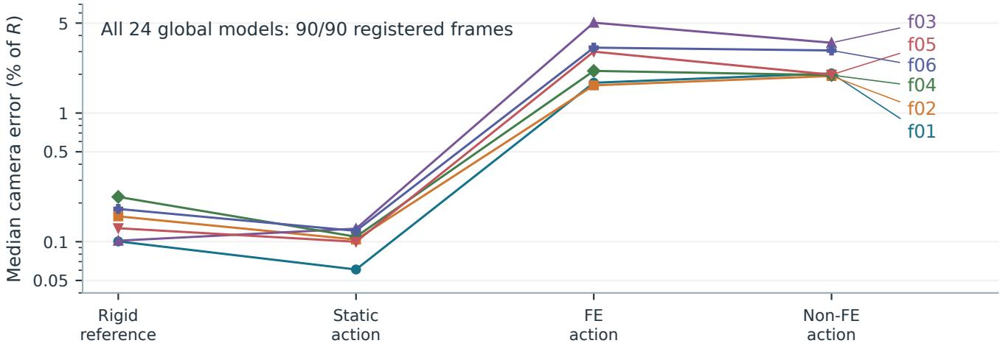

Figure 8. Complete registration does not imply accurate cameras. Each marker is one global reconstruction’s median camera-center error after its own proper similarity fit, expressed as a percentage of the family’s reference radius R (logarithmic axis). Connected markers share a family across four acquisitions; right-hand labels identify each line. All 24 models register 90/90 frames. The deformation conditions have larger errors, but difering motion amplitudes and fields prevent a single-factor causal interpretation. Table 8 gives the ranges in unscaled fractions of R.
<table><tr><td>Family</td><td>Model</td><td>A coverage</td><td>A ATE (mm)</td><td>B coverage</td><td>B ATE (mm)</td><td>B − A (mm)</td></tr><tr><td>f01</td><td>global</td><td>90/90</td><td>0.3154</td><td>90/90</td><td>0.3156</td><td>0.0001997</td></tr><tr><td>f01</td><td>local</td><td>15/15</td><td>0.003651</td><td>15/15</td><td>0.003418</td><td>-0.0002324</td></tr><tr><td>f04</td><td>global</td><td>90/90</td><td>0.4944</td><td>90/90</td><td>0.4947</td><td>0.0002967</td></tr><tr><td>f04</td><td>local</td><td>15/15</td><td>0.006227</td><td>15/15</td><td>0.004536</td><td>-0.001691</td></tr><tr><td>f05</td><td>global</td><td>90/90</td><td>0.4789</td><td>90/90</td><td>0.48</td><td>0.001186</td></tr><tr><td>f05</td><td>local</td><td>15/15</td><td>0.00434</td><td>15/15</td><td>0.003798</td><td>-0.0005421</td></tr><tr><td>f06</td><td>global</td><td>90/90</td><td>0.9514</td><td>90/90</td><td>0.9516</td><td>0.0002333</td></tr><tr><td>f06</td><td>local</td><td>15/15</td><td>0.004127</td><td>15/15</td><td>0.002638</td><td>-0.001488</td></tr></table>

Table 9. Difuse-symmetric synthetic baseline. A and B denote A-SIFT1 and the B-ORDER1 mapper with its declared inherited matching inputs. ATE is camera-center RMSE in millimeters after each model’s own proper similarity fit. Global uses moving-action frames 0–89; local uses the consecutive frames 60–74, independently reconstructed as defined in Section 2.8. Global spans changing wall states; local observes a constant deformed state. Their temporal supports and separate similarity fits difer, so the global/local errors do not isolate the benefit of local reconstruction. The final column fits both models on the same requested frames. Entries summarize three computational repetitions, whose values coincide exactly; they are not independent scenes or uncertainty intervals.

## 3.5 Cross-pipeline reconstruction on synthetic and phantom images

The matched comparison distinguishes registration coverage, camera-position error, sparse point count, geometric error and visible-wall support. Each quantity is evaluated on its declared support; common-frame contrasts are reported separately from each model’s own trajectory fit. Missing models, fragments and unidentifiable gauges remain in the requested population.

All 120 synthetic jobs return one 90/90-frame global model and one 15/15-frame local model, giving 240 evaluated routes. The difuse-symmetric baseline is reported in Table 9; Figure 9 includes all five appearance conditions. Across the four families and five conditions, global ATE RMSE spans 0.3154–0.9535 mm for A and 0.3145–0.9525 mm for B, whereas local ATE spans 0.00271–0.00726 mm and 0.00264–0.00579 mm, respectively. The local trajectories receive their own evaluation similarity fit, so this diference does not establish practical recovery of the global camera bias. On common requested frames, B-minus-A ATE diferences span −3.88 to 2.68 µm globally and −2.24 to 0.875 µm locally (Supplementary Figure S1). B has lower ATE in 8/20 global and 14/20 local comparisons. These are descriptive comparisons of the declared source/runtime profiles, not an isolated mapper ablation.

The static physical-phantom controls use the separately checked source-calibrated inputs described in Section 2.12. All 18 requested routes are evaluated, with one returned fragment per route (Table 10). Both pipelines register 30/30 frames in each descending subset. In the 61-frame transverse acquisition, each registers only $2 / 6 1$ frames; the two-center gauge cannot identify the declared similarity fit, so absolute center and orientation accuracy remain unavailable. On the complete descending subsets, center RMSE is 0.0293–0.0830 mm, while mean absolute orientation error is 10.2–28.7 degrees. Small fitted center errors therefore do not by themselves demonstrate accurate camera orientations. Source calibration does not restore transverse registration under these fixed profiles. These static acquisitions contain no deformation truth and do not establish clinical recovery.

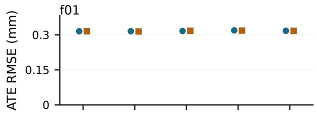

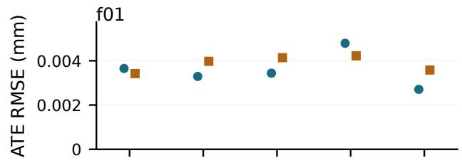

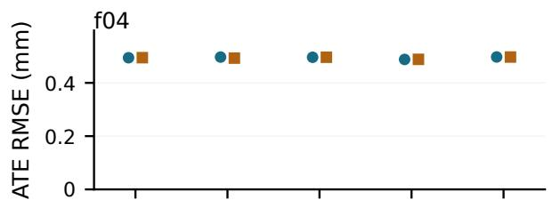

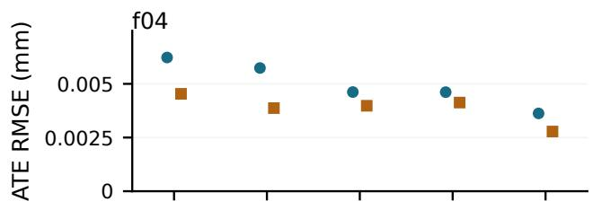

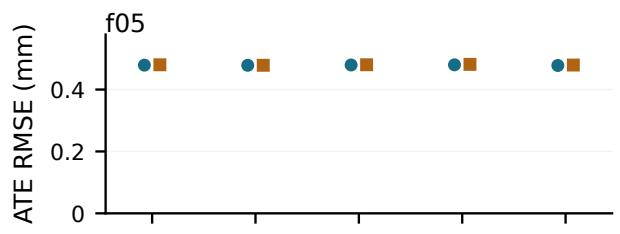

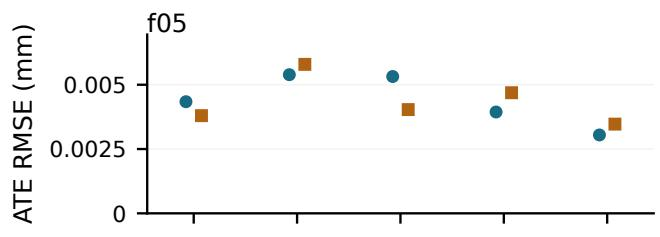

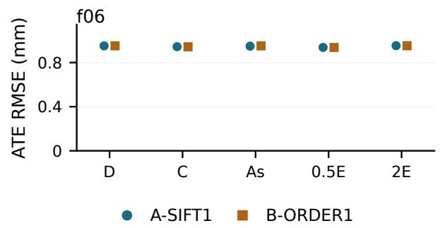  
(a) Global: action frames 0–89.

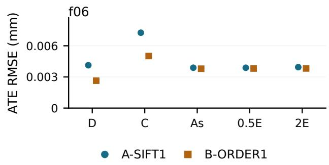  
(b) Local: action frames 60–74.  
Figure 9. Camera-center ATE RMSE under each model’s own evaluation similarity fit, in millimeters. D: difuse symmetric; C: coated symmetric; As: difuse asymmetric; 0.5E and 2E: half and double exposure of the difuse-symmetric condition. Global and local denote independently reconstructed 90-frame and 15-consecutive-frame trajectories, respectively (Section 2.8); indices are action-local. Each family has its own vertical limits with a zero origin. Markers summarize three computational repetitions; their min–max ranges are zero. Every model registers its complete requested trajectory.

## 3.6 Repeatability of cameras, point counts and surface support

The complete requested design comprises 40 family/condition/derivative groups, with three computational repetitions per group. These repetitions test computational stability on the same scenes; coverage and reconstruction accuracy are evaluated separately. All 40 synthetic groups and all six source-calibrated physical groups pass the complete exact repeatability checks under the declared source/runtime/CPU profile. The separately implemented numerical audit verifies all 258 reported routes and all 312 synthetic camera contrasts, including physical accuracy abstentions. All returned model pose exports preserve their binary values exactly.

<table><tr><td>Case</td><td>Pipeline</td><td>Models</td><td>Max. coverage</td><td>ATE (mm)</td><td>Abs. rot. (°)</td></tr><tr><td>trans 0–60</td><td>A</td><td>1</td><td>2/61</td><td></td><td></td></tr><tr><td>trans 0–60</td><td>B</td><td>1</td><td>2/61</td><td></td><td></td></tr><tr><td>desc 0–29</td><td>A</td><td>1</td><td>30/30</td><td>0.08297</td><td>28.72</td></tr><tr><td>desc 0–29</td><td>B</td><td>1</td><td>30/30</td><td>0.08298</td><td>27.16</td></tr><tr><td>desc 30–59</td><td>A</td><td>1</td><td>30/30</td><td>0.02939</td><td>10.55</td></tr><tr><td>desc 30–59</td><td>B</td><td>1</td><td>30/30</td><td>0.02926</td><td>10.16</td></tr></table>

Table 10. Complete source-calibrated static-phantom controls. The public color images and published calibration are remapped as described in Section 2.12. Coverage is the largest registered requested-frame count in any returned fragment; every returned fragment is counted in Models. ATE is center RMSE in millimeters, and Abs. rot. is mean absolute angular error in degrees, after the proper similarity fit to camera centers without an extra camera-axis ofset. A dash denotes an unidentifiable gauge. Full registration of the descending subsets coexists with mean orientation errors of 10.2–28.7 degrees; registration and small fitted center errors do not establish accurate camera orientations. Each row summarizes three exactly agreeing computational repetitions

<table><tr><td>Family</td><td>Condition</td><td>A points</td><td>B points</td><td>A RMSE</td><td>B RMSE</td><td>A support B support</td><td></td></tr><tr><td>f01</td><td>D</td><td>6039</td><td>5600</td><td>1.306</td><td>1.462</td><td>0.4641</td><td>0.4754</td></tr><tr><td>f01</td><td>C</td><td>3554</td><td>3337</td><td>1.352</td><td>1.806</td><td>0.7033</td><td>0.7303</td></tr><tr><td>f01</td><td>As</td><td>5973</td><td>5450</td><td>1.158</td><td>0.7982</td><td>0.4684</td><td>0.4853</td></tr><tr><td>f01</td><td>0.5E</td><td>3569</td><td>3378</td><td>0.8694</td><td>0.5672</td><td>0.7187</td><td>0.7367</td></tr><tr><td>f01</td><td>2E</td><td>9319</td><td>8544</td><td>2.657</td><td>0.8892</td><td>0.3543</td><td>0.3648</td></tr><tr><td>f04</td><td>D</td><td>5726</td><td>5328</td><td>3.71</td><td>3.412</td><td>0.4774</td><td>0.4922</td></tr><tr><td>f04</td><td>C</td><td>3335</td><td>3164</td><td>1.694</td><td>1.271</td><td>0.7309</td><td>0.7474</td></tr><tr><td>f04</td><td>As</td><td>5618</td><td>5144</td><td>3.928</td><td>1.118</td><td>0.4828</td><td>0.5132</td></tr><tr><td>f04</td><td>0.5E</td><td>3285</td><td>3110</td><td>2.243</td><td>5.076</td><td>0.7371</td><td>0.7546</td></tr><tr><td>f04</td><td>2E</td><td>9000</td><td>8375</td><td>2.904</td><td>1.18</td><td>0.363</td><td>0.3764</td></tr><tr><td>f05</td><td>D</td><td>5601</td><td>5159</td><td>4.614</td><td>0.8797</td><td>0.4927</td><td>0.5071</td></tr><tr><td>f05</td><td>C</td><td>3402</td><td>3185</td><td>5.585</td><td>0.683</td><td>0.7411</td><td>0.7667</td></tr><tr><td>f05</td><td>As</td><td>5548</td><td>5114</td><td>2.73</td><td>0.8544</td><td>0.4982</td><td>0.5176</td></tr><tr><td>f05</td><td>0.5E</td><td>3469</td><td>3262</td><td>2.618</td><td>0.7319</td><td>0.7438</td><td>0.7606</td></tr><tr><td>f05</td><td>2E</td><td>8988</td><td>8244</td><td>1.354</td><td>0.8236</td><td>0.3621</td><td>0.376</td></tr><tr><td>f06</td><td>D</td><td>5513</td><td>5001</td><td>1.064</td><td>1.545</td><td>0.4978</td><td>0.5277</td></tr><tr><td>f06</td><td>C</td><td>3436</td><td>3080</td><td>1.681</td><td>1.863</td><td>0.6848</td><td>0.713</td></tr><tr><td>f06</td><td>As</td><td>5499</td><td>4935</td><td>1.688</td><td>1.151</td><td>0.5055</td><td>0.5391</td></tr><tr><td>f06</td><td>0.5E</td><td>3357</td><td>3053</td><td>4.051</td><td>1.028</td><td>0.679</td><td>0.7116</td></tr><tr><td>f06</td><td>2E</td><td>7795</td><td>7049</td><td>1.116</td><td>1.148</td><td>0.4153</td><td>0.4419</td></tr></table>

Table 11. Complete local appearance comparison. Condition codes follow Figure 9. Point counts retain all reconstructed points. RMSE is point-to-surface distance; Support is the median distance from the fixed visible-wall support to its nearest reconstructed point. Both distances are in millimeters and lower is better. Each value is the median of three exactly agreeing computational repetitions, not an uncertainty estimate. All 15 requested local frames register in every case.

Repeatability does not ensure accuracy: the geometry/support results below retain bias, missing wall regions and large outliers despite identical fixed-profile outputs. Table 11 and Figure 10 retain every appearance condition. A produces 3,285–9,319 local points and B produces 3,053–8,544. Point counts are not normalized by surface area and do not imply uniformly dense wall coverage. A has more points and a smaller median fixed-support nearest-point distance in all 20 matched conditions; B has smaller point-to-surface RMSE in 14/20. Across both pipelines, median point-to-surface distance spans 0.0413–0.121 mm, while RMSE spans 0.567–5.58 mm. Retained outliers reach 283 mm for A in f05 coated-symmetric and 239 mm for B in f04 difuse-symmetric. The corresponding 95th-percentile distances are only 0.542 and 0.424 mm, respectively. Typical proximity, sparse coverage and outlier sensitivity thus require separate summaries.

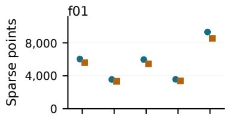

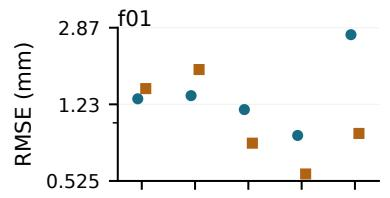

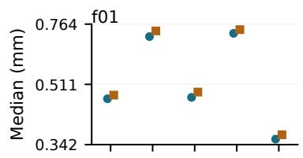

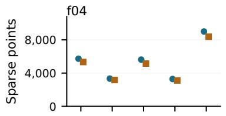

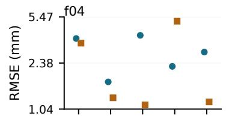

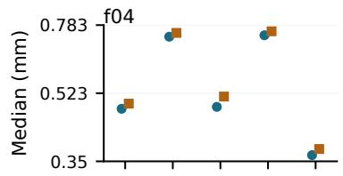

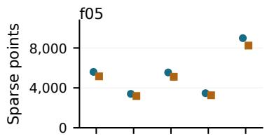

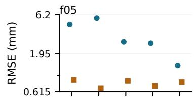

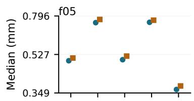

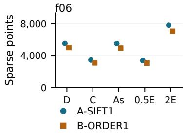  
(a) Point count.

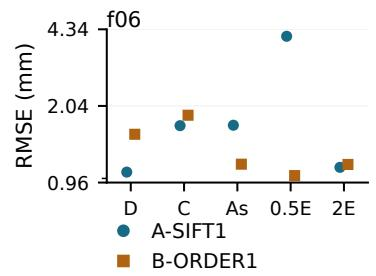  
(b) Surface RMSE.

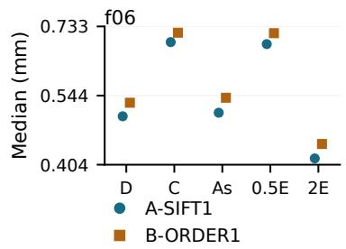  
(c) Visible-wall support.  
Figure 10. Local point counts, geometric error and support answer diferent questions. Distance panels show millimeters on a logarithmic scale above 0.001 mm, with a linear region below it; counts use a linear scale from zero. Vertical limits vary by family. Condition codes follow Figure 9; three-repeat min–max ranges are zero. Table 11 gives every numerical value; the accompanying metric records additionally retain medians and outlier tails.

## 3.7 Optical-flow comparison

Before evaluation, the protocol fixed source frames 0, 14, 22, 37, 52, 67, 82 and 88 and their immediate successors from both action acquisitions of development packages v1–v9. This gives 144 pairs across three scene families. Zero flow, OpenCV Farnebäck (Farnebäck, 2003), OpenCV DIS-medium (Kroeger et al., 2016) and RAFT-large (Teed and Deng, 2020; PyTorch contributors, 2026) receive only the original grayscale (classical methods) or RGB (RAFT) image pair; RAFT uses the fixed GPU float32 profile and the released torchvision weights without benchmark-specific fine-tuning. Endpoint error is the Euclidean distance between predicted and true 2D flow vectors, in pixels. It is measured on source-valid, finite-projecting, target-visible pixels, with the same eligibility masks, denominators and per-pair/per-family averaging for all four methods.

Three fresh full prediction batches use the same verified pair identities. All 1,728 requested arrays were finite, with no failed method calls and identical prediction bytes and score rows across repeats. A separately implemented scorer recomputed the errors, visibility-stratum support and aggregates, agreeing on all 5,184 pair/method/stratum comparisons, including coverage and empty-stratum checks. This verifies the scoring arithmetic independently of the prediction methods.

Table 12 reports visible-pixel endpoint error with equal family weighting. For moving cameras, RAFT has the lowest mean error in each motion condition (0.188–0.189 pixels), followed by DIS (0.208–0.209 pixels). For stationary cameras with deforming surfaces, DIS instead has the lowest error: 0.0375 pixels for FE and 0.0408 pixels for non-FE motion, versus RAFT’s 0.0474 and 0.0442 pixels. In the static stationary control, the zero predictor has a numerical error of $1 . 1 3 \times 1 0 ^ { - 5 }$ pixels. Its analytic flow is zero; the tiny residual reflects numerical material reprojection, not camera or wall motion. The image-based predictors introduce small nonzero motion. Thus method ordering depends on the camera and deformation condition, rather than supporting uniform RAFT superiority.

<table><tr><td>Motion</td><td>Camera</td><td>Zero</td><td>Farnebäck</td><td>DIS</td><td>RAFT</td></tr><tr><td>static</td><td>moving</td><td>9.378</td><td>0.3954</td><td>0.2082</td><td>0.1878</td></tr><tr><td>static</td><td>stationary</td><td>1.126e-05</td><td>0.01962</td><td>0.0208</td><td>0.008854</td></tr><tr><td>fem</td><td>moving</td><td>9.385</td><td>0.3936</td><td>0.2084</td><td>0.1883</td></tr><tr><td>fem</td><td>stationary</td><td>0.6793</td><td>0.05887</td><td>0.0375</td><td>0.04739</td></tr><tr><td>nonfem</td><td>moving</td><td>9.261</td><td>0.3928</td><td>0.2086</td><td>0.1893</td></tr><tr><td>nonfem</td><td>stationary</td><td>0.8128</td><td>0.0637</td><td>0.04083</td><td>0.04416</td></tr></table>

Table 12. Visible-pixel mean endpoint error (pixels) on the corrected matched 144-pair development cohort. Eight source pairs are averaged within each family, followed by equal weighting of the three families. Three computational repetitions are summarized by their median; their predictions and score rows are exactly equal. Every visible eligible vector has a finite prediction.

There are no eligible occluded vectors in this cohort, so it provides no occlusion-error result. For out-of-frame vectors, all eight pairs per family have support with moving cameras; RAFT’s equal-family mean errors are 0.463, 0.463 and 0.468 pixels for static, FE and non-FE motion. Stationary streams lack complete eight-pair out-of-frame support, so their corresponding aggregate is unavailable rather than silently averaging only supported pairs. The package retains every pair, stratum, support count and unavailable score.

## 4 Discussion

The resource links geometry, persistent material identities, motion and appearance so that evaluation questions can be posed under known acquisition conditions. Users can distinguish camera-induced disagreement from prescribed surface motion, examine whether sparse geometry supports the visible wall, and test a mechanical assumption with supplied material correspondence. The fixed release makes these questions accessible without generating a new dataset; LumenMorph supports extensions within its published configuration interface. The three usage studies illustrate complementary uses of the same linked annotations.

In the SfM study, complete registration does not establish accurate camera poses or adequate surface reconstruction. Point-to-surface proximity and visible-wall support answer diferent questions: small typical distances can coexist with sparse support or severe outliers. All requested synthetic frames register and the fixed-profile computational repeats agree exactly, yet global and local camera errors difer markedly. A reconstructs more local points and achieves a smaller median visible-surface-to-point distance in every matched condition, while B has lower surface RMSE in most conditions. Neither profile dominates all reported measures. Large retained outliers also prevent small surface medians from establishing uniformly accurate geometry.

The optical-flow study shows how controlled camera and surface motion expose condition-dependent performance. A learned estimator is not uniformly best on these inputs. The static stationary arm fixes geometry and camera pose while retaining photometric perturbations, helping distinguish residual image variation from geometric motion.

The mechanical-record study tests an energy prior after supplying geometry, stifness and material correspondence. Improved interpolation for compatible fields and deterioration for prescribed non-FE fields reveal the usefulness and possible mismatch of that assumption. The motion classes have diferent amplitudes, so this is not a causal isolation of mechanical compatibility. The experiment is a privileged-input resource demonstration rather than image-based recovery.

The physical-phantom controls complement the synthetic comparison by retaining reconstruction failures, partial coverage and unidentifiable gauges on real images. Calibration and preprocessing provenance qualify their interpretation. Their role is to expose transfer limits under the fixed profiles. Complete descending registration coexists with 10.2–28.7-degree mean orientation errors, while transverse registration reaches only 2/61 frames. These controls do not establish uniformly accurate camera reconstruction, deformation recovery or a general ranking of the pipelines.

The primary comparison uses complete binary poses and precisely verified exports. Repetitions measure computational stability on exposed scenes, not independent anatomical confirmation. The local experiment observes a fixed deformed wall state; its small fitted errors do not establish continuous deformation tracking.

Data consistency, repeatability and score replay answer separate questions. Geometric/mechanical checks establish agreement with the stated generating model, not measured tissue behavior. Repeated executions assess computational stability within the pinned source/runtime/CPU profile. Scoring retained predictions verifies metric reproduction without rerunning their inference. Neither the synthetic checks nor the bounded fresh-environment consumer test establish identical end-to-end outputs across arbitrary machines, operating systems or builds. For reuse, comparisons must verify input identities, keep family variants together, state which annotations enter inference and report failures and support alongside error. Algorithmic causes require controlled ablations.

## 5 Limitations

The dataset contains six engineered scene families, not 18 independent anatomies. Geometry, texture, camera trajectories and material parameters are specified by the generator rather than sampled from a clinical population. The FE model uses linear elasticity and infinitesimal strain; the relative Green–infinitesimal strain discrepancy reaches 0.145 in the strong-deformation regime. Numerical equilibrium and positive quadrature-point Jacobians do not validate tissue mechanics or large-deformation constitutive behavior. Deformation amplitude also difers between FE and non-FE conditions, so their comparison cannot isolate mechanical compatibility. Although the baseline crosses camera mode and surface-motion condition, the appearance extension covers only four families and moving-camera FE actions. It is not a complete factorial design, and its findings do not establish interactions across all camera, motion and appearance combinations.

The physical controls evaluate global reconstructions of two static phantom acquisitions. Source-calibrated inputs use the checked PINHOLE remapping of published omnidirectional calibration, with the interpolation and lens-model approximations described in Section 2.12. Repeatability covers two corrected source derivatives, four synthetic families, five appearance conditions and three source-calibrated physical image sets, with three executions per group under the declared source/runtime/CPU profile. The flow comparison covers three development families and one pretrained RAFT checkpoint. These designs do not support population-level generalization or clinical performance claims. The mechanical consumer demonstrates interpolation with supplied stifness and material identities, including deterioration under model mismatch; it does not validate estimation of those inputs or recovery from ordinary images. The image-only SfM comparisons use no FE prior. Binary agreement within a fixed profile is not a test of agreement across rebuilds, hardware or thread settings.

Resource users should state which quantities are provided to inference: images and calibration, camera trajectories, surface geometry or mechanical states. Supplying ground-truth poses or geometry changes the task. Accuracy should be reported together with registration coverage, surface support and missing outputs. Frames, points and overlapping windows do not replace scene families as independent sampling units, and exposed development data cannot also serve as unseen validation. Training on the three mechanical bases and one materialparameter pair would not establish generalization to other loads or tissues. The proposed family allocation in Section 2.1 preserves these dependencies; it does not restore an unseen status to families already inspected here.

The demonstrated scope is controlled tubular geometry relevant to colonoscopy. Patient-specific anatomy, measured tissue properties, clinical optics, large-deformation material validation, contact, fluids and lesions remain outside that scope. Appearance realism, FE annotations and successful phantom registration do not remove these limitations.

## 6 Conclusion

The Synthetic Deformable Tubular Benchmark provides linked image observations, camera and surface states, persistent material correspondences and discrete mechanical annotations. Paired acquisition and appearance conditions, documented information boundaries and separately implemented consistency checks support controlled evaluation against the generating models. The usage studies show why reconstruction accuracy, registration coverage, surface support and flow must be evaluated separately, and how mechanical records can expose both benefits and mismatch of a prior. Fixed-environment repeatability and retained-prediction metric replay remain distinct from portable end-to-end reproduction. By releasing both a fixed, validated benchmark and its open-source generator, this work provides a reusable foundation for evaluating and extending deformable reconstruction methods in controlled tubular environments.

## 7 Data availability

The Synthetic Deformable Tubular Benchmark, version 1.0.0, is publicly available (Cirauqui-Viloria, 2026c) at https://doi.org/10.57967/hf/10850. The dataset distribution requires about 30.69 GB of downloads, including the split archive and companion files. It is independent of the reproduction material (about 8.75 GB of main files plus 1.13 GB of optional ofline dependencies); GB here denotes 10<sup>9</sup> bytes. Its baseline and appearance checksum manifests identify the release. The accompanying data card, schemas and validation reports describe the image, geometry and mechanical records. Original generated data are licensed under Creative Commons Attribution 4.0 International (CC BY 4.0); software and third-party works retain separate terms.

Protocols, runners, pinned configurations, complete reconstructed models and feature databases, flow predictions, evaluation records and provenance are supplied in the reproduction package, version 1.1.0 (Cirauqui-Viloria, 2026b). Direct access: https://doi.org/10.57967/hf/10851. The scripts regenerate derived feature databases and reconstructions in their specified environments. Per-study source/runtime receipts distinguish the supplied dataset baseline models from the corrected comparison. Additional diagnostic/control records are separate from the reported populations and do not replace the complete current outputs. The selected distribution preserves complete final inputs and outputs, with compact records of earlier failed or invalid attempts; superseded raw-stage databases and build intermediates are excluded. Reevaluation of the final outputs is therefore distinct from a byte-for-byte reenactment of every historical stage.

## 8 Code availability

LumenMorph 1.0.2 provides the generator, dataset reader, prediction evaluator, usage-study runners, regression tests and source verification tools at https://github.com/icirauqui/LumenMorph/tree/v1.0.2. Its mechanics dependency, ContinuumFEM, is available at https://github.com/icirauqui/continuum-fem and pinned as a Git submodule; clone with –recurse-submodules. Both use the MIT license. Source snapshots and per-study dependency pins accompany reproduction records. Historical producer snapshots retain their own source hashes and remain distinct from the current software release.

Pipeline A derives from base revision feb480d63d5c2025426c162089475492d76fef41; its corrected source and native tests are available in the fixed release at https://github.com/icirauqui/colmap\_for\_colonoscopy 2/tree/3.7-colonoscopy.1. Its upstream colonoscopy adaptation is cited separately (Subías Sarrato, n.d., 2021); Pipeline A includes subsequent thesis developments rather than being identical to that upstream repository. Pipeline B uses a corrected derivative of upstream COLMAP 4.2.0 (https://github.com/colmap/colmap); its public source and native tests are fixed at https://github.com/icirauqui/colmap/tree/4.2.0-ordering-fixes.1. The fork documents its execution-order corrections and retains the original attribution and license. The reproduction package records build flags, dependencies, source revisions and executable hashes for both. Dataset-generation and corrected-comparison profiles are identified separately; retained-prediction score replay and fresh end-to-end execution are distinguished in the reproduction records. Supplementary Methods S1–S2 describe the reconstruction corrections, CPU-assignment contract and lossless pose-export qualification. Complete per-profile patches, binaries, native tests and positive/negative controls remain in the reproduction package; conversion utilities do not replace the frozen inference binaries. The manuscript source archive includes the figure assets required to compile the article.

## 9 Declarations

Author contributions. Íñigo Cirauqui-Viloria: Conceptualization, Methodology, Software, Validation, Formal analysis, Data curation, Visualization, Writing—original draft, Writing—review and editing.

Ethics. No human participants, patient data, animals or clinical interventions were used; C3VD is a public static phantom dataset.

Funding. This research did not receive any specific grant from funding agencies in the public, commercial, or not-for-profit sectors.

Competing interests. The author declares no competing financial interests or personal relationships that could have appeared to influence the work reported in this paper.

# Declaration of generative AI and AI-assisted technologies in the manuscript preparation process

During the preparation of this work, the author used OpenAI Codex to assist manuscript revision and implementation of analysis, validation and plotting scripts. The client and underlying model versions were not recorded. Numerical results and data visualizations were obtained by executing the documented computational procedures on retained data. The author reviewed and edited the content and takes full responsibility for the content of the article.

## References

Bleyer, J., n.d. Isotropic and orthotropic plane stress elasticity. Computational Mechanics Numerical Tours with FEniCSx. URL: https://bleyerj.github.io/comet-fenicsx/tours/linear\_problems/isotropic\_orthotropic\_elasticity/isotropic\_ orthotropic\_elasticity.html. tensor and engineering Voigt conventions; accessed 12 October 2026.

Bobrow, T.L., Golhar, M., Vijayan, R., Akshintala, V.S., Garcia, J.R., Durr, N.J., 2023. Colonoscopy 3D video dataset with paired depth from 2D-3D registration. Med. Image Anal. 90, 102956. URL: https://durrlab.github.io/C3VD/, doi:10.1016/j.media.2023.102956.

Cirauqui Viloria, Í., 2022. Deformable Structure from Motion in medical endoscopy sequences. Trabajo fin de máster. Universidad de Zaragoza, Escuela de Ingeniería y Arquitectura. Spanish title: Structure from Motion deformable en secuencias de endoscopia médica; Máster Universitario en Ingeniería Industrial.

Cirauqui-Viloria, Í., 2026a. LumenMorph: synthetic tubular data generation and evaluation. Software, version 1.0.2. URL: https://github.com/icirauqui/LumenMorph/tree/v1.0.2. accessed 10 October 2026.

[dataset] Cirauqui-Viloria, Í., 2026b. Synthetic Deformable Tubular Benchmark: Reproducibility Material. Hugging Face, reproducibility material, version 1.1.0. doi:10.57967/hf/10851.

[dataset] Cirauqui-Viloria, Í., 2026c. Synthetic Deformable Tubular Benchmark with Dense Ground Truth and Mechanical Annotations. Hugging Face, dataset, version 1.0.0. doi:10.57967/hf/10850.

Durr Lab, n.d. C3VD-DEFCOL: dataset release repository. URL: https://github.com/DurrLab/C3VDv3. accessed 6 October 2026.

DurrLab, n.d. C3VD: source code and example data loader. URL: https://github.com/DurrLab/C3VD. exact source snapshot retained in the reproduction records; accessed 21 October 2026.

Farnebäck, G., 2003. Two-frame motion estimation based on polynomial expansion, in: Image Analysis (SCIA 2003), Springer. pp. 363–370. URL: https://link.springer.com/chapter/10.1007/3-540-45103-X\_50, doi:10.1007/3-540-45103-X\_50.

Golhar, M.V., Galeano Fretes, L.S., Ayers, L., Akshintala, V.S., Bobrow, T.L., Durr, N.J., 2026. C3VDv2—colonoscopy 3D video dataset with enhanced realism. Sci. Data 13, 1273. URL: https://www.nature.com/articles/s41597-026-07471-1, doi:10.1038/s41597-026-07471-1.

Hong, D., Tavanapong, W., Wong, J., Oh, J.H., de Groen, P.C., 2014. 3D reconstruction of virtual colon structures from colonoscopy images. Comput. Med. Imaging Graph. 38, 22–33. URL: https://www.sciencedirect.com/science/article/pii/S0895611113001523, doi:10.1016/j.compmedimag.2013.10.005.

Horn, B.K.P., 1987. Closed-form solution of absolute orientation using unit quaternions. J. Opt. Soc. Am. A 4, 629–642. URL: https://opg.optica.org/josaa/abstract.cfm?URI=josaa-4-4-629, doi:10.1364/JOSAA.4.000629.

Incetan, K., Celik, I.O., Obeid, A., Gokceler, G.I., Ozyoruk, K.B., Almalioglu, Y., Chen, R.J., Mahmood, F., Gilbert, H., Durr, N.J., Turan, M., 2021. VR-Caps: A virtual environment for capsule endoscopy. Med. Image Anal. 70, 101990. URL: https://durr.jhu.edu/pubs/2021-vr-caps/, doi:10.1016/j.media.2021.101990.

Jakob, W., Speierer, S., Roussel, N., Nimier-David, M., Vicini, D., Zeltner, T., Nicolet, B., Crespo, M., Leroy, V., Zhang, Z., 2022a. Mitsuba 3 renderer. Software, version 3.9.1. URL: https://github.com/mitsuba-renderer/mitsuba3. author-supplied citation; accessed 12 October 2026.

Jakob, W., Speierer, S., Roussel, N., Vicini, D., 2022b. Dr.Jit: A just-in-time compiler for diferentiable rendering. ACM Trans. Graph. 41. URL: https://rgl.epfl.ch/publications/Jakob2022DrJit, doi:10.1145/3528223.3530099.

Kroeger, T., Timofte, R., Dai, D., Van Gool, L., 2016. Fast optical flow using dense inverse search, in: Computer Vision – ECCV 2016, Springer. pp. 471–488. URL: https://link.springer.com/chapter/10.1007/978-3-319-46493-0\_29, doi:10.1007/978-3-319-46493-0\_29.

Lena, C., Milesi, D., Casella, A., Carlini, L., Norton, J.C., Martin, J., Scaglioni, B., Obstein, K.L., De Sire, R., Spadaccini, M., Hassan, C., Valdastri, P., De Momi, E., 2026. A high-fidelity synthetic colon dataset for 3D reconstruction applications. Sci. Data URL: https://www.nature.com/articles/s41597-026-07832-w, doi:10.1038/s41597-026-07832-w.

Liu, Y., Yu, D., Xiao, Y., He, T., Liu, L., 2026. Scale-consistent 3D reconstruction in monocular colonoscopy via camera-intrinsics-guided learning. Comput. Med. Imaging Graph. 129, 102734. URL: https://www.sciencedirect.com/science/article/pii/S0895611126000376, doi:10.1016/j.compmedimag.2026.102734.

Luk, E., Golhar, M.V., Song, A., Iranzo, R., Batlle, V.M., Seenivasan, L., Montiel, J.M.M., Durr, N.J., 2026. C3VD-DEFCOL: A deformable colonoscopy dataset with time-resolved 3D ground truth and realistic appearance. URL: https://arxiv.org/abs/2606.07891, doi:10.48550/arXiv.2606.07891, arXiv:2606.07891. preprint; version 1.

Martyniak, S., Kaleta, J., Dall’Alba, D., Naskręt, M., Płotka, S., Korzeniowski, P., 2025. SimuScope: Realistic endoscopic synthetic dataset generation through surgical simulation and difusion models, in: Proceedings of the Winter Conference on Applications of Computer Vision (WACV), pp. 4268–4278. URL: https://openaccess.thecvf.com/content/WACV2025/papers/Martyniak\_SimuScope\_Realistic\_Endoscopic Synthetic\_Dataset\_Generation\_through\_Surgical\_Simulation\_and\_WACV\_2025\_paper.pdf.

Mitsuba contributors, 2026. Mitsuba 3: Bidirectional scattering distribution functions. URL: https://mitsuba.readthedocs.io/en/stable/src/generated/plugins\_bsdfs.html. oficial documentation; roughplastic and difuse plugins; accessed 12 September 2026.

PyTorch contributors, 2026. torchvision.models.optical\_flow: RAFT reference implementation and pretrained weights. URL: https://github.com/pytorch/vision/tree/main/references/optical\_flow. raft\_large, weights Raft\_Large\_Weights.C\_T\_SKHT\_V2; accessed 15 September 2026.

Rau, A., Bano, S., Jin, Y., Azagra, P., Morlana, J., Kader, R., Sanderson, E., Matuszewski, B.J., Lee, J.Y., Lee, D.J., Posner, E., Frank, N., Elangovan, V., Raviteja, S., Li, Z., Liu, J., Lalithkumar, S., Islam, M., Ren, H., Lovat, L.B., Montiel, J.M.M., Stoyanov, D., 2024. SimCol3D—3D reconstruction during colonoscopy challenge. Med. Image Anal. 96, 103195. URL: https://discovery.ucl.ac.uk/id/eprint/10194104/, doi:10.1016/j.media.2024.103195.

Ruano, J., Gómez, M., Romero, E., Manzanera, A., 2024. Leveraging a realistic synthetic database to learn Shape-from-Shading for estimating the colon depth in colonoscopy images. Comput. Med. Imaging Graph. 115, 102390. URL: https://www.sciencedirect.com/science/article/pii/S0895611124000673, doi:10.1016/j.compmedimag.2024.102390.

Schönberger, J.L., Frahm, J.M., 2016. Structure-from-motion revisited, in: Proceedings of the IEEE Conference on Computer Vision and Pattern Recognition (CVPR), pp. 4104–4113. URL: https://openaccess.thecvf.com/content\_cvpr 2016/html/Schonberger\_Structure-From-Motion\_Revisited\_CVPR\_2016\_paper.html, doi:10.1109/CVPR.2016.445.

SciPy contributors, 2026. RBFInterpolator: radial-basis interpolation documentation. URL: https://docs.scipy.org/doc/scipy/reference/generated/scipy.interpolate.RBFInterpolator.html. accessed 6 October 2026; implementation used: SciPy 1.18.1.

SciPy contributors, n.d. csr\_matrix: compressed sparse row matrix representation. URL: https://docs.scipy.org/doc/scipy/reference/generated/scipy.sparse.csr\_matrix.html. oficial documentation; accessed 12 October 2026.

Singh, S., Bhaumik, B., Chatterjee, S., 2025. SimIntestine: A synthetic dataset from virtual capsule endoscope. Med. Image Anal. 105, 103706. URL: https://www.sciencedirect.com/science/article/pii/S1361841525002531, doi:10.1016/j.media.2025.103706.

Smolak-Dyżewska, W., Kaleta, J., Dall’Alba, D., Spurek, P., 2026. ColonSplat: Reconstruction of peristaltic motion in colonoscopy with dynamic gaussian splatting. URL: https://arxiv.org/abs/2603.06860, doi:10.48550/arXiv.2603.06860, arXiv:2603.06860. preprint; version 1.

Subías Sarrato, J.D., 2021. Modelado 3D del colon a partir de colonoscopias reales mediante geometría multivista. Trabajo fin de grado. Universidad de Zaragoza, Escuela de Ingeniería y Arquitectura. URL: https://zaguan.unizar.es/record/106905/files/TAZ-TFG-2021-2094.pdf.

Subías Sarrato, J.D., n.d. COLMAP for colonoscopy. UZ-SLAMLab software repository. URL: https://github.com/UZ-SLAMLab/colmap\_for\_colonoscopy. accessed 30 September 2026.

Teed, Z., Deng, J., 2020. RAFT: Recurrent all-pairs field transforms for optical flow, in: Computer Vision – ECCV 2020, Springer. pp. 402–419. URL: https://link.springer.com/chapter/10.1007/978-3-030-58536-5\_24, doi:10.1007/978-3-030-58536-5\_24.

Umeyama, S., 1991. Least-squares estimation of transformation parameters between two point patterns. IEEE Trans. Pattern Anal. Mach. Intell. 13, 376–380. URL: https://web.stanford.edu/class/cs273/refs/umeyama.pdf, doi:10.1109/34.88573.

## Supplementary Methods

Manuscript: Synthetic Deformable Tubular Benchmark: A mechanically annotated dataset for evaluating deformable 3D reconstruction

Author: Íñigo Cirauqui-Viloria

Afiliation: Universidad de Zaragoza, Pedro Cerbuna 12, 50009 Zaragoza, Spain

Correspondence: icirauqui@gmail.com

ORCID: 0000-0003-1773-1937

## S1. Qualified reconstruction profiles and source repairs

This supplement preserves implementation details behind the two pipelines reported in the main article. Both pipelines receive identical public images, calibration and requested windows; algorithmic causes cannot be assigned to a single repair from this cross-pipeline comparison.

The pipelines share COLMAP ancestry and are not unrelated SfM methods. A-RNG1, A-SIFT1, B-INIT1 and B-ORDER1 name cumulative source/execution profiles, not four independent reconstruction algorithms. A-SIFT1 extends A-RNG1 in Pipeline A; B-ORDER1 extends B-INIT1 in Pipeline B. The corrected functionality is included in the two public repositories linked in the main article (Code availability); the reproduction package supplies the exact per-profile source patches, binaries and configuration receipts. The summary below separates cumulative repairs from fresh and retained stages; Supplementary Methods S2 details the exact-input reuse checks.

<table><tr><td>Pipeline / final profile</td><td>Cumulative repairs</td><td>Execution lineage</td></tr><tr><td>A / A-SIFT1</td><td>A-RNG1: shared CLI seed and thread-local FLANN sampling/shuffling, avoiding process-global seed resets. A-SIFT1: initializes unwritten CPU descriptor buffers at unsupported image/octave boundaries; empty RootSIFT rows remain finite zeros.</td><td>Fresh extraction and mapping. Matching is reused only when canonical feature inputs agree exactly; otherwise it is recomputed.</td></tr><tr><td>B / B-ORDER1</td><td>B-INIT1: declared initial-pair search/history order and image-ID tie breaking. B-ORDER1: additionally sorts bundle-adjustment residuals by image and point identity.</td><td>Appearance: retained B-INIT1 extraction/matching, fresh B-ORDER1 mapping. Physical: retained B-ORDER1 matching, fresh B-ORDER1 mapping.</td></tr></table>

Valid nonempty descriptor arithmetic and keypoint geometry are unchanged in A. The B repairs preserve upstream geometry thresholds, the optimization objective and model-size policy. Retained extraction/matching is not fresh end-to-end reproduction; its profile-specific lineage accompanies the outputs.

Pipeline A inherits calibrated two-view geometry and guided-matching changes from the colonoscopy adaptation, with later discarded-track diagnostics. Its base revision and applied profile patches accompany the reproduction material.

## S2. Runtime, exports and reproduction scope

The separately qualified A-EXPORT1 correction increases text precision; A-EXPORT2 adds lossless binarypose conversion without quaternion renormalization. These conversion tools do not replace the frozen inference binaries. Source patches and qualification records accompany the reproduction package.

The export utility writes 17 significant digits with a fixed locale, and every exported pose is checked for exact agreement with its full-precision binary values. A separate audit reads every binary model, fits the proper positive similarity by a quaternion eigensystem, evaluates rotations with SciPy and computes local surface distances with a triangle bounding-box tree. Manufactured positive and negative controls precede the full-cohort audit. This validates the scoring calculation against the supplied reference, not physical accuracy beyond it.

Fixed source/executable/dependency hashes, seed zero (including B’s mapper-estimator seed), one requested native, OpenMP and BLAS thread, disabled intrinsic refinement, efective mapper options, private matched databases and the recorded CPU afinity define the repeatability contract. CPU-AFFINITY1 specifies the Ubuntu resource assignment; its homogeneous CPU/cache profile is part of that contract, not a general hardware-portability guarantee. Numerical equality of three runs in one profile does not establish equality across hardware, operating systems, compilers or rebuilt dependencies.

Actual Docker CPU sets, native arguments and cache-class readbacks are retained. An identical-operand control demonstrates that Eigen’s hardware-dependent matrix-product blocking can change floating-point rounding between core classes; no inference source, numerical precision, seed or threshold changes under this profile.

The retained source qualification includes native positive/negative controls for the original numerical initialization and ordering defects and separate patch application/readback. Failed, invalid and interrupted attempts remain in compact provenance records. The final published inputs, models, predictions, metrics and separate feature databases are retained; superseded raw-stage databases and build intermediates are not. Recomputing scores from retained predictions, rerunning a specified inference stage and reproducing the complete historical workflow are diferent claims.

## Stage identity and execution checks

The repeatability contract requires three A-SIFT1 executions and three corrected B global/local mapper repetitions for every primary family and condition under the frozen one-thread, seed-zero profile. A extracts features afresh and preserves each extraction database. Matching is inherited only when all canonical camera, image, keypoint and descriptor schemas, identities, shapes and payloads equal the corresponding closed matching input exactly; otherwise it is recomputed. All A mappers are fresh. B inherits its corresponding closed extraction/matching inputs. A separately implemented direct-row readback verifies every A reuse decision and all private mapper databases. We compare canonical complete SQLite payloads, every full-precision binary model file, stage exits, efective native options and actual registered frame names. Documentary output paths are recorded separately. This tests repeatability on the complete requested population; a fixed seed or one successfully repeated example alone is insuficient. Timeouts, fragments and absent models remain in the denominator. Deterministic data generation, inference repeatability, coverage and metric replay are separate properties. The three runs are computational repetitions, not independent scene observations or a hardware-portability test. The current A-SIFT1 and corrected B populations use a dedicated 24-core Intel Core Ultra 9 Ubuntu host with 64 GB RAM. Independent physical groups may execute concurrently, while the three repetitions within each group remain sequential. The Ubuntu processor has two core/cache classes. The CPU-AFFINITY1 execution profile restricts every native process in a three-repeat group to the same single core from the homogeneous eight-core class, including its children. Runtime receipts retain the actual CPU sets and efective options. The hardware-blocking control is described above. The one-thread numerical profile is unchanged. Host diferences and resource contention preclude a comparative wall-clock speed claim.

# S3. Extending the dataset with the published generator

Use the fixed LumenMorph release and its pinned mechanics submodule, following its numerical installation guide. Copy and edit the JSON specification before freezing a new suite. The commands illustrate the published interface for f01 and its FEM condition; other declared conditions use the same staged interface.

```shell
git clone --branch v1.0.2 --recurse-submodules \
https://github.com/icirauqui/LumenMorph.git
cd LumenMorph
# Install the pinned numerical environment as documented in the release.
# Copy configs/tubular_benchmark_v1.json to custom.json and edit it.
python -m backend.src.benchmark freeze \
--root ./new_suite --spec custom.json
python -m backend.src.benchmark prepare \
--root ./new_suite --family f01
python -m backend.src.benchmark render \
--root ./new_suite --family f01 --stream reference
python -m backend.src.benchmark package \
--root ./new_suite --family f01 --condition fem
python -m backend.src.benchmark render \
--root ./new_suite --family f01 --condition fem --stream stationary
python -m backend.src.benchmark render \
--root ./new_suite --family f01 --condition fem --stream moving
```

Use python from the installed numerical environment. Each stage requires a fresh output location and verifies the frozen sources. New suites have their own recorded specification, provenance and checksums. The published benchmark producer uses a fixed 90-state motion schedule, even when spatial configuration, load amplitudes and camera parameters are changed. Geometry modifications must remain within the generator’s supported tubular parameterization and pass their own geometric and mechanical checks.

Output path for this example. The commands above generate the f01 FEM condition at ./new\_suite/v4. The following consumption example instead opens the fixed release at benchmark/v2; these numbers are not interchangeable. PublicDataset and EvaluationDataset from backend.src.benchmark\_reader accept the generated path ./new\_suite/v4 for this example. The producer and release use diferent numbering: the released f01 FEM package is benchmark/v2. Use the generated directory containing DATASET.json, rather than assuming release numbering. The former reader accesses the public images, calibration and acquisition metadata; the latter additionally exposes the explicitly privileged geometry, persistent material queries and applicable FE states. The two appearance readers serve the separate matched-appearance schema. These information boundaries must also be retained when generating a custom suite. Newly generated scenes are not part of the fixed release or covered automatically by its validation reports.

## S4. Minimal consumption and prediction evaluation

Use Python from the installed LumenMorph numerical environment, with its repository root as the working directory so that backend.src imports resolve. Download and reassemble the complete fixed dataset following its release README. Set SDTUBE\_DATA to the extracted directory containing benchmark/, and SDTUBE\_OUT to a fresh writable directory outside it. The package selected below is the released f01 FEM condition, not the v4 directory generated by S3.

The following complete example saves a zero-displacement control using only public image dimensions, then opens privileged truth to query the same material points at frames 52 and 53 and score the already saved prediction. The baseline reader returns BGR channel order; only its shape is used here. This control demonstrates the interface and is not a trained reconstruction method or an additional scientific comparison.

```python
import os
from pathlib import Path
import numpy as np
from backend.src.benchmark_reader import PublicDataset, EvaluationDataset
from backend.src.benchmark_evaluate import evaluate
package = Path(os.environ['SDTUBE_DATA']) / 'benchmark/v2'
output = Path(os.environ['SDTUBE_OUT'])
output.mkdir(parents=True, exist_ok=False)
public = PublicDataset(package)
# Freeze a zero-motion control using only the public image shape.
height, width = public.rgb(52, 'moving').shape[:2]
prediction = np.zeros((height, width, 3), dtype=np.float64)
np.savez_compressed(output / 'prediction.npz', prediction=prediction)
# Privileged inspection begins only after the prediction has been saved.
truth = EvaluationDataset(package)
dense = truth.dense(52, 'moving')
ids = dense['triangle_id'][dense['valid']][::4096]
weights = dense['material_barycentric'][dense['valid']][::4096]
x52 = truth.material_points(ids, weights, 52, 'moving')
x53 = truth.material_points(ids, weights, 53, 'moving')
print('Queried material points:', len(ids))
print('First point displacement:', x53[0] - x52[0])
scores = evaluate(package, output / 'prediction.npz', output / 'scores.json',
task='displacement', frame=52, target=53, stream='moving',
coordinate_frame='benchmark-world')
print(scores['primary'])
```

The query uses immutable triangle IDs and barycentric weights from the source frame, so x53-x52 follows the same material, including points that may be invisible later. The scorer evaluates every source-valid surface pixel; the sparse inspection query does not select the scored population. The JSON records coverage, conditional/full-population errors and input hashes. Its world-frame declaration specifies axes and scene units; the scorer fits no transform or scale to truth. A real method must save its own prediction before privileged inspection, use only its declared inference inputs and retain missing outputs in coverage. Prediction shape is native $H \times W \times 3 ;$ other tasks and appearance-specific availability follow the main article.

## S5. Common-support camera contrasts

The main article reports camera accuracy alongside registration, surface precision and support. This additional view retains every B-minus-A contrast on common registered frames; it is not a separate benchmark or a controlled ablation of a single algorithmic change.

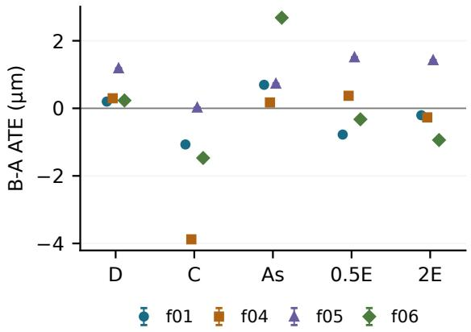  
(a) Global.

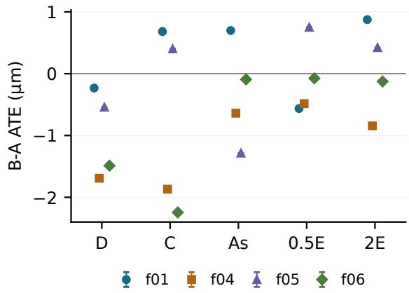  
(b) Local.  
Figure S1: B-minus-A camera-center ATE RMSE on common requested frames, in micrometers. Positive values indicate larger error for B. Colors and marker shapes identify families. D: difuse symmetric; C: coated symmetric; As: difuse asymmetric; 0.5E and 2E: half and double exposure. Each model is fitted on the same support for each contrast. Micrometer units express numerical diferences on the assigned synthetic scale after similarity fitting; they do not establish micrometer physical measurement accuracy or absolute-scale recovery. All three repeated contrasts coincide exactly.