# TRIAGE: SKIP, SKIM, OR REFINE ATTENTION TILES IN VIDEO DIFFUSION TRANSFORMERS

Yeonjae Kim 1 Omin Kwon 1 Seong Hoon Seo 1 Jae W. Lee 1

## ABSTRACT

Attention over tens of thousands of visual tokens dominates the inference of video diffusion transformers (DiTs). Existing methods reduce this cost through sparsity, low precision, or both, but use a single precision for all kept tiles. We observe that the output error introduced by approximation varies widely across tiles. Many tiles can be skipped with little error, others must be computed but gain little beyond low precision, and a few retain substantial error even at low precision. We present TRIAGE, a training-free attention method that assigns each tile one of three approximation tiers: skipping it by replacing it with its block means, skimming it in NVFP4, or refining it with NVFP4 residual correction. A lightweight router predicts each tile’s error under each tier from block statistics and moves a tile to a more accurate tier only when the predicted error reduction justifies the extra compute, with a single price setting this trade-off. A fused kernel executes all three tiers in a single pass on the FP4 tensor cores of RTX Blackwell GPUs. Across Wan2.2, HunyuanVideo, and LTX-2.5, TRIAGE accelerates end-to-end generation by up to 2.32× over dense FlashAttention, and in each of five settings it runs faster than every baseline while reaching 0.3–3.0 dB higher PSNR than the highest-PSNR baseline.

## 1 INTRODUCTION

Diffusion transformers (DiTs) (Peebles & Xie, 2023) have become the backbone of video generation (Kong et al., 2024; Wang et al., 2025; HaCohen et al., 2026) and world simulation (Agarwal et al., 2025; Aditi et al., 2026). Recent video DiTs apply 3D full attention, in which every visual token attends to every other across all frames (Yang et al., 2025b; Kong et al., 2024; Wang et al., 2025), and a video yields tens of thousands of these tokens. This attention has quadratic cost in the number of tokens and accounts for a large fraction of inference time, a share that grows as models move to higher resolutions and longer videos.

Sparse attention and low-bit attention are the two main approaches to reducing this cost. Both operate on tiles, each pairing a block of queries with a block of keys. Sparse attention selects the tiles to compute and skips the rest, dropping them or approximating each by its mean key and value (Zhang et al., 2025c; Yang et al., 2025a; Li et al., 2026) (Figure 1a). Low-bit attention instead computes every tile in a low-bit format such as FP8 or NVFP4 (Zhang et al., 2025a;b) (Figure 1b). Methods that combine the two (Zhang et al., 2025c; Zhao et al., 2025b) skip tiles and compute the kept ones in a low-bit format (Figure 1c).

These approaches give a tile at most two options, skipping it or computing it at a single precision shared by every kept tile. Which approach is most accurate depends on the row, the tiles that one query block attends to (Figure 1). A row is sharp when its query block puts almost all of its attention on a few tiles, and diffuse when it spreads its attention over many. At the same compute cost, sparse attention tends to be the most accurate on sharp rows, low-bit attention on diffuse rows, and their combination on rows in between.

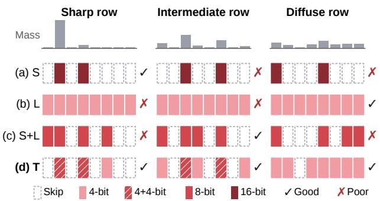  
Figure 1. Per-tile precision on sharp, intermediate, and diffuse rows, each with one query block and eight key tiles, under the same compute budget. (a) Sparse (S), (b) low-bit (L), and (c) combined (S+L) attention favor different attention distributions; (d) TRIAGE (T) adapts to each distribution by skipping, skimming, or refining individual tiles.

Our key observation is that the output error from skipping a tile or computing it at low precision varies widely across tiles, even within the same row. Because this error differs so much from tile to tile, extra computation should be judged by its marginal gain, the output error it removes per unit of additional compute. Existing approaches, which share one precision across all computed tiles, cannot fully exploit these differences: they spend more compute than some tiles need while leaving substantial error on others that would benefit from additional computation.

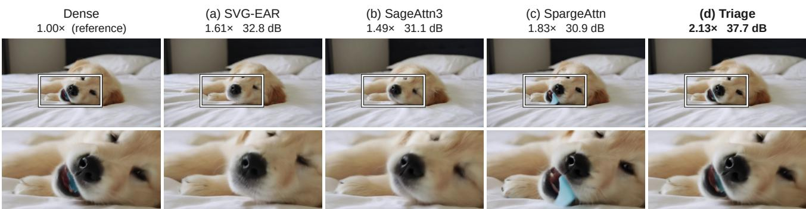  
Figure 2. The 21st of 129 frames of the video that HunyuanVideo generates at 720p for the prompt “On the bed in the bedroom, a puppy is playing with a slipper in its mouth.” The bottom row zooms into the box; labels give the end-to-end speedup over dense and the PSNR against the dense video. (a) SVG-EAR (Zhou et al., 2026), (b) SageAttention3 (Zhang et al., 2025b), and (c) SpargeAttn (Zhang et al., 2025c) follow the policies of Figure 1a–c; (d) TRIAGE.

We present TRIAGE, which assigns each tile one of three approximation tiers, namely skip (block means), skim (NVFP4), and refine (NVFP4 with residual correction) (Figure 1d). Before each attention call, a router estimates each tile’s output error under each tier from block statistics and upgrades a tile only when its marginal gain is at least a price π. Under our error model, this rule reduces to comparing one score per tile against two thresholds, making the decision inexpensive and leaving π as the single usercontrolled parameter for the speed–fidelity trade-off. A periodically rebuilt clustering tree groups similar queries and keys into tiles, keeping the block statistics representative and the cheaper approximations accurate.

TRIAGE executes all three tiers in one fused kernel and refines selected tiles with additional NVFP4 residual products, which give nearly the same error as refining them in BF16 while keeping every tier on the FP4 tensor cores. Skipped tiles join the same online softmax as virtual tiles of their block means. In Figure 2d, TRIAGE is both faster and more faithful to the dense video than all three methods, and across Wan2.2, HunyuanVideo, and LTX-2.5 it accelerates each attention call by up to 8.6× and generation by up to 2.32× over FlashAttention.

In summary, this paper makes the following contributions:

• We show that existing approaches leave accuracy unexploited because approximation error varies widely across tiles, even within a row, motivating a per-tile choice by marginal gain (§3).

• We propose three approximation tiers with a router that estimates each tile’s error under each tier and trades it against compute, and a clustering tree that groups similar tokens into each tile, lowering the error of skipping and skimming (§5).

• We implement all three tiers in one fused kernel on FP4 tensor cores, representing skipped tiles as virtual tiles of block means and refining selected tiles with NVFP4 residual products (§6).

• We evaluate TRIAGE on four video DiTs in five settings and show that it achieves a better trade-off between speed and fidelity than all evaluated baselines (§7).

## 2 BACKGROUND

## 2.1 Video Diffusion Transformers

Video diffusion transformers (DiTs) iteratively denoise latent representations, which encode videos compressed spatially and temporally by a 3D VAE. These latents are divided into patches that serve as visual tokens. Recent video DiTs apply 3D full attention, in which every token attends to every other across all frames (Yang et al., 2025b; Kong et al., 2024; Wang et al., 2025). This improves quality but makes the cost of attention quadratic in the total number of visual tokens.

## 2.2 Block-Sparse Attention

Attention kernels such as FlashAttention (Dao et al., 2022) partition queries, keys, and values into blocks and process one tile at a time, where a tile pairs a query block with a key block. An online softmax merges tiles one at a time, so a kernel can skip a tile or compute it differently without changing the others. We call the set of tiles attended to by one query block a row. For a row with query block I and key blocks $\mathcal { I } _ { 1 } , \ldots , \mathcal { I } _ { N _ { \mathrm { t } } }$ , the mass of tile t is the share of the row’s attention that falls on it,

$$
m _ { t } = { \frac { 1 } { | { \mathcal { T } } | } } \sum _ { i \in { \mathcal { T } } } \sum _ { j \in { \mathcal { I } } _ { t } } P _ { i j } ,\tag{1}
$$

where $P$ is the softmax attention matrix, so a row’s masses sum to one. Block-sparse attention exploits the concentration of attention mass on a few keys (Zhang et al., 2025c; Xu et al., 2025; Yang et al., 2025a): since each tile’s contribution to the output is weighted by its mass, it keeps the tiles with the largest estimated mass. Because each row produces the output of its query block independently, these methods select tiles separately for each row. Each row computes either a fixed number of tiles or enough tiles to cover a target share of its mass.

Some methods fine-tune models to use sparse attention (Zhang et al., 2025e; 2026c;b), but the additional training cost for each model motivates our focus on training-free methods. Recent training-free methods use three techniques. First, they select tiles dynamically for each input (Zhang et al., 2025c; Yang et al., 2025a; Li et al., 2026), since static masks such as the sliding windows of STA (Zhang et al., 2025f) cannot adapt to attention patterns that vary across prompts, layers, and denoising steps. To avoid computing all attention scores, these methods estimate tile masses using block averages of queries and keys. Second, token clustering groups similar tokens into blocks to improve the accuracy of these estimates (Yang et al., 2025a; Zhou et al., 2026), a reordering that 3D full attention permits. Applying k-means to each input adapts the grouping to its tokens, unlike fixed arrangements such as 3D tiling or a Hilbert curve (Zhang et al., 2025f;c; Zhao et al., 2025b). Third, mean-based approximations represent skipped tiles by their block means rather than discarding their contributions entirely (Li et al., 2026; Zhou et al., 2026).

## 2.3 Low-Bit Attention and NVFP4

Low-bit attention reduces the cost of each computed tile by quantizing queries, keys, values, and probabilities for low-precision tensor-core operations. NVFP4 represents each value in the 4-bit E2M1 format. Each group of 16 consecutive values shares an E4M3 scale, and each tensor has an additional FP32 scale. On Blackwell GPUs, the FP4 tensor cores run 4× as fast as BF16 ones with FP32 accumulation on the RTX PRO 6000, and 8× as fast on the RTX 5090.

Outliers can inflate quantization scales and increase rounding error. SageAttention2 mitigates this through query and key smoothing, which SageAttention3 also adopts (Zhang et al., 2025a;b). We describe this computation below using the NVFP4 format of SageAttention3. Let q¯ be the mean query of a query block and ¯k the mean key of a head. Subtracting ¯k shifts each query’s attention scores by a constant, leaving the softmax unchanged. Centering the queries additionally requires a correction term. Omitting the attention scaling factor, we approximate the smoothed scores as

$$
S \approx \mathcal { Q } ( Q - \bar { q } ) \mathcal { Q } ( K - \bar { k } ) ^ { \top } + \bar { q } ( K - \bar { k } ) ^ { \top } ,\tag{2}
$$

where Q(X) denotes the scaled values represented by NVFP4 quantization. The correction term $\bar { \bar { q } } ( K - \bar { k } ) ^ { \top }$ is computed in full precision. The value product also uses quantized probabilities and values, while accumulation and the online softmax remain in FP32.

## 3 MOTIVATION

Existing sparse, low-bit, and combined attention methods typically compute all retained tiles at a single precision. We analyze how approximation error varies, first across rows and then among tiles within a row, to identify opportunities for choosing sparsity and precision per tile.

Methodology. We capture queries, keys, and values from dense runs of Wan2.2-TI2V-5B and HunyuanVideo, using four prompts, four denoising steps, and 10 and 15 layers, respectively (160 and 240 attention calls). We measure the relative L2 error of each row’s output against dense attention. We compare three allocations at 25% of the modeled cost of dense BF16 attention, assuming for simplicity that the cost of an operation scales with its bit width, so that 8- bit and 4-bit operations cost half and a quarter as much as BF16 ones. Sparse attention (S) computes the heaviest 25% of each row’s tiles in BF16. Combined attention (S+L) computes the heaviest 50% using the INT8 query–key and FP8 probability–value products of SageAttention2 (Zhang et al., 2025a). Low-bit attention (L) computes all tiles in NVFP4 using SageAttention3 (Zhang et al., 2025b). S and S+L select tiles by exact attention mass from dense attention and drop the rest, isolating allocation effects from massestimation error.

## 3.1 Different Approximations Across Rows

At a fixed compute cost, which of S, S+L, and L achieves the lowest error depends on the row’s attention distribution. We summarize this distribution by the normalized entropy of its tile masses, $H = - \sum { _ { i } }$ mt ln $m _ { t } /$ ln $N _ { \mathrm { t } }$ . H is 0 when one tile holds all the mass (a sharp row) and 1 when all tiles hold equal mass (a diffuse row). Figure 3a plots the median error of each approach against H.

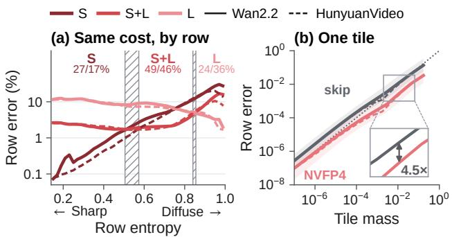  
Figure 3. Approximation error across rows and tiles. (a) Median row error versus row entropy at equal modeled compute; percentages: share of rows on which each approach is most accurate (Wan2.2/HunyuanVideo). (b) Row error from approximating a single tile versus its attention mass.

Each approach wins on different rows. S is most accurate on sharp rows, S+L on intermediate rows, and L on diffuse rows. These allocations trade the error from omitting tiles against the error from computing retained tiles at lower precision. To explain why the balance between these errors changes with the row’s attention distribution, we examine how approximating an individual tile changes the row’s output.

Error scales with tile mass. We approximate one tile at a time, keeping all other tiles exact, and measure the row’s relative L2 error. The tile is either replaced by its blockmean key and value or computed in NVFP4. Figure 3b shows that both errors grow roughly in proportion to tile mass in each model, with NVFP4 at about a fifth to a quarter of the block-mean error.

When one tile holds almost all a row’s mass, skipping the rest can introduce little error, while NVFP4 rounding on that tile can remain large. In diffuse rows, skipping loses more mass, favoring more tiles at lower precision. This helps explain the different winners in Figure 3a.

## 3.2 Different Precisions Within a Row

Within a row, increasing precision costs about the same across all equal-sized tiles, but can remove more output error from heavy tiles, those with large attention mass. The mass– error relationship therefore motivates choosing precision per tile by its marginal gain, the output error removed per unit of additional compute.

A row can contain a few heavy tiles with large NVFP4 error and many moderate tiles that together hold too much mass to skip with little error. Using NVFP4 for all kept tiles leaves error on the heavy ones, while raising precision for all also increases the cost of keeping the moderate tiles.

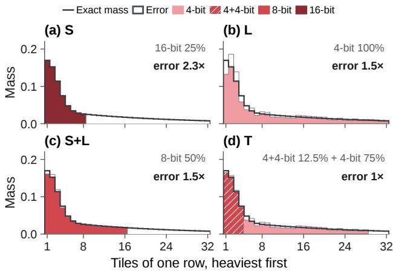  
Figure 4. Illustrative allocations at equal compute. (a)–(c) S, L, and S+L use one precision for kept tiles. (d) TRIAGE reserves more accurate computation for heavy tiles. White areas show modeled errors, summed and normalized to (d).

Figure 4 illustrates this trade-off. S leaves error on skipped tiles (a), and L leaves rounding error on heavy tiles (b). S+L reduces rounding error on every kept tile but must skip more tiles at the same compute (c). TRIAGE instead matches the computation of each tile to its mass (d), reducing the summed modeled error at equal compute.

## 4 OVERVIEW

TRIAGE chooses one of three tiers for each tile. Skip replaces a light tile with the means of its keys and values, skim computes a moderate tile in NVFP4, and refine computes a heavy tile at higher precision. Making this choice by marginal gain sets two goals. The first is to predict the error of each tier with low overhead, without computing the attention scores. Exact masses require the scores that skipping avoids, and the tokens within a tile vary, so cheap summaries such as block means can miss both a tile’s mass and its approximation error. The second is to run the chosen tiers without losing the speed of low-bit computation. Running the tiers in separate kernels requires merging their outputs, and higher precision usually comes from BF16, which runs at a fraction of the FP4 throughput. Figure 5 shows how the two stages of TRIAGE meet these goals.

Planning. Planning (§5) first groups similar queries and keys into fixed-size blocks with a clustering tree that repeatedly splits tokens along their principal direction, reducing the variation within each tile and thus the approximation error. It then collects block statistics, including means, variances, and key–value covariances, to estimate tile mass and approximation error without computing all attention scores. A router uses these estimates to choose the tier of each tile. Statistics collection and routing are fused with smoothing and quantization, keeping the planning overhead small. Planning outputs a tier map together with the block means and quantized operands that execution needs.

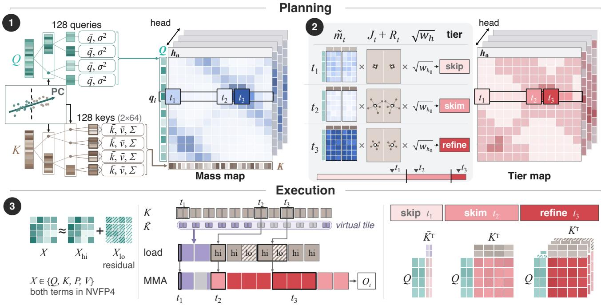  
Figure 5. Overview of TRIAGE. Planning (§5): ➊ clustering trees group similar queries and keys into tiles; ➋ the router scores each tile by $\tilde { E } _ { t } = \tilde { m } _ { t } \left( J _ { t } + R _ { t } \right) \sqrt { w _ { h } }$ and assigns it to skip, skim, or refine. Execution (§6): ➌ in one pass, skipped tiles use cluster means, skimmed tiles one NVFP4 product, and refined tiles three products that add the residuals. Tile patterns are illustrative.

Execution. Execution (§6) combines all three tiers within one online softmax. Skipped tiles contribute through their cluster means, which the kernel appends to the keys as virtual tiles, and skimmed tiles use NVFP4 products. Refined tiles add NVFP4 products of the quantization residuals, which nearly match the accuracy of BF16.

## 5 PLANNING: CHOOSING TIERS

Planning must estimate the marginal gain of each tier with low overhead.

## 5.1 Tile-Aligned Clustering

TRIAGE clusters similar queries and keys to improve both routing estimates and approximate computation. Grouping dissimilar tokens makes block means less representative and can increase the errors from mean replacement and shared quantization scales. Fixed token orders do not adapt to the input, while standard k-means produces clusters of varying sizes, which the kernel’s fixed-size tiles must either pad or split. TRIAGE therefore uses a divisive clustering tree that groups similar tokens while controlling block size.

TRIAGE builds separate query and key trees for each head using principal direction divisive partitioning (PDDP) (Boley, 1998). Each node represents a group of tokens, and the root contains all queries or all keys of a head. At each node, TRIAGE estimates the principal direction and sorts the tokens by their projections onto it. It then splits the sorted tokens near the midpoint, at a multiple of the target block size. Splitting continues until each leaf holds one block, and only the final block may be partially filled. The trees are rebuilt every five sparse steps. Appendix A gives the full algorithm, including dimensionality reduction and principal-direction estimation.

The attention kernel processes tiles of 128 queries by 128 keys. Query clusters contain 128 tokens, while key clusters contain 64 so that routing can use statistics from smaller key groups. The router combines the statistics of two consecutive key clusters to assign one tier to each 128-key tile. A skipped tile is represented by the mean keys and mean values of its two clusters.

## 5.2 Router

The router assigns each tile a tier $k _ { t } \in \{ \mathrm { s k i p } , \mathrm { s k i m } , \mathrm { r e f i n e } \}$ by its marginal gain, which requires predicting the error and compute of each tier. Predicting the error exactly is costly, because approximating one tile changes the effect of the others through the shared softmax sum of a row, and evaluating every combination of tiers grows exponentially with the number of tiles. Under a first-order approximation in the change of this sum, however, approximating one tile does not change the effect of the others, so the router uses the sum of the errors of approximating each tile alone as a surrogate for the row’s error. The compute of a tile also depends only on its own tier, so the router can choose tiers tile by tile. Let $E _ { t } ( k )$ be the error of approximating tile t alone with tier $k ,$ relative to the row’s output, and let $c ( k )$ be the compute of tier k relative to skimming: 0 for skip, 1 for skim, and $c _ { \mathrm { r f } }$ for refine. The router minimizes

$$
\sum _ { t } \Big ( E _ { t } ( k _ { t } ) + \pi \frac { c ( k _ { t } ) } { N _ { \mathrm { t } } } \Big ) ,\tag{3}
$$

where dividing by the row’s tile count $N _ { \mathrm { t } }$ keeps the price π comparable across sequence lengths, and π is the smallest marginal gain that justifies extra compute.

Skipping and skimming errors. Skipping replaces the keys and values of each of the tile’s two 64-key clusters with their means, which changes the tile’s contribution in two ways. First, because the exponential is convex, a mean key contributes less to the softmax normalizer than the keys it replaces, so the tile’s contribution to it shrinks by a fraction $J _ { t } .$ . Second, a mean value weights all values equally, whereas attention favors the values of high-scoring keys, so the tile’s value shifts by a relative amount $R _ { t } . \mathrm { A }$ first-order model that keeps only the magnitudes of these two effects gives

$$
E _ { t } ( \mathrm { s k i p } ) \approx m _ { t } ( J _ { t } + R _ { t } ) .\tag{4}
$$

If we assume Gaussian scores and a uniformly random query direction, both factors follow from block statistics:

$$
\begin{array} { l } { { J _ { t } = 1 - e ^ { - \left\| { q } \right\| ^ { 2 } \left. { \operatorname { t r } \Sigma _ { K } } \right. _ { t } / ( 2 D ^ { 2 } ) } , } } \\ { { R _ { t } = \displaystyle \frac { \left\| { q } \right\| } { D } \Big \langle \displaystyle \frac { \left\| { \Sigma _ { K V } } \right\| _ { F } } { \left\| { \bar { v } } \right\| } \Big \rangle _ { t } , } } \end{array}
$$

where D is the head dimension, $\Sigma _ { K } , \Sigma _ { K V }$ , and v¯ are the key covariance, key–value covariance, and mean value of a cluster, $\langle \cdot \rangle _ { t }$ averages a per-cluster quantity over the tile’s two clusters weighted by key count, and ∥q∥ is the root-meansquare query norm of the query block. Skimming error also grows roughly with mass, at about a fifth of the skipping error (Figure 3b), so as a simplification the router models it as a fixed fraction α of the skipping error, $E _ { t } ( \mathrm { s k i m } ) \approx$ α $E _ { t } ( \mathrm { s k i p } )$ . The router approximates refinement as exact and sets its error to zero.

Estimating mass. The router estimates the mass in two ways from block means. The first scores the mean query q¯ of the query block I against every key, reusing the scores that smoothing computes in (2). It keeps the differences among keys but hides those among queries, which the query variance $\bar { \sigma } _ { q } ^ { 2 }$ around $\bar { q }$ restores,

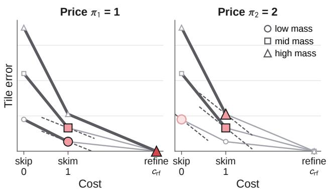  
Figure 6. Choosing tiers with one price. Each tile takes the tier where a line of slope −π touches its error–compute curve, and a higher price moves tiles to cheaper tiers. Numbers are illustrative.

$$
\tilde { a } _ { t } = \Big [ \mathrm { s o f t m a x } \Big ( \frac { \bar { q } K ^ { \top } } { \sqrt { D } } + \frac { \sigma _ { q } ^ { 2 } } { 2 D ^ { 2 } } \| K \| ^ { 2 } \Big ) \Big ] _ { t } ,
$$

where K holds the row’s keys, $\| K \| ^ { 2 }$ the squared norm of each key, and $[ \cdot ] _ { t }$ sums the entries that belong to tile t. The second scores every query against the cluster means $\bar { K }$ of the row. It keeps the differences among queries but hides those among keys, and the mean keys lose the same fraction $J _ { t }$ of their contribution as in skipping,

$$
\tilde { b } _ { t } \propto \frac { 1 } { 1 - J _ { t } } \Big [ \frac { 1 } { | I | } \sum _ { i \in I } \mathrm { s o f t m a x } \Big ( \frac { q _ { i } \bar { K } ^ { \top } } { \sqrt { D } } \Big ) \Big ] _ { t } ,
$$

normalized over the row. The router averages the two, $\tilde { m } _ { t } =$ $\frac { 1 } { 2 } \left( \tilde { a } _ { t } + \tilde { b } _ { t } \right)$ . Because $E _ { t }$ is relative to each head’s output, the router also weights each head by $\sqrt { w _ { h } }$ , the square root of its relative output energy in the layer’s previous attention call, which gives its estimate of the skipping error,

$$
\tilde { E } _ { t } = \tilde { m } _ { t } \left( J _ { t } + R _ { t } \right) \sqrt { w _ { h } } .\tag{5}
$$

Appendix B derives the decoupling, the skipping error, and both mass corrections.

Choosing tiers by price. Because the objective (3) is a sum of per-tile terms, each tile independently takes the tier where a line of slope −π touches its error–compute curve (Figure 6). We set $\alpha = 0 . 2 2$ , the median ratio of skimming to skipping error in Figure 3b, and $c _ { \mathrm { r f } } = 3$ , since a refined tile computes three NVFP4 products for each of $Q K ^ { \top }$ and P V where a skimmed tile computes one. We fix both for every model and setting, so π is the only parameter that we tune. With these values, skimming has a larger marginal gain than refining, so a tile is first skimmed and then refined as long as each step’s marginal gain is at least π,

$$
k _ { t } = \left\{ \begin{array} { l l } { \mathrm { r e f i n e } } & { \mathrm { i f } \ \frac { \alpha N _ { \mathrm { t } } \tilde { E } _ { t } } { c _ { \mathrm { r f } } - 1 } \ge \pi , } \\ { \mathrm { s k i m } } & { \mathrm { e l s e i f } \ ( 1 - \alpha ) N _ { \mathrm { t } } \tilde { E } _ { t } \ge \pi , } \\ { \mathrm { s k i p } } & { \mathrm { o t h e r w i s e } . } \end{array} \right.\tag{6}
$$

## 5.3 Preprocessing Kernels

Estimating $J _ { t } , R _ { t }$ , and $m _ { t }$ from block statistics lets planning share the preprocessing needed for quantization. TRIAGE fuses statistics collection, mass estimation, and tier assignment with smoothing and quantization in a few Triton (Tillet et al., 2019) passes grouped by operand. The scores $\bar { q } K ^ { \top }$ in $\tilde { a } _ { t }$ come from the BF16 operands of smoothing, while the scores $q _ { i } \bar { K } ^ { \top }$ in $\tilde { b } _ { t }$ are computed from the NVFP4 operands on the FP4 tensor cores for speed, without degrading routing accuracy. These operations are memory-bound, so fusion avoids repeated reads of Q, K, and $V ;$ tokens are accessed through the clustering tree’s index rather than a permuted copy.

## 6 EXECUTION: RUNNING ALL TIERS IN ONE PASS

To preserve the speed of low-bit computation, TRIAGE runs all three tiers in a single kernel on the FP4 tensor cores. Skimmed tiles follow the NVFP4 computation of SageAttention3 (§2.3), and every tile’s scores start from the fullprecision smoothing correction of (2), to which its NVFP4 product is added.

## 6.1 Skipping with Virtual Tiles

A skipped tile replaces the keys and values of each of its key clusters $\beta$ with their means $\bar { k } _ { \beta }$ and $\bar { v } _ { \beta }$ . For a query q with $s _ { \beta } = \boldsymbol { q } \cdot \boldsymbol { \bar { k } _ { \beta } } / \sqrt { D }$ , the $n _ { \beta }$ copies of the mean add to the softmax normalizer and to the weighted sum of values exactly what one key with an additional logit of ln $n _ { \beta }$ adds,

$$
\left( n _ { \beta } e ^ { s _ { \beta } } , n _ { \beta } e ^ { s _ { \beta } } \bar { v } _ { \beta } \right) = \left( e ^ { s _ { \beta } + \ln n _ { \beta } } , e ^ { s _ { \beta } + \ln n _ { \beta } } \bar { v } _ { \beta } \right) .\tag{7}
$$

The kernel therefore appends the cluster means $\bar { K }$ and $\bar { V }$ to the keys as virtual tiles, which every query block visits as skimmed tiles. As with real keys, the correction $\bar { q } ( \bar { K } - \bar { k } ) ^ { \top }$ completes each query’s score. The correction also adds ln $n _ { \beta }$ to a cluster whose tile is skipped, so that its mean represents all $n _ { \beta }$ keys, and −∞ to a cluster whose tile is kept, so that the tile is not counted twice.

## 6.2 Refining Tiles on FP4 Tensor Cores

A refined tile needs higher accuracy than a skimmed one, which could come from BF16 in two ways. A second BF16 kernel over the refined tiles would need an extra launch, load Q and write the output a second time, and add a merge pass. BF16 products inside the same kernel would avoid these costs, but BF16 tensor cores are several times slower than the FP4 ones (§2.3). TRIAGE instead refines tiles on the FP4 tensor cores, where three FP4 products still take less time than one BF16 product at peak rates.

To do ${ \bf { S O } } ,$ TRIAGE quantizes not only each operand but also its quantization residual:

$$
X \approx g ( X _ { \mathrm { h i } } + X _ { \mathrm { l o } } ) ,\tag{8}
$$

where $X _ { \mathrm { h i } } = \mathcal { Q } ( X / g )$ and $X _ { \mathrm { l o } } = \mathcal { Q } ( X / g - X _ { \mathrm { h i } } )$ , Q is NVFP4 quantization, and $g$ is a power of two shared by both terms, so dividing by it is exact and the three products below accumulate without rescaling in between. A skimmed tile uses only the hi terms. A refined tile adds the products with one residual and drops the product of two residuals, which is second order:

$$
\begin{array} { r } { S \approx g _ { Q } g _ { K } \big ( Q _ { \mathrm { h i } } K _ { \mathrm { h i } } ^ { \top } + Q _ { \mathrm { l o } } K _ { \mathrm { h i } } ^ { \top } + Q _ { \mathrm { h i } } K _ { \mathrm { l o } } ^ { \top } \big ) , } \end{array}\tag{9}
$$

$$
O \mathrm { + = } g _ { P } g _ { V } \big ( P _ { \mathrm { h i } } V _ { \mathrm { h i } } + P _ { \mathrm { l o } } V _ { \mathrm { h i } } + P _ { \mathrm { h i } } V _ { \mathrm { l o } } \big ) ,\tag{10}
$$

where $Q$ and K are the smoothed operands (§2.3), the scaling factor $1 / \sqrt { D }$ and the smoothing correction are omitted, and $P _ { \mathrm { l o } }$ is the NVFP4 residual of the probabilities, formed in registers.

## 6.3 Attention Kernel

We implement the kernel for sm 120, the architecture of the RTX Blackwell GPUs that we evaluate, in the CuTe DSL of CUTLASS (NVIDIA, 2026). It extends a warp-specialized NVFP4 attention kernel on 128-query by 128-key tiles, in which one producer warp loads operands through the Tensor Memory Accelerator (TMA) and eight MMA warps add each NVFP4 product to the full-precision smoothing correction of (2).

Loading by tier. Besides the virtual tiles, the producer loads the real key tiles the router kept, with $K _ { \mathrm { l o } }$ and $V _ { \mathrm { l o } }$ for refined tiles, and the MMA warps run the residual products only on refined tiles.

Balancing uneven query blocks. Query blocks differ in cost, which the kernel estimates from their kept and refined tiles, so the persistent kernel deals them to cooperative thread arrays (CTAs) in a snake order, largest first, to spread costly blocks evenly.

Together with the preprocessing kernels, the attention kernel forms a drop-in backend that replaces the self-attention call of each transformer block, so TRIAGE plugs into pipelines such as SGLang Diffusion (Zheng et al., 2024; SGLang Team, 2025) without changing the model.

## 7 EVALUATION

## 7.1 Setup

Models and hardware. We evaluate four video DiTs from three families in five settings, each on a single Blackwell GPU (Table 1). The RTX 5090 (32 GB) runs Wan2.2-TI2V-5B (Wang et al., 2025) at 720p and HunyuanVideo (Kong et al., 2024) at 540p, with FP8 weights for HunyuanVideo to fit in memory. The RTX PRO 6000 (96 GB) runs Wan2.2- T2V-A14B, HunyuanVideo at 720p, and LTX-2.5 (HaCohen et al., 2026) for image-to-video generation, all in BF16 at their official settings. The models run 50 denoising steps (40 for Wan2.2-T2V-A14B), and LTX-2.5 runs eight stage-1 steps and three stage-2 steps. Every method runs in SGLang Diffusion 0.5.20 (SGLang Team, 2025) with PyTorch 2.13 and CUDA 13.0 on Ubuntu 24.04, and replaces only the self-attention over the visual tokens; the dense reference runs FlashAttention-2 (Dao, 2024).

Workloads and metrics. The text-to-video models use 50 prompts from the Penguin Video Benchmark (Kong et al., 2024), and LTX-2.5 uses 50 image–prompt pairs from VBench (Huang et al., 2024; 2025), each with a fixed seed. For fidelity, we report PSNR, SSIM, and LPIPS against the dense video, averaged over frames, and for quality the mean of five VBench dimensions. For speed, we report the speedup over dense of the end-to-end latency and of each attention call (Figure 8).

Baselines. We compare against training-free baselines of the three approaches in Figure 1: sparse (S) Sol-Attn (Li et al., 2026) and SVG-EAR (Zhou et al., 2026), low-bit (L) SageAttention3 (Zhang et al., 2025b), and combined (S+L) SpargeAttn (Zhang et al., 2025c). They compute tiles in BF16 (S), NVFP4 (L), and INT8/FP8 (S+L). Each baseline runs at the default setting of SGLang Diffusion or of its paper (Appendix C.1), and Figure 7 sweeps their knobs. The one change is that SVG-EAR uses half the cluster counts of its paper on the 27K- and 67K-token sequences of the RTX 5090, because with the original counts its k-means clustering takes a large part of these short attention calls; Figure 7 also runs the original counts. We exclude methods that fine-tune the model (Zhang et al., 2025e; 2026c;b). Every method runs the first 20% of the steps (the stage-1 steps on LTX-2.5) and the first transformer block densely. TRIAGE runs at two prices, π = 0.15 and 0.3, and only at π = 0.3 on HunyuanVideo 720p and LTX-2.5.

## 7.2 End-to-End Performance

In each of the five settings of Table 1, one price of TRIAGE is faster end to end than every baseline and also closer to the dense video in PSNR, SSIM, and LPIPS: π = 0.15 in the three settings where it runs, and $\pi = 0 . 3$ in the other

Table 1. End-to-end results over 50 prompts: fidelity to the dense video (PSNR and SSIM, higher is better; LPIPS, lower is better), VBench quality (mean of five dimensions), and speedup over dense (E2E). Density: share of tiles computed, refined ones in parentheses. Tokens: visual tokens per sequence (stage 2 for LTX-2.5). TRIAGE (π): price π. S, L, S+L: sparse, low-bit (4-bit), and combined (8-bit) attention. Bold: best method.

<table><tr><td>Method</td><td>PSNR SSIM LPIPS VBench</td><td>Density</td><td>E2E</td></tr><tr><td colspan="4">RTX 5090 (32 GB)</td></tr><tr><td colspan="4">Wan2.2-TI2V-5B: 720p, 121f, 27K tokens</td></tr><tr><td>Dense Sol-Attn (S) SVG-EAR (S) SageAttn3 (L) SpargeAttn (S+L)</td><td>0.827 25.33 0.8630.104 0.826 28.51 0.907 0.062 0.823 26.00 0.8630.096 0.820 0.826</td><td>100% 23% 17% 100% 50%</td><td>1.00× 1.33× 1.19× 1.28× 1.33×</td></tr><tr><td>TRIAGE (0.15) TRIAGE (0.3)</td><td>27.19 0.8950.074 29.35 0.919 0.048 0.826 27.58 0.892 0.066 0.824 HunyuanVideo (FP8): 540p, 129f, 67K tokens</td><td>29% (10%) 1.35× 21% (6%) 100% 23%</td><td>1.38× 1.00× 1.93×</td></tr><tr><td colspan="4">Dense 0.826 Sol-Attn (S) 27.57 0.875 0.100 0.825</td></tr><tr><td>SVG-EAR (S) 33.350.9380.041 SageAttn3 (L) 32.580.9330.048 SpargeAttn (S+L) TRIAGE (0.15)</td><td>0.822 0.823 30.230.9160.065 0.824 36.37 0.959 0.022 0.826</td><td>22% 100% 50% 28% (8%) 19% (5%)</td><td>1.61× 1.78× 2.04× 2.21× 2.32×</td></tr><tr><td colspan="4">TRIAGE (0.3) 34.46 0.9480.030 0.826 RTX PRO 6000 (96 GB) Wan2.2-T2V-A14B: 720p, 81f, 76K tokens</td></tr><tr><td colspan="4">Dense 0.851 100% 1.00× Sol-Attn (S) 18.980.682 0.248 0.850 22% 1.69×</td></tr><tr><td>SVG-EAR (S) 23.26 0.812 0.128 0.851 SageAttn3 (L) 22.53 0.7830.147 SpargeAttn (S+L)</td><td>0.847 20.240.7320.196 0.849</td><td>26% 100% 50%</td><td>1.35× 1.37× 1.59×</td></tr><tr><td>TRIAGE (0.15)</td><td>24.40 0.839 0.104 0.850</td><td>35% (8%) 23% (5%)</td><td>1.72×</td></tr><tr><td>TRIAGE (0.3)</td><td>22.98 0.802 0.131 0.850</td><td></td><td></td></tr><tr><td></td><td></td><td></td><td></td></tr><tr><td></td><td></td><td></td><td>1.83×</td></tr><tr><td>HunyuanVideo: 720p, 129f, 119K tokens</td><td></td><td></td><td></td></tr><tr><td>Dense</td><td>0.834</td><td>100%</td><td>1.00×</td></tr><tr><td>Sol-Attn (S)</td><td>28.02 0.8880.102 0.835</td><td>21%</td><td>1.97×</td></tr><tr><td>SVG-EAR (S)</td><td>35.73 0.9570.028 0.832</td><td>21%</td><td>1.60× 1.49×</td></tr><tr><td>SageAttn3 (L)</td><td>33.13 0.9380.049 0.832</td><td>100% 50%</td><td>1.83×</td></tr><tr><td>SpargeAttn (S+L)</td><td>32.230.9360.051 0.833</td><td>19% (4%)</td><td>2.28×</td></tr><tr><td>TRIAGE (0.3)</td><td>36.03 0.958 0.026 0.834</td><td></td><td></td></tr><tr><td></td><td>LTX-2.5 (I2V, two-stage): 1088p, 721f, 186K tokens</td><td></td><td></td></tr><tr><td>Dense</td><td>0.844</td><td>100%</td><td>1.00×</td></tr><tr><td>Sol-Attn (S)</td><td>27.91 0.8800.081 0.846</td><td>19%</td><td>1.74×</td></tr><tr><td>SVG-EAR (S)</td><td>33.300.9420.036 0.844</td><td>44%</td><td>1.12×</td></tr><tr><td></td><td></td><td>100%</td><td>1.36×</td></tr><tr><td>SageAttn3 (L)</td><td>33.12 0.9400.037 0.843</td><td></td><td></td></tr><tr><td>SpargeAttn (S+L)</td><td>29.680.9060.060 0.844</td><td>50%</td><td>1.60×</td></tr><tr><td></td><td></td><td></td><td></td></tr><tr><td></td><td></td><td></td><td></td></tr><tr><td></td><td>34.12 0.947 0.031</td><td>27% (3%)</td><td></td></tr><tr><td></td><td></td><td></td><td></td></tr><tr><td></td><td></td><td></td><td></td></tr><tr><td></td><td></td><td></td><td></td></tr><tr><td></td><td></td><td></td><td></td></tr><tr><td></td><td></td><td></td><td></td></tr><tr><td></td><td></td><td></td><td></td></tr><tr><td></td><td></td><td></td><td></td></tr><tr><td></td><td></td><td></td><td></td></tr><tr><td></td><td></td><td></td><td></td></tr><tr><td></td><td></td><td></td><td></td></tr><tr><td></td><td></td><td></td><td></td></tr><tr><td></td><td></td><td></td><td></td></tr><tr><td></td><td></td><td></td><td></td></tr><tr><td></td><td></td><td></td><td></td></tr><tr><td></td><td></td><td></td><td></td></tr><tr><td></td><td></td><td></td><td></td></tr><tr><td></td><td></td><td></td><td></td></tr><tr><td></td><td></td><td></td><td></td></tr><tr><td></td><td></td><td></td><td></td></tr><tr><td></td><td></td><td></td><td></td></tr><tr><td></td><td></td><td></td><td></td></tr><tr><td></td><td></td><td></td><td></td></tr><tr><td></td><td></td><td></td><td></td></tr><tr><td></td><td></td><td></td><td></td></tr><tr><td></td><td></td><td></td><td></td></tr><tr><td>TRIAGE (0.3)</td><td></td><td></td><td></td></tr><tr><td></td><td></td><td></td><td>1.84×</td></tr><tr><td></td><td></td><td></td><td></td></tr><tr><td></td><td></td><td></td><td></td></tr><tr><td></td><td></td><td></td><td></td></tr><tr><td></td><td></td><td></td><td></td></tr><tr><td></td><td></td><td></td><td></td></tr><tr><td></td><td></td><td></td><td></td></tr><tr><td></td><td></td><td></td><td></td></tr><tr><td></td><td></td><td></td><td></td></tr><tr><td></td><td></td><td></td><td></td></tr><tr><td></td><td></td><td></td><td></td></tr><tr><td></td><td></td><td></td><td></td></tr><tr><td></td><td></td><td></td><td></td></tr><tr><td></td><td></td><td></td><td></td></tr><tr><td></td><td></td><td></td><td></td></tr><tr><td></td><td></td><td></td><td></td></tr><tr><td></td><td></td><td></td><td></td></tr><tr><td></td><td></td><td></td><td></td></tr><tr><td></td><td></td><td></td><td></td></tr><tr><td></td><td></td><td>0.844</td><td></td></tr><tr><td></td><td></td><td></td><td></td></tr><tr><td></td><td></td><td></td><td></td></tr><tr><td></td><td></td><td></td><td></td></tr><tr><td></td><td></td><td></td><td></td></tr><tr><td></td><td></td><td></td><td></td></tr><tr><td></td><td></td><td></td><td></td></tr><tr><td></td></table>

two. At $\pi = 0 . 1 5 ,$ , TRIAGE computes more tiles than the sparse baselines, 28–35%, but refines only 8–10% of all tiles, and its PSNR is 0.8–3.0 dB above that of SVG-EAR, the baseline with the highest fidelity. SVG-EAR reaches only 1.12–1.61×, because it clusters the tokens with k-means and computes its kept tiles in BF16. At π = 0.3, TRIAGE is the fastest method in every setting, at 1.38–2.32×, and its PSNR is still 0.4–8.0 dB higher than that of SpargeAttn and Sol-Attn, the fastest baselines; on both HunyuanVideo settings and LTX-2.5, it also exceeds SVG-EAR in PSNR while computing fewer tiles. In the sweep of Figure 7, TRIAGE Pareto-dominates every baseline setting except SVG-EAR with the original cluster counts on Wan2.2-TI2V-5B, which has higher fidelity than every setting of TRIAGE but is slower than all of them.

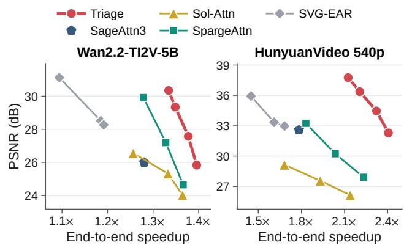  
Figure 7. End-to-end PSNR versus speedup over dense on the RTX 5090, sweeping the knob of each method (π ∈ {0.1, 0.15, 0.3, 0.6} for TRIAGE). Each point averages over the same 50 prompts.

The end-to-end gains are bounded because the dense steps and the work outside attention are unchanged, and they are larger where attention takes more of a dense step (Appendix C.1). LTX-2.5 gains less because only its three stage-2 steps run sparsely.

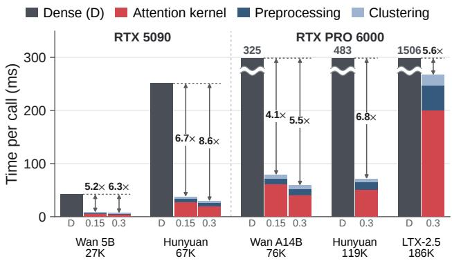  
Figure 8. Time of one attention call, averaged over the sparse steps of the end-to-end runs, for dense FlashAttention (D, truncated) and TRIAGE at π = 0.15 and 0.3. Arrows: speedup over dense.

Figure 8 breaks one attention call of the end-to-end runs into its stages. The clustering and the preprocessing, which also collects the block statistics and routes the tiles, take 4.0–

7.4% of the time of FlashAttention, so a whole call still runs 4.1–8.6× faster than dense. Their share of a call, 23–46%, is largest when the kernel is short, on short sequences with few computed tiles. Appendix C.1 reports every VBench dimension, and Figure 2 and Appendix C.3 show generated frames.

## 7.3 Attention Accuracy and Speed

We replay attention calls captured from dense runs of Wan2.2-TI2V-5B and HunyuanVideo 540p on the RTX 5090 (160 and 240 calls over four prompts, four steps, and ten and fifteen layers) and sweep the knob of every method. The time of every method includes all of its preprocessing, such as clustering and deciding which tiles to compute.

TRIAGE reaches a better trade-off than every baseline on both models (Figure 9a,b). At 4.5% and 4.0% error, it runs 5.7× and 6.8× faster than FlashAttention, while SpargeAttn, the strongest baseline, needs 1.8× and 2.0× more time at the same error. At about 6×, its error is less than a third of that of Sol-Attn, and at equal or lower error it runs 3.1–3.6× faster than SageAttention3.

## 7.4 Ablations

We remove the refine tier and the clustering tree from TRIAGE (Figure 9c,d) and then each factor of the router score (Table 2).

Refinement. Without the refine tier, the error of TRIAGE never falls below 9.6% and 6.9%. Refining the tiles that the router selects removes this floor, down to 2.0% and 1.3%, and at equal error makes TRIAGE 1.5× and 1.9× faster, because accurate kept tiles let the router skip more of the others.

Clustering tree. Without the tree, tiles mix dissimilar tokens, so their means represent them poorly and TRIAGE must compute more tiles to reach the same error. Removing the tree from the variant without refinement raises its lowest error from 9.6% to 12.9% on Wan2.2-TI2V-5B and from 6.9% to 7.3% on HunyuanVideo, and on HunyuanVideo makes it 1.2–1.3× slower at equal error (Figure 9c,d).

## 7.5 Router Score

We remove one factor of the router score ${ \tilde { E } } _ { t } = { \tilde { m } } _ { t } ( J _ { t } +$ $R _ { t } ) \sqrt { w _ { h } }$ at a time, keeping and refining as many tiles as the full score in every captured call (Table 2). Every factor helps, in the same order at every budget. Without $J _ { t } + R _ { t }$ the router ranks tiles by mass alone and skips tiles that their means represent poorly, which raises the error by 18% and does so in 95% of the calls. Without the head weight, the router allows the same relative error in every head, although the heads with a large output dominate the error of the layer, and the error rises by 7%. The mass corrections (the queryvariance term in $\tilde { a } _ { t }$ and the factor $1 / ( 1 - J _ { t } )$ in $\ddot { b } _ { t } )$ reduce the error by a small but consistent 3%.

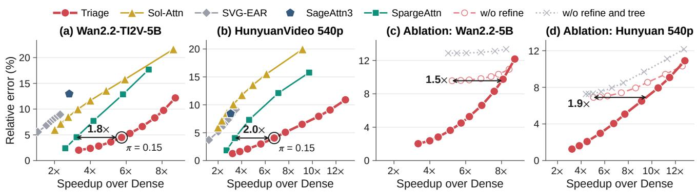

Figure 9. Relative output error versus attention speedup over FlashAttention on attention calls captured on the RTX 5090, sweeping the knob of each method (lower right is better). (a, b) TRIAGE (π from 0.025 to 0.9) against the baselines. (c, d) TRIAGE without the refine tier and without both the refine tier and the clustering tree (natural token order). Settings faster than the fastest TRIAGE setting are omitted. Arrows: time of SpargeAttn (a, b) and of TRIAGE without the refine tier (c, d) relative to TRIAGE at equal error; circles: TRIAGE a $\pi = 0 . 1 5$  
Table 2. Router score ablation at equal kept and refined tiles: error relative to the full score (geometric mean) and share of calls with a higher error, pooled over four budgets.
<table><tr><td rowspan="2">Variant</td><td colspan="2">Error vs. full</td><td colspan="3">Calls with higher error</td></tr><tr><td>Wan</td><td>Hun. All</td><td>Wan</td><td>Hun.</td><td>All</td></tr><tr><td>w/o  $J _ { t } + R _ { t }$ </td><td>1.28×</td><td>1.12× 1.18×</td><td>100%</td><td>92%</td><td>95%</td></tr><tr><td>w/o  $\sqrt { w _ { h } }$ </td><td>1.08×</td><td>1.07× 1.07×</td><td>97%</td><td>69%</td><td>80%</td></tr><tr><td>w/o mass corr. 1.03×</td><td></td><td>1.04× 1.03×</td><td>89%</td><td>81%</td><td>84%</td></tr></table>

Table 3. Attention kernel on the RTX 5090: relative L2 error, kernel time (ms) without preprocessing, and speedup over FlashAttention. 2-pass BF16: the tiles that TRIAGE refines, computed instead in a separate BF16 pass.
<table><tr><td rowspan="2">Mode</td><td colspan="2">Wan2.2-TI2V-5B</td><td colspan="2">HunyuanVideo 540p</td></tr><tr><td>Err. Time</td><td>Speed. Err.</td><td>Time</td><td>Speed.</td></tr><tr><td>FlashAttn</td><td>41.7</td><td>1.00×</td><td>251.7</td><td>1.00×</td></tr><tr><td>TRIAGE (0.15) 4.5%</td><td>4.3</td><td> $9 . 7 3 \times 4 . 0 \%$ </td><td>29.4</td><td>8.57×</td></tr><tr><td>2-pass BF16</td><td>4.4% 6.1</td><td> $6 . 8 0 \times ~ 4 . 0 \%$ </td><td>40.5</td><td>6.21×</td></tr><tr><td>TRIAGE (0.3) 6.5%</td><td>3.1</td><td> $1 3 . 5 \times ~ 6 . 5 \%$ </td><td>19.5</td><td>12.9×</td></tr><tr><td>2-pass BF166.5%</td><td>4.3</td><td>9.59× 6.4%</td><td>26.2</td><td>9.61×</td></tr></table>

## 7.6 Refinement in NVFP4 versus BF16

Table 3 times the attention kernel of TRIAGE alone, without preprocessing. $\mathrm { A t } \pi = 0 . 1 5 .$ , its kernel runs 9.7× and 8.6× faster than FlashAttention. Refining the same tiles in a separate BF16 pass, merged by log-sum-exp, instead gives almost the same error, within 0.1 points at both prices, but slows the kernel by 34–43%, so the NVFP4 residual alone is sufficient for refinement on these calls.

## 8 RELATED WORK

Sparse attention in LLMs. Many sparse attention techniques for DiTs originate from long-context LLMs: during prefill, MInference (Jiang et al., 2024) and XAttention (Xu et al., 2025) select blocks per head and input, while NSA (Yuan et al., 2025) and DeepSeek Sparse Attention (DeepSeek-AI, 2025) learn the selection during training. During decoding, sparsity instead selects which KV cache entries to load (Xiao et al., 2024; Tang et al., 2024), saving memory traffic rather than computation.

Mixed-precision attention in LLMs. ThriftAttention (Sharratt, 2026) and TileMix (Zhang et al., 2026a) compute some blocks in FP16 and the rest in FP4 or INT8, chosen by mean-pooled query–key scores and by static templates, respectively.

Orthogonal acceleration. Post-training quantization of the linear layers (Wu et al., 2024; Zhao et al., 2025a; Li et al., 2025) speeds up the rest of the model, while step distillation (Song et al., 2023; Yin et al., 2024; Zheng et al., 2026) and feature caching (Zhao et al., 2025c; Liu et al., 2025a;b) reduce the work across denoising steps. TRIAGE instead reduces the attention cost within each step, so these methods can be combined with it, as TurboDiffusion (Zhang et al., 2025d) combines step distillation with low-bit and sparse attention.

## 9 CONCLUSION

TRIAGE shows that sparse and low-bit attention need not be competing choices: deciding for each tile whether to skip, skim, or refine it lets attention spend precision according to the estimated error reduction. A lightweight router makes this choice from block statistics, and one fused kernel runs all three tiers on the FP4 tensor cores. Across three families of video DiTs, TRIAGE achieves a better trade-off between speed and fidelity than existing methods, without retraining or modifying the model. As attention takes a growing share of generation with longer and higher-resolution videos, choosing precision tile by tile becomes increasingly important for making video generation practical.

## REFERENCES

Aditi, Agarwal, N., Ali, A., Allen, J., Antolini, M., Aubame, A., Azzolini, A. G., Bai, J., Bala, M., Balaji, Y., Bapst, J., Basant, A., Beladiya, M., Bhat, M. Q., Bhat, Z. P., Blick, D., Brighella, V., Cai, H., Cai, T., Cameracci, E., Cao, J., Cao, Y., Carlson, M., Casanova, C., Chang, T., Chang, Y., Chao, Y., Chattopadhyay, P., Chaudhari, R., Chen, C., Chen, J., Chen, K., Chen, Q., Chen, W., Chen, X., Chen, Y., Cheng, A., Cheng, C., Chia, X., Choi, J., Chung, C., Cong, W., Cui, Y., Dadela, M., Dadhich, N., Dai, W., Daw, J., Degirmenci, A., Monte, R. V. D., Denomme, R., Dharur, S., Lucca, M. D., Ding, K., Ding, W., Ding, Y., Dong, Y., Drumheller, N., Du, Y., Dzhumamuratova, A., Efitorov, A., Eghbalzadeh, H., Eigbe, N., Hanafi, I. E., Eslami, H., Falk, B., Fan, J., Fan, J., Fasale, A., Fefilatyev, S., Feng, L., Ferroni, F., Fidler, S., Fu, X., Fugro, V., Gaikwad, P., Galda, T., Gao, K., Gao, Y., Ge, W., Ghosh, S., Goel, A., Goel, V., Gokul, A., Govindaraju, R., Gu, J., Guerrero, M., Guo, E., Gupta, A., Gururani, S., Hadfield, H., Han, S., Handa, A., Hao, Z., Harrim, M., Hassani, A., Hayes-Roth, N., He, Y., Helvig, C., and Hogg, C. Cosmos 3: Omnimodal world models for physical AI. CoRR, abs/2606.02800, 2026. doi: 10.48550/ARXIV.2 606.02800.

Agarwal, N., Ali, A., Bala, M., Balaji, Y., Barker, E., Cai, T., Chattopadhyay, P., Chen, Y., Cui, Y., Ding, Y., Dworakowski, D., Fan, J., Fenzi, M., Ferroni, F., Fidler, S., Fox, D., Ge, S., Ge, Y., Gu, J., Gururani, S., He, E., Huang, J., Huffman, J. S., Jannaty, P., Jin, J., Kim, S. W., Klar, G., Lam, G., Lan, S., Leal-Taix´ e,´ L., Li, A., Li, Z., Lin, C., Lin, T., Ling, H., Liu, M., Liu, X., Luo, A., Ma, Q., Mao, H., Mo, K., Mousavian, A., Nah, S., Niverty, S., Page, D., Paschalidou, D., Patel, Z., Pavao, L., Ramezanali, M., Reda, F., Ren, X., Sabavat, V. R. N., Schmerling, E., Shi, S., Stefaniak, B., Tang, S., Tchapmi, L., Tredak, P., Tseng, W., Varghese, J., Wang, H., Wang, H., Wang, H., Wang, T., Wei, F., Wei, X., Wu, J. Z., Xu, J., Yang, W., Lin, Y., Zeng, X.,

Zeng, Y., Zhang, J., Zhang, Q., Zhang, Y., Zhao, Q., and Zolkowski, A. Cosmos world foundation model plat-´ form for physical AI. CoRR, abs/2501.03575, 2025. doi: 10.48550/ARXIV.2501.03575.

Boley, D. Principal direction divisive partitioning. Data Min. Knowl. Discov., 2(4):325–344, December 1998. ISSN 1384-5810. doi: 10.1023/A:1009740529316. URL ht tps://doi.org/10.1023/A:1009740529316.

Dao, T. FlashAttention-2: Faster attention with better parallelism and work partitioning. In International Conference on Learning Representations (ICLR), 2024.

Dao, T., Fu, D. Y., Ermon, S., Rudra, A., and Re, C. FlashAt-´ tention: Fast and memory-efficient exact attention with IO-awareness. In Advances in Neural Information Processing Systems (NeurIPS), 2022.

DeepSeek-AI. DeepSeek-V3.2: Pushing the frontier of open large language models. CoRR, abs/2512.02556, 2025. doi: 10.48550/ARXIV.2512.02556.

HaCohen, Y., Brazowski, B., Chiprut, N., Bitterman, Y., Kvochko, A., Berkowitz, A., Shalem, D., Lifschitz, D., Moshe, D., Porat, E., Richardson, E., Shiran, G., Chachy, I., Chetboun, J., Finkelson, M., Kupchick, M., Zabari, N., Guetta, N., Kotler, N., Bibi, O., Gordon, O., Panet, P., Benita, R., Armon, S., Kulikov, V., Inger, Y., Shiftan, Y., Melumian, Z., and Farbman, Z. LTX-2: efficient joint audio-visual foundation model. CoRR, abs/2601.03233, 2026. doi: 10.48550/ARXIV.2601.03233.

Huang, Z., He, Y., Yu, J., Zhang, F., Si, C., Jiang, Y., Zhang, Y., Wu, T., Jin, Q., Chanpaisit, N., Wang, Y., Chen, X., Wang, L., Lin, D., Qiao, Y., and Liu, Z. VBench: Comprehensive benchmark suite for video generative models. In IEEE/CVF Conference on Computer Vision and Pattern Recognition (CVPR), pp. 21807–21818, 2024. doi: 10.1109/CVPR52733.2024.02060.

Huang, Z., Zhang, F., Xu, X., He, Y., Yu, J., Dong, Z., Ma, Q., Chanpaisit, N., Si, C., Jiang, Y., Wang, Y., Chen, X., Chen, Y.-C., Wang, L., Lin, D., Qiao, Y., and Liu, Z. VBench++: Comprehensive and versatile benchmark suite for video generative models. IEEE Transactions on Pattern Analysis and Machine Intelligence (TPAMI), 2025. doi: 10.1109/TPAMI.2025.3633890.

Jiang, H., Li, Y., Zhang, C., Wu, Q., Luo, X., Ahn, S., Han, Z., Abdi, A. H., Li, D., Lin, C., Yang, Y., and Qiu, L. MInference 1.0: Accelerating pre-filling for longcontext LLMs via dynamic sparse attention. In Advances in Neural Information Processing Systems (NeurIPS), 2024.

Kong, W., Tian, Q., Zhang, Z., Min, R., Dai, Z., Zhou, J., Xiong, J., Li, X., Wu, B., Zhang, J., Wu, K., Lin, Q., Yuan, J., Long, Y., Wang, A., Wang, A., Li, C., Huang, D., Yang, F., Tan, H., Wang, H., Song, J., Bai, J., Wu, J., Xue, J., Wang, J., Wang, K., Liu, M., Li, P., Li, S., Wang, W., Yu, W., Deng, X., Li, Y., Chen, Y., Cui, Y., Peng, Y., Yu, Z., He, Z., Xu, Z., Zhou, Z., Xu, Z., Tao, Y., Lu, Q., Liu, S., Zhou, D., Wang, H., Yang, Y., Wang, D., Liu, Y., Jiang, J., and Zhong, C. HunyuanVideo: A systematic framework for large video generative models. CoRR, abs/2412.03603, 2024. doi: 10.48550/ARXIV.2 412.03603.

Li, H., Li, Y., Chen, J., Ye, T., Liu, H., Yu, J., Wang, D., Zhang, R., Xie, Z., Xie, E., and Han, S. Sol-Attn: Accelerating video generation inference via on-the-fly attention sparsification. CoRR, abs/2607.24027, 2026. doi: 10.48550/ARXIV.2607.24027.

Li, M., Lin, Y., Zhang, Z., Cai, T., Li, X., Guo, J., Xie, E., Meng, C., Zhu, J., and Han, S. SVDQuant: Absorbing outliers by low-rank component for 4-bit diffusion models. In International Conference on Learning Representations (ICLR), 2025.

Liu, F., Zhang, S., Wang, X., Wei, Y., Qiu, H., Zhao, Y., Zhang, Y., Ye, Q., and Wan, F. Timestep embedding tells: It’s time to cache for video diffusion model. In IEEE/CVF Conference on Computer Vision and Pattern Recognition (CVPR), pp. 7353–7363, 2025a. doi: 10.1109/CVPR52 734.2025.00689.

Liu, J., Zou, C., Lyu, Y., Chen, J., and Zhang, L. From reusing to forecasting: Accelerating diffusion models with TaylorSeers. In IEEE/CVF International Conference on Computer Vision (ICCV), pp. 15853–15863, 2025b. doi: 10.1109/ICCV51701.2025.01471.

NVIDIA. CUTLASS: CUDA templates and Python DSLs for linear algebra. https://github.com/NVIDI A/cutlass, 2026.

Peebles, W. and Xie, S. Scalable diffusion models with transformers. In IEEE/CVF International Conference on Computer Vision (ICCV), pp. 4172–4182, 2023. doi: 10.1109/ICCV51070.2023.00387.

SGLang Team. SGLang Diffusion: Accelerating video and image generation. https://www.lmsys.org/bl og/2025-11-07-sglang-diffusion/, 2025.

Sharratt, J. ThriftAttention: Selective mixed precision for long-context FP4 attention. arXiv preprint arXiv:2605.23081, 2026.

Song, Y., Dhariwal, P., Chen, M., and Sutskever, I. Consistency models. In International Conference on Machine Learning (ICML), pp. 32211–32252, 2023.

Tang, J., Zhao, Y., Zhu, K., Xiao, G., Kasikci, B., and Han, S. QUEST: query-aware sparsity for efficient long-context LLM inference. In International Conference on Machine Learning (ICML), pp. 47901–47911, 2024.

Tillet, P., Kung, H., and Cox, D. D. Triton: an intermediate language and compiler for tiled neural network computations. In ACM SIGPLAN International Workshop on Machine Learning and Programming Languages (MAPL), pp. 10–19, 2019. doi: 10.1145/3315508.3329973.

Wang, A., Ai, B., Wen, B., Mao, C., Xie, C., Chen, D., Yu, F., Zhao, H., Yang, J., Zeng, J., Wang, J., Zhang, J., Zhou, J., Wang, J., Chen, J., Zhu, K., Zhao, K., Yan, K., Huang, L., Meng, X., Zhang, N., Li, P., Wu, P., Chu, R., Feng, R., Zhang, S., Sun, S., Fang, T., Wang, T., Gui, T., Weng, T., Shen, T., Lin, W., Wang, W., Wang, W., Zhou, W., Wang, W., Shen, W., Yu, W., Shi, X., Huang, X., Xu, X., Kou, Y., Lv, Y., Li, Y., Liu, Y., Wang, Y., Zhang, Y., Huang, Y., Li, Y., Wu, Y., Liu, Y., Pan, Y., Zheng, Y., Hong, Y., Shi, Y., Feng, Y., Jiang, Z., Han, Z., Wu, Z., and Liu, Z. Wan: Open and advanced large-scale video generative models. CoRR, abs/2503.20314, 2025. doi: 10.48550/ARXIV.2503.20314.

Wu, J., Wang, H., Shang, Y., Shah, M., and Yan, Y. PTQ4DiT: Post-training quantization for diffusion transformers. In Advances in Neural Information Processing Systems (NeurIPS), 2024.

Xiao, G., Tian, Y., Chen, B., Han, S., and Lewis, M. Efficient streaming language models with attention sinks. In International Conference on Learning Representations (ICLR), 2024.

Xu, R., Xiao, G., Huang, H., Guo, J., and Han, S. XAttention: Block sparse attention with antidiagonal scoring. In International Conference on Machine Learning (ICML), 2025.

Yang, S., Xi, H., Zhao, Y., Li, M., Zhang, J., Cai, H., Lin, Y., Li, X., Xu, C., Peng, K., Chen, J., Han, S., Keutzer, K., and Stoica, I. Sparse VideoGen2: Accelerate video generation with sparse attention via semantic-aware permutation. In Advances in Neural Information Processing Systems (NeurIPS), 2025a.

Yang, Z., Teng, J., Zheng, W., Ding, M., Huang, S., Xu, J., Yang, Y., Hong, W., Zhang, X., Feng, G., Yin, D., Zhang, Y., Wang, W., Cheng, Y., Xu, B., Gu, X., Dong, Y., and Tang, J. CogVideoX: Text-to-video diffusion models with an expert transformer. In International Conference on Learning Representations (ICLR), 2025b.

Yin, T., Gharbi, M., Zhang, R., Shechtman, E., Durand, F., Freeman, W. T., and Park, T. One-step diffusion with distribution matching distillation. In IEEE/CVF

Conference on Computer Vision and Pattern Recognition (CVPR), pp. 6613–6623, 2024. doi: 10.1109/CVPR5273 3.2024.00632.

Yuan, J., Gao, H., Dai, D., Luo, J., Zhao, L., Zhang, Z., Xie, Z., Wei, Y., Wang, L., Xiao, Z., Wang, Y., Ruan, C., Zhang, M., Liang, W., and Zeng, W. Native sparse attention: Hardware-aligned and natively trainable sparse attention. In Annual Meeting of the Association for Computational Linguistics (ACL), pp. 23078–23097, 2025. doi: 10.18653/V1/2025.ACL-LONG.1126.

Zhang, H., Zhang, Q., Cao, Q., Fan, H., Huang, Y., Sha, K., and Feng, Y. TileMix: Tile-centric mixed-precision attention for LLM inference acceleration. arXiv preprint arXiv:2608.17336, 2026a.

Zhang, J., Huang, H., Zhang, P., Wei, J., Zhu, J., and Chen, J. SageAttention2: Efficient attention with thorough outlier smoothing and per-thread INT4 quantization. In International Conference on Machine Learning (ICML), 2025a.

Zhang, J., Wei, J., Wang, H., Zhang, P., Xu, X., Huang, H., Jiang, K., Chen, J., and Zhu, J. SageAttention3: Microscaling FP4 attention for inference and an exploration of 8-bit training. In Advances in Neural Information Processing Systems (NeurIPS), 2025b.

Zhang, J., Xiang, C., Huang, H., Wei, J., Xi, H., Zhu, J., and Chen, J. SpargeAttention: Accurate and training-free sparse attention accelerating any model inference. In International Conference on Machine Learning (ICML), 2025c.

Zhang, J., Zheng, K., Jiang, K., Wang, H., Stoica, I., Gonzalez, J. E., Chen, J., and Zhu, J. TurboDiffusion: Accelerating video diffusion models by 100-200 times. CoRR, abs/2512.16093, 2025d. doi: 10.48550/ARXIV.2512.16 093.

Zhang, J., Jiang, K., Xiang, C., Feng, W., Hu, Y., Xi, H., Chen, J., and Zhu, J. SpargeAttention2: Trainable sparse attention via hybrid top-k+top-p masking and distillation fine-tuning. CoRR, abs/2602.13515, 2026b. doi: 10.485 50/ARXIV.2602.13515.

Zhang, J., Wang, H., Jiang, K., Yang, S., Zheng, K., Xi, H., Wang, Z., Zhu, H., Zhao, M., Stoica, I., Gonzalez, J. E., Chen, J., and Zhu, J. SLA: beyond sparsity in diffusion transformers via fine-tunable sparse–linear attention. In International Conference on Learning Representations (ICLR), 2026c.

Zhang, P., Chen, Y., Huang, H., Lin, W., Liu, Z., Stoica, I., Xing, E. P., and Zhang, H. Faster video diffusion with trainable sparse attention. In Advances in Neural Information Processing Systems (NeurIPS), 2025e.

Zhang, P., Chen, Y., Su, R., Ding, H., Stoica, I., Liu, Z., and Zhang, H. Fast video generation with sliding tile attention. In International Conference on Machine Learning (ICML), 2025f.

Zhao, T., Fang, T., Huang, H., Wan, R., Soedarmadji, W., Liu, E., Li, S., Lin, Z., Dai, G., Yan, S., Yang, H., Ning, X., and Wang, Y. ViDiT-Q: Efficient and accurate quantization of diffusion transformers for image and video generation. In International Conference on Learning Representations (ICLR), 2025a.

Zhao, T., Hong, K., Yang, X., Xiao, X., Li, H., Ling, F., Xie, R., Chen, S., Zhu, H., Zhang, Y., and Wang, Y. PAROAttention: Pattern-aware ReOrdering for efficient sparse and quantized attention in visual generation models. In Advances in Neural Information Processing Systems (NeurIPS), 2025b.

Zhao, X., Jin, X., Wang, K., and You, Y. Real-time video generation with pyramid attention broadcast. In International Conference on Learning Representations (ICLR), 2025c.

Zheng, K., Wang, Y., Ma, Q., Chen, H., Zhang, J., Balaji, Y., Chen, J., Liu, M., Zhu, J., and Zhang, Q. Large scale diffusion distillation via score-regularized continuous-time consistency. In International Conference on Learning Representations (ICLR), 2026.

Zheng, L., Yin, L., Xie, Z., Sun, C., Huang, J., Yu, C. H., Cao, S., Kozyrakis, C., Stoica, I., Gonzalez, J. E., Barrett, C. W., and Sheng, Y. SGLang: Efficient execution of structured language model programs. In Advances in Neural Information Processing Systems (NeurIPS), 2024.

Zhou, X., Mang, Q., Yang, S., Xi, H., Zhang, J., Mao, H., Gonzalez, J. E., Keutzer, K., Stoica, I., and Cheung, A. SVG-EAR: parameter-free linear compensation for sparse video generation via error-aware routing. In European Conference on Computer Vision (ECCV), pp. 167–185, 2026. doi: 10.1007/978-3-032-37359-5\ 10.

Algorithm 1 Tile-aligned PDDP tree for one head.   
Require: tokens $\overline { { \boldsymbol { X } \in \mathbb { R } ^ { N \times D } } }$ , block size b, rank r, power   
iterations $T$   
Ensure: order $\sigma$ (a permutation of $0 . . N - 1 )$ whose con  
secutive groups of b tokens are the blocks   
1: $\mu  \operatorname { m e a n } ( X ) , \ C  \operatorname { c o v } ( X )$   
2: U ← top-r eigenvectors of C $\mathsf { D } \times T$   
3: $Z \gets ( X - \mu ) U$ ▷ N × r   
4: $\sigma \gets ( 0 , \dots , N - 1 ) ; \ S \gets \{ [ 0 , N ) \}$ ▷ nodes $[ s , e )$   
5: while some $[ s , e ) \in S$ spans more than one block do   
6: for all $[ s , e ) \in S$ with $m = \lceil ( e - s ) / b \rceil > 1$ in   
parallel do   
7: z¯ ← mean $\displaystyle \left( Z _ { \sigma [ s : e ) } \right)$ , Σ ← cov $( Z _ { \sigma [ s : e ) } )$ ▷ $r \times r$   
8: u ← POWERITERATION $( \Sigma , T ) \triangleright$ top direction   
9: $p _ { i } \gets ( Z _ { \sigma [ i ] } - \bar { z } ) \cdot u$ for $i \in [ s , e )$   
10: sort $\sigma [ s : e )$ by $( p _ { i } , \sigma [ i ] )$   
11: $c \gets s + \lfloor m / 2 \rfloor b$   
12: replace $[ s , e )$ in S by $[ s , c )$ and $[ c , e )$   
13: end for   
14: end while   
15: return σ

## A THE CLUSTERING TREE

Algorithm 1 builds the tile-aligned PDDP tree (Boley, 1998) of §5.1 for the tokens of one head. TRIAGE runs it separately for the queries $( b = 1 2 8 )$ and the keys $( b = 6 4 )$ , and processes all heads of a layer together. Lines 1–3 project the tokens once onto their top r principal components. We use $r = 3 2$ and $T = 8$ power iterations. Each node of the tree is a half-open range $[ s , e )$ of positions in the order σ, holding the tokens $\sigma [ s ] , \ldots , \sigma [ e - 1 ]$ ]. Each iteration of the loop then splits every node that spans more than one block, all nodes of a level at once: it finds the node’s top principal direction in the r-dimensional subspace, sorts the node’s tokens along it, and cuts after $\lfloor m / 2 \rfloor$ blocks, so both children again span whole blocks. The loop runs $\lceil \log _ { 2 } ( N / b ) \rceil$ times. Each iteration reads Z once to form the per-node $r \times r$ covariances in $O ( N r ^ { 2 } )$ , runs $T$ power iterations on them, and performs one segmented sort in O(N log N), so with $r , T$ , and b fixed the loop costs $O \big ( ( N r ^ { 2 } + N \log N ) \log ( N / b ) \big )$ in total, in addition to the initial projection. Ties in the sort are broken by token index, which makes the order deterministic. If $N$ is not a multiple of b, the last block is partially filled.

## B ROUTER DERIVATIONS

This appendix derives the first-order decoupling of tile errors, explains the approximations behind (4), and specifies the router score.

## B.1 Decoupling the Tiles

For one query, write the exact output as $O = U / Z ,$ , where $Z = \textstyle \sum _ { t } Z _ { t }$ is the softmax normalizer and $U = \textstyle \sum _ { t } U _ { t }$ the weighted value sum. A tier changes tile t by $\Delta Z _ { t }$ and $\Delta U _ { t }$ Define $\epsilon _ { t } = \Delta Z _ { t } / Z$ and $\delta _ { t } = ( \Delta U _ { t } - O \Delta Z _ { t } ) / Z$ . Then the exact output change is

$$
O ^ { \prime } - O = \frac { \sum _ { t } \delta _ { t } } { 1 + \sum _ { t } \epsilon _ { t } } .
$$

Approximating tile t alone changes the output by $\delta _ { t } / ( 1 + \epsilon _ { t } )$ When both the individual and aggregate changes of the normalizer are small, these single-tile changes and their sum are well approximated by $\overline { { \delta } } _ { t }$ and $\textstyle \sum _ { t } \delta _ { t } ,$ , respectively. The triangle inequality gives the exact bound

$$
\frac { \| O ^ { \prime } - O \| } { \| O \| } \leq \frac { \sum _ { t } \| \delta _ { t } \| / \| O \| } { | 1 + \sum _ { t } \epsilon _ { t } | } = \sum _ { t } \gamma _ { t } E _ { t } ,
$$

where $E _ { t } = \| \delta _ { t } \| / ( \| O \| | 1 + \epsilon _ { t } | )$ is the relative error of approximating tile t alone and $\gamma _ { t } = | 1 + \epsilon _ { t } | / | 1 + \sum _ { t ^ { \prime } } \epsilon _ { t ^ { \prime } } |$ The tiles interact only through the shared normalizer in $\gamma _ { t } .$ Under a joint small-perturbation expansion of $\Delta Z$ and $\Delta U$ both $\gamma _ { t } - 1$ and $E _ { t }$ are first order, so $\sum _ { t } \gamma _ { t } E _ { t }$ and $\sum _ { t } E _ { t }$ differ only at second order: to first order, the sum of singletile relative errors bounds the row error. For finite changes, $\sum _ { t } E _ { t }$ can fall below the bound $\sum _ { t } \gamma _ { t } E _ { t }$ , for example when every approximated tile loses weight, so that $\gamma _ { t } \geq 1 ;$ the error magnitudes themselves are not additive, since vector changes can cancel. This motivates the separable objective in (3).

## B.2 The Error of Skipping a Tile

We first derive the exact output change for the two mean representatives used by the kernel, then state the approximations behind (4). Consider one query q with scores $s _ { j } = q \cdot k _ { j } / \sqrt { D }$ , normalizer $\textstyle Z = \sum _ { i } e ^ { s _ { j } }$ , and exact output $\begin{array} { r } { \dot { O } = \sum _ { j } \dot { e } ^ { s _ { j } } v _ { j } / Z } \end{array}$ . For each 64-key cluster $\beta$ of tile t, with $n _ { \beta }$ keys, mean key $\bar { k } _ { \beta }$ , and mean value $\bar { v } _ { \beta }$ , define

$$
Z _ { \beta } = \sum _ { j \in \beta } e ^ { s _ { j } } , \qquad m _ { \beta } = Z _ { \beta } / Z , \qquad \mu _ { \beta } = \frac { \sum _ { j \in \beta } e ^ { s _ { j } } v _ { j } } { Z _ { \beta } } ,
$$

so that the tile mass is $\begin{array} { r } { m _ { t } \ = \ \sum _ { \beta \in t } m _ { \beta } } \end{array}$ . Mean replacement gives cluster $\beta$ the weight $\dot { Z } _ { \beta } = n _ { \beta } e ^ { \boldsymbol { q } \cdot \bar { \boldsymbol { k } } _ { \beta } / \sqrt { D } }$ and the weighted value $\hat { Z } _ { \beta } \bar { v } _ { \beta }$ , so the cluster keeps a fraction $\rho _ { \beta } ~ = ~ \hat { Z } _ { \beta } / Z _ { \beta }$ of its softmax weight and loses ${ \cal J } _ { \beta } \ =$ $1 - \rho _ { \beta }$ . Replacing only tile t therefore lowers the normalizer by $\sum _ { \beta \in t } \bar { Z } _ { \beta } J _ { \beta }$ and changes the weighted value sum by $\begin{array} { r } { \sum _ { \beta \in t } \tilde { Z _ { \beta } } ( \rho _ { \beta } \bar { v } _ { \beta } - \mu _ { \beta } ) } \end{array}$ . Since $O ^ { \prime } - O = ( \Delta U _ { t } -$ $O \Delta Z _ { t } ) / ( \bar { Z } + \Delta Z _ { t } )$ and $\mu _ { \beta } = \rho _ { \beta } \mu _ { \beta } + J _ { \beta } \mu _ { \beta }$ , the change

is exactly

$$
\begin{array} { c } { { O ^ { \prime } - O = \displaystyle \frac { \sum _ { \beta \in t } m _ { \beta } d _ { \beta } } { 1 - \sum _ { \beta \in t } m _ { \beta } J _ { \beta } } , } } \\ { { d _ { \beta } = \displaystyle \rho _ { \beta } ( \bar { v } _ { \beta } - \mu _ { \beta } ) + J _ { \beta } ( O - \mu _ { \beta } ) . } } \end{array}\tag{11}
$$

The first term of $d _ { \beta }$ is the value shift: $\bar { v } _ { \beta }$ weights the values of the cluster equally, whereas $\mu _ { \beta }$ weights them by attention. The second is the effect of the lost weight: normalization spreads the lost fraction $J _ { \beta }$ over all keys, which pulls the output away from $\mu _ { \beta }$ . These are the two effects that $R _ { t }$ and $J _ { t }$ model in §5.2. This change is exact; the approximations start below.

Lost weight. The mean score of cluster $\beta$ is $q \cdot \bar { k } _ { \beta } / \sqrt { D }$ so Jensen’s inequality gives $\hat { Z } _ { \beta } \leq Z _ { \beta } ,$ , hence $0 \leq \rho _ { \beta } \leq 1$ If the scores within the cluster are approximately Gaussian with variance $\sigma _ { \beta } ^ { 2 } = { q ^ { \top } \Sigma _ { K , \beta } q } / { D }$ , where $\Sigma _ { K , \beta }$ is the key covariance of the cluster, then $\mathbb { E } [ e ^ { s } ] = e ^ { \mathbb { E } [ s ] + \sigma _ { \beta } ^ { 2 } / 2 }$ gives

$$
Z _ { \beta } \approx n _ { \beta } e ^ { q \cdot \bar { k } _ { \beta } / \sqrt { D } + \sigma _ { \beta } ^ { 2 } / 2 } , \qquad J _ { \beta } \approx 1 - e ^ { - \sigma _ { \beta } ^ { 2 } / 2 } .
$$

If we treat the direction of $q$ as uniformly random, then $q ^ { \top } \Sigma _ { K , \beta } q \ \approx \ \| q \| ^ { 2 } \operatorname { t r } ( \Sigma _ { K , \beta } ) / D$ , which makes this computable from block moments. Over the tile, the exact lostweight fraction is $\sum _ { \beta \in t } m _ { \beta } J _ { \beta } / m _ { t }$ , which requires the unknown cluster masses. The router instead applies the exponential formula to the key-count-weighted moments of the two clusters to obtain $J _ { t } ,$ a moment-based approximation to that fraction rather than an exact aggregation.

Value shift. Let $\tilde { s } _ { j } = q \cdot ( k _ { j } - \bar { k } _ { \beta } ) / \sqrt { D }$ be the deviation of each score in cluster $\beta$ from the mean score; these deviations sum to zero. Since $\begin{array} { r } { \mu _ { \beta } = \sum _ { j \in \beta } e ^ { \tilde { s } _ { j } } v _ { j } \big / \sum _ { j \in \beta } e ^ { \tilde { s } _ { j } } } \end{array}$ the first-order expansion $e ^ { \tilde { s } _ { j } } \approx 1 + \tilde { s } _ { j }$ , accurate when these deviations are small, gives

$$
\mu _ { \beta } - \bar { v } _ { \beta } \approx \frac { 1 } { n _ { \beta } } \sum _ { j \in \beta } \tilde { s } _ { j } v _ { j } = \Sigma _ { K V , \beta } ^ { \top } q / \sqrt { D } ,
$$

where $\Sigma _ { K V , \beta }$ is the key–value covariance of the cluster. If we again treat the direction of q as uniformly random, then $\lVert \Sigma _ { K V , \beta } ^ { \top } q \rVert ^ { 2 } \approx \lVert q \rVert ^ { 2 } \lVert \Sigma _ { K V , \beta } \rVert _ { F } ^ { \hat { 2 } } / D ,$ so the relative value shift $\| \dot { \mu } _ { \beta } - \bar { v } _ { \beta } \| / \| \bar { v } _ { \beta } \|$ is about $\| \dot { \boldsymbol { q } } \| \| \Sigma _ { K V , \beta } \| _ { F } / ( D \| \bar { \boldsymbol { v } } _ { \beta } \| )$ , its root mean square over query directions. The router averages this estimate over the two clusters, weighted by key count, to obtain $R _ { t } ;$ as for $J _ { t }$ , this replaces the exact mass-weighted aggregate $\sum _ { \beta \in t } m _ { \beta } r _ { \beta } / m _ { t }$ , with $r _ { \beta }$ defined below.

From output change to the routing model. For nonzero reference norms, define $r _ { \beta } ~ = ~ \| \bar { v } _ { \beta } - \mu _ { \beta } \| / \| \bar { v } _ { \beta } \| , \eta _ { \beta } ~ =$ $\| \bar { v } _ { \beta } \| / \| O \|$ , and $\ell _ { \beta } = \| O - \mu _ { \beta } \| / \| O \|$ . The triangle inequality applied to (11) yields

$$
E _ { t } ( \mathrm { s k i p } ) \leq \frac { \sum _ { \beta \in t } m _ { \beta } \big ( \rho _ { \beta } r _ { \beta } \eta _ { \beta } + J _ { \beta } \ell _ { \beta } \big ) } { 1 - \sum _ { \beta \in t } m _ { \beta } J _ { \beta } } .
$$

To obtain the inexpensive model in (4), we neglect the change of the denominator when the lost mass is small, approximate $\rho _ { \beta }$ by one in the value-shift term, and use unit-scale proxies for $\eta _ { \beta }$ and $\ell _ { \beta } ,$ which gives $E _ { t } ( \mathrm { s k i p } ) \approx$ $\begin{array} { r } { \sum _ { \beta \in t } m _ { \beta } ( r _ { \beta } + J _ { \beta } ) } \end{array}$ Replacing the per-cluster factors by the moment-based tile estimates $R _ { t }$ and $J _ { t }$ then gives $E _ { t } ( \mathrm { s k i p } ) \approx m _ { t } ( J _ { t } + R _ { t } )$ . So far this is the error for one query. Because clustering makes the queries of a block similar, the router applies the model once per row: it evaluates $J _ { t }$ and $R _ { t }$ with the root-mean-square query norm of the block and uses the tile’s mass averaged over the queries of the block, as in (1), which it estimates by $\tilde { m } _ { t } ~ ( \ S \mathbf { B } . 3 )$ . This ignores how the error varies across the queries of a block. The unit-scale substitutions and these aggregations are modeling assumptions; the final expression is neither an exact error nor a certified upper bound. It preserves the mass dependence and the two mechanisms of mean-replacement error while avoiding full attention scores.

Mass estimates. This paragraph writes the two mass estimates of §5.2 in components, including the cluster sizes $n _ { \beta }$ . Averaging tokens loses within-block score variation and reduces unnormalized exponential weights by Jensen’s inequality. The following corrections restore the missing variation under the Gaussian-score approximation; after row normalization, they are approximate mass estimates, not guaranteed lower bounds. The first scores the mean query against every key; averaging the queries hides their spread, so each key’s score gains the query-side correction $\dot { \sigma } _ { q } ^ { 2 } \lVert k _ { j } \rVert ^ { 2 } / 2 D ^ { 2 }$ inside the exponent:

$$
\begin{array} { c } { \displaystyle \tilde { L } _ { t } = \log \sum _ { j \in t } \exp \Bigl ( \frac { \bar { q } \cdot k _ { j } } { \sqrt { D } } + \frac { \sigma _ { q } ^ { 2 } \| k _ { j } \| ^ { 2 } } { 2 D ^ { 2 } } \Bigr ) , } \\ { \displaystyle \tilde { a } _ { t } = e ^ { \tilde { L } _ { t } } \Big / \sum _ { t ^ { \prime } } e ^ { \tilde { L } _ { t ^ { \prime } } } . } \end{array}
$$

If the queries of the block are Gaussian around $\bar { q }$ with covariance $( \sigma _ { q } ^ { 2 } / D ) I .$ , the expectation of $e ^ { q _ { i } \cdot k _ { j } / \sqrt { D } }$ over the queries is $e ^ { \frac { s } { q } \cdot k _ { j } / \sqrt { D } + \sigma _ { q } ^ { 2 } \| k _ { j } \| ^ { 2 } / 2 D ^ { 2 } }$ , which gives this correction. The block holds finitely many queries and the estimate normalizes this expectation rather than averaging per-query softmax outputs, so the correction is approximate. The second scores every query against the cluster means and sums their contributions per tile. The moment-based estimate $J _ { t }$ approximates the fraction lost by this replacement, so each tile is scaled by $1 / ( 1 - J _ { t } )$ :

$$
\begin{array} { c } { { B _ { t } = \displaystyle \frac { 1 } { | I | } \sum _ { i \in I } \sum _ { \beta \in t } \frac { n _ { \beta } e ^ { q _ { i } \cdot \bar { k } _ { \beta } / \sqrt { D } } } { \sum _ { \beta ^ { \prime } } n _ { \beta ^ { \prime } } e ^ { q _ { i } \cdot \bar { k } _ { \beta ^ { \prime } } / \sqrt { D } } } , } } \\ { { \tilde { b } _ { t } = \displaystyle \frac { B _ { t } / ( 1 - J _ { t } ) } { \sum _ { t ^ { \prime } } B _ { t ^ { \prime } } / ( 1 - J _ { t ^ { \prime } } ) } . } } \end{array}
$$

Under the Gaussian-score approximation of $\ S \mathrm { B } . 2 ,$ $\begin{array} { r } { e ^ { \boldsymbol { q } \cdot \boldsymbol { \bar { k } _ { \beta } } / \sqrt { D } } \approx \left( 1 - J _ { t } \right) \frac { 1 } { n _ { \beta } } \sum _ { j \in \beta } e ^ { \boldsymbol { \bar { q } } \cdot \boldsymbol { k _ { j } } / \sqrt { D } } } \end{array}$ , so dividing by

$1 - J _ { t }$ restores the lost weight. Applying one tile-level $J _ { t }$ to both clusters, whose losses may differ, is a further approximation. The correction is also applied after averaging over the queries rather than to each query’s masses. Writing $\begin{array} { r } { B _ { t } = \frac { \bar { 1 } } { | I | } \sum _ { i \in I } B _ { i t } } \end{array}$ and $\begin{array} { r } { d _ { i } = \sum _ { t ^ { \prime } } B _ { i t ^ { \prime } } / ( 1 - J _ { t ^ { \prime } } ) } \end{array}$ $\tilde { b } _ { t }$ equals the average of the per-query corrected masses $B _ { i t } / \left( \left( 1 - J _ { t } \right) d _ { i } \right)$ weighted by $d _ { i }$ , rather than their uniform average. The mass estimate is $\tilde { m } _ { t } = \frac { 1 } { 2 } ( \tilde { a } _ { t } + \tilde { b } _ { t } )$ , which sums to one over the row.

## B.3 The Router Score

This subsection lists every term of the router score for one head h and one query block I of $| I | = 1 2 8$ queries. Tile t consists of two 64-key clusters $\beta \in t ,$ each with $n _ { \beta }$ keys, mean key ${ \bar { k } } _ { \beta } ,$ and mean value $\bar { v } _ { \beta } ; D$ is the head dimension, and $N _ { \mathrm { t } }$ is the number of tiles in the row.

Query and tile statistics. The query block contributes its mean query q¯, its root-mean-square norm $\begin{array} { r l } { \| q \| } & { { } = } \end{array}$ $\begin{array} { r } { \left( \frac { 1 } { | I | } \sum _ { i \in I } | | q _ { i } | | ^ { 2 } \right) ^ { 1 / 2 } } \end{array}$ , and its variance $\begin{array} { r } { \sigma _ { q } ^ { 2 } = \frac { 1 } { | I | } \sum _ { i \in I } | | q _ { i } - \ r { \mathrm { \Omega } } } \end{array}$ $\bar { q } \| ^ { 2 }$ . For each cluster $\begin{array} { r } { \beta , \operatorname { t r } ( \Sigma _ { K , \beta } ) = \frac 1 { n _ { B } } \sum _ { j \in \beta } \| k _ { j } - \bar { k } _ { \beta } \| ^ { 2 } } \end{array}$ and $\begin{array} { r } { \| \Sigma _ { K V , \beta } \| _ { F } = \frac { 1 } { n _ { \beta } } \| \tilde { K } _ { \beta } ^ { \top } \tilde { V } _ { \beta } \| _ { F } } \end{array}$ , where ${ \tilde { K } } _ { \beta }$ and $\tilde { V } _ { \beta }$ are the centered keys and values of the cluster. With weights $\begin{array} { r } { \omega _ { \beta } = n _ { \beta } / \sum _ { \beta ^ { \prime } \in t } n _ { \beta ^ { \prime } } } \end{array}$ , the tile’s key trace is $\mathrm { t r } ( \Sigma _ { K , t } ) =$ $\textstyle \sum _ { \beta \in t } \omega _ { \beta } \operatorname { t r } ( \sum _ { K , \beta } )$ . The covariances retain only variation within each cluster, since each cluster has its own mean representative; between-cluster variation is not discarded by skipping.

Error factor.

$$
\begin{array} { l } { \displaystyle { J _ { t } = 1 - \exp \big ( - \| q \| ^ { 2 } \mathrm { t r } \big ( \Sigma _ { K , t } \big ) / 2 D ^ { 2 } \big ) , } } \\ { \displaystyle { R _ { t } = \frac { \| q \| } { D } \sum _ { \beta \in t } \omega _ { \beta } \frac { \| \Sigma _ { K V , \beta } \| _ { F } } { \| \bar { v } _ { \beta } \| } . } } \end{array}
$$

Head weight and score. With $\overline { { | | O _ { h } | | ^ { 2 } } }$ the mean squared output norm of head h at the previous call (at the first call, $\begin{array} { r } { \| \frac { 1 } { N } \sum _ { j } v _ { j } \| ^ { 2 } } \end{array}$ over the N keys of the current call) and $N _ { \mathrm { h } }$ the number of heads in the layer,

$$
w _ { h } = \frac { \overline { { \| O _ { h } \| ^ { 2 } } } } { \frac { 1 } { N _ { \mathrm { h } } } \sum _ { h ^ { \prime } } \overline { { \| O _ { h ^ { \prime } } \| ^ { 2 } } } } , \qquad { \tilde { E } } _ { t } = \tilde { m } _ { t } \left( J _ { t } + R _ { t } \right) \sqrt { w _ { h } } .
$$

Since $E _ { t }$ is relative to the output of head $h ,$ the factor $\sqrt { w _ { h } }$ converts it to a common scale across the heads of the layer: with $e _ { h } = \| \Delta O _ { h } \| / \| O _ { h } \|$ and both norms taken at the same call, $\begin{array} { r } { \sum _ { h } \| \dot { \Delta } O _ { h } \| ^ { 2 } / \sum _ { h } \| O _ { h } \| ^ { 2 } = \frac { 1 } { N _ { \mathrm { h } } } \sum _ { h } w _ { h } e _ { h } ^ { 2 } } \end{array}$

## C ADDITIONAL RESULTS

## C.1 End-to-End Details

Table 4 lists every metric of the end-to-end runs: fidelity to the dense video, absolute time and speedup, the share of tiles each method computes, and every VBench dimension.

Baseline settings. SpargeAttn keeps the top-k 0.5 of the tiles and Sol-Attn uses $\tau = 1 . 0 .$ , their defaults in SGLang Diffusion; SageAttention3 has no setting to tune. SVG-EAR uses the settings of its paper (Zhou et al., 2026): top-p 0.85 with 300 query and 1000 key clusters on Wan2.2 and 400 and 1000 on HunyuanVideo, and LTX-2.5, which its paper does not evaluate, uses the Wan2.2 counts. On the RTX 5090, whose sequences are shorter than 70K tokens, it uses half of these counts (§7.1).

Tiles and attention speed. In the three settings evaluated at π = 0.15, SVG-EAR and Sol-Attn compute 17–26% and 22–23% of the tiles, fewer than TRIAGE at $\pi = 0 . 1 5$ (§7.2), yet the attention of TRIAGE is 2.1–2.6× faster than that of SVG-EAR and even 1.06–1.61× faster than that of Sol-Attn, because each kept tile runs in NVFP4 rather than BF16. Keeping more tiles is what gives TRIAGE its fidelity, and computing them in low precision is what keeps it fast.

From attention to end-to-end speedup. Attention takes 47%, 84%, 71%, and 85% of a dense denoising step on Wan2.2-TI2V-5B, HunyuanVideo 540p, Wan2.2-T2V-A14B, and HunyuanVideo $7 2 0 \mathrm { p }$ , and 80% of a dense stage-2 step on LTX-2.5. Even if attention cost nothing in every sparse step, the end-to-end speedup would therefore reach at most about 1.53, 2.93, 2.29, 3.01, and 2.28×. TRIAGE attains 88%, 75%, and 75% of the first three bounds at $\pi = 0 . 1 5 ,$ , and 76% and 81% of the last two at $\pi = 0 . 3 .$ . On Wan2.2-TI2V-5B, for example, its attention takes 0.57 s of a 3.44 s sparse step, so a faster attention would barely change the end-to-end time.

VBench. VBench barely separates the methods: every method stays within 0.008 of dense in the mean of the five dimensions, and TRIAGE within 0.003. PSNR, SSIM, and LPIPS, which compare each video with the dense one, separate the methods far more clearly (Table 1).

## C.2 Tiers Across Attention Entropy

Figure 10 shows how the tiers follow the entropy of a row. Every quintile contains all three tiers: on Wan2.2-TI2V-5B, the router skips 61–84% of the tiles and refines 3–12% in every quintile. What changes with entropy is where the mass lies. In sharp rows (Q1), the refined tiles hold 95% of the mass on Wan2.2-TI2V-5B and 79% on HunyuanVideo, as $\ S 3 . 2$ suggests. In diffuse rows (Q5), the router refines at most 3% of the tiles and splits the mass between skimmed tiles and many skipped tiles, each of which holds little mass.

Table 4. End-to-end details for Table 1 (means over 50 prompts). Attn.: attention time of a sparse step, including its dense first transformer block, so the speedups are lower than those of the sparse attention calls in Figure 8; E2E: latency of a request, from the prompt to the decoded video. Density: share of tiles computed (skimmed or refined for TRIAGE). Refined: share of all tiles that TRIAGE refines. VBench: subject consistency (Subj.), background consistency (Backg.), motion smoothness (Motion), aesthetic quality (Aesth.), and imaging quality (Imag., divided by 100) and their mean. Bold: the single best accelerated method in each setting, excluding the dense reference (none for ties).
<table><tr><td></td><td colspan="3">Fidelity to dense</td><td colspan="4">Time and speedup</td><td colspan="2">Tiles</td><td colspan="5">VBench</td></tr><tr><td>Method</td><td>PSNR</td><td>SSIM LPIPS</td><td></td><td>Attn. (s)</td><td>Attn.</td><td>E2E(s)</td><td>E2E</td><td>Density</td><td>Refined</td><td>Subj.</td><td>Backg.</td><td>Motion</td><td>Aesth.</td><td>Imag. Mean</td></tr><tr><td colspan="9">Wan2.2-TI2V-5B (RTX 5090)</td><td colspan="5"></td></tr><tr><td>Dense</td><td></td><td></td><td></td><td>2.54 1.00×</td><td></td><td>292 1.00×</td><td>100.0%</td><td></td><td>0.951</td><td>0.958</td><td>0.989</td><td>0.567</td><td>0.669</td><td>0.827</td></tr><tr><td>Sol-Attn</td><td>25.33</td><td>0.863</td><td>0.104</td><td>0.72</td><td>3.54×</td><td>220 1.33×</td><td>23.1%</td><td></td><td>0.950</td><td>0.958</td><td>0.989</td><td>0.559</td><td>0.672</td><td>0.826</td></tr><tr><td>SVG-EAR</td><td>28.51</td><td>0.907</td><td>0.062</td><td>1.48</td><td>1.71×</td><td>247 1.19×</td><td>16.6%</td><td></td><td>0.946</td><td>0.954</td><td>0.989</td><td>0.563</td><td>0.661</td><td>0.823</td></tr><tr><td>SageAttn3</td><td>26.00</td><td>0.863</td><td>0.096</td><td>0.94</td><td>2.69×</td><td>228 1.28×</td><td>100.0%</td><td></td><td>0.947</td><td>0.957</td><td>0.989</td><td>0.554</td><td>0.651</td><td>0.820</td></tr><tr><td>SpargeAttn</td><td>27.19</td><td>0.895</td><td>0.074</td><td>0.71</td><td>3.56×</td><td>220 1.33×</td><td>50.0%</td><td></td><td>0.950</td><td>0.957</td><td>0.989</td><td>0.563</td><td>0.671</td><td>0.826</td></tr><tr><td>TRIAGE (0.15)</td><td>29.35</td><td>0.919</td><td>0.048</td><td>0.57</td><td>4.42×</td><td>217 1.35×</td><td>29.2%</td><td>9.6%</td><td>0.949</td><td>0.958</td><td>0.989</td><td>0.565</td><td>0.670</td><td>0.826</td></tr><tr><td>TRIAGE (0.3)</td><td>27.58</td><td>0.892</td><td>0.066</td><td>0.48</td><td>5.28×</td><td>212 1.38×</td><td>20.6%</td><td>6.0%</td><td>0.947</td><td>0.958</td><td>0.989</td><td>0.559</td><td>0.669</td><td>0.824</td></tr><tr><td colspan="9">HunyuanVideo 540p, FP8 (RTX 5090)</td><td colspan="5"></td></tr><tr><td>Dense</td><td></td><td></td><td></td><td>15.09</td><td>1.00×</td><td>916 1.00×</td><td>100.0%</td><td></td><td>0.955</td><td>0.966</td><td>0.994</td><td>0.592</td><td>0.624</td><td>0.826</td></tr><tr><td>Sol-Attn</td><td>27.57</td><td>0.875</td><td>0.100</td><td>4.05</td><td>3.73×</td><td>474 1.93×</td><td>22.7%</td><td></td><td>0.955</td><td>0.964</td><td>0.994</td><td>0.591</td><td>0.619</td><td>0.825</td></tr><tr><td>SVG-EAR</td><td>33.35</td><td>0.938</td><td>0.041</td><td>6.47</td><td>2.33×</td><td>569 1.61×</td><td>21.8%</td><td></td><td>0.953</td><td>0.965</td><td>0.994</td><td>0.582</td><td>0.617</td><td>0.822</td></tr><tr><td>SageAttn3</td><td>32.58</td><td>0.933</td><td>0.048</td><td>5.03</td><td>3.00×</td><td>514 1.78×</td><td>100.0%</td><td></td><td>0.955</td><td>0.966</td><td>0.994</td><td>0.584</td><td>0.616</td><td>0.823</td></tr><tr><td>SpargeAttn</td><td>30.23</td><td>0.916</td><td>0.065</td><td>3.40</td><td>4.44×</td><td>450 2.04×</td><td>50.0%</td><td></td><td>0.956</td><td>0.967</td><td>0.994</td><td>0.585</td><td>0.620</td><td>0.824</td></tr><tr><td>TRIAGE (0.15) TRIAGE (0.3)</td><td>36.37</td><td>0.959</td><td>0.022</td><td>2.52</td><td>6.00×</td><td>415 2.21×</td><td>28.2%</td><td>7.9%</td><td>0.956</td><td>0.965</td><td>0.994</td><td>0.594</td><td>0.621</td><td>0.826</td></tr><tr><td></td><td>34.46</td><td>0.948</td><td>0.030</td><td>2.00</td><td>7.55×</td><td>394 2.32×</td><td></td><td>18.9%</td><td>4.7% 0.955</td><td>0.965</td><td>0.994</td><td>0.593</td><td>0.619</td><td>0.826</td></tr><tr><td colspan="10">Wan2.2-T2V-A14B (RTX PRO 6000)</td><td colspan="5"></td></tr><tr><td>Dense</td><td></td><td></td><td></td><td>26.05</td><td>1.00×</td><td>1477 1.00×</td><td>100.0%</td><td></td><td>0.959</td><td>0.963</td><td>0.985</td><td>0.626</td><td>0.722</td><td>0.851</td></tr><tr><td>Sol-Attn</td><td>18.98</td><td>0.682</td><td>0.248</td><td>7.29</td><td>3.58×</td><td>876 1.69×</td><td>22.2%</td><td></td><td>0.957</td><td>0.962</td><td>0.986</td><td>0.629</td><td>0.719</td><td>0.850</td></tr><tr><td>SVG-EAR</td><td>23.26</td><td>0.812</td><td>0.128</td><td>14.39</td><td>1.81×</td><td>1094 1.35×</td><td>25.9%</td><td></td><td>0.957</td><td>0.962</td><td>0.985</td><td>0.625</td><td>0.723</td><td>0.851</td></tr><tr><td>SageAttn3</td><td>22.53</td><td>0.783</td><td>0.147</td><td>13.96</td><td>1.87×</td><td>1076 1.37×</td><td>100.0%</td><td></td><td>0.953</td><td>0.958</td><td>0.985</td><td>0.616</td><td>0.721</td><td>0.847</td></tr><tr><td>SpargeAttn</td><td>20.24</td><td>0.732</td><td>0.196</td><td>8.88</td><td>2.93×</td><td>927 1.59×</td><td>50.0%</td><td></td><td>0.955</td><td>0.960</td><td>0.986</td><td>0.624</td><td>0.721</td><td>0.849</td></tr><tr><td>TRIAGE (0.15)</td><td>24.40</td><td>0.839</td><td>0.104</td><td>6.88</td><td>3.79×</td><td>859 1.72×</td><td>35.2%</td><td>8.5%</td><td>0.958</td><td>0.962</td><td>0.985</td><td>0.624</td><td>0.721</td><td>0.850</td></tr><tr><td>TRIAGE (0.3)</td><td>22.98</td><td>0.802</td><td>0.131</td><td>5.25</td><td>4.97×</td><td>805 1.83×</td><td></td><td>23.2%</td><td>4.6% 0.957</td><td>0.962</td><td>0.985</td><td>0.625</td><td>0.721</td><td>0.850</td></tr><tr><td colspan="10">HunyuanVideo 720p (RTX PRO 6000)</td><td colspan="5"></td></tr><tr><td>Dense</td><td></td><td></td><td></td><td>29.01</td><td>1.00×</td><td>1737 1.00×</td><td>100.0%</td><td></td><td>0.959</td><td>0.968</td><td>0.994</td><td>0.590</td><td>0.659</td><td>0.834</td></tr><tr><td>Sol-Attn</td><td>28.02</td><td>0.888</td><td>0.102</td><td>7.63</td><td>3.80×</td><td>882 1.97×</td><td>21.4%</td><td></td><td>0.958</td><td>0.968</td><td>0.994</td><td>0.597</td><td>0.656</td><td>0.835</td></tr><tr><td>SVG-EAR</td><td>35.73</td><td>0.957</td><td>0.028</td><td>12.98</td><td>2.24×</td><td>1088 1.60×</td><td>21.3%</td><td></td><td>0.958</td><td>0.968</td><td>0.994</td><td>0.586</td><td>0.657</td><td>0.832</td></tr><tr><td>SageAttn3</td><td>33.13</td><td>0.938</td><td>0.049</td><td>15.09</td><td>1.92×</td><td>1169 1.49×</td><td>100.0%</td><td></td><td>0.958</td><td>0.967</td><td>0.994</td><td>0.585</td></table>

differences lie in fine texture.

## C.3 Qualitative Results on LTX-2.5

Figures 11–13 compare videos that LTX-2.5 generates with dense attention and with TRIAGE from the same image, prompt and seed, at 1088p with 721 frames (30 s), at 1440p with 361 frames (15 s), and at 4K with 169 frames (7 s). Each row shows six frames evenly spaced from 10% to 90% of the video, and each video is labeled with its end-to-end generation time, the speedup, the PSNR against the dense video, and its full prompt. TRIAGE accelerates generation by 1.77–1.84× on these videos, and its frames keep the content, layout and motion of the dense ones, even on the video with the lowest PSNR (26.8 dB at 1440p), where the

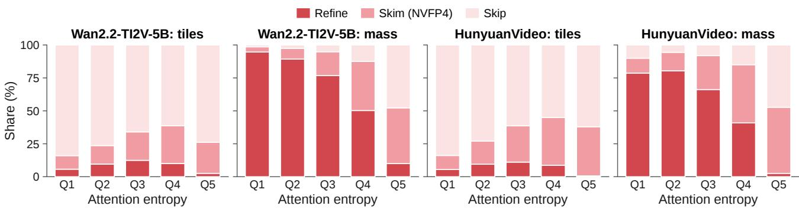  
Figure 10. Tiers that the router assigns at π = 0.15 on the operands of §3, per quintile of the normalized entropy of the rows’ tile masses (Q1 the sharpest, Q5 the most diffuse): the share of the row’s tiles and of its exact attention mass in each tier.

## 1088p, 30 s perfume ad

$$
3 7 2 \mathrm { s }  2 0 4 \mathrm { s } ( 1 . 8 2 \times ) , 3 2 . 7 \mathrm { d B }
$$

Prompt (seed 1000): A luxury perfume commercial. A faceted crystal perfume bottle filled with amber liquid rotates slowly on a black glossy pedestal while golden ligh rays sweep across it. Tiny droplets of mist drift through the air and catch the light, and silk ribbons in deep red float gracefully behind the bottle. The camera glides in a slow arc around the bottle, ending on a close-up of the engraved glass. Cinematic studio lighting, shallow depth of field, rich contrast, 8K commercial quality. Soft orchestral strings and a gentle shimmer sound.

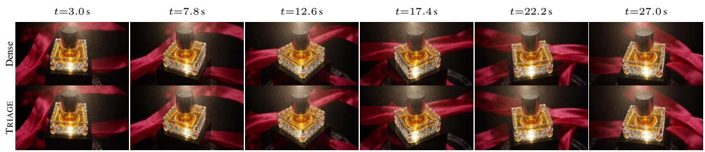  
1088p, 30 s fox 3d  
372 s → 204 s (1.82×), 36.0 dB

Prompt (seed 1003): A charming 3D animated scene in the style of a Pixar film. A small round orange fox with big curious eyes tiptoes through a magical forest at night, where glowing mushrooms and fireflies light up the path. The fox discovers a tiny floating lantern, gently nudges it with its nose, and its face lights up with a delighted smile as the lantern rises into the sky. Soft volumetric lighting, rich colors, expressive character animation. Whimsical music box melody, soft crickets and the gentle chime of the lantern.  
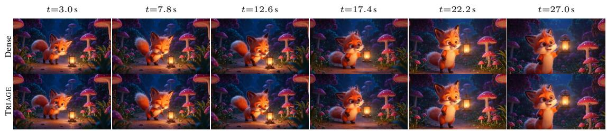  
1088p, 30 s ghibli bicycle  
372 s → 203 s (1.83×), 30.8 dB

Prompt (seed 1004): A hand-drawn anime scene in the style of Studio Ghibli. A girl with a straw hat rides a bicycle down a hill through vast green rice fields under a bright blue sky with towering white clouds, her hair and scarf fluttering in the wind. The camera follows alongside her, then rises to reveal a small seaside town and the sparkling ocean in the distance. Painterly backgrounds, soft watercolor textures, warm nostalgic summer atmosphere. Light piano and strings, wind rustling through the grass and the ring of a bicycle bell.  
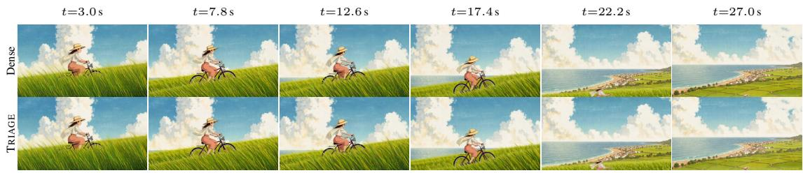  
1440p, 15 s asteroid dogfight  
314 s → 176 s (1.78×), 33.4 dB

Prompt (seed 1005): A spaceship dogfight in a dense asteroid field. A sleek silver starfighter banks hard between tumbling asteroids, laser bolts streaking past from two pursuing enemy fighters, then flips around and fires back, blowing one apart in a flash of light against a giant ringed planet. Star Wars-style space action, dynamic camera, crisp detail. Engine roars, laser blasts and an explosive orchestral theme.  
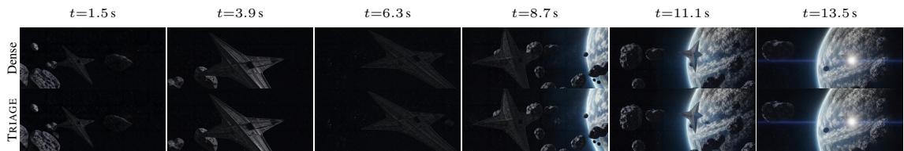  
Figure 11. LTX-2.5 image-to-video with dense attention and with TRIAGE, from the same image, prompt and seed, at 1088p (1920×1088, 721 frames, 30 s), 1440p (2560×1472, 361 frames, 15 s) and 4K (3840×2176, 169 frames, 7 s). Above each video: setting, end-to-end generation time with dense attention → with TRIAGE, the speedup, the PSNR of the TRIAGE video against the dense one, and the full prompt and seed. Continued in Figures 12–13.

## 1440p, 15 s wasteland mech dog

$$
3 1 5 \mathrm { s }  1 7 6 \mathrm { s } ( 1 . 7 9 \times ) , 3 4 . 6 \mathrm { d B }
$$

Prompt (seed 1009): A post-apocalyptic adventure. A lone wanderer in a dusty cloak walks across a vast desert of sand dunes with a robotic mechanical dog at her side, passing the ruins of colossal skyscrapers half-buried in sand, as a massive sandstorm wall rolls in behind them. Epic wide shots, cinematic sci-fi, warm orange haze. Howling wind, mechanical footsteps and a haunting score.

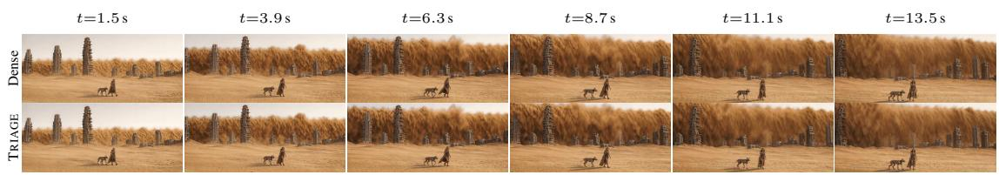  
1440p, 15 s wizard duel  
319 s → 180 s (1.77×), 26.8 dB

Prompt (seed 1011): An anime fantasy duel between two wizards in a ruined cathedral. One summons giant glowing magic circles that fire beams of light, the other conjures a swirling dragon of black fire; their spells collide in a massive explosion of light and stained-glass shards. Vibrant anime effects, dramatic lighting, high-energy camera. Booming spells, shattering glass and an epic choir.

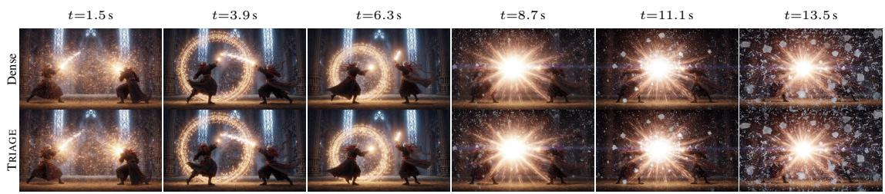  
1440p, 15 s rocket launch night  
319 s → 179 s (1.78×), 39.6 dB

Prompt (seed 1014): A realistic rocket launch at night. A giant rocket stands on the launch pad lit by floodlights; the engines ignite in a blinding burst of fire and billowing smoke, and the rocket rises slowly, then streaks into the dark sky leaving a glowing trail, its flame reflecting in the water. Cinematic slow motion, ultra-detailed, awe-inspiring. Deep thunderous rumble, a crackling roar and a soaring score.  
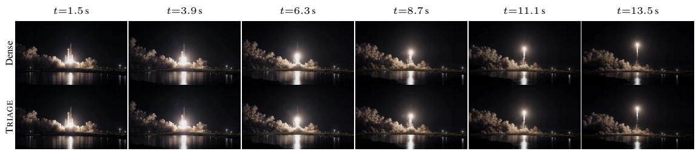  
1440p, 15 s lantern river  
318 s → 180 s (1.77×), 30.4 dB

Prompt (seed 1016): A peaceful night festival in an old Asian river town. Thousands of glowing paper lanterns drift slowly down a calm river and float up into the starry sky, their warm light reflecting on the water as a wooden boat glides past under a stone bridge. Dreamy, cinematic, warm golden tones. Gentle flowing water, distant music and soft wind.

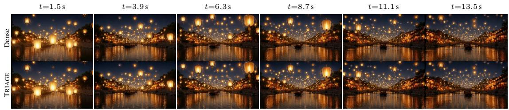  
1440p, 15 s swiss lake dawn  
318 s → 179 s (1.78×), 38.0 dB

Prompt (seed 1018): A tranquil alpine lake at dawn in the Swiss mountains. Mist drifts across the mirror-still water, a lone wooden rowboat floats near the shore, and the first sunlight turns the snowy peaks pink as the camera rises slowly over the lake. Ultra-detailed, calm, majestic. Gentle water lapping, distant cowbells and soft strings.  
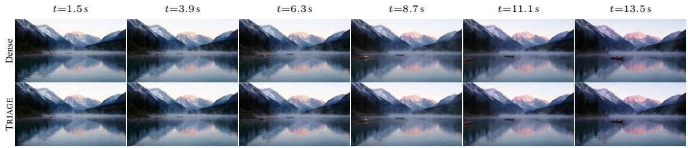  
Figure 12. LTX-2.5 with dense attention and with TRIAGE, continued from Figure 11 (2/3).

## 4K, 7 s carrier jet takeoff

$$
3 4 4 \mathrm { s }  1 8 8 \mathrm { s } ( 1 . 8 3 \times ) , 4 0 . 4 \mathrm { d B }
$$

Prompt (seed 1003): A fighter jet launches from an aircraft carrier at sunset; the afterburners blast blue-orange flames, steam billows from the catapult and the jet roars of the deck and climbs into the sky. Realistic, ultra-detailed, cinematic low angle. A deafening jet roar and wind.  
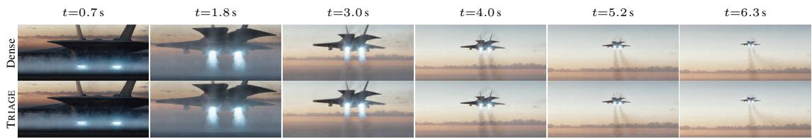  
4K, 7 s dragon eye open  
345 s → 190 s (1.82×), 34.6 dB

Prompt (seed 1005): An extreme close-up of an ancient dragon’s eye slowly opening; the reptilian pupil narrows, and flames reflect in its molten gold iris as smoke curls across its obsidian scales. Hyper-detailed fantasy, dramatic lighting. A deep rumbling growl and crackling fire.  
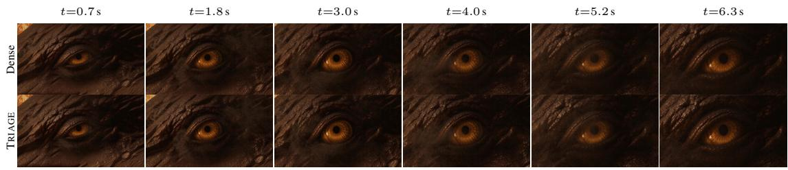  
4K, 7 s holo war room  
351 s → 192 s (1.83×), 31.9 dB

Prompt (seed 1010): A futuristic command center: a giant holographic 3D map of a city floats above a table, red threat markers pulse and spread, and an officer swipes through glowing data panels as alarms flash. Sleek sci-fi, blue and red glow, ultra-detailed. Beeping alerts and a tense low drone.  
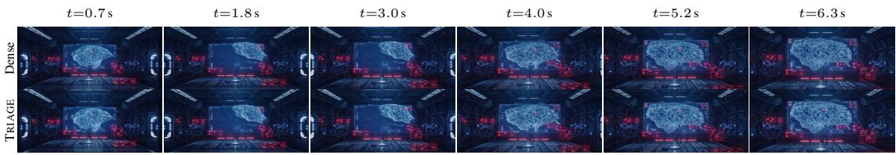  
4K, 7 s lightning skyscraper

Prompt (seed 1012): A massive bolt of lightning strikes the spire of a glass skyscraper during a violent night storm, branching across the dark clouds and lighting up the entire city below for an instant. Ultra-detailed, dramatic, cinematic. A deafening thunderclap and pouring rain.  
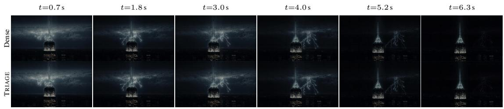  
4K, 7 s ice cave light

Prompt (seed 1016): Inside a glowing blue glacier ice cave, sunlight filters through the translucent ice ceiling, casting shifting turquoise light on the frozen walls as tiny droplets fall and sparkle. Slow, calm camera glide, ultra-detailed, serene. Soft dripping water and a hushed ambient tone.  
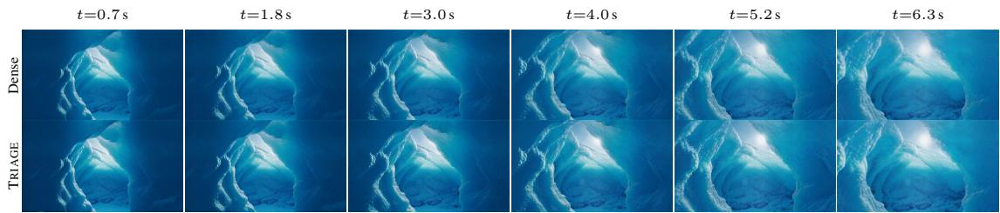  
Figure 13. LTX-2.5 with dense attention and with TRIAGE, continued from Figure 11 (3/3).