# Temporal Slice Learning for AI-Generated Video Detection with 400× Fewer FLOPs

Wei Shang Zhiyuan Li Shengfeng He∗

School of Computing and Information Systems

Singapore Management University

weishang@smu.edu.sg, zhiyuanli@smu.edu.sg, shengfenghe@smu.edu.sg Project page: https://shangwei5.github.io/TSC-Net/.

## Abstract

Recent advances in generative video models have significantly improved visual realism, making detection increasingly dependent on subtle temporal inconsistencies arising from imperfect frame-to-frame coherence. However, these signals are weak and spatially localized, while most of the video content is redundant. This creates a fundamental mismatch: existing detectors rely on heavy backbones to model full videos, assuming increased capacity can capture such cues, which leads to high computational cost and limited scalability. In this work, we rethink AIgenerated video detection from a representation perspective. Instead of modeling entire videos, we propose to explicitly restructure them into compact temporal slice representations that isolate informative temporal evolution. Based on this idea, we introduce a lightweight framework using frequency-aware temporal slice consistency learning, where informative spatial rows and columns are aggregated over time to form slice-domain inputs. This reparameterization suppresses redundant appearance while preserving discriminative temporal dynamics, enabling efficient and targeted detection. By constructing slices from both high- and low-frequency regions, our method exposes complementary temporal artifacts, including unstable details and abnormal motion smoothness. We instantiate this idea in a Temporal Slice Consistency Network, which integrates task-driven slice localization, hierarchical positional encoding, and a lightweight Transformer to model cross-slice and cross-frequency dependencies with minimal overhead. We further introduce AI-Artist, a new benchmark with artist-curated videos from recent high-fidelity generators, including Seedance and Kling. Experiments on GenVideo and AI-Artist show that our method achieves strong performance while requiring over 400× fewer model-forward FLOPs and 3.6× faster model inference than the strong video-based baseline ReStraV (2.9× faster end to end, including preprocessing), enabling scalable and practical deployment.

## 1 Rethinking AI-Generated Video Detection

Recent advances in generative video models have dramatically improved the realism of synthetic content, enabling highly convincing videos generated from text, images, or multimodal prompts. While these technologies create new opportunities for media creation, they also raise growing concerns regarding misinformation, media authenticity, and public trust. As a result, reliable AI-generated video detection has become an increasingly important problem [26, 55].

Compared with AI-generated image detection, video detection introduces a distinct challenge: realism must be maintained not only spatially within each frame, but also temporally across consecutive frames. As frame-level artifacts become less obvious, the remaining traces of generation increasingly arise from imperfect temporal coherence, such as flickering textures [16], unstable structures [13], or overly smooth motion transitions [22]. These cues are often weak, spatially localized, and difficult to perceive from isolated frames, making AI-generated video detection fundamentally different from image-level artifact detection.

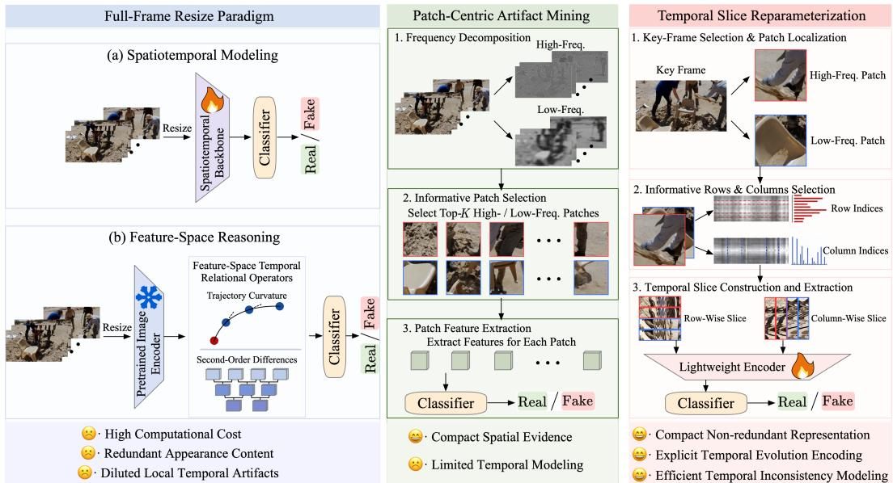  
Figure 1: Comparison of representative paradigms for AI-generated video detection. Existing methods mainly rely on full-frame modeling or patch-level artifact mining. In contrast, our method reformulates videos into compact frequency-aware temporal slices, where temporal evolution is explicitly encoded for lightweight and effective detection.

A natural response is to scale up video modeling using spatiotemporal architectures [19] or large pretrained models [26, 55]. However, this strategy implicitly treats AI-generated video detection as a generic video understanding task, where richer semantic and motion representations are expected to improve recognition. We argue that this assumption is not fully aligned with the nature of the task. While global semantic and motion context can be useful, the most diagnostic cues for AI-generated video detection often lie in subtle generation inconsistencies hidden in local temporal evolution. Therefore, simply modeling full video volumes can introduce substantial appearance redundancy, dilute weak artifacts, and incur high computational cost.

Observation 1: Detection benefits from emphasizing localized temporal inconsistency over fullvideo semantics. As illustrated in Fig. 1, existing detectors are largely adapted from generic video recognition pipelines, where videos are processed as full-frame sequences [19, 55, 26]. Such pipelines are designed to preserve rich appearance and motion information, but this is not always necessary for detecting generated videos. Since generation artifacts typically occupy only a small portion of the video volume, full-frame modeling spends most computation on normal scene appearance and high-level semantics. This redundancy increases FLOPs and latency, and may dilute the weak temporal signals that distinguish real and generated videos. Patch-centric artifact mining [49] offers more compact spatial evidence, but static patches alone may miss how local regions evolve over time.

Observation 2: Slice-domain representations expose weak temporal cues compactly. The above limitations motivate us to rethink AI-generated video detection from a representation perspective. An effective representation should explicitly preserve local temporal evolution, suppress redundant scene appearance, and expose localized irregularities in a compact form. To this end, we reorganize informative spatial rows and columns across time into temporal slice representations. Unlike fullframe sequences, a temporal slice directly encodes how a selected local region changes over time, making irregular transitions easier to observe and model (as shown in Fig. 2(a)). This representation level reparameterization is also computationally efficient, since temporal reasoning is performed on compact slice-domain inputs rather than dense video volumes.

Moreover, temporal artifacts may manifest differently across spatial frequency bands. High-frequency regions can reveal unstable details, boundary flickering, or texture-level jitter, while low-frequency regions may capture abnormal smoothness or coarse motion inconsistency. Therefore, we construct temporal slices from both high- and low-frequency regions, leading to a frequency-aware representation for temporal inconsistency modeling.

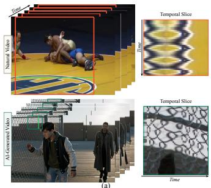

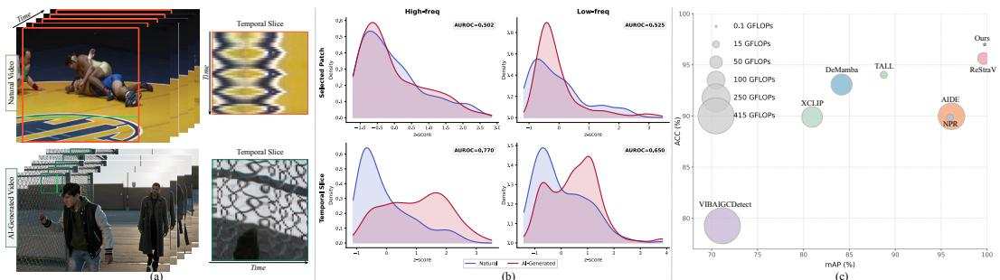  
Figure 2: Motivation and empirical evidence for temporal-slice-based AI-generated video detection. (a) Temporal-slice visualization of natural and AI-generated videos. While natural videos tend to exhibit smoother and more coherent temporal evolution in static background regions, AI-generated videos may show temporal deformations and irregular textures that become more evident in slice form. (b) Distributional analysis of natural (blue) and AI-generated (red) videos in GenVideo [19] under patch-domain and slice-domain representations. Compared with selected spatial patches, temporal slices yield more distinguishable distributions, especially in high-frequency regions. (c) Performance–efficiency comparison with representative detectors. The horizontal and vertical axes denote mAP and ACC on GenVideo, respectively, while the bubble size indicates GFLOPs. Our method achieves a favorable trade-off, approaching the upper-right region with substantially lower computational cost.

Fig. 2(b) supports this representation choice. In the patch domain, natural and AI-generated videos show heavy overlap in both high- and low-frequency regions, with AUROC scores close to random guessing (0.502 and 0.525). After reorganizing the same content into temporal slices, separability improves substantially. High-frequency slices reach an AUROC of 0.770, while low-frequency slices also improve to 0.650. This analysis suggests that slice-domain representations expose temporal generation cues that are largely hidden in static patch statistics.

Solution. Based on these observations, we formulate AI-generated video detection as frequencyaware temporal slice consistency learning. Instead of processing entire video volumes, we construct compact slice-domain inputs from informative high- and low-frequency regions and directly model their consistency. A prior face forgery study [25] used slice-like visualization to illustrate temporal inconsistency and further exploited feature-level temporal differences along horizontal and vertical directions. In contrast, our method treats temporal slices as the primary input representation for AI-generated video detection, rather than as an auxiliary visualization or an internal feature-difference operator.

Building on this formulation, we propose the Temporal Slice Consistency Network (TSC-Net), a lightweight framework that operates directly on frequency-aware temporal slices. TSC-Net integrates task-driven slice localization and assembly, hierarchical positional encoding, and a compact Transformer encoder to model cross-slice and cross-frequency dependencies. By performing temporal reasoning in the slice domain, TSC-Net avoids redundant full-video processing and achieves a favorable performance–efficiency trade-off. As shown in Fig. 2(c), our method lies within the top-performing region in terms of mAP and ACC, while requiring substantially fewer FLOPs than existing video-based detectors. This highlights the value of representation design: by preserving task relevant temporal evidence while discarding redundant appearance content, compact slice-domain inputs enable competitive detection performance at a substantially lower computational cost.

In addition, existing benchmarks are increasingly saturated by earlier-generation video models and may not fully reflect the realism of recent generators. To better evaluate generalization on recent video generators, we introduce AI-Artist, a new benchmark containing artist-curated videos generated by recent high-fidelity models such as Kling 3.0 [10] and Seedance 2.0 [36]. Extensive experiments on both GenVideo and AI-Artist demonstrate that our method achieves strong overall performance while maintaining high efficiency, requiring over 400× fewer model-forward FLOPs than state-of-the-art video-based detectors such as ReStraV.

Our contributions are summarized as follows:

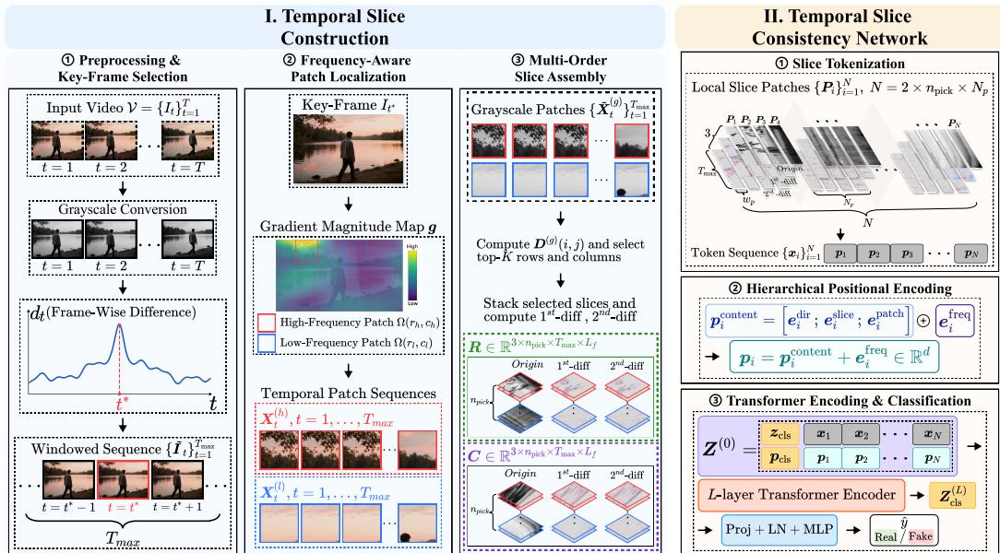  
Figure 3: Framework of our detection method TSC-Net. Given an input video, we first perform content-preserving preprocessing, key-frame selection, frequency-aware patch localization, and multiorder slice assembly to obtain compact temporal slice representations. A lightweight Transformer then models cross-slice and cross-frequency dependencies for AI-generated video detection.

• We formulate AI-generated video detection as frequency-aware temporal slice consistency learning, where videos are reparameterized into compact slice-domain representations that explicitly preserve local temporal evolution.

• We propose a lightweight Temporal Slice Consistency Network (TSC-Net), which integrates task-driven slice localization and assembly, hierarchical positional encoding, and cross-slice/crossfrequency dependency modeling.

• We establish AI-Artist, a more challenging benchmark built from recent high-fidelity video generators, and provide extensive evaluations showing strong generalization and high efficiency.

## 2 Method

We propose a lightweight AI-generated video detector based onfrequency-aware temporal slices, as shown in Fig. 3. The core idea is to reparameterize an input video into a compact set of structured slicedomain representations and model their temporal consistency with a lightweight Transformer. Given an input video $\mathcal { V } = \{ I _ { t } \} _ { t = 1 } ^ { T } , I _ { t } \in \mathbb { R } ^ { 3 \times H \times \dot { W } }$ , our pipeline consists of two stages: 1) temporal slice construction, which includes content-preserving preprocessing, key-frame selection, frequency-aware patch localization, and slice assembly; 2) temporal slice consistency modeling with a lightweight Transformer.

## 2.1 Temporal Slice Construction

## 2.1.1 Content-Preserving Preprocessing and Key-Frame Selection

We first remove invalid borders according to the first frame and apply the same cropping window to all frames, preserving temporal alignment throughout the video. To localize informative regions, we select a key frame based on maximal frame-wise temporal variation. Let $G _ { t }$ denote the grayscale version of frame $\scriptstyle { I _ { t } }$ . We define the average inter-frame difference as

$$
d _ { t } = \frac { 1 } { H W } \sum _ { i = 1 } ^ { H } \sum _ { j = 1 } ^ { W } | { \pmb G } _ { t + 1 } ( i , j ) - { \pmb G } _ { t } ( i , j ) | , \qquad t = 1 , \dots , T - 1 .\tag{1}
$$

The key-frame index is then given by $t ^ { \star } = 1 + \arg \operatorname* { m a x } _ { t \in \{ 1 , \dots , T - 1 \} } d _ { t } .$ Given $t ^ { \star } .$ , we extract a temporal window of length $\bar { T _ { \mathrm { m a x } } }$ centered at $t ^ { \star }$ . For videos longer than $T _ { \mathrm { m a x } } .$ , frames outside the

selected window are discarded; for shorter videos, padding is applied to maintain a fixed temporal length. We denote the resulting windowed sequence by $\{ \tilde { I } _ { t } \} _ { t = 1 } ^ { T _ { \mathrm { m a x } } }$

## 2.1.2 Frequency-Aware Patch Localization

Temporal artifacts may appear differently across spatial frequency bands. High-frequency regions are often sensitive to unstable details and boundary flickering, whereas low-frequency regions can capture coarse motion inconsistency and abnormal smoothness. To incorporate these complementary cues, we localize one high-frequency patch and one low-frequency patch from the selected key frame. Given the key frame $\pmb { I } _ { t ^ { \star } }$ , we compute its gradient magnitude map g. For each candidate $P \times P$ patch $\Omega ( r , c )$ , whose top-left corner is located at $( r , c )$ , we compute its gradient energy as $\begin{array} { r } { S ( r , c ) \overset { \cdot } { = } \sum _ { ( i , j ) \in \Omega ( r , c ) } { g ( i , j ) } } \end{array}$ . The high-frequency and low-frequency patches are selected as

$$
\left( r _ { h } , c _ { h } \right) = \arg \operatorname* { m a x } _ { ( r , c ) } S ( r , c ) , \qquad \left( r _ { l } , c _ { l } \right) = \arg \operatorname* { m i n } _ { ( r , c ) } S ( r , c ) .\tag{2}
$$

Using these two fixed spatial locations, we extract two temporally aligned patch sequences from the windowed sequence:

$$
{ \mathbf { } } { \mathbf { } } _ { t } ^ { ( h ) } = \tilde { I } _ { t } [ : , \Omega ( r _ { h } , c _ { h } ) ] , \qquad { \mathbf { } } { \mathbf { } } _ { t } ^ { ( l ) } = \tilde { I } _ { t } [ : , \Omega ( r _ { l } , c _ { l } ) ] , \qquad t = 1 , \dots , T _ { \operatorname* { m a x } } ,\tag{3}
$$

where ${ \mathbf { } } { \mathbf { } } _ { { \mathbf { X } } _ { t } ^ { ( h ) } , { \mathbf { } } { \mathbf { X } } _ { t } ^ { ( l ) } } \in \mathbb { R } ^ { 3 \times P \times P }$ . This preserves spatial correspondence over time for subsequent slice construction.

## 2.1.3 Multi-Order Slice Assembly

We construct temporal slices separately from the high-frequency and low-frequency patch sequences. Let $g \in \{ h , l \}$ denote the frequency group, and let $\{ X _ { t } ^ { ( g ) } \} _ { t = 1 } ^ { T _ { \operatorname* { m a x } } }$ be the corresponding RGB patch sequence. We first convert the patches to grayscale $\{ \tilde { X } _ { t } ^ { ( g ) } \} _ { t = 1 } ^ { T _ { \operatorname* { m a x } } }$ . To identify the most temporally informative rows and columns, we compute the mean absolute temporal difference map:

$$
D ^ { ( g ) } ( i , j ) = \frac { 1 } { ( T _ { \operatorname* { m a x } } - 1 ) } \sum _ { t = 1 } ^ { T _ { \operatorname* { m a x } } - 1 } \left| \tilde { X } _ { t + 1 } ^ { ( g ) } ( i , j ) - \tilde { X } _ { t } ^ { ( g ) } ( i , j ) \right| .\tag{4}
$$

Based on ${ \pmb D } ^ { ( g ) }$ , we score each row and column by

$$
s _ { \mathrm { r o w } } ^ { ( g ) } ( i ) = \frac { 1 } { P } \sum _ { j = 1 } ^ { P } D ^ { ( g ) } ( i , j ) , \qquad s _ { \mathrm { c o l } } ^ { ( g ) } ( j ) = \frac { 1 } { P } \sum _ { i = 1 } ^ { P } D ^ { ( g ) } ( i , j ) .\tag{5}
$$

For each frequency group, we select the top-K rows and the top-K columns from $\{ \tilde { X } _ { t } ^ { ( g ) } \} _ { t = 1 } ^ { T _ { \operatorname* { m a x } } }$ , where $K = n _ { \mathrm { p i c k } } / 2$ . We construct the temporal slice by stacking row-wise or column-wise pixel values across time. After concatenating the two frequency groups, each of the row-wise and column-wise branches contains $n _ { \mathrm { p i c k } }$ slices in total. Taking the row-wise branch as an example, stacking the selected row-wise slices yields $S ^ { ( 0 ) } \in \mathbb { R } ^ { n _ { \mathrm { p i c k } } \times T _ { \mathrm { m a x } } \times P }$ . We further compute first- and second-order temporal differences recursively:

$$
S ^ { ( k ) } ( : , t , : ) = \left\{ \begin{array} { l l } { \mathbf { 0 } , } & { t = 1 , } \\ { S ^ { ( k - 1 ) } ( : , t , : ) - S ^ { ( k - 1 ) } ( : , t - 1 , : ) , } & { t > 1 , } \end{array} \right. \quad k \in \{ 1 , 2 \} .\tag{6}
$$

To obtain a fixed tokenization length, all slices are aligned to a spatial length $L _ { f }$ via cropping or padding. We then stack the original slice, first-order temporal difference, and second-order temporal difference along the order dimension. Thus, the row-wise temporal slice tensor is denoted as $R \in \mathbb { R } ^ { 3 \times n _ { \mathrm { p i c k } } \times T _ { \mathrm { m a x } } \times L _ { f } }$ Similarly, we obtain the column-wise temporal slice tensor $C \in \mathbb { R } ^ { 3 \times n _ { \mathrm { p i c k } } \times T _ { \mathrm { m a x } } \times L _ { f } }$

## 2.2 Temporal Slice Consistency Network

We model the resulting slice representation with a lightweight Transformer, termed the Temporal Slice Consistency Network (TSC-Net). The goal is to jointly reason over (1) temporal consistency among slices from the same spatial direction, (2) complementary information between row-wise and column-wise slices, and (3) the distinction between high-frequency and low-frequency slice groups.

## 2.2.1 Slice Tokenization

Each row-wise or column-wise temporal slice in R and C is further divided along the spatial dimension into non-overlapping patches of width $w _ { p } ,$ , resulting in $\begin{array} { r } { N _ { p } \ = \ \frac { L _ { f } } { w _ { p } } } \end{array}$ patches per slice. Collecting all local slice patches from R and $C$ in a fixed order yields a sequence of N local slice patches $\{ \mathbf { \bar { \mathit { P } } } _ { i } \} _ { i = 1 } ^ { N }$ , where $\dot { N } = 2 \times n _ { \mathrm { p i c k } } \times N _ { p }$ . Each local slice patch $P _ { i } \in \mathbb { R } ^ { 3 ^ { \sum } T _ { \operatorname* { m a x } } \times w _ { p } }$ is vectorized and projected into a d-dimensional token via a linear embedding:

$$
\pmb { x } _ { i } = \pmb { W _ { e } } \operatorname { v e c } ( \pmb { P } _ { i } ) , \qquad i = 1 , \dots , N ,\tag{7}
$$

where $\pmb { x } _ { i } \in \mathbb { R } ^ { d }$ and $\mathrm { v e c } ( \cdot )$ denotes vectorization. This produces the token sequence $\{ { \pmb x } _ { i } \} _ { i = 1 } ^ { N }$

## 2.2.2 Frequency-Aware Hierarchical Positional Encoding

Each token $\mathbf { \Delta } _ { \mathbf { \mathcal { X } } _ { i } }$ is associated with multiple structural attributes of its source slice patch, including its spatial direction (row or column), slice index, local patch position within the slice, and frequency group (high-frequency or low-frequency). To preserve these cues, we construct a frequency-aware hierarchical positional encoding for each token.

Frozen structural encoding. For the i-th token, we construct a deterministic structural encoding $p _ { i } ^ { \mathrm { { c o n t e n t } } } = \Big \lceil e _ { i } ^ { \mathrm { { d i r } } } ; e _ { i } ^ { \mathrm { { s l i c e } } } ; e _ { i } ^ { \mathrm { { p a t c h } } } \Big \rceil$ . Specifically, $e _ { i } ^ { \mathrm { d i r } } , e _ { i } ^ { \mathrm { s l i c e } }$ , and $e _ { i } ^ { \mathrm { p a t c h } }$ are fixed sinusoidal encodings of slice direction, slice index within its branch, and local patch location, with respective dimensions 85, 85, and $8 6 ( d = 2 5 6 )$

Learnable frequency embedding. To explicitly distinguish high-frequency and low-frequency slices, we introduce a learnable frequency embedding $e _ { i } ^ { \mathrm { f r e q } } \in \mathbb { R } ^ { d }$ . Each token inherits the frequency label of its source slice. The final positional encoding for the i-th token is defined as $p _ { i } = p _ { i } ^ { \mathrm { c o n t e n t } } +$ $e _ { i } ^ { \mathrm { f r e q } } , i = 1 , \ldots , N$ , where $\pmb { p } _ { i } \in \mathbb { R } ^ { d }$

Compared with fully learnable positional embeddings, this design disentangles deterministic structural coordinates from learnable frequency-group identity. The frozen structural encoding preserves the geometry of slice construction, while the learnable frequency embedding allows the model to adaptively calibrate the relative importance of high- and low-frequency cues. Empirically, this design improves detection performance and generalization, as validated in Sec. D.3.

## 2.2.3 Transformer Encoding and Classification

We prepend a learnable classification token $z _ { \mathrm { c l s } } \in \mathbb { R } ^ { d }$ to the token sequence. A learnable positional embedding $p _ { \mathrm { c l s } } \in \mathbb { R } ^ { d }$ is further assigned to this token. The input to the Transformer encoder is

$$
\begin{array} { r } { \pmb { Z } ^ { ( 0 ) } = [ z _ { \mathrm { c l s } } ; \pmb { x } _ { 1 } ; \ldots ; \pmb { x } _ { N } ] + [ p _ { \mathrm { c l s } } ; \pmb { p } _ { 1 } ; \ldots ; \pmb { p } _ { N } ] , \quad \pmb { Z } ^ { ( 0 ) } \in \mathbb { R } ^ { ( N + 1 ) \times d } . } \end{array}\tag{8}
$$

The sequence is then processed by an L-layer Transformer encoder, and the output state of the classification token is used for prediction:

$$
\begin{array} { r } { \pmb { Z } ^ { ( L ) } = \mathrm { T r a n s f o r m e r } \left( \pmb { Z } ^ { ( 0 ) } \right) , \qquad \hat { y } = \sigma \left( \mathrm { M L P } \left( \mathrm { P r o j } \left( \mathrm { L N } \left( \pmb { Z } _ { \mathrm { c l s } } ^ { ( L ) } \right) \right) \right) \right) . } \end{array}\tag{9}
$$

The network is trained using the binary cross-entropy loss between yˆ and the ground-truth label.

## 3 Experiments

Training data. We follow the GenVideo training setting introduced in DeMamba [19] for a fair comparison. Specifically, the training data consists of real videos from Youku-mPLUG [46] and fake videos generated by the same ten training generators used in GenVideo, including ZeroScope [6], I2VGen-XL [42], SVD [14], VideoCrafter [18], Pika [5], DynamiCrafter [45], SD [54], SEINE [20], Latte [30], and OpenSora [4]. This training setup covers diverse generation paradigms while remain ing consistent with the standard protocol adopted in prior work.

Test data. We evaluate our method on two test benchmarks, both of which are strictly unseen during training. (1) GenVideo OOD test set. We first evaluate on the test set of GenVideo [19]. This set contains real videos from MSR-VTT [47] and fake videos generated by ten unseen generators, including ModelScope [40], MorphStudio [3], MoonValley [1], HotShot [2], Show\_1 [52], Gen2 [23],

Crafter [17], Lavie [43], Sora [15], and WildScrape. Importantly, this test split is explicitly outof-domain with respect to training: both the real video source and the fake-video generators are disjoint from those used in the training set. Therefore, evaluation on GenVideo primarily measures cross-source and cross-generator generalization rather than in-distribution recognition. (2) AI-Artist Dataset. To evaluate detector generalization against the rapid evolution of generative models, we introduce AI-Artist, a challenging benchmark of 380 videos generated by state-of-the-art models absent from GenVideo. To ensure a comprehensive evaluation scenario, the dataset is constructed via two complementary pipelines. The first is a web-collected subset (221 videos) sourced from public communities $( e . g .$ , Discord, Douyin), designed to reflect the realistic in-the-wild distribution of AIgenerated content (e.g., Kling 3.0 [10]) shared by online users. The second is a self-generated subset (159 videos) systematically created via recent commercial models, such as Runway Gen-4.5 [8], PixVerse V5.6 [12], Hailuo 2.3 [7], Seedance 2.0 [36], and Luma Ray3.14 [11]. For this subset, we use LLM-constructed prompts that span a rich variety of dynamic human actions, object categories, and complex camera motions to increase semantic diversity. AI-Artist contains only AI-generated videos, as its goal is to evaluate detector generalization to recent high-fidelity generators. For binary evaluation, we construct a class-balanced test set by pairing the 380 AI-Artist generated videos with 380 real videos sampled from the real video split of the test set in GenVideo. The same sampled real set is used for all compared methods and all reported metrics. Detailed statistics and the full collection protocol are provided in Secs. C.1 and J.

Evaluation Metrics. Following prior work [19, 26, 53, 55], we report Accuracy (ACC), Average Precision (AP), and the Area Under the Receiver Operating Characteristic Curve (AUROC). AP and AUROC measure ranking performance without a fixed threshold; ACC uses a probability threshold of 0.5 unless otherwise stated. Benchmark-level metrics are averaged across test subsets with weights proportional to their sample counts; the resulting mean AP and mean AUROC are denoted by mAP and mAUROC, respectively. Model efficiency is evaluated in terms of the number of parameters, GFLOPs, and average inference time per video.

Implementation Details. All frames are processed using the preprocessing pipeline described in Sec. 2.1. For each input video, we retain a temporal window of $\dot { T } _ { \mathrm { m a x } } = 8$ frames centered at the selected key frame. In the temporal slice module, we set the number of selected slices to $n _ { \mathrm { p i c k } } = 8$ and align each slice to a fixed spatial length of $L _ { f } = 6 4$ Each slice is further divided into nonoverlapping local patches of width $w _ { p } = 8$ for tokenization. The Transformer encoder in TSC-Net uses an embedding dimension of $d = 2 5 6$ , with 4 attention heads and $L = 3$ encoder layers. The batch size is set to 32 during training. The initial learning rate is set to $3 \times 1 0 ^ { - 4 }$ with a cosine annealing schedule [28]. We use binary cross-entropy loss with the AdamW optimizer [29] and train all models for 100K iterations. For competing methods, we follow their official implementations. All experiments are conducted on an NVIDIA RTX PRO 6000 GPU using PyTorch.

## 3.1 Comparison with State-of-the-Art Methods on GenVideo

We compare our method with representative image-level and video-level baselines, including MLEP [51], NPR [38], AIDE [49], TALL [48], VIBAIGCD [53], XCLIP [32], DeMamba [19], D3 [55], and ReStraV [26]. The quantitative results on GenVideo are summarized in Table 1, including ACC, AP, and AUROC on 10 datasets and their mean values. Note that D3 is a training-free ranking-based method that outputs the variance of second-order feature differences rather than calibrated classification probabilities. Therefore, threshold-dependent ACC is not directly applicable under its setting, and we follow the official protocol by reporting only AP and AUROC for D3.

As shown in Table 1, our method achieves the best overall performance across all three metrics in terms of the mean over the 10 datasets. Specifically, it obtains a mean ACC of 0.9698, outperforming ReStraV (0.9562) and TALL (0.9602) by 1.36 and 0.96 percentage points, respectively. For AP, our method reaches 0.9973, improving over the previous best ReStraV (0.9961) by 0.12 percentage points, and surpassing D3 (0.9740) by 2.33 percentage points. Similarly, in terms of AUROC, our method achieves 0.9967, exceeding ReStraV (0.9959) by 0.08 percentage points and D3 (0.9722) by 2.45 percentage points. Moreover, beyond the averaged results, our method consistently ranks among the top-performing approaches on nearly all individual datasets, indicating strong generalization across diverse generation sources. Additional feature-space visualizations are provided in Sec. G, where the observed trends are consistent with the quantitative improvements in Table 1.

Table 1: Comparison with state-of-the-art methods in terms of Accuracy (ACC), Average Precision (AP), and Area Under the Receiver Operating Characteristic Curve (AUROC) on the GenVideo dataset. (I) and (V) denote image- and video-based methods, respectively.
<table><tr><td rowspan="2">Model</td><td rowspan="2">Metric</td><td colspan="9">Dataset</td><td rowspan="2">Mean</td></tr><tr><td>Sora</td><td>Morph Studio</td><td>Gen2</td><td>HotShot</td><td>Lavie</td><td>Show-1</td><td>Moon Valley</td><td>Crafter</td><td>Model Wild Scope Scrape</td></tr><tr><td rowspan="2">MLEP (I)</td><td>ACC AP</td><td>0.1964</td><td>0.1214</td><td>0.1340</td><td>0.2586</td><td>0.1970</td><td>0.1429</td><td>0.0208</td><td>0.0770</td><td>0.3614</td><td>0.1384</td><td>0.1648</td></tr><tr><td>AUROC</td><td>0.6180 0.6116</td><td>0.6324 0.6803</td><td>0.7211 0.7943</td><td>0.6645 0.6187</td><td>0.5559 0.6098</td><td>0.6048 0.6722</td><td>0.4855 0.5580</td><td>0.5815 0.6313</td><td>0.7319 0.7564</td><td>0.6331 0.6714</td><td>0.6229 0.6604</td></tr><tr><td rowspan="2">NPR (I)</td><td>ACC</td><td>0.5536</td><td>0.9943</td><td>0.9970</td><td>0.7643</td><td>0.9710</td><td>0.9957</td><td>0.9984</td><td></td><td></td><td></td><td></td></tr><tr><td></td><td>0.8434</td><td>0.9971</td><td>0.9920</td><td>0.9122</td><td>0.9893</td><td>0.9898</td><td>0.9977</td><td>0.9980 0.9985</td><td>0.9829 0.9854</td><td>0.7299 0.8892</td><td>0.8985 0.9595</td></tr><tr><td rowspan="2"></td><td>AP AUROC</td><td>0.8355</td><td>0.9963</td><td>0.9927</td><td>0.8984</td><td>0.9875</td><td>0.9912</td><td>0.9976</td><td>0.9982</td><td>0.9844</td><td>0.8328</td><td>0.9515</td></tr><tr><td></td><td>0.6786</td><td>0.8214</td><td>0.9040</td><td>0.7729</td><td>0.6980</td><td>0.8086</td><td>0.8514</td><td>0.8500</td><td></td><td></td><td></td></tr><tr><td rowspan="2">VIBAIGCD (I)</td><td>ACC AP</td><td>0.6158</td><td>0.7220</td><td>0.8091</td><td>0.6679</td><td>0.6435</td><td>0.7028</td><td>0.7860</td><td>0.7678</td><td>0.8171 0.7180</td><td>0.7243 0.6826</td><td>0.7926 0.7116</td></tr><tr><td>AUROC</td><td>0.6751</td><td>0.7456</td><td>0.8312</td><td>0.7112</td><td>0.6596</td><td>0.7344</td><td>0.7978</td><td>0.7790</td><td>0.7463</td><td>0.6776</td><td>0.7358</td></tr><tr><td rowspan="2">AIDE (I)</td><td>ACC AP</td><td>0.7679</td><td>0.9971</td><td>0.9990</td><td>0.9314</td><td>0.6090</td><td>0.9729</td><td>1.0000</td><td>1.0000</td><td>0.8514</td><td>0.8683</td><td>0.8997</td></tr><tr><td>AUROC</td><td>0.8940 0.8999</td><td>0.9979 0.9979</td><td>0.9995 0.9995</td><td>0.9776 0.9784</td><td>0.8625</td><td>0.9836</td><td>0.9998</td><td>0.9993</td><td>0.9382</td><td>0.9592</td><td>0.9612</td></tr><tr><td rowspan="2">TALL (V)</td><td>ACC</td><td></td><td></td><td></td><td></td><td>0.8623</td><td>0.9851</td><td>0.9998</td><td>0.9993</td><td>0.9446</td><td>0.9501</td><td>0.9617</td></tr><tr><td></td><td>1.0000 0.8949</td><td>0.9971 0.9763</td><td>0.9970 0.9811</td><td>0.8614</td><td>0.9540</td><td>0.9414</td><td>1.0000</td><td>0.9970</td><td>0.9914</td><td>0.8627</td><td>0.9602</td></tr><tr><td rowspan="2"></td><td>AP AUROC</td><td>0.8827</td><td>0.9729</td><td>0.9799</td><td>0.6846 0.6913</td><td>0.8255 0.8255</td><td>0.7969 0.7888</td><td>0.9850 0.9836</td><td>0.9723 0.9697</td><td>0.9351 0.9300</td><td>0.8232</td><td>0.8875</td></tr><tr><td></td><td>0.5714</td><td>1.0000</td><td></td><td></td><td></td><td></td><td></td><td></td><td></td><td>0.7733</td><td>0.8798</td></tr><tr><td rowspan="2">XCLIP (V)</td><td>ACC AP</td><td>0.4905</td><td>0.9904</td><td>1.0000 0.9483</td><td>0.5957 0.4141</td><td>0.9840 0.9065</td><td>1.0000 0.9662</td><td>0.9936 0.7021</td><td>1.0000 0.9801</td><td>0.9986</td><td>0.8471</td><td>0.8990</td></tr><tr><td>AUROC</td><td>0.4455</td><td>0.9899</td><td>0.9578</td><td>0.4075</td><td>0.9046</td><td>0.9665</td><td>0.7873</td><td>0.9803</td><td>0.9442 0.9480</td><td>0.7515 0.7108</td><td>0.8094 0.8098</td></tr><tr><td rowspan="3">DeMamba (V)</td><td>ACC</td><td></td><td></td><td></td><td></td><td></td><td></td><td></td><td></td><td></td><td></td><td></td></tr><tr><td>AP</td><td>0.6071</td><td>1.0000 0.9952</td><td>1.0000</td><td>0.8600</td><td>0.9960</td><td>1.0000</td><td>0.9936</td><td>1.0000</td><td>1.0000</td><td>0.9498</td><td>0.9407</td></tr><tr><td>AUROC</td><td>0.4722 0.3887</td><td>0.9949</td><td>0.9875 0.9892</td><td>0.5118 0.5637</td><td>0.9554 0.9558</td><td>0.9725</td><td>0.7541</td><td>0.9905</td><td>0.9495</td><td>0.8259</td><td>0.8415</td></tr><tr><td rowspan="3">D3 (V)</td><td></td><td></td><td></td><td></td><td></td><td></td><td>0.9752</td><td>0.8097</td><td>0.9912</td><td>0.9498</td><td>0.7992</td><td>0.8418</td></tr><tr><td>ACC</td><td></td><td></td><td></td><td></td><td></td><td></td><td></td><td></td><td></td><td></td><td></td></tr><tr><td>AP</td><td>0.9727</td><td>0.9762</td><td>0.9908</td><td>0.9772</td><td>0.9771</td><td>0.9827</td><td>0.9914</td><td>0.9844</td><td>0.9647</td><td>0.9232</td><td>0.9740</td></tr><tr><td rowspan="3">ReStraV (V)</td><td>AUROC</td><td>0.9745</td><td>0.9714</td><td>0.9898</td><td>0.9721</td><td>0.9768</td><td>0.9804</td><td>0.9898</td><td>0.9817</td><td>0.9613</td><td>0.9246</td><td>0.9722</td></tr><tr><td>ACC</td><td>0.9864</td><td>0.9835</td><td>0.9744</td><td>0.9864</td><td>0.9654</td><td>0.9864</td><td>0.9469</td><td>0.9844</td><td>0.9478</td><td></td><td></td></tr><tr><td>AP</td><td>0.9977</td><td>0.9977</td><td>0.9976</td><td>0.9977</td><td>0.9773</td><td>0.9977</td><td>0.9994</td><td>0.9977</td><td>0.9969</td><td>0.8101 0.9832</td><td>0.9562 0.9961</td></tr><tr><td rowspan="3"></td><td>AUROC</td><td>0.9977</td><td>0.9977</td><td>0.9976</td><td>0.9977</td><td>0.9973</td><td>0.9977</td><td>0.9995</td><td>0.9977</td><td>0.9969</td><td>0.9814</td><td>0.9959</td></tr><tr><td>ACC</td><td>1.0000</td><td></td><td>0.9890</td><td></td><td></td><td></td><td></td><td>0.9910</td><td></td><td></td><td></td></tr><tr><td></td><td>1.0000</td><td>0.9886 0.9996</td><td>0.9998</td><td>0.9929 0.9999</td><td>0.9640 0.9988</td><td>0.9800</td><td>0.9920 0.9998</td><td></td><td>0.9657</td><td>0.8348</td><td>0.9698</td></tr><tr><td rowspan="3">Ours (V)</td><td>AP</td><td></td><td></td><td></td><td></td><td></td><td>0.9994</td><td></td><td>0.9997</td><td>0.9974</td><td>0.9782 0.9728</td><td>0.9973</td></tr><tr><td>AUROC</td><td>1.0000</td><td>0.9996</td><td>0.9998</td><td>0.9999</td><td>0.9988</td><td>0.9994</td><td>0.9998</td><td>0.9996</td><td>0.9969</td><td></td><td>0.9967</td></tr></table>

We also evaluate computational efficiency in Table 2. For all methods, the model forward pass and the method-specific preprocessing are measured separately; the preprocessing involves no learnable parameters. The efficiency advantage of our method is consistent across different families of detectors. Compared with the strong video-based detector ReStraV, our method achieves better overall detection performance while requiring 11.6× fewer parameters, over 400× fewer model-forward FLOPs (0.109 vs. 44.20 GFLOPs), and 3.6× faster model inference. When preprocessing is included, our full pipeline still requires 236× fewer GFLOPs and runs 2.9× faster end to end (4.676 vs. 13.444 ms), the lowest total cost among all compared methods. The speedup is smaller than the FLOPs reduction because fixed costs such as memory access and kernel launches account for a larger share of latency at low computational loads; a stage-wise breakdown is given in Sec. E.

Compared with generic video or feature-space reasoning models such as XCLIP, DeMamba, and D3, the model-forward FLOPs reduction further exceeds 1,200×. Our method is also substantially more efficient than large image-based detectors such as AIDE and VIBAIGCD, which rely on heavy pretrained representations or high-capacity backbones. These comparisons indicate that TSC Net obtains a favorable accuracy–efficiency trade-off not by increasing model scale, but by using a compact slice-domain representation that preserves task-relevant temporal evidence while suppressing redundant full-frame appearance.

## 3.2 Evaluation on Our AI-Artist Dataset

Fig. 4 presents the comparison of different methods on our AI-Artist dataset, which contains videos generated by recent state-of-the-art models. Our method achieves the best overall performance, obtaining the highest AP and AUROC while maintaining competitive ACC. Although TALL yields the highest ACC, its AP and AUROC are markedly lower than those of our method, suggesting that its seemingly strong accuracy does not translate into equally reliable ranking and discrimination capability. In contrast, our method attains an ACC of 0.8558 and reaches nearly 0.98 on both AP and AUROC, surpassing strong baselines such as D3 and ReStraV (around 0.97) by about 1 percentage point. These results further demonstrate the effectiveness and generalization ability of our method on more challenging and up-to-date generation distributions. Detailed per-generator results are provided in the supplementary material.

Table 2: Complexity and inference efficiency. GFLOPs and inference time are measured per video on GenVideo using the same measurement protocol for all methods: “Prep.” denotes method-specific, non-learnable data preprocessing, “Model” the model forward pass, and “Total” their sum. The last two columns report false positives on 10,000 real MSR-VTT clips at a threshold of 0.5 (generated videos as the positive class); D3 is not included in this comparison because it outputs an uncalibrated ranking score.
<table><tr><td rowspan="2">Model</td><td rowspan="2">Params</td><td colspan="3">GFLOPs</td><td colspan="3">Inference Time (ms)</td><td colspan="2">Real-video FP</td></tr><tr><td>Prep.</td><td>Model</td><td>Total</td><td>Prep.</td><td>Model</td><td>Total</td><td>#FP</td><td>FPR (%)</td></tr><tr><td>MLEP (I)</td><td>1.441 M</td><td>0.012</td><td>14.35</td><td>14.362</td><td>7.975</td><td>5.998</td><td>13.973</td><td>422</td><td>4.22</td></tr><tr><td>NPR (I)</td><td>1.438 M</td><td>0.012</td><td>14.01</td><td>14.022</td><td>5.495</td><td>2.185</td><td>7.680</td><td>1,387</td><td>13.87</td></tr><tr><td>VIBAIGCD (I)</td><td>430.0M</td><td>0.012</td><td>415.2</td><td>415.212</td><td>8.322</td><td>30.50</td><td>38.822</td><td>4,813</td><td>48.13</td></tr><tr><td>AIDE (I)</td><td>897.8M</td><td>1.131</td><td>225.7</td><td>226.831</td><td>68.972</td><td>20.58</td><td>89.552</td><td>972</td><td>9.72</td></tr><tr><td>TALL (V)</td><td>86.92M</td><td>0.012</td><td>15.21</td><td>15.222</td><td>4.903</td><td>9.496</td><td>14.399</td><td>6,949</td><td>69.49</td></tr><tr><td>XCLIP (V)</td><td>121.3M</td><td>0.012</td><td>135.4</td><td>135.412</td><td>4.736</td><td>10.78</td><td>15.516</td><td>6,506</td><td>65.06</td></tr><tr><td>DeMamba (V)</td><td>125.7M</td><td>0.012</td><td>141.6</td><td>141.612</td><td>8.608</td><td>15.94</td><td>24.548</td><td>7,391</td><td>73.91</td></tr><tr><td>D3 (V)</td><td>121.3M</td><td>0.012</td><td>135.4</td><td>135.412</td><td>5.872</td><td>10.95</td><td>16.822</td><td></td><td></td></tr><tr><td>ReStraV (V)</td><td>20.06M</td><td>0.012</td><td>44.20</td><td>44.212</td><td>8.137</td><td>5.307</td><td>13.444</td><td>39</td><td>0.39</td></tr><tr><td>Ours (V)</td><td>1.731M</td><td>0.078</td><td>0.109</td><td>0.187</td><td>3.198</td><td>1.478</td><td>4.676</td><td>7</td><td>0.07</td></tr></table>

## 3.3 Robustness to Post-processing Operations

In real-world scenarios, videos are rarely pristine and are often affected by post-processing operations, which may degrade detector reliability. To better assess robustness under such perturbations, we adopt AP rather than ACC as the evaluation metric. We observe that some methods tend to classify nearly all

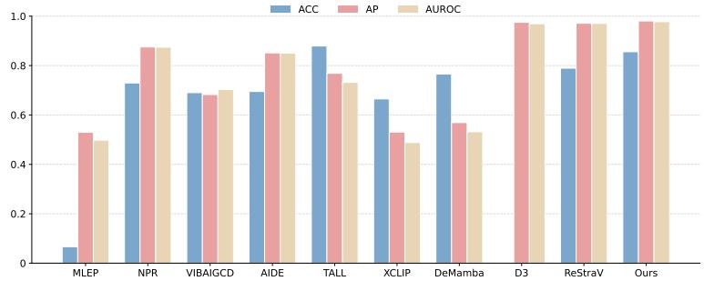  
Figure 4: The comparison of various models on our AI-Artist Dataset.

degraded samples as AI-generated; although it can yield high ACC, it reflects poor discriminative ability and usually corresponds to low AP. Therefore, AP provides a more faithful measure of robustness in this setting. Fig. 5 reports the AP of different methods under Gaussian blur, JPEG compression, and Gaussian noise. Overall, our method consistently achieves the highest AP and exhibits the strongest stability across different degradation levels. Under JPEG compression, most methods remain relatively robust, while our method stays almost unchanged across all quality factors. Under Gaussian blur, several baselines show noticeable fluctuations or performance degradation, whereas our method remains highly stable. Gaussian noise is the most challenging perturbation for all detectors; nevertheless, our method still preserves comparatively stable performance and maintains the best AP throughout. These results indicate that our method not only performs strongly on clean videos, but also generalizes more reliably under post-processing distortions.

## 3.4 False Positives on Real Videos

We evaluate false positives on 10,000 real MSR-VTT clips (7,180 source videos, 20 categories), retaining each method’s original score direction and a fixed threshold of 0.5, without test-set tuning. TSC-Net produces only 7 false positives (FPR 0.07%, specificity 99.93%), compared with 39 for ReStraV (0.39%) and 422–7,391 for the other detectors (Table 2). We form six overlapping 2,500-

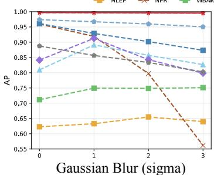

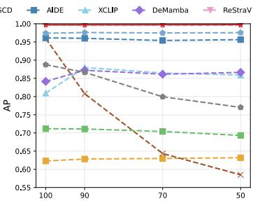  
JPEG Compression (quality)

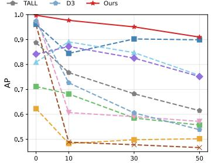  
Gaussian Noise (noise level)  
Figure 5: Detection results of different detectors against post-processing operations on GenVideo, including Gaussian blur, JPEG compression, and Gaussian noise.

Table 3: Compact ablation on slice construction and temporal coverage (mAP / mAUROC). Ours uses one temporal window. “1-Seg. MP” selects multiple HF/LF patches in that window; $\mathrm { ^ { 6 6 } 4 - S e g . } ^ { \prime }$ selects one HF/LF patch pair per window across four windows. Full results and runtimes are in Tables 6 and 7.

<table><tr><td rowspan="2">Method</td><td colspan="2">GenVideo</td><td colspan="2">AI-Artist</td></tr><tr><td>mAP</td><td>mAUROC</td><td>mAP</td><td>mAUROC</td></tr><tr><td>Select Patch</td><td>0.9871</td><td>0.9846</td><td>0.9644</td><td>0.9684</td></tr><tr><td>Resize Only Row</td><td>0.9919 0.9965</td><td>0.9893 0.9958</td><td>0.9541 0.9735</td><td>0.9365 0.9762</td></tr><tr><td>Only Column</td><td>0.9969</td><td>0.9960</td><td>0.9815</td><td>0.9784</td></tr><tr><td>1-Seg. MP</td><td>0.9904</td><td>0.9879</td><td>0.9808</td><td>0.9807</td></tr><tr><td>4-Seg.</td><td>0.9982</td><td>0.9977</td><td>0.9849</td><td>0.9836</td></tr><tr><td>Ours (1-Seg.)</td><td>0.9973</td><td>0.9967</td><td>0.9805</td><td>0.9773</td></tr></table>

clip subsets using the top or bottom quartile of fixed statistics on the 8-frame input window: strong temporal change, high contrast, rich high-frequency content, camera motion, residual temporal variation after global motion compensation, and weak motion. TSC-Net produces 0, 1, 5, 1, 0, and 3 false positives, respectively $\mathbf { \bar { ( F P R \leq 0 . 2 0 \% ) } }$ . TSC-Net yields few false positives even with rich high-frequency content or strong motion. Subset definitions, per-method TN/FP counts, and weak-motion results are given in Sec. F.

## 3.5 Ablation Study

Table 3 shows that Select Patch (no temporal slices) and Resize (resizing instead of frequencyaware patch localization) both underperform the full model on both benchmarks. Column-only slices perform slightly better on AI-Artist; combining directions performs better on GenVideo. With the same eight-slice budget per directional branch, 4-Seg. improves all metrics but increases preprocessing time from 3.198 to 8.908 ms, while model time stays near 1.5 ms. We therefore retain the single-window default. Sec. D provides the full ablations, including temporal orders, HF/LF groups, positional encoding, and hyperparameters. We use $L = 3 ,$ 4 heads, $n _ { \mathrm { p i c k } } = 8$ , and $T _ { \mathrm { m a x } } = 8$ throughout.

## 4 Conclusion

In this paper, we presented a lightweight framework for AI-generated video detection based on frequency-aware temporal slice consistency learning. Rather than relying on heavy video backbones or pretrained foundation models, our method reparameterizes videos into compact slice-domain representations that explicitly preserve local temporal evolution while suppressing redundant appearance content. We further proposed the Temporal Slice Consistency Network, which integrates task-driven slice localization and assembly, hierarchical positional encoding, and lightweight Transformerbased modeling to capture cross-slice and cross-frequency dependencies. Extensive experiments on GenVideo and our newly constructed AI-Artist dataset demonstrate that our method achieves strong overall detection performance while requiring orders-of-magnitude fewer FLOPs than existing video-based detectors.

## Acknowledgments and Disclosure of Funding

This research is supported by the National Research Foundation Singapore under the AI Singapore Programme (AISG Award No: AISG4-TC-2025-018-SGKR), and the Lee Kong Chian Fellowships. The authors declare no competing interests.

## References

[1] moonvalley.ai. https://moonvalley.ai/, 2022.

[2] Hotshot-XL. https://huggingface.co/hotshotco/Hotshot-XL, 2023.

[3] Morph Studio. https://www.morphstudio.com/, 2023.

[4] Open-Sora: Democratizing efficient video production for all. https://github.com/hpcaitech/ Open-Sora, 2024.

[5] Pika art. https://pika.art/, 2024.

[6] Zeroscope-v2-XL. https://huggingface.co/cerspense/zeroscope\_v2\_XL, 2024.

[7] Hailuo. https://hailuoai.video/zh-Intl, 2025.

[8] Runway Gen-4.5. https://runwayml.com/research/introducing-runway-gen-4.5, 2025.

[9] ChatGPT5.4. https://chatgpt.com/, 2026.

[10] Kling 3.0. https://kling.ai/, 2026.

[11] Luma Ray. https://lumalabs.ai/news/ray3\_14, 2026.

[12] PixVerse. https://app.pixverse.ai/, 2026.

[13] Yunpeng Bai, Shaoheng Fang, Chaohui Yu, Fan Wang, and Qixing Huang. GeoVideo: Introducing geometric regularization into video generation model. In Advances in Neural Information Processing Systems, volume 38, 2025.

[14] Andreas Blattmann, Tim Dockhorn, Sumith Kulal, Daniel Mendelevitch, Maciej Kilian, Dominik Lorenz, Yam Levi, Zion English, Vikram Voleti, Adam Letts, et al. Stable video diffusion: Scaling latent video diffusion models to large datasets. arXiv preprint arXiv:2311.15127, 2023.

[15] Tim Brooks, Bill Peebles, Connor Holmes, Will DePue, Yufei Guo, Li Jing, David Schnurr, Joe Taylor, Troy Luhman, Eric Luhman, Clarence Ng, Ricky Wang, and Aditya Ramesh. Video generation models as world simulators. https://openai.com/index/sora/, 2024.

[16] Jiazi Bu, Pengyang Ling, Pan Zhang, Tong Wu, Xiaoyi Dong, Yuhang Zang, Yuhang Cao, Dahua Lin, and Jiaqi Wang. ByTheWay: Boost your text-to-video generation model to higher quality in a training-free way. In Proceedings ofthe IEEE/CVF Conference on Computer Vision and Pattern Recognition, pages 12999–13008, 2025.

[17] Haoxin Chen, Menghan Xia, Yingqing He, Yong Zhang, Xiaodong Cun, Shaoshu Yang, Jinbo Xing, Yaofang Liu, Qifeng Chen, Xintao Wang, et al. VideoCrafter1: Open diffusion models for high-quality video generation. arXiv preprint arXiv:2310.19512, 2023.

[18] Haoxin Chen, Yong Zhang, Xiaodong Cun, Menghan Xia, Xintao Wang, Chao Weng, and Ying Shan. VideoCrafter2: Overcoming data limitations for high-quality video diffusion models. In Proceedings ofthe IEEE/CVF Conference on Computer Vision and Pattern Recognition, pages 7310–7320, 2024.

[19] Haoxing Chen, Yan Hong, Zizheng Huang, Zhuoer Xu, Zhangxuan Gu, Yaohui Li, Jun Lan, Huijia Zhu, Jianfu Zhang, Weiqiang Wang, et al. DeMamba: AI-generated video detection on million-scale GenVideo benchmark. Science China Information Sciences, 69(6):162103, 2026.

[20] Xinyuan Chen, Yaohui Wang, Lingjun Zhang, Shaobin Zhuang, Xin Ma, Jiashuo Yu, Yali Wang, Dahua Lin, Yu Qiao, and Ziwei Liu. SEINE: Short-to-long video diffusion model for generative transition and prediction. In International Conference on Learning Representations, 2024.

[21] Davide Cozzolino, Giovanni Poggi, Matthias Nießner, and Luisa Verdoliva. Zero-shot detection of AI-generated images. In European Conference on Computer Vision, pages 54–72, 2024.

[22] Manolo Canales Cuba, Vinícius do Carmo Melício, and João Paulo Gois. FlowMotion: Target-predictive conditional flow matching for jitter-reduced text-driven human motion generation. Computers & Graphics, 132:104374, 2025.

[23] Patrick Esser, Johnathan Chiu, Parmida Atighehchian, Jonathan Granskog, and Anastasis Germanidis. Structure and content-guided video synthesis with diffusion models. In Proceedings of the IEEE/CVF International Conference on Computer Vision, pages 7346–7356, 2023.

[24] Joel Frank, Thorsten Eisenhofer, Lea Schönherr, Asja Fischer, Dorothea Kolossa, and Thorsten Holz. Leveraging frequency analysis for deep fake image recognition. In International Conference on Machine Learning, pages 3247–3258, 2020.

[25] Zhihao Gu, Yang Chen, Taiping Yao, Shouhong Ding, Jilin Li, Feiyue Huang, and Lizhuang Ma. Spatiotemporal inconsistency learning for deepfake video detection. In Proceedings of the ACM International Conference on Multimedia, pages 3473–3481, 2021.

[26] Christian Internò, Robert Geirhos, Markus Olhofer, Sunny Liu, Barbara Hammer, and David Klindt. AI-generated video detection via perceptual straightening. In Advances in Neural Information Processing Systems, volume 38, 2025.

[27] Huan Liu, Zichang Tan, Chuangchuang Tan, Yunchao Wei, Jingdong Wang, and Yao Zhao. Forgeryaware adaptive transformer for generalizable synthetic image detection. In Proceedings ofthe IEEE/CVF Conference on Computer Vision and Pattern Recognition, pages 10770–10780, 2024.

[28] Ilya Loshchilov and Frank Hutter. SGDR: Stochastic gradient descent with warm restarts. In International Conference on Learning Representations, 2017.

[29] Ilya Loshchilov and Frank Hutter. Decoupled weight decay regularization. In International Conference on Learning Representations, 2019.

[30] Xin Ma, Yaohui Wang, Xinyuan Chen, Gengyun Jia, Ziwei Liu, Yuan-Fang Li, Cunjian Chen, and Yu Qiao. Latte: Latent diffusion transformer for video generation. Transactions on Machine Learning Research, 2025.

[31] Lakshmanan Nataraj, Tajuddin Manhar Mohammed, B. S. Manjunath, Shivkumar Chandrasekaran, Arjuna Flenner, Jawadul H. Bappy, and Amit K. Roy-Chowdhury. Detecting GAN generated fake images using co-occurrence matrices. Electronic Imaging, 31(5):532-1–532-7, 2019.

[32] Bolin Ni, Houwen Peng, Minghao Chen, Songyang Zhang, Gaofeng Meng, Jianlong Fu, Shiming Xiang, and Haibin Ling. Expanding language-image pretrained models for general video recognition. In European Conference on Computer Vision, pages 1–18, 2022.

[33] Zhenliang Ni, Qiangyu Yan, Mouxiao Huang, Tianning Yuan, Yehui Tang, Hailin Hu, Xinghao Chen, and Yunhe Wang. GenVidBench: A 6-million benchmark for AI-generated video detection. Proceedings of the AAAI Conference on Artificial Intelligence, 40(18):15582–15590, 2026.

[34] James F. O’Brien and Hany Farid. Exposing photo manipulation with inconsistent reflections. ACM Transactions on Graphics, 31(1):4:1–4:11, 2012.

[35] Utkarsh Ojha, Yuheng Li, and Yong Jae Lee. Towards universal fake image detectors that generalize across generative models. In Proceedings ofthe IEEE/CVF Conference on Computer Vision and Pattern Recognition, pages 24480–24489, 2023.

[36] Team Seedance, De Chen, Liyang Chen, Xin Chen, Ying Chen, Zhuo Chen, Zhuowei Chen, Feng Cheng, Tianheng Cheng, Yufeng Cheng, et al. Seedance 2.0: Advancing video generation for world complexity. https://seed.bytedance.com/en/seedance2\_0, 2026.

[37] Ramprasaath R. Selvaraju, Michael Cogswell, Abhishek Das, Ramakrishna Vedantam, Devi Parikh, and Dhruv Batra. Grad-CAM: Visual explanations from deep networks via gradient-based localization. In Proceedings ofthe IEEE International Conference on Computer Vision, pages 618–626, 2017.

[38] Chuangchuang Tan, Huan Liu, Yao Zhao, Shikui Wei, Guanghua Gu, Ping Liu, and Yunchao Wei. Rethinking the up-sampling operations in CNN-based generative network for generalizable deepfake detection. In Proceedings of the IEEE/CVF Conference on Computer Vision and Pattern Recognition, pages 28130–28139, 2024.

[39] Laurens van der Maaten and Geoffrey Hinton. Visualizing data using t-SNE. Journal of Machine Learning Research, 9(86):2579–2605, 2008.

[40] Jiuniu Wang, Hangjie Yuan, Dayou Chen, Yingya Zhang, Xiang Wang, and Shiwei Zhang. ModelScope text-to-video technical report. arXiv preprint arXiv:2308.06571, 2023.

[41] Sheng-Yu Wang, Oliver Wang, Richard Zhang, Andrew Owens, and Alexei A. Efros. CNN-generated images are surprisingly easy to spot... for now. In Proceedings ofthe IEEE/CVF Conference on Computer Vision and Pattern Recognition, pages 8695–8704, 2020.

[42] Xiang Wang, Hangjie Yuan, Shiwei Zhang, Dayou Chen, Jiuniu Wang, Yingya Zhang, Yujun Shen, Deli Zhao, and Jingren Zhou. I2VGen-XL. https://modelscope.cn/models/damo/Image-to-Video/ summary, 2023.

[43] Yaohui Wang, Xinyuan Chen, Xin Ma, Shangchen Zhou, Ziqi Huang, Yi Wang, Ceyuan Yang, Yinan He, Jiashuo Yu, Peiqing Yang, et al. LaVie: High-quality video generation with cascaded latent diffusion models. International Journal ofComputer Vision, 133(5):3059–3078, 2025.

[44] Zhendong Wang, Jianmin Bao, Wengang Zhou, Weilun Wang, Hezhen Hu, Hong Chen, and Houqiang Li. DIRE for diffusion-generated image detection. In Proceedings ofthe IEEE/CVF International Conference on Computer Vision, pages 22445–22455, 2023.

[45] Jinbo Xing, Menghan Xia, Yong Zhang, Haoxin Chen, Wangbo Yu, Hanyuan Liu, Gongye Liu, Xintao Wang, Ying Shan, and Tien-Tsin Wong. DynamiCrafter: Animating open-domain images with video diffusion priors. In European Conference on Computer Vision, pages 399–417, 2024.

[46] Haiyang Xu, Qinghao Ye, Xuan Wu, Ming Yan, Yuan Miao, Jiabo Ye, Guohai Xu, Anwen Hu, Yaya Shi, Guangwei Xu, et al. Youku-mPLUG: A 10 million large-scale Chinese video-language dataset for pre-training and benchmarks. arXiv preprint arXiv:2306.04362, 2023.

[47] Jun Xu, Tao Mei, Ting Yao, and Yong Rui. MSR-VTT: A large video description dataset for bridging video and language. In Proceedings of the IEEE Conference on Computer Vision and Pattern Recognition, pages 5288–5296, 2016.

[48] Yuting Xu, Jian Liang, Gengyun Jia, Ziming Yang, Yanhao Zhang, and Ran He. TALL: Thumbnail layout for deepfake video detection. In Proceedings of the IEEE/CVF International Conference on Computer Vision, pages 22658–22668, 2023.

[49] Shilin Yan, Ouxiang Li, Jiayin Cai, Yanbin Hao, Xiaolong Jiang, Yao Hu, and Weidi Xie. A sanity check for AI-generated image detection. In International Conference on Learning Representations, 2025.

[50] Ceyuan Yang, Yinghao Xu, Jianping Shi, Bo Dai, and Bolei Zhou. Temporal pyramid network for action recognition. In Proceedings of the IEEE/CVF Conference on Computer Vision and Pattern Recognition, pages 591–600, 2020.

[51] Lin Yuan, Xiaowan Li, Yan Zhang, Jiawei Zhang, Hongbo Li, and Xinbo Gao. MLEP: Multi-granularity local entropy patterns for generalized AI-generated image detection. In Advances in Neural Information Processing Systems, volume 38, 2025.

[52] David Junhao Zhang, Jay Zhangjie Wu, Jia-Wei Liu, Rui Zhao, Lingmin Ran, Yuchao Gu, Difei Gao, and Mike Zheng Shou. Show-1: Marrying pixel and latent diffusion models for text-to-video generation. International Journal ofComputer Vision, 133(4):1879–1893, 2025.

[53] Haifeng Zhang, Qinghui He, Xiuli Bi, Weisheng Li, Bo Liu, and Bin Xiao. Towards universal AIgenerated image detection by variational information bottleneck network. In Proceedings ofthe IEEE/CVF Conference on Computer Vision and Pattern Recognition, pages 23828–23837, 2025.

[54] Yiming Zhang, Zhening Xing, Yanhong Zeng, Youqing Fang, and Kai Chen. PIA: Your personalized image animator via plug-and-play modules in text-to-image models. In Proceedings of the IEEE/CVF Conference on Computer Vision and Pattern Recognition, pages 7747–7756, 2024.

[55] Chende Zheng, Ruiqi Suo, Chenhao Lin, Zhengyu Zhao, Le Yang, Shuai Liu, Minghui Yang, Cong Wang, and Chao Shen. D3: Training-free AI-generated video detection using second-order features. In Proceedings ofthe IEEE/CVF International Conference on Computer Vision, pages 12852–12862, 2025.

A Related Work 14   
A.1 AI-Generated Image Detection 14   
A.2 AI-Generated Video Detection 15   
B Motivation of Temporal Slice Representation 15   
C AI-Artist Dataset 16   
C.1 Collection details of AI-Artist 16   
C.2 Diversity and Realism of AI-Artist 17   
D Ablation Study 19   
D.1 Ablation on Key Hyperparameters 19   
D.2 Ablation on Temporal Slice Representation . 19   
D.3 Ablation on Temporal Slice Construction and Positional Encoding . . 20   
D.4 Ablation on Slice Direction and Temporal Coverage 21   
D.5 Alternative Slice Localization 21   
E Full-Pipeline Computational Cost 22   
F False Positives on Real Videos and Weak-Motion Analysis 22   
G Feature Space Visualization 24   
H Limitations and Future Work 24   
I Potential Societal Impacts 25   
J Visualization of AI-Artist 25

## A Related Work

## A.1 AI-Generated Image Detection

Existing methods can be broadly categorized into three lines. The first line exploits frequency-domain or local low-level forensic artifacts left by generative models. Early works studied spatial-domain inconsistencies such as co-occurrence patterns [31], and abnormal reflections [34], while later methods revealed that synthetic images also exhibit characteristic artifacts in frequency spectra and local textures [41, 24]. Recently, some methods leveraged content-agnostic low-level statistical cues induced by generative models for more generalizable AI-generated image detection [21, 51, 38]. The second line leverages large pretrained models to obtain more transferable representations. UnivFD [35] builds a universal classifier on pretrained CLIP features, while DIRE [44] exploits reconstruction discrepancies derived from a pretrained diffusion model. Along this direction, Zhang et al. [53] argue that pretrained representations often contain substantial task-irrelevant information, and that suppressing such irrelevant components can improve generalization. The third line combines low-level forensic artifacts with high-level semantic representations. FatFormer [27] integrates local forgery traces with CLIP-based features, while AIDE [49] follows a similar motivation by combining semantic information with patch-level frequency cues. Overall, image-based detectors have demonstrated promising generalization ability, yet they mainly operate on individual frames and therefore do not explicitly model temporal evolution, which is critical for AI-generated video detection. Moreover, many recent methods rely on large pretrained semantic models, resulting in non-trivial computational overhead. In contrast, our method directly encodes tempora cues into compact frequency-aware temporal slices, enabling efficient video detection without relying on large pretrained backbones.

## A.2 AI-Generated Video Detection

Existing methods for AI-generated video detection can be broadly categorized into two lines. The first line learns spatio-temporal forensic inconsistencies with dedicated video detection models, such as TPN [50] and DeMamba [19]. These methods typically process resized frame sequences using video backbones or temporal modules, and thus inherit the computational cost and redundancy of full-frame modeling. The second line exploits more transferable temporal cues in pretrained representation space. Internò et al. [26] show that the geometry of temporal trajectories in pretrained feature space provides a discriminative signal, while D3 [55] demonstrates that training-free second-order temporal statistics can also serve as effective generalized cues. Although effective, these methods still rely on frame-level pretrained representations and perform temporal reasoning after feature extraction. Related to our motivation, temporal inconsistency has also been studied in face forgery detection. STIL [25] uses slice-like observations to illustrate temporal inconsistency and introduces feature-level temporal difference operations along horizontal and vertical directions within a CNN block. Different from such feature-level temporal-difference modeling, our method constructs temporal slices before feature extraction and treats them as the primary input representation for AI-generated video detection. Moreover, our slice construction is frequency-aware, explicitly selecting informative high- and low-frequency regions and modeling cross-slice and cross-frequency dependencies with a lightweight Transformer. In addition to detector design, recent work also emphasizes more realistic and challenging benchmarks. GenVideo [19] and GenVidBench [33] highlight the importance of cross-source and cross-generator evaluation protocols for AI-generated video detection. Building on this direction, we further construct AI-Artist to evaluate detector generalization under recent high-fidelity video generators. Overall, existing video detectors mainly follow the full-frame resize paradigm or feature-space temporal reasoning paradigm. While effective in certain settings, such designs often introduce substantial computational overhead and redundant appearance content. In contrast, our method reformulates videos into compact frequency-aware temporal slices, where local temporal evolution is explicitly encoded in the input representation for lightweight and effective detection.

## B Motivation of Temporal Slice Representation

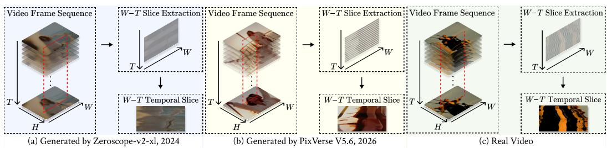  
Figure 6: Visual comparison of temporal slice representations for videos generated by an earlier model, a more recent model, and a real video. (a) A sample generated by Zeroscope-v2-xl [6], an earlier text-to-video model included in GenVideo. (b) A sample generated by PixVerse V5.6 [12], a recent commercial model from our newly collected AI-Artist benchmark. (c) A real video. Following the red dashed line, we unfold one row of pixels along the temporal dimension to obtain the temporal slice.

In the main manuscript, Fig. 1 conceptually motivates why temporal slices provide a more task-aligned representation than conventional full-frame or patch-based processing, while Fig. 2(b) further shows that slice-domain statistics yield substantially clearer class separability than patch-domain representations. Here, we complement these analyses with direct visual evidence.

Fig. 6 compares temporal slices extracted from three representative cases: an earlier generator, a recent highfidelity generator, and a real video. For fair comparison, the generated examples are conditioned on text prompts automatically extracted from the corresponding real video using ChatGPT5.4 [9], and then synthesized by the respective video generation models. The sample from the earlier generator exhibits obvious blurring, jagged transitions, and unstable local structures, indicating weak temporal consistency across frames. In contrast, the recent generator produces noticeably cleaner slices with sharper contours and smoother transitions, reflecting the substantial progress of modern video generation models and the increasing difficulty of detection.

Nevertheless, despite these improvements, the generated sample still differs from the real video. The real slice presents cleaner trajectories, more stable structures, and more coherent local variations over time, whereas the sample generated by the recent commercial model still contains abrupt transitions, distorted contours, or irregular fluctuations in certain regions. These residual discrepancies are often subtle in individual frames, but become much more explicit after reorganizing the video into temporal slices. This comparison further supports the core motivation of our method: Temporal slices explicitly preserve structured temporal evolution while suppressing redundant appearance content, thereby exposing temporal flickering, motion inconsistency, and structural instability in a compact representation. Importantly, such discriminative cues remain observable not only for earlier generators, but also for recent frontier models.

Table 4: Statistics of the AI-generated video subsets in AI-Artist. For binary evaluation, these generated videos are paired with an equal number of real videos sampled from the GenVideo OOD real-video split.
<table><tr><td>Collection Protocol</td><td>Sub-dataset</td><td>#Videos</td><td>Duration</td><td>Resolution</td><td>Frame Rate</td></tr><tr><td rowspan="3">Web-Collection</td><td>Seedance (Film)</td><td>55</td><td>0.5–15s</td><td> $4 9 6 \times 8 6 4 - 2 9 4 0 \times 1 2 6 0$ </td><td>24–60 fps</td></tr><tr><td>Kling 3.0</td><td>46</td><td>1-15s</td><td> $4 8 0 \times 8 1 6 - 1 1 7 6 \times 1 7 6 4$ </td><td>24–30 fps</td></tr><tr><td>AI_artists</td><td>120</td><td>1-8s</td><td> $9 6 0 \times 5 4 4 - 2 5 3 8 \times 1 0 8 0$ </td><td>24–30 fps</td></tr><tr><td rowspan="5">Self-Generation</td><td>Runway Gen-4.5</td><td>40</td><td>5s</td><td>720p</td><td>24 fps</td></tr><tr><td>PixVerse V5.6</td><td>40</td><td>3s</td><td>720p</td><td>24 fps</td></tr><tr><td>Hailuo 2.3</td><td>35</td><td>5s</td><td>1366 × 768</td><td>24 fps</td></tr><tr><td>Seedance 2.0</td><td>34</td><td>1-3s</td><td>1118 × 720</td><td>24 fps</td></tr><tr><td>Luma Ray3.14</td><td>10</td><td>5s</td><td>720p</td><td>24 fps</td></tr></table>

Overall, Fig. 6 provides intuitive visual evidence that is highly consistent with the quantitative findings in Fig. 2(b), and further justifies our design choice of frequency-aware temporal slice modeling.

## C AI-Artist Dataset

## C.1 Collection details of AI-Artist

To construct a challenging benchmark for AI-generated video detection, we collected videos generated by recent high-performing commercial video generation models, together with highly realistic AI-generated videos shared by professional creators on public online platforms. The overall pipeline contains two complementary branches: web-collection and self-generation. The resulting dataset contains 380 videos in total, including 221 web-collected videos and 159 self-generated videos. The web-collected branch aims to capture realistic AI-generated videos that are naturally disseminated in online communities, while the self-generated branch provides controllable samples with diverse subjects, actions, scenes, and camera motions. Statistics of all collected subsets, including duration, resolution, and frame rate, are summarized in Table 4.

Web-collected videos. For the web-collected branch, we gathered AI-generated videos from public creator communities and social platforms. Specifically, Seedance (Film) videos contain 55 videos collected from X/Twitter, Discord, Reddit, and related public platforms by searching model-specific keywords and examining the accompanying descriptions, hashtags, or community context. Kling 3.0 videos contain 46 videos collected from its official showcase pages and Discord community, where users publicly share generated results. AI\_artists videos contain 120 videos collected from Douyin using relevant AI-creation keywords. Since online videos may include irrelevant content, advertisements, tutorials, reposted materials, or samples with ambiguous provenance, we manually reviewed all candidates and retained only videos that were visually valid and could be reasonably associated with the claimed generation source. This branch therefore reflects realistic in-the-wild distributions of AI-generated videos shared by real users and content creators.

Self-generated videos. For the self-generated branch, we generated videos using five commercial models: Runway Gen-4.5 [8], PixVerse V5.6 [12], Hailuo 2.3 [7], Seedance 2.0 [36], and Luma Ray3.14 [11], resulting in 40, 40, 35, 34, and 10 videos, respectively. All prompts were constructed with the assistance of a large language model. For Seedance 2.0, we focused on human-centric videos with diverse identities, actions, and daily-life scenarios. The subject pool includes people of different ages, genders, and appearances, such as a little girl, an old couple, a middle-aged man, and a young chef. These subjects were paired with common human activities, including watching TV, doing yoga, walking in the street, cooking, and talking with friends. We further diversified the environments with both indoor and outdoor scenes, such as at home, in the kitchen, on the playground, in a park, in a classroom, and on a city street. This design encourages rich human motion patterns, diverse backgrounds, and realistic temporal variations. For the remaining four commercial models, including Runway Gen-4.5, PixVerse V5.6, Hailuo 2.3, and Luma Ray3.14, we adopted a more systematic prompt construction strategy inspired by GenVideo [19]. We first built a subject dictionary containing 50 diverse subjects spanning humans, animals, vehicles, objects, and natural scenes. Representative examples include a yellow school bus, a flowing waterfall, a striped orange tiger, a young dancer in a red skirt, a white sports car, and a small rabbit. For each subject, we designed multiple plausible actions and scene contexts to ensure semantic diversity. In addition, we introduced 20 camera motion patterns, such as fast tracking shot, slow push-in shot, low-angle rising shot, dronefly-through shot, and handheldfollow shot. These elements were then combined and expanded by a large language model into 300 concise and visually clear prompts, which were submitted to the official websites of the corresponding models under default generation settings.

Real-video reference set for evaluation. AI-Artist is designed to focus on recent AI-generated videos and therefore contains only generated samples. To compute binary detection metrics, we pair AI-Artist with real videos sampled from the real-video split of the GenVideo OOD test set. Specifically, we sample 380 real videos to match the number of AI-Artist generated videos, resulting in a balanced evaluation set. The sampled real subset is fixed and shared across all compared detectors. For per-generator evaluation, the same protocol is applied by matching the number of real videos to the corresponding generated subset. This avoids changes in class prior and ensures that AP, AUROC, and ACC are computed under a consistent evaluation setting.

Summary. Overall, our collection strategy combines in-the-wild online videos with controllable modelgenerated videos. The web-collected subsets provide realistic distribution diversity by reflecting AI-generated videos shared across public platforms, while the self-generated subsets ensure broad semantic coverage over subjects, actions, scenes, and camera motions. As a result, AI-Artist covers both realistic dissemination scenarios and systematically generated samples from recent frontier commercial models.

## C.2 Diversity and Realism of AI-Artist

Modern video generation models have rapidly advanced in both visual fidelity and temporal coherence, raising a critical question for detection: what makes AIgenerated videos still distinguishable when their observable statistics become increasingly similar to real data?

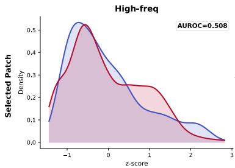

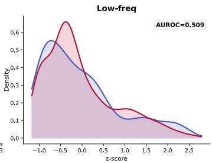

To investigate this, we extend the distributional analysis in Fig. 2(b) to the AI-Artist evaluation setting, where AI-generated videos come from AI-Artist and natural videos are sampled from the GenVideo OOD real-video split following the balanced protocol described in Sec. C.1. As shown in Fig. 7, the selected patch distributions of natural and AI-generated videos are almost indistinguishable in both high-frequency and low-frequency regions, with AUROC values close to random guessing. This indicates that local patch-level statistics provide limited discriminative evidence on AI-Artist. After reorganizing the same content into temporal slices, the separability between natural and AI-generated videos becomes more evident. In particular, high-frequency tempo-

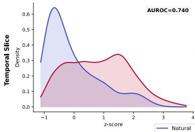

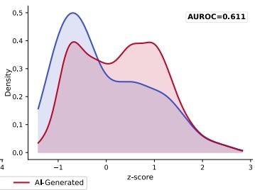  
Figure 7: Distributional analysis of natural (blue) videos in Gen-Video and AI-generated (red) videos in AI-Artist under patchdomain and slice-domain representations. The top row shows selected spatial patches, while the bottom row shows the corresponding temporal slices. Columns correspond to high-frequency and low-frequency spatial regions. Compared with Fig. 2(b), AI-Artist exhibits stronger overlap between natural and AI-generated distributions, indicating that recent high-fidelity generators substantially reduce simple distributional discrepancies.

ral slices show a clearer distributional gap, suggesting that temporal slice representations can still expose structured temporal differences that are largely hidden in isolated spatial patches. Nevertheless, compared with Fig. 2(b), the slice-domain separability on AI-Artist is reduced, especially in low-frequency regions. This reflects the increased realism and temporal coherence of recent generation models, which makes AI-Artist more challenging than earlier benchmarks. This observation suggests that detection becomes harder as simple statistical differences diminish. Earlier generated videos often contain more obvious low-level artifacts or unstable temporal patterns, making them easier to distinguish using simple statistical cues. In contrast, recent generators substantially narrow the distributional gap to real videos, particularly at the patch level. Therefore, these results motivate using structured temporal cues alongside local statistics. Motivated by this insight, we construct the AI-Artist dataset with two key objectives. First, it emphasizes diversity, incorporating outputs from multiple state-of-the-art generation systems with different architectures and generation behaviors. This ensures that detectors are evaluated under a broad range of unseen generation patterns. Second, it emphasizes realism, focusing on recent high-quality videos where conventional artifacts are substantially reduced. Together, these factors make AI-Artist a more challenging and realistic benchmark for evaluating generalization.

Table 5: Comparison with state-of-the-art methods in terms of Accuracy (ACC), Average Precision (AP) and Area Under the Receiver Operating Characteristic Curve (AUROC) on the AI-Artist dataset.
<table><tr><td>Model</td><td>Metric</td><td>Seedance (Film)</td><td>Seedance</td><td>Kling</td><td>Runway</td><td>PixVerse</td><td>Hailuo</td><td>Luma</td><td>AI_artists</td><td>Mean</td></tr><tr><td rowspan="3">MLEP (I)</td><td>ACC</td><td>0.0926</td><td>0.0000</td><td>0.1522</td><td>0.1000</td><td>0.1795</td><td>0.0000</td><td>0.0000</td><td>0.0083</td><td>0.0666</td></tr><tr><td>AP</td><td>0.4942</td><td>0.5377</td><td>0.5361</td><td>0.5544</td><td>0.6382</td><td>0.5345</td><td>0.6031</td><td>0.3387</td><td>0.5296</td></tr><tr><td>AUROC</td><td>0.4781</td><td>0.6168</td><td>0.4920</td><td>0.5262</td><td>0.6220</td><td>0.4971</td><td>0.5900</td><td>0.1622</td><td>0.4980</td></tr><tr><td rowspan="3">NPR (I)</td><td>ACC</td><td>0.4444</td><td>0.1471</td><td>0.8696</td><td>1.0000</td><td>1.0000</td><td>1.0000</td><td>1.0000</td><td>0.3750</td><td>0.7295</td></tr><tr><td>AP</td><td>0.7717</td><td>0.6426</td><td>0.9342</td><td>0.9882</td><td>0.9929</td><td>0.9949</td><td>1.0000</td><td>0.6768</td><td>0.8752</td></tr><tr><td>AUROC</td><td>0.7383</td><td>0.7232</td><td>0.9258</td><td>0.9888</td><td>0.9934</td><td>0.9951</td><td>1.0000</td><td>0.6296</td><td>0.8743</td></tr><tr><td rowspan="3">VIBAIGCD (I)</td><td>ACC</td><td>0.6296</td><td>0.5588</td><td>0.6087</td><td>0.9000</td><td>0.7692</td><td>0.7143</td><td>0.7000</td><td>0.6417</td><td>0.6903</td></tr><tr><td>AP</td><td>0.6522</td><td>0.6406</td><td>0.6157</td><td>0.7902</td><td>0.7517</td><td>0.7360</td><td>0.6782</td><td>0.5964</td><td>0.6826</td></tr><tr><td>AUROC</td><td>0.6667</td><td>0.6384</td><td>0.6181</td><td>0.8575</td><td>0.7495</td><td>0.7208</td><td>0.7400</td><td>0.6285</td><td>0.7024</td></tr><tr><td rowspan="3">AIDE (I)</td><td>ACC</td><td>0.5000</td><td>0.1765</td><td>0.8478</td><td>0.9000</td><td>0.7692</td><td>1.0000</td><td>1.0000</td><td>0.3667</td><td>0.6950</td></tr><tr><td>AP</td><td>0.7880</td><td>0.5960</td><td>0.9537</td><td>0.9503</td><td>0.8885</td><td>0.9985</td><td>0.9063</td><td>0.7298</td><td>0.8514</td></tr><tr><td>AUROC</td><td>0.7716</td><td>0.5856</td><td>0.9504</td><td>0.9531</td><td>0.8915</td><td>0.9984</td><td>0.9300</td><td>0.7189</td><td>0.8499</td></tr><tr><td rowspan="3">TALL (V)</td><td>ACC</td><td>0.6852</td><td>0.8529</td><td>0.9130</td><td>1.0000</td><td>0.9231</td><td>0.9429</td><td>1.0000</td><td>0.7167</td><td>0.8792</td></tr><tr><td>AP</td><td>0.6119</td><td>0.6071</td><td>0.8252</td><td>0.9414</td><td>0.8481</td><td>0.9367</td><td>0.7896</td><td>0.5869</td><td>0.7684</td></tr><tr><td>AUROC</td><td>0.5724</td><td>0.5484</td><td>0.7765</td><td>0.9394</td><td>0.8087</td><td>0.9086</td><td>0.7700</td><td>0.5301</td><td>0.7318</td></tr><tr><td rowspan="3">XCLIP (V)</td><td>ACC</td><td>0.3333</td><td>0.2059</td><td>0.6304</td><td>0.9750</td><td>0.9487</td><td>1.0000</td><td>1.0000</td><td>0.2250</td><td>0.6648</td></tr><tr><td>AP</td><td>0.3742</td><td>0.3478</td><td>0.5109</td><td>0.6927</td><td>0.7013</td><td>0.7965</td><td>0.4733</td><td>0.3489</td><td>0.5307</td></tr><tr><td>AUROC</td><td>0.2853</td><td>0.1799</td><td>0.5118</td><td>0.7313</td><td>0.7094</td><td>0.8122</td><td>0.4600</td><td>0.2137</td><td>0.4880</td></tr><tr><td rowspan="3">DeMamba (V)</td><td>ACC</td><td>0.6667</td><td>0.4118</td><td>0.8913</td><td>0.9250</td><td>0.9487</td><td>1.0000</td><td>1.0000</td><td>0.2833</td><td>0.7658</td></tr><tr><td>AP</td><td>0.4276</td><td>0.3728</td><td>0.6274</td><td>0.6334</td><td>0.6758</td><td>0.9747</td><td>0.5026</td><td>0.3371</td><td>0.5689</td></tr><tr><td>AUROC</td><td>0.3755</td><td>0.2673</td><td>0.6129</td><td>0.6425</td><td>0.6785</td><td>0.9796</td><td>0.5300</td><td>0.1689</td><td>0.5319</td></tr><tr><td rowspan="3">D3 (V)</td><td>ACC</td><td></td><td></td><td></td><td></td><td></td><td></td><td></td><td></td><td></td></tr><tr><td>AP</td><td>0.9292</td><td>0.9874</td><td>0.9728</td><td>0.9922</td><td>0.9927</td><td>0.9929</td><td>1.0000</td><td>0.9317</td><td>0.9749</td></tr><tr><td>AUROC</td><td>0.9150</td><td>0.9827</td><td>0.9683</td><td>0.9906</td><td>0.9915</td><td>0.9918</td><td>1.0000</td><td>0.9151</td><td>0.9694</td></tr><tr><td rowspan="3">ReStraV (V)</td><td>ACC</td><td>0.1296</td><td>0.9706</td><td>0.7826</td><td>0.9500</td><td>1.0000</td><td>0.9143</td><td>1.0000</td><td>0.5667</td><td>0.7892</td></tr><tr><td>AP</td><td>0.9261</td><td>0.9820</td><td>0.9780</td><td>0.9809</td><td>0.9782</td><td>0.9777</td><td>0.9782</td><td>0.9656</td><td>0.9712</td></tr><tr><td>AUROC</td><td>0.9207</td><td>0.9811</td><td>0.9787</td><td>0.9822</td><td>0.9790</td><td>0.9776</td><td>0.9888</td><td>0.9549</td><td>0.9704</td></tr><tr><td rowspan="3">Ours (V)</td><td>ACC</td><td>0.3333</td><td>0.9118</td><td>0.9130</td><td>1.0000</td><td>1.0000</td><td>0.9714</td><td>1.0000</td><td>0.7167</td><td>0.8558</td></tr><tr><td>AP</td><td>0.8883</td><td>0.9933</td><td>0.9958</td><td>1.0000</td><td>1.0000</td><td>0.9976</td><td>1.0000</td><td>0.9692</td><td>0.9805</td></tr><tr><td>AUROC</td><td>0.8735</td><td>0.9931</td><td>0.9957</td><td>1.0000</td><td>1.0000</td><td>0.9976</td><td>1.0000</td><td>0.9587</td><td>0.9773</td></tr></table>

The impact of this increased difficulty is reflected in Table 5. Many existing methods experience noticeable performance degradation, especially those relying heavily on local or low-level statistical cues. Even strong baselines exhibit instability across generators, indicating limited robustness when the distributional gap between real and generated videos becomes smaller. In contrast, our method achieves the best average AP and AUROC and remains among the top-performing methods on most generator subsets. These results suggest that our approach remains effective under reduced patch-level separability. By modeling cross-slice temporal dynamics and cross-frequency interactions, our method focuses on structured temporal patterns that remain informative even for high-fidelity generated videos.

Overall, AI-Artist not only provides a more stringent evaluation benchmark, but also highlights a key trend in AI-generated video detection: as patch-level distributional differences diminish, effective detection increasingly depends on modeling structured temporal slice representations rather than relying on isolated spatial statistics.

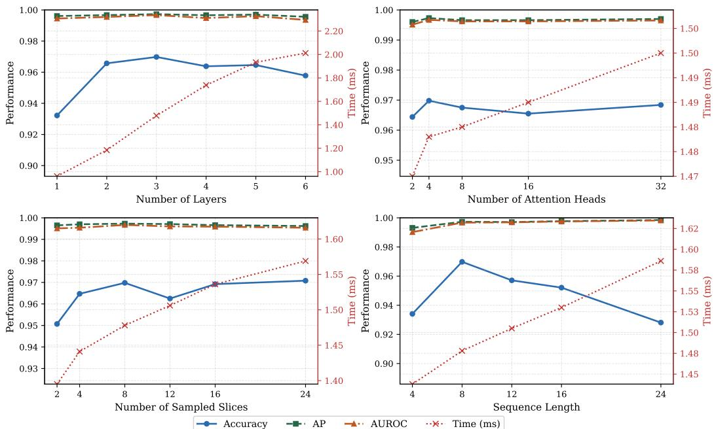  
Figure 8: Ablation on key hyperparameters.

## D Ablation Study

## D.1 Ablation on Key Hyperparameters

We first analyze the sensitivity of key hyperparameters in TSC-Net. As shown in Fig. 8, we vary four important factors, including the number of Transformer layers, the number of attention heads, the number of sampled slices, and the temporal window length. Overall, the performance remains stable across a broad range of settings, especially in terms of mAP and mAUROC, indicating that our framework is not overly sensitive to hyperparameter choices. For the number of Transformer layers, performance improves as the model becomes deeper and reaches a favorable trade-off at 3 layers, while further increasing the depth brings no clear additional gain. A similar trend is observed for the number of attention heads, where 4 heads are sufficient to achieve strong performance. For the number of sampled slices, the best overall results are obtained with $n _ { \mathrm { p i c k } } = 8 ,$ which we therefore adopt as the default setting. For the temporal window length, mAP and mAUROC slightly improve as the sequence becomes longer, suggesting that longer temporal context can provide useful information. However, ACC decreases when the window length continues to increase, possibly because longer windows introduce more padding for short videos, which can affect threshold-dependent accuracy. Considering both overall performance and fair comparison with prior video-based baselines, we use $T _ { \mathrm { m a x } } = \mathrm { \dot { 8 } }$ in all experiments.

## D.2 Ablation on Temporal Slice Representation

We investigate the impact of different temporal-order representations, including raw temporal slices, first-order differences, and second-order differences. The results are reported in the upper block of Table 6. Overall, no single temporal order consistently dominates across all datasets and metrics, indicating that they capture different aspects of temporal inconsistency.

Raw temporal slices achieve strong performance on both datasets, reaching 0.9651 ACC on GenVideo and 0.8618 ACC on AI-Artist. This shows that direct slice representations already preserve useful spatiotemporal consistency cues. First-order difference slices further emphasize temporal variations and achieve the highest ACC on AI-Artist among the temporal-order variants, suggesting their effectiveness in capturing motion-level inconsistencies under more challenging generation conditions. Second-order difference slices model higher-order temporal dynamics, but their standalone performance is weaker, especially on AI-Artist. This is likely because second-order differences amplify not only temporal discrepancies but also noise and local instability, making the resulting representation less reliable when used alone.

By integrating raw slices, first-order differences, and second-order differences, our full model achieves the best performance on GenVideo and remains highly competitive on AI-Artist. In particular, it reaches 0.9698 ACC, 0.9973 mAP, and 0.9967 mAUROC on GenVideo, outperforming all single-order variants. These results suggest that different temporal orders provide complementary information, and their joint modeling improves the overall robustness of AI-generated video detection. Moreover, the inference time remains comparable across variants, indicating that the gain brought by multi-order modeling does not introduce substantial computational overhead.

Table 6: Ablation study on different temporal slice representations, including temporal-order slice representations, slice construction strategies, slice directions, high- and low-frequency components, and positional encoding variants. Results are reported on GenVideo and AI-Artist in terms of ACC, mAP, and mAUROC. Inference time (ms) is also reported.
<table><tr><td rowspan="2">Method</td><td colspan="3">GenVideo</td><td colspan="3">AI-Artist</td><td rowspan="2">Time (ms)</td></tr><tr><td>ACC</td><td>mAP</td><td>mAUROC</td><td>ACC</td><td>mAP</td><td>mAUROC</td></tr><tr><td>Raw Temporal Slice</td><td>0.9651</td><td>0.9970</td><td>0.9962</td><td>0.8618</td><td>0.9775</td><td>0.9763</td><td>1.426</td></tr><tr><td>1st-order Diff Slice</td><td>0.9658</td><td>0.9969</td><td>0.9955</td><td>0.8638</td><td>0.9745</td><td>0.9757</td><td>1.460</td></tr><tr><td>2nd-order Diff Slice</td><td>0.9635</td><td>0.9939</td><td>0.9906</td><td>0.8520</td><td>0.9691</td><td>0.9562</td><td>1.465</td></tr><tr><td>Select Patch</td><td>0.9164</td><td>0.9871</td><td>0.9846</td><td>0.8536</td><td>0.9644</td><td>0.9684</td><td>1.414</td></tr><tr><td>Resize</td><td>0.9323</td><td>0.9919</td><td>0.9893</td><td>0.8297</td><td>0.9541</td><td>0.9365</td><td>1.463</td></tr><tr><td>Only HF</td><td>0.9503</td><td>0.9947</td><td>0.9912</td><td>0.8522</td><td>0.9723</td><td>0.9572</td><td>1.436</td></tr><tr><td>Only LF</td><td>0.9336</td><td>0.9943</td><td>0.9909</td><td>0.8615</td><td>0.9816</td><td>0.9795</td><td>1.437</td></tr><tr><td>Fixed PE</td><td>0.9522</td><td>0.9961</td><td>0.9940</td><td>0.8602</td><td>0.9796</td><td>0.9752</td><td>1.355</td></tr><tr><td>Learnable PE</td><td>0.9494</td><td>0.9948</td><td>0.9910</td><td>0.8565</td><td>0.9745</td><td>0.9652</td><td>1.445</td></tr><tr><td>Only Row</td><td>0.9664</td><td>0.9965</td><td>0.9958</td><td>0.8526</td><td>0.9735</td><td>0.9762</td><td>1.458</td></tr><tr><td>Only Column</td><td>0.9668</td><td>0.9969</td><td>0.9960</td><td>0.8592</td><td>0.9815</td><td>0.9784</td><td>1.459</td></tr><tr><td>Ours</td><td>0.9698</td><td>0.9973</td><td>0.9967</td><td>0.8558</td><td>0.9805</td><td>0.9773</td><td>1.478</td></tr></table>

Bridging Distributional Evidence and Empirical Performance. At first glance, the clear distributional discrepancy observed in temporal-difference domains in Fig. 2(b) and Fig. 7 may seem inconsistent with the relatively weaker standalone performance of second-order difference slices in Table 6. This is not contradictory. The distributional analysis is intended as a diagnostic visualization of marginal slice-response statistics, rather than a direct surrogate for end-to-end detection performance. Although second-order differences can amplify real–fake discrepancies, they may also amplify noise and discard stable structural information that is useful for robust classification. As a result, second-order slices can provide informative evidence while being less reliable as the only input representation. In contrast, raw temporal slices preserve stable structural cues, and first-order differences capture local motion variations. This motivates our multi-order design: instead of relying on a single temporal signal, we jointly model raw, first-order, and second-order slice representations to exploit their complementary strengths

## D.3 Ablation on Temporal Slice Construction and Positional Encoding

We further validate the effectiveness of temporal slice construction, frequency-aware component design, and positional encoding. The results are reported in the lower block of Table 6.

## Temporal Slice Construction.

“Select Patch” selects the same number of informative patches but does not construct temporal slices. Its clear performance drop on both datasets demonstrates that structured temporal slice construction is crucial for exposing temporal inconsistencies, rather than merely selecting discriminative spatial regions. “Resize” directly resizes the windowed video content instead of performing frequency-aware patch localization. Its inferior performance suggests that explicitly focusing on localized frequency-aware regions is more effective than relying on globall resized content, where subtle temporal artifacts may be diluted by redundant appearance information.

## High- vs. Low-Frequency Temporal Slices.

We compare variants using only high-frequency patches (“Only HF”) or only low-frequency patches (“Only LF”). The results reveal different behaviors across benchmarks. On AI-Artist, “Only LF” achieves the highest mAP and mAUROC among the ablation variants, reaching 0.9816 and 0.9795, respectively. This suggests that, for recent high-fidelity generators, discriminative cues may be more strongly reflected in coarse structural evolution and low-frequency temporal consistency, while high-frequency texture artifacts alone become less reliable.

However, relying solely on low-frequency slices leads to a substantial drop on GenVideo, where “Only LF” obtains 0.9336 ACC compared with 0.9698 of the full model. This indicates that high-frequency cues remain important for generators that still exhibit local texture instability, boundary flickering, or fine-detail artifacts. Conversely, “Only HF” also underperforms the full model, especially on AI-Artist, showing that high-frequency information alone is insufficient for detecting more realistic generated videos. Therefore, high- and lowfrequency temporal slices are complementary: high-frequency slices capture fine-grained local artifacts, while low-frequency slices preserve coarse structural and motion-related inconsistencies. Our full model combines both types of cues, achieving the best overall cross-benchmark trade-off.

Table 7: Ablation on temporal coverage under a matched budget of four HF and four LF slices per directional branch. “Prep.” and “Model” denote preprocessing and model-forward time per video.
<table><tr><td rowspan="2">Method</td><td colspan="3">GenVideo</td><td colspan="3">AI-Artist</td><td rowspan="2">Prep. (ms)</td><td rowspan="2">Model (ms)</td></tr><tr><td>ACC</td><td>mAP</td><td>mAUROC</td><td>ACC</td><td>mAP</td><td>mAUROC</td></tr><tr><td>1-Seg. MP</td><td>0.9375</td><td>0.9904</td><td>0.9879</td><td>0.8903</td><td>0.9808</td><td>0.9807</td><td>4.668</td><td>1.451</td></tr><tr><td>4-Seg.</td><td>0.9785</td><td>0.9982</td><td>0.9977</td><td>0.9125</td><td>0.9849</td><td>0.9836</td><td>8.908</td><td>1.522</td></tr><tr><td>Ours (1-Seg.)</td><td>0.9698</td><td>0.9973</td><td>0.9967</td><td>0.8558</td><td>0.9805</td><td>0.9773</td><td>3.198</td><td>1.478</td></tr></table>

Positional Encoding. Finally, we compare different positional encoding variants. The fixed positional encoding preserves deterministic structural coordinates, while the learnable positional encoding allows more flexible adaptation. Both variants achieve reasonable performance, but neither consistently matches the full design. Our hierarchical positional encoding, which combines frozen structural encoding with a learnable frequency embedding, achieves the best results on GenVideo and strong threshold-free performance on AI-Artist. This supports the importance of disentangling structural slice coordinates from frequency-group identity when modeling cross-slice and cross-frequency dependencies.

Overall, these ablation results consistently support the main design choices of TSC-Net: Temporal slices are more effective than patch-only or resizing-based alternatives, multi-order temporal representations provide complementary cues, high- and low-frequency components improve cross-generator robustness, and hierarchical positional encoding benefits structured slice-domain modeling.

## D.4 Ablation on Slice Direction and Temporal Coverage

Row-wise vs. column-wise slices. We evaluate variants that keep only the row-wise branch (“Only Row”) or only the column-wise branch (“Only Column”), with results listed in Table 6. Both directions are individually effective. “Only Column” is slightly stronger on AI-Artist (0.8592/0.9815/0.9784 ACC/mAP/mAUROC versus 0.8558/0.9805/0.9773 for the full model), whereas the joint design is stronger on all GenVideo metrics (0.9698/0.9973/0.9967 versus 0.9664/0.9965/0.9958 for “Only Row” and 0.9668/0.9969/0.9960 for “Only Column”). This suggests that the preferred slice direction depends on the dataset and that neither direction is consistently better. Using both directions avoids choosing a direction based on the test distribution and is a more reliable default across benchmarks, with a negligible increase in model time (1.478 versus about 1.46 ms).

Temporal coverage. The default design extracts a single temporal window centered at the key frame. To study broader temporal coverage, we keep the scoring rules of Eqs. (1) and (2) and change only how the fixed slice budget, four HF and four LF slices in each directional branch, is distributed. “1-Seg. MP” constructs one window around the key frame t⋆, retains the four highest-energy HF patches and the four lowest-energy LF patches according to S(r, c), and assembles their row and column slices. “4-Seg.” ranks frame transitions by $d _ { t } ,$ applies temporal non-maximum suppression to remove adjacent peaks, and selects the top four key frames; a temporal window is constructed around each key frame, and the original localization rule selects one HF/LF patch pair from each window. All configurations therefore share the same model input shape and differ only in how evidence is sampled. As shown in Table 7, 4-Seg. outperforms both 1-Seg. MP and the single-window default on all six metrics, indicating that broader temporal coverage provides complementary information that is not captured by denser spatial sampling within a single window. The model time remains essentially unchanged, whereas the preprocessing time increases from 3.198 to 8.908 ms because more frame windows must be accessed and their slices constructed separately. The single-segment design therefore remains the simpler and more efficient operating point, while 4-Seg. is favorable when accuracy is prioritized.

## D.5 Alternative Slice Localization

Our patch localization relies on a fixed gradient-energy heuristic. As an alternative, we evaluate a semantically guided variant that localizes regions with Grad-CAM [37] from a trained semantic detector before constructing temporal slices. On GenVideo, this variant obtains 0.9501/0.9961/0.9952 ACC/mAP/mAUROC, compared with 0.9698/0.9973/0.9967 for our gradient-based design, while the parameters, computation, and model latency increase from 1.731 M/0.109 GFLOPs/1.478 ms to 2.810 M/0.597 GFLOPs/17.4 ms. This indicates that a region important to a semantic classifier is not necessarily where temporal inconsistency is most visible; moreover, Grad-CAM requires an additional model and gradient extraction, which substantially weakens efficiency. A fully learnable localizer is also not a drop-in replacement in our formulation, because TSC-Net consumes temporal slices rather than the selected patches themselves. After HF/LF patch localization and discrete cropping, slice construction computes the temporal-difference map and performs a second discrete top-K selection of rows and columns. Even with a differentiable attention map, the classification loss therefore cannot be back-propagated through these discrete selection steps to the localizer. End-to-end optimization would require relaxing the discrete crop and row/column selection, or introducing surrogate supervision. These changes could alter the representation and require scoring additional candidates, so the same computational cost cannot be guaranteed. A lightweight selector designed specifically for slice-level temporal inconsistency is an interesting direction for future work.

Table 8: Stage-wise computational cost of TSC-Net per video on GenVideo.
<table><tr><td>Stage</td><td>Time (ms)</td><td>GFLOPs</td></tr><tr><td>Temporal-window/key-frame selection and grayscale processing</td><td>0.796</td><td>0.0415</td></tr><tr><td>Frequency-aware patch selection</td><td>1.652</td><td>0.0230</td></tr><tr><td>Temporal-slice and difference construction</td><td>0.750</td><td>0.0136</td></tr><tr><td>Preprocessing subtotal</td><td>3.198</td><td>0.0781</td></tr><tr><td>Model forward</td><td>1.478</td><td>0.109</td></tr><tr><td>Full pipeline</td><td>4.676</td><td>0.187</td></tr></table>

## E Full-Pipeline Computational Cost

Table 2 uses the same measurement protocol for all compared methods, separating the model forward pass from method-specific data preprocessing. For all methods, preprocessing consists only of deterministic, non-learnable operations and introduces no trainable parameters; hence the parameter counts are unaffected. For TSC-Net, preprocessing comprises temporal-window/key-frame selection with grayscale processing, frequency-aware patch selection, and temporal-slice and difference construction, whose stage-wise costs are listed in Table 8.

The “400× fewer FLOPs” statement refers to model-forward computation measured under the same protocol for all methods: ReStraV requires 44.20 GFLOPs, whereas TSC-Net requires 0.109 GFLOPs, corresponding to 405.5× fewer model-forward FLOPs; it does not imply a 400× reduction in end-to-end latency. FLOPs and wall-clock latency are not expected to scale proportionally, especially in the low-computation regime. At low computational loads, memory access and kernel launches can account for a larger share of latency, and GPU resources may be underutilized. Consequently, the 405.5× reduction in model-forward FLOPs corresponds to a 3.6× model-forward speedup (1.478 versus 5.307 ms). When method-specific preprocessing is included, TSC-Net retains 236× fewer total GFLOPs (0.187 versus 44.212) and a 2.9× full-pipeline speedup (4.676 versus 13.444 ms) over ReStraV, and it has the lowest total GFLOPs and latency among all compared methods.

## F False Positives on Real Videos and Weak-Motion Analysis

Protocol. Since false positives are critical for real-world deployment, we evaluate 10,000 real MSR-VTT web clips (7,180 source videos, 257 queries, 20 categories). Taking generated videos as positive, FPR = FP/(FP + TN) and specificity = TN/(TN + FP). Each method retains its original score direction and uses a fixed threshold of 0.5, without test-set tuning. As shown in Table 9, TSC-Net produces 7 false positives overall (FPR 0.07%, specificity 99.93%), the fewest among the evaluated methods.

Challenging real-video categories. For each targeted stress case, we use a fixed statistic computed on the 8-frame input window as a proxy and form overlapping quartile subsets (Table 10). Together, these statistics provide reproducible proxies for strong and weak motion, contrast, spatial complexity, camera-induced motion, and local non-rigid variation after the dominant camera motion is removed; they are not manually verified semantic categories. TSC-Net produces at most 5 false positives (FPR 0.20%) in any subset, with the highest count on the complex high-frequency background subset.

Natural high-frequency dynamics vs. generative flickering. Both real and generated videos can contain rich high-frequency content; what distinguishes them is how this content evolves over time. As visualized in Fig. 2(a), a real video may contain a complex high-frequency background, yet its local patterns evolve continuously and form relatively coherent trajectories in the temporal slices. In an AI-generated video, flickering textures, unstable boundaries, or abruptly changing details may interrupt this continuity, producing distorted, broken, or irregular slice structures. In TSC-Net, the gradient magnitude only determines where slices are extracted and is never used as a classification score. Raw slices preserve the temporal trajectories, first- and second-order difference slices make abrupt changes and unstable evolution more explicit, and the Transformer models dependencies across time, selected rows and columns, spatial directions, and HF/LF groups. The model can therefore learn whether high-frequency details evolve coherently, rather than treating high-frequency energy itself as evidence of generation. Consistent with this observation, Fig. 2(b) shows that real and generated distributions strongly overlap in the patch domain (AUROC 0.502/0.525 for HF/LF patches), whereas reorganizing the same content into temporal slices increases the AUROC to 0.770/0.650.

Table 9: False-positive analysis on 10,000 real MSR-VTT clips at a threshold of 0.5, with generated videos as the positive class. Since only real videos are evaluated, only TN and FP are reported. D3 is omitted because it produces an uncalibrated ranking score without a predefined binary threshold.
<table><tr><td>Method</td><td>TN</td><td>FP</td><td>FPR (%)</td><td>Specificity (%)</td></tr><tr><td>MLEP (I)</td><td>9,578</td><td>422</td><td>4.22</td><td>95.78</td></tr><tr><td>NPR (I)</td><td>8,613</td><td>1,387</td><td>13.87</td><td>86.13</td></tr><tr><td>VIBAIGCD (I)</td><td>5,187</td><td>4,813</td><td>48.13</td><td>51.87</td></tr><tr><td>AIDE (I)</td><td>9,028</td><td>972</td><td>9.72</td><td>90.28</td></tr><tr><td>TALL (V)</td><td>3,051</td><td>6,949</td><td>69.49</td><td>30.51</td></tr><tr><td>XCLIP (V)</td><td>3,494</td><td>6,506</td><td>65.06</td><td>34.94</td></tr><tr><td>DeMamba (V)</td><td>2,609</td><td>7,391</td><td>73.91</td><td>26.09</td></tr><tr><td>ReStraV (V)</td><td>9,961</td><td>39</td><td>0.39</td><td>99.61</td></tr><tr><td>Ours (V)</td><td>9,993</td><td>7</td><td>0.07</td><td>99.93</td></tr></table>

Table 10: False positives of TSC-Net on challenging real-video subsets. Each subset contains the 2,500 MSR-VTT clips at the top or bottom quartile of a fixed statistic computed on the 8-frame input window; subsets overlap.
<table><tr><td>Targeted stress case</td><td>Operational proxy</td><td>#Videos</td><td>FP</td><td>FPR (%)</td></tr><tr><td>Strong motion / temporal change</td><td>Top-25% mean absolute grayscale inter-frame difference</td><td>2,500</td><td>0</td><td>0.00</td></tr><tr><td>High contrast</td><td>Top-25% RMS contrast</td><td>2,500</td><td>1</td><td>0.04</td></tr><tr><td>Complex high-frequency background</td><td>Top-25% mean Sobel magnitude</td><td>2,500</td><td>5</td><td>0.20</td></tr><tr><td>Camera motion / shake</td><td>Top-25% global-transform magnitude</td><td>2,500</td><td>1</td><td>0.04</td></tr><tr><td>Natural local temporal irregularity</td><td>Top-25% residual variation after global compensation</td><td>2,500</td><td>0</td><td>0.00</td></tr><tr><td>Weak motion</td><td>Bottom-25% mean absolute grayscale inter-frame difference</td><td>2,500</td><td>3</td><td>0.12</td></tr></table>

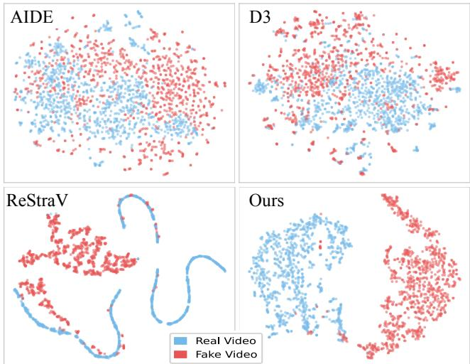  
Figure 9: t-SNE visualization of features extracted from GenVideo using representative state-of-theart methods and our method.

Weak-motion videos. To examine naturally weak motion, we separately rank the MSR-VTT real videos and the ten GenVideo generated-video pools by the mean absolute grayscale inter-frame difference, and select the 2,500 lowest-variation videos from each class. On this balanced weak-motion set, TSC-Net obtains 0.9528/0.9969/0.9960 ACC/AP/AUROC, compared with 0.9552/0.9957/0.9953 for ReStraV. On this weakmotion subset, TSC-Net remains comparable to ReStraV. A visually static generated scene may still contain local background or detail deformation (Fig. 2(a)). Videos with almost no temporal variation nevertheless remain a limitation of our method, as discussed in Sec. H.

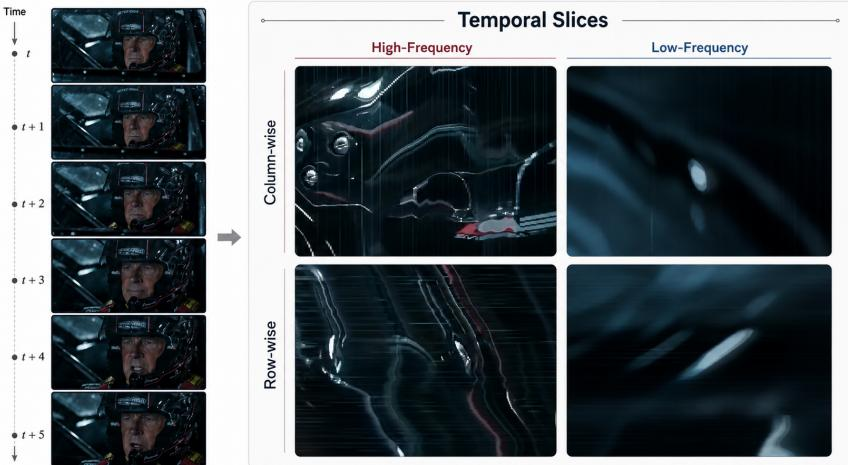  
Figure 10: Failure case on a highly realistic video in Seedance (Film). Left: sampled frames from the input video. Right: row-wise and column-wise temporal slices extracted from high-frequency and low-frequency regions. Although the slice representations preserve temporal evolution, the video shows only subtle facial expression changes with limited temporal variation, making both high-frequency and low-frequency slices weakly discriminative. As a result, all compared methods, including ours, fail on this example.

## G Feature Space Visualization

To qualitatively analyze the learned representations, we visualize the feature space using t-SNE [39] in Fig. 9. We randomly sample 100 videos from each generation source, resulting in 1000 samples in total, and compare our method with several strong baselines, including AIDE, D3, and ReStraV. Compared with prior methods, our method shows more compact intra-class clustering and clearer inter-class separation in the projected space. Although t-SNE is only a qualitative visualization tool, this trend is consistent with the quantitative improvements reported in the main manuscript, suggesting that the proposed temporal slice representation provides more discriminative features for distinguishing real and AI-generated videos.

## H Limitations and Future Work

Despite its effectiveness, our method still has several limitations. First, our framework relies on temporal slices to expose temporal inconsistencies. As shown in Fig. 10, this assumption becomes less effective for highly realistic videos in Seedance (Film), where facial expression changes are subtle and the temporal evolution remains very weak. In such cases, both high-frequency and low-frequency temporal slices may contain limited discriminative cues, making the video difficult to distinguish even for our method. More broadly, this example also reflects the increasing challenge posed by recent high-fidelity generators, for which even existing state-of-the-art detectors may fail. On a balanced set of 5,000 low-variation videos, our method remains comparable to ReStraV (Sec. F). Second, the current slice construction strategy is still based on hand-crafted heuristics (e.g., gradient-based patch selection), which may not always be optimal for diverse video content. A semantically guided Grad-CAM localizer did not improve this accuracy–efficiency trade-off in our experiments (Sec. D.5). Finally, our framework primarily focuses on spatial–temporal consistency and does not explicitly leverage other potentially useful cues, such as semantic priors, audio signals, or metadata.

In future work, we plan to explore more adaptive and learnable slice selection mechanisms, and to combine slice-based temporal modeling with complementary cues beyond temporal inconsistency alone. This may include integrating semantic representations, multimodal signals, or other auxiliary information to better handle videos with only weak temporal variation. We also aim to continuously expand the AI-Artist benchmark to track the rapid evolution of generative models and provide a more comprehensive evaluation platform for the community.

For weak-motion videos, we could explore training-time knowledge distillation from a full-video teacher, after verifying that the teacher performs better on this subset. Its frame representations and video-level predictions could complement the local slice cues. To account for differences between full-video and slice representations, distillation could match temporal similarities and relative changes between frame representations rather than feature vectors, with reduced supervision when adjacent teacher representations change too little. Removing the teacher and auxiliary modules after training would leave TSC-Net’s inference architecture, parameter count, and computational cost unchanged. If audio is available, a shallow encoder could extract log-Mel features from the same temporal window, align them with the slice features, and fuse them through a lightweight gate. Because authentic videos may be edited, dubbed, or desynchronized, audio-visual mismatch should complement the visual evidence rather than serve as an independent cue for generation. Videos without audio would use the original visual model.

## I Potential Societal Impacts

The ability to reliably detect AI-generated videos has important societal implications. On the positive side, our work contributes to improving media authenticity and mitigating the risks associated with the misuse of generative models, such as misinformation, fraud, and malicious content creation. By providing a more efficient and accurate detection framework, our method can facilitate large-scale deployment in real-world scenarios, including content moderation, digital forensics, and platform-level integrity protection. In addition, the introduction of the AI-Artist dataset, which contains videos generated by recent high-fidelity models, helps the community better evaluate detection systems under more realistic and challenging conditions, promoting more robust and future-proof solutions.

However, our work also raises several potential concerns. First, like many detection approaches, our method may be used in an adversarial setting, where advances in detection could incentivize the development of more sophisticated generation techniques, potentially leading to an arms race between generation and detection. Second, although the AI-Artist dataset is constructed for research purposes, it may still contain synthetic content that resembles real individuals or scenes, which could raise concerns about privacy, consent, or misuse if redistributed without proper safeguards. Third, automated detection systems are not infallible and may produce false positives or false negatives, which could have downstream consequences in high-stakes applications such as content moderation or legal decision-making.

To mitigate these risks, we emphasize that our dataset is curated with a focus on synthetic content and is intended strictly for research use. We encourage responsible deployment of detection systems with human oversight, transparency, and appropriate evaluation across diverse scenarios. Future work should also consider fairness, robustness, and accountability, ensuring that detection technologies are developed and used in a manner that aligns with societal values.

## J Visualization of AI-Artist

Following the collection details in Sec. C.1, we further provide qualitative examples to illustrate the visual characteristics of AI-Artist. As shown in Figs. 11– 18, the dataset contains diverse samples from both the web-collected and self-generated branches, covering a wide range of subjects, actions, scenes, camera motions, durations, resolutions, and visual styles. More video examples are provided in the supplementary material.

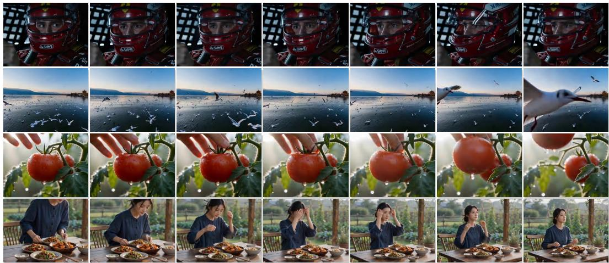  
Figure 11: Visualization of Seedance (Film) videos collected from public online communities.

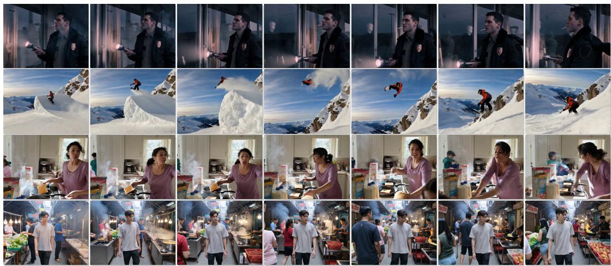  
Figure 12: Visualization of Kling 3.0 videos collected from official showcases and public creator communities.

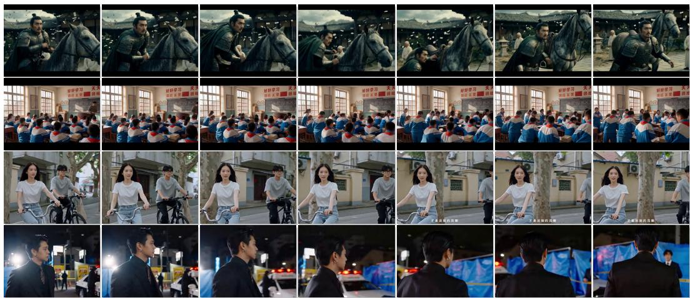  
Figure 13: Visualization of AI-generated creator videos collected from Douyin public platforms.

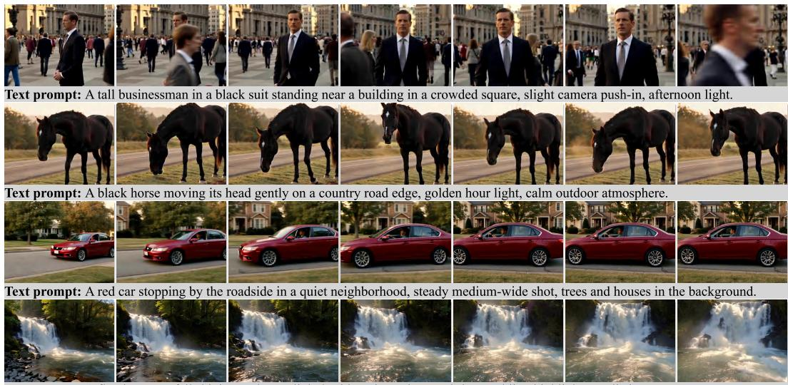  
Text prompt: A flowing waterfall shining under sunlight beside a river, slow push-in, sparkling highlights, realistic nature scene.

Figure 14: Visualization of Runway Gen-4.5 [8] generated samples.

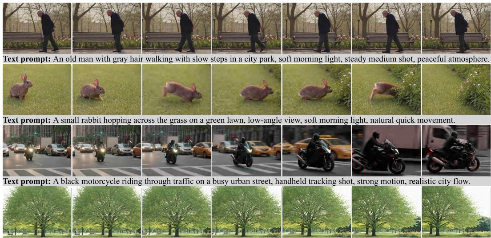  
Text prompt: A tall green tree swaying in the wind in a city park, wide shot, bright daylight, leaves moving naturally.

Figure 15: Visualization of PixVerse V5.6 [12] generated samples.  
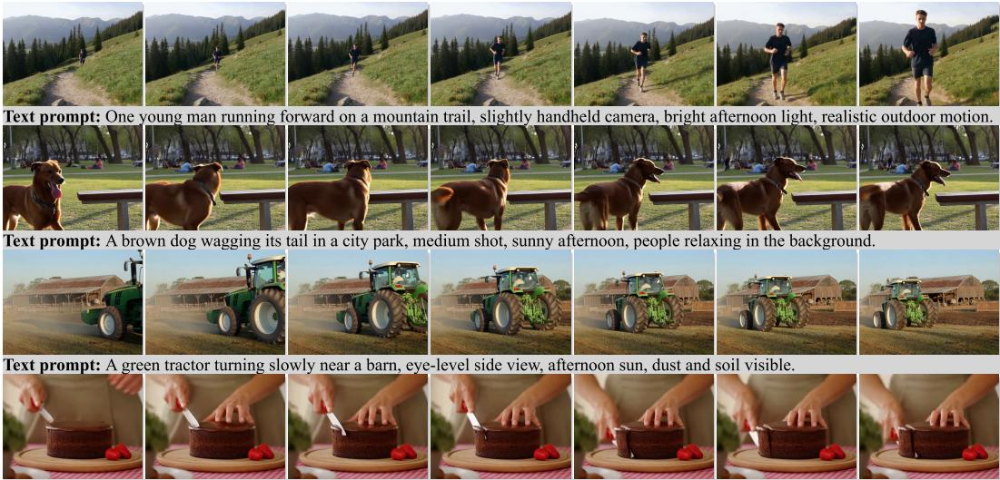  
Text prompt: A chocolate cake with strawberries being cut slowly on a dining table, steady close-up, soft indoor light, natural hand motion.

Figure 16: Visualization of Hailuo 2.3 [7] generated samples.  
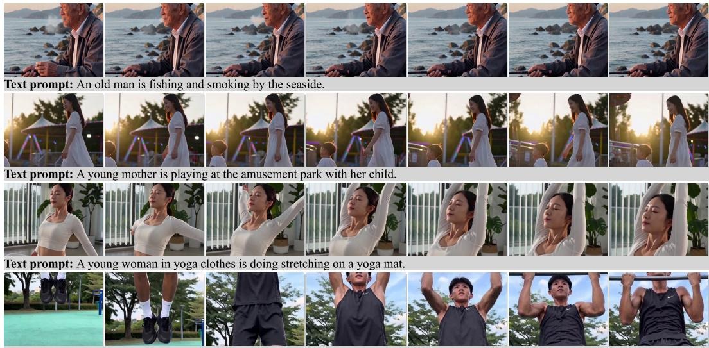  
Text prompt: A young man is doing pull-ups on the sports field.

Figure 17: Visualization of Seedance 2.0 [36] generated samples.

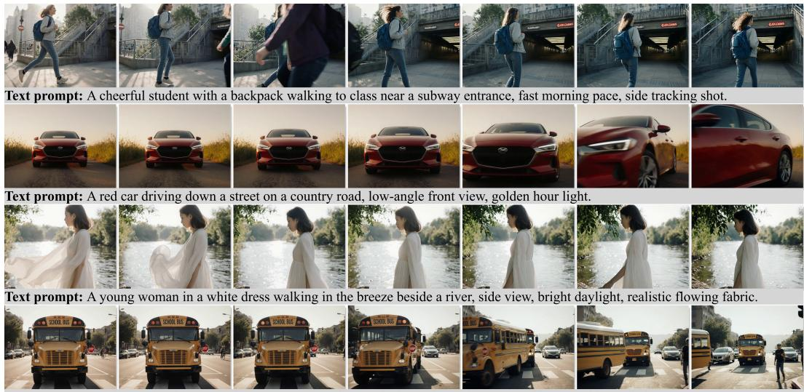  
Figure 18: Visualization of Luma Ray3.14 [11] generated samples.  
Text prompt: A yellow school bus stopping near a crosswalk, steady front view, afternoon traffic around it, realistic street scene.

## NeurIPS Paper Checklist

## 1. Claims

Question: Do the main claims made in the abstract and introduction accurately reflect the paper’s contributions and scope?

Answer: [Yes]

Justification: The main claims in the abstract and introduction are aligned with the scope of the paper. They are supported by the proposed temporal-slice representation, the TSC-Net architecture, and the empirical results on GenVideo and AI-Artist, including both detection performance and computational efficiency.

## Guidelines:

• The answer [N/A] means that the abstract and introduction do not include the claims made in the paper.

• The abstract and/or introduction should clearly state the claims made, including the contributions made in the paper and important assumptions and limitations. A [No] or [N/A] answer to this question will not be perceived well by the reviewers.

• The claims made should match theoretical and experimental results, and reflect how much the results can be expected to generalize to other settings.

• It is fine to include aspirational goals as motivation as long as it is clear that these goals are not attained by the paper.

## 2. Limitations

Question: Does the paper discuss the limitations of the work performed by the authors?

Answer: [Yes]

Justification: The paper includes a dedicated limitations section in the appendix. It discusses the scope of the proposed method, potential dataset and deployment limitations, and the need for further evaluation under future generative models and real-world perturbations.

Guidelines:

• The answer [N/A] means that the paper has no limitation while the answer [No] means that the paper has limitations, but those are not discussed in the paper.

• The authors are encouraged to create a separate “Limitations” section in their paper.

• The paper should point out any strong assumptions and how robust the results are to violations of these assumptions (e.g., independence assumptions, noiseless settings, model well-specification, asymptotic approximations only holding locally). The authors should reflect on how these assumptions might be violated in practice and what the implications would be.

• The authors should reflect on the scope of the claims made, e.g., if the approach was only tested on a few datasets or with a few runs. In general, empirical results often depend on implicit assumptions, which should be articulated.

• The authors should reflect on the factors that influence the performance of the approach. For example, a facial recognition algorithm may perform poorly when image resolution is low or images are taken in low lighting. Or a speech-to-text system might not be used reliably to provide closed captions for online lectures because it fails to handle technical jargon.

• The authors should discuss the computational efficiency of the proposed algorithms and how they scale with dataset size.

• If applicable, the authors should discuss possible limitations of their approach to address problems of privacy and fairness.

• While the authors might fear that complete honesty about limitations might be used by reviewers as grounds for rejection, a worse outcome might be that reviewers discover limitations that aren’t acknowledged in the paper. The authors should use their best judgment and recognize that individual actions in favor of transparency play an important role in developing norms that preserve the integrity of the community. Reviewers will be specifically instructed to not penalize honesty concerning limitations.

## 3. Theory assumptions and proofs

Question: For each theoretical result, does the paper provide the full set of assumptions and a complete (and correct) proof?

Answer: [N/A]

Justification: The paper does not make formal theoretical claims or provide theorem-proof results. Our contribution is an insight-driven representation design: we reformulate AI-generated video detection using compact frequency-aware temporal slices, and support this formulation with analysis and empirical validation.

## Guidelines:

• The answer [N/A] means that the paper does not include theoretical results.

• All the theorems, formulas, and proofs in the paper should be numbered and cross-referenced.

• All assumptions should be clearly stated or referenced in the statement of any theorems.

• The proofs can either appear in the main paper or the supplemental material, but if they appear in the supplemental material, the authors are encouraged to provide a short proof sketch to provide intuition.

• Inversely, any informal proof provided in the core of the paper should be complemented by formal proofs provided in appendix or supplemental material.

• Theorems and Lemmas that the proof relies upon should be properly referenced.

## 4. Experimental result reproducibility

Question: Does the paper fully disclose all the information needed to reproduce the main experimental results of the paper to the extent that it affects the main claims and/or conclusions of the paper (regardless of whether the code and data are provided or not)?

Answer: [Yes]

Justification: The paper provides the details necessary to reproduce the main experimental results, including the training and test datasets, evaluation metrics, preprocessing pipeline, model hyperparameters, optimizer, training schedule, and implementation platform. Additional dataset construction details and ablation studies are provided in the appendix.

## Guidelines:

• The answer [N/A] means that the paper does not include experiments.

• If the paper includes experiments, a [No] answer to this question will not be perceived well by the reviewers: Making the paper reproducible is important, regardless of whether the code and data are provided or not.

• If the contribution is a dataset and/or model, the authors should describe the steps taken to make their results reproducible or verifiable.

• Depending on the contribution, reproducibility can be accomplished in various ways. For example, if the contribution is a novel architecture, describing the architecture fully might suffice, or if the contribution is a specific model and empirical evaluation, it may be necessary to either make it possible for others to replicate the model with the same dataset, or provide access to the model. In general. releasing code and data is often one good way to accomplish this, but reproducibility can also be provided via detailed instructions for how to replicate the results, access to a hosted model (e.g., in the case of a large language model), releasing of a model checkpoint, or other means that are appropriate to the research performed.

• While NeurIPS does not require releasing code, the conference does require all submissions to provide some reasonable avenue for reproducibility, which may depend on the nature of the contribution. For example

(a) If the contribution is primarily a new algorithm, the paper should make it clear how to reproduce that algorithm.

(b) If the contribution is primarily a new model architecture, the paper should describe the architecture clearly and fully.

(c) If the contribution is a new model (e.g., a large language model), then there should either be a way to access this model for reproducing the results or a way to reproduce the model (e.g., with an open-source dataset or instructions for how to construct the dataset).

(d) We recognize that reproducibility may be tricky in some cases, in which case authors are welcome to describe the particular way they provide for reproducibility. In the case of closed-source models, it may be that access to the model is limited in some way (e.g., to registered users), but it should be possible for other researchers to have some path to reproducing or verifying the results.

## 5. Open access to data and code

Question: Does the paper provide open access to the data and code, with sufficient instructions to faithfully reproduce the main experimental results, as described in supplemental material?

Answer: [No]

Justification: The source code was developed within an industry-collaboration project and is subject to the corresponding intellectual-property and confidentiality agreements; therefore, it cannot be publicly released. To support reproducibility, the paper provides detailed descriptions of the preprocessing pipeline, temporal slice construction, network architecture, hyperparameters, training protocol, and evaluation settings in Secs. 2–3 and the appendix. The GenVideo training and test data are publicly available, and the construction protocol and statistics of AI-Artist are documented in the appendix. The AI-Artist benchmark will be publicly released for research purposes through the project page, subject to the usage terms of the source platforms and generation services.

## Guidelines:

• The answer [N/A] means that paper does not include experiments requiring code.

• Please see the NeurIPS code and data submission guidelines (https://neurips.cc/public/ guides/CodeSubmissionPolicy) for more details.

• While we encourage the release of code and data, we understand that this might not be possible, so [No] is an acceptable answer. Papers cannot be rejected simply for not including code, unless this is central to the contribution (e.g., for a new open-source benchmark).

• The instructions should contain the exact command and environment needed to run to reproduce the results. See the NeurIPS code and data submission guidelines (https://neurips.cc/ public/guides/CodeSubmissionPolicy) for more details.

• The authors should provide instructions on data access and preparation, including how to access the raw data, preprocessed data, intermediate data, and generated data, etc.

• The authors should provide scripts to reproduce all experimental results for the new proposed method and baselines. If only a subset of experiments are reproducible, they should state which ones are omitted from the script and why.

• At submission time, to preserve anonymity, the authors should release anonymized versions (if applicable).

• Providing as much information as possible in supplemental material (appended to the paper) is recommended, but including URLs to data and code is permitted.

## 6. Experimental setting/details

Question: Does the paper specify all the training and test details (e.g., data splits, hyperparameters, how they were chosen, type of optimizer) necessary to understand the results?

Answer: [Yes]

Justification: The paper specifies the training and test settings, including the GenVideo training protocol, the GenVideo OOD test set, the newly constructed AI-Artist dataset, evaluation metrics, preprocessing details, model hyperparameters, optimizer, learning rate schedule, batch size, number of training iterations, and hardware platform.

## Guidelines:

• The answer [N/A] means that the paper does not include experiments.

• The experimental setting should be presented in the core of the paper to a level of detail that is necessary to appreciate the results and make sense of them.

• The full details can be provided either with the code, in appendix, or as supplemental material.

## 7. Experiment statistical significance

Question: Does the paper report error bars suitably and correctly defined or other appropriate information about the statistical significance of the experiments?

Answer: [No]

Justification: The paper reports extensive comparisons across multiple datasets, generators, perturbation settings, and ablation variants. Therefore, including error bars is not strictly necessary.

Guidelines:

• The answer [N/A] means that the paper does not include experiments.

• The authors should answer [Yes] if the results are accompanied by error bars, confidence intervals, or statistical significance tests, at least for the experiments that support the main claims of the paper.

• The factors of variability that the error bars are capturing should be clearly stated (for example, train/test split, initialization, random drawing of some parameter, or overall run with given experimental conditions).

• The method for calculating the error bars should be explained (closed form formula, call to a library function, bootstrap, etc.)

• The assumptions made should be given (e.g., Normally distributed errors).

• It should be clear whether the error bar is the standard deviation or the standard error of the mean.

• It is OK to report 1-sigma error bars, but one should state it. The authors should preferably report a 2-sigma error bar than state that they have a 96% CI, if the hypothesis of Normality of errors is not verified.

• For asymmetric distributions, the authors should be careful not to show in tables or figures symmetric error bars that would yield results that are out of range (e.g., negative error rates).

• If error bars are reported in tables or plots, the authors should explain in the text how they were calculated and reference the corresponding figures or tables in the text.

## 8. Experiments compute resources

Question: For each experiment, does the paper provide sufficient information on the computer resources (type of compute workers, memory, time of execution) needed to reproduce the experiments?

Answer: [Yes]

Justification: The paper reports the hardware platform used for the experiments and provides model efficiency in terms of parameters, GFLOPs, and average inference time per video. The main experiments were conducted on an NVIDIA RTX PRO 6000 GPU using PyTorch.

Guidelines:

• The answer [N/A] means that the paper does not include experiments.

• The paper should indicate the type of compute workers CPU or GPU, internal cluster, or cloud provider, including relevant memory and storage.

• The paper should provide the amount of compute required for each of the individual experimental runs as well as estimate the total compute.

• The paper should disclose whether the full research project required more compute than the experiments reported in the paper (e.g., preliminary or failed experiments that didn’t make it into the paper).

## 9. Code of ethics

Question: Does the research conducted in the paper conform, in every respect, with the NeurIPS Code of Ethics https://neurips.cc/public/EthicsGuidelines?

Answer: [Yes]

Justification: The research conforms to the NeurIPS Code of Ethics. The work focuses on detecting AI-generated videos for media authenticity and forensic analysis, and we discuss potential societal risks and responsible-use considerations in the appendix.

Guidelines:

• The answer [N/A] means that the authors have not reviewed the NeurIPS Code of Ethics.

• If the authors answer [No], they should explain the special circumstances that require a deviation from the Code of Ethics.

• The authors should make sure to preserve anonymity (e.g., if there is a special consideration due to laws or regulations in their jurisdiction).

## 10. Broader impacts

Question: Does the paper discuss both potential positive societal impacts and negative societal impacts of the work performed?

Answer: [Yes]

Justification: The paper discusses both positive and negative societal impacts. It highlights potential benefits for media authenticity, content moderation, and digital forensics, while also discussing risks such as adversarial misuse, privacy concerns, and possible false positives or false negatives in high-stakes applications.

Guidelines:

• The answer [N/A] means that there is no societal impact of the work performed.

• If the authors answer [N/A] or [No], they should explain why their work has no societal impact or why the paper does not address societal impact.

• Examples of negative societal impacts include potential malicious or unintended uses (e.g., disinformation, generating fake profiles, surveillance), fairness considerations (e.g., deployment of technologies that could make decisions that unfairly impact specific groups), privacy considerations, and security considerations.

• The conference expects that many papers will be foundational research and not tied to particular applications, let alone deployments. However, if there is a direct path to any negative applications, the authors should point it out. For example, it is legitimate to point out that an improvement in the quality of generative models could be used to generate Deepfakes for disinformation. On the other hand, it is not needed to point out that a generic algorithm for optimizing neural networks could enable people to train models that generate Deepfakes faster.

• The authors should consider possible harms that could arise when the technology is being used as intended and functioning correctly, harms that could arise when the technology is being used as intended but gives incorrect results, and harms following from (intentional or unintentional) misuse of the technology.

• If there are negative societal impacts, the authors could also discuss possible mitigation strategies (e.g., gated release of models, providing defenses in addition to attacks, mechanisms for monitoring misuse, mechanisms to monitor how a system learns from feedback over time, improving the efficiency and accessibility of ML).

## 11. Safeguards

Question: Does the paper describe safeguards that have been put in place for responsible release of data or models that have a high risk for misuse (e.g., pre-trained language models, image generators, or scraped datasets)?

Answer: [Yes]

Justification: The paper discusses safeguards for responsible use of the proposed dataset and detector. The AI-Artist dataset is curated for research purposes, and we emphasize responsible deployment with human oversight, transparency, and evaluation across diverse scenarios.

Guidelines:

• The answer [N/A] means that the paper poses no such risks.

• Released models that have a high risk for misuse or dual-use should be released with necessary safeguards to allow for controlled use of the model, for example by requiring that users adhere to usage guidelines or restrictions to access the model or implementing safety filters.

• Datasets that have been scraped from the Internet could pose safety risks. The authors should describe how they avoided releasing unsafe images.

• We recognize that providing effective safeguards is challenging, and many papers do not require this, but we encourage authors to take this into account and make a best faith effort.

## 12. Licenses for existing assets

Question: Are the creators or original owners of assets (e.g., code, data, models), used in the paper, properly credited and are the license and terms of use explicitly mentioned and properly respected?

Answer: [Yes]

Justification: The paper cites the existing datasets, models, and baselines used in the experiments, including GenVideo, Youku-mPLUG, MSR-VTT, and representative detection baselines. For webcollected or commercial-model-generated videos in AI-Artist, we describe the collection protocol and use them for research evaluation under the corresponding platform and model usage constraints.

Guidelines:

• The answer [N/A] means that the paper does not use existing assets.

• The authors should cite the original paper that produced the code package or dataset.

• The authors should state which version of the asset is used and, if possible, include a URL.

• The name of the license (e.g., CC-BY 4.0) should be included for each asset.

• For scraped data from a particular source (e.g., website), the copyright and terms of service of that source should be provided.

• If assets are released, the license, copyright information, and terms of use in the package should be provided. For popular datasets, paperswithcode.com/datasets has curated licenses for some datasets. Their licensing guide can help determine the license of a dataset.

• For existing datasets that are re-packaged, both the original license and the license of the derived asset (if it has changed) should be provided.

• If this information is not available online, the authors are encouraged to reach out to the asset’s creators.

## 13. New assets

Question: Are new assets introduced in the paper well documented and is the documentation provided alongside the assets?

Answer: [Yes]

Justification: The paper introduces AI-Artist as a new benchmark and documents its construction protocol, including the web-collected and self-generated subsets, source types, generation models, prompt construction strategy, semantic coverage, and dataset statistics. Qualitative examples and additional details are provided in the appendix. The benchmark and its documentation will be made available through the project page.

Guidelines:

• The answer [N/A] means that the paper does not release new assets.

• Researchers should communicate the details of the dataset/code/model as part of their submissions via structured templates. This includes details about training, license, limitations, etc.

• The paper should discuss whether and how consent was obtained from people whose asset is used.

• At submission time, remember to anonymize your assets (if applicable). You can either create an anonymized URL or include an anonymized zip file.

## 14. Crowdsourcing and research with human subjects

Question: For crowdsourcing experiments and research with human subjects, does the paper include the full text of instructions given to participants and screenshots, if applicable, as well as details about compensation (if any)?

Answer: [N/A]

Justification: The paper does not involve crowdsourcing experiments or research with human subjects. The dataset consists of AI-generated videos collected from public online sources or generated using commercial video generation models.

Guidelines:

• The answer [N/A] means that the paper does not involve crowdsourcing nor research with human subjects.

• Including this information in the supplemental material is fine, but if the main contribution of the paper involves human subjects, then as much detail as possible should be included in the main paper.

• According to the NeurIPS Code of Ethics, workers involved in data collection, curation, or other labor should be paid at least the minimum wage in the country of the data collector.

## 15. Institutional review board (IRB) approvals or equivalent for research with human subjects

Question: Does the paper describe potential risks incurred by study participants, whether such risks were disclosed to the subjects, and whether Institutional Review Board (IRB) approvals (or an equivalent approval/review based on the requirements of your country or institution) were obtained?

Answer: [N/A]

Justification: The paper does not involve human-subject experiments, user studies, or crowdsourcing.   
Therefore, IRB approval or an equivalent review is not applicable.

Guidelines:

• The answer [N/A] means that the paper does not involve crowdsourcing nor research with human subjects.

• Depending on the country in which research is conducted, IRB approval (or equivalent) may be required for any human subjects research. If you obtained IRB approval, you should clearly state this in the paper.

• We recognize that the procedures for this may vary significantly between institutions and locations, and we expect authors to adhere to the NeurIPS Code of Ethics and the guidelines for their institution.

• For initial submissions, do not include any information that would break anonymity (if applicable), such as the institution conducting the review.

## 16. Declaration of LLM usage

Question: Does the paper describe the usage of LLMs if it is an important, original, or non-standard component of the core methods in this research? Note that if the LLM is used only for writing, editing, or formatting purposes and does not impact the core methodology, scientific rigor, or originality of the research, declaration is not required.

Answer: [Yes]

Justification: The paper uses a large language model only for constructing and expanding prompts in the self-generated subset of AI-Artist. The LLM is not part of the proposed detector, model architecture, training objective, inference pipeline, or any component that contributes to the core methodological novelty.

## Guidelines:

• The answer [N/A] means that the core method development in this research does not involve LLMs as any important, original, or non-standard components.

• Please refer to our LLM policy in the NeurIPS handbook for what should or should not be described.