# Test-Time Prompt-Agnostic Decomposition

Junze Wang1 Lei Fan2 Dezheng Zhang1 Donglin Di3 Yang Song2 Sidong Liu4 Cong Cong4∗ 1University of Science and Technology Beijing 2University of New South Wales 3Sympflux Co., Ltd. 4Macquarie University wangjunze@yeah.net,thomas.cong@mq.edu.au

## Abstract

Test-Time Prompt Tuning (TPT) adapts large pretrained models to unseen target distribution shifts by updating only lightweight prompt tokens. Existing TPT methods are effective, but they mainly optimize each prompt update locally. Across test-time steps, prompts updated at the current step are reused for the corresponding predictions and updates, so noisy or biased unlabeled objectives can accumulate and destabilize the prompt-update trajectory. We identify two failure modes: magnitude expansion, where updates move the prompt too far, and directional drift, where consecutive updates point in inconsistent directions. To analyze and control these failures, we propose Test-Time Prompt-Agnostic Decomposition (TPD), which characterizes observed prompt-update trajectories from a dynamical-systems view and decomposes base prompt updates into magnitude and direction. TPD computes a spectral radius to measure update expansion and decomposes update directions into persistent, oscillatory, and residual components. Building on this decomposition, Adaptive Koopman Control (AKC) regulates update magnitude by shrinking updates under expansive recent dynamics, while Hankel Update Router (HUR) refines update direction by preserving persistent components and suppressing oscillatory and residual components. Together, AKC and HUR produce a stabilized prompt update. As a prompt-agnostic framework, TPD can be plugged into visual and text TPT methods without modifying the backbone, prompt architecture, or adaptation loss. Experiments on 15 datasets show that TPD consistently improves 10 baselines, with accuracy gains of 3–8% for visual prompts and over 2% for text prompts1.

## 1 Introduction

Test-Time Prompt Tuning (TPT) has emerged as a parameter-efficient paradigm for adapting large pretrained vision and vision-language models, such as ViT [Dosovitskiy et al., 2020] and CLIP [Radford et al., 2021], to unseen target distribution shifts [Yuan et al., 2023]. Instead of updating the full backbone, TPT adapts only prompt tokens during inference, making it well suited for frozen foundation models [Liang et al., 2025]. Existing methods adapt prompts from unlabeled test data using step-level objectives, including entropy minimization [Shu et al., 2022], confidence-based augmentation selection [Feng et al., 2023, Farina et al., 2024], prompt calibration [Yoon et al., 2024], prompt-history regularization [Ma et al., 2023, Xiao et al., 2025], and black-box prompt updates [Meng et al., 2025]. Although effective, these methods primarily optimize each prompt update locally. This local-update view is incomplete for TPT across steps: prompts updated at the current step are used for the corresponding predictions and updates, so noisy or biased updates from unlabeled objectives can influence later prompt states and accumulate over time [Niu et al., 2023].

This cross-step dependency exposes a key weakness of existing TPT methods. Consecutive updates may move with inappropriate magnitudes or point in inconsistent directions, leading to promptupdate trajectory instability. As illustrated in Figure 1(a), CLIP-based text TPT shows pronounced oscillations in accuracy and update behavior, while ViT-based visual TPT exhibits unstable update behavior together with persistently low accuracy across test steps. These observations indicate that existing methods lack a principled tool for analyzing and controlling prompt updates across test steps. To better characterize prompt-update trajectories, we decompose each update into two complementary components: magnitude, which describes the update step size, and direction, which describes the update orientation [Bottou et al., 2018]. This magnitude-direction view provides a structured way to analyze prompt-update trajectories: instability may arise when update magnitudes expand across steps, when update directions drift or oscillate over time, or when both occur jointly.

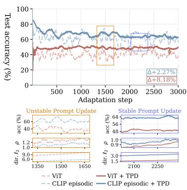  
(a)

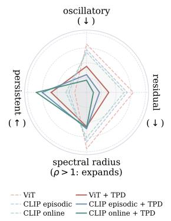  
(b)

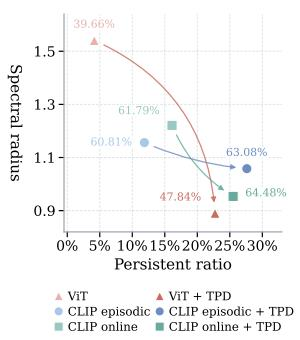  
(c)  
Figure 1: (a) The accuracy of ViT visual and CLIP text prompts in episodic modes, averaged over four ImageNet variants. Gains denote TPD improvements. The zoomed windows show accuracy, magnitude (spectral radius ρ), and direction $( \ell _ { 2 }$ distance between consecutive update vectors, decomposed in (b)) in unstable and stable regimes. (b) TPD decomposes each prompt update into persistent, oscillatory, and residual components, with the spectral radius measuring local expansion. (c) Stability-performance relation summarized by spectral radius and persistent ratio.

Accordingly, we propose Test-Time Prompt-Agnostic Decomposition (TPD), which characterizes observed prompt-update trajectories from a dynamical-systems perspective [Williams et al., 2015]. TPD operationalizes the magnitude–direction view through the prompt-update decomposition, enabling both analysis and stabilization across test steps. As illustrated in Figure 1(b), TPD provides a quantitative interpretation of the unstable behaviors observed in Figure 1(a) by decomposing trajectory dynamics into two complementary branches. For the magnitude branch, TPD computes a spectral radius as an expansion measure, where larger values indicate stronger growth of update magnitudes across recent steps. For the direction branch, TPD decomposes each update into three additive components: a persistent component capturing consistent adaptation signals, an oscillatory component capturing sign-flipping interference, and a residual component capturing unexplained noise. These quantities provide an explicit basis for magnitude expansion and directional drift.

The decomposition quantities reveal a stability pattern in Figure 1(c): methods with a large spectral radius and a low persistent ratio consistently exhibit poor performance. Specifically, the spectral radius summarizes magnitude expansion, while the persistent ratio denotes the fraction of update direction assigned to the persistent component. To this end, we propose two complementary mechanisms. Adaptive Koopman Control (AKC) regulates update magnitude by shrinking updates when recent prompt dynamics indicate expansion. Hankel Update Router (HUR) refines update direction by preserving persistent components across recent updates while suppressing oscillatory and residual components. These two mechanisms produce a stabilized prompt update. Since TPD only processes the base prompt update, it can be plugged into both visual and text TPT methods without modifying the backbone, prompt architecture, or adaptation loss. The contributions are summarized as follows:

• To the best of our knowledge, Test-Time Prompt-Agnostic Decomposition (TPD) is the first prompt-agnostic framework that analyzes and stabilizes prompt-update trajectories across ViT-based visual TPT and CLIP-based text TPT methods.

• We introduce Adaptive Koopman Control (AKC), which uses the spectral radius to scale down updates under expansive local dynamics and further attenuates them under consecutive unstable steps, preventing excessive prompt-state movement.

• We propose Hankel Update Router (HUR), which uses the three-component decomposition to reshape update directions by preserving persistent components and suppressing oscillatory and residual components, thereby mitigating directional conflict and cumulative drift.

• Extensive experiments on 15 datasets across shifted-domain and cross-dataset benchmarks demonstrate the generality of TPD. Across 10 TPT methods, TPD achieves the accuracy gains of 3–8% for visual prompts and over 2% for text prompts.

## 2 Related Work

Prompt-based test-time adaptation. Most existing TPT methods are developed for CLIP-based text prompt tuning and can be broadly divided into episodic and online modes. In episodic mode, prompts are adapted independently for each test sample or episode and are typically reset afterward, including initialization and calibration [Abdul Samadh et al., 2023, Yoon et al., 2024], sample filtering or augmentation selection [Shu et al., 2022, Feng et al., 2023, Farina et al., 2024], and black-box prompt update rules [Meng et al., 2025]. In online mode, prompts are updated continuously along test steps, and existing methods mainly regulate prompt drift or leverage prompt history [Ma et al., 2023, Zhang et al., 2024, Xiao et al., 2025]. Furthermore, CTPT [Wang et al., 2025a] focuses on continual prompt tuning across multiple target domains, aiming at prompt retention and generalization over newly learned streaming data. Some prompt-based methods are also built on ViT-based visual prompts [Jia et al., 2022]; for example, DePT [Gao et al., 2022] improves ViT prompt adaptation under domain adaptation with memory-bank and pseudo-label.

Despite these differences, existing TPT methods still intervene mainly at individual test steps. Moreover, CTPT [Wang et al., 2025a] targets continual multi-domain prompt retention, and DePT [Gao et al., 2022] is developed for domain adaptation. In contrast, our method analyzes and stabilizes cross-step prompt-update trajectories within each single target-domain adaptation process.

Prompt-based tuning and optimization. Prompt-based optimization has been developed across downstream tasks. Specifically, some methods improve prompt construction and backbone interaction [Xiao et al., 2026a]. VPT introduces learnable visual prompts for adapting a frozen ViT [Jia et al., 2022]; E2VPT extends visual prompt tuning with more effective prompt insertion across layers [Han et al., 2023]; and CVPT further strengthens prompt interaction across layers [Huang et al., 2025]. In vision-language models, ArGue improves prompt construction through attribute-guided prompts [Tian et al., 2024], while TCP uses class-aware textual prompts to better align prompts with class semantics [Yao et al., 2024]. Feature prompting [Cong et al., $2 0 2 6 \mathbf { b } , \mathbf { a } ]$ and hierarchical image–text learning [Fan et al., 2026] have also been explored in medical imaging applications. Furthermore, some methods improve optimization and stabilization during training [Xiao et al., $2 0 2 6  { \mathrm { b } } ,  { \mathrm { c } }$ , Lan and Tian, 2024, Lan et al., 2026]. Fair-VPT introduces fairness-aware objectives to regularize prompt learning [Park and Byun, 2024], BVPT analyzes bursty update behavior during prompt optimization [Wang et al., 2025b]. PAE [Wang et al., 2026] is related to TPD in its use of dynamical systems, but it focuses on training-time visual prompt optimization by modeling cross-layer prompt evolution. In contrast, TPD analyzes and stabilizes the prompt-update trajectory of test samples.

These methods improve prompt learning through more effective training-time optimization, but prompt optimization under test-time inference remains largely unexplored. In contrast, our work focuses on prompt adaptation during test-time inference, with an emphasis on trajectory-level diagnosis and control of prompt updates across test steps.

## 3 Method

## 3.1 Test-Time Prompt-Agnostic Decomposition

Given unlabeled test inputs, let $f ( B _ { t } ; \theta , \mathcal { P } _ { t } )$ denote a pretrained foundation model at test step t with frozen backbone $\theta , e . g .$ ., ViT and CLIP. For ViT-based visual TPT, $\mathcal { P } _ { t }$ consists of learnable prompt tokens injected into the encoder blocks, and $B _ { t }$ is the current mini-batch across test steps. For CLIP-based text TPT, $\mathcal { P } _ { t }$ consists of learnable text prompt tokens used to construct class textual features, while $B _ { t }$ depends on the test-time adaptation (TTA) mode: in online mode, $B _ { t }$ is the current input that updates the text prompts cumulatively; in episodic mode, $B _ { t }$ is the current episode, typically a set of augmented views from a single test sample.

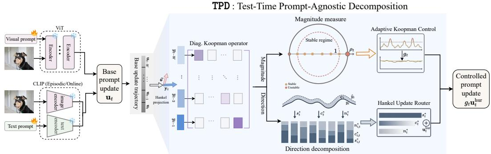  
Figure 2: Overview of TPD. The base prompt update $\mathbf { u } _ { t }$ from visual or text TPT is delay-embedded with a Hankel window and projected into a local Hankel subspace. AKC regulates update magnitude and HUR refines update direction. The controlled magnitude and refined direction are then combined into a stabilized prompt update $g _ { t } \mathbf { u } _ { t } ^ { \mathrm { h u r } }$ , which is applied to the prompt state at step t.

For each ViT- or CLIP-based TPT method, we flatten its prompt tokens into a single vector:

$$
\mathbf { p } _ { t } = \mathrm { v e c } ( \mathcal { P } _ { t } ) \in \mathbb { R } ^ { d } ,\tag{1}
$$

where vec concatenates the prompt tokens, and d is the prompt-vector dimension. Given $B _ { t }$ and a TTA loss $\mathcal { L } _ { \mathrm { t t a } } .$ , which is typically employed as entropy minimization [Wang et al., 2020], the base prompt-update $\mathbf { u } _ { t }$ at step t is

$$
\begin{array} { r } { \mathbf { u } _ { t } = - \eta _ { t } \phi _ { t } \big ( \nabla _ { \mathbf { p } } \mathcal { L } _ { \mathrm { t t a } } \big ( \mathcal { B } _ { t } ; \mathbf { p } _ { t } \big ) \big ) . } \end{array}\tag{2}
$$

where $\eta _ { t }$ is the learning rate at step $t , \phi _ { t }$ denotes the base optimizer, and $\nabla _ { \mathbf { p } } \mathcal { L } _ { \mathrm { t t a } } ( B _ { t } ; \mathbf { p } _ { t } )$ denotes the gradient of the TTA loss with respect to the prompt state $\mathbf { p } _ { t } .$

By taking the base prompt-update $\mathbf { u } _ { t }$ as input and stabilizing it directly, TPD is agnostic to visual and textual prompt types. As shown in Figure 2, TPD analyzes the recent prompt-update trajectory in a short-window subspace and decomposes it: the spectral radius captures magnitude expansion, while an additive decomposition separates persistent, oscillatory, and residual directional components.

Hankel subspace from recent updates. TPD builds a short-window representation of the recent prompt-update trajectory using the delay-coordinate construction in Hankel-DMD [Arbabi and Mezic, 2017]. Specifically, it uses the latest $W$ base prompt updates and converts them into M overlapping Hankel embeddings, where each embedding stacks $K$ consecutive updates and $W =$ $K + \mathring { M } - \overline { { 1 } }$ . For any index $\tau \stackrel { \smile } { \geq } K$ , the Hankel-lifted vector ${ \bf z } _ { \tau }$ stacks the latest $\dot { K }$ update vectors: $\mathbf { z } _ { \tau } = \left[ \mathbf { u } _ { \tau - K + 1 } ^ { \top } , \mathbf { u } _ { \tau - K + 2 } ^ { \top } , \ldots , \mathbf { u } _ { \tau } ^ { \top } \right] ^ { \top } \in \mathbb { R } ^ { K d }$ . Using the M embeddings before the current update, we define the Hankel history matrix at test step t:

$$
\mathcal { H } _ { t } = \left[ \mathbf { z } _ { t - M } , \mathbf { z } _ { t - M + 1 } , \ldots , \mathbf { z } _ { t - 1 } \right] \in \mathbb { R } ^ { K d \times M } .\tag{3}
$$

Let $Q _ { t } \in \mathbb { R } ^ { K d \times r }$ contain the top-r left singular vectors of $\mathcal { H } _ { t } { } ^ { 2 }$ , where $r \leq \operatorname* { m i n } ( K d , M )$ is selected adaptively from the current singular spectrum, and project the current lifted update $\mathbf { z } _ { t }$ onto this short-window Hankel subspace:

$$
\begin{array} { r } { \mathbf { y } _ { t } = Q _ { t } ^ { \top } \mathbf { z } _ { t } \in \mathbb { R } ^ { r } , \qquad \mathbf { z } _ { t } = Q _ { t } \mathbf { y } _ { t } + \widetilde { \mathbf { e } } _ { t } , \qquad \widetilde { \mathbf { e } } _ { t } = ( I _ { K d } - Q _ { t } Q _ { t } ^ { \top } ) \mathbf { z } _ { t } . } \end{array}\tag{4}
$$

The prompt-update decomposition is obtained by extracting the most recent block:

$$
\begin{array} { r } { \mathbf { u } _ { t } = E _ { K } Q _ { t } \mathbf { y } _ { t } + \mathbf { e } _ { t } , \quad \quad \mathbf { e } _ { t } = E _ { K } \widetilde { \mathbf { e } } _ { t } , \quad \quad E _ { K } = [ \mathbf { 0 } _ { d \times ( K - 1 ) d } I _ { d } ] , } \end{array}\tag{5}
$$

where $\widetilde { \mathbf e } _ { t }$ is the residual, and $\mathbf { e } _ { t }$ is its most recent d-dimensional prompt-update block.

Short-window Koopman operator. To capture recent update dynamics in the projected space, we map the historical lifted updates in $\mathcal { H } _ { t }$ with the projection matrix $Q _ { t }$ and construct

$$
\begin{array} { r l } & { Y _ { t } ^ { - } = \left[ Q _ { t } ^ { \top } z _ { t - M } , \ldots , Q _ { t } ^ { \top } z _ { t - 2 } \right] = \left[ \mathbf { y } _ { t - M } , \ldots , \mathbf { y } _ { t - 2 } \right] , } \\ & { Y _ { t } ^ { + } = \left[ Q _ { t } ^ { \top } z _ { t - M + 1 } , \ldots , Q _ { t } ^ { \top } z _ { t - 1 } \right] = \left[ \mathbf { y } _ { t - M + 1 } , \ldots , \mathbf { y } _ { t - 1 } \right] . } \end{array}\tag{6}
$$

Each column pair thus represents one recent update transition before test step t. We then fit a diagonal operator $A _ { t } = \mathrm { d i a g } ( \mathbf { a } _ { t } )$ using scalar least-squares estimates:

$$
a _ { i , t } = \frac { \sum _ { \tau = t - M } ^ { t - 2 } y _ { i , \tau + 1 } y _ { i , \tau } } { \sum _ { \tau = t - M } ^ { t - 2 } y _ { i , \tau } ^ { 2 } } , \qquad i = 1 , \dots , r , \qquad { \bf a } _ { t } = [ a _ { 1 , t } , \dots , a _ { r , t } ] ^ { \top } ,\tag{7}
$$

where $y _ { i , \tau }$ is the i-th scalar entry of $\mathbf { y } _ { \tau }$ . The sign of $a _ { i , t }$ distinguishes continuation from reversal, while its magnitude measures amplification in that coordinate.

Spectral radius: a magnitude signal. To quantify the magnitude expansion across steps, we compute the spectral radius $\rho _ { t } = \rho ( A _ { t } ) = \operatorname* { m a x } \left| a _ { t } \right|$ . The larger $\rho _ { t }$ indicates stronger local magnitude expansion at step t. Since $A _ { t }$ is estimated only from projected lifted updates before step $t , \rho _ { t }$ uses no future information and can be monitored online.

Three-component decomposition: a direction signal. To analyze the direction of each prompt update, TPD leverages Dynamic Mode Decomposition (DMD) [Schmid, 2010] under the local Koopman model and decomposes each projected update into three additive components. Let $\hat { \mathbf { y } } _ { t } =$ $A _ { t } \mathbf { y } _ { t - 1 }$ be the prediction and $\mathbf { r } _ { t } = \mathbf { y } _ { t } - \hat { \mathbf { y } } _ { t }$ be the prediction residual. From the Koopman operator $A _ { t }$ and its prediction $\hat { \mathbf { y } } _ { t }$ , we derive two element-wise gates

$$
{ \bf q } _ { t } = \frac { \hat { { \bf y } } _ { t } ^ { 2 } } { \hat { { \bf y } } _ { t } ^ { 2 } + { \bf r } _ { t } ^ { 2 } } , \qquad \pi _ { t } = \frac { 1 + \operatorname { t a n h } ( { \bf a } _ { t } ) } { 2 } ,\tag{8}
$$

where $\mathbf { q } _ { t } \in [ 0 , 1 ] ^ { r }$ measures how well the local Koopman model explains $\mathbf { y } _ { t } ,$ , and $\pi _ { t } \in [ 0 , 1 ] ^ { r }$ distinguishes same-sign continuation from sign flipping, recovering the masks ${ \mathbb { H } } [ { \mathbf { a } } _ { t } ~ > ~ \bar { 0 } ]$ and ${ \mathbb { H } } [ { \mathbf { a } } _ { t } < 0 ]$ . Using these gates, the projected update admits the decomposition

$$
{ \bf y } _ { t } = \underbrace { { \bf q } _ { t } { \pi } _ { t } { \bf y } _ { t } } _ { { \bf s } _ { t } ^ { \star } } + \underbrace { { \bf q } _ { t } ( 1 - { \pi } _ { t } ) { \bf y } _ { t } } _ { { \bf c } _ { t } ^ { \star } } + \underbrace { ( 1 - { \bf q } _ { t } ) { \bf y } _ { t } } _ { { \bf n } _ { t } ^ { \star } } .\tag{9}
$$

The persistent component $s _ { t } ^ { \star }$ receives weight through both local predictability and same-sign continu ation. The oscillatory component $c _ { t } ^ { \star }$ captures locally explained reversal, while $n _ { t } ^ { \star }$ contains content unexplained by the fitted dynamics. These are operational descriptions of the recent update trajectory. Oscillatory and residual components may still contain useful corrections, which motivates retaining them with nonzero routing weights (see Appendix A for justification).

## 3.2 Adaptive Koopman Control

Given the magnitude signal $\rho _ { t }$ from TPD, AKC modulates the prompt-update magnitude through a multiplicative gain factor $g _ { t }$ applied at each step:

$$
g _ { t } = \left\{ \begin{array} { l l } { 1 , } & { \rho _ { t } \le \bar { \rho } , } \\ { \operatorname* { m a x } \left( g _ { \mathrm { m i n } } , \frac { \bar { \rho } } { \rho _ { t } } \right) , } & { \rho _ { t } > \bar { \rho } , } \end{array} \right.\tag{10}
$$

where $\bar { \rho }$ is a stability threshold and $g _ { \mathrm { m i n } } \in ( 0 , 1 )$ is a lower bound on the gain. AKC preserves the update when $\rho _ { t } \le \bar { \rho }$ and scales it down by $g _ { t } < 1$ when $\rho _ { t } > \bar { \rho } .$ Across consecutive unstable steps, this scaling keeps the applied updates small while the local dynamics remain unstable (see Lemma 4 for the comparison between diagonal and full modes).

Lemma 1 (AKC non-amplification). Let $A _ { t }$ be the local Koopman operator in $E q . ( 7 )$ and $g _ { t }$ the gainfactor in Eq. (10). Then $\rho ( g _ { t } A _ { t } ) ~ = ~ g _ { t } \rho ( A _ { t } ) ~ \leq ~ \rho ( A _ { t } )$ , with equality if and only $i f \rho _ { t } \le \bar { \rho } .$ Moreover,

$$
\rho ( g _ { t } A _ { t } ) \ \leq \ \operatorname* { m a x } \big ( \bar { \rho } , \ g _ { \operatorname* { m i n } } \rho _ { t } \big ) ,\tag{11}
$$

and in particular $\rho ( g _ { t } A _ { t } ) \leq \bar { \rho }$ whenever $\rho _ { t } \le \bar { \rho } / g _ { \mathrm { m i n } }$

Proofsketch. $g _ { t }$ scales the eigenvalues of $A _ { t } ,$ and the remaining bounds follow by splitting the gain definition in $E q .$ . (10). The gainfloor prevents update shutdown, but it also means that the controlled spectral radius is not always below ρ¯; the applicable bound is Eq. (11).

## 3.3 Hankel Update Router

Given the TPD three-component decomposition, HUR refines the update direction in the Hankellifted space and then extracts the most recent prompt-update block. Let $\mathbf { s } _ { t } ^ { \star } , \mathbf { c } _ { t } ^ { \star } , \mathbf { n } _ { t } ^ { \star } \in \mathbb { R } ^ { r }$ collect the coordinate-wise persistent, oscillatory, and unexplained components. Let $\widetilde { \mathbf { e } } _ { t } = ( I _ { K d } - Q _ { t } Q _ { t } ^ { \top } ) \mathbf { z } _ { t }$ be the residual in the Hankel-lifted space and ${ \bf e } _ { t } = E _ { K } \widetilde { { \bf e } } _ { t }$ its extracted prompt-update block. We define the lifted components:

$$
\widetilde { \mathbf { S } } _ { t } = Q _ { t } \mathbf { s } _ { t } ^ { \star } , \qquad \widetilde { \mathbf { C } } _ { t } = Q _ { t } \mathbf { c } _ { t } ^ { \star } , \qquad \widetilde { \mathbf { N } } _ { t } = Q _ { t } \mathbf { n } _ { t } ^ { \star } + \widetilde { \mathbf { e } } _ { t } .\tag{12}
$$

We treat both the projected unexplained component $\mathbf { n } _ { t } ^ { \star }$ and the residual $\widetilde { \mathbf e } _ { t }$ as residual content. Their prompt-update-space counterparts are

$$
\mathbf { S } _ { t } = E _ { K } \widetilde { \mathbf { S } } _ { t } , \qquad \mathbf { C } _ { t } = E _ { K } \widetilde { \mathbf { C } } _ { t } , \qquad \mathbf { N } _ { t } = E _ { K } \widetilde { \mathbf { N } } _ { t } = E _ { K } Q _ { t } \mathbf { n } _ { t } ^ { \star } + \mathbf { e } _ { t } .\tag{13}
$$

Thus $\mathbf { u } _ { t } = \mathbf { S } _ { t } + \mathbf { C } _ { t } + \mathbf { N } _ { t } ,$ , where $\mathbf { S } _ { t } , \mathbf { C } _ { t } , \mathbf { N } _ { t } \in \mathbb { R } ^ { d }$ are additive components induced by the projected Hankel decomposition. HUR routes the prompt-space components by preserving the persistent component and attenuating the oscillatory and residual components:

$$
\mathbf u _ { t } ^ { \mathrm { h u r } } = \mathbf S _ { t } + \beta _ { c } \mathbf C _ { t } + \beta _ { n } \mathbf N _ { t } , \qquad 0 \le \beta _ { n } \le \beta _ { c } \le 1 ,\tag{14}
$$

where $\beta _ { c }$ controls the oscillatory component and $\beta _ { n }$ controls the residual component. Let $\widetilde { \mathbf { z } } _ { t } ^ { \mathrm { h u r } }$ denote the corresponding lifted routed update, obtained by applying the same routing in the Hankel-lifted space before extracting $\mathbf { u } _ { t } ^ { \mathrm { { h u r } } } = E _ { K } ^ { \mathbf { \bar { z } } } \widetilde { \mathbf { z } } _ { t } ^ { \mathrm { { h u r } } }$ . In the lifted space, HUR reweights each projected coordinate by a scalar in $[ \beta _ { n } , 1 ]$ and scales the residual by $\beta _ { n }$ , thereby attenuating selected components without reversing projected coordinates or increasing their magnitude.

## 3.4 Controlled Prompt Update

Combining the magnitude control of AKC with the direction refinement of HUR, TPD converts the base prompt-update into a controlled prompt-update:

$$
\mathbf u _ { t } \longrightarrow \Delta \mathbf p _ { t } = g _ { t } \mathbf u _ { t } ^ { \mathrm { h u r } } ,\tag{15}
$$

where $\Delta { \bf p } _ { t }$ denotes the controlled prompt update applied to the prompts at the current test step t.   
Finally, Lemma 1 and the routing form in Eq. (14) give the following controlled-update properties.

Theorem 1 (Controlled prompt-update properties). Whenever the local Hankel window is available and TPD is applied, the controlled update $\Delta \mathbf { p } _ { t } = g _ { t } \mathbf { u } _ { t } ^ { \mathrm { h u r } }$ in $E q .$ . (15) satisfies:

(i) Hankel-lifted space non-amplification: $\| \widetilde { \mathbf { z } } _ { t } ^ { \mathrm { h u r } } \| \leq \| \mathbf { z } _ { t } \|$ , therefore $\| \Delta \mathbf { p } _ { t } \| \leq g _ { t } \| \mathbf { z } _ { t } \| \leq$ $\left\| \mathbf { z } _ { t } \right\|$

(ii) Mode-wise routing without reversal: each projected Hankel coordinate is reweighted as $w _ { i , t } y _ { i , t } f o r$ some $w _ { i , t } \in [ \beta _ { n } , 1 ]$ , so no projected coordinate is reversed or amplified.

(iii) Persistent preservation in HUR routing: within the defined Hankel decomposition, the persistent component $\widetilde { \mathbf { S } } _ { t }$ and its prompt-space extraction $\mathbf { S } _ { t }$ are transmitted with coefficient 1, while the oscillatory and residual components are attenuated by factors $\beta _ { c }$ and $\beta _ { n }$

Proof sketch. The prooffollows from the weights $w _ { i , t } \in [ \beta _ { n } , 1 ]$ in the Hankel subspace, the decomposition ${ \mathbf z } _ { t } = Q _ { t } { \mathbf y } _ { t } + \widetilde { { \mathbf e } } _ { t } ,$ , and the bound $\| E _ { K } \| _ { 2 } = 1$ (see Appendix C for the full proof).

Since both modules act directly on the prompt update $\mathbf { u } _ { t } .$ , TPD can be attached to different TPT methods while preserving their original update rule. Together, AKC and HUR regulate the promptupdate trajectory by combining magnitude control with component-wise direction routing.

## 4 Experiments

## 4.1 Experimental Setup

Datasets. Following previous TPT protocols [Shu et al., 2022], we evaluate TPD on image classification under two distribution-shift settings, using ImageNet-pretrained backbones as source models and adapting them at test time on target datasets. The domain generalization benchmark includes

Table 1: Comparisons on the domain generalization setting with visual and text TPT methods. OOD Mean averages the 4 variants excluding ImageNet, while Mean averages ImageNet and the 4 variants. Values are the baseline accuracy with TPD gains.
<table><tr><td>Method</td><td>ImageNet</td><td>ImageNet-V2</td><td>ImageNet-S</td><td>ImageNet-A</td><td>ImageNet-R</td><td>OOD Mean</td><td>Mean</td></tr><tr><td colspan="8">ViT-based visual prompt tuning</td></tr><tr><td>ViT-B/16</td><td>81.44</td><td>70.85</td><td>35.44</td><td>30.92</td><td> $4 7 . 4 8 $ </td><td>46.17</td><td>53.23</td></tr><tr><td> $\mathrm { \Delta V P T + T P D }$ </td><td> $7 8 . 1 6 + 3 . 1 5$ </td><td> $6 4 . 5 5 + 5 . 3 2 $ </td><td> $3 2 . 7 7 + 3 . 2 5 $ </td><td> $1 9 . 1 7 + 1 9 . 8 1$ </td><td> $4 2 . 1 4 + 4 . 3 3$ </td><td> $3 9 . 6 6 + 8 . 1 8 $ </td><td> $4 7 . 3 6 + 7 . 1 7$ </td></tr><tr><td> $\mathrm { E 2 V P T + T P D }$ </td><td> $7 8 . 3 5 + 2 . 6 9$ </td><td> $6 4 . 0 9 + 4 . 9 3 $ </td><td> $3 2 . 8 9 + 2 . 7 0 $ </td><td> $1 8 . 1 7 + 2 0 . 7 9$ </td><td> $4 2 . 0 7 + 3 . 9 4$ </td><td> $3 9 . 3 1 \substack { + 8 . 0 9 }$ </td><td> $4 7 . 1 1 + 7 . 0 1$ </td></tr><tr><td> $\mathrm { V F P T + T P D }$ </td><td> $7 8 . 7 1 + 2 . 6 2$ </td><td> $6 5 . 3 4 + 4 . 7 5$ </td><td> $3 3 . 1 6 + 2 . 8 1$ </td><td> $2 2 . 0 5 + 1 8 . 6 8$ </td><td> $4 2 . 8 1 + 3 . 5 5$ </td><td> $4 0 . 8 4 + 7 . 4 5$ </td><td> $4 8 . 4 1 + 6 . 4 8 $ </td></tr><tr><td> $\mathrm { B P T + T P D }$ </td><td> $8 1 . 3 0 \substack { + 2 . 8 7 }$ </td><td> $7 0 . 4 8 + 2 . 4 5$ </td><td> $2 8 . 6 2 + 9 . 9 3 $ </td><td> $3 8 . 9 7 + 4 . 2 3 $ </td><td> $4 3 . 6 8 + 5 . 3 9$ </td><td> $4 5 . 4 4 + 5 . 5 1 $ </td><td> $5 2 . 6 1 + 4 . 9 7 $ </td></tr><tr><td colspan="8">CLIP-based text prompt tuning</td></tr><tr><td>CLIP</td><td>66.73</td><td>60.86</td><td>46.09</td><td>47.87</td><td>73.98</td><td>57.20</td><td>59.11</td></tr><tr><td> $\mathrm { T P T + T P D }$ </td><td> $6 8 . 9 8 + 2 . 2 1 $ </td><td> $6 3 . 4 5 + 2 . 5 3 $ </td><td> $4 7 . 9 4 + 1 . 6 8 $ </td><td> $5 4 . 7 7 + 1 . 9 6 $ </td><td> $7 7 . 0 6 + 2 . 9 2$ </td><td> $6 0 . 8 1 + 2 . 2 7$ </td><td> $6 2 . 4 4 + 2 . 2 6$ </td></tr><tr><td> $\mathrm { { C - T P T + T P D } }$ </td><td> $6 9 . 2 8 \substack { + 2 . 3 5 }$ </td><td> $6 3 . 3 6 + 1 . 8 3 $ </td><td> $4 8 . 5 5 + 2 . 0 2 $ </td><td> $5 2 . 9 3 + 1 . 6 7$ </td><td> $7 8 . 9 7 + 3 . 8 5$ </td><td> $6 0 . 9 5 + 2 . 3 5$ </td><td> $6 2 . 6 2 + 2 . 3 4$ </td></tr><tr><td> $\mathrm { R - T P T + T P D }$ </td><td> $6 0 . 9 2 + 5 . 0 8$ </td><td> $6 4 . 9 1 \substack { + 2 . 6 1 }$ </td><td> $4 5 . 0 3 + 2 . 3 6$ </td><td> $4 8 . 9 2 \substack { + 2 . 4 8 }$ </td><td> $7 7 . 6 3 + 3 . 0 1$ </td><td> $5 9 . 1 2 + 2 . 6 2$ </td><td> $5 9 . 4 8 \substack { + 3 . 1 1 }$ </td></tr><tr><td> $\mathrm { \Delta O - T P T + T P D }$ </td><td> $6 7 . 3 3 + 4 . 5 2 $ </td><td> $6 1 . 6 5 + 1 . 9 6$ </td><td> $4 7 . 1 2 + 1 . 8 1$ </td><td> $4 9 . 8 7 + 1 . 7 4 $ </td><td> $7 2 . 5 5 + 4 . 5 9$ </td><td> $5 7 . 8 0 + 2 . 5 3 $ </td><td> $5 9 . 7 0 + 2 . 9 2 $ </td></tr><tr><td> $\mathbf { C A T + T P D }$ </td><td> $6 9 . 3 2 \substack { + 2 . 5 0 }$ </td><td> $6 0 . 9 1 + 2 . 3 4$ </td><td> $5 2 . 0 8 + 2 . 2 3 $ </td><td> $5 8 . 6 9 + 2 . 5 1 $ </td><td> $7 6 . 7 6 + 3 . 3 2$ </td><td> $6 2 . 1 1 + 2 . 6 0$ </td><td> $6 3 . 5 5 + 2 . 5 8 $ </td></tr><tr><td> $\mathrm { D y P t + T P D }$ </td><td> $6 9 . 6 1 \substack { + 2 . 5 5 }$ </td><td> $6 4 . 6 3 + 2 . 4 7 $ </td><td> $4 8 . 2 2 + 2 . 1 8 $ </td><td> $5 6 . 1 6 + 2 . 3 9$ </td><td> $7 8 . 1 5 + 3 . 7 3$ </td><td> $6 1 . 7 9 + 2 . 6 9$ </td><td> $6 3 . 3 5 + 2 . 6 6$ </td></tr></table>

Table 2: Comparisons on the cross-dataset setting with visual and text TPT methods. All methods are evaluated on 10 downstream datasets without training. Values are baseline accuracy with TPD gains.
<table><tr><td>Method</td><td>Caltech101</td><td>OxfordPets StanfordCars Flowers102</td><td></td><td></td><td>Food101</td><td>Aircraft</td><td>SUN397</td><td>DTD</td><td>EuroSAT</td><td>UCF101</td><td>Mean</td></tr><tr><td colspan="14">ViT-based visual prompt tuning</td></tr><tr><td>ViT-B/16</td><td>86.71</td><td>92.20</td><td>57.84</td><td>66.23</td><td>82.78</td><td>22.06</td><td>56.07</td><td></td><td>48.19</td><td>49.91</td><td>65.08</td><td>62.71</td></tr><tr><td>VPT +TPD</td><td> $9 2 . 6 5 + 2 . 7 2 $ </td><td>86.89 +2.49</td><td> $6 0 . 6 8 \substack { + 2 . 1 3 }$ </td><td>64.86 +3.23</td><td></td><td>85.14+1.31</td><td></td><td></td><td></td><td></td><td>21.21 +3.25 59.92 +3.8738.19 +4.0620.91 +11.2659.28 +2.7358.97 +3.71</td><td></td></tr><tr><td>E2VPT +TPD</td><td> $9 2 . 2 9 + 2 . 0 1 $ </td><td> $8 6 . 8 9 + 2 . 7 5$ </td><td> $6 0 . 0 3 + 2 . 0 8$ </td><td></td><td>63.85 +3.96</td><td>84.55+1.26</td><td>20.79+3.51 59.07 +3.4837.93 +5.3317.29 +11.6758.75 +2.8158.14 +3.89</td><td></td><td></td><td></td><td></td><td></td></tr><tr><td>VFPT +TPD</td><td> $9 2 . 7 6 + 2 . 3 6$ </td><td> $8 7 . 3 3 + 2 . 7 1 $ </td><td>62.01 +2.41</td><td>67.77 +1.98</td><td>85.18 +1.43</td><td></td><td>21.69+3.3359.31 +2.64 40.53 +3.4323.54 +12.6660.26 +1.4360.04 +3.44</td><td></td><td></td><td></td><td></td><td></td></tr><tr><td>BPT +TPD</td><td></td><td>79.51 +13.8968.26 +14.4549.88 +11.1564.82 +2.3367.45 +15.2121.47 +4.1548.50 +7.8441.46 +1.9657.42 +1.71 50.52 +9.5954.93 +8.23</td><td></td><td></td><td></td><td></td><td></td><td></td><td></td><td></td><td></td><td></td></tr><tr><td colspan="11">CLIP-based text prompt tuning</td></tr><tr><td>CLIP</td><td>93.35</td><td>88.25</td><td>65.48</td><td>67.44</td><td>83.65</td><td>23.67</td><td></td><td>62.59</td><td>44.27</td><td>42.01</td><td>65.13</td><td>63.58</td></tr><tr><td>TPT +TPD</td><td>94.16 +2.16</td><td>87.79 +2.52</td><td> $6 6 . 8 7 \substack { + 1 . 6 8 }$ </td><td></td><td>68.98 +2.08 84.67 +3.65</td><td></td><td>24.78 +2.4165.50 +3.0147.75 +4.23</td><td></td><td></td><td>42.44 +3.59</td><td>68.04 +3.96 65.10 +2.93</td><td></td></tr><tr><td>C-TPT +TPD</td><td>93.62 +1.93</td><td>88.23 +2.27</td><td>65.82 +1.31</td><td>69.84 +2.51</td><td></td><td>83.73 +4.62</td><td></td><td>24.02 +2.39 64.83 +3.28 46.04 +2.49</td><td></td><td>43.21 +2.87</td><td></td><td>65.74 +1.4864.51 +2.52</td></tr><tr><td>R-TPT +TPD</td><td>93.67 +2.09</td><td>87.24 +2.43</td><td>67.03 +1.34</td><td>68.71 +2.13</td><td></td><td>83.94 +4.02</td><td></td><td>23.92 +2.27 64.37 +3.61 46.43 +3.26</td><td></td><td>34.72 +3.08</td><td>67.23 +2.66 63.73 +2.69</td><td></td></tr><tr><td>O-TPT +TPD</td><td>93.95 +2.22</td><td>87.95 +2.38</td><td>64.53 +1.24</td><td>70.07 +2.24</td><td>84.13 +4.18</td><td></td><td>23.64 +2.17 64.23 +3.49 45.68 +3.30</td><td></td><td></td><td>42.84 +3.15</td><td>64.16 +2.58 64.12 +2.70</td><td></td></tr><tr><td>CAT +TPD</td><td>94.72 +2.36</td><td>90.34 +2.65</td><td>69.41 +1.52</td><td>72.73 +2.43</td><td></td><td></td><td></td><td>86.24 +4.4124.13 +2.5267.02 +3.8847.24 +3.59</td><td></td><td>50.53 +3.46</td><td>69.52 +2.96 67.19 +2.98</td><td></td></tr><tr><td> $\mathrm { D y P t + T P D }$ </td><td>94.32 +2.28</td><td>88.28 +2.61</td><td>67.65 +1.43</td><td></td><td></td><td></td><td></td><td>69.95 +2.1885.42 +4.0824.33 +2.3666.32 +3.72 47.96 +3.6442.28 +3.22</td><td></td><td></td><td>68.72 +3.08 65.52 +2.86</td><td></td></tr></table>

ImageNet [Deng et al., 2009] and four shifted variants: ImageNet-V2 [Recht et al., 2019], ImageNet-Sketch [Wang et al., 2019], ImageNet-A [Hendrycks et al., 2021b], and ImageNet-R [Hendrycks et al., 2021a]. The cross-dataset benchmark contains 10 downstream datasets covering fine-grained recognition, textures, scenes, satellite images, and actions (see Appendix D.1 for the full details).

Baselines. We attach TPD to TPT methods on two backbone families. For ViT-based visual prompt tuning, we evaluate four methods: VPT [Jia et al., 2022], E2VPT [Han et al., 2023], VFPT [Zeng et al., 2024], BPT [Wang et al., 2025b]. For CLIP-based text prompt tuning, we evaluate both episodic and online methods: TPT [Shu et al., 2022], C-TPT [Yoon et al., 2024], R-TPT [Sheng et al., 2025], O-TPT [Sharifdeen et al., 2025], CAT [Zhang et al., 2025], DyPt [Xiao et al., 2025]. We report both the original result and its gain with TPD, denoted as “Baseline +TPD”.

Implementation Details. We use K = 3 updates per Hankel embedding and M = 8 embeddings, giving $W = 1 0$ past updates and seven transition pairs. These short windows balance temporal context with local estimation. The rank r is selected adaptively from the current singular spectrum. We set $\bar { \rho } = 1 , g _ { \mathrm { m i n } } = 0 . 1$ , and $( \beta _ { c } , \beta _ { n } ) = ( 0 . 2 5 , 0 . 1 )$ across all datasets, methods, and backbone families. The spectral threshold corresponds to the unit-circle boundary of the local modes; the gain floor avoids update shutdown, and the routing weights retain nonzero contributions from oscillatory and residual content. All experiments use an NVIDIA H100 GPU (see Appendix D.3 for per-dataset hyperparameter experimental results).

## 4.2 Results

For ViT-based visual TPT methods, TPD consistently improves all baselines under both domain generalization and cross-dataset transfer, as shown in Table 1 and Table 2. The shifted-domain OOD mean gains range from 5.51-8.18%, while the cross-dataset mean gains range from 3.44-8.23%. The improvements from adding TPD are especially large under hard shifts; for example, VPT gains 19.81% on ImageNet-A, and BPT gains 8.23% on average across cross-dataset transfer. This suggests that training-time visual prompts remain vulnerable when reused for naive test-time entropy updates, where update magnitudes may expand and directions may oscillate or drift. These larger gains therefore reflect the lack of dedicated TTA stabilizers for ViT prompt tuning: TPD supplies the missing trajectory control and turns otherwise unstable test-time tuning into effective adaptation.

For CLIP-based text TPT methods, TPD also improves all episodic and online baselines in Table 1 and Table 2. On domain generalization, the OOD mean gains are consistently between 2.27% and 2.69%; on cross-dataset transfer, the mean gains range from 2.52% to 2.98%. For example, DyPt improves from 61.79% to 64.48% in the domain generalization OOD mean. Although these gains are more moderate than those for visual prompts, they remain highly consistent across different adaptation designs. By acting directly on the base update vectors, TPD stabilizes text-prompt trajectories without replacing the original text-prompt objective. This consistency further shows that TPD serves as a prompt-agnostic module complementary to text TPT methods.

We further compare TPD with simple stabilization rules in Table 3, including update clipping [Pascanu et al., 2013], EMA updates [Tarvainen and Valpola, 2017], norm control [Niu et al., 2023], and low-pass filtering [Zhang et al., 2019]. These heuristics improve the TPT baselines but remain below TPD: on VPT, low-pass filtering improves DG from 39.66 to 44.28, while TPD reaches 47.84; on TPT, it improves CSD from 65.10 to 66.23, whereas TPD reaches 68.03. TPD also incurs modest overhead, with 1.13× on VPT and 1.08× on TPT. These results suggest that simple scale control or short-term smoothing is insufficient, while TPD further uses component-wise routing to stabilize prompt-update dynamics across both visual and text prompts under TTA (see Appendix D.2.1 for the per-dataset simple-stabilization results).

Table 3: Comparison with simple stabilization methods on visual and text TPT methods. DG and CSD denote the accuracy means over four ImageNet variants and 10 cross-datasets. ×: perstep wall-clock overhead relative to the baseline.
<table><tr><td></td><td colspan="3">VPT</td><td colspan="3">TPT</td></tr><tr><td>Variant</td><td>DG</td><td>CSD</td><td>X</td><td>DG</td><td>CSD</td><td>X</td></tr><tr><td>Baseline</td><td>39.66</td><td>58.97</td><td>1.00</td><td>60.81</td><td>65.10</td><td>1.00</td></tr><tr><td colspan="7">Simple stabilization rules</td></tr><tr><td>+ Update clipping</td><td>41.92</td><td>59.54</td><td>1.11</td><td>61.36</td><td>65.47</td><td>1.06</td></tr><tr><td>+ EMA update</td><td>42.74</td><td>59.86</td><td>0.99</td><td>61.65</td><td>65.82</td><td>1.01</td></tr><tr><td>+ Norm control</td><td>43.65</td><td>61.03</td><td>1.07</td><td>61.72</td><td>65.74</td><td>1.03</td></tr><tr><td>+ Low-pass filtering</td><td>44.28</td><td>60.91</td><td>1.00</td><td>62.23</td><td>66.23</td><td>1.00</td></tr><tr><td colspan="7">Prompt-update decomposition and stabilization 63.08 68.03 1.08</td></tr><tr><td colspan="7">+TPD 47.84 62.68 1.13</td></tr></table>

## 4.3 Ablation Study

We conduct ablations on ViT-based VPT and CLIPbased TPT to examine three design choices in TPD: the Koopman operator for AKC, the projection matrix for HUR, and the routing weights in HUR. The first block compares a full Koopman mode with the proposed diagonal mode in Table 4. The diagonal mode performs better, improving VPT-DG from 43.58 to 45.92 and TPT-CSD from 66.38 to 67.21. This shows the short Hankel window makes cross-step coupling difficult to estimate reliably, while the diagonal mode provides stable scalar coefficients for spectral control.

The second block compares plain projection with the Hankel embedding used by HUR. Hankel projection consistently outperforms plain projection, improving VPT-DG from 42.31 to 45.98 and TPT-CSD from 66.01 to 67.54, indicating that delay embedding captures cross-step update dynamics missed by a static projection. Furthermore, the third block ablates HUR routing: w/o Pres., w/o Osc., and w/o Res. use $( \beta _ { c } , \beta _ { c } , \beta _ { n } ) , ( 1 , 1 , \beta _ { n } )$ , and $( 1 , \beta _ { c } , 1 )$ , respectively, instead of the full $( 1 , \beta _ { c } , \beta _ { n } )$ . All three variants underperform TPD across VPT and TPT, supporting the routing strategy that preserves persistent directions, softly attenuates oscillatory directions, and strongly suppresses unexplained perturbations (see Appendix D.2.2 for the full ablation results).

Table 4: Ablation study of TPD on visual and text TPT methods. DG and CSD denote the accuracy means over four ImageNet variants and 10 cross-datasets.
<table><tr><td rowspan="2">Variant</td><td colspan="2">VPT</td><td colspan="2">TPT</td></tr><tr><td>DG</td><td>CSD</td><td>DG</td><td>CSD</td></tr><tr><td>Baseline</td><td>39.66</td><td>58.97</td><td>60.81</td><td>65.10</td></tr><tr><td colspan="5">Ablation study of Koopman operator modes</td></tr><tr><td>Full</td><td>43.58</td><td>60.86</td><td>61.80</td><td>66.38</td></tr><tr><td>Diagonal (+AKC)</td><td>45.92</td><td>61.74</td><td>62.56</td><td>67.21</td></tr><tr><td colspan="5">Ablation study of projection matrix modes</td></tr><tr><td>Plain Hankel (+HUR)</td><td>42.31 45.98</td><td>60.22 62.18</td><td>61.43 62.84</td><td>66.01 67.54</td></tr><tr><td colspan="5">Ablation study of HUR routing</td></tr><tr><td>w/o Pres.</td><td>47.06</td><td>62.29</td><td>62.95</td><td>67.73</td></tr><tr><td>w/o Osc.</td><td>47.28</td><td>62.37</td><td>62.84</td><td>67.87</td></tr><tr><td>w/o Res.</td><td>46.84</td><td>62.21</td><td>62.80</td><td>67.54</td></tr><tr><td colspan="5">Full</td></tr><tr><td>+TPD</td><td>47.84</td><td>62.68</td><td>63.08</td><td>68.03</td></tr></table>

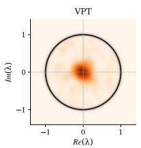  
(a)

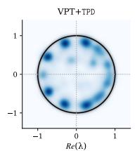  
(b)

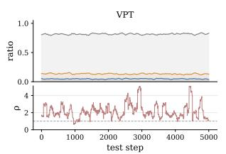  
(c)

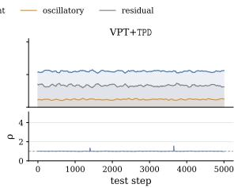  
(d)

Figure 3: (a), (b) show Koopman spectra of visual prompt trajectories. The spectra are estimated post-hoc from generated update trajectories, and the black circle denotes the unit circle. (c), (d) show component ratios and spectral radius ρ over test steps.  
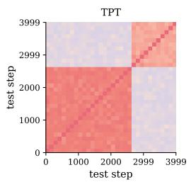  
(a)

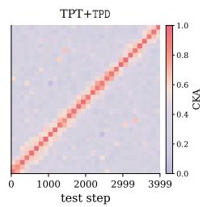  
(b)

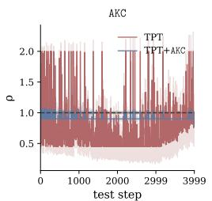  
(c)

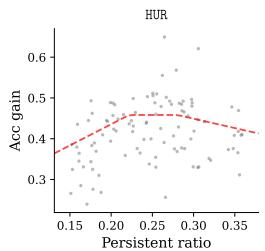  
(d)  
Figure 4: (a), (b) CKA similarity between text-prompt representations across test steps after smoothing. (c) Koopman spectral radius estimated from prompt updates, the estimate is post-hoc for TPT and used online by AKC. (d) Persistent ratio of HUR versus subsequent accuracy gain. Each gray point denotes one short temporal window. The red dashed curve is a piecewise linear fitted trend line.

## 4.4 Analysis

To quantify the stability of visual prompt-update trajectories, we visualize the Koopman spectra and decomposition dynamics in Figure 3. VPT concentrates most spectral mass near the origin, indicating that many update modes decay rapidly rather than carrying persistent adaptation. This does not contradict the large $\rho$ values in Figure 3(c), since the spectrum aggregates eigenvalue density over the trajectory, while $\rho$ tracks the largest local eigenvalue at each step. Thus, a trajectory can be dominated by decaying modes overall but still contain intermittent expansive steps. Consistently, VPT shows residual-dominated directions and frequent excursions of $\rho$ beyond the stable reference, suggesting that its updates are both noisy in direction and unstable in magnitude. After applying TPD, the spectrum shifts toward the unit circle and becomes more evenly distributed, indicating that useful modes are preserved. Meanwhile, the persistent ratio increases, oscillatory and residual ratios decrease, and $\rho$ stays closer to the stable regime. These results show that HUR improves the directional composition of updates, while AKC controls their magnitude expansion.

We further analyze text TPT methods after adding TPD. The CKA [Kornblith et al., 2019] matrices measure pairwise similarity between text-prompt representations across test steps. In Figure 4(a), TPT forms coarse high-similarity blocks, indicating that prompts collapse into a few similar states within local segments and change abruptly across segments. In contrast, TPT+TPD preserves a sharper near-diagonal structure in Figure 4(b), suggesting smoother stepwise evolution without excessive cross-step collapse. Figure 4(c) further shows that the Koopman spectral radius of TPT fluctuates strongly and frequently exceeds $\rho = 1$ , whereas AKC keeps the radius closer to the stable reference. Finally, Figure 4(d) links the direction signal to performance: accuracy gain generally increases from low to moderate persistent ratios and then reaches a peak. This trend supports the use of persistent ratio as a routing signal for HUR, since low persistence corresponds to oscillatory or residual-dominated updates, while moderate persistence reflects useful adaptation structure (see Appendix D.4 for the visualizations on all datasets).

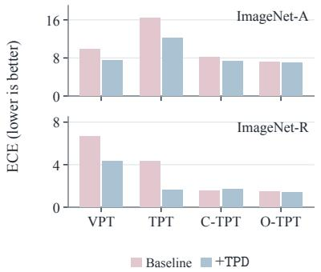  
(a) Calibration

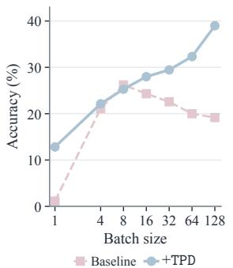  
(b) Batch sensitivity

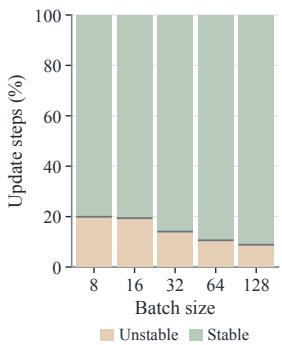  
(c) TPD stability  
Figure 5: (a) ECE on ImageNet-A and ImageNet-R, with separate vertical scales. (b) Accuracy across batch sizes. Pink and blue in (a,b) denote each baseline and its TPD variant, respectively. (c) Proportions of stable $( \rho _ { t } \leq 1$ , light green) and unstable $( \rho _ { t } > 1$ , light orange) TPD update steps, where $\rho _ { t }$ denotes the estimated spectral radius; each stacked bar sums to 100%.

## 4.5 Robustness and Reliability

We evaluate calibration across four prompt-tuning methods on ImageNet-A and ImageNet-R (Fig. 5(a)). TPD reduces expected calibration error (ECE) in seven of eight comparisons, with C-TPT on ImageNet-R as the only exception. For TPT, ECE decreases from 16.42% to 12.27% on ImageNet-A and from 4.36% to 1.62% on ImageNet-R. These improvements suggest that controlling prompt dynamics also regularizes predictive confidence, extending the benefits of stabilization to the alignment between confidence and empirical accuracy across multiple prompt-tuning formulations.

We examine VPT batch-size sensitivity on ImageNet-A with top-10% confidence filtering (Fig. 5(b)). TPD improves accuracy in six of seven settings, with a decrease at $B = 8 . { \mathrm { ~ A t ~ } } B = 1$ , accuracy increases from 1.14% to 12.82%, and at $B = \bar { 1 } 2 8$ , from 19.17% to 38.98%. TPD improves over the baseline in most small-batch settings, although absolute accuracy remains low at very small batch sizes. Moreover, baseline accuracy declines beyond B = 8, while TPD accuracy continues to improve with increasing batch size. This divergent trend highlights the importance of update regulation in converting a larger sample budget into more effective adaptation.

We further assess the proportions of spectrally stable and unstable TPD updates (Fig. 5(c)). The stable fraction increases from 80.07% at B = 8 to 91.16% at $B = 1 2 8$ , with a consistent upward trend across the five measured batch sizes. This pattern suggests that larger batches provide a stronger basis for estimating and regulating local dynamics, reducing the frequency of unstable update behavior. Viewed alongside the accuracy trends, it supports a link between the reliability of local dynamics and adaptation quality. The stable fraction complements accuracy by characterizing the update process itself, allowing predictive performance and dynamical reliability to be assessed separately (see Appendices D.5–D.8 for results on nonstationary streams, component ratios, seed variation, and adaptive magnitude controllers).

## 5 Conclusion

We propose TPD, which characterizes observed prompt-update trajectories from a dynamical-systems view and decomposes base prompt updates into magnitude and direction. Specifically, TPD projects recent updates into a Hankel subspace, AKC constrains unstable update magnitudes, and HUR preserves persistent components while attenuating oscillatory and residual components. As a prompt-agnostic framework, TPD operates directly on base prompt updates and serves as a plug-in stabilizer without modifying the backbone, prompt architecture, or adaptation loss. Across visual and text prompts, TPD consistently improves TPT baselines under domain generalization and cross-dataset settings.

Limitation. TPD relies on a meaningful recent update history and may be less effective when updates are sparse, noisy, or rapidly changing. Its finite-window local model does not guarantee global convergence or semantic correctness of retained directions, and soft routing may attenuate useful corrections. Small-batch adaptation also remains challenging.

## References

Jameel Abdul Samadh, Mohammad Hanan Gani, Noor Hussein, Muhammad Uzair Khattak, Muhammad Muzammal Naseer, Fahad Shahbaz Khan, and Salman H Khan. Align your prompts: Test-time prompting with distribution alignment for zero-shot generalization. Advances in Neural Information Processing Systems, 36:80396–80413, 2023.

Hassan Arbabi and Igor Mezic. Ergodic theory, dynamic mode decomposition, and computation of spectral properties of the koopman operator. SIAM Journal on Applied Dynamical Systems, 16(4): 2096–2126, 2017.

Lukas Bossard, Matthieu Guillaumin, and Luc Van Gool. Food-101–mining discriminative components with random forests. In European Conference on Computer Vision, pages 446–461. Springer, 2014.

Léon Bottou, Frank E Curtis, and Jorge Nocedal. Optimization methods for large-scale machine learning. SIAM review, 60(2):223–311, 2018.

Mircea Cimpoi, Subhransu Maji, Iasonas Kokkinos, Sammy Mohamed, and Andrea Vedaldi. Describing textures in the wild. In IEEE Conference on Computer Vision and Pattern Recognition, pages 3606–3613, 2014.

Cong Cong, Yang Song, Antonio Di Ieva, Angela Chou, Anthony J. Gill, Enrico Coiera, and Sidong Liu. Flexible and scalable federated learning with deep feature prompts for digital pathology. npj Digital Medicine, 2026a.

Cong Cong, Yang Song, Antonio Di Ieva, Qiangguo Jin, Lei Fan, Angela Chou, Anthony J Gill, and Sidong Liu. Slide-aware deep feature prompting for enhanced whole slide image classification. Expert Systems with Applications, page 133079, 2026b.

Jia Deng, Wei Dong, Richard Socher, Li-Jia Li, Kai Li, and Li Fei-Fei. ImageNet: A large-scale hierarchical image database. In IEEE Conference on Computer Vision and Pattern Recognition, pages 248–255, 2009.

Alexey Dosovitskiy, Lucas Beyer, Alexander Kolesnikov, Dirk Weissenborn, Xiaohua Zhai, Thomas Unterthiner, Mostafa Dehghani, Matthias Minderer, Georg Heigold, Sylvain Gelly, et al. An image is worth 16x16 words: Transformers for image recognition at scale. arXiv preprint arXiv:2010.11929, 2020.

Carl Eckart and Gale Young. The approximation of one matrix by another of lower rank. Psychometrika, 1(3):211–218, 1936.

Lei Fan, Arcot Sowmya, Erik Meijering, Zhen Yu, Zongyuan Ge, and Yang Song. Medical hierarchical image classification via dual-geometry image–text learning. Medical Image Analysis, page 104120, 2026.

Matteo Farina, Gianni Franchi, Giovanni Iacca, Massimiliano Mancini, and Elisa Ricci. Frustratingly easy test-time adaptation of vision-language models. Advances in Neural Information Processing Systems, 37:129062–129093, 2024.

Li Fei-Fei, Rob Fergus, and Pietro Perona. Learning generative visual models from few training examples: An incremental bayesian approach tested on 101 object categories. In IEEE Conference on Computer Vision and Pattern Recognition Workshop, pages 178–178. IEEE, 2004.

Chun-Mei Feng, Kai Yu, Yong Liu, Salman Khan, and Wangmeng Zuo. Diverse data augmentation with diffusions for effective test-time prompt tuning. In Proceedings of the IEEE/CVF International Conference on Computer Vision, pages 2704–2714, 2023.

Yunhe Gao, Xingjian Shi, Yi Zhu, Hao Wang, Zhiqiang Tang, Xiong Zhou, Mu Li, and Dimitris N Metaxas. Visual prompt tuning for test-time domain adaptation. arXiv preprint arXiv:2210.04831, 2022.

Cheng Han, Qifan Wang, Yiming Cui, Zhiwen Cao, Wenguan Wang, Siyuan Qi, and Dongfang Liu. Eˆ 2vpt: An effective and efficient approach for visual prompt tuning. arXiv preprint arXiv:2307.13770, 2023.

Patrick Helber, Benjamin Bischke, Andreas Dengel, and Damian Borth. Eurosat: A novel dataset and deep learning benchmark for land use and land cover classification. IEEE Journal ofSelected Topics in Applied Earth Observations and Remote Sensing, 12(7):2217–2226, 2019.

Dan Hendrycks, Steven Basart, Norman Mu, Saurav Kadavath, Frank Wang, Evan Dorundo, Rahul Desai, Tyler Zhu, Samyak Parajuli, Mike Guo, et al. The many faces of robustness: A critical analysis of out-of-distribution generalization. In IEEE International Conference on Computer Vision, pages 8340–8349, 2021a.

Dan Hendrycks, Kevin Zhao, Steven Basart, Jacob Steinhardt, and Dawn Song. Natural adversarial examples. In IEEE Conference on Computer Vision and Pattern Recognition, pages 15262–15271, 2021b.

Lingyun Huang, Jianxu Mao, Junfei Yi, Ziming Tao, and Yaonan Wang. Cvpt: Cross visual prompt tuning. In Proceedings of the IEEE/CVF International Conference on Computer Vision, pages 848–858, 2025.

Menglin Jia, Luming Tang, Bor-Chun Chen, Claire Cardie, Serge Belongie, Bharath Hariharan, and Ser-Nam Lim. Visual prompt tuning. In European conference on computer vision, pages 709–727. Springer, 2022.

Simon Kornblith, Mohammad Norouzi, Honglak Lee, and Geoffrey Hinton. Similarity of neural network representations revisited. In International conference on machine learning, pages 3519– 3529. PMlR, 2019.

Jonathan Krause, Michael Stark, Jia Deng, and Li Fei-Fei. 3d object representations for fine-grained categorization. In IEEE International Conference on Computer Vision Workshops, pages 554–561, 2013.

Qizhen Lan and Qing Tian. Gradient-guided knowledge distillation for object detectors. In 2024 IEEE/CVF Winter Conference on Applications of Computer Vision (WACV), pages 423–432. IEEE, 2024.

Qizhen Lan, Xi Xiao, Xiangchen Guan, Mengchen Fan, Moule Lin, Jung Im Choi, and Lijing Zhu. Trust is not enough: Influence calibration for on-policy self-distillation in agentic rl. arXiv preprint arXiv:2608.14945, 2026.

Jian Liang, Ran He, and Tieniu Tan. A comprehensive survey on test-time adaptation under distribution shifts. International Journal ofComputer Vision, 133(1):31–64, 2025.

Xiaosong Ma, Jie Zhang, Song Guo, and Wenchao Xu. Swapprompt: Test-time prompt adaptation for vision-language models. Advances in Neural Information Processing Systems, 36:65252–65264, 2023.

Subhransu Maji, Esa Rahtu, Juho Kannala, Matthew Blaschko, and Andrea Vedaldi. Fine-grained visual classification of aircraft. arXiv preprint arXiv:1306.5151, 2013.

Fan’an Meng, Chaoran Cui, Hongjun Dai, and Shuai Gong. Black-box test-time prompt tuning for vision-language models. In Proceedings ofthe AAAI Conference on Artificial Intelligence, 2025.

Maria-Elena Nilsback and Andrew Zisserman. Automated flower classification over a large number of classes. In 2008 Sixth Indian conference on computer vision, graphics & image processing, pages 722–729. IEEE, 2008.

Shuaicheng Niu, Jiaxiang Wu, Yifan Zhang, Zhiquan Wen, Yaofo Chen, Peilin Zhao, and Mingkui Tan. Towards stable test-time adaptation in dynamic wild world. arXiv preprint arXiv:2302.12400, 2023.

Sungho Park and Hyeran Byun. Fair-vpt: Fair visual prompt tuning for image classification. In Proceedings of the IEEE/CVF Conference on Computer Vision and Pattern Recognition, pages 12268–12278, 2024.

Omkar M Parkhi, Andrea Vedaldi, Andrew Zisserman, and CV Jawahar. Cats and dogs. In IEEE Conference on Computer Vision and Pattern Recognition, pages 3498–3505. IEEE, 2012.

Razvan Pascanu, Tomas Mikolov, and Yoshua Bengio. On the difficulty of training recurrent neural networks. In International conference on machine learning, pages 1310–1318. Pmlr, 2013.

Alec Radford, Jong Wook Kim, Chris Hallacy, Aditya Ramesh, Gabriel Goh, Sandhini Agarwal, Girish Sastry, Amanda Askell, Pamela Mishkin, Jack Clark, et al. Learning transferable visual models from natural language supervision. In International conference on machine learning, pages 8748–8763. PmLR, 2021.

Benjamin Recht, Rebecca Roelofs, Ludwig Schmidt, and Vaishaal Shankar. Do imagenet classifiers generalize to imagenet? In International Conference on Machine Learning, pages 5389–5400. PMLR, 2019.

Peter J Schmid. Dynamic mode decomposition of numerical and experimental data. Journal offluid mechanics, 656:5–28, 2010.

Ashshak Sharifdeen, Muhammad Akhtar Munir, Sanoojan Baliah, Salman Khan, and Muhammad Haris Khan. O-tpt: Orthogonality constraints for calibrating test-time prompt tuning in vision-language models. In Proceedings ofthe IEEE/CVF Conference on Computer Vision and Pattern Recognition, pages 19942–19951, 2025.

Lijun Sheng, Jian Liang, Zilei Wang, and Ran He. R-tpt: Improving adversarial robustness of vision-language models through test-time prompt tuning. In Proceedings ofthe Computer Vision and Pattern Recognition Conference, pages 29958–29967, 2025.

Manli Shu, Weili Nie, De-An Huang, Zhiding Yu, Tom Goldstein, Anima Anandkumar, and Chaowei Xiao. Test-time prompt tuning for zero-shot generalization in vision-language models. Advances in Neural Information Processing Systems, 35:14274–14289, 2022.

Khurram Soomro, Amir Roshan Zamir, and Mubarak Shah. Ucf101: A dataset of 101 human action classes from videos in the wild. arXiv preprint arXiv:1212.0402, 2012.

Antti Tarvainen and Harri Valpola. Mean teachers are better role models: Weight-averaged consistency targets improve semi-supervised deep learning results. Advances in neural information processing systems, 30, 2017.

Xinyu Tian, Shu Zou, Zhaoyuan Yang, and Jing Zhang. Argue: Attribute-guided prompt tuning for vision-language models. In Proceedings of the IEEE/CVF Conference on Computer Vision and Pattern Recognition, pages 28578–28587, 2024.

Dequan Wang, Evan Shelhamer, Shaoteng Liu, Bruno Olshausen, and Trevor Darrell. Tent: Fully test-time adaptation by entropy minimization. arXiv preprint arXiv:2006.10726, 2020.

Fan Wang, Zhongyi Han, Xingbo Liu, Yilong Yin, and Xin Gao. Ctpt: Continual test-time prompt tuning for vision-language models. Pattern Recognition, 161:111300, 2025a.

Haohan Wang, Songwei Ge, Zachary Lipton, and Eric P Xing. Learning robust global representations by penalizing local predictive power. In Advances in Neural Information Processing Systems, volume 32, 2019.

Junze Wang, Lei Fan, Dezheng Zhang, Weipeng Jing, Donglin Di, Yang Song, Sidong Liu, and Cong Cong. Visual prompt-agnostic evolution. arXiv preprint arXiv:2601.20232, 2026.

Yuzhu Wang, Manni Duan, and Shu Kong. Attention to the burstiness in visual prompt tuning! In Proceedings of the IEEE/CVF International Conference on Computer Vision, pages 4253–4263, 2025b.

Matthew O Williams, Ioannis G Kevrekidis, and Clarence W Rowley. A data–driven approximation of the koopman operator: Extending dynamic mode decomposition. Journal ofNonlinear Science, 25(6):1307–1346, 2015.

Jianxiong Xiao, James Hays, Krista A Ehinger, Aude Oliva, and Antonio Torralba. Sun database: Large-scale scene recognition from abbey to zoo. In 2010 IEEE Computer Society Conference on Computer Vision and Pattern Recognition, pages 3485–3492. IEEE, 2010.

Xi Xiao, Xingjian Li, Yunbei Zhang, Cheng Han, Tianming Liu, Tianyang Wang, Runmin Jiang, Jihun Hamm, Xiao Wang, and Min Xu. Layer-specific prompt fusion discovery via differentiable search in vision foundation models. arXiv preprint arXiv:2606.26379, 2026a.

Xi Xiao, Chen Liu, Chih-Ting Liao, Yunbei Zhang, Qizhen Lan, Yuxiang Wei, Lin Zhao, Janet Wang, Jianyang Gu, Muchao Ye, et al. Staying vigilant: Mitigating visual laziness via counterfactual visual alignment in mllms. arXiv preprint arXiv:2606.26387, 2026b.

Xi Xiao, Chenrui Ma, Yunbei Zhang, Chen Liu, Zhuxuanzi Wang, Yanshu Li, Lin Zhao, Guosheng Hu, Tianyang Wang, and Hao Xu. Not all directions matter: Towards structured and task-aware low-rank model adaptation. In Proceedings of the 64th Annual Meeting of the Association for Computational Linguistics (Volume 1: Long Papers), pages 2132–2154, 2026c.

Zehao Xiao, Shilin Yan, Jack Hong, Jiayin Cai, Xiaolong Jiang, Yao Hu, Jiayi Shen, Qi Wang, and Cees GM Snoek. Dynaprompt: Dynamic test-time prompt tuning. arXiv preprint arXiv:2501.16404, 2025.

Hantao Yao, Rui Zhang, and Changsheng Xu. Tcp: Textual-based class-aware prompt tuning for visual-language model. In Proceedings of the IEEE/CVF Conference on Computer Vision and Pattern Recognition, pages 23438–23448, 2024.

Hee Suk Yoon, Eunseop Yoon, Joshua Tian Jin Tee, Mark Hasegawa-Johnson, Yingzhen Li, and Chang D Yoo. C-tpt: Calibrated test-time prompt tuning for vision-language models via text feature dispersion. arXiv preprint arXiv:2403.14119, 2024.

Longhui Yuan, Binhui Xie, and Shuang Li. Robust test-time adaptation in dynamic scenarios. In Proceedings of the IEEE/CVF Conference on Computer Vision and Pattern Recognition, pages 15922–15932, 2023.

Runjia Zeng, Cheng Han, Qifan Wang, Chunshu Wu, Tong Geng, Lifu Huang, Ying N Wu, and Dongfang Liu. Visual fourier prompt tuning. Advances in Neural Information Processing Systems, 37:5552–5585, 2024.

Jingyi Zhang, Jiaxing Huang, Xiaoqin Zhang, Ling Shao, and Shijian Lu. Historical test-time prompt tuning for vision foundation models. Advances in Neural Information Processing Systems, 37: 12872–12896, 2024.

Michael Zhang, James Lucas, Jimmy Ba, and Geoffrey E Hinton. Lookahead optimizer: k steps forward, 1 step back. Advances in neural information processing systems, 32, 2019.

Youjia Zhang, Huiling Liu, Youngeun Kim, and Sungeun Hong. Cat-tpt: Class-agnostic text-based test-time prompt tuning for vision-language models. International Journal ofComputer Vision, 133(10):6930–6952, 2025.

Kaiyang Zhou, Jingkang Yang, Chen Change Loy, and Ziwei Liu. Learning to prompt for visionlanguage models. International Journal ofComputer Vision, 130(9):2337–2348, 2022.

## A Spectral Justification of the Three-Component Decomposition

This section justifies the three-component decomposition in Eq. (9) from the Hankel-DMD spectral view. The key point is that AKC and HUR use different aspects of the same local Koopman spectrum. The spectral radius $\rho ( A _ { t } )$ depends on eigenvalue magnitudes and diagnoses local magnitude expansion for AKC. In contrast, the persistent and oscillatory split depends on spectral phase, or on the sign of each scalar coefficient under the diagonal local model, and is used by HUR to route update directions.

Lemma 2 (Hankel-DMD spectral reconstruction). Consider the projected Hankel trajectory in the local subspace at test step t, and suppose that within the short window it is represented by a finite-dimensional local Koopman model

$$
\mathbf { y } _ { \tau + 1 } \approx A _ { t } \mathbf { y } _ { \tau } .\tag{16}
$$

If $A _ { t }$ is diagonalizable with eigenpairs $\{ ( \lambda _ { j } , \phi _ { j } ) \} _ { j = 1 } ^ { r } ,$ , then the local DMD reconstruction can be written as

$$
\mathbf { y } _ { \tau } \approx \sum _ { j = 1 } ^ { r } b _ { j } \phi _ { j } \lambda _ { j } ^ { \tau } , \qquad \lambda _ { j } = | \lambda _ { j } | e ^ { \mathrm { i } \theta _ { j } } , \qquad \omega _ { j } = \log ( \lambda _ { j } ) = \alpha _ { j } + \mathrm { i } \beta _ { j } .\tag{17}
$$

Here $| \lambda _ { j } | ( o r \alpha _ { j } )$ controls growth or decay, while $\theta _ { j }$ (or $\beta _ { j } )$ controls phase rotation and hence oscillatory behavior.

Proof. The DMD reconstruction follows from expanding the initial projected state in the eigenbasis of $\begin{array} { r } { A _ { t } \colon \mathrm { i f } \ \mathbf { y } _ { 0 } = \sum _ { i } b _ { j } \phi _ { j } } \end{array}$ , then $\begin{array} { r } { A _ { t } ^ { \tau } \mathbf { y } _ { 0 } = \sum _ { j } b _ { j } \phi _ { j } \bar { \lambda } _ { j } ^ { \tau } } \end{array}$ . Writing $\lambda _ { j } = \dot { | } \lambda _ { j } \dot { | } e ^ { \mathrm { i } \theta _ { j } }$ gives $\lambda _ { j } ^ { \tau } = | \bar { \lambda _ { j } } | ^ { \tau } e ^ { \mathrm { i } \theta _ { j } \tau }$ which separates magnitude evolution from phase evolution. Equivalently, using the continuous-time parameter $\omega _ { j } = \log ( \lambda _ { j } ) = \alpha _ { j } + \mathrm { i } \beta _ { j }$ , each mode evolves as ${ \bf \bar { \Psi } } e ^ { \omega _ { j } \tau } = { \bf \bar { \Psi } } e ^ { \alpha _ { j } \tau } e ^ { { \mathrm i } \bar { \beta } _ { j } \tau }$ . Thus eigenvalue magnitude controls whether the mode grows or decays, while eigenvalue phase controls whether the mode rotates or oscillates. □

Lemma 3 (Spectral partition into persistent, oscillatory, and residual parts). For a real-valued local trajectory reconstructed by $E q . \ ( 1 7 )$ , the retained Hankel-DMD modes admit thefollowing partition.

• Modes with $\theta _ { j } = 0$ have positive real eigenvalues and produce non-oscillatory exponential evolution. These modes correspond to persistent content.

• Modes with $\theta _ { j } = \pi$ have negative real eigenvalues and produce alternating-sign dynamics. These modes correspond to oscillatory content.

• Non-real conjugate pairs with $\theta _ { j } \notin \{ 0 , \pi \}$ combine into exponentially modulated sine and cosine terms, and therefore correspond to oscillatory content.

• The part not explained by the retained Hankel-DMD reconstruction is residual content.

Proof. For a positive real eigenvalue, $\lambda _ { j } ~ = ~ | \lambda _ { j } |$ and the corresponding scalar time factor is $| \lambda _ { j } | ^ { \tau } = e ^ { \alpha _ { j } \tau }$ , which has no phase rotation and does not alternate sign. It is therefore non-oscillatory within the local model. For a negative real eigenvalue, $\lambda _ { j } = - | \lambda _ { j } | = | \lambda _ { j } | e ^ { \mathrm { i } \pi } , \mathrm { s o } \lambda _ { j } ^ { \tau } = | \lambda _ { j } | ^ { \tau } ( - 1 ) ^ { \tau }$ yielding alternating-sign behavior across steps. For a non-real pair $\lambda _ { j } , \overline { { \lambda _ { j } } }$ , the real-valued contribution of the pair is

$$
b _ { j } \phi _ { j } e ^ { ( \alpha _ { j } + \mathrm { i } \beta _ { j } ) \tau } + \overline { { b _ { j } \phi _ { j } } } e ^ { ( \alpha _ { j } - \mathrm { i } \beta _ { j } ) \tau } = e ^ { \alpha _ { j } \tau } \big ( \mathbf { a } _ { j } \cos ( \beta _ { j } \tau ) + \mathbf { b } _ { j } \sin ( \beta _ { j } \tau ) \big ) ,\tag{18}
$$

for real vectors $\mathbf { a } _ { j } , \mathbf { b } _ { j }$ . This is an exponentially modulated sinusoid and is therefore oscillatory. Finally, any discrepancy between the current projected update and the retained local DMD reconstruction is, by definition, unexplained by the retained modes and forms residual content. □

Connection to the diagonal implementation. The full spectral partition above explains the origin of the three components. The implementation in the main text uses the diagonal local model $A _ { t } = \mathrm { d i a g } ( \mathbf { a } _ { t } )$ , so each projected coordinate is a scalar local DMD mode. Accordingly, the products, divisions, powers, and nonlinear functions in Eqs. (7)–(9) are applied coordinate-wise. For coordinate i, a positive coefficient $a _ { i , t } > 0$ has phase 0 and represents same-sign, non-oscillatory continuation; a negative coefficient $a _ { i , t } < 0$ has phase π and represents sign-flipping oscillation. The magnitude $\left| a _ { i , t } \right|$ only describes local amplification or decay and is used by $\rho ( A _ { t } )$ for $\mathsf { A K C } ;$ it does not determine whether the coordinate is persistent or oscillatory. This separates the magnitude branch from the direction branch.

The gates in Eq. (8) use these coordinate-wise quantities to assign the observed projected update in Eq. (9) to persistent, oscillatory, and residual parts. Specifically, $\pi _ { t } = ( 1 + \operatorname { t a n h } ( \mathbf { a } _ { t } ) ) / 2$ softly separates same-sign continuation from sign-flipping dynamics, while

$$
q _ { i , t } = \frac { \hat { y } _ { i , t } ^ { 2 } } { \hat { y } _ { i , t } ^ { 2 } + r _ { i , t } ^ { 2 } } = \left( 1 + \frac { r _ { i , t } ^ { 2 } } { \hat { y } _ { i , t } ^ { 2 } } \right) ^ { - 1 } ,\tag{19}
$$

for $\hat { y } _ { i , t } \neq 0 ,$ , and the original ratio is well-defined for all coordinates. Thus $q _ { i , t }$ is a monotone function of the prediction signal-to-residual ratio: it is close to one when the local DMD prediction explains the current coordinate and close to zero when the residual dominates. Therefore Eq. (9) is an observation-centric soft spectral decomposition: the DMD model determines the gates, while the routed content remains proportional to the observed update coordinate $y _ { i , t }$ . This avoids synthesizing a new update from the prediction and keeps HUR aligned with the current base prompt update.

Combining $\operatorname { E q . } \left( 9 \right)$ with the lifted residual in $\operatorname { E q . } \left( 5 \right)$ , the prompt-space components satisfy $\mathbf { u } _ { t } =$ $\mathbf { S } _ { t } + \mathbf { C } _ { t } + \mathbf { N } _ { t }$ as used in Eq. (13). Thus the residual branch contains both the projected unexplained component $( 1 - \mathbf { q } _ { t } ) \mathbf { y } _ { t }$ and the residual $\widetilde { \mathbf e } _ { t }$ . The subsequent theorem uses this spectral partition only for bounded routing; HUR does not use $\rho ( A _ { t } )$ to decide persistent versus oscillatory content, and AKC does not use the phase partition to scale magnitudes.

## B Proof of Lemma 1

Since $g _ { t } \geq 0$ , scalar multiplication by $g _ { t }$ scales every eigenvalue of $A _ { t }$ by $g _ { t }$ . In the diagonal case used in Eq. (7), this is immediate:

$$
\rho ( g _ { t } A _ { t } ) = \operatorname* { m a x } _ { i } | g _ { t } a _ { i , t } | = g _ { t } \operatorname* { m a x } _ { i } | a _ { i , t } | = g _ { t } \rho ( A _ { t } ) .\tag{20}
$$

By Eq. $( 1 0 ) , g _ { t } \in [ g _ { \operatorname* { m i n } } , 1 ]$ , hence $g _ { t } \rho ( A _ { t } ) \leq \rho ( A _ { t } )$ ) with equality iff $g _ { t } = 1$ . From the definition of $g _ { t } , g _ { t } = 1$ if and only if $\dot { \rho } _ { t } \le \bar { \rho } .$ . For the upper bound Eq. (11), we split $\rho _ { t }$ into three regimes according to Eq. (10): if $\rho _ { t } \le \bar { \rho } _ { \bar { \rho } }$ , then $g _ { t } = 1$ , so $g _ { t } \rho _ { t } = \rho _ { t } \le \bar { \rho } ;$ if $\bar { \rho } < \rho _ { t } \le \bar { \rho } / g _ { \mathrm { { m i n } } }$ , then $\bar { \rho } / \rho _ { t } \ge g _ { \mathrm { m i n } }$ so $g _ { t } = \bar { \rho } / \rho _ { t }$ and $g _ { t } \rho _ { t } = \bar { \rho } ;$ if ${ \rho _ { t } > \bar { \rho } / g _ { \mathrm { m i n } } } .$ then $\bar { \rho } / \rho _ { t } <$ gmin, so $g _ { t } = g _ { \operatorname* { m i n } }$ and $g _ { t } \rho _ { t } = g _ { \mathrm { m i n } } \rho _ { t }$ Combining the three cases with Eq. (20), we obtain $\rho ( g _ { t } A _ { t } ) = g _ { t } \rho _ { t } \leq \operatorname* { m a x } ( \bar { \rho } , g _ { \operatorname* { m i n } } \rho _ { t } )$ , which gives Eq. (11). In particular, when $\rho _ { t } \le \bar { \rho } / g _ { \mathrm { m i n } } ,$ the first two cases apply and $g _ { t } \rho _ { t } \le \bar { \rho } .$ □

Remark (diagonal vs. full Koopman). The spectral homogeneity in Lemma 1 does not require $A _ { t }$ to be diagonal. The diagonal local model is instead used to provide scalar mode coefficients $\{ \dot { a } _ { i , t } \} _ { i = 1 } ^ { r }$ for the gates in Eq. (8), the coordinate-wise decomposition in Eq. (9), and the mode-wise routing property in Theorem 1. The following lemma summarizes why this coordinate-wise estimator is preferable in the local Hankel regime. Let $A _ { t } ^ { \mathrm { f u l l } } = Y _ { t } ^ { + } ( Y _ { t } ^ { - } ) ^ { \dagger }$ be the full-matrix alternative. Under the fixed-design local linear model $\mathbf { y } _ { \tau + 1 } = A ^ { \star } \mathbf { y } _ { \tau }$ , define $\begin{array} { r } { \dot { G } : = Y _ { t } ^ { - } ( Y _ { t } ^ { - } ) ^ { \top } } \end{array}$ . Since $Y _ { t } ^ { - }$ contains $M - 1$ transition columns and $r \leq$ min $( K d , M )$ , the boundary case $r \geq M$ can arise when the selected rank reaches the number of Hankel columns.

Lemma 4 (Diagonal estimator in the local Hankel regime). Under the setting above, the full Koopman estimator $A _ { t } ^ { \mathrm { f u l l } }$ and the diagonal estimator $\bar { A _ { t } } = \mathrm { d i a g } ( a _ { 1 , t } , \dots , a _ { r , t } )$ satisfy:

(i) Underdetermined full estimator. $I f r \geq M ,$ then rank $\begin{array} { r } { ( Y _ { t } ^ { - } ) \le M - 1 < r , } \end{array}$ , so the leastsquares minimizers for $A Y _ { t } ^ { - } \approx Y _ { t } ^ { + } f o r m$ an affine set with at least $r ( r - M + 1 )$ free dimensions. The Moore–Penrose estimator selects one minimizer, but the dynamics on ker $\big ( ( Y _ { t } ^ { - } ) ^ { \top } \big )$ remain unconstrained by the local data. In contrast, each diagonal coefficient in $E q . \ ( 7 )$ is a scalar least-squares estimate and is unique for every mode satisfying $\begin{array} { r } { \sum _ { \tau = t - M } ^ { t - 2 } y _ { i , \tau } ^ { 2 } > 0 } \end{array}$

(ii) Local estimation variance. $I f r < M$ and $G \succ 0 .$ thefull least-squares estimator satisfies $\mathbb { E } \| \hat { A } ^ { \mathrm { f u l l } } - A ^ { \star } \| _ { F } ^ { 2 } = r \sigma ^ { 2 } \mathrm { t r } ( G ^ { - 1 } )$ under the fixed-design noise model. For the mode-wise scalar estimator in Eq. (7), the conditional noise variance of $\dot { \bar { a } } _ { i , t } i s \sigma ^ { 2 } / G _ { i i }$ . Thus thefull estimator estimates coupled cross-coordinate effects from a short local window, whereas the diagonal estimator estimates only the scalar coefficient used by the corresponding gate.

(iii) Compatibility with the decomposition. The gates in Eq. (8) and the decomposition in Eq. (9) are defined for each Hankel coordinate through the scalar coefficient $a _ { i , t }$ . A full matrix mixes coordinates and therefore does not provide the same coordinate-wise quantities $\{ a _ { i , t } \} _ { i = 1 } ^ { r }$ required to form $q _ { i , t } , \pi _ { i , t } ,$ , and the weight $w _ { i , t } \in [ \beta _ { n } , 1 ]$ in Theorem $I ( i i )$

(iv) Per-step cost. Computing $A _ { t }$ costs $\mathcal { O } ( r M )$ for the diagonal estimator versus $\mathcal { O } ( r ^ { 2 } M + r ^ { 3 } )$ for thefull estimator.

## C Proof of Theorem 1

Let

$$
\widetilde { \mathbf { e } } _ { t } = ( I _ { K d } - Q _ { t } Q _ { t } ^ { \top } ) \mathbf { z } _ { t }
$$

be the Hankel-lifted residual from Eq. (4). The lifted routed update is

$$
\widetilde { \mathbf { z } } _ { t } ^ { \mathrm { h u r } } = Q _ { t } \bigl ( \mathbf { s } _ { t } ^ { \star } + \beta _ { c } \mathbf { c } _ { t } ^ { \star } + \beta _ { n } \mathbf { n } _ { t } ^ { \star } \bigr ) + \beta _ { n } \widetilde { \mathbf { e } } _ { t } , \qquad \mathbf { u } _ { t } ^ { \mathrm { h u r } } = E _ { K } \widetilde { \mathbf { z } } _ { t } ^ { \mathrm { h u r } } .\tag{21}
$$

Combining Eq. (9) with Eq. (21), the i-th routed Hankel coordinate satisfies

$$
s _ { i , t } ^ { \star } + \beta _ { c } c _ { i , t } ^ { \star } + \beta _ { n } n _ { i , t } ^ { \star } = \big [ q _ { i , t } \pi _ { i , t } + \beta _ { c } q _ { i , t } ( 1 - \pi _ { i , t } ) + \beta _ { n } ( 1 - q _ { i , t } ) \big ] y _ { i , t } = : w _ { i , t } y _ { i , t } .\tag{22}
$$

Since $q _ { i , t } , \pi _ { i , t } \in [ 0 , 1 ]$ and $0 \leq \beta _ { n } \leq \beta _ { c } \leq 1$ , and since $q _ { i , t } \pi _ { i , t } + q _ { i , t } ( 1 - \pi _ { i , t } ) + ( 1 - q _ { i , t } ) = 1$ , the coefficient $w _ { i , t }$ is a convex combination of $1 , \beta _ { c }$ , and $\beta _ { n }$ . Therefore,

$$
w _ { i , t } \in [ \beta _ { n } , 1 ] .\tag{23}
$$

Proof of (i). Because $Q _ { t }$ has orthonormal columns and $\widetilde { \mathbf { e } } _ { t } \perp$ range(Qt) in the Hankel-lifted space,

$$
\| \widetilde { \mathbf z } _ { t } ^ { \mathrm { h u r } } \| ^ { 2 } = \sum _ { i = 1 } ^ { r } w _ { i , t } ^ { 2 } y _ { i , t } ^ { 2 } + \beta _ { n } ^ { 2 } \| \widetilde { \mathbf e } _ { t } \| ^ { 2 } \leq \sum _ { i = 1 } ^ { r } y _ { i , t } ^ { 2 } + \| \widetilde { \mathbf e } _ { t } \| ^ { 2 } = \| { \mathbf z } _ { t } \| ^ { 2 } ,\tag{24}
$$

where we used $w _ { i , t } \leq 1$ and $\beta _ { n } \leq 1$ . Since $\| E _ { K } \| _ { 2 } = 1$ and $g _ { t } \in ( 0 , 1 ]$ , we have

$$
\begin{array} { r } { \| \Delta \mathbf { p } _ { t } \| = g _ { t } \| \mathbf { u } _ { t } ^ { \mathrm { h u r } } \| = g _ { t } \| E _ { K } \widetilde { \mathbf { z } } _ { t } ^ { \mathrm { h u r } } \| \leq g _ { t } \| \widetilde { \mathbf { z } } _ { t } ^ { \mathrm { h u r } } \| \leq g _ { t } \| \mathbf { z } _ { t } \| \leq \| \mathbf { z } _ { t } \| . } \end{array}\tag{25}
$$

This proves the Hankel-space non-amplification statement and the induced prompt-update bound.

Proof of (ii). From Eq. (22), the projected Hankel coordinate after routing equals $w _ { i , t } y _ { i , t }$ . Since $w _ { i , t } \geq \beta _ { n } \geq 0$ , the sign of the projected coordinate is not reversed; since $w _ { i , t } \leq 1$ , its magnitude is not amplified.

Proof of (iii). The lifted persistent component $\widetilde { \mathbf { S } } _ { t }$ is transmitted with coefficient 1, while $\widetilde { \mathbf { C } } _ { t }$ and $\widetilde { \mathbf { N } } _ { t }$ are attenuated by factors $\beta _ { c }$ and $\beta _ { n } .$ , respectively. Applying the linear extraction $E _ { K }$ gives the same coefficients for their prompt-space extractions $\mathbf { \bar { S } } _ { t } , \bar { \mathbf { C } } _ { t } ,$ , and $\mathbf { N } _ { t }$ in Eq. (14). □

## D Full Experiments

Together with the main tables, these appendix results form a multi-axis stress test targeted at the core claim of TPD: prompt-agnostic stabilization of update trajectories rather than dataset- or baselinespecific tuning. The evaluation spans datasets, prompt modalities, backbone families, adaptation modes, distribution-shift protocols, TPT baselines, simple stabilization rules, and component ablations, making the improvements difficult to explain by a narrow choice of dataset, prompt type, backbone, or heuristic stabilizer.

## D.1 Full Experimental Details

Datasets. Following previous methods [Shu et al., 2022], we evaluate our method on 15 datasets under two settings that suffer from distribution shifts: domain generalization and cross-dataset transfer. For the domain generalization setting, we evaluate on ImageNet [Deng et al., 2009] and its four OOD variants: ImageNet-V2 [Recht et al., 2019], ImageNet-Sketch [Wang et al., 2019], ImageNet-A [Hendrycks et al., 2021b], and ImageNet-R [Hendrycks et al., 2021a]. For the crossdataset setting, we evaluate on 10 datasets covering diverse tasks: Caltech101 [Fei-Fei et al., 2004], OxfordPets [Parkhi et al., 2012], StanfordCars [Krause et al., 2013], Flowers102 [Nilsback and Zisserman, 2008], Food101 [Bossard et al., 2014], FGVCAircraft [Maji et al., 2013], SUN397 [Xiao et al., 2010], DTD [Cimpoi et al., 2014], EuroSAT [Helber et al., 2019], and UCF101 [Soomro et al., 2012].

Baseline Models. We attach TPD to state-of-the-art TPT methods on two backbone families. On the ViT side [Dosovitskiy et al., 2020], we integrate TPD with VPT [Jia et al., 2022], E2VPT [Han et al., 2023], VFPT [Zeng et al., 2024], and BPT [Wang et al., 2025b], all using a supervised ViT-B/16 pretrained on ImageNet-21k [Deng et al., 2009]. On the CLIP side [Radford et al., 2021], we evaluate representative text TPT baselines TPT [Shu et al., 2022], C-TPT [Yoon et al., 2024], R-TPT [Sheng et al., 2025], O-TPT [Sharifdeen et al., 2025], CAT [Zhang et al., 2025] and DyPt [Xiao et al., 2025] in both episodic and online modes. TPD maintains only update-history statistics across samples and does not carry adapted prompt parameters across episodes. For each baseline, we report both the original result and its TPD-augmented variant, denoted as “Baseline +TPD”.

Implementation Details. We fix TPD hyperparameters across backbones. The local Hankel subspace uses a delay length of $K { = } 3$ and M=8 Hankel columns, corresponding to a local window of $W { = } K + M { - } 1 { = } 1 { \bar { 0 } }$ past prompt updates. The effective rank r is determined adaptively from the singular spectrum and satisfies $r \leq \operatorname* { m i n } ( K d , M )$ . Before W past updates are available, we use the base prompt update without TPD control. For AKC, we set the stability threshold $\bar { \rho } { = } 1 . 0$ and the minimum gain $g _ { \mathrm { m i n } } { = } 0 . 1$ . For HUR, we use $\beta _ { c } { = } 0 . 2 5 , \beta _ { n } { = } 0 . 1$ on ViT and CLIP.

On the ViT branch, we follow the VPT [Jia et al., 2022] protocol with 10 deep prompt tokens. We perform one TTA step per test sample with learning rate $\mathrm { \dot { 1 } 0 ^ { - 3 } }$ using SGD, a batch size of 128, and select the top 10% most confident samples for the entropy-minimization objective [Wang et al., 2020]. On the CLIP branch, we build on CoOp [Zhou et al., 2022] with $N { = } 4$ learnable context tokens initialized from “a photo of $\tt { a } ^ { \prime \prime }$ . In episodic mode, we follow the standard episodic protocol by resetting the prompt state after each episode. The only cross-episode state maintained by TPD is a lightweight history of recent prompt-update vectors used by the controller to estimate local trajectory stability. Importantly, TPD does not carry adapted prompt parameters, optimizer states, or episode-specific prompt features across episodes. This separates model adaptation from trajectory stabilization: each episode starts from the same reset prompt state as the base episodic method, while the controller uses past update statistics only to decide how to scale and route the current prompt update. All experiments are run on an NVIDIA H100 GPU.

## D.2 Full Per-Dataset Results

We provide full per-dataset results for the compressed comparisons and ablations reported in the main paper. Tables A1–A4 expand the simple stabilization comparison in Table 3, covering update clipping, EMA update, norm control, low-pass filtering, and TPD on VPT and TPT under DG and CSD settings. Tables A5–A10 expand the ablation study in Table 4, separately reporting Koopman operator choices, projection choices, and HUR routing variants. These tables show that the mean improvements in the main paper are supported by broad per-dataset gains rather than by a small number of outlier datasets.

Furthermore, VPT, E2VPT, and VFPT were originally developed as training-time visual prompt tuning methods rather than test-time adaptation algorithms. In our setting, we adapt them with the same entropy-minimization objective used in standard TPT, but this naive test-time variant has no mechanism for stabilizing prompt-update trajectories. As a result, visual-prompt updates can expand, oscillate, or drift under unlabeled target samples, and the resulting OOD mean may fall below the frozen ViT zero-shot baseline, e.g., 39.66% versus 46.17% in Table 1. This does not indicate that visual prompt tuning itself is ineffective; rather, it shows that naive TTA on visual prompts remains unstable without trajectory-level control. TPD addresses this missing stabilizer by regulating update magnitude and refining update direction, turning unstable test-time tuning into effective adaptation that surpasses zero-shot under shifted-domain evaluation and remains competitive under cross-dataset transfer.

## D.2.1 Simple stabilization baselines.

The simple stabilization baselines improve over the raw TPT updates on several datasets, but their gains are smaller and less consistent than TPD. In particular, clipping and norm control mainly restrict update scale, while EMA and low-pass filtering smooth the trajectory without distinguishing persistent, oscillatory, and residual components. The per-dataset results below show that the trajectoryaware decomposition and routing in TPD provide more reliable improvements across both visual and text prompts.

Table A1: Per-dataset simple stabilization results for VPT under domain generalization. OoD Mean4 averages ImageNet-V2, ImageNet-Sketch, ImageNet-A, and ImageNet-R.
<table><tr><td>Variant</td><td>ImageNet</td><td>ImageNet-V2</td><td>ImageNet-Sketch</td><td>ImageNet-A</td><td>ImageNet-R</td><td>OoD Mean4</td></tr><tr><td>Baseline</td><td>78.16</td><td>64.55</td><td>32.77</td><td>19.17</td><td>42.14</td><td>39.66</td></tr><tr><td>+ Update clipping</td><td>78.84</td><td>65.52</td><td>34.09</td><td>22.95</td><td>45.11</td><td>41.92</td></tr><tr><td>+ EMA update</td><td>79.35</td><td>65.98</td><td>36.82</td><td>24.44</td><td>43.71</td><td>42.74</td></tr><tr><td>+ Norm control</td><td>79.76</td><td>66.66</td><td>34.26</td><td>25.60</td><td>48.09</td><td>43.65</td></tr><tr><td>+ Low-pass filtering</td><td>80.14</td><td>68.29</td><td>34.76</td><td>28.43</td><td>45.65</td><td>44.28</td></tr><tr><td>VPT+TPD</td><td>81.31</td><td>69.87</td><td>36.02</td><td>38.98</td><td>46.47</td><td>47.84</td></tr></table>

Table A2: Per-dataset simple stabilization results for VPT under cross-dataset transfer. Mean averages the ten downstream datasets.
<table><tr><td>Variant</td><td>Caltech</td><td>Pets</td><td>Cars</td><td>Flowers</td><td>Food</td><td>Aircraft</td><td>SUN</td><td>DTD</td><td>EuroSAT</td><td>UCF</td><td>Mean</td></tr><tr><td>Baseline</td><td>92.65</td><td>86.89</td><td>60.68</td><td>64.86</td><td>85.14</td><td>21.21</td><td>59.92</td><td>38.19</td><td>20.91</td><td>59.28</td><td>58.97</td></tr><tr><td>+ Update clipping</td><td>92.94</td><td>87.35</td><td>61.27</td><td>65.16</td><td>85.85</td><td>21.93</td><td>60.57</td><td>38.48</td><td>21.78</td><td>60.03</td><td>59.54</td></tr><tr><td>+ EMA update</td><td>93.27</td><td>87.46</td><td>61.07</td><td>65.33</td><td>85.67</td><td>22.47</td><td>61.00</td><td>38.77</td><td>22.79</td><td>60.80</td><td>59.86</td></tr><tr><td>+ Norm control</td><td>93.10</td><td>87.71</td><td>63.33</td><td>66.75</td><td>86.59</td><td>26.40</td><td>60.40</td><td>40.54</td><td>24.25</td><td>61.19</td><td>61.03</td></tr><tr><td>+ Low-pass filtering</td><td>93.39</td><td>89.29</td><td>62.23</td><td>67.32</td><td>86.20</td><td>21.99</td><td>62.55</td><td>39.07</td><td>25.15</td><td>61.93</td><td>60.91</td></tr><tr><td>VPT+TPD</td><td>95.37</td><td>89.38</td><td>62.81</td><td>68.09</td><td>86.45</td><td>24.46</td><td>63.79</td><td>42.25</td><td>32.17</td><td>62.01</td><td>62.68</td></tr></table>

Table A3: Per-dataset simple stabilization results for TPT under domain generalization. OOD Mean averages the four shifted variants excluding ImageNet.
<table><tr><td>Variant</td><td>ImageNet</td><td>ImageNet-V2</td><td>ImageNet-Sketch</td><td>ImageNet-A</td><td>ImageNet-R</td><td>OOD Mean</td></tr><tr><td>Baseline</td><td>68.98</td><td>63.45</td><td>47.94</td><td>54.77</td><td>77.06</td><td>60.81</td></tr><tr><td>+ Update clipping</td><td>69.90</td><td>64.12</td><td>48.40</td><td>55.09</td><td>77.84</td><td>61.36</td></tr><tr><td>+ EMA update</td><td>69.86</td><td>63.80</td><td>49.82</td><td>55.25</td><td>77.74</td><td>61.65</td></tr><tr><td>+ Norm control</td><td>70.11</td><td>63.64</td><td>50.05</td><td>55.80</td><td>77.39</td><td>61.72</td></tr><tr><td>+ Low-pass filtering</td><td>70.62</td><td>64.49</td><td>49.02</td><td>56.03</td><td>79.38</td><td>62.23</td></tr><tr><td>TPT+TPD</td><td>71.19</td><td>65.98</td><td>49.62</td><td>56.73</td><td>79.98</td><td>63.08</td></tr></table>

Table A4: Per-dataset simple stabilization results for TPT under cross-dataset transfer. Mean averages the ten downstream datasets.
<table><tr><td>Variant</td><td>Caltech</td><td>Pets</td><td>Cars</td><td>Flowers</td><td>Food</td><td>Aircraft</td><td>SUN</td><td>DTD</td><td>EuroSAT</td><td>UCF</td><td>Mean</td></tr><tr><td>Baseline</td><td>94.16</td><td>87.79</td><td>66.87</td><td>68.98</td><td>84.67</td><td>24.78</td><td>65.50</td><td>47.75</td><td>42.44</td><td>68.04</td><td>65.10</td></tr><tr><td>+ Update clipping</td><td>94.48</td><td>88.06</td><td>67.12</td><td>69.63</td><td>84.88</td><td>25.17</td><td>65.59</td><td>48.52</td><td>42.78</td><td>68.49</td><td>65.47</td></tr><tr><td>+ EMA update</td><td>94.24</td><td>88.53</td><td>67.47</td><td>69.75</td><td>85.13</td><td>26.04</td><td>65.91</td><td>48.58</td><td>43.85</td><td>68.73</td><td>65.82</td></tr><tr><td>+ Norm control</td><td>94.60</td><td>88.77</td><td>67.84</td><td>68.98</td><td>85.26</td><td>25.80</td><td>65.77</td><td>49.00</td><td>42.93</td><td>68.49</td><td>65.74</td></tr><tr><td>+ Low-pass filtering</td><td>94.56</td><td>88.66</td><td>68.09</td><td>69.83</td><td>85.58</td><td>26.34</td><td>66.37</td><td>51.18</td><td>43.11</td><td>68.57</td><td>66.23</td></tr><tr><td>TPT+TPD</td><td>96.32</td><td>90.31</td><td>68.55</td><td>71.06</td><td>88.32</td><td>27.19</td><td>68.51</td><td>51.98</td><td>46.03</td><td>72.00</td><td>68.03</td></tr></table>

## D.2.2 Full detailed ablations.

We next report per-dataset ablations for the main components of TPD. The Koopman ablation compares full and diagonal local estimators; the projection ablation compares plain projection with the Hankel construction; and the routing ablation tests whether preserving persistent components while attenuating oscillatory and residual components is beneficial. Across datasets, the diagonal estimator, Hankel projection, and full routing rule give the most stable overall behavior.

For episodic TPT, prompts are reset after each episode. TPD does not carry adapted prompt parameters across episodes; it only maintains lightweight update-history statistics for trajectory analysis. If these update-history statistics are ablated and reset after every episode as well, no valid cross-step trajectory is available. In this case, TPD applies identity control, i.e., gt = 1 and $\mathbf { u } _ { t } ^ { \mathrm { h u r } } = \mathbf { u } _ { t } ,$ so the resulting method is exactly the corresponding episodic baseline. Therefore, this ablation is already represented by the baseline rows.

Table A5: Per-dataset Koopman operator ablation for VPT. (a) Domain generalization.
<table><tr><td>Variant</td><td>ImageNet</td><td>ImageNet-V2</td><td>ImageNet-Sketch</td><td>ImageNet-A</td><td>ImageNet-R</td><td>OoD4</td></tr><tr><td>Baseline</td><td>78.16</td><td>64.55</td><td>32.77</td><td>19.17</td><td>42.14</td><td>39.66</td></tr><tr><td>Full Koopman</td><td>79.74</td><td>69.39</td><td>35.83</td><td>23.73</td><td>45.36</td><td>43.58</td></tr><tr><td>VPT+AKC (diag.)</td><td>80.94</td><td>69.70</td><td>38.33</td><td>28.47</td><td>47.17</td><td>45.92</td></tr><tr><td>VPT+TPD</td><td>81.31</td><td>69.87</td><td>36.02</td><td>38.98</td><td>46.47</td><td>47.84</td></tr></table>

Table A5: Per-dataset Koopman operator ablation for VPT. (b) Cross-dataset transfer.
<table><tr><td>Variant</td><td>Caltech</td><td>Pets</td><td>Cars</td><td>Flowers</td><td>Food</td><td>Aircraft</td><td>SUN</td><td>DTD</td><td>EuroSAT</td><td>UCF</td><td>Mean</td></tr><tr><td>Baseline</td><td>92.65</td><td>86.89</td><td>60.68</td><td>64.86</td><td>85.14</td><td>21.21</td><td>59.92</td><td>38.19</td><td>20.91</td><td>59.28</td><td>58.97</td></tr><tr><td>Full Koopman</td><td>93.67</td><td>88.14</td><td>61.30</td><td>66.34</td><td>85.88</td><td>24.63</td><td>62.44</td><td>39.78</td><td>24.84</td><td>61.56</td><td>60.86</td></tr><tr><td>VPT+AKC (diag.)</td><td>94.24</td><td>89.78</td><td>62.33</td><td>66.83</td><td>86.03</td><td>25.23</td><td>62.15</td><td>40.96</td><td>26.95</td><td>62.94</td><td>61.74</td></tr><tr><td>VPT+TPD</td><td>95.37</td><td>89.38</td><td>62.81</td><td>68.09</td><td>86.45</td><td>24.46</td><td>63.79</td><td>42.25</td><td>32.17</td><td>62.01</td><td>62.68</td></tr></table>

Table A6: Per-dataset Koopman operator ablation for TPT. (a) Domain generalization.
<table><tr><td>Variant</td><td>ImageNet</td><td>ImageNet-V2</td><td>ImageNet-Sketch</td><td>ImageNet-A</td><td>ImageNet-R</td><td>OOD Mean</td></tr><tr><td>Baseline</td><td>68.98</td><td>63.45</td><td>47.94</td><td>54.77</td><td>77.06</td><td>60.81</td></tr><tr><td>Full Koopman</td><td>69.86</td><td>63.73</td><td>49.87</td><td>55.83</td><td>77.76</td><td>61.80</td></tr><tr><td>TPT+AKC (diag.)</td><td>71.28</td><td>64.36</td><td>50.52</td><td>56.28</td><td>79.09</td><td>62.56</td></tr><tr><td>TPT+TPD</td><td>71.19</td><td>65.98</td><td>49.62</td><td>56.73</td><td>79.98</td><td>63.08</td></tr></table>

Table A6: Per-dataset Koopman operator ablation for TPT. (b) Cross-dataset transfer.

<table><tr><td>Variant</td><td>Caltech</td><td>Pets</td><td>Cars</td><td>Flowers</td><td>Food</td><td>Aircraft</td><td>SUN</td><td>DTD</td><td>EuroSAT</td><td>UCF</td><td>Mean</td></tr><tr><td>Baseline</td><td>94.16</td><td>87.79</td><td>66.87</td><td>68.98</td><td>84.67</td><td>24.78</td><td>65.50</td><td>47.75</td><td>42.44</td><td>68.04</td><td>65.10</td></tr><tr><td>Full Koopman</td><td>95.29</td><td>88.91</td><td>68.05</td><td>70.44</td><td>85.86</td><td>26.52</td><td>66.46</td><td>48.17</td><td>44.65</td><td>69.47</td><td>66.38</td></tr><tr><td>TPT+AKC (diag.)</td><td>95.42</td><td>89.18</td><td>68.77</td><td>70.60</td><td>88.29</td><td>26.43</td><td>68.19</td><td>50.30</td><td>44.95</td><td>69.97</td><td>67.21</td></tr><tr><td>TPT+TPD</td><td>96.32</td><td>90.31</td><td>68.55</td><td>71.06</td><td>88.32</td><td>27.19</td><td>68.51</td><td>51.98</td><td>46.03</td><td>72.00</td><td>68.03</td></tr></table>

Table A7: Per-dataset projection ablation for VPT. (a) Domain generalization.
<table><tr><td>Variant</td><td>ImageNet</td><td>ImageNet-V2</td><td>ImageNet-Sketch</td><td>ImageNet-A</td><td>ImageNet-R</td><td> $\mathrm { O o D _ { 4 } }$ </td></tr><tr><td>Baseline</td><td>78.16</td><td>64.55</td><td>32.77</td><td>19.17</td><td>42.14</td><td>39.66</td></tr><tr><td>Plain projection</td><td>79.17</td><td>67.46</td><td>34.53</td><td>23.41</td><td>43.83</td><td>42.31</td></tr><tr><td>VPT+HUR (Hankel)</td><td>81.10</td><td>69.84</td><td>38.60</td><td>26.25</td><td>49.21</td><td>45.98</td></tr><tr><td>VPT+TPD</td><td>81.31</td><td>69.87</td><td>36.02</td><td>38.98</td><td>46.47</td><td>47.84</td></tr></table>

Table A7: Per-dataset projection ablation for VPT. (b) Cross-dataset transfer.
<table><tr><td>Variant</td><td>Caltech</td><td>Pets</td><td>Cars</td><td>Flowers</td><td>Food</td><td>Aircraft</td><td>SUN</td><td>DTD</td><td>EuroSAT</td><td>UCF</td><td>Mean</td></tr><tr><td>Baseline</td><td>92.65</td><td>86.89</td><td>60.68</td><td>64.86</td><td>85.14</td><td>21.21</td><td>59.92</td><td>38.19</td><td>20.91</td><td>59.28</td><td>58.97</td></tr><tr><td>Plain projection</td><td>93.87</td><td>86.92</td><td>61.57</td><td>65.41</td><td>85.84</td><td>23.01</td><td>61.29</td><td>39.95</td><td>24.33</td><td>60.03</td><td>60.22</td></tr><tr><td>VPT+HUR (Hankel)</td><td>95.21</td><td>89.26</td><td>64.99</td><td>67.07</td><td>86.85</td><td>25.26</td><td>64.69</td><td>40.37</td><td>26.81</td><td>61.30</td><td>62.18</td></tr><tr><td>VPT+TPD</td><td>95.37</td><td>89.38</td><td>62.81</td><td>68.09</td><td>86.45</td><td>24.46</td><td>63.79</td><td>42.25</td><td>32.17</td><td>62.01</td><td>62.68</td></tr></table>

Table A8: Per-dataset projection ablation for TPT. (a) Domain generalization.
<table><tr><td>Variant</td><td>ImageNet</td><td>ImageNet-V2</td><td>ImageNet-Sketch</td><td>ImageNet-A</td><td>ImageNet-R</td><td>OOD Mean</td></tr><tr><td>Baseline</td><td>68.98</td><td>63.45</td><td>47.94</td><td>54.77</td><td>77.06</td><td>60.81</td></tr><tr><td>Plain projection</td><td>69.46</td><td>64.31</td><td>48.65</td><td>54.99</td><td>77.78</td><td>61.43</td></tr><tr><td>TPT+HUR (Hankel)</td><td>70.77</td><td>65.31</td><td>50.24</td><td>56.77</td><td>79.05</td><td>62.84</td></tr><tr><td>TPT+TPD</td><td>71.19</td><td>65.98</td><td>49.62</td><td>56.73</td><td>79.98</td><td>63.08</td></tr></table>

Table A8: Per-dataset projection ablation for TPT. (b) Cross-dataset transfer.
<table><tr><td>Variant</td><td>Caltech</td><td>Pets</td><td>Cars</td><td>Flowers</td><td>Food</td><td>Aircraft</td><td>SUN</td><td>DTD</td><td>EuroSAT</td><td>UCF</td><td>Mean</td></tr><tr><td>Baseline</td><td>94.16</td><td>87.79</td><td>66.87</td><td>68.98</td><td>84.67</td><td>24.78</td><td>65.50</td><td>47.75</td><td>42.44</td><td>68.04</td><td>65.10</td></tr><tr><td>Plain projection</td><td>94.77</td><td>88.17</td><td>67.42</td><td>70.20</td><td>85.43</td><td>26.04</td><td>66.19</td><td>48.76</td><td>43.56</td><td>69.52</td><td>66.01</td></tr><tr><td>TPT+HUR (Hankel)</td><td>95.25</td><td>89.07</td><td>67.98</td><td>71.74</td><td>86.68</td><td>27.18</td><td>68.60</td><td>53.01</td><td>45.59</td><td>70.34</td><td>67.54</td></tr><tr><td>TPT+TPD</td><td>96.32</td><td>90.31</td><td>68.55</td><td>71.06</td><td>88.32</td><td>27.19</td><td>68.51</td><td>51.98</td><td>46.03</td><td>72.00</td><td>68.03</td></tr></table>

Table A9: Per-dataset HUR routing ablation for VPT. (a) Domain generalization.
<table><tr><td>Variant</td><td>ImageNet</td><td>ImageNet-V2</td><td>ImageNet-Sketch</td><td>ImageNet-A</td><td>ImageNet-R</td><td>OoD4</td></tr><tr><td>Baseline</td><td>78.16</td><td>64.55</td><td>32.77</td><td>19.17</td><td>42.14</td><td>39.66</td></tr><tr><td>w/o Pres.</td><td>81.33</td><td>69.32</td><td>35.99</td><td>36.51</td><td>46.41</td><td>47.06</td></tr><tr><td>w/o Osc.</td><td>81.36</td><td>69.38</td><td>36.48</td><td>36.65</td><td>46.61</td><td>47.28</td></tr><tr><td>w/o Res.</td><td>81.02</td><td>69.08</td><td>35.25</td><td>36.35</td><td>46.68</td><td>46.84</td></tr><tr><td>VPT+TPD</td><td>81.31</td><td>69.87</td><td>36.02</td><td>38.98</td><td>46.47</td><td>47.84</td></tr></table>

Table A9: Per-dataset HUR routing ablation for VPT. (b) Cross-dataset transfer.
<table><tr><td>Variant</td><td>Caltech</td><td>Pets</td><td>Cars</td><td>Flowers</td><td>Food</td><td>Aircraft</td><td>SUN</td><td>DTD</td><td>EuroSAT</td><td>UCF</td><td>Mean</td></tr><tr><td>Baseline</td><td>92.65</td><td>86.89</td><td>60.68</td><td>64.86</td><td>85.14</td><td>21.21</td><td>59.92</td><td>38.19</td><td>20.91</td><td>59.28</td><td>58.97</td></tr><tr><td>w/o Pres.</td><td>95.42</td><td>88.96</td><td>62.50</td><td>67.97</td><td>85.98</td><td>24.54</td><td>63.06</td><td>41.19</td><td>31.81</td><td>61.49</td><td>62.29</td></tr><tr><td>w/o Osc.</td><td>95.66</td><td>88.09</td><td>62.19</td><td>68.21</td><td>86.34</td><td>24.00</td><td>61.89</td><td>41.78</td><td>33.26</td><td>62.28</td><td>62.37</td></tr><tr><td>w/o Res.</td><td>94.69</td><td>88.96</td><td>62.16</td><td>67.84</td><td>86.01</td><td>23.85</td><td>63.08</td><td>43.03</td><td>30.81</td><td>61.64</td><td>62.21</td></tr><tr><td>VPT+TPD</td><td>95.37</td><td>89.38</td><td>62.81</td><td>68.09</td><td>86.45</td><td>24.46</td><td>63.79</td><td>42.25</td><td>32.17</td><td>62.01</td><td>62.68</td></tr></table>

Table A10: Per-dataset HUR routing ablation for TPT. (a) Domain generalization.
<table><tr><td>Variant</td><td>ImageNet</td><td>ImageNet-V2</td><td>ImageNet-Sketch</td><td>ImageNet-A</td><td>ImageNet-R</td><td>OOD Mean</td></tr><tr><td>Baseline</td><td>68.98</td><td>63.45</td><td>47.94</td><td>54.77</td><td>77.06</td><td>60.81</td></tr><tr><td>w/o Pres.</td><td>70.54</td><td>65.86</td><td>49.05</td><td>56.71</td><td>80.17</td><td>62.95</td></tr><tr><td>w/o Osc.</td><td>71.25</td><td>65.58</td><td>49.42</td><td>56.36</td><td>80.00</td><td>62.84</td></tr><tr><td>w/o Res.</td><td>71.70</td><td>66.02</td><td>49.22</td><td>56.36</td><td>79.61</td><td>62.80</td></tr><tr><td>TPT+TPD</td><td>71.19</td><td>65.98</td><td>49.62</td><td>56.73</td><td>79.98</td><td>63.08</td></tr></table>

Table A10: Per-dataset HUR routing ablation for TPT. (b) Cross-dataset transfer.
<table><tr><td>Variant</td><td>Caltech</td><td>Pets</td><td>Cars</td><td>Flowers</td><td>Food</td><td>Aircraft</td><td>SUN</td><td>DTD</td><td>EuroSAT</td><td>UCF</td><td>Mean</td></tr><tr><td>Baseline</td><td>94.16</td><td>87.79</td><td>66.87</td><td>68.98</td><td>84.67</td><td>24.78</td><td>65.50</td><td>47.75</td><td>42.44</td><td>68.04</td><td>65.10</td></tr><tr><td>w/o Pres.</td><td>96.27</td><td>90.35</td><td>68.00</td><td>70.65</td><td>88.08</td><td>27.06</td><td>68.88</td><td>51.65</td><td>45.48</td><td>70.90</td><td>67.73</td></tr><tr><td>w/o Osc.</td><td>96.92</td><td>89.89</td><td>68.10</td><td>70.36</td><td>89.18</td><td>26.16</td><td>68.99</td><td>52.01</td><td>46.30</td><td>70.82</td><td>67.87</td></tr><tr><td>w/o Res.</td><td>96.47</td><td>89.62</td><td>68.19</td><td>70.24</td><td>87.38</td><td>27.48</td><td>67.96</td><td>51.24</td><td>46.06</td><td>70.79</td><td>67.54</td></tr><tr><td>TPT+TPD</td><td>96.32</td><td>90.31</td><td>68.55</td><td>71.06</td><td>88.32</td><td>27.19</td><td>68.51</td><td>51.98</td><td>46.03</td><td>72.00</td><td>68.03</td></tr></table>

## D.3 Hyperparameter Sensitivity

We provide per-dataset sensitivity analyses for the three groups of TPD hyperparameters: the Hankel window $( K , M )$ , the AKC control parameters $( \bar { \rho } , g _ { \mathrm { m i n } } )$ , and the HUR routing weights $( \beta _ { c } , \beta _ { n } )$ . All heatmaps are normalized within each panel for visualization, so warmer colors indicate better performance for the same dataset and baseline. Overall, the high-performing regions are broad rather than isolated, showing that TPD is not sensitive to a single carefully tuned setting. All main-table results use a single fixed TPD configuration across datasets, prompt modalities, backbone families, and baselines. The sensitivity sweeps in this section are diagnostic analyses for robustness, not per-dataset or per-baseline hyperparameter selection. Thus, the reported gains do not rely on choosing target-specific controller parameters.

Hankel window. We first sweep the Hankel delay length K and the number of Hankel columns M. Across both VPT and TPT, very short histories provide insufficient temporal context, while overly long histories may mix outdated updates into the local model. In contrast, short-to-moderate windows consistently form a stable high-performing region across both DG and CSD datasets. The default setting K = 3 and M = 8 lies inside this region, supporting its use as a fixed configuration across prompt types and datasets.

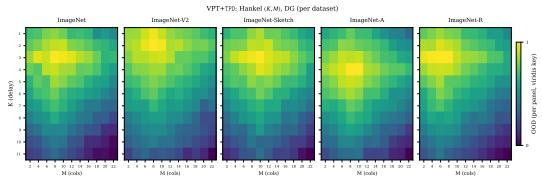  
(a) VPT+TPD, domain generalization

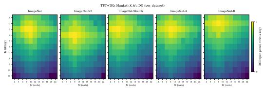  
(b) TPT+TPD, domain generalization  
Figure 6: Sensitivity to the Hankel window on domain-generalization datasets. Each heatmap reports per-dataset performance of VPT+TPD or TPT+TPD while sweeping the delay length K and the number of Hankel columns M. Colors are normalized within each panel, with warmer colors indicating higher accuracy. Both prompt types show a broad high-performing region at short-to-moderate windows, supporting the default $\dot { K } = 3 , M = 8$

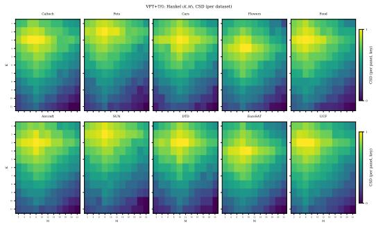  
(a) VPT+TPD, CSD

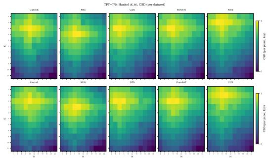  
(b) TPT+TPD, CSD  
Figure 7: Sensitivity to the Hankel window on cross-dataset transfer. The same (K, M) sweep is evaluated on ten downstream datasets. The high-performing region remains broad across datasets and prompt types, while excessively short or long histories are less reliable.

AKC threshold and gain floor. We next sweep the AKC stability threshold $\bar { \rho }$ and the minimum gain $g _ { \mathrm { m i n } } .$ The results show a consistent plateau around $\bar { \rho } = 1 . 0$ with a small gain floor. This matches the intended role of AKC: the controller should intervene when the local Koopman dynamics become expansive, but it should not over-dampen stable updates. Large $g _ { \mathrm { m i n } }$ values weaken this intervention by preventing sufficient shrinkage, while overly strict thresholds can suppress useful updates. The default $\bar { \rho } = 1 . 0$ and $g _ { \mathrm { m i n } } = 0 . 1$ balance these two effects.

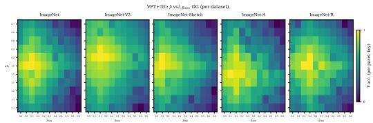  
(a) VPT+TPD, domain generalization

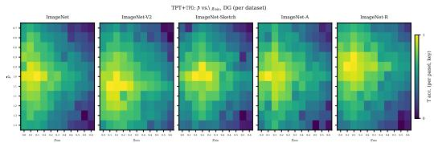  
(b) TPT+TPD, domain generalization

Figure 8: Sensitivity of AKC on domain-generalization datasets. Each heatmap sweeps the spectralradius threshold $\bar { \rho }$ and gain floor $g _ { \mathrm { m i n } }$ for VPT+TPD or TPT+TPD. Colors are normalized within each panel. Performance is strongest in a broad region around $\bar { \rho } = 1 . 0$ with a small gain floor, indicating that AKC benefits from suppressing locally expansive dynamics without over-damping stable updates.

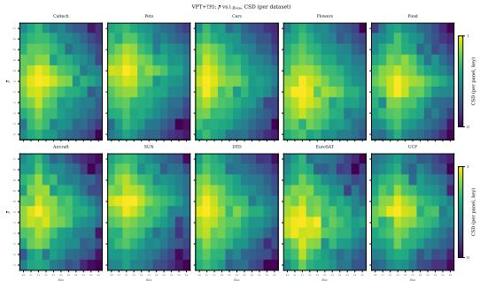  
(a) VPT+TPD, CSD

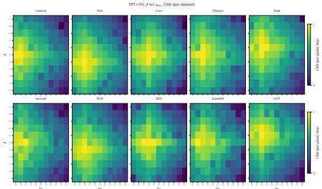  
(b) TPT+TPD, CSD  
Figure 9: Sensitivity of AKC on cross-dataset transfer. The $\bar { \rho } { - } g _ { \mathrm { m i n } }$ sweep shows that moderate stability control is robust across datasets, whereas a large gain floor weakens the controller and overly strict settings may suppress useful adaptation.

HUR routing weights. Finally, we sweep the HUR routing weights under the constraint $0 ~ \leq$ $\beta _ { n } \leq \beta _ { c } \leq 1$ . The best regions favor strong suppression of residual components and moderate attenuation of oscillatory components. This agrees with the design of HUR: persistent components are preserved with unit weight, oscillatory components are attenuated rather than discarded, and poorly explained residual components are suppressed more strongly. Performance degrades when both weights approach one, where HUR becomes close to the raw update and loses its selective-routing effect.

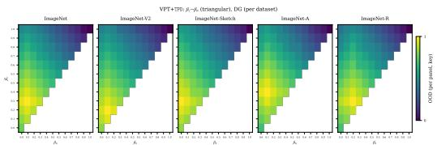  
(a) VPT+TPD, domain generalization

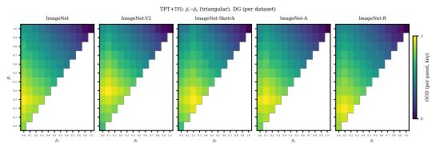  
(b) TPT+TPD, domain generalization

Figure 10: Sensitivity of HUR routing weights on domain-generalization datasets. Each heatmap sweeps the triangular grid $0 \leq \beta _ { n } \leq \bar { \beta } _ { c } \leq \bar { 1 }$ , where $\beta _ { c }$ controls the oscillatory component and $\beta _ { n }$ controls the residual component; the masked region has $\beta _ { n } > \beta _ { c }$ . Warmer colors indicate higher perpanel accuracy. The high-performing region favors small residual weights and moderate oscillatory attenuation, supporting selective routing rather than using the raw update unchanged.

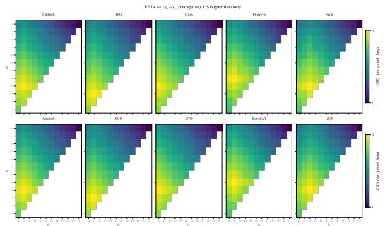  
(a) VPT+TPD, CSD

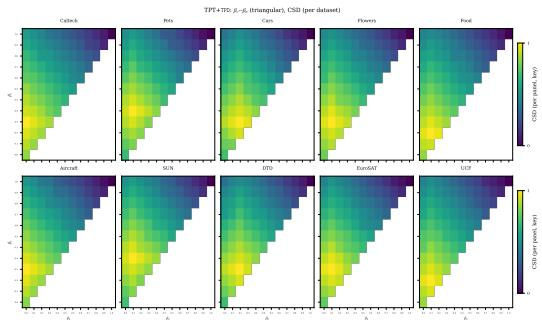  
(b) TPT+TPD, CSD  
Figure 11: Sensitivity of HUR routing weights on cross-dataset transfer. The triangular $\beta _ { c } - \beta _ { n }$ sweep is consistent across VPT+TPD and TPT+TPD: retaining persistent components while attenuating oscillatory and residual components yields a broad high-performing region, whereas weights near one reduce HUR to weak routing and degrade performance.

## D.4 Persistent Ratio and Adaptation Gain

We further examine the link between persistent ratio and adaptation gain. The persistent ratio measures the fraction of a prompt update aligned with locally consistent directions in the recent update trajectory. A larger value indicates more stable adaptation content and less oscillatory or residual content.

For each dataset, we plot the persistent ratio against the accuracy gain obtained by TPD. The red dashed curve is a piecewise linear fitted trend line over the persistent-ratio axis. Across TPT, the gain generally increases from low to moderate persistent ratios and reaches a peak at an intermediate range, after which the trend saturates or slightly decreases on several datasets. This pattern suggests that persistent ratio is a useful trajectory-level diagnostic, while excessively persistent updates may no longer bring additional adaptation benefit.

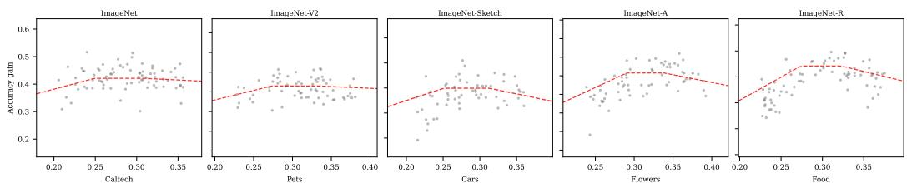

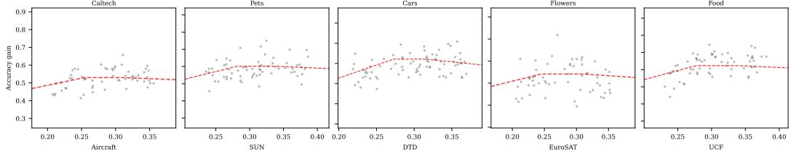

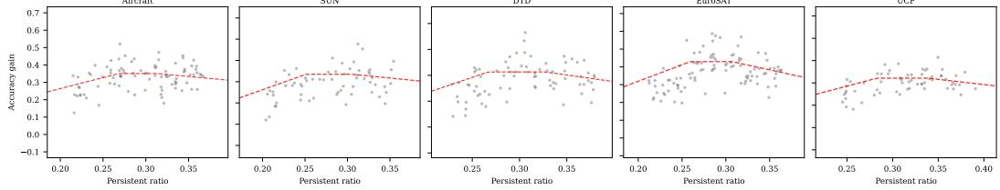  
Figure 12: Persistent ratio versus accuracy gain for TPT+TPD. Each point corresponds to a local trajectory segment, and the red dashed line shows the fitted trend for each dataset.

## D.5 Nonstationary Streams and Test-Order Variation

We evaluate whether recent update history remains useful under abrupt, mixed, and rapidly alternating domain shifts. Each stream is evaluated using five paired test orders shared by VPT and VPT+TPD.

Table A11 shows that TPD improves overall accuracy by 1.42, 1.53, and 4.44 percentage points, respectively, while reducing the standard deviation across orders in all three settings. Under Rapid Alternation, First-10 accuracy also increases from 45.82% to 50.09%, indicating improved adaptation immediately after domain switches. These results suggest that finite-window history remains informative under the tested distribution changes, including a domain switch after every update.  
Table A11: Accuracy (%) under nonstationary streams. Overall reports mean ± standard deviation across five paired test orders; the other accuracy columns report the corresponding means.
<table><tr><td>Stream</td><td>Method</td><td>Overall</td><td>V2</td><td>Sketch</td><td>First-10</td></tr><tr><td>Abrupt</td><td>VPT VPT+TPD</td><td> $5 2 . 9 0 \pm 0 . 3 7$   $5 4 . 3 2 \pm 0 . 3 2$ </td><td>64.52 65.78</td><td>29.67</td><td>47.28</td></tr><tr><td>Mixed</td><td>VPT</td><td> $4 6 . 1 0 \pm 0 . 2 5$ </td><td>65.09</td><td>31.40 27.11</td><td>48.78 N/A</td></tr><tr><td></td><td>VPT+TPD</td><td> $4 7 . 6 3 \pm 0 . 1 9$ </td><td>66.19</td><td>29.08</td><td>N/A</td></tr><tr><td>Rapid Alternation</td><td>VPT</td><td> $4 5 . 2 2 \pm 0 . 5 1$ </td><td>63.82</td><td></td><td>45.82</td></tr><tr><td></td><td>VPT+TPD</td><td> $4 9 . 6 6 \pm 0 . 2 7$ </td><td>67.64</td><td>26.62 31.69</td><td>50.09</td></tr></table>

Setup. Let V and K denote ImageNet-V2 and ImageNet-Sketch. Abrupt: V → K → V (15,000 samples). Mixed: a global shuffle of 10,000 samples from each domain (20,000 samples). Rapid Alternation: $V _ { 1 2 8 }  K _ { 1 2 8 }  \cdot \cdot \cdot$ (20,000 samples), with a domain switch after every adaptation update. VPT and VPT+TPD use the same five predefined test orders for each stream. First-10 measures accuracy over the first ten batches after a domain switch and is undefined for Mixed.

## D.6 Component Ratios under Nonstationary Shifts

Table A12 examines how the decomposition changes under nonstationary streams. For VPT, the persistent fraction decreases from 17.54% under Abrupt to 5.09% under Rapid Alternation, while the residual fraction increases from 81.75% to 93.65%. Nevertheless, TPD improves accuracy in every stream, with its largest VPT gain under Rapid Alternation. TPT also benefits despite residual fractions exceeding 96%. These ratios characterize local trajectory predictability rather than semantic correctness. The results support soft attenuation with nonzero routing weights, which allows potentially useful corrections to remain active when updates are weakly predictable.

Table A12: Component ratios and accuracy (%) under nonstationary shifts. P, O, and R denote persistent, oscillatory, and residual fractions. Accuracy is reported as Base → Base+TPD.
<table><tr><td>Method</td><td>Stream</td><td>P</td><td>0</td><td>R</td><td>Accuracy</td></tr><tr><td>VPT</td><td>Abrupt</td><td>17.54</td><td>0.71</td><td>81.75</td><td>52.90 → 54.32</td></tr><tr><td>VPT</td><td>Mixed</td><td>12.83</td><td>0.48</td><td>86.69</td><td>46.10 → 47.63</td></tr><tr><td>VPT</td><td>Rapid Alternation</td><td>5.09</td><td>1.26</td><td>93.65</td><td>45.22 → 49.66</td></tr><tr><td>TPT</td><td>Abrupt</td><td>3.30</td><td>0.45</td><td>96.25</td><td>57.31 → 57.92</td></tr><tr><td>TPT</td><td>Mixed</td><td>3.16</td><td>0.44</td><td>96.40</td><td>54.85 → 55.58</td></tr><tr><td>TPT</td><td>Rapid Alternation</td><td>3.19</td><td>0.46</td><td>96.35</td><td>55.09 → 55.82</td></tr></table>

Note. Streams follow Table A11. The component ratios describe local trajectory predictability under the fitted model rather than the semantic correctness of the updates.

## D.7 Variation across Random Seeds

We repeat VPT and TPT on ImageNet-A/R using seeds 4827, 7316, and 9054. Table A13 reports the mean and standard deviation across these independent runs. TPD improves mean accuracy in all four settings and reduces the standard deviation in three. For VPT on ImageNet-A, accuracy increases from 19.25 ± 1.97% to 38.73 ± 1.28%. For TPT on ImageNet-A, the standard deviation increases slightly from 1.12 to 1.16, showing that improved mean accuracy does not uniformly imply lower run-to-run variation.

Table A13: Accuracy (%) as mean ± standard deviation across three random seeds (4827, 7316, and 9054). Base denotes the corresponding VPT or TPT method without TPD.
<table><tr><td></td><td colspan="2">VPT</td><td colspan="2">TPT</td></tr><tr><td>Method</td><td>ImageNet-A</td><td>ImageNet-R</td><td>ImageNet-A</td><td>ImageNet-R</td></tr><tr><td>Base</td><td> $1 9 . 2 5 \pm 1 . 9 7$ </td><td> $4 2 . 3 2 \pm 0 . 6 1$ </td><td> $5 4 . 4 4 \pm 1 . 1 2$ </td><td> $7 7 . 0 1 \pm 2 . 0 5$ </td></tr><tr><td>Base+TPD</td><td> $3 8 . 7 3 \pm 1 . 2 8$ </td><td> $4 6 . 5 4 \pm 0 . 5 4$ </td><td> $5 6 . 6 2 \pm 1 . 1 6$ </td><td> $7 9 . 6 3 \pm 1 . 8 9$ </td></tr></table>

## D.8 Comparison with Adaptive Magnitude Controllers

We compare TPD with Adaptive Clipping and Variance-aware Scaling, two label-free magnitude controllers using the same base updates and evaluation streams. Table A14 shows that TPD achieves the highest accuracy in all four settings. For VPT on ImageNet-A, TPD reaches 38.98%, compared with 23.52% for Adaptive Clipping and 22.76% for Variance-aware Scaling. These comparisons complement the component ablations by showing that the tested magnitude-only controllers do no fully account for the gains obtained through joint magnitude control and directional routing.

Table A14: Accuracy (%) of adaptive magnitude controllers using the same base updates and evaluation streams. Base denotes the corresponding VPT or TPT method without a controller.
<table><tr><td></td><td colspan="2">VPT</td><td colspan="2">TPT</td></tr><tr><td>Controller</td><td>ImageNet-A</td><td>ImageNet-R</td><td>ImageNet-A</td><td>ImageNet-R</td></tr><tr><td>Base</td><td>19.17</td><td>42.14</td><td>54.77</td><td>77.06</td></tr><tr><td>Adaptive Clipping</td><td>23.52</td><td>41.92</td><td>54.85</td><td>77.31</td></tr><tr><td>Variance-aware Scaling</td><td>22.76</td><td>43.65</td><td>55.19</td><td>77.26</td></tr><tr><td>TPD</td><td>38.98</td><td>46.47</td><td>56.73</td><td>79.98</td></tr></table>

Controllers. Both comparison controllers are label-free. Adaptive Clipping applies an adaptive magnitude cap. Varianceaware Scaling maps the running variance of recent update norms to a multiplicative gain.

## NeurIPS Paper Checklist

## 1. Claims

Question: Do the main claims made in the abstract and introduction accurately reflect the paper’s contributions and scope?

Answer: [Yes]

Justification: The abstract and introduction state claims consistent with theory and experiments.

Guidelines:

• The answer [N/A] means that the abstract and introduction do not include the claims made in the paper.

• The abstract and/or introduction should clearly state the claims made, including the contributions made in the paper and important assumptions and limitations. A [No] or [N/A] answer to this question will not be perceived well by the reviewers.

• The claims made should match theoretical and experimental results, and reflect how much the results can be expected to generalize to other settings.

• It is fine to include aspirational goals as motivation as long as it is clear that these goals are not attained by the paper.

## 2. Limitations

Question: Does the paper discuss the limitations of the work performed by the authors?

Answer: [Yes]

Justification: The conclusion discusses limitations.

Guidelines:

• The answer [N/A] means that the paper has no limitation while the answer [No] means that the paper has limitations, but those are not discussed in the paper.

• The authors are encouraged to create a separate “Limitations” section in their paper.

• The paper should point out any strong assumptions and how robust the results are to violations of these assumptions (e.g., independence assumptions, noiseless settings, model well-specification, asymptotic approximations only holding locally). The authors should reflect on how these assumptions might be violated in practice and what the implications would be.

• The authors should reflect on the scope of the claims made, e.g., if the approach was only tested on a few datasets or with a few runs. In general, empirical results often depend on implicit assumptions, which should be articulated.

• The authors should reflect on the factors that influence the performance of the approach. For example, a facial recognition algorithm may perform poorly when image resolution is low or images are taken in low lighting. Or a speech-to-text system might not be used reliably to provide closed captions for online lectures because it fails to handle technical jargon.

• The authors should discuss the computational efficiency of the proposed algorithms and how they scale with dataset size.

• If applicable, the authors should discuss possible limitations of their approach to address problems of privacy and fairness.

• While the authors might fear that complete honesty about limitations might be used by reviewers as grounds for rejection, a worse outcome might be that reviewers discover limitations that aren’t acknowledged in the paper. The authors should use their best judgment and recognize that individual actions in favor of transparency play an important role in developing norms that preserve the integrity of the community. Reviewers will be specifically instructed to not penalize honesty concerning limitations.

## 3. Theory assumptions and proofs

Question: For each theoretical result, does the paper provide the full set of assumptions and a complete (and correct) proof?

Answer: [Yes]

Justification: The method and appendix provide assumptions, lemmas, theorem, and proofs. Guidelines:

• The answer [N/A] means that the paper does not include theoretical results.

• All the theorems, formulas, and proofs in the paper should be numbered and crossreferenced.

• All assumptions should be clearly stated or referenced in the statement of any theorems.

• The proofs can either appear in the main paper or the supplemental material, but if they appear in the supplemental material, the authors are encouraged to provide a short proof sketch to provide intuition.

• Inversely, any informal proof provided in the core of the paper should be complemented by formal proofs provided in appendix or supplemental material.

• Theorems and Lemmas that the proof relies upon should be properly referenced.

## 4. Experimental result reproducibility

Question: Does the paper fully disclose all the information needed to reproduce the main experimental results of the paper to the extent that it affects the main claims and/or conclusions of the paper (regardless of whether the code and data are provided or not)?

Answer: [Yes]

Justification: The experiments and appendix specify datasets, baselines, hyperparameters, and protocols.

Guidelines:

• The answer [N/A] means that the paper does not include experiments.

• If the paper includes experiments, a [No] answer to this question will not be perceived well by the reviewers: Making the paper reproducible is important, regardless of whether the code and data are provided or not.

• If the contribution is a dataset and/or model, the authors should describe the steps taken to make their results reproducible or verifiable.

• Depending on the contribution, reproducibility can be accomplished in various ways. For example, if the contribution is a novel architecture, describing the architecture fully might suffice, or if the contribution is a specific model and empirical evaluation, it may be necessary to either make it possible for others to replicate the model with the same dataset, or provide access to the model. In general. releasing code and data is often one good way to accomplish this, but reproducibility can also be provided via detailed instructions for how to replicate the results, access to a hosted model (e.g., in the case of a large language model), releasing of a model checkpoint, or other means that are appropriate to the research performed.

• While NeurIPS does not require releasing code, the conference does require all submissions to provide some reasonable avenue for reproducibility, which may depend on the nature of the contribution. For example

(a) If the contribution is primarily a new algorithm, the paper should make it clear how to reproduce that algorithm.

(b) If the contribution is primarily a new model architecture, the paper should describe the architecture clearly and fully.

(c) If the contribution is a new model (e.g., a large language model), then there should either be a way to access this model for reproducing the results or a way to reproduce the model (e.g., with an open-source dataset or instructions for how to construct the dataset).

(d) We recognize that reproducibility may be tricky in some cases, in which case authors are welcome to describe the particular way they provide for reproducibility. In the case of closed-source models, it may be that access to the model is limited in some way (e.g., to registered users), but it should be possible for other researchers to have some path to reproducing or verifying the results.

## 5. Open access to data and code

Question: Does the paper provide open access to the data and code, with sufficient instructions to faithfully reproduce the main experimental results, as described in supplemental material?

## Answer: [Yes]

Justification: The code is available at https://github.com/reeive/TPD.

## Guidelines:

• The answer [N/A] means that paper does not include experiments requiring code.

• Please see the NeurIPS code and data submission guidelines (https://neurips.cc/ public/guides/CodeSubmissionPolicy) for more details.

• While we encourage the release of code and data, we understand that this might not be possible, so [No] is an acceptable answer. Papers cannot be rejected simply for not including code, unless this is central to the contribution (e.g., for a new open-source benchmark).

• The instructions should contain the exact command and environment needed to run to reproduce the results. See the NeurIPS code and data submission guidelines (https: //neurips.cc/public/guides/CodeSubmissionPolicy) for more details.

• The authors should provide instructions on data access and preparation, including how to access the raw data, preprocessed data, intermediate data, and generated data, etc.

• The authors should provide scripts to reproduce all experimental results for the new proposed method and baselines. If only a subset of experiments are reproducible, they should state which ones are omitted from the script and why.

• At submission time, to preserve anonymity, the authors should release anonymized versions (if applicable).

• Providing as much information as possible in supplemental material (appended to the paper) is recommended, but including URLs to data and code is permitted.

## 6. Experimental setting/details

Question: Does the paper specify all the training and test details (e.g., data splits, hyperparameters, how they were chosen, type of optimizer) necessary to understand the results?

Answer: [Yes]

Justification: The experimental setup details tasks, datasets, settings, baselines, and hyperparameters.

Guidelines:

• The answer [N/A] means that the paper does not include experiments.

• The experimental setting should be presented in the core of the paper to a level of detail that is necessary to appreciate the results and make sense of them.

• The full details can be provided either with the code, in appendix, or as supplemental material.

## 7. Experiment statistical significance

Question: Does the paper report error bars suitably and correctly defined or other appropriate information about the statistical significance of the experiments?

Answer: [Yes]

Justification: The appendix reports extensive per-dataset, sensitivity, and ablation analyses supporting robustness across settings.

Guidelines:

• The answer [N/A] means that the paper does not include experiments.

• The authors should answer [Yes] if the results are accompanied by error bars, confidence intervals, or statistical significance tests, at least for the experiments that support the main claims of the paper.

• The factors of variability that the error bars are capturing should be clearly stated (for example, train/test split, initialization, random drawing of some parameter, or overall run with given experimental conditions).

• The method for calculating the error bars should be explained (closed form formula, call to a library function, bootstrap, etc.)

• The assumptions made should be given (e.g., Normally distributed errors).

• It should be clear whether the error bar is the standard deviation or the standard error of the mean.

• It is OK to report 1-sigma error bars, but one should state it. The authors should preferably report a 2-sigma error bar than state that they have a 96% CI, if the hypothesis of Normality of errors is not verified.

• For asymmetric distributions, the authors should be careful not to show in tables or figures symmetric error bars that would yield results that are out of range (e.g., negative error rates).

• If error bars are reported in tables or plots, the authors should explain in the text how they were calculated and reference the corresponding figures or tables in the text.

## 8. Experiments compute resources

Question: For each experiment, does the paper provide sufficient information on the computer resources (type of compute workers, memory, time of execution) needed to reproduce the experiments?

Answer: [Yes]

Justification: The paper reports H100 GPU use and wall-clock overhead.

Guidelines:

• The answer [N/A] means that the paper does not include experiments.

• The paper should indicate the type of compute workers CPU or GPU, internal cluster, or cloud provider, including relevant memory and storage.

• The paper should provide the amount of compute required for each of the individual experimental runs as well as estimate the total compute.

• The paper should disclose whether the full research project required more compute than the experiments reported in the paper (e.g., preliminary or failed experiments that didn’t make it into the paper).

## 9. Code of ethics

Question: Does the research conducted in the paper conform, in every respect, with the NeurIPS Code of Ethics https://neurips.cc/public/EthicsGuidelines?

Answer: [Yes]

Justification: The experiments use public benchmarks and comply with NeurIPS ethics.

Guidelines:

• The answer [N/A] means that the authors have not reviewed the NeurIPS Code of Ethics.

• If the authors answer [No], they should explain the special circumstances that require a deviation from the Code of Ethics.

• The authors should make sure to preserve anonymity (e.g., if there is a special consideration due to laws or regulations in their jurisdiction).

## 10. Broader impacts

Question: Does the paper discuss both potential positive societal impacts and negative societal impacts of the work performed?

Answer: [N/A]

Justification: The paper focuses on methodology and does not separately discuss broader impacts.

Guidelines:

• The answer [N/A] means that there is no societal impact of the work performed.

• If the authors answer [N/A] or [No], they should explain why their work has no societal impact or why the paper does not address societal impact.

• Examples of negative societal impacts include potential malicious or unintended uses (e.g., disinformation, generating fake profiles, surveillance), fairness considerations (e.g., deployment of technologies that could make decisions that unfairly impact specific groups), privacy considerations, and security considerations.

• The conference expects that many papers will be foundational research and not tied to particular applications, let alone deployments. However, if there is a direct path to any negative applications, the authors should point it out. For example, it is legitimate to point out that an improvement in the quality of generative models could be used to generate Deepfakes for disinformation. On the other hand, it is not needed to point out that a generic algorithm for optimizing neural networks could enable people to train models that generate Deepfakes faster.

• The authors should consider possible harms that could arise when the technology is being used as intended and functioning correctly, harms that could arise when the technology is being used as intended but gives incorrect results, and harms following from (intentional or unintentional) misuse of the technology.

• If there are negative societal impacts, the authors could also discuss possible mitigation strategies (e.g., gated release of models, providing defenses in addition to attacks, mechanisms for monitoring misuse, mechanisms to monitor how a system learns from feedback over time, improving the efficiency and accessibility of ML).

## 11. Safeguards

Question: Does the paper describe safeguards that have been put in place for responsible release of data or models that have a high risk for misuse (e.g., pre-trained language models, image generators, or scraped datasets)?

Answer: [N/A]

Justification: The paper poses no such risks.

Guidelines:

• The answer [N/A] means that the paper poses no such risks.

• Released models that have a high risk for misuse or dual-use should be released with necessary safeguards to allow for controlled use of the model, for example by requiring that users adhere to usage guidelines or restrictions to access the model or implementing safety filters.

• Datasets that have been scraped from the Internet could pose safety risks. The authors should describe how they avoided releasing unsafe images.

• We recognize that providing effective safeguards is challenging, and many papers do not require this, but we encourage authors to take this into account and make a best faith effort.

## 12. Licenses for existing assets

Question: Are the creators or original owners of assets (e.g., code, data, models), used in the paper, properly credited and are the license and terms of use explicitly mentioned and properly respected?

Answer: [Yes]

Justification: All used assets (public datasets, algorithm implementations) are cited.

Guidelines:

• The answer [N/A] means that the paper does not use existing assets.

• The authors should cite the original paper that produced the code package or dataset.

• The authors should state which version of the asset is used and, if possible, include a URL.

• The name of the license (e.g., CC-BY 4.0) should be included for each asset.

• For scraped data from a particular source (e.g., website), the copyright and terms of service of that source should be provided.

• If assets are released, the license, copyright information, and terms of use in the package should be provided. For popular datasets, paperswithcode.com/datasets has curated licenses for some datasets. Their licensing guide can help determine the license of a dataset.

• For existing datasets that are re-packaged, both the original license and the license of the derived asset (if it has changed) should be provided.

• If this information is not available online, the authors are encouraged to reach out to the asset’s creators.

## 13. New assets

Question: Are new assets introduced in the paper well documented and is the documentation provided alongside the assets?

Answer: [Yes]

Justification: The code is available at https://github.com/reeive/TPD.

Guidelines:

• The answer [N/A] means that the paper does not release new assets.

• Researchers should communicate the details of the dataset/code/model as part of their submissions via structured templates. This includes details about training, license, limitations, etc.

• The paper should discuss whether and how consent was obtained from people whose asset is used.

• At submission time, remember to anonymize your assets (if applicable). You can either create an anonymized URL or include an anonymized zip file.

## 14. Crowdsourcing and research with human subjects

Question: For crowdsourcing experiments and research with human subjects, does the paper include the full text of instructions given to participants and screenshots, if applicable, as well as details about compensation (if any)?

Answer: [N/A]

Justification: The paper does not involve crowdsourcing nor research with human subjects. Guidelines:

• The answer [N/A] means that the paper does not involve crowdsourcing nor research with human subjects.

• Including this information in the supplemental material is fine, but if the main contribution of the paper involves human subjects, then as much detail as possible should be included in the main paper.

• According to the NeurIPS Code of Ethics, workers involved in data collection, curation, or other labor should be paid at least the minimum wage in the country of the data collector.

## 15. Institutional review board (IRB) approvals or equivalent for research with human subjects

Question: Does the paper describe potential risks incurred by study participants, whether such risks were disclosed to the subjects, and whether Institutional Review Board (IRB) approvals (or an equivalent approval/review based on the requirements of your country or institution) were obtained?

Answer: [N/A]

Justification: The paper does not involve crowdsourcing nor research with human subjects. Guidelines:

• The answer [N/A] means that the paper does not involve crowdsourcing nor research with human subjects.

• Depending on the country in which research is conducted, IRB approval (or equivalent) may be required for any human subjects research. If you obtained IRB approval, you should clearly state this in the paper.

• We recognize that the procedures for this may vary significantly between institutions and locations, and we expect authors to adhere to the NeurIPS Code of Ethics and the guidelines for their institution.

• For initial submissions, do not include any information that would break anonymity (if applicable), such as the institution conducting the review.

## 16. Declaration of LLM usage

Question: Does the paper describe the usage of LLMs if it is an important, original, or non-standard component of the core methods in this research? Note that if the LLM is used only for writing, editing, or formatting purposes and does not impact the core methodology, scientific rigor, or originality of the research, declaration is not required.

Answer: [N/A]

Justification: The core method and experiments do not use LLMs.

Guidelines:

• The answer [N/A] means that the core method development in this research does not involve LLMs as any important, original, or non-standard components.

• Please refer to our LLM policy in the NeurIPS handbook for what should or should not be described.