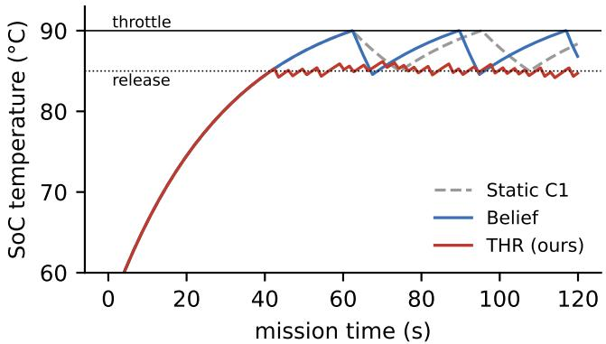
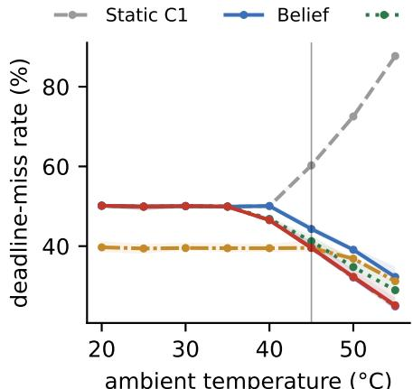
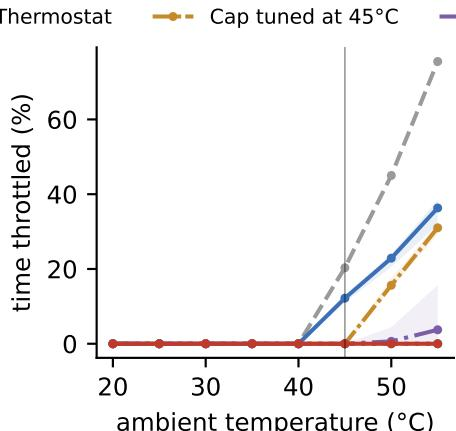
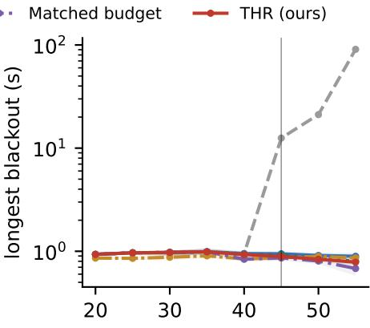
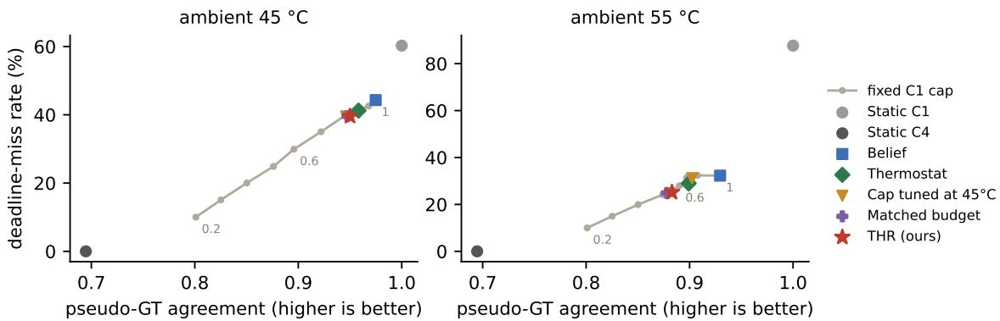
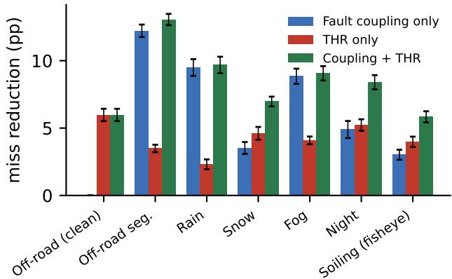
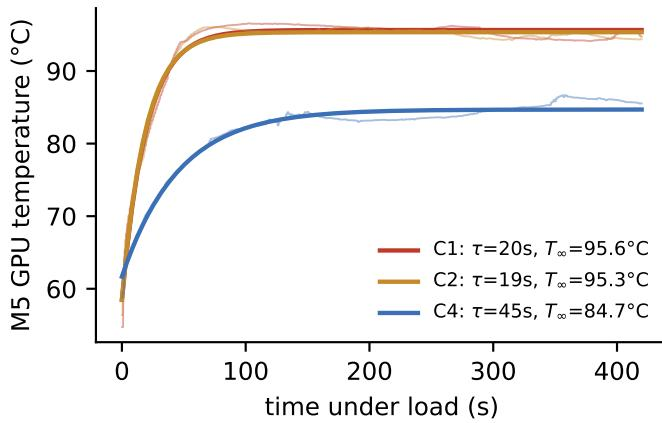

# Thermal-Headroom Routing for Efficient Robot Perception in Extreme Heat

Sparsh Roy∗†‡, Kevin Zhou†, Arhaan Shah§, Shreyan Garg§,

Vihaan Joshi-Apte§, Maxim Kudryashov†, Nanda Cheruvanthala§

∗Massachusetts Institute of Technology, Cambridge, MA, USA

†Hopewell Valley Central High School, Pennington, NJ, USA

§Paradise Valley High School, Phoenix, AZ, USA

‡Corresponding author

sparshr@mit.edu (S. Roy), k.zhou@mit.edu (K. Zhou), arhaan@mit.edu (A. Shah),

shreyangarg@gmail.com (S. Garg), vjoshiapte@gmail.com (V. Joshi-Apte),

maximkud21+research@gmail.com (M. Kudryashov), nanda.vadakara@gmail.com (N. Cheruvanthala)

Abstract—A robot working in a Phoenix summer runs its detector on a small embedded processor that heats itself. Once the chip reaches its thermal limit, the governor throttles it and every detector configuration slows down together. Adaptive inference routers pick a model size and input resolution per frame and react to latency, which in hot weather arrives after the router’s own earlier choices have already heated the chip. We model this with an RC thermal plant wired in closed loop to a deadline-constrained router over four YOLO11 configurations, and propose Thermal-Headroom Routing (THR), which forecasts the chip temperature in closed form and skips configurations that would cross the throttle threshold. Heating measured on an Apple M5 under nonstop YOLO11 inference fits the one-node model within $\mathbf { 1 } ^ { \circ } \mathbf { C } .$ with a time constant and thermal resistance close to the values we assumed. We test THR on seven real traces with camera degradation, eight ambient temperatures and 20 seeds, with Holm correction across traces, against a latency-belief router, a fixed-threshold thermostat, duty caps tuned offline, and a control given THR’s own heavymodel budget. With the deadline at the large model’s median latency and the air between 45 and $5 5 ^ { \circ } \mathrm { C } .$ , THR never throttles and beats the belief router by 3.9 to 7.5 percentage points of deadline misses and 12 to 15% of energy per on-time frame on every trace. All temperature-aware policies, THR included, lie on one accuracy-timeliness curve set by the share of heavymodel frames, so at one ambient on a known chip a well-tuned thermostat matches THR. The forecast pays off when conditions move away from the ones a rule was tuned for. A duty cap tuned at ${ \bf 4 5 } ^ { \circ } { \bf C }$ throttles 16% of the time at $\mathbf { 5 0 } ^ { \circ } \mathbf { C }$ and 31% at $5 5 ^ { \circ } \mathbf { C } ,$ , and on a chip 20% hotter than assumed an $\mathbf { 8 8 } ^ { \circ } \mathbf { C }$ thermostat throttles up to 29% of the time, while THR, given that chip’s measured heating parameters, stays at zero. These results hold, with larger effects, when every decision is given one deadline period of wall-clock time. With 25% deadline slack, throttling costs little and the belief router wins on on-time utility. Code and outputs are public.

Index Terms—efficient inference, adaptive model selection, ther-

1. https://github.com/ImSpxrsh/thermal-headroom-routing

  
Figure 1. SoC temperature during one 2-minute mission at $4 5 ^ { \circ } \mathrm { C }$ (fog trace, seed 0). Static C1 and Belief go through repeated throttle cycles. THR alternates C1 and C2 and stays just below the release threshold.

mal throttling, edge AI, robot perception, extreme environments

## 1. Introduction

Consider a Jetson-class module in a sealed enclosure on a robot in the Sonoran Desert, with the air at $4 5 ^ { \circ } \mathrm { C }$ . If the perception stack runs its largest detector on every frame, the chip reaches its throttle limit in about a minute. The governor then down-clocks it, and the small models slow down along with the large one until the chip cools [1], [2]. In our simulations a policy that always runs the large model goes 12.5 s without an on-time detection at $4 5 ^ { \circ } \mathrm { C }$ and 91 s at $5 5 ^ { \circ } \mathrm { C }$ . Fig. 1 shows one two-minute mission at $4 5 ^ { \circ } \mathrm { C } \mathrm { : }$ a router that reacts to latency drives the chip into repeated throttle cycles, and THR keeps it just under the line.

Adaptive inference is the usual answer to a tight latency budget. Early-exit networks and routers choose cheaper computation per input or per frame [3]–[5], and contention aware detectors such as ApproxDet [6] also watch the load from co-located applications. These systems react to latency once it has risen. On a hot chip that signal arrives late, because the slowdown was caused by earlier choices and lasts tens of seconds. Thermal-aware DVFS [7] and thermalaware multi-DNN scheduling on phones [8] address heat by controlling frequency or placement. We ask a narrower question that matters for robots with a fixed set of detector configurations: how should the router itself use temperature, and how much does a temperature forecast add over simpler rules? Belief-space perception routing [9], which this work extends, left thermal effects out of its contention model.

Our contributions: (i) a closed-loop model of thermal contention for adaptive inference, in which the router’s configuration choice sets the power input to an RC thermal node with a hysteretic throttle (§3); (ii) THR, a closed-form rule that keeps the forecast temperature under the throttle limit at about $7 \mu \mathrm { s }$ per frame (§4); (iii) an evaluation against baselines chosen to beat it: a thermostat, duty caps tuned offline, a matched-budget control in the spirit of the matched input controls of [10], a deadline sweep, and five variations of the true chip, with 20 seeds and Holm correction (§6); and (iv) an account of where THR helps and where it does not. Its gain over latency-only routing comes from rationing the heavy model. The forecast itself pays off when the chip heats differently from what a fixed rule assumed, and with deadline slack, throttling costs less than rationing does.

## 2. Related Work

Adaptive and efficient inference. Early-exit networks [3], [4], dynamic transformers [5] and early exiting for driving [11]–[13] vary computation with the input. Modality gating [14]–[16] decides which sensors to process. ApproxDet [6] selects detection branches under a latency SLA using measured contention from co-located apps. In all of these the compute budget is fixed or observed. None treats it as a state the policy’s own choices drive.

Thermal behaviour of edge inference. On a Raspberry Pi, long CNN runs throttle within seconds without active cooling, and outdoor ambients between 22 and $3 6 ^ { \circ } \mathrm { C }$ change throughput by up to 27.7% [2]. A Jetson AGX Orin in an outdoor enclosure throttled under a synthetic stress test at $\mathrm { a \ + } 4 0 ^ { \circ } \mathrm { C }$ setpoint (GPU $9 5 . 6 ^ { \circ } \mathrm { C } ,$ CPU $9 9 . 0 ^ { \circ } \mathrm { C } )$ , while a YOLOv8 workload drew about half the power and stayed below the threshold [17]. Throttling therefore depends on the model, the cooling and the duty cycle, which is why we sweep the plant parameters below. Measurements on phone SoCs show throttling dominating sustained performance [1].

Thermal management. HotSpot-style RC models [18] and temperature-aware MPSoC scheduling [19] predict hot spots and schedule around them. zTT [7] learns CPU/GPU frequency settings with reinforcement learning so that phones avoid throttling. Phoenix [8] combines processor placement with multi-exit networks to delay throttling for multi-DNN video apps. THR works one level up: it leaves the governor alone and chooses among detector configurations using a temperature forecast. It could run on top of a DVFS policy like zTT.

Sensor- and compute-aware routing. Belief-space perception routing [9] tracks blur, illumination and occlusion faults per camera with switching HMMs, keeps a latencybased contention belief, and fuses the two with a noisy-OR term. We reuse its fault beliefs, frontier and traces from TartanDrive [20], [21], RADIATE [22] and WoodScape [23].

TABLE 1. THERMAL-PLANT PARAMETERS (FIXED BEFORE ANY RUN).
<table><tr><td>∆t (frame)</td><td> $0 . 1 \mathrm s$ </td><td> $P _ { \mathrm { i d l e } } / \ P _ { \mathrm { m a x } }$ </td><td> $5 / 2 5 \mathrm { W }$ </td></tr><tr><td>T</td><td> $3 0 \mathrm { s }$ </td><td> $T _ { \mathrm { h i } } ~ / ~ T _ { \mathrm { l o } }$ </td><td> $9 0 \ : / \ : 8 5 ^ { \circ } \mathrm { C }$ </td></tr><tr><td> $R _ { \mathrm { t h } }$ </td><td> $2 . 0 ^ { \circ } \mathrm { C } / \mathrm { W }$ </td><td>throttled power</td><td>0.6×</td></tr></table>

## 3. System Model

Frontier and deadline. There are four configurations, from most to least expensive: C1 is YOLO11x at 1280 px, C2 is YOLO11x at 640, C3 is YOLO11n at 1280 and C4 is YOLO11n at 640, with per-frame latencies profiled under normal and contended compute [9]. The base deadline D is C1’s median latency under normal compute, between 211 and 341 ms depending on the trace, so C1 meets D about half the time on a cool chip and C2 to C4 always meet it. Section 6.6 relaxes D to 1.25× and 1.5×. Accuracy is the IoU-matched F1 agreement between a configuration’s detections and C1’s on the same frame. This pseudo-ground truth ranks configurations differently from real annotations [9], so accuracy and utility numbers are internal consistency checks. Miss, throttling and energy numbers do not depend on it.

Thermal plant. The SoC is one thermal node with time constant τ and junction-to-ambient resistance $R _ { \mathrm { t h } } { \mathrm { : } }$

$$
\begin{array} { r } { T _ { t + 1 } = T _ { t } + \frac { \Delta t } { \tau } \big ( T _ { \mathrm { a m b } } + R _ { \mathrm { t h } } P _ { t } - T _ { t } \big ) . } \end{array}\tag{1}
$$

Power depends on the configuration $c _ { t }$ served at frame t: $P _ { t } \ = \ s _ { t } \left[ P _ { \mathrm { i d l e } } + \left( P _ { \mathrm { m a x } } - P _ { \mathrm { i d l e } } \right) u ( c _ { t } ) \right]$ ], where $u ( c ) =$ min $( 1 , \tilde { \ell } _ { c } / D _ { 0 } )$ is the configuration’s median normal-compute latency as a fraction of the base deadline $D _ { 0 }$ (so a deadline sweep does not change power), and $s _ { t }$ is 0.6 while throttled and 1 otherwise. The governor starts throttling at $T \geq T _ { \mathrm { h i } }$ and stops at $T \leq T _ { \mathrm { l o } }$ . While it throttles, every configuration’s latency is drawn from its profiled contended distribution, whose p95 is about $2 . 5 \times$ the normal one. Table 1 lists the parameters. They describe a sealed, sun-loaded enclosure running the large model continuously: running C1 nonstop settles at $T _ { \mathrm { a m b } } + 5 0 ^ { \circ } { \bf C } .$ , so throttling starts once the air is above $4 0 ^ { \circ } \mathrm { C } .$ . This is harsher than the well-ventilated Orin with a lighter YOLOv8 model in [17], and we chose the values ourselves. Section 6.4 varies the true plant, and Section 6.10 compares it with heating measured on an Apple M5.

Closed loop. Whether the chip is throttled at frame t depends on what the router chose before t, so each policy runs in closed loop with the plant. For a given seed, all policies see the same pre-drawn latency samples (normal and contended), the same camera measurement noise and the same temperature-sensor noise.

Frame timing. In the main experiments the traces play at their 10 Hz recording rate and each recorded frame is one routing decision. The chosen configuration runs once on that frame, its latency is drawn from the profiled distribution, and the result counts as a miss if it exceeds D. Late results are dropped, so there is no queue and a late frame never delays the next one. Power is charged through the duty $u ( c )$ , and the thermal model advances $\bar { \Delta } t = 0 . 1 \bar { \mathrm { s } }$ per decision. Because C1 takes about D (211 to 341 ms) to run, this compresses wall-clock time by a factor of 2.1 to 3.4. Section 6.5 repeats the heat experiment with physically consistent timing, where every decision lasts exactly D, and the conclusions hold.

## 4. Policies

All policies use the objective from [9]. They predict a compute state, keep the configurations whose median latency in that state meets D, and serve the one with the highest expected accuracy given the camera-fault belief $b _ { f }$ . A 10- frame dwell keeps them from switching back and forth.

Online compute belief. In closed loop the router learns only the latency of the configuration it served, one frame later. A two-state forward filter (stay probabilities 0.95 and 0.90) runs on one binary observation, whether that latency exceeded 1.5× the configuration’s normal median, and outputs $b _ { c }$

THR. With the on-die reading ${ \hat { T } } \ : ( \sigma = 1 ^ { \circ } \mathrm { C }$ noise), holding configuration c for H frames gives, from Eq. (1),

$$
\begin{array} { r } { \hat { T } _ { H } ( c ) = T _ { \infty } ( c ) + \left( \hat { T } - T _ { \infty } ( c ) \right) \left( 1 - \frac { \Delta t } { \tau } \right) ^ { H } , } \end{array}\tag{2}
$$

with $T _ { \infty } ( c ) = T _ { \mathrm { a m b } } + R _ { \mathrm { t h } } P ( c )$ . THR drops c when $\hat { T } _ { H } ( c ) \geq$ $T _ { \mathrm { h i } } - m$ , with $H = 5 0$ frames (5 s) and $m = 2 ^ { \circ } \mathrm { C } .$ . C4 is always allowed. Each frame costs four evaluations of Eq. (2); with the belief update and selection we measured 7.3 µs per frame in Python on one Apple M5 core, under 0.004% of one C1 inference.

Baselines. Static C1 and Static C4 always serve one configuration. Reactive uses latency only. Belief is the decoupled router of [9] with the online $b _ { c }$ . Thermostat is Belief with C1 barred whenever ${ \hat { T } } \geq 8 8 ^ { \circ } \mathbf { C }$ , the same line THR forecasts against, so the two differ only in forecasting. Cap $( 4 5 ^ { \circ } \mathrm { C } )$ and Cap $( 5 5 ^ { \circ } \mathrm { C } )$ are Belief with a running cap on the share of C1 frames, set to the share THR used at that ambient. They stand for a duty cap tuned once in the lab. Matched budget gets THR’s own C1 share for each seed and ambient, which tests whether THR helps by timing its C1 frames or only by using fewer of them. For heat combined with camera faults, Joint adds the noisy-OR fault-coupling term of [9], $p _ { \mathrm { c o n t } } = 1 - ( 1 - b _ { c } ) ( 1 - \kappa \dot { b } _ { f } )$ , and Joint + THR combines it with THR.

## 5. Experimental Setup

Traces. Seven real traces with the frontiers and fault labels of [9]: the full TartanDrive drive, which has no camera faults and is our negative control, a 309-frame stretch of rough terrain, RADIATE rain, snow, fog and night, and WoodScape fisheye video with real soiling masks. Each trace is repeated to fill a 1200-decision mission (2 minutes at the 10 Hz recording rate).

Experiments. E1 re-scores the original fault-coupled contention schedule for bursts of misses. E2 sweeps ambient temperature from 20 to $5 5 ^ { \circ } \mathrm { C }$ with thermal contention only. E3 adds fault-coupled contention on top of throttling. E4 gives THR a wrong $R _ { \mathrm { t h } }$ or τ. E5 relaxes the deadline. E6 changes the true chip. E7 and E8 vary THR’s H and m and the thermostat threshold, as sensitivity analyses. E9 sweeps fixed C1 caps between 0.2 and 1.0. E11 repeats E2 with physically consistent frame timing (§6.5).

Protocol. Following the validation-locked protocol of [10], every setting behind the headline numbers (plant parameters, H, m, dwell, the 1.5× slow threshold, the $8 8 ^ { \circ } \mathrm { C }$ thermostat) was fixed in code before the first evaluation run, and each result file records eval\_labels\_used\_for\_selection: false. Every simulated table and figure is regenerated from the released code by run\_extreme\_env.py followed by make\_extreme\_figures.py, which takes about 8 minutes on one laptop core. The caps tuned at 45 and $5 5 ^ { \circ } \mathrm { C }$ are fit on the evaluation seeds, which favours them. We use 20 seeds, which change latency draws, camera noise and temperature-sensor noise on the same real frames. Each comparison is a paired t-test on per-seed differences, and ∗ marks a difference that survives Holm correction across the seven traces of its family at $\alpha = 0 . 0 5$

## 6. Results

## 6.1. Cool air

$\mathrm { A t } 3 5 ^ { \circ } \mathrm { C }$ and below no policy brings the chip to $T _ { \mathrm { h i } }$ . THR, Belief, Reactive, Thermostat and Matched budget make the same choice on every frame and their miss rates differ by exactly 0.0 percentage points on all seven traces (Fig. 2). At $4 0 ^ { \circ } \mathrm { C }$ THR starts holding C1 back a little early (C1 on 93 to 94% of frames, agreement 0.97 to 1.00), because its 5 s forecast already crosses $8 8 ^ { \circ } \mathrm { C }$

## 6.2. Hot air, against latency-only routing

Table 2 lists miss rate, throttling, blackout length, power, energy and accuracy for every policy. Static C1 is throttled 20% of the time at $\bar { 4 } 5 ^ { \circ } \mathrm { C }$ with a 12.5 s blackout, and 76% of the time at $5 5 ^ { \circ } \mathrm { C }$ with a 91 s blackout and 88% of deadlines missed. Belief and Reactive keep blackouts near 1 s but are throttled 11 to 13% of the mission at $4 5 ^ { \circ } \mathrm { C }$ and 32 to 38% at $5 5 ^ { \circ } \mathrm { C } ,$ , because they react after the governor has stepped in (Fig. 1).

THR was never throttled on any trace, seed or temperature. Against Belief it lowers the miss rate by 3.9 to 5.4 points at $4 5 ^ { \circ } \mathrm { C }$ and 6.7 to 7.5 at $5 5 ^ { \circ } \mathrm { C } .$ , significant on every trace at both temperatures (Table 3). Energy per on-time frame falls by 12% at $4 5 ^ { \circ } \mathrm { C }$ and 13% at $5 5 ^ { \circ } \mathrm { C } .$ , also on every trace. The price is accuracy: mean agreement at $4 5 ^ { \circ } \mathrm { C }$ drops to 0.950, against 0.975 for Belief. On-time utility (accuracy if on time, else zero) still rises significantly on 5 of 7 traces at $4 5 ^ { \circ } \mathrm { C }$ and 6 of 7 at $5 5 ^ { \circ } \mathrm { C } .$ . Static C4 beats every policy on timing and energy at an agreement of 0.695.

  
ambient temperature (°C)

  
ambient temperature (°C)

  
ambient temperature (°C)  
Figure 2. Ambient sweep (E2), base deadline. Lines are the mean over seven traces; bands span the lowest and highest trace. Left: deadline-miss rate. Middle: share of the mission throttled. Right: longest run of consecutive misses (log scale). THR (red) and the thermostat never throttle. The cap tuned at 45 °C wastes accuracy below 45 °C (lower miss, Table 4) and throttles above it.

TABLE 2. EFFICIENCY, QUALITY AND COST IN E2 (BASE DEADLINE), MEAN OVER 7 TRACES AND 20 SEEDS. MISS AND THR. (THROTTLED) IN %. BLACKOUT IS THE LONGEST RUN OF CONSECUTIVE MISSES (S). P IS MEAN SOC POWER (W) AND $E _ { \mathrm { o t } }$ IS ENERGY PER ON-TIME FRAME (J). ACC. IS PSEUDO-GT AGREEMENT.
<table><tr><td>Policy</td><td>Miss</td><td>Thr.</td><td>Blackout</td><td>P</td><td> $E _ { \mathrm { o t } }$ </td><td> $\operatorname { A c c } .$ </td></tr><tr><td>Ambient  $4 5 ^ { \circ } C$ </td><td></td><td></td><td></td><td></td><td></td><td></td></tr><tr><td>Static C1</td><td>60.3</td><td>20.3</td><td>12.5</td><td>23.0</td><td>5.79</td><td>1.000</td></tr><tr><td>Static C4</td><td>0.0</td><td>0.0</td><td>0.0</td><td>5.6</td><td>0.56</td><td>0.695</td></tr><tr><td>Reactive</td><td>44.2</td><td>12.4</td><td>0.9</td><td>22.6</td><td>4.06</td><td>0.975</td></tr><tr><td>Belief</td><td>44.3</td><td>12.2</td><td>0.9</td><td>22.6</td><td>4.07</td><td>0.975</td></tr><tr><td>Thermostat</td><td>41.2</td><td>0.0</td><td>0.9</td><td>22.2</td><td>3.79</td><td>0.958</td></tr><tr><td>Cap (45 C)</td><td>39.5</td><td>0.0</td><td>0.9</td><td>21.9</td><td>3.62</td><td>0.946</td></tr><tr><td>Cap (55 °C)</td><td>25.1</td><td>0.0</td><td>0.7</td><td>17.6</td><td>2.36</td><td>0.879</td></tr><tr><td>Matched budget</td><td>39.6</td><td>0.0</td><td>0.9</td><td>21.9</td><td>3.63</td><td>0.948</td></tr><tr><td>THR (ours)</td><td>39.6</td><td>0.0</td><td>0.9</td><td>21.7</td><td>3.60</td><td>0.950</td></tr><tr><td>Ambient  ${ \bar { 5 } } { \bar { 5 } } ^ { \circ } C$ </td><td></td><td></td><td></td><td></td><td></td><td></td></tr><tr><td>Static C1</td><td>87.7</td><td>75.5</td><td>90.7</td><td>17.4</td><td>14.22</td><td>1.000</td></tr><tr><td>Static C4</td><td>0.0</td><td>0.0</td><td>0.0</td><td>5.6</td><td>0.56</td><td>0.695</td></tr><tr><td>Reactive</td><td>32.0</td><td>37.3</td><td>0.9</td><td>17.9</td><td>2.63</td><td>0.927</td></tr><tr><td>Belief</td><td>32.3</td><td>36.3</td><td>0.9</td><td>17.9</td><td>2.64</td><td>0.929</td></tr><tr><td>Thermostat</td><td>29.0</td><td>0.0</td><td>0.8</td><td>18.4</td><td>2.59</td><td>0.899</td></tr><tr><td>Cap (45 C)</td><td>31.2</td><td>31.0</td><td>0.9</td><td>17.9</td><td>2.60</td><td>0.902</td></tr><tr><td>Cap (55 C)</td><td>24.9</td><td>3.9</td><td>0.7</td><td>17.4</td><td>2.31</td><td>0.877</td></tr><tr><td>Matched budget</td><td>24.9</td><td>3.7</td><td>0.7</td><td>17.4</td><td>2.31</td><td>0.878</td></tr><tr><td>THR (ours)</td><td>25.1</td><td>0.0</td><td>0.8</td><td>17.2</td><td>2.30</td><td>0.883</td></tr></table>

## 6.3. Simple temperature rules and the trade-off curve

A thermostat at $8 8 ^ { \circ } \mathrm { C }$ also never throttles. THR misses 1.3 to 1.9 points fewer deadlines than it at $4 5 ^ { \circ } \mathrm { C }$ and 2.9 to 4.4 at $5 5 ^ { \circ } \mathrm { C }$ (all seven traces), and has higher on-time utility on 6 and 7 traces, while the thermostat keeps 0.8 to 1.6 points more accuracy. The thermostat threshold is a dial, though. Sweeping it between 84 and $8 9 ^ { \circ } \mathrm { C }$ (E8) traces an accuracy-timeliness curve, and THR lands on that curve, between the 86 and $8 7 ^ { \circ } \mathrm { C }$ settings at $4 5 ^ { \circ } \mathrm { C }$ and at the $8 5 ^ { \circ } \mathrm { C }$ setting at $5 5 ^ { \circ } \mathrm { C } .$ . Fig. 3 shows the same thing for duty caps: every temperature-aware policy sits on the curve traced by fixed C1 caps, and the matched-budget control, which spends THR’s C1 share with no temperature input, matches THR’s miss rate on 6 of 7 traces at $5 5 ^ { \circ } \mathrm { C }$ and all 7 at $4 5 ^ { \circ } \mathrm { C } .$ . At a single ambient and on the assumed chip, the share of C1 frames determines the outcome, and the forecast adds little beyond choosing that share well.

Choosing it well across temperatures is harder than it looks. A cap tuned at $4 5 ^ { \circ } \mathrm { C }$ matches THR at $4 5 ^ { \circ } \mathrm { C }$ , then throttles 16% of the mission at $5 0 ^ { \circ } \mathrm { C }$ and 31% at $5 5 ^ { \circ } \mathrm { C } .$ where THR misses 3.1 to $_ { 6 . 6 }$ points fewer deadlines on every trace (Table 4). Below $4 5 ^ { \circ } \mathrm { C }$ the same cap gives up 3.6 to 5.4 points of accuracy that THR keeps. A cap tuned at $5 5 ^ { \circ } \mathrm { C }$ costs 7.1 points of accuracy at $4 5 ^ { \circ } \mathrm { C }$ and 12.1 at $3 5 ^ { \circ } \mathrm { C } .$ . The matched budget also needed THR to supply its number, and at $5 5 ^ { \circ } \mathrm { C }$ it still throttled up to 15.7% of the mission on three traces.

## 6.4. A different chip, with a calibrated forecast

The thermostat’s threshold and the caps were set for one plant. In E6 the true chip differs from Table 1 and THR is given the matching model, as if the chip had been characterized (Table 5). THR stayed at 0.0% throttling on all five variants, both temperatures and every trace. The $8 8 ^ { \circ } \mathrm { C }$ thermostat throttled up to 29.0% of the mission at $5 5 ^ { \circ } \mathrm { C }$ when $R _ { \mathrm { t h } }$ was 20% higher, and up to 2.7% when the chip heated twice as fast $( \tau \times 0 . 5 )$ ). It reacts to the current reading, and a chip that overshoots after the reading crosses $8 8 ^ { \circ } \mathrm { C }$ reaches $9 0 ^ { \circ } \mathrm { C }$ anyway. THR looks 5 s ahead and sees the overshoot coming. THR’s miss reduction over Belief was significant on all seven traces in every variant except the cooler chip at $4 5 ^ { \circ } \mathrm { C }$ , where nothing throttled and the difference was exactly zero. On the slow-heating chip $( \tau \times 2 )$ at $4 5 ^ { \circ } \mathrm { C }$ Belief never throttled within the two minutes, so THR’s 3.7 to 4.4 point gain there comes from rationing C1 alone.

This comparison favours THR in one respect: THR gets the new chip’s $R _ { \mathrm { t h } }$ and τ, and the thermostat keeps its

TABLE 3. HEAT REGIME (E2) PER TRACE, BASE DEADLINE. BLACKOUT C1 IS STATIC C1’S LONGEST RUN OF CONSECUTIVE MISSES (S). THR. IS THE % OF THE MISSION THROTTLED. ∆ THR IS THE REDUCTION IN MISS RATE RELATIVE TO BELIEF (PP). THR−TST AND THR−MB ARE THR’S MISS-RATE ADVANTAGE OVER THE 88 °C THERMOSTAT AND THE MATCHED-BUDGET CONTROL (POSITIVE MEANS THR MISSES LESS). ∗: HOLM-SIGNIFICANT ACROSS THE SEVEN TRACES.
<table><tr><td></td><td colspan="6">Ambient 45 °C</td><td colspan="6">Ambient 55 °C</td></tr><tr><td>Trace</td><td>Blackout C1</td><td>Thr. Belief</td><td>Thr. THR</td><td>∆ THR</td><td>THR-Tst</td><td>THR-MB</td><td>Blackout C1</td><td>Thr. Belief</td><td>Thr. THR</td><td>∆ THR</td><td>THR-Tst</td><td>THR-MB</td></tr><tr><td>Off-road (clean)</td><td>12.5</td><td>13</td><td>0</td><td>+4.9*</td><td>+1.6*</td><td>+0.2</td><td>90.7</td><td>38</td><td>0</td><td>+7.2*</td><td>+3.9*</td><td>-0.1</td></tr><tr><td>Off-road seg.</td><td>12.5</td><td>12</td><td>0</td><td>+4.8*</td><td>+1.6*</td><td>-0.2</td><td>90.7</td><td>37</td><td>0</td><td>+6.8*</td><td>+3.8*</td><td>-0.3</td></tr><tr><td>Rain</td><td>12.5</td><td>13</td><td>0</td><td>+4.4*</td><td>+1.9*</td><td>-0.1</td><td>90.8</td><td>36</td><td>0</td><td>+7.1*</td><td>+3.7*</td><td>-0.3</td></tr><tr><td>Snow</td><td>12.5</td><td>12</td><td>0</td><td>+5.4*</td><td>+1.7*</td><td>+0.1</td><td>90.7</td><td>38</td><td>0</td><td>+7.2*</td><td>+4.1*</td><td>-0.1</td></tr><tr><td>Fog</td><td>12.4</td><td>11</td><td>0</td><td>+4.8*</td><td>+1.9*</td><td>+0.0</td><td>90.7</td><td>34</td><td>0</td><td>+7.5*</td><td>+3.8*</td><td>+0.0</td></tr><tr><td>Night</td><td>12.6</td><td>13</td><td>0</td><td>+5.0*</td><td> $+ 1 . 5 ^ { * }$ </td><td>+0.1</td><td>90.7</td><td>38</td><td>0</td><td>+7.3*</td><td>+4.4*</td><td>-0.0</td></tr><tr><td>Soiling (fisheye)</td><td>12.5</td><td>11</td><td>0</td><td>+3.9*</td><td> $+ 1 . 3 ^ { * }$ </td><td>-0.1</td><td>90.7</td><td>32</td><td>0</td><td>+6.7*</td><td>+2.9*</td><td>-1.1*</td></tr></table>

  
Figure 3. Accuracy against deadline-miss rate (E2 and E9), mean over seven traces. The grey line is a fixed C1 cap between 0.2 and 1.0. Every temperature-aware policy lies on it; Belief sits off the curve at $5 5 ^ { \circ } \mathrm { C }$ because throttling raises its miss rate.

TABLE 4. A C1 CAP TUNED ONCE AT 45 °C AGAINST THR AT OTHER AMBIENTS (MEAN OVER TRACES). THR. AND MISS IN %.
<table><tr><td></td><td colspan="3">Cap tuned at 45 °C</td><td colspan="3">THR</td></tr><tr><td>Ambient</td><td>Thr.</td><td>Miss</td><td>Acc.</td><td>Thr.</td><td>Miss</td><td>Acc.</td></tr><tr><td>35℃</td><td>0.0</td><td>39.5</td><td>0.946</td><td>0.0</td><td>49.9</td><td>1.000</td></tr><tr><td>40℃</td><td>0.0</td><td>39.5</td><td>0.946</td><td>0.0</td><td>46.5</td><td>0.982</td></tr><tr><td>45℃</td><td>0.0</td><td>39.5</td><td>0.946</td><td>0.0</td><td>39.6</td><td>0.950</td></tr><tr><td>50℃</td><td>15.6</td><td>36.9</td><td>0.930</td><td>0.0</td><td>32.3</td><td>0.914</td></tr><tr><td>55℃</td><td>31.0</td><td>31.2</td><td>0.902</td><td>0.0</td><td>25.1</td><td>0.883</td></tr></table>

$8 8 ^ { \circ } \mathrm { C }$ threshold. The experiment measures what a calibrated forecast buys over an uncalibrated threshold; whether THR copes with hardware it knows nothing about remains untested. Calibration is cheap: one 7-minute heating curve gave $R _ { \mathrm { t h } }$ and τ for the M5 (§6.10). The thermostat could be retuned instead, but its right threshold depends on both the chip and the ambient (§6.3), so it would need a sweep for each pair. We did not run a retuned thermostat, and we did not test an uncalibrated THR on the hotter chips at $5 5 ^ { \circ } \mathrm { C }$ . The closest evidence is E4 (Table 9): at $4 5 ^ { \circ } \mathrm { C }$ , THR with $R _ { \mathrm { t h } }$ off by 30% in either direction never throttled, and only its miss reduction changed.

## 6.5. Physically consistent frame timing

In E11 each decision lasts one deadline period D of wall-clock time. The thermal plant integrates over $\Delta t = D$ per decision. At each decision the router takes the newest recorded frame, so decision k uses the trace frame at time kD and the frames in between are skipped, as in a latest-frame robot pipeline. Inference still running at the next boundary is abandoned, so work never overlaps, and THR’s horizon stays 5 s of wall-clock time (15 to 24 decisions). Missions are 1200 decisions, 4.2 to 6.8 minutes. Policies, seeds and the 88 °C thermostat are unchanged, and the $4 5 ^ { \circ } \mathrm { C }$ cap is retuned under the new timing.

Table 6 shows the same picture, with larger effects. Belief is throttled 14 to 17% of the mission at $4 5 ^ { \circ } \mathrm { C }$ and 36 to 43% at $5 5 ^ { \circ } \mathrm { C } ,$ and THR is never throttled. Between 45 and $5 5 ^ { \circ } \mathrm { C }$ THR misses 6.2 to 9.5 points fewer deadlines than Belief and 1.5 to 4.1 fewer than the thermostat, on every trace. Its on-time utility beats Belief’s on every trace too, at 15 to 18% less energy per on-time frame. Because each decision now heats the chip by more, the $8 8 ^ { \circ } \mathrm { C }$ thermostat throttles up to 4.9% of the mission at $5 5 ^ { \circ } \mathrm { C }$ on the base chip, and up to 39% on the chip with 20% higher $R _ { \mathrm { t h } }$ and 17% on the chip with half the time constant, where THR stays at zero. The cap tuned at $4 5 ^ { \circ } \mathrm { C }$ throttles 20 to 25% of the mission at $5 0 ^ { \circ } \mathrm { C } .$ . The matched budget still ties THR on misses at every ambient, so the budget explanation of §6.3 carries over.

TABLE 5. A DIFFERENT TRUE CHIP (E6). THR USES THE MATCHING MODEL. ∆ THR: REDUCTION IN MISS RATE RELATIVE TO BELIEF (PP, RANGE OVER TRACES) AND HOLM-SIGNIFICANT TRACES. MAX THR.: LARGEST THROTTLED SHARE OVER TRACES (%) FOR BELIEF, THE $8 8 ^ { \circ } \mathrm { C }$ THERMOSTAT AND THR.
<table><tr><td></td><td colspan="5">Ambient  $4 5 ^ { \circ } \mathrm { C }$ </td><td colspan="5">Ambient  $5 5 ^ { \circ } \mathrm { C }$ </td></tr><tr><td>True chip</td><td>∆ THR</td><td>Sig.</td><td>Belief</td><td>Tst.</td><td>THR</td><td>∆ THR</td><td>Sig.</td><td>Belief</td><td>Tst.</td><td>THR</td></tr><tr><td> $R _ { \mathrm { t h } } \times 0 . 8$ </td><td>+0.0 to +0.0</td><td>0/7</td><td>0.0</td><td>0.0</td><td>0.0</td><td> $+ 4 . 7 \ \mathrm { t o } \ + 6 . 1$ </td><td>7/7</td><td>17.0</td><td>0.0</td><td>0.0</td></tr><tr><td> $R _ { \mathrm { t h } } \times 1 . 2$ </td><td>+6.7 to +7.9</td><td>7/7</td><td>28.4</td><td>0.0</td><td>0.0</td><td> $+ 8 . 2 \ \mathrm { t o } \ + 1 2 . 1$ </td><td>7/7</td><td>51.8</td><td>29.0</td><td>0.0</td></tr><tr><td> $\tau \times 0 . 5$ </td><td>+7.9 to +9.6</td><td>7/7</td><td>15.8</td><td>0.0</td><td>0.0</td><td> $+ 1 1 . 0 \ \mathrm { t o } \ + 1 4 . 7 $ </td><td>7/7</td><td>42.3</td><td>2.7</td><td>0.0</td></tr><tr><td> $\tau \times 2$ </td><td>+3.7 to +4.4</td><td>7/7</td><td>0.0</td><td>0.0</td><td>0.0</td><td> $+ 4 . 8 \ \mathrm { t o } \ + 5 . 6 $ </td><td>717</td><td>25.5</td><td>0.0</td><td>0.0</td></tr><tr><td>throttle power 0.8×</td><td>+3.4 to +5.3</td><td>7/7</td><td>12.8</td><td>0.0</td><td>0.0</td><td> $+ 4 . 8 \ \mathrm { t o } \ + 6 . 7$ </td><td>7/7</td><td>41.0</td><td>0.0</td><td>0.0</td></tr></table>

TABLE 6. E11, CONSISTENT FRAME TIMING (ONE DECISION PER $D ) .$ MEAN OVER TRACES. THR.: % OF THE MISSION THROTTLED FOR BELIEF (B), THE $8 8 ^ { \circ } \mathrm { C }$ THERMOSTAT (TST), THE CAP TUNED AT $4 5 ^ { \circ } \mathrm { C }$ AND THR. ∆: THR’S MISS REDUCTION RELATIVE TO BELIEF (PP, RANGE OVER TRACES). LAST FOUR COLUMNS: TRACES WHERE THR IS HOLM-SIGNIFICANTLY BETTER / WORSE THAN EACH POLICY ON MISS RATE (MB: MATCHED BUDGET).
<table><tr><td></td><td colspan="4">Thr. (%)</td><td rowspan="2"></td><td colspan="4">THR vs</td></tr><tr><td>Amb.</td><td>B</td><td>Tst Cap</td><td>THR</td><td>∆(pp)</td><td>B</td><td></td><td>Tst MB Cap</td><td></td></tr><tr><td>35℃</td><td>0.0</td><td>0.0</td><td>0.0</td><td>0.0</td><td>+0.0 to +0.1</td><td></td><td></td><td>0/0 0/7 0/0</td><td>0/7</td></tr><tr><td>45℃15.5 0.0</td><td></td><td></td><td>0.0</td><td>0.0</td><td> $+ 6 . 2 \ \mathrm { t o } \ + 7 . 8$ </td><td></td><td>7/0 7/0 0/0</td><td></td><td>0/0</td></tr><tr><td>50℃ 27.6 0.0 23.0</td><td></td><td></td><td></td><td>0.0</td><td> $+ 8 . 2 \ \mathrm { t o } \ + 9 . 5 $ </td><td></td><td>7/0 7/0 0/0</td><td></td><td>) 7/0</td></tr><tr><td>55℃ 40.3 1.5 37.4</td><td></td><td></td><td></td><td>0.0</td><td> $+ 8 . 0 \ \mathrm { t o \ t \mathrm { 9 } } . 1$ </td><td></td><td></td><td>7/0 7/0 0/0 7/0</td><td></td></tr></table>

## 6.6. When the deadline has slack

With D at C1’s median, C1 misses about half its frames even on a cool chip, so part of every policy’s miss reduction comes from running C1 less. E5 removes that effect (Table 7). At 1.25× and 1.5× the median, C1 meets the deadline on a cool chip and only throttling causes misses. Belief then misses just 0.5% of frames at $4 5 ^ { \circ } \mathrm { C }$ and 1.0% at $5 5 ^ { \circ } \mathrm { C } ,$ even though it is throttled 12 and 36% of the time, because C2 to C4 still finish in time on a slow chip and Belief moves to them after one slow frame. THR’s miss rate is 0.0%, a small but significant difference on every trace. On-time utility goes the other way: Belief is significantly better on 6 of 7 traces (0.970 against 0.950 at $4 5 ^ { \circ } \mathrm { C } ) .$ , since THR’s rationing of C1 costs more accuracy than throttling does. THR still uses 5% less energy per on-time frame (2.17 against 2.28 J at $4 5 ^ { \circ } \mathrm { C } )$ . With deadline slack, THR is worth running only when throttling has costs outside this metric, such as energy, a planner sharing the SoC, or wear.

## 6.7. Heat combined with camera faults

E3 adds fault-coupled contention on top of throttling (Fig. 4, Table 8). The fault-coupling term and THR respond to different causes. On the fault-free drive Joint gains exactly 0.0 points, while THR gains 6.0 points at $4 5 ^ { \circ } \bar { \mathrm { C } }$ and 7.9 at $5 5 ^ { \circ } \mathrm { C }$ . At $2 5 ^ { \circ } \mathrm { C }$ THR adds nothing and Joint + THR equals Joint exactly. At 45 and $5 5 ^ { \circ } \mathrm { C }$ Joint + THR beats Belief on all seven traces, by 5.8 to 13.1 and 7.3 to 13.3 points, and is never below Joint alone.

  
Figure 4. Heat plus fault-coupled contention at $4 5 ^ { \circ } \mathrm { C }$ (E3): reduction in miss rate relative to Belief, 95% CIs over 20 seeds.

## 6.8. THR’s settings and a wrong model

Because THR forecasts from the measured temperature, no setting we tried brought throttling back in a meaningful way. Over $H \in \{ 2 0 , 5 0 , 1 0 0 \}$ frames and $m \in \{ 0 , 2 , 4 \} ^ { \circ } \mathrm { C }$ (E7), throttling stayed at 0.0% except for the most aggressive setting $( H = 2 0 , m = 0 ) \mathrm { a t } 5 5 ^ { \circ } \mathrm { C }$ , which throttled up to 0.6% of the mission. Longer horizons and larger margins move THR down the same curve: at $4 5 ^ { \circ } \mathrm { C }$ the miss reduction over Belief is between 0.5 and 11.0 points and mean agreement between 0.923 and 0.969, significant on all traces at every setting. A wrong thermal model has the same effect (E4, Table 9). Underestimating $R _ { \mathrm { t h } }$ by 30% shrinks the miss gain to 0.8 to 1.8 points and keeps more accuracy, and overestimating it does the opposite. THR has one dial that matters, its effective conservatism, and getting the model roughly right is enough to keep the chip out of throttling.

## 6.9. Bursts of misses under fault-coupled contention

Re-scoring the original fault-coupled schedule of [9] (E1, Table 10), fault coupling lowers the share of frames inside bursts of three or more misses (0.3 s) on 6 of 7 traces, by 0.6 to 5.6 points, and is exactly zero on the clean drive. It shortens the single longest burst significantly on only one trace.

TABLE 7. DEADLINE SWEEP (E5): MEANS OVER 7 TRACES FOR BELIEF (B), THE $8 8 ^ { \circ } \mathrm { C }$ THERMOSTAT (TST) AND THR. U IS ON-TIME UTILITY. THE LAST TWO COLUMNS COUNT TRACES WHERE THR IS HOLM-SIGNIFICANTLY BETTER / WORSE THAN BELIEF ON MISS RATE AND ON U.
<table><tr><td></td><td></td><td colspan="3">Miss (%)</td><td colspan="3">Throttled (%)</td><td colspan="3">U</td><td colspan="2">THR vs B</td></tr><tr><td>D</td><td>Amb.</td><td>B</td><td>Tst</td><td>THR</td><td>B</td><td>Tst</td><td>THR</td><td>B</td><td>Tst</td><td>THR</td><td>miss</td><td>U</td></tr><tr><td>1.0×</td><td> $3 5 ^ { \circ } \mathrm { C }$ </td><td>49.9</td><td>49.9</td><td>49.9</td><td>0.0</td><td>0.0</td><td>0.0</td><td>0.501</td><td>0.501</td><td>0.501</td><td>0/0</td><td>0/0</td></tr><tr><td></td><td> $4 5 ^ { \circ } \mathrm { C }$ </td><td>44.3</td><td>41.2</td><td>39.6</td><td>12.2</td><td>0.0</td><td>0.0</td><td>0.532</td><td>0.546</td><td>0.554</td><td>7/0</td><td>5/0</td></tr><tr><td></td><td>55℃</td><td>32.3</td><td>29.0</td><td>25.1</td><td>36.3</td><td>0.0</td><td>0.0</td><td>0.607</td><td>0.610</td><td>0.632</td><td>7/0</td><td>6/0</td></tr><tr><td>1.25×</td><td>35℃</td><td>0.0</td><td>0.0</td><td>0.0</td><td>0.0</td><td>0.0</td><td>0.0</td><td>1.000</td><td>1.000</td><td>1.000</td><td>0/0</td><td>0/0</td></tr><tr><td></td><td>45℃</td><td>0.5</td><td>0.0</td><td>0.0</td><td>12.2</td><td>0.0</td><td>0.0</td><td>0.970</td><td>0.958</td><td>0.950</td><td>7/0</td><td>1/6</td></tr><tr><td></td><td>55℃</td><td>1.0</td><td>0.0</td><td>0.0</td><td>36.3</td><td>0.0</td><td>0.0</td><td>0.919</td><td>0.899</td><td>0.883</td><td>7/0</td><td>1/6</td></tr><tr><td>1.5×</td><td>35℃</td><td>0.0</td><td>0.0</td><td>0.0</td><td>0.0</td><td>0.0</td><td>0.0</td><td>1.000</td><td>1.000</td><td>1.000</td><td>0/0</td><td>0/0</td></tr><tr><td></td><td>45℃</td><td>0.5</td><td>0.0</td><td>0.0</td><td>12.2</td><td>0.0</td><td>0.0</td><td>0.970</td><td>0.958</td><td>0.950</td><td>7/0</td><td>1/6</td></tr><tr><td></td><td>55℃</td><td>1.0</td><td>0.0</td><td>0.0</td><td>36.3</td><td>0.0</td><td>0.0</td><td>0.919</td><td>0.899</td><td>0.883</td><td>7/0</td><td>1/6</td></tr></table>

TABLE 8. E3: REDUCTION IN MISS RATE RELATIVE TO BELIEF (PP). J IS JOINT; J+T IS JOINT + THR. ∗: HOLM-SIGNIFICANT.
<table><tr><td rowspan="2">Trace</td><td colspan="2"> $2 5 ^ { \circ } \mathrm { C }$ </td><td colspan="2"> $4 5 ^ { \circ } \mathrm { C }$ </td><td colspan="2">55℃</td></tr><tr><td>J</td><td>J+T</td><td>J</td><td>J+T</td><td>J</td><td>J+T</td></tr><tr><td>Off-road (clean)</td><td>+0.0</td><td>+0.0</td><td>+0.0</td><td> $+ 6 . 0 ^ { * }$ </td><td>+0.0</td><td> $+ 7 . 9 ^ { * }$ </td></tr><tr><td>Off-road seg.</td><td> $+ 1 2 . 7 ^ { * }$ </td><td> $+ 1 2 . 7 ^ { * }$ </td><td> $+ 1 2 . 2 ^ { * }$ </td><td> $+ 1 3 . 1 ^ { * }$ </td><td> $+ 9 . 0 ^ { * }$ </td><td> $+ 1 3 . 3 ^ { * }$ </td></tr><tr><td>Rain</td><td> $+ 9 . 7 ^ { * }$ </td><td> $+ 9 . 7 ^ { * }$ </td><td> $+ 9 . 5 ^ { * }$ </td><td> $+ 9 . 7 ^ { * }$ </td><td> $+ 5 . 8 ^ { * }$ </td><td> $+ 1 0 . 1 ^ { * }$ </td></tr><tr><td>Snow</td><td> $+ 5 . 3 ^ { * }$ </td><td> $+ 5 . 3 ^ { * }$ </td><td> $+ 3 . 5 ^ { * }$ </td><td> $+ 7 . 0 ^ { * }$ </td><td> $+ 1 . 6 ^ { * }$ </td><td> $+ 8 . 8 ^ { * }$ </td></tr><tr><td>Fog</td><td> $+ 1 2 . 5 ^ { * }$ </td><td> $+ 1 2 . 5 ^ { * }$ </td><td> $+ 8 . 8 ^ { * }$ </td><td> $+ 9 . 1 ^ { * }$ </td><td> $+ 3 . 4 ^ { * }$ </td><td> $+ 9 . 2 ^ { * }$ </td></tr><tr><td>Night</td><td> $+ 8 . 0 ^ { * }$ </td><td> $+ 8 . 0 ^ { * }$ </td><td> $+ 4 . 9 ^ { * }$ </td><td> $+ 8 . 4 ^ { * }$ </td><td> $+ 2 . 4 ^ { * }$ </td><td>+9.6*</td></tr><tr><td>Soiling (fisheye)</td><td> $+ 4 . 7 ^ { * }$ </td><td> $+ 4 . 7 ^ { * }$ </td><td> $+ 3 . 0 ^ { * }$ </td><td> $+ 5 . 8 ^ { * }$ </td><td> $+ 1 . 1 ^ { * }$ </td><td> $+ 7 . 3 ^ { * }$ </td></tr></table>

TABLE 9. THR WITH A WRONG THERMAL MODEL AT 45 °C (E4): RANGE OF THE MISS REDUCTION RELATIVE TO BELIEF, HOLM-SIGNIFICANT TRACES, ACCURACY RANGE AND THE LARGEST THROTTLED SHARE.
<table><tr><td>THR&#x27;s model ∆ miss (pp) Sig.</td><td></td><td></td><td> $\operatorname { A c c } .$ </td><td>Max thr. (%)</td></tr><tr><td>true model</td><td> $+ 3 . 9 \ \mathrm { t o } \ + 5 . 4$ </td><td>7/7</td><td>0.917 to 0.994</td><td>0.0</td></tr><tr><td> $R _ { \mathrm { t h } } \times 0 . 7$ </td><td> $+ 0 . 8 \ \mathrm { t o } \ + 1 . 8 $ </td><td>7/7</td><td>0.943 to 0.996</td><td>0.0</td></tr><tr><td> $R _ { \mathrm { t h } } \times 1 . 3$ </td><td> $+ 7 . 1 \ \mathrm { t o } \ + 9 . 0 $ </td><td>7/7</td><td>0.888 to 0.993</td><td>0.0</td></tr><tr><td> $\tau \times 0 . 5$ </td><td> $+ 5 . 6 \ \mathrm { t o } \ + 7 . 6$ </td><td>7/7</td><td>0.899 to 0.994</td><td>0.0</td></tr><tr><td> $\tau \times 2$ </td><td> $+ 3 . 2 \ \mathrm { t o } \ + 4 . 4$ </td><td>7/7</td><td>0.925 to 0.995</td><td>0.0</td></tr></table>

<table><tr><td></td><td colspan="3">Burst share (%)</td><td colspan="2">Max run</td></tr><tr><td>Trace</td><td>Belief</td><td>Joint</td><td>∆ (pp)</td><td>Belief</td><td>Joint</td></tr><tr><td>Off-road (clean)</td><td>18.9</td><td>18.9</td><td>+0.0</td><td>7.6</td><td>7.6</td></tr><tr><td>Off-road seg.</td><td>17.4</td><td>14.7</td><td> $+ 2 . 8 ^ { * }$ </td><td>8.4</td><td>7.3</td></tr><tr><td>Rain</td><td>14.3</td><td>13.7</td><td> $+ 0 . 6 ^ { * }$ </td><td>6.7</td><td>6.7</td></tr><tr><td>Snow</td><td>20.0</td><td>17.4</td><td> $+ 2 . 6 ^ { * }$ </td><td>7.6</td><td>7.3</td></tr><tr><td>Fog</td><td>21.9</td><td>16.3</td><td> $+ 5 . 6 ^ { * }$ </td><td>7.1</td><td>6.8</td></tr><tr><td>Night</td><td>19.7</td><td>16.9</td><td> $+ 2 . 8 ^ { * }$ </td><td>7.8</td><td>7.2</td></tr><tr><td>Soiling (fisheye)</td><td>14.6</td><td>13.6</td><td> $+ 1 . 0 ^ { * }$ </td><td>10.6</td><td>10.5</td></tr></table>

We had no Jetson, so we measured the Apple M5 laptop whose GPU produced the profiled latencies (MacBook Pro, MPS, fp32, on mains power, other apps closed apart from a stuck system process drawing about 7 W of CPU throughout). The macmon tool read GPU and CPU temperature, power and fan speed four times a second without root access. For C1, C2 and C4 we let the chip idle, ran the configuration nonstop for 7 minutes on $1 0 2 4 \times 5 4 4$ frames, and fitted the step response of Eq. (1) to the GPU temperature (Table 11, Fig. 5).

## 6.10. Heating measured on a real chip

A single RC node fits every curve with under $1 ^ { \circ } \mathrm { C }$ of error. For C1 the fitted time constant is 20 s and the resistance $2 . 8 ^ { \circ } \mathrm { C } / \mathrm { W } ,$ close to the 30 s and $2 . 0 ^ { \circ } \mathrm { C } / \mathrm { W }$ we assumed and inside the range of chips tested in §6.4; nonstop C1 settles $4 1 ^ { \circ } \mathrm { C }$ above idle, at $9 5 . 6 ^ { \circ } \mathrm { C } .$ The fit is a simplification. C4’s curve has a slower time constant (45 s) and a higher resistance $( 3 . 3 ^ { \circ } \mathrm { C } / \mathrm { W } )$ , most likely because the fans speed up only under heavy load (5464 rpm after C1 against 2782 after C4), so the effective parameters depend on the workload. The M5 never throttled: C1’s latency was 187 ms in the first 30 s and 186 ms in the last 30 s. This check therefore supports the heating model and the scale of its parameters. It does not reproduce throttling, which the fan-cooled laptop avoided.

TABLE 10. BURSTS UNDER FAULT-COUPLED CONTENTION (E1). BURST SHARE: % OF FRAMES IN RUNS OF AT LEAST 3 MISSES. MAX RUN IN FRAMES.  
TABLE 11. APPLE M5 UNDER NONSTOP YOLO11 INFERENCE. LAT.: MEDIAN LATENCY OVER THE RUN, ITS FIRST 30 S AND ITS LAST 30 S (MS). ∆P: GPU+CPU POWER ABOVE IDLE (W). τ AND ∆T: FITTED TIME CONSTANT (S) AND STEADY-STATE RISE ABOVE IDLE ( °C). $R = \Delta T / \Delta P$ (°C/W). RMSE OF THE FIT ( °C).
<table><tr><td>Cfg</td><td>Lat.</td><td>First</td><td>Last</td><td> $\Delta P$ </td><td>T</td><td>∆T</td><td>R</td><td>RMSE</td></tr><tr><td>C1</td><td>189</td><td>187</td><td>186</td><td>14.6</td><td>20</td><td>41.1</td><td>2.81</td><td>0.99</td></tr><tr><td>C2</td><td>55</td><td>55</td><td>55</td><td>13.8</td><td>19</td><td>38.9</td><td>2.82</td><td>0.80</td></tr><tr><td>C4</td><td>7</td><td>7</td><td>7</td><td>7.7</td><td>45</td><td>25.7</td><td>3.33</td><td>0.88</td></tr></table>

## 7. Discussion and Limitations

Reading the temperature is what keeps a router out of throttling; routers that only watch latency throttle in every hot run we tried. At one ambient on a known chip, the share of heavy-model frames sets the accuracy-timeliness point, and a thermostat or duty cap at the right setting does as well as THR. The forecast earns its place when the ambient changes or the chip heats faster or settles hotter than the rule assumed. In those runs the thermostat and the fixed caps throttled and THR did not, which is the claim we make for it. On a chip that has been characterized well, a tuned rule is just as good.

  
Figure 5. Apple M5 GPU temperature under nonstop YOLO11 inference (thin) with the fitted one-node RC step response (thick).

The deadline matters as much as the temperature. With the deadline at the large model’s median latency, avoiding throttling reduces misses and energy. With 25% slack, the cheaper models absorb throttling, and a latency-only router delivers more on-time accuracy than THR. Deployments should check which side of that line they are on.

The study is a simulation built on real camera traces and real profiled latencies. The plant is one RC node with parameters we chose; heating measured on an Apple M5 fits that model with parameters close to ours, but the M5 never throttled, so throttling reuses the profiled contended latency distribution instead of real DVFS states. The real throttle points reported for the Jetson AGX Orin are higher (95.6 and $9 9 . 0 { } ^ { \circ } \bar { \mathrm { C } }$ [17]), and a lighter model in a ventilated enclosure did not throttle at $4 0 ^ { \circ } \mathrm { C } .$ Our plant variations cover part of that range, but only hardware measurements can settle it. Latencies come from an Apple M5 GPU. Traces are repeated to reach mission length. Accuracy is agreement with the largest model, which tracks real annotations poorly [9]. Seeds change noise on fixed frames and do not stand in for independent missions.

Next we plan to measure $R _ { \mathrm { t h } } ,$ τ and throttle behaviour on a Jetson Orin in an environmental chamber at 25 to $5 5 ^ { \circ } \mathrm { C }$ with the included tegrastats harness, score the routers against real annotations, and test whether a duty budget learned online from temperature logs can replace the RC model.

## 8. Conclusion

On a hot robot, choosing the large detector now can cause throttling a minute later. THR gives the router a closed-form temperature forecast that costs microseconds per frame. With a tight deadline it kept the chip out of throttling on all seven traces at 45 and $5 5 ^ { \circ } \mathrm { C }$ and cut deadline misses by 3.9 to 7.5 percentage points and energy per on-time frame by 12 to 13% relative to latency-only routing. A tuned thermostat reaches the same operating points on the chip it was tuned for, but throttled for up to 29% of the mission on a chip 20% hotter than assumed, where THR stayed at zero. With deadline slack, throttling is cheap and THR’s rationing is not worth its accuracy cost. For teams building perception on hot hardware, the practical advice is to give the router a temperature input, and to use a forecast when the chip’s thermal behaviour is uncertain.

## Acknowledgment

This work builds on the code and traces of belief-space perception routing [9], led by Sparsh Roy as first author with Vihan Aggarwal and Davin Yin. We thank Vihan Aggarwal and Davin Yin for their part in that work.

## References

[1] G. Bhat, S. Gumussoy, and U. Y. Ogras, “Power and thermal analysis of commercial mobile platforms: Experiments and case studies,” in Proc. Design, Automation and Test in Europe (DATE), 2019.

[2] T. Benoit-Cattin, D. Velasco-Montero, and J. Fernandez-Berni, “Impact´ of thermal throttling on long-term visual inference in a CPU-based edge device,” arXiv:2010.06291 [cs.CV], 2020.

[3] S. Teerapittayanon, B. McDanel, and H. T. Kung, “BranchyNet: Fast inference via early exiting from deep neural networks,” in Proc. Int. Conf. Pattern Recognition (ICPR), 2016.

[4] S. Laskaridis, A. Kouris, and N. D. Lane, “Adaptive inference through early-exit networks: Design, challenges and directions,” in Proc. Int. Workshop on Embedded and Mobile Deep Learning (EMDL), 2021.

[5] Y. Wang, R. Huang, S. Song, Z. Huang, and G. Huang, “Not all images are worth 16×16 words: Dynamic transformers for efficient image recognition,” in Advances in Neural Information Processing Systems (NeurIPS), 2021.

[6] R. Xu, C.-l. Zhang, P. Wang, J. Lee, S. Mitra, S. Chaterji, Y. Li, and S. Bagchi, “ApproxDet: Content and contention-aware approximate object detection for mobiles,” in Proc. 18th ACM Conf. Embedded Networked Sensor Systems (SenSys), 2020.

[7] S. Kim, K. Bin, S. Ha, K. Lee, and S. Chong, “zTT: Learning-based DVFS with zero thermal throttling for mobile devices,” in Proc. 19th Annu. Int. Conf. Mobile Systems, Applications, and Services (MobiSys), 2021, pp. 41–53.

[8] S. Jeon, J. Kim, J. Lee, and H. Cha, “Phoenix: Thermal-aware ondevice inference of multi-instance DNNs for mobile video applications,” ACM Trans. Embedded Computing Systems, vol. 25, no. 2, pp. 31:1– 31:23, 2026.

[9] S. Roy, V. Aggarwal, and D. Yin, “Belief-space perception routing under coupled sensor faults and compute contention,” arXiv:2608.00322 [cs.RO], 2026.

[10] K. Zhou and S. Roy, “Matched-input estimates differ in sign across architectures: Auditing EEG foundation models on motor imagery,” arXiv:2609.23924 [cs.LG], 2026.

[11] L. Huang, H. Hu, Y. Cui, J. Zuo, S. Wu, N. Guan, and C. J. Xue, “AD-EE: Early exiting for fast and reliable vision-language models in autonomous driving,” arXiv preprint arXiv:2506.05404, 2025.

[12] H. Hu et al., “Nav-EE: Navigation-guided early exiting for efficient vision-language models in autonomous driving,” arXiv preprint arXiv:2510.01795, 2025.

[13] M. Sponner, J. Ott, L. Servadei, B. Waschneck, R. Wille, and A. Kumar, “Temporal patience: Efficient adaptive deep learning for embedded radar data processing,” arXiv preprint arXiv:2309.05686, 2023.

[14] Z. Xue and R. Marculescu, “Dynamic multimodal fusion,” in Proc. IEEE/CVF Conf. Computer Vision and Pattern Recognition Workshops (CVPRW), 2023.

[15] O. Mees, A. Eitel, and W. Burgard, “Choosing smartly: Adaptive multimodal fusion for object detection in changing environments,” in Proc. IEEE/RSJ Int. Conf. Intelligent Robots and Systems (IROS), 2016.

[16] Y. Zhang, X. Zhang, S. Zhao, Y. Song, C. Wu, N. Petrovic, and A. Knoll, “PRAM-R: A perception-reasoning-action-memory framework with llm-guided modality routing for adaptive autonomous driving,” arXiv preprint arXiv:2603.04222, 2026.

[17] R. Krislauks, D. Tiscenko, V. Medvedevs, J. Ormanis, and J. Judvaitis,ˇ “Ambient temperature impact on the thermal behavior and power consumption of the NVIDIA Jetson AGX Orin in an outdoor enclosure,” Electronics, vol. 15, no. 11, p. 2467, 2026.

[18] K. Skadron, M. R. Stan, W. Huang, S. Velusamy, K. Sankaranarayanan, and D. Tarjan, “Temperature-aware microarchitecture,” in Proc. Int. Symp. Computer Architecture (ISCA), 2003.

[19] A. K. Coskun, T. S. Rosing, and K. Whisnant, “Temperature aware task scheduling in MPSoCs,” in Proc. Design, Automation and Test in Europe (DATE), 2007.

[20] S. Triest, M. Sivaprakasam, S. J. Wang, W. Wang, A. M. Johnson, and S. Scherer, “TartanDrive: A large-scale dataset for learning off-road dynamics models,” in Proc. IEEE Int. Conf. Robotics and Automation (ICRA), 2022, pp. 2546–2552.

[21] M. Sivaprakasam, S. Triest, M. G. Castro et al., “TartanDrive 2.0: More modalities and better infrastructure to further self-supervised learning research in off-road driving tasks,” in Proc. IEEE Int. Conf. Robotics and Automation (ICRA), 2024.

[22] M. Sheeny, E. De Pellegrin, S. Mukherjee, A. Ahrabian, S. Wang, and A. Wallace, “RADIATE: A radar dataset for automotive perception in bad weather,” arXiv preprint arXiv:2010.09076, 2021.

[23] S. Yogamani, C. Hughes, J. Horgan et al., “WoodScape: A multitask, multi-camera fisheye dataset for autonomous driving,” in Proc. IEEE/CVF Int. Conf. Computer Vision (ICCV), 2019, pp. 9308–9318.