# ToDoPro: Faster and Better Reference-Based Generation: Early Token Reduction via Downsampled Self-Probing

Caiyi Sun1, Yujing Sun2∗, and Siu-Ming Yiu1

1The University of Hong Kong, 2Nanyang Technological University caiyi.sun@connect.hku.hk

## ABSTRACT

Recent generic reference-based image generation models natively support multiple conditions by concatenating all reference image and text tokens into a joint sequence processed by a single Diffusion Transformer (DiT). However, this versatile paradigm comes at an efficiency cost: accommodating multiple references leads to a token explosion, incurring massive O(N2) computational complexity. Most acceleration methods operate inside the DiT, showing limited capability in reducing spatial redundancy and failing to alleviate peak VRAM. While some pre-model token reduction alternatives exist, they inevitably introduce external models. This raises a question: Is it possible to achieve acceleration and memory savings while preserving compatibility with in-model techniques and requiring no additional parameters? In this work, we realize this goal by proposing the early Token reduction via Downsampled self-Probing (ToDoPro). By executing a few denoising steps on spatially 2× downsampled reference images, this cheap probing stage utilizes the DiT model itself to effectively and efficiently extract reference token importance. Using the probed importance, we apply a hierarchical reduction before the main denoising stage: we completely discard low-importance tokens, substitute mid-importance tokens with their downsampled counterparts to cheaply preserve global context, and keep high-importance tokens. Experiments across three base models and two benchmarks demonstrate that our early reduction accelerates inference significantly and mitigates peak GPU memory. Furthermore, we can improve generation quality by safely filtering out noisy, uninformative reference tokens, enabling the model to concentrate its limited attention capacity on genuinely useful tokens. The code will be released at https://github.com/scy639/ToDoPro

## 1 INTRODUCTION

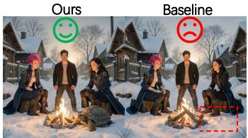  
The man in Image 1 is in the background center, the woman in Image 2 is on the left, the woman in Image 3 is on the right, and the tortoise in Image 4 is in the foreground. They are gathered around a campfire in a snowy village.

  
The chef from image 2 and the mechanic from image 3 are standing in front of the white sports car from image 4, with the statue from image 1 in the background. The style of the image is the same as in image 5.

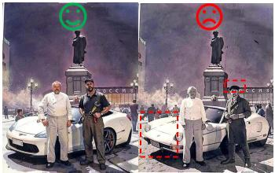  
Figure 1: Compared to base model FLUX.2-klein-4B, our method reduces inference latency while improving generation quality.

Reference-based image generation and editing have fundamentally transformed visual synthesis, moving beyond pure text prompts to multimodal control. By allowing multiple reference inputs, these models achieve greater controllability, driving increasing demand in domains such as advertising and design. However, incorporating multiple reference images massively expands the token sequence length. Due to the $\mathcal { O } ( N ^ { \frac { \lambda } { 2 } } )$ nature of attention, this token explosion significantly increases both the latency and peak VRAM, limiting the number of references and resolutions that can be practically supported. The token explosion also degrades the generation quality due to: 1) Attention interference: some irrelevant reference tokens inevitably attract anomalous attention, interfering with the generation process; 2) Attention dilution: The explosion in the number of tokens leads to a massive denominator in the attention Softmax, diluting weights of truly important tokens.

Despite growing works on efficient AI, a satisfying solution for generic reference-based generation is still missing. Most token reduction methods operate inside the DiT, pruning or merging tokens only after the full sequence has already entered the model. Therefore, they fail to reduce peak VRAM, which typically occurs at the earliest attention layers before reduction takes place. Some methods can reduce tokens before the main model, but they either degrade performance noticeably [5] , limiting their practicality. Thus, to reduce peak memory and maintain compatibility with most DiT acceleration methods, we target an early reduction approach, meaning the token reduction is performed before the main denoising such that the entire main denoising process uses the reduced token sequence.

One straightforward early reduction method is to use an external model to identify unimportant regions [65], which introduces extra parameters and lacks alignment with the generator’s actual demands. Another method is to utilize internal features, such as atten-

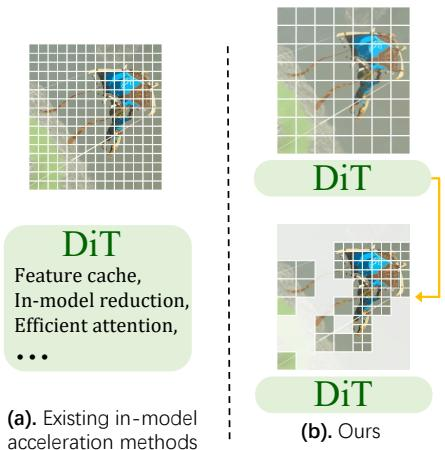

Figure 2: (a) Most existing acceleration methods operate inside the DiT during the main denoising stage. (b) ToDoPro reduces reference tokens before the main denoising stage begins. A probing stage on downsampled references cheaply extracts token importance, guiding token preservation / low-resolution substitution / discarding. The compressed reference images then enter the main denoising stage, slashing end-to-end latency and activation VRAM while remaining compatible with in-model methods in (a).

tion maps, to estimate token importance. Yet, attention patterns for token importance remain unexplored in reference-based image generation, and insights from adjacent fields like ViTs/VLMs and text-to-image (T2I) are inapplicable to our task due to fundamental differences: Unlike VLMs, where visual tokens mainly provide high-level semantics, our task relies heavily on fine-grained, low-level reference details; T2I acceleration focuses on cross-timestep temporal redundancy rather than spatial token redundancy.

Thus, we firstly perform an in-depth analysis of attention, yielding two key observations: First, the total attention that generative and prompt tokens pay to a reference token, termed the reference uti lization score, correlates well with its actual importance, thus serving as an effective proxy. Second, although some unimportant reference tokens inevitably exhibit anomalous attention scores, these abnormal tokens are stochastic and vary across layers. Furthermore, a single layer is usually biased because different layers may have different functions and focuses. Computing the mean utilization score across layers smooths out the bias and instantaneous noise observed in any individual layer, ensuring meaningless tokens are accurately identified, and yielding a robust importance estimation. This reveals a pathway to address degradation: reducing the number of uninformative tokens miti gates attention dilution and interference, and averaging across layers further mitigates interference by identifying unimportant tokens more accurately.

However, extracting attention maps during main denoising loop cannot prevent the VRAM spike and impairs compatibility with in-model acceleration methods, contradicting the goal of early reduction. Thus, we propose our early token reduction via spatial-temporal downsampled self-probing, which identifies unimportant tokens in a cheap probing denoising stage and prunes or replaces them prior to the main denoising. By executing a temporally downsampled, few-step denoising on spa tially 2× downsampled images, this probing stage cheaply approximates attention of full-resolution loop. Then, we adopt different policies for each 2 × 2 block of full-resolution reference tokens, guided by importance score of its corresponding downsampled reference token: High-importance blocks remain intact (preserving all 4 tokens), whereas low-importance blocks are completely discarded. To prevent quality drops from losing broader mid-importance context at high pruning rates, we introduce an intermediate level, replacing mid-importance blocks with the corresponding downsampled reference token instead of completely discarding them, cheaply capturing global context.

This early reduction yields three major benefits: (1) Because tokens are reduced before the entire main denoising stage, computational savings apply to every timestep and layer, slashing FLOPs significantly and mitigating peak VRAM. (2) It is inherently orthogonal, complementary with existing in-model acceleration techniques (e.g., feature caching and in-model token reduction). (3) The selfprobing design utilizes the generator itself, naturally ensuring optimal alignment with the model’s actual demands while avoiding external models.

More importantly, our method does not sacrifice performance for efficiency; rather, it comprehensively enhances generation quality. By discarding low-importance tokens, our method mitigates attention interference and dilution issues, allowing the model to better concentrate its limited attention capacity on prompt and generative tokens and genuinely informative reference tokens, ultimately improving overall generation quality.

Our key contributions are threefold: (1) We present the first in-depth analysis of attention in generic reference-based diffusion models. This analysis uncovers two key observations regarding reference utilization, and layer-wise bias and noise, establishing a reliable proxy for reference token importance. (2) Guided by these insights, we propose a training-free, early token reduction framework, which is inherently compatible with the existing ecosystem of in-model acceleration. (3) Experiments across three base models and two benchmarks show that our method delivers up to 3× mean speedups, cuts peak activation VRAM by up to 50%, and consistently improves generation quality.

## 2 RELATED WORK

## 2.1 REFERENCE-BASED IMAGE GENERATION AND EDITING

Diffusion models have achieved success in text-to-image generation, motivating extensive work extending them to reference-conditioned generation or editing. These methods incorporate diverse visual conditions (e.g., masks, layouts, subject images, exemplar pairs, and pose maps) to achieve fine-grained controllability. Many methods [30, 54, 42, 57, 8, 53, 22] integrated references via dedicated control encoders, adapters, or condition-selection mechanisms. While effective in their target tasks, they rely heavily on task-tailored architectures or input assumptions, limiting scalability.

More recently, general-purpose models have emerged to unify diverse conditioning, generation, and editing tasks within a shared DiT backbone [4, 58, 55, 70] by concatenating reference, text, and generative tokens into a single sequence. This paradigm supports arbitrary reference counts and resolutions, covering diverse downstream tasks. However, this generality comes at a steep cost: token counts and quadratic self-attention complexity explode with additional references. This work focuses on this emerging general-purpose paradigm, which is more versatile and representative of future directions.

## 2.2 TOKEN REDUCTION FOR VISION MODELS

Token reduction, also named as token compression, has been explored to improve vision model efficiency (including ViTs and MLLMs) by shortening the token sequence [47, 62, 24, 43]. One major category is in-model token reduction, which progressively discards or merges tokens during the forward pass of the main model [25, 16]. Another category is pre-model token reduction, which compresses tokens before entering the main model. Among these, training-free methods like similarity based token merging [5] can achieve this goal without introducing extra trainable modules, though their performance is bounded. Some works [60, 19, 46, 2] exploit CLS-to-token attention from a vision encoder to prune tokens before feeding them to VLMs. Other works [65, 36] adopt more precise methods to predict region importance, but at the cost of introducing new external models.

## 2.3 EFFICIENT IMAGE AND VIDEO GENERATION

Diffusion acceleration has been investigated from multiple complementary perspectives. Cross-step caching methods [39, 12, 77, 32, 68, 38, 69, 50, 48, 64, 74] reuse features or attention maps across denoising steps to eliminate redundant computation. Distillation methods [37, 45] reduce sampling steps, model pruning [7, 20, 73] removes structural weights, quantization [27, 10] lowers arithmetic precision, and in-model token reduction methods [9, 21, 75, 15, 28, 66] compress tokens inside models.

Another direction is efficient attention [72, 34, 59, 35], which develop linear or log-linear attention variants. However, these methods only reduce computation inside attention, thus cannot save computation in Feed-Forward Networks.

## 2.4 EFFICIENT REFERENCE-BASED GENERATION AND EDITING

Closer to our reference-based generation setting, several works accelerate specific conditional generation scenarios. RegionE and SpotEdit [44, 13] reduce computation on unchanged regions in image editing, but they are limited to layout-preserving single-image editing setting. OmniControl2 [56] removes near-zero tokens in Canny edge maps and requires re-training. EVCtrl [61] reduces computation within ControlNet, and ToPi [31] accelerates in-context generation by pruning tokens inside the main denoising stage.

To the best of our knowledge, an early-stage reference-based generation acceleration method that reduces reference tokens before the main denoising run is still absent. By shortening the input sequence prior to the DiT in main denoising loop, our approach is inherently orthogonal and complementary to in-model techniques (e.g., caching, quantization, efficient attention, KV sparsification, and in-model token reduction).

## 3 METHOD

## 3.1 PRELIMINARIES AND NOTATIONS

Generic reference-based diffusion models (e.g., Flux.2) unify visual conditions by concatenating target generative tokens $G ,$ text prompt tokens $P$ (from a text encoder), and clean reference tokens R (from a frozen VAE) into a joint sequence processed by an L-layer Diffusion Transformer (DiT). Let $G ^ { t , l } , P ^ { t , l }$ , and $R ^ { t , l }$ denote token states at timestep t and layer l. Denoising starts from pure noise $G ^ { T , 0 }$ down to $G ^ { 0 , L }$ for final decoding. At step $t ,$ reference tokens are first modulated as $R ^ { t , 0 } = \mathbf { M o d u l a t e } ( R , t )$ . After passing through all L layers, the generative output $G ^ { t , L }$ is updated via a numerical solver as $G ^ { t - 1 , \mathsf { \bar { 0 } } } = \mathcal { F } _ { \mathrm { s o l v e r } } \bigl ( G ^ { t , 0 } , G ^ { t , L } \bigr )$ .

For the importance score I, omitting a superscript denotes averaging over the corresponding axis: omitting l denotes averaging over layers $\begin{array} { r } { ( \frac { 1 } { L } \sum _ { l } [ \cdot ] ) } \end{array}$ , omitting t denotes averaging over timesteps $\textstyle ( { \frac { 1 } { T } } \sum _ { t } [ \cdot ] )$ , and omitting both denotes averaging over both axes $\begin{array} { r } { ( \frac { 1 } { L T } \sum _ { t } \sum _ { l } [ \cdot ] ) } \end{array}$ . For all other variables $( \mathrm { e . g . } , \bar { A } , \bar { G } , P , R )$ , omitting t or l is strictly notational brevity and does not imply averaging.

## 3.2 INVESTIGATION OF ATTENTION IN REFERENCE-BASED GENERATION

Attention scores are widely adopted as a proxy for token importance in ViTs and VLMs, where prior works observe the rule that visual information rapidly aggregates into a few ”anchor” tokens during early layers, allowing most computationally silent vision tokens to be safely pruned [60, 11]. While visual tokens in VLMs primarily serve high-level semantic understanding, our task relies heavily on them to continuously provide fine-grained, low-level spatial details for generation. Thus, the rules observed in VLMs cannot be trivially transferred to our task. Furthermore, acceleration methods in text-to-image (T2I) generation primarily focus on cross-timestep temporal feature similarity. Given that the intermediate feature dynamics within generic reference-based generation models remain largely unexplored, we first perform an in-depth analysis of the attention patterns specific to this task.

## 3.2.1 REFERENCE UTILIZATION SCORE

We first explore how to quantify reference token importance using the model’s intrinsic attention behaviour. Intuitively, a reference token’s importance should be proportional to the attention it attracts during the denoising pass. Formally, let $\begin{array} { r } { A _ { i , j } ^ { t , l } ~ = ~ \frac { 1 } { H } \sum _ { h = 1 } ^ { \sim } q _ { i , h } ^ { t , l } ( k _ { j , h } ^ { t , l } ) ^ { \top } } \end{array}$ denote the headaveraged attention score from query i to key j (for notational simplicity, we omit the normalization like Softmax here ). For a given reference token r, we define the reference utilization score queried by a specific query set Ω as $\begin{array} { r } { I _ { r } ^ { t , l } ( \Omega ) = \sum _ { i \in \Omega } A _ { i , r } ^ { t , l } } \end{array}$ and evaluate query combinations, including $\Omega \in \{ G , P , G \cup P , G \cup P \cup R \}$ $\Omega = G$ (generative tokens only), $\Omega = P$ (prompt tokens ${ \mathrm { o n l y } } ) , \Omega = G \cup P$ , and $\Omega = G \cup P \cup R$ . To establish a pseudo ground-truth, we define the

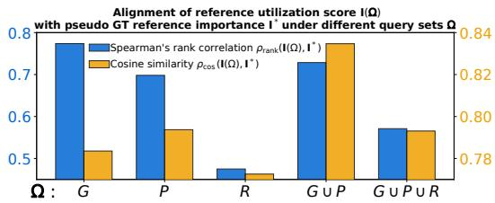  
Figure 3: Alignment of reference utilization scores with pseudo ground-truth importance across different query sets (Ω). The set $( \Omega \ =$ $G \cup P )$ consistently yields the best overall alignment, demonstrating that querying reference tokens via both generative and prompt tokens optimally proxies the importance.

oracle importance $\bar { I _ { r } ^ { * } }$ as the gradient magnitude of the final decoded image pixels with respect to each reference token: $I _ { r } ^ { * } = \mathbf { \Big | } \big | \nabla _ { R _ { r } } \big ( \| \operatorname { D e c o d e } ( G ^ { 0 , L } ) \| _ { 2 } \big ) \big | \big | _ { 2 } ,$ which reflects each reference token’s impact on the generated result [1]. Then, we evaluate the alignment between this gold standard and our proposed attention-based proxy via Spearman’s rank correlation $\rho _ { \mathrm { r a n k } } ( { \bf I } ( \Omega ) , { \bf I ^ { * } } )$ , which evaluates relative token prioritization, and cosine similarity $\rho _ { \mathrm { c o s } } ( { \bf I } ( \Omega ) , { \bf I ^ { * } } )$

We conduct this analysis on about 120 samples and take the average across all layers. As shown in Fig. 3, the combined queries $( \Omega = G \cup P )$ consistently yield the highest alignment, meaning the value of a reference token can be effectively approximated by how intensely it is queried by the generative target and the prompt semantics. Intuitively, while $R  R$ attention only captures taskagnostic reference structure, attention originating from generative tokens G and prompt P directly reflects actual conditioning demands for target generation. Consequently, we adopt the reference utilization score queried by G and P, formulated as $\begin{array} { r } { I _ { r } = \frac { 1 } { L T } \sum _ { t } \sum _ { l } \sum _ { i \in G \cup P } A _ { i , r } ^ { t , l } } \end{array}$ (hereafter simply referred to as the Reference Utilization Score), as the proxy for the importance of a reference token r.

## 3.2.2 LAYER-WISE ANALYSIS OF UTILIZATION SCORE

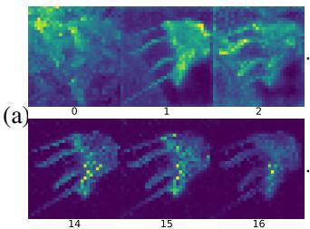

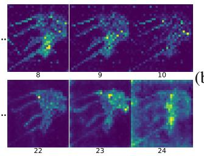  
(b)

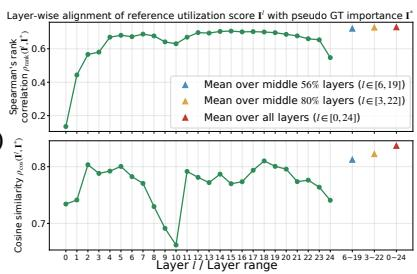  
Figure 4: Analysis of layer-wise attention dynamics. (a) Layer-wise visualizations of the reference utilization score show stochastic anomalous values, and a single layer is usually biased because different layers may have different functions and focuses. (b) Computing the mean utilization score across layers smooths out the bias and instantaneous noise, achieving better alignment with the oracle token importance.

As the utilization score varies across layers, we analyze its layer-wise behavior to guide the design of the final token importance estimation. Visualizing the layer-wise attention maps of the reference utilization score $\begin{array} { r } { I _ { r } ^ { l } = \frac { 1 } { T } \sum _ { t } \sum _ { i \in G \cup P } A _ { i , r } ^ { t , l } } \end{array}$ reveals a three-stage dynamic (Fig. 4). The early layers exhibit extensive attention, likely acting as low-level feature extractors. The middle layers then transition into highly concentrated patterns that strongly correlate with the actual salient regions in the references requested by the text prompt. The final layers show dispersed attention, decoupling from the input conditions entirely, and shift their capacity toward refining the generative tokens G, largely ignoring the input references.

We also show quantitative statistics in Fig. 4(b), which plots the alignment between the layer-wise reference utilization score and the oracle importance from layer 0 to 24, measured by both rank correlation (top) and cosine similarity (bottom). Consistent with our visual observations, the middle layers exhibit better correlation compared to the early and late layers. However, relying on any single layer remains highly susceptible to localized and anomalous token spikes.

Fortunately, as we can see in Fig. 4(a), these abnormal attention spikes are stochastic and vary across different layers. Thus, they can effectively cancel each other out when aggregated. As shown on the right side of Fig. 4(b), averaging the scores across multiple layers consistently outperforms any single layer. While averaging the middle 56% or 80% of layers and averaging all 100% of layers both yield excellent alignment, we simply average across all layers for better generalization across different base models. By averaging the utilization score across all layers $\begin{array} { r } { I _ { r } = \frac { 1 } { L } \sum _ { l } I _ { r } ^ { l } = } \end{array}$ $\begin{array} { r } { \frac { 1 } { L T } \sum _ { l } \sum _ { t } \sum _ { i \in G \cup P } A _ { i , r } ^ { t , l } } \end{array}$ , we apply an implicit low-pass filter that smooths these fluctuations and combines the different focuses of individual layers, yielding a relatively unbiased, comprehensive, and robust importance estimation.

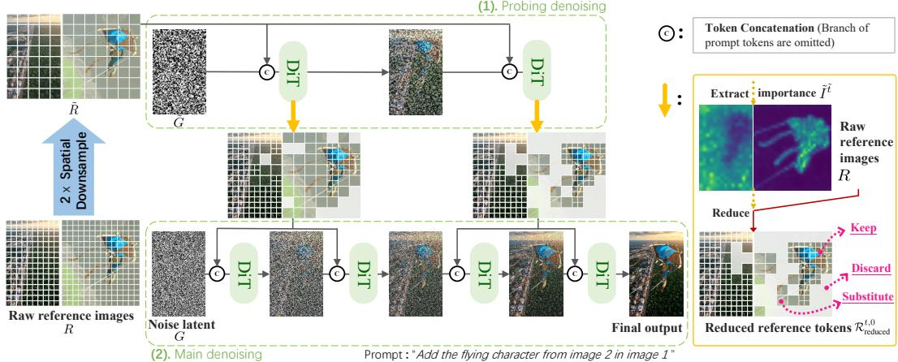  
Figure 5: The illustration of our token reduction by a spatial-temporal downsampled self-probing. By executing a downsampled time step schedule denoising loop on spatially $2 \times$ downsampled input images, this probing stage cheaply extracts the reference importance. The extracted importance scores then guide the reduction strategy outside the main denoising run. The visual example is generated using FLUX.2-Klein-4B (4-step).

## 3.3 EARLY TOKEN REDUCTION VIA DOWNSAMPLED SELF-PROBING

Although the full-resolution attention score is an accurate proxy for token importance, extracting it during the main denoising loop violates our early reduction goal. Thus, we propose using a separate lightweight loop, termed the probing stage, prior to the formal denoising stage. Unimportant reference tokens are identified and reduced before they enter the DiT in the main denoising loop.

## 3.3.1 EXTRACTING IMPORTANCE VIA SPATIAL-TEMPORAL DOWNSAMPLED SELF-PROBING

To cheaply identify redundant tokens, the probing stage evaluates a temporally sparse DiT denoising loop on spatially $2 \times$ downsampled inputs. Let ˜· designate the downsampled probing stage, meaning tilde-accented variables are evaluated on downsampled inputs, whereas unaccented variables refer to the standard full-resolution run. We extract the reference utilization score in the probing stage $\tilde { I } _ { \tilde { r } } ^ { \tilde { t } } =$ $\textstyle \frac { 1 } { L } \sum _ { l } \sum _ { i \in \tilde { G } \cup P } \tilde { A } _ { i , \tilde { r } } ^ { \tilde { t } , l }$ , where vision tokens operate at a reduced spatial scale: $\tilde { R }$ (whose individual tokens are denoted by r˜) is obtained by VAE-encoding the downsampled RGB references, and $\tilde { G }$ represents the generative noisy tokens sampled at the reduced latent resolution. t˜is a timestep in the sparse temporal schedule, meaning the probe denoising loop executes an accelerated trajectory over a coarse time grid of only T/D steps, where D is the temporal reduction factor.

This probe stage shares completely the same configuration as the formal denoising stage, except that it operates on the spatially-downsampled image tokens and undergoes a temporally-downsampled DiT denoising loop (as defined by $\tilde { t } ) .$ Thus, the extracted $\tilde { I }$ effectively approximates the reference utilization score I of the main denoising.

## 3.3.2 REFERENCE TOKEN REDUCTION

To better illustrate the spatial correspondence, we introduce $( w , h , n )$ as an alternative notation fo the token index $r ,$ representing the token at position $( w , h )$ in the n-th reference image. Due to the $2 \times$ spatial downsampling, each downsampled token covers a $2 \times 2$ block of full-resolution tokens. Based on this, we apply different policies (preserve, discard, or substitute) for each $2 \times 2$ block of full-resolution reference tokens $R _ { ( w , h , n ) } ^ { t , 0 }$ , guided by the importance score of its corresponding downsampled reference token $\tilde { I } _ { ( \tilde { w } , \tilde { h } , n ) } ^ { \tilde { t } } \colon ( 1 )$ Keep High-importance blocks (Full-Res Tier) keep all 4 full-resolution tokens intact $( 4  4 )$ , preserving fine-grained details. (2) Discard Low-importance blocks (Discard Tier) are completely discarded $( 4  0 )$ , slashing the computational overhead of irrelevant background noise. (3) Substitute Mid-importance blocks (Low-Res Tier): Since a simple binary strategy (keeping high-importance blocks and discarding all others) only preserves a few highly salient regions and strips away excessive global context, we introduce an intermediate level. We replace mid-importance blocks with their corresponding downsampled tokens instead of fully discarding them. This captures global context at just $1 / 4$ the cost.

The resulting reduced sequence $\mathcal { R } _ { \mathrm { r e d u c e d } } ^ { t , 0 }$ is then fed into the DiT for the formal denoising stage. This tri-tier reduction can be formulated as:

$$
\mathcal { R } _ { \mathrm { r e d u c e d } } ^ { t , 0 } = \underbrace { \big \{ R _ { ( w , h , n ) } ^ { t , 0 } \mid \tilde { I } _ { ( \tilde { w } , \tilde { h } , n ) } ^ { \tilde { t } } > \tau _ { 1 } \big \} } _ { \mathrm { P r e s e r v e ~ h i g h - i m p o r t a n c e ~ t o k e n s } } \cup \underbrace { \big \{ \tilde { R } _ { ( \tilde { w } , \tilde { h } , n ) } ^ { t , 0 } \mid \tau _ { 2 } \leq \tilde { I } _ { ( \tilde { w } , \tilde { h } , n ) } ^ { \tilde { t } } \leq \tau _ { 1 } \big \} } _ { \mathrm { S u b s t i u t e ~ m i d - i m p o r t a n c e ~ t o k e n s } } ,\tag{1}
$$

$$
\begin{array} { r } { \mathrm { w h e r e } \left\{ \tilde { w } = \lfloor w / 2 \rfloor , \tilde { h } = \lfloor h / 2 \rfloor \right. \quad , \qquad \tilde { I } _ { ( \tilde { w } , \tilde { h } , n ) } ^ { \tilde { t } } = \frac { 1 } { L } \sum _ { l } \sum _ { i \in \tilde { G } \cup P } \tilde { A } _ { i , ( \tilde { w } , \tilde { h } , n ) } ^ { \tilde { t } , l } . } \end{array}
$$

The core rationale behind the probing stage is to approximate the main denoising behavior with minimal overhead: Limiting the spatial downsampling to only 2× ensures the probing denoising closely approximates the behaviour of main denoising. Meanwhile, this $2 \times$ downsampling cuts the 2D token count to $1 / 4$ . Considering attention only, the $\mathcal { O } ( N ^ { 2 } )$ complexity reduces its cost by $1 6 \times ;$ with at least $2 \times$ temporal downsampling, the probe is about $\frac { 1 } { 3 2 }$ of the main denoising, making its overhead negligible relative to the acceleration (rigorous derivation in Appendix A.1).

Unlike methods that introduce external models, the self-probing design naturally ensures optimal alignment with the generator’s actual demands while avoiding the introduction of any extra parameters. The spatial-temporal downsampling ensures that the probe introduces only minor overhead, which is significantly outweighed by the acceleration achieved through token reduction. This early reduction slashes FLOPs and peak VRAM while remaining orthogonal and compatible with existing in-model acceleration techniques, such as feature caching.

## 4 EXPERIMENT

## 4.1 SETUP

We evaluate on three base models: Flux.2-Klein-4B, Qwen-Image-Edit-2511, and HiDream-O1- Image. See details in the Appendix B.1. We evaluate our method on two datasets: MultiBanana [41] and Macro [14], which both score the generation quality from multiple dimensions. For efficiency, we report end-to-end latency, peak activation VRAM, and speedup over the corresponding base model. Details, including the full names of these dimensions and sub-tasks, are in the appendix B.3.

## 4.2 MAIN RESULTS

Fig. 6 presents the main comparison across three base models and two benchmarks, against the original base model (Baseline), ToMeSD [5] (applied before DiT as a pre-model method), and

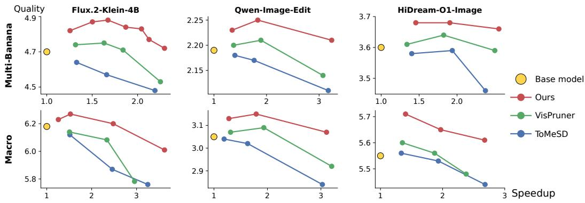  
Figure 6: Average quality versus speedup across three base models and two benchmarks.

<table><tr><td rowspan="3">Method</td><td colspan="8">MultiBanana</td><td colspan="8">MACRO</td></tr><tr><td colspan="4">Quality↑</td><td colspan="2"></td><td colspan="3">Efficiency</td><td colspan="4">Quality↑</td><td colspan="3">Efficiency</td></tr><tr><td>Anitn Ref.</td><td>Cons.</td><td>B-S Match.</td><td>Phys. Real.</td><td>Visu. Avg Qual.</td><td>Latency (s)↓)</td><td>Speed↑</td><td> $\operatorname { A c t . } _ { \mathrm { ( G B ) \downarrow } } \twoheadrightarrow$ </td><td></td><td>Cust. Illus. Spat. Temp.</td><td></td><td></td><td>Avg</td><td>Latency (s)↓)</td><td>Speed↑</td><td>Act, VRAM (GB))</td></tr><tr><td>Baseline</td><td>4.57</td><td>4.86</td><td>3.96</td><td>4.40</td><td>5.72 4.70</td><td></td><td>5.74</td><td>1.00×</td><td>15.3</td><td>7.496.17 3.83</td><td></td><td>7.23</td><td>6.18</td><td>7.93</td><td>1.00×</td><td>24.7</td></tr><tr><td>Fast</td><td></td><td></td><td></td><td></td><td></td><td></td><td></td><td></td><td></td><td></td><td></td><td></td><td></td><td></td><td></td><td></td></tr><tr><td>ToMeSD</td><td>4.45</td><td>4.51</td><td>3.72</td><td>4.17</td><td>5.55</td><td>4.48</td><td>2.62</td><td>2.19×</td><td>11.2</td><td>7.105.82 3.45</td><td></td><td>7.10</td><td>5.87</td><td>3.23</td><td>2.46×</td><td>17.4</td></tr><tr><td>VisPruner</td><td>4.54</td><td>4.53</td><td>3.72</td><td>4.24</td><td>5.62 4.53</td><td></td><td>2.55</td><td>2.25×</td><td>8.7</td><td>7.27 5.99</td><td>3.87</td><td>7.20</td><td>6.08</td><td>3.39</td><td>2.34×</td><td>13.7</td></tr><tr><td>Ours</td><td>4.63</td><td>4.85</td><td>3.97</td><td>4.38</td><td>5.77</td><td>4.72</td><td>2.50</td><td>2.30×</td><td>7.3</td><td>7.50 6.15</td><td>3.88</td><td>7.27</td><td>6.20</td><td>3.20</td><td>2.48×</td><td>11.5</td></tr><tr><td>Slow</td><td></td><td></td><td></td><td></td><td></td><td></td><td></td><td></td><td></td><td></td><td></td><td></td><td></td><td></td><td></td><td></td></tr><tr><td>ToMeSD</td><td>4.48</td><td>4.53</td><td>3.82</td><td>4.38</td><td>5.62 4.57</td><td></td><td>3.46</td><td>1.66×</td><td>10.7</td><td>7.356.18 3.70</td><td></td><td>7.25</td><td>6.12</td><td>5.24</td><td>1.51×</td><td>17.4</td></tr><tr><td>VisPruner</td><td>4.68</td><td>4.85</td><td>3.90</td><td>4.44</td><td>5.88</td><td>4.75</td><td>3.52</td><td>1.63×</td><td>10.2</td><td>7.37 6.03 3.91</td><td></td><td>7.25</td><td>6.14</td><td>5.27</td><td>1.51×</td><td>17.2</td></tr><tr><td>Ours</td><td>4.86</td><td>5.06</td><td>4.03</td><td>4.54</td><td>5.92</td><td>4.88</td><td>3.43</td><td>1.67×</td><td>9.8</td><td>7.55 6.20 4.01</td><td></td><td>7.32</td><td>6.27</td><td>5.20</td><td>1.53×</td><td>16.4</td></tr></table>

Table 1: Comparison of efficiency and quality on MultiBanana and MACRO (Flux.2-Klein-4B).

VisPruner [67]. Table 1 reports the fine-grained scores of this comparison on Flux.2-Klein-4B. Ours(fast) accelerates inference and lowers peak VRAM, while matching or surpassing baseline quality; Ours(slow) further improves all quality metrics, at a smaller speedup. VisPruner can improve quality over the baseline at some speedup, while its quality stays below ours because it identifies unimportant tokens less accurately. Fig. 7 shows visual results.

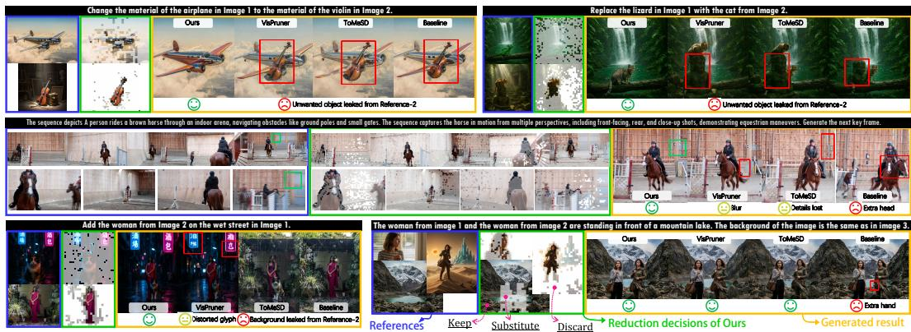  
Figure 7: Visual comparison of generation quality across diverse tasks from MultiBanana and Macro datasets (all methods are under the Slow level in Table 1 with comparable speedups). Best viewed when zoomed in.

## 4.3 ORTHOGONALITY WITH IN-MODEL METHODS

We compare with in-model acceleration methods including TaylorSeer [33], RepreShift [16], and TransPrune [25] in Table 2. As demonstrated in Table 2, integrating our method with existing inmodel methods yields compounded speedups. Detailed discussion of our orthogonality with other existing methods can be found in Appendix A.2.

<table><tr><td rowspan="3">Method</td><td colspan="8">MultiBanana</td><td colspan="8">MACRO</td></tr><tr><td colspan="4">Quality↑</td><td colspan="2"></td><td colspan="2">Efficiency</td><td colspan="2"></td><td colspan="2">Quality↑</td><td colspan="2"></td><td colspan="2">Efficiency</td></tr><tr><td>Inst. Align</td><td>Ref. Cons.</td><td>B-S Match.</td><td>Phys. Real.</td><td>Qisy.</td><td>Avg</td><td>Latency (s)↓)</td><td>Speed↑</td><td>↑ Act BRAM</td><td>Cust. Illus. Spat. Temp.</td><td></td><td></td><td>Avg</td><td>Latency (s)</td><td>Speed↑</td><td>↑ Act BRAM</td></tr><tr><td>Baseline</td><td>4.57</td><td>4.86</td><td>3.96</td><td></td><td>4.405.72 4.70</td><td></td><td>5.7</td><td>1.00×</td><td>15.3</td><td>7.49 6.17</td><td>3.83</td><td>7.23</td><td>6.18</td><td>7.9</td><td>1.00×</td><td>24.7</td></tr><tr><td>Ours</td><td>4.63</td><td>4.85</td><td>3.97</td><td></td><td>4.385.77</td><td>4.72</td><td>2.5</td><td>2.30×</td><td>7.3</td><td>7.50 6.15</td><td>3.88</td><td>7.27</td><td>6.20</td><td>3.2</td><td>2.48×</td><td>11.5</td></tr><tr><td>RepreShift</td><td></td><td>4.51~4.69</td><td>3.93</td><td></td><td>4.44 5.78</td><td>4.67</td><td>3.5</td><td>1.63×</td><td>11.3 7.45</td><td>6.12</td><td>3.83</td><td>7.11</td><td>6.13</td><td>4.1</td><td>1.93×</td><td>22.1</td></tr><tr><td>RepreShift + Ours</td><td>4.61</td><td>4.66</td><td>3.96</td><td></td><td>4.405.72</td><td>4.67</td><td>2.4</td><td>2.38×</td><td>8.3 7.44</td><td>6.10</td><td>3.85</td><td>7.11</td><td>6.12</td><td>3.0</td><td>2.65×</td><td>15.2</td></tr><tr><td>Taylorseer</td><td>4.52</td><td>4.69</td><td>3.85</td><td></td><td>4.41 5.64</td><td>4.62</td><td>4.8</td><td>1.19×</td><td>47.5</td><td>7.135.63</td><td>3.16</td><td>6.82</td><td>5.69</td><td>6.5</td><td>1.21×</td><td>62.0</td></tr><tr><td>Taylorseer + Ours</td><td>4.55 4.72</td><td></td><td>3.90</td><td></td><td>4.44 5.704.66</td><td></td><td>3.1</td><td>1.85×</td><td>34.3</td><td>7.21 5.47</td><td>3.26</td><td>6.86</td><td>5.70</td><td>4.8</td><td>1.65×</td><td>45.4</td></tr><tr><td>TransPrune</td><td>4.56~4.85</td><td></td><td>3.92</td><td></td><td>4.43 5.81 4.71</td><td></td><td>3.2</td><td>1.77×</td><td>14.9</td><td>7.52 6.15~3.87</td><td></td><td>7.17</td><td>6.18</td><td>3.3</td><td>2.40×</td><td>23.3</td></tr><tr><td>TransPrune + Ours 4.58</td><td></td><td>4.82</td><td>3.94</td><td></td><td>4.38 5.77 4.70</td><td></td><td>2.1</td><td>2.79×</td><td>8.4</td><td>7.48 6.14 3.88</td><td></td><td>7.13</td><td>6.16</td><td>2.5</td><td>3.12×</td><td>15.6</td></tr></table>

Table 2: Compatibility of Ours(fast) with existing in-model acceleration methods on FLUX.2-Klein-4B, yielding compounded inference speedups.

## 4.4 ABLATION STUDY

<table><tr><td>Method</td><td>Anstritiion</td><td>Reference Consistency↑</td><td>BG-Subject Match↑</td><td>Physical Realism↑</td><td>Visual Quality↑</td><td>Overall↑</td></tr><tr><td>Only Low-Res Tier (i.e., infer baseline on 2× downsampled images)</td><td>4.25</td><td>4.10</td><td>3.53</td><td>4.12</td><td>5.63</td><td>4.33</td></tr><tr><td>No Low-Res Tier</td><td>4.56</td><td>4.67</td><td>3.88</td><td>4.37</td><td>5.72</td><td>4.64</td></tr><tr><td>Random Reduction</td><td>4.25</td><td>4.08</td><td>3.62</td><td>4.22</td><td>5.60</td><td>4.35</td></tr><tr><td>Ours</td><td>4.63</td><td>4.85</td><td>3.97</td><td>4.38</td><td>5.77</td><td>4.72</td></tr></table>

Table 3: Ablation study on Ours(fast) on MultiBanana (controlled to the same reduction ratio). Base model: Flux.2-Klein-4B.

Table 3 validates our designs. “All Low-Res Tier” operates on the 2× downsampled references, suffering a severe quality drop. Removing the intermediate tier (“w/o Low-Res Tier”) causes a noticeable quality decline, confirming the necessity of capturing global context via Low-Res Tier tokens. “Random Reduction” also degrades quality, indicating the extracted reference utilization score is necessary for token reduction decisions.

## 4.5 ANALYSIS OF QUALITY IMPROVEMENT

## 4.5.1 EFFECT OF TOKEN REDUCTION RATIO

Fig. 8 shows how quality evolves with the reduction ratio, driven by two competing factors: (1) mitigating attention interference and dilution versus (2) losing informative tokens at extreme sparsity. At 0% reduction, the baseline leaks a floating glove from a salient but irrelevant region in ref 2; Moving into a broad optimal window, Factor 1 dominates, and the model successfully filters out these visual distractors.

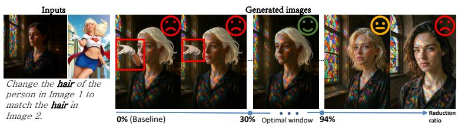  
Figure 8: Qualitative evolution of generated images. At 0% reduction (unpruned baseline), the model mistakenly retains visual distractors (e.g., an extra floating glove). Within a broad window (30% to 94%), our method successfully filters out these distractors, boosting quality. At extreme reduction levels (> 95%), the irreversible loss of informative reference tokens causes quality degradation.

As the reduction ratio escalates to extreme levels (>95%), Factor 2 eventually takes over. Crucial features are irreversibly pruned, resulting in degraded reference consistency. Note that this optimal window forms a wide plateau rather than a narrow range, as demonstrated by the case in Fig. 8 and quantitative curve in Fig. 6.

## 4.5.2 EFFECTIVE ATTENTION RATIO

Our method can effectively mitigate attention dilution and attention interference, thus making the model allocate its limited attention capacity to genuinely useful reference tokens. Here, we explicitly validate whether the model’s attention is more focused on meaningful reference regions, by evaluating the Effective Attention Ratio (EAR).
<table><tr><td>Layers used for I, Extraction</td><td>Effective Attention Ratio↑</td><td>Instruction Alignment</td><td>Reference Consistency↑</td><td>BG-Subject Match↑</td><td>Physical Realism↑</td><td> $\mathrm { { Q u a l i t y } \uparrow }$ </td><td>Overall↑</td></tr><tr><td>Baseline (No Reduction)</td><td>43.6</td><td>4.57</td><td>4.86</td><td>3.96</td><td>4.40</td><td>5.72</td><td>4.70</td></tr><tr><td>Top-1 layer</td><td>51.7</td><td>4.8ī</td><td>5.08</td><td>3.92</td><td>4.42</td><td>5.85</td><td>4.82</td></tr><tr><td>Top 20% of layers</td><td>52.9</td><td>4.89</td><td>5.13</td><td>4.01</td><td>4.47</td><td>5.93</td><td>4.89</td></tr><tr><td>All layers</td><td>52.7</td><td>4.86</td><td>5.06</td><td>4.03</td><td>4.54</td><td>5.92</td><td>4.88</td></tr></table>

Table 4: Effective Attention Ratio (EAR) on all samples from the object composition task of Multi-Banana. Baseline: Flux.2-Klein-4B. All variants use the same reduction ratio (Slow level).

To calculate EAR, an objective ground-truth (GT) importance map is required. While general reference-based tasks lack such GT importance, the object composition task in MultiBanana [41] inherently aims to composite the salient object in each reference image. Thus, the salient object region (extracted via BiRefNet [71]) naturally serves as the GT important area. A higher ratio indicates that the model allocates more attention to genuinely useful regions. We evaluate four variants: (1) Baseline (No Reduction), the unpruned reference sequence; (2) Top-1 layer, using the utilization score from the best-aligned single layer; (3) Top 20% of layers, using the mean over the top 20% best-correlated layers; and (4) All layers, using the mean across all layers. Details are in Ap pendix B.5.

Table 4 shows two gains. Token reduction with Top-1 layer markedly raises EAR, validating that our token reduction makes the model allocate more attention to genuinely useful reference regions. Top 20% of layers and All layers further slightly raise EAR over Top-1 layer, validating that averaging across layers further mitigates interference by identifying unimportant tokens more accurately.

All layers is comparable to Top 20% of layers, but does not require model-specific layer selection.   
We therefore adopt averaging across all layers as the default for generalization across base models.

## 5 CONCLUSIONS

In this work, we propose an early token reduction framework via downsampled self-probing to address the token explosion in reference-based diffusion models. By utilizing the model itself to cheaply extract token importance, we perform a tri-tier reduction before the main denoising stage. Experiments show that our training-free method reduces latency, mitigate peak VRAM, seamlessly compounds with in-model acceleration techniques, and improves generation quality.

## REFERENCES

[1] Samira Abnar and Willem Zuidema. Quantifying attention flow in transformers. In Proceedings of the 58th annual meeting of the association for computational linguistics, pp. 4190– 4197, 2020.

[2] Kazi Hasan Ibn Arif, JinYi Yoon, Dimitrios S Nikolopoulos, Hans Vandierendonck, Deepu John, and Bo Ji. Hired: Attention-guided token dropping for efficient inference of highresolution vision-language models. 39(2):1773–1781, 2025.

[3] Shuai Bai, Yuxuan Cai, Ruizhe Chen, Keqin Chen, Xionghui Chen, Zesen Cheng, Lianghao Deng, Wei Ding, Chang Gao, Chunjiang Ge, Wenbin Ge, Zhifang Guo, Qidong Huang, Jie Huang, Fei Huang, Binyuan Hui, Shutong Jiang, Zhaohai Li, Mingsheng Li, Mei Li, Kaixin Li, Zicheng Lin, Junyang Lin, Xuejing Liu, Jiawei Liu, Chenglong Liu, Yang Liu, Dayiheng Liu, Shixuan Liu, Dunjie Lu, Ruilin Luo, Chenxu Lv, Rui Men, Lingchen Meng, Xuancheng

Ren, Xingzhang Ren, Sibo Song, Yuchong Sun, Jun Tang, Jianhong Tu, Jianqiang Wan, Peng Wang, Pengfei Wang, Qiuyue Wang, Yuxuan Wang, Tianbao Xie, Yiheng Xu, Haiyang Xu, Jin Xu, Zhibo Yang, Mingkun Yang, Jianxin Yang, An Yang, Bowen Yu, Fei Zhang, Hang Zhang, Xi Zhang, Bo Zheng, Humen Zhong, Jingren Zhou, Fan Zhou, Jing Zhou, Yuanzhi Zhu, and Ke Zhu. Qwen3-vl technical report. arXiv preprint arXiv:2511.21631, 2025.

[4] Black Forest Labs. FLUX.2: Frontier Visual Intelligence. https://bfl.ai/blog/flux-2, 2025.

[5] Daniel Bolya and Judy Hoffman. Token merging for fast stable diffusion. In IEEE Conference on Computer Vision and Pattern Recognition – Workshops (CVPRW), 2023. URL https://arxiv. org/abs/2303.17604.

[6] Qi Cai, Jingwen Chen, Chengmin Gao, Zijian Gong, Yehao Li, Yingwei Pan, Yi Peng, Zhaofan Qiu, Kai Yu, Yiheng Zhang, Hao Ai, Siying Bai, Yang Chen, Zhihui Chen, Fengbin Gao, Ying Guo, Dong Li, Zhen Shen, Leilei Shi, Jing Wang, Siyu Wang, Yimeng Wang, Rui Zheng, Ting Yao, and Tao Mei. Hidream-o1-image: A natively unified image generative foundation model with pixel-level unified transformer. arXiv preprint arXiv:2605.11061, 2026. URL https://arxiv.org/abs/2605.11061.

[7] Thibault Castells, Hyoung-Kyu Song, Bo-Kyeong Kim, and Shinkook Choi. Ld-pruner: Efficient pruning of latent diffusion models using task-agnostic insights. In Proceedings of the IEEE/CVF Conference on Computer Vision and Pattern Recognition, pp. 821–830, 2024.

[8] Hyunsoo Cha, Byungjun Kim, and Hanbyul Joo. Durian: Dual reference image-guided portrait animation with attribute transfer. arXiv preprint arXiv:2509.04434, 2025. URL https://arxiv. org/abs/2509.04434.

[9] Shuning Chang, Pichao Wang, Jiasheng Tang, Fan Wang, and Yi Yang. Sparsedit: Token sparsification for efficient diffusion transformer. In Advances in Neural Information Processing Systems (NeurIPS), 2025. URL https://arxiv.org/abs/2412.06028.

[10] Lei Chen, Yuan Meng, Chen Tang, Xinzhu Ma, Jingyan Jiang, Xin Wang, Zhi Wang, and Wenwu Zhu. Q-dit: Accurate post-training quantization for diffusion transformers. In IEEE/CVF Conference on Computer Vision and Pattern Recognition (CVPR), 2025. URL https://arxiv.org/abs/2406.17343.

[11] Liang Chen, Haozhe Zhao, Tianyu Liu, Shuai Bai, Junyang Lin, Chang Zhou, and Baobao Chang. An image is worth 1/2 tokens after layer 2: Plug-and-play inference acceleration for large vision-language models. In European Conference on Computer Vision, pp. 19–35. Springer, 2024.

[12] Pengtao Chen, Mingzhu Shen, Peng Ye, Jianjian Cao, Chongjun Tu, Christos-Savvas Bouganis, Yiren Zhao, and Tao Chen. ∆-dit: A training-free acceleration method tailored for diffusion transformers. arXiv preprint arXiv:2406.01125, 2024.

[13] Pengtao Chen, Xianfang Zeng, Maosen Zhao, Mingzhu Shen, Peng Ye, Bangyin Xiang, Zhibo Wang, Wei Cheng, Gang Yu, and Tao Chen. Regione: Adaptive region-aware generation for efficient image editing. arXiv preprint arXiv:2510.25590, 2025.

[14] Zhekai Chen, Yuqing Wang, Manyuan Zhang, and Xihui Liu. Macro: Advancing multi-reference image generation with structured long-context data. arXiv preprint arXiv:2603.25319, 2026. URL https://arxiv.org/abs/2603.25319.

[15] Xinle Cheng, Zhuoming Chen, and Zhihao Jia. Cat pruning: Cluster-aware token pruning for text-to-image diffusion models. arXiv preprint arXiv:2502.00433, 2025. URL https://arxiv. org/abs/2502.00433.

[16] Joonmyung Choi, Sanghyeok Lee, Byungoh Ko, Eunseo Kim, Jihyung Kil, and Hyunwoo J. Kim. Representation shift: Unifying token compression with flashattention. In Proceedings of the IEEE/CVF International Conference on Computer Vision, 2025.

[17] LMDeploy Contributors. Lmdeploy: A toolkit for compressing, deploying, and serving llm. https://github.com/InternLM/lmdeploy, 2023.

[18] Tri Dao, Dan Fu, Stefano Ermon, Atri Rudra, and Christopher Re. Flashattention: Fast and´ memory-efficient exact attention with io-awareness. Advances in neural information processing systems, 35:16344–16359, 2022.

[19] Jinhong Deng, Wen Li, Joey Tianyi Zhou, and Yang He. Scope: Saliency-coverage oriented token pruning for efficient multimodel llms. Advances in Neural Information Processing Systems, 38:161527–161552, 2026.

[20] Gongfan Fang, Xinyin Ma, and Xinchao Wang. Structural pruning for diffusion models. In Advances in Neural Information Processing Systems, 2023.

[21] Haipeng Fang, Sheng Tang, Juan Cao, Enshuo Zhang, Fan Tang, and Tong-Yee Lee. Attend to not attended: Structure-then-detail token merging for post-training dit acceleration. In IEEE/CVF Conference on Computer Vision and Pattern Recognition (CVPR), 2025. URL https://arxiv.org/abs/2505.11707.

[22] Yan Gong, Yiren Song, Yicheng Li, Chenglin Li, and Yin Zhang. Relationadapter: Learning and transferring visual relation with diffusion transformers. In Advances in Neural Information Processing Systems (NeurIPS), 2025. URL https://arxiv.org/abs/2506.02528.

[23] Ozgur Kara, Yujia Chen, Daniel Watson, David Forsyth, James Matthew Rehg, Wen-Sheng Chu, and Du Tran. Budgetpix: Compute-adaptive tokenization for pixel-space image diffusion. arXiv preprint arXiv:2610.12307, 2026.

[24] Zhenglun Kong, Yize Li, Fanhu Zeng, Lei Xin, Shvat Messica, Xue Lin, Pu Zhao, Manolis Kellis, Hao Tang, and Marinka Zitnik. Token reduction should go beyond efficiency in generative models – from vision, language to multimodality. arXiv preprint arXiv:2505.18227, 2025.

[25] Ao Li, Yuxiang Duan, Jinghui Zhang, Congbo Ma, Yutong Xie, Gustavo Carneiro, Mohammad Yaqub, and Hu Wang. Transprune: Token transition pruning for efficient large vision-language model. In Proceedings of the IEEE/CVF Conference on Computer Vision and Pattern Recognition (CVPR), 2026.

[26] Shaohua Li, Haixiang Zhang, Hanjie Ma, Jie Feng, and Mingfeng Jiang. Efficient posenet with coarse to fine transformer. In ICASSP 2024-2024 IEEE International Conference on Acoustics, Speech and Signal Processing (ICASSP), pp. 5100–5104. IEEE, 2024.

[27] Xiuyu Li, Yijiang Liu, Long Lian, Huanrui Yang, Zhen Dong, Daniel Kang, Shanghang Zhang, and Kurt Keutzer. Q-diffusion: Quantizing diffusion models. In IEEE/CVF International Conference on Computer Vision (ICCV), 2023. URL https://arxiv.org/abs/2302.04304.

[28] Zhuojin Li, Hsin-Pai Cheng, Hong Cai, Shizhong Han, and Fatih Porikli. Coredit: Spatial coherence-guided token pruning and reconstruction for efficient diffusion transformers. arXiv preprint arXiv:2605.14191, 2026. URL https://arxiv.org/abs/2605.14191.

[29] Chen-Hsuan Lin, Jun Gao, Luming Tang, Towaki Takikawa, Xiaohui Zeng, Xun Huang, Karsten Kreis, Sanja Fidler, Ming-Yu Liu, and Tsung-Yi Lin. Magic3d: High-resolution textto-3d content creation. In 2023 IEEE/CVF Conference on Computer Vision and Pattern Recognition (CVPR), pp. 300–309. IEEE, 2023.

[30] Han Lin, Jaemin Cho, Abhay Zala, and Mohit Bansal. Ctrl-adapter: An efficient and versatile framework for adapting diverse controls to any diffusion model. In International Conference on Learning Representations (ICLR), 2025. URL https://arxiv.org/abs/2404.09967.

[31] Junqing Lin, Xingyu Zheng, Pei Cheng, Bin Fu, Jingwei Sun, and Guangzhong Sun. Token pruning for in-context generation in diffusion transformers. arXiv preprint arXiv:2602.01609, 2026.

[32] Feng Liu, Shiwei Zhang, Xiaofeng Wang, Yujie Wei, Haonan Qiu, Yuzhong Zhao, Yingya Zhang, Qixiang Ye, and Fang Wan. Timestep embedding tells: It’s time to cache for video diffusion model. arXiv preprint arXiv:2411.19108, 2024.

[33] Jiacheng Liu, Chang Zou, Yuanhuiyi Lyu, Junjie Chen, and Linfeng Zhang. From reusing to forecasting: Accelerating diffusion models with taylorseers. pp. 15853–15863, 2025.

[34] Songhua Liu, Weihao Yu, Zhenxiong Tan, and Xinchao Wang. Linfusion: 1 gpu, 1 minute, 16k image. 2024.

[35] Songhua Liu, Zhenxiong Tan, and Xinchao Wang. Clear: Conv-like linearization revs pretrained diffusion transformers up. In Advances in Neural Information Processing Systems (NeurIPS), 2025. URL https://arxiv.org/abs/2412.16112.

[36] Yu Lu, Tianyi Wang, Fengyun Rao, Yi Yang, Linchao Zhu, et al. Flexselect: Flexible token selection for efficient long video understanding. Advances in Neural Information Processing Systems, 38:102751–102777, 2026.

[37] Simian Luo, Yiqin Tan, Longbo Huang, Jian Li, and Hang Zhao. Latent consistency models: Synthesizing high-resolution images with few-step inference, 2023.

[38] Xinyin Ma, Gongfan Fang, Michael Bi Mi, and Xinchao Wang. Learning-to-cache: Accelerating diffusion transformer via layer caching. In Advances in Neural Information Processing Systems (NeurIPS), 2024. URL https://arxiv.org/abs/2406.01733.

[39] Xinyin Ma, Gongfan Fang, and Xinchao Wang. Deepcache: Accelerating diffusion models for free. In IEEE/CVF Conference on Computer Vision and Pattern Recognition (CVPR), 2024. URL https://arxiv.org/abs/2312.00858.

[40] Kiyohiro Nakayama, Brian Chao, Jan Ackermann, Hansheng Chen, Federico Tombari, Leonidas Guibas, Lior Yariv, and Gordon Wetzstein. Level-of-token diffusion. arXiv preprint arXiv:2610.05816, 2026.

[41] Yuta Oshima, Daiki Miyake, Kohsei Matsutani, Yusuke Iwasawa, Masahiro Suzuki, Yutaka Matsuo, and Hiroki Furuta. Multibanana: A challenging benchmark for multi-reference textto-image generation. In Proceedings of the IEEE/CVF Conference on Computer Vision and Pattern Recognition (CVPR), pp. 448–460, June 2026.

[42] Yanjie Pan, Qingdong He, Zhengkai Jiang, Pengcheng Xu, Chaoyi Wang, Jinlong Peng, Haoxuan Wang, Yun Cao, Zhenye Gan, Mingmin Chi, et al. Pixelponder: Dynamic patch adaptation for enhanced multi-conditional text-to-image generation. arXiv preprint arXiv:2503.06684, 2025.

[43] Surendra Pathak and Bo Han. Towards efficient large vision-language models: A comprehensive survey on inference strategies. arXiv preprint arXiv:2603.27960, 2026. URL https://arxiv.org/abs/2603.27960.

[44] Zhibin Qin, Zhenxiong Tan, Zeqing Wang, Songhua Liu, and Xinchao Wang. Spotedit: Selective region editing in diffusion transformers. In CVPR, 2026.

[45] Axel Sauer, Dominik Lorenz, Andreas Blattmann, and Robin Rombach. Adversarial diffusion distillation. In European Conference on Computer Vision (ECCV), 2024. URL https://arxiv. org/abs/2311.17042.

[46] Yuzhang Shang, Mu Cai, Bingxin Xu, Yong Jae Lee, and Yan Yan. Llava-prumerge: Adaptive token reduction for efficient large multimodal models. In 2025 IEEE/CVF International Conference on Computer Vision (ICCV), pp. 22857–22867. IEEE, 2025.

[47] Kele Shao, Keda Tao, Kejia Zhang, Sicheng Feng, Mu Cai, Yuzhang Shang, Haoxuan You, Can Qin, Yang Sui, and Huan Wang. A survey of token compression for efficient multimodal large language models. arXiv preprint arXiv:2507.20198, 2026.

[48] Tong Shao, Yusen Fu, Guoying Sun, Jingde Kong, Zhuotao Tian, and Jingyong Su. Soda: Sensitivity-oriented dynamic acceleration for diffusion transformer. In CVPR, 2026.

[49] Xuan Shen, Chenxia Han, Yufa Zhou, Yanyue Xie, Yifan Gong, Quanyi Wang, Yiwei Wang, Yanzhi Wang, Pu Zhao, and Jiuxiang Gu. Draftattention: Fast video diffusion via lowresolution attention guidance. arXiv preprint arXiv:2505.14708, 2025.

[50] Yonglak Son, Suhyeok Kim, Seungryong Kim, and Young Geun Kim. Corgi: Contributionguided block-wise interval caching for training-free acceleration of diffusion transformers. arXiv preprint arXiv:2512.24195, 2025.

[51] Jianlin Su, Murtadha Ahmed, Yu Lu, Shengfeng Pan, Wen Bo, and Yunfeng Liu. Roformer: Enhanced transformer with rotary position embedding. Neurocomputing, 568:127063, 2024.

[52] Caiyi Sun, Yujing Sun, Xiao Han, Zemin Yang, Jiawei Liu, Xinge Zhu, Siu Ming Yiu, and Yuexin Ma. Humof: Human motion forecasting in interactive social scenes. In International Conference on Learning Representations, volume 2026, pp. 6511–6534, 2026.

[53] Caiyi Sun, Yujing Sun, Xiangyu Li, Yuhang Zheng, Yiming Ren, Jiamin Wang, Yuexin Ma, and Siu-Ming Yiu. Unibiotransfer: A unified framework for multiple biometrics transfer. arXiv preprint arXiv:2603.19637, 2026. URL https://arxiv.org/abs/2603.19637.

[54] Yanan Sun, Yanchen Liu, Yinhao Tang, Wenjie Pei, and Kai Chen. Anycontrol: create your artwork with versatile control on text-to-image generation. In European Conference on Computer Vision, pp. 92–109. Springer, 2024.

[55] Super Intelligence Team. Firered-image-edit-1.0 technical report. 2026. URL https://arxiv. org/abs/2602.13344.

[56] Zhenxiong Tan, Qiaochu Xue, Xingyi Yang, Songhua Liu, and Xinchao Wang. Ominicontrol2: Efficient conditioning for diffusion transformers. arXiv preprint arXiv:2503.08280, 2025. URL https://arxiv.org/abs/2503.08280.

[57] Haoxuan Wang, Jinlong Peng, Qingdong He, Hao Yang, Ying Jin, Jiafu Wu, Xiaobin Hu, Yanjie Pan, Zhenye Gan, Mingmin Chi, et al. Unicombine: Unified multi-conditional combination with diffusion transformer. In Proceedings of the IEEE/CVF International Conference on Computer Vision, pp. 18325–18334, 2025.

[58] Chenfei Wu, Jiahao Li, Jingren Zhou, Junyang Lin, Kaiyuan Gao, Kun Yan, Sheng ming Yin, Shuai Bai, Xiao Xu, Yilei Chen, Yuxiang Chen, Zecheng Tang, Zekai Zhang, Zhengyi Wang, An Yang, Bowen Yu, Chen Cheng, Dayiheng Liu, Deqing Li, Hang Zhang, Hao Meng, Hu Wei, Jingyuan Ni, Kai Chen, Kuan Cao, Liang Peng, Lin Qu, Minggang Wu, Peng Wang, Shuting Yu, Tingkun Wen, Wensen Feng, Xiaoxiao Xu, Yi Wang, Yichang Zhang, Yongqiang Zhu, Yujia Wu, Yuxuan Cai, and Zenan Liu. Qwen-image technical report. arXiv preprint arXiv:2508.02324, 2025. URL https://arxiv.org/abs/2508.02324.

[59] Enze Xie, Junsong Chen, Junyu Chen, Han Cai, Haotian Tang, Yujun Lin, Zhekai Zhang, Muyang Li, Ligeng Zhu, Yao Lu, and Song Han. Sana: Efficient high-resolution image synthesis with linear diffusion transformer, 2024. URL https://arxiv.org/abs/2410.10629.

[60] Senqiao Yang, Yukang Chen, Zhuotao Tian, Chengyao Wang, Jingyao Li, Bei Yu, and Jiaya Jia. Visionzip: Longer is better but not necessary in vision language models. In 2025 IEEE/CVF Conference on Computer Vision and Pattern Recognition (CVPR), pp. 19792–19802. IEEE, 2025.

[61] Zixiang Yang, Yue Ma, Yinhan Zhang, Shanhui Mo, Dongrui Liu, and Linfeng Zhang. Evctrl: Efficient control adapter for visual generation. arXiv preprint arXiv:2508.10963, 2025.

[62] Linli Yao, Long Xing, Yang Shi, Sida Li, Yuanxin Liu, Yuhao Dong, Yi-Fan Zhang, Lei Li, Qingxiu Dong, Xiaoyi Dong, et al. Towards efficient multimodal large language models: A survey on token compression. 2026.

[63] Jingyang Yuan, Huazuo Gao, Damai Dai, Junyu Luo, Liang Zhao, Zhengyan Zhang, Zhenda Xie, Yuxing Wei, Lean Wang, Zhiping Xiao, et al. Native sparse attention: Hardware-aligned and natively trainable sparse attention. In Proceedings of the 63rd Annual Meeting of the Associationfor Computational Linguistics, pp. 23078–23097, 2025.

[64] Zhihang Yuan, Hanling Zhang, Pu Lu, Xuefei Ning, Linfeng Zhang, Tianchen Zhao, Shengen Yan, Guohao Dai, and Yu Wang. Ditfastattn: Attention compression for diffusion transformer models. In A. Globerson, L. Mackey, D. Belgrave, A. Fan, U. Paquet, J. Tomczak, and C. Zhang (eds.), Advances in Neural Information Processing Systems, volume 37, pp. 1196–1219. Curran Associates, Inc., 2024. doi: 10.52202/079017-0037. URL https://proceedings.neurips.cc/ paper files/paper/2024/file/0267925e3c276e79189251585b4100bf-Paper-Conference.pdf.

[65] Quan-Sheng Zeng, Yunheng Li, Qilong Wang, Peng-Tao Jiang, Zuxuan Wu, Ming-Ming Cheng, and Qibin Hou. A glimpse to compress: Dynamic visual token pruning for large vision-language models. IEEE Transactions on Circuits and Systems for Video Technology, 2026.

[66] Evelyn Zhang, Bang Xiao, Jiayi Tang, Qianli Ma, Chang Zou, Xuefei Ning, Xuming Hu, and Linfeng Zhang. Token pruning for caching better: 9 times acceleration on stable diffusion for free. arXiv preprint arXiv:2501.00375, 2024. URL https://arxiv.org/abs/2501.00375.

[67] Qizhe Zhang, Aosong Cheng, Ming Lu, Renrui Zhang, Zhiyong Zhuo, Jiajun Cao, Shaobo Guo, Qi She, and Shanghang Zhang. Beyond text-visual attention: Exploiting visual cues for effective token pruning in vlms. In IEEE/CVF International Conference on Computer Vision, ICCV 2025, Honolulu, HI, USA, October 19-25, 2025, pp. 20857–20867. IEEE, 2025. doi: 10.1109/ICCV51701.2025.01939. URL https://doi.org/10.1109/ICCV51701.2025.01939.

[68] Wentian Zhang, Haozhe Liu, Jinheng Xie, Francesco Faccio, Mike Zheng Shou, and Jurgen ¨ Schmidhuber. Cross-attention makes inference cumbersome in text-to-image diffusion models. arXiv preprint arXiv:2404.02747v1, 2024.

[69] Xuanlei Zhao, Xiaolong Jin, Kai Wang, and Yang You. Real-time video generation with pyramid attention broadcast. In Y. Yue, A. Garg, N. Peng, F. Sha, and R. Yu (eds.), International Conference on Learning Representations, volume 2025, pp. 3296–3319, 2025. URL https://proceedings.iclr.cc/paper files/paper/2025/file/ 092c2d45005ea2db40fc24c470663416-Paper-Conference.pdf.

[70] Huayu Zheng, Guangzhao Li, Baixuan Zhao, Siqi Luo, Hantao Jiang, Guangtao Zhai, and Xiaohong Liu. A2-edit: Precise reference-guided image editing of arbitrary objects and ambiguous masks. arXiv preprint arXiv:2603.10685, 2026.

[71] Peng Zheng, Dehong Gao, Deng-Ping Fan, Li Liu, Jorma Laaksonen, Wanli Ouyang, and Nicu Sebe. Bilateral reference for high-resolution dichotomous image segmentation. CAAI Artificial Intelligence Research, 3:9150038, 2024.

[72] Yifan Zhou, Zeqi Xiao, Tianyi Wei, Shuai Yang, and Xingang Pan. Trainable log-linear sparse attention for efficient diffusion transformers. In CVPR, pp. 9424–9433, 2026.

[73] Haowei Zhu, Dehua Tang, Ji Liu, Mingjie Lu, Jintu Zheng, Jinzhang Peng, Dong Li, Yu Wang, Fan Jiang, Lu Tian, et al. Dip-go: A diffusion pruner via few-step gradient optimization. Advances in Neural Information Processing Systems, 37:92581–92604, 2024.

[74] Haowei Zhu, Tingxuan Huang, Xing Wang, Tianyu Zhao, Jiexi Wang, Weifeng Chen, Xurui Peng, Fangmin Chen, Junhai Yong, and Bin Wang. Tap: A token-adaptive predictor framework for training-free diffusion acceleration. In Proceedings of the IEEE/CVF Conference on Computer Vision and Pattern Recognition (CVPR), pp. 36082–36091, June 2026.

[75] Haowei Zhu, Ji Liu, Ziqiong Liu, Dong Li, Jun-Hai Yong, Bin Wang, and Emad Barsoum. Diffsparse: Accelerating diffusion transformers with learned token sparsity. In International Conference on Learning Representations, volume 2026, pp. 57438–57456, 2026.

[76] Junhao Zhuang, Shi Guo, Xin Cai, Xiaohui Li, Yihao Liu, Chun Yuan, and Tianfan Xue. Flashvsr: Towards real-time diffusion-based streaming video super-resolution. arXiv preprint arXiv:2510.12747, 2025.

[77] Chang Zou, Xuyang Liu, Ting Liu, Siteng Huang, and Linfeng Zhang. Accelerating diffusion transformers with token-wise feature caching. In Y. Yue, A. Garg, N. Peng, F. Sha, and R. Yu (eds.), International Conference on Learning Representations, volume

2025, pp. 75467–75488, 2025. URL https://proceedings.iclr.cc/paper files/paper/2025/file/ bbe024e0517fe12ac3a8d388b19ff9fe-Paper-Conference.pdf.

The appendix is organized as follows:

• Section A presents additional analysis:

– Sec. A.1: Theoretical FLOPs analysis.

– Sec. A.2: Orthogonality with existing acceleration techniques.

– Sec. A.3: Results under varying numbers of reference images.

– Sec. A.4: Discussions with broader works.

• Section B provides implementation details:

– Sec. B.1: Models and inference.

– Sec. B.2: Reduction decision policies.

– Sec. B.3: Datasets and evaluation.

– Sec. B.4: Details of compared methods.

– Sec. B.5: Effective Attention Ratio (EAR).

• Section C discusses the limitations of our work.

## A ADDITIONAL ANALYSIS

## A.1 THEORETICAL COMPLEXITY ANALYSIS

We analyze the theoretical FLOPs of the probing stage and the formal denoising stage, and derive the break-even reduction ratio at which the end-to-end cost matches that of the base model (i.e., theoretical speedup = 1). Since the attention and FFN modules dominate the computational complexity, we only analyze their contributions to the computational cost here.

Per-layer cost. Let N be the joint sequence length and d the embedding dimension. We assume the FFN intermediate width is 4d (a standard dense-Transformer setting). A common accounting then gives

$$
C ( N ) = \underbrace { 4 N ^ { 2 } d } _ { \mathrm { a t t e n t i o n } } + \underbrace { 2 4 N d ^ { 2 } } _ { \mathrm { Q K V O + F F N } } .\tag{2}
$$

Here we count FLOPs as floating-point operations, including both multiplications and additions: each matrix product of size $( N \times \bar { d } ) \dot { \times } ( d { \times } \grave { N } )$ costs $N ^ { 2 } d$ multiplications and as many additions, giving the attention term $2 N ^ { 2 } \dot { d }$ (for $Q \dot { K } ^ { \top } ) + 2 N ^ { 2 } d$ (for $\begin{array} { r } { \boldsymbol { A } \boldsymbol { V } ) \dot { } = \ 4 N ^ { 2 } d ; } \end{array}$ the $\mathrm { Q } / \mathrm { K } / \mathrm { V } / \mathrm { O }$ projections each cost $2 N d ^ { 2 } \ ( 8 N d ^ { 2 }$ in total), and the FFN’s two linear layers $( d  4 d$ and $4 d  d )$ each cost $2 N d { \cdot } 4 d = 8 N d ^ { 2 } , \mathrm { i . e . , 1 6 N } d ^ { 2 }$ in total. With T denoising steps and L layers, the baseline cost is $T L C ( N )$

Sequence lengths. Let $N _ { P } , N _ { G }$ , and $N _ { R }$ denote the numbers of prompt, generative, and reference tokens, so $N = N _ { P } + N _ { G } + N _ { R }$ . In the probing stage, images are spatially downsampled by 2× (vision tokens become $1 / 4 )$ and the temporal schedule is downsampled by a factor D. We instantiate $D \in \{ 2 , 5 \}$ . Thus

$$
\begin{array} { r } { N ^ { \prime } = N _ { P } + \frac { 1 } { 4 } N _ { G } + \frac { 1 } { 4 } N _ { R } . } \end{array}
$$

Let reduction ratio $\in \ [ 0 , 1 ]$ denote the fraction of reference tokens removed after token reduction. The formal-stage length is

$$
N _ { f } = N _ { P } + N _ { G } + \left( 1 - \mathrm { r e d u c t i o n . r a t i o } \right) N _ { R } .\tag{3}
$$

The total cost of our method is therefore

$$
\frac { T } { D } L C ( N ^ { \prime } ) + T L C ( N _ { f } ) .\tag{4}
$$

Break-even condition. Matching the baseline requires

$$
{ \frac { 1 } { D } } C ( N ^ { \prime } ) + C ( N _ { f } ) = C ( N ) .\tag{5}
$$

Numerical instantiation. We instantiate a representative two-reference setting with $\begin{array} { r l } { N _ { G } } & { { } = } \end{array}$ $N _ { R _ { 1 } } = N _ { R _ { 2 } } = 4 0 9 6$ (so $N _ { R } = 8 1 9 2 )$ $N _ { P } = 1 0 0$ , and $d = 3 0 7 2$ . Then $N = 1 2 3 8 8 , N ^ { \prime } = 3 1 7 2$ and solving equation 5 yields a break-even ratio of approximately 9.9% for $D = 2$ (for 4-step denoising model like Flux.2-Klein) and 3.9% for $D = 5$ (e.g., 50-step model HiDream-O1-Image). This break-even threshold is quite low that it is almost always satisfied in practice, meaning the savings from token reduction easily outweigh the probing overhead, yielding net end-to-end speedup.

## A.2 ORTHOGONALITY WITH MOST EXISTING ACCELERATION TECHNIQUES

Our method is naturally orthogonal and complementary to existing acceleration methods from two perspectives:

• Stage-level Compatibility: Most existing acceleration methods operate as in-model token reduction, which prunes or merges tokens inside the model during the main denoising loop. In contrast, our method operates outside the main denoising loop and reduces reference tokens before the main denoising stage begins. It directly provides a standard, shortened token sequence to the base model without altering internal model structures or operations, allowing existing in-model methods to be directly applied on top of our reduced sequence.

• Redundancy-level Orthogonality: Our method specifically addresses the spatial token redundancy in reference images. This is naturally orthogonal to methods focusing on temporal redundancy (such as cross-step feature caching and distillation) or methods that prune or sparsify generative tokens (like V-V sparse attention in video generation).

Consequently, our early token reduction can be seamlessly combined with these existing acceleration techniques to achieve compounded efficiency improvement in diffusion-based visual generation tasks.

Clarification on Terminology: In literature, methods compressing tokens before the main network backbone are broadly termed “pre-model” token reduction. In this paper, we primarily refer to our method as “early” token reduction to avoid ambiguity. Since our framework executes a lightweight downsampled self-probing stage using the DiT model itself to extract importance scores, the DiT model has already been executed before the token reduction takes place. Therefore, strictly calling it “pre-model” might be misleading. We instead adopt the term “early” token reduction to precisely denote that reference tokens are reduced at an early stage (prior to the main denoising stage).

In addition to the default timestep-mapped reduction (Sec 3.3.2), our framework seamlessly supports reducing reference tokens just once for the entire main denoising loop. By averaging the reference utilization scores across all probing steps, tokens can be filtered once before the main loop begins. Note that both modes share the same fundamental principle: reference tokens are always pruned or substituted outside the DiT in the main denoising, requiring zero structural or operational changes to the DiT in the main loop. We default (all experiments in the paper) to timestep-mapped reduction simply because matching the reference retention to the evolving demands across different denoising stages offers a slight performance gain.

## A.3 RESULTS UNDER VARYING NUMBERS OF REFERENCE IMAGES

Figure 9 reports the score and latency of Ours (slow) on MACRO with 2–10 reference images.

## A.4 DISCUSSIONS WITH BROADER WORKS

Relation to Dynamic Resolution and Adaptive Tokenization. The most recent methods LoT Diffusion [40] and BudgetPix [23] introduce adaptive tokenization by assigning variable-sized patches based on visual complexity. Fundamentally, our tri-tier reduction strategy (preserving fullresolution tokens for critical details and substituting mid-importance regions with downsampled tokens) also functions as a dynamic resolution-based efficient encoding. Our token importance and multi-resolution layout are directly determined by the DiT itself through cheap downsampled self-probing in a fully training-free manner.

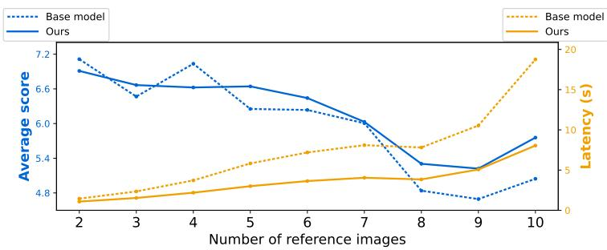  
Figure 9: Average score and latency of Ours (slow) (Flux.2-Klein) on MACRO with 2–10 reference images.

The Coarse-to-Fine Paradigms. Our downsampled self-probing mechanism aligns with the coarse-to-fine philosophy widely adopted across diverse fields outside diffusion acceleration, such as coarse-to-fine Transformer [26, 52], and high-resolution generation [29, 76]; Sparse and O(N log N) attention mechanisms [63, 72, 49] also adopt a comparable rationale, utilizing coarsegrained block selection or hierarchical structures to guide fine token-level interactions. Crucially, while they operate at the attention level, our framework instantiates a model-level coarse-to-fine paradigm: we first deploy a coarse run to probe reference token sparsity upfront, which then governs the token allocation for the subsequent fine run.

## B IMPLEMENTATION DETAILS

Our code will be made publicly available upon acceptance, containing all implementation details.

## B.1 MODELS AND INFERENCE

We evaluate on three base models: the latent-space Diffusion Transformers (DiTs) Flux.2-Klein-4B and Qwen-Image-Edit-2511, and HiDream-O1-Image, a Pixel-level Unified Transformer (UiT) that directly processes raw pixels without a VAE. Evaluating on these two architectures confirms our method is effective for diverse generic reference-based generation models. For all base models, we use their official code and default configurations. Specifically, we use 4, 40, and 50 inference steps for Flux.2-Klein-4B [4], Qwen-Image-Edit-2511 [58], and HiDream-O1-Image [6], respectively. For the probing stage, let $\tilde { T } = T / D$ denote the number of probing denoising steps. We set $\tilde { T } = 2 ( D =$ 2) for Flux.2-Klein-4B, $\tilde { T } = 1 0 ( D = 4 )$ for Qwen-Image-Edit, and $\tilde { T } = 1 0 \left( D = 5 \right)$ for HiDream-O1-Image. true cfg scale = 4.0 for Qwen-Image-Edit-2511; guidance scale = 1.0 for Flux.2-Klein-4B; guidance scale = 5.0 for HiDream-O1-Image. FlashAttention [18] is used as the attention backend. Since the attention matrix is not materialized under FlashAttention, we use a specialized Triton kernel to extract the reference utilization score. VAE slicing and tiling are enabled when inferring on samples that encounter out of memory during the VAE encoding stage. For each model, we report a quality-oriented Ours(slow) and a speed-oriented Ours(fast) by adjusting $\tau _ { 1 }$ and $\tau _ { 2 } .$ . All experiments run on a single NVIDIA H800 (80GB) GPU.

For MultiBanana [41], which does not prescribe the input reference or output target size, we use each reference at its native resolution, except that any image whose area exceeds MAX AREA = $4 0 9 6 \times 4 0 9 6$ is resized to this area budget; the last reference’s size is used as the target generation size. For Macro [14], we follow its official settings. All runs use seed 42.

Handling of Rotary Positional Embeddings (RoPE) Since the image generation models [4, 58, 6] encode spatial layouts via RoPE [51], we maintain geometric consistency for the pruned reference sequence. The preserved full-resolution tokens retain their original 2D RoPE coordinates. For the replaced low-resolution tokens representing mid-importance blocks, we assign their RoPE coordinates precisely to the spatial center of the corresponding 2 × 2 block.

## B.2 REDUCTION DECISION POLICIES

## B.2.1 RATIO-BASED DECISION (DEFAULT).

In our experiments, we adopt a ratio-based policy. Under this setting, retention proportions $p _ { 1 }$ and $p _ { 2 }$ are explicitly designated for the Full-Res Tier and Low-Res Tier, respectively. The cutoffs $\tau _ { 1 }$ and $\tau _ { 2 }$ in Eq. (1) are dynamically determined on a per-sample basis: after sorting all downsampled reference token scores $\{ \tilde { I } _ { \tilde { r } } ^ { t } \}$ at probe timestep t˜of the current sample in descending order, $\tau _ { 1 }$ is set to the score at the top- ${ \boldsymbol { \mathbf { \mathit { \Sigma } } } } ^ { - p _ { 1 } }$ percentile rank, and $\tau _ { 2 }$ is set to the score at the top- $\left( p _ { 1 } + p _ { 2 } \right)$ percentile rank. Consequently, the $\mathrm { \ t o p { - } } p _ { 1 }$ fraction enters the Full-Res Tier, the subsequent $p _ { 2 }$ fraction is substituted into the Low-Res Tier, and the remaining tokens are discarded. The primary advantage of this policy is budget predictability, providing deterministic sequence lengths.

In Table 1, we configure two operational modes for this setting: Ours(fast) and Ours(slow). For Ours(fast), we set the Full-Res Tier ratio to $p _ { 1 } = 1 5 \%$ and the Low-Res Tier ratio to $p _ { 2 } = 2 \times p _ { 1 } =$ 30%. For Ours(slow), both proportions are doubled, setting $p _ { 1 } ~ = ~ 3 0 \%$ and $p _ { 2 } ~ = ~ 6 0 \%$ . These proportions represent global budgets evaluated across all reference images for a given sample. To prevent severe inter-reference imbalance—such as a visually dominant reference image exhausting all available quotas and starving other references—we enforce a minimum retention guarantee on each individual reference image. Specifically, every reference image is constrained to retain at least $\frac { 2 } { 3 }$ of the global Full-Res ratio within its own token grid, yielding a per-reference lower bound of $\begin{array} { r } { p _ { \mathrm { m i n } } = \frac { 2 } { 3 } p _ { 1 } } \end{array}$ (i.e., at least 10% for Ours(fast) and 20% for Ours(slow)).

Timestep-Aware Ratio Shift. Because DiTs prioritize global layout planning in early steps and fine-grained detail refinement in late steps, high-resolution details are less critical early on, whereas a wider spatial context is more beneficial. We therefore dynamically modulate the retention proportions across denoising timesteps: during the earliest steps, the effective Full-Res ratio is scaled to $0 . 8 p _ { 1 }$ , while the Low-Res ratio is expanded to $1 . 2 p _ { 2 } .$ . As generation proceeds toward the final refinement steps, these scaling factors linearly transition back to 1.0 (restoring the base ratios $p _ { 1 }$ and $p _ { 2 } )$ . This dynamic adjustment slightly improves generation quality, so we adopt it in our default configuration.

## B.2.2 THRESHOLD-BASED DECISION.

We also support a threshold-based decision policy for sample-difficulty awareness, where fixed absolute thresholds $\tau _ { 1 }$ and $\tau _ { 2 }$ are applied directly to the normalized reference utilization score $\tilde { I } _ { \mathrm { n o r m } }$ Before thresholding, we normalize the raw utilization score by the total number of downsampled reference tokens of the current sample, $\tilde { I } _ { \mathrm { n o r m } } = \tilde { I } \cdot N _ { \tilde { R } } ,$ , making the score agnostic to varying reference counts and resolutions across samples. The primary benefit of this strategy is sample-difficulty awareness: for complex reference scenes requiring rich context, the model naturally allocates high attention over broader regions, automatically preserving a larger token budget; simpler references with clean backgrounds are pruned more aggressively.

## B.3 DATASETS AND EVALUATION

MultiBanana [41] is a challenging benchmark for multi-reference image generation, consisting of 3K+ samples with up to 8 reference images. For the two-reference setting, it covers 11 editing tasks including subject addition, replacement, background change, color/material/pose/hairstyle/- makeup modification, tone transformation, style transfer, and text correction. For the $\geq 3$ references setting, it includes four tasks: object composition, background composition, local attribute transfer, and global tone edit. The benchmark incorporates four difficulty axes: cross-domain diversity (e.g., mixing photos, anime, and sketches), scale and viewpoint differences, rare concept references (e.g., a red banana), and multilingual references (English, Chinese, and Japanese), comprehensively evaluating the model’s ability on multi-reference generation tasks. MultiBanana uses a VLM to score generation quality from five dimensions: Text-Instruction Alignment, Reference Consistency, Background-Subject Match, Physical Realism, and Visual Quality, each on a 10-point scale. To align with our focus on multi-reference efficiency setting, our main experiment targets all multi-reference tasks (excluding the pure instruction-based editing task in MultiBanana). We report the mean across tasks for each quality dimension.

To reduce decoding randomness, each sample is scored twice under different decoding configurations and the two scores are averaged: (1) greedy decoding (temperature = 0 and $\tt t o p \mathrm { . k = 1 ) }$ (2) Top-p sampling with temperature = 0.8, top p = 0.8, and random seed = 0.

Following the recommendation in Issue #2 of the official MultiBanana GitHub repository, we exclude the local attribute transfer samples with IDs ≤ 200, since the maintainers confirmed a promptreference mismatch bug on these samples and advised excluding them from evaluation.

Macro [14] is also a reference-based image generation dataset covering four tasks: customization (composing multiple subjects into coherent scenes), illustration (generating narrative images based on interleaved multimodal context), spatial synthesis (novel view synthesis), and temporal synthesis (predicting a future keyframe from history keyframes), each comprising 1000 samples with 1–10 reference images, in total 4000 samples. Macro evaluates each sample across multiple dimensions to compute an overall score. We report the average overall score across all samples.

Qwen3-VL [3], deployed via the LMDeploy [17] framework on an NVIDIA H800 (80GB), is used as the VLM-as-judge for the two benchmarks.

For efficiency, we report end-to-end latency (including the VAE and probing denoising stage, excluding disk I/O such as reference image reading and output image dumping), peak activation VRAM across samples, and speedup over the corresponding base model.

## B.4 DETAILS OF COMPARED METHODS

ToMeSD. For ToMeSD, we directly apply the official method to the reference image tokens before entering the DiT.

VisPruner. VisPruner [67] first extracts an importance score for each visual token from a vision encoder’s self-attention. If the encoder has a CLS token, importance is the CLS-to-patch attention; if not (e.g., SigLIP), it averages attention over the query axis. It then keeps a budget of tokens by selecting the top-scoring important subset and filling the rest via iterative cosine-similarity deduplication for diversity. For HiDream-O1-Image, we reuse the model’s built-in Qwen3-VL vision encoder to score reference tokens. For FLUX.2 Klein, the model has no vision encoder, so we fol low VisPruner’s default and use CLIP (ViT-L/14-336) for importance. Because CLIP patches do not match Flux’s VAE-packed reference tokens, we compute CLS-to-patch attention at $\mathrm { \bar { C } L I P ^ { \circ } s }$ native resolution and bilinearly map the score map onto the Flux reference grid, yielding a spatially aligned importance map for subsequent stages. Important and diverse token selection then proceeds as in VisPruner, with cosine deduplication on the packed VAE latents that enter the DiT. For Qwen-Image-Edit, we reuse the built-in Qwen2.5-VL vision encoder to score tokens. Importance is computed on the pipeline’s 384 × 384 condition views and bilinearly mapped onto the VAE-packed reference grid; VisPruner then selects important and diverse tokens with cosine deduplication on those packed VAE latents.

## B.5 EFFECTIVE ATTENTION RATIO (EAR)

The Effective Attention Ratio (EAR) in Sec. 4.5.2 is only possible when the ground-truth important region is known. While general reference-based tasks do not mark it, the object composition task in MultiBanana [41] does. Since the object composition task aims to composite the salient object in each reference image, the ground-truth important region is the salient object region in each reference image. We obtain this salient region with BiRefNet [71], which returns a soft saliency map $s \in [ 0 , 1 ]$ The map is resized to the latent grid of the reference, and (w, h) indexes a reference token on that grid.

With the region fixed, we measure the attention that generative tokens G and prompt tokens P place on each reference token inside the main denoising loop. At timestep t and layer l, their total attention to the token at $\begin{array} { r } { ( w , h ) \mathrm { ~ i s ~ } \sum _ { i \in G \cup P } A _ { i , ( w , h ) } ^ { t , l } : } \end{array}$ where $A _ { i , ( w , h ) } ^ { t , l }$ is the head-averaged attention from query i. Summing over timesteps and layers, the Effective Attention Ratio (EAR) is the share

of this attention that lands on the salient region,

$$
\mathrm { E f f e c t i v e ~ A t t e n t i o n ~ R a t i o ~ ( E A R ) } = \frac { \sum _ { w , h } \left( \sum _ { t } \sum _ { l } \sum _ { i \in G \cup P } A _ { i , ( w , h ) } ^ { t , l } \right) s _ { ( w , h ) } } { \sum _ { w , h } \sum _ { t } \sum _ { l } \sum _ { i \in G \cup P } A _ { i , ( w , h ) } ^ { t , l } } .\tag{6}
$$

Table 4 compares the unpruned base model and three ways of building the reference utilization score that drives token reduction. The quality scores in Table 4 are computed over the same samples as in Table 1 and Figure 7, whereas EAR is calculated on the object composition subset, as importance GT is only defined for this task. The reduction budget is the same in all four: the same ratio-based rule fixes how many tokens are preserved and how many are substituted. (1) Baseline (No Reduction) keeps the full reference sequence, so the main denoising sees every reference token. (2) Top-1 layer reduces tokens with the score of the single layer best aligned with the oracle importance $I _ { r } ^ { * }$ . On Flux.2-Klein-4B [4] this is layer $l { = } 1 5$ , shown in Fig. 4(b), with $\begin{array} { r } { I _ { r } ^ { l } = \frac { 1 } { T } \sum _ { t } \sum _ { i \in G \cup P } A _ { i , r } ^ { t , l } . ( 3 ) } \end{array}$ Top 20% of layers uses the mean of the top 20% best-correlated middle layers. On Flux.2-Klein-4B these are $\dot { \mathcal { L } } = \{ 1 4 , 1 5 , 1 6 , 1 7 , 1 8 \}$ , and $\begin{array} { r } { \dot { I } _ { r } = \frac { 1 } { | \mathcal { L } | } \sum _ { l \in \mathcal { L } } I _ { r } ^ { l } } \end{array}$ . (4) All layers uses the mean over every transformer block, $\begin{array} { r } { I _ { r } = \frac { 1 } { L } \sum _ { l = 1 } ^ { L } I _ { r } ^ { l } = \frac { 1 } { L T } \sum _ { l = 1 } ^ { L } \sum _ { t } \sum _ { i \in G \cup P } A _ { i , r } ^ { t , l } } \end{array}$

## C LIMITATIONS

1. This paper focuses on the efficiency drop caused by token growth when multiple reference images are used. In the single-image setting, namely pure instruction-based editing, the acceleration gain is relatively lower than in the multi-reference case.

2. The empirical validation of our framework is currently limited to multi-reference-based image generation. In principle, the underlying strategy of early downsampled self-probing to identify spatial redundancy can be transferred to broader visual tasks like ViTs, VLMs, and long video generation.