# Towards Spatio-Temporal Intelligence Systems in Urban Space: A Twin-Agent Perspective

ZHEN DONG1, HAIPING WANG2✉, WEI TU3, YUAN LIU2, BING WANG4, XUAN SUN5, JINZHOU CAO6, RONALD CLARK7, ZHIHENG FU4, MOHAMMED BENNAMOUN8, DAN-FENG HONG9, YUANZHENG CUI10, GEMINE VIVONE11, PEDRAM GHAMISI12, BISHENG YANG1, QINGQUAN LI3, DEREN LI1

1Wuhan University, 2The Hong Kong University of Science and Technology, 3Shenzhen University, 4The Hong Kong Polytechnic University, 5Nankai University, 6Shenzhen Technology University, 7University of Oxford, 8The University of Western Australia, 9Southeast University, 10Chinese Academy of Sciences, 11National Research Council of Italy, 12University of Iceland

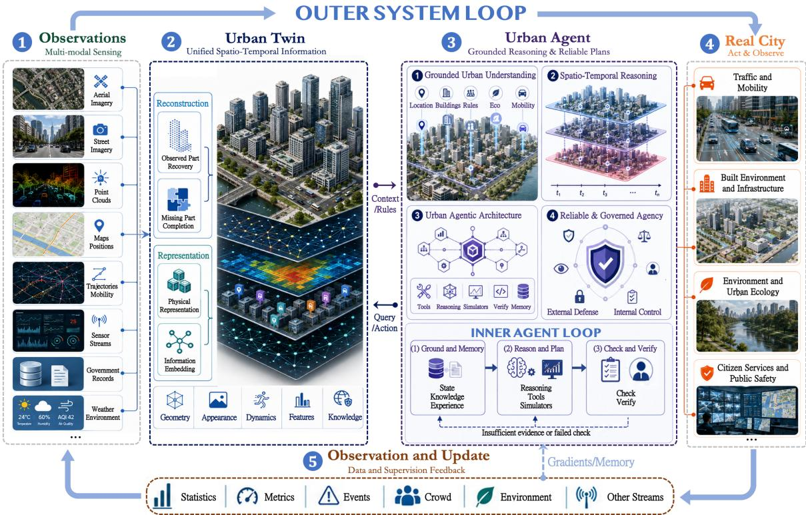  
Fig. 1. Scope of this review. With the twin-agent perspective, we review the technologies for constructing an urban twin, developing grounded urban agent, and integrating both components into a future STI system for urban domains.

Emails: Zhen Dong (dongzhenwhu@whu.edu.cn), Haiping Wang (Corresponding author, hpwang@ust.hk), Wei Tu (tuwei@szu.edu.cn), Yuan Liu (yuanly@ust.hk), Bing Wang (bingwang@polyu.edu.hk), Xuan Sun (sunxuan@nankai.edu.cn), Jinzhou Cao (caojinzhou@sztu.edu.cn), Ronald Clark (ronald.clark@cs.ox.ac.uk), Zhiheng Fu (zhiheng.fu@polyu.edu.hk), Mohammed Bennamoun (mohammed.bennamoun@uwa.edu.au), Danfeng Hong (danfeng.hong@seu.edu.cn), Yuanzheng Cui (yzcui@niglas.ac.cn), Gemine Vivone (gemine.vivone@cnr.it), Pedram Ghamisi (p.ghamisi@hzdr.de), Bisheng Yang (bshyang@whu.edu.cn), Qingquan Li (liqq@szu.edu.cn), Deren Li (drli@whu.edu.cn).

ABSTRACT. Cities must coordinate domains like infrastructure, mobility, environmental management, emergency response, and public services as conditions evolve. An urban Spatio-Temporal Intelligence (STI) system helps the city monitor citywide states, analyze problems, plan and execute interventions, and adapt through feedback, making urban governance more timely, efective, and transparent. Recent urban twinning and agentic AI techniques provide foundations for such systems. From a twin-agent perspective, this survey takes a system-level view of how these disparate techniques can be coherently integrated into an urban STI system. Specifically, we review how the twin reconstructs and represents a persistent, information-enriched urban environment, and how the agent understands the twin via interfaces, reasons over it, acts reliably, and continuously evolves with the city. Built upon this synthesis, we summarize a two-loop blueprint, where an inner agent loop for grounding, reasoning, and verification, and an outer system loop linking data, twin, agentic action, feedback, and update. We then use this to structure an STI research agenda and show how a shared prototype supports diverse urban domains.

## I. Introduction

Urban operations follow a recurring cycle: cities observe changing conditions, decide how to respond, and assess the efects of their actions [20, 288]. This cycle underpins urban domains such as infrastructure maintenance, mobility management, environmental planning, emergency response, and public services. Yet manual workflows and isolated domain systems usually draw on narrow data and perspectives, yielding delayed and inefective responses to increasingly complex citywide demands [619].

Building an urban Spatio-Temporal Intelligence (STI) system is the key to meeting such demands [237]. Such a system should unify these fragmented data and perspectives, consistently track evolving city states, reason across states and knowledge, optimize plans, apply timely and efective actions, and improve continuously through urban feedback.

Twin-agent perspective. In our previous Neural City work [99], we framed this system through a two-stage twin-agent architecture. The twin maintains a computable and evolving account of the city, while the agent grounds understanding, reasoning, and action in that state. Their coupling turns fragmented urban evidence into an operational context for city-scale analysis and intervention.

Table 1. Scope and technical depth across related reviews. “Concept” indicates an explicit framing, whereas “Techniques” indicates comprehensive coverage of its key subtopics, technical approaches, and implementation details. “✓” marks comprehensive coverage at the indicated level; “–” marks the absence of such coverage.
<table><tr><td rowspan="2">Reviews</td><td colspan="2">Twin</td><td colspan="2">Agent</td><td colspan="2">System loop</td></tr><tr><td></td><td>Concept Techniques</td><td></td><td></td><td></td><td>Concept Techniques Concept Techniques</td></tr><tr><td>Twin Reviews [41, 199, 222, 230, 391, 540]</td><td>√</td><td>√</td><td></td><td></td><td></td><td></td></tr><tr><td>Agent Reviews [100, 153, 158, 263, 404, 614, 615, 619]</td><td>一</td><td></td><td>√</td><td>√</td><td></td><td></td></tr><tr><td>System Reviews [541, 580]</td><td>√</td><td>一</td><td>√</td><td>一</td><td>√</td><td></td></tr><tr><td>This review</td><td>√</td><td>√</td><td>√</td><td>√</td><td>√</td><td>√</td></tr></table>

Related reviews. As shown in Table 1, existing reviews clarify individual parts of urban STI, but generally stop at their component boundaries. Reviews of twins cover reconstruction[41, 222, 540] and lifecycles [199, 230, 391], while leaving agentic decision-making outside their scope. On the agent side, reviews cover the core foundation models [263, 404, 614, 615, 619], spatial reasoning [100], and agentic systems [153, 158]. Across these reviews, urban states are generally treated as raw observations rather than persistent twins.

Recent papers connect twins and agents through multi-agent orchestration [541] or human-AI co-learning [580]. However, they emphasize system visions or applications and provide limited detail on how the two subsystems are constructed and coupled through state interfaces and feedback.

Scope and contributions. Our central contribution is to recast fragmented twin and agent views as a joint urban STI system, as summarized in Fig. 1. We organize the two components as internally coherent and operationally coupled subsystems. The twin constructs and maintains a persistent, operable urban state rich in information, while the agent interprets, reasons over, and acts reliably on that state. Their interface makes twin states readable by agents, while feedback returns observed outcomes to the twin and the wider system.

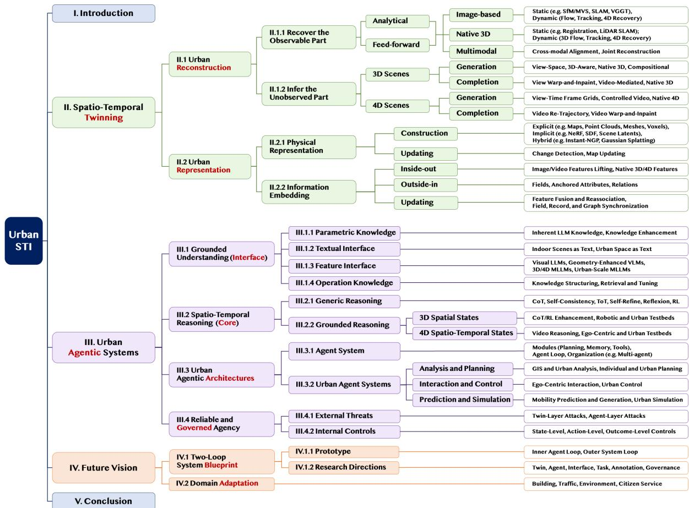  
Fig. 2. Detailed technical organization of this review. Urban twinning reconstructs, completes, represents, and enriches city states; urban agents access these states through textual and feature interfaces, reason over them, and operate through governed agentic architectures; the future vision couples both subsystems through a two-loop blueprint and adapts it across urban domains. Leaf labels summarize closely related technical topics.

This synthesis yields a two-loop blueprint adaptable across urban domains. Beyond this system coherence, as shown in Fig. 2, we provide a detailed technical account of how each subsystem is built, from twin reconstruction and representation to agent grounding, reasoning, architecture, and governance, together with their applications and limitations.

Context organization. Section II traces how urban observations are reconstructed and represented as operable urban twins. Section III examines how agents access these states, reason over them, and operate reliably in urban environments. Section IV brings both components together into an STI system, outlines its research agenda, and considers its adaptation across urban domains. Section V concludes the review

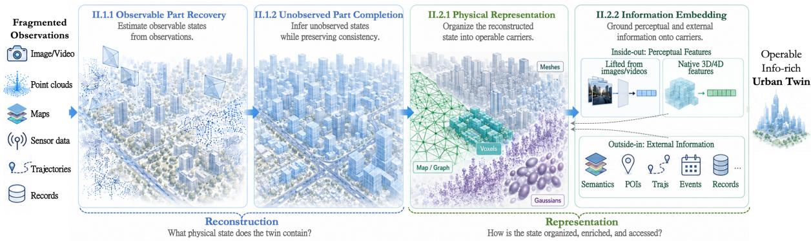  
Fig. 3. The four-stage urban twinning framework. Recovery and completion determine the physical state contained in the twin, while physical representation and information embedding organize and enrich that state for subsequent operation.

## II. Spatio-Temporal Twinning

A Vision for Twinning. Existing reviews typically organize urban scene twinning around individual technical problems, such as 3D/4D reconstruction[41], completion and generation[389, 538], or 3D representation learning[103, 149]. These reviews cover the individual components well, but give less attention to how they form an operational twin. We organize their connections through the four-stage framework in Fig. 3.

First, recovery estimates scene geometry, appearance, camera states, and motion directly constrained by observations. Second, completion infers unobserved spatial and temporal states while preserving consistency with the observed scene. Third, physical representation organizes this reconstructed state into persistent and operable carriers. Finally, information embedding grounds perceptual features and external urban knowledge onto these carriers. The first two stages constitute reconstruction, determining what physical state the twin contains; the latter two constitute representation, determining how that state is organized, enriched, and accessed.

## II.1 Urban Reconstruction

Urban reconstruction builds the physical counterpart through two complementary tasks. Metric reconstruction recovers geometry and motion supported by observations, while physical completion infers unobserved spatial and temporal states.

II.1.1 Recover the Observable Part. Given large scale observations such as images, videos, and point clouds, this part focuses on estimating urban geometry and motion directly constrained by measured evidence. Existing systems mainly follow two paradigms, specifically analytical reconstruction and feed-forward reconstruction, as organized in Fig. 4.

II.1.1.1 Analytical Methods. They cast reconstruction as a inverse problem. Given observations y, they recover a scene state by solving $\hat { \mathbf { z } } = \arg \operatorname* { m i n } _ { \mathbf { z } } E ( \mathbf { z } ; \mathbf { y } )$ , where z may include camera poses, geometry, apperance, and motion, and � encodes the observation and prior constraints. The state is optimized separately for each scene, typically through iterative or staged estimation.

Image-based Reconstruction. Early work mostly uses images to reconstruct the static and dynamic scenes.

(1) Static Scenes. A bunch of works accept an unordered image collection[2, 193] to solve the static 3D scene. They first extract handcrafted local features[295] or learned features[94, 289, 386], and then establish correspondences across views through sparse feature matching[233, 398] or dense matching[423]. Structure-from-Motion (SfM)[400] estimates camera poses and sparse 3D points through epipolar geometry and triangulation on correspondences, where Bundle Adjustment (BA)[3, 449] jointly refines the cameras and 3D points by minimizing reprojection error. Given the recovered cameras, Multi-View Stereo (MVS) estimates framewise dense depth maps or surfaces through cross-view triangulation under texture consistency[402, 493] or feature cost volume regression[572, 573, 611]. Recent neural fields[323, 484] or Gaussian Splatting methods[176, 215] fit scene geometry together with appearance by optimization, as further introduced in Sec.II.2.1.1.

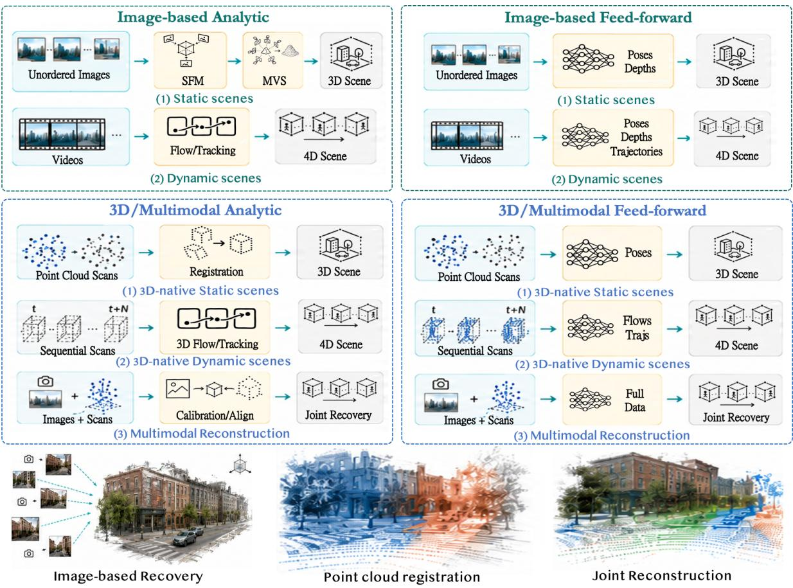  
Fig. 4. Recovering observable urban states. Analytical and feed-forward paradigms process images, 3D data, or multimodal observations to recover static or dynamic scenes.

Another line processes long, structured videos captured along moving trajectories[83]. One line assumes a static scene and focuses on camera localization and spatial mapping. Visual Odometry (VO)[125, 341] sequentially estimates relative motion from matches between consecutive frames and integrates the estimates into a camera trajectory. Visual SLAM[329, 440, 660] jointly estimates camera poses and a persistent spatial map by matching, keyframe selection and local BA. Loop closure and pose graph optimization further correct accumulated drift[430]. When additional sensors are available, IMU measurements provide gravity and motion priors[371], while GNSS observations anchor the trajectory to a global reference frame[277].

(2) Dynamic Scenes. Videos of dynamic scenes mix camera changes with scene motion. Analytical methods recover scene dynamic states at three levels.

(a) Flow. Optical flow estimates a dense 2D displacement field between adjacent frames from brightness constancy and spatial smoothness[21, 168], subsequently strengthened by robust penalties[28], gradient constancy[34], and descriptor matching for large displacements[35, 511]. With calibrated stereo[190, 304] or multiview videos[19, 364], temporal correspondence can be coupled with cross-view geometry to recover 3D scene flow, whose image projection induces optical flow[454]. These formulations recover local motion fields but do not by themselves maintain persistent identities over long sequences.

(b) Tracking. Tracking aims to recover long-term trajectories within videos. It first builds cross-frame correspondences by matching selected feature points[444], object patches[80], or learned features[451], and then consolidates noise or missing matches into temporally consistent trajectories. Particle Video[394] explicitly optimizes semi-dense long-range trajectories under appearance and neighborhood deformation constraints. DINO-Tracker[451] instead jointly adapts pretrained DINO features and a tracker to each test video for refined matching and tracking. Neural fields encode correspondence in a shared continuous spacetime representation. Neural Trajectory Fields[461] refines a smooth DCT-parameterized trajectory for each spacetime point, while OmniMotion[485] optimizes a quasi 3D canonical volume from enhanced pairwise correspondences, producing globally consistent dense tracks through occlusion. These formulations recover persistent trajectories without necessarily reconstructing a complete 4D scene.

(c) Dynamic reconstruction. Beyond motion recovery, dynamic reconstruction integrates geometry, appearance, and scene motion into a persistent 4D representation. Flow and tracks often serve as correspondence constraints or supervision. Early dynamic neural fields extend radiance field queries from space to spacetime, mapping position, time, and viewing direction to time-varying density and color[365, 461], while dynamic Gaussian methods optimize Gaussian primitives and their temporal deformation or trajectories[486, 517]. Besides joint optimization, Street Gaussians[549] decomposes the environment into a static background and tracked dynamic objects; recent FunRec[89] tracks and segments movable parts or objects by clustering to reconstruct functional 3D scenes for interaction. Broader treatments of analytical methods for flow, tracking, and 4D reconstruction are available in [41, 410, 599].

Although the image-based methods above can recover scene representations with rich appearance, their geometry may be incomplete or distorted in weakly textured areas or under illumination changes[316], and metric scale may be unavailable[400].

3D Native Reconstruction. Direct 3D observations from LiDAR or depth cameras provide accurate metric surface samples[554], shifting reconstruction from inferring geometry from images to registering and integrating geometric frames.

(1) Static Scenes. Static reconstruction from 3D observations is primarily a registration problem that aligns partial scans in a common frame[187]. Typical pipelines establish point correspondences with geometric descriptors[7, 8, 77], robustly estimate pairwise rigid transformations[373, 469, 616], refine them with Iterative Closest Point (ICP) algorithm[23], and enforce multiview consistency through pose graph synchronization[10, 135, 468]. For long streams, LiDAR SLAM performs continuous state estimation through scan-to-map registration[347, 545, 546], with loop closure and backend optimization reducing accumulated drift and maintaining global map consistency[349, 620]. Broader reviews are available in [186, 187].

(2) Dynamic Scenes. These methods accept sequential 3D observations recording dynamic scenes.

(a) Flow estimates metric displacement between adjacent scans. For instance, RGBD-SF[376] jointly optimize color and depth correspondences under semi-rigid motion constraints. ICP-Flow[269] instead associates locally rigid objects across LiDAR scans and recovers their transformations with ICP.

Then, (b) Tracking maintains long-range 3D correspondences. For instance, EulerFlow[453] estimates a continuous spacetime ODE, integrating local pairwise motion to long-range point trajectories. Lepard[250] improves feature matching between deformable scans for motion tracking and dynamic ICP modeling. Some mothods[196, 581] jointly conduct moving object segmentation and temporal association in urban LiDAR streams.

(c) Dynamic reconstruction further integrates dynamic measurements into persistent geometry. Some early work jointly optimizes deformation tracking and surface fusion of non-rigid objects[333, 662]. For scenes, under a rigid object assumption, RigidFusion[293] jointly segments, tracks, and reconstructs the static background and a large dynamic rigid object, while CoFusion[390] maintains separate 3D models for multiple independently moving objects. At the field level, 4D implicit mapping[643] fits a time-dependent Truncated Signed Distance Function to LiDAR sequences to reconstruct a consistent map without segmentation. Broader discussions are available in [90, 141]. Direct 3D observations provide metric scale and geometry, but reconstruction remains sensitive to low overlap, geometric degeneracy, and is typically textureless[90, 186, 620].

Multimodal Reconstruction. Combined image and 3D observations integrate rich appearance with accurate metric geometry, but must first be spatially aligned. For independently acquired data, the modality gap complicates cross-modal feature construction[165, 459, 471] and reliable dense correspondence estimation[211, 383], which in turn afects pose estimation such as PnP[232]. In synchronized sensor rigs, extrinsic calibration estimates a fixed cross-sensor transformation[194, 249, 264]. Once registered, photometric, geometric, and pose constraints can be jointly optimized to recover textured geometry[348, 515].

Overall, analytical methods ofer interpretable objectives, but remain sensitive to challenging observations like low overlap or textureless areas, and the optimization is computationally expensive at scale. COLMAP, for example, may take hours to reconstruct thousands of images[400, 558].

II.1.1.2 Feed-forward Methods. Feed-forward methods accelerate reconstruction with learned priors, recovering scene states through forward inference rather than optimizing each scene from scratch[41].

Image-Based Reconstruction. This branch progresses from recovering static geometry from individual images or static videos to estimating motion and consistent 4D structure from videos.

(1) Static Scenes. Feed-forward image reconstruction first matured in monocular depth estimation[25]. With vision transformers[101] and increasingly large image datasets with 3D annotations[271, 480], models achieve transferable relative depth[213, 560] and metric depth[29, 490, 583]. The target then expands from one image to stereo reconstruction[197, 492, 512], and further to joint camera and geometry (pixel-aligned depth or point cloud) recovery from multiple views[267, 475, 500, 610]. Dense cross-image attention recovers globally consistent point or depth maps, camera poses, and even instance or semantic features[112, 235, 239, 428] in one pass, trading some metric precision for robustness and speed[476, 500].

At large scales, joint multiview transformers incur quadratic cross-view attention, motivating sparse scene graphs[107], sparse or linear attention[605], KV compression[106], and parallel processing[558] to reduce memory and improve throughput. Specifically, for long videos with ordered frames, feed-forward predictions are often implemented through chunking or history compression. Chunking methods split the long video into overlapping short clips for separately lightweight prediction and align them in a common frame[92, 286, 308], but local alignment errors can accumulate as drift. Online incremental methods instead compress historical frames to compact memories for subsequent lightweight attention interaction. CUT3R[488] compresses history into a recurrent state, although states with a fixed length may forget or collapse over long sequences[57]. Later systems mitigate this bottleneck through confidence-weighted state updates[57], multi-timescale retention[74], or separate camera and geometry memories[272]. Others externalize scene content as cached spatial features[466] or trajectory contexts[52], as well as featured keypoints[70, 531] or voxels[467], allowing memory to slightly grow with the reconstruction to reduce information loss.

(2) Dynamic Scenes. Here, methods also progress from short flow and long tracking to 4D reconstruction.

(a) Flow networks predict dense displacement between adjacent frames, progressing from convolutional pyramids with local warping and cost volumes[102, 420] to recurrent all pairs matching and cost volume embedding[189, 439].

(b) Tracking extends the temporal horizon and preserves identity across time. Localized trackers propagate selected objects or small masks[22, 24, 47, 84, 379]. Query-based models maintain arbitrary points across longer clips[97, 142, 157, 212]. Dense variants approach trajectories for every pixel[332]. With estimated depth and camera motion, 2D tracks can be lifted into world space trajectories[533, 534].

(c) Dynamic reconstruction recovers temporally coherent geometry from videos of dynamic scenes, with methods difering in whether object motion is explicitly predicted. Implicit dynamics models do not explicitly output scene motion, such as trajectories or velocities, but predict only geometry and cameras at each timestep. They use dynamic masks[256] or motion-aware attention[114, 172] to suppress motion interference in reconstruction, or auxiliary flow cues to supervise or coherently align geometric predictions[115, 297, 606]. When needed, motion must be recovered subsequently by establishing correspondences across the frame predictions. Explicit dynamics models instead predict geometry together with motion, representing how points move across time as dynamic point maps[417, 418], 2D/3D trajectories or spacetime correspondences[117, 298, 474, 603], or velocity vectors[162].

3D Native Reconstruction. For static scenes, recent methods register unposed point cloud scans in a single forward pass. FUSER[202] directly predicts scan global poses by the model and refines them through difusion in SE(3) space. Register Any Point[346] instead transports the input points into a registered scene by point cloud difusion, from which the view poses are recovered. For dynamic scenes, 3D Flow networks predict metric displacement between successive RGB-D frames[441] or point clouds[134, 284, 324, 366, 525]. Beyond flow, long-range 3D tracking still focuses mainly on segmenting moving LiDAR objects[59, 321] or detecting and associating rigid objects into trajectories[582]. Early attempts at long-range tracking of arbitrary points across 3D data sequences use recurrent architectures[111], neural field fitting[463], or multimodal tracking[378], but the challenge remains open[472].

Multimodal Reconstruction. Feed-forward fusion of image and point cloud observations first emerged in RGB guided depth completion, where an aligned image completes a partial depth map[431, 502]. MapAnything[214] and OmniVGGT[357] extend this paradigm to multiview reconstruction, jointly processing heterogeneous but incomplete collections of images, depth maps, and camera priors to recover geometry in a common scene.

Overall, feed-forward methods provide eficient, scalable, and robust reconstruction through learned end-to-end inference. Their limited interpretability and weaker long-range geometric consistency, however, leave analytical optimization important for fine-grained metric accuracy[308]. Hybrid systems that combine both paradigms may therefore provide a stronger balance of speed and accuracy[52].

II.1.2 Infer the Unobserved Part. Physical completion infers unobserved spatial structures, appearance, and temporal states from incomplete states. Unlike reconstruction, which mainly estimates what is directly constrained by sensor evidence, completion asks how far a system can extrapolate beyond that evidence while still remaining faithful to the particular observed scene[389, 539]. Recent completion methods increasingly draw on advances in generative modeling[538], making the boundary between completion and generation less distinct. We therefore review both, mainly at scene scope, as shown in Fig. 5.

II.1.2.1 3D Generation. Generation synthesizes new 3D content from prompts, images, or other conditions. Early 3D scene generation relied heavily on procedural rules and handcrafted pipelines, ofering controllability but limited diversity and realism[124, 327, 353, 538].

Inspired by developments in image difusion[49], video difusion[319], and interactive world models[36, 300, 438], recent methods increasingly use generative priors to produce 3D content.

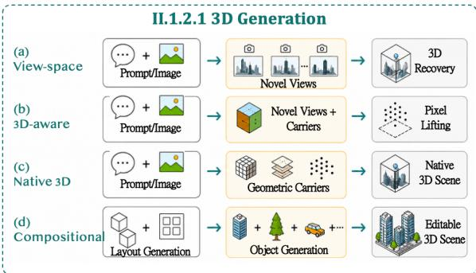

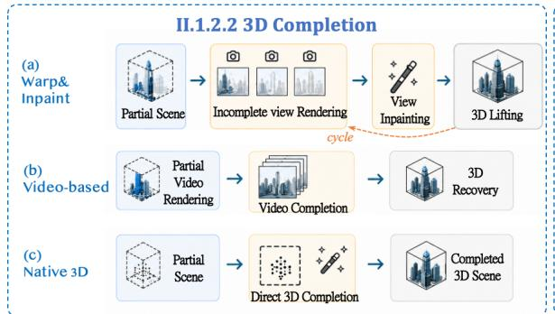

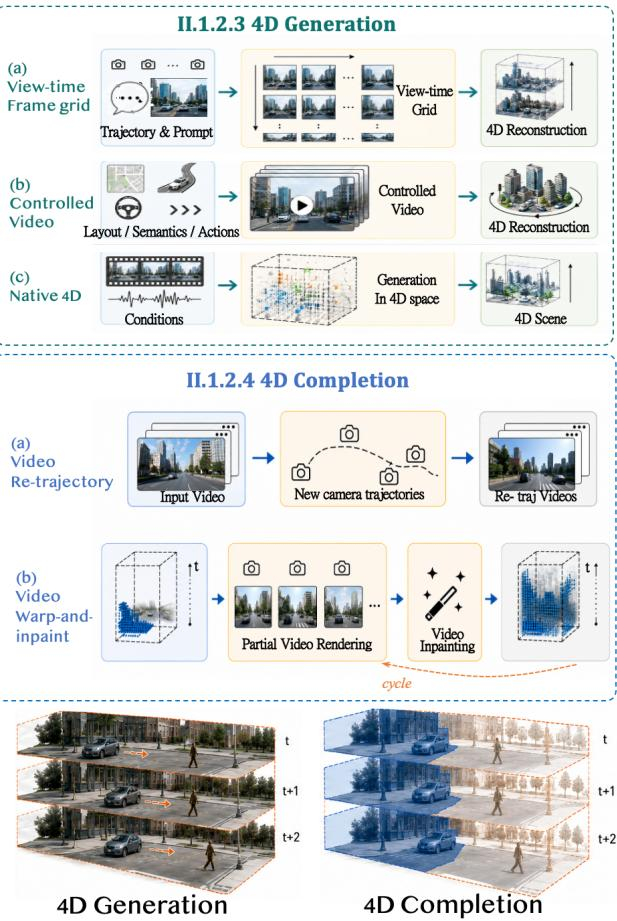

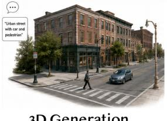

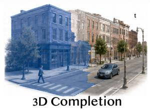  
Fig. 5. Inferring unobserved scene states. Generation synthesizes new 3D scenes or 4D evolution from weak conditions, whereas completion extends partial scene observations while preserving consistency with the measured spatial and temporal evidence.

(a) View-space generation. Methods such as CAT3D[130], Stable Virtual Camera[647], and NVComposer[243] synthesize novel views under a given camera trajectory from single or sparse inputs. The generated views can then provide additional evidence for reconstructing the underlying 3D scene.

(b) 3D-aware generation. This route couples view generation with explicit 3D signals or carriers. WVD[608] jointly generates RGB and XYZ frames, while Wonderland[259], Prometheus[565], and Bolt3D[429] predict multiview and pixel-aligned 3DGS carriers for fast scene level generation.

(c) Native 3D generation. These methods generate directly within 3D representations. DifIndScene[210] synthesizes indoor TSDF-based meshes through difusion over 3D voxels. Sat2Scene[254], Sat2City[175] and Sat3DGen[369] map satellite observations to 3D city distributions through 3D voxel- or triplane-based difusion. GaussianCity[537] and ScenDi[145] directly generate 3D Gaussian primitives for novel scenes. Tile-based methods[48, 109] construct coherent large scale scenes by treating each city tile as a self-contained local world and jointly optimizing neighboring tiles for seamless integration.

(d) Compositional generation. A complementary direction combines asset and layout generation to support embodied interaction and digital twin composition[253]. For instance, SAM 3D[58] produces editable assets from segmented image regions; PhysX-Anything[42] further targets physical assets, and graph or layout priors then arrange the above generated assets into coherent and editable scenes[266].

II.1.2.2 3D Completion. In contrast, completion extends a measured but incomplete 3D representation while preserving consistency with its observed regions. Early spatial completion filled small missing samples through local interpolation[223] or surface fitting[87, 413]. Later learning methods expanded the target from local surfaces to geometric scene volumes[85], densified point distributions[225, 356, 555, 604], and semantic occupancy fields[387, 388, 411, 443, 496, 509, 624]. However, these methods still capture scene geometry only coarsely and provide limited texture modeling. Recent generative completion focuses on complating realistic scene distributions, allowing novel view synthesis and following three main families.

(a) View-wise warp-and-inpaint. One family iteratively renders incomplete new viewpoints from a partial scene, applies RGB/depth inpainting to the partial rendering[231], and lifts the completed area back into the 3D scene for extension[56, 79, 470].

(b) Video-mediated completion. Another family renders a partial scene as an incomplete visual or feature video, uses video difusion to complete it, and then reconstructs or fuses the generated observations back into 3D[40, 68, 274, 385, 591].

(c) Native 3D completion. A smaller line directly uses 3D difusion optimization to complete spatial structure in 3D space[634]. Broader analyses of 3D scene generation and completion are provided in recent surveys[433, 538].

II.1.2.3 4D Generation. Compared with 3D generation, which focuses on cross-view geometric and appearance consistency, 4D generation must additionally coordinate scene dynamics. Video difusion provides the dominant generative prior[32, 319, 457].

(a) View-time frame grid generation. A representative formulation organizes 4D content as a structured viewtime frame grid[523], whose generated multi-view and multi-time frames provide dense evidence for downstream 4D reconstruction[517]. Given single or sparse observations, these methods fill the grid by coordinating fixed-time multiview slices with fixed-view temporal slices[427, 464, 631]. Scaling this grid further motivates curated 3D/4D data construction[523, 631] and sparse attention for eficient cross-grid communication[224].

(b) Spacetime controlled video generation. Beyond appearance coherence, this line constrains video generation by structured layouts, physical attributes, and actions. In driving scenarios, 3D bounding boxes[54], HD maps[6, 384], and semantic voxels[302] control the layout of generated trafic videos. More generally, 3D tracking videos provide a unified interface for camera control, motion transfer, and object manipulation[140]. Dynamic Gbufer[262] sequences condition video generation on editable physical properties like geometry, material, and lighting channels. Actions directly specify scene evolution. Recent world models[438, 658] use motion actions to control video camera trajectory evolution while requiring the underlying 4D scene to remain consistent. Physical methods instead treat actions as interactions with the scene, using simulator rollouts to condition the trajectories or deformations of objects in generated videos and thereby preserve the physical plausibility of scene evolution[258, 460]. These generated videos can subsequently be converted into explicit 4D representations through downstream reconstruction[517].

(c) Native 4D generation. Rather than treating video as the endpoint, recent methods directly generate explicit 4D states. For example, DynamicCity[27] produces large-scale 4D semantic occupancy, Aether[658] and 4DNeX[69] extend video generation to predict pixel-aligned depths or dynamic point clouds, and Dif4Splat[344] maps video difusion to dynamic Gaussian Splatting generation. Further details are available in recent reviews[222, 322].

II.1.2.4 4D Completion. Earlier temporal completion extrapolated beyond the observed object trajectories[331, 393], flow[309], or 4D occupancy[564, 635]. Detailed reviews are available in [188, 222] and agentic mobility prediction is discussed separately in Sec. III.3.2.3. Here, we focus on completing the recovered 4D distribution at the scene level, preserving identity and geometry while jointly completing scene appearance and evolution. Object trajectories, flows or occupancies form one part of the underlying dynamics.

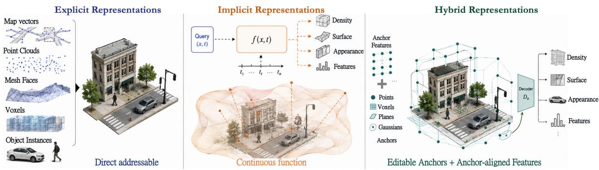  
Fig. 6. Three forms of physical representation. Explicit representations enumerate directly addressable primitives, implicit representations encode continuous scene functions, and hybrid representations atach learned features or atributes to explicit spatial anchors.

(a) Video re-trajectory is a related task rather than completion by itself. It re-renders input video along a new camera path without necessarily constructing a persistent dynamic field[590]. Nevertheless, its camera conditioning mechanisms[14, 354, 499] and synthetic multiview video training data[14, 15] provide useful priors for separating camera motion from native object dynamics.

(b) Video Warp-and-inpaint. A typical 4D completion pipeline first renders partial observations along a novel camera trajectory, uses video difusion to synthesize the missing evidence, and then reconstructs or fuses the completed observations back into the scene[51]. Repeating this process progressively extends persistent 4D carriers through warping, inpainting, and final denoising[150, 282, 296]. Driving systems further introduce dynamic point or LiDAR as conditions to preserve motion and consistency in completion[482, 550]. Across these variants, the central challenge is preventing iterative completion from accumulating geometric drift, distortion, and identity inconsistency[179].

## II.2 Urban Representation

Urban representation turns reconstructed urban states into an operable twin through two complementary tasks. Physical representation organizes geometry, appearance, and dynamics into persistent and updatable carriers, while information embedding grounds perceptual features and external urban knowledge on these carriers.

II.2.1 Physical Representation. Physical representations use mathematical models or structures to organize reconstructed geometry, appearance, and dynamics for rendering, querying, and interaction. Here we introduce how these representations are constructed and updated.

II.2.1.1 Representation Construction. Based on how scene information is stored, physical representations of urban twin can be divided into the explicit, implicit, and hybrid forms illustrated in Fig. 6.

Explicit Representations. Explicit representations store scene information in predefined geometric primitives, such as maps, points, and objects. At the early stage, vector structures such as OpenStreetMap[151], HD maps[108], and scene graphs[9, 123] mainly encode urban entities and their relations by vectors or records. Raster 2.5D products, such as digital elevation models[403] and digital surface models[415], support large area terrain and surface analysis. Standardized city modeling formats, such as CityGML[137] and IFC[456], further define levels of detail for large scale cities[66]. These abstractions support eficient query and record linkage, but often omit fine geometry, appearance, and temporal variation.

For higher fidelity, point clouds[400, 554] densely sample surfaces but lack explicit topology. Meshes[63, 652] support rendering and simulation by defining surface topologies but remain sensitive to holes, irregular topology, and reconstruction noise. Voxels and sparse grids[76, 82, 222] facilitate learning and volumetric computation but discretize continuous space. Object-level CAD and BIM elements provide structured entities, yet ofer limited coverage of open world objects and visual variation[137]. Overall, explicit representations provide interpretable geometry and can describe temporal evolution as sequences[472], but their predefined structures can become inflexible and costly for high fidelity appearance, frequent updates, and complex dynamics.

Implicit Representations. Implicit representations encode scene information as learnable and structural functions such as MLPs or compact latent codes instead of enumerating geometric elements. Neural radiance fields[18, 323, 432, 452] represent a scene as a MLP that maps 3D positions and viewing directions to density and view dependent radiance, enabling photorealistic novel view synthesis through diferentiable volume rendering. Surface neural fields instead map coordinates to signed distance or occupancy[359, 409, 484]. Extending the query domain from space to spacetime further enables implicit fields to model dynamic geometry and appearance[365, 552, 643]. These lightweight formulations represent high fidelity geometry, appearance, and features continuously.

The cost is the expensive scene specific optimization, especially for the large urban scenes. For example, Block-NeRF[432] reports over 9 hours on 32 TPU v3 cores to reconstruct a single 100 m × 100 m street segment. Besides acceleration techniques[132], some recent neural scene encoders use feed-forward scene latents to represent the scene from multiview inputs, replacing the per-scene optimization with learned priors[201, 206, 506]. These fixed-length latents serve as compact scene proxies that can be decoded eficiently into novel views[201] or geometric structures[506].

Implicit representations can also easily encode semantics[216, 641], material attributes[290], and additional sensing modalities such as infrared signals[577]. However, such implicit forms reduce interpretability, making local editing less direct than with explicit representations.

Hybrid Representations. Hybrid representations store scene information in explicit spatial anchors with learnable features or attributes.

Compared with purely explicit forms, they allow a smaller or coarser set of anchors to embed and carry richer scene information. Typical anchors include points[544], sparse hierarchies[642], sparse grids[33, 328], or planes[45]. Gaussian Splatting (GS) has recently emerged as an important hybrid representation. 3D GS[215] represents a scene with explicit anisotropic Gaussian kernels carrying optimizable position, covariance, opacity, and appearance attributes for fast visual rendering. For improved geometry, methods align Gaussians with implicit surfaces[348] or replace the kernels with oriented planar disks[176]. For dynamic scenes, methods adopt native 4D Gaussians for spatio-temporal modeling[569] or attach deformations[517, 542] or trajectories[486] to the 3D primitives.

The explicit anchors enable eficient local access and editing comparing with purely implicit forms, without losing the learned part to recover continuous geometry, appearance, and semantics[146]. However, when apply such good properties to urbans, the main limitation is also the scale. Naive 3DGS may contain millions or billions of Gaussian primitives to represent cities[113], yielding slow training and rendering. We thus need techniques like distributed optimization[64, 627], sparsification[113, 310], hierarchical organization[301, 381], and software or hardware acceleration[116, 229, 382, 578].

II.2.1.2 Representation Updating. Unlike a 4D representation that models motion within an observed interval, long term updating reconciles separately acquired sessions as the physical city changes. This process involves two related problems.

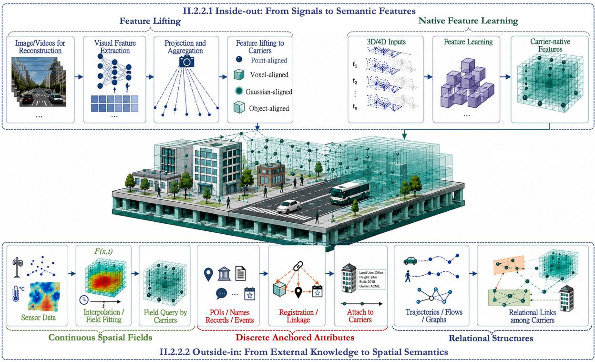  
Fig. 7. Strategies for embedding information in an urban twin. Inside-out methods lift or learn semantic features from reconstruction signals, whereas outside-in methods ground external fields, atributes, and relations on twin carriers.

Change Detection. Change detection compares cross-temporal observations to locate and classify additions, removals, and other persistent changes before updating the carrier. Typical methods construct handcrafted[448] or learned features[88] for registered multi-temporal images[640], point clouds[448, 504], or other observations, and predict change masks or semantic change classes through nearest neighbor comparison[504], siamese or latent space comparison[88, 640], or learned cross-temporal prediction[448, 601, 607]. For broader coverage of 3D urban change detection, see [416].

Map Updating. Map updating incorporates confirmed changes into the scene carrier. For explicit representations, lifelong LiDAR mapping[218, 561] aligns point cloud maps acquired across sessions, identifies positive and negative changes, and selectively edits the corresponding geometry. For implicit and hybrid representations, scene editing has advanced rapidly in small scale settings. Methods first localize target regions or entities through segmentation[576] and cross-time association[380], then support instruction modification and controlled deformation[61, 156, 446, 519]. These capabilities show potential for city scale updating; a broader taxonomy is available in [654].

II.2.2 Information Embedding. Information embedding operates on top of the reconstructed physical twin, augmenting its carriers with semantic features, external records, and relations. Inside-out features are extracted from the data, such as images, videos, and point clouds, used to reconstruct the physical scene itself, whereas outside-in information is introduced from auxiliary observations and external knowledge through spatial registration, entity linkage, or field construction. Fig. 7 illustrates how both directions enrich the same carriers.

II.2.2.1 Inside-out: From Signals to Semantic Features. Inside-out embedding extracts semantic features from the reconstruction data to insert/link to corresponding carriers. Because task-specific features are better covered by reviews of their respective objectives[149], we focus on reusable feature interfaces for downstream tasks. The discussion progresses from image and video features to representations lifted onto or learned natively from persistent 3D/4D carriers.

Image Features. Large scale image pretraining produces complementary general purpose representations. Vision-language alignment equips CLIP[377] and SigLIP[600] features with open vocabulary semantics for categories and attributes. Mask supervision enables SAM[219] to delineate promptable regions and object boundaries. Self-distillation allows DINOv2[342] to capture dense correspondences across visual variations. Masked reconstruction and latent prediction further encode contextual regularities in scene layout and object organization, as demonstrated by MAE[159], I-JEPA[12], and LingBot Vision[128]. VAE-based learning, in turn, constructs generative latent spaces that compactly encode image structure and semantic content[49]. At Earth scales, AlphaEarth[33] and SkySense++[520] extend representation learning to multimodal satellite observations. Because these representations are not tied to fixed label sets, they transfer across diverse scenes and visual conditions.

Video Features. Video features extend appearance and semantics with temporal structure. Video-language pretraining introduces transferable open-vocabulary semantics to video features[30, 497, 628]. Masked reconstruction learns spatio-temporal context by recovering pixels, as in VideoMAE and VideoMAE V2[447, 481], whereas V-JEPA and V-JEPA 2[11, 17] predict masked video latent features to capture underlying temporal dependencies and physical properties. Generative pretraining uses video tokenization and latent compression to learn compact spatio-temporal representations that preserve the structure required for reconstruction and synthesis[32, 457, 478, 568, 589].

Features Lifting. Despite the strong representational capacity, the above image and video features remain view-centric, lying in image planes or structural latent spaces rather than physical coordinates. Information embedding must therefore align and lift them onto 3D/4D carriers, progressively moving from points to instances.

(a) Point-level features associate each scene carriers with a visual or language embedding. ConceptFusion[198] and OpenScene[358] directly project and aggregate pretrained image features at 3D points. LERF[216], LangSplat[370], and GAGS[361] instead distill 2D language features onto radiance fields or Gaussian primitives for openvocabulary querying. 4D LangSplat[245] extends this approach to 4D by supervising dynamic Gaussian fields with video descriptions.

(b) Instance-level features lift multiview 2D masks into 3D to preserve object identity and boundaries. Early methods like SAM3D[566], SAI3D[585], and MaskClustering[548] directly project 2D SAM masks onto point clouds for 3D instance masks by mask merging or clustering. Later methods replace explicit mask merging with learnable instance embeddings on diferentiable scene carriers. For instance, Gaussian Grouping[576], SAGA[44], and Unified-Lift[659] use rendered 2D SAM masks to supervise identity or afinity features on Gaussian primitives through 3D consistency regularization, contrastive objectives, or object level codebooks. LEGO[360] further lifts SAM masks into a 3D consistent hierarchy for levelwise Gaussian identity feature distillation. These instances can be organized into scene graphs by assigning LLM-inferred relations[138, 360, 602], or tracked across time to form 4D graphs[556].

Native 3D/4D Features. Besides lifting, some methods directly learn carrier-aligned features explicitly from 3D/4D carriers such as point clouds. This paradigm first matured on object data. Masked modeling learns transferable shape features[351, 592], VAE learning builds structural latents ready for generation[532], while multimodal alignment connects them with image and language semantics[547, 648].

At the scene level, native 3D representations, most commonly learned from point clouds, must additionally encode spatial context, heterogeneous scales, and relations. With scalable architectures such as sparse convolution[82] and point transformers[527], native 3D feature learning adopts contrastive learning and selfdistillation to capture spatial context[170, 526, 528, 626]; masked point or voxel modeling to describe geometric structure[1, 163]; instance-aware objectives to preserve object separation and local organization[553]; VAE-based learning to construct generative latents[145, 175, 369]; and cross-modal distillation to introduce open-vocabulary semantics[53, 177, 358, 622]. Scaling these objectives across heterogeneous indoor, outdoor, and object data increasingly moves native 3D features toward a shared cross-domain space[623].

For dynamic 4D observations such as point cloud sequences, existing methods learn features that remain invariant across temporally correlated frames[182], preserve object identity across tracked point clusters[529], or jointly encode shape and motion by reconstructing masked point tubes or features[405, 625, 663]. These representations remain concentrated on particular RGBD, LiDAR, or action datasets, leaving general scene level 4D features an open problem

II.2.2.2 Outside-in: From External Knowledge to Spatial Semantics. Outside-in embedding grounds observations and knowledge that are not contained in the primary reconstruction signals in the physical twin. According to their spatial support, these data take three main forms, specifically continuous spatial fields, discrete anchored attributes, and relational structures such as trajectories, flows, and graphs.

Continuous Spatial Fields. Continuous spatial fields provide values throughout the spatial or spatio-temporal domain required by the twin. Dense geographic observations that already cover the twin, such as registered thermal imagery, can be encoded directly as feature fields[299]. Other georeferenced data provide only sparse samples. These may be physical measurements, such as temperature and air quality from sparse sensors[4, 244], or society observations derived from administrative and social sensing data, such as crime risk and urban sentiment[131, 174]. Both can be expanded into continuous fields with techniques like interpolation, spatial aggregation, or learned sparse-to-dense models[81, 247]. The resulting field F(x, �) can be queried directly by location x and time �, or sampled at relevant twin carriers and stored as their attributes, in text or features.

Discrete Anchored Atributes. Discrete anchored attributes attach information to identifiable objects, regions, events, or time intervals rather than defining values throughout continuous space. POIs and place names[425], descriptions[50], land use and functional zone labels[62, 571], administrative records[151], and event text[98] can all be retained as external textual records or encoded into features[421] and linked to their corresponding regions.

Relational Structures. Relational structures preserve dependencies that cannot be reduced to independent locations or entities. Trajectories retain the ordered locations and states of individual entities[119, 352]; flows aggregate movement between spatial units[278]; and spatial or knowledge graphs encode connectivity and high order relations among urban elements[205, 285, 340]. These structures may be linked to physical carriers through identifiers or encoded as trajectory-, node-, and edge-level features for message passing[207, 422]. Broader taxonomies are available in related reviews[205, 352].

II.2.2.3 Continual Information Updating. As new data arrive, information associated with scene carriers must be updated in coordination with the physical representation. This is necessary both when unchanged carriers acquire revised attributes and when physical carrier changes, requiring their information to be changed or reassociated.

Inside-Out Updating. Features and semantics extracted from new sensor observations are registered to their physical carriers. For a retained carrier, repeated labels or embeddings can be fused to refine its attributes through aggregation or merging[317, 318]. When carriers physically change, however, changes to objects must be detected, moved or reassociated, and their associated features updated or replaced[203, 279].

Outside-In Updating. New external information is synchronized with the corresponding carriers. Similar to the above embedding techniques, streaming sensor samples can continuously revise spatial fields through incremental interpolation or optimization[261]. Discrete records and events can be inserted, replaced, or invalidated through identifiers[98]. Relational structures require corresponding structural updates. Trajectories and flows are extended or revised as new states arrive, while graph edges are rewired when their nodes change[164]. Agentic construction can automate these operations at scale[71, 339]. Broader papers are reviewed in [192].

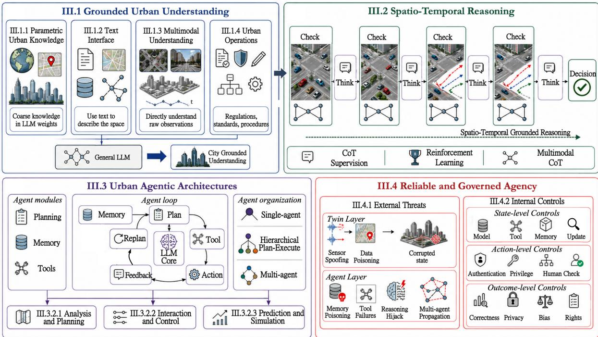  
Fig. 8. The four-layer organization of urban agent. General language models are grounded in city evidence, strengthened with spatio-temporal reasoning, embedded in agentic architectures, and constrained for reliable operations.

Together, reconstruction and representation turn urban observations and external information into persistent, operable twin states. These states provide the foundation for the following urban agentic systems utilization.

## III. Urban Agentic Systems

A Vision for Urban Agent. If the urban twin defines what city state is available, the urban agent determines how that state is accessed, interpreted, reasoned over, and acted upon. The key challenge is therefore not merely to build stronger LLMs or agents[303, 395], but to ground their decision loop in the state constructed in Section II. We organize this discussion into four layers of urban agent, as illustrated in Fig. 8.

Typically beginning with general LLMs, first, grounded urban understanding determines how city-specific evidence become available to them by interfaces. Second, spatio-temporal reasoning emphasizes whether entities, dynamics, and relations remain correct during the reasoning. Third, urban agentic architectures place this reasoning core within a stateful loop of planning, memory, tools, execution feedback, and replanning, supporting urban analysis and planning, interaction and control, as well as prediction and simulation. Finally, reliable and governed agency protects this loop from external manipulation and constrains its internal operations. The first two layers establish a city-grounded decision core; the latter two turn it into an accountable operational system.

## III.1 Grounded Urban Understanding

The key to grounded urban understanding is the interface through which agents read the urban twin[169, 614, 615]. As summarized above, twin states, including inside-out and outside-in information, are exposed in two forms, specifically textual records and features embeddings. In this section, we first discuss the drawbacks of LLM prior urban knowledge, and then review how textual and feature interfaces enable LLMs to understand urban space. In particular, we separately emphasize urban operational knowledge, which is essential for understanding how cities function.

III.1.1 Parametric Urban Knowledge. Parametric urban knowledge comprises geographic concepts and city information stored in LLM model weights[100, 313], without querying the twin.

Inherent Urban Knowledge. Pretraining on massive text corpora already gives LLMs a coarse “virtual Earth”. GeoLLM[313] extracts these knowledge with coordinates and prompts constructed from map data, while CityLens[281] finds that visual large language models can infer socioeconomic conditions from urban imagery. However, this awareness is biased across regions and scales. Geographic bias studies[110, 312] reveal systematic regional disparities, with higher factual errors in under-represented regions such as sub-Saharan Africa than in North America[325]. GPSBench[450] further shows that performance declines from country-level to city-level knowledge. Inherent parametric awareness is therefore a useful prior, yet remains insuficient for detailed city-scale analysis and planning[630].

Knowledge Enhancement. Some methods strengthen this implicit spatial knowledge through continued pretraining on geoscience text, as in K2[91] and GeoGalactica[270], or supervised fine-tuning on city-[120] and earth scale[313] tasks. Urban-R1[489] instead uses reinforcement learning to reduce cross-region disparities in urban profiling. These methods improve urban awareness, but their knowledge remains bounded by the training geography and is dificult to update[100].

III.1.2 Text as an Intermediate Spatial Interface. Textual interfaces expose twin states as language, records, graphs, or database query results[50]. They can encode inside-out information by caption or description, as well as textual outside-in information, such as POIs, social records, and knowledge graphs.

Indoor Scenes as Text. A common indoor pipeline[138] first detects or segments objects from images or reconstructed 3D scenes[43, 379]. It then converts object attributes and relations into text or text-aligned embeddings[377], and organizes them as contexts or scene graphs. These textual representations can directly be read and selected by LLMs for scene understanding[138], object grounding[557], navigation[522], and planning[330]. This approach is lightweight because it reduces a complex scene to a small set of objects and relations. It is also interpretable and easy to update[306].

Urban Space as Text. Some methods transfer these pipelines and advantages to urban space. However, cities contain many more entities, attributes, and relations, recorded across heterogeneous data modalities. Urban methods therefore address two additional problems: how to structure heterogeneous city data and how to retrieve only the evidence needed for a task.

Early work relied mainly on maps, which already abstract the city into objects and spatial relations[151], and focused on efective information retrieval. These approaches translate language requests into structured map database queries[458], coupling well-designed filtering strategies for more precise information grounding[587]. Then, knowledge graphs provide a richer textual structure. For instance, urban state graphs connect physical urban entities and records[285, 339, 340]. Other graphs encode geospatial workflows[260], possible causal relations among urban factors[122] to support LLM analysis.

Later work broadens textual information attached to maps and graphs. Historical trajectories supplement POI retrieval for travel planning[334]. LifePlanner[98] anchors noisy social media observations to OSM entities, while SpatialLLM[50] attaches captions from imagery and point clouds to a map-based spatial skeleton. These interfaces make heterogeneous urban evidence searchable and traceable.

However, text interfaces work well for textual information linked to a twin[98], but cannot fully convey its appearance, metric geometry, motion, or latent features and fields[195]. Moreover, general LLMs are proven to be weak at recovering spatial distributions from textual relations[133], with performance on complex spatial analysis far below human levels[630].

III.1.3 Multimodal Feature Interface. Multimodal feature interfaces, beyond textual abstraction, directly expose detailed carrier features to the latent space of LLMs for direct spatio-temporal understanding. Existing studies mainly focus on inside-out features built from images/videos and 3D/4D carriers.

Visual LLM Foundations. The foundations of multimodal LLMs (MLLM) were established largely through research on image[276] and video[234, 238] understanding, termed Visual LLMs (VLM). A typical VLM uses a modality encoder to compress an input image or video to features, a lightweight adapter to map the visual features into the language space, and an LLM backbone to interpret the aligned multimodal content. Research has therefore progressed from pretraining visual encoders[154, 184, 377, 600] and designing lightweight adapters[5, 86, 240, 655], to jointly tuning the adapter and LLM backbone with visual instructions[166, 181, 275]. Recent work increasingly trains the above full architecture end-to-end[16, 437]. Native multimodal models further represent and process diferent modalities within a unified sequence[495], which enable multimodal understanding and generation by a single model[191, 436, 530]. Although these advances make visual observations accessible to LLMs, they remain centered on 2D semantic alignment and still struggle with viewpoint changes[220, 649], metric scale[46], and 3D relations[273, 292].

Geometry-Enhanced VLMs. A first response still preserves the image/video interface while introducing geometric supervision or position encoding, i.e., feature lifting. Specifically, VLM3[39] uses dense geometric tasks such as depth estimation, image matching, and camera pose objectives for geo-awareness supervision, while LLaVA-NeXT-Interleave[238] introduces multiple images and 3D tasks like grounding to facilitate spatial understanding. SpatialRGPT[73] further combines region masks with RGBD metrics for 3D awareness. More directly, SpatialVLA[374], Video-3D LLM[633], and GPT4Scene[368] provide the LLM with pixel-aligned 3D coordinates or spatially consistent labels as additional channels for spatial perception. Lmm-track4d[236] extends this approach with ray-time geometry embeddings for 4D awareness. However, these methods still divide a complete scene into separate multiview observations, limiting holistic scene understanding.

3D/4D MLLMs. To avoid fragmenting a complete scene across multiple views, another line of work represents the scene directly in 3D or 4D for LLM processing. These methods encode spatial representations in diferent ways. They may use multiview lifting features[127, 167, 653], 3D object features and scene graphs[178, 503, 648], native 3D scene features[55, 315, 350, 506], native 4D features extracted from dynamic scenes[93, 424, 646]. These features are then aligned with LLM latent space through an MLP[167], Q-Former[434], or cross-attention adapter[180, 645] projection. Then, the LLM is trained for 3D perception like grounding, question answering, and spatial instruction following[55, 180, 350, 367]; 3D spatial analysis and planning[241]; as well as unified 3D understanding, generation, and editing[161, 574, 575]. In 4D space, it further supports dynamic tasks like 4D recognition[93, 646], tracking[424], dynamic scene graphs[524], and 4D generation[645]. However, most studies remain focused on indoor or small-scale scenes, whose object density, sensor diversity, and temporal updates are much simpler than those of a city.

Urban-Scale MLLMs. Building on these architectures, urban-scale MLLMs process features from heterogeneous spatial data[257]. These data include visual and geometric observations from LiDAR[563], Bird’s Eye View (BEV)

images[96], street maps[455], city maps[638], multiview driving scenes[661], etc.. They also include dynamic urban records, such as human trajectories[136, 209] and socioeconomic activity over time[208, 594].

Recent systems couple multiple urban data sources to move from basic perception toward advanced urban tasks[169, 637]. OmniGeo[593] combines satellite imagery, geospatial metadata, and text for diverse GeoAI tasks. UrbanLLaVA[121] integrates imagery, maps, and trajectories to reason across local and global urban views for tasks such as navigation and localization. CityAnchor[242] combines maps, images, and point clouds for coarse-to-fine object grounding, while 3DCity-LLM[65] models objects, relations, and global scenes for scene analysis and planning. City-VLM[426] fuses images and point clouds from various platforms for answering localization, measurement, functionality, and logicality problems. LifePlanner[98] instead grounds up-to-date socialmedia evidence in maps to support multi-target geospatial planning.

Multimodal training can ground LLM understanding in the spatial distributions and latent features or fields within an urban twin, ofering substantial potential. However, this direction remains at an early stage. Existing datasets often cover only a few districts or cities[121], contain a limited range of urban modalities, and focus mainly on predefined perception, navigation, or spatial computing tasks[50]. Scaling urban MLLMs therefore requires broader geographic range, richer multimodal data, and benchmarks that cover more open-ended urban tasks.

III.1.4 Understanding Urban Operations. Urban operational knowledge is a critical outside-in component, typically expressed as records or graphs extracted from regulations or other documents[567] and understood by textual interfaces. Unlike observations that describe what is happening, it provides domain and up-to-date knowledge of how urban functions to general-purpose LLMs.

Early work focused on extracting and structuring it from regulations or government documents. For instance, OntoZoning[407] represents zoning types, permitted uses, and programmes in an ontology linked to geospatial data, enabling cross-domain queries through a knowledge graph. Another study[612] extracts targets and actions from the Guangzhou Master Plan into a knowledge graph for eficient retrieval.

Recent systems ground LLM analysis in such knowledge. For instance, PlanGPT[657] collects files like study materials, professional Q&A, textbooks, government documents, and oficial plans. Retrieval or tuning with them supports LLMs on tasks like professional text generation, style transfer and information extraction. Planning chatbot[650] retrieves municipal bylaws and zoning regulations for accurate LLM-based regulatory queries. ULLM-KG[38] designs domain knowledge graph construction, usage, and updating strategies to enhance LLM reasoning for fault diagnosis and maintenance recommendations in urban rail transit signal systems. DriveReg[37] retrieves trafic rules and guidelines relevant to the on-hand situation, then evaluates actions by legal compliance and safety with LLMs. GSI Agent[491] builds a database from municipal manuals, planning documents, and inspection forms, supporting LLM fine-tuning, retrieval, and agentic usage for Green Stormwater Infrastructure tasks.

Recent works begin to extend the knowledge to visual space, VLM-BCC[639] retrieves building codes to generate inspection reports given building images. VLM-Tunnel[588] detects tunnel defects with Qwen2.5-VL and retrieves technical standards with LightRAG to recommend maintenance actions. VLM-RSIP[126] retrieves both technical standards and visual examples for attribute reasoning over roadside infrastructure images.

Operational knowledge extends LLM urban understanding from mere observations to the governing rules, which can also directly support subsequent professional reasoning and decision-making of LLMs[37, 126, 491]. We therefore do not revisit these works in the next section.

## III.2 Spatio-Temporal Reasoning

Basic perception makes urban evidence available, but does not ensure that subsequent LLM processing preserves it without distortion or error[543, 559]. Because complex urban tasks often require long reasoning chains, the intermediate steps must remain faithful to the underlying spatio-temporal scene states[263, 637].

III.2.1 Generic Reasoning. The development of LLM reasoning follows a clear progression. Chain-of-Thought[507] (CoT) first elicited intermediate reasoning steps through prompting. Self-Consistency[494] samples multiple CoTs and selects their most consistent answer, while Tree-of-Thoughts[570] (ToT) explicitly searches the best reasoning chain over alternative paths. Self-Refine[307] iteratively revises an output through self-feedback. Reflexion[406] further converts feedback from previous attempts into experience for subsequent trials. Recently, training-based methods internalize reasoning through Supervised Fine-Tuning(SFT)[598], stepwise supervision[265], and Reinforcement Learning(RL) with verifiable outcome rewards[144]. This development shifts reasoning from a prompted behavior toward an intrinsic capability of the language models.

VLMs extend this progression to think with visual inputs like images or videos[251]. However, VSI-Bench[559] shows that naive linguistic CoT, Self-Consistency, and ToT ofer limited spatial tasks gains. For spatial tasks, the key point is to anchor reasoning process to real scene information, such as objects, coordinates, and relations. This motivates the discussions below.

III.2.2 Spatio-Temporal Grounded Reasoning. Spatio-temporal grounded reasoning remains at an early stage. It must preserve real scene distribution and motion in intermediate reasoning steps[637]. Research progresses from indoor settings to robotic applications and early urban studies.

III.2.2.1 Reasoning over 3D States. 3D reasoning maintains objects and relations as a persistent scene state.

CoT Supervision. For 3D object reasoning, 3D-CoT[67] annotates 144k reasoning traces to teach LLMs connect shape and part geometry with function and causal efects. SCoT[241] scales supervision to 1.1M scene-level samples and requires intermediate steps to correctly use scene evidence. Its results also show that grounded CoT benefits analysis and planning, whereas unnecessary reasoning can introduce hallucinations into basic perception.

RL Enhancement. Later methods use reward design in reinforcement learning to encourage geometric reasoning with fewer CoT annotations. Spatial-MLLM[516] combines 120k spatial QA data with only 2459 CoTs for cold start supervision, relying on GRPO-based RL for ability enhancement. 3D-R1[183] generates its 30k cold-start CoTs and the GRPO stage rewards output format, 3D bounding boxes, and answer semantics. SpaceR[343], without annotating ofline CoTs, asks the model to construct an explicit layout of scene objects during reasoning and rewards its agreement with ground truth maps. Scene-R1[595] goes further with RL-only task adaptation that selects video evidence and reasons in the reconstructed scene.

Robotic Testbeds. Robotics has served as an early testbed for such spatial reasoning[508]. Supervised approaches decompose tasks into subgoal plans[326], ground reasoning steps in plans, motions and visual features[597], or predict future images as intermediate visual goals[629]. Also, RL-based methods reduce trace annotation by rewarding verifiable keypoint states[217] and trajectory matches[412]. At a larger scale, Cosmos-R1 uses 1.93M reasoning traces and 30k RL samples to support general physical and embodied reasoning[13].

Urban Testbeds. Urban studies remain narrower and focus mainly on evidence based inference from urban imagery. CityRiSE[283] uses verifiable rewards in RL to identify socioeconomic cues in satellite and street view images, improving generalization to unseen cities and indicators. Urban-R1[489] uses urban region profiling as a proxy task and GRPO to learn more consistent reasoning across large scale geographic regions.

III.2.2.2 Reasoning over 4D States. 4D reasoning must update 3D spatial state through time.

Video Reasoning Foundations. General video methods provide an early foundation. VideoRFT[487] shows that high quality CoTs and semantic consistency rewards can jointly improve video reasoning. MLLM-4D[584] uses 2M basic QA to establish distance, direction, and motion awareness of input videos; 7k CoTs initialize reasoning; and 30k dynamic samples support RL that rewards agreement between intermediate reasoning and actual spatio-temporal states. Because textual traces cannot fully express spatial distributions, 4DThinker[72] interleaves language with visual latents in its multimodal CoT, using about 38k supervised and 37k RL samples.

Ego-Centric Testbeds. Ego-centered systems such as robots and autonomous vehicles provide major testbeds for 4D reasoning[508]. ST-Think[521] combines long CoT supervision, reverse reasoning, and GRPO to understand dynamic scenes, whereas EgoReasoner[656] emphasizes the reasoning templates and rewards should be task specific. In driving, DriveLM[408] and DriveVLM[442] structure reasoning from scene analysis to prediction and planning, while VLR-Driver[221] recursively analyzes the risks and intentions of surrounding vehicles by spatiotemporal CoT. Moreover, RL-based methods[200, 252, 498] reward reasoning with trajectories and actions from diferent persepectives for driving control. Please refer to recent surveys[204, 222] for details.

Urban Testbeds. Intrinsic reasoning over a continuously changing 3D city remains largely open. For example, TraveLLaMA[78] builds 265k multimodal travel QA data, including 5k expert CoTs for spatial, temporal, and practical planning SFT. STReasoner[336] empowers LLM to integrate time series, graph structure, and text for explicit urban reasoning, with RL rewards designed for spatial information consistency.

## III.3 Urban Agentic Architectures

An urban agent supplies the operational intelligence for the environment represented by the urban twin, turning understanding and reasoning into action. This section outlines its architecture and applications in urban tasks[153].

## III.3.1 From Reasoning Model to Agentic System.

Agent Modules. Despite diferent taxonomies, agent surveys broadly converge on three core modules, specifically planning (reasoning), memory, and tool-mediated action[153, 395].

(a) Planning. Planning applies the reasoning capabilities discussed above to analysis the income, decompose goals, select actions, and replan from action feedback[246].

(b) Memory. Agent memory is commonly divided by temporal scope: short-term (working) memory maintains the current task state and supporting evidence, whereas long-term memory retains factual knowledge and reusable experience across interactions[375]. Designing memory modules should consider what is retained to benefit reasoning, how it is encoded, and how it is retrieved and updated during execuation[173]. More taxonomies further distinguish memory by function, form, and dynamics[173].

(c) Tool. Tools fullfill actions. They acquire evidence, perform specialist analysis, interact with environments, or validate results[246, 303]. Tool use has progressed from fixed calls in handcrafted pipelines to autonomous selection or coding during reasoning and model native policies learned through post-training[395].

Agent Loop. Together, they form an “Observe → Retrieve Memory → Plan → Tool Execution → Receive Feedback → Update Memory” loop to resolve a complex problem [246, 303].

Agent Organization. At the implementation level, the same loop may be executed by a single agent, divided between planner and executor roles, or distributed across multiple specialists[303, 508]. Beyond this organizational choice, recent systems increasingly rely on a runtime harness that manages tools, persistent state, and execution lifecycles, providing the engineering infrastructure around the execution loop[320].

III.3.2 Agent Systems for Urban Space. Urban agent systems apply the above agentic loops, with similar techniques, in diferent domains[619]. We thus group them by tasks, specifically analysis and planning, interaction and control, as well as prediction and simulation, as summarized in Fig. 9.

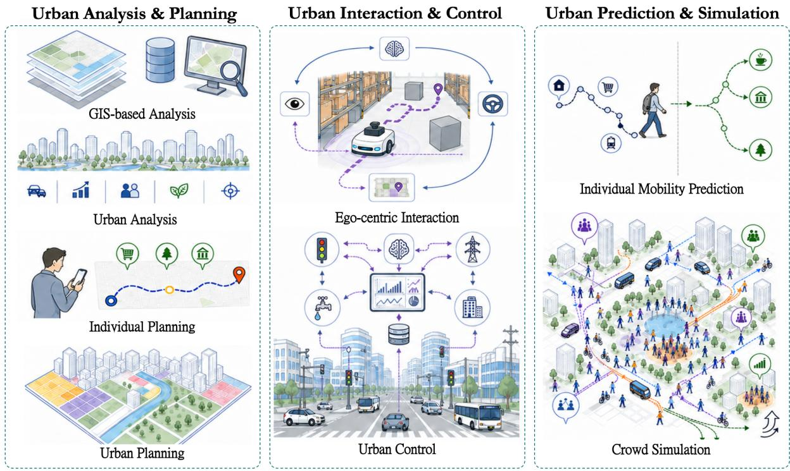  
Fig. 9. Urban agent systems organized by task. Analysis and planning transform urban evidence into analytical results and plans; interaction and control apply decisions to environments; mobility prediction and urban simulation model individual futures and collective dynamics.

III.3.2.1 Urban Analysis and Planning. Agents here translate urban evidence into analytical results and planning proposals.

GIS-Based Analysis. Early work used geospatial databases such as OSM[151] and individual GIS tools as welldefined testbeds. OSMT[458] translates natural language requests into executable OSM queries, while GeoTool-GPT[505] teaches LLMs to use GIS analysis tools. Later systems integrate them into a complete GIS workflow. Autonomous GIS[255] defines the GIS processing paradigm with five subgoals; GeoGPT[621] coordinates data collection, processing, and analysis stream; MapGPT[618] follows a ReAct loop to operate cartographic tools to produce maps; and GeoFlow[26] represents tasks as reusable workflow graphs. Recent work further strengthens the workflow through autonomous processing code generation[518], multi-agent cooperation[268, 311], as well as full-stack designs[152]. CangLing-KnowFlow further integrates an expert-validated procedural knowledge base with dynamic workflow adjustment and evolutionary memory, enabling end-to-end remote-sensing workflows to recover from execution failures and improve through accumulated experience [71]. Complementing these runtime-oriented systems, SimCRAFT distills remote-sensing workflow-planning capabilities into compact 7Bscale models through constraint-validated synthetic tool-use trajectories and contextual retrieval-augmented fine-tuning, reducing dependence on large closed-source LLMs [473].

Urban Analysis. Beyond fixed GIS databases, LLM-Find[337] enables agents to autonomously select and retrieve heterogeneous geospatial resources. Recent participatory urban sensing treats users as collaborative data collectors, adapting collection assignments to dynamic urban conditions and worker preferences[147] under fairness constraints[148]. These diverse data sources support a wide range of city-scale analyses. Representative examples include the following.

(a) Trafic analysis. TraficGPT[609] decomposes complex questions and invokes trafic databases and foundation models for data processing, analysis, and interaction for advanced trafic management. TransitGPT[95] generates and executes code for trafic data retrieval, calculations, and visualization.

(b) Urban change analysis. ChangeGPT[535] calls visual foundation models for change perception, whereas MMUEChange[536] uses a tool library and modality controller to align remote sensing, geographic, and socioeconomic evidence for analyzing changes in park construction, water quality, and waste site distributions.

(c) Socioeconomic analysis. Beyond spatial distributions, agents can also derive socioeconomic indicators. SAGAI[362] combines OSM and street view imagery to derive street indicators such as storefront presence and sidewalk width, while UrbanAgent[155] resolves cross-modal conflicts by coordinating specialist agents that actively retrieve evidence for region level carbon emission, GDP, and population inference.

(d) Environmental analysis. UrbanSoil[372], for instance, links parcels, land uses, pollutants, measurements, pathways, and regulatory thresholds to corresponding geospatial entries to guide professional environmental dialogues. DORA[479] requires agents to combine 108 geospatial tools over heterogeneous geospatial data for disaster analysis, rescue and evacuation planning, and reporting over time.

Individual Planning. The above urban analyses provide direct support for planning at both the user and city scales. At the individual level, ITINERA[435] decomposes user requests, retrieves POIs, and applies cluster spatial optimization to generate itineraries. TraveLLaMA[78] uses reasoning, tools, and reflection for interactive travel assistance. DiMA[338] brings this pattern into a specific ride-hailing service, where tools support progressive order planning under cost constraints. With planning tasks of varying dificulty, LifePlanner[98] shows that noisy evidence retrieval, tool use failure, and balancing multiple constraints remain key bottlenecks for agentic planning.

Urban Planning. For cities, existing work mainly focuses on land use planning. For instance, OntoZoning[407] links permitted land uses and programmes under each zoning type for urban planning in Singapore. LLLM-PUP[651] lets a planner propose land uses, collect feedback from resident agents, and revise the proposal. LiPUP-MA[335] extends this loop by letting residents experience a simulated plan and storing their feedback for revision. Intelli-Planner[586] further introduces RL, using five evaluation dimensions to optimize plan generation.

However, urban agents still face drawbacks like domain constraints and regulatory hallucination[562, 567]. Generalizing agentic analysis and planning across urban scales and domains thus still requires stronger grounding in urban theory and planning legitimacy[445].

III.3.2.2 Urban Interaction and Control. Agents here execute actions within an environment and refine subsequent decisions through feedback.

Ego-Centric Interaction. One class of systems controls an embodied ego agent, such as a robot or a road vehicle. Although embodiments and action spaces difer, these systems share the same mechanism that the agent grounds local observations into a representation of itself and its surroundings, selects an action, receives environmental feedback, and updates its memory or plan before acting again.

General embodied tasks establish this pattern. Inner Monologue[185], for example, interleaves language planning with motion and visual feedback, while DEPS[501] uses environmental feedback to re-describe the state, explain failures, and reselect plans for long horizon tasks.

Urban exploration extends this closed loop to city spaces. VELMA[401] continually incorporates street view descriptions and trajectory history before choosing the next navigation action. EmbodiedCity[129] enhances the simulated cities with pedestrian and vehicle flows, where agents perform scene understanding, question answering, dialogue, navigation, and task planning. CityNavAgent[613] combines hierarchical semantic planning with global topological memory for aerial navigation. CityEQA[632] separates question decomposition, objectic map maintenance, and embodied exploration among a multi-agent system.

The widely studied autonomous driving systems apply the same loop under faster dynamics and stricter safety constraints. DiLu[514] combines reasoning and reflection to make decision based on common-sense knowledge and accumulate experience from successive driving decisions. Agent-Driver[314] further couples callable tools and cognitive memory with reasoning, task planning, motion planning, and self-reflection, thus enabling a more nuanced, human-like approach to autonomous driving. DriveAgent-R1[636] strengthens feedback interpretation through depth estimation, detection, and POI tools over recent views. AgentsCoDriver[171] further supports collaborative driving through cognitive memory, reinforcement reflection, and communication, allowing vehicles to exchange information and accumulate experience through continued environment interaction.

Urban Control. Unlike ego-centric systems that control a mobile embodied subject, these agents act directly on urban infrastructure and services. A typical task is trafic signal control. LLMLight[227] prompts an LLM with realtime trafic conditions to reason and select signal phases. LLM-Assisted Light[483] further augments the LLM with perception and decision-making tools, connecting LLM reasoning capabilities with established control methods. Moving beyond a single light intersection, CoLLMLight[596] constructs a structured spatiotemporal graph of realtime trafic dynamics and relationships among neighboring intersections, uses complexity-aware reasoning for network-wide light control. More broadly, TraficClaw[228] models systems like trafic signals, freeways, public transit, and taxi in a unified trafic environment and combines spatiotemporal reasoning, persistent memory, and agentic RL for joint coordination.

Beyond trafic, smart building agents can perceive building energy use and manage connected appliances[160]; provide personalized building services such as lighting adjustment based on user profiles[392]; or combine LLM reasoning with lightweight physical models to estimate thermal comfort, energy use, and wall heat gain across a city block[226]. Grid-Agent[617] targets power grid control, where a planning agent uses power flow solvers to generate coordinated action sequences with a validation agent checks stability and safety through sandboxed execution. WaterAdmin[513] focuses on community water systems, using an upper level LLM abstracts weather variations, human activities, and human instructions into operational targets, as well as a lower level optimizer controls pumps and valves. However, most existing studies remain confined to a single urban system and rely on simulations, benchmark grids, or ofline datasets. A substantial gap remains before agents can achieve safe, long-term, and autonomous coordination and control across domains in real urban systems.

III.3.2.3 Urban Prediction and Simulation. These systems combine historical information with system design to predict or simulate future states of individuals or crowds.

Individual Mobility Prediction and Generation. From an individual perspective, agentic systems mainly focus on next location prediction and trajectory generation by fullfilling the individual preferences[291]. For the former, AgentMove[118] combines individual mobility pattern, urban distribution, and shared patterns to infer the next location from historical trajectories. ARMove[462] further uses multiple agents to iteratively optimize mobility, memory, and social features across regions and groups. Trajectory generation instead constructs personalized, spatially grounded activity chains. LLM-UR[477] and TrajLLM[209] characterize personal activity patterns before selecting activities and destinations to form trajectories. CAMS[104] further combines individual mobility patterns with urban spatial information and collective mobility distributions. Recent TrajAgent[105] uses LLM agents to select and optimize specialized models within a unified framework, jointly supporting and optimizing tasks including trajectory prediction, recovery, classification, generation, and representation. Further advances are reviewed in [143].

Multi-Agent Crowd Simulation. From an urban perspective, multiple agents typically interact repeatedly with a shared urban environment to simulate future city states[580]. Generative Agents[355] established the basic architecture, showing that persistent memory and autonomous interaction can produce emergent social behavior. Building on this architecture, MobileCity[579] grounds the decisions of 4k agents in evolving principles such as needs, habits, and obligations, producing more human-like crowd mobility. AgentSociety[363] instead emphasizes scale, simulating more than 10K agents and 5M interactions to examine the patterns, causes, and mechanisms of five social issues. CitySim[31] targets long-horizon simulation by endowing tens of thousands of agents with beliefs, long-term goals, and spatial memories for sustaining simulation. MatrAIx[248] represents heterogeneous users through 8.3 billion records defined over 1290 categorical dimensions, while records are sampled as active agents only when paired with a model, interface, and task.

Other systems couple agents with specific urban environments. GATSim[280] embeds 70 agents with hierarchical memory in a transport simulator, where the interaction produces collective mobility and trafic patterns. RESPOND[419] couples population agents with realtime flood forecasts, enabling communication for joint evacuation and resource seeking as hazards evolving.

As simulations expand in scale, duration, and environmental detail, their computational cost becomes a major bottleneck. OpenCity[551] designs request scheduling and “group-and-distill” prompt optimization to achieve a 600-fold speedup in agent simulation time. CityBehavEx[396] instead combines established mobility models with fine-tuned cross-encoders that estimate semantic alignment between agent profiles, schedules, and activity transitions, simulating 100K agents for 75 days in under one hour on a single consumer GPU. MatrAIx[248] addresses eficiency through selective participation and parallel execution, where each evaluation samples only a cohort required by a task among 8.3 billion candidates.

Scale, however, does not ensure empirical realism. MatrAIx shows that simulated outcomes can vary substantially with the underlying agent model, for instance ranging from 23.2% to 93.9%, even with identical persona agents follow their well-designed attributes[248]. WPINR shows that large-scale urban simulators may capture some high-level semantic activity distributions while failing to reproduce core and fine-grid spatial and temporal constraints, such as dwell times and transition dynamics[397]. Credible simulations of urban futures therefore depend on the joint fidelity of the simulated population, environment, and agent system. Only by combining these elements can simulated citywide dynamics more closely approximate reality.

## III.4 Reliable and Governed Agency

Reliable urban agency depends on two boundaries: protection against external threats and internal controls that constrain system operation[305].

III.4.1 External Threats. Urban agents combine retrieved documents, maps, sensor streams with user instructions, agent memory, tool responses, and inter-agent messages, allowing untrusted content to apply. At the twin layer, for instance, sensor spoofing and data poisoning can corrupt the observed state[294, 399] to bias agent estimation and prediction[465]. At the agent layer, attacks can poison memory, compromise tool use and protocols, hijack reasoning, or propagate through multi-agent communication. A comprehensive taxonomy of these attack surfaces and defenses is available in [305]

III.4.2 Internal Controls. Beyond defending against attacks, internal reliability requires governing and con straining the agent throughout its operation. These constraints broadly apply at three levels. First, state level controls govern what may be stored, retrieved, or modified in the memory, tools, and model[173]. Second, action level controls constrain agent delegation and tool use through methods like authentication, least privilege, and human approval[414]. Third, outcome level controls screen plans and outputs for biased claims, privacy violations, and threats to fundamental human rights[510]. A broader review is available in [75, 644].

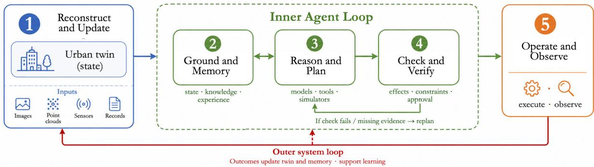  
Fig. 10. The proposed system blueprint. The inner loop grounds, reasons, and acts, then replans before action. The outer loop updates the twin, executes an approved decision, observes the outcome, and starts the next full cycle

## IV. Future Vision

Looking ahead, Section IV.1 examines how the capabilities reviewed above can be integrated into a coherent system and identifies the technical advances required, while Section IV.2 considers how this system prototype can be adapted across urban domains

## IV.1 Future System Vision and Research Directions

IV.1.1 System Blueprint: Two Loops. The methods reviewed above support the system blueprint in Fig. 10. The (1) Reconstruct and update step uses new multimodal observations and external records to reconstruct the city and update its twin. The updated twin supports the inner agent loop: (2) Ground and memory ↔ (3) Reason and plan ↔ (4) Check and verify. In Step (2), the agent retrieves the current city state, relevant knowledge, and past experience for subsequent analysis. In Step (3), it uses reasoning, tools, and simulators to plan, analysis or simulate an intervention. In Step (4), it checks the simulated results, expected efects and constraints. Missing evidence or a failed check returns the agent to Step (2)-(3) for memory updating and rethink. A final validated agent decision moves from Step (4) → (5) Operate and observe. The observed decision outcome then returns from Step (5) → Step (1). This closes the outer system loop. Each outcome updates the twin and agent memory. Outcomes collected over time can also improve the models, tools, and policies. Steps (2)-(4) therefore refine a decision before applying. Steps (1)-(5) connect city sensing, decision, and learning. Both loops should be governed through auditable state management, bounded authority, and human oversight.

IV.1.2 Research Directions. The following directions move from improving individual components to designing, training, and governing the complete system.

All-in-One Urban Twinning. Urban twin construction still separates reconstruction, completion, representation, and information embedding, which limits joint optimization. Building on recent feed-forward methods[214, 239, 259, 658], future models should quickly and accurately turn fragmented multimodal observations into a complete urban twin with both physical states and rich features.

Urban Agent Loop. Urban agent must move from narrow indoor tasks to complex city environments and applications. The agent should understand the large and diverse state stored in the twin, and its reasoning must remain grounded in urban information and knowledge. It should also coordinate multiple urban domains and tasks[619], combine short and long memories at the city scale, and use tools for citywide analysis and simulation. The complete inner loop should improve these capabilities together.

Twin-agent Interface. Although urban twins and agents can be developed separately, they must operate and evolve as one system, making their interface critical. Current approaches connect independently designed twins and LLMs by textualizing twin states or projecting features through adapters. These post hoc bridges lose spatio-temporal detail and weaken grounding. Future systems should instead co-design twin representations and agent architectures, encoding aggregated urban states as agent-native tokens that agents can process directly. Training losses or online feedback could then back-propagate through the diferentiable agent, interface and twin. Unified multimodal models[495, 530] ofer an early prototype by representing diferent modalities as token sequences for joint training, but they do not yet support persistent, heterogeneous, and dynamically updated urban twins.

Urban Task Taxonomy. Existing tasks, such as reconstruction, segmentation, question answering, and navigation, are mostly elementary or confined to specific scenarios, with limited connections and little systematic organization[241]. Real urban problems instead compose multiple basic capabilities into higher level tasks, with requirements varying across scenarios and domains. Yet a coherent taxonomy of urban intelligence tasks is still missing, even within individual domains such as buildings or transportation. A broad and progressive task hierarchy, spanning basic capabilities to complex urban workflows, is essential for designing system architectures, annotating training data, and evaluating systems toward general spatio-temporal intelligence.

Urban Data Annotation at Scale. Beyond a task taxonomy, existing urban datasets remain limited in geographic coverage (often spanning only a few regions or cities) as well as in modality diversity, temporal depth, and annotation granularity[98, 120, 121]. Future datasets should combine city-scale multimodal observations over time with operational knowledge, including rules and regulations. Annotations should align twin construction and updating, agent reasoning and action, and observed outcomes across diverse urban tasks. Such data would support component training and evaluation as well as end-to-end optimization of the full system.

System Governance. Governance must address both external threats and internal controls. External protection should defend sensors, data, memory, tools, and communication against manipulation. Internal controls should enforce versioned state, bounded authority, and rights-aware human oversight. Both forms of protection must remain active during training, deployment, and later updates.

## IV.2 From a Shared Prototype to Urban Domains

The two-loop structure provides a shared twin-agent prototype rather than a domain-ready system. Each domain can specify the state maintained by the twin, the models and actions available to the agent, and the authority required for operation. The following examples show how these interfaces turn the shared prototype into domain-specific closed loops.

Built Environment and Infrastructure. A built environment twin would align geometry with asset semantics and inspection histories. The agent could retrieve detected changes and applicable standards, analysis and reason, use domain models to assess the intermediate steps, and verify a maintenance plan. Approved work and subsequent inspections would close the outer loop by recording the actual outcome. Existing building agents provide early components for this workflow, which could extend to other infrastructure assets[160, 226].

Trafic and Mobility. Here, the key of the twin combines road topology with current trafic and signal states. The agent could use forecasting and simulation tools to compare control strategies under network-level constraints. Approved decisions would then be deployed, while sensor observations return their efects to the twin. Early trafic loops[60], simulators[139], agents[228, 596] provide key components of such a close loop system.

Environment and Urban Ecology. An environmental twin should link actors like land cover and vegetation with measured or inferred environmental fields. Grounded in this state, the agent could use ecological models to identify intervention areas and compare candidate strategies under feasibility constraints[345, 372]. After implementation, remote sensing and field observations would update both the environmental state and the estimated efects of the intervention.

Citizen Services and Public Safety. A citizen service twin should represent service demand and population state under privacy requirements. Its agent could perceive these information, adapt services or guide population flows after prediction or simulation checks[248, 287]. During an emergency, the same loop could analysis evolving hazards to formulate responses, and update them as field observations envolve[419, 479].

## V. Conclusion

This review has examined STI systems in urban space through a unified twin-agent perspective. For urban twinning, we reviewed the reconstruction and completion ofurban states, followed by their physical representation and information embedding. For urban agent, we examined how grounded understanding and reasoning are incorporated into agentic architectures under reliability and governance mechanisms.

Building on these components, we presented a future STI system blueprint with an inner agent loop for grounding, reasoning, and verification, together with an outer system loop connecting urban sensing, action, and observation. We also summarized its research agenda and adaptation across urban domains. Together, these perspectives provide a unified account of how urban states can be constructed, interpreted, and connected to accountable decision making.

## VI. Acknowledgements

This research is jointly supported by the General Program of NSFC (No.42571521) and PhD Program of NSFC (No.424B2012).

## VII. Declaration of interests

The authors declare no competing interests.

## VIII. Declaration of generative AI and AI-assisted technologies in the writing process

During the preparation of this work, the authors used ChatGPT in order to improve language and readability. After using this tool/service, the authors reviewed and edited the content as needed and take full responsibility for the content of the publication.

## References

[1] Abdelsamad, Mohamed, Michael Ulrich, Claudius Gläser, and Abhinav Valada. 2025. Multi-scale neighborhood occupancy masked autoencoder for self-supervised learning in lidar point clouds. In Proceedings ofthe IEEE/CVF Conference on Computer Vision and Pattern Recognition. 22234–22243.

[2] Agarwal, Sameer, Yasutaka Furukawa, Noah Snavely, Ian Simon, Brian Curless, Steven M Seitz, and Richard Szeliski. 2011. Building rome in a day. Commun. ACM 54, 10 (2011), 105–112.

[3] Agarwal, Sameer, Noah Snavely, Steven M Seitz, and Richard Szeliski. 2010. Bundle adjustment in the large. In European conference on computer vision. Springer, 29–42.

[4] Ahmad, Osama, Zubair Khalid, Muhammad Tahir, and Momin Uppal. 2025. Spatiotemporal air quality mapping in urban areas using sparse sensor data, satellite imagery, meteorological factors, and spatial features. In IGARSS 2025-2025 IEEE International Geoscience and Remote Sensing Symposium. IEEE, 5979–5983.

[5] Alayrac, Jean-Baptiste, Jef Donahue, Pauline Luc, Antoine Miech, Iain Barr, Yana Hasson, Karel Lenc, Arthur Mensch, Katherine Millican, Malcolm Reynolds, et al. 2022. Flamingo: a visual language model for few-shot learning. Advances in neural information processing systems 35 (2022), 23716–23736.

[6] Alhaija, Hassan Abu, Jose Alvarez, Maciej Bala, Tifany Cai, Tianshi Cao, Liz Cha, Joshua Chen, Mike Chen, Francesco Ferroni, Sanja Fidler, et al. 2025. Cosmos-transfer1: Conditional world generation with adaptive multimodal control. arXiv preprint arXiv:2503.14492 (2025).

[7] Ao, Sheng, Qingyong Hu, Hanyun Wang, Kai Xu, and Yulan Guo. 2023. Bufer: Balancing accuracy, eficiency, and generalizability in point cloud registration. In 2023 IEEE/CVF Conference on Computer Vision and Pattern Recognition (CVPR). IEEE, 1255–1264.

[8] Ao, Sheng, Qingyong Hu, Bo Yang, Andrew Markham, and Yulan Guo. 2021. Spinnet: Learning a general surface descriptor for 3d point cloud registration. In Proceedings ofthe IEEE/CVF conference on computer vision and pattern recognition. 11753–11762.

[9] Armeni, Iro, Zhi-Yang He, JunYoung Gwak, Amir R Zamir, Martin Fischer, Jitendra Malik, and Silvio Savarese. 2019. 3d scene graph: A structure for unified semantics, 3d space, and camera. In Proceedings ofthe IEEE/CVF international conference on computer vision. 5664–5673.

[10] Arrigoni, Federica, Beatrice Rossi, and Andrea Fusiello. 2016. Spectral synchronization of multiple views in SE (3). SIAM Journal on Imaging Sciences 9, 4 (2016), 1963–1990.

[11] Assran, Mido, Adrien Bardes, David Fan, Quentin Garrido, Russell Howes, Mojtaba Muckley, Matthew Komeili, Ammar Rizvi, Claire Roberts, Koustuv Sinha, Artem Zholus, et al. 2025. V-jepa 2: Self-supervised video models enable understanding, prediction and planning. arXiv preprint arXiv:2506.09985 (2025).

[12] Assran, Mahmoud, Quentin Duval, Ishan Misra, Piotr Bojanowski, Pascal Vincent, Michael Rabbat, Yann LeCun, and Nicolas Ballas. 2023. Self-supervised learning from images with a joint-embedding predictive architecture. In 2023 IEEE/CVF Conference on Computer Vision and Pattern Recognition (CVPR). IEEE, 15619–15629.

[13] Azzolini, Alisson, Junjie Bai, Hannah Brandon, Jiaxin Cao, Prithvijit Chattopadhyay, Huayu Chen, Jinju Chu, Yin Cui, Jenna Diamond, Yifan Ding, et al. 2025. Cosmos-reason1: From physical common sense to embodied reasoning. arXiv preprint arXiv:2503.15558 (2025).

[14] Bahmani, Sherwin, Ivan Skorokhodov, Guocheng Qian, Aliaksandr Siarohin, Willi Menapace, Andrea Tagliasacchi, David B Lindell, and Sergey Tulyakov. 2025. Ac3d: Analyzing and improving 3d camera control in video difusion transformers. In 2025 IEEE/CVF Conference on Computer Vision and Pattern Recognition (CVPR). IEEE, 22875–22889.

[15] Bai, Jianhong, Menghan Xia, Xiao Fu, Xintao Wang, Lianrui Mu, Jinwen Cao, Zuozhu Liu, Haoji Hu, Xiang Bai, Pengfei Wan, et al. 2025. Recammaster: Camera-controlled generative rendering from a single video. In 2025 IEEE/CVF International Conference on Computer Vision (ICCV). IEEE, 14834–14844.

[16] Bai, Shuai, Yuxuan Cai, Ruizhe Chen, Keqin Chen, Xionghui Chen, Zesen Cheng, Lianghao Deng, Wei Ding, Chang Gao, Chunjiang Ge, et al. 2025. Qwen3-vl technical report. arXiv preprint arXiv:2511.21631 (2025).

[17] Bardes, Adrien, Quentin Garrido, Jean Ponce, Xinlei Chen, Michael Rabbat, Yann LeCun, Mahmoud Assran, and Nicolas Ballas. 2024. Revisiting feature prediction for learning visual representations from video. arXiv preprint arXiv:2404.08471 (2024).

[18] Barron, Jonathan T, Ben Mildenhall, Matthew Tancik, Peter Hedman, Ricardo Martin-Brualla, and Pratul P Srinivasan. 2021. Mip-nerf: A multiscale representation for anti-aliasing neural radiance fields. In 2021 IEEE/CVF International Conference on Computer Vision (ICCV). IEEE, 5835–5844.

[19] Basha, Tali, Yael Moses, and Nahum Kiryati. 2013. Multi-view scene flow estimation: A view centered variational approach. International journal ofcomputer vision 101, 1 (2013), 6–21.

[20] Batty, Michael. 2013. The new science of cities. The MIT press.

[21] Beauchemin, Steven S. and John L. Barron. 1995. The computation of optical flow. ACM computing surveys (CSUR) 27, 3 (1995), 433–466.

[22] Bertinetto, Luca, Jack Valmadre, Joao F Henriques, Andrea Vedaldi, and Philip HS Torr. 2016. Fully-convolutional siamese networks for object tracking. In European conference on computer vision (Workshops). Springer, 850–865.

[23] Besl, Paul J and Neil D McKay. 1992. Method for registration of 3-D shapes. In Sensor fusion IV: control paradigms and data structures, Vol. 1611. Spie, 586–606.

[24] Bhat, Goutam, Martin Danelljan, Luc Van Gool, and Radu Timofte. 2019. Learning discriminative model prediction for tracking. In Proceedings ofthe IEEE/CVF international conference on computer vision. 6182–6191.

[25] Bhat, Shariq Farooq, Reiner Birkl, Diana Wofk, Peter Wonka, and Matthias Müller. 2023. Zoedepth: Zero-shot transfer by combining relative and metric depth. arXiv preprint arXiv:2302.12288 (2023).

[26] Bhattaram, Amulya, Justin Chung, Stanley Chung, Ranit Gupta, Janani Ramamoorthy, Kartikeya Gullapalli, Diana Marculescu, and Dimitrios Stamoulis. 2025. Geoflow: Agentic workflow automation for geospatial tasks. In Proceedings of the 33rd ACM International Conference on Advances in Geographic Information Systems. 1150–1153.

[27] Bian, Hengwei, Lingdong Kong, Haozhe Xie, Liang Pan, Yu Qiao, and Ziwei Liu. 2025. DynamicCity: Large-scale 4D occupancy generation from dynamic scenes. In International Conference on Learning Representations, Vol. 2025. 40682–40716.

[28] Black, Michael J and Padmanabhan Anandan. 1993. A framework for the robust estimation of optical flow. In 1993 (4th) International Conference on Computer Vision. IEEE, 231–236.

[29] Bochkovskiy, Alexey, Amaël Delaunoy, Hugo Germain, Marcel Santos, Yichao Zhou, Stephan Richter, and Vladlen Koltun. 2025. Depth pro: Sharp monocular metric depth in less than a second. In International Conference on Learning Representations, Vol. 2025. 75602–75637.

[30] Bolya, Daniel, Po-Yao Huang, Peize Sun, Jang Hyun Cho, Andrea Madotto, Chen Wei, Tengyu Ma, Jiale Zhi, Jathushan Rajasegaran, Hanoona Bangalath, et al. 2025. Perception encoder: The best visual embeddings are not at the output of the network. Advances in Neural Information Processing Systems 38 (2025), 60884–60937.

[31] Bougie, Nicolas and Narimawa Watanabe. 2025. Citysim: Modeling urban behaviors and city dynamics with large-scale llm-driven agent simulation. In Proceedings of the 2025 Conference on Empirical Methods in Natural Language Processing: Industry Track. 215–229.

[32] Brooks, Tim, Bill Peebles, Connor Holmes, Will DePue, Yufei Guo, Li Jing, David Schnurr, Joe Taylor, Troy Luhman, Eric Luhman, et al. 2024. Video generation models as world simulators. OpenAI Blog (2024).

[33] Brown, Christopher F, Michal R Kazmierski, Valerie J Pasquarella, William J Rucklidge, Masha Samsikova, Chenhui Zhang, Evan Shelhamer, Estefania Lahera, Olivia Wiles, Simon Ilyushchenko, et al. 2025. Alphaearth foundations: An embedding field model for accurate and eficient global mapping from sparse label data. arXiv preprint arXiv:2507.22291 (2025).

[34] Brox, Thomas, Andrés Bruhn, Nils Papenberg, and Joachim Weickert. 2004. High accuracy optical flow estimation based on a theory for warping. In European conference on computer vision. Springer, 25–36.

[35] Brox, Thomas and Jitendra Malik. 2011. Large displacement optical flow: descriptor matching in variational motion estimation. IEEE transactions on pattern analysis and machine intelligence 33, 3 (2011), 500–513.

[36] Bruce, Jake, Michael D Dennis, Ashley Edwards, Jack Parker-Holder, Yuge Shi, Edward Hughes, Matthew Lai, Aditi Mavalankar, Richie Steigerwald, Chris Apps, et al. 2024. Genie: Generative interactive environments. In Forty-first international conference on machine learning.

[37] Cai, Tianhui, Yifan Liu, Zewei Zhou, Haoxuan Ma, Seth Z Zhao, Zhiwen Wu, Xu Han, Zhiyu Huang, and Jiaqi Ma. 2026. Driving with regulation: Trustworthy and interpretable decision-making for autonomous driving with retrieval-augmented reasoning. In Proceedings ofthe AAAI Conference on Artificial Intelligence, Vol. 40. 38287–38295.

[38] Cai, Wei, Xiaomin Zhu, Zeyu Sun, Aihui Ye, Guanhua Fu, and Runtong Zhang. 2026. A unified LLM-KG framework for low-annotation urban rail transit signal system operation: knowledge acquisition and dynamic update. Advanced Engineering Informatics 71 (2026), 104327.

[39] Cai, Zhipeng, Zhuang Liu, Yunyang Xiong, Zechun Liu, Vikas Chandra, and Yangyang Shi. 2026. VLM3: Vision Language Models Are Native 3D Learners. arXiv preprint arXiv:2605.30561 (2026).

[40] Cao, Chenjie, Chaohui Yu, Shang Liu, Fan Wang, Xiangyang Xue, and Yanwei Fu. 2025. Mvgenmaster: Scaling multi-view generation from any image via 3d priors enhanced difusion model. In 2025 IEEE/CVF Conference on Computer Vision and Pattern Recognition (CVPR). IEEE, 6045–6056.

[41] Cao, Yukang, Jiahao Lu, Zhisheng Huang, Zhuowen Shen, Chengfeng Zhao, Fangzhou Hong, Zhaoxi Chen, Xin Li, Wenping Wang, Yuan Liu, et al. 2025. Reconstructing 4d spatial intelligence: A survey. arXiv preprint arXiv:2507.21045 (2025).

[42] Cao, Ziang, Fangzhou Hong, Zhaoxi Chen, Liang Pan, and Ziwei Liu. 2026. Physx-anything: Simulation-ready physical 3d assets from single image. In Proceedings ofthe IEEE/CVF Conference on Computer Vision and Pattern Recognition. 5839–5848.

[43] Carion, Nicolas, Laura Gustafson, Yuan-Ting Hu, Shoubhik Debnath, Ronghang Hu, Didac Suris Coll-Vinent, Chaitanya Ryali Kalyan Vasudev Alwala, Haitham Khedr, Andrew Huang, et al. 2026. Sam 3: Segment anything with concepts. In International Conference on Learning Representations, Vol. 2026. 138846–138923.

[44] Cen, Jiazhong, Jiemin Fang, Chen Yang, Lingxi Xie, Xiaopeng Zhang, Wei Shen, and Qi Tian. 2025. Segment any 3d gaussians. In Proceedings ofthe AAAI conference on artificial intelligence, Vol. 39. 1971–1979.

[45] Chen, Anpei, Zexiang Xu, Andreas Geiger, Jingyi Yu, and Hao Su. 2022. Tensorf: Tensorial radiance fields. In European conference on computer vision. Springer, 333–350.

[46] Chen, Boyuan, Zhuo Xu, Sean Kirmani, Brian Ichter, Dorsa Sadigh, Leonidas Guibas, and Fei Xia. 2024. Spatialvlm: Endowing vision-language models with spatial reasoning capabilities. In Proceedings of the IEEE/CVF conference on computer vision and pattern recognition. 14455–14465.

[47] Chen, Fei, Xiaodong Wang, Yunxiang Zhao, Shaohe Lv, and Xin Niu. 2022. Visual object tracking: A survey. Computer Vision and Image Understanding 222 (2022), 103508.

[48] Chen, Hanke, Yuan Liu, and Minchen Li. 2025. Trellisworld: Training-free world generation from object generators. arXiv preprint arXiv:2510.23880 (2025).

[49] Chen, Hang, Qian Xiang, Jiaxin Hu, Meilin Ye, Chao Yu, Hao Cheng, and Lei Zhang. 2025. Comprehensive exploration of difusion models in image generation: a survey. Artificial Intelligence Review 58, 4 (2025), 99.

[50] Chen, Jiabin, Haiping Wang, Jinpeng Li, Yuan Liu, Zhen Dong, and Bisheng Yang. 2026. SpatialLLM: From multi-modality data to urban spatial intelligence. International Journal ofApplied Earth Observation and Geoinformation 147 (2026), 105177.

[51] Chen, Kaihua, Tarasha Khurana, and Deva Ramanan. 2025. Reconstruct, inpaint, test-time finetune: Dynamic novel-view synthesis from monocular videos. Advances in Neural Information Processing Systems 38 (2025), 47723–47753.

[53] Chen, Runnan, Youquan Liu, Lingdong Kong, Xinge Zhu, Yuexin Ma, Yikang Li, Yuenan Hou, Yu Qiao, and Wenping Wang. 2023. Clip2scene: Towards label-eficient 3d scene understanding by clip. In 2023 IEEE/CVF Conference on Computer Vision and Pattern Recognition (CVPR). IEEE, 7020–7030.

[54] Chen, Rui, Zehuan Wu, Yichen Liu, Yuxin Guo, Jingcheng Ni, Haifeng Xia, and Siyu Xia. 2025. Unimlvg: Unified framework for multi-view long video generation with comprehensive control capabilities for autonomous driving. In 2025 IEEE/CVF International Conference on Computer Vision (ICCV). IEEE, 25453–25463.

[55] Chen, Sijin, Xin Chen, Chi Zhang, Mingsheng Li, Gang Yu, Hao Fei, Hongyuan Zhu, Jiayuan Fan, and Tao Chen. 2024. Ll3da: Visual interactive instruction tuning for omni-3d understanding, reasoning, and planning. In 2024 IEEE/CVF Conference on Computer Vision and Pattern Recognition (CVPR). IEEE, 26418–26428.

[56] Chen, Weiliang, Jiayi Bi, Yuanhui Huang, Wenzhao Zheng, and Yueqi Duan. 2025. Scenecompleter: Dense 3d scene completion for generative novel view synthesis. arXiv preprint arXiv:2506.10981 (2025).

[57] Chen, Xingyu, Yue Chen, Yuliang Xiu, Andreas Geiger, and Anpei Chen. 2026. Ttt3r: 3d reconstruction as test-time training. In International Conference on Learning Representations, Vol. 2026. 50694–50718.

[58] Chen, Xingyu, Fu-Jen Chu, Pierre Gleize, Kevin J Liang, Alexander Sax, Hao Tang, Weiyao Wang, Michelle Guo, Thibaut Hardin, Xiang Li, et al. 2026. Sam 3d: 3dfy anything in images. In Proceedings ofthe IEEE/CVF Conference on Computer Vision and Pattern Recognition. 7220–7232.

[59] Chen, Xieyuanli, Shijie Li, Benedikt Mersch, Louis Wiesmann, Jürgen Gall, Jens Behley, and Cyrill Stachniss. 2021. Moving object segmentation in 3D LiDAR data: A learning-based approach exploiting sequential data. IEEE Robotics and Automation Letters 6, 4 (2021), 6529–6536.

[60] Chen, Yong, Xiqun Michael Chen, and Ziyou Gao. 2024. Toward equitable, transparent, and collaborative human mobility computing for smart cities. The Innovation 5, 5 (2024).

[61] Chen, Yiwen, Zilong Chen, Chi Zhang, Feng Wang, Xiaofeng Yang, Yikai Wang, Zhongang Cai, Lei Yang, Huaping Liu, and Guosheng Lin. 2024. Gaussianeditor: Swift and controllable 3d editing with gaussian splatting. In 2024 IEEE/CVF Conference on Computer Vision and Pattern Recognition (CVPR). IEEE, 21476–21485.

[62] Chen, Yixiang, Xu Dang, Daoyou Zhu, Yi Huang, and Kun Qin. 2024. Urban functional zone mapping by coupling domain knowledge graphs and high-resolution satellite images. Transactions in GIS 28, 6 (2024), 1510–1535.

[63] Chen, Yiwen, Tong He, Di Huang, Weicai Ye, Sijin Chen, Jiaxiang Tang, Zhongang Cai, Lei Yang, Gang Yu, Guosheng Lin, et al. 2025. Meshanything: Artist-created mesh generation with autoregressive transformers. In International Conference on Learning Representations, Vol. 2025. 51369–51389.

[64] Chen, Yu and Gim Hee Lee. 2024. Dogs: Distributed-oriented gaussian splatting for large-scale 3d reconstruction via gaussian consensus. Advances in Neural Information Processing Systems 37 (2024), 34487–34512.

[65] Chen, Yiping, Jinpeng Li, Wenyu Ke, Yang Luo, Jie Ouyang, Zhongjie He, Li Liu, Hongchao Fan, and Hao Wu. 2026. 3DCity-LLM: Empowering Multi-modality Large Language Models for 3D City-scale Perception and Understanding. arXiv preprint arXiv:2603.23447 (2026).

[66] Chen, Yiqun, Erfan Shooraj, Abbas Rajabifard, and Soheil Sabri. 2018. From IFC to 3D tiles: An integrated open-source solution for visualising BIMs on cesium. ISPRS International Journal of Geo-Information 7, 10 (2018), 393.

[67] Chen, Yanjun, Yirong Sun, Xinghao Chen, Jian Wang, Xiaoyu Shen, Wenjie Li, and Wei Zhang. 2025. Integrating chain-of-thought for multimodal alignment: A study on 3d vision-language learning. arXiv preprint arXiv:2503.06232 (2025).

[68] Chen, Yuedong, Chuanxia Zheng, Haofei Xu, Bohan Zhuang, Andrea Vedaldi, Tat-Jen Cham, and Jianfei Cai. 2024. Mvsplat360: Feed-forward 360 scene synthesis from sparse views. Advances in Neural Information Processing Systems 37 (2024), 107064–107086.

[69] Chen, Zhaoxi, Tianqi Liu, Long Zhuo, Jiawei Ren, Zeng Tao, He Zhu, Fangzhou Hong, Liang Pan, and Ziwei Liu. 2025. 4dnex: Feed-forward 4d generative modeling made easy. arXiv preprint arXiv:2508.13154 (2025).

[70] Chen, Zhuoguang, Minghui Qin, Tianyuan Yuan, Zhe Liu, and Hang Zhao. 2025. Long3r: Long sequence streaming 3d reconstruction. In 2025 IEEE/CVF International Conference on Computer Vision (ICCV). IEEE, 5273–5284.

[71] Chen, Zhengchao, Haoran Wang, Jing Yao, Jianshe Zhang, Pedram Ghamisi, Jun Zhou, Peter M. Atkinson, and Bing Zhang. 2026. CangLing-KnowFlow: A Unified Knowledge-and-Flow-fused Agent for Comprehensive Remote Sensing Applications. arXiv:2512.15231 [cs.AI] https://arxiv.org/abs/2512.15231

[72] Chen, Zhangquan, Manyuan Zhang, Xinlei Yu, Xiang An, Bo Li, Xin Xie, ZiDong Wang, Mingze Sun, Shuang Chen, Hongyu Li, et al. 2026. 4DThinker: Thinking with 4D Imagery for Dynamic Spatial Understanding. arXiv preprint arXiv:2605.05997 (2026).

[73] Cheng, An-Chieh, Hongxu Yin, Yang Fu, Qiushan Guo, Ruihan Yang, Jan Kautz, Xiaolong Wang, and Sifei Liu. 2024. Spatialrgpt: Grounded spatial reasoning in vision-language models. Advances in Neural Information Processing Systems 37 (2024), 135062–135093.

[74] Cheng, Chong, Peilin Tao, Nanjie Yao, Guanzhi Ding, Xianda Chen, Yuansen Du, Xiaoyang Guo, Wei Yin, Weiqiang Ren, Qian Zhang, et al. 2026. HorizonStream: Long-Horizon Attention for Streaming 3D Reconstruction. arXiv preprint arXiv:2605.23889 (2026).

[75] Chloe, Autio, Schwartz Reva, Dunietz Jesse, Jain Shomik, Stanley Martin, Tabassi Elham, Hall Patrick, and Roberts Kamie. 2024. Artificial intelligence risk management framework: Generative artificial intelligence profile. NIST Trustworthy and Responsible AI Gaithersburg, MD, USA (2024).

[76] Choy, Christopher, JunYoung Gwak, and Silvio Savarese. 2019. 4d spatio-temporal convnets: Minkowski convolutional neural networks. In 2019 IEEE/CVF conference on computer vision and pattern recognition (CVPR). IEEE, 3070–3079.

[77] Choy, Christopher, Jaesik Park, and Vladlen Koltun. 2019. Fully convolutional geometric features. In 2019 IEEE/CVF International Conference on Computer Vision (ICCV). IEEE, 8957–8965.

[78] Chu, Meng, Yukang Chen, Haokun Gui, Shaozuo Yu, Yi Wang, and Jiaya Jia. 2026. TraveLLaMA: A Multimodal Travel Assistant with Large-Scale Dataset and Structured Reasoning. In Proceedings ofthe AAAI Conference on Artificial Intelligence, Vol. 40. 3390–3398.

[79] Chung, Jaeyoung, Suyoung Lee, Hyeongjin Nam, Jaerin Lee, and Kyoung Mu Lee. 2023. Luciddreamer: Domain-free generation of 3d gaussian splatting scenes. arXiv preprint arXiv:2311.13384 (2023).

[80] Comaniciu, Dorin, Visvanathan Ramesh, and Peter Meer. 2003. Kernel-based object tracking. IEEE Transactions on pattern analysis and machine intelligence 25, 5 (2003), 564–577.

[81] Comber, Alexis and Wen Zeng. 2019. Spatial interpolation using areal features: A review of methods and opportunities using new forms of data with coded illustrations. Geography Compass 13, 10 (2019), e12465.

[82] Contributors, Spconv. 2022. Spconv: Spatially sparse convolution library.

[83] Cornelis, Nico, Bastian Leibe, Kurt Cornelis, and Luc Van Gool. 2008. 3d urban scene modeling integrating recognition and reconstruction. International Journal ofComputer Vision 78, 2 (2008), 121–141.

[84] Cui, Yutao, Cheng Jiang, Limin Wang, and Gangshan Wu. 2022. Mixformer: End-to-end tracking with iterative mixed attention. In Proceedings ofthe IEEE/CVF conference on computer vision and pattern recognition. 13608–13618.

[85] Dai, Angela, Daniel Ritchie, Martin Bokeloh, Scott Reed, Jürgen Sturm, and Matthias Nießner. 2018. Scancomplete: Large-scale scene completion and semantic segmentation for 3d scans. In 2018 IEEE/CVF conference on computer vision and pattern recognition. IEEE, 4578–4587.

[86] Dai, Wenliang, Junnan Li, Dongxu Li, Anthony Tiong, Junqi Zhao, Weisheng Wang, Boyang Li, Pascale N Fung, and Steven Hoi. 2023. Instructblip: Towards general-purpose vision-language models with instruction tuning. Advances in neural information processing systems 36 (2023), 49250–49267.

[87] Davis, James, Stephen R Marschner, Matt Garr, and Marc Levoy. 2002. Filling holes in complex surfaces using volumetric difusion. In Proceedings. First international symposium on 3d data processing visualization and transmission. IEEE, 428–441.

[88] de Gélis, Iris, Sébastien Lefèvre, and Thomas Corpetti. 2023. Siamese KPConv: 3D multiple change detection from raw point clouds using deep learning. ISPRS Journal ofPhotogrammetry and Remote Sensing 197 (2023), 274–291.

[89] Delitzas, Alexandros, Chenyangguang Zhang, Alexey Gavryushin, Tommaso Di Mario, Boyang Sun, Rishabh Dabral, Leonidas Guibas, Christian Theobalt, Marc Pollefeys, Francis Engelmann, et al. 2026. FunRec: Reconstructing Functional 3D Scenes from Egocentric Interaction Videos. arXiv preprint arXiv:2604.05621 (2026).

[90] Deng, Bailin, Yuxin Yao, Roberto M Dyke, and Juyong Zhang. 2022. A survey of non-rigid 3D registration. In Computer graphics forum, Vol. 41. Wiley Online Library, 559–589.

[91] Deng, Cheng, Tianhang Zhang, Zhongmou He, Qiyuan Chen, Yuanyuan Shi, Yi Xu, Luoyi Fu, Weinan Zhang, Xinbing Wang, Chenghu Zhou, et al. 2024. K2: A foundation language model for geoscience knowledge understanding and utilization. In Proceedings of the 17th ACM international conference on web search and data mining. 161–170.

[92] Deng, Kai, Zexin Ti, Jiawei Xu, Jian Yang, and Jin Xie. 2025. VGGT-Long: Chunk it, Loop it, Align it–Pushing VGGT’s Limits on Kilometer-scale Long RGB Sequences. arXiv preprint arXiv:2507.16443 (2025).

[93] Deng, Zhichao, Xiangtai Li, Xia Li, Yunhai Tong, Shen Zhao, and Mengyuan Liu. 2024. Vg4d: Vision-language model goes 4d video recognition. In 2024 IEEE International Conference on Robotics and Automation (ICRA). IEEE, 5014–5020.

[94] DeTone, Daniel, Tomasz Malisiewicz, and Andrew Rabinovich. 2018. Superpoint: Self-supervised interest point detection and description. In 2018 IEEE/CVF conference on computer vision and pattern recognition workshops (CVPRW). IEEE, 337–344.

[95] Devunuri, Saipraneeth and Lewis Lehe. 2025. Transitgpt: a generative ai-based framework for interacting with gtfs data using large language models. Public Transport 17, 2 (2025), 319–345.

[96] Ding, Xinpeng, Jianhua Han, Hang Xu, Xiaodan Liang, Wei Zhang, and Xiaomeng Li. 2024. Holistic autonomous driving understanding by bird’view injected multi-modal large models. In 2024 IEEE/CVF Conference on Computer Vision and Pattern Recognition (CVPR). IEEE, 13668–13677.

[97] Doersch, Carl, Yi Yang, Mel Vecerik, Dilara Gokay, Ankush Gupta, Yusuf Aytar, Joao Carreira, and Andrew Zisserman. 2023. Tapir: Tracking any point with per-frame initialization and temporal refinement. In 2023 IEEE/CVF International Conference on Computer Vision (ICCV). IEEE, 10027–10038.

[98] Dong, Zhen, Yuning Peng, Yutao Shi, Lei Zhong, Yongsen Mao, Yuan Liu, and Haiping Wang. 2026. LifePlanner: Evaluating LLM Agents for Geo-spatial Planning with Social Media Data. arXiv preprint arXiv:2608.25039 (2026).

[99] Dong, Zhen, Haiping Wang, Zhe Chen, Chen Long, Yuning Peng, Yuan Liu, Fuxun Liang, Jian Zhou, Yiping Chen, Fan Zhang, et al. 2026. The neural city: A next-generation spatio-temporal intelligence paradigm for urban holistic governance. The Innovation 7, 2 (2026).

[100] Dorobantu, Gabriel Ionut and Ana Cornelia Badea. 2026. Geospatial reasoning and awareness in large language models: a systematic review. Artificial Intelligence Review 59, 4 (2026), 111.

[101] Dosovitskiy, Alexey, Lucas Beyer, Alexander Kolesnikov, Dirk Weissenborn, Xiaohua Zhai, Thomas Unterthiner, Mostafa Dehghani, Matthias Minderer, Georg Heigold, Sylvain Gelly, et al. 2020. An image is worth 16x16 words: Transformers for image recognition at scale. arXiv preprint arXiv:2010.11929 (2020).

[102] Dosovitskiy, Alexey, Philipp Fischer, Eddy Ilg, Philip Hausser, Caner Hazirbas, Vladimir Golkov, Patrick Van Der Smagt, Daniel Cremers, and Thomas Brox. 2015. Flownet: Learning optical flow with convolutional networks. In Proceedings ofthe IEEE international conference on computer vision. 2758–2766.

[103] Du, Jing, John Zelek, Dening Lu, Kyle Gao, Qiming Xia, Ting Han, Jingxiang Li, Quanyun Wu, Yang Luo, Hongjie He, et al. 2026. Foundation Models For 3D Point Cloud Understanding: A Survey. (2026).

[104] Du, Yuwei, Jie Feng, Jian Yuan, and Yong Li. 2025. Cams: A citygpt-powered agentic framework for urban human mobility simulation. arXiv preprint arXiv:2506.13599 (2025).

[105] Du, Yuwei, Jie Feng, Jie Zhao, and Yong Li. 2025. Trajagent: An llm-agent framework for trajectory modeling via large-and-small model collaboration. Advances in Neural Information Processing Systems 38 (2025), 21595–21625.

[106] Elflein, Sven, Ruilong Li, Sérgio Agostinho, Zan Gojcic, Laura Leal-Taixé, Qunjie Zhou, and Aljosa Osep. 2026. VGGT3: Ofline Feed-Forward 3D Reconstruction at Scale. arXiv preprint arXiv:2602.23361 (2026).

[107] Elflein, Sven, Qunjie Zhou, and Laura Leal-Taixé. 2025. Light3r-sfm: Towards feed-forward structure-from-motion. In 2025 IEEE/CVF Conference on Computer Vision and Pattern Recognition (CVPR). IEEE, 16774–16784.

[108] Elghazaly, Gamal, Raphaël Frank, Scott Harvey, and Stefan Safko. 2023. High-definition maps: Comprehensive survey, challenges, and future perspectives. IEEE Open Journal ofIntelligent Transportation Systems 4 (2023), 527–550.

[109] Engstler, Paul, Aleksandar Shtedritski, Iro Laina, Christian Rupprecht, and Andrea Vedaldi. 2025. Syncity: Training-free generation of 3d worlds. In 2025 IEEE/CVF International Conference on Computer Vision (ICCV). IEEE, 27585–27595.

[110] Faisal, Fahim and Antonios Anastasopoulos. 2023. Geographic and geopolitical biases of language models. In Proceedings ofthe 3rd Workshop on Multi-lingual Representation Learning (MRL). 139–163.

[111] Fan, Hehe and Yi Yang. 2019. PointRNN: Point recurrent neural network for moving point cloud processing. arXiv preprint arXiv:1910.08287 (2019).

[112] Fan, Zhiwen, Jian Zhang, Wenyan Cong, Peihao Wang, Renjie Li, Kairun Wen, Shijie Zhou, Achuta Kadambi, Zhangyang Wang, Danfei Xu, et al. 2024. Large spatial model: End-to-end unposed images to semantic 3d. Advances in neural information processing systems 37 (2024), 40212–40229.

[113] Fang, Guangchi and Bing Wang. 2024. Mini-splatting: Representing scenes with a constrained number of gaussians. In European conference on computer vision. Springer, 165–181.

[114] Fang, Juntong, Zequn Chen, Weiqi Zhang, Donglin Di, Xuancheng Zhang, Chengmin Yang, and Yu-Shen Liu. 2026. More: Motion-aware feed-forward 4d reconstruction transformer. arXiv preprint arXiv:2603.05078 (2026).

[115] Fei, Xin, Wenzhao Zheng, Yueqi Duan, Wei Zhan, Masayoshi Tomizuka, Kurt Keutzer, and Jiwen Lu. 2024. Driv3r: Learning dense 4d reconstruction for autonomous driving. arXiv preprint arXiv:2412.06777 (2024).

[116] Feng, Guofeng, Siyan Chen, Rong Fu, Zimu Liao, Yi Wang, Tao Liu, Boni Hu, Linning Xu, Zhilin Pei, Hengjie Li, et al. 2025. Flashgs: Eficient 3d gaussian splatting for large-scale and high-resolution rendering. In Proceedings of the IEEE/CVF Conference on Computer Vision and Pattern Recognition. 26652–26662.

[117] Feng, Haiwen, Junyi Zhang, Qianqian Wang, Yufei Ye, Pengcheng Yu, Michael J Black, Trevor Darrell, and Angjoo Kanazawa. 2025. St4rtrack: Simultaneous 4d reconstruction and tracking in the world. In 2025 IEEE/CVF International Conference on Computer Vision (ICCV). IEEE, 8503–8513.

[118] Feng, Jie, Yuwei Du, Jie Zhao, and Yong Li. 2025. Agentmove: A large language model based agentic framework for zero-shot next location prediction. In Proceedings ofthe 2025 Conference ofthe Nations ofthe Americas Chapter ofthe Association for Computational Linguistics: Human Language Technologies (Volume 1: Long Papers). 1322–1338.

[119] Feng, Jie, Yong Li, Chao Zhang, Funing Sun, Fanchao Meng, Ang Guo, and Depeng Jin. 2018. Deepmove: Predicting human mobility with attentional recurrent networks. In Proceedings ofthe 2018 world wide web conference. 1459–1468.

[120] Feng, Jie, Tianhui Liu, Yuwei Du, Siqi Guo, Yuming Lin, and Yong Li. 2025. Citygpt: Empowering urban spatial cognition of large language models. In Proceedings ofthe 31st ACM SIGKDD conference on knowledge discovery and data mining v. 2. 591–602.

[121] Feng, Jie, Shengyuan Wang, Tianhui Liu, Yanxin Xi, and Yong Li. 2025. Urbanllava: A multi-modal large language model for urban intelligence. In 2025 IEEE/CVF International Conference on Computer Vision (ICCV). IEEE, 6209–6219.

[122] Feng, Tao, Yunke Zhang, Xiaochen Fan, Huandong Wang, and Yong Li. 2025. Causal Discovery and Inference towards Urban Elements and Associated Factors. arXiv preprint arXiv:2503.06395 (2025).

[123] Fischer, Tobias, Lorenzo Porzi, Samuel Rota Bulo, Marc Pollefeys, and Peter Kontschieder. 2024. Multi-level neural scene graphs for dynamic urban environments. In 2024 IEEE/CVF Conference on Computer Vision and Pattern Recognition (CVPR). IEEE, 21125–21135.

[124] Fisher, Matthew, Daniel Ritchie, Manolis Savva, Thomas Funkhouser, and Pat Hanrahan. 2012. Example-based synthesis of 3D object arrangements. ACM Transactions on Graphics (TOG) 31, 6 (2012), 1–11.

[125] Fraundorfer, Friedrich and Davide Scaramuzza. 2012. Visual odometry: Part ii: Matching, robustness, optimization, and applications. IEEE Robotics & Automation Magazine 19, 2 (2012), 78–90.

[126] Fu, Luxuan, Chong Liu, Bisheng Yang, and Zhen Dong. 2026. Unleashing the Capabilities of Large Vision-Language Models for Intelligent Perception of Roadside Infrastructure. arXiv preprint arXiv:2601.10551 (2026).

[127] Fu, Rao, Jingyu Liu, Xilun Chen, Yixin Nie, and Wenhan Xiong. 2024. Scene-llm: Extending language model for 3d visual understanding and reasoning. arXiv preprint arXiv:2403.11401 (2024).

[128] Fu, Zelin, Bin Tan, Changjiang Sun, Shaohui Liu, Kecheng Zheng, Yinghao Xu, Xing Zhu, Yujun Shen, and Nan Xue. 2026. Vision Pretraining for Dense Spatial Perception. arXiv preprint arXiv:2607.05247 (2026).

[129] Gao, Chen, Baining Zhao, Weichen Zhang, Jinzhu Mao, Jun Zhang, Zhiheng Zheng, Fanhang Man, Jianjie Fang, Zile Zhou, Jinqiang Cui, et al. 2024. Embodiedcity: A benchmark platform for embodied agent in real-world city environment. arXiv preprint arXiv:2410.09604 (2024).

[130] Gao, Ruiqi, Aleksander Holynski, Philipp Henzler, Arthur Brussee, Ricardo Martin-Brualla, Pratul Srinivasan, Jonathan T Barron, and Ben Poole. 2024. Cat3d: Create anything in 3d with multi-view difusion models. arXiv preprint arXiv:2405.10314 (2024).

[131] Gao, Yong, Yuanyuan Chen, Lan Mu, Shize Gong, Pengcheng Zhang, and Yu Liu. 2022. Measuring urban sentiments from social media data: a dual-polarity metric approach. Journal ofGeographical Systems 24, 2 (2022), 199–221.

[132] Garbin, Stephan J, Marek Kowalski, Matthew Johnson, Jamie Shotton, and Julien Valentin. 2021. Fastnerf: High-fidelity neural rendering at 200fps. In 2021 IEEE/CVF International Conference on Computer Vision (ICCV). IEEE, 14326–14335.

[133] Gardelakos, Eirinaios-Odysseas, Vasileios Kyriakopoulos, Despina-Athanasia Pantazi, Orestis-Minas Kapopoulos, Maria Tsourma, and Manolis Koubarakis. 2025. Can Large Reasoning Models Reason about Spatial Relations?. In Proceedings ofthe 8th ACM SIGSPATIAL International Workshop on AIfor Geographic Knowledge Discovery. 81–91.

[134] Gojcic, Zan, Or Litany, Andreas Wieser, Leonidas J Guibas, and Tolga Birdal. 2021. Weakly supervised learning of rigid 3D scene flow. In 2021 IEEE/CVF Conference on Computer Vision and Pattern Recognition (CVPR). IEEE, 5688–5699.

[135] Gojcic, Zan, Caifa Zhou, Jan D Wegner, Leonidas J Guibas, and Tolga Birdal. 2020. Learning multiview 3d point cloud registration. In 2020 IEEE/CVF Conference on Computer Vision and Pattern Recognition (CVPR). IEEE, 1756–1766.

[136] Gong, Letian, Yan Lin, Xinyue Zhang, Yiwen Lu, Xuedi Han, Yichen Liu, Shengnan Guo, Youfang Lin, and Huaiyu Wan. 2024. Mobility llm: Learning visiting intentions and travel preference from human mobility data with large language models. Advances in Neural Information Processing Systems 37 (2024), 36185–36217.

[137] Gröger, Gerhard, Thomas H Kolbe, Claus Nagel, and Karl-Heinz Häfele. 2012. OGC city geography markup language (CityGML) encoding standard. (2012).

[138] Gu, Qiao, Ali Kuwajerwala, Sacha Morin, Krishna Murthy Jatavallabhula, Bipasha Sen, Aditya Agarwal, Corban Rivera, William Paul, Kirsty Ellis, Rama Chellappa, et al. 2024. Conceptgraphs: Open-vocabulary 3d scene graphs for perception and planning. In 2024 IEEE International Conference on Robotics and Automation (ICRA). IEEE, 5021–5028.

[139] Gu, Ziyuan, Yuan Kuang, Hai L Vu, Meead Saberi, Yang Liu, and Zhiyuan Liu. 2026. Large-scale transportation governance: A tensorization-parallelization co-empowered framework. The Innovation 7, 4 (2026).

[140] Gu, Zekai, Rui Yan, Jiahao Lu, Peng Li, Zhiyang Dou, Chenyang Si, Zhen Dong, Qifeng Liu, Cheng Lin, Ziwei Liu, et al. 2025. Difusion as shader: 3d-aware video difusion for versatile video generation control. In Proceedings ofthe Special Interest Group on Computer Graphics and Interactive Techniques Conference Conference Papers. 1–12.

[141] Guan, Zhiyu, Zhaofa Wang, Gan Zhang, Luwei Li, Miaomiao Zhang, Zhiping Shi, and Na Jiang. 2025. Multi-object tracking review: retrospective and emerging trend. Artificial Intelligence Review 58, 8 (2025), 235.

[142] Guerrier, Rhodri, Adam W Harley, and Dima Damen. 2026. PointSt3R: Point Tracking through 3D Grounded Correspondence. In 2026 IEEE/CVF Winter Conference on Applications ofComputer Vision (WACV). IEEE, 7430–7439.

[143] Guo, Baoshen, Zhiqing Hong, Lidan Cao, Donghang Li, Junyi Li, Can Rong, Alok Prakash, Shenhao Wang, and Jinhua Zhao. 2025. Language models meet urban mobility: A data-centric review. (2025).

[144] Guo, Daya, Dejian Yang, Haowei Zhang, Junxiao Song, Peiyi Wang, Qihao Zhu, Runxin Xu, Ruoyu Zhang, Shirong Ma, Xiao Bi, et al. 2025. Deepseek-r1: Incentivizing reasoning capability in llms via reinforcement learning. arXiv preprint arXiv:2501.12948 (2025).

[145] Guo, Hanlei, Jiahao Shao, Xinya Chen, Xiyang Tan, Sheng Miao, Yujun Shen, and Yiyi Liao. 2026. ScenDi: 3D-to-2D Scene Difusion Cascades for Urban Generation. arXiv preprint arXiv:2601.15221 (2026).

[146] Guo, Jun, Xiaojian Ma, Yue Fan, Huaping Liu, and Qing Li. 2026. Semantic gaussians: Open-vocabulary scene understanding with 3d gaussian splatting. IEEE Transactions on Circuits and Systems for Video Technology 36, 7 (2026), 9265–9277.

[147] Guo, Xusen, Mingxing Peng, Xixuan Hao, Xingchen Zou, Qiongyan Wang, Sijie Ruan, and Yuxuan Liang. 2026. AgentSense: LLMs empower generalizable and explainable web-based participatory urban sensing. In Proceedings ofthe ACM Web Conference 2026. 5439–5450.

[148] Guo, Xusen, Mingxing Peng, Hongliang Lu, Hai Yang, Jun Ma, and Yuxuan Liang. 2026. Language-Grounded Multi-Agent Planning for Personalized and Fair Participatory Urban Sensing. arXiv preprint arXiv:2603.24014 (2026).

[149] Guo, Yulan, Hanyun Wang, Qingyong Hu, Hao Liu, Li Liu, and Mohammed Bennamoun. 2019. Deep learning for 3d point clouds: A survey. arXiv preprint arXiv:1912.12033 (2019).

[150] Gupta, Vinayak, Yunze Man, and Yu-Xiong Wang. 2024. PaintScene4D: Consistent 4D scene generation from text prompts. arXiv preprint arXiv:2412.04471 (2024).

[151] Haklay, Mordechai and Patrick Weber. 2008. Openstreetmap: User-generated street maps. IEEE Pervasive computing 7, 4 (2008), 12–18.

[152] Han, Jinzhen, J Lee, Yuri Shim, Jisung Kim, and Jae-Joon Lee. 2026. GISclaw: An Open-Source LLM-Powered Agent System for Full-Stack Geospatial Analysis. arXiv preprint arXiv:2603.26845 1 (2026), 19.

[153] Han, Jindong, Yansong Ning, Zirui Yuan, Hang Ni, Fan Liu, Tengfei Lyu, and Hao Liu. 2025. Large language model powered intelligent urban agents: Concepts, capabilities, and applications. arXiv preprint arXiv:2507.00914 (2025).

[154] Hao, Xixuan, Wei Chen, Yibo Yan, Siru Zhong, Kun Wang, Qingsong Wen, and Yuxuan Liang. 2025. Urbanvlp: Multi-granularity vision-language pretraining for urban socioeconomic indicator prediction. In Proceedings ofthe AAAIConference on Artificial Intelligence, Vol. 39. 28061–28069.

[155] Hao, Xixuan, Yutian Jiang, Jiabo Liu, Yihang Yang, Guangyin Jin, Song Gao, and Yuxuan Liang. 2026. Multi-Agent Collaborative Reasoning with Tool-Augmented Evidence for Urban Region Profiling. In Proceedings ofthe 32nd ACM SIGKDD Conference on Knowledge Discovery and Data Mining V. 2. 1590–1601.

[156] Haque, Ayaan, Matthew Tancik, Alexei A Efros, Aleksander Holynski, and Angjoo Kanazawa. 2023. Instruct-nerf2nerf: Editing 3d scenes with instructions. In 2023 IEEE/CVF International Conference on Computer Vision (ICCV). IEEE, 19683–19693.

[157] Harley, Adam W, Zhaoyuan Fang, and Katerina Fragkiadaki. 2022. Particle video revisited: Tracking through occlusions using point trajectories. In European Conference on Computer Vision. Springer, 59–75.

[158] Hashemi, Mohammad and Andreas Züfle. 2026. A comprehensive survey of agentic AI for spatio-temporal data. (2026).

[159] He, Kaiming, Xinlei Chen, Saining Xie, Yanghao Li, Piotr Dollár, and Ross Girshick. 2022. Masked autoencoders are scalable vision learners. In 2022 IEEE/CVF conference on computer vision and pattern recognition (CVPR). IEEE, 15979–15988.

[160] He, Tianzhi and Farrokh Jazizadeh. 2025. Context-aware LLM-based AI agents for human-centered energy management systems in smart buildings. arXiv preprint arXiv:2512.25055 (2025).

[161] He, Yingqing, Zhaoyang Liu, Jingye Chen, Zeyue Tian, Hongyu Liu, Xiaowei Chi, Runtao Liu, Ruibin Yuan, Yazhou Xing, Wenhai Wang, et al. 2024. Llms meet multimodal generation and editing: A survey. arXiv preprint arXiv:2405.19334 (2024).

[162] He, Zhuolin, Jing Li, Guanghao Li, Xiaolei Chen, Jiacheng Tang, Siyang Zhang, Zhounan Jin, Feipeng Cai, Bin Li, Jian Pu, et al. 2026. Dynamicvggt: Learning dynamic point maps for 4d scene reconstruction in autonomous driving. arXiv preprint arXiv:2603.08254 (2026).

[163] Hess, Georg, Johan Jaxing, Elias Svensson, David Hagerman, Christofer Petersson, and Lennart Svensson. 2023. Masked autoencoder for self-supervised pre-training on lidar point clouds. In 2023 IEEE/CVF Winter Conference on Applications of Computer Vision Workshops (WACVW). IEEE, 350–359.

[164] Hofmeister, Markus, Jiaru Bai, George Brownbridge, Sebastian Mosbach, Kok F Lee, Feroz Farazi, Michael Hillman, Mehal Agarwal, Srishti Ganguly, Jethro Akroyd, et al. 2024. Semantic agent framework for automated flood assessment using dynamic knowledge graphs. Data-Centric Engineering 5 (2024), e14.

[165] Hong, Danfeng, Chenyu Li, Xuyang Li, Gustau Camps-Valls, and Jocelyn Chanussot. 2026. Foundation Models in Remote Sensing: Evolving from unimodality to multimodality. IEEE Geoscience and Remote Sensing Magazine 14, 2 (2026), 10–35.

[166] Hong, Wenyi, Wenmeng Yu, Xiaotao Gu, Guo Wang, Guobing Gan, Haomiao Tang, Jiale Cheng, Ji Qi, Junhui Ji, Lihang Pan, et al. 2025. Glm-4.5 v and glm-4.1 v-thinking: Towards versatile multimodal reasoning with scalable reinforcement learning. arXiv preprint arXiv:2507.01006 (2025)

[167] Hong, Yining, Haoyu Zhen, Peihao Chen, Shuhong Zheng, Yilun Du, Zhenfang Chen, and Chuang Gan. 2023. 3d-llm: Injecting the 3d world into large language models. Advances in Neural Information Processing Systems 36 (2023), 20482–20494.

[168] Horn, Berthold KP and Brian G Schunck. 1981. Determining optical flow. Artificial intelligence 17, 1-3 (1981), 185–203

[169] Hou, Ce, Fan Zhang, Yong Li, Haifeng Li, Gengchen Mai, Yuhao Kang, Ling Yao, Wenhao Yu, Yao Yao, Song Gao, et al. 2025. Urban sensing in the era of large language models. The Innovation 6, 1 (2025).

[170] Hou, Ji, Benjamin Graham, Matthias Nießner, and Saining Xie. 2021. Exploring data-eficient 3d scene understanding with contrastive scene contexts. In 2021 IEEE/CVF conference on computer vision and pattern recognition (CVPR). IEEE, 15582–15592.

[171] Hu, Senkang, Zhengru Fang, Zihan Fang, Yiqin Deng, Xianhao Chen, and Yuguang Fang. 2024. Agentscodriver: Large language model empowered collaborative driving with lifelong learning. arXiv preprint arXiv:2404.06345 (2024).

[172] Hu, Yu, Chong Cheng, Sicheng Yu, Xiaoyang Guo, and Hao Wang. 2026. Vggt4d: Mining motion cues in visual geometry transformers for 4d scene reconstruction. In Proceedings ofthe IEEE/CVF Conference on Computer Vision and Pattern Recognition Findings. 414–424.

[173] Hu, Yuyang, Shichun Liu, Yanwei Yue, Guibin Zhang, Boyang Liu, Fangyi Zhu, Jiahang Lin, Honglin Guo, Shihan Dou, Zhiheng Xi, et al. 2025. Memory in the age of ai agents. arXiv preprint arXiv:2512.13564 (2025).

[174] Hu, Yujie, Fahui Wang, Cecile Guin, and Haojie Zhu. 2018. A spatio-temporal kernel density estimation framework for predictive crime hotspot mapping and evaluation. Applied geography 99 (2018), 89–97.

[175] Hua, Tongyan, Lutao Jiang, Ying-Cong Chen, and Wufan Zhao. 2025. Sat2city: 3d city generation from a single satellite image with cascaded latent difusion. In 2025 IEEE/CVF International Conference on Computer Vision (ICCV). IEEE, 27978–27988.

[176] Huang, Binbin, Zehao Yu, Anpei Chen, Andreas Geiger, and Shenghua Gao. 2024. 2d gaussian splatting for geometrically accurate radiance fields. In ACM SIGGRAPH 2024 conference papers. 1–11.

[177] Huang, Di, Sida Peng, Tong He, Honghui Yang, Xiaowei Zhou, and Wanli Ouyang. 2023. Ponder: Point cloud pre-training via neural rendering. In 2023 IEEE/CVF International Conference on Computer Vision (ICCV). IEEE, 16043–16052.

[178] Huang, Haifeng, Zehan Wang, Rongjie Huang, Luping Liu, Xize Cheng, Yang Zhao, Tao Jin, and Zhou Zhao. 2023. Chat-3d v2: Bridging 3d scene and large language models with object identifiers. arXiv preprint arXiv:2312.08168 2, 3 (2023), 6.

[179] Huang, Jiaxin, Sheng Miao, Bangbang Yang, Yuewen Ma, and Yiyi Liao. 2025. Vivid4d: Improving 4d reconstruction from monocular video by video inpainting. In 2025 IEEE/CVF International Conference on Computer Vision (ICCV). IEEE, 1–13.

[180] Huang, Jiangyong, Silong Yong, Xiaojian Ma, Xiongkun Linghu, Puhao Li, Yan Wang, Qing Li, Song-Chun Zhu, Baoxiong Jia, and Siyuan Huang. 2023. An embodied generalist agent in 3d world. arXiv preprint arXiv:2311.12871 (2023)

[181] Huang, Shaohan, Li Dong, Wenhui Wang, Yaru Hao, Saksham Singhal, Shuming Ma, Tengchao Lv, Lei Cui, Owais Khan Mohammed, Barun Patra, et al. 2023. Language is not all you need: Aligning perception with language models. Advances in Neural Information Processing Systems 36 (2023), 72096–72109.

[182] Huang, Siyuan, Yichen Xie, Song-Chun Zhu, and Yixin Zhu. 2021. Spatio-temporal self-supervised representation learning for 3d point clouds. In 2021 IEEE/CVF International Conference on Computer Vision (ICCV). IEEE, 6515–6525.

[183] Huang, Ting, Zeyu Zhang, and Hao Tang. 2025. 3d-r1: Enhancing reasoning in 3d vlms for unified scene understanding. arXiv preprint arXiv:2507.23478 (2025).

[184] Huang, Weiming, Jing Wang, and Gao Cong. 2024. Zero-shot urban function inference with street view images through prompting a pretrained vision-language model. International Journal ofGeographical Information Science 38, 7 (2024), 1414–1442.

[185] Huang, Wenlong, Fei Xia, Ted Xiao, Harris Chan, Jacky Liang, Pete Florence, Andy Zeng, Jonathan Tompson, Igor Mordatch, Yevgen Chebotar, et al. 2022. Inner monologue: Embodied reasoning through planning with language models. arXiv preprint arXiv:2207.05608 (2022).

[186] Huang, Xiaoshui, Guofeng Mei, and Jian Zhang. 2023. Cross-source point cloud registration: Challenges, progress and prospects. Neurocomputing 548 (2023), 126383.

[187] Huang, Xiaoshui, Guofeng Mei, Jian Zhang, and Rana Abbas. 2021. A comprehensive survey on point cloud registration. arXiv preprint arXiv:2103.02690 (2021).

[188] Huang, Yanjun, Jiatong Du, Ziru Yang, Zewei Zhou, Lin Zhang, and Hong Chen. 2022. A survey on trajectory-prediction methods for autonomous driving. IEEE transactions on intelligent vehicles 7, 3 (2022), 652–674.

[189] Huang, Zhaoyang, Xiaoyu Shi, Chao Zhang, Qiang Wang, Ka Chun Cheung, Hongwei Qin, Jifeng Dai, and Hongsheng Li. 2022. Flowformer: A transformer architecture for optical flow. In European conference on computer vision. Springer, 668–685.

[190] Huguet, Frédéric and Frédéric Devernay. 2007. A variational method for scene flow estimation from stereo sequences. In 2007 IEEE 11th International Conference on Computer Vision. IEEE, 1–7.

[191] Hurst, Aaron, Adam Lerer, Adam P Goucher, Adam Perelman, Aditya Ramesh, Aidan Clark, AJ Ostrow, Akila Welihinda, Alan Hayes, Alec Radford, et al. 2024. Gpt-4o system card. arXiv preprint arXiv:2410.21276 (2024).

[192] Igelbrink, Felix, Marian Renz, Martin Günther, Piper Powell, Lennart Niecksch, Oscar Lima, Martin Atzmueller, and Joachim Hertzberg. 2024. Online knowledge integration for 3d semantic mapping: A survey. arXiv preprint arXiv:2411.18147 (2024).

[193] Irschara, Arnold, Christopher Zach, and Horst Bischof. 2007. Towards wiki-based dense city modeling. In 2007 ieee 11th international conference on computer vision. IEEE, 1–8.

[194] Iyer, Ganesh, R Karnik Ram, J Krishna Murthy, and K Madhava Krishna. 2018. CalibNet: Geometrically supervised extrinsic calibration using 3D spatial transformer networks. In 2018 IEEE/RSJ International Conference on Intelligent Robots and Systems (IROS). IEEE, 1110–1117.

[195] Jain, Anubhooti, Mayank Vatsa, and Richa Singh. 2025. Words Over Pixels? Rethinking Vision in Multimodal Large Language Models.. In IJCAI. 10481–10489.

[196] Jang, Seoyeon, Minho Oh, Byeongho Yu, I Made Aswin Nahrendra, Seungjae Lee, Hyungtae Lim, and Hyun Myung. 2023. TOSS: Realtime tracking and moving object segmentation for static scene mapping. In International Conference on Robot Intelligence Technology and Applications. Springer, 187–199.

[197] Jang, Wonbong, Philippe Weinzaepfel, Vincent Leroy, Lourdes Agapito, and Jerome Revaud. 2025. Pow3r: Empowering unconstrained 3d reconstruction with camera and scene priors. In 2025 IEEE/CVF Conference on Computer Vision and Pattern Recognition (CVPR). IEEE, 1071–1081.

[198] Jatavallabhula, Krishna Murthy, Alihusein Kuwajerwala, Qiao Gu, Mohd Omama, Tao Chen, Alaa Maalouf, Shuang Li, Ganesh Iyer, Soroush Saryazdi, Nikhil Keetha, et al. 2023. Conceptfusion: Open-set multimodal 3d mapping. arXiv preprint arXiv:2302.07241 (2023).

[199] Jeddoub, Imane, Gilles-Antoine Nys, Rafika Hajji, and Roland Billen. 2025. Data integration across urban digital twin lifecycle: a comprehensive review of current initiatives. Annals ofGIS 31, 3 (2025), 367–386.

[200] Jiang, Bo, Shaoyu Chen, Qian Zhang, Wenyu Liu, and Xinggang Wang. 2025. Alphadrive: Unleashing the power of vlms in autonomous driving via reinforcement learning and reasoning. arXiv preprint arXiv:2503.07608 (2025).

[201] Jiang, Hanwen, Hao Tan, Peng Wang, Haian Jin, Yue Zhao, Sai Bi, Kai Zhang, Fujun Luan, Kalyan Sunkavalli, Qixing Huang, et al. 2025. Rayzer: A self-supervised large view synthesis model. In 2025 IEEE/CVF International Conference on Computer Vision (ICCV). IEEE, 4918–4929.

[202] Jiang, Haobo, Jin Xie, Jian Yang, Liang Yu, and Jianmin Zheng. 2026. FUSER: Feed-Forward Multiview 3D Registration Transformer and SE(3)N Difusion Refinement. In Proceedings ofthe IEEE/CVF Conference on Computer Vision and Pattern Recognition. 7393–7403.

[203] Jiang, Jiajun, Yiming Zhu, Zirui Wu, and Jie Song. 2025. Dualmap: Online open-vocabulary semantic mapping for natural language navigation in dynamic changing scenes. IEEE Robotics and Automation Letters 10, 12 (2025), 12612–12619.

[204] Jiang, Sicong, Zilin Huang, Kangan Qian, Ziang Luo, Tianze Zhu, Yang Zhong, Yihong Tang, Menglin Kong, Yunlong Wang, Siwen Jiao, et al. 2025. A survey on vision-language-action models for autonomous driving. In Proceedings ofthe IEEE/CVF International Conference on Computer Vision Workshops. 4583–4595.

[205] Jiao, Pengfei, Hongjiang Chen, Xuan Guo, Zhidong Zhao, Dongxiao He, and Di Jin. 2025. A survey on temporal interaction graph representation learning: Progress, challenges, and opportunities. arXiv preprint arXiv:2505.04461 (2025).

[206] Jin, Haian, Hanwen Jiang, Hao Tan, Kai Zhang, Sai Bi, Tianyuan Zhang, Fujun Luan, Noah Snavely, and Zexiang Xu. 2024. Lvsm: A large view synthesis model with minimal 3d inductive bias. arXiv preprint arXiv:2410.17242 (2024).

[207] Jin, Jiahui, Yifan Song, Dong Kan, Haojia Zhu, Xiangguo Sun, Zhicheng Li, Xigang Sun, and Jinghui Zhang. 2025. Urban region pre-training and prompting: a graph-based approach. In Proceedings ofthe 31st ACM SIGKDD Conference on Knowledge Discovery and Data Mining V. 2. 1071–1082.

[208] Jin, Ming, Shiyu Wang, Lintao Ma, Zhixuan Chu, James Zhang, Xiaoming Shi, Pin-Yu Chen, Yuxuan Liang, Yuan-Fang Li, Shirui Pan, et al. 2024. Time-llm: Time series forecasting by reprogramming large language models. In International conference on learning representations, Vol. 2024. 23857–23880.

[209] Ju, Chenlu, Jiaxin Liu, Shobhit Sinha, Hao Xue, and Flora Salim. 2025. Trajllm: A modular llm-enhanced agent-based framework for realistic human trajectory simulation. In Companion Proceedings ofthe ACM on Web Conference 2025. 2847–2850.

[210] Ju, Xiaoliang, Zhaoyang Huang, Yijin Li, Guofeng Zhang, Yu Qiao, and Hongsheng Li. 2024. Difindscene: Difusion-based high-quality 3d indoor scene generation. In Proceedings of the IEEE/CVF Conference on Computer Vision and Pattern Recognition. 4526–4535.

[211] Kang, Shuhao, Youqi Liao, Jianping Li, Fuxun Liang, Yuhao Li, Xianghong Zou, Fangning Li, Xieyuanli Chen, Zhen Dong, and Bisheng Yang. 2024. Cofii2p: Coarse-to-fine correspondences-based image to point cloud registration. IEEE Robotics and Automation Letters 9, 11 (2024), 10264–10271.

[212] Karaev, Nikita, Ignacio Rocco, Benjamin Graham, Natalia Neverova, Andrea Vedaldi, and Christian Rupprecht. 2024. Cotracker: It is better to track together. In European conference on computer vision. Springer, 18–35.

[213] Ke, Bingxin, Anton Obukhov, Shengyu Huang, Nando Metzger, Rodrigo Caye Daudt, and Konrad Schindler. 2024. Repurposing difusion-based image generators for monocular depth estimation. In 2024 IEEE/CVF Conference on Computer Vision and Pattern Recognition (CVPR). IEEE, 9492–9502.

[214] Keetha, Nikhil, Norman Müller, Johannes Schönberger, Lorenzo Porzi, Yuchen Zhang, Tobias Fischer, Arno Knapitsch, Duncan Zauss, Ethan Weber, Nelson Antunes, et al. 2026. Mapanything: Universal feed-forward metric 3d reconstruction. In 2026 International Conference on 3D Vision (3DV). IEEE, 499–509.

[215] Kerbl, Bernhard, Georgios Kopanas, Thomas Leimkühler, George Drettakis, et al. 2023. 3d gaussian splatting for real-time radiance field rendering. ACM Trans. Graph. 42, 4 (2023), 139:1–14.

[216] Kerr, Justin, Chung Min Kim, Ken Goldberg, Angjoo Kanazawa, and Matthew Tancik. 2023. Lerf: Language embedded radiance fields. In 2023 IEEE/CVF International Conference on Computer Vision (ICCV). IEEE, 19672–19682.

[217] Kim, Dongyoung, Sumin Park, Huiwon Jang, Jinwoo Shin, Jaehyung Kim, and Younggyo Seo. 2025. Robot-r1: Reinforcement learning for enhanced embodied reasoning in robotics. Advances in Neural Information Processing Systems 38 (2025), 161472–161507.

[218] Kim, Giseop and Ayoung Kim. 2022. LT-mapper: A modular framework for LiDAR-based lifelong mapping. In 2022 International Conference on Robotics and Automation (ICRA). IEEE, 7995–8002.

[219] Kirillov, Alexander, Eric Mintun, Nikhila Ravi, Hanzi Mao, Chloe Rolland, Laura Gustafson, Tete Xiao, Spencer Whitehead, Alexander C Berg, Wan-Yen Lo, et al. 2023. Segment anything. In 2023 IEEE/CVFInternational Conference on Computer Vision (ICCV). IEEE, 3992–4003.

[220] Kong, Fei, Jinhao Duan, Kaidi Xu, Zhenhua Guo, Xiaofeng Zhu, and Xiaoshuang Shi. 2025. Lrr-bench: Left, right or rotate? visionlanguage models still struggle with spatial understanding tasks. arXiv preprint arXiv:2507.20174 (2025).

[221] Kong, Fanjie, Yitong Li, Weihuang Chen, Chen Min, Yizhe Li, Zhiqiang Gao, Haoyang Li, Zhongyu Guo, and Hongbin Sun. 2025. Vlr-driver: Large vision-language-reasoning models for embodied autonomous driving. In 2025 IEEE/CVF International Conference on Computer Vision (ICCV). IEEE, 26966–26976.

[222] Kong, Lingdong, Yu Yang, Jianbiao Mei, Youquan Liu, Ao Liang, Dekai Zhu, Dongyue Lu, Wei Yin, Xiaotao Hu, Mingkai Jia, et al. 2025. 3d and 4d world modeling: A survey. arXiv preprint arXiv:2509.07996 (2025).

[223] Ku, Jason, Ali Harakeh, and Steven L Waslander. 2018. In defense of classical image processing: Fast depth completion on the cpu. In 2018 15th conference on computer and robot vision (CRV). Ieee, 16–22.

[224] Kuang, Zhengfei, Shengqu Cai, Hao He, Yinghao Xu, Hongsheng Li, Leonidas J Guibas, and Gordon Wetzstein. 2024. Collaborative video difusion: Consistent multi-video generation with camera control. Advances in Neural Information Processing Systems 37 (2024), 16240–16271.

[225] Kwon, Youngsun, Minhyuk Sung, and Sung-Eui Yoon. 2022. Implicit LiDAR network: LiDAR super-resolution via interpolation weight prediction. In 2022 international conference on robotics and automation (ICRA). IEEE, 8424–8430.

[226] Lai, Po-Yen, Xinyu Yang, Derrick Low, Huizhe Liu, and Jian Cheng Wong. 2026. Agentic AI-Enabled Framework for Thermal Comfort and Building Energy Assessment in Tropical Urban Neighborhoods. arXiv preprint arXiv:2604.21787 (2026).

[227] Lai, Siqi, Zhao Xu, Weijia Zhang, Hao Liu, and Hui Xiong. 2025. Llmlight: Large language models as trafic signal control agents. In Proceedings of the 31st ACM SIGKDD Conference on Knowledge Discovery and Data Mining V. 1. 2335–2346.

[228] Lai, Siqi, Pan Zhang, Yuping Zhou, Jindong Han, Yansong Ning, and Hao Liu. 2026. TraficClaw: A Generalizable LLM Agent in the Unified Physical Environment for Urban Trafic Control. arXiv preprint arXiv:2604.17456 (2026).

[229] Lee, Junseo, Seokwon Lee, Jungi Lee, Junyong Park, and Jaewoong Sim. 2024. Gscore: Eficient radiance field rendering via architectural support for 3d gaussian splatting. In Proceedings ofthe 29th ACM International Conference on Architectural Supportfor Programming Languages and Operating Systems, Volume 3. 497–511

[230] Lehtola, Ville V, Mila Koeva, Sander Oude Elberink, Paulo Raposo, Juho-Pekka Virtanen, Faridaddin Vahdatikhaki, and Simone Borsci. 2022. Digital twin of a city: Review of technology serving city needs. International Journal ofApplied Earth Observation and Geoinformation 114 (2022), 102915.

[231] Lei, Jiabao, Jiapeng Tang, and Kui Jia. 2023. Rgbd2: Generative scene synthesis via incremental view inpainting using rgbd difusion models. In 2023 IEEE/CVF Conference on Computer Vision and Pattern Recognition (CVPR). IEEE, 8422–8434.

[232] Lepetit, Vincent, Francesc Moreno-Noguer, and Pascal Fua. 2009. EPnP: An accurate O(n) solution to the PnP problem. International journal ofcomputer vision 81, 2 (2009), 155–166.

[233] Leroy, Vincent, Yohann Cabon, and Jérôme Revaud. 2024. Grounding image matching in 3d with mast3r. In European conference on computer vision. Springer, 71–91.

[234] Li, Bo, Yuanhan Zhang, Dong Guo, Renrui Zhang, Feng Li, Hao Zhang, Kaichen Zhang, Peiyuan Zhang, Yanwei Li, Ziwei Liu, et al. 2024. Llava-onevision: Easy visual task transfer. arXiv preprint arXiv:2408.03326 (2024).

[235] Li, Chenyu, Danfeng Hong, Bing Zhang, Yuxuan Li, Gustau Camps-Valls, Xiao Xiang Zhu, and Jocelyn Chanussot. 2025. UrbanSAM: Learning invariance-inspired adapters for segment anything models in urban construction. arXiv preprint arXiv:2502.15199 (2025).

[236] Li, Chaoyue, Yongxue Xu, Jie Feng, and Jiayu Ding. 2026. Lmm-track4d: Eliciting 4d dynamic reasoning in lmms via trajectory-grounded dialogue. arXiv preprint arXiv:2605.19390 (2026).

[237] Li, Deren, Mi Wang, Jing Xiao, and Bo Yang. 2026. Perspectives on spatio-temporal intelligence. ISPRS Journal ofPhotogrammetry and Remote Sensing 232 (2026), 305–318.

[238] Li, Feng, Renrui Zhang, Hao Zhang, Yuanhan Zhang, Bo Li, Wei Li, Zejun Ma, and Chunyuan Li. 2024. Llava-next-interleave: Tackling multi-image, video, and 3d in large multimodal models. arXiv preprint arXiv:2407.07895 (2024).

[239] Li, Hao, Zhengyu Zou, Fangfu Liu, Xuanyang Zhang, Fangzhou Hong, Yukang Cao, Yushi Lan, Manyuan Zhang, Gang Yu, Dingwen Zhang, et al. 2025. Iggt: Instance-grounded geometry transformer for semantic 3d reconstruction. arXiv preprint arXiv:2510.22706 (2025).

[240] Li, Junnan, Dongxu Li, Silvio Savarese, and Steven Hoi. 2023. Blip-2: Bootstrapping language-image pre-training with frozen image encoders and large language models. In International conference on machine learning. PmLR, 19730–19742.

[241] Li, Jinpeng, Haiping Wang, Jianbin Chen, Yuan Liu, Zhen Dong, Bisheng Yang, et al. 2026. SCoT: Teaching 3D-LLMs to Think Spatially with Million-scale CoT Annotations. In The Fourteenth International Conference on Learning Representations.

[242] Li, Jinpeng, Haiping Wang, Jiabin Chen, Yuan Liu, Zhiyang Dou, Yuexin Ma, Sibei Yang, Yuan Li, Wenping Wang, Zhen Dong, Bisheng Yang, et al. 2025. CityAnchor: City-scale 3D visual grounding with multi-modality LLMs. In International Conference on Learning Representations, Vol. 2025. 39415–39438.

[243] Li, Lingen, Zhaoyang Zhang, Yaowei Li, Jiale Xu, Wenbo Hu, Xiaoyu Li, Weihao Cheng, Jinwei Gu, Tianfan Xue, and Ying Shan. 2025. Nvcomposer: Boosting generative novel view synthesis with multiple sparse and unposed images. In 2025 IEEE/CVF Conference on Computer Vision and Pattern Recognition (CVPR). IEEE, 777–787.

[244] Li, Peiyuan and Ashish Sharma. 2024. Hyper-local temperature prediction using detailed urban climate informatics. Journal ofAdvances in Modeling Earth Systems 16, 3 (2024), e2023MS003943.

[245] Li, Wanhua, Renping Zhou, Jiawei Zhou, Yingwei Song, Johannes Herter, Minghan Qin, Gao Huang, and Hanspeter Pfister. 2025. 4d langsplat: 4d language gaussian splatting via multimodal large language models. In 2025 IEEE/CVF Conference on Computer Vision and Pattern Recognition (CVPR). IEEE, 22001–22011.

[246] Li, Xinzhe. 2025. A review of prominent paradigms for llm-based agents: Tool use, planning (including rag), and feedback learning. In Proceedings of the 31st international conference on computational linguistics. 9760–9779.

[247] Li, Xin, Min Feng, Youhua Ran, Yang Su, Feng Liu, Chunlin Huang, Huanfeng Shen, Qing Xiao, Jianbin Su, Shiwei Yuan, et al. 2023. Big Data in Earth system science and progress towards a digital twin. Nature Reviews Earth & Environment 4, 5 (2023), 319–332.

[248] Li, Xiaomin, Yuexing Hao, Jianheng Hou, Jintao Huang, Qianfeng Wen, Shirley Huang, Yifan Liu, Xiaoyi Liu, Yilan Fan, Yijun Wang, et al. 2026. MatrAIx: Simulating the World with 8.3 Billion Persona Agents. arXiv preprint arXiv:2608.04205 (2026).

[249] Li, Xingchen, Yuxuan Xiao, Beibei Wang, Haojie Ren, Yanyong Zhang, and Jianmin Ji. 2023. Automatic targetless LiDAR–camera calibration: A survey. Artificial Intelligence Review 56, 9 (2023), 9949–9987.

[250] Li, Yang and Tatsuya Harada. 2022. Lepard: Learning partial point cloud matching in rigid and deformable scenes. In 2022 IEEE/CVF Conference on Computer Vision and Pattern Recognition (CVPR). IEEE, 5554–5564.

[251] Li, Yunxin, Zhenyu Liu, Zitao Li, Xuanyu Zhang, Zhenran Xu, Xinyu Chen, Haoyuan Shi, Shenyuan Jiang, Xintong Wang, Jifang Wang, et al. 2025. Perception, reason, think, and plan: A survey on large multimodal reasoning models. arXiv preprint arXiv:2505.04921 (2025).

[252] Li, Yue, Meng Tian, Dechang Zhu, Jiangtong Zhu, Zhenyu Lin, Zhiwei Xiong, and Xinhai Zhao. 2026. Drive-r1: Bridging reasoning and planning in vlms for autonomous driving with reinforcement learning. In Proceedings of the AAAI Conference on Artificial Intelligence, Vol. 40. 6708–6716.

[253] Li, Zisu, Ruohao Li, Jiawei Li, Chao Liu, Junyi Zhu, Daniela Rus, Chen Liang, and Mingming Fan. 2026. RealTwin: Concept Graph Representation and Grounding Framework for Reality-Preserving Digital Twin Reconstruction. In Proceedings ofthe 2026 CHIConference on Human Factors in Computing Systems. 1–19.

[254] Li, Zuoyue, Zhenqiang Li, Zhaopeng Cui, Marc Pollefeys, and Martin R Oswald. 2024. Sat2scene: 3d urban scene generation from satellite images with difusion. In 2024 IEEE/CVF Conference on Computer Vision and Pattern Recognition (CVPR). IEEE, 7141–7150.

[255] Li, Zhenlong and Huan Ning. 2023. Autonomous GIS: the next-generation AI-powered GIS. International Journal ofDigital Earth 16, 2 (2023), 4668–4686.

[256] Li, Zhengqi, Richard Tucker, Forrester Cole, Qianqian Wang, Linyi Jin, Vickie Ye, Angjoo Kanazawa, Aleksander Holynski, and Noah Snavely. 2025. Megasam: Accurate, fast, and robust structure and motion from casual dynamic videos. In 2025 IEEE/CVF Conference on Computer Vision and Pattern Recognition (CVPR). IEEE, 10486–10496.

[257] Li, Zhonghang, Lianghao Xia, Xubin Ren, Jiabin Tang, Tianyi Chen, Yong Xu, and Chao Huang. 2025. Urban computing in the era of large language models. ACM Transactions on Intelligent Systems and Technology 16, 6 (2025), 1–43.

[258] Li, Zizhang, Hong-Xing Yu, Wei Liu, Yin Yang, Charles Herrmann, Gordon Wetzstein, and Jiajun Wu. 2025. Wonderplay: Dynamic 3d scene generation from a single image and actions. In 2025 IEEE/CVF International Conference on Computer Vision (ICCV). IEEE, 9080–9090.

[259] Liang, Hanwen, Junli Cao, Vidit Goel, Guocheng Qian, Sergei Korolev, Demetri Terzopoulos, Konstantinos N Plataniotis, Sergey Tulyakov, and Jian Ren. 2025. Wonderland: Navigating 3d scenes from a single image. In 2025 IEEE/CVF Conference on Computer Vision and Pattern Recognition (CVPR). IEEE, 798–810.

[260] Liang, Jianyuan, Shuyang Hou, Haoyue Jiao, Yaxian Qing, Anqi Zhao, Zhangxiao Shen, Longgang Xiang, and Huayi Wu. 2025. GeoGraphRAG: A graph-based retrieval-augmented generation approach for empowering large language models in automated geospatial modeling. International Journal ofApplied Earth Observation and Geoinformation 142 (2025), 104712.

[261] Liang, Qinghan, Silvia Nittel, John C Whittier, and Sytze De Bruin. 2018. Real-time inverse distance weighting interpolation for streaming sensor data. Transactions in GIS 22, 5 (2018), 1179–1204.

[262] Liang, Ruofan, Zan Gojcic, Huan Ling, Jacob Munkberg, Jon Hasselgren, Chih-Hao Lin, Jun Gao, Alexander Keller, Nandita Vijaykumar, Sanja Fidler, et al. 2025. Difusionrenderer: Neural inverse and forward rendering with video difusion models. In 2025 IEEE/CVF Conference on Computer Vision and Pattern Recognition (CVPR). IEEE, 26069–26080.

[263] Liang, Yuxuan, Haomin Wen, Yutong Xia, Ming Jin, Bin Yang, Flora Salim, Qingsong Wen, Shirui Pan, and Gao Cong. 2025. Foundation models for spatio-temporal data science: A tutorial and survey. In Proceedings ofthe 31st ACM SIGKDD Conference on Knowledge Discovery and Data Mining V. 2. 6063–6073.

[264] Liao, Youqi, Jianping Li, Shuhao Kang, Qiang Li, Guifang Zhu, Shenghai Yuan, Zhen Dong, and Bisheng Yang. 2023. SE-calib: Semantic edge-based LiDAR–camera boresight online calibration in urban scenes. IEEE Transactions on Geoscience and Remote Sensing 61 (2023), 1–13.

[265] Lightman, Hunter, Vineet Kosaraju, Yuri Burda, Harrison Edwards, Bowen Baker, Teddy Lee, Jan Leike, John Schulman, Ilya Sutskever, and Karl Cobbe. 2024. Let’s verify step by step. In International Conference on Learning Representations, Vol. 2024. 39578–39601.

[266] Lin, Chenguo and Yadong Mu. 2024. Instructscene: Instruction-driven 3d indoor scene synthesis with semantic graph prior. In International Conference on Learning Representations, Vol. 2024. 25687–25718.

[267] Lin, Haotong, Sili Chen, Junhao Liew, Donny Y Chen, Zhenyu Li, Guang Shi, Jiashi Feng, and Bingyi Kang. 2025. Depth anything 3: Recovering the visual space from any views. arXiv preprint arXiv:2511.10647 (2025).

[268] Lin, Qingming, Liuchang Xu, Sensen Wu, Ruichen Mao, Chao Wang, Hailin Feng, Bo Huang, and Zhenhong Du. 2026. GeoAgent: a hierarchical LLM-based multi-agent architecture for autonomous spatial analysis. International Journal ofGeographical Information Science 40, 10 (2026), 1–40.

[269] Lin, Yancong and Holger Caesar. 2024. Icp-flow: Lidar scene flow estimation with icp. In 2024 IEEE/CVF Conference on Computer Vision and Pattern Recognition (CVPR). IEEE, 15501–15511.

[270] Lin, Zhouhan, Cheng Deng, Le Zhou, Tianhang Zhang, Yi Xu, Yutong Xu, Zhongmou He, Yuanyuan Shi, Beiya Dai, Yunchong Song, et al. 2023. Geogalactica: A scientific large language model in geoscience. arXiv preprint arXiv:2401.00434 (2023).

[271] Ling, Lu, Yichen Sheng, Zhi Tu, Wentian Zhao, Cheng Xin, Kun Wan, Lantao Yu, Qianyu Guo, Zixun Yu, Yawen Lu, et al. 2024. Dl3dv-10k: A large-scale scene dataset for deep learning-based 3d vision. In 2024 IEEE/CVF Conference on Computer Vision and Pattern Recognition (CVPR). IEEE, 22160–22169.

[272] Liu, Changkun, Jiezhi Yang, Zeman Li, Yuan Deng, Jiancong Guo, and Luca Ballan. 2026. Mem3r: Streaming 3d reconstruction with hybrid memory via test-time training. arXiv preprint arXiv:2604.07279 (2026).

[273] Liu, Fangyu, Guy Emerson, and Nigel Collier. 2023. Visual spatial reasoning. Transactions ofthe Association for Computational Linguistics 11 (2023), 635–651.

[274] Liu, Fangfu, Wenqiang Sun, Hanyang Wang, Yikai Wang, Haowen Sun, Junliang Ye, Jun Zhang, and Yueqi Duan. 2026. Reconx: Reconstruct any scene from sparse views with video difusion model. IEEE Transactions on Image Processing 35 (2026), 2305–2319.

[275] Liu, Haotian, Chunyuan Li, Yuheng Li, and Yong Jae Lee. 2024. Improved baselines with visual instruction tuning. In 2024 IEEE/CVF Conference on Computer Vision and Pattern Recognition (CVPR). IEEE, 26286–26296.

[276] Liu, Haotian, Chunyuan Li, Qingyang Wu, and Yong Jae Lee. 2023. Visual instruction tuning. Advances in neural information processing systems 36 (2023), 34892–34916.

[277] Liu, Jinxu, Wei Gao, and Zhanyi Hu. 2021. Optimization-based visual-inertial SLAM tightly coupled with raw GNSS measurements. In 2021 IEEE International Conference on Robotics and Automation (ICRA). IEEE, 11612–11618.

[278] Liu, Jia, Tianrui Li, Shenggong Ji, Peng Xie, Shengdong Du, Fei Teng, and Junbo Zhang. 2023. Urban flow pattern mining based on multi-source heterogeneous data fusion and knowledge graph embedding. IEEE Transactions on Knowledge and Data Engineering 35, 2 (2023), 2133–2146.

[279] Liu, Peiqi, Zhanqiu Guo, Mohit Warke, Soumith Chintala, Chris Paxton, Nur Muhammad Mahi Shafiullah, and Lerrel Pinto. 2025. Dynamem: Online dynamic spatio-semantic memory for open world mobile manipulation. In 2025 IEEE International Conference on Robotics and Automation (ICRA). IEEE, 13346–13355.

[280] Liu, Qi, Can Li, and Wanjing Ma. 2026. GATSim: Urban mobility simulation with generative agents. Transportation Research Part C: Emerging Technologies 186 (2026), 105576.

[281] Liu, Tianhui, Jie Feng, Hetian Pang, Xin Zhang, Tianjian Ouyang, Zhiyuan Zhang, and Yong Li. 2025. Citylens: Benchmarking large language-vision models for urban socioeconomic sensing. arXiv e-prints (2025), arXiv:2506.00530.

[282] Liu, Tianqi, Zihao Huang, Zhaoxi Chen, Guangcong Wang, Shoukang Hu, Liao Shen, Huiqiang Sun, Zhiguo Cao, Wei Li, and Ziwei Liu. 2025. Free4d: Tuning-free 4d scene generation with spatial-temporal consistency. In Proceedings of the IEEE/CVF International Conference on Computer Vision. 25571–25582.

[283] Liu, Tianhui, Hetian Pang, Xin Zhang, Jie Feng, Yong Li, and Pan Hui. 2025. Cityrise: Reasoning urban socio-economic status in vision-language models via reinforcement learning. arXiv preprint arXiv:2510.22282 (2025).

[284] Liu, Xingyu, Charles R Qi, and Leonidas J Guibas. 2019. Flownet3d: Learning scene flow in 3d point clouds. In 2019 IEEE/CVF Conference on Computer Vision and Pattern Recognition (CVPR). IEEE, 529–537.

[285] Liu, Yu, Jingtao Ding, Yanjie Fu, and Yong Li. 2023. Urbankg: An urban knowledge graph system. ACM Transactions on Intelligent Systems and Technology 14, 4 (2023), 1–25.

[286] Liu, Yuzheng, Siyan Dong, Shuzhe Wang, Yingda Yin, Yanchao Yang, Qingnan Fan, and Baoquan Chen. 2025. Slam3r: Real-time dense scene reconstruction from monocular rgb videos. In 2025 IEEE/CVF Conference on Computer Vision and Pattern Recognition (CVPR). IEEE, 16651–16662.

[287] Liu, Yu, Wenjie Fan, Qinghua Guo, Zhou Huang, Huazhong Ren, Lei Dong, Fan Zhang, and Peirong Lin. 2026. Fusion sensing for urban resilience. The Innovation 7, 7 (2026).

[288] Liu, Yu, Xi Liu, Song Gao, Li Gong, Chaogui Kang, Ye Zhi, Guanghua Chi, and Li Shi. 2015. Social sensing: A new approach to understanding our socioeconomic environments. Annals ofthe Association ofAmerican Geographers 105, 3 (2015), 512–530.

[289] Liu, Yuan, Zehong Shen, Zhixuan Lin, Sida Peng, Hujun Bao, and Xiaowei Zhou. 2019. Gift: Learning transformation-invariant dense visual descriptors via group cnns. Advances in Neural Information Processing Systems 32 (2019).

[290] Liu, Yuan, Peng Wang, Cheng Lin, Xiaoxiao Long, Jiepeng Wang, Lingjie Liu, Taku Komura, and Wenping Wang. 2023. Nero: Neural geometry and brdf reconstruction of reflective objects from multiview images. ACM Transactions on Graphics (ToG) 42, 4 (2023), 1–22.

[291] Liu, Yang, Fanyou Wu, Zhiyuan Liu, Kai Wang, Feiyue Wang, and Xiaobo Qu. 2023. Can language models be used for real-world urban-delivery route optimization? The Innovation 4, 6 (2023).

[292] Liu, Yifan, Fangneng Zhan, Kaichen Zhou, Yilun Du, Paul Pu Liang, and Hanspeter Pfister. 2026. Abstract 3d perception for spatia intelligence in vision-language models. In Proceedings ofthe IEEE/CVF Conference on Computer Vision and Pattern Recognition. 38647– 38656.

[293] Long, Ran, Christian Rauch, Tianwei Zhang, Vladimir Ivan, and Sethu Vijayakumar. 2021. RigidFusion: Robot localisation and mapping in environments with large dynamic rigid objects. IEEE Robotics and Automation Letters 6, 2 (2021), 3703–3710.

[294] Lou, Yang, Haibo Hu, Qun Song, Qian Xu, Yi Zhu, Rui Tan, Wei-Bin Lee, and Jianping Wang. 2025. Asymmetry vulnerability and physical attacks on online map construction for autonomous driving. In Proceedings of the 2025 ACM SIGSAC Conference on Computer and Communications Security. 3251–3265.

[295] Lowe, David G. 2004. Distinctive image features from scale-invariant keypoints. International journal of computer vision 60, 2 (2004), 91–110.

[296] Lu, Dongyue, Ao Liang, Tianxin Huang, Xiao Fu, Yuyang Zhao, Baorui Ma, Liang Pan, Wei Yin, Lingdong Kong, Wei Tsang Ooi, et al. 2026. See4D: Pose-Free 4D Generation via Auto-Regressive Video Inpainting. In Computer Graphics Forum. Wiley Online Library, e70345.

[297] Lu, Jiahao, Tianyu Huang, Peng Li, Zhiyang Dou, Cheng Lin, Zhiming Cui, Zhen Dong, Sai-Kit Yeung, Wenping Wang, and Yuan Liu. 2025. Align3r: Aligned monocular depth estimation for dynamic videos. In 2025 IEEE/CVF Conference on Computer Vision and Pattern Recognition (CVPR). IEEE, 22820–22830.

[298] Lu, Jiahao, Weitao Xiong, Jiacheng Deng, Peng Li, Tianyu Huang, Zhiyang Dou, Cheng Lin, Sai-Kit Yeung, and Yuan Liu. 2025. Trackingworld: World-centric monocular 3d tracking of almost all pixels. arXiv preprint arXiv:2512.08358 (2025).

[299] Lu, Rongfeng, Hangyu Chen, Zunjie Zhu, Yuhang Qin, Ming Lu, Le Zhang, Chenggang Yan, and Anke Xue. 2024. Thermalgaussian: Thermal 3d gaussian splatting. arXiv preprint arXiv:2409.07200 (2024).

[300] Lu, Taiming, Tianmin Shu, Alan Yuille, Daniel Khashabi, and Jieneng Chen. 2025. Genex: Generating an explorable world. In International Conference on Learning Representations, Vol. 2025. 14874–14899.

[301] Lu, Tao, Mulin Yu, Linning Xu, Yuanbo Xiangli, Limin Wang, Dahua Lin, and Bo Dai. 2024. Scafold-gs: Structured 3d gaussians for view-adaptive rendering. In 2024 IEEE/CVF Conference on Computer Vision and Pattern Recognition (CVPR). IEEE, 20654–20664.

[302] Lu, Yifan, Xuanchi Ren, Jiawei Yang, Tianchang Shen, Zhangjie Wu, Jun Gao, Yue Wang, Siheng Chen, Mike Chen, Sanja Fidler, et al. 2025. Infinicube: Unbounded and controllable dynamic 3d driving scene generation with world-guided video models. In 2025 IEEE/CVF International Conference on Computer Vision (ICCV). IEEE, 27272–27283

[303] Luo, Junyu, Weizhi Zhang, Ye Yuan, Yusheng Zhao, Junwei Yang, Yiyang Gu, Bohan Wu, Binqi Chen, Ziyue Qiao, Qingqing Long, et al. 2025. Large language model agent: A survey on methodology, applications and challenges. arXiv preprint arXiv:2503.21460 (2025).

[304] Ma, Wei-Chiu, Shenlong Wang, Rui Hu, Yuwen Xiong, and Raquel Urtasun. 2019. Deep rigid instance scene flow. In 2019 IEEE/CVF Conference on Computer Vision and Pattern Recognition (CVPR). IEEE, 3609–3617.

[305] Ma, Xingjun, Yifeng Gao, Yixu Wang, Ruofan Wang, Xin Wang, Ye Sun, Yifan Ding, Hengyuan Xu, Yunhao Chen, Yunhan Zhao, et al. 2026. Safety at scale: A comprehensive survey of large model and agent safety. Foundations and Trends in Privacy and Security 8, 3-4 (2026), 1–240.

[306] Ma, Xianzheng, Brandon Smart, Yash Bhalgat, Shuai Chen, Xinghui Li, Jian Ding, Jindong Gu, Dave Zhenyu Chen, Songyou Peng, Jia-Wang Bian, et al. 2024. When llms step into the 3d world: A survey and meta-analysis of 3d tasks via multi-modal large language models. arXiv preprint arXiv:2405.10255 (2024).

[307] Madaan, Aman, Niket Tandon, Prakhar Gupta, Skyler Hallinan, Luyu Gao, Sarah Wiegrefe, Uri Alon, Nouha Dziri, Shrimai Prabhumoye, Yiming Yang, et al. 2023. Self-refine: Iterative refinement with self-feedback. Advances in neural information processing systems 36 (2023), 46534–46594.

[308] Maggio, Dominic, Hyungtae Lim, and Luca Carlone. 2025. Vggt-slam: Dense rgb slam optimized on the sl (4) manifold. Advances in Neural Information Processing Systems 38 (2025), 129839–129867.

[309] Mahjourian, Reza, Jinkyu Kim, Yuning Chai, Mingxing Tan, Ben Sapp, and Dragomir Anguelov. 2022. Occupancy flow fields for motion forecasting in autonomous driving. IEEE Robotics and Automation Letters 7, 2 (2022), 5639–5646.

[310] Mallick, Saswat Subhajyoti, Rahul Goel, Bernhard Kerbl, Markus Steinberger, Francisco Vicente Carrasco, and Fernando De La Torre. 2024. Taming 3dgs: High-quality radiance fields with limited resources. In SIGGRAPH Asia 2024 Conference Papers. 1–11.

[311] Mansourian, Ali and Rachid Oucheikh. 2026. Bridging natural language and GIS: a multi-agent framework for LLM-driven autonomous geospatial analysis. International Journal ofDigital Earth 19, 1 (2026), 2633849.

[312] Manvi, Rohin, Samar Khanna, Marshall Burke, David Lobell, and Stefano Ermon. 2024. Large language models are geographically biased. arXiv preprint arXiv:2402.02680 (2024).

[313] Manvi, Rohin, Samar Khanna, Gengchen Mai, Marshall Burke, David Lobell, and Stefano Ermon. 2024. Geollm: Extracting geospatial knowledge from large language models. In International Conference on Learning Representations, Vol. 2024.

[314] Mao, Jiageng, Junjie Ye, Yuxi Qian, Marco Pavone, and Yue Wang. 2023. A language agent for autonomous driving. arXiv preprint arXiv:2311.10813 (2023).

[315] Mao, Yongsen, Junhao Zhong, Chuan Fang, Jia Zheng, Rui Tang, Hao Zhu, Ping Tan, and Zihan Zhou. 2025. Spatiallm: Training large language models for structured indoor modeling. Advances in Neural Information Processing Systems 38 (2025), 45165–45195.

[316] Martin-Brualla, Ricardo, Noha Radwan, Mehdi SM Sajjadi, Jonathan T Barron, Alexey Dosovitskiy, and Daniel Duckworth. 2021. Nerf in the wild: Neural radiance fields for unconstrained photo collections. In 2021 IEEE/CVF conference on computer vision and pattern

recognition (CVPR). IEEE, 7206–7215.

[317] Martins, Tomas Berriel, Martin R Oswald, and Javier Civera. 2025. Open-vocabulary online semantic mapping for SLAM. IEEE Robotics and Automation Letters 10, 11 (2025).

[318] McCormac, John, Ankur Handa, Andrew Davison, and Stefan Leutenegger. 2017. Semanticfusion: Dense 3d semantic mapping with convolutional neural networks. In 2017 IEEE International Conference on Robotics and automation (ICRA). IEEE, 4628–4635.

[319] Melnik, Andrew, Michal Ljubljanac, Cong Lu, Qi Yan, Weiming Ren, and Helge Ritter. 2024. Video difusion models: A survey. arXiv preprint arXiv:2405.03150 (2024).

[320] Meng, Qianyu, Yanan Wang, Liyi Chen, Yihang Li, Wei Wu, Wenyuan Jiang, Qimeng Wang, Chengqiang Lu, Yan Gao, Yi Wu, et al. 2026. Agent harness for large language model agents: A survey. (2026).

[321] Mersch, Benedikt, Xieyuanli Chen, Ignacio Vizzo, Lucas Nunes, Jens Behley, and Cyrill Stachniss. 2022. Receding moving object segmentation in 3d lidar data using sparse 4d convolutions. IEEE Robotics and Automation Letters 7, 3 (2022), 7503–7510.

[322] Miao, Qiaowei, Kehan Li, Jinsheng Quan, Zhiyuan Min, Shaojie Ma, Yichao Xu, Yi Yang, Ping Liu, and Yawei Luo. 2025. Advances in 4d generation: A survey. arXiv preprint arXiv:2503.14501 (2025).

[323] Mildenhall, Ben, Pratul P Srinivasan, Matthew Tancik, Jonathan T Barron, Ravi Ramamoorthi, and Ren Ng. 2021. Nerf: Representing scenes as neural radiance fields for view synthesis. Commun. ACM 65, 1 (2021), 99–106.

[324] Mittal, Himangi, Brian Okorn, and David Held. 2020. Just go with the flow: Self-supervised scene flow estimation. In 2020 IEEE/CVF Conference on Computer Vision and Pattern Recognition (CVPR). IEEE, 11174–11182.

[325] Moayeri, Mazda, Elham Tabassi, and Soheil Feizi. 2024. Worldbench: Quantifying geographic disparities in llm factual recall. In Proceedings ofthe 2024 ACM Conference on Fairness, Accountability, and Transparency. 1211–1228.

[326] Mu, Yao, Qinglong Zhang, Mengkang Hu, Wenhai Wang, Mingyu Ding, Jun Jin, Bin Wang, Jifeng Dai, Yu Qiao, and Ping Luo. 2023. Embodiedgpt: Vision-language pre-training via embodied chain of thought. Advances in neural information processing systems 36 (2023), 25081–25094.

[327] Müller, Pascal, Peter Wonka, Simon Haegler, Andreas Ulmer, and Luc Van Gool. 2006. Procedural modeling of buildings. In ACM SIGGRAPH 2006 Papers. 614–623.

[328] Müller, Thomas, Alex Evans, Christoph Schied, and Alexander Keller. 2022. Instant neural graphics primitives with a multiresolution hash encoding. ACM transactions on graphics (TOG) 41, 4 (2022), 1–15.

[329] Mur-Artal, Raul, Jose Maria Martinez Montiel, and Juan D Tardos. 2015. ORB-SLAM: A versatile and accurate monocular SLAM system. IEEE transactions on robotics 31, 5 (2015), 1147–1163.

[330] Naren Devarakonda, Venkata, Raktim Gautam Goswami, Ali Umut Kaypak, Naman Patel, Rooholla Khorrambakht, Prashanth Krishna murthy, and Farshad Khorrami. 2024. OrionNav: Online Planning for Robot Autonomy with Context-Aware LLM and Open-Vocabulary Semantic Scene Graphs. arXiv preprint arXiv:2410.06239 (2024).

[331] Nayakanti, Nigamaa, Rami Al-Rfou, Aurick Zhou, Kratarth Goel, Khaled S Refaat, and Benjamin Sapp. 2022. Wayformer: Motion forecasting via simple & eficient attention networks. arXiv preprint arXiv:2207.05844 (2022).

[332] Neoral, Michal, Jonáš Šerych, and Jiří Matas. 2024. Mft: Long-term tracking of every pixel. In\` 2024 IEEE/CVF Winter Conference on Applications ofComputer Vision (WACV). IEEE, 6823–6833.

[333] Newcombe, Richard A, Dieter Fox, and Steven M Seitz. 2015. Dynamicfusion: Reconstruction and tracking of non-rigid scenes in real-time. In Proceedings of the IEEE conference on computer vision and pattern recognition. 343–352.

[334] Ni, Hang, Fan Liu, Xinyu Ma, Lixin Su, Shuaiqiang Wang, Dawei Yin, Hui Xiong, and Hao Liu. 2025. TP-RAG: Benchmarking retrieval-augmented large language model agents for spatiotemporal-aware travel planning. In Proceedings ofthe 2025 Conference on Empirical Methods in Natural Language Processing. 12403–12429.

[335] Ni, Hang, Yuzhi Wang, Yizhi Song, and Hao Liu. 2024. LiPUP-MA: A Residential Experience-centric Multi-Agent Framework for Living-in-the-loop Participatory Urban Planning. arXiv preprint arXiv:2412.20505 (2024).

[336] Ni, Juntong, Shiyu Wang, Qi He, Ming Jin, and Wei Jin. 2026. Streasoner: Empowering llms for spatio-temporal reasoning in time series via spatial-aware reinforcement learning. In Proceedings ofthe 64th Annual Meeting ofthe Association for Computational Linguistics (Volume 1: Long Papers). 15369–15416.

[337] Ning, Huan, Zhenlong Li, Temitope Akinboyewa, and M Naser Lessani. 2025. An autonomous GIS agent framework for geospatial data retrieval. International Journal ofDigital Earth 18, 1 (2025), 2458688.

[338] Ning, Yansong, Shuowei Cai, Wei Li, Jun Fang, Naiqiang Tan, Hua Chai, and Hao Liu. 2025. Dima: An llm-powered ride-hailing assistant at didi. In Proceedings ofthe 31st ACM SIGKDD Conference on Knowledge Discovery and Data Mining V. 2. 4728–4739.

[339] Ning, Yansong and Hao Liu. 2024. Urbankgent: A unified large language model agent framework for urban knowledge graph construction. Advances in Neural Information Processing Systems 37 (2024), 123127–123154.

[340] Ning, Yansong, Hao Liu, Hao Wang, Zhenyu Zeng, and Hui Xiong. 2023. UUKG: unified urban knowledge graph dataset for urban spatiotemporal prediction. Advances in neural information processing systems 36 (2023), 62442–62456.

[341] Nistér, David, Oleg Naroditsky, and James Bergen. 2004. Visual odometry. In Proceedings of the 2004 IEEE Computer Society Conference on Computer Vision and Pattern Recognition, 2004. CVPR 2004., Vol. 1. Ieee, 652–659.

[342] Oquab, Maxime, Timothée Darcet, Théo Moutakanni, Huy Vo, Marc Szafraniec, Vasil Khalidov, Pierre Fernandez, Daniel Haziza, Francisco Massa, Alaaeldin El-Nouby, et al. 2023. Dinov2: Learning robust visual features without supervision. arXiv preprint arXiv:2304.07193 (2023).

[343] Ouyang, Kun, Yuanxin Liu, Haoning Wu, Yi Liu, Hao Zhou, Jie Zhou, Fandong Meng, and Xu Sun. 2025. Spacer: Reinforcing mllms in video spatial reasoning. arXiv preprint arXiv:2504.01805 (2025).

[344] Pan, Panwang, Chenguo Lin, Chenxin Li, Jingjing Zhao, Yuchen Lin, Haopeng Li, Yunlong Lin, Kairun Wen, Yixuan Yuan, and Yadong MU. 2026. Dif4Splat: Repurposing Video Difusion Models for Dynamic Scene Generation. In Proceedings ofthe IEEE/CVF Conference on Computer Vision and Pattern Recognition. 4232–4244.

[345] Pan, Xiyu, Dimitris Mavrokapnidis, Hoang T Ly, Neda Mohammadi, and John E Taylor. 2024. Assessing and forecasting collective urban heat exposure with smart city digital twins. Scientific reports 14, 1 (2024), 9653.

[346] Pan, Yue, Tao Sun, Liyuan Zhu, Lucas Nunes, Iro Armeni, Jens Behley, and Cyrill Stachniss. 2025. Register any point: Scaling 3d poin cloud registration by flow matching. arXiv preprint arXiv:2512.01850 (2025).

[347] Pan, Yue, Pengchuan Xiao, Yujie He, Zhenlei Shao, and Zesong Li. 2021. MULLS: Versatile LiDAR SLAM via multi-metric linear least square. In 2021 IEEE international conference on robotics and automation (ICRA). IEEE, 11633–11640.

[348] Pan, Yue, Xingguang Zhong, Liren Jin, Louis Wiesmann, Marija Popović, Jens Behley, and Cyrill Stachniss. 2025. PINGS: Gaussian splatting meets distance fields within a point-based implicit neural map. arXiv preprint arXiv:2502.05752 (2025).

[349] Pan, Yue, Xingguang Zhong, Louis Wiesmann, Thorbjörn Posewsky, Jens Behley, and Cyrill Stachniss. 2024. PIN-SLAM: LiDAR SLAM using a point-based implicit neural representation for achieving global map consistency. IEEE Transactions on Robotics 40 (2024), 4045–4064.

[350] Panagopoulou, Artemis, Le Xue, Ning Yu, Junnan Li, Dongxu Li, Shafiq Joty, Ran Xu, Silvio Savarese, Caiming Xiong, and Juan Carlos Niebles. 2024. X-instructblip: A framework for aligning image, 3d, audio, video to llms and its emergent cross-modal reasoning. In European Conference on Computer Vision. Springer, 177–197.

[351] Pang, Yatian, Eng Hock Francis Tay, Li Yuan, and Zhenghua Chen. 2023. Masked autoencoders for 3d point cloud self-supervised learning. World Scientific Annual Review ofArtificial Intelligence 1 (2023), 2440001.

[352] Parent, Christine, Stefano Spaccapietra, Chiara Renso, Gennady Andrienko, Natalia Andrienko, Vania Bogorny, Maria Luisa Damiani, Aris Gkoulalas-Divanis, Jose Macedo, Nikos Pelekis, et al. 2013. Semantic trajectories modeling and analysis. ACM Computing Survey (CSUR) 45, 4 (2013), 1–32.

[353] Parish, Yoav IH and Pascal Müller. 2001. Procedural modeling of cities. In Proceedings ofthe 28th annual conference on Computer graphics and interactive techniques. 301–308.

[354] Park, Byeongjun, Byung-Hoon Kim, Hyungjin Chung, and Jong Chul Ye. 2026. Redirector: Creating any-length video retakes with rotary camera encoding. In Proceedings ofthe IEEE/CVF Conference on Computer Vision and Pattern Recognition. 11163–11173.

[355] Park, Joon Sung, Joseph O’Brien, Carrie Jun Cai, Meredith Ringel Morris, Percy Liang, and Michael S Bernstein. 2023. Generative agents: Interactive simulacra of human behavior. In Proceedings ofthe 36th annual acm symposium on user interface software and technology. 1–22.

[356] Park, Minseong, Haengseon Son, and Euntai Kim. 2023. Implicit point function for LiDAR super-resolution in autonomous driving. IEEE Robotics and Automation Letters 8, 11 (2023), 7003–7009.

[357] Peng, Haosong, Hao Li, Yalun Dai, Yushi Lan, Yihang Luo, Tianyu Qi, Zhengshen Zhang, Yufeng Zhan, Junfei Zhang, Wenchao Xu, et al. 2026. Omnivggt: Omni-modality driven visual geometry grounded transformer. In Proceedings ofthe IEEE/CVF Conference on Computer Vision and Pattern Recognition. 36485–36497.

[358] Peng, Songyou, Kyle Genova, Chiyu Jiang, Andrea Tagliasacchi, Marc Pollefeys, and Thomas Funkhouser. 2023. Openscene: 3d scene understanding with open vocabularies. In 2023 IEEE/CVF Conference on Computer Vision and Pattern Recognition (CVPR). IEEE, 815–824.

[359] Peng, Songyou, Michael Niemeyer, Lars Mescheder, Marc Pollefeys, and Andreas Geiger. 2020. Convolutional occupancy networks. In European conference on computer vision. Springer, 523–540.

[360] Peng, Yuning, Haiping Wang, Yuan Liu, Yipeng Lu, Zhen Dong, and Bisheng Yang. 2026. LEGO: Leveled Language Gaussian Splatting. European Conference on Computer Vision (ECCV) (2026).

[361] Peng, Yuning, Haiping Wang, Yuan Liu, Chenglu Wen, Zhen Dong, and Bisheng Yang. 2026. Gags: Granularity-aware feature distillation for language gaussian splatting. In Proceedings ofthe AAAI Conference on Artificial Intelligence, Vol. 40. 8376–8384.

[362] Perez, Joan and Giovanni Fusco. 2025. Streetscape Analysis with Generative AI (SAGAI): Vision-language assessment and mapping of urban scenes. Geomatica (2025), 100063.

[363] Piao, Jinghua, Yuwei Yan, Jun Zhang, Nian Li, Junbo Yan, Xiaochong Lan, Zhihong Lu, Zhiheng Zheng, Jing Yi Wang, Di Zhou, et al. 2025. Agentsociety: Large-scale simulation of llm-driven generative agents advances understanding of human behaviors and society. arXiv preprint arXiv:2502.08691 (2025).

[364] Pons, Jean-Philippe, Renaud Keriven, and Olivier Faugeras. 2007. Multi-view stereo reconstruction and scene flow estimation with a global image-based matching score. International Journal of Computer Vision 72, 2 (2007), 179–193.

[365] Pumarola, Albert, Enric Corona, Gerard Pons-Moll, and Francesc Moreno-Noguer. 2021. D-nerf: Neural radiance fields for dynamic scenes. In 2021 IEEE/CVF Conference on Computer Vision and Pattern Recognition (CVPR). IEEE, 10313–10322.

[366] Puy, Gilles, Alexandre Boulch, and Renaud Marlet. 2020. Flot: Scene flow on point clouds guided by optimal transport. In European conference on computer vision. Springer, 527–544.

[367] Qi, Zekun, Runpei Dong, Shaochen Zhang, Haoran Geng, Chunrui Han, Zheng Ge, Li Yi, and Kaisheng Ma. 2024. Shapellm: Universa 3d object understanding for embodied interaction. In European Conference on Computer Vision. Springer Nature Switzerland Cham, 214–238

[368] Qi, Zhangyang, Zhixiong Zhang, Ye Fang, Jiaqi Wang, and Hengshuang Zhao. 2026. Gpt4scene: Understand 3d scenes from videos with vision-language models. In International Conference on Learning Representations, Vol. 2026.

[369] Qian, Ming, Zimin Xia, Changkun Liu, Shuailei Ma, Wen Wang, Zeran Ke, Bin Tan, Hang Zhang, and Gui-Song Xia. 2026. Sat3DGen: Comprehensive street-level 3d scene generation from single satellite image. arXiv preprint arXiv:2605.14984 (2026).

[370] Qin, Minghan, Wanhua Li, Jiawei Zhou, Haoqian Wang, and Hanspeter Pfister. 2024. Langsplat: 3d language gaussian splatting. In 2024 IEEE/CVF Conference on Computer Vision and Pattern Recognition (CVPR). IEEE, 20051–20060.

[371] Qin, Tong, Peiliang Li, and Shaojie Shen. 2018. Vins-mono: A robust and versatile monocular visual-inertial state estimator. IEEE transactions on robotics 34, 4 (2018), 1004–1020.

[372] Qin, Xi, Yanlin Tang, Yirong Deng, Meiqu Lu, Wenqiang He, Jinrui Song, Keyu Lin, and Feng Han. 2026. Toward Auditable Urban Soil Management: A Knowledge Graph and LLM Approach Fusing Environmental and Geochemical Data. Applied Sciences 16, 8 (2026), 3895.

[373] Qin, Zheng, Hao Yu, Changjian Wang, Yulan Guo, Yuxing Peng, and Kai Xu. 2022. Geometric transformer for fast and robust point cloud registration. In Proceedings ofthe IEEE/CVF conference on computer vision and pattern recognition. 11143–11152.

[374] Qu, Delin, Haoming Song, Qizhi Chen, Yuanqi Yao, Xinyi Ye, Yan Ding, Zhigang Wang, JiaYuan Gu, Bin Zhao, Dong Wang, et al. 2025. Spatialvla: Exploring spatial representations for visual-language-action model. arXiv preprint arXiv:2501.15830 (2025).

[375] Qu, Xiaodong, Andrews Damoah, Joshua Sherwood, Peiyan Liu, Christian Shun Jin, Lulu Chen, Minjie Shen, Nawwaf Aleisa, Zeyuan Hou, Chenyu Zhang, et al. 2025. A comprehensive review of ai agents: Transforming possibilities in technology and beyond. arXiv preprint arXiv:2508.11957 (2025).

[376] Quiroga, Julian, Thomas Brox, Frédéric Devernay, and James Crowley. 2014. Dense semi-rigid scene flow estimation from rgbd images. In European Conference on Computer Vision. Springer, 567–582.

[377] Radford, Alec, Jong Wook Kim, Chris Hallacy, Aditya Ramesh, Gabriel Goh, Sandhini Agarwal, Girish Sastry, Amanda Askell, Pamela Mishkin, Jack Clark, et al. 2021. Learning transferable visual models from natural language supervision. In International conference on machine learning. PmLR, 8748–8763.

[378] Rajič, Frano, Haofei Xu, Marko Mihajlovic, Siyuan Li, Irem Demir, Emircan Gündoğdu, Lei Ke, Sergey Prokudin, Marc Pollefeys, and Siyu Tang. 2025. Multi-view 3d point tracking. In Proceedings ofthe IEEE/CVF International Conference on Computer Vision. 59–68.

[379] Ravi, Nikhila, Valentin Gabeur, Yuan-Ting Hu, Ronghang Hu, Chaitanya Ryali, Tengyu Ma, Haitham Khedr, Roman Rädle, Chloe Rolland, Laura Gustafson, et al. 2025. Sam 2: Segment anything in images and videos. In International Conference on Learning Representations, Vol. 2025.

[380] Ren, Bohan, Dianyi Yang, Shiyang Liu, Yu Gao, Jiadong Tang, Zhilin Lai, Yi Yang, and Mengyin Fu. 2026. CubifyGS: Object-Centric 3D Gaussian Splatting for Lifelong Dynamic Scene Maintenance. arXiv preprint arXiv:2606.28720 (2026).

[381] Ren, Kerui, Lihan Jiang, Tao Lu, Mulin Yu, Linning Xu, Zhangkai Ni, and Bo Dai. 2024. Octree-gs: Towards consistent real-time rendering with lod-structured 3d gaussians. arXiv preprint arXiv:2403.17898 (2024).

[382] Ren, Shiwei, Tianci Wen, Yongchun Fang, and Biao Lu. 2026. Fastgs: Training 3d gaussian splatting in 100 seconds. In Proceedings of the IEEE/CVF Conference on Computer Vision and Pattern Recognition. 26094–26103.

[383] Ren, Siyu, Yiming Zeng, Junhui Hou, and Xiaodong Chen. 2022. CorrI2P: Deep image-to-point cloud registration via dense correspon dence. IEEE Transactions on Circuits and Systems for Video Technology 33, 3 (2022), 1198–1208.

[384] Ren, Xuanchi, Yifan Lu, Tianshi Cao, Ruiyuan Gao, Shengyu Huang, Amirmojtaba Sabour, Tianchang Shen, Tobias Pfaf, Jay Zhangjie Wu, Runjian Chen, et al. 2025. Cosmos-drive-dreams: Scalable synthetic driving data generation with world foundation models. arXiv preprint arXiv:2506.09042 (2025).

[385] Ren, Xuanchi, Tianchang Shen, Jiahui Huang, Huan Ling, Yifan Lu, Merlin Nimier-David, Thomas Müller, Alexander Keller, Sanja Fidler, and Jun Gao. 2025. Gen3c: 3d-informed world-consistent video generation with precise camera control. In 2025 IEEE/CVF Conference on Computer Vision and Pattern Recognition (CVPR). IEEE, 6121–6132.

[386] Revaud, Jerome, Cesar De Souza, Martin Humenberger, and Philippe Weinzaepfel. 2019. R2d2: Reliable and repeatable detector and descriptor. Advances in neural information processing systems 32 (2019).

[387] Rist, Christoph B, David Emmerichs, Markus Enzweiler, and Dariu M Gavrila. 2022. Semantic scene completion using local deep implicit functions on lidar data. IEEE transactions on pattern analysis and machine intelligence 44, 10 (2022), 7205–7218.

[388] Roldao, Luis, Raoul De Charette, and Anne Verroust-Blondet. 2020. Lmscnet: Lightweight multiscale 3d semantic completion. In 2020 International Conference on 3D Vision (3DV). IEEE, 111–119.

[389] Roldao, Luis, Raoul De Charette, and Anne Verroust-Blondet. 2022. 3D semantic scene completion: A survey. International Journal of Computer Vision 130, 8 (2022), 1978–2005.

[390] Rünz, Martin and Lourdes Agapito. 2017. Co-fusion: Real-time segmentation, tracking and fusion of multiple objects. In 2017 IEEE International Conference on Robotics and Automation (ICRA). IEEE, 4471–4478.

[391] Sajadieh, Seyed Mohammad Mehdi and Sang Do Noh. 2025. From simulation to autonomy: reviews of the integration of artificial intelligence and digital twins. International Journal of Precision Engineering and Manufacturing-Green Technology 12, 5 (2025), 1597–1628.

[392] Saleh, Alaa, Sasu Tarkoma, Praveen Kumar Donta, Anders Lindgren, Naser Hossein Motlagh, Schahram Dustdar, Susanna Pirttikangas, and Lauri Lovén. 2025. Usercentrix: An agentic memory-augmented ai framework for smart spaces. arXiv preprint arXiv:2505.00472 (2025).

[393] Salzmann, Tim, Boris Ivanovic, Punarjay Chakravarty, and Marco Pavone. 2020. Trajectron++: Dynamically-feasible trajector forecasting with heterogeneous data. In European conference on computer vision. Springer, 683–700.

[394] Sand, Peter and Seth Teller. 2008. Particle video: Long-range motion estimation using point trajectories. International journal of computer vision 80, 1 (2008), 72–91.

[395] Sang, Jitao, Jinlin Xiao, Jiarun Han, Jilin Chen, Xiaoyi Chen, Shuyu Wei, Yongjie Sun, and Yuhang Wang. 2025. Beyond pipelines: A survey of the paradigm shift toward model-native agentic AI. arXiv preprint arXiv:2510.16720 (2025).

[396] Santos, Gustavo H, Aline Carneiro Viana, and Thiago H Silva. 2026. CityBehavEx: A Scalable and Empirically Validated LLM-Assisted Urban Simulation Platform. (2026).

[397] Santos, Gustavo H, Aline Carneiro Viana, and Thiago H Silva. 2026. When plausible is not realistic: Evaluating human mobility in llm-based urban simulation. arXiv preprint arXiv:2606.13835 (2026).

[398] Sarlin, Paul-Edouard, Daniel DeTone, Tomasz Malisiewicz, and Andrew Rabinovich. 2020. Superglue: Learning feature matching with graph neural networks. In 2020 IEEE/CVF Conference on Computer Vision and Pattern Recognition (CVPR). IEEE, 4937–4946.

[399] Sato, Miyu, Ryunosuke Kobayashi, Kazuki Nomoto, Yuna Tanaka, Go Tsuruoka, and Tatsuya Mori. 2025. WIP: Evaluation of Threats and Impacts of HD Map Tampering Attacks in Autonomous Driving. In 3rd USENIX Symposium on Vehicle Security and Privacy (VehicleSec 25). 307–314.

[400] Schonberger, Johannes L and Jan-Michael Frahm. 2016. Structure-from-motion revisited. In Proceedings ofthe IEEE conference on computer vision and pattern recognition. 4104–4113.

[401] Schumann, Raphael, Wanrong Zhu, Weixi Feng, Tsu-Jui Fu, Stefan Riezler, and William Yang Wang. 2024. Velma: Verbalization embodiment of llm agents for vision and language navigation in street view. In Proceedings ofthe AAAI Conference on Artificial Intelligence, Vol. 38. 18924–18933.

[402] Seitz, Steven M, Brian Curless, James Diebel, Daniel Scharstein, and Richard Szeliski. 2006. A comparison and evaluation of multi-view stereo reconstruction algorithms. In 2006 IEEE computer society conference on computer vision and pattern recognition (CVPR’06), Vol. 1. IEEE, 519–528.

[403] Shan, Jie and Sampath Aparajithan. 2005. Urban DEM generation from raw LiDAR data. Photogrammetric Engineering & Remote Sensing 71, 2 (2005), 217–226.

[404] Shao, Zezhi, Tangwen Qian, Tao Sun, Fei Wang, and Yongjun Xu. 2025. Spatial-temporal large models: A super hub linking multiple scientific areas with artificial intelligence. The Innovation 6, 2 (2025).

[405] Shen, Zhiqiang, Xiaoxiao Sheng, Hehe Fan, Longguang Wang, Yulan Guo, Qiong Liu, Hao Wen, and Xi Zhou. 2023. Masked spatiotemporal structure prediction for self-supervised learning on point cloud videos. In 2023 IEEE/CVF International Conference on Computer Vision (ICCV). IEEE, 16534–16543.

[406] Shinn, Noah, Federico Cassano, Ashwin Gopinath, Karthik Narasimhan, and Shunyu Yao. 2023. Reflexion: Language agents with verbal reinforcement learning. Advances in neural information processing systems 36 (2023), 8634–8652.

[407] Silvennoinen, Heidi, Arkadiusz Chadzynski, Feroz Farazi, Ayda Grišiut¯ e, Zhongming Shi, Aurel von Richthofen, Stephen Cairns,˙ Markus Kraft, Martin Raubal, and Pieter Herthogs. 2023. A semantic web approach to land use regulations in urban planning: The OntoZoning ontology of zones, land uses and programmes for Singapore. Journal ofUrban Management 12, 2 (2023), 151–167

[408] Sima, Chonghao, Katrin Renz, Kashyap Chitta, Li Chen, Hanxue Zhang, Chengen Xie, Jens Beißwenger, Ping Luo, Andreas Geiger, and Hongyang Li. 2024. Drivelm: Driving with graph visual question answering. In European conference on computer vision. Springer, 256–274.

[409] Sitzmann, Vincent, Julien Martel, Alexander Bergman, David Lindell, and Gordon Wetzstein. 2020. Implicit neural representations with periodic activation functions. Advances in neural information processing systems 33 (2020), 7462–7473.

[410] Smeulders, Arnold WM, Dung M Chu, Rita Cucchiara, Simone Calderara, Afshin Dehghan, and Mubarak Shah. 2014. Visual tracking: An experimental survey. IEEE transactions on pattern analysis and machine intelligence 36, 7 (2014), 1442–1468.

[411] Song, Shuran, Fisher Yu, Andy Zeng, Angel X Chang, Manolis Savva, and Thomas Funkhouser. 2017. Semantic scene completion from a single depth image. In 2017 IEEE conference on computer vision and pattern recognition (CVPR). IEEE, 190–198.

[412] Song, Zirui, Guangxian Ouyang, Mingzhe Li, Yuheng Ji, Chenxi Wang, Zixiang Xu, Zeyu Zhang, Xiaoqing Zhang, Qian Jiang, Fengxian Ji, et al. 2026. Maniplvm-r1: Reinforcement learning for reasoning in embodied manipulation with large vision-language models. In

Proceedings of the AAAI Conference on Artificial Intelligence, Vol. 40. 18558–18566.

[413] Sorkine, Olga and Daniel Cohen-Or. 2004. Least-squares meshes. In Proceedings Shape Modeling Applications, 2004. IEEE, 191–199.

[415] Stal, Cornelis, Frederik Tack, Philippe De Maeyer, Alain De Wulf, and Rudi Goossens. 2013. Airborne photogrammetry and lidar for DSM extraction and 3D change detection over an urban area–a comparative study. International journal ofremote sensing 34, 4 (2013), 1087–1110.

[416] Stilla, Uwe and Yusheng Xu. 2023. Change detection of urban objects using 3D point clouds: A review. ISPRS Journal of Photogrammetry and Remote Sensing 197 (2023), 228–255.

[417] Sucar, Edgar, Eldar Insafutdinov, Zihang Lai, and Andrea Vedaldi. 2026. V-DPM: 4D video reconstruction with dynamic point maps. arXiv preprint arXiv:2601.09499 (2026).

[418] Sucar, Edgar, Zihang Lai, Eldar Insafutdinov, and Andrea Vedaldi. 2025. Dynamic point maps: A versatile representation for dynamic 3d reconstruction. In 2025 IEEE/CVF International Conference on Computer Vision (ICCV). IEEE, 7295–7305.

[419] Sultimov, Roman, Mikhail Mozikov, Dmitrii Abramov, Mariia Kovalchuk, Maksim Malykh, Ilya Makarov, Andrei Osiptsov, Aleksandr Volkov, and Yury Maximov. 2026. RESPOND: Realistic Environment Simulation of Population and Natural Disasters with LLM-Driven Agents. In Proceedings ofthe AAAI Conference on Artificial Intelligence, Vol. 40. 41694–41696.

[420] Sun, Deqing, Xiaodong Yang, Ming-Yu Liu, and Jan Kautz. 2018. Pwc-net: Cnns for optical flow using pyramid, warping, and cost volume. In 2018 IEEE/CVF Conference on Computer Vision and Pattern Recognition. IEEE, 8934–8943.

[421] Sun, Fengze, Yanchuan Chang, Egemen Tanin, Shanika Karunasekera, and Jianzhong Qi. 2025. Flexireg: Flexible urban region representation learning. In Proceedings ofthe 31st ACM SIGKDD Conference on Knowledge Discovery and Data Mining V. 2. 2702–2713.

[422] Sun, Fengze, Egemen Tanin, Shanika Karunasekera, Zuqing Li, Flora D Salim, and Jianzhong Qi. 2026. UrbanVerse: Learning Urban Region Representation Across Cities and Tasks. arXiv preprint arXiv:2602.15750 (2026).

[423] Sun, Jiaming, Zehong Shen, Yuang Wang, Hujun Bao, and Xiaowei Zhou. 2021. LoFTR: Detector-free local feature matching with transformers. arXiv preprint arXiv:2104.00680 (2021).

[424] Sun, Jingtao, Yaonan Wang, Mingtao Feng, Yulan Guo, Ajmal Mian, and Mike Zheng Shou. 2024. L4d-track: Language-to-4d modeling towards 6-dof tracking and shape reconstruction in 3d point cloud stream. In 2024 IEEE/CVF Conference on Computer Vision and Pattern Recognition (CVPR). IEEE, 21146–21156.

[425] Sun, Kai, Yingjie Hu, Yue Ma, Ryan Zhenqi Zhou, and Yunqiang Zhu. 2023. Conflating point of interest (POI) data: A systematic review of matching methods. Computers, Environment and Urban Systems 103 (2023), 101977.

[426] Sun, Penglei, Yaoxian Song, Xiangru Zhu, Xiang Liu, Qiang Wang, Yue Liu, Changqun Xia, Tiefeng Li, Yang Yang, and Xiaowen Chu. 2025. City-vlm: Towards multidomain perception scene understanding via multimodal incomplete learning. In Proceedings of the 33rd ACM International Conference on Multimedia. 3448–3457.

[427] Sun, Wenqiang, Shuo Chen, Fangfu Liu, Zilong Chen, Yueqi Duan, Jun Zhang, and Yikai Wang. 2024. Dimensionx: Create any 3d and 4d scenes from a single image with controllable video difusion. arXiv preprint arXiv:2411.04928 (2024).

[428] Sun, Xiangyu, Haoyi Jiang, Liu Liu, Seungtae Nam, Gyeongjin Kang, Xinjie Wang, Wei Sui, Zhizhong Su, Wenyu Liu, Xinggang Wang, et al. 2026. Uni3r: Unified 3d reconstruction and semantic understanding via generalizable gaussian splatting from unposed multi-view images. In Proceedings ofthe IEEE/CVF Conference on Computer Vision and Pattern Recognition. 33280–33290.

[429] Szymanowicz, Stanislaw, Jason Y Zhang, Pratul Srinivasan, Ruiqi Gao, Arthur Brussee, Aleksander Holynski, Ricardo Martin-Brualla, Jonathan T Barron, and Philipp Henzler. 2025. Bolt3d: Generating 3d scenes in seconds. In 2025 IEEE/CVF International Conference on Computer Vision (ICCV). IEEE, 24846–24857.

[430] Taketomi, Takafumi, Hideaki Uchiyama, and Sei Ikeda. 2017. Visual SLAM algorithms: A survey from 2010 to 2016. IPSJ transactions on computer vision and applications 9, 1 (2017), 16.

[431] Tan, Bin, Changjiang Sun, Xiage Qin, Hanat Adai, Zelin Fu, Tianxiang Zhou, Han Zhang, Yinghao Xu, Xing Zhu, Yujun Shen, et al. 2026. Masked depth modeling for spatial perception. arXiv preprint arXiv:2601.17895 (2026).

[432] Tancik, Matthew, Vincent Casser, Xinchen Yan, Sabeek Pradhan, Ben Mildenhall, Pratul P Srinivasan, Jonathan T Barron, and Henrik Kretzschmar. 2022. Block-nerf: Scalable large scene neural view synthesis. In Proceedings ofthe IEEE/CVF conference on computer vision and pattern recognition. 8248–8258.

[433] Tang, Xiang, Ruotong Li, and Xiaopeng Fan. 2025. Recent advances in 3d object and scene generation: A survey. arXiv preprint arXiv:2504.11734 (2025).

[434] Tang, Yuan, Xu Han, Xianzhi Li, Qiao Yu, Yixue Hao, Long Hu, and Min Chen. 2024. Minigpt-3d: Eficiently aligning 3d point clouds with large language models using 2d priors. In Proceedings ofthe 32nd ACM International Conference on Multimedia. 6617–6626.

[435] Tang, Yihong, Zhaokai Wang, Ao Qu, Yihao Yan, Zhaofeng Wu, Dingyi Zhuang, Jushi Kai, Kebing Hou, Xiaotong Guo, Jinhua Zhao, et al. 2024. Itinera: Integrating spatial optimization with large language models for open-domain urban itinerary planning. In Proceedings of the 2024 conference on empirical methods in natural language processing: Industry track. 1413–1432.

[436] Team, Chameleon. 2024. Chameleon: Mixed-modal early-fusion foundation models. arXiv preprint arXiv:2405.09818 (2024).

[437] Team, Kimi, Angang Du, Bohong Yin, Bowei Xing, Bowen Qu, Bowen Wang, Cheng Chen, Chenlin Zhang, Chenzhuang Du, Chu Wei, et al. 2025. Kimi-vl technical report. arXiv preprint arXiv:2504.07491 (2025).

[438] Team, Robbyant, Zelin Gao, Qiuyu Wang, Yanhong Zeng, Jiapeng Zhu, Ka Leong Cheng, Yixuan Li, Hanlin Wang, Yinghao Xu, Shuailei Ma, et al. 2026. Advancing open-source world models. arXiv preprint arXiv:2601.20540 (2026).

[439] Teed, Zachary and Jia Deng. 2020. Raft: Recurrent all-pairs field transforms for optical flow. In European conference on computer vision. Springer, 402–419.

[440] Teed, Zachary and Jia Deng. 2021. Droid-slam: Deep visual slam for monocular, stereo, and rgb-d cameras. Advances in neural information processing systems 34 (2021), 16558–16569.

[441] Teed, Zachary and Jia Deng. 2021. Raft-3d: Scene flow using rigid-motion embeddings. In 2021 IEEE/CVF conference on computer vision and pattern recognition (CVPR). IEEE, 8371–8380.

[442] Tian, Xiaoyu, Junru Gu, Bailin Li, Yicheng Liu, Yang Wang, Zhiyong Zhao, Kun Zhan, Peng Jia, Xianpeng Lang, and Hang Zhao. 2024. Drivevlm: The convergence of autonomous driving and large vision-language models. arXiv preprint arXiv:2402.12289 (2024).

[443] Tian, Xiaoyu, Tao Jiang, Longfei Yun, Yucheng Mao, Huitong Yang, Yue Wang, Yilun Wang, and Hang Zhao. 2023. Occ3d: A large-scale 3d occupancy prediction benchmark for autonomous driving. Advances in neural information processing systems 36 (2023), 64318–64330.

[444] Tomasi, Carlo and Takeo Kanade. 1993. Shape and motion from image streams: a factorization method. Proceedings ofthe National Academy ofSciences 90, 21 (1993), 9795–9802.

[445] Tong, Jiawei, Shuihua Wang, Guangyu Wang, Yan Wang, and John Moraros. 2026. Bridging urban theory and artificial intelligence: a multi-agent recommendation system for sustainable city development. npj Urban Sustainability 6, 1 (2026), 77.

[446] Tong, Yifei, Runze Tian, Xiao Han, Dingyao Liu, Fenggen Yu, and Yan Zhang. 2025. Cage-gs: High-fidelity cage based 3d gaussian splatting deformation. arXiv preprint arXiv:2504.12800 (2025).

[447] Tong, Zhan, Yibing Song, Jue Wang, and Limin Wang. 2022. Videomae: Masked autoencoders are data-eficient learners for self supervised video pre-training. Advances in neural information processing systems 35 (2022), 10078–10093.

[448] Tran, Thi Huong Giang, Camillo Ressl, and Norbert Pfeifer. 2018. Integrated change detection and classification in urban areas based on airborne laser scanning point clouds. Sensors 18, 2 (2018), 448.

[449] Triggs, Bill, Philip F McLauchlan, Richard I Hartley, and Andrew W Fitzgibbon. 2000. Bundle adjustment—a modern synthesis. In International workshop on vision algorithms. Springer, 298–372.

[450] Truong, Thinh Hung, Jey Han Lau, and Jianzhong Qi. 2026. GPSBench: Do Large Language Models Understand GPS Coordinates? arXiv preprint arXiv:2602.16105 (2026).

[451] Tumanyan, Narek, Assaf Singer, Shai Bagon, and Tali Dekel. 2024. Dino-tracker: Taming dino for self-supervised point tracking in a single video. In European Conference on Computer Vision. Springer, 367–385.

[452] Turki, Haithem, Deva Ramanan, and Mahadev Satyanarayanan. 2022. Mega-nerf: Scalable construction of large-scale nerfs for virtual fly-throughs. In 2022 IEEE/CVF Conference on Computer Vision and Pattern Recognition (CVPR). IEEE, 12912–12921.

[453] Vedder, Kyle, Neehar Peri, Ishan Khatri, Siyi Li, Eric Eaton, Mehmet Kocamaz, Yue Wang, Zhiding Yu, Deva Ramanan, and Joachim Pehserl. 2025. Neural eulerian scene flow fields. In International Conference on Learning Representations, Vol. 2025. 99546–99564.

[454] Vedula, Sundar, Simon Baker, Peter Rander, Robert Collins, and Takeo Kanade. 1999. Three-dimensional scene flow. In Proceedings of the seventh IEEE international conference on computer vision, Vol. 2. IEEE, 722–729.

[455] Venkatanarayanan, Srinivas and Clement Pakkam Isaac. 2026. MapReason-OSM: Can Vision-Language Models Make Graph-Verifiable Mobility Decisions from Street Maps? arXiv preprint arXiv:2606.22597 (2026).

[456] Venugopal, Manu, Charles M Eastman, and Jochen Teizer. 2015. An ontology-based analysis of the industry foundation class schema for building information model exchanges. Advanced Engineering Informatics 29, 4 (2015), 940–957.

[457] Wan, Team, Ang Wang, Baole Ai, Bin Wen, Chaojie Mao, Chen-Wei Xie, Di Chen, Feiwu Yu, Haiming Zhao, Jianxiao Yang, et al. 2025. Wan: Open and advanced large-scale video generative models. arXiv preprint arXiv:2503.20314 (2025).

[458] Wan, Zhuoyue, Wentao Hu, Chen Jason Zhang, Yuanfeng Song, Shuaimin Li, Ruiqiang Xiao, Xiao-Yong Wei, and Raymond Chi-Wing Wong. 2026. Osmt: Bridging openstreetmap queries and natural language with open-source tag-aware language models. In 2026 IEEE 42nd International Conference on Data Engineering (ICDE). IEEE, 517–530.

[459] Wang, Bing, Changhao Chen, Zhaopeng Cui, Jie Qin, Chris Xiaoxuan Lu, Zhengdi Yu, Peijun Zhao, Zhen Dong, Fan Zhu, Niki Trigoni, et al. 2021. P2-net: Joint description and detection of local features for pixel and point matching. In 2021 IEEE/CVF International Conference on Computer Vision (ICCV). IEEE, 15984–15993.

[460] Wang, Chen, Chuhao Chen, Yiming Huang, Zhiyang Dou, Yuan Liu, Jiatao Gu, and Lingjie Liu. 2025. Physctrl: Generative physics for controllable and physics-grounded video generation. Advances in Neural Information Processing Systems 38 (2025), 167907–167932.

[461] Wang, Chaoyang, Ben Eckart, Simon Lucey, and Orazio Gallo. 2021. Neural trajectory fields for dynamic novel view synthesis. arXiv preprint arXiv:2105.05994 (2021).

[462] Wang, Chuyue, Jie Feng, Yuxi Wu, Shenglin Yi, and Hang Zhang. 2026. ARMove: Learning to Predict Human Mobility through Agentic Reasoning. arXiv preprint arXiv:2604.17419 (2026).

[463] Wang, Chaoyang, Xueqian Li, Jhony Kaesemodel Pontes, and Simon Lucey. 2022. Neural prior for trajectory estimation. In 2022 IEEE/CVF Conference on Computer Vision and Pattern Recognition (CVPR). IEEE, 6522–6532.

[464] Wang, Chaoyang, Peiye Zhuang, Tuan Duc Ngo, Willi Menapace, Aliaksandr Siarohin, Michael Vasilkovsky, Ivan Skorokhodov, Sergey Tulyakov, Peter Wonka, and Hsin-Ying Lee. 2025. 4real-video: Learning generalizable photo-realistic 4d video difusion. In 2025 IEEE/CVF Conference on Computer Vision and Pattern Recognition (CVPR). IEEE, 17723–17732.

[465] Wang, Feilong, Xin Wang, and Xuegang Jef Ban. 2024. Data poisoning attacks in intelligent transportation systems: A survey. Transportation Research Part C: Emerging Technologies 165 (2024), 104750.

[466] Wang, Hengyi and Lourdes Agapito. 2025. 3d reconstruction with spatial memory. In 2025 International Conference on 3D Vision (3DV). IEEE, 78–89.

[467] Wang, Hengyi and Lourdes Agapito. 2026. Amb3r: Accurate feed-forward metric-scale 3d reconstruction with backend. In Proceedings ofthe IEEE/CVF Conference on Computer Vision and Pattern Recognition. 14612–14625.

[468] Wang, Haiping, Yuan Liu, Zhen Dong, Yulan Guo, Yu-Shen Liu, Wenping Wang, and Bisheng Yang. 2023. Robust multiview point cloud registration with reliable pose graph initialization and history reweighting. In 2023 IEEE/CVF Conference on Computer Vision and Pattern Recognition (CVPR). IEEE, 9506–9515.

[469] Wang, Haiping, Yuan Liu, Qingyong Hu, Bing Wang, Jianguo Chen, Zhen Dong, Yulan Guo, Wenping Wang, and Bisheng Yang. 2023. RoReg: Pairwise point cloud registration with oriented descriptors and local rotations. IEEE Transactions on Pattern Analysis and Machine Intelligence 45, 8 (2023), 10376–10393.

[470] Wang, Haiping, Yuan Liu, Ziwei Liu, Yulan Guo, Yu-Shen Liu, Wenping Wang, Zhen Dong, and Bisheng Yang. 2026. VistaDreamer: Zero-shot Single-view Scene Reconstruction by Multi-view Consistency Sampling. IEEE Transactions on Pattern Analysis and Machine Intelligence (2026)

[471] Wang, Haiping, Yuan Liu, Bing Wang, Yujing Sun, Zhen Dong, Wenping Wang, and Bisheng Yang. 2024. Freereg: Image-to-point cloud registration leveraging pretrained difusion models and monocular depth estimators. In International Conference on Learning Representations, Vol. 2024. 28484–28507.

[472] Wang, Haiyan and Yingli Tian. 2024. Sequential point clouds: A survey. IEEE Transactions on Pattern Analysis and Machine Intelligence 46, 8 (2024), 5504–5523.

[473] Wang, Haoran, Jing Yao, Xu Yang, Zeqing Wang, Yang Zhang, Pedram Ghamisi, and Zhengchao Chen. 2026. SimCRAFT: Distilling Remote Sensing Agents via Synthetic Trajectories and Contextual Retrieval-Augmented Fine-Tuning. arXiv:2608.30277 [cs.AI] https://arxiv.org/abs/2608.30277

[474] Wang, Haonan, Hanyu Zhou, Haoyue Liu, and Luxin Yan. 2025. 4d-vggt: A general foundation model with spatiotemporal awareness for dynamic scene geometry estimation. arXiv preprint arXiv:2511.18416 (2025).

[475] Wang, Jianyuan, Minghao Chen, Nikita Karaev, Andrea Vedaldi, Christian Rupprecht, and David Novotny. 2025. Vggt: Visual geometry grounded transformer. In 2025 IEEE/CVF Conference on Computer Vision and Pattern Recognition (CVPR). IEEE, 5294–5306.

[476] Wang, Jianyuan, Minghao Chen, Shangzhan Zhang, Nikita Karaev, Johannes Schönberger, Patrick Labatut, Piotr Bojanowski, David Novotny, Andrea Vedaldi, and Christian Rupprecht. 2026. VGGT-omega. arXiv preprint arXiv:2605.15195 (2026).

[477] Wang, Jiawei, Renhe Jiang, Chuang Yang, Zengqing Wu, Makoto Onizuka, Ryosuke Shibasaki, Noboru Koshizuka, and Chuan Xiao. 2024. Large language models as urban residents: An llm agent framework for personal mobility generation. Advances in Neural Information Processing Systems 37 (2024), 124547–124574.

[478] Wang, Junke, Yi Jiang, Zehuan Yuan, Binyue Peng, Zuxuan Wu, and Yu-Gang Jiang. 2024. Omnitokenizer: A joint image-video tokenizer for visual generation. Advances in Neural Information Processing Systems 37 (2024), 28281–28295.

[479] Wang, Junjue, Weihao Xuan, Heli Qi, Pengyu Dai, Kunyi Liu, Hongruixuan Chen, Zhuo Zheng, Junshi Xia, Stefano Ermon, and Naoto Yokoya. 2026. Can LLM Agents Respond to Disasters? Benchmarking Heterogeneous Geospatial Reasoning in Emergency Operations. arXiv preprint arXiv:2605.11633 (2026).

[480] Wang, Jiahao, Yufeng Yuan, Rujie Zheng, Youtian Lin, Jian Gao, Lin-Zhuo Chen, Yajie Bao, Chang Zeng, Yanxi Zhou, Xiao-Xiao Long, et al. 2026. Spatialvid: A large-scale video dataset with spatial annotations. In Proceedings ofthe IEEE/CVF Conference on Computer Vision and Pattern Recognition. 42592–42603.

[481] Wang, Limin, Bingkun Huang, Zhiyu Zhao, Zhan Tong, Yinan He, Yi Wang, Yali Wang, and Yu Qiao. 2023. Videomae v2: Scaling video masked autoencoders with dual masking. In 2023 IEEE/CVF Conference on Computer Vision and Pattern Recognition (CVPR). IEEE, 14549–14560.

[482] Wang, Lening, Wenzhao Zheng, Dalong Du, Yunpeng Zhang, Yilong Ren, Han Jiang, Zhiyong Cui, Haiyang Yu, Jie Zhou, Jiwen Lu, et al. 2024. Stag-1: Towards realistic 4d driving simulation with video generation model. arXiv preprint arXiv:2412.05280 (2024).

[483] Wang, Maonan, Aoyu Pang, Yuheng Kan, Man-On Pun, Chung Shue Chen, and Bo Huang. 2024. LLM-assisted light: Leveraging large language model capabilities for human-mimetic trafic signal control in complex urban environments. arXiv preprint arXiv:2403.08337 (2024).

[484] Wang, Peng, Lingjie Liu, Yuan Liu, Christian Theobalt, Taku Komura, and Wenping Wang. 2021. Neus: Learning neural implicit surfaces by volume rendering for multi-view reconstruction. arXiv preprint arXiv:2106.10689 (2021)

[485] Wang, Qianqian, Yen-Yu Chang, Ruojin Cai, Zhengqi Li, Bharath Hariharan, Aleksander Holynski, and Noah Snavely. 2023. Tracking everything everywhere all at once. In 2023 IEEE/CVF International Conference on Computer Vision (ICCV). IEEE, 19738–19749.

[486] Wang, Qianqian, Vickie Ye, Hang Gao, Weijia Zeng, Jake Austin, Zhengqi Li, and Angjoo Kanazawa. 2025. Shape of motion: 4d reconstruction from a single video. In 2025 IEEE/CVF International Conference on Computer Vision (ICCV). IEEE, 9660–9672.

[487] Wang, Qi, Yanrui Yu, Ye Yuan, Rui Mao, and Tianfei Zhou. 2025. Videorft: Incentivizing video reasoning capability in mllms via reinforced fine-tuning. Advances in neural information processing systems 38 (2025), 4350–4376.

[488] Wang, Qianqian, Yifei Zhang, Aleksander Holynski, Alexei A Efros, and Angjoo Kanazawa. 2025. Continuous 3d perception model with persistent state. In 2025 IEEE/CVF Conference on Computer Vision and Pattern Recognition (CVPR). IEEE, 10510–10522.

[489] Wang, Qiongyan, Xingchen Zou, Yutian Jiang, Haomin Wen, Jiaheng Wei, Qingsong Wen, and Yuxuan Liang. 2025. Urban-R1: Reinforced MLLMs Mitigate Geospatial Biases for Urban General Intelligence. arXiv preprint arXiv:2510.16555 (2025).

[490] Wang, Ruicheng, Sicheng Xu, Yue Dong, Yu Deng, Jianfeng Xiang, Zelong Lv, Guangzhong Sun, Xin Tong, and Jiaolong Yang. 2025. Moge-2: Accurate monocular geometry with metric scale and sharp details. Advances in Neural Information Processing Systems 38 (2025), 35928–35959.

[491] Wang, Shaohuang. 2026. GSI Agent: Domain Knowledge Enhancement for Large Language Models in Green Stormwater Infrastructure. arXiv preprint arXiv:2603.15643 (2026).

[492] Wang, Shuzhe, Vincent Leroy, Yohann Cabon, Boris Chidlovskii, and Jerome Revaud. 2024. Dust3r: Geometric 3d vision made easy. In 2024 IEEE/CVF Conference on Computer Vision and Pattern Recognition (CVPR). IEEE, 20697–20709.

[493] Wang, Xiang, Chen Wang, Bing Liu, Xiaoqing Zhou, Liang Zhang, Jin Zheng, and Xiao Bai. 2021. Multi-view stereo in the deep learning era: A comprehensive review. Displays 70 (2021), 102102.

[494] Wang, Xuezhi, Jason Wei, Dale Schuurmans, Quoc Le, Ed Chi, Sharan Narang, Aakanksha Chowdhery, and Denny Zhou. 2022. Self-consistency improves chain of thought reasoning in language models. arXiv preprint arXiv:2203.11171 (2022).

[495] Wang, Xinlong, Xiaosong Zhang, Zhengxiong Luo, Quan Sun, Yufeng Cui, Jinsheng Wang, Fan Zhang, Yueze Wang, Zhen Li, Qiying Yu, et al. 2024. Emu3: Next-token prediction is all you need. arXiv preprint arXiv:2409.18869 (2024).

[496] Wang, Xiaofeng, Zheng Zhu, Wenbo Xu, Yunpeng Zhang, Yi Wei, Xu Chi, Yun Ye, Dalong Du, Jiwen Lu, and Xingang Wang. 2023. Openoccupancy: A large scale benchmark for surrounding semantic occupancy perception. In 2023 IEEE/CVF International Conference on Computer Vision (ICCV). IEEE, 17804–17813.

[497] Wang, Yi, Kunchang Li, Xinhao Li, Jiashuo Yu, Yinan He, Guo Chen, Baoqi Pei, Rongkun Zheng, Zun Wang, Yansong Shi, et al. 2024. Internvideo2: Scaling foundation models for multimodal video understanding. In European conference on computer vision. Springer, 396–416.

[498] Wang, Yan, Wenjie Luo, Junjie Bai, Yulong Cao, Tong Che, Ke Chen, Yuxiao Chen, Jenna Diamond, Yifan Ding, Wenhao Ding, et al. 2025. Alpamayo-r1: Bridging reasoning and action prediction for generalizable autonomous driving in the long tail. arXiv preprint arXiv:2511.00088 (2025).

[499] Wang, Yiming, Qihang Zhang, Shengqu Cai, Tong Wu, Jan Ackermann, Zhengfei Kuang, Yang Zheng, Frano Rajič, Siyu Tang, and Gordon Wetzstein. 2026. Bullettime: Decoupled control of time and camera pose for video generation. In Proceedings ofthe IEEE/CVF Conference on Computer Vision and Pattern Recognition. 18319–18330.

[500] Wang, Yifan, Jianjun Zhou, Haoyi Zhu, Wenzheng Chang, Yang Zhou, Zizun Li, Junyi Chen, Jiangmiao Pang, Chunhua Shen, and Tong He. 2026. pi3: Permutation-Equivariant Visual Geometry Learning. In International Conference on Learning Representations, Vol. 2026. 10481–10497.

[501] Wang, Zihao, Shaofei Cai, Guanzhou Chen, Anji Liu, Xiaojian Ma, and Yitao Liang. 2023. Describe, explain, plan and select: Interactive planning with large language models enables open-world multi-task agents. arXiv 2023. arXiv preprint arXiv:2302.01560 (2023).

[502] Wang, Zehan, Siyu Chen, Lihe Yang, Jialei Wang, Ziang Zhang, Hengshuang Zhao, and Zhou Zhao. 2025. Depth anything with any prior. arXiv preprint arXiv:2505.10565 (2025).

[503] Wang, Zehan, Haifeng Huang, Yang Zhao, Ziang Zhang, and Zhou Zhao. 2023. Chat-3d: Data-eficiently tuning large language model for universal dialogue of 3d scenes. arXiv preprint arXiv:2308.08769 (2023).

[504] Wang, Zhixue, Yu Zhang, Lin Luo, Kai Yang, and Liming Xie. 2023. An end-to-end point-based method and a new dataset for street-level point cloud change detection. IEEE Transactions on Geoscience and Remote Sensing 61 (2023), 1–15.

[505] Wei, Cheng, Yifan Zhang, Xinru Zhao, Ziyi Zeng, Zhiyun Wang, Jianfeng Lin, Qingfeng Guan, and Wenhao Yu. 2025. GeoTool-GPT: a trainable method for facilitating Large Language Models to master GIS tools. International Journal ofGeographical Information Science 39, 4 (2025), 707–731.

[506] Wei, Dongxu, Qi Xu, Zhiqi Li, Hangning Zhou, Cong Qiu, Hailong Qin, Mu Yang, Zhaopeng Cui, and Peidong Liu. 2026. Any 3D Scene is Worth 1K Tokens: 3D-Grounded Representation for Scene Generation at Scale. arXiv preprint arXiv:2604.11331 (2026).

[507] Wei, Jason, Xuezhi Wang, Dale Schuurmans, Maarten Bosma, Brian Ichter, Fei Xia, Ed Chi, Quoc V Le, Denny Zhou, et al. 2022. Chain-of-thought prompting elicits reasoning in large language models. Advances in neural information processing systems 35 (2022), 24824–24837.

[508] Wei, Tianxin, Ting-Wei Li, Zhining Liu, Xuying Ning, Ze Yang, Jiaru Zou, Zhichen Zeng, Ruizhong Qiu, Xiao Lin, Dongqi Fu, et al. 2026. Agentic reasoning for large language models. arXiv preprint arXiv:2601.12538 (2026).

[509] Wei, Yi, Linqing Zhao, Wenzhao Zheng, Zheng Zhu, Jie Zhou, and Jiwen Lu. 2023. Surroundocc: Multi-camera 3d occupancy prediction for autonomous driving. In 2023 IEEE/CVF International Conference on Computer Vision (ICCV). IEEE, 21672–21683.

[510] Weidinger, Laura, Jonathan Uesato, Maribeth Rauh, Conor Grifin, Po-Sen Huang, John Mellor, Amelia Glaese, Myra Cheng, Borja Balle, Atoosa Kasirzadeh, et al. 2022. Taxonomy of risks posed by language models. In Proceedings ofthe 2022 ACM conference on fairness, accountability, and transparency. 214–229.

[511] Weinzaepfel, Philippe, Jerome Revaud, Zaid Harchaoui, and Cordelia Schmid. 2013. DeepFlow: Large displacement optical flow with deep matching. In Proceedings ofthe IEEE international conference on computer vision. 1385–1392.

[512] Wen, Bowen, Matthew Trepte, Joseph Aribido, Jan Kautz, Orazio Gallo, and Stan Birchfield. 2025. Foundationstereo: Zero-shot stereo matching. In 2025 IEEE/CVF Conference on Computer Vision and Pattern Recognition (CVPR). IEEE, 5249–5260.

[513] Wen, Jiaqi, Pingbo Tang, Shaolei Ren, and Jianyi Yang. 2026. WaterAdmin: Orchestrating Community Water Distribution Optimization via AI Agents. arXiv preprint arXiv:2604.10343 (2026).

[514] Wen, Licheng, Daocheng Fu, Xin Li, Xinyu Cai, Tao Ma, Pinlong Cai, Min Dou, Botian Shi, Liang He, and Yu Qiao. 2024. Dilu: A knowledge-driven approach to autonomous driving with large language models. In International Conference on Learning Representations, Vol. 2024. 34503–34522.

[515] Whelan, Thomas, Stefan Leutenegger, Renato F Salas-Moreno, Ben Glocker, and Andrew J Davison. 2015. ElasticFusion: Dense SLAM without a pose graph.. In Robotics: science and systems, Vol. 11. Rome, Italy.

[516] Wu, Diankun, Fangfu Liu, Yi-Hsin Hung, and Yueqi Duan. 2025. Spatial-mllm: Boosting mllm capabilities in visual-based spatial intelligence. Advances in neural information processing systems 38 (2025), 13569–13597.

[517] Wu, Guanjun, Taoran Yi, Jiemin Fang, Lingxi Xie, Xiaopeng Zhang, Wei Wei, Wenyu Liu, Qi Tian, and Xinggang Wang. 2024. 4d gaussian splatting for real-time dynamic scene rendering. In 2024 IEEE/CVF Conference on Computer Vision and Pattern Recognition (CVPR). IEEE, 20310–20320.

[518] Wu, Huayi, Haoyue Jiao, Shuyang Hou, Jianyuan Liang, Zhangxiao Shen, Anqi Zhao, Yaxian Qing, Fengying Jin, Xuefeng Guan, and Zhipeng Gui. 2025. GeoColab: an LLM-based multi-agent collaborative framework for geospatial code generation. International Journal ofDigital Earth 18, 2 (2025), 2569405.

[519] Wu, Jing, Jia-Wang Bian, Xinghui Li, Guangrun Wang, Ian Reid, Philip Torr, and Victor Adrian Prisacariu. 2024. Gaussctrl: Multi-view consistent text-driven 3d gaussian splatting editing. In European conference on computer vision. Springer, 55–71.

[520] Wu, Kang, Yingying Zhang, Lixiang Ru, Bo Dang, Jiangwei Lao, Lei Yu, Junwei Luo, Zifan Zhu, Yue Sun, Jiahao Zhang, et al. 2025. A semantic-enhanced multi-modal remote sensing foundation model for Earth observation. Nature Machine Intelligence 7, 8 (2025), 1235–1249.

[521] Wu, Peiran, Yunze Liu, Miao Liu, and Junxiao Shen. 2026. St-think: How multimodal large language models reason about 4d worlds from ego-centric videos. In 2026 IEEE/CVF Winter Conference on Applications of Computer Vision (WACV). IEEE, 5174–5183.

[522] Wu, Pengying, Yao Mu, Bingxian Wu, Yi Hou, Ji Ma, Shanghang Zhang, and Chang Liu. 2024. Voronav: Voronoi-based zero-shot object navigation with large language model. arXiv preprint arXiv:2401.02695 (2024).

[523] Wu, Rundi, Ruiqi Gao, Ben Poole, Alex Trevithick, Changxi Zheng, Jonathan T Barron, and Aleksander Holynski. 2025. Cat4d: Create anything in 4d with multi-view video difusion models. In Proceedings ofthe IEEE/CVF Conference on Computer Vision and Pattern Recognition. 26057–26068.

[524] Wu, Shengqiong, Hao Fei, Jingkang Yang, Xiangtai Li, Juncheng Li, Hanwang Zhang, and Tat-seng Chua. 2025. Learning 4d panoptic scene graph generation from rich 2d visual scene. In 2025 IEEE/CVF Conference on Computer Vision and Pattern Recognition (CVPR). IEEE, 24539–24549.

[525] Wu, Wenxuan, Zhi Yuan Wang, Zhuwen Li, Wei Liu, and Li Fuxin. 2020. Pointpwc-net: Cost volume on point clouds for (self-) supervised scene flow estimation. In European conference on computer vision. Springer, 88–107.

[526] Wu, Xiaoyang, Daniel DeTone, Duncan Frost, Tianwei Shen, Chris Xie, Nan Yang, Jakob Engel, Richard Newcombe, Hengshuang Zhao, and Julian Straub. 2025. Sonata: Self-supervised learning of reliable point representations. In 2025 IEEE/CVF Conference on Computer Vision and Pattern Recognition (CVPR). IEEE, 22193–22204.

[527] Wu, Xiaoyang, Li Jiang, Peng-Shuai Wang, Zhijian Liu, Xihui Liu, Yu Qiao, Wanli Ouyang, Tong He, and Hengshuang Zhao. 2024. Point transformer v3: Simpler, faster, stronger. In 2024 IEEE/CVF Conference on Computer Vision and Pattern Recognition (CVPR). IEEE, 4840–4851.

[528] Wu, Xiaoyang, Xin Wen, Xihui Liu, and Hengshuang Zhao. 2023. Masked scene contrast: A scalable framework for unsupervised 3d representation learning. In 2023 IEEE/CVF Conference on Computer Vision and Pattern Recognition (CVPR). IEEE, 9415–9424.

[529] Wu, Yanhao, Tong Zhang, Wei Ke, Sabine Süsstrunk, and Mathieu Salzmann. 2023. Spatiotemporal self-supervised learning for point clouds in the wild. In Proceedings ofthe IEEE/CVF Conference on Computer Vision and Pattern Recognition. 5251–5260.

[530] Wu, Yecheng, Zhuoyang Zhang, Junyu Chen, Haotian Tang, Dacheng Li, Yunhao Fang, Ligeng Zhu, Enze Xie, Hongxu Yin, Li Yi, et al. 2025. Vila-u: a unified foundation model integrating visual understanding and generation. In International Conference on Learning

Representations, Vol. 2025. 93620–93638.

[531] Wu, Yuqi, Wenzhao Zheng, Jie Zhou, and Jiwen Lu. 2025. Point3r: Streaming 3d reconstruction with explicit spatial pointer memory. Advances in Neural Information Processing Systems 38 (2025), 69675–69699.

[532] Xiang, Jianfeng, Zelong Lv, Sicheng Xu, Yu Deng, Ruicheng Wang, Bowen Zhang, Dong Chen, Xin Tong, and Jiaolong Yang. 2025. Structured 3d latents for scalable and versatile 3d generation. In 2025 IEEE/CVF Conference on Computer Vision and Pattern Recognition (CVPR). IEEE, 21469–21480.

[533] Xiao, Yuxi, Jianyuan Wang, Nan Xue, Nikita Karaev, Yuri Makarov, Bingyi Kang, Xing Zhu, Hujun Bao, Yujun Shen, and Xiaowei Zhou. 2025. Spatialtrackerv2: Advancing 3d point tracking with explicit camera motion. In 2025 IEEE/CVF International Conference on Computer Vision (ICCV). IEEE, 6726–6737.

[534] Xiao, Yuxi, Qianqian Wang, Shangzhan Zhang, Nan Xue, Sida Peng, Yujun Shen, and Xiaowei Zhou. 2024. Spatialtracker: Tracking any 2d pixels in 3d space. In 2024 IEEE/CVF Conference on Computer Vision and Pattern Recognition (CVPR). IEEE, 20406–20417.

[535] Xiao, Zixuan and Jun Ma. 2025. LLM agent framework for intelligent change analysis in urban environment using remote sensing imagery. Automation in Construction 177 (2025), 106341.

[536] Xiao, Zixuan, Jun Ma, and Siwei Zhang. 2026. MMUEChange: A generalized LLM agent framework for intelligent multi-modal urban environment change analysis. Applied Soft Computing (2026), 114576.

[537] Xie, Haozhe, Zhaoxi Chen, Fangzhou Hong, and Ziwei Liu. 2025. Generative Gaussian splatting for unbounded 3D city generation. In 2025 IEEE/CVF Conference on Computer Vision and Pattern Recognition (CVPR). IEEE, 6111–6120.

[538] Xie, Haozhe, Beichen Wen, Zhaoxi Chen, Fangzhou Hong, and Ziwei Liu. 2025. 3d scene generation: A survey. arXiv preprint arXiv:2505.05474v2 (2025).

[539] Xu, Guixing, Wei Liu, Zuotao Ning, Qixi Zhao, Shuai Cheng, and Jiwei Nie. 2023. 3d semantic scene completion and occupancy prediction for autonomous driving: A survey. In 2023 4th International Conference on Computers and Artificial Intelligence Technology (CAIT). IEEE, 181–188.

[540] Xu, Haowen, Femi Omitaomu, Soheil Sabri, Sisi Zlatanova, Xiao Li, and Yongze Song. 2024. Leveraging generative AI for urban digital twins: a scoping review on the autonomous generation of urban data, scenarios, designs, and 3D city models for smart city advancement. Urban Informatics 3, 1 (2024), 29.

[541] Xu, Haowen, Sisi Zlatanova, Xueping Li, Monica Wachowicz, and Michael Batty. 2026. Towards fully automated city operations: Integrating agentic AI with urban digital twins. Computers, Environment and Urban Systems 128 (2026), 102449.

[542] Xu, Jiawei, Zexin Fan, Jian Yang, and Jin Xie. 2024. Grid4d: 4d decomposed hash encoding for high-fidelity dynamic gaussian splatting. Advances in Neural Information Processing Systems 37 (2024), 123787–123811.

[543] Xu, Peiran, Sudong Wang, Yao Zhu, Jianing Li, Gege Qi, and Yunjian Zhang. 2025. Spatialbench: Benchmarking multimodal large language models for spatial cognition. arXiv preprint arXiv:2511.21471 (2025).

[544] Xu, Qiangeng, Zexiang Xu, Julien Philip, Sai Bi, Zhixin Shu, Kalyan Sunkavalli, and Ulrich Neumann. 2022. Point-nerf: Point-based neural radiance fields. In 2022 IEEE/CVF Conference on Computer Vision and Pattern Recognition (CVPR). IEEE, 5428–5438.

[545] Xu, Wei, Yixi Cai, Dongjiao He, Jiarong Lin, and Fu Zhang. 2022. Fast-lio2: Fast direct lidar-inertial odometry. IEEE Transactions on Robotics 38, 4 (2022), 2053–2073.

[546] Xu, Wei and Fu Zhang. 2021. Fast-lio: A fast, robust lidar-inertial odometry package by tightly-coupled iterated kalman filter. IEEE Robotics and Automation Letters 6, 2 (2021), 3317–3324.

[547] Xue, Le, Mingfei Gao, Chen Xing, Roberto Martín-Martín, Jiajun Wu, Caiming Xiong, Ran Xu, Juan Carlos Niebles, and Silvio Savarese. 2023. Ulip: Learning a unified representation of language, images, and point clouds for 3d understanding. In 2023 IEEE/CVF Conference on Computer Vision and Pattern Recognition (CVPR). IEEE, 1179–1189.

[548] Yan, Mi, Jiazhao Zhang, Yan Zhu, and He Wang. 2024. Maskclustering: View consensus based mask graph clustering for open-vocabulary 3d instance segmentation. In 2024 IEEE/CVF Conference on Computer Vision and Pattern Recognition (CVPR). IEEE, 28274–28284.

[549] Yan, Yunzhi, Haotong Lin, Chenxu Zhou, Weijie Wang, Haiyang Sun, Kun Zhan, Xianpeng Lang, Xiaowei Zhou, and Sida Peng. 2024. Street gaussians: Modeling dynamic urban scenes with gaussian splatting. In European Conference on Computer Vision. Springer, 156–173.

[550] Yan, Yunzhi, Zhen Xu, Haotong Lin, Haian Jin, Haoyu Guo, Yida Wang, Kun Zhan, Xianpeng Lang, Hujun Bao, Xiaowei Zhou, et al. 2025. Streetcrafter: Street view synthesis with controllable video difusion models. In 2025 IEEE/CVF Conference on Computer Vision and Pattern Recognition (CVPR). IEEE, 822–832.

[551] Yan, Yuwei, Qingbin Zeng, Zhiheng Zheng, Jingzhe Yuan, Jie Feng, Jun Zhang, Fengli Xu, and Yong Li. 2024. Opencity: A scalable platform to simulate urban activities with massive llm agents. arXiv preprint arXiv:2410.21286 (2024).

[552] Yan, Zhiwen, Chen Li, and Gim Hee Lee. 2023. Nerf-ds: Neural radiance fields for dynamic specular objects. In 2023 IEEE/CVF Conference on Computer Vision and Pattern Recognition (CVPR). IEEE, 8285–8295.

[553] Yang, Bin, Mohamed Abdelsamad, Miao Zhang, and Alexandru Paul Condurache. 2026. Towards foundation models for 3d scene understanding: Instance-aware self-supervised learning for point clouds. arXiv preprint arXiv:2603.25165 (2026).

[554] Yang, Bisheng, Zhen Dong, Fuxun Liang, and Xiaoxin Mi. 2024. Ubiquitous Point Cloud: Theory, Model, and Applications. CRC Press.

[555] Yang, Bin, Patrick Pfreundschuh, Roland Siegwart, Marco Hutter, Peyman Moghadam, and Vaishakh Patil. 2024. Tulip: Transformer for upsampling of lidar point clouds. In 2024 IEEE/CVF Conference on Computer Vision and Pattern Recognition (CVPR). IEEE, 15354–15364.

[556] Yang, Jingkang, Jun Cen, Wenxuan Peng, Shuai Liu, Fangzhou Hong, Xiangtai Li, Kaiyang Zhou, Qifeng Chen, and Ziwei Liu. 2023. 4d panoptic scene graph generation. Advances in Neural Information Processing Systems 36 (2023), 69692–69705.

[557] Yang, Jianing, Xuweiyi Chen, Shengyi Qian, Nikhil Madaan, Madhavan Iyengar, David F Fouhey, and Joyce Chai. 2024. Llm-grounder: Open-vocabulary 3d visual grounding with large language model as an agent. In 2024 IEEE International Conference on Robotics and Automation (ICRA). IEEE, 7694–7701.

[558] Yang, Jianing, Alexander Sax, Kevin J Liang, Mikael Henaf, Hao Tang, Ang Cao, Joyce Chai, Franziska Meier, and Matt Feiszli. 2025. Fast3r: Towards 3d reconstruction of 1000+ images in one forward pass. In 2025 IEEE/CVF Conference on Computer Vision and Pattern Recognition (CVPR). IEEE, 21924–21935.

[559] Yang, Jihan, Shusheng Yang, Anjali W Gupta, Rilyn Han, Li Fei-Fei, and Saining Xie. 2025. Thinking in space: How multimodal large language models see, remember, and recall spaces. In 2025 IEEE/CVF Conference on Computer Vision and Pattern Recognition (CVPR). IEEE, 10632–10643.

[560] Yang, Lihe, Bingyi Kang, Zilong Huang, Xiaogang Xu, Jiashi Feng, and Hengshuang Zhao. 2024. Depth anything: Unleashing the power of large-scale unlabeled data. In 2024 IEEE/CVF Conference on Computer Vision and Pattern Recognition (CVPR). IEEE, 10371–10381.

[561] Yang, Liudi, Sai Manoj Prakhya, Senhua Zhu, and Ziyuan Liu. 2024. Lifelong 3D mapping framework for hand-held & robot-mounted LiDAR mapping systems. IEEE Robotics and Automation Letters 9, 11 (2024), 9446–9453.

[562] Yang, Sijie, Jiatong Li, and Filip Biljecki. 2025. Reasoning is all you need for urban planning AI. arXiv preprint arXiv:2511.05375 (2025).

[563] Yang, Senqiao, Jiaming Liu, Renrui Zhang, Mingjie Pan, Ziyu Guo, Xiaoqi Li, Zehui Chen, Peng Gao, Hongsheng Li, Yandong Guo, et al. 2025. Lidar-llm: Exploring the potential of large language models for 3d lidar understanding. In Proceedings ofthe AAAI Conference on Artificial Intelligence, Vol. 39. 9247–9255.

[564] Yang, Yu, Jianbiao Mei, Yukai Ma, Siliang Du, Wenqing Chen, Yijie Qian, Yuxiang Feng, and Yong Liu. 2025. Driving in the occupancy world: Vision-centric 4d occupancy forecasting and planning via world models for autonomous driving. In Proceedings ofthe AAAI Conference on Artificial Intelligence, Vol. 39. 9327–9335.

[565] Yang, Yuanbo, Jiahao Shao, Xinyang Li, Yujun Shen, Andreas Geiger, and Yiyi Liao. 2025. Prometheus: 3d-aware latent difusion models for feed-forward text-to-3d scene generation. In 2025 IEEE/CVF Conference on Computer Vision and Pattern Recognition (CVPR). IEEE, 2857–2869.

[566] Yang, Yunhan, Xiaoyang Wu, Tong He, Hengshuang Zhao, and Xihui Liu. 2023. Sam3d: Segment anything in 3d scenes. arXiv preprint arXiv:2306.03908 (2023).

[567] Yang, Ying, Jiahao Zhan, Yang Liu, and Xiaobo Qu. 2025. Policy-aware cross-city learning: A framework for sustainable urban governance. The Innovation 6, 9 (2025).

[568] Yang, Zhuoyi, Jiayan Teng, Wendi Zheng, Ming Ding, Shiyu Huang, Jiazheng Xu, Yuanming Yang, Wenyi Hong, Xiaohan Zhang, Guanyu Feng, et al. 2025. Cogvideox: Text-to-video difusion models with an expert transformer. In International Conference on Learning Representations, Vol. 2025. 83048–83077.

[569] Yang, Zeyu, Hongye Yang, Zijie Pan, and Li Zhang. 2024. Real-time photorealistic dynamic scene representation and rendering with 4d gaussian splatting. In International Conference on Learning Representations, Vol. 2024. 9142–9159.

[570] Yao, Shunyu, Dian Yu, Jefrey Zhao, Izhak Shafran, Tom Grifiths, Yuan Cao, and Karthik Narasimhan. 2023. Tree of thoughts: Deliberate problem solving with large language models. Advances in neural information processing systems 36 (2023), 11809–11822.

[571] Yao, Yao, Xia Li, Xiaoping Liu, Penghua Liu, Zhaotang Liang, Jinbao Zhang, and Ke Mai. 2017. Sensing spatial distribution of urban land use by integrating points-of-interest and Google Word2Vec model. International Journal ofGeographical Information Science 31, 4 (2017), 825–848.

[572] Yao, Yao, Zixin Luo, Shiwei Li, Tian Fang, and Long Quan. 2018. Mvsnet: Depth inference for unstructured multi-view stereo. In European conference on computer vision. Springer International Publishing Cham, 785–801.

[573] Yao, Yao, Zixin Luo, Shiwei Li, Tianwei Shen, Tian Fang, and Long Quan. 2019. Recurrent mvsnet for high-resolution multi-view stereo depth inference. In 2019 IEEE/CVF conference on computer vision and pattern recognition (CVPR). IEEE, 5520–5529.

[574] Ye, Junliang, Zehuan Huang, Yansong Qu, Chunshi Wang, Yunhan Yang, Yang Li, Yawei Luo, Zhuo Chen, Sheng Lu, Jun Zhu, et al. 2026. UniVerse3D: Emerging Properties of Unified Multimodal Models in 3D Understanding and Generation. In Proceedings ofthe IEEE/CVF Conference on Computer Vision and Pattern Recognition Findings. 613–623.

[575] Ye, Junliang, Zhengyi Wang, Ruowen Zhao, Shenghao Xie, and Jun Zhu. 2025. Shapellm-omni: A native multimodal llm for 3d generation and understanding. arXiv preprint arXiv:2506.01853 (2025).

[576] Ye, Mingqiao, Martin Danelljan, Fisher Yu, and Lei Ke. 2024. Gaussian grouping: Segment and edit anything in 3d scenes. In European conference on computer vision. Springer, 162–179.

[577] Ye, Tianxiang, Qi Wu, Junyuan Deng, Guoqing Liu, Liu Liu, Songpengcheng Xia, Liang Pang, Wenxian Yu, and Ling Pei. 2024. Thermalnerf: Neural radiance fields from an infrared camera. In 2024 IEEE/RSJ International Conference on Intelligent Robots and Systems (IROS). IEEE, 1046–1053.

[578] Ye, Vickie, Ruilong Li, Justin Kerr, Matias Turkulainen, Brent Yi, Zhuoyang Pan, Otto Seiskari, Jianbo Ye, Jefrey Hu, Matthew Tancik, et al. 2025. gsplat: An open-source library for Gaussian splatting. Journal of Machine Learning Research 26, 34 (2025), 1–17.

[579] Ye, Xiaotong, Nicolas Bougie, Toshihiko Yamasaki, and Narimawa Watanabe. 2026. Mobilecity: An eficient framework for large-scale urban behavior simulation. In Proceedings ofthe 19th Conference ofthe European Chapter ofthe Association for Computational Linguistics (Volume 5: Industry Track). 287–303.

[580] Ye, Xinyue, Wenjing Gong, Yifan Yang, Lei Zou, Zhengzhong Tu, Xiao Huang, Zhenlong Li, Huan Ning, and Ling Wu. 2026. Towards Agentic Urban Digital Twins (AUDiTs): advancing new urban science through Human-AI co-learning agents. Urban Informatics 5, 1 (2026), 9.

[581] Yi, Zinuo, Felix Neumann, Georg von Wichert, and Darius Burschka. 2025. Moving Object Segmentation via 3D LiDAR Data: A Learning-Free Real-time Online Alternative. In 2025 IEEE/RSJ International Conference on Intelligent Robots and Systems (IROS). IEEE, 12502–12509.

[582] Yin, Tianwei, Xingyi Zhou, and Philipp Krahenbuhl. 2021. Center-based 3d object detection and tracking. In Proceedings of the IEEE/CVF conference on computer vision and pattern recognition. 11784–11793.

[583] Yin, Wei, Chi Zhang, Hao Chen, Zhipeng Cai, Gang Yu, Kaixuan Wang, Xiaozhi Chen, and Chunhua Shen. 2023. Metric3d: Towards zero-shot metric 3d prediction from a single image. In 2023 IEEE/CVF International Conference on Computer Vision (ICCV). IEEE, 9009–9019.

[584] Yin, Xingyilang, Chengzhengxu Li, Jiahao Chang, Chi-Man Pun, and Xiaodong Cun. 2026. Mllm-4d: Towards visual-based spatial temporal intelligence. arXiv preprint arXiv:2603.00515 (2026)

[585] Yin, Yingda, Yuzheng Liu, Yang Xiao, Daniel Cohen-Or, Jingwei Huang, and Baoquan Chen. 2024. Sai3d: Segment any instance in 3d scenes. In 2024 IEEE/CVF Conference on Computer Vision and Pattern Recognition (CVPR). IEEE, 3292–3302.

[586] Yong, Xixian, Peilin Sun, Zihe Wang, and Xiao Zhou. 2026. Intelli-planner: Towards customized urban planning via large language model empowered reinforcement learning. In Proceedings ofthe ACM Web Conference 2026. 9385–9396.

[587] Yu, Dazhou, Riyang Bao, Ruiyu Ning, Jinghong Peng, Gengchen Mai, and Liang Zhao. 2026. Spatial-rag: Spatial retrieval augmented generation for real-world geospatial reasoning questions. In Findings ofthe Association for Computational Linguistics: ACL 2026. 11094–11112.

[588] Yu, Gang, Ruibin Ju, Vijayan Sugumaran, and Haizhu Liu. 2025. Lightweight multimodal LLM-empowered dual-agent collaboration for reliable defect detection and maintenance recommendation in tunnel infrastructure. Reliability Engineering & System Safety (2025), 111973.

[589] Yu, Lijun, José Lezama, Nitesh Bharadwaj Gundavarapu, Luca Versari, Kihyuk Sohn, David Minnen, Yong Cheng, Agrim Gupta, Xiuye Gu, Alexander G Hauptmann, et al. 2024. Language model beats difusion-tokenizer is key to visual generation. In International Conference on Learning Representations, Vol. 2024. 765–783.

[590] Yu, Mark, Wenbo Hu, Jinbo Xing, and Ying Shan. 2025. Trajectorycrafter: Redirecting camera trajectory for monocular videos via difusion models. In 2025 IEEE/CVF International Conference on Computer Vision (ICCV). IEEE, 100–111.

[591] Yu, Wangbo, Jinbo Xing, Li Yuan, Wenbo Hu, Xiaoyu Li, Zhipeng Huang, Xiangjun Gao, Tien-Tsin Wong, Ying Shan, and Yonghong Tian. 2024. Viewcrafter: Taming video difusion models for high-fidelity novel view synthesis. arXiv preprint arXiv:2409.02048 (2024).

[592] Yu, Xumin, Lulu Tang, Yongming Rao, Tiejun Huang, Jie Zhou, and Jiwen Lu. 2022. Point-bert: Pre-training 3d point cloud transformers with masked point modeling. In 2022 IEEE/CVF Conference on Computer Vision and Pattern Recognition (CVPR). IEEE, 19291–19300.

[593] Yuan, Long, Fengran Mo, Kaiyu Huang, Wenjie Wang, Wangyuxuan Zhai, Xiaoyu Zhu, You Li, Jinan Xu, and Jian-Yun Nie. 2025. Omnigeo: Towards a multimodal large language models for geospatial artificial intelligence. arXiv preprint arXiv:2503.16326 (2025).

[594] Yuan, Yuan, Jingtao Ding, Jie Feng, Depeng Jin, and Yong Li. 2024. Unist: A prompt-empowered universal model for urban spatiotemporal prediction. In Proceedings ofthe 30th ACM SIGKDD conference on knowledge discovery and data mining. 4095–4106.

[595] Yuan, Zhihao, Shuyi Jiang, Chun-Mei Feng, Yaolun Zhang, Shuguang Cui, Zhen Li, and Na Zhao. 2025. Scene-r1: Video-grounded large language models for 3d scene reasoning without 3d annotations. arXiv preprint arXiv:2506.17545 (2025).

[596] Yuan, Zirui, Siqi Lai, and Hao Liu. 2026. Collmlight: Cooperative large language model agents for network-wide trafic signal control. In International Conference on Learning Representations, Vol. 2026. 66687–66715.

[597] Zawalski, Michał, William Chen, Karl Pertsch, Oier Mees, Chelsea Finn, and Sergey Levine. 2024. Robotic control via embodied chain-of-thought reasoning. arXiv preprint arXiv:2407.08693 (2024).

[598] Zelikman, Eric, Yuhuai Wu, Jesse Mu, and Noah Goodman. 2022. Star: Bootstrapping reasoning with reasoning. Advances in Neural Information Processing Systems 35 (2022), 15476–15488.

[599] Zhai, Mingliang, Xuezhi Xiang, Ning Lv, and Xiangdong Kong. 2021. Optical flow and scene flow estimation: A survey. Pattern Recognition 114 (2021), 107861.

[600] Zhai, Xiaohua, Basil Mustafa, Alexander Kolesnikov, and Lucas Beyer. 2023. Sigmoid loss for language image pre-training. In 2023 IEEE/CVF International Conference on Computer Vision (ICCV). IEEE, 11941–11952.

[601] Zhan, Wenxiao, Ruozhen Cheng, and Jing Chen. 2024. PGN3DCD: Prior-knowledge-guided network for urban 3-D point cloud change detection. IEEE Transactions on Geoscience and Remote Sensing 62 (2024), 1–15.

[602] Zhang, Chenyangguang, Alexandros Delitzas, Fangjinhua Wang, Ruida Zhang, Xiangyang Ji, Marc Pollefeys, and Francis Engelmann. 2025. Open-vocabulary functional 3d scene graphs for real-world indoor spaces. In 2025 IEEE/CVF Conference on Computer Vision and Pattern Recognition (CVPR). IEEE, 19401–19413.

[603] Zhang, Chuhan, Guillaume Le Moing, Skanda Koppula, Ignacio Rocco, Liliane Momeni, Junyu Xie, Shuyang Sun, Rahul Sukthankar, Joëlle K Barral, Raia Hadsell, et al. 2026. Eficiently reconstructing dynamic scenes one d4rt at a time. In Proceedings ofthe IEEE/CVF Conference on Computer Vision and Pattern Recognition. 7382–7392.

[604] Zhang, Conglang, Chen Long, Hang Xu, Wenxiao Zhang, Zhen Dong, and Bisheng Yang. 2025. WIN: Variable-View Implicit LiDAR Upsampling Network. IEEE Transactions on Intelligent Transportation Systems (2025).

[605] Zhang, Haoyu, Zeyu Zhang, Zedong Zhou, Yang Zhao, and Hao Tang. 2026. Lite3R: A Model-Agnostic Framework for Eficient Feed-Forward 3D Reconstruction. arXiv preprint arXiv:2605.11354 (2026).

[606] Zhang, Junyi, Charles Herrmann, Junhwa Hur, Varun Jampani, Trevor Darrell, Forrester Cole, Deqing Sun, Ming-Hsuan Yang, et al. 2025. Monst3r: A simple approach for estimating geometry in the presence of motion. In International Conference on Learning Representations, Vol. 2025. 82863–82886.

[607] Zhang, Luqi, Haiping Wang, Chong Liu, Zhen Dong, and Bisheng Yang. 2026. ME-CPT: Multi-Task Enhanced Cross-Temporal Point Transformer for Urban 3D Change Detection. IEEE Transactions on Geoscience and Remote Sensing (2026).

[608] Zhang, Qihang, Shuangfei Zhai, Miguel Angel Bautista Martin, Kevin Miao, Alexander Toshev, Joshua Susskind, and Jiatao Gu. 2025. World-consistent video difusion with explicit 3d modeling. In Proceedings ofthe IEEE/CVF Conference on Computer Vision and Pattern Recognition. 21685–21695.

[609] Zhang, Siyao, Daocheng Fu, Wenzhe Liang, Zhao Zhang, Bin Yu, Pinlong Cai, and Baozhen Yao. 2024. Traficgpt: Viewing, processing and interacting with trafic foundation models. Transport Policy 150 (2024), 95–105.

[610] Zhang, Shangzhan, Jianyuan Wang, Yinghao Xu, Nan Xue, Christian Rupprecht, Xiaowei Zhou, Yujun Shen, and Gordon Wetzstein. 2025. Flare: Feed-forward geometry, appearance and camera estimation from uncalibrated sparse views. In 2025 IEEE/CVF Conference on Computer Vision and Pattern Recognition (CVPR). IEEE, 21936–21947.

[611] Zhang, Song, Zhiwei Wei, Wenjia Xu, Lili Zhang, Yang Wang, Xin Zhou, and Junyi Liu. 2023. DSC-MVSNet: Attention aware cost volume regularization based on depthwise separable convolution for multi-view stereo. Complex & Intelligent Systems 9, 6 (2023), 6953–6969.

[612] Zhang, Wusiqin, Yimin Chen, Xiaoping Liu, and Honghui Zhang. 2025. A large language model-based approach to building the knowledge graph for master plan: A case study in Guangzhou, China. Land Use Policy 159 (2025), 107807.

[613] Zhang, Weichen, Chen Gao, Shiquan Yu, Ruiying Peng, Baining Zhao, Qian Zhang, Jinqiang Cui, Xinlei Chen, and Yong Li. 2025. Citynavagent: Aerial vision-and-language navigation with hierarchical semantic planning and global memory. In Proceedings of the 63rd Annual Meeting ofthe Association for Computational Linguistics (Volume 1: Long Papers). 31292–31309.

[614] Zhang, Weijia, Jindong Han, Zhao Xu, Hang Ni, Hao Liu, and Hui Xiong. 2024. Urban foundation models: A survey. In Proceedings of the 30th ACM SIGKDD Conference on Knowledge Discovery and Data Mining. 6633–6643.

[615] Zhang, Weijia, Jindong Han, Zhao Xu, Hang Ni, Tengfei Lyu, Hao Liu, and Hui Xiong. 2026. Towards urban general intelligence: A review and outlook of urban foundation models. ACM Transactions on Intelligent Systems and Technology (2026).

[616] Zhang, Xiyu, Jiaqi Yang, Shikun Zhang, and Yanning Zhang. 2023. 3D registration with maximal cliques. In 2023 IEEE/CVF Conference on Computer Vision and Pattern Recognition (CVPR). IEEE, 17745–17754.

[617] Zhang, Yan. 2025. Grid-Agent: An LLM-Powered Multi-Agent System for Power Grid Control. arXiv:2508.05702 (2025).

[618] Zhang, Yifan, Zhengting He, Jingxuan Li, Jianfeng Lin, Qingfeng Guan, and Wenhao Yu. 2024. MapGPT: an autonomous framework for mapping by integrating large language model and cartographic tools. Cartography and Geographic Information Science 51, 6 (2024), 717–743.

[619] Zhang, Yunke, Yuming Lin, Guanjie Zheng, Yu Liu, Nicholas Sukiennik, Fengli Xu, Yongjun Xu, Feng Lu, Qi Wang, Yuan Lai, et al. 2025. MetaCity: Data-driven sustainable development of complex cities. The Innovation 6, 2 (2025).

[620] Zhang, Yongjun, Pengcheng Shi, and Jiayuan Li. 2024. 3d lidar slam: A survey. The Photogrammetric Record 39, 186 (2024), 457–517.

[621] Zhang, Yifan, Cheng Wei, Zhengting He, and Wenhao Yu. 2024. GeoGPT: An assistant for understanding and processing geospatial tasks. International Journal ofApplied Earth Observation and Geoinformation 131 (2024), 103976.

[622] Zhang, Yujia, Xiaoyang Wu, Yixing Lao, Chengyao Wang, Zhuotao Tian, Naiyan Wang, and Hengshuang Zhao. 2025. Concerto: Joint 2d-3d self-supervised learning emerges spatial representations. Advances in Neural Information Processing Systems 38 (2025), 69498–69522.

[623] Zhang, Yujia, Xiaoyang Wu, Yunhan Yang, Xianzhe Fan, Han Li, Yuechen Zhang, Zehao Huang, Naiyan Wang, and Hengshuang Zhao. 2026. Utonia: Toward one encoder for all point clouds. arXiv preprint arXiv:2603.03283 (2026).

[624] Zhang, Yunpeng, Zheng Zhu, and Dalong Du. 2023. Occformer: Dual-path transformer for vision-based 3d semantic occupancy prediction. In 2023 IEEE/CVF International Conference on Computer Vision (ICCV). IEEE, 9399–9409.

[625] Zhang, Zhuoyang, Yuhao Dong, Yunze Liu, and Li Yi. 2023. Complete-to-partial 4D distillation for self-supervised point cloud sequence representation learning. In 2023 IEEE/CVF Conference on Computer Vision and Pattern Recognition (CVPR). IEEE, 17661–17670.

[626] Zhang, Zaiwei, Rohit Girdhar, Armand Joulin, and Ishan Misra. 2021. Self-supervised pretraining of 3d features on any point-cloud. In 2021 IEEE/CVF International Conference on Computer Vision (ICCV). IEEE, 10232–10243.

[627] Zhao, Hexu, Haoyang Weng, Daohan Lu, Ang Li, Jinyang Li, Aurojit Panda, and Saining Xie. 2025. On scaling up 3d gaussian splatting training. In International Conference on Learning Representations, Vol. 2025. 35642–35661.

[628] Zhao, Long, Nitesh B Gundavarapu, Liangzhe Yuan, Hao Zhou, Shen Yan, Jennifer J Sun, Luke Friedman, Rui Qian, Tobias Weyand, Yue Zhao, et al. 2024. Videoprism: A foundational visual encoder for video understanding. arXiv preprint arXiv:2402.13217 (2024).

[629] Zhao, Qingqing, Yao Lu, Moo Jin Kim, Zipeng Fu, Zhuoyang Zhang, Yecheng Wu, Zhaoshuo Li, Qianli Ma, Song Han, Chelsea Finn, et al. 2025. Cot-vla: Visual chain-of-thought reasoning for vision-language-action models. In 2025 IEEE/CVF Conference on Computer Vision and Pattern Recognition (CVPR). IEEE, 1702–1713.

[630] Zhao, Xukai, He Huang, Tao Yang, Yuxing Lu, Lu Zhang, Ruoyu Wang, Zhengliang Liu, Tianyang Zhong, and Tianming Liu. 2025. Urban planning in the age of large language models: Assessing OpenAI o1’s performance and capabilities across 556 tasks. Computers, Environment and Urban Systems 121 (2025), 102332.

[631] Zhao, Yuyang, Chung-Ching Lin, Kevin Lin, Zhiwen Yan, Linjie Li, Zhengyuan Yang, Jianfeng Wang, Gim H Lee, and Lijuan Wang. 2025. Genxd: Generating any 3d and 4d scenes. In International Conference on Learning Representations, Vol. 2025. 95479–95499.

[632] Zhao, Yong, Kai Xu, Zhengqiu Zhu, Yue Hu, Zhiheng Zheng, Yingfeng Chen, Yatai Ji, Chen Gao, Yong Li, and Jincai Huang. 2025. Cityeqa: A hierarchical llm agent on embodied question answering benchmark in city space. In Proceedings ofthe 2025 Conference on Empirical Methods in Natural Language Processing. 12476–12491.

[633] Zheng, Duo, Shijia Huang, and Liwei Wang. 2025. Video-3d llm: Learning position-aware video representation for 3d scene understanding. In 2025 IEEE/CVF Conference on Computer Vision and Pattern Recognition (CVPR). IEEE, 8995–9006.

[634] Zheng, Kaizhi, Yue Fan, Jing Gu, Zishuo Xu, Xuehai He, and Xin Eric Wang. 2026. Self-evolving 3d scene generation from a single image. In Proceedings ofthe IEEE/CVF Conference on Computer Vision and Pattern Recognition Findings. 579–590.

[635] Zheng, Wenzhao, Weiliang Chen, Yuanhui Huang, Borui Zhang, Yueqi Duan, and Jiwen Lu. 2024. Occworld: Learning a 3d occupancy world model for autonomous driving. In European conference on computer vision. Springer, 55–72.

[636] Zheng, Weicheng, Xiaofei Mao, Nanfei Ye, Pengxiang Li, Kun Zhan, Xianpeng Lang, and Hang Zhao. 2026. Driveagent-r1: Advancing vlm-based autonomous driving with active perception and hybrid thinking. In International Conference on Learning Representations, Vol. 2026. 125576–125610.

[637] Zheng, Xu, Zihao Dongfang, Lutao Jiang, Boyuan Zheng, Yulong Guo, Zhenquan Zhang, Giuliano Albanese, Runyi Yang, Mengjiao Ma, Zixin Zhang, et al. 2025. Multimodal spatial reasoning in the large model era: A survey and benchmarks. arXiv preprint arXiv:2510.25760 (2025).

[638] Zheng, Yu, Fengli Xu, Yuming Lin, Paolo Santi, Carlo Ratti, Qi R Wang, and Yong Li. 2025. Urban planning in the era of large language models. Nature computational science 5, 9 (2025), 727–736.

[639] Zheng, Zeyang, Seyed Hamidreza Nabaei, Somayeh Asadi, Brad Campbell, and Arsalan Heydarian. 2025. A Vision-Language Model Agent for building code compliance. In Proceedings ofthe 12th ACM International Conference on Systems for Energy-Eficient Buildings, Cities, and Transportation. 287–291.

[640] Zheng, Zhuo, Yanfei Zhong, Liangpei Zhang, and Stefano Ermon. 2024. Segment any change. Advances in Neural Information Processing Systems 37 (2024), 81204–81224.

[641] Zhi, Shuaifeng, Tristan Laidlow, Stefan Leutenegger, and Andrew J Davison. 2021. In-place scene labelling and understanding with implicit scene representation. In 2021 IEEE/CVF International Conference on Computer Vision (ICCV). IEEE, 15818–15827.

[642] Zhong, Xingguang, Yue Pan, Jens Behley, and Cyrill Stachniss. 2023. Shine-mapping: Large-scale 3d mapping using sparse hierarchical implicit neural representations. In 2023 IEEE International Conference on Robotics and Automation (ICRA). IEEE, 8371–8377.

[643] Zhong, Xingguang, Yue Pan, Cyrill Stachniss, and Jens Behley. 2024. 3d lidar mapping in dynamic environments using a 4d implicit neural representation. In 2024 IEEE/CVF Conference on Computer Vision and Pattern Recognition (CVPR). IEEE, 15417–15427.

[644] Zhou, Chenyu, Huacan Chai, Wenteng Chen, Zihan Guo, Rong Shan, Yuanyi Song, Tianyi Xu, Yingxuan Yang, Aofan Yu, Weiming Zhang, et al. 2026. Externalization in llm agents: A unified review of memory, skills, protocols and harness engineering. arXiv preprint arXiv:2604.08224 (2026).

[645] Zhou, Hanyu and Gim Hee Lee. 2025. Uni4d-llm: A unified spatiotemporal-aware vlm for 4d understanding and generation. arXiv preprint arXiv:2509.23828 (2025).

[646] Zhou, Hanyu and Gim H Lee. 2026. Llava-4d: Embedding spatiotemporal prompt into lmms for 4d scene understanding. In International Conference on Learning Representations, Vol. 2026. 28960–28974.

[647] Zhou, Jensen, Hang Gao, Vikram Voleti, Aaryaman Vasishta, Chun-Han Yao, Mark Boss, Philip Torr, Christian Rupprecht, and Varun Jampani. 2025. Stable virtual camera: Generative view synthesis with difusion models. In 2025 IEEE/CVF International Conference on Computer Vision (ICCV). IEEE, 12405–12414.

[648] Zhou, Junsheng, Jinsheng Wang, Baorui Ma, Yu-Shen Liu, Tiejun Huang, and Xinlong Wang. 2024. Uni3d: Exploring unified 3d representation at scale. In International Conference on Learning Representations, Vol. 2024. 46766–46782.

[649] Zhou, Shijie, Alexander Vilesov, Xuehai He, Ziyu Wan, Shuwang Zhang, Aditya Nagachandra, Di Chang, Dongdong Chen, Xin Eric Wang, and Achuta Kadambi. 2025. Vlm4d: Towards spatiotemporal awareness in vision language models. In 2025 IEEE/CVF International Conference on Computer Vision (ICCV). IEEE, 8600–8612.

[650] Zhou, Xiaoxin, Byeonghwa Jeong, and Karen Chapple. 2025. A large language model-based chatbot system framework for urban planners. Expert Systems with Applications (2025), 130307.

[651] Zhou, Zhilun, Yuming Lin, Depeng Jin, and Yong Li. 2024. Large language model for participatory urban planning. arXiv preprint arXiv:2402.17161 (2024).

[652] Zhou, Zhen, Jian Liu, Biwen Lei, Jing Xu, Haohan Weng, Yiling Zhu, Zhuo Chen, Junfeng Fan, Yunkai Ma, Dazhao Du, et al. 2026. Mesh-Pro: Asynchronous Advantage-guided Ranking Preference Optimization for Artist-style Quadrilateral Mesh Generation. In Proceedings ofthe IEEE/CVF Conference on Computer Vision and Pattern Recognition. 34248–34258.

[653] Zhu, Chenming, Tai Wang, Wenwei Zhang, Jiangmiao Pang, and Xihui Liu. 2024. Llava-3d: A simple yet efective pathway to empowering lmms with 3d-awareness. arXiv preprint arXiv:2409.18125 (2024).

[654] Zhu, Chen-Yang, Xin-Yao Liu, Kai Xu, and Ren-Jiao Yi. 2026. A survey on 3D editing based on NeRF and 3DGS. Frontiers ofComputer Science 20, 4 (2026), 2004701.

[655] Zhu, Deyao, Chen Jun, Xiaoqian Shen, Xiang Li, Mohamed Elhoseiny, et al. 2024. Minigpt-4: Enhancing vision-language understanding with advanced large language models. In International Conference on Learning Representations, Vol. 2024. 18378–18394.

[656] Zhu, Fangrui, Yunfeng Xi,Jianmo Ni, Mu Cai, Boqing Gong, Long Zhao, Chen Qu, Ian Miao, Yi Li, Cheng Zhong, et al. 2026. EgoReasoner: Learning Egocentric 4D Reasoning via Task-Adaptive Structured Thinking. arXiv preprint arXiv:2603.06561 (2026).

[657] Zhu, He, Guanhua Chen, and Wenjia Zhang. 2025. PlanGPT: Enhancing urban planning with a tailored agent framework. In Proceedings ofthe 63rd Annual Meeting ofthe Association for Computational Linguistics (Volume 6: Industry Track). 764–783.

[658] Zhu, Haoyi, Yifan Wang, Jianjun Zhou, Wenzheng Chang, Yang Zhou, Zizun Li, Junyi Chen, Chunhua Shen, Jiangmiao Pang, and Tong He. 2025. Aether: Geometric-aware unified world modeling. In 2025 IEEE/CVF International Conference on Computer Vision (ICCV). IEEE, 8535–8546.

[659] Zhu, Runsong, Shi Qiu, Zhengzhe Liu, Ka-Hei Hui, Qianyi Wu, Pheng-Ann Heng, and Chi-Wing Fu. 2025. Rethinking end-to-end 2d to 3d scene segmentation in gaussian splatting. In 2025 IEEE/CVF Conference on Computer Vision and Pattern Recognition (CVPR). IEEE, 3656–3665.

[660] Zhu, Zihan, Songyou Peng, Viktor Larsson, Weiwei Xu, Hujun Bao, Zhaopeng Cui, Martin R Oswald, and Marc Pollefeys. 2022. Nice-slam: Neural implicit scalable encoding for slam. In 2022 IEEE/CVF Conference on Computer Vision and Pattern Recognition (CVPR). IEEE, 12776–12786.

[661] Zhuo, Dong, Wenzhao Zheng, Sicheng Zuo, Siming Yan, Lu Hou, Jie Zhou, and Jiwen Lu. 2026. DriveTok: 3D Driving Scene Tokenization for Unified Multi-View Reconstruction and Understanding. arXiv preprint arXiv:2603.19219 (2026).

[662] Zollhöfer, Michael, Matthias Nießner, Shahram Izadi, Christoph Rehmann, Christopher Zach, Matthew Fisher, Chenglei Wu, Andrew Fitzgibbon, Charles Loop, Christian Theobalt, et al. 2014. Real-time non-rigid reconstruction using an RGB-D camera. ACM Transactions on Graphics (ToG) 33, 4 (2014), 1–12.

[663] Zuo, Zhi, Chenyi Zhuang, Pan Gao, Jie Qin, Hao Feng, and Nicu Sebe. 2025. Uni4d: A unified self-supervised learning framework for point cloud videos. arXiv preprint arXiv:2504.04837 (2025).