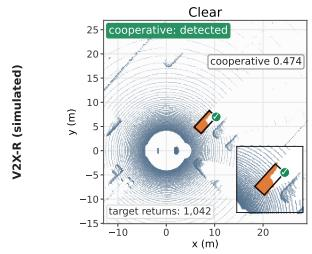
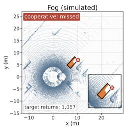
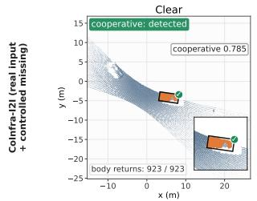
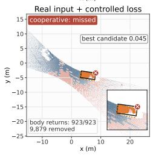
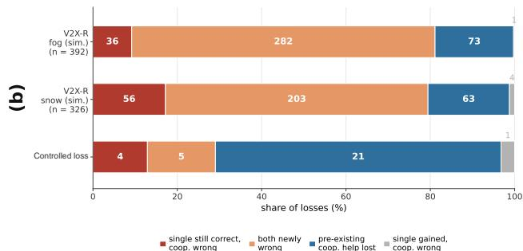
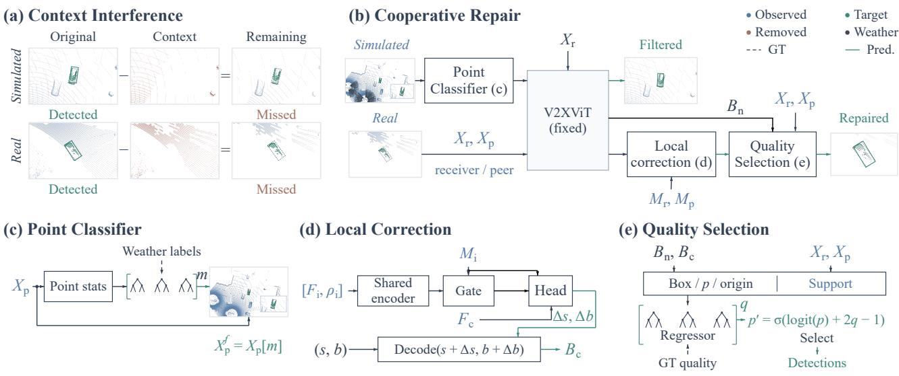
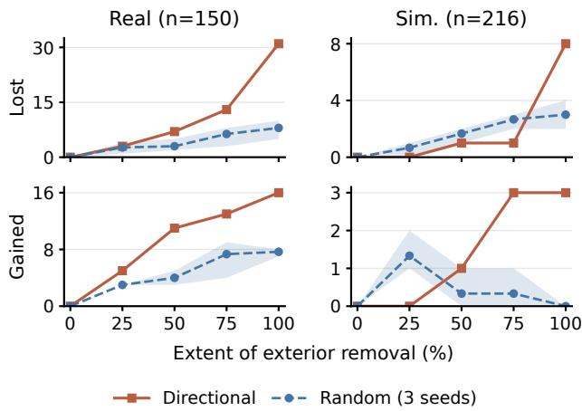
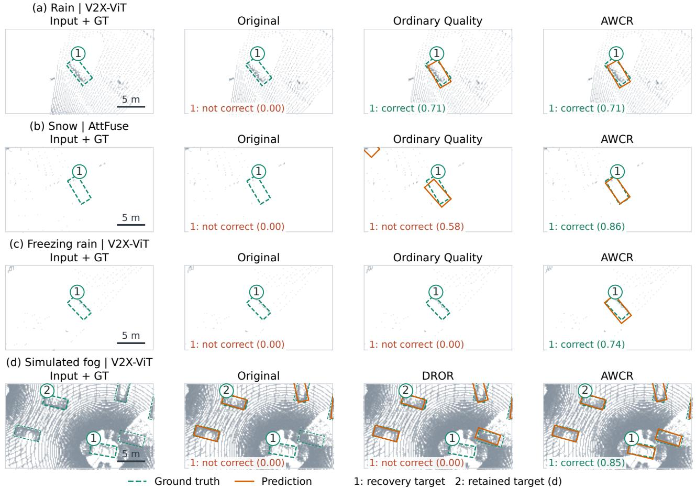

(a)

# Understanding and Repairing Cooperative Perception under Adverse Weather

Mengxu Ma

Northwestern Polytechnical University

mamengxu10086@mail.nwpu.edu.cn

## Abstract

A cooperative 3D detector can miss a vehicle even when the LiDAR points on it remain unchanged. We study thisfailure under adverse weather as Weather-Induced Context Interference. To our knowledge, this is the first controlled study of how weather-related exterior changes remove cooperative benefits while preserving all points inside annotated objects. Controlled experiments on simulated and real roadside inputs show that exterior loss changes object representations before fusion and removes previously useful assistance. On real inputs, restoring object-neighborhood features recovers 30 of 31 induced failures; three equal-area exterior controls recover none. The failure condition also appears with a second fusion model. These findings motivate Adverse-Weather Cooperative Repair (AWCR), with separate implementations for the available supervision. Point Classifier filters added weather returns in simulation. On real inputs, Local Correction refines candidates and Quality Selection checks them against current measurements, without naturally paired clear/adverse-weather recordings. Candidate tracing shows that correction supplies accurate geometry for some targets that original candidates cannot localize at the evaluation threshold. On natural adverse-weather CoInfra development data, AWCR improves car bird’s-eye-view (BEV) AP@0.7 by 4.66 points with V2X-ViT and 5.56 with AttFuse. On simulated V2X-R fog, it improves vehicle BEV AP@0.7 by 4.47 points at a fixed 4,096-candidate budget.

## 1. Introduction

Cooperative perception lets vehicles and roadside sensors combine observations to detect objects that a single viewpoint misses [13, 29]. Adverse weather can weaken these gains. Recent work improves robustness through weatheraware LiDAR–radar fusion and denoising [1, 14, 31]. Aggregate scores leave open which previously correct objects lose cooperative help and why.

Figure 1(a) illustrates the problem. In simulated fog, a vehicle is missed even though its original target-region point locations remain. On a real input, removing only exterior returns also causes a miss while preserving all vehicle points. We track objects that cooperative detection recognized before the change and group new losses by the receiver’s single-agent results before and afterward, as shown in Figure 1(b). This separates a correct receiver harmed by cooperation from a receiver that never recognized the object and loses previously useful help.

  
Figure 1. Weather changes can erase correct cooperative detections. (a) Correct detections become misses in simulated fog (top) and under controlled exterior loss on a real clear input (bottom). The simulated example preserves original target-region XYZ locations; the real example preserves all body returns. Insets magnify the target; ticks/crosses mark detections/misses, and boxed numerical labels are confidence scores. (b) New cooperative losses grouped by receiver-only correctness before and after the change. Segment labels are counts, n is their total, and bar lengths show percentages. Simulated rows use 72 times; the real controlled-loss row applies the freezing-rain exterior-loss profile to 32 clear times.

Existing studies address related questions. RCP-Bench evaluates collaborative compensation and disruption under camera corruption [5]. CooTest tests weather transformations and identifies misleading cooperation when the receiver alone succeeds but cooperative detection fails [7]. CoLC and FadeLead study the value of background context when deciding what to communicate [10, 26]. We examine how weather-related changes outside objects affect the encoding of preserved object measurements and the cooperative benefits they support.

We study this effect as Weather-Induced Context Interference. With detector weights fixed, we preserve every detector-retained point inside annotated objects and change only exterior observations. On real clear-weather inputs, controlled directional loss makes 31 of 150 previously correct target observations incorrect; 21 lose help that the receiver could not provide alone. In the main simulated model, corresponding loss causes eight new errors among 216 previously correct observations, compared with two to four under three equal-count random controls. Restoring pre-fusion object-neighborhood features recovers seven of these eight failures and 30 of the 31 real failures. Three equal-area exterior regions recover none of the real failures. The failure condition also appears with a second fusion model. The points can stay the same while the model’s interpretation changes.

These findings, together with weather-point removal experiments, motivate Adverse-Weather Cooperative Repair (AWCR). In simulation, Point Classifier is trained with generated weather-point labels to filter added returns. For real inputs, Local Correction makes bounded adjustments to detector predictions, and Quality Selection uses current measurements from both sources to score and select candidates. The real implementation requires no naturally paired clear/adverse-weather recordings. Tracing original and corrected candidates shows both localization refinement and selection of already accurate geometry. The two implementations use the supervision available in their respective settings.

On natural CoInfra [20] development data, AWCR adds 4.66 car AP@0.7 points with V2X-ViT and 5.56 with Att-Fuse. On generated fog in V2X-R [14], it adds 4.47 points at the fixed 4,096-candidate budget. We compare recovery and retention with matched quality selection, ordinary finetuning, and a LiDAR adaptation of RCP-Mix [5].

Our contributions are:

• We identify Weather-Induced Context Interference through controlled exterior changes that preserve object measurements and track the loss of previously usefu cooperation.

• We connect preserved measurements, changed pre-fusion representations, and detection failures through feature restoration and candidate analysis.

• We introduce AWCR for simulated and real inputs, and evaluate detection gains and retention across detectors with quality-selection and full-network training references.

## 2. Related Work

## 2.1. Weather-Robust Cooperative Perception

Cooperative perception shares measurements, features, or predictions. V2VNet and DiscoNet develop feature collaboration [17, 25]; V2X-ViT and V2X-ViTv2 model agent interactions with attention [29, 30]. Where2comm selects spatially confident features [13], CoSDH models supply and demand between agents [28], and CoST combines observations across agents and time [22]. Robustness to alignment and communication errors has also received attention. ERMVP uses sparse consensus features for spatial calibration [32]; MRCNet combines multi-scale fusion with motion context [12]; CATNet aligns asynchronous features and denoises their representations [4].

For adverse weather, fog and snowfall simulation support LiDAR training [8, 9], while Robo3D benchmarks single-agent corruption robustness [15]. UniMix combines simulation and mixing for weather-generalizable LiDAR segmentation [34]. Chae et al. use weather-conditioned LiDAR–radar gating for single-agent detection [1]; V2X-R and HRCP develop radar-assisted denoising and fusion for cooperation [14, 31]. RCP-Bench studies camera corruptions and robustness training [5]; DSRC and CoopDiff learn corruption-resistant cooperative representations through distillation, reconstruction, and denoising [3, 33]. V2XScenes and CoInfra provide real cooperative observations under challenging traffic or weather [20, 23]. We trace how exterior changes affect preserved object measurements and their cooperative benefits.

## 2.2. Context and Cooperative Benefits

Context serves several roles in recent perception systems. CoLC combines foreground/background sampling with Li-DAR completion [10]; FadeLead enriches foreground features with background context before pruning background sharing [26]. Long-SCOPE uses context-aware query association for robust long-range cooperation [24]. RoCo-Sim models foreground–background relationships for consistent multi-view foreground editing in camera-based roadside data augmentation [6]. For camera–LiDAR fusion, CCF diagnoses LiDAR-dominated learning and rebalances modality use under domain shifts [27]. Our question concerns exterior observations: can changing them alter the encoding of preserved object measurements and erase cooperative help?

CooTest identifies misleading cooperation when singleagent detection succeeds but cooperative detection fails [7]; RCP-Bench studies collaborative compensation and disruption [5]. We also follow previously correct cooperative targets that the receiver misses both before and after a change. This exposes lost help with an unchanged receiver outcome; feature restoration tests the role of altered representations.

## 2.3. Point Filtering and Candidate Refinement

DROR uses range-adaptive neighborhoods to reject snow returns [2]; Heinzler et al. learn rain/fog return classification [11]. These methods motivate filtering added returns before detection, as in our simulated Point Classifier.

PV-RCNN refines proposals with keypoint features [21], and From Voxel to Point combines point, BEV, and box features for quality estimation [16]. In cooperation, mm-Cooper filters low-confidence shared information and refines received detections to handle calibration errors [19]. AWCR applies refinement at the repair sites suggested by our analysis. Its real Local Correction and Quality Selection use current measurements from both sources. Matched quality calibration, recovery, and retention tests assess measurement support and its effect on previously correct detections and cooperative benefits.

## 3. Weather-Induced Context Interference

## 3.1. Tracking Lost Cooperative Benefits

We track targets that change from a correct cooperative detection to an error after a weather change. Figure 1(b) groups these losses by the receiver’s single-agent result: it remains correct, becomes incorrect, remains incorrect, or becomes correct. The third group captures lost cooperative help even when the receiver’s own result stays unchanged. In the real controlled setting, 21 of the 31 new losses belong to this group.

## 3.2. Changing Exterior Observations

We test whether exterior changes alone can remove a correct detection. With the detector fixed, we preserve every detector-retained point inside annotated objects and remove only exterior points. The directional removal follows the fixed weather-related loss pattern used on real clear-weather inputs. We apply the same pattern in local source coordinates to simulated inputs. On simulated inputs, an equalcount random control removes the same number of exterior points from each source. Remaining point values and their order are preserved. Figure 2(a) illustrates the intervention.

Table 1(a) shows that directional exterior removal loses eight previously correct observations in the main simulated model, compared with two to four under three equal-count random controls. The real model loses 31 of its 150 originally correct observations, compared with five to ten under random removal. The second fusion model also loses three observations and gains four new correct ones. These results show the failure condition in both domains and fusion models.

## 3.3. Sensitivity to Exterior Changes

Figure 3 varies removal from zero to its full extent. Simulated directional losses stay at zero or one through 75%, then reach eight. The loss and gain curves track the targetspecific response to the extent of exterior change, alongside equal-count random controls.

## 3.4. Restoring Object Representations

Preserved points can acquire different features during encoding. In a simulated front-end check, 8,251 of 78,658 protected body points share native cells with removed exterior points, changing their local centering; four of the eight lost targets contain such points. Pre-fusion object-region features change in all 24 inspected simulated inputs.

We replace selected pre-fusion features with their original versions and continue computation on the changed input. Object-neighborhood restoration recovers seven of eight simulated losses, compared with four for the exterior complement (Table 1(b)). On real inputs, it recovers 30 of 31 losses, including 20 of 21 lost cooperative benefits, with no new loss among the 119 originally stable observations. Three predeclared equal-area exterior masks each recover none. These diagnostic replacements use original-input features and support an object-region representation pathway for the observed failures.

## 3.5. Candidate Availability and Repair

We next inspect where usable information remains. Among the 31 real losses, at least one single-source detector stil recognizes the target in 10 cases. In another 12, the singlesource outputs are incorrect but the saved joint candidate pool contains an accurately placed box. The remaining nine have no accurate box in that pool. In simulation, six of the eight losses retain a correct single-source detection, while the other two retain accurate geometric candidates in the complete output pool.

These findings suggest two repair sites. In simulated fog, identifiable added returns can be filtered before encoding. On real inputs, the remaining single-source detections and joint candidates motivate bounded alternatives and measurement-supported selection. Candidate repair acts on these available predictions; it does not require the original features used by the diagnostic replacement. Exterior removal isolates the failure condition; filtering tests an inputside response to added returns. Section 5.4 evaluates detection recovery together with retention of original correct results.

  
Figure 2. Weather-Induced Context Interference and Adverse-Weather Cooperative Repair (AWCR). (a) Controlled exterior removal causes misses while preserving 381 and 316 target returns in the simulated and real examples, respectively; the real row is constructed from a clearweather input. (b) AWCR filters added weather returns in simulation and repairs candidates on real inputs. The simulated output illustrates filtering. (c) Point Classifier selects original peer points with a learned mask. (d) Local Correction combines supported source features with fused context and adds bounded residuals before decoding. (e) Quality Selection scores candidates using current measurements and updates their confidence before selection. GT denotes ground truth; dashed arrows indicate training supervision. Source and fused features $F _ { i } , F _ { c }$ and the other symbols are defined in Section 4.

Table 1. Controlled exterior changes and representation restoration with object measurements preserved. (a) Lost/gained correct target observations after exterior removal. Random ranges use three fixed seeds for V2X-ViT and one for AttFuse. (b) Original pre-fusion features replace selected regions on the changed input. Recovery uses the directional losses; new losses use the remaining originally correct observations. The simulated exterior region is the object-mask complement; the three real exterior masks each match object-mask area.  
(a) Exterior removal
<table><tr><td>Setting / fusion</td><td>Original correct</td><td>Directional Lost Gained</td><td></td><td>Random Lost Gained</td></tr><tr><td></td><td></td><td></td><td></td><td>2-4</td></tr><tr><td>Sim. / V2X-ViT Sim. / AttFuse</td><td>216 219</td><td>8 3</td><td>3 4</td><td>0 2</td></tr><tr><td>Real / V2X-ViT</td><td></td><td>31</td><td>165-10</td><td>1 7-8</td></tr><tr><td></td><td>150</td><td></td><td></td><td></td></tr></table>

## 4. Adverse-Weather Cooperative Repair

## 4.1. Design Goal and Two Realizations

AWCR aims to recover detections while retaining original correct results and cooperative benefits. Figure 2(b) shows two realizations with separately trained components and a fixed detector. Point Classifier removes identifiable interference before encoding in simulation. For real inputs, Local Correction supplies bounded alternatives, and Quality Selection checks candidates against current measurements. For receiver and peer point clouds $X _ { r } , X _ { p } ,$ , V2X-ViT [29] produces logits s and encoded regressions b. The native decoder converts them to boxes and sigmoid confidence scores, giving original candidates $B _ { n } = \operatorname { D e c o d e } ( s , b )$

(b) Pre-fusion restoration (V2X-ViT)
<table><tr><td>Setting</td><td>Restored region</td><td>Recovered New losses</td><td></td></tr><tr><td rowspan="2">Sim.</td><td>Object</td><td>7/8</td><td>0/208</td></tr><tr><td>Exterior</td><td>4/8</td><td>0/208</td></tr><tr><td rowspan="2">Real</td><td>Object</td><td>30/31</td><td>0/119</td></tr><tr><td>Exterior (each of 3)</td><td>0/31</td><td>0/119</td></tr></table>

## 4.2. Point Classifier

The simulated realization removes peer returns identified as weather, as shown in Figure 2(c). For each retained point x, an 11-dimensional descriptor $\phi ( x ; X _ { p } )$ summarizes range, height, intensity, within-cell deviations and count, and neighborhood statistics. Six histogram gradientboosting classifiers $C _ { k }$ estimate its weather probability. Each threshold $\tau _ { k }$ is calibrated at the 99.5th percentile of normal-point scores on a separate calibration scene. A point is removed when at least four classifiers vote for weather:

  
Figure 3. Exterior-removal sensitivity with V2X-ViT on fixed clear inputs. Losses count failures among the original 150 real and 216 simulated correct observations; gains count newly correct observations outside these sets. The horizontal axis scales the full directional mask from zero to 100%. Dashed curves show the mean of three equal-count random controls; shading shows their range. Object-interior points stay unchanged.

$$
\begin{array} { l } { { \displaystyle m ( x ) = { \bf 1 } \left[ \sum _ { k = 1 } ^ { 6 } { \bf 1 } [ C _ { k } ( \phi ( x ; X _ { p } ) ) \ge \tau _ { k } ] < 4 \right] } , } \\ { { \displaystyle X _ { p } ^ { f } = X _ { p } [ m ] . } } \end{array}\tag{1}
$$

Here $\mathbf { 1 } [ \cdot ]$ is the indicator function; $m ( x ) = 1$ retains a point, preserving its values and order. The filtered peer input and the current receiver input are then passed to the detector. For multiple peers, filtering is applied independently to each source.

## 4.3. Candidate Repair from Current Measurements 4.3.1. Local Correction

The real losses include both available but unselected candidates and candidates with insufficient localization. Local Correction adjusts scores and geometry while retaining original predictions as alternatives. For each source $i \in \{ r , p \}$ , we average shallow features over observed cells in a $5 \times 5$ neighborhood on the detector’s output grid, obtaining $F _ { i }$ . Let $n _ { i }$ be the retained-point count in that neighborhood, $M _ { i } = \mathbf { 1 } [ n _ { i } > 0 ]$ its measurement support, and $\rho _ { i } ~ = ~ \operatorname* { m i n } \{ 2 , \log ( 1 + n _ { i } ) / \log 5 1 3 \}$ its normalized density. Density equals one at $n _ { i } = 5 1 2$ and is capped at two. Training-set RMS scales normalize $F _ { i }$ ; the resulting $\bar { F } _ { i }$ enters a shared encoder E and a learned gate G:

$$
z _ { i } = M _ { i } E ( [ \bar { F } _ { i } , \rho _ { i } ] ) , \qquad h _ { i } = M _ { i } \sigma ( G ( z _ { i } ) ) z _ { i } .\tag{2}
$$

The tokens $z _ { i } , h _ { i }$ have 64 channels, G predicts a scalar gate per cell, σ is sigmoid, and [·] concatenates channels. As

shown in Figure $2 ( \mathrm { d } )$ , support also enters the prediction head directly, alongside the two source tokens and normalized fused context $\bar { F } _ { c }$ :

$$
\begin{array} { r } { \left( u _ { s } , u _ { b } \right) = H ( [ h _ { r } , h _ { p } , C ( \bar { F } _ { c } ) , M _ { r } , M _ { p } ] ) , \qquad } \\ { \Delta s = 3 \operatorname { t a n h } u _ { s } , \qquad \Delta b = \beta \odot \operatorname { t a n h } u _ { b } . } \end{array}\tag{3}
$$

H produces unbounded outputs $u _ { s } , u _ { b } ; C$ encodes the normalized fused feature $\bar { F } _ { c } .$ . The product ⊙ is elementwise. For an anchor with height $h _ { a } .$ , width $w _ { a } ,$ , length $l _ { a } ,$ and BEV diagonal $d _ { a } = \sqrt { w _ { a } ^ { 2 } + l _ { a } ^ { 2 } }$ , the bounds for $( x , y , z , h , w , l , \theta )$ are

$$
\beta _ { a } = ( 0 . 5 / d _ { a } , 0 . 5 / d _ { a } , 0 . 2 5 / h _ { a } , 0 . 1 2 , 0 . 1 2 , 0 . 1 2 , 0 . 2 ) .\tag{4}
$$

The two car-anchor bound vectors are concatenated to form $\beta .$ The residual applies to the two car anchors at each output location. Its final layer is initialized to zero, so training starts from the original predictions. Corrected candidates are obtained by

$$
B _ { c } = \mathrm { D e c o d e } ( s + \Delta s , \ b + \Delta b ) .\tag{5}
$$

Thus the bounded update acts in the detector’s regression encoding before box decoding.

## 4.3.2. Quality Selection

The original and corrected candidates offer complementary choices. Quality Selection uses current point support to assess their localization beyond the detector’s confidence. We merge $B _ { n }$ and $B _ { c }$ and retain at most 4,096 candidates by their incoming confidence before quality estimation. For a candidate box $B$ with confidence $p ,$ seven attributes encode its logit, dimensions, sine/cosine heading, and original/corrected branch identity. Each source contributes 30 local point statistics: interior and nearby counts, a 4 × 4 point-count histogram, coordinate moments and extents, and boundary support. Together they form $\boldsymbol { v } _ { B } \in \mathbb { R } ^ { 6 7 }$ . A gradient-boosting regressor $R$ estimates localization quality, following the use of geometric quality in 3D detection [16]. Figure 2(e) applies the estimate through

$$
\begin{array} { l } { q _ { B } = \mathrm { c l i p } ( R ( v _ { B } ) , 0 , 1 ) , } \\ { p _ { B } ^ { \prime } = \sigma ( \mathrm { l o g i t } ( p ) + 2 q _ { B } - 1 ) . } \end{array}\tag{6}
$$

The fixed offset $2 q _ { B } - 1$ maps quality to $[ - 1 , 1 ]$ in logit space, where logi $\displaystyle { \mathrm { t } ( p ) = \log ( p / ( 1 - p ) ) } \colon$ ; clip clamps to the stated interval. Updated scores enter the fixed filtering and suppression procedure. The matched ordinary-quality baseline uses the same candidates, quality targets, regressor, and 300 boosting rounds, with the 60 point-statistic entries set to zero.

## 4.4. Supervision and Inference Inputs

Point Classifier learns generated weather-point identities. Local Correction uses annotated real training observations, including clear inputs and their constructed exterior-loss variants. Clear-input native-correct assignments carry into loss variants. Accurate candidates retain their geometry targets; other positives use annotated geometry. Classification masks ambiguous negatives and unreachable positives. The correction network minimizes

$$
\mathcal { L } _ { \mathrm { l o c a l } } = \mathcal { L } _ { \mathrm { f o c a l } } + 2 \mathcal { L } _ { \mathrm { b o x } } + 0 . 1 \mathcal { L } _ { \mathrm { k e e p } } .\tag{7}
$$

$\mathcal { L } _ { \mathrm { f o c a l } }$ is focal classification loss [18] with $\alpha = 0 . 2 5$ and $\gamma \ = \ 2 ; \ C _ { \mathrm { b o x } }$ is positive-anchor Smooth L1 loss with a sine heading error. At native-correct training anchors, $\mathcal { L } _ { \mathrm { k e e p } }$ penalizes probability drops beyond 0.05 and regression drift normalized by $\beta .$ Quality Selection regresses $\begin{array} { r } { q _ { B } ^ { \star } = \operatorname* { m a x } _ { g \in { \mathcal G } _ { \mathrm { t r a i n } } } \operatorname { I o U } _ { \mathrm { B E V } } ( B , g ) } \end{array}$ by squared error. Here $\mathcal { G } _ { \mathrm { t r a i n } }$ contains visible car annotations in the current training observation; the target is zero for an empty set. BEV IoU is the intersection over union of rotated ground-plane boxes. At inference, the repair modules use current source features, detector outputs, and retained points. Our real implementation computes their local statistics centrally from both sources’ points. This training uses existing clear observations and artificial loss variants, requiring no naturally paired clear/adverse-weather recordings.

## 5. Experiments

## 5.1. Experimental Settings

CoInfra [20] provides real roadside inputs from two fixed node pairs, (6, 9) and (7, 8); each input uses two nodes. We train repair components on 96 physical times and 384 views. Natural development data contain 80 times and 320 views, with 662 car annotations under rain, snow, and freezing rain and 264 under clear weather. Controlled data contain 32 times and 64 views with exterior removal on real clear inputs (Section 3.2). An observation is one target at one time and view. V2X-R [14] provides 72 simulated times from three scenes; a fixed 24-time subset supports intervention and generated-fog detection.

V2X-ViT [29] is the primary detector, with separately trained repair components in each setting. Its real checkpoint was adapted on a pre-existing split of 1,893 training times. AttFuse uses its existing checkpoint and native features with the same repair split and budget. Training and development use disjoint (recording date, physical timestamp) pairs; 16 controlled times also occur in the natural clear-weather slice.

We report class-aware rotated BEV AP from complete retained score curves. Real mAP averages Car, Truck, Bicycle, and Person, the four annotated classes; AWCR changes only Car outputs. Simulated detection uses 4,096 candidates. Natural rows share a fixed support filter using both sources’ current points and fixed background maps; controlled rows precede it. Candidate Union ranks the merged original/corrected pool by incoming confidence; Ordinary Quality and AWCR rescore the same pool. Selection Only fits the same observation-guided regressor on original candidates and rescores them without Local Correction. Receiver-only runs the detector with one source and retains the shared two-source post-filter; late fusion merges independent outputs by native confidence with the same total budget and suppression. DROR [2] uses published settings in sensor coordinates and preserves surviving values and order.

Ordinary fine-tuning and RCP-Mix [5] share initialization, data order, 3,000 full-view updates, and optimization settings. RCP-Mix is a LiDAR training adaptation with fixed inference normalization. AWCR trains car repair heads on patches.

## 5.2. Detection under Adverse Weather

Table 2 compares both settings. AWCR adds 4.66 car AP@0.7 points on real adverse weather and 4.47 vehicle AP@0.7 points on simulated fog. Generated-identity deletion provides a filtering reference at 28.39 AP@0.7; Point Classifier uses only current peer measurements. On simulated fog, AWCR reaches 27.41 vehicle AP@0.7, compared with 26.48 for late fusion and 23.69 for DROR.

On real AttFuse, car AP@0.7 rises from 10.55 to 16.11; the gain over matched Ordinary Quality is 1.69 car AP@0.7 points. Ordinary fine-tuning and RCP-Mix reach 25.16 and 27.55 car AP@0.7 on V2X-ViT, compared with 30.37 for AWCR.

## 5.3. Components

Table 3 compares candidate correction and selection. Local Correction and Ordinary Quality reach 28.69 and 29.07 car AP@0.7; current point statistics raise the latter to 30.37. Selection Only reaches 29.37 using original candidates. AWCR adds 1.00 car AP@0.7 points over Selection Only, gaining 27 correct detections and losing 14, for a net gain of 13. For nine gained targets, no original valid car candidate reaches IoU 0.7 before budget truncation; correction refines near-threshold geometry into accurate boxes. The other gains use available accurate alternatives or already accurate geometry. All 14 losses involve a higher-scored corrected box suppressing an accurate candidate. Selection Only has fewer false detections and retains all 140 original cooperative benefits.

## 5.4. Repair and Retention

Table 3 evaluates the original 150 correct controlled observations on both original and changed inputs. AWCR recovers 11 of the 31 exterior-removal losses and introduces six new losses, reducing either-input errors from 31 to 26. Ordinary Quality recovers the same number with eight new losses. Selection Only recovers four with no new losses, leaving 27 errors. All 11 AWCR rescues already have accurate geometry in the original budgeted pool; these controlled rescues reflect selection among available alternatives.

Table 2. Detection across datasets, weather, and checkpoints (BEV $\mathbf { A P } \times 1 0 0 )$ . Real rows share two-source support filtering; simulated fog uses 4,096 candidates. Fine-tuning/RCP-Mix update the full detector; AWCR updates repair components. Identity deletion uses generated point labels; –: unreported. Bold marks within-checkpoint column maxima, excluding identity deletion.
<table><tr><td></td><td colspan="5">CoInfra: real natural adverse weather</td><td colspan="2">V2X-R: fog, 24 times</td></tr><tr><td></td><td colspan="3">Car AP@0.7</td><td colspan="2">Car: all adverse weather</td><td colspan="2">Vehicle</td></tr><tr><td>Method</td><td>Rain</td><td>Snow</td><td>Freezing rain</td><td>AP@0.5</td><td>AP@0.7</td><td>AP@0.5</td><td>AP@0.7</td></tr><tr><td>V2X-ViT</td><td></td><td></td><td></td><td></td><td></td><td></td><td></td></tr><tr><td>Receiver-only predictions</td><td>16.37</td><td>4.80</td><td>9.09</td><td>21.15</td><td>8.10</td><td>20.21</td><td>13.56</td></tr><tr><td>Late fusion</td><td>26.82</td><td>12.84</td><td>13.49</td><td>40.50</td><td>14.73</td><td>49.73</td><td>26.48</td></tr><tr><td>Original</td><td>45.78</td><td>21.96</td><td>22.51</td><td>46.60</td><td>25.70</td><td>45.55</td><td>22.94</td></tr><tr><td>Original + DROR [2]</td><td>37.37</td><td>19.88</td><td>18.89</td><td>43.90</td><td>22.09</td><td>48.07</td><td>23.69</td></tr><tr><td>Ordinary fine-tuning</td><td>34.55</td><td>21.05</td><td>25.27</td><td>54.36</td><td>25.16</td><td></td><td></td></tr><tr><td>RCP-Mix (LiDAR) [5]</td><td>38.53</td><td>21.46</td><td>28.65</td><td>56.42</td><td>27.55</td><td></td><td>1</td></tr><tr><td>Ordinary Quality</td><td>45.81</td><td>24.70</td><td>27.13</td><td>52.73</td><td>29.07</td><td></td><td></td></tr><tr><td>AWCR</td><td>50.19</td><td>25.60</td><td>28.06</td><td>56.60</td><td>30.37</td><td>50.74</td><td>27.41</td></tr><tr><td>Identity deletion (diagnostic)</td><td>一</td><td>一</td><td>一</td><td>一</td><td>一</td><td>50.75</td><td>28.39</td></tr><tr><td>AttFuse</td><td></td><td></td><td></td><td></td><td></td><td></td><td></td></tr><tr><td>Original</td><td>23.26</td><td>9.81</td><td>7.80</td><td>29.09</td><td>10.55</td><td></td><td>一</td></tr><tr><td>Ordinary Quality</td><td>28.82</td><td>11.98</td><td>12.17</td><td>35.36</td><td>14.42</td><td></td><td>一</td></tr><tr><td>AWCR</td><td>32.14</td><td>13.62</td><td>12.87</td><td>37.77</td><td>16.11</td><td></td><td></td></tr></table>

Table 3. Components and repair behavior on CoInfra with V2X-ViT. AP values are multiplied by 100; counts use score $> 0 . 2 7$ and BEV $\mathrm { I o U } \geq 0 . 7 .$ . Natural inputs share filtering; controlled inputs omit it. Help counts retained detections among 140 original cooperative benefits. Rescues require both inputs correct among 31 exterior-removal losses; new losses count either input among 119 originally stable observations. Errors equal 31 − rescued + new losses. Bold marks column optima, including ties; arrows give the preferred direction.
<table><tr><td rowspan="3"></td><td colspan="4">Natural adverse weather</td><td colspan="3">Controlled exterior loss</td></tr><tr><td>Car</td><td colspan="2">Detections</td><td rowspan="2">Retained Help ↑</td><td colspan="2">Originally correct: 150</td><td></td></tr><tr><td>AP@0.7↑</td><td>Correct ↑</td><td>False ↓</td><td>Rescued ↑</td><td>New losses ↓</td><td>Errors ↓</td></tr><tr><td>Original</td><td>25.70</td><td>230</td><td>447</td><td>140</td><td>0</td><td>0</td><td>31</td></tr><tr><td>Local Correction</td><td>28.69</td><td>240</td><td>360</td><td>124</td><td>12</td><td>10</td><td>29</td></tr><tr><td>Candidate Union</td><td>28.71</td><td>249</td><td>566</td><td>129</td><td>11</td><td>8</td><td>28</td></tr><tr><td>Ordinary Quality</td><td>29.07</td><td>251</td><td>481</td><td>129</td><td>11</td><td>8</td><td>28</td></tr><tr><td>Selection Only</td><td>29.37</td><td>238</td><td>264</td><td>140</td><td>4</td><td>0</td><td>27</td></tr><tr><td>Ordinary fine-tuning</td><td>25.16</td><td>216</td><td>295</td><td>91</td><td>9</td><td>21</td><td>43</td></tr><tr><td>RCP-Mix (LiDAR)</td><td>27.55</td><td>245</td><td>308</td><td>108</td><td>15</td><td>21</td><td>37</td></tr><tr><td>AWCR</td><td>30.37</td><td>251</td><td>335</td><td>131</td><td>11</td><td>6</td><td>26</td></tr></table>

On natural adverse weather, AWCR increases correct detections from 230 to 251 and reduces false detections from 447 to 335. It retains 220 of the 230 original correct detections and 131 of the 140 original cooperative benefits: 95.7% and 93.6%, respectively. Compared with Ordinary Quality, it has the same correct count and 146 fewer false detections.

The full-network references provide a complementary comparison of recovery and retention. RCP-Mix and ordinary fine-tuning give 37 and 43 controlled errors, respectively, compared with 26 for AWCR. Their retained original correct detections on natural adverse weather are 173 and 152, compared with 220 for AWCR. With AttFuse, AWCR retains 63 of 64 original correct detections on natural adverse weather and 44 of 47 on controlled clear inputs.

## 5.5. Qualitative Comparison

Figure 4 shows repair across weather conditions and detectors. Both selectors recover the rainy target; current measurements select the more accurate snow candidate and re-

  
Figure 4. Qualitative examples on fixed development inputs. Each row uses the same current point-cloud background and crop across methods. Green dashed boxes are annotations; orange boxes are predictions. The reference is Ordinary Quality in (a–c) and DROR in (d). Target 1 is recovered by AWCR; target 2 in (d) remains correct. Each crop spans 28 × 16 m. Parentheses give target 1’s best BEV IoU among retained predictions; zero means no overlapping prediction, and correctness uses 0.7. Every car prediction above the fixed score 0.27 intersecting the crop is shown.

cover the freezing-rain target missed by Ordinary Quality. In simulated fog, Point Classifier recovers target 1 while preserving target 2.

## 6. Conclusion

We studied Weather-Induced Context Interference in cooperative 3D detection. Weather-related exterior changes can alter object representations and remove useful cooperation even when every point inside annotated objects is preserved. Restoring object-neighborhood features recovers seven of eight simulated failures and 30 of 31 real controlled failures. Candidate tracing further distinguishes selection of existing accurate boxes from localization gains supplied by correction.

These findings motivate AWCR, with repair components suited to the available supervision. Point Classifier filters added weather returns in simulation; Local Correction and Quality Selection refine and select candidates from current real measurements without naturally paired clear/adverseweather recordings. Experiments on simulated and natural adverse-weather inputs show detection gains across checkpoints, while recovery and retention measurements track their effect on previously correct results. Together, the findings highlight the need to account for both preserved object evidence and the surrounding observations that shape its interpretation when designing robust cooperation.

## LLM Usage Statement

OpenAI ChatGPT/Codex assisted with literature search, study and experiment planning, implementation and debugging of experimental and analysis code, result checks, figure preparation, and manuscript drafting and editing. Its use spans the research workflow and this paper. The author retains responsibility for the scientific claims, evidence, code, citations, and final submission.

## References

[1] Yujeong Chae, Hyeonseong Kim, and Kuk-Jin Yoon. Towards robust 3D object detection with LiDAR and 4D Radar fusion in various weather conditions. In CVPR, pages 15162–15172, 2024.

[2] Nicholas Charron, Stephen Phillips, and Steven L. Waslander. De-noising of LiDAR point clouds corrupted by snowfall. In Conference on Computer and Robot Vision (CRV), pages 254–261, 2018.

[3] Gong Chen, Chaokun Zhang, and Pengcheng Lv. CoopDiff: A diffusion-guided approach for cooperation under corruptions. In CVPR, 2026.

[4] Gong Chen, Chaokun Zhang, Tao Tang, Pengcheng Lv, Feng Li, and Xin Xie. CATNet: Collaborative alignment and transformation network for cooperative perception. In CVPR, pages 18724–18733, 2026.

[5] Shihang Du, Sanqing Qu, Tianhang Wang, Xudong Zhang, Yunwei Zhu, Jian Mao, Fan Lu, Qiao Lin, and Guang Chen. RCP-Bench: Benchmarking robustness for collaborative perception under diverse corruptions. In CVPR, pages 11908– 11918, 2025.

[6] Yuwen Du, Anning Hu, Zichen Chao, Yifan Lu, Junhao Ge, Genjia Liu, Weitao Wu, Lanjun Wang, and Siheng Chen. RoCo-Sim: Enhancing roadside collaborative perception through foreground simulation. In ICCV, pages 26977– 26986, 2025.

[7] An Guo, Xinyu Gao, Zhenyu Chen, Yuan Xiao, Jiakai Liu, Xiuting Ge, Weisong Sun, and Chunrong Fang. CooTest: An automated testing approach for V2X communication systems. In ISSTA, pages 1453–1465, 2024.

[8] Martin Hahner, Christos Sakaridis, Dengxin Dai, and Luc Van Gool. Fog simulation on real LiDAR point clouds for 3D object detection in adverse weather. In ICCV, pages 15283– 15292, 2021.

[9] Martin Hahner, Christos Sakaridis, Mario Bijelic, Felix Heide, Fisher Yu, Dengxin Dai, and Luc Van Gool. LiDAR snowfall simulation for robust 3D object detection. In CVPR, pages 16364–16374, 2022.

[10] Yushan Han, Hui Zhang, Qiming Xia, Yi Jin, and Yidong Li. CoLC: Communication-efficient collaborative perception with LiDAR completion. In CVPR, pages 2983–2992, 2026.

[11] Robin Heinzler, Florian Piewak, Philipp Schindler, and Wilhelm Stork. CNN-based Lidar point cloud de-noising in adverse weather. IEEE Robotics and Automation Letters, 2020.

[12] Shixin Hong, Yu Liu, Zhi Li, Shaohui Li, and You He. Multiagent collaborative perception via motion-aware robust communication network. In CVPR, pages 15301–15310, 2024.

[13] Yue Hu, Shaoheng Fang, Zixing Lei, Yiqi Zhong, and Siheng Chen. Where2comm: Communication-efficient collaborative perception via spatial confidence maps. In Advances in Neural Information Processing Systems, pages 4874–4886, 2022.

[14] Xun Huang, Jinlong Wang, Qiming Xia, Siheng Chen, Bisheng Yang, Xin Li, Cheng Wang, and Chenglu Wen. V2X-R: Cooperative LiDAR-4D Radar fusion with denoising diffusion for 3D object detection. In CVPR, pages 27390–27400, 2025.

[15] Lingdong Kong, Youquan Liu, Xin Li, Runnan Chen, Wen wei Zhang, Jiawei Ren, Liang Pan, Kai Chen, and Ziwei Liu. Robo3D: Towards robust and reliable 3D perception against corruptions. In ICCV, pages 19994–20006, 2023.

[16] Jiale Li, Hang Dai, Ling Shao, and Yong Ding. From voxel to point: IoU-guided 3D object detection for point cloud with voxel-to-point decoder. In ACM International Conference on Multimedia (ACM MM), pages 4622–4631, 2021.

[17] Yiming Li, Shunli Ren, Pengxiang Wu, Siheng Chen, Chen Feng, and Wenjun Zhang. Learning distilled collaboration graph for multi-agent perception. In Advances in Neural In formation Processing Systems, pages 29541–29552, 2021.

[18] Tsung-Yi Lin, Priya Goyal, Ross Girshick, Kaiming He, and Piotr Dollar. Focal loss for dense object detection. In´ ICCV, pages 2980–2988, 2017.

[19] Bingyi Liu, Jian Teng, Hongfei Xue, Enshu Wang, Chuanhui Zhu, Pu Wang, and Libing Wu. mmCooper: A multi-agent multi-stage communication-efficient and collaboration-robust cooperative perception framework. In ICCV, pages 28396–28406, 2025.

[20] Minghao Ning, Yufeng Yang, Keqi Shu, Shucheng Huang, Jiaming Zhong, Maryam Salehi, Mahdi Rahmani, Yukun Lu, Chen Sun, Aladdin Saleh, Ehsan Hashemi, and Amir Khajepour. CoInfra: A large-scale cooperative infrastructure perception system and dataset in adverse weather. arXiv preprint arXiv:2507.02245, 2025.

[21] Shaoshuai Shi, Chaoxu Guo, Li Jiang, Zhe Wang, Jianping Shi, Xiaogang Wang, and Hongsheng Li. PV-RCNN: Pointvoxel feature set abstraction for 3D object detection. In CVPR, pages 10529–10538, 2020.

[22] Zongheng Tang, Yi Liu, Yifan Sun, Yulu Gao, Jinyu Chen, Runsheng Xu, and Si Liu. CoST: Efficient collaborative perception from unified spatiotemporal perspective. In ICCV, pages 1120–1129, 2025.

[23] Bowen Wang, Yafei Wang, Wei Gong, Siheng Chen, Genjia Liu, Minhao Xiong, and Chin Long Ng. V2XScenes: A multiple challenging traffic conditions dataset for large-range vehicle-infrastructure collaborative perception. In ICCV, pages 28385–28395, 2025.

[24] Jiahao Wang, Zikun Xu, Yuner Zhang, Zhongwei Jiang, Chenyang Lu, Shuocheng Yang, Yuxuan Wang, Jiaru Zhong, Chuang Zhang, Shaobing Xu, and Jianqiang Wang. Long-SCOPE: Fully sparse long-range cooperative 3D perception. In CVPR, pages 11599–11609, 2026.

[25] Tsun-Hsuan Wang, Sivabalan Manivasagam, Ming Liang, Bin Yang, Wenyuan Zeng, and Raquel Urtasun. V2VNet: Vehicle-to-vehicle communication for joint perception and prediction. In ECCV, 2020.

[26] Yuheng Wu, Xiangbo Gao, Quang Tau, Zhengzhong Tu, and Dongman Lee. Background fades, foreground leads: Curriculum-guided background pruning for efficient foreground-centric collaborative perception. In ICRA, 2026.

[27] Yuchen Wu, Kun Wang, Yining Pan, and Na Zhao. CCF: Complementary collaborative fusion for domain generalized multi-modal 3D object detection. In CVPR, pages 18745– 18754, 2026.

[28] Junhao Xu, Yanan Zhang, Zhi Cai, and Di Huang. CoSDH: Communication-efficient collaborative perception via supply-demand awareness and intermediate-late hybridization. In CVPR, pages 6834–6843, 2025.

[29] Runsheng Xu, Hao Xiang, Zhengzhong Tu, Xin Xia, Ming-Hsuan Yang, and Jiaqi Ma. V2X-ViT: Vehicle-to-everything cooperative perception with vision transformer. In ECCV, 2022.

[30] Runsheng Xu, Chia-Ju Chen, Zhengzhong Tu, and Ming-Hsuan Yang. V2X-ViTv2: Improved vision transformers for vehicle-to-everything cooperative perception. IEEE Transactions on Pattern Analysis and Machine Intelligence, 47(1): 650–662, 2025.

[31] Yuquan Yang, Hui Zhang, Wenyu Lu, Ziyin Zhang, Chuanming Zhang, and Xiaohua Xu. Hybrid robust collaborative perception with LiDAR-4D Radar fusion under adverse weather conditions. In CVPR, pages 24237–24247, 2026.

[32] Jingyu Zhang, Kun Yang, Yilei Wang, Hanqi Wang, Peng Sun, and Liang Song. ERMVP: Communication-efficient and collaboration-robust multi-vehicle perception in challenging environments. In CVPR, pages 12575–12584, 2024.

[33] Jingyu Zhang, Yilei Wang, Lang Qian, Peng Sun, Zengwen Li, Sudong Jiang, Maolin Liu, and Liang Song. DSRC: Learning density-insensitive and semantic-aware collaborative representation against corruptions. In AAAI, pages 9942–9950, 2025.

[34] Haimei Zhao, Jing Zhang, Zhuo Chen, Shanshan Zhao, and Dacheng Tao. UniMix: Towards domain adaptive and generalizable LiDAR semantic segmentation in adverse weather. In CVPR, pages 14781–14791, 2024.