# VibeVideoBench: Evaluating Multimodal Agents on Code-Driven Video Generation

Muxi Diao∗ Wenbin Xu∗ Lele Yang∗ Xuyang Ma Yuzhe Chen Jiankang Chen Kaiyu Jiang Changyi Liu Haoyu Zhang Hongyi Fu Jianxiong Wang Tianke Zhang Haonan Fan Yingxin Li Bingyi Li Xu Wang Xuanyu Zheng† Bin Wen†‡ Tingting Gao Han Li Wentao Zhang‡ Weiran Xu Kongming Liang Zhanyu Ma‡

Beijing University of Posts and Telecommunications Zhongguancun Academy Peking University Jilin University Kling Team

vibevideobench.github.io

dmx@bupt.edu.cn

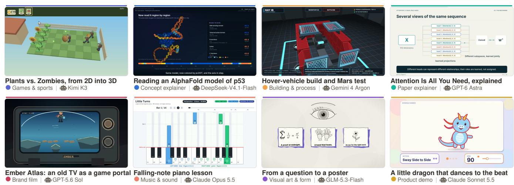  
Figure 1. VibeVideoBench asks a multimodal agent to turn a self-contained specification into a finished MP4 with sound, using only code. Each panel is one frame of an unedited delivery from our evaluation, made by an off-the-shelf agent in its native harness inside a sandbox within one hour: rendered with three.js, Canvas, SVG or cairo, voiced with TTS, scored with synthesized music and sound effects, and muxed with ffmpeg. The 239 tasks span 12 categories, English and Chinese, and 8 s to 15 min of target runtime; each is graded by program checks, 54 task-specific rubric checks on average and five quality dimensions, judged by three audio-visual judge panels.

## Abstract

Diffusion video models produce striking clips, but they cannot reliably render an exact formula, a correct chart, a rule-consistent game or narration synchronized to on-screen events. A different route is emerging: multimodal agents that write code to render every frame and synthesize every sound. We introduce VibeVideoBench, a benchmark for evaluating agents on code-driven video generation. Its 239 self-contained tasks in English and Chinese span 12 categories, from data stories and music-driven pieces to classroom lessons and paper explainers; each asks an agent, running in its native harness inside a sandbox, to deliver a finished MP4 with sound within one hour. Evaluation is hierarchical and evidence-based: program checks of the de-

livery spec, about 13k task-specific rubric checks traced to the requirements they enforce, andfive quality dimensions anchored per task, judged by three VLM judge panels and validated with blind human preferences. Across ninefrontier agent systems and 2,151 scored rollouts, the benchmark is far from solved: GPT-6 Astra and Claude Opus 5.5 lead clearly, yet even the best system fails a core requirement on about a quarter oftasks. Whether a video arrives at all matters as much as its quality, and three quarters ofthe lost videos are final renders started too late, run too slowly or never started. The judges agree with each other and with human preferences on system rankings, but only moderately on individual videos.

## 1. Introduction

Video generation has advanced rapidly through diffusion transformers [5, 15, 26, 35, 40, 45], and benchmarks such as VBench [21, 48] and EvalCrafter [30] measure how plausible and prompt-aligned the generated clips look. Yet many of the videos people actually make—classroom lessons, paper explainers, data stories, product walkthroughs, assembly sequences, rhythm games—demand properties that pixel generators do not guarantee: exact text and numbers, rule-consistent state changes, multi-minute structure, sound aligned to events, and an artifact that can be revised. These are natural properties of programs. Humans already make such videos with Manim or Remotion, and coding agents such as Claude Code, Codex and Gemini CLI [1, 14, 33] can now work autonomously for hours, driving a full toolchain— a renderer, a headless browser, a TTS engine, ffmpeg—on their own. Users have begun to ask agents for finished videos this way, which requires a multimodal agent that reads input assets, produces picture and sound through code, and inspects its own renders to correct them.

How good are agents at making videos? Existing evaluations do not answer this. Video-generation benchmarks score short, silent clips from generative models [18, 21, 30]. Code-to-visual benchmarks score single programs or static artifacts such as charts, web pages and SVGs [9, 37, 38, 47]. Code-based lesson and paper-to-video systems [10, 27, 50] propose purpose-built, single-domain pipelines rather than testing general agents. Agentic benchmarks [24, 32, 43] verify textual or functional outcomes with unit tests, whereas a video is a perceptual, temporal and audio-visual outcome for which no unit test exists. Video therefore tests what text-only agentic benchmarks cannot: whether an agent can check its own output across picture, sound and time.

We present VibeVideoBench (Figs. 1 and 2), a benchmark that evaluates multimodal agents end to end on codedriven video generation: given a specification and optional input assets, an agent must deliver a finished MP4, built entirely with code, inside a sandbox within one hour, with narration, music and sound effects as each task’s audio policy specifies. Its 239 tasks span 12 categories, from brand promos and music-driven pieces to classroom lessons and paper explainers, in English and Chinese. Building it required solving two problems.

Tasks must be realistic yet checkable. We build tasks from four sources—real user requests to code-video tools, real videos (seeded from their dense captions), real asset packs such as 3D scans and game levels, and lecture notes and research papers—and turn each into a self-contained specification that fixes facts, identities, stages, timing and the audio policy while preserving creative freedom.

Evaluation must rest on evidence in the video. Evaluation has three layers with different executors. Program checks (L1) automatically verify the delivery spec— resolution, frame rate, duration, audible sound, source project. Rubric checks (L2; about 13k in total) are each traced to the requirement they enforce, separate process shown from result claimed, and are tagged by modality. Quality scores (L3) rate five dimensions—visual quality, aesthetics, content logic, timing and audio—each anchored at 1, 3 and 5 by descriptions written for the task. L2 and L3 are judged by VLMjudges in three independent panels: two watch the full video with sound, and the third routes visual checks to a vision model and audio checks to an audiocapable model, so audio checks never reach a judge that cannot hear. We validate the judges against blind pairwise human preferences.

To simulate real user settings, we evaluate agents as they are deployed: each model runs fully autonomously in its vendor’s native harness at maximum effort, with no followup turns and all tool permissions pre-approved, in identical containers with the same one-hour budget. Users adopt the model and its harness as one system, so we evaluate complete agent systems rather than separating model from harness. Nine frontier systems from six labs yield 2,151 scored rollouts.

Findings. The benchmark is far from solved: GPT-6 Astra and Claude Opus 5.5 lead clearly, yet even the best system fails a core requirement on about a quarter of tasks. Whether a video arrives at all matters as much as how good it is: counting missing videos as zero reorders the ranking, and three quarters of the lost videos are final renders that started too late, ran too slowly or never started. The three judge panels agree with each other and with blind human preferences on how systems rank, but only moderately on individual videos (§5).

Our contributions are:

• VibeVideoBench, to our knowledge the first benchmark of general multimodal agents on open-domain code-driven video generation with audio: 239 tasks in 12 categories (English and Chinese), about 13k task-specific rubric checks, each traced to the requirement it enforces, input assets and a reproducible sandbox, scoring composed multi-minute videos made by general agents rather than generated clips or one purpose-built pipeline (§3, Tab. 1).

• A hierarchical, evidence-based evaluation protocol that pairs program checks with modality-routed VLM judge panels, handles non-delivery explicitly, and is validated by agreement across three independent judge panels and with blind human preferences (§4).

• A large-scale empirical study of nine frontier agent systems (2,151 scored rollouts, 6.5k video judgments), with a run-by-run analysis of all 224 failed deliveries, a trajectorylevel analysis of how agents make videos, and a blind human preference study on all 239 tasks (§5).

## 2. Related Work

Video generation: the pixel paradigm. Diffusiontransformer generators [5, 15, 28, 40] synthesize pixels directly from text or images and are evaluated by dimensionwise suites [21, 30, 48], learned scorers [18], physics probes [3, 31] and arenas [22]; VideoArgus [46], closest in spirit to our rubric checks, builds sample-specific rubrics before seeing outputs. Story-video systems [29, 42] add an LLM planner, but a generative model still paints the pixels. We study a different paradigm, in which an agent produces a video by writing programs that drive renderers, TTS and ffmpeg, so that content is exact, editable, and controllable in length and sound. Evaluation that asks whether a few seconds of mostly silent footage look plausible does not transfer to it.

Code as a visual medium: the program paradigm. Programs are an editable, verifiable visual representation of charts, web pages, SVG and 3D scenes [9, 16, 37, 38]; ArtifactsBench [47] grades interactive artifacts from screenshots with checklist-guided MLLM judges. For video, TheoremExplainAgent [27], Code2Video [10], VisualEDU [8] and ManimAgent [23] generate educational Manim videos, Paper2Video [50] turns research papers into narrated slide talks, and Code2Video-Compass [11] and an industry benchmark [19] score short silent clips written in one framework. None of these is agentic in our sense: each video comes from a fixed pipeline built around one renderer or genre, or from a single model call, rather than from an agent that chooses its own tools and renders, inspects and revises its own video.

Agent benchmarks. Software and computer-use agents are measured by SWE-bench [24], Terminal-Bench [32], OS-World [43] and PaperBench [39], and GDPval [34] grades occupational deliverables by expert comparison. These verify text, files or functional behavior, whereas a video is a perceptual, temporal and audio-visual outcome for which no unit test exists. AgenticVBench [6] also runs general agents in vendor harnesses, but on post-production of given footage; in our setting every frame and sound must be constructed by code. Tab. 1 contrasts VibeVideoBench with prior work on who makes the video, what is asked, what is delivered and how it is graded.

Judges, rubrics and human preference. LLM and multimodal judges [7, 25, 49] exhibit position and self-preference biases [41]; rubric decomposition improves reliability in non-verifiable domains [2, 17], and pairwise human preference with Bradley–Terry aggregation [4, 12] is the standard validation. Omni models can see and hear [44], but audiovisual benchmarks show they remain weak at fine temporal alignment [13, 20]. We therefore route checks by modality, require timestamped evidence, use three panels from different model families, and measure where they fail.

Table 1. Positioning. Among the benchmarks we know of, only VibeVideoBench has general-purpose agents build complete audiovisual videos from scratch with code across open domains, graded with task-specific rubrics. ✓: yes; ✗: no; ◦: partially.
<table><tr><td>Benchmark</td><td>Output</td><td>Pixels from</td><td>General agents</td><td>Open domain judged assets</td><td></td><td></td><td>Audio Input Task-spec. rubric</td></tr><tr><td>VBench [21]</td><td>T2V clip</td><td>diffusion</td><td>X</td><td></td><td>X</td><td>X</td><td>X</td></tr><tr><td>EvalCrafter [30]</td><td>T2V clip</td><td>diffusion</td><td>X</td><td></td><td>X</td><td>X</td><td>X</td></tr><tr><td>VideoArgus [46]</td><td>T2V clip</td><td>diffusion</td><td>X</td><td></td><td>X</td><td>X</td><td>V</td></tr><tr><td>ArtifactsBench [47]</td><td>web page</td><td>LLM code</td><td>X</td><td></td><td>X</td><td>X</td><td>J</td></tr><tr><td>TheoremExplain [27]</td><td>Manim video</td><td>pipeline</td><td>0</td><td>X</td><td>0</td><td>X</td><td>X</td></tr><tr><td>Paper2Video [50]</td><td>talk video</td><td>pipeline</td><td>X</td><td>X</td><td>0</td><td></td><td>0</td></tr><tr><td>C2V-Compass [11]</td><td>code video</td><td>LLM code</td><td>X</td><td></td><td>X</td><td>0</td><td>X</td></tr><tr><td>AgenticVBench [6]</td><td>edited video</td><td>footage</td><td>J</td><td>V</td><td>J</td><td>√</td><td>V</td></tr><tr><td>VibeVideoBench (ours) code video</td><td></td><td>agent code</td><td></td><td></td><td></td><td></td><td>1</td></tr></table>

## 3. VibeVideoBench

## 3.1. Task formulation

A task $\tau = ( p , \mathcal { A } , d , a , c )$ consists of a natural-language specification p, an optional read-only asset package A (data, fonts, sprites, 3D scans, audio), a machine-readable delivery spec d (resolution, frame rate, duration range $[ t _ { \operatorname* { m i n } } , t _ { \operatorname* { m a x } } ] ,$ optional exact frame count), an audio policy a that marks each of four channels—narration, music, sound effects, ambience—as required, optional or not used, and an explicit creative-freedom statement c. An agent receives $( p , { \mathcal { A } } , d , a , c )$ in a fresh container and must deliver a video v, an editable source project and a timing sheet before the deadline. There is no ground-truth video: a deliverable is judged only against the frozen specification, and any rendering stack is allowed. Agents may not call image- or videogeneration models; the only generative service provided is a TTS command-line tool backed by Qwen3-TTS-Flash [36].

## 3.2. Task construction

Fig. 2a shows the pipeline. Sources. Tasks start from four kinds of real-world sources: requests people wrote for codebased video tools (what people ask for), dense captions of real videos (what people actually make), real asset packs such as 3D scans, archival records and game sprites, and lecture notes and research papers. Specification contract. Real requests are rarely self-contained, so a source only seeds a task: LLM drafters with cross-review expand and rewrite it under a shared contract that fixes every fact, number and object identity the video depends on, divides it into stages with dwell times and states a four-channel audio policy, while protecting creative freedom; missing assets are searched for or synthesized. What the contract fixes can be checked, and what it leaves open measures the agent’s own design. Human curation. Humans select checkable tasks over open briefs, rewrite each into a self-contained prompt without authoring traces, verify its facts and remove duplicates across sources. The result is 239 tasks in 12 categories and 43 subcategories, from 8 s to 15 min, with narration, music, effects and ambience, with or without input assets (Fig. 3).

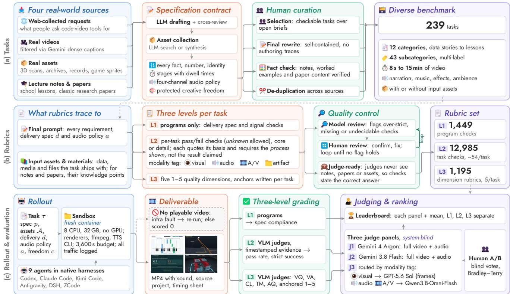  
Figure 2. Overview of VibeVideoBench. (a) Requests from four kinds of real-world sources are drafted under a shared contract, given the assets they need (searched for or synthesized by an LLM), and curated by humans, yielding a benchmark that is diverse in content, form, length and sound. (b) Each task gets a three-level rubric traced to its prompt and its input assets; L2 checks quote their basis and carry modality tags; rubrics go through rounds of model QC and human review until no confirmed finding remains. (c) Agents run in native harnesses in identical one-hour sandboxes; programs check L1, and three VLM judge panels—one routing each check by modality—score L2 and L3.

## 3.3. Statistics

Fig. 3 summarizes the benchmark (App. A). Each task has one of 12 categories (content and purpose) and one or more of 43 subcategories, which cut across categories: 34 presentation forms (e.g., mechanism and causal chain, worked examples, map journeys) and 9 knowledge domains (e.g., mathematics, physics, AI). 209 tasks are in English and 30 in Chinese; 201 ship input assets (median 7 files; 2.7 GB); 70% require at least one audio channel and 49% require speech; most require 1920×1080 at 30 fps, 54 an exact frame count. One pass asks for 11.1 hours of finished video.

## 3.4. Rubrics

Fig. 2b shows how rubrics are built. Every check traces to the final prompt (its requirements, delivery spec d and audio policy a) and to the input assets. Each task is evaluated at three levels: L1 program checks, derived from d and a and decided by code; L2 task checks, atomic pass/- fail checks that each quote the requirement they enforce as their basis, are marked core or detail, require the process to be shown rather than a result to be claimed, and carry a tag for the modality needed to decide them; and L3 quality, five 1–5 dimensions—visual quality (VQ), visual aesthetics (VA), content logic (CL), timing and motion (TM), and audio quality and A/V sync (AQ)—with anchors written per task. Rubrics go through rounds of model review, which flags over-strict, missing or undecidable checks, and human verification, until no flag holds; since judges never see the input assets, each check states the correct content itself. The final set has 1,449 L1 checks, 12,985 L2 checks (about 54 per task) and 1,195 L3 rubrics.

## 4. Evaluation Protocol

Rollout. Every rollout runs in a fresh Docker sandbox with a common rendering toolchain (e.g., Python, Node, a headless browser, ffmpeg) and the TTS tool of §3, under a one-hour wall-clock budget. All model traffic is logged, so every trajectory, token and tool call is recorded, and each (system, task) has exactly one scored run. Details are in App. C.

L1: delivery and program checks. L1 is decided by programs alone; no model is involved. A run delivers if it leaves an MP4 that decodes and can be judged; the delivery rate is the share of tasks with such a video. Each delivery is then measured (ffprobe, a full decode, audio levels, VAD and Whisper language ID) and checked by code against the task’s machine-readable delivery spec d and audio policy a: every task checks container and decodability, resolution, frame rate (±0.01) and duration within $[ t _ { \mathrm { m i n } } - 0 . 5 , t _ { \mathrm { m a x } } + 0 . 5 ] \mathrm { { : } }$ s. The 205 core tasks add a delivered source project, an exact frame count where d requires it (54 tasks) and an audible audio stream (peak > −50 dBFS) where a marks a channel as required (98 tasks under a strict parse). Lessons and papers, which all require narration, add an audible audio stream, narration coverage (VAD), narration language (ASR) and the absence of long black or frozen stretches. This gives 1,449 checks per system (1,177 core, 272 lesson and paper). Spec compliance is the share of tasks whose run passes all applicable checks; a non-delivery fails them all. (The rollout collector also runs a lighter container-level check at collection time, App. C; we use it only in the behavior analysis of §5.3.)

d What tasks demand  
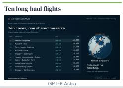

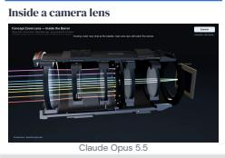

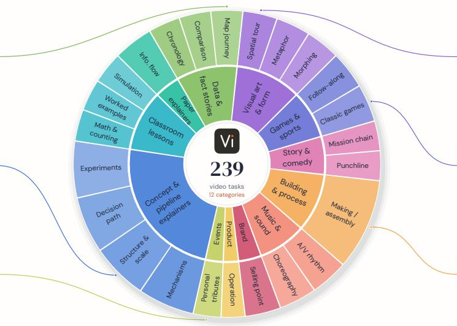

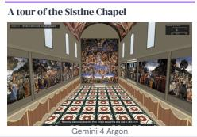

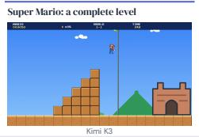

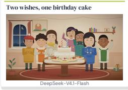

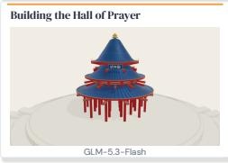

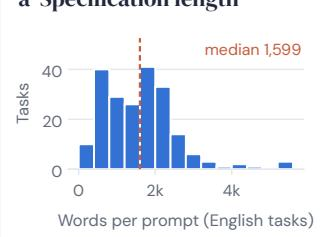

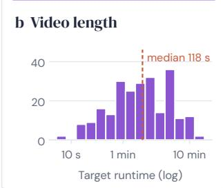

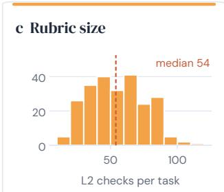

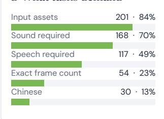  
Figure 3. Benchmark composition (239 tasks). Top: the inner ring gives the 12 categories, with spans proportional to task counts. The outer ring names 24 of the 34 presentation forms, each shown once, in the category where it is most characteristic (equal angles, not counts); every task can carry several of the 43 subcategory tags, and the 9 knowledge domains are not drawn. The six cards are real deliveries, one per model family. Bottom: (a) prompt length of the 209 English tasks (lessons and papers keep their content in the supplied note or PDF, so their prompts are short); (b) target runtime, 8 s–15 min; (c) L2 checks per task, 13–110; (d) share of tasks with each requirement.

L2: rubric checks. For each check a judge returns pass, fail, unknown or n/a, with timestamped evidence. Judges score the 12,985 L2 checks (§3.4), and we report two metrics.

L2 pass pools checks: it is #pass/(#pass+#fail), with unknown and n/a excluded. L2 strict (strict task success) is decided per run: a run succeeds if none of its core checks fails and at least one passes; unknown and n/a do not count against it, and a non-delivery fails. For example, the Super Mario level run (CG01) has 59 checks; a video in which Mario does not grow after touching the mushroom fails the core check “growth is discernible after contact”, so the run fails L2 strict even if the other 58 pass (L2 pass 98%); strict success is thus far more discriminative.

L3: quality. The judge scores each of the five dimensions from 1 to 5 against the task’s own anchors, with reasons, strengths and defects; a dimension the judge cannot assess is left unknown and excluded. For CG01, timing and motion (TM) asks whether continuous motion, landings and state changes can be followed with enough time to see key dangers and successes; it scores 1 if key processes are hard to track, 3 if they can be tracked but transitions or holds are awkward, and 5 if key changes are clear and motion serves the task. The overall score is the mean of the five dimensions; it is not a weighted total of L1–L3, which we keep separate. Delivered-only and no video = 0. Our primary display reports the delivery rate next to delivered-only L2 and L3 scores, which isolate the quality of what was delivered. We also report every metric with no video = 0: a non-delivery scores zero on every dimension and fails every check, so reliability and quality combine into one number.

Table 2. Main results on 239 tasks. All judge-based scores (L2, L3) are means over the three judge panels. L1: playable videos (of 239) and spec compliance (% of tasks passing every program check). Delivered videos: L2 pass rate and L3 overall (1–5) of playable videos, and human Elo from blind pairwise preferences between playable videos (§5.4); rows follow L3 overall. No video = 0: a missing video fails; L2 strict is the share of tasks with no failed core check (§4); grey numbers are ranks. Full results in App. E.
<table><tr><td rowspan="2">Model</td><td rowspan="2">Harness</td><td colspan="2">L1 program checks</td><td colspan="3">Delivered videos</td><td colspan="3">No video = 0</td></tr><tr><td>Videos</td><td>Spec (%)</td><td>L2 pass (%)</td><td>L3 overall</td><td>Human Elo</td><td>L2 strict (%)</td><td>L3 overall (rank)</td><td></td></tr><tr><td>GPT-6 Astra</td><td>Codex CLI</td><td>238</td><td>93.7</td><td>97.1</td><td>4.126</td><td>1242</td><td>74.5</td><td>4.109</td><td>(1)</td></tr><tr><td> Claude Opus 5.5</td><td>Claude Code</td><td>239</td><td>99.6</td><td>97.3</td><td>4.074</td><td>1203</td><td>76.3</td><td></td><td>4.074 (2)</td></tr><tr><td>Claude Sonnet 5.5</td><td>Claude Code</td><td>232</td><td>94.6</td><td>93.9</td><td>3.999</td><td>1121</td><td>67.0</td><td></td><td>3.880 (4)</td></tr><tr><td>Gemini 4 Argon </td><td>Antigravity CLI</td><td>184</td><td>76.6</td><td>96.5</td><td>3.989</td><td>1081</td><td>55.2</td><td></td><td>3.069 (7)</td></tr><tr><td>DeepSeek-V4.1-Flash</td><td>DSH</td><td>236</td><td>94.6</td><td>93.1</td><td>3.961</td><td>1022</td><td>57.6</td><td></td><td>3.911 (3)</td></tr><tr><td>K Kimi K3</td><td>Kimi Code</td><td>213</td><td>85.8</td><td>91.1</td><td>3.864</td><td>997</td><td>46.3</td><td></td><td>3.440 (5)</td></tr><tr><td>Z GLM-5.3-Flash</td><td>ZCode</td><td>179</td><td>66.9</td><td>85.3</td><td>3.736</td><td>905</td><td>33.5</td><td></td><td>2.790 (9)</td></tr><tr><td>S GPT-5.6 Sol</td><td>Codex CLI</td><td>213</td><td>84.5</td><td>89.5</td><td>3.735</td><td>705</td><td>39.0</td><td></td><td>3.317 (6)</td></tr><tr><td>Gemini 3.8 Flash </td><td>Antigravity CLI</td><td>193</td><td>77.4</td><td>80.5</td><td>3.470</td><td>723</td><td>26.6</td><td></td><td>2.798 (8)</td></tr></table>

Judge panels. Each delivered video is judged independently by three panels, each given the exact task prompt and the rubric but never the system identity. Judges are told that onscreen or narrated self-declarations are not evidence, and that unsampled instants cannot be asserted. J1 (Gemini 4 Argon) and J2 (Gemini 3.8 Flash) watch the full MP4 with sound (4 fps up to 150 s, adaptively lower for longer videos) and judge everything. J3 splits by modality following the check tags: GPT-5.6 Sol judges visual checks and VQ/VA/CL/TM from 24–300 sampled frames (up to 1280 px), and Qwen3.8- Omni-Flash judges audio and audio-visual checks and AQ from a full-length proxy with the original audio. Audio observations are passed to the vision judge as reference. All three panels contain evaluated models (J1, J2 and J3’s vision judge); J3 shares no family with J1/J2. Each panel’s metrics are computed separately and then averaged; scores are never mixed across panels within a metric (3 × 2,151 run results). Tab. 2 reports the mean over the three panels; per-panel results are in App. E.

Human preference. To validate the judges we ran a blind pairwise study on all 239 tasks. Five annotators each saw the full prompt and two synchronized players with videos of two systems on the same task, both playable, and chose A, B, tie or both bad by overall quality and adherence (N votes, N decisive). Human preference therefore measures the quality of delivered videos, not delivery. We fit Bradley– Terry strengths [4] on decisive votes (Elo scale, geometric mean 1000) with 2,000-sample bootstrap CIs and measure system-level rank correlation and pair-level agreement with each panel.

## 5. Experiments

Systems. We evaluate nine agent systems from six labs, each in its native harness at the highest available reasoning effort and run fully autonomously, with no follow-up turns and all tool permissions pre-approved (Tab. 2): GPT-6 Astra and GPT-5.6 Sol (Codex CLI), Claude Opus 5.5 and Sonnet 5.5 (Claude Code), Gemini 4 Argon and Gemini 3.8 Flash (Antigravity CLI), DeepSeek-V4.1-Flash, version 1017 (DSH), Kimi K3 (Kimi Code) and GLM-5.3-Flash (ZCode). Agents receive one fixed instruction (“read ENVIRONMENT.md and prompt.txt and complete the task autonomously before the deadline”). Every multimodal agent system ran all 239 tasks (2,151 rollouts).

## 5.1. Main results

Finding 1. The benchmark is far from solved, and GPT-6 Astra and Claude Opus 5.5 lead clearly.

The left half of Tab. 2 describes what systems deliver. L1: Opus is the only system to deliver all 239 videos and passes every program check on 99.6% of tasks; at the other end GLM-5.3-Flash delivers 179 videos and complies with the specification on 66.9%. L2: on delivered videos, item-level pass rates are close to the ceiling (80.5–97.3%), so single checks rarely fail; what fails is getting all of them right on one task (below). L3: Astra (4.13) and Opus (4.07) lead across the board: they hold the top two overall scores on delivered videos and the top two places on every quality dimension except audio (AQ), where Gemini 4 Argon is second; Gemini 3.8 Flash trails (3.47). Human: blind pairwise preferences between two playable videos confirm this order: Astra (Elo 1242) and Opus (1203) lead, and the human ranking matches delivered L3 almost exactly (Spearman ρ=0.98; only the last two places swap).

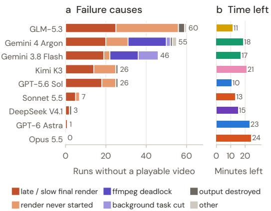

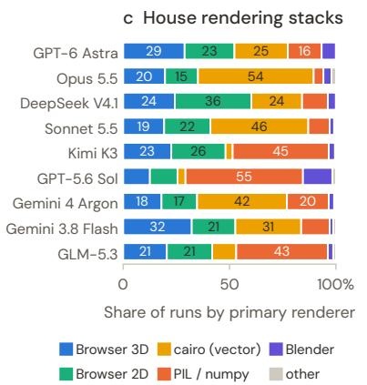

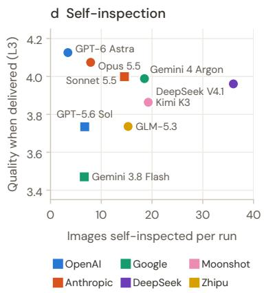  
Figure 4. Failures and process. (a) Main cause of the 224 runs without a playable video. (b) Median minutes left at the final write of successful runs (core tasks). (c) Primary renderer (% of runs). (d) Images self-inspected per run vs. delivered quality.

## Finding 2. Delivery reliability is a second axis, separate from quality.

The right half of Tab. 2 counts a missing video as a failure, and this largely changes both scores and ranks. Astra and Opus deliver almost every video and stay on top, whereas Gemini 4 Argon, which delivers only 77% of its videos, falls from 4th to 7th. L2 strict success requires every core check of a task to hold, so it spreads systems from 26.6% to 76.3%: even the best system fails a core requirement on about a quarter of tasks. Reliability also has quieter forms: 48 of the 213 playable videos of GPT-5.6 Sol have no audio track, which gives it the lowest AQ on delivered videos (3.71); see App. E for details.

## 5.2. Why videos are not delivered

We read the records of all 224 runs that ended without a playable video and assigned each one main cause (Fig. 4a).

## Finding 3. Videos are lost to time management, not to a short budget.

Three quarters of the failures (169) are final renders that started too late, ran too slowly or never started; the rest are stalled renders (45, 20%), outputs the agent destroyed itself (7, 3%) and other causes (3). Time management. Agents polish components and previews and launch the full render last: GPT-5.6 Sol’s final full renders in failed runs start at a median of 9 minutes before the deadline, often with frame-by-frame browser capture that needs 5–35 minutes, and 65 runs never start a final render at all. Stalled renders occur only in the two Gemini systems: 33 renders deadlock because the agent’s script pipes frames into ffmpeg while never reading its error stream (one stopped at frame 7,744 of 10,102, about 90 s from completion), and in 12 runs the agent ended its turn while a render ran in the background, which was then cut off. Self-destruction is the most avoidable: DeepSeek verified its video twice, then re-encoded it in place one minute before the deadline and left a truncated 0.26 MB file. The successful systems leave margin. Opus, the only system without a failure, finishes its video a median of 24 minutes before the deadline, against 10–11 minutes for Sol and GLM (Fig. 4b); it first produces a complete deliverable, then improves only copies and verifies the encoded MP4 itself. A larger budget does not substitute for this: in a budget ablation (App. I.3), DeepSeek scores 3.92 with 60 minutes and 3.94 with 120, while using 35 more minutes.

## 5.3. How agents make videos

We analyze the 2,151 trajectories (tool calls, written files, commands) to characterize the process.

## Finding 4. Agents build their own renderers, each with a house style.

The pipeline is always “code → frames → ffmpeg”: runs call ffmpeg in 96–100% of cases, whereas Manim appears in 8 of 2,151 runs and MoviePy in 13. Each system has a preferred rendering stack (Fig. 4c): Claude agents draw vectors with cairo (46–54% of runs), GPT-5.6 Sol, Kimi and GLM rasterize frames with PIL/numpy (43–55%), and Astra, DeepSeek and Gemini 3.8 Flash capture browser canvases and three.js scenes (52–60%). Soundtracks are programmed too: 57–96% of runs synthesize music or effects in code. Cairo and browser-2D runs pass the container-level check most often (88% and 85%) and score highest (3.79 and 3.73), three.js scenes least (78%, 3.00); since renderer and system are coupled, this is an association, consistent with slow frame capture being a main cause of late renders (§5.2).

## Finding 5. Self-inspection is universal but not decisive.

95% of runs view their own rendered frames, yet the amount of looking does not predict delivered quality (ρ=−0.07, n=9; Fig. 4d): Astra looks least (median 3 images per run) and scores best, while DeepSeek looks most (median 35). Reports often claim verifications that do not hold: among playable videos that fail spec compliance, the final report still claims the video was verified (“verified”, “ffprobe”, “confirmed”) in 10 of 14 for Astra and 3 of 11 for Sol.

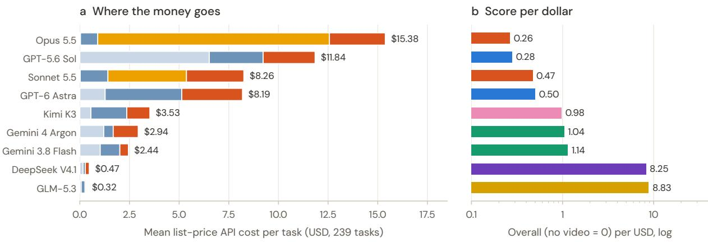  
Figure 5. Where the money goes (239 tasks). (a) Mean list-price API cost per task, split by token type: the Claude agents spend most on prompt-cache writes, GPT-5.6 Sol on fresh input. (b) Overall score (no video = 0) per USD of mean task cost (log scale).

Table 3. Judge reliability on the 239 tasks. Top: agreement between judge panels (about 1,920 videos judged by each pair). Bottom: agreement with blind pairwise human preferences; Spearman between human Elo and the panel’s delivered-only overall (n=9), and agreement on human-decisive pairs the panel does not tie.
<table><tr><td></td><td>J1-J2</td><td>J1-J3</td><td>J2-J3</td><td></td></tr><tr><td>System Spearman ρ (overall)</td><td>0.933</td><td>0.950</td><td>0.950</td><td></td></tr><tr><td>Check-level agreement / Cohen&#x27;s κ</td><td>94.6/0.56</td><td>91.3/0.52</td><td>91.7/0.44</td><td></td></tr><tr><td>Video-level Pearson r (overall)</td><td>0.45</td><td>0.51</td><td>0.51</td><td></td></tr><tr><td>Same-task pair ordering accuracy</td><td>69.3</td><td>69.7</td><td>65.7</td><td></td></tr><tr><td></td><td>J1</td><td>J2</td><td>J3</td><td>Mean</td></tr><tr><td>Human vs. judge, system ρ</td><td>0.98</td><td>0.80</td><td>0.90</td><td>0.98</td></tr><tr><td>Human vs. judge, pair agreement (%)</td><td>70.5</td><td>73.3</td><td>69.6</td><td>73.3</td></tr><tr><td>Judge ties on human-decisive pairs (%)</td><td>18</td><td>46</td><td>14</td><td>6</td></tr></table>

## 5.4. Judges and humans

## Finding 6. Judges and humans agree on systems, not on single videos.

The three panels rank systems almost identically (systemlevel Spearman 0.93–0.95), and the three-panel mean ranks them like humans do (ρ=0.98 with human Elo; Tab. 3). On single pairs the mean agrees with humans 73.3% of the time, but the agreement depends on the margin: 63% when the panels’ score gap is below 0.2 (about a third of pairs) and 86% when it is 0.5 or more. Judges also miss what humans flag: on pairs that annotators label both bad, the panels give the same scores (3.81) as on other pairs, so judge scores order videos but do not certify them as acceptable. The disagreements concentrate on two systems, in opposite directions: humans prefer GPT-5.6 Sol’s videos 16 points less often than the judges do, as the judges penalize it mainly on audio (AQ), and Gemini 3.8 Flash 11 points more often. Per video, check verdicts reach only κ=0.44–0.56 despite 91–95% raw agreement, overall scores correlate at r=0.45– 0.51, and same-task orderings agree only 66–70% of the time. Panels also differ in strictness: J1 is stricter and J2 more lenient, especially on weaker systems, and strict success, which fails a task on a single failed check, is sensitive to this (Opus: 83.7%, 93.3% and 51.9% under J1–J3), so only the three-panel mean is comparable. Implication: current judges can certify system-level rankings over hundreds of tasks, but per-video verdicts—and per-video rewards for training—need margins, multi-panel consensus or human checks.

## 5.5. Cost

Finding 7. Cost buys little quality.

Mean list-price API cost per task spans 49× across systems, from \$0.32 (GLM-5.3-Flash) to \$15.38 (Claude Opus 5.5), and systems spend it differently (Fig. 5a): about three quarters of Opus’s cost goes to prompt-cache writes, whereas more than half of GPT-5.6 Sol’s goes to fresh, uncached input. Higher spending does not buy a matching score: the rank correlation between cost and the overall score is not significant (ρ=0.55, p=0.12, n=9), and score per dollar differs by more than 30×, from 0.26 points per USD for Opus to 8.8 for GLM (Fig. 5b). DeepSeek-V4.1-Flash reaches 95% of GPT-6 Astra’s score at 5.8% of its cost. Spending is not effort either: Astra produces the fewest output tokens (61k per task, against 77k–289k for the others), and within every system longer runs score lower (ρ from −0.22 to −0.69), because long runs are runs in trouble. Costs are list-price equivalents of logged token usage (billing-verified for Claude); per-system details are in App. G.

## 6. Conclusion

We presented VibeVideoBench, a benchmark of 239 realistic, checkable tasks on which multimodal agents must make complete audio-visual videos with code, evaluated by program checks, task-specific rubric checks and quality scores from three judge panels validated against blind human preferences. Across nine frontier agent systems, the benchmark is far from solved: GPT-6 Astra and Claude Opus 5.5 lead clearly, yet even the best system fails a core requirement on about a quarter of tasks. Whether a video arrives at all matters as much as how good it is, and three quarters of the lost videos are final renders started too late, run too slowly or never started; agents should secure a complete video early and verify the delivered file. Automatic judges agree with each other and with humans on how systems rank, but only moderately on single videos, so per-video verdicts still need margins, multi-panel consensus or human checks.

## References

[1] Anthropic. Claude code, 2025. 2

[2] Rahul K. Arora, Jason Wei, Rebecca Soskin Hicks, Preston Bowman, Joaquin Quiñonero-Candela, Foivos Tsimpourlas, et al. HealthBench: Evaluating large language models towards improved human health. arXiv preprint arXiv:2505.08775, 2025. 3

[3] Hritik Bansal, Zongyu Lin, Tianyi Xie, Zeshun Zong, Michal Yarom, Yonatan Bitton, Chenfanfu Jiang, Yizhou Sun, Kai-Wei Chang, and Aditya Grover. VideoPhy: Evaluating physical commonsense for video generation. In International Conference on Learning Representations (ICLR), 2025. 3

[4] Ralph Allan Bradley and Milton E. Terry. Rank analysis of incomplete block designs: I. the method of paired comparisons. Biometrika, 39(3/4):324–345, 1952. 3, 6

[5] Tim Brooks, Bill Peebles, Connor Holmes, Will DePue, Yufei Guo, Li Jing, David Schnurr, Joe Taylor, Troy Luhman, Eric Luhman, Clarence Ng, Ricky Wang, and Aditya Ramesh. Video generation models as world simulators. OpenAI technical report, 2024. 2, 3

[6] Zongheng Cao, Yi Zheng, Rui Song, and Xinyu Hu. AgenticVBench: Can AI agents complete real-world postproduction tasks? arXiv preprint arXiv:2605.27705, 2026. 3

[7] Dongping Chen, Ruoxi Chen, Shilin Zhang, Yaochen Wang, Yinuo Liu, Huichi Zhou, et al. MLLM-as-a-Judge: Assessing multimodal LLM-as-a-Judge with vision-language benchmark. In International Conference on Machine Learning (ICML), 2024. 3

[8] Hao Chen, Tianyu Shi, Pengran Huang, Zeyuan Li, Jiahui Pan, Qianglong Chen, and Lewei He. VisualEDU: A benchmark for assessing coding and visual comprehension through educational problem-solving video generation. In Findings of the Association for Computational Linguistics: EMNLP 2025, pages 16363–16394, 2025. 3

[9] Siqi Chen et al. SVGenius: Benchmarking LLMs in SVG understanding, editing and generation. arXiv preprint arXiv:2506.03139, 2025. 2, 3

[10] Yanzhe Chen, Kevin Qinghong Lin, and Mike Zheng Shou. Code2Video: A code-centric paradigm for educational video generation. In International Conference on Machine Learning (ICML), 2026. arXiv:2510.01174. 2, 3

[11] Zhenghan Chen, Zekai Shao, Xin Lin, Leting Cheng, and Siming Chen. Code2Video-Compass: A comprehensive benchmark for general-purpose code-based video generation across T2V, I2V, and V2V. arXiv preprint arXiv:2610.28416, 2026. 3

[12] Wei-Lin Chiang, Lianmin Zheng, Ying Sheng, Anastasios Nikolas Angelopoulos, Tianle Li, Dacheng Li, et al. Chatbot arena: An open platform for evaluating LLMs by human preference. In International Conference on Machine Learning (ICML), 2024. 3

[13] Kaixiong Gong, Kaituo Feng, Bohao Li, Yibing Wang, Mofang Cheng, Shijia Yang, et al. AV-Odyssey bench: Can your multimodal LLMs really understand audio-visual information? arXiv preprint arXiv:2412.02611, 2024. 3

[14] Google. Gemini CLI, 2025. 2

[15] Google DeepMind. Veo 3. Model card and technical overview, 2025. 2, 3

[16] Yunqi Gu, Ian Huang, Jihyeon Je, Guandao Yang, and Leonidas Guibas. BlenderGym: Benchmarking foundational model systems for graphics editing. In IEEE/CVF Conference on Computer Vision and Pattern Recognition (CVPR), 2025. 3

[17] Anisha Gunjal, Anthony Wang, Elaine Lau, Vaskar Nath, Yunzhong He, Bing Liu, and Sean Hendryx. Rubrics as rewards: Reinforcement learning beyond verifiable domains. arXiv preprint arXiv:2507.17746, 2025. 3

[18] Xuan He, Dongfu Jiang, Ge Zhang, Max Ku, Achint Soni, Sherman Siu, et al. VideoScore: Building automatic metrics to simulate fine-grained human feedback for video generation. In Conference on Empirical Methods in Natural Language Processing (EMNLP), 2024. 2, 3

[19] HeyGen Research. Introducing the Code2Video benchmark. Technical report and Kaggle leaderboard, 2026. 3

[20] Jack Hong, Shilin Yan, Jiayin Cai, Xiaolong Jiang, Yao Hu, and Weidi Xie. WorldSense: Evaluating real-world omnimodal understanding for multimodal LLMs. arXiv preprint arXiv:2502.04326, 2025. 3

[21] Ziqi Huang, Yinan He, Jiashuo Yu, Fan Zhang, Chenyang Si, Yuming Jiang, Yuanhan Zhang, Tianxing Wu, Qingyang Jin, Nattapol Chanpaisit, Yaohui Wang, Xinyuan Chen, Limin Wang, Dahua Lin, Yu Qiao, and Ziwei Liu. VBench: Comprehensive benchmark suite for video generative models. In IEEE/CVF Conference on Computer Vision and Pattern Recognition (CVPR), 2024. 2, 3

[22] Dongfu Jiang, Max Ku, Tianle Li, Yuansheng Ni, Shizhuo Sun, Rongqi Fan, and Wenhu Chen. GenAI Arena: An open evaluation platform for generative models. In Advances in Neural Information Processing Systems (NeurIPS), Datasets and Benchmarks Track, 2024. 3

[23] Wenjia Jiang, Zongyuan Cai, Yuanhang Shao, Chenru Wang, Boyan Han, Zhixue Song, Keyu Chen, Shengwei An, Xu Yang, and Zhou Yang. ManimAgent: Self-evolving multimodal agents for visual education. arXiv preprint arXiv:2606.30296, 2026. EMNLP 2026. 3

[24] Carlos E. Jimenez, John Yang, Alexander Wettig, Shunyu Yao, Kexin Pei, Ofir Press, and Karthik Narasimhan. SWE-bench: Can language models resolve real-world GitHub issues? In International Conference on Learning Representations (ICLR), 2024. 2, 3

[25] Seungone Kim, Jamin Shin, Yejin Cho, Joel Jang, Shayne Longpre, Hwaran Lee, Sangdoo Yun, Seongjin Shin, Sungdong Kim, James Thorne, and Minjoon Seo. Prometheus: Inducing fine-grained evaluation capability in language models. In International Conference on Learning Representations (ICLR), 2024. 3

[26] Weijie Kong, Qi Tian, Zijian Zhang, Rox Min, Zuozhuo Dai, Jin Zhou, et al. HunyuanVideo: A systematic framework for large video generative models. arXiv preprint arXiv:2412.03603, 2024. 2

[27] Max Ku, Cheuk Hei Chong, Jonathan Leung, Krish Shah, Alvin Yu, and Wenhu Chen. TheoremExplainAgent: Towards video-based multimodal explanations for LLM theorem understanding. In Annual Meeting ofthe Associationfor Computational Linguistics (ACL), 2025. 2, 3

[28] Kuaishou Technology. Kling AI: Next-generation AI creative studio, 2024. 3

[29] Han Lin, Abhay Zala, Jaemin Cho, and Mohit Bansal. VideoDirectorGPT: Consistent multi-scene video generation via LLM-guided planning. arXiv preprint arXiv:2309.15091, 2023. COLM 2024. 3

[30] Yaofang Liu, Xiaodong Cun, Xuebo Liu, Xintao Wang, Yong Zhang, Haoxin Chen, Yang Liu, Tieyong Zeng, Raymond Chan, and Ying Shan. EvalCrafter: Benchmarking and evaluating large video generation models. In IEEE/CVF Conference on Computer Vision and Pattern Recognition (CVPR), 2024. 2, 3

[31] Fanqing Meng, Jiaqi Liao, Xinyu Tan, Wenqi Shao, Quanfeng Lu, Kaipeng Zhang, et al. Towards world simulator: Crafting physical commonsense-based benchmark for video generation. arXiv preprint arXiv:2410.05363, 2024. 3

[32] Mike A. Merrill, Alexander G. Shaw, Nicholas Carlini, Boxuan Li, Harsh Raj, Ivan Bercovich, et al. Terminal-Bench: Benchmarking agents on hard, realistic tasks in command line interfaces. In International Conference on Learning Representations (ICLR), 2026. arXiv:2601.11868. 2, 3

[33] OpenAI. Codex CLI, 2025. 2

[34] Tejal Patwardhan et al. GDPval: Evaluating AI model performance on real-world economically valuable tasks. In International Conference on Learning Representations (ICLR), 2026. arXiv:2510.04374. 3

[35] Adam Polyak, Amit Zohar, Andrew Brown, Andros Tjandra, Animesh Sinha, Ann Lee, et al. Movie gen: A cast of media foundation models. arXiv preprint arXiv:2410.13720, 2024. 2

[36] Qwen Team. Qwen3-TTS: Speech synthesis models in Alibaba Cloud Model Studio. https://help.aliyun. com/zh/model-studio/qwen-tts, 2025. Model qwen3-tts-flash, accessed October 2026. 3, 17

[37] Chufan Shi, Cheng Yang, Yaxin Liu, Bo Shui, Junjie Wang, Mohan Jing, et al. ChartMimic: Evaluating LMM’s crossmodal reasoning capability via chart-to-code generation. In In-

ternational Conference on Learning Representations (ICLR), 2025. 2, 3

[38] Chenglei Si, Yanzhe Zhang, Ryan Li, Zhengyuan Yang, Ruibo Liu, and Diyi Yang. Design2Code: Benchmarking multimodal code generation for automated front-end engineering. In Conference of the North American Chapter of the Association for Computational Linguistics (NAACL), 2025. 2, 3

[39] Giulio Starace, Oliver Jaffe, Dane Sherburn, James Aung, Jun Shern Chan, Leon Maksin, et al. PaperBench: Evaluating AI’s ability to replicate AI research. In International Conference on Machine Learning (ICML), 2025. 3

[40] Wan Team. Wan: Open and advanced large-scale video generative models. arXiv preprint arXiv:2503.20314, 2025. 2, 3

[41] Peiyi Wang, Lei Li, Liang Chen, Zefan Cai, Dawei Zhu, Binghuai Lin, Yunbo Cao, Qi Liu, Tianyu Liu, and Zhifang Sui. Large language models are not fair evaluators. In Annual Meeting of the Association for Computational Linguistics (ACL), 2024. 3

[42] Weijia Wu, Zeyu Zhu, and Mike Zheng Shou. Automated movie generation via multi-agent CoT planning. arXiv preprint arXiv:2503.07314, 2025. 3

[43] Tianbao Xie, Danyang Zhang, Jixuan Chen, Xiaochuan Li, Siheng Zhao, Ruisheng Cao, et al. OSWorld: Benchmarking multimodal agents for open-ended tasks in real computer environments. In Advances in Neural Information Processing Systems (NeurIPS), Datasets and Benchmarks Track, 2024. 2, 3

[44] Jin Xu, Zhifang Guo, Hangrui Hu, Yunfei Chu, Xiong Wang, Jinzheng He, et al. Qwen3-Omni technical report. arXiv preprint arXiv:2509.17765, 2025. 3

[45] Zhuoyi Yang, Jiayan Teng, Wendi Zheng, Ming Ding, Shiyu Huang, Jiazheng Xu, et al. CogVideoX: Text-to-video diffusion models with an expert transformer. In International Conference on Learning Representations (ICLR), 2025. 2

[46] Ziyun Zeng, Zixuan Wang, Yongsheng Yu, Hang Hua, and Jiebo Luo. VideoArgus: Agentic rubric-grounded unified evaluation for video generation and editing. arXiv preprint arXiv:2608.05485, 2026. 3

[47] Chenchen Zhang, Yuhang Li, Can Xu, Jiaheng Liu, Ao Liu, Changzhi Zhou, et al. ArtifactsBench: Bridging the visualinteractive gap in LLM code generation evaluation. arXiv preprint arXiv:2507.04952, 2025. 2, 3

[48] Dian Zheng, Ziqi Huang, Hongbo Liu, Kai Zou, Yinan He, Fan Zhang, et al. VBench-2.0: Advancing video generation benchmark suite for intrinsic faithfulness. arXiv preprint arXiv:2503.21755, 2025. 2, 3

[49] Lianmin Zheng, Wei-Lin Chiang, Ying Sheng, Siyuan Zhuang, Zhanghao Wu, Yonghao Zhuang, Zi Lin, Zhuohan Li, Dacheng Li, Eric P. Xing, Hao Zhang, Joseph E. Gonzalez, and Ion Stoica. Judging LLM-as-a-judge with MT-Bench and Chatbot Arena. In Advances in Neural Information Processing Systems (NeurIPS), Datasets and Benchmarks Track, 2023. 3

[50] Zeyu Zhu, Kevin Qinghong Lin, and Mike Zheng Shou. Paper2Video: Automatic video generation from scientific papers. arXiv preprint arXiv:2510.05096, 2025. 2, 3

## Contents

1. Introduction 2   
2. Related Work   
3. VibeVideoBench   
3.1. Task formulation 3   
3.2. Task construction 3   
3.3. Statistics 4   
3.4. Rubrics .   
4. Evaluation Protocol   
5. Experiments   
5.1. Main results   
5.2. Why videos are not delivered 7   
5.3. How agents make videos 7   
5.4. Judges and humans . 8   
5.5. Cost . 8   
6. Conclusion 9   
A. Dataset Construction and Statistics 13   
A.1. Source streams and funnel 13   
A.2. Taxonomy 13   
A.3. Task format and statistics . 14   
A.4. Example specifications (abridged) 15   
B. Rubric Design 16   
B.1. Structure of a rubric 16   
B.2. Authoring principles 16   
B.3. Rubrics for lessons and papers 16   
B.4. Quality control 17   
B.5. Modality tags . 17   
C. Sandbox, Harnesses and Rollout Protocol 17   
D. Judge Protocol and Judge Analysis 18   
D.1. Protocol . 18   
D.2. Agreement between panels 18   
D.3. Leniency and scale use 18   
D.4. Self-preference 18   
E. Full Results 19   
E.1. Full leaderboard 19   
E.2. Per-panel leaderboards . 19   
E.3. Uncertainty 20   
E.4. Quality profiles by dimension and category 20   
E.5. Program checks (L1) 20   
F. Agent Behavior 21   
F.1. Outcomes and effort 21   
F.2. Rendering stacks 21   
F.3. Self-inspection 22   
F.4. Failure taxonomy 22   
G. Cost 23   
H. Human Preference Study 26   
I . Ablations 26   
I.1 . Judge stress test . . . 27   
I.2 . Do the videos teach? A grounded quiz . 27   
I.3 . Time budget 28   
I.4 . CPU budget . 28   
J. Limitations and Broader Impact 29

## A. Dataset Construction and Statistics

## A.1. Source streams and funnel

Tab. A.1 traces the 239 tasks back to their sources. Task IDs encode the stream: W web prompts, D and N dense-caption tasks (original pool and human-kept batch), R asset-grounded tasks, CG classic games, ZH classroom lessons and PA paper explainers.

Table A.1. Construction funnel. Counts at each stage; “kept” rates in parentheses.
<table><tr><td>Stage</td><td>Description</td><td>Count</td></tr><tr><td colspan="3">Stream (i): web prompts</td></tr><tr><td>Collected</td><td>prompts written for code-based video tools (452 social posts, 25 Remotion gallery, 7 other)</td><td>484</td></tr><tr><td>Kept after strict review</td><td>every prompt read in full; nine removal codes</td><td>152 (31%)</td></tr><tr><td colspan="3">Stream (ii): dense captions of real videos</td></tr><tr><td>Scanned</td><td>caption records (HD-VILA, Molmo2, LLaVA-Video, ActivityNet sources)</td><td>508,993</td></tr><tr><td>Lexical recall</td><td>26 content directions</td><td>6,711</td></tr><tr><td>LLM screen and close reading</td><td>graded screen, then full-caption review</td><td>956 → 322</td></tr><tr><td>Human decision</td><td>two annotators; “≥1 keep and no discard&quot;</td><td>84 kept (42% of 200)</td></tr><tr><td>Older pool</td><td>previously screened captions, cleaned</td><td>165 kept of 312</td></tr><tr><td colspan="3">Authoring and selection</td></tr><tr><td>Drafted</td><td>165+152+84 sources (4 dropped) plus 50 gap-filling drafts</td><td>447</td></tr><tr><td>Human selection</td><td>two selectors</td><td>184 (41%)</td></tr><tr><td>Final rewrite</td><td>removal of leaked authoring traces</td><td>182</td></tr><tr><td colspan="3">Extension</td></tr><tr><td>Stream (iii) R</td><td>asset-grounded tasks (3D scans, archival photos, records)</td><td>+15</td></tr><tr><td>Pilot-selected</td><td>tasks with high inter-agent variance in a 7-configuration pilot</td><td>+10</td></tr><tr><td>Classic games</td><td>Super Mario, Plants vs. Zombies, Battle City, Subway Surfers</td><td>+4</td></tr><tr><td>Removed on review</td><td>two at release, three duplicates of R tasks, one infeasible (W0150)</td><td>-6</td></tr><tr><td>Core tasks</td><td>199 English, 6 Chinese</td><td>205</td></tr><tr><td colspan="3">Stream (iv): lecture notes and papers</td></tr><tr><td>Lessons (ZH)</td><td>self-written lecture notes, seven subjects; 2 politics lessons removed</td><td>24</td></tr><tr><td>Papers (PA)</td><td>classic papers supplied as PDF (Transformer, ResNet, GAN, DDPM, NeRF, VAE, DQN, ViT, CLIP, LIGO)</td><td>10</td></tr><tr><td>Released and scored</td><td>209 English, 30 Chinese; every task judged by all three panels</td><td>239</td></tr></table>

What was removed. Most web prompts failed because they presupposed material that was not provided (125 of 332 removals) or were content-free style templates (99); the rest were intros and logo stings (43), ambient loops without development (25), tasks that do not ask for a finished video (19) and duplicates (15). W0150 was removed after the rollouts because it requires two tools whose licenses exclude use in an evaluation harness, so it cannot be done as written.

Selection. Human selectors preferred checkable tasks: they kept 88% of the music and sound-driven drafts and about half o the explainers, but only 17% of the story and comedy drafts and 15% of the game drafts. Two LLM screens, which graded every candidate highly, therefore remain a weak proxy for human judgments of task value.

Pilot-selected tasks. The ten pilot-selected tasks could widen the gaps between systems. Removing them barely changes the leaderboard (no video = 0): the only change is that Gemini 3.8 Flash and GLM-5.3-Flash, which are statistically tied (App. E), swap the last two places (Kendall τ=0.94), and the spread between the best and worst system goes from 1.32 to 1.30 points.

Authoring. LLM drafters with cross-review recorded for every task its source, the selected time range and everything added at authoring time (facts, lines, durations, assets, structure). An automated audit found that 336 of the 397 drafts leaked process information (reviewer notes, internal review status, scoring hints) into the prompt; the final rewrite removed it with all input files hash-verified unchanged. We note this as a general hazard of LLM-assisted benchmark construction.

## A.2. Taxonomy

Each task has exactly one of 12 categories (content and purpose; Tab. A.2) and one or more of 43 subcategories that cut across categories (Tab. A.3): 34 presentation forms, the first of which is the task’s primary form, and 9 knowledge domains, tagged on tasks that convey subject knowledge (C04, C05, C11, C12). Tasks carry 2.0 subcategories on average; the per-task mapping is released with the benchmark.

Table A.2. Categories (239 tasks) with their most frequent subcategories.
<table><tr><td>Category</td><td>Tasks</td><td>Most frequent subcategories (tasks; multi-label)</td></tr><tr><td>C01 Brand &amp; marketing</td><td>9</td><td>Contextual selling point &amp; call to action (7), Brand &amp; product showcase (3), Musical structure &amp; AV choreogra- phy (2), Visual metaphor (1)</td></tr><tr><td>C02 Product &amp; feature demos</td><td>6</td><td>Software &amp; device tutorials (4), Making, assembly &amp; modification (1), Musical structure &amp; AV choreography (1), System simulation &amp; causal modelling (1)</td></tr><tr><td>C03 Events &amp; personal expression</td><td>7</td><td>Event invitation (4), Personal expression &amp; tributes (3), Statistical charts &amp; comparison (1), Musical structure &amp; AV choreography (1)</td></tr><tr><td>C04 Concept &amp; pipeline explainers</td><td>57</td><td>Mechanism &amp; causal chain (26), Engineering &amp; machines (14), Physics &amp; astronomy (13), Mathematical derivation &amp; counting (12)</td></tr><tr><td>C05 Data &amp; fact stories</td><td>24</td><td>History &amp; society (12), Statistical charts &amp; comparison (11), History &amp; chronology (11), Geography &amp; earth science (8)</td></tr><tr><td>C06 Visual art &amp; form</td><td>26</td><td>Spatial tour &amp; scene experience (9), Character performance &amp; choreography (5), Visual metaphor (5), Abstract form &amp; scale (3)</td></tr><tr><td>C07 Games &amp; sports</td><td>19</td><td>Real-time follow-along guidance (7), Tactics &amp; strategy breakdown (6), Classic game reconstruction (4), Observe-guess-reveal (2)</td></tr><tr><td>C08 Story &amp; visual comedy</td><td>15</td><td>Escalating missions &amp; crises (8), Musical structure &amp; AV choreography (2), Character performance &amp; choreog- raphy (2), Dialogue &amp; punchline (2)</td></tr><tr><td>C09 Building &amp; process</td><td>23</td><td>Making, assembly &amp; modification (23), Mechanism &amp; causal chain (5), Spatial tour &amp; scene experience (4), Interactive model, structure &amp; scale exploration (1)</td></tr><tr><td>C10 Music &amp; sound-driven</td><td>19</td><td>Musical structure &amp; AV choreography (18), Character performance &amp; choreography (7), Real-time follow-along guidance (2), Abstract form &amp; scale (2)</td></tr><tr><td>C11 Classroom lessons</td><td>24</td><td>Mechanism &amp; causal chain (12), Mathematical derivation &amp; counting (8), Mathematics (8), Interactive model, structure &amp; scale exploration (6)</td></tr><tr><td>C12 Paper explainers</td><td>10</td><td>Artificial intelligence (9), System architecture &amp; information flow (5), Mechanism &amp; causal chain (4), System simulation &amp; causal modelling (2)</td></tr><tr><td>Total</td><td>239</td><td>205 core tasks + 24 classroom lessons (C11) + 10 paper explainers (C12)</td></tr></table>

Table A.3. Subcategories (multi-label). n: tasks carrying the subcategory; Cat.: number of categories it appears in.
<table><tr><td>ID</td><td>Presentation form</td><td>n</td><td>Cat.</td><td>ID</td><td>Presentation form</td><td>n</td><td>Cat.</td></tr><tr><td>S09</td><td>Mechanism &amp; causal chain</td><td>51</td><td>6</td><td>S27</td><td>Abstract form &amp; scale</td><td>6</td><td>3</td></tr><tr><td>S29</td><td>Musical structure &amp; AV choreography</td><td>28</td><td>7</td><td>S28</td><td>Visual metaphor</td><td>6</td><td>2</td></tr><tr><td>S07</td><td>Making, assembly &amp; modification</td><td>25</td><td>3</td><td>S38</td><td>Worked examples &amp; problem solving</td><td>6</td><td>2</td></tr><tr><td>S08</td><td>Mathematical derivation &amp; counting</td><td>23</td><td>4</td><td>S34</td><td>Conceptual frameworks &amp; decision paths</td><td>5</td><td>1</td></tr><tr><td>S14</td><td>Statistical charts &amp; comparison</td><td>18</td><td>5</td><td>S01</td><td>Software &amp; device tutorials</td><td>4</td><td>1</td></tr><tr><td>S10</td><td>System architecture &amp; information flow</td><td>17</td><td>3</td><td>S25</td><td>Time-span, identity &amp; emotional change</td><td>4</td><td>2</td></tr><tr><td>S16</td><td>Interactive model, structure &amp; scale exploration</td><td>17</td><td>4</td><td>S32</td><td>Event invitation</td><td>4</td><td>1</td></tr><tr><td>E04</td><td>Character performance &amp; choreography</td><td>15</td><td>4</td><td>CG</td><td>Classic game reconstruction</td><td>4</td><td>1</td></tr><tr><td>E01</td><td>Spatial tour &amp; scene experience</td><td>14</td><td>3</td><td>E05</td><td>Poetry &amp; emotion</td><td>3</td><td>2</td></tr><tr><td>S05</td><td>System simulation &amp; causal modelling</td><td>14</td><td>6</td><td>S23</td><td>Journey &amp; arrival</td><td>3</td><td>3</td></tr><tr><td>S13</td><td>History &amp; chronology</td><td>13</td><td>2</td><td>S26</td><td>Kinetic typography &amp; channel packaging</td><td>3</td><td>3</td></tr><tr><td>E02</td><td>Real-time follow-along guidance</td><td>11</td><td>3</td><td>S31</td><td>Brand &amp; product showcase</td><td>3</td><td>1</td></tr><tr><td>S03</td><td>Map journeys &amp; route tours</td><td>10</td><td>4</td><td>S37</td><td>Personal expression &amp; tributes</td><td>3</td><td>1</td></tr><tr><td>S22</td><td>Escalating missions &amp; crises</td><td>10</td><td>3</td><td>E07</td><td>Miniature &amp; fictional worlds</td><td>2</td><td>1</td></tr><tr><td>S04</td><td>Tactics &amp; strategy breakdown</td><td>8</td><td>2</td><td>S06</td><td>Observe-guess-reveal</td><td>2</td><td>1</td></tr><tr><td>S12</td><td>Experiments &amp; evidence reading</td><td>8</td><td>4</td><td>S24</td><td>Dialogue &amp; punchline</td><td>2</td><td>1</td></tr><tr><td>S33</td><td>Contextual selling point &amp; call to action</td><td>7</td><td>1</td><td>S18</td><td>Picture-book reading &amp; early concepts</td><td>1</td><td>1</td></tr><tr><td>ID</td><td>Knowledge domain</td><td>n</td><td>Cat.</td><td>ID</td><td>Knowledge domain</td><td>n</td><td>Cat.</td></tr><tr><td>D01</td><td>Mathematics</td><td>17</td><td>2</td><td>D06</td><td>History &amp; society</td><td>18</td><td>3</td></tr><tr><td>D02</td><td>Physics &amp; astronomy</td><td>18</td><td>4</td><td>D07</td><td>Computing &amp; information</td><td>12</td><td>2</td></tr><tr><td>D03</td><td>Chemistry &amp; materials</td><td>6</td><td>2</td><td>D08</td><td>Artificial intelligence</td><td>13</td><td>3</td></tr><tr><td>D04</td><td>Biology &amp; medicine</td><td>11</td><td>3</td><td>D09</td><td>Engineering &amp; machines</td><td>15</td><td>2</td></tr><tr><td>D05</td><td>Geography &amp; earth science</td><td>12</td><td>3</td><td></td><td></td><td></td><td></td></tr></table>

## A.3. Task format and statistics

Each task directory contains task.json, prompt.txt and an optional read-only inputs/ folder; internal fields (source, rubric, audits) are never shown to agents or judges.

{ "task\_id": "D0013", "version": "v4-20261021", "title": "From a Ring of Foundation Blocks to a Warm Home:   
...",   
"prompt": "<full natural-language specification, median 1.6k words>",   
"delivery": {"width": 1920, "height": 1080, "fps": 30, "duration\_s": [55, 65], "video\_format": "MP4",   
"editable\_project": true, "extra": "<additional deliverables>"}, // optional frame\_count, audio\_required   
"audio": {"narration": "Optional; ...", "music": "Optional, quiet and warm.", "sfx": "Optional; ...",   
"ambience": "..."},   
"creative\_freedom": "<what the agent may decide>" }

A typical prompt gives the audience and purpose, a structure line, the content inputs (facts, numbers, real or fictional assets), the progression with minimum dwell times, the four-channel audio policy, the creative freedom and the delivery list (MP4 editable project, a timing sheet and production notes). Tab. A.4 summarizes the tasks.

Table A.4. Task statistics (239 tasks; core and lesson/paper subsets in brackets).

Language 209 English / 30 Chinese [core 199 / 6; lessons 24 Chinese; papers 10 English]   
Prompt length core English prompts: median 1,638 words, IQR 967–2,179, range 503–5,581; lesson and paper   
prompts are short (median 262 words/characters) and carry their content in the supplied note or   
PDF   
Resolution / fps 1920×1080: 227; other: 12; 30 fps: 228, 60 fps: 11; exact frame count: 54   
Target duration midpoint median 118 s, IQR 55–270 s, range 8–894 s; lessons 180–480 s; 38 tasks exceed 5   
minutes; 11.1 hours per pass   
Audio policy ≥1 required channel: 168 (70%) [core 134 (65%)]; speech required: 117 (49%); every lesson and   
paper requires narration   
Input assets 201 tasks [core 167, all 34 lessons and papers]; 2.69 GB   
Rubric 12,985 L2 checks [core 10,813; lessons and papers 2,172]; mean 54.3, median 54, range 13–110

## A.4. Example specifications (abridged)

## CG01 — Super Mario level run (75–105 s, synchronized SFX required)

“Use code to create a complete level-run video with the recognizable visual language of classic Super Mario. . . Start as Small Mario. Actually hit the designated question block from below; the mushroom emerges and moves along the ground, and Mario becomes Super Mario only after contact. . . stomp the Koopa into its shell and kick that same shell to defeat the next Goomba. . . use a moving platform to cross the wide pit, jump to the flagpole, lower the flag and walk toward the castle. Use the topology. . . and stable object IDs in inputs/.../level.json.”

## W0124 — 3D architectural process with generated music (55–70 s, music required)

“Create a 55–70-second Three.js architectural-process animation that shows a pencil drawing building the Hall of Prayer for Good Harvests stroke by stroke: 28 columns (4 inner, 12 middle, 12 outer), dougong bracket sets and three tiers of eaves, followed by layer-by-layer coloring. . . Create the architecture, linework, painted decoration, materials and sound entirely with code. Do not use image or video models, ready-made architectural models, or photographs. Music: an original code-synthesized guzheng-style plucked phrase with resonant decay.”

## ZH09 — Classroom lesson: Lenz’s law (180–360 s, Chinese narration required; translated)

“Make an explainer video for 11th-grade students that makes Lenz’s law clear, based on the lecture note in inputs/material.md. The note’s core concepts, principles and derivation steps, worked examples and common misconceptions must all be covered and correct; the relations listed in Section 6 of the note must be explained with diagrams or animation. . . The whole film must have Chinese narration that carries the explanation in sync with the visuals. . . Order, style, camera and layout are up to you; you may add intuitive examples beyond the note but must not contradict it.”

## PA01 — Paper explainer: “Attention Is All You Need” (240–480 s, English narration required)

“Make an explainer video about the paper in inputs/paper.pdf (arXiv:1706.03762) for first-year graduate students who know basic machine learning. . . After watching, a viewer should understand the problem the paper addresses and why it matters, the key idea and how the method actually works, the main results and what evidence supports them, and the paper’s limitations. . . Explain the key mechanisms with diagrams or animation rather than only reading text aloud; equations, figures and numbers must match the paper.”

## B. Rubric Design

## B.1. Structure of a rubric

A rubric file holds a task profile (purpose, audience, allowed presentations, evidence types, not-applicable boundaries), the core goals, the task checks (L2), a requirement coverage map from every prompt requirement to its checks, an evidence policy and the task’s quality rubric (L3). Each check has an ID, a title, a goal, a criticality, pass, fail and unknown conditions, an observation scope, the required evidence (time codes), verbatim basis quotes from the prompt, allowed variations and a modality tag (Tab. B.1). Over the 239 tasks there are 12,985 checks (54.3 per task, 13–110); 85.8% are core, the rest detail (supporting for lessons and papers). Unknown is reserved for insufficient evidence: “confirmed omissions or violations in the complete work are a fail and must not be concealed with unknown”.

Table B.1. Example task checks from CG01 (Super Mario; 7 core goals, 59 checks).
<table><tr><td>ID / tag</td><td>Title</td><td>Pass</td><td>Fail</td><td>Observation scope</td></tr><tr><td>V05 core, vi- sual</td><td>Initial small form</td><td>Mario is small at departure and does not pos- sess large-form abilities without cause during the initial stage.</td><td>Starts in the large form and skips the first growth, or has already grown before acquir- ing the mushroom.</td><td>From departure until before the first mushroom contact</td></tr><tr><td>V12 core, vi- sual</td><td>Large form breaks a brick from below</td><td>After becoming large, Mario hits BRICK1 or BRICK2 from below and causes at least one to shatter.</td><td>Breaking the brick early in small form, without contact, or hitting only the question block.</td><td>After the transformation until the first brick breaks</td></tr><tr><td>V30 core, vi- sual</td><td>Complete jumps</td><td>Required jumps have traceable takeoff, air- borne movement and landing/contact.</td><td>Pose changes impersonate displacement; tele- porting to the landing point.</td><td>All required jumps</td></tr><tr><td>V41 core, vi- sual</td><td>Order of key events</td><td>Q1 mushroom → brick → G1 stomp → shell kicked into G2 → hit by G3 → lift over pit → flagpole and castle.</td><td>Reordering events, or montage that hides the actual sequence.</td><td>Whole video</td></tr><tr><td>V50 core, audio-visual</td><td>Jump SFX synchro- nization</td><td>A jump cue corresponding to the action is present at each required takeoff.</td><td>No cue, or the effect occurs during an unrelated action.</td><td>Every required takeoff and the audio track</td></tr></table>

Quality rubric. The five L3 dimensions share 20 observation points: VQ1 key-content legibility, VQ2 stability, VQ3 occlusion/cropping/layering, VQ4 object consistency; VA1 hierarchy, VA2 composition, VA3 unity of visual language, VA4 audience fit; CL1 organization, CL2 key relations, CL3 information load, CL4 channel coordination; TM1 action, TM2 state change and transitions, TM3 dwell on key content, TM4 overall rhythm; AQ1 intelligibility and pronunciation, AQ2 prosody, AQ3 mixing, AQ4 sound–event alignment. Each dimension has task-specific anchors at 1, 3 and 5 (e.g., VQ for CG01: 1 = “key content remains unclear or is disrupted by visual defects”, 5 = “key content clear, image stable, details support viewing”); a 2 or 4 must say which anchor it is closer to, and insufficient evidence yields unknown, never a default 3. Intentional pixel-art style, grain or blur is not a defect.

## B.2. Authoring principles

Every check quotes the prompt sentence it enforces, and optional language (“may”, “e.g.”) never becomes mandatory (traceability). A correct final number or a caption reading “synced” cannot pass a check that requires a visible process (process over claims): in a marble adder the sum must be produced by actual contacts. Core and detail are fixed before any output is seen, so cosmetic passes cannot outvote a failed core goal. Timing thresholds state how to measure them under frame sampling: “at least N seconds” passes only if the lower bound is ≥N, fails if the upper bound is <N, and is otherwise unknown. 40–50 checks is a coverage aim, not a quota, and no check may prescribe a production method (45 early “must use CSS”-style checks were deleted).

## B.3. Rubrics for lessons and papers

The 34 lessons and papers (C11, C12) use the same levels and judge interface, but their checks come from the supplied material. L1 adds narration coverage (VAD speech share ≥50%, no gap over 20 s), narration language (ASR, ≥90% in the target language) and no long black or frozen stretch. L2 has 48–83 checks per task (2,172 in total; 1,566 core): content checks enumerate the knowledge points (each concept, derivation step, worked answer, common misconception and relation to be drawn; for papers the motivation, key idea, method components, key equations, results, evidence and limitations), and narration checks require correct reading of terms, formulas and numbers, explanation rather than reading on-screen text aloud, and synchronization at 4–6 key moments. Because judges never see the note or the paper, 330 checks that referred to them (“consistent with the note”) were rewritten to state the required content, and six audit agents re-derived every number and formula against the source. Each task also has a grounded quiz (404 questions), reported separately (App. I.2).

## B.4. Quality control

Rubrics were refined over many rounds in a closed loop. In each round an independent model reviewed every rubric against its prompt, each finding was re-adjudicated in a fresh context and verified by a human reviewer, confirmed findings were fixed, and the revised rubrics re-entered review until no confirmed finding remained. The most frequent defect was over-specification (a rubric demanding more than the prompt), ahead of coverage gaps; the review also surfaced bugs in the tasks themselves, such as an infeasible inventory or contradictory timing tables, which were fixed in the prompts.

## B.5. Modality tags

Each check is tagged with the evidence needed to decide it: visual 9,006 (69.4%), audio-visual 3,012 (23.2%) and audio 967 (7.4%). The tags route checks in J3 (App. D) and define the modality breakdown of App. E

## C. Sandbox, Harnesses and Rollout Protocol

Table C.1. Evaluated systems. Each runs in its own native harness in unattended mode at the highest effort the provider accepted.
<table><tr><td>System</td><td>Lab</td><td>Harness (unattended mode)</td><td>Effort</td></tr><tr><td>GPT-6 Astra</td><td>OpenAI</td><td>CodexCLI0.162(exec -dangerously-bypass-approvals-and-sandbox)</td><td>max</td></tr><tr><td>GPT-5.6 Sol</td><td>OpenAI</td><td>Codex CLI (same)</td><td>max (xhigh on 35 early runs)</td></tr><tr><td>Claude Opus 5.5</td><td>Anthropic</td><td>Claude Code 2.1.301 (-p -dangerously-skip-permissions)</td><td>max</td></tr><tr><td>Claude Sonnet 5.5</td><td>Anthropic</td><td>Claude Code 2.1.301 (same)</td><td>max</td></tr><tr><td>Gemini 4 Argon</td><td>Google</td><td>AntigravityCLI(-print -dangerously-skip-permissions)</td><td>high (xhigh rejected)</td></tr><tr><td>Gemini 3.8 Flash</td><td>Google</td><td>Antigravity CLI (same)</td><td>high</td></tr><tr><td>DeepSeek-V4.1-Flash</td><td>DeepSeek</td><td>DSH0.2.1(-profile headless)</td><td>max</td></tr><tr><td>Kimi K3</td><td>Moonshot</td><td>Kimi Code 2.2.0 (−p)</td><td>max</td></tr><tr><td>GLM-5.3-Flash</td><td>Zhipu</td><td>ZCode 0.17.0 (-mode yolo; ask-user and plan tools disabled)</td><td>max</td></tr></table>

Container. Each run uses a fresh container from one image (Ubuntu 24.04; identical image digest on all hosts) with 8 CPUs, 32 GB of memory, 2 GB of shared memory and no GPU. Mounts are the run workspace (read-write), the frozen task package (read-only, hashes verified after the run), a fresh home directory for the harness, a read-only live-deadline file and the harness binary; no credentials, docker socket or user configuration are mounted.

Preinstalled tooling. Python 3.12 with numpy, Pillow, OpenCV (headless), cairocffi and Playwright; Node 24 with npm and Playwright; headless Chromium with software WebGL (Mesa llvmpipe); ffmpeg/ffprobe 6.1; ImageMagick; SoX; compilers and cairo/pango/rsvg headers; vendored three.js 0.160 and GSAP 3.12; and a large CJK and Latin font set. Internet access goes through a proxy, and package installation is allowed. A TTS command-line tool is provided (Qwen3-TTS-Flash [36] through the DashScope API; 1–600 characters per call; the key stays on the host, behind a gateway). No other generative APIs are available.

Instruction. The harness prompt is fixed: “Read ENVIRONMENT.md and prompt.txt. Complete only that task autonomously using your native harness before the deadline in /run\_budget.json.” ENVIRONMENT.md states the 3,600 s budget, which includes model waits, tools, TTS, previews and the final render. It imposes no token, tool-call or preview limits and lists the deliverables (final MP4, editable project, timing sheet, production notes, and a submission.json manifest naming the video). It asks the agent to “finish with honest verification results”. At the deadline the container is killed.

Collection and technical checks. The video is selected through submission.json, falling back to the final message or a single MP4 candidate. The collector then runs container-level checks only: the deliverables exist, the video decodes to the end, and resolution, frame rate, duration and frame count match the delivery spec. These checks do not look at content; the scored program checks (L1) and the judges do (§4).

## D. Judge Protocol and Judge Analysis

## D.1. Protocol

Each judge receives the prompt the agent received, the task checks and the quality rubric, but never the system identity, the source code or the agent’s notes. For every check it returns pass, fail, unknown or n/a with the time range and the channe (picture or sound) that support the verdict, and it scores the five quality dimensions against the task’s anchors with reasons. On-screen or narrated claims (“✓ requirement met”) are not evidence, properties of the delivered file are left to the program checks, a judge that sees sampled frames may not assert what happens between them, and insufficient evidence yields unknown.

J1 (Gemini 4 Argon) and J2 (Gemini 3.8 Flash) watch the whole video with sound and judge everything. J3 splits the work by modality tag: GPT-5.6 Sol judges the visual checks and VQ, VA, CL and TM from sampled frames, and Qwen3.8-Omni-Flash judges the audio and audio-visual checks and AQ from the full video with its original sound. Each of the 1,927 playable videos was judged by all three panels. A run without a playable video scores zero on every dimension and fails every check (§4).

Example judge output (J1, CG01, Claude Opus 5.5):

CG01-V41 pass. “The events occur in exact order: Q1 hit & mushroom power-up (9.0–15.75 s) → brick break (21.0 s) → G1 stomp (22.75 s) → K1 stomp, kick & G2 defeat   
(30.25–33.0 s) → G3 side hit (41.0 s) → MOVE1 crossing (47.5–54.0 s) → flagpole & castle (61.75–68.5 s).”   
CG01-V50 pass (audio). “A rising pitch jump sound effect plays synchronously at each of Mario’s takeoffs (e.g., 6.0 s, 8.75 s, 17.5 s, 20.5 s, . . . , 61.75 s).”   
VQ = 4. “Closer to 5 than 3 because all characters, states, HUD counters, and contact points are crisp and stable, with only minor visual overlap during the side-hit protection   
pass.”

## D.2. Agreement between panels

The three panels rank the systems almost identically: system-level Spearman ρ of the overall (no video = 0) is 0.95 (J1–J2), 0.97 (J1–J3) and 0.98 (J2–J3), and Kendall’s W over the three rankings is 0.98. Single videos are another matter. On the 1,927 videos, the per-video overall correlates at r=0.44, 0.49 and 0.50 for the three pairs, and two panels order two videos of the same task the same way only 69.1%, 69.7% and 65.6% of the time. On checks both panels decide, raw agreement is high (94.6%, 91.3%, 91.6%) only because most checks pass; Cohen’s κ is 0.54, 0.51 and 0.42.

## D.3. Leniency and scale use

Table D.1. Judge scale use (239 tasks). L3, L2 and unknown: averages over the nine systems (delivered runs). Leniency: mean of the panel’s five-dimension score minus the mean of the other two panels on the same run (1,927 runs). Spread: best minus worst system overall. Right: distribution of all dimension scores (%; unk.: unknown or n/a).
<table><tr><td>Panel</td><td>L3 (deliv.)</td><td>L2 pass</td><td>Unknown</td><td>Leniency</td><td>Spread nv=0</td><td>Spread deliv.</td><td>1</td><td>2</td><td>3</td><td>4</td><td>5</td><td>unk.</td></tr><tr><td>J1</td><td>3.61</td><td>90.9%</td><td>0.9%</td><td>-0.41</td><td>1.47</td><td>0.89</td><td>0.8</td><td>6.0</td><td>28.6</td><td>57.4</td><td>6.0</td><td>1.3</td></tr><tr><td>J2</td><td>4.01</td><td>95.7%</td><td>0.4%</td><td>+0.19</td><td>1.19</td><td>0.46</td><td>0.2</td><td>2.5</td><td>9.2</td><td>69.9</td><td>17.3</td><td>0.8</td></tr><tr><td>J3</td><td>4.03</td><td>88.2%</td><td>6.3%</td><td>+0.22</td><td>1.39</td><td>0.65</td><td>2.1</td><td>2.2</td><td>16.3</td><td>46.8</td><td>31.4</td><td>1.2</td></tr></table>

Panels differ in strictness, especially on weak systems. J1 is the harshest on L3 (−0.41 against the other two panels) and the most discriminative (spread 0.89 on delivered videos). J2 is lenient and compressed: 70% of its dimension scores are a 4 and its delivered-only spread is 0.46. J3 is the harshest on checks (L2 88.2%; it also leaves 6.3% unknown) but the mos generous on VA and AQ (+0.46 and +0.61 against the other two). Leniency is not uniform: J1 is harsher on the weaker systems (GPT-5.6 Sol −0.67, Gemini 3.8 Flash −0.59, against −0.24 for Astra and Opus), and J2 and J3 are more lenient on them (J2: Sol +0.35, Flash +0.31, Astra −0.02). This is why panels are never mixed within a metric and only the three-pane mean is compared across systems.

## D.4. Self-preference

Three panels are run by models that are also evaluated as agents: J1 is Gemini 4 Argon, J2 is Gemini 3.8 Flash, and J3’s vision judge is GPT-5.6 Sol. On the 1,886 videos that all panels scored on the four visual dimensions (VQ, VA, CL, TM; for J3 these come from GPT-5.6 Sol alone), we compute each panel’s score minus its mean over all videos and subtract the same centered score averaged over the other two panels. The mean of this relative score per (panel, system) measures how much more a panel likes a system than the other panels do (Tab. D.2; 2,000-sample bootstrap over videos).

Table D.2. Self-preference. Relative score of each system under each panel (visual dimensions; positive = the panel rates the system higher than the other two panels do). Shaded: the panel’s own model. 95% bootstrap CIs.
<table><tr><td>System</td><td>J1 (Gemini 4 Argon)</td><td>J2 (Gemini 3.8 Flash)</td><td>J3 vision (GPT-5.6 Sol)</td></tr><tr><td>GPT-6 Astra</td><td>+0.17 [0.11, 0.23]</td><td>−0.23 [−0.29, −0.17]</td><td>+0.06 [–0.02, 0.13]</td></tr><tr><td>Claude Opus 5.5</td><td>+0.21 [0.15, 0.27]</td><td>-0.11 [-0.17, -0.04]</td><td>−0.10 [−0.18, −0.03]</td></tr><tr><td>DeepSeek-V4.1-Flash</td><td>-0.03 [–0.10, 0.05]</td><td>+0.05 [–0.02, 0.13]</td><td>-0.03 [-0.09, 0.04]</td></tr><tr><td>Claude Sonnet 5.5</td><td>+0.18 [0.11, 0.25]</td><td>−0.08 [-0.15, −0.01]</td><td>−0.10 [-0.17, −0.03]</td></tr><tr><td>Kimi K3</td><td>+0.02 [−0.04, 0.08]</td><td>+0.03 [−0.04, 0.10]</td><td>−0.05 [–0.12, 0.03]</td></tr><tr><td>GPT-5.6 Sol</td><td>−0.32 [−0.40, −0.24]</td><td>+0.12 [0.05, 0.20]</td><td>+0.20 [0.12, 0.27]</td></tr><tr><td>Gemini 4 Argon</td><td>+0.03 [-0.05, 0.10]</td><td>+0.01 [-0.08, 0.09]</td><td>-0.03 [-0.11, 0.04]</td></tr><tr><td>Gemini 3.8 Flash</td><td>-0.22 [-0.28, -0.15]</td><td>+0.16 [0.09, 0.23]</td><td>+0.05 [–0.02, 0.12]</td></tr><tr><td>GLM-5.3-Flash</td><td>−0.16 [–0.25, −0.07]</td><td>+0.13 [0.05, 0.22]</td><td>+0.03 [-0.05, 0.11]</td></tr><tr><td>Own model vs. others</td><td>+0.03 [-0.05, 0.11]</td><td>+0.18 [0.10, 0.26]</td><td>+0.22 [0.14, 0.29]</td></tr><tr><td>Own family vs. others</td><td>−0.12 [−0.18, −0.06]</td><td>+0.11 [0.05, 0.17]</td><td>+0.16 [0.10, 0.22]</td></tr></table>

Two of three judges favor their own model, by about a sixth of a point. J2 rates the Gemini 3.8 Flash agent +0.16 and J3’s vision judge rates the GPT-5.6 Sol agent +0.20 higher than the other panels do; both intervals exclude zero. J1 shows no preference for the Gemini 4 Argon agent (+0.03) and rates the Gemini family lower than the other panels (−0.12). Panels also have tastes of similar size that have nothing to do with themselves: J1 favors the Claude agents and Astra (+0.17 to +0.21) and disfavors Sol (−0.32), and J2 disfavors Astra (−0.23) while being lenient on the weaker systems (GLM +0.13, So +0.12), so part of its +0.16 for Flash is its general leniency toward weaker systems.

The ranking does not depend on it. Scoring each system without the panel that is its own model (J1 for Argon, J2 for Flash, J3 for Sol) changes only the last two places: Flash and GLM, 0.008 apart and statistically tied, swap (Kendall τ=0.94 with the headline ranking). Scoring each system only with panels outside its family (the Gemini agents by J3 alone, the GPT agents by J1 and J2), after shifting every panel by its leniency offset on the commonly judged videos (−0.27, +0.13 and +0.14 against the three-panel mean), leaves the order unchanged (τ=1): the Astra–Opus gap narrows from 0.034 to 0.018 (paired bootstrap P(Astra>Opus)=0.74), and Sol stays above Argon (P=0.95). Without the shift Opus overtakes Astra, but only because the panel dropped for the GPT agents (J3) is a lenient one. A relative score cannot separate a panel’s self-preference from the other panels’ dislike of the same system; only a check-level human calibration could say which panel is right.

## E. Full Results

All numbers in this section are on the 239 tasks, with the three panels computed separately and then averaged unless a panel is named.

## E.1. Full leaderboard

Tab. E.1 repeats the main table with every column: the five L3 dimensions, spec compliance, the L2 pass rate with no video = 0, the human Bradley–Terry rating and the API cost.

Strict metrics and core vs. detail. Core checks are harder than detail checks for every system (Astra 97.0 vs. 97.8%; Gemini 3.8 Flash 79.4 vs. 86.7%). The share of tasks with no failed check of any kind (no video counts as failure) ranges from 73.6% (Opus) and 72.1% (Astra) to 23.8% (Gemini 3.8 Flash), close to strict success (76.3, 74.5 and 26.6%): most tasks that fai strict success fail a core check, not only detail checks. What keeps a task from strict success differs by system: for Opus, Astra, Sonnet and DeepSeek it is almost always a failed core check, whereas 19–25% of the runs of Gemini 4 Argon, GLM and Gemini 3.8 Flash fail it by delivering no playable video.

## E.2. Per-panel leaderboards

Tab. E.2 reports each panel separately. The panels differ in leniency but largely agree on the order: the top four are the same in every panel (Astra, Opus, DeepSeek, Sonnet), followed by Kimi and GPT-5.6 Sol. Their disagreements are between near-ties: J1 and J3 put Astra first (3.946 vs. 3.915; 4.285 vs. 4.172) and J2 puts Opus first (4.137 vs. 4.095); at the bottom J1 ranks GLM above Gemini 3.8 Flash (2.529 vs. 2.478), while J2 and J3 rank Flash above GLM. J3, whose vision judge sees sampled frames, leaves far more checks unknown (5.4–7.0% of delivered checks, against 0.6–1.7% for J1 and 0.2–0.6% for J2), which is why the “all core” rate of Tab. E.2, where an unknown counts against the task, is much lower under J3 and why strict success counts only failures. Even so, the panels differ widely in strictness (Opus: 83.7, 93.3 and 51.9% strict success under J1–J3), so only the three-panel mean is comparable across systems (App. D).

Table E.1. Full leaderboard on 239 tasks (mean of three judge panels). L1: playable-delivery rate and spec compliance (all program checks pass: the checks of Tab. E.6 on the 205 core tasks and the rule-based checks on lessons and papers; a non-delivery fails). L2 check pass rate; strict success = share of tasks whose core checks have no fail and at least one pass. L3: per-dimension and overall quality (1–5). Rows are ordered by delivered-only overall; the grey number is the rank with no video = 0. Human: Bradley–Terry Elo from blind pairwise preferences between playable videos (App. H). \$/task: mean list-price API cost over the 239 tasks (App. G). Best in bold , second underlined (ties on the shown digits share the mark).
<table><tr><td></td><td></td><td></td><td colspan="2">L1 (%)</td><td colspan="8"></td><td colspan="3">No video = 0</td><td></td></tr><tr><td># System</td><td></td><td>Harness</td><td></td><td></td><td></td><td>L2 (%)</td><td></td><td></td><td>L3 quality (1–5)</td><td></td><td></td><td></td><td>L2 (%)</td><td>L2 (%)</td><td>L3</td><td></td></tr><tr><td></td><td></td><td></td><td>$/task Deliv. Spec</td><td></td><td></td><td>Pass</td><td>VQ</td><td>VA</td><td>CL</td><td>TM</td><td>AQ</td><td>Overall</td><td>Pass</td><td>Strict</td><td>Overall (rank)</td><td>Human Elo</td></tr><tr><td>1</td><td>• GPT-6 Astra</td><td>Codex CLI</td><td>8.19</td><td>99.6</td><td>93.7</td><td>97.1</td><td>4.08</td><td></td><td>4.304.20</td><td>3.95</td><td>4.10</td><td>4.126</td><td>96.9</td><td>74.5</td><td>4.109(1)</td><td>1242</td></tr><tr><td>2</td><td>• Claude Opus 5.5</td><td>Claude Code</td><td>15.38</td><td>100.0</td><td>99.6</td><td>97.3</td><td>3.99</td><td>4.19</td><td>4.18</td><td>3.95</td><td>4.07</td><td>4.074</td><td>97.3</td><td>76.3</td><td>4.074(2)</td><td>1203</td></tr><tr><td>3</td><td>• Claude Sonnet 5.5</td><td>Claude Code</td><td>8.26</td><td>97.1</td><td>94.6</td><td>93.9</td><td>3.93</td><td>4.12</td><td>4.10</td><td>3.86</td><td>3.98</td><td>3.999</td><td>91.2</td><td>66.9</td><td>3.880(4)</td><td>1121</td></tr><tr><td>4</td><td>• Gemini 4 Argon</td><td>Antigravity CLI</td><td>2.94</td><td>77.0</td><td>76.6</td><td>96.5</td><td>3.80</td><td>4.05</td><td>4.14</td><td>3.86</td><td>4.09</td><td>3.989</td><td>73.5</td><td>55.2</td><td>3.069(7)</td><td>1081</td></tr><tr><td>5</td><td>• DeepSeek-V4.1-Flash</td><td>DSH</td><td>0.47</td><td>98.7</td><td>94.6</td><td>93.1</td><td>3.86</td><td>4.13</td><td>4.04</td><td>3.75</td><td>4.03</td><td>3.961</td><td>92.0</td><td>57.6</td><td>3.911 (3)</td><td>1022</td></tr><tr><td>6</td><td>Kimi K3</td><td>Kimi Code</td><td>3.53</td><td>89.1</td><td>85.8</td><td>91.1</td><td>3.73</td><td>3.98</td><td>3.97</td><td>3.70</td><td>3.95</td><td>3.864</td><td>79.3</td><td>46.3</td><td>3.440 (5)</td><td>997</td></tr><tr><td></td><td>7 GLM-5.3-Flash</td><td>ZCode</td><td>0.32</td><td>74.9</td><td>66.9</td><td>85.3</td><td>3.66</td><td>3.87</td><td>3.77</td><td>3.57</td><td>3.81</td><td>3.736</td><td>61.7</td><td>33.5</td><td>2.790 (9)</td><td>905</td></tr><tr><td>8</td><td>• GPT-5.6 Sol</td><td>Codex CLI</td><td>11.84</td><td>89.1</td><td>84.5</td><td>89.5</td><td>3.72</td><td>3.94</td><td>3.86</td><td>3.45</td><td>3.71</td><td>3.735</td><td>78.0</td><td>39.1</td><td>3.317(6)</td><td>705</td></tr><tr><td></td><td>9• Gemini 3.8 Flash</td><td>Antigravity CLI</td><td>2.44</td><td>80.8</td><td>77.4</td><td>80.4</td><td>3.33</td><td>3.57</td><td>3.59</td><td>3.12</td><td>3.74</td><td>3.470</td><td>61.3</td><td>26.6</td><td>2.798 (8)</td><td>723</td></tr></table>

## E.3. Uncertainty

Tab. E.3 gives bootstrap intervals for the headline score and compares each system with the next one. Adjacent pairs show how delivery and quality interact. Astra leads Opus (P=0.91; 127 vs. 89 head-to-head wins), and both are clearly ahead of DeepSeek (P=1.00). DeepSeek is ahead of Sonnet on the mean only through delivery (Sonnet wins 121 of the head-to-heads, DeepSeek 89; P=0.70), and Gemini 4 Argon wins 142 of 239 head-to-heads against GPT-5.6 Sol yet ranks below it, because its 23% non-delivery contributes zeros. Gemini 3.8 Flash and GLM are statistically tied (P=0.50). Delivered-only per-run means (95% CI) are Astra 4.126 [4.090, 4.163], Opus 4.074 [4.039, 4.109], Sonnet 3.995 [3.940, 4.052], Argon 3.988 [3.950, 4.022], DeepSeek 3.957 [3.901, 4.010], Kimi 3.861 [3.800, 3.923], GLM 3.733 [3.636, 3.829], GPT-5.6 Sol 3.734 [3.678, 3.789] and Flash 3.466 [3.365, 3.553].

## E.4. Quality profiles by dimension and category

Fig. E.1(a) shows that the systems keep their tiers on every dimension; only near-tied neighbors swap (e.g., Opus edges out Astra on TM). VA is the highest dimension for most systems and TM the lowest for all but Gemini 4 Argon. By category (Fig. E.1b, Tab. E.4; mean over the nine systems, no video = 0), Building & process is hardest (3.07) and spreads the systems most (best minus worst 2.66), because it demands long, stateful assembly; Visual art &form is next (3.15). Classroom lessons score highest (4.19) and spread least (0.88); every system averages at least 3.59 on them. Astra or Opus is best in 10 of the 12 categories, Sonnet on lessons and papers.

The high audio and audio-visual pass rates in Tab. E.5 should be read with the judge stress test in mind: the judges never noticed a 0.5 or 1.5 s audio delay and caught a silent stretch in only half the videos (App. I.1), so part of these rates reflects what the judges cannot hear.

## E.5. Program checks (L1)

Among the 1,628 playable deliveries on the core tasks the most frequent program-check failure is duration (34), followed by a missing source project (20), frame rate (15; e.g., 24 instead of 30 fps, or drift such as 30.01), exact frame count (10), silent or absent audio where audio is required (10) and resolution (6). On the 34 lessons and papers, the rule-based checks (decodable MP4, resolution, frame rate, duration, audible audio, narration coverage by VAD, narration language by Whisper language ID, black or frozen stretches) fail in only 14 of 306 runs, 6 of them Gemini 4 Argon’s; nearly all are runs without a playable video. Program checks thus certify the container reliably, but defects of that kind are rare in delivered videos, and their effect on the ranking overlaps almost entirely with delivery itself.

Table E.2. Per-panel results (239 tasks; rows in the panel’s no-video-= 0 order). nv=0: no video = 0. Task success: % of tasks whose core checks all pass or are n/a, with at least one pass (“all core”, unknown counts against), and strict success (no core check fails, at least one passes); no video counts as failure. Unk.: unknown share of delivered checks.
<table><tr><td rowspan="2">#</td><td rowspan="2">System</td><td colspan="2">L2 pass (%)</td><td colspan="2">Task success (%)</td><td colspan="5">L3 dims (delivered only)</td><td colspan="2">Overall</td><td rowspan="2">Unk. (%)</td></tr><tr><td>deliv.</td><td>nv=0</td><td>all core</td><td>strict</td><td>VQ</td><td>VA</td><td>CL</td><td>TM</td><td>AQ</td><td>deliv.</td><td>nv=0</td></tr><tr><td colspan="10">J1: Gemini 4 Argon (full video + audio)</td><td></td><td></td><td></td><td></td></tr><tr><td>1</td><td>GPT-6 Astra</td><td>98.4</td><td>98.2</td><td>76.6</td><td>83.7</td><td>4.00</td><td>4.06</td><td>4.07</td><td>3.87</td><td>3.80</td><td>3.963</td><td>3.946</td><td>0.6</td></tr><tr><td>2</td><td>Claude Opus 5.5</td><td>98.4</td><td>98.4</td><td>76.6</td><td>83.7</td><td>3.92</td><td>4.01</td><td>4.04</td><td>3.92</td><td>3.68</td><td>3.915</td><td>3.915</td><td>0.7</td></tr><tr><td>3</td><td>Claude Sonnet 5.5</td><td>95.2</td><td>92.5</td><td>67.8</td><td>73.6</td><td>3.79</td><td>3.92</td><td>3.97</td><td>3.83</td><td>3.62</td><td>3.826</td><td>3.712</td><td>0.7</td></tr><tr><td>4</td><td>DeepSeek-V4.1-Flash</td><td>91.6</td><td>90.5</td><td>49.0</td><td>54.4</td><td>3.64</td><td>3.82</td><td>3.78</td><td>3.50</td><td>3.60</td><td>3.667</td><td>3.620</td><td>0.9</td></tr><tr><td>5</td><td>Kimi K3</td><td>91.4</td><td>79.8</td><td>40.2</td><td>43.1</td><td>3.44</td><td>3.67</td><td>3.78</td><td>3.54</td><td>3.57</td><td>3.600</td><td>3.205</td><td>0.9</td></tr><tr><td>6</td><td>GPT-5.6 Sol</td><td>85.3</td><td>74.4</td><td>24.3</td><td>28.9</td><td>3.25</td><td>3.42</td><td>3.50</td><td>2.97</td><td>3.28</td><td>3.285</td><td>2.913</td><td>0.9</td></tr><tr><td>7</td><td>Gemini 4 Argon</td><td>96.8</td><td>74.0</td><td>50.2</td><td>54.8</td><td>3.55</td><td>3.76</td><td>3.96</td><td>3.68</td><td>3.72</td><td>3.734</td><td>2.874</td><td>1.0</td></tr><tr><td>8</td><td>GLM-5.3-Flash</td><td>83.8</td><td>60.9</td><td>25.1</td><td>29.7</td><td>3.26</td><td>3.46</td><td>3.50</td><td>3.30</td><td>3.41</td><td>3.385</td><td>2.529</td><td>1.7</td></tr><tr><td>9</td><td>Gemini 3.8 Flash</td><td>77.0</td><td>58.8</td><td>14.6</td><td>17.2</td><td>2.87</td><td>3.09</td><td>3.32</td><td>2.79</td><td>3.29</td><td>3.072</td><td>2.478</td><td>1.0</td></tr><tr><td colspan="10">J2: Gemini 3.8 Flash (full video + audio)</td><td></td><td></td><td></td><td></td></tr><tr><td>1 2</td><td>Claude Opus 5.5</td><td>99.4</td><td>99.4</td><td>90.4</td><td>93.3</td><td>4.16</td><td>4.15</td><td>4.14</td><td>4.14</td><td>4.10</td><td>4.137</td><td>4.137</td><td>0.2</td></tr><tr><td></td><td>GPT-6 Astra</td><td>99.0</td><td>98.8</td><td>91.2</td><td>92.5</td><td>4.14</td><td>4.14</td><td>4.11</td><td>4.11</td><td>4.07</td><td>4.112</td><td>4.095</td><td>0.4</td></tr><tr><td>3</td><td>DeepSeek-V4.1-Flash</td><td>97.6</td><td>96.5</td><td>77.4</td><td>80.3</td><td>4.16</td><td>4.14</td><td>4.10</td><td>4.10</td><td>4.08</td><td>4.115</td><td>4.063</td><td>0.4</td></tr><tr><td>4</td><td>Claude Sonnet 5.5</td><td>96.2</td><td>93.5</td><td>82.0</td><td>84.5</td><td>4.12</td><td>4.09</td><td>4.07</td><td>4.07</td><td>4.07</td><td>4.084</td><td>3.963</td><td>0.4</td></tr><tr><td>5</td><td>Kimi K3 GPT-5.6 Sol</td><td>95.1</td><td>83.1</td><td>64.4</td><td>66.1</td><td>4.05</td><td>4.01</td><td>3.98</td><td>3.96</td><td>4.00</td><td>3.999</td><td>3.562</td><td>0.4</td></tr><tr><td>6</td><td></td><td>96.2</td><td>84.1</td><td>58.6</td><td>60.7</td><td>4.04</td><td>4.01</td><td>3.94</td><td>3.87</td><td>3.94</td><td>3.963</td><td>3.523</td><td>0.4</td></tr><tr><td>7</td><td>Gemini 4 Argon</td><td>99.3</td><td>76.1</td><td>69.9</td><td>71.1</td><td>4.12</td><td>4.08</td><td>4.15</td><td>4.10</td><td>4.07</td><td>4.107</td><td>3.160</td><td>0.3</td></tr><tr><td>8 9</td><td>Gemini 3.8 Flash GLM-5.3-Flash</td><td>87.9</td><td>67.3</td><td>45.2</td><td>46.0</td><td>3.75</td><td>3.70</td><td>3.70</td><td>3.46</td><td>3.80</td><td>3.681</td><td>2.968</td><td>0.6</td></tr><tr><td></td><td></td><td>90.2</td><td>65.8</td><td>47.7</td><td>49.0</td><td>4.02</td><td>3.97</td><td>3.87</td><td>3.92</td><td>3.90</td><td>3.935</td><td>2.943</td><td>0.5</td></tr><tr><td colspan="10">J3: GPT-5.6 Sol (frames) + Qwen3.8-Omni-Flash (audio)</td><td colspan="7"></td></tr><tr><td>1</td><td>GPT-6 Astra</td><td>93.9</td><td>93.7</td><td>27.6</td><td>47.3</td><td>4.08</td><td>4.71</td><td>4.43</td><td>3.88</td><td>4.42</td><td>4.303</td><td>4.285</td><td>5.9</td></tr><tr><td>2</td><td>Claude Opus 5.5</td><td>94.2</td><td>94.2</td><td>35.1</td><td>51.9</td><td>3.88</td><td>4.41</td><td>4.36</td><td>3.79</td><td>4.42</td><td>4.172</td><td>4.172</td><td>5.4</td></tr><tr><td>3</td><td>DeepSeek-V4.1-Flash</td><td>90.1</td><td>89.0</td><td>22.6</td><td>38.1</td><td>3.79</td><td>4.43</td><td>4.23</td><td>3.65</td><td>4.40</td><td>4.101</td><td>4.049</td><td>6.8</td></tr><tr><td>4</td><td>Claude Sonnet 5.5</td><td>90.4</td><td>87.7</td><td>26.4</td><td>42.7</td><td>3.87</td><td>4.35</td><td>4.27</td><td>3.68</td><td>4.26</td><td>4.087</td><td>3.965</td><td>6.7</td></tr><tr><td>5</td><td>Kimi K3</td><td>86.6</td><td>75.1</td><td>20.1</td><td>29.7</td><td>3.70</td><td>4.25</td><td>4.13</td><td>3.59</td><td>4.29</td><td>3.992</td><td>3.554</td><td>5.6</td></tr><tr><td>6</td><td>GPT-5.6 Sol</td><td>87.1</td><td>75.3</td><td>18.8</td><td>27.6</td><td>3.85</td><td>4.38</td><td>4.14</td><td>3.51</td><td>3.90</td><td>3.956</td><td>3.514</td><td>6.9</td></tr><tr><td>7</td><td>Gemini 4 Argon</td><td>93.4</td><td>70.3</td><td>22.2</td><td>39.7</td><td>3.73</td><td>4.29</td><td>4.33</td><td>3.80</td><td>4.47</td><td>4.125</td><td>3.171</td><td>6.6</td></tr><tr><td>8</td><td>Gemini 3.8 Flash</td><td>76.5</td><td>57.7</td><td>8.8</td><td>16.7</td><td>3.38</td><td>3.92</td><td>3.75 3.95</td><td>3.12 3.50</td><td>4.12 4.11</td><td>3.658 3.889</td><td>2.948 2.898</td><td>5.8 7.0</td></tr><tr><td>9</td><td>GLM-5.3-Flash</td><td>81.8</td><td>58.4</td><td>13.0</td><td>21.8</td><td>3.70</td><td>4.19</td></table>

## F. Agent Behavior

This section covers all 2,151 counting runs. Statistics come from the gateway logs, the trajectories, the written files and the delivered media; renderer detection is keyword matching over commands and source files.

## F.1. Outcomes and effort

Strong systems finish with time to spare. Opus and Astra usually end well before the hour, while GPT-5.6 Sol and GLM often run into the deadline; Sol has usually saved a playable video by then, GLM often has not. Within every system longer runs score lower: long runs are runs in trouble. The harnesses shape how agents work: Claude Code and Codex agents act almost entirely through the shell, Gemini, Kimi and GLM rely more on dedicated file tools, and Gemini 3.8 Flash spends much of its time waiting on background tasks. Sub-agents and web search are rarely used; installing packages is common.

## F.2. Rendering stacks

The pipeline is always “code → frames → ffmpeg”, and each system has a house style (Tab. F.2): the Claude agents and Gemin 4 Argon draw vectors with cairo, GPT-5.6 Sol, Kimi and GLM rasterize frames with PIL/numpy, and Astra, DeepSeek and

Table E.3. Uncertainty. Left: 95% bootstrap CI over tasks (B=2000) of the per-task three-panel overall (no video = 0); the per-task mean differs from the pooled leaderboard value by ≤0.011. Right: paired bootstrap probability that rank k beats rank k+1, with per-task head-to-head wins/losses/ties.
<table><tr><td>System</td><td>Mean</td><td>95% CI</td><td>Comparison</td><td>P</td><td>W/L/T</td></tr><tr><td>GPT-6 Astra</td><td>4.109</td><td>[4.052, 4.156]</td><td>Astra &gt; Opus</td><td>0.911</td><td>127/89/23</td></tr><tr><td>Claude Opus 5.5</td><td>4.074</td><td>[4.037, 4.109]</td><td>Opus &gt; DeepSeek</td><td>1.000</td><td>133/74/32</td></tr><tr><td>DeepSeek-V4.1-Flash</td><td>3.907</td><td>[3.826, 3.978]</td><td>DeepSeek &gt; Sonnet</td><td>0.697</td><td>89/121/29</td></tr><tr><td>Claude Sonnet 5.5</td><td>3.878</td><td>[3.769, 3.977]</td><td>Sonnet &gt; Kimi</td><td>1.000</td><td>152/68/19</td></tr><tr><td>Kimi K3</td><td>3.441</td><td>[3.267, 3.593]</td><td>Kimi &gt; GPT-5.6 Sol</td><td>0.860</td><td>143/86/10</td></tr><tr><td>GPT-5.6 Sol</td><td>3.328</td><td>[3.174, 3.479]</td><td>GPT-5.6 Sol &gt; Argon</td><td>0.980</td><td>82/142/15</td></tr><tr><td>Gemini 4 Argon</td><td>3.070</td><td>[2.854, 3.269]</td><td>Argon &gt; Flash</td><td>0.979</td><td>159/55/25</td></tr><tr><td>Gemini 3.8 Flash</td><td>2.799</td><td>[2.609, 2.979]</td><td>Flash &gt; GLM</td><td>0.498</td><td>79/139/21</td></tr><tr><td>GLM-5.3-Flash</td><td>2.796</td><td>[2.582, 3.007]</td><td></td><td></td><td></td></tr></table>

a L3 dimensions  
b 12 categories  
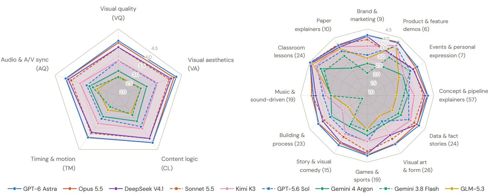  
Figure E.1. Quality profile per system (239 tasks; three-panel mean, no video = 0). (a) The five L3 dimensions; (b) overall score per category (mean of per-task scores; n tasks in parentheses), the top block of Tab. E.4. Radial axes start at 2.0 in (a) and 1.0 in (b), not at 0; rings every 0.5. Circles: each lab’s flagship; squares and dashed lines: its second model.

Gemini 3.8 Flash capture browser canvases and three.js scenes. Off-the-shelf video frameworks such as Manim or MoviePy are almost never chosen. Vector and 2D-canvas pipelines deliver most often and score highest; 3D scenes, rendered with software WebGL, are the slowest and score lowest. Since renderer and system are coupled, this is an association.

## F.3. Self-inspection

Almost every run looks at its own rendered frames, but how much it looks does not predict delivered quality across systems: Astra looks least and scores best. Within systems, looking more goes with better videos for some (Sonnet, Kimi, GLM, Gemini 3.8 Flash) and not for others. Final reports often claim verification that does not hold: for videos that fail spec compliance, the report still says the video was “verified” in most of Astra’s cases and in a minority of the others’.

## F.4. Failure taxonomy

Tab. F.4 extends §5.2. Writing renders to a temporary file would not have saved most truncated MP4s, since they mostly come from stalled or unfinished renders rather than from overwriting a finished video.

Table E.4. Per-category results (239 tasks, 12 categories; three-panel mean of per-task scores).
<table><tr><td>Category</td><td>GPT-6 Astra</td><td>Opus 5.5</td><td>Sonnet 5.5</td><td>Gem. 4 Argon</td><td>DeepSeek</td><td>Kimi K3</td><td>GLM-5.3-Flash</td><td>GPT-5.6 Sol</td><td>Gem. 3.8 Flash</td><td>Mean</td></tr><tr><td colspan="10">Overall, no video = 0 (1–5)</td></tr><tr><td>Brand &amp; marketing (9)</td><td>4.18</td><td>4.18</td><td>3.94</td><td>2.69</td><td>4.11</td><td>3.60</td><td>2.96</td><td>3.14</td><td>2.19</td><td>3.44</td></tr><tr><td>Product &amp; feature demos (6)</td><td>4.20</td><td>4.24</td><td>3.51</td><td>2.73</td><td>3.50</td><td>4.04</td><td>4.00</td><td>4.02</td><td>3.31</td><td>3.73</td></tr><tr><td>Events &amp; personal expression (7)</td><td>4.03</td><td>3.93</td><td>3.82</td><td>3.15</td><td>3.78</td><td>3.22</td><td>2.92</td><td>3.60</td><td>3.59</td><td>3.56</td></tr><tr><td>Concept &amp; pipeline explainers (57)</td><td>4.19</td><td>4.15</td><td>3.94</td><td>3.13</td><td>4.03</td><td>3.46</td><td>2.53</td><td>3.17</td><td>2.92</td><td>3.50</td></tr><tr><td>Data &amp; fact stories (24)</td><td>4.14</td><td>4.01</td><td>3.85</td><td>3.04</td><td>4.03</td><td>3.62</td><td>2.52</td><td>3.52</td><td>2.88</td><td>3.51</td></tr><tr><td>Visual art &amp; form (26)</td><td>3.94</td><td>3.91</td><td>3.62</td><td>2.74</td><td>3.40</td><td>3.35</td><td>2.25</td><td>2.55</td><td>2.61</td><td>3.15</td></tr><tr><td>Games &amp; sports (19)</td><td>4.15</td><td>4.12</td><td>3.92</td><td>3.09</td><td>4.05</td><td>3.40</td><td>2.77</td><td>3.43</td><td>2.85</td><td>3.53</td></tr><tr><td>Story &amp; visual comedy (15)</td><td>4.00</td><td>3.88</td><td>3.51</td><td>2.87</td><td>3.82</td><td>3.33</td><td>2.32</td><td>3.25</td><td>2.73</td><td>3.30</td></tr><tr><td>Building &amp; process (23)</td><td>3.97</td><td>3.94</td><td>3.60</td><td>3.17</td><td>3.69</td><td>2.52</td><td>2.17</td><td>3.25</td><td>1.31</td><td>3.07</td></tr><tr><td>Music &amp; sound-driven (19)</td><td>3.83</td><td>3.92</td><td>3.89</td><td>2.91</td><td>3.71</td><td>3.17</td><td>2.86</td><td>3.32</td><td>2.92</td><td>3.39</td></tr><tr><td>Classroom lessons (24)</td><td>4.47</td><td>4.45</td><td>4.47</td><td>3.82</td><td>4.40</td><td>4.13</td><td>4.31</td><td>4.07</td><td>3.59</td><td>4.19</td></tr><tr><td>Paper explainers (10)</td><td>4.03</td><td>4.07</td><td>4.10</td><td>2.67</td><td>3.94</td><td>3.97</td><td>3.85</td><td>3.69</td><td>3.41</td><td>3.75</td></tr><tr><td colspan="10">Overall, delivered only (1–5)</td><td></td></tr><tr><td>Brand &amp; marketing (9)</td><td>4.18</td><td>4.18</td><td>3.94</td><td>4.03</td><td>4.11</td><td>4.05</td><td>3.81</td><td>4.03</td><td>3.95</td><td>4.03</td></tr><tr><td>Product &amp; feature demos (6)</td><td>4.20</td><td>4.24</td><td>4.21</td><td>4.10</td><td>4.20</td><td>4.04</td><td>4.00</td><td>4.02</td><td>3.97</td><td>4.11</td></tr><tr><td>Events &amp; personal expression (7)</td><td>4.03</td><td>3.93</td><td>3.82</td><td>3.68</td><td>3.78</td><td>3.76</td><td>3.41</td><td>3.60</td><td>3.59</td><td>3.73</td></tr><tr><td>Concept &amp; pipeline explainers (57)</td><td>4.19</td><td>4.15</td><td>4.02</td><td>4.06</td><td>4.03</td><td>3.95</td><td>3.70</td><td>3.77</td><td>3.39</td><td>3.92</td></tr><tr><td>Data &amp; fact stories (24)</td><td>4.14</td><td>4.01</td><td>4.02</td><td>4.06</td><td>4.03</td><td>3.95</td><td>4.04</td><td>3.84</td><td>3.64</td><td>3.97</td></tr><tr><td>Visual art &amp; form (26)</td><td>3.94</td><td>3.91</td><td>3.77</td><td>3.96</td><td>3.68</td><td>3.49</td><td>3.24</td><td>3.49</td><td>3.23</td><td>3.64</td></tr><tr><td>Games &amp; sports (19)</td><td>4.15</td><td>4.12</td><td>3.92</td><td>3.91</td><td>4.05</td><td>3.80</td><td>3.76</td><td>3.83</td><td>3.60</td><td>3.91</td></tr><tr><td>Story &amp; visual comedy (15)</td><td>4.00</td><td>3.88</td><td>3.76</td><td>3.91</td><td>3.82</td><td>3.57</td><td>3.48</td><td>3.48</td><td>3.15</td><td>3.67</td></tr><tr><td>Building &amp; process (23)</td><td>3.97</td><td>3.94</td><td>3.94</td><td>3.83</td><td>3.69</td><td>3.62</td><td>3.33</td><td>3.40</td><td>3.02</td><td>3.64</td></tr><tr><td>Music &amp; sound-driven (19)</td><td>4.04</td><td>3.92</td><td>3.89</td><td>3.95</td><td>3.71</td><td>3.76</td><td>3.62</td><td>3.71</td><td>3.47</td><td>3.79</td></tr><tr><td>Classroom lessons (24)</td><td>4.47</td><td>4.45</td><td>4.47</td><td>4.16</td><td>4.40</td><td>4.31</td><td>4.31</td><td>4.07</td><td>3.75</td><td>4.27</td></tr><tr><td>Paper explainers (10)</td><td>4.03</td><td>4.07</td><td>4.10</td><td>3.82</td><td>3.94</td><td>3.97</td><td>3.85</td><td>3.69</td><td>3.41</td><td>3.88</td></tr><tr><td colspan="10">Playable-delivery rate (%)</td></tr><tr><td>Brand &amp; marketing (9)</td><td>100</td><td>100</td><td>100</td><td>67</td><td>100</td><td>89</td><td>78</td><td>78</td><td>56</td><td>85</td></tr><tr><td>Product &amp; feature demos (6)</td><td>100</td><td>100</td><td>83</td><td>67</td><td>83</td><td>100</td><td>100</td><td>100</td><td>83</td><td>91</td></tr><tr><td>Events &amp; personal expression (7)</td><td>100</td><td>100</td><td>100</td><td>86</td><td>100</td><td>86</td><td>86</td><td>100</td><td>100</td><td>95</td></tr><tr><td>Concept &amp; pipeline explainers (57)</td><td>100</td><td>100</td><td>98</td><td>77</td><td>100</td><td>88</td><td>68</td><td>84</td><td>86</td><td>89</td></tr><tr><td>Data &amp; fact stories (24)</td><td>100</td><td>100</td><td>96</td><td>75</td><td>100</td><td>92</td><td>62</td><td>92</td><td>79</td><td>88</td></tr><tr><td>Visual art &amp; form (26)</td><td>100</td><td>100</td><td>96</td><td>69</td><td>92</td><td>96</td><td>69</td><td>73</td><td>81</td><td>86</td></tr><tr><td>Games &amp; sports (19)</td><td>100</td><td>100</td><td>100</td><td>79</td><td>100</td><td>89</td><td>74</td><td>89</td><td>79</td><td>90</td></tr><tr><td>Story &amp; visual comedy (15)</td><td>100</td><td>100</td><td>93</td><td>73</td><td>100</td><td>93</td><td>67</td><td>93</td><td>87</td><td>90</td></tr><tr><td>Building &amp; process (23)</td><td>100</td><td>100</td><td>91</td><td>83</td><td>100</td><td>70</td><td>65</td><td>96</td><td>43</td><td>83</td></tr><tr><td>Music &amp; sound-driven (19)</td><td>95</td><td>100</td><td>100</td><td>74</td><td>100</td><td>84</td><td>79</td><td>89</td><td>84</td><td>89</td></tr><tr><td>Classroom lessons (24)</td><td>100</td><td>100</td><td>100</td><td>92</td><td>100</td><td>96</td><td>100</td><td>100</td><td>96</td><td>98 97</td></tr><tr><td>Paper explainers (10)</td><td>100</td><td>100</td><td>100</td><td>70</td><td>100</td><td>100</td><td>100</td><td>100</td><td>100</td></table>

Table E.5. Check pass and unknown rates by modality tag (delivered runs, mean of three panels). Visual checks are the hardest for every system. J3’s frame-sampled vision judge abstains far more on visual checks (6.8–9.1%) than the full-video judges (0.1–1.5%).
<table><tr><td></td><td colspan="3">Pass rate (%)</td><td colspan="3">Unknown rate (%)</td></tr><tr><td>System</td><td>Visual</td><td>Audio</td><td>Audio-visual</td><td>Visual</td><td>Audio</td><td>Audio-visual</td></tr><tr><td>GPT-6 Astra</td><td>96.4</td><td>99.4</td><td>98.6</td><td>2.5</td><td>1.7</td><td>1.9</td></tr><tr><td>Claude Opus 5.5</td><td>96.6</td><td>98.9</td><td>98.9</td><td>2.5</td><td>1.2</td><td>1.0</td></tr><tr><td>Claude Sonnet 5.5</td><td>92.3</td><td>96.6</td><td>97.9</td><td>3.0</td><td>2.7</td><td>1.5</td></tr><tr><td>Gemini 4 Argon</td><td>95.7</td><td>98.8</td><td>98.2</td><td>3.1</td><td>2.9</td><td>1.2</td></tr><tr><td>DeepSeek-V4.1-Flash</td><td>91.5</td><td>97.1</td><td>96.8</td><td>3.1</td><td>1.7</td><td>1.6</td></tr><tr><td>Kimi K3</td><td>88.9</td><td>96.7</td><td>95.2</td><td>2.6</td><td>2.1</td><td>1.7</td></tr><tr><td>GLM-5.3-Flash</td><td>81.1</td><td>91.6</td><td>93.2</td><td>3.6</td><td>2.1</td><td>2.2</td></tr><tr><td>GPT-5.6 Sol</td><td>87.1</td><td>95.6</td><td>94.2</td><td>3.2</td><td>1.9</td><td>1.9</td></tr><tr><td>Gemini 3.8 Flash</td><td>73.7</td><td>93.3</td><td>92.7</td><td>2.7</td><td>1.8</td><td>2.1</td></tr></table>

## G. Cost

Cost buys little quality. The mean list-price API cost per task spans 49× across systems, from \$0.32 (GLM) to \$15.38 (Opus), but its rank correlation with the headline score is not significant $( \rho { = } 0 . 5 5 ,$ permutation p=0.13, n=9; 0.43 with the delivered-only score). DeepSeek-V4.1-Flash reaches 95% of Astra’s score at 5.8% of its cost, and DeepSeek and GLM obtain 8.3–8.8 points of overall per dollar, about seven times the next system (Fig. 5). Spending is not effort either: Astra produces the fewest output tokens (61k per task, against 77k–289k for the others). The Pareto frontier (lowest cost, highest overall) is GLM → DeepSeek → Astra. The total is about \$12.8k. 76% of Opus’s cost is cache writes (2.3M tokens written per task

Table E.6. Program checks on the 205 core tasks (% of runs passing; non-delivery fails all checks). †54 tasks require an exact frame count. ‡98 tasks whose audio policy marks at least one channel required (strict parse); pass = audio stream with peak above −50 dBFS.
<table><tr><td>System</td><td>Playable</td><td>Resolution</td><td>FPS</td><td>Duration</td><td>Frame count†</td><td>Audio‡</td><td>Project</td><td>All pass</td><td></td></tr><tr><td>GPT-6 Astra</td><td>99.5</td><td>98.5</td><td>96.6</td><td>98.0</td><td>98.1</td><td>100.0</td><td>96.1</td><td>190/205</td><td>92.7</td></tr><tr><td>Claude Opus 5.5</td><td>100.0</td><td>100.0</td><td>99.5</td><td>100.0</td><td>100.0</td><td>100.0</td><td>100.0</td><td>204/205</td><td>99.5</td></tr><tr><td>Claude Sonnet 5.5</td><td>96.6</td><td>96.6</td><td>96.6</td><td>94.1</td><td>92.6</td><td>98.0</td><td>95.1</td><td>192/205</td><td>93.7</td></tr><tr><td>Gemini 4 Argon</td><td>75.6</td><td>75.6</td><td>75.6</td><td>75.6</td><td>79.6</td><td>74.5</td><td>75.6</td><td>155/205</td><td>75.6</td></tr><tr><td>DeepSeek-V4.1-Flash</td><td>98.5</td><td>98.5</td><td>97.6</td><td>97.1</td><td>96.3</td><td>99.0</td><td>96.6</td><td>192/205</td><td>93.7</td></tr><tr><td>Kimi K3</td><td>87.8</td><td>87.8</td><td>87.8</td><td>84.9</td><td>87.0</td><td>86.7</td><td>87.3</td><td>172/205</td><td>83.9</td></tr><tr><td>GLM-5.3-Flash</td><td>70.7</td><td>70.7</td><td>70.2</td><td>64.9</td><td>64.8</td><td>67.3</td><td>69.3</td><td>127/205</td><td>62.0</td></tr><tr><td>GPT-5.6 Sol</td><td>87.3</td><td>85.4</td><td>84.9</td><td>86.8</td><td>88.9</td><td>88.8</td><td>86.8</td><td>169/205</td><td>82.4</td></tr><tr><td>Gemini 3.8 Flash</td><td>78.0</td><td>78.0</td><td>78.0</td><td>76.1</td><td>85.2</td><td>80.6</td><td>77.6</td><td>156/205</td><td>76.1</td></tr></table>

Table F.1. Run outcomes and effort (239 tasks). Video: an MP4 was collected; Playable: the judges could decode and score it. Check pass: the collector’s container-level check (App. C); it wrongly fails the ten paper explainers for every system, which affects no score. Median s: elapsed budget time. Calls, tool calls and output tokens: per-run medians. Reas.: reasoning share of output tokens.
<table><tr><td>System</td><td>Self-ended</td><td>Timed out</td><td>Error</td><td>Video</td><td>Playable</td><td>Check pass</td><td>Median s</td><td>Calls</td><td>Tool calls</td><td>Out. tok (k)</td><td>Reas.</td></tr><tr><td>GPT-6 Astra</td><td>229</td><td>10</td><td>0</td><td>238</td><td>238</td><td>220</td><td>2,464</td><td>51</td><td>49</td><td>60.9</td><td>49%</td></tr><tr><td>Claude Opus 5.5</td><td>238</td><td>1</td><td>0</td><td>239</td><td>239</td><td>228</td><td>2,283</td><td>51</td><td>49</td><td>130.7</td><td>56%</td></tr><tr><td>DeepSeek-V4.1-Flash</td><td>217</td><td>22</td><td>0</td><td>239</td><td>236</td><td>220</td><td>3,070</td><td>117</td><td>130</td><td>166.8</td><td>59%</td></tr><tr><td>Claude Sonnet 5.5</td><td>218</td><td>20</td><td>1</td><td>235</td><td>232</td><td>215</td><td>3,065</td><td>56</td><td>63</td><td>254.7</td><td>75%</td></tr><tr><td>Kimi K3</td><td>180</td><td>58</td><td>1</td><td>218</td><td>213</td><td>192</td><td>2,874</td><td>63</td><td>80</td><td>75.6</td><td>51%</td></tr><tr><td>GPT-5.6 Sol</td><td>147</td><td>90</td><td>2</td><td>224</td><td>213</td><td>187</td><td>3,370</td><td>109</td><td>101</td><td>129.7</td><td>57%</td></tr><tr><td>Gemini 4 Argon</td><td>177</td><td>60</td><td>2</td><td>209</td><td>184</td><td>176</td><td>2,994</td><td>46</td><td>68</td><td>125.5</td><td>28%</td></tr><tr><td>Gemini 3.8 Flash</td><td>184</td><td>55</td><td>0</td><td>224</td><td>193</td><td>171</td><td>2,935</td><td>122</td><td>118</td><td>106.9</td><td>41%</td></tr><tr><td>GLM-5.3-Flash</td><td>160</td><td>79</td><td>0</td><td>193</td><td>179</td><td>152</td><td>3,234</td><td>64</td><td>83</td><td>103.3</td><td>56%</td></tr></table>

Table F.2. Primary renderer per system (% of runs) and, below, outcomes pooled by primary renderer. Other: Manim, MoviePy or unidentified. Synth. audio: runs that synthesize music or sound effects in code.
<table><tr><td></td><td colspan="6">Primary renderer (% of runs)</td><td colspan="2">Also used (% of runs)</td></tr><tr><td>System</td><td>cairo</td><td>PIL/numpy</td><td>Browser 2D</td><td>three.js</td><td>Blender</td><td>Other</td><td>ffmpeg</td><td>Synth. audio</td></tr><tr><td>GPT-6 Astra</td><td>25</td><td>16</td><td>23</td><td>29</td><td>7</td><td>0</td><td>100</td><td>93</td></tr><tr><td>Claude Opus 5.5</td><td>54</td><td>5</td><td>15</td><td>20</td><td>4</td><td>2</td><td>100</td><td>96</td></tr><tr><td>DeepSeek-V4.1-Flash</td><td>24</td><td>12</td><td>36</td><td>24</td><td>4</td><td>0</td><td>100</td><td>95</td></tr><tr><td>Claude Sonnet 5.5</td><td>46</td><td>10</td><td>22</td><td>19</td><td>2</td><td>1</td><td>100</td><td>89</td></tr><tr><td>Kimi K3</td><td>3</td><td>45</td><td>26</td><td>23</td><td>3</td><td>0</td><td>97</td><td>85</td></tr><tr><td>GPT-5.6 Sol</td><td>4</td><td>55</td><td>13</td><td>13</td><td>14</td><td>2</td><td>99</td><td>57</td></tr><tr><td>Gemini 4 Argon</td><td>42</td><td>20</td><td>17</td><td>18</td><td>3</td><td>1</td><td>97</td><td>93</td></tr><tr><td>Gemini 3.8 Flash</td><td>31</td><td>13</td><td>21</td><td>32</td><td>2</td><td>1</td><td>100</td><td>84</td></tr><tr><td>GLM-5.3-Flash</td><td>11</td><td>43</td><td>21</td><td>21</td><td>3</td><td>1</td><td>96</td><td>86</td></tr><tr><td colspan="9">Pooled over the nine systems, by primary renderer</td></tr><tr><td>Runs</td><td>576</td><td>524</td><td>463</td><td>473</td><td>95</td><td>20</td><td></td><td></td></tr><tr><td>Playable (%)</td><td>94</td><td>90</td><td>94</td><td>82</td><td>83</td><td>70</td><td></td><td></td></tr><tr><td>Check pass (%)</td><td>88</td><td>78</td><td>85</td><td>78</td><td>81</td><td>55</td><td></td><td></td></tr><tr><td>Timed out (%)</td><td>9</td><td>22</td><td>14</td><td>28</td><td>31</td><td>15</td><td></td><td></td></tr><tr><td>Overall, no video = 0</td><td>3.79</td><td>3.49</td><td>3.73</td><td>3.00</td><td>3.12</td><td>2.88</td><td></td><td></td></tr><tr><td>Overall, delivered</td><td>4.02</td><td>3.88</td><td>3.98</td><td>3.67</td><td>3.75</td><td>4.11</td><td></td><td></td></tr></table>

Table F.3. Self-inspection. An image view is a tool call that returns an image to the model. Extract/run: shell commands pulling stills or contact sheets from a rendered video. Last 25%: share of views in the final quarter of the budget. Right: mean delivered score of playable runs by number of image views (“–”: no runs; parentheses: fewer than 5 runs).
<table><tr><td></td><td colspan="8">Self-inspection statistics</td><td colspan="5">Mean delivered score of playable runs by # images viewed</td></tr><tr><td>System</td><td>≥1 view</td><td>Median</td><td>Mean</td><td>p90</td><td>Extract/run</td><td>ffprobe/run</td><td>Runs ffprobe</td><td>Last 25%</td><td>0</td><td>1-4</td><td>5-14</td><td>15-39</td><td>40+</td></tr><tr><td>GPT-6 Astra</td><td>229/239</td><td>3</td><td>3.4</td><td>6</td><td>3.1</td><td>2.1</td><td>202</td><td>22%</td><td>4.27</td><td>4.13</td><td>4.08</td><td></td><td></td></tr><tr><td>Claude Opus 5.5</td><td>238/239</td><td>7</td><td>7.9</td><td>12</td><td>4.6</td><td>3.9</td><td>237</td><td>11%</td><td>(3.47)</td><td>3.97</td><td>4.09</td><td>4.24</td><td>(3.80)</td></tr><tr><td>DeepSeek-V4.1-Flash</td><td>239/239</td><td>35</td><td>36.0</td><td>56</td><td>6.9</td><td>8.0</td><td>238</td><td>10%</td><td></td><td>(4.27)</td><td>3.53</td><td>3.91</td><td>4.07</td></tr><tr><td>Claude Sonnet 5.5</td><td>229/239</td><td>10</td><td>14.3</td><td>28</td><td>4.7</td><td>4.7</td><td>232</td><td>24%</td><td>3.27</td><td>3.77</td><td>3.94</td><td>4.20</td><td>4.24</td></tr><tr><td>Kimi K3</td><td>239/239</td><td>17</td><td>18.8</td><td>31</td><td>1.9</td><td>2.7</td><td>214</td><td>38%</td><td>一</td><td>3.29</td><td>3.84</td><td>3.90</td><td>4.05</td></tr><tr><td>GPT-5.6 Sol</td><td>231/239</td><td>6</td><td>6.8</td><td>13</td><td>2.8</td><td>4.6</td><td>222</td><td>20%</td><td>3.63</td><td>3.77</td><td>3.72</td><td>3.76</td><td></td></tr><tr><td>Gemini 4 Argon</td><td>235/239</td><td>18</td><td>18.3</td><td>29</td><td>0.3</td><td>1.3</td><td>182</td><td>27%</td><td></td><td>(4.04)</td><td>3.97</td><td>4.00</td><td>(3.85)</td></tr><tr><td>Gemini 3.8 Flash</td><td>182/239</td><td>6</td><td>6.5</td><td>14</td><td>0.4</td><td>3.4</td><td>218</td><td>19%</td><td>3.23</td><td>3.42</td><td>3.57</td><td>3.57</td><td></td></tr><tr><td>GLM-5.3-Flash</td><td>230/239</td><td>14</td><td>14.4</td><td>26</td><td>1.5</td><td>2.4</td><td>196</td><td>15%</td><td>(2.17)</td><td>3.07</td><td>3.69</td><td>3.89</td><td></td></tr></table>

Table F.4. Why videos are not delivered. Top: main cause of each of the 224 runs without a playable video, assigned by reading each run’s records. Bottom: state at the end of these runs.
<table><tr><td>Cause or failure mode (runs)</td><td>GPT-6 Astra</td><td>Opus 5.5</td><td>DeepSeek</td><td>Sonnet 5.5</td><td>Kimi K3</td><td>GPT-5.6 Sol</td><td>Gem. 4 Argon</td><td>Gem. 3.8 Flash</td><td>GLM-5.3-Flash</td><td>Total</td></tr><tr><td>Time management</td><td>1</td><td>0</td><td>2</td><td>7</td><td>25</td><td>25</td><td>31</td><td>22</td><td>56</td><td>169</td></tr><tr><td>Final render started late or ran too slowly</td><td>1</td><td>0</td><td>2</td><td>5</td><td>14</td><td>18</td><td>20</td><td>19</td><td>25</td><td>104</td></tr><tr><td>Final render never started</td><td>0</td><td>0</td><td>0</td><td>2</td><td>11</td><td>7</td><td>11</td><td>3</td><td>31</td><td>65</td></tr><tr><td>Stalled or cut-off render</td><td>0</td><td>0</td><td>0</td><td>0</td><td>0</td><td>0</td><td>21</td><td>24</td><td>0</td><td>45</td></tr><tr><td>ffmpeg pipe deadlock (stderr never drained)</td><td>0</td><td>0</td><td>0</td><td>0</td><td>0</td><td>0</td><td>19</td><td>14</td><td>0</td><td>33</td></tr><tr><td>Turn ended, background render cut off</td><td>0</td><td>0</td><td>0</td><td>0</td><td>0</td><td>0</td><td>2</td><td>10</td><td>0</td><td>12</td></tr><tr><td>Own output destroyed or lost</td><td>0</td><td>0</td><td>1</td><td>0</td><td>1</td><td>1</td><td>1</td><td>0</td><td>3</td><td>7</td></tr><tr><td>Other</td><td>0</td><td>0</td><td>0</td><td>0</td><td>0</td><td>0</td><td>2</td><td>0</td><td>1</td><td>3</td></tr><tr><td>Provider content filter</td><td>0</td><td>0</td><td>0</td><td>0</td><td>0</td><td>0</td><td>0</td><td>0</td><td>1</td><td>1</td></tr><tr><td>Request over the 20 MB gateway limit</td><td>0</td><td>0</td><td>0</td><td>0</td><td>0</td><td>0</td><td>2</td><td>0</td><td>0</td><td>2</td></tr><tr><td>No playable video</td><td>1</td><td>0</td><td>3</td><td>7</td><td>26</td><td>26</td><td>55</td><td>46</td><td>60</td><td>224</td></tr><tr><td>State at the end of these runs</td><td></td><td></td><td></td><td></td><td></td><td></td><td></td><td></td><td></td><td></td></tr><tr><td>Truncated MP4 (no moov atom)</td><td>0</td><td>0</td><td>3</td><td>3</td><td>5</td><td>11</td><td>25</td><td>30</td><td>13</td><td>90</td></tr><tr><td>MP4 without a video stream</td><td>0</td><td>0</td><td>0</td><td>0</td><td>0</td><td>0</td><td>0</td><td>1</td><td>1</td><td>2</td></tr><tr><td>No MP4, timed out</td><td>1</td><td>0</td><td>0</td><td>3</td><td>21</td><td>15</td><td>26</td><td>9</td><td>38</td><td>113</td></tr><tr><td>No MP4, agent ended its turn</td><td>0</td><td>0</td><td>0</td><td>1</td><td>0</td><td>0</td><td>2</td><td>6</td><td>8</td><td>17</td></tr><tr><td>No MP4, run ended on an error</td><td>0</td><td>0</td><td>0</td><td>0</td><td>0</td><td>0</td><td>2</td><td>0</td><td>0</td><td>2</td></tr></table>

Table G.1. API cost per task (USD, list-price equivalents of the logged usage of the counting run of every task; 239 tasks, 163,197 API calls). Calls/task: requests with usage records per task. Overall: headline three-panel score (no video = 0).
<table><tr><td>System</td><td>Mean</td><td>Median</td><td>p90</td><td>Max</td><td>Total (239)</td><td>Calls/task</td><td>Cache hit (%)</td><td>$/playable video</td><td>Overall</td><td>Overall per $</td></tr><tr><td>GPT-6 Astra</td><td>8.19</td><td>7.88</td><td>11.88</td><td>15.61</td><td>1,957</td><td>46</td><td>97</td><td>8.22</td><td>4.109</td><td>0.50</td></tr><tr><td>Claude Opus 5.5</td><td>15.38</td><td>10.19</td><td>31.22</td><td>47.08</td><td>3,676</td><td>51</td><td>65</td><td>15.38</td><td>4.074</td><td>0.26</td></tr><tr><td>DeepSeek-V4.1-Flash</td><td>0.47</td><td>0.45</td><td>0.67</td><td>1.30</td><td>113</td><td>117</td><td>97</td><td>0.48</td><td>3.911</td><td>8.25</td></tr><tr><td>Claude Sonnet 5.5</td><td>8.26</td><td>7.09</td><td>13.07</td><td>34.99</td><td>1,974</td><td>63</td><td>81</td><td>8.51</td><td>3.880</td><td>0.47</td></tr><tr><td>Kimi K3</td><td>3.53</td><td>3.53</td><td>4.94</td><td>7.25</td><td>843</td><td>61</td><td>97</td><td>3.96</td><td>3.440</td><td>0.98</td></tr><tr><td>GPT-5.6 Sol</td><td>11.84</td><td>11.49</td><td>19.59</td><td>28.39</td><td>2,831</td><td>106</td><td>81</td><td>13.29</td><td>3.317</td><td>0.28</td></tr><tr><td>Gemini 4 Argon</td><td>2.94</td><td>2.84</td><td>4.32</td><td>7.13</td><td>703</td><td>48</td><td>89</td><td>3.82</td><td>3.069</td><td>1.04</td></tr><tr><td>Gemini 3.8 Flash</td><td>2.44</td><td>2.09</td><td>4.16</td><td>6.66</td><td>584</td><td>126</td><td>91</td><td>3.03</td><td>2.798</td><td>1.14</td></tr><tr><td>GLM-5.3-Flash</td><td>0.32</td><td>0.30</td><td>0.45</td><td>0.68</td><td>76</td><td>65</td><td>93</td><td>0.42</td><td>2.790</td><td>8.83</td></tr></table>

at a 65% cache-hit rate), plausibly from cache expiry during long renders, and 55% of Sol’s is uncached input. The Claude figures agree with the billing records for the calls that went through the paid API (80% of Opus’s and 65% of Sonnet’s cost). Timed-out runs are under-costed because they were cut at one hour, and some prices are promotional: at the announced regular prices Gemini 4 Argon would cost about \$5.9 and Gemini 3.8 Flash about \$4.9 per task. Judging cost is not included.

## H. Human Preference Study

Protocol. Annotators compare two videos made by two systems for the same task. Both videos are playable and judged by all three panels, so the study measures the quality of delivered videos, not delivery. System pairs are balanced across tasks and the sides are randomized; annotators are blind to system identity and judge scores. The interface shows the full prompt and two synchronized players with a choice of audio track, and offers A better, B better, tie and both bad; the instruction is “which better matches the prompt and is better overall”. We fit Bradley–Terry strengths on decisive votes (MM algorithm with a weak prior; Elo scale with geometric mean 1000), with 2,000-sample bootstrap CIs over decisive pairs and Wilson intervals for win rates.

Table H.1. Human Bradley–Terry ratings (decisive votes; Elo scale; 95% bootstrap CI and rank CI). Right: the system’s delivered-only overall and its rank (Tab. E.1).
<table><tr><td>System</td><td>Win rate [Wilson 95%]</td><td>BT-Elo [95% CI]</td><td>Rank CI</td><td>Overall, delivered (rank)</td></tr><tr><td>GPT-6 Astra</td><td>0.783 [0.644, 0.877]</td><td>1242 [1134, 1387]</td><td>1-3</td><td>4.126 (1)</td></tr><tr><td>Claude Opus 5.5</td><td>0.741 [0.616, 0.837]</td><td>1203 [1111, 1327]</td><td>1-3</td><td>4.074 (2)</td></tr><tr><td>Claude Sonnet 5.5</td><td>0.676 [0.508, 0.809]</td><td>1121 [1016, 1257]</td><td>1-5</td><td>3.999 (3)</td></tr><tr><td>Gemini 4 Argon</td><td>0.607 [0.476, 0.724]</td><td>1081 [1001, 1176]</td><td>2-6</td><td>3.989 (4)</td></tr><tr><td>DeepSeek-V4.1-Flash</td><td>0.511 [0.370, 0.650]</td><td>1022 [900, 1154]</td><td>3-7</td><td>3.961 (5)</td></tr><tr><td>Kimi K3</td><td>0.449 [0.319, 0.587]</td><td>997 [873, 1107]</td><td>4-7</td><td>3.864 (6)</td></tr><tr><td>GLM-5.3-Flash</td><td>0.375 [0.252, 0.516]</td><td>905 [792, 1012]</td><td>5-7</td><td>3.736 (7)</td></tr><tr><td>Gemini 3.8 Flash</td><td>0.170 [0.089, 0.301]</td><td>723 [548, 833]</td><td>8-9</td><td>3.470 (9)</td></tr><tr><td>GPT-5.6 Sol</td><td>0.156 [0.077, 0.288]</td><td>705 [516, 814]</td><td>8-9</td><td>3.735 (8)</td></tr></table>

Three tiers. Astra and Opus lead and cannot be separated (+39 Elo, P=0.69); both are significantly above DeepSeek, Kim and GLM, and Astra also above Argon. Sonnet, Argon, DeepSeek, Kimi and GLM form a middle group whose neighbors cannot be separated. Gemini 3.8 Flash and GPT-5.6 Sol share the last place (+17, P=0.58) and are both significantly below the other seven.

Humans validate quality, not delivery. The human ranking is almost the delivered-only judge ranking (Spearman ρ=0.98, Kendall τ=0.94; only Flash and Sol swap the last two places), and it agrees less with metrics that include delivery (Tab. H.2). With no video = 0, Argon falls from 4th to 7th and Sol rises from 9th to 6th, because humans never see a missing video. The delivery part of the headline score is therefore not validated by the study and must be read together with the delivery rate.

Table H.2. Human Elo vs. leaderboard metrics (system level, n=9): rank correlation with each three-panel metric.
<table><tr><td>Metric</td><td>Spearman</td><td>Kendall</td></tr><tr><td>Overall, delivered only</td><td>0.98</td><td>0.94</td></tr><tr><td>L2 pass rate (delivered)</td><td>0.92</td><td>0.78</td></tr><tr><td>L2 strict success</td><td>0.92</td><td>0.78</td></tr><tr><td>Overall, no video = 0</td><td>0.77</td><td>0.61</td></tr><tr><td>Playable-delivery rate</td><td>0.66</td><td>0.47</td></tr></table>

Judges do not flag “both bad”. On pairs that humans labeled both bad, the panels’ mean score (3.81) equals that on decisive pairs (3.83), and only 4% of such pairs have both videos below 3.5. Judge scores order videos but do not certify them as acceptable.

## I. Ablations

Four ablations check the evaluation and the rollout setting. The first two ask whether the scores can be trusted: can the judges see defects (§I.1), and do the scores reflect whether a video actually teaches (§I.2)? The last two ask whether the setting limited the results: was one hour enough (§I.3), and did the agents need more CPU cores (§I.4)? Each was run once per cell, after the main evaluation.

## I.1. Judge stress test

We took 30 delivered videos, re-encoded each one cleanly and built ten defective versions with ffmpeg: five picture defects in the window from 35% to 65% of the runtime (black frames, a grey box over the center, heavy blur, a frozen picture) or over the whole video (left–right mirror), two sound defects (a silent window, another task’s soundtrack), audio delayed by 0.5 or 1.5 s, and the two halves swapped. Apart from the black window, every defective version passes all program checks, so only a judge can notice it. J1 judged each video in its clean version and in five of the defects (15 videos per defect, 180 judgments) with the unchanged prompt and rubric, and was not told that anything was injected.

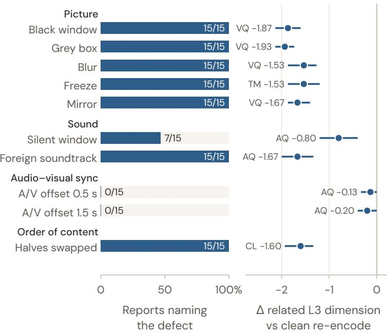  
Figure I.1. Judge stress test (J1; 15 videos per defect). Left: share of reports that name the defect (checked by hand). Right: change of the most related L3 dimension against the clean re-encode of the same video (95% bootstrap CI).

Judges see broken pictures but not late sound (Fig. I.1). Every picture defect, the foreign soundtrack and the swapped halves are named in all 15 reports and cost 1.5–1.9 points on the related dimension; a silent window is named in 7 of 15 (−0.80 on AQ). Neither audio delay is mentioned in any report, and reports often praise the synchronization; the five-dimension mean drops only slightly (−0.11 and −0.16; Wilcoxon p=0.07 and 0.05), spread over several dimensions rather than AQ. Detection does not always reach the checks: mirrored and reordered videos are named in every report, yet most of their target checks still pass (flip rate +4.5 and +14.9 points over clean), and the penalty lands on VQ and CL instead. Finally, the clean re-encode scores $+ 0 . 1 2 \ [ + 0 . 0 3 , + 0 . 2 2 ]$ above the original judgment of the same video, so gaps of 0.1–0.2 between single videos or close systems are within judge noise. Audio-visual timing is thus a blind spot of both the judges and the program checks.

## I.2. Do the videos teach? A grounded quiz

Each of the 34 lessons and papers has a multiple-choice quiz written from its source material (404 questions). A grader (Gemini 4 Argon) watches only the finished video and answers A–D or E (“the video does not cover it”). Every A–D answer must give a timestamp and the video’s own words; narration quotes are matched against a Whisper transcript and on-screen quotes against the frames, and an answer whose evidence does not check out counts as E. A task’s score is its share of correct answers; a run without a video scores 0. The quiz does not enter the leaderboard.

The quiz agrees with the judges. Although it uses neither the rubric nor the quality anchors, its system ranking correlates with the three-panel overall at Spearman ρ=0.93 (Fig. I.2; also 0.93 on playable videos only). The top four systems convey 93–96% of the tested points; Gemini 4 Argon’s 77.4% comes from its five tasks without a playable video (90.8% on the other 29). Almost no point is lost to a wrong answer (2 of 3,425 A–D answers); the losses are questions the video does not cover or whose evidence does not check out, so the quiz measures coverage of the material more than correctness. Agreement on single runs is only moderate (ρ=0.32 over the 299 playable runs), and the quiz separates the top systems poorly (93.4–95.6%).

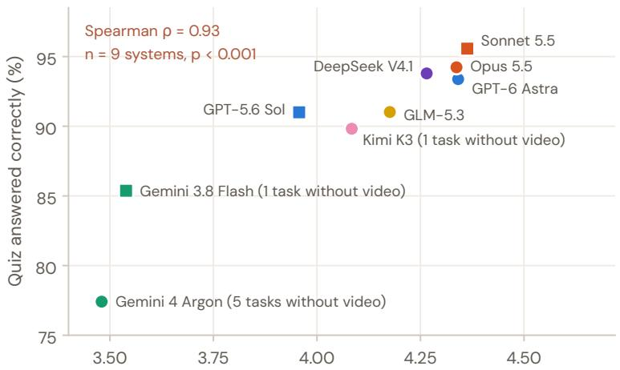  
Overall on the same 34 tasks (3 panels, no video = 0)  
Figure I.2. Grounded quiz on the 34 lessons and papers: share of questions answered correctly (mean over tasks) vs. the three-panel overall on the same tasks (no video = 0).

## I.3. Time budget

We reran DeepSeek-V4.1-Flash on 20 tasks with budgets of 15, 30, 60 and 120 minutes (one run per cell, otherwise as in the main evaluation). Runs are judged by J2 with no video = 0 and compared with the 60-minute arm by a paired Wilcoxon test.

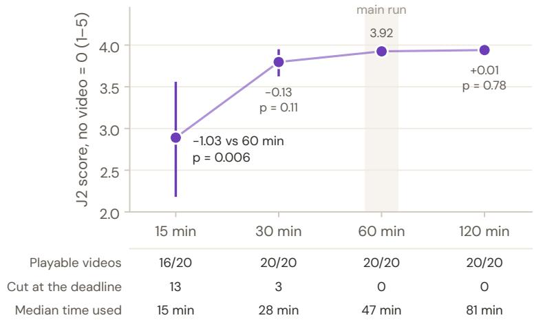  
Figure I.3. Time budget (DeepSeek-V4.1-Flash, 20 tasks, J2, no video = 0; 95% CI; differences and p against 60 minutes).

Quality saturates between 30 and 60 minutes (Fig. I.3). Only the 15-minute budget loses videos (4 of 20 without a playable video, 13 runs cut at the deadline; −1.03 against 60 minutes, $\scriptstyle { p = 0 . 0 0 6 } )$ , and even its delivered videos are worse (3.61 vs. 3.92). From 30 minutes on every run delivers, and doubling the budget from 60 to 120 minutes adds 0.01 (p=0.78) while the agent uses 34 more minutes (median 47 vs. 81). For this system, non-delivery in the main evaluation is therefore not caused by a short budget but by how the run uses it (§5.2). Limitations: one system, one run per cell, and J2’s compressed scale (App. D).

## I.4. CPU budget

We reran six systems (Gemini 4 Argon, Gemini 3.8 Flash, DeepSeek-V4.1-Flash, GLM-5.3-Flash, Kimi K3, GPT-5.6 Sol) on the same 20 render-heavy tasks with 2, 8 and 16 CPU cores; the main evaluation uses 8. Everything else is as in the main run; scores are the three-panel mean with no video = 0 (360 runs), compared over the 120 task–system pairs.

More cores do not measurably help (Fig. I.4). None of the pooled differences is significant (+0.09 for 8 vs. 2 cores, +0.13 for 16 vs. 8, +0.22 for 16 vs. 2; p=0.57, 0.44, 0.20; a bootstrap over tasks gives the same conclusion), and playable videos go from 99 to 101 and 103 of 120 (sign tests $p { \geq } 0 . 5 6 )$ . The systems disagree in direction (Kimi and Flash do best with eight cores, Sol with two, DeepSeek is flat), and delivered quality hardly moves (3.81, 3.84, 3.92). Argon’s rise from 9 to 12 videos comes mostly from fewer ffmpeg pipe deadlocks in the 16-core arm (2 of its 8 failures there, against 9 of 21 in the other two), which barely use the CPU; render-heavy tasks still run out of time with sixteen cores. The CPU budget therefore does not measurably limit the main results. Limitations: 20 tasks biased toward hard renders, and the 16-core arm ran later on a busier host.

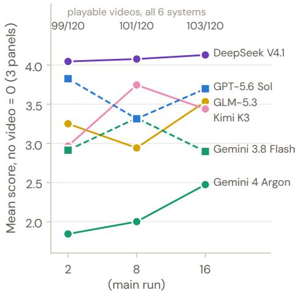  
CPU cores

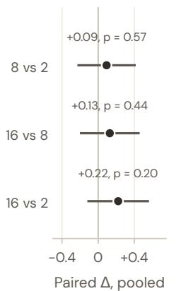  
6 systems × 20 tasks  
Figure I.4. CPU budget (6 systems × 20 tasks; three-panel mean, no video = 0). Left: mean score per system and setting, with playable videos of all six systems on top. Right: pooled paired difference with 95% CI and paired-t p.

## J. Limitations and Broader Impact

## Limitations (expanded).

• Single run per task. The CIs cover task sampling only; system-level means are stable, but single outcomes vary from run to run, so per-task scores should not be over-read.

• Fixed budget. Every run gets one hour and a single attempt, which may not let an agent reach the best video it could make with more time, compute or iterations. The time-budget ablation finds saturation within an hour for one system (App. I.3) which need not hold for every system or for the longest tasks.

• Adherence over creativity. The rubrics mainly measure whether a video follows its specification. Creativity and originality enter only partly, through the aesthetics dimension (VA), and are not evaluated on their own.

• Judge dependence. All panels are proprietary models, and the judges are insensitive to audio-visual timing (App. I.1). Rankings are stable across three panels from different families, but absolute values are panel-specific and are never mixed.

• Coverage. The task set leans toward explainers (C04, C11 and C12 hold 38% of the tasks), is mostly English (209 of 239) and limited to 1080p-class outputs. Tasks with very long runtimes are few.

Broader impact. Code-driven video makes precise, editable and accessible content (lessons, data stories, instructions) cheaper to produce, and our findings point to concrete reliability improvements. Risks include persuasive marketing content and misinformation rendered with an appearance of precision. Tasks with factual content ship their facts as inputs and forbid fabricated claims (e.g., “do not claim a real interception probability”). No task depicts real private individuals. Classic-game tasks use newly designed levels and assets in a recognizable style for research evaluation; we will not redistribute original game assets.