# VidEdit3D: Flexible 3D Gaussian Editing with Video Diffusion

Yanming Yang1 Chenxi Song1 Tong Zhao1 Juntao Xu1 Wenhao Rao2 Yiwen Chen3 Yiwei Wang4 Chi Zhang1†

1Westlake University 2University of Leeds 3Nanyang Technological University 4University of California, Merced †Corresponding author.

Project Page: https://2hitee.github.io/VidEdit3D-page/

## Abstract

Recent advancements in text-guided 3D editing, particularly with 3D Gaussian Splatting (3DGS), have shown promise but still lag behind the flexibility of 2D editing tools. Existing methods face a critical trade-off between preserving multi-view consistency and allowing structural modifications. Image-based editors can also struggle to apply the intended edit to objects viewedfrom unusual angles. To address these limitations, we introduce VidEdit3D, a framework that reformulates 3D scene editing as a trajectory-based video editing task. By drawing a parallel between camera movement in static 3D scenes and temporal dynamics in video, we leverage the robust spatiotemporal priors ofpre-trained Video Diffusion Models (VDMs) to encourage semantic and structural coherence across views. Specifically, we propose Trajectory-Guided Rendering (TGR) to select informative keyframes and construct smooth video clips aligned with VDM input requirements. To propagate edits from an anchor view to these clips, we develop Flow-Aligned Video Editing (FAVE), a training-free framework incorporating an Editing Consistency Guidance (ECG) mechanism. ECG contrasts source and edited image conditions at a shared latent state, using scheduled source-image amplification to strengthen adherence to the edited reference while maintaining original scene context. Finally, we introduce Region-Selective 3DGS Refinement (RS-GS) to strictly confine geometric and appearance updates to target primitives, reducing background attribute leakage. Experiments demonstrate stronger instruction alignment and better multi-view consistency than the baselines.

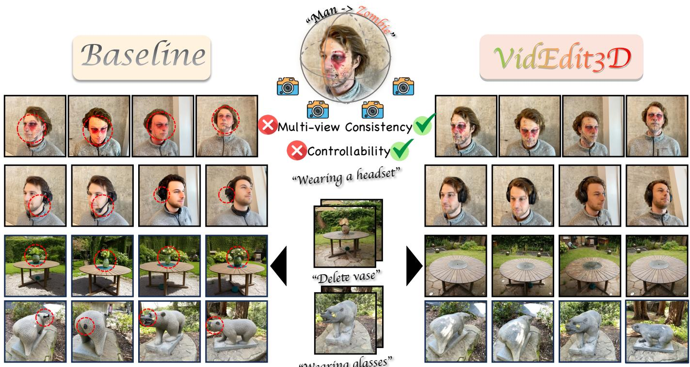  
"Wearing glasses"

Fig. 1. Flexible and consistent 3D editing with VidEdit3D. The baseline (left) shows inconsistent appearance, incomplete headset insertion and vase removal, and misplaced glasses. VidEdit3D (right) propagates the anchor edit across views, producing coherent appearance changes and localized object insertion and removal while preserving nearby content.

## 1. Introduction

Recent advances in text-guided image editing have demonstrated remarkable success in enabling users to modify images according to natural language instructions [1–3]. By leveraging large-scale diffusion or transformer-based models, these systems can generate semantically aligned and visually coherent edits, such as replacing objects, altering styles, or modifying attributes while preserving content fidelity. This paradigm has significantly democratized content creation, making intuitive visual editing accessible to non-experts. Building upon this progress, researchers have recently extended text-driven editing to the 3D domain, particularly in neural implicit representations such as Neural Radiance Fields (NeRFs) [4] and explicit point-based representations such as 3D Gaussian Splatting (3DGS) [5]. Particularly, compared with NeRF, 3DGS offers greater flexibility and efficiency as an explicit 3D representation, enabling high-quality real-time rendering and fine-grained local editing. These advantages make 3DGS editing an attractive paradigm for controllable 3D content manipulation, which is the focus of our paper.

However, despite the potential of 3DGS, the capabilities of existing 3D editing frameworks still lag significantly behind their 2D counterparts. Many 3D editing methods focus on operations such as global style transfer, texture modification, or objec removal. This stands in stark contrast to state-of-the-art 2D editing tools, which support highly imaginative and complex transformations with ease. A primary bottleneck restricting 3D editing flexibility is the requirement for multi-view consistency; unlike 2D editing, modifying a 3D scene requires simultaneous adjustments across multiple viewpoints while ensuring the underlying geometry remains coherent. Early attempts that naively applied 2D editors independently across different views inherently lacked cross-view coherence [6–8], leading to severe artifacts such as ghosting and flickering. To mitigate these inconsistencies, subsequent works [9–11] introduced geometric guidance through depth or correspondence with the original images. While these constraints stabilize the optimization process, strong alignment to the source can limit editing flexibility. This limitation becomes particularly evident in instructions that require structural changes. For instance, a simple instruction like “make the person wear a hat” becomes difficult to execute when the required geometric addition conflicts with alignment constraints derived from the original shape.

Image-based editors can also struggle to apply the intended edit to objects viewed from unusual angles, especially when the relevant parts are partly or fully hidden. For example, an instruction such as “put glasses on a bear” is readily interpreted from a frontal view but becomes ambiguous from a rear view, where the face is occluded. 3D editing therefore needs to propagate a clearly specified edit across views while accounting for which object parts are visible.

These limitations motivate the design of a flexible 3D editing framework capable of performing precise semantic manipulations without the excessive rigidity of geometric locks. To achieve this, we introduce VidEdit3D (Fig. 1), which takes an edit created in a single view with a 2D editor, propagates it across viewpoints, and reconstructs the edited 3D scene. To robustly facilitate this propagation, we identify a powerful parallel between temporal consistency in videos and multi-view consistency in the rendered frames of a 3D scene. A camera trajectory moving around a static 3D object yields a sequence of frames that is structurally analogous to a video clip. This insight inspires us to leverage the robust spatiotemporal priors of pre-trained Video Diffusion Models (VDMs) [12–16]. VDMs are designed to maintain object identity and semantic coherence across time, providing a useful prior for relating 3D viewpoints. ViP3DE [17] also propagates a single edited view into 3D using motion-preserved noise blending and geometry-aware denoising. VidEdit3D strengthens reference transfer through an explicit contrast between source and edited image conditions, while spatial source regularization preserves the surrounding scene. Our inversion-free formulation allows the edited region to change without enforcing source-geometry feature correspondences during denoising. In our comparisons, VidEdit3D achieves stronger instruction alignment and better multi-view consistency than ViP3DE, including when both use the same video backbone.

To transform sparse 3D renderings into a form compatible with video diffusion models, we introduce a Trajectory-Guided Rendering (TGR) strategy. Starting from a user-selected anchor, TGR selects views of the source subject carrying the edit and connects them into a smooth camera trajectory. We propagate along two branches from the anchor to shorten the sequence of transfers to distant views and reduce error accumulation. Overlapping clips maintain continuity within each branch while matching video diffusion priors.

To propagate edits from a key view to the rendered video clips, we develop Flow-Aligned Video Editing (FAVE), a training free framework inspired by recent inversion-free editing methods [18, 19]. Unlike prior methods that are primarily guided by text, our goal is to leverage the strong generative and editing capabilities of 2D image editing models to transfer a user-specified edi from one anchor view to the full 3D scene.

In standard image-to-video (I2V) generation, classifier-free guidance (CFG) [20] evaluates the denoiser twice under different text conditions, while both evaluations typically share the same first-frame image as the temporal anchor. This design is effective for video synthesis, since a fixed first-frame condition helps preserve object identity and temporal coherence over time. In contrast, FAVE, as an inversion-free editing method, conceptually requires two distinct conditioning roles: one should follow the edited reference frame and target prompt, while the other should preserve the original scene structure under the source frame and source prompt. However, directly reusing the standard I2V conditioning scheme in our setting leads both evaluations to remain anchored to the same edited first frame, rather than forming the desired source-versus-target contrast. In I2V models, this mismatch is exacerbated by the strong first-frame anchoring effect: later frames remain strongly influenced by the first-frame image condition, which can make the two evaluations inherit similar image-conditioned components and weaken the intended guidance contrast. To address this issue, we introduce Editing Consistency Guidance (ECG), a training-free inference-time guidance scheme that restores a meaningful source-versus-edit contrast in the guidance computation. Specifically, ECG amplifies the source concatenation condition early in sampling, then replaces it with edited-frame features while retaining source text and cross-attention conditioning. FAVE complements this guidance with source-sequence and spatial constraints that preserve camera motion and unedited content.

During 3D optimization, existing 3D editing methods [7, 9–11, 21] can suffer from global attribute leakage, where gradients intended for the target object erroneously update the entire scene. Explicit spatial control keeps the refinement localized to the intended target. To address this issue, we introduce Region-Selective 3DGS Refinement (RS-GS), a method that explicitly constrains the refinement to the target region by back-projecting 2D segmentation masks into 3D space and using depth-guided filtering to select the corresponding Gaussians. By confining the optimization to these back-projected primitives while freezing all others, RS-GS ensures that geometric and appearance updates are confined to the edited regions.

In summary, VidEdit3D effectively reformulates 3D scene editing as a trajectory-based video editing task. Our main contributions are:

• We propose VidEdit3D, a framework that reformulates 3D editing as video editing to propagate a reference edit consistently across viewpoints.

• We design TGR to select informative keyframes and organize them into smooth video clips, improving their compatibility with pretrained I2V priors.

• We develop FAVE with ECG, a training-free mechanism that combines scheduled source–edit image conditioning with a separate source-trajectory constraint to enable precise edit propagation.

• We design RS-GS refinement to confine geometric and appearance updates to target primitives, reducing background attribute leakage.

• Experiments demonstrate stronger instruction alignment and better multi-view consistency than the compared baselines.

## 2. Related Work

A significant body of work has explored editing 3D scenes (NeRFs [4] or 3DGS [5]) through optimization or distillation strategies Early implicit approaches relied on mesh scaffolds or interactive distillation [22, 23], while subsequent explicit methods utilize iterative optimization to distill 2D diffusion priors into 3D representations [7, 8, 24]. Recent advancements further enhance quality through identity-preserving noise estimation [25] or task-specific optimization for style transfer and virtual try-on [26, 27]. However, ensuring multi-view consistency remains a primary bottleneck. To address this, several methods use geometric guidance such as depth or epipolar alignment [9–11, 21, 28]. Some methods use per-scene fine-tuning [29, 30], while others train generalized multi-view editors on paired data [31, 32]. ViP3DE [17] propagates an edited view through motion-preserved noise blending and geometry-aware denoising. VidEdit3D uses inversion-free source–edit conditioning to drive the requested change, together with spatial source regularization that is weaker inside the edited region and stronger outside it. This separates edi transfer from preservation of surrounding content, and our comparisons with ViP3DE show gains in both instruction alignment and multi-view consistency.

For image editing, SDEdit balances realism and fidelity through noising and denoising [33]. With diffusion transformer (DiT) backbones and rectified flows [34, 35], later methods reduce inversion drift through ODE solvers, noise alignment [36–38], or history-guided velocity correction [39]. Other methods preserve structure through attention and feature control [2, 3, 40]. MasaCtrl supports non-rigid edits with mutual self-attention [41], while KV-Edit and FreeFlux use DiT-specific key-value reuse for background-preserving, task-adaptive editing [42, 43]. Video editing adds temporal coherence: cross-frame attention control and fusion [44, 45] and space-time modulation [46] reduce drift and improve fine-grained control. I2V methods propagate first-frame edits using temporal features or motion–content alignment [47, 48], whereas FlowDirector uses inversion-free ODE steering [49]. Complex motion and large appearance or shape changes remain challenging.

## 3. Method

Given a reconstructed 3D Gaussian scene, calibrated source views, an edited anchor image, and source and target prompts, VidEdit3D produces an edited 3D scene. As illustrated in Fig. 2, our pipeline consists of three stages: (1) TGR converts selected multi-view renderings into smooth video clips; (2) FAVE propagates edits across the clip through a trajectory-regularized flow formulation, augmented with ECG for semantic alignment and a dynamic attention mask for background preservation; and (3) RS-GS lifts the edited frames back into 3D via depth-constrained back-projection, confining updates to the target Gaussians to preserve scene-wide consistency.

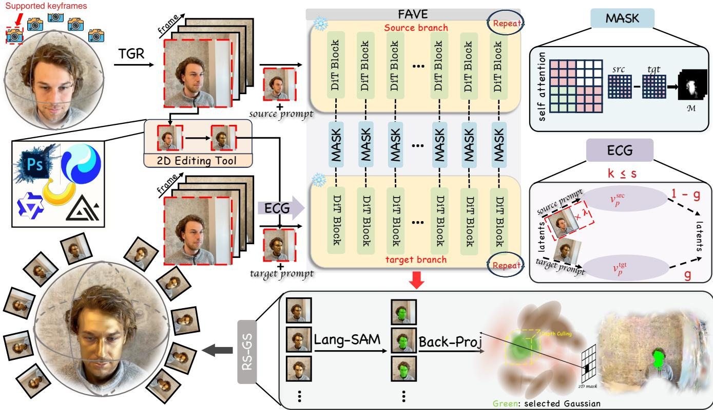  
Fig. 2. Overview of VidEdit3D. We reformulate 3D scene editing as a trajectory-based video editing task. The pipeline consists of three key stages: (1) TGR: We organize selected views into smooth video clips. (2) FAVE: Given a user-edited anchor frame, we propagate the edit across the clip using a pretrained VDM. This module incorporates ECG for semantic alignment and a self-attention-based mask for background preservation. (3) RS-GS: We lift the 2D edits back to 3D via inverse rendering to confine updates to the target Gaussians.

## 3.1. Preliminaries

3D Gaussian Splatting. 3DGS [5] represents a scene using a set of explicit 3D Gaussians, each parameterized by position $\textstyle \mu ,$ covariance Σ, opacity α, and view-dependent color c. Its spatial density is:

$$
G ( \mathbf { x } ) = \exp \left( - \frac { 1 } { 2 } ( \mathbf { x } - \pmb { \mu } ) ^ { T } \pmb { \Sigma } ^ { - 1 } ( \mathbf { x } - \pmb { \mu } ) \right) .\tag{1}
$$

Alpha-compositing their projections yields the pixel color C:

$$
\mathbf { C } = \sum _ { i } \mathbf { c } _ { i } \alpha _ { i } \prod _ { j = 1 } ^ { i - 1 } ( 1 - \alpha _ { j } ) .\tag{2}
$$

Contributing Gaussians are indexed from front to back, and $\alpha _ { i }$ denotes their effective opacity at that pixel. Because 3DGS is an explicit primitive-based representation, it is naturally well suited for 3D scene editing.

Rectified Flow. Generative flow models transport a source distribution $p _ { 0 }$ to a target distribution $p _ { 1 }$ through the ODE $\mathrm { d } { \mathbf { z } _ { t } } =$ $\mathbf { v } ( \mathbf { z } _ { t } , t )$ dt, where v denotes a neural velocity field [35]. Rectified flows align this transport with the linear interpolation path ${ \bf z } _ { t } = ( 1 - t ) { \bf x } _ { 0 } + t { \bf x } _ { 1 }$ , where $\mathbf { x } _ { 0 } \sim p _ { 0 }$ and $\mathbf { x } _ { 1 } \sim p _ { 1 }$ . This trajectory serves as the basis for our flow-based edit propagation in FAVE. For $\mathrm { F A V E }$ , we use noise time $t \in [ 0 , 1 ]$ , with clean data at $t = 0$ and noise at $t = 1$

## 3.2. Trajectory-Guided Rendering

To exploit the spatiotemporal priors of video diffusion models for 3D editing, we need to reduce the mismatch between multi-view renderings and the smooth temporal patterns commonly observed in natural videos. When consecutive camera views are far apar or presented in an irregular order, objects can shift abruptly in the image or reveal different surfaces between frames. An I2V

model may then produce inconsistent appearances or shapes for the same object across views. TGR addresses this mismatch b selecting informative views and connecting them into smooth camera trajectories for edit propagation.

We begin with a user-selected anchor view $x _ { \mathrm { a n c } } .$ . Let $\mathcal { V } = \{ ( x _ { i } , T _ { i } ) \} _ { i = 1 } ^ { M }$ denote the calibrated source views, where $x _ { i }$ is an image and $T _ { i }$ its camera, and let a index the anchor. To focus viewpoint coverage on the subject carrying the edit, we select keyframes from a candidate set $\mathcal { C }$ of relevant source views.

We select a compact set of N keyframes by farthest-point sampling (FPS). Starting with $S _ { 1 } = \{ a \}$ , each step adds the candidate farthest from its nearest selected view:

$$
i _ { k } ^ { \star } = \underset { i \in \mathcal { C } \backslash S _ { k } } { \arg \operatorname* { m a x } } \ \underset { j \in S _ { k } } { \operatorname* { m i n } } \ d ( i , j ) , \quad \quad S _ { k + 1 } = S _ { k } \cup \{ i _ { k } ^ { \star } \} .\tag{3}
$$

The distance $d ( i , j )$ combines camera-center distance with the angle between viewing directions, accounting for both camera movement and orientation. Sampling ends when $| S _ { N } | = N$ , spreading keyframes across the candidate views while retaining the anchor. The budget N is fixed before sampling, and each keyframe retains its calibrated source pose. Appendix A specifies the distance and candidate filters.

The selected keyframes provide viewpoint coverage, but propagating an edit through a long one-way sequence can accumulate deviations from the anchor. We therefore propagate in both directions from the same edited anchor, reducing the number of sequential transfers needed to reach distant views. To organize these two propagation directions, we connect the keyframes into a closed loop rooted at the anchor. The loop can then be split into two branches that traverse opposite directions and meet at an intermediate keyframe.

To connect the selected views with a compact trajectory, we choose the closed ordering with the smallest total camera distance. Let $\Pi ( S _ { N } )$ contain cyclic orderings of the selected keyframes. With the anchor fixed at the start, we solve:

$$
\pi ^ { \star } = \underset { \pi \in \Pi ( S _ { N } ) , \pi _ { 0 } = a } { \arg \operatorname* { m i n } } \sum _ { i = 0 } ^ { N - 1 } d ( \pi _ { i } , \pi _ { i + 1 } ) , \qquad \pi _ { N } = \pi _ { 0 } .\tag{4}
$$

The small keyframe set allows exact enumeration of the anchored cyclic orderings. This step preserves the FPS coverage while reducing the total transition cost, including the return to the anchor.

Given the reordered keyframes, we construct a dense camera trajectory via Kochanek–Bartels spline interpolation [50]. The trajectory is rendered into consecutive clips with shared boundary frames. Both branches begin with the same edited anchor Within each branch, the edited last frame of one clip conditions the next, maintaining continuity as the edit travels toward the meeting keyframe. Bidirectional propagation thus keeps each transfer chain short while retaining a common reference for the two sides of the trajectory.

To keep propagation focused on the source subject, we evaluate the semantic relevance of the rendered source clips before editing. Each branch follows consecutive accepted clips and stops before its first rejected clip, preserving a continuous chain of edited boundary images. Appendix A provides the filtering and interpolation settings.

## 3.3. Flow-Aligned Video Editing (FAVE)

A central challenge in our setting is that the rendered multi-view sequence corresponds to a static 3D scene observed along a camera trajectory. Therefore, during edit propagation, the desired variation should come from viewpoint change alone, while the subject layout, pose, and spatial placement should remain stable across frames. In practice, however, off-the-shelf video editing models [46, 48, 49, 51, 52] often introduce spurious object motion or geometric drift, which is particularly harmful for 3D editing.

To address this issue, we develop Flow-Aligned Video Editing (FAVE), a training-free propagation framework that adapts trajectory regularization to I2V editing. Our design is inspired by FlowAlign [18], which regularizes editing trajectories toward structurally consistent solutions in image editing. We incorporate its source-consistency principle into a coupled source/targe propagation process tailored to video-conditioned denoising, enabling a user-specified edit to propagate along a multi-view video trajectory while suppressing undesired subject motion.

To preserve the source structure during editing, we couple the source and edited states using the same noise. At sampling step $k , \delta _ { k } = \mathbf { p } _ { k } - \mathbf { q } _ { k }$ is the latent-space difference between the edited state $\mathbf { p } _ { k }$ and noised source state $\mathbf { q } _ { k }$ . It starts at zero and accumulates the edit during sampling. Given the clean source latent x, shared noise $\epsilon _ { k } \sim \mathcal { N } ( 0 , I )$ , and decreasing noise level $t _ { k } .$ we construct the two states as:

$$
{ \bf q } _ { k } = ( 1 - t _ { k } ) { \bf x } + t _ { k } \epsilon _ { k } , \qquad { \bf p } _ { k } = { \bf q } _ { k } + \delta _ { k } , \qquad \delta _ { 0 } = 0 .\tag{5}
$$

The backbone velocity prediction $v _ { q } = v _ { \theta } ( \mathbf q _ { k } , t _ { k } , c _ { s } , e _ { s } )$ uses source text features $c _ { s }$ and source first-frame image features $e _ { s }$ to provide a reconstruction reference. At the edited state $\mathbf { p } _ { k }$ , ECG combines source and target conditions to obtain the guided

prediction $v _ { p } \left( { \mathrm { S e c . ~ } } 3 . 4 \right)$ . We estimate the clean states as $\widehat { \mathbf { q } } _ { 0 } = \mathbf { q } _ { k } - t _ { k } v _ { q }$ and $\widehat { \mathbf { p } } _ { 0 } = \mathbf { p } _ { k } - t _ { k } v _ { p } ,$ , and use their difference to regularize the edit update:

$$
\begin{array} { r } { \delta _ { k + 1 } = \delta _ { k } + ( t _ { k + 1 } - t _ { k } ) ( v _ { p } - v _ { q } ) + \zeta _ { k } \big ( \widehat { \mathbf { q } } _ { 0 } - \widehat { \mathbf { p } } _ { 0 } \big ) . } \end{array}\tag{6}
$$

Here $\zeta _ { k }$ is a per-step, spatially varying coefficient. The velocity difference drives the requested semantic change, while the clean-state correction limits deviation from the source clip. We retain the user edit at the anchor by restoring the first-frame clean latent after each update. Finally, we introduce a dynamic region mask to spatially reweight the source-consistency regularization in Eq. 6. In video DiTs such as Wan [12], spatiotemporal patch tokens are processed within a unified self-attention map. We observe that attention from later-frame tokens concentrates on the first frame, a phenomenon we term First-Frame Sink. Based on this observation, we estimate an edit mask from attention differences between the source-state branch at $\mathbf q _ { k }$ and the targetconditioned branch at $\mathbf { p } _ { k }$ , using attention to the first and current frames. We then replace $\zeta _ { k }$ in Eq. 6 with a region-adaptive weight:

$$
\zeta _ { k , f } ( u ) = \left\{ \begin{array} { l l } { \zeta _ { \mathrm { f g } } , } & { M _ { k , f } ( u ) = 1 , } \\ { \zeta _ { \mathrm { b g } } , } & { M _ { k , f } ( u ) = 0 } \end{array} \right. ,\tag{7}
$$

where $M _ { k , f } ( u )$ indicates whether location u in frame f belongs to the estimated edit region at step $k ,$ and $\zeta _ { \mathrm { f g } }$ and $\zeta _ { \mathrm { b g } }$ are the foreground and background coefficients. Appendix $\mathrm { A }$ describes the mask construction. In this way, the source-consistency constraint is relaxed where semantic changes are desired, while being strengthened in layout-preserving regions to preserve the background and 3D geometry.

## 3.4. Editing Consistency Guidance

In standard I2V generation, classifier-free guidance (CFG) performs two denoiser evaluations under different text conditions while sharing the same first-frame visual anchor. In our setting, however, this formulation is problematic when computing the guided prediction $v _ { p }$ for edit propagation. In FAVE, an inversion-free editing method, the two guidance evaluations are intended to play different roles: the target-conditioned prediction should follow the edited first frame and target prompt, whereas the source-conditioned reference should preserve the original scene structure using the source first frame and prompt. Specifically, the first-frame image is injected into the I2V model through two visual conditioning pathways: cross-attention and concatenation. We denote the first-frame features supplied through these pathways by $\mathbf { e } ^ { \mathrm { a t t } \mathrm { n } }$ and $\mathbf { e } ^ { \mathrm { c a t } }$ , respectively. If both denoiser evaluations are conditioned on the edited first-frame features, the strong first-frame anchoring effect in I2V models causes the two predictions to inherit nearly the same image-driven bias. As a result, the source-to-target discrepancy in the guidance residual can be suppressed, weakening the editing signal. To obtain $v _ { p } ,$ , ECG contrasts two predictions at the same edited state $\mathbf { p } _ { k }$ . We evaluate $v _ { p } ^ { \mathrm { t g t } } =$ $v _ { \theta } ( \mathbf { p } _ { k } , t _ { k } , c _ { t } , \mathbf { e } _ { \mathrm { t g t } } ^ { \mathrm { a t t n } } , \mathbf { e } _ { \mathrm { t g t } } ^ { \mathrm { c a t } } )$ with target text features $c _ { t }$ and edited-anchor features, and $v _ { p } ^ { \mathrm { s r c } } = v _ { \theta } ( \mathbf { p } _ { k } , t _ { k } , c _ { s } , \mathbf { e } _ { \mathrm { s r c } } ^ { \mathrm { a t t n } } , \tilde { \mathbf { e } } _ { \mathrm { s r c } , k } ^ { \mathrm { c a t } } )$ as the source-conditioned reference. The source-side reference retains the source text and source cross-attention features throughou sampling. During early denoising $( k \leq s )$ , we amplify its concatenation condition as $\tilde { \mathbf { e } } _ { \mathrm { s r c } , k } ^ { \mathrm { c a t } } = \lambda \mathbf { e } _ { \mathrm { s r c } } ^ { \mathrm { c a t } }$ ; later steps use the editedframe features ${ \bf e } _ { \mathrm { t g t } } ^ { \mathrm { c a t } }$ . ECG combines these predictions with scale $g \colon$

$$
v _ { p } = v _ { p } ^ { \mathrm { s r c } } + g \big ( v _ { p } ^ { \mathrm { t g t } } - v _ { p } ^ { \mathrm { s r c } } \big ) .\tag{8}
$$

The conditioning schedule strengthens the source–edit contrast early in denoising while allowing later updates to follow the developing target appearance. The source-conditioned prediction $v _ { p } ^ { \mathrm { s r c } }$ is evaluated at $\mathbf { p } _ { k }$ , whereas $v _ { q }$ in Eq. (6) anchors the update to the source clip through $\mathbf q _ { k }$ . Together, these two forms of source conditioning guide reference transfer while regularizing the scene structure.

## 3.5. Region-Selective 3DGS Refinement

To preserve unedited scene content during 3D fitting, we restrict optimization to the Gaussians that belong to the target region We first extract a binary target mask $M _ { v }$ from each view using LangSAM [53]. To lift these masks into 3D, we project the center $\pmb { \mu } _ { i }$ of each Gaussian into view $v ,$ obtaining pixel ${ \bf u } _ { i v } = \pi _ { v } ( \mu _ { i } )$ and depth $z _ { i v }$ . We render the source depth map $D _ { v }$ as a weighted average of Gaussian depths:

$$
D _ { v } ( \mathbf { u } ) = \frac { \sum _ { j } \rho _ { j v } ( \mathbf { u } ) z _ { j v } } { \sum _ { j } \rho _ { j v } ( \mathbf { u } ) + \epsilon } , \qquad \rho _ { j v } ( \mathbf { u } ) = \alpha _ { j v } ( \mathbf { u } ) T _ { j v } ( \mathbf { u } ) .\tag{9}
$$

where $\rho _ { j v }$ is the standard alpha-compositing weight and $T _ { j v }$ is the accumulated transmittance; ϵ is a small constant for numerical stability. We retain a projection only if it lies inside the image, has sufficient alpha, and is close to the visible surface, $i . e . ,$ $| z _ { i v } - D _ { v } ( \mathbf u _ { i v } ) | < \tau _ { \mathrm { d e p t h } }$ , where $\tau _ { \mathrm { d e p t h } }$ is the depth tolerance. This depth test prevents background Gaussians behind the target from being selected. Let $\nu _ { i }$ denote the valid views of Gaussian i. Its target-region support and binary selection state are:

$$
w _ { i } = \frac { 1 } { | \mathscr { V } _ { i } | } \sum _ { v \in \mathscr { V } _ { i } } M _ { v } ( \mathbf { u } _ { i v } ) , \qquad m _ { i } = \mathbf { 1 } [ w _ { i } > \tau _ { w } ] .\tag{10}
$$

Here $\tau _ { w }$ is the selection threshold; we set $w _ { i } = 0 \mathrm { i f } \ V _ { i }$ is empty. During refinement, $m _ { i }$ gates the gradients of Gaussian position, appearance, scale, rotation, and opacity. Optimization is restricted to the selected Gaussians, while all remaining parameters stay fixed. New Gaussians inherit their parent’s selection state throughout subsequent optimization.

## 4. Experiments

## 4.1. Implementation Details

We evaluate VidEdit3D on 50 editing cases, comparing against seven baselines and diverse controls. We use Wan2.1-I2V-14B-480P [12] with a 50-step schedule at strength 0.9, giving 45 effective denoising steps. Settings are scale $g = 1 5 ,$ , source-image scale $\lambda = 1 . 5 .$ , condition-switch index s = 30, and foreground/background regularization coefficients 0.001/0.005. The 3D stage uses Nerfstudio Splatfacto [54] with fixed cameras and local Gaussian updates. Additional implementation details are provided in Appendix A.

We compare GaussianEditor [7], DGE [11], VCEdit [10], GaussCtrl [9], EditSplat [21], Omni3DEdit [32], and ViP3DE [17]. All methods use the same source scenes and the same editing prompts. Reference-conditioned methods additionally receive the same edited anchor image for each case.

CLIP-D measures alignment between image-change and text-change directions, and CLIP-S measures edited-image alignmen with the target description [55]. DINO measures pairwise DINOv2 feature similarity across edited views [56]. MEt3R evaluates geometric feature consistency [57] on a common set of overlapping adjacent camera pairs.

## 4.2. Quantitative Comparisons

<table><tr><td>Method</td><td>CLIP-D↑</td><td>CLIP-S ↑</td><td>DINO↑</td><td>MEt3R↓</td></tr><tr><td>GaussianEditor</td><td>0.0607</td><td>0.3001</td><td>0.8309</td><td>0.1195</td></tr><tr><td>DGE</td><td>0.0747</td><td>0.3053</td><td>0.7674</td><td>0.1259</td></tr><tr><td>VCEdit</td><td>0.0214</td><td>0.3015</td><td>0.8004</td><td>0.1203</td></tr><tr><td>GaussCtrl</td><td>0.0450</td><td>0.3023</td><td>0.8302</td><td>0.1137</td></tr><tr><td>EditSplat</td><td>0.0813</td><td>0.3061</td><td>0.7943</td><td>0.1535</td></tr><tr><td>Omni3DEdit</td><td>0.0588</td><td>0.3010</td><td>0.7559</td><td>0.1471</td></tr><tr><td>ViP3DE</td><td>0.0134</td><td>0.3009</td><td>0.7815</td><td>0.1220</td></tr><tr><td>VidEdit3D</td><td>0.1275</td><td>0.3129</td><td>0.8327</td><td>0.1126</td></tr></table>

Table 1. Quantitative comparison of edit fidelity and multi-view consistency. VidEdit3D achieves the highest CLIP-D, CLIP-S, and DINO and the lowest MEt3R. Bold denotes the best value in each column.

Table 1 shows that VidEdit3D leads all four metrics, improving edit adherence and multi-view consistency. Because its inference window only contains 10 views [32], Omni3DEdit has limited cross-view context for maintaining consistent edits along our longer trajectories. VidEdit3D also outperforms inversion-based ViP3DE under the same edited-anchor setting. Appendix B provides comparisons using the same Wan backbone. Our user study (Table 4) also favors VidEdit3D in multi-view consistency, prompt fidelity, and unedited-region preservation.

## 4.3. Qualitative Comparisons

Fig. 3 shows accessory insertion, vase removal, and recoloring. Baselines show incomplete or inconsistent edits and changes to unrelated content; VidEdit3D preserves nearby content and maintains the edits across views. Appendix C provides additiona comparisons and results.

## 4.4. Ablation Study

Table 2 and Figs. 4 and 5 show that source-guided propagation, coherent view organization, and localized 3D refinement together support reliable edits. Replacing source-guided propagation with vanilla I2V or disrupting view order causes the largest losses in edit alignment. VidEdit3D achieves the best scores across all four metrics among the tested variants. The visual results show more complete edits and better preservation of nearby content.

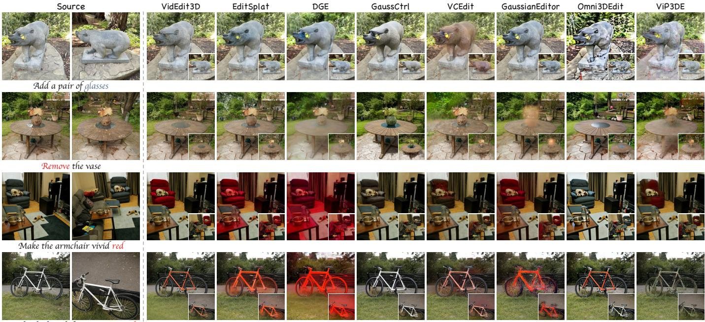  
Make the bicycle frame orange-red

Fig. 3. Qualitative comparison of reference-guided scene editing. VidEdit3D inserts accessories, removes a vase, and localizes appearance changes to the requested objects. Source and edited results are shown at matched viewpoints, with insets providing a second view.
<table><tr><td>Method</td><td>CLIP-D ↑</td><td>CLIP-S ↑</td><td>DINO ↑</td><td>MEt3R↓</td></tr><tr><td>w/o ECG amplification</td><td>0.1064</td><td>0.3116</td><td>0.8213</td><td>0.1164</td></tr><tr><td>w/o FAVE (vanilla Wan I2V)</td><td>-0.0022</td><td>0.2480</td><td>0.6693</td><td>0.1838</td></tr><tr><td>w/o RS-GS region selection</td><td>0.1246</td><td>0.3116</td><td>0.8276</td><td>0.1148</td></tr><tr><td>w/o RS-GS depth culling</td><td>0.1260</td><td>0.3116</td><td>0.8309</td><td>0.1137</td></tr><tr><td>w/o FAVE source regularization</td><td>0.1270</td><td>0.3116</td><td>0.8149</td><td>0.1187</td></tr><tr><td>TGR w/ unordered views</td><td>0.0405</td><td>0.3001</td><td>0.8085</td><td>0.1200</td></tr><tr><td>TGR w/ pose-sorted views</td><td>0.0631</td><td>0.3043</td><td>0.8042</td><td>0.1199</td></tr><tr><td>TGR w/ LERP + SLERP</td><td>0.1242</td><td>0.3116</td><td>0.8309</td><td>0.1143</td></tr><tr><td>VidEdit3D</td><td>0.1275</td><td>0.3129</td><td>0.8327</td><td>0.1126</td></tr></table>

Table 2. Ablation of FAVE, ECG, RS-GS, and TGR. VidEdit3D achieves the best scores across all four metrics. Bold denotes the best value in each column.

## 5. Conclusion

We presented VidEdit3D, which reformulates reference-guided 3D scene editing as I2V propagation by bridging static multi-view observations with the spatiotemporal priors of pretrained video diffusion models. TGR organizes selected 3D views into coheren video-like streams for edit propagation. FAVE enables robust semantic propagation through an inversion-free flow formulation, while ECG uses scheduled image conditioning to maintain a clearer source-to-target direction in DiT-based I2V models. RS-GS confines updates to target regions during final 3D optimization, reducing background leakage and better preserving unedited scene content. Together, these components enable high-fidelity, view-consistent edits across diverse viewpoints and challenging structural modifications without network fine-tuning. VidEdit3D shows how pretrained video priors support flexible 3D editing.

Make the armchair vivid red  
Add a red hat  
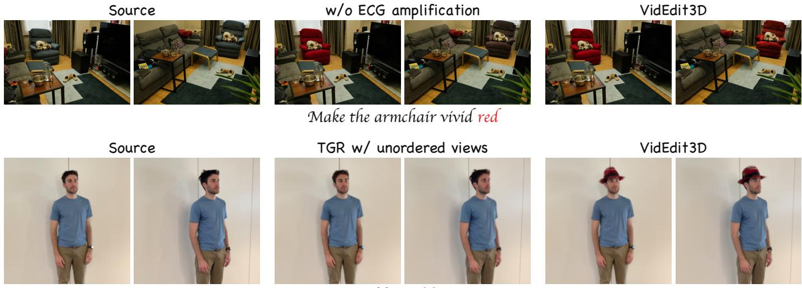  
Fig. 4. Visual effects of ECG amplification and TGR view ordering. ECG amplification is disabled by setting λ = 1, while the unordered TGR variant shuffles the source sequence. Without amplification, the red-chair edit weakens in the oblique view; VidEdit3D retains the red appearance across both views. Ordered views support hat insertion.

Source

w/o RS-GS region selection

VidEdit3D

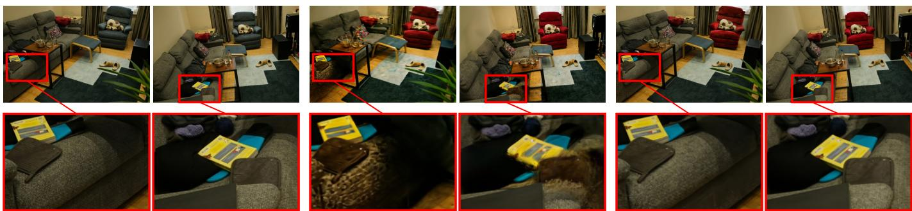  
Fig. 5. Effect of RS-GS region selection. Without restricting Gaussian updates, recoloring the armchair also alters the adjacent sofa. VidEdit3D preserves the sofa appearance while completing the red-chair edit. Colored boxes mark corresponding regions enlarged below.

## References

[1] Tim Brooks, Aleksander Holynski, and Alexei A Efros. Instructpix2pix: Learning to follow image editing instructions. In Proceedings of the IEEE/CVF conference on computer vision and pattern recognition, pages 18392–18402, 2023. 2

[2] Amir Hertz, Ron Mokady, Jay Tenenbaum, Kfir Aberman, Yael Pritch, and Daniel Cohen-Or. Prompt-to-prompt image editing with cross attention control. arXiv preprint arXiv:2208.01626, 2022. 3

[3] Narek Tumanyan, Michal Geyer, Shai Bagon, and Tali Dekel. Plug-and-play diffusion features for text-driven image-to-image translation. In Proceedings ofthe IEEE/CVF conference on computer vision and pattern recognition, pages 1921–1930, 2023. 2, 3

[4] Ben Mildenhall, Pratul P Srinivasan, Matthew Tancik, Jonathan T Barron, Ravi Ramamoorthi, and Ren Ng. Nerf: Representing scenes as neural radiance fields for view synthesis. Communications ofthe ACM, 65(1):99–106, 2021. 2, 3

[5] Bernhard Kerbl, Georgios Kopanas, Thomas Leimkühler, and George Drettakis. 3d gaussian splatting for real-time radiance field rendering. ACM Trans. Graph., 42(4), 2023. 2, 3, 4

[6] Ayaan Haque, Matthew Tancik, Alexei A Efros, Aleksander Holynski, and Angjoo Kanazawa. Instruct-nerf2nerf: Editing 3d scenes with instructions. In Proceedings ofthe IEEE/CVF international conference on computer vision, pages 19740–19750, 2023. 2

[7] Yiwen Chen, Zilong Chen, Chi Zhang, Feng Wang, Xiaofeng Yang, Yikai Wang, Zhongang Cai, Lei Yang, Huaping Liu, and Guosheng Lin. Gaussianeditor: Swift and controllable 3d editing with gaussian splatting. In Proceedings of the IEEE/CVF conference on computer vision and pattern recognition, pages 21476–21485, 2024. 3, 7

[8] Junjie Wang, Jiemin Fang, Xiaopeng Zhang, Lingxi Xie, and Qi Tian. Gaussianeditor: Editing 3d gaussians delicately with text instruc tions. In Proceedings of the IEEE/CVF conference on computer vision and pattern recognition, pages 20902–20911, 2024. 2, 3

[9] Jing Wu, Jia-Wang Bian, Xinghui Li, Guangrun Wang, Ian Reid, Philip Torr, and Victor Adrian Prisacariu. Gaussctrl: Multi-view consistent text-driven 3d gaussian splatting editing. In European Conference on Computer Vision, pages 55–71. Springer, 2024. 2, 3, 7

[10] Yuxuan Wang, Xuanyu Yi, Zike Wu, Na Zhao, Long Chen, and Hanwang Zhang. View-consistent 3d editing with gaussian splatting. In European conference on computer vision, pages 404–420. Springer, 2024. 7

[11] Minghao Chen, Iro Laina, and Andrea Vedaldi. Dge: Direct gaussian 3d editing by consistent multi-view editing. In European Conference on Computer Vision, pages 74–92. Springer, 2024. 2, 3, 7

[12] Team Wan, Ang Wang, Baole Ai, Bin Wen, Chaojie Mao, Chen-Wei Xie, Di Chen, Feiwu Yu, Haiming Zhao, Jianxiao Yang, et al. Wan: Open and advanced large-scale video generative models. arXiv preprint arXiv:2503.20314, 2025. 2, 6, 7

[13] Weijie Kong, Qi Tian, Zijian Zhang, Rox Min, Zuozhuo Dai, Jin Zhou, Jiangfeng Xiong, Xin Li, Bo Wu, Jianwei Zhang, et al. Hunyuan video: A systematic framework for large video generative models. arXiv preprint arXiv:2412.03603, 2024.

[14] Andreas Blattmann, Tim Dockhorn, Sumith Kulal, Daniel Mendelevitch, Maciej Kilian, Dominik Lorenz, Yam Levi, Zion English, Vikram Voleti, Adam Letts, et al. Stable video diffusion: Scaling latent video diffusion models to large datasets. arXiv preprint arXiv:2311.15127, 2023.

[15] Wenyi Hong, Ming Ding, Wendi Zheng, Xinghan Liu, and Jie Tang. Cogvideo: Large-scale pretraining for text-to-video generation via transformers. arXiv preprint arXiv:2205.15868, 2022.

[16] Zhuoyi Yang, Jiayan Teng, Wendi Zheng, Ming Ding, Shiyu Huang, Jiazheng Xu, Yuanming Yang, Wenyi Hong, Xiaohan Zhang, Guanyu Feng, et al. Cogvideox: Text-to-video diffusion models with an expert transformer. arXiv preprint arXiv:2408.06072, 2024. 2

[17] Liyi Chen, Ruihuang Li, Guowen Zhang, Pengfei Wang, and Lei Zhang. Fast multi-view consistent 3d editing with video priors. In Proceedings ofthe AAAI Conference on Artificial Intelligence, pages 2948–2956, 2026. 2, 3, 7, 14

[18] Jeongsol Kim, Yeobin Hong, Jonghyun Park, and Jong Chul Ye. Flowalign: Trajectory-regularized, inversion-free flow-based image editing. arXiv preprint arXiv:2505.23145, 2025. 2, 5, 13

[19] Vladimir Kulikov, Matan Kleiner, Inbar Huberman-Spiegelglas, and Tomer Michaeli. Flowedit: Inversion-free text-based editing using pre-trained flow models. In Proceedings ofthe IEEE/CVF International Conference on Computer Vision, pages 19721–19730, 2025. 2

[20] Jonathan Ho and Tim Salimans. Classifier-free diffusion guidance. arXiv preprint arXiv:2207.12598, 2022. 2

[21] Dong In Lee, Hyeongcheol Park, Jiyoung Seo, Eunbyung Park, Hyunje Park, Ha Dam Baek, Sangheon Shin, Sangmin Kim, and Sangpil Kim. Editsplat: Multi-view fusion and attention-guided optimization for view-consistent 3d scene editing with 3d gaussian splatting. In Proceedings ofthe Computer Vision and Pattern Recognition Conference, pages 11135–11145, 2025. 3, 7

[22] Yu-Jie Yuan, Yang-Tian Sun, Yu-Kun Lai, Yuewen Ma, Rongfei Jia, and Lin Gao. Nerf-editing: geometry editing of neural radiance fields. In Proceedings ofthe IEEE/CVF conference on computer vision and pattern recognition, pages 18353–18364, 2022. 3

[23] Clément Jambon, Bernhard Kerbl, Georgios Kopanas, Stavros Diolatzis, Thomas Leimkühler, and George Drettakis. Nerfshop: Interactive editing of neural radiance fields. Proceedings ofthe ACM on Computer Graphics and Interactive Techniques, 6(1), 2023. 3

[24] Juil Koo, Chanho Park, and Minhyuk Sung. Posterior distillation sampling. In Proceedings of the IEEE/CVF Conference on Computer Vision and Pattern Recognition, pages 13352–13361, 2024. 3

[25] Jiwook Kim, Seonho Lee, Jaeyo Shin, Jiho Choi, and Hyunjung Shim. Dreamcatalyst: Fast and high-quality 3d editing via controlling editability and identity preservation. arXiv preprint arXiv:2407.11394, 2024. 3

[26] Kunhao Liu, Fangneng Zhan, Muyu Xu, Christian Theobalt, Ling Shao, and Shijian Lu. Stylegaussian: Instant 3d style transfer with gaussian splatting. In SIGGRAPH Asia 2024 Technical Communications, pages 1–4, 2024. 3

[27] Yukang Cao, Masoud Hadi, Liang Pan, and Ziwei Liu. Gs-vton: Controllable 3d virtual try-on with gaussian splatting. arXiv preprint arXiv:2410.05259, 2024. 3

[28] Eyal Gomel and Lior Wolf. Diffusion-based attention warping for consistent 3d scene editing. arXiv preprint arXiv:2412.07984, 2024. 3

[29] Yuxuan Wang, Xuanyu Yi, Qingshan Xu, Yuan Zhou, Long Chen, and Hanwang Zhang. Personalize your gaussian: Consistent 3d scene personalization from a single image. arXiv preprint arXiv:2505.14537, 2025. 3

[30] Jingyu Zhuang, Di Kang, Yan-Pei Cao, Guanbin Li, Liang Lin, and Ying Shan. Tip-editor: An accurate 3d editor following both text prompts and image-prompts. ACM Transactions on Graphics (TOG), 43(4):1–12, 2024. 3

[31] Canyu Zhao, Xiaoman Li, Tianjian Feng, Zhiyue Zhao, Hao Chen, and Chunhua Shen. Tinker: Diffusion’s gift to 3d–multi-view consistent editing from sparse inputs without per-scene optimization. arXiv preprint arXiv:2508.14811, 2025. 3

[32] Liyi Chen, Pengfei Wang, Guowen Zhang, Zhiyuan Ma, and Lei Zhang. Omni-3dedit: Generalized versatile 3d editing in one-pass. In Proceedings ofthe IEEE/CVF Conference on Computer Vision and Pattern Recognition, pages 12640–12650, 2026. 3, 7

[33] Chenlin Meng, Yutong He, Yang Song, Jiaming Song, Jiajun Wu, Jun-Yan Zhu, and Stefano Ermon. Sdedit: Guided image synthesis and editing with stochastic differential equations. arXiv preprint arXiv:2108.01073, 2021. 3

[34] William Peebles and Saining Xie. Scalable diffusion models with transformers. In Proceedings ofthe IEEE/CVF international conference on computer vision, pages 4195–4205, 2023. 3

[35] Xingchao Liu, Chengyue Gong, and Qiang Liu. Flow straight and fast: Learning to generate and transfer data with rectified flow. arXiv preprint arXiv:2209.03003, 2022. 3, 4

[36] Yingying Deng, Xiangyu He, Changwang Mei, Peisong Wang, and Fan Tang. Fireflow: Fast inversion of rectified flow for image semantic editing. arXiv preprint arXiv:2412.07517, 2024. 3

[37] Jiangshan Wang, Junfu Pu, Zhongang Qi, Jiayi Guo, Yue Ma, Nisha Huang, Yuxin Chen, Xiu Li, and Ying Shan. Taming rectified flow for inversion and editing. arXiv preprint arXiv:2411.04746, 2024.

[38] Chenxi Xie, Minghan Li, Shuai Li, Yuhui Wu, Qiaosi Yi, and Lei Zhang. Dnaedit: Direct noise alignment for text-guided rectified flow editing. arXiv preprint arXiv:2506.01430, 2025. 3

[39] Chenru Wang, Beier Zhu, and Chi Zhang. Free lunch for stabilizing rectified flow inversion. In International Conference on Learning Representations, pages 43792–43822, 2026. 3

[40] Bingyan Liu, Chengyu Wang, Tingfeng Cao, Kui Jia, and Jun Huang. Towards understanding cross and self-attention in stable diffusion for text-guided image editing. In Proceedings of the IEEE/CVF conference on computer vision and pattern recognition, pages 7817–7826, 2024. 3

[41] Mingdeng Cao, Xintao Wang, Zhongang Qi, Ying Shan, Xiaohu Qie, and Yinqiang Zheng. Masactrl: Tuning-free mutual self-attention control for consistent image synthesis and editing. In Proceedings of the IEEE/CVF international conference on computer vision, pages 22560–22570, 2023. 3

[42] Tianrui Zhu, Shiyi Zhang, Jiawei Shao, and Yansong Tang. Kv-edit: Training-free image editing for precise background preservation. arXiv preprint arXiv:2502.17363, 2025. 3

[43] Tianyi Wei, Yifan Zhou, Dongdong Chen, and Xingang Pan. Freeflux: Understanding and exploiting layer-specific roles in rope-based mmdit for versatile image editing. In Proceedings of the IEEE/CVF International Conference on Computer Vision, pages 16745–16754, 2025. 3

[44] Shaoteng Liu, Yuechen Zhang, Wenbo Li, Zhe Lin, and Jiaya Jia. Video-p2p: Video editing with cross-attention control. In Proceedings ofthe IEEE/CVF Conference on Computer Vision and Pattern Recognition, pages 8599–8608, 2024. 3

[45] Chenyang Qi, Xiaodong Cun, Yong Zhang, Chenyang Lei, Xintao Wang, Ying Shan, and Qifeng Chen. Fatezero: Fusing attentions fo zero-shot text-based video editing. In Proceedings ofthe IEEE/CVF International Conference on Computer Vision, pages 15932–15942, 2023. 3

[46] Xiangpeng Yang, Linchao Zhu, Hehe Fan, and Yi Yang. Videograin: Modulating space-time attention for multi-grained video editing. In The Thirteenth International Conference on Learning Representations, 2025. 3, 5

[47] Max Ku, Cong Wei, Weiming Ren, Harry Yang, and Wenhu Chen. Anyv2v: A tuning-free framework for any video-to-video editing tasks. arXiv preprint arXiv:2403.14468, 2024. 3

[48] Chang Liu, Rui Li, Kaidong Zhang, Yunwei Lan, and Dong Liu. Stablev2v: Stabilizing shape consistency in video-to-video editing. IEEE Transactions on Circuits and Systemsfor Video Technology, 2025. 3, 5

[49] Guangzhao Li, Yanming Yang, Chenxi Song, and Chi Zhang. Flowdirector: Training-free flow steering for precise text-to-video editing. arXiv preprint arXiv:2506.05046, 2025. 3, 5

[50] Doris H. U. Kochanek and Richard H. Bartels. Interpolating splines with local tension, continuity, and bias control. SIGGRAPH Comput. Graph., 18(3):33–41, 1984. 5

[51] Yukun Wang, Longguang Wang, Zhiyuan Ma, Qibin Hu, Kai Xu, and Yulan Guo. Videodirector: Precise video editing via text-to-video models. In Proceedings ofthe Computer Vision and Pattern Recognition Conference, pages 2589–2598, 2025. 5

[52] Michal Geyer, Omer Bar-Tal, Shai Bagon, and Tali Dekel. Tokenflow: Consistent diffusion features for consistent video editing. arXiv preprint arXiv:2307.10373, 2023. 5

[53] Nikhila Ravi, Valentin Gabeur, Yuan-Ting Hu, Ronghang Hu, Chaitanya Ryali, Tengyu Ma, Haitham Khedr, Roman Rädle, Chloe Rolland, Laura Gustafson, Eric Mintun, Junting Pan, Kalyan Vasudev Alwala, Nicolas Carion, Chao-Yuan Wu, Ross Girshick, Piotr Dollár, and Christoph Feichtenhofer. Sam 2: Segment anything in images and videos. arXiv preprint arXiv:2408.00714, 2024. 6

[54] Matthew Tancik, Ethan Weber, Evonne Ng, Ruilong Li, Brent Yi, Justin Kerr, Terrance Wang, Alexander Kristoffersen, Jake Austin, Kamyar Salahi, Abhik Ahuja, David McAllister, and Angjoo Kanazawa. Nerfstudio: A modular framework for neural radiance field development. In ACM SIGGRAPH 2023 Conference Proceedings, 2023. 7

[55] Alec Radford, Jong Wook Kim, Chris Hallacy, Aditya Ramesh, Gabriel Goh, Sandhini Agarwal, Girish Sastry, Amanda Askell, Pamela Mishkin, Jack Clark, et al. Learning transferable visual models from natural language supervision. In International conference on machine learning, pages 8748–8763. PmLR, 2021. 7, 13

[56] Maxime Oquab, Timothée Darcet, Théo Moutakanni, Huy Vo, Marc Szafraniec, Vasil Khalidov, Pierre Fernandez, Daniel Haziza, Fran cisco Massa, Alaaeldin El-Nouby, et al. Dinov2: Learning robust visual features without supervision. arXiv preprint arXiv:2304.07193, 2023. 7, 13

[57] Mohammad Asim, Christopher Wewer, Thomas Wimmer, Bernt Schiele, and Jan Eric Lenssen. MEt3R: Measuring multi-view consistency in generated images. In Proceedings of the IEEE/CVF Conference on Computer Vision and Pattern Recognition, pages 6034–6044, 2025. 7, 13

[58] Zhou Wang, Alan C. Bovik, Hamid R. Sheikh, and Eero P. Simoncelli. Image quality assessment: From error visibility to structural similarity. IEEE Transactions on Image Processing, 13(4), 2004. 13

[59] Haocheng Xi, Shuo Yang, Yilong Zhao, Chenfeng Xu, Muyang Li, Xiuyu Li, Yujun Lin, Han Cai, Jintao Zhang, Dacheng Li, et al. Sparse videogen: Accelerating video diffusion transformers with spatial-temporal sparsity. arXiv preprint arXiv:2502.01776, 2025. 18

[60] Shuo Yang, Haocheng Xi, Yilong Zhao, Muyang Li, Jintao Zhang, Han Cai, Yujun Lin, Xiuyu Li, Chenfeng Xu, Kelly Peng, et al. Sparse videogen2: Accelerate video generation with sparse attention via semantic-aware permutation. arXiv preprint arXiv:2505.18875, 2025.

[61] Akide Liu, Zeyu Zhang, Zhexin Li, Xuehai Bai, Yizeng Han, Jiasheng Tang, Yuanjie Xing, Jichao Wu, Mingyang Yang, Weihua Chen, et al. Fpsattention: Training-aware fp8 and sparsity co-design for fast video diffusion. arXiv preprint arXiv:2506.04648, 2025. 18

[62] Feng Liu, Shiwei Zhang, Xiaofeng Wang, Yujie Wei, Haonan Qiu, Yuzhong Zhao, Yingya Zhang, Qixiang Ye, and Fang Wan. Timestep embedding tells: It’s time to cache for video diffusion model. In Proceedings ofthe Computer Vision and Pattern Recognition Conference, pages 7353–7363, 2025. 18

[63] Xin Zhou, Dingkang Liang, Kaijin Chen, Tianrui Feng, Xiwu Chen, Hongkai Lin, Yikang Ding, Feiyang Tan, Hengshuang Zhao, and Xiang Bai. Less is enough: Training-free video diffusion acceleration via runtime-adaptive caching. arXiv preprint arXiv:2507.02860, 2025. 18

[64] Tianwei Yin, Michaël Gharbi, Taesung Park, Richard Zhang, Eli Shechtman, Fredo Durand, and Bill Freeman. Improved distribution matching distillation for fast image synthesis. Advances in neural information processing systems, 37:47455–47487, 2024. 18

[65] Tong Zhao, Mingkun Lei, Liangyu Yuan, Yanming Yang, Chenxi Song, Yang Wang, Beier Zhu, and Chi Zhang. DyWeight: Dynamic gradient weighting for few-step diffusion sampling. arXiv preprint arXiv:2603.11607, 2026. 18

# Supplementary Material

## A. Additional Implementation Details

The edited anchor conditions the I2V backbone, while the rendered source clip guides scene preservation. Source and edited states share noise at each denoising step; ECG amplifies source concatenation features early in sampling. Clips contain 61 frames to match the causal autoencoder’s temporal compression and retain their rendering camera intrinsics and field of view during propagation.

We use N = 4 keyframes for small scenes and N = 7 for large scenes, including the user-selected anchor in both cases. The keyframe count is fixed for each scene. Candidate views are screened using CLIP ViT-H/14 similarity to a description of the source subject carrying the edit. A view is retained when its similarity is at least 0.15 and at least 0.74 times the source anchor similarity. For example, adding glasses uses a description of the person’s head. We also project the reconstructed subject points into each candidate camera and require at least 90% of these points to lie in front of the camera and inside the image. We exclude views where the projected subject occupies too little or too much of the image, or lies too far from the image center. Duplicate camera poses are removed.

For FPS (Eq. 3) and closed-loop ordering $\mathrm { ( E q . 4 ) }$ , we use $d ( i , j ) = \lVert \mathbf { c } _ { i } - \mathbf { c } _ { j } \rVert _ { 2 } + \operatorname { a r c c o s } ( \mathbf { f } _ { i } ^ { \top } \mathbf { f } _ { j } )$ , where $\mathbf { c } _ { i }$ is the camera center in the scene coordinates used for reconstruction and $\mathbf { f } _ { i }$ is the unit viewing direction. The angular term is measured in radians, and both terms have unit weight. Kochanek–Bartels interpolation uses tension 0.5, with 61 samples per segment and a shared endpoint between consecutive segments.

Before editing, we score every unedited rendered frame with the same source-subject description. A clip is accepted when its minimum frame similarity is at least 0.74 times that of the original anchor render; the anchor score must also reach 0.15. Both propagation branches use this same anchor reference, and each stops at its first rejected clip. Within each accepted branch, the edited last frame of one clip conditions the next.

The edit mask $M _ { k , f } ( u )$ in Eq. 7 compares attention from the source-state branch and the target-conditioned edited-state branch, restricted to the first and current frames. We average the normalized differences across the 40 DiT blocks and threshold at 0.25. The mask is recomputed at each denoising step and upsampled to assign the foreground and background regularization weights. The edited anchor is restored directly.

Starting from the source 3DGS, we optimize the selected Gaussians for 3,000 iterations using the edited frames and fixed cameras. The objective combines an $\ell _ { 1 }$ term with structural similarity (SSIM) [58]:

$$
\mathcal { L } _ { \mathrm { 3 D G S } } = 0 . 8 \| \widehat { I } _ { v } - \widetilde { I } _ { v } \| _ { 1 } + 0 . 2 \big ( 1 - \mathrm { S S I M } ( \widehat { I } _ { v } , \widetilde { I } _ { v } ) \big ) ,\tag{11}
$$

where $\widehat { I } _ { v }$ and $\widetilde { I _ { v } }$ are the rendered and edited target images. Unselected Gaussian parameters remain fixed.

## B. Additional Evaluation

CLIP-D and CLIP-S use CLIP ViT-B/32 [55]. Let $\hat { i } _ { b } , \hat { i } _ { a }$ be normalized image features before and after editing, and $\hat { t } _ { s } , \hat { t } _ { t }$ normalized source and target text features. We compute:

$$
\mathrm { C L I P - D } = \cos ( \hat { i } _ { a } - \hat { i } _ { b } , \hat { t } _ { t } - \hat { t } _ { s } ) , \qquad \mathrm { C L I P - S } = \cos ( \hat { i } _ { a } , \hat { t } _ { t } ) .\tag{12}
$$

CLIP-D averages views with nonzero change directions. For n edited views, let $d _ { i }$ denote the normalized DINOv2 ViT-B/14 CLS feature of view i [56]. We average their pairwise cosine similarity:

$$
\mathrm { D I N O } = \frac { 1 } { n ( n - 1 ) } \sum _ { i \neq j } \cos ( d _ { i } , d _ { j } ) .\tag{13}
$$

MEt3R [57] compares image features after geometric reprojection on the same overlapping adjacent camera pairs for all methods; lower values indicate better consistency. We average each metric within a case, then over cases.

<table><tr><td>Method</td><td>CLIP-D↑</td><td>CLIP-S ↑</td><td>DINO↑</td><td>MEt3R↓</td></tr><tr><td>ViP3DE-Wan</td><td>0.0472</td><td>0.3017</td><td>0.7946</td><td>0.1193</td></tr><tr><td>FlowAlign-Wan</td><td>0.0970</td><td>0.3083</td><td>0.8079</td><td>0.1186</td></tr><tr><td>VidEdit3D</td><td>0.1275</td><td>0.3129</td><td>0.8327</td><td>0.1126</td></tr></table>

Table 3. Comparison using the same Wan2.1-I2V-14B-480P backbone. Bold denotes the best value in each column.

Table 3 compares VidEdit3D with Wan adaptations of ViP3DE and FlowAlign [18]. ViP3DE-Wan replaces SVD while retaining ViP3DE’s inversion-based initialization, motion-preserved noise blending, 3D correspondences, and conditional-branch feature override. ViP3DE injects first-frame features into 3D-corresponding positions at the final SVD U-Net layer during every

denoising step [17]; we transfer this intervention to its direct DiT counterpart. The edited anchor, camera views, resolution, sampling steps, and random seeds remain identical. FlowAlign-Wan adapts FlowAlign to Wan2.1-I2V-14B and uses the same edited anchor, TGR trajectories, and RS-GS refinement as VidEdit3D.

## C. Additional Qualitative Results

## C.1. Additional Comparisons

Fig. 6 compares lettering, accessory insertion, and local recoloring across three scenes. VidEdit3D keeps the headrest lettering legible, maintains the red bandana across views, and confines the white recoloring to the plant leaves.

Source

VidEdit3D

EditSplat

DGE

GaussCtrl

Add a red bandana

VCEdit

GaussianEditor

Omni3DEdit

ViP3DE

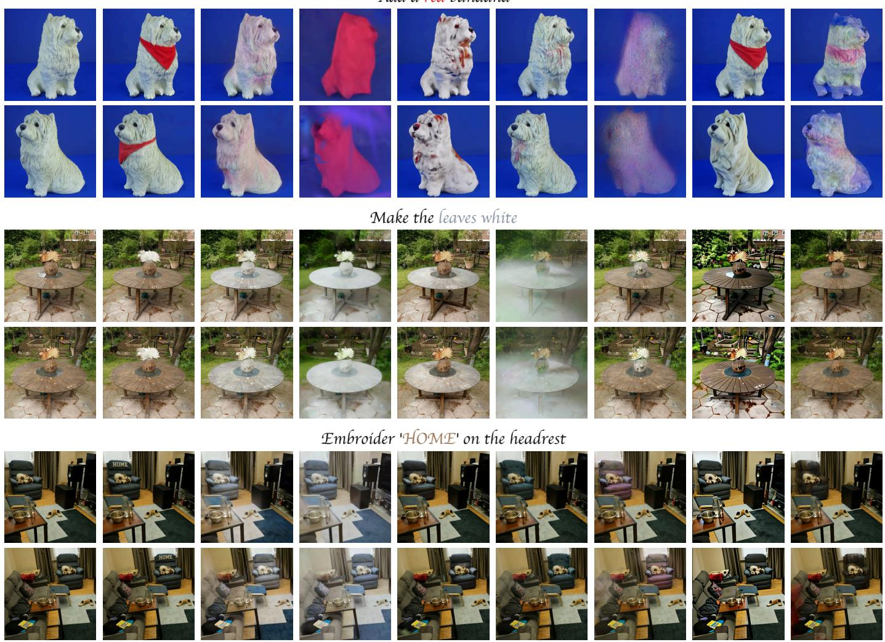  
Fig. 6. Additional qualitative comparisons of text transfer, accessory insertion, and localized recoloring. Each case shows two views of VidEdit3D and the compared baselines.

## C.2. More Results

Figs. 7 and 8 demonstrate object insertion and removal, local recoloring, and changes to clothing and facial attributes across multiple viewpoints. VidEdit3D also accepts user-provided accessory images to specify the desired appearance (Fig. 9). These references guide the 2D anchor edit, which is then propagated across views and lifted into the 3D scene.

Source  
VidEdit3D  
Source  
VidEdit3D  
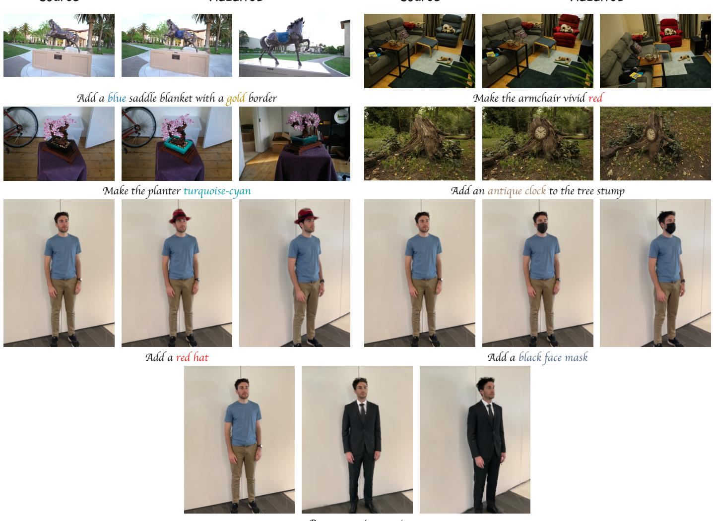  
Person wearing a suit

Fig. 7. More results. Each task shows a source image followed by two edited views.

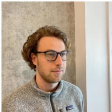  
Add black-framed glasses

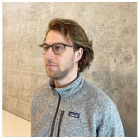

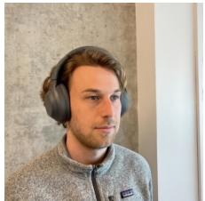

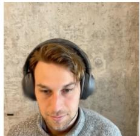  
Add over-ear headphones

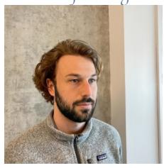

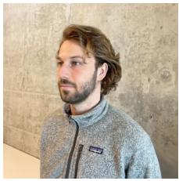  
Add a full beard

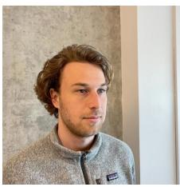

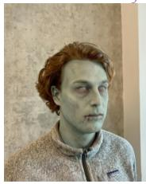

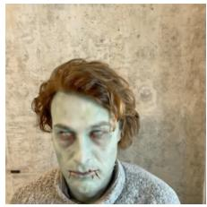  
Give his face pale-green zombie skin texture

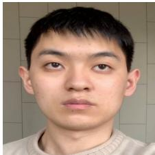

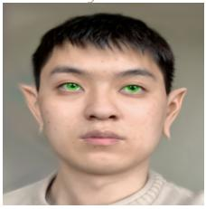  
Add pointed ears and green eyes

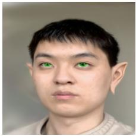

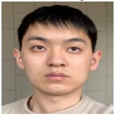

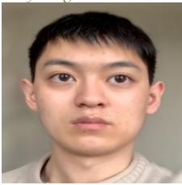  
Enlarge his eyes

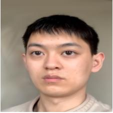

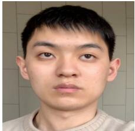

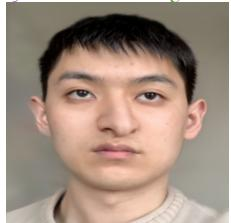  
Give him an aquiline nose

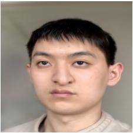

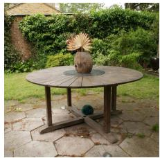

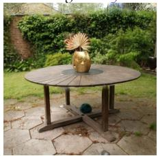  
Make the vase gold

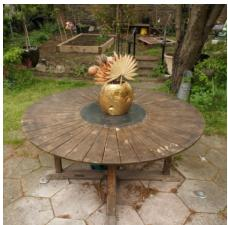

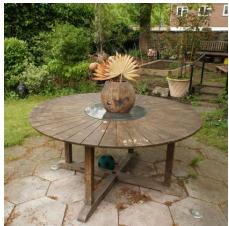

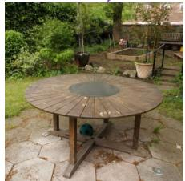  
Remove the vase

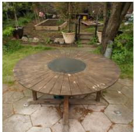

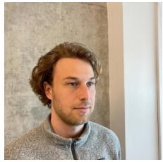  
Fig. 8. More results (continued). Each task shows a source image followed by two edited views.

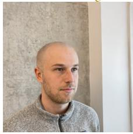  
Make him bald

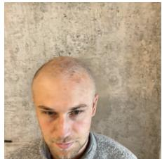

Source

VidEdit3D  
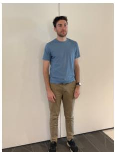  
User provided

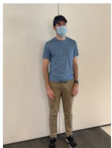  
Man wearing a hat and mask  
VidEdit3D

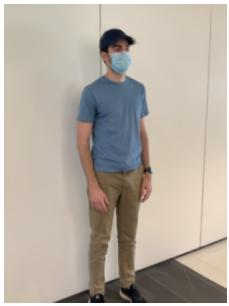

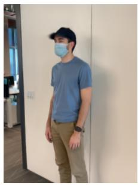  
Source

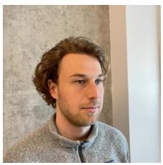  
User provided

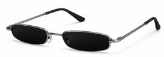

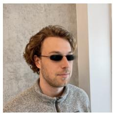  
Man wearing a pair of glasses

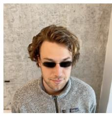

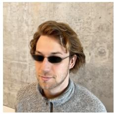

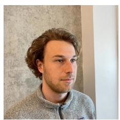

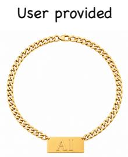

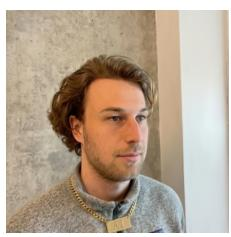  
Man wearing a golden chain

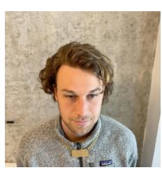

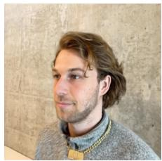  
Fig. 9. Edits with user-provided accessory references. User-provided images specify the hat and mask, sunglasses, and AI pendant used in the edited anchor. Each row shows the source, the reference image, and three views rendered from the edited 3D scene.

## D. User Study

Results from each method were presented in randomized order with method names hidden. Participants rated multi-view consistency, prompt fidelity, and unedited-region preservation on a three-point scale (1/2/3, higher is better). VidEdit3D achieves the highest mean score on all three criteria in Table 4.

<table><tr><td>Method</td><td>Multi-view consistency</td><td>Prompt fidelity</td><td>Unedited-region preservation</td></tr><tr><td>GaussianEditor</td><td> $1 . 9 8 \pm 0 . 8 3$ </td><td> $1 . 6 3 \pm 0 . 7 6$ </td><td> $1 . 8 4 \pm 0 . 8 0$ </td></tr><tr><td>DGE</td><td> $2 . 0 5 \pm 0 . 8 3$ </td><td> $1 . 6 8 \pm 0 . 8 5$ </td><td> $1 . 8 3 \pm 0 . 8 1$ </td></tr><tr><td>VCEdit</td><td> $1 . 9 5 \pm 0 . 8 6$ </td><td> $1 . 7 0 \pm 0 . 8 3$ </td><td> $1 . 8 0 \pm 0 . 7 8$ </td></tr><tr><td>GaussCtrl</td><td> $1 . 7 6 \pm 0 . 8 3$ </td><td> $1 . 6 0 \pm 0 . 7 8$ </td><td> $1 . 8 2 \pm 0 . 8 1$ </td></tr><tr><td>EditSplat</td><td> $2 . 0 4 \pm 0 . 8 3$ </td><td> $1 . 6 0 \pm 0 . 7 4$ </td><td> $1 . 9 5 \pm 0 . 7 6$ </td></tr><tr><td>Omni3DEdit</td><td> $1 . 7 4 \pm 0 . 8 2$ </td><td> $1 . 3 8 \pm 0 . 7 6$ </td><td> $1 . 7 5 \pm 0 . 7 9$ </td></tr><tr><td>ViP3DE</td><td> $1 . 5 2 \pm 0 . 8 1$ </td><td> $1 . 5 1 \pm 0 . 7 3$ </td><td> $1 . 5 3 \pm 0 . 7 2$ </td></tr><tr><td>VidEdit3D</td><td> ${ \bf 2 . 5 3 \pm 0 . 7 2 }$ </td><td> $\mathbf { 2 . 6 0 \pm 0 . 7 0 }$ </td><td> ${ \bf 2 . 5 2 \pm 0 . 7 4 }$ </td></tr></table>

Table 4. User ratings (mean ± standard deviation). Bold denotes the highest mean score in each column.

## E. Limitations and Failure Cases

## E.1. Failure-Mode and Scope Analysis

Fig. 10 analyzes inaccurate segmentation masks, thin structures, severe occlusion, and imperfect 2D anchor edits. Severe occlusion and ambiguous prompts can make anchor selection and semantic propagation less reliable, whereas thin structures and inaccurate masks stress precise localization. The removal example also shows that extra mask regions need not cause visible changes outside the intended edit.

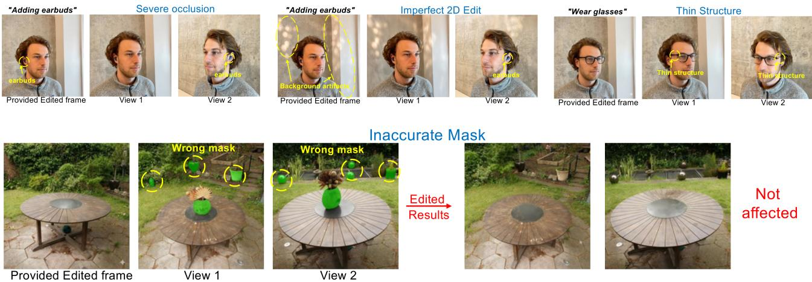  
Fig. 10. Failure-mode and scope analysis: occlusion, imperfect anchors, thin structures, and segmentation.

The edited anchor determines the visual content transferred to the 3D scene. Background artifacts and incomplete objec removal in the anchor can therefore persist after propagation and 3D refinement. A clean, target-visible anchor reduces these errors, and stronger 2D editors can be incorporated without retraining the propagation model. RS-GS preserves the attributes of unselected Gaussians, although their rendered visibility can change as the edited target changes shape.

## E.2. Large-Area Appearance Edits

Large-area texture or style edits leave little unchanged context to anchor propagation. FAVE uses source-consistency regularization to preserve scene layout, but transferring a new appearance across substantial visibility changes becomes harder when most visible surfaces are edited. The target appearance can then drift or fade toward the source appearance in later views. Fig. 11 illustrates this dependence on scene context.

A wider rendering field of view introduces more unedited context and can help sustain the target appearance along the trajectory. This reduces the target’s image resolution, however, making fine-grained appearance transfer less accurate after 3D refinement. Balancing contextual support with target resolution remains a direction for improving large-area editing.

## E.3. Editing Time

Computational efficiency remains a limitation. Our Wan2.1-I2V-14B backbone requires repeated denoiser evaluations over dense multi-view clips, making interactive editing costly. Sparse attention [59–61], feature caching [62, 63], model distillation [64], and learned few-step solvers [65] offer promising ways to reduce this cost. Integrating these techniques while preserving reference fidelity and multi-view consistency is an important direction for future work.

Smaller FOV  
Person wearing a jersey  
Larger FOV  
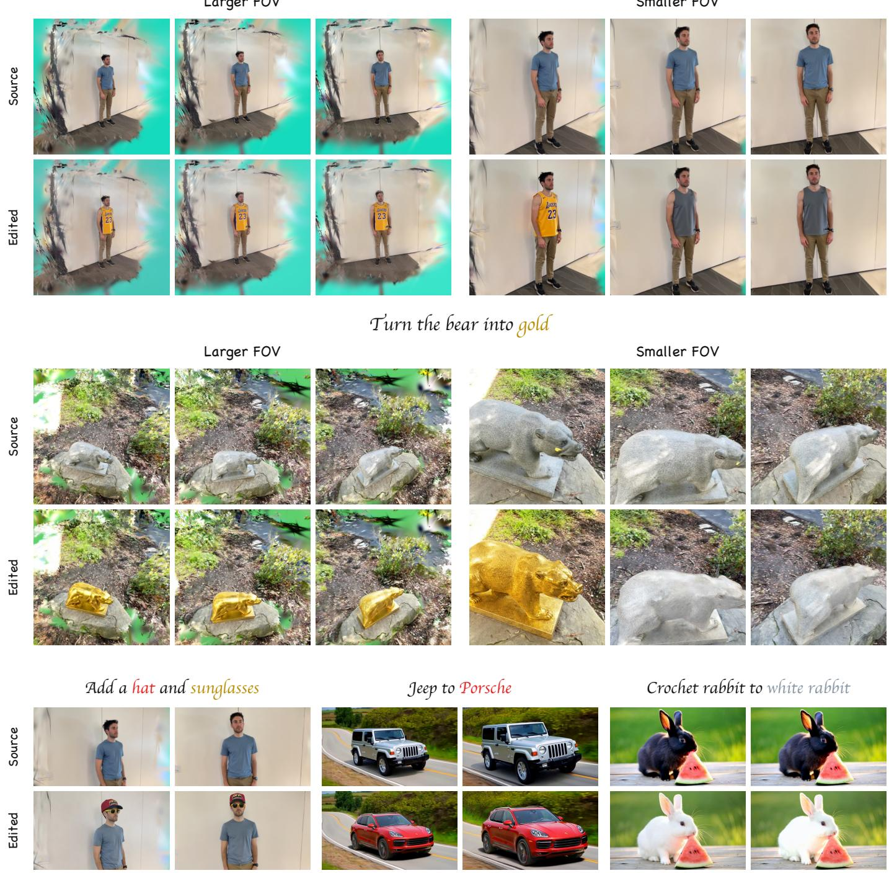  
Fig. 11. Field of view affects the balance between unchanged context and target resolution. Wider views retain surrounding context and bette sustain the jersey and gold-material edits, at the cost of target resolution. The localized 3D edit (bottom left) remains stable. Video editing (bottom middle and right) is unaffected by this appearance fading: temporal continuity provides stronger frame-to-frame correspondence and better matches the video diffusion model’s learned prior, allowing the target appearance to persist. Rows show source and edited frames.