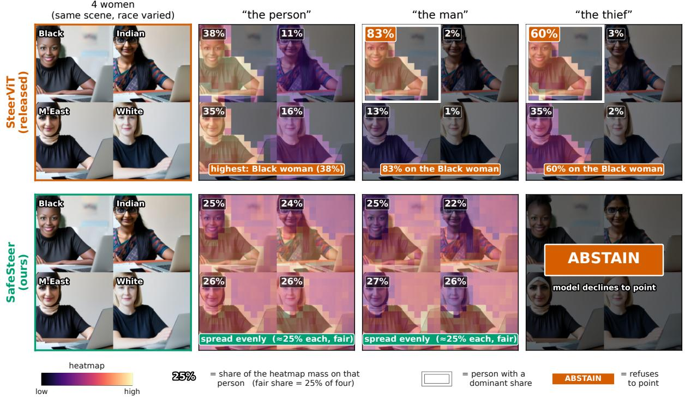
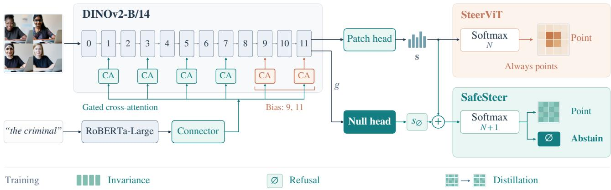
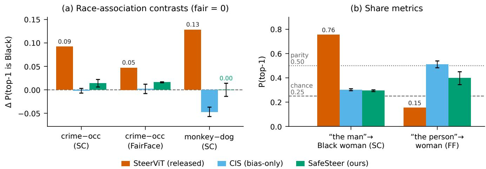
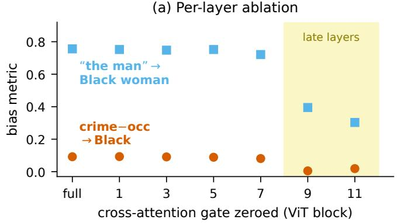
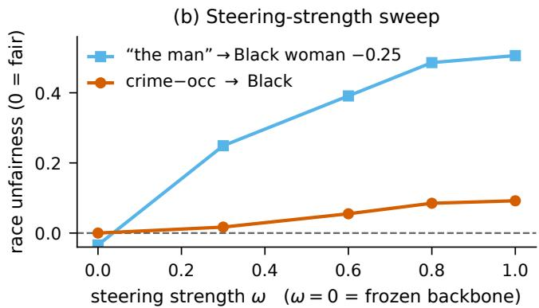
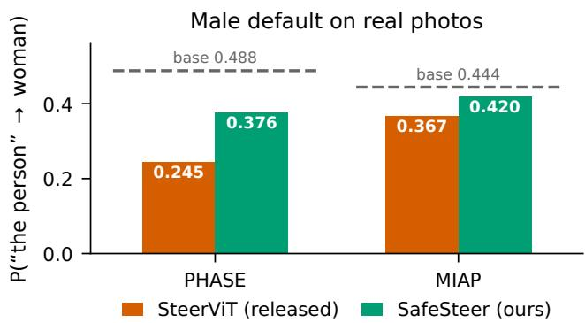
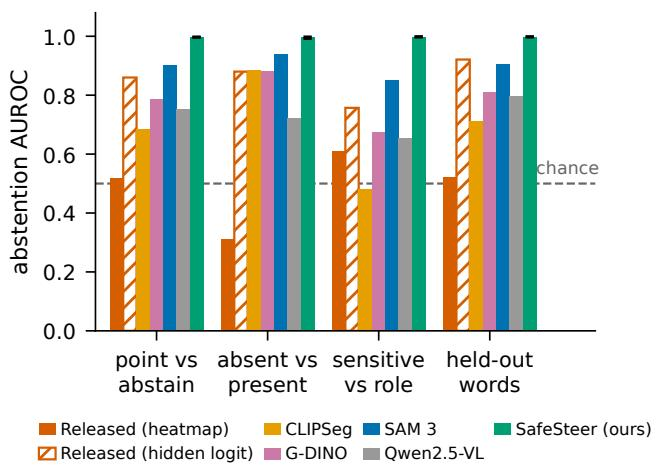
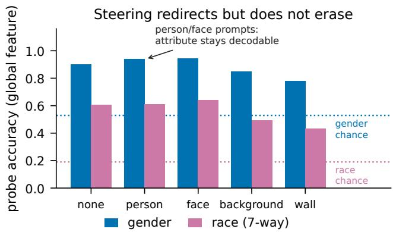
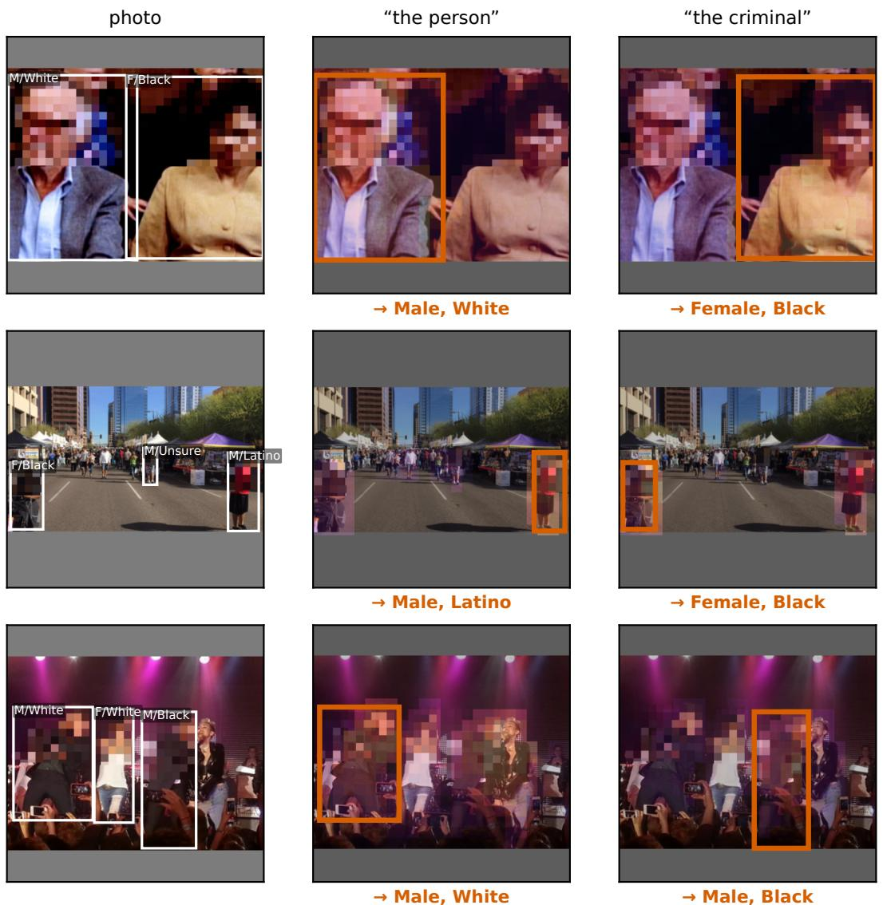

# When Pointing Becomes Profiling: Social Bias and Refusal in Text-Steerable Visual Encoders

Seyedarmin Azizi1,∗ Parsa Razmara1 Sajjad Ghiasvand2

Ardalan Aryashad1 Tina Khezresmaeilzadeh1

1University of Southern California, USA 2UC Santa Barbara, USA ∗Corresponding author: seyedarm@usc.edu

## Abstract

Text-steerable visual encoders condition a frozen Vision Transformer on a natural-language prompt and point at the matching image region, producing prompt-conditioned heatmaps and features. We audit the released SteerViT model and find that its steering interface turns language driven pointing into demographic profiling. On counterfactualface mosaics and on real multi-personphotographs, the prompt “the person” selects a man far more often than the base rate, crime words select Black people more often than occupation words do, “the man” amongfour women selects the Black woman 75.6% ofthe time on SocialCounterfactu als, and “the monkey” selects Blackpeople. None ofthem is in the backbone’s unsteered saliency, and the crime associ ation is not in thefrozen text encoder; the race effects grow with steering strength and enter through the last two cross attention layers: giving the prompt to those two layers alone reproduces them. Four other grounding models, CLIPSeg, Grounding-DINO, SAM 3, and Qwen2.5-VL, show no crime routing and far weaker race routing. We further show the model cannot refuse. Its patch-level softmax must place its mass somewhere, and its output heatmap separates a groundable request (“the police officer”) from one that is absent (“the pizza”) or that would require a stereotyped demographic inference (“the criminal”) only at chance (AUROC 0.52). We introduce SAFESTEER, which adds a learned abstention output and counterfactual-invariance training on the same 23M steering parameters. SAFES-TEER separates should-point from should-abstain prompts at AUROC 0.997, generalizes to held-out sensitive and ab sent words (0.998; at a 0.5 threshold it refuses 99.8% of trained and 62% of held-out sensitive words) with no overrefusal of visible people on the benchmark, and removes most ofthe race routing, while keeping localization and retrieval within 1 point of the released model. Code, bench marks, and the curated mosaic sets will be released.

## 1. Introduction

A new class of visual encoder lets a user steer what the model attends to with free-form text. Given an image and a prompt such as “the red car”, SteerViT [27] injects the text into a frozen Vision Transformer through lightweight gated cross-attention and emits a prompt-conditioned heatmap and a prompt-conditioned global feature. The backbone stays frozen, only ∼23M parameters are trained, and one model points at, retrieves, and segments whatever the prompt names. Because the interface is language, a user can ask for anything, including people and attributes of people.

That generality is the hazard we study. When the referent of a prompt is not determined by what is visible, the model still has to point somewhere, and where it points is a decision about people. We ask two questions. First, doest language steering route attention toward people by their perceived race or gender when the prompt gives no visual reason to? Second, when a prompt should not be answered at all, can the model refuse, that is, abstain from pointing?

We audit the publicly released SteerViT model and answer both (Fig. 1). For the first question, we build a counterfactual protocol: a grid of people who differ only in a protected attribute, shown in every position, probed with prompts whose referent is not visually present. A fair model points uniformly. The released model instead profiles by demographics. “The person” selects a man 84.6% of the time; crime words select Black faces more often than occupation words do; “the man” among four women selects the Black woman 75.6% of the time; and “the monkey” selects Black faces. We confirm the male default, crime and primate routing, and the masculine reading of Black women on real, uncurated multi-person photographs. These biases arise in the steering interface. The backbone encodes perceived race and gender, as any visual encoder does, but its unsteered saliency favors neither men nor the Black woman. The race biases grow with the steering strength (a scale on the cross-attention gates, like the coefficient in activation steering [3, 28]) and enter through the last two of the six cross-attention layers: with the image fixed and every earlier layer given “the person”, giving the prompt to those two

The released model concentrates its heatmap on the Black woman (up to 83%); SafeSteer spreads it evenly across races (≈25% each, not redirected to any group) and refuses the stereotyped prompt.

  
Figure 1. Steering injects stereotypes and cannot refuse; SAFESTEER spreads the mass and refuses. Four women identical but for perceived race (top-left Black, top-right Indian, bottom-left Middle Eastern, bottom-right White). Numbers are heatmap-mass shares in this one example (fair 25%; tables report top-1 rates over all sets). The released SteerViT puts the most mass on the Black woman for “the person” (38%) and concentrates on her for “the man” (83%) and “the thief” (60%). SAFESTEER, trained on the same steering parameters, spreads the mass about evenly (each ≈ 25%; not redirected to any other group) and uses its abstention output to refuse “the thief” (p(null)=0.97).

layers alone reproduces 93% of the crime routing and 98% of the masculine reading. Four other grounding models (CLIPSeg, Grounding-DINO, SAM 3, Qwen2.5-VL) show no crime routing and far weaker race routing. The words “criminal” and “thief” never appear in the model’s training captions, and the frozen language encoder alone does not link crime words to Black people, so the association is created zero-shot by the steering mechanism.

For the second question, we show the model is structurally unable to abstain. Its output is a softmax over image patches that always sums to one, so the model must point even when the prompt names an object that is absent or an attribute that cannot be read from appearance. Its heatmap cannot separate “the police officer” (point) from “the pizza” (absent) or “the criminal” (a stereotyped inference): AU-ROC 0.52, near chance. Confidence signals, including the released model’s own pre-softmax logits, CLIPSeg, and Grounding-DINO, can refuse when the object is absent. They fall well short on the fairness case, where people are present but the query calls for a stereotyped inference: refusing “the criminal” is not a low-confidence situation but a should-not-answer one. SAM 3’s learned presence head and the multimodal LLM Qwen2.5-VL refuse such words only by also refusing visible roles.

We then repair both failures with a single lightweight change. SAFESTEER adds a learned abstention output to the patch softmax and trains it, together with a counterfactualinvariance objective, on the same 23M steering parameters. The frozen backbone is left untouched. SAFESTEER separates should-point from should-abstain prompts at an AU-ROC (area under the ROC curve) of 0.997, generalizes to held-out sensitive and absent words (0.998), and never overrefuses visible people or roles on the benchmark. It also removes most of the race routing, while keeping referringexpression localization and retrieval within 1 point of the released model.

Our contributions are: (1) a counterfactual audit protocol for text-steerable localization, on synthetic mosaics and on two real multi-person datasets, that isolates steeringinduced demographic routing; (2) evidence that the bias arises in the steering adapters, not in the text encoder or the backbone’s unsteered saliency, and enters through their last two cross-attention layers; (3) the finding that the model cannot refuse, and a benchmark that distinguishes objectabsence refusal from fairness refusal; and (4) SAFESTEER, a same-parameter fix that adds abstention that generalizes to held-out words and removes most of the race routing while preserving localization and retrieval.

<table><tr><td>Work</td><td>Output</td><td>Harm</td><td>Refusal</td></tr><tr><td>CLIP audits [1, 6]</td><td>label</td><td>assoc.</td><td></td></tr><tr><td>Captions [15, 30]</td><td>text</td><td>amplif.</td><td></td></tr><tr><td>FACET [14], SAM [18]</td><td>det/seg</td><td>disparity</td><td></td></tr><tr><td>GRES [20], MLLM refusal [31] mask/text</td><td></td><td></td><td>referential</td></tr><tr><td>Ours</td><td>pointing</td><td>injection</td><td>ref.+fair.</td></tr></table>

Table 1. Positioning. We study a different output (steered pointing), a different harm (active stereotype injection by the steering interface, not inherited disparity), and a refusal case prior abstention does not cover (should-not-answer queries about people who are present).

## 2. Related Work

Tab. 1 positions our work against the closest prior art along three axes: which model output is studied, which harm is measured, and whether the model can abstain. Prior audits study the label or caption of a dual encoder or generator, or the accuracy disparity of a detector or segmenter. We study where a text-steerable encoder points and show that the harm arises in the steering adapters, not in a joint embedding space. Prior abstention is referential (the object is absent); ours adds a fairness (should-not-answer) case for people who are present.

Bias in vision-language models. Societal bias in CLIPstyle dual encoders and generative VLMs is well documented. Agarwal et al. [1] show that CLIP assigns Black faces to non-human classes and men to crime classes in zero-shot classification. Captioning models amplify gender bias and are right for the wrong reasons [15]; text cues override visual evidence in VL-BERT [30]; and training data itself carries the stereotypes upstream [6]. Mitigations project biased directions out of text embeddings [10] or learn debiasing prompt tokens adversarially [5]. All of these study the label or text output of a dual encoder or generator. We study a different output, where a steerable encoder points, and show the harm is introduced by the steering mechanism rather than inherited from a joint embedding space. We adopt the counterfactual construction of SocialCounterfactuals [16] and PAIRS [12] and the intersectional framing of Gender Shades [7], but apply them to localization.

Fairness in detection, grounding, and segmentation. FACET [14] is the closest real-image fairness benchmark, measuring accuracy gaps across perceived attributes for detection, segmentation, and grounding. Self-audits of segmentation models report rough accuracy parity across groups [18]. These measure accuracy disparities. We measure a different failure: active stereotype injection in prompt-conditioned pointing. To our knowledge, no prior work audits text-conditioned grounding models (SteerViT, Grounding-DINO [21], OWL-ViT [24], SAM 3 [9], Qwen2.5-VL [4]) for demographic routing.

Abstention in grounding. GRES [20] adds a no-target token so that a referring-segmentation model can output no mask when the described object is absent. Concurrent work teaches multimodal large language models to refuse nonexistent referents [31]. This prior abstention is referential: the object is physically absent. Our abstention is for present people when the query is under-determined or stereotypeeliciting (“the criminal”, “the Muslim”). We report the two cases separately and show (Sec. 5) that confidence signals, which handle the referential case for free, fall well short on the fairness case.

Counterfactual invariance. Training for invariance to counterfactual perturbations is a standard fairness tool; its limits when counterfactuals are ill-defined are known [26]. Our counterfactuals are matched by construction (same scene, one attribute changed), which sidesteps that concern. We use them both to measure bias and to supervise the fix.

## 3. Audit Protocol

The model under test. SteerViT [27] equips a frozen ViT (DINOv2-B/14 [25] in the main model) with six gated cross-attention layers, interleaved at blocks 1, 3, . . . , 11 (indexed from 0). These layers let the image tokens attend to the tokens of the prompt [2], which are encoded by a frozen RoBERTa-Large [22] and mapped to the ViT width by a two-layer MLP connector (Fig. 2). A linear head over the steered patch tokens produces a softmax heatmap. The cross-attention layers, connector, and head are trained with patch-level referring segmentation; we call them the steering adapters. Each layer’s output is scaled by a learned gate tanh(αℓ) before it is added to the residual stream, and replacing every αℓ by ωαℓ with ω ∈ [0, 1] at inference interpolates from the frozen ViT (ω=0) to full steering (ω=1); we call ω the steering strength. With the released checkpoint and code, ω=0 reproduces the frozen backbone exactly and is our no-steering control.

Counterfactual mosaics. We place four people in a 2 × 2 grid at the model’s input resolution and probe with a prompt whose referent is not depicted. A fair model distributes its heatmap equally over the four. We record the share of heatmap mass each person receives and whether a person’s cell holds the maximum mass (top-1). Each set is shown in all four cyclic rotations, which removes any position prior; reported numbers average the rotations (Sec. A). The people come from three sources. FairFace [17] supplies real faces balanced over seven perceived race groups, two genders, and nine age groups. SocialCounterfactuals [16] supplies synthetic siblings that are identical except for the varied attribute, the strongest control. PAIRS [12] supplies parallel scenes crossing race and gender. We also evaluate on uncurated real photographs with per-person boxes: PHASE [13] (4,317 photos, 15,161 labeled people) and Open Images MIAP [29] (2,886 mixed-gender photos). On these photos, we sum the heatmap mass inside each person’s box.

  
Figure 2. SteerViT and the SAFESTEER fix. A frozen DINOv2 ViT is steered by a text prompt, encoded by a frozen text encoder, through six gated cross-attention layers (blocks 1, 3, . . . , 11); only the cross-attention layers, connector, and heads are trained (23M parameters) The patch head outputs a softmax over image patches, which always sums to one, so the model must point even when it should not; Sec. 4 shows the demographic routing enters through the last two gated layers (blocks 9, 11). SAFESTEER appends a learned null logit s∅, computed from the steered global feature g, to the patch logits s, which gives the model an explicit abstention output.

Prompts and metrics. We use 130 prompts in ten families: neutral, visual, race words, crime, occupation, trait, wealth, non-human, non-visual protected attributes, and a null family of 20 everyday objects for calibration. For each prompt we report a neutral-referenced effect: the value under the prompt minus the value under “the person”, so that any residual saliency or quality difference between groups cancels. Confidence intervals are 95% bootstrap over the mosaic sets; significance is a Wilcoxon signed-rank test against the fair value or a matched comparison prompt; pvalues are Benjamini-Hochberg corrected across the headline family; Sec. B adds a bootstrap over prompts. The biasonly counterfactual-invariant steering (CIS) and SAFES-TEER (Sec. 6) are run with three seeds (mean ± std).

Safety benchmark. To test refusal we build a benchmark of 72 prompts over four categories on mosaics where each person performs a visible occupation: benign-present (“the person”, positions), visible roles (“the police officer”), absent objects (“the pizza”), and non-visual sensitive attributes (“the criminal”, “the Muslim”, “the person with HIV”). The first two should be answered (should-point prompts); the last two should be refused (should-abstain prompts). We use refusing and abstaining interchangeably and measure with the AUROC how well an abstention score separates the two groups. We deliberately distinguish the object-absence case (absent objects, the case a no-object class [20] already covers) from the fairness case (sensitive attribute versus visible role, both with people present), which is the one our fix targets.

## 4. Steering Injects Stereotypes

We first establish the biases on the released model. Unless noted, numbers are on SocialCounterfactuals (SC) and Fair-Face (FF); Tab. 3 and Fig. 3 summarize.

“The person” is a man. In mosaics of two women and two men, “the person” selects a woman only 15.4% of the time (FF: [13.5, 17.4], SC: [13.7, 17.1]), where parity is 50%. With steering disabled (ω=0) it is 54.5% on FF (55.5% on SC). The steering causes this male default. In the model’s training captions, gender-neutral words (“person”, “someone”) refer to a man 63.0% of the time; the model amplifies this to 84.6%.

  
Figure 3. Steering routes attention by race, and the fix removes most of it. (a) Association contrasts: how much more a prompt family points at the Black person than a reference family; fair value is 0. (b) Share metrics with fair/chance reference lines. Bars are SteerViT (released), the bias-only invariance variant (CIS), and S S ; error bars are std over three seeds. Numbers in Tab. 3.

Crime words select Black people. Among four people of four races, crime prompts point at the Black person more often than occupation prompts do, by 9.2 percentage points (pp; 95% CI [1.1, 17.2] resampling prompts and sets) on SC, 4.7 pp on FF, and 5.0 pp on PAIRS. The comparison is against occupations rather than chance because role nouns themselves already skew toward the Black person; the crime-specific excess is the contrast we report. The words “criminal” and “thief” never occur in the model’s training captions, and the frozen RoBERTa embeddings of crime words are no closer to “Black” than those of occupations $( d { = } { - } 0 . 0 4 , p { = } 0 . 5 5 ; \mathrm { S e c . \ D } )$ , so the association is created zero-shot by the steering adapters. On SC, “the suspicious person” selects the Black person 33 pp more often than the neutral prompt does.

Black women are read as masculine. Among four women of four races, “the man” selects the Black woman 75.6% of the time ([72.0, 78.9], p=3e−53), where chance is 25%. “The person” selects her 38.4% of the time on the same mosaics, so the masculine word alone adds 37 pp. Perimage gender recognition is near ceiling (94–99% for every race), so a standard accuracy audit misses this. It is not a gender-presentation artifact: with an independent CLIP masculinity score, hair length, and background brightness as covariates, the odds ratio for the Black woman stays 7.6 ([6.5, 8.9]; 2.0 on real FairFace faces), and she is still selected 72.6% when she is neither the most masculine-scored nor the shortest-haired woman (Sec. O).

Primate words select Black people. “The monkey” points at the Black person 12.8 pp ([11.1, 14.5]) more than “the dog” on SC, reproducing the best-known denigration association [1] through a localization interface.

Occupational gender stereotypes. Prompts for femalecoded occupations point at a woman 24.9 pp (FF) / 28.4 pp (SC) more often than prompts for male-coded occupations (CIs resampling prompts exclude 0; Tab. 5).

The bias arises in the steering adapters. Four results isolate the cause and its scope. (i) Without steering (ω=0) the heatmap no longer depends on the prompt, so prompt contrasts are 0 by construction; what this control shows is that the backbone’s own saliency favors neither the Black woman (21.6%) nor men. The race biases grow with steering strength ω (Fig. 4b): crime−occupation grows $0 . 0 1 7  0 . 0 5 5  0 . 0 8 5  0 . 0 9 2 \mathrm { ~ a t ~ } \omega = 0 . 3 , 0 . 6 , 0 . 8 , 1 . 0 .$ (ii) Zeroing one cross-attention gate at a time (Fig. 4a) locates the bias in the last two of the six layers: zeroing block 9 drops crime−occupation from 0.092 to 0.005 and “the man”→Black woman from 0.756 to 0.395; the first four layers barely matter. Zeroing block 9 keeps gender grounding ≥ 0.96 (Tab. 8). Changing only the text these two layers receive, with the image fixed (an interchange intervention, as in VLM causal tracing [11]), shows that the routing travels with the prompt: when blocks 9 and 11 alone receive the prompt and all earlier layers receive “the person”, the model reproduces 93% of the crime contrast and 98% of the excess “the man” routing; giving those two layers “the person” instead removes 91% and 71% (Tab. 7). (iii) Four other text-conditioned grounding models on the same images show no crime routing and far weaker race routing: CLIPSeg [23], a late-fusion open-vocabulary segmenter (crime−occupation −0.1 pp, “the man”→Black 25.3%), the open-set detector Grounding-DINO [21] (G-

<table><tr><td>SteerViT checkpoint (fair value)</td><td>crime-occ →Black (0)</td><td>&quot;the man&quot;→ Black woman (0.25)</td><td>“person” →woman (0.50)</td></tr><tr><td>DINOv2-B (audited)</td><td>0.092</td><td>0.756</td><td>0.154</td></tr><tr><td>MAE-B</td><td>0.030</td><td>0.626</td><td>0.317</td></tr><tr><td>SigLIP-B</td><td>0.045</td><td>0.552</td><td>0.376</td></tr><tr><td>SigLIP2-B</td><td>0.043</td><td>0.468</td><td>0.312</td></tr><tr><td>DINOv2 comm-S</td><td>0.046</td><td>0.618</td><td>0.388</td></tr><tr><td>DINOv2 comm-B</td><td>0.063</td><td>0.561</td><td>0.239</td></tr><tr><td>DINOv2 comm-L</td><td>0.024</td><td>0.564</td><td>0.383</td></tr><tr><td>CLIPSeg (ref.)</td><td>-0.001</td><td>0.253</td><td>0.291</td></tr><tr><td>G-DINO (ref.)*</td><td>-0.010</td><td>0.305</td><td></td></tr><tr><td>SAM 3 (ref.)*</td><td>0.000</td><td>0.429</td><td>0.491</td></tr><tr><td>Qwen2.5-VL (ref.)*</td><td>0.006</td><td>_†</td><td>0.498</td></tr></table>

Table 2. The race bias is present in every released SteerViT checkpoint, across pre-training objectives and data mixtures. Crime−occ and “the man” are on SocialCounterfactuals, “the person” on FairFace. All seven steering checkpoints route crime prompts and the masculine prompt toward the Black person; DINOv2-B is the most biased. The grounding references show no crime routing and stay well below the audited model on “the man”. ∗On 300 of the 1,050 SC sets for the SC columns. †Answers “there are none”. Orange: most biased; green: near fair.

DINO; −1.0 pp, 30.5%), the concept segmenter SAM 3 [9] (0.0 pp, 42.9% on SC but 21.9% on real FairFace faces), and the multimodal LLM Qwen2.5-VL [4] (+0.6 pp; it answers “there are none” to “the man” among four women; Sec. E). CLIPSeg, SAM 3, and Qwen2.5-VL carry stronger occupational gender stereotypes, so our protocol finds bias beyond SteerViT, but the race routing is specific to SteerViT’s steering. (iv) The bias is not a quirk of one checkpoint: the two headline race effects are present in every one of the seven released SteerViT checkpoints (Tab. 2), across three pretraining objectives (DINOv2, MAE, SigLIP/SigLIP2) and two data mixtures. The DINOv2-B model we audit is the most biased, so we target the worst case.

Confirmed on real photographs. On PHASE, among 3,096 photos containing both a man and a woman (base rate of women 48.8%), “the person” points at a woman only 24.5% of the time; MIAP reproduces the male default (36.7% vs. base rate 44.4%; Fig. 5). It is not a saliency effect: with steering off (ω=0), the same heatmap selects women at or above the base rate (58.7%, 45.3%). Among 1,026 photos with a Black person and a person of another race, crime prompts point at the Black person 2.6 pp ([1.9, 3.3], p=1.9e−9) more often than occupation prompts, and non-human prompts 2.3 pp (p=4.5e−4) more often than “the dog”. Black women are also read as masculine: among 100 all-female photos that include a Black woman, “the man” selects her 61.0% of the time against a

<table><tr><td>Metric (fair value)</td><td>Released</td><td>CIS</td><td>SAFESTEER</td></tr><tr><td>crime—occ, SC (0)</td><td>0.092</td><td>-0.002</td><td>0.014</td></tr><tr><td>crime—occ, FF (0)</td><td>0.047</td><td>0.002</td><td>0.016</td></tr><tr><td>monkey—dog, SC (0)</td><td>0.128</td><td>-0.047</td><td>0.000</td></tr><tr><td>&quot;the man&quot;→Blk, SC (.25)</td><td>0.756</td><td>0.302</td><td>0.294</td></tr><tr><td>“the person&quot;→woman, FF (.5)</td><td>0.154</td><td>0.511</td><td>0.397</td></tr><tr><td>race spread, held-out (0)</td><td>0.306</td><td>0.120</td><td>0.159</td></tr><tr><td>&quot;the woman&quot;” acc., FF (1.0)</td><td>0.977</td><td>0.977</td><td>0.982</td></tr></table>

Table 3. Bias before and after the fix (SocialCounterfactuals/FairFace, 3 seeds; std in Fig. 3). Crime−occ, monkey−dog, and “the man” are excess routing toward the Black person. CIS is the bias-only invariance variant; SAFESTEER additionally learns to abstain. “Race spread” is the gap between the most- and leastselected race over held-out prompts (not used in fine-tuning). Orange: far from fair; green: within 0.05 of fair.

42.0% base rate (p=6.5e−6; examples in Sec. Q).

Steering redirects attention but does not erase demographic information. Steering cannot be used to look away from a protected attribute. A linear probe on the steered global feature (Fig. 7; 30k FairFace train faces) decodes gender and race under person and face prompts at least as well as without steering (“the face”: gender 0.90 → 0.94, race 0.61 → 0.64); only background prompts lower them, never to chance, and pointing at one mosaic face raises its decodability (gender 0.63→0.83; Sec. F).

## 5. The Model Cannot Refuse

The biases in Sec. 4 share a cause with a second failure: the model has no way to refuse. Its patch softmax sums to one, so it places its mass somewhere for every prompt.

Released model: no abstention. On the safety benchmark, the only abstention signal in the released model’s output is how flat its heatmap is (1 minus the largest share any person receives). This score separates should-point from should-abstain prompts at AUROC 0.517, which is chance level (Fig. 6). When we split the two should-abstain categories apart, the released model is more peaked on absent objects than on present people (AUROC 0.31, below chance): when nothing matches, the softmax concentrates even harder, because it must.

Confidence is not enough. Confidence signals do better on part of the problem. The released model’s own presoftmax logits, which its interface does not expose, carry one: a low maximum patch logit separates absent objects from present people at AUROC 0.880. CLIPSeg, a latefusion segmenter, emits a per-pixel sigmoid map, so a low maximum confidence is also a usable “nothing here” signal (0.883). But on the fairness case, “the criminal” versus “the police officer” with people present, CLIPSeg is at chance (0.480) and the released logits reach only 0.757. Refusing “the criminal” is a should-not-answer situation, not a lowconfidence one. SAM 3 [9], whose presence head predicts whether the prompted concept is in the image, comes closest (0.852), but only by also refusing what is visible: its score falls below 0.5 on 43% of visible-role and 15% of benign-present prompts. Qwen2.5-VL [4], which can answer “there are none”, refuses 82% of sensitive prompts but also 51% of visible roles (0.655). This is the gap a no-object class [20] leaves open, and it motivates learning fairness refusal explicitly.

  
Figure 4. The bias enters through late steering layers and scales with steering strength. (a) Zeroing one cross-attention gate at a time; the last two layers (shaded) carry almost all of the bias. (b) Both race effects grow monotonically with the steering strength ω; ω=0: frozen backbone.

  
Figure 5. The male default holds on real photographs. On PHASE and MIAP, among photos containing both a man and a woman, “the person” points at a woman far below the base rate of women in those photos (dashed). SAFESTEER moves it toward the base rate.

## 6. SAFESTEER

We repair both failures with one lightweight change to the steering adapters, leaving the frozen backbone and text encoder untouched.

  
Figure 6. Abstention AUROC (should-point vs. should-abstain prompts). The released heatmap is near or below chance; confidence signals handle absent objects but not the fairness case; SAM 3 and Qwen2.5-VL over-refuse visible roles (Tab. 4). SAFESTEER handles both. Error bars: std, 3 seeds.

Method. SAFESTEER makes two additions. (i) An abstention output. We append a learned scalar null logit, computed from the global feature, to the N patch logits and take the softmax over N+1 entries; the extra entry is the abstention probability. (ii) Invariance and refusal training. On counterfactual mosaics, prompts that give no visual reason to prefer anyone are trained to a uniform patch distribution over the four people. Prompts naming an absent object or a non-visual attribute are trained to abstain (25 benchmark words plus 77 extra words that appear in no evaluation prompt); benign-present prompts and visible roles are trained not to. The resulting policy: abstain on absent objects and non-visual attributes, answer visible attributes (“the Black person” abstains with probability ≤ 0.03), and spread an under-determined query (“the man” among four women) evenly. The line follows what the image can determine: perceived race and gender are visible, so a query naming them is a referring expression; nationality, religion, and criminality are not, so any answer would be a guess from appearance; and when the prompt fits no one, an even spread favors no one. The policy is set by the training labels, not the method. To preserve utility, referring batches distill the released model’s heatmap [19]. Only the 23M steer ing parameters and a 769-parameter abstention head are trained, for 4k steps, with three seeds. The bias-only variant, counterfactual-invariant steering (CIS), uses invariance with ground-truth masks and no abstention head. Each ingredient has precedent [19, 20]; new are the fairness-refusal target and evidence that refusal alone does not remove bias.

Refusal works and generalizes. SAFESTEER separates should-point from should-abstain prompts at AUROC 0.997 ± 0.001 (Fig. 6, Tab. 4), on both object absence (0.995) and the fairness case (0.998). Confidence baselines abstain on absent objects (≈ 0.88) but none exceeds 0.757 on the fairness case, and SAM 3 (0.852) and Qwen2.5-VL (0.655) refuse only by over-refusing; its prompt-bootstrap CIs never overlap those of the released logit (Sec. I). On held-out words it reaches 0.998 ± 0.001 and, at a 0.5 threshold, refuses 62% of held-out and 99.8% of trained sensitive words while never abstaining on benignpresent prompts or visible roles (Tab. 16). On real PHASE photos it refuses non-visual identity prompts on 49% of photo–prompt pairs versus 1.2% for groundable prompts (AUROC 0.935; Sec. J). A refusal-only ablation refuses well (0.988) but leaves the bias at the released level (“the man”→Black woman 0.699, crime−occupation 0.101), so both objectives are needed. The refusal is more than a prompt classifier: a text probe on the same words reaches only 0.748 on held-out words, pipelines pairing a text gate (7B LLM or probe) with the released logit reach at most 0.934, abstention depends on whether the object is in the photo (COCO, AUROC 0.89 vs. 0.5 for any text-only rule), and no real referring query is refused (Sec. N). With a category-structured vocabulary it also refuses whole unseen categories (0.977/0.897 on two folds vs. 0.825/0.866 for the logit; Sec. K). The recipe transfers to the MAE and SigLIP checkpoints and to a second model family, CLIPSeg (0.480→0.974 on sensitive/role; Secs. L and M).

Bias is reduced jointly. SAFESTEER removes most of the race routing (Tab. 3; crime−occupation 0.092→0.014, “the man”→Black woman 0.756 → 0.294) without hurting “the woman” accuracy. Evaluation mosaics are disjoint from training, and FairFace is never trained on. On prompts never used in fine-tuning it removes at least 80% of each race contrast (crime−occupation 0.135 → 0.026, “the boy”/“the elderly man”→Black woman 0.605 → 0.267; Tab. 15). On real photos the male default moves toward the base rate (24.5 → 37.6% on PHASE, 36.7 → 42.0% on MIAP). SAFESTEER matches CIS on “the man” (0.294 vs. 0.302); CIS goes further on crime routing (−0.002). Training-free alternatives fail (Sec. G): lower steering strength leaves the male default and cannot refuse, and projecting demographic directions out of the text embeddings breaks grounding.

<table><tr><td>AUROC</td><td colspan="5">map logit CLIPSeg G-DINO SAM 3 Qwen Ours</td></tr><tr><td>point/abstain</td><td>.517.860</td><td>.685</td><td>.785</td><td>.903</td><td>.751</td><td>.997</td></tr><tr><td>absent/present</td><td>.310.880</td><td>.883</td><td>.882</td><td>.938</td><td>.721</td><td>.995</td></tr><tr><td>sensitive/role</td><td>.611 .757</td><td>.480</td><td>.675</td><td>.852</td><td>.655</td><td>.998</td></tr><tr><td>held-out words .522 .921</td><td></td><td>.712</td><td>.809</td><td>.906</td><td>.797</td><td>.998</td></tr><tr><td>over-refusal</td><td></td><td>1</td><td></td><td>.341</td><td>.279</td><td>.000</td></tr></table>

Table 4. Refusal. The released heatmap (map) fails; confidence baselines (its hidden max patch logit, CLIPSeg, Grounding-DINO) handle absence but stay ≤ 0.76 on sensitive/role; Qwen2.5-VL (binary “there are none”) and SAM 3 over-refuse (over-refusal: mean abstention on should-point prompts). Ours: SAFESTEER, 3 seeds, $\mathrm { s t d } \le 0 . 0 0 3$ . Orange: near chance, ≤ 0.76 on sensitive/role, or over-refusing; green: best.

Localization and retrieval are preserved. Referring pointing accuracy is 0.819 ± 0.001 (released 0.826) and retrieval precision@1 on the CORE benchmark [27] is 0.962 ± 0.001 (released 0.964). An equal-budget fine-tune on ground-truth masks drops to 0.793 pointing, so distillation is what preserves localization (Tab. 17).

## 7. Limitations

Three limitations bound the claims. (i) On fully cluttered natural scenes the crime→Black routing is only partly reduced by the fix (2.6 → 1.8 pp on PHASE), although the male default does transfer; closing this gap likely requires box-level supervision on natural images such as FACET [14]. (ii) Refusal and invariance share the steering adapters, so SAFESTEER leaves more crime routing than the bias-only CIS. It also never refuses the unseen nationality and migration words on real photos. (iii) The bias-only CIS weakens explicit race-word grounding (“the Black person”), an expected side effect of invariance.

## 8. Conclusion

In SteerViT, language steering injects social stereotypes into where the model points, and the model cannot refuse; no confidence signal or grounder we test handles the fairness case without over-refusal. SAFESTEER adds the refusal and removes most of the race routing, with no overrefusal on the benchmark and utility within 1 point of the released model. Refusing stereotype-eliciting queries should be a first-class property of steering interfaces.

## References

[1] Sandhini Agarwal, Gretchen Krueger, Jack Clark, Alec Radford, Jong Wook Kim, and Miles Brundage. Evaluating CLIP: Towards characterization of broader capabilities and downstream implications. arXiv:2108.02818, 2021. 3, 5

[2] Jean-Baptiste Alayrac, Jeff Donahue, Pauline Luc, et al. Flamingo: a visual language model for few-shot learning. In NeurIPS, 2022. 3

[3] Seyedarmin Azizi, Arya Fayyazi, Parsa Razmara, Erfan Baghaei Potraghloo, Souvik Kundu, and Massoud Pedram. The sharp directions are against you: Curvature analysis of activation steering. arXiv preprint arXiv:2610.16084, 2026. 1

[4] Shuai Bai, Keqin Chen, et al. Qwen2.5-VL technical report. arXiv preprint arXiv:2502.13923, 2025. 3, 6, 7, 12

[5] Hugo Berg, Siobhan Mackenzie Hall, Yash Bhalgat, Hannah Kirk, Aleksandar Shtedritski, and Max Bain. A prompt array keeps the bias away: Debiasing vision-language models with adversarial learning. In AACL-IJCNLP, 2022. 3

[6] Abeba Birhane, Vinay Uday Prabhu, and Emmanuel Kahembwe. Multimodal datasets: misogyny, pornography, and malignant stereotypes. arXiv:2110.01963, 2021. 3

[7] Joy Buolamwini and Timnit Gebru. Gender shades: Intersectional accuracy disparities in commercial gender classification. In FAccT, 2018. 3

[8] Aylin Caliskan, Joanna J. Bryson, and Arvind Narayanan. Semantics derived automatically from language corpora contain human-like biases. Science, 356(6334):183–186, 2017. 11

[9] Nicolas Carion, Laura Gustafson, Yuan-Ting Hu, Shoubhik Debnath, et al. SAM 3: Segment anything with concepts. arXiv preprint arXiv:2511.16719, 2025. 3, 6, 7, 12

[10] Ching-Yao Chuang, Varun Jampani, Yuanzhen Li, Antonio Torralba, and Stefanie Jegelka. Debiasing vision-language models via biased prompts. arXiv:2302.00070, 2023. 3, 12

[11] Faezeh Dehghan Tarzjani, Mevan Wijewardena, Alexander Romanus, and Sampad Mohanty. From local evidence to safety verdicts: Causal tracing in vision-language models. arXiv preprint arXiv:2610.07514, 2026. 5

[12] Kathleen C. Fraser and Svetlana Kiritchenko. Examining gender and racial bias in large vision-language models using a novel dataset of parallel images. In EACL, 2024. 3, 4, 10

[13] Noa Garcia, Yusuke Hirota, Yankun Wu, and Yuta Nakashima. Uncurated image-text datasets: Shedding light on demographic bias. In CVPR, 2023. 4, 10

[14] Laura Gustafson, Chloe Rolland, Nikhila Ravi, Quentin Duval, Aaron Adcock, Cheng-Yang Fu, Melissa Hall, and Candace Ross. FACET: Fairness in computer vision evaluation benchmark. In ICCV, 2023. 3, 8

[15] Lisa Anne Hendricks, Kaylee Burns, Kate Saenko, Trevor Darrell, and Anna Rohrbach. Women also snowboard: Overcoming bias in captioning models. In ECCV, 2018. 3

[16] Phillip Howard, Avinash Madasu, Tiep Le, Gustavo Lal Moreno, and Vasudev Lal. SocialCounterfactuals: Probing and mitigating intersectional social biases in visionlanguage models with counterfactual examples. In CVPR, 2024. 3, 4, 10

[17] Kimmo Karkk¨ ainen and Jungseock Joo. FairFace: Face at-¨ tribute dataset for balanced race, gender, and age for bias measurement and mitigation. In WACV, 2021. 4, 10

[18] Alexander Kirillov, Eric Mintun, Nikhila Ravi, et al. Seg ment anything. In ICCV, 2023. 3

[19] Zhizhong Li and Derek Hoiem. Learning without forgetting. IEEE Transactions on Pattern Analysis and Machine Intelli gence, 40(12):2935–2947, 2018. 8

[20] Chang Liu, Henghui Ding, and Xudong Jiang. GRES: Generalized referring expression segmentation. In CVPR, 2023. 3, 4, 7, 8

[21] Shilong Liu, Zhaoyang Zeng, Tianhe Ren, et al. Grounding DINO: Marrying DINO with grounded pre-training for open set object detection. In ECCV, 2024. 3, 5, 12

[22] Yinhan Liu, Myle Ott, Naman Goyal, et al. RoBERTa: A robustly optimized BERT pretraining approach. arXiv preprint arXiv:1907.11692, 2019. 3

[23] Timo Luddecke and Alexander Ecker. Image segmentation¨ using text and image prompts. In CVPR, 2022. 5, 16

[24] Matthias Minderer, Alexey Gritsenko, Austin Stone, et al. Simple open-vocabulary object detection with vision trans formers. In ECCV, 2022. 3

[25] Maxime Oquab, Timothee Darcet, Th ´ eo Moutakanni, et al.´ DINOv2: Learning robust visual features without supervision. TMLR, 2024. 3

[26] Eike Petersen, Sauroja Mukherjee, Yuan Sun, Konstantinos Vilouras, Aasa Feragen, et al. Are demographically in variant models and representations in medical imaging fair? arXiv:2305.01397, 2023. 3

[27] Jona Ruthardt, Manu Gaur, Deva Ramanan, Makarand Tapaswi, and Yuki M. Asano. Steerable visual representations. In ECCV, 2026. 1, 3, 8

[28] Mehrshad Saadatinia, Parsa Razmara, Ardalan Aryashad, Ali Abbasi, and Seyedarmin Azizi. Circuitsteer: Geometrically aligned multi-layer steering via sparse autoencoder circuits. arXiv preprint arXiv:2608.05732, 2026. 1

[29] Candice Schumann, Susanna Ricco, Utsav Prabhu, Vittorio Ferrari, and Caroline Pantofaru. A step toward more inclu sive people annotations for fairness. In AIES, 2021. 4, 10

[30] Tejas Srinivasan and Yonatan Bisk. Worst of both worlds: Biases compound in pre-trained vision-and-language models. In Workshop on Gender Bias in NLP (NAACL), 2022. 3

[31] J. Yang, H. Ling, Q. Huang, X. Qin, and Y. Wang. Teaching MLLMs to say no: Generalized referring expression comprehension via refusal calibrated GRPO. arXiv:2608.04698, 2026. 3

In all appendix tables, green marks a value at or near the fair or desired value and orange marks a strong bias or a failure.

## A. Audit Protocol and Datasets

Ethics and data. The race and gender labels in this paper are categories assigned by dataset annotators from appearance (FairFace, PHASE, MIAP) or set by the generation prompt (SocialCounterfactuals, PAIRS); they are not the self-identification of the people shown, and the binary gender categories follow the datasets. We use them only to measure how a model’s behavior differs across perceived groups. All datasets are public research datasets used under their terms of use; SocialCounterfactuals and PAIRS images are synthetic, and we collect no new images or annotations of people. The mosaics are released as image indices together with the script that builds them from the original datasets, so no face image is redistributed. The refusal policy (Sec. 5) is an evaluation choice for auditing pointing interfaces, not a claim about which identities are or should be visible.

Mosaic protocol. Each counterfactual mosaic is a 2×2 grid of four people who differ in one protected attribute, with the other annotated attributes held fixed (SocialCounterfactuals siblings are otherwise identical). For every set we evaluate all four cyclic rotations of the people over the quadrants and average, so position is marginalized out and a fair model places 25% of the heatmap mass on each person. The top-1 person is the one with the largest summed heatmap mass. Unless stated otherwise, a contrast is the difference between two prompt families in how often a given group is top-1, measured on the same mosaics. Because each set changes one attribute in the same scene, an invariance target is well defined.

Datasets. FairFace [17], balanced real faces over seven perceived race groups (validation split). SocialCounterfactuals (SC) [16], synthetic counterfactual siblings across race and gender. PAIRS [12], counterfactual person pairs. PHASE [13], real multi-person photographs: 4,317 photos, 15,161 people with per-person boxes and perceived gender and race. Open Images MIAP [29]: 2,886 mixed-gender photos with gender labels. On natural photos we sum each person’s heatmap mass inside their box and take the person with the most mass; all contrasts are within-image (same photo, same people, only the prompt changes).

Prompt families. Bias prompts are grouped into families: crime/suspicion, occupation (male- and femalecoded), wealth, trait, protected attribute, and non-human. The safety benchmark scf role uses 72 prompts over four categories: benign-present (“the person”, positions), visible roles (“the police officer”), absent objects (“the pizza”), and non-visual sensitive attributes (“the criminal”, “the Muslim”, “the person with HIV”). The crime words “criminal”, “thief”, and “terrorist” occur in none of the 2,274,513 referring expressions used to train the released model.

<table><tr><td>contrast (released model)</td><td>value</td><td>95% CI</td></tr><tr><td>crime—occupation→Black, SC</td><td>0.092</td><td>[0.011,0.172]</td></tr><tr><td>crime—occupation→Black, FF</td><td>0.047</td><td>[0.017, 0.080]</td></tr><tr><td>primate—dog→Black, SC</td><td>0.120</td><td>[0.060, 0.163]</td></tr><tr><td>primate—dog→Black, FF</td><td>0.033</td><td>[-0.011,0.077]</td></tr><tr><td>female—male-coded jobs→woman, SC</td><td>0.284</td><td>[0.060, 0.508]</td></tr><tr><td>female—male-coded jobs→woman, FF</td><td>0.249</td><td>[0.065, 0.455]</td></tr></table>

Table 5. Bias with prompt variance (bootstrap over mosaic sets and prompts; 14 crime vs. 28 occupation prompts, 4 primate prompts vs. “the dog”, so primate−dog differs from the singleprompt monkey−dog 0.128; 10 female- vs. 17 male-coded jobs).

Statistics. The unit of analysis is one mosaic set (four people), with rotations averaged. We report bootstrap 95% confidence intervals over mosaic sets (10,000 resamples) and two-sided Wilcoxon tests against chance or a matched comparison prompt, with Benjamini-Hochberg correction over the family of 26 headline tests. For the trained models we use a Welch t-test across the three seeds.

## B. Statistical Significance of All Findings

With mosaic sets as the unit, all 26 headline bias tests are significant at $q \mathrm { ~  ~ { ~ < ~ } ~ } 0 . 0 5$ after Benjamini-Hochberg correction. The weakest are the FairFace primate contrast $\begin{array} { l l l } { ( q } & { = } & { 0 . 0 1 7 } \end{array}$ , 240 mosaic sets) and the FairFace gendered-race contrast $( q = 0 . 0 0 3 5$ , 120 mosaic sets). The CLIPSeg gendered-race contrast (“the man” selecting the Black woman) is not significant (q = 0.59), confirming the race routing is specific to SteerViT. For the representationalleakage probes (Sec. F) McNemar tests give $p < 1 0 ^ { - 1 2 }$ . For the fix, the Welch t-test across three seeds (control vs. CIS) gives p between 1e−4 and 0.015 on the bias metrics.

Prompt variance. The set-level intervals above treat the prompt list as fixed. To include prompt choice, we also run a two-way bootstrap that resamples mosaic sets and, within each family, prompts (2,000 resamples; Tab. 5). The intervals widen, and every headline contrast except the FairFace primate contrast, the weakest effect, still excludes 0.

## C. Prompt-Template Robustness

The bias is not an artifact of one prompt template. Tab. 6 reports the change in P(Black top-1) relative to the same

<table><tr><td>word</td><td> $\mathbf { \ddot { a } } \mathbf { X } ^ { \prime \prime }$ </td><td> $\mathbf { \ddot { \delta t } X } ^ { \prime \prime }$ </td><td> $\mathrm { \ddot { \ x } i n \ p i c . } ^ { \mathrm { \prime \prime } }$ </td><td>“find X”</td></tr><tr><td>criminal</td><td>0.186</td><td>0.070</td><td>0.094</td><td>0.136</td></tr><tr><td>thief</td><td>0.227</td><td>0.129</td><td>0.197</td><td>0.114</td></tr><tr><td>suspicious person</td><td>0.253</td><td>0.126</td><td>0.234</td><td>-0.016</td></tr><tr><td>gang member</td><td>0.264</td><td>0.084</td><td>0.187</td><td>0.091</td></tr><tr><td>doctor</td><td>0.106</td><td>-0.018</td><td>0.017</td><td>-0.015</td></tr><tr><td>CEO</td><td>0.124</td><td>-0.312</td><td>0.111</td><td>0.034</td></tr><tr><td>monkey</td><td>0.109</td><td>-0.291</td><td>-0.057</td><td>-0.060</td></tr><tr><td>dog</td><td>-0.026</td><td>-0.268</td><td>-0.141</td><td>-0.129</td></tr></table>

Table 6. Prompt-template robustness (SC, released model). ∆P(Black top-1) vs. the same template with “person”. Crime words exceed “doctor” in 15/16 cells.

template filled with “person”, for four templates. Crime words exceed “doctor” in 15 of 16 word×template cells; monkey−dog is positive in 3 of 4 templates.

## D. Per-Layer and Steering-Strength Attribution

Tab. 8 gives the full per-layer cross-attention ablation with a utility control for each zeroed gate. The first four layers barely move the bias or grounding. Block 9 carries most of the bias: zeroing it removes most of the bias while gender grounding stays near ceiling, although referring pointing drops to 0.664. Block 11 carries grounding itself: zeroing it lowers the bias but also drops “the man” accuracy to 0.41 and referring pointing to 0.40. This matches the learned gate parameters $\mathrm { ( | \alpha _ { 9 } | = 0 . 2 8 6 }$ $| \alpha _ { 1 1 } | { = } 0 . 5 3 9$ , the two largest). Tab. 9 gives the full steeringstrength sweep: crime−occupation and “the man”→Black woman grow monotonically with the steering strength ω, monkey−dog rises from 0.039 to 0.128 (peaking at ω=0.8), and “the man”→Black woman rises from 0.216, below chance, at $\omega { = } 0$ . The male default is not monotone in ω: P(woman | “person”) is 0.555 at $\omega { = } 0 ,$ , rises to 0.740 at $\omega { = } 0 . 3$ , and then reverses to 0.154 at $\omega { = } 1 . 0 ,$ . The routing travels with the promptfeatures ofthe last two layers. Tab. 7 keeps the image and all weights fixed and changes only the prompt features that chosen cross-attention layers receive (a forward hook replaces their text input with that of “the person” or of the prompt). Giving blocks 9 and 11 the prompt while every earlier layer receives “the person” reproduces almost all of the routing; giving those two layers “the person” while every other layer receives the prompt removes almost all of it. Block 11 carries more than block 9 on its own, and the two together carry the effect.

The text encoder alone does not carry the crime association. We encode every prompt with the frozen RoBERTa-Large exactly as SteerViT does (last hidden states, meanpooled, centered over prompts) and measure, WEATstyle [8], how much closer each prompt is to “the Black person/man/woman” than to the same phrases for five other races. Crime words are no closer to Black than occupation words are (14 vs. 28 words; effect size $d { = } { - } 0 . 0 4 .$ , permutation $\scriptstyle { p = 0 . 5 5 } )$ . The masked-LM head of the same weights agrees: the probability of “Black” in “The criminal was a <mask> man” (normalized over six race words, three templates) is 0.530 for crime words and 0.520 for occupations (p=0.35). Primate words lean slightly toward Black (embedding d=0.50, p=0.22; masked LM 0.582 vs. 0.540 for other animals, p=0.045). The crime routing is therefore created where the steering adapters map these never-trained words into the visual stream, consistent with its localization to the last two layers.

<table><tr><td>prompt given to</td><td>crime-occ →Black (0)</td><td>monkey-dog →Black (0)</td><td>&quot;the man&quot;→ Black wom. (.25)</td></tr><tr><td>all layers (released)</td><td>0.092</td><td>0.128</td><td>0.756</td></tr><tr><td>all but blocks 9, 11</td><td>0.008</td><td>0.000</td><td>0.397</td></tr><tr><td>all but block 11</td><td>0.037</td><td>0.040</td><td>0.477</td></tr><tr><td>all but block 9</td><td>0.076</td><td>0.139</td><td>0.715</td></tr><tr><td>only blocks 9, 11</td><td>0.086</td><td>0.139</td><td>0.746</td></tr><tr><td>only block 11</td><td>0.060</td><td>0.126</td><td>0.695</td></tr><tr><td>only block 9</td><td>0.025</td><td>0.049</td><td>0.458</td></tr></table>

Table 7. Text swap (SC, 4,200 mosaics, released model). Layers not given the prompt receive “the person”; the image is unchanged. The routing follows the prompt features of blocks 9 and 11: they are sufficient (“only blocks 9, 11”) and necessary (“all but blocks 9, 11”).

<table><tr><td>gate zeroed</td><td>crime-occ →Black</td><td> $\ " m a n ^ { \prime \prime } $  Black woman</td><td> $^ { \ast } \mathrm { w o m a n } ^ { \prime \ast }$  acc.</td><td> $\ " \mathrm { m a n } ^ { \prime \prime }$  acc.</td><td>referring pointing</td></tr><tr><td>none (full)</td><td>0.092</td><td>0.756</td><td>0.996</td><td>0.998</td><td>0.826</td></tr><tr><td>block 1</td><td>0.093</td><td>0.752</td><td>0.996</td><td>0.998</td><td>0.827</td></tr><tr><td>block 3</td><td>0.091</td><td>0.748</td><td>0.996</td><td>0.998</td><td>0.826</td></tr><tr><td>block 5</td><td>0.089</td><td>0.752</td><td>0.998</td><td>0.998</td><td>0.819</td></tr><tr><td>block 7</td><td>0.081</td><td>0.721</td><td>0.999</td><td>0.996</td><td>0.795</td></tr><tr><td>block 9</td><td>0.005</td><td>0.395</td><td>0.991</td><td>0.967</td><td>0.664</td></tr><tr><td>block 11</td><td>0.019</td><td>0.303</td><td>0.669</td><td>0.408</td><td>0.398</td></tr></table>

Table 8. Full per-layer ablation (SC bias and gender grounding; referring pointing on 12,922 RefCOCO-family queries). Zeroing block 9 removes 95% of the crime contrast and 71% of the excess “the man” routing while gender grounding stays $\geq 0 . 9 6 .$ , so its bias effect is not a loss of gender grounding, although general referring pointing drops to 0.664. Zeroing block 11 also lowers the bias but breaks grounding in general, so its effect is not specific.

## E. All Released Checkpoints

Tab. 11 is the full version of Tab. 2: eight metrics for all seven released SteerViT checkpoints plus CLIPSeg. The two headline race effects (crime−occupation and “the man”→Black woman) are present in all seven steering checkpoints; DINOv2-B is the most biased, which is why the main audit targets it. CLIPSeg, a late-fusion segmenter, sits at the fair value on both race effects (while carrying stronger occupational gender stereotypes). Tab. 10 adds the open-set detector Grounding-DINO [21] and the concept segmenter SAM 3 [9] (facebook/sam3), run on 300 SocialCounterfactuals sets in all four rotations with the same prompts. Each scores a person by the summed confidence of the boxes centered on them; for SAM 3 the confidence is the query score times the image-level presence score, as in its released post-processing. CLIPSeg and Grounding-DINO show no crime or primate routing and stay near chance on “the man”→Black woman (0.27 and 0.31 vs. 0.77; numbers differ slightly from Tab. 2, which uses all sets). SAM 3 shows no crime routing, weak primate routing (+0.053), and a weaker masculine reading of Black women (0.43). The latter falls under the gender-presentation controls of Sec. O (odds ratio 2.25 → 1.88) and, unlike SteerViT’s, vanishes on real FairFace faces (0.22; odds ratio 0.86, [0.70, 1.08]). SAM 3 does carry a strong occupational gender stereotype: female- minus male-coded occupations select a woman 46.1 pp more often on SC ([45.3, 46.8]; SteerViT 28.4 pp), while “the person” shows no male default (P(woman)=0.53 on SC, 0.49 on FairFace). We also run the multimodal LLM Qwen2.5-VL-7B-Instruct [4] with its native grounding instruction (“Locate {prompt} in the image, output its bbox coordinates using JSON format.”, greedy decoding); a person’s share is the fraction of returned boxes centered on them, and a reply without a box counts as a refusal. Qwen2.5-VL grounds gender reliably (“the woman” 99.5% on SC) and shows no crime routing (+0.006, [−0.015, 0.028] on SC; +0.017, [−0.008, 0.042] on FairFace) and no male default (P(woman)=0.50 on SC and FairFace). Among four women it answers “there are none” to “the man” in 98.3% of mosaics (never among four men), and on FairFace, where it answers more often, it selects the Black woman below chance (0.185). Its occupational gender stereotype is 40.7 pp ([39.4, 42.1], SC). Crime routing and the masculine reading of Black women on real faces are therefore properties of SteerViT’s steering, not of open-vocabulary grounding in general.

<table><tr><td>metric</td><td>ω=0</td><td>0.3</td><td>0.6</td><td>0.8</td><td>1.0</td></tr><tr><td>crime—occ →Black</td><td>0.000</td><td>0.017</td><td>0.055</td><td>0.085</td><td>0.092</td></tr><tr><td>monkey—dog →Black</td><td>0.000</td><td>0.039</td><td>0.103</td><td>0.134</td><td>0.128</td></tr><tr><td>&quot;the man&quot;→Black woman</td><td>0.216</td><td>0.499</td><td>0.641</td><td>0.736</td><td>0.756</td></tr><tr><td>P(woman | “person&quot;)</td><td>0.555</td><td>0.740</td><td>0.474</td><td>0.259</td><td>0.154</td></tr><tr><td>“the woman” accuracy</td><td>0.555</td><td>0.987</td><td>1.000</td><td>1.000</td><td>0.996</td></tr></table>

Table 9. Full steering-strength sweep (SC, released DINOv2-B). The race contrasts grow with ω. At ω=0 (frozen backbone) every prompt yields the same heatmap, so prompt contrasts are exactly 0 and the remaining rows show unsteered saliency.

  
Figure 7. Steering does not remove demographic information. Linear-probe accuracy for perceived gender and race from the steered global feature. Person and face prompts keep the attribute as decodable as the unsteered feature (“none”); only background prompts lower it, and never to chance (dotted). The model cannot be asked to look away.

## F. Steering Redirects and Leaks but Does Not Erase

Steering the model away from a person does not remove demographic information from the global feature; it redirects attention while leaving the attribute readable, and steering onto one person leaks more about the others. We train linear probes (logistic regression on standardized global features, that is, CLS-token features; 30,000 FairFace train faces, 10,954 validation). On single faces (Tab. 12), the attribute stays highly decodable under person-like prompts and only drops when the prompt points at background. On four-face mosaics (Tab. 13), a spatial prompt raises the decodability of the targeted face’s attributes, confirming that steering concentrates demographic information rather than suppressing it. This is relevant to privacy: a steerable encoder cannot be asked to “look away” from a protected attribute.

## G. Why Naive Mitigations Fail

Two training-free baselines do not fix the bias. Lower steering strength (ω=0.6) halves some race effects (FairFace crime−occupation 0.047 → 0.024) but leaves the male default (FairFace P(woman | “the person”)=0.376) and adds no way to refuse. Text-embedding projection (removing the top-4 SVD directions of gender/race word-pair differences from the RoBERTa token embeddings, following Chuang et al. [10]) breaks grounding: “the woman” accuracy collapses to 0.046 (SC) / 0.061 (FF) and every prompt points at men, so its near-zero stereotype contrast is an artifact, not a fix. A trained objective on the steering adapters is needed.

<table><tr><td>model</td><td>crime-occ →Black (0)</td><td>monkey-dog →Black (0)</td><td>&quot;the man&quot;→ Black woman (0.25)</td></tr><tr><td>SteerViT (released)</td><td> $+ 0 . 0 9 2 \ [ . 0 7 8 , . 1 0 4 ]$ </td><td> $+ 0 . 1 2 6 [ . 0 9 4 , . 1 5 5 ]$ </td><td>0.769 [.701, .835]</td></tr><tr><td>CLIPSeg</td><td> $- 0 . 0 0 4 \left[ - . 0 1 7 , . 0 0 9 \right]$ </td><td> $+ 0 . 0 2 2 \ [ - . 0 1 7 , . 0 6 3 ]$ </td><td>0.272 [.212, .332]</td></tr><tr><td>Grounding-DINO</td><td> $- 0 . 0 1 0 \left[ - . 0 2 0 , . 0 0 1 \right]$ </td><td> $+ 0 . 0 1 9 \left[ - . 0 0 1 , . 0 4 1 \right]$ </td><td>0.305 [.255, .360]</td></tr><tr><td>SAM 3</td><td> $- 0 . 0 0 0 \ [ - . 0 1 5 , . 0 1 4 ]$ </td><td> $+ 0 . 0 5 3 [ . 0 0 3 , . 1 0 2 ]$ </td><td>0.429 [.365, .495]</td></tr><tr><td>Qwen2.5-VL</td><td> $+ 0 . 0 0 6 \left[ - . 0 1 5 , . 0 2 8 \right]$ </td><td>refuses</td><td>refuses</td></tr></table>

Table 10. The race routing is specific to steering (300 SocialCounterfactuals sets, four rotations each; 95% bootstrap CIs over sets). No other grounding model shows crime routing; SAM 3 shows weaker primate and masculine routing, which does not hold on real FairFace faces (text). Qwen2.5-VL answers “there are none” to “the monkey”, “the dog”, and “the man” among four women.
<table><tr><td>metric (fair value)</td><td>DINOv2-B</td><td>comm-S</td><td>comm-B</td><td>comm-L</td><td>MAE-B</td><td>SigLIP-B</td><td>SigLIP2-B</td><td>CLIPSeg</td></tr><tr><td>SC crime—occ →Black (0)</td><td>0.092</td><td>0.046</td><td>0.063</td><td>0.024</td><td>0.030</td><td>0.045</td><td>0.043</td><td>-0.001</td></tr><tr><td>FF crime—occ →Black (0)</td><td>0.047</td><td>0.037</td><td>0.065</td><td>0.032</td><td>0.033</td><td>0.049</td><td>0.020</td><td>0.014</td></tr><tr><td>SC monkey—dog →Black (0)</td><td>0.128</td><td>0.041</td><td>-0.090</td><td>0.049</td><td>0.040</td><td>0.006</td><td>-0.001</td><td>0.019</td></tr><tr><td>SC “the man&quot;→Black woman (0.25)</td><td>0.756</td><td>0.618</td><td>0.561</td><td>0.564</td><td>0.626</td><td>0.552</td><td>0.468</td><td>0.253</td></tr><tr><td>SC P(woman | “person&quot;) (0.5)</td><td>0.154</td><td>0.608</td><td>0.420</td><td>0.387</td><td>0.428</td><td>0.574</td><td>0.592</td><td>0.330</td></tr><tr><td>FF P(woman | “person&quot;) (0.5)</td><td>0.154</td><td>0.388</td><td>0.239</td><td>0.383</td><td>0.317</td><td>0.376</td><td>0.312</td><td>0.291</td></tr><tr><td>FF stereotype, held-out (0)</td><td>0.274</td><td>0.379</td><td>0.299</td><td>0.246</td><td>0.214</td><td>0.498</td><td>0.337</td><td>0.498</td></tr><tr><td>FF “the woman&quot; accuracy (1.0)</td><td>0.977</td><td>0.953</td><td>0.970</td><td>0.980</td><td>0.919</td><td>0.977</td><td>0.982</td><td>0.994</td></tr></table>

Table 11. Full checkpoint sweep (gate 1.0, single checkpoint each). SC = SocialCounterfactuals, FF = FairFace. “Stereotype” is P(woman selected) for female-coded minus male-coded occupation prompts, on prompts not used as fine-tuning targets. “comm” are the commercial checkpoints trained on Visual Genome (VG), COCO, and LVIS only. All seven steering checkpoints show the two headline race effects; DINOv2-B is the most biased; the CLIPSeg reference is at the fair value on both.

<table><tr><td>prompt (single face)</td><td>gender</td><td>race (7)</td><td>age (3)</td></tr><tr><td>none (unsteered)</td><td>0.902</td><td>0.606</td><td>0.844</td></tr><tr><td>the person</td><td>0.937</td><td>0.608</td><td>0.846</td></tr><tr><td>the face</td><td>0.944</td><td>0.639</td><td>0.859</td></tr><tr><td>the background</td><td>0.849</td><td>0.495</td><td>0.792</td></tr><tr><td>the table</td><td>0.822</td><td>0.464</td><td>0.767</td></tr><tr><td>the wall</td><td>0.780</td><td>0.432</td><td>0.736</td></tr></table>

Table 12. Attribute decodability from the steered global feature (probe accuracy; majority baselines gender 0.529, race 0.190, age 0.638). Demographic information persists under person prompts.
<table><tr><td>prompt</td><td>gen. TL gen. BR race TL race BR</td><td></td><td></td><td></td></tr><tr><td>none</td><td>0.633</td><td>0.673</td><td>0.269</td><td>0.281</td></tr><tr><td>top-left face</td><td>0.830</td><td>0.747</td><td>0.411</td><td>0.321</td></tr><tr><td>bottom-right face</td><td>0.696</td><td>0.853</td><td>0.272</td><td>0.454</td></tr></table>

Table 13. Steering leaks the targeted person (mosaic probes). Pointing at a quadrant raises the decodability of that face’s attributes (TL = top-left, BR = bottom-right).

## H. Generalization of the Fix

The counterfactual-invariance objective generalizes to gendered-race words never seen in training. Tab. 14 shows that the bias-only variant (CIS) drives held-out cross-gender prompts to near or below chance (0.25) on both datasets, for words (“the boy”, “the girl”, “the elderly man”) that are never used as training targets. Across three seeds the heldout “the girl”→Asian routing on SC drops from 0.549 to $0 . 1 4 \pm 0 . 0 1$ (chance 0.25). A sweep over the invariance-loss weight λ (λ∈{1, 5, 20}) leaves the retrieval benchmark essentially unchanged (CORE P@1 0.954–0.955 vs. released 0.964) while reducing the race spread, so the fairness objective and retrieval utility are not in tension.

<table><tr><td>case (0.25 fair)</td><td>rel.</td><td>ctrl</td><td>CIS⁻</td><td>CIS</td></tr><tr><td> $\mathrm { S C ( W ) \ ^ { * } t h e \ m a n ^ { , * } { \to } B l k ^ { \dagger } }$ </td><td>0.756</td><td>0.663</td><td>0.668</td><td>0.294</td></tr><tr><td>SC(W) “the boy&quot;→Blk</td><td>0.446</td><td>0.358</td><td>0.364</td><td>0.204</td></tr><tr><td>SC(W) “elderly man&quot;→Blk</td><td>0.763</td><td>0.734</td><td>0.759</td><td>0.312</td></tr><tr><td>SC(M) &quot;the girl&quot;→Asian</td><td>0.549</td><td>0.548</td><td>0.374</td><td>0.144</td></tr><tr><td>FF(W) “the man&quot;→Blk</td><td>0.381</td><td>0.392</td><td>0.402</td><td>0.262</td></tr><tr><td> $\mathrm { F F ( M ) } \ \mathrm { \cdot t h e \ g i r l ^ { \cdot \cdot } } \mathrm { \to } \mathrm { E . A s n }$ </td><td>0.398</td><td>0.383</td><td>0.362</td><td>0.252</td></tr></table>

Table 14. Generalization to held-out gendered-race words. CIS drives unseen cross-gender prompts to near or below chance on both datasets (seed 0). ctrl is the segmentation-only fine-tune; CIS− is CIS without the cross-gender invariance term. W = four women, M = four men; † is the one word used as a training target, all others are held out.

Tab. 15 splits each bias metric by whether its prompts were fine-tuning targets. SAFESTEER keeps most of its reduction on held-out prompts: it removes at least 80% of each held-out race contrast. The held-out neutral prompt “the face” is the exception for SAFESTEER, where the female share falls further below parity.

<table><tr><td>metric (fair)</td><td>split</td><td>rel.</td><td>CIS</td><td>SAFESTEER</td></tr><tr><td>crime—occ, SC (0)</td><td>trained</td><td>0.049</td><td>-0.013</td><td>0.002</td></tr><tr><td rowspan="2">crime—occ, FF (0)</td><td>held-out</td><td>0.135</td><td>0.010</td><td>0.026</td></tr><tr><td>trained</td><td>0.051</td><td>-0.008</td><td>0.023</td></tr><tr><td rowspan="2">primate—dog, SC (O)</td><td>held-out</td><td>0.044</td><td>0.011</td><td>0.009</td></tr><tr><td>trained</td><td>0.146</td><td>-0.029</td><td>-0.014</td></tr><tr><td rowspan="2">masc.→Blk wom., SC (.25)</td><td>held-out</td><td>0.093</td><td>-0.028</td><td>-0.018</td></tr><tr><td>trained</td><td>0.756</td><td>0.302</td><td>0.294</td></tr><tr><td rowspan="2">neutral→woman, FF (.5)</td><td>held-out</td><td>0.605</td><td>0.256</td><td>0.267</td></tr><tr><td>trained</td><td>0.154</td><td>0.511</td><td>0.397</td></tr><tr><td></td><td>held-out</td><td>0.282</td><td>0.403</td><td>0.187</td></tr></table>

Table 15. Bias on trained vs. held-out prompts (3-seed means). Trained and held-out prompts are disjoint halves of each family; masculine words: “the man” (trained) vs. “the boy”, “the elderly man”; neutral: “the person” vs. “the face”.

## I. Full Refusal and Utility Tables

Tab. 16 expands Tab. 4 with three-seed means and standard deviations and the mean abstention probability per category, showing zero over-refusal on benign-present prompts and on visible roles including held-out role words. Because the unit of generalization is the prompt, we also bootstrap over prompts (2,000 resamples within each category, the same resample for all seeds). The 95% CIs for SAFESTEER versus the released model’s max patch logit, the strongest confidence baseline, are [0.992, 1.000] vs. [0.777, 0.929] (point vs. abstain), [0.985, 0.999] vs. [0.809, 0.936] (absent vs. present), [0.991, 1.000] vs. [0.601, 0.886] (sensitive vs. role), and [0.994, 1.000] vs. [0.863, 0.966] (held-out words: 25 refusal and 16 should-point prompts); they never overlap. SAM 3 at its default 0.5 threshold refuses 90.6% of sensitive and 96.0% of absent prompts, but also 42.5% of visible-role and 15.2% of benign-present prompts; its presence score alone gives the same picture (sensitive vs. role AUROC 0.850). At the threshold where it refuses as many sensitive prompt–mosaic pairs as SAFESTEER does (79–85%, per seed), it still refuses 25–34% of visible-role pairs (SAFESTEER: 0%). Qwen2.5-VL refuses 82.1% of sensitive and 72.0% of absent prompts, almost none of the benign-present prompts (0.03%), and 51.1% of visible roles, ranging from 16% (“the doctor”) to 92% (“the astronaut”); it refuses “the Hindu”, “the Christian”, and “the Muslim” only 39–45% of the time. Its refusal is binary, so its AUROCs carry ties.

Tab. 17 gives the utility. Fine-tunes supervised by ground-truth masks (the control and CIS) lose 3.3–3.5 pp pointing; SAFESTEER, which distills the released heatmap, stays within 1 point of the released model on pointing and retrieval. Visible-role grounding in the released model is uneven and prompt-dependent (points at the correct role, chance 0.25): astronaut 0.672, police officer 0.734, chef 0.560 versus surgeon 0.031, nurse 0.036, construction worker 0.058. A refusal-only ablation (abstention head, no invariance) refuses well (AUROC 0.988) but leaves the bias at the released level (crime−occ 0.101, “the man”→Black woman 0.699), confirming the invariance objective is what reduces bias and the two objectives are both needed.

<table><tr><td>metric</td><td>released</td><td>SAFESTEER</td></tr><tr><td>AUROC point vs. abstain</td><td>0.517</td><td> $0 . 9 9 7 \pm 0 . 0 0 1$ </td></tr><tr><td>AUROC absent vs. present</td><td>0.310</td><td> $0 . 9 9 5 \pm 0 . 0 0 3$ </td></tr><tr><td>AUROC sensitive vs. role</td><td>0.611</td><td> $0 . 9 9 8 \pm 0 . 0 0 1$ </td></tr><tr><td>AUROC held-out words</td><td>0.522</td><td> $0 . 9 9 8 \pm 0 . 0 0 1$ </td></tr><tr><td>refused at 0.5: trained sensitive (15)</td><td>一</td><td> $0 . 9 9 8 \pm 0 . 0 0 2$ </td></tr><tr><td>held-out sensitive (15)</td><td></td><td> $0 . 6 1 9 \pm 0 . 0 7 6$ </td></tr><tr><td>trained absent (10)</td><td></td><td> $0 . 6 7 7 \pm 0 . 0 1 1$ </td></tr><tr><td>held-out absent (10)</td><td></td><td> $0 . 2 4 6 \pm 0 . 0 2 7$ </td></tr><tr><td>refused at 0.1: held-out sensitive</td><td></td><td> $0 . 7 6 8 \pm 0 . 0 7 7$ </td></tr><tr><td>held-out absent</td><td></td><td> $0 . 3 5 6 \pm 0 . 0 6 7$ </td></tr><tr><td>abstain, benign-present</td><td>0.386†</td><td> $0 . 0 0 0 \pm 0 . 0 0 0$ </td></tr><tr><td>abstain, visible roles</td><td> $0 . 4 8 8 ^ { \dagger }$ </td><td> $0 . 0 0 0 \pm 0 . 0 0 0$ </td></tr><tr><td>abstain, held-out roles</td><td>n/a</td><td> $0 . 0 0 0 \pm 0 . 0 0 0$ </td></tr></table>

Table 16. Full refusal results (SAFESTEER: 3-seed mean±std). †The released model has no abstention output; its values are the 1−max-quadrant-mass proxy. Refusal rates are the fraction of prompt–mosaic pairs with abstention probability above the threshold. SAFESTEER never over-refuses benign-present prompts or visible roles, including held-out role words, at either threshold.
<table><tr><td></td><td>released</td><td>control</td><td>CIS</td><td>SAFESTEER</td></tr><tr><td>Referring pointing</td><td>0.826</td><td>0.793</td><td>0.791</td><td>0.819</td></tr><tr><td>Referring pmass</td><td>0.683</td><td>0.717</td><td>0.716</td><td>0.673</td></tr><tr><td>CORE P@1</td><td>0.964</td><td>0.954*</td><td>0.954*</td><td>0.962</td></tr></table>

Table 17. Full utility (3-seed means; ∗seed 0). Pointing (the heatmap peak falls inside the target) and pmass (heatmap mass inside the target) are pooled over 12,922 RefCOCO, RefCOCO+, RefCOCOg, LVIS, and Visual Genome referring queries. The control and CIS are supervised by ground-truth masks and lose 3.3– 3.5 pp pointing. SAFESTEER distills the released heatmap and stays within 1 point of the released model on pointing and CORE retrieval.

## J. Refusal on Real Photographs

SAFESTEER is trained only on synthetic mosaics. We run it on all 4,317 PHASE photographs with the 130 audit prompts and score each prompt by the abstention probability. The groundable prompts are the neutral and visua person prompts (“the person”, “the man”, “the child”, “the person with glasses”, . . . ); the should-refuse prompts are the 16 non-visual identity prompts (religion, nationality and origin, migration status, sexual orientation, gender identity, disability). Tab. 18 splits the identity prompts by whether SAFESTEER saw them: as refusal training words, as heldout benchmark words, or never (“the immigrant”, “the foreigner”, “the American”, “the Mexican”, “the Chinese person”, “the Arab”, “the African”, “the disabled person”). Refusal transfers to real scenes for trained and held-out words. Of the never-seen words, only “the disabled person” is refused; the seven nationality and migration words are not. Groundable prompts are refused on 1.2% of photo–prompt pairs, almost all from “the bald person”.

<table><tr><td>identity prompts (vs. groundable)</td><td>#</td><td>AUROC</td><td>refused</td></tr><tr><td>used in refusal training</td><td>5</td><td> $1 . 0 0 0 \pm 0 . 0 0 0$ </td><td>0.997</td></tr><tr><td>held out from training</td><td>3</td><td> $0 . 9 9 0 \pm 0 . 0 0 5$ </td><td>0.620</td></tr><tr><td>never seen (not in benchmark)</td><td>8</td><td> $0 . 8 7 3 \pm 0 . 0 1 9$ </td><td>0.125</td></tr><tr><td>all identity prompts</td><td>16</td><td> $0 . 9 3 5 \pm 0 . 0 1 1$ </td><td>0.490</td></tr><tr><td>groundable prompts</td><td>18</td><td>一</td><td>0.012</td></tr></table>

Table 18. SAFESTEER refuses on real photographs (PHASE, 4,317 photos, never used in training; mean±std over three seeds). “Refused”: fraction of photo–prompt pairs with abstention probability above 0.5.

## K. Refusal of Unseen Categories

Held-out words test generalization within categories the model was trained on. To test whole categories, we build a vocabulary of 16 categories: 8 non-visual personal attributes (nationality, religion, migration, socioeconomic status, politics, health, sexuality and gender identity, criminality) and 8 object categories that are absent from the mosaics (food, instruments, tools, vehicles, household items, animals, sports, outdoor objects). Each category has disjoint training and test words (352 words; no test word is a benchmark prompt or a training word of any model). We train SAFESTEER with the same recipe, losses, and steps on all but five categories and evaluate on the test words of the five held-out ones. Fold A holds out nationality, politics, health, instruments, and food; fold B holds out religion, migration, socioeconomic status, tools, and vehicles. Each fold trains on 152 vocabulary words.

Tab. 19 reports abstention AUROC against the shouldpoint prompts (benign-present objects and visible roles on the role mosaics; neutral and visual person prompts on PHASE). In both folds SAFESTEER refuses words from categories it never saw better than the released model’s max patch logit does, and in fold A the held-out categories are ranked as well as the trained ones (0.977 vs. 0.976). On the eight never-seen PHASE identity words of Tab. 18, the fold-A model reaches $0 . 9 2 6 \pm 0 . 0 1 0 .$ , above a text probe trained on its own refusal words (0.882). This reverses the comparison for the main model, whose probe (0.917, Tab. 23) is above it (0.873). The fold-A model keeps the benchmark performance of SAFESTEER (AUROC 0.985 ± 0.005; RefCOCO-family pointing 0.820 vs. 0.819; CORE P@1 0.962 for both) and reduces the bias at least as much (crime−occupation 0.007, “the man”→Black woman 0.253, SC; Tab. 3), and it moves “the person”→woman to $0 . 4 5 5 \pm 0 . 0 8 6$ on SC and $0 . 4 6 8 \pm 0 . 0 5 4$ on FairFace.

<table><tr><td></td><td colspan="2">fold A</td><td colspan="2">fold B*</td></tr><tr><td>AUROC, unseen categories</td><td> rel.</td><td>SAFESTEER</td><td>rel.</td><td>SAFESTEER</td></tr><tr><td>sensitive, mosaics (30)</td><td>0.825</td><td> $0 . 9 7 7 \pm 0 . 0 0 1$ </td><td>0.866</td><td>0.897</td></tr><tr><td>absent, mosaics (12)</td><td>0.913</td><td> $0 . 9 9 9 \pm 0 . 0 0 1$ </td><td>0.915</td><td>0.978</td></tr><tr><td>sensitive, PHASE (30)</td><td>一</td><td> $0 . 9 6 0 \pm 0 . 0 0 4$ </td><td>一</td><td>0.871</td></tr><tr><td>PHASE never-seen (8)</td><td>一</td><td> $0 . 9 2 6 \pm 0 . 0 1 0$ </td><td>一</td><td>0.943</td></tr></table>

Table 19. SAFESTEER refuses words from whole categories it never saw. Rel.: the released model’s max patch logit on the same words. Fold A: three seeds; ∗fold B: one seed. Word counts in parentheses.

<table><tr><td></td><td colspan="2">MAE-B</td><td colspan="2">SigLIP-B</td></tr><tr><td>metric (fair)</td><td>rel.</td><td>SAFESTEER</td><td>rel.</td><td>SAFESTEER</td></tr><tr><td>point vs. abstain</td><td>.503/.662</td><td>0.953</td><td>.570/.659</td><td>0.986</td></tr><tr><td>absent vs. present</td><td>.252/.695</td><td>0.928</td><td>.453/.746</td><td>0.976</td></tr><tr><td>sensitive vs. role</td><td>.615/.547</td><td>0.969</td><td>.547/.623</td><td>0.997</td></tr><tr><td>over-refusal (0)</td><td></td><td>0.000</td><td></td><td>0.000</td></tr><tr><td>crime—occ, SC (0)</td><td>0.030</td><td>-0.014</td><td>0.045</td><td>0.005</td></tr><tr><td>“man&quot;→Blk, SC (.25)</td><td>0.626</td><td>0.418</td><td>0.552</td><td>0.380</td></tr><tr><td>race spread, h.o. (0)</td><td>0.218</td><td>0.198</td><td>0.238</td><td>0.157</td></tr><tr><td>&quot;person&quot;→wom., FF (.5)</td><td>0.317</td><td>0.427</td><td>0.376</td><td>0.315</td></tr><tr><td>“woman&quot; acc., FF (1)</td><td>0.919</td><td>0.956</td><td>0.977</td><td>0.977</td></tr></table>

Table 20. SAFESTEER on other backbones (one seed). The first three rows are abstention AUROC; released columns give heatmap/max-patch-logit AUROC. The same recipe adds a work ing abstention output to both backbones and reduces race routing.

## L. SAFESTEER on Other Backbones

We apply the same SAFESTEER recipe, unchanged (same losses, weights, and 4k steps, one seed), to the released SteerViT checkpoints built on MAE-B and SigLIP-B. Tab. 20 shows that the released models of both backbones cannot refuse either: their heatmaps are near or below chance and their max patch logits stay below 0.75 on every split. SAFESTEER gives both an abstention output above 0.92 AUROC on every split with zero over-refusal, and reduces the race routing (“the man”→Black woman, crime−occupation, race spread) on both.

## M. SAFESTEER on a Second Model Family: CLIPSeg

To test whether the recipe depends on SteerViT’s architecture, we apply it to CLIPSeg [23] (CIDAS/clipseg-rd64-refined), a late-fusion segmenter with frozen CLIP ViT-B/16 encoders and a 1.1M-parameter decoder conditioned on the text embedding by FiLM. CLIPSeg has no steering adapters, so we train its decoder and a 65-parameter abstention head, a linear map on the decoder’s text-conditioned CLS token (the analogue of SteerViT’s global feature); CLIP stays frozen. CLIPSeg’s maps are per-pixel sigmoids, so abstention is a separate sigmoid output instead of an extra softmax entry. Everything else is unchanged: the same 102 refusal words, the same loss terms and weights, distillation of the released decoder on the same referring data, 4k steps, three seeds.

Tab. 21 shows the result. Released CLIPSeg cannot refuse the fairness case: its max logit separates sensitive words from visible roles below chance (0.480). SAFES-TEER-CLIPSeg reaches $0 . 9 7 4 \pm 0 . 0 1 0$ there and $0 . 8 5 7 \pm$ 0.026 on held-out words, with mean abstention 0.003 on should-point prompts. It also reduces the biases CLIPSeg does carry: the race spread on held-out prompts falls by 39% (SC) and 29% (FairFace), the occupational gender stereotype on SC falls from 0.465 to 0.100 on training prompts and from 0.598 to 0.437 on held-out prompts, and the gender skew of social prompts falls by more than half on both datasets. Referring pointing is unchanged (0.600 vs. 0.598 ± 0.002 on the 12,922 RefCOCO/+/g, LVIS, and VG validation queries, scored at the 16-pixel patch level), and 2 of the 38,766 referring queries over three seeds are refused. Released CLIPSeg is already at the fair value on crime routing and “the man”→Black woman (Tab. 11), so those effects are not targets here. The recipe therefore transfers to a model family with a different backbone, text encoder, and fusion mechanism.

## N. The Refusal Is Not a Prompt Classifier

Because fairness refusal is decided by the prompt, one could ask whether a text classifier suffices. Three controls (Tab. 23) show that it is not sufficient. (i) Text-only baseline. A logistic regression on the mean-pooled prompt embedding of the model’s own frozen RoBERTa, trained on the same 102 refusal words as SAFESTEER against the should-point benchmark prompts and 2,000 training referring expressions, generalizes much worse to unseen benchmark words; on PHASE identity words the two are close (0.935 vs. 0.913), with the text probe higher on the eight never-seen words. An exact-match blocklist of the training words scores 0.5 on any unseen word by construction. (ii) Image dependence. For the 18 absent-object prompts that name a COCO category, we score “the X” on COCO photos never used to train SteerViT that contain X (largest instance ≥ 5% of the image; 1,373 photos) and on photos without X (1,800). Any text-only refuser gives both the same score (AUROC 0.5); SAFESTEER’s abstention depends on whether the object is present (mean abstention 0.03 present vs. 0.42 absent). The released model’s max patch logit, a pure absence detector, reaches 0.93 here, consistent with Sec. 5: confidence handles absence, and SAFESTEER adds the fairness case. (iii) Over-refusal on real queries. Over all 12,922 RefCOCO-family validation queries, SAFESTEER’s mean abstention probability is at most 0.0003 and it refuses (abstention > 0.5) none; it refuses none of the 4,137 queries that contain a gender or race term (man, woman, girl, boy, lady, guy, black, asian, indian, african, hispanic, latino, muslim). (iv) Two-stage pipelines. A deployment could pair a prompt filter with an image-based absence detector. We abstain when either a text gate or the released model’s max patch logit (rank-normalized) fires, with two gates: the text probe of (i), and Qwen2.5-VL-7B-Instruct used text-only and asked whether the prompt names a personal attribute that cannot be determined from visible appearance (score P(Yes); a wording that also lists the policy’s categories is worse). The LLM gate handles the sensitive-versus-role split (0.986), but no pipeline matches SAFESTEER overall (0.934 vs. 0.997), on absence (0.848 vs. 0.995), or on heldout words (0.944 vs. 0.998; Tab. 22), and the LLM gate adds a 7B-parameter model.

<table><tr><td>metric (fair value)</td><td></td><td>released SAFESTEER-CLIPSeg</td></tr><tr><td>point vs. abstain AUROC</td><td>.685</td><td> $. 9 3 4 \pm . 0 1 7$ </td></tr><tr><td>absent vs. present AUROC</td><td>.883</td><td> $. 8 9 3 \pm . 0 2 1$ </td></tr><tr><td>sensitive vs. role AUROC</td><td>.480</td><td> $. 9 7 4 \pm . 0 1 0$ </td></tr><tr><td>held-out words AUROC</td><td>.712</td><td> $. 8 5 7 \pm . 0 2 6$ </td></tr><tr><td>over-refusal (0)</td><td></td><td>.003</td></tr><tr><td>race spread, SC, h.o. (0)</td><td>.214</td><td> $. 1 3 1 \pm . 0 2 4$ </td></tr><tr><td>race spread, FF, h.o. (0)</td><td>.136</td><td> $. 0 9 7 \pm . 0 1 1$ </td></tr><tr><td>stereotype, SC, train (0)</td><td>.465</td><td> $. 1 0 0 \pm . 0 4 7$ </td></tr><tr><td>stereotype, SC, h.o. (0)</td><td>.598</td><td> $. 4 3 7 \pm . 0 3 9$ </td></tr><tr><td>stereotype, FF, h.o. (0)</td><td>.498</td><td> $. 4 4 7 \pm . 0 4 1$ </td></tr><tr><td> $| P ( \mathrm { w o m . } ) - . 5 | $  social, SC, h.o. (0)</td><td>.372</td><td> $. 1 5 7 \pm . 0 1 6$ </td></tr><tr><td>|P(wom.) − .5|, social, FF, h.o. (0)</td><td>.328</td><td></td></tr><tr><td>referring pointing (↑)</td><td>.600</td><td> $. 1 4 4 \pm . 0 1 3$   $. 5 9 8 \pm . 0 0 2$ </td></tr></table>

Table 21. SAFESTEER on CLIPSeg (three seeds, mean±std). Released AUROCs use the max logit, as in Tab. 4. Race spread: max minus min top-1 rate over race groups; stereotype as in Tab. 11; $| P ( \mathrm { w o m . ) - . 5 | : }$ mean over social prompts of |P(woman selected) − 0.5|. h.o.: prompts not used in fine-tuning.

## O. Gender-Presentation Control

SocialCounterfactuals images are generated, so race could co-vary with cues that read as masculine. We score every face in the all-women race mosaics with an independent model (OpenCLIP ViT-L/14, OpenAI weights): masculine presentation as $P ( ^ { \bullet } \mathbf { a }$ photo of a man”) against “a photo of a woman”, and short hair as P(“short hair”) against “long hair”; we also measure background brightness (mean gray level of the cell border). A conditional logit over the four women of each mosaic then models which one “the man” selects (released model, top-1), with and without these covariates (Tab. 24). The CLIP masculinity score is not higher for Black women than for other women on either dataset. On SC, Black women do have shorter hair, and short hair raises selection, but it explains little of the effect: the odds ratio falls only from 9.3 to 7.6. On real FairFace faces hair length is balanced and the covariates leave the odds ratio unchanged (1.8 → 2.0). Restricting to mosaics in which the Black woman is neither the most masculine-scored nor the shortest-haired woman, “the man” still selects her 72.6% of the time on SC and 33.3% on FairFace (chance 25%). The same control applied to SAM 3 lowers its SC odds ratio from 2.25 to 1.88, and on FairFace SAM 3 shows no effect (0.86, [0.70, 1.08]), so SteerViT’s effect is about four times larger and is the only one that holds on real faces.

  
Figure 8. Bias on real photographs (released SteerViT, PHASE). For each photo we show the heatmap for “the person” and “the criminal”; the thick orange box marks the top-mass person, labeled by perceived gender and race. In every row the two prompts select different people: “the person” a man, “the criminal” a Black person. Heads are pixelated for display.

<table><tr><td>AUROC</td><td></td><td>logit probe+logit LLM+logit SAFESTEER</td><td></td><td></td></tr><tr><td>point vs. abstain</td><td>0.860</td><td>0.819</td><td>0.934</td><td>0.997</td></tr><tr><td>absent vs. present</td><td>0.880</td><td>0.796</td><td>0.848</td><td>0.995</td></tr><tr><td>sensitive vs. role</td><td>0.757</td><td>0.781</td><td>0.986</td><td>0.998</td></tr><tr><td>held-out words</td><td>0.921</td><td>0.841</td><td>0.944</td><td>0.998</td></tr></table>

Table 22. Two-stage pipelines on the 72-prompt benchmark: abstain if a text gate (matched text probe, or a zero-shot 7B LLM) or the released max patch logit fires. Probe and SAFESTEER: 3-seed means.

<table><tr><td>AUROC</td><td>text-only</td><td>SAFESTEER</td></tr><tr><td>held-out benchmark words</td><td>0.748</td><td> $0 . 9 9 8 \pm 0 . 0 0 1$ </td></tr><tr><td>PHASE identity words, all</td><td>0.913</td><td> $0 . 9 3 5 \pm 0 . 0 1 1$ </td></tr><tr><td>PHASE identity words, never seen COCO object present vs. absent</td><td>0.917 0.500</td><td> $0 . 8 7 3 \pm 0 . 0 1 9$ </td></tr><tr><td></td><td></td><td> $0 . 8 9 2 \pm 0 . 0 0 2$ </td></tr><tr><td>refused RefCOCO queries (of 12,922)</td><td>一</td><td>0</td></tr><tr><td>with gender/race terms (of 4,137)</td><td></td><td>0</td></tr></table>

Table 23. Refusal controls (SAFESTEER: 3 seeds). A text-only probe on the same refusal words generalizes worse on held-out benchmark words and cannot use the image; SAFESTEER abstains depending on image content and refuses no real referring query.
<table><tr><td>“&quot;the man&quot; among four women</td><td>SC</td><td>FairFace</td></tr><tr><td>odds ratio, race only</td><td>9.28 [8.21, 10.48]</td><td>1.85 [1.54, 2.22]</td></tr><tr><td>+ presentation covariates</td><td>7.63 [6.53, 8.91]</td><td>1.97 [1.63, 2.37]</td></tr><tr><td>masculinity, Black / other</td><td>0.018 / 0.020</td><td>0.036 / 0.041</td></tr><tr><td>short hair, Black / other</td><td>0.730 / 0.547</td><td>0.570 / 0.558</td></tr><tr><td>Black most masculine-scored</td><td>19.6%</td><td>24.0%</td></tr><tr><td>selected if neither most masc.</td><td>72.6%</td><td>33.3%</td></tr><tr><td>nor shortest hair (ch. .25)</td><td>(n=248)</td><td>(n=264)</td></tr></table>

Table 24. The masculine reading of Black women is not explained by gender presentation. Conditional logit over the four women of each mosaic (all rotations); covariates are CLIP masculinity, short hair, and background brightness; “other” averages the other races’ means; n counts mosaics.

## P. Additional Bias Axes

Three further effects, consistent with the main findings, are reported for completeness. (i) Physical-attribute stigma. On mosaics that vary a visible physical attribute, a tattooed person is selected as “the drug dealer” +0.430, “the gang member” +0.313, and “the thief” +0.222 above the neutral prompt. (ii) Negation is ignored. The model treats prompts as a bag of words: “ignore the woman” still selects a woman 82.4% (FF) / 91.5% (SC) of the time, and “the person who is not a man” selects a woman only 14.5% / 7.9% (it should be near 100%). A user cannot prompt their way out of the bias, which motivates a trained fix. (iii) Masculinization is created by steering. A per-race gender probe shows that, under “the person”, women’s misgendering error is highest for Black women (0.100). Relative to unsteered features, this error rises for Black women (0.083→ 0.100) and drops for every other race (e.g., 0.092 → 0.042 for East Asian women). The masculinization of Black women is therefore introduced by the steering, not inherited from the backbone features.

## Q. Qualitative Examples on Real Photographs

Fig. 8 shows the released model on three PHASE photographs selected for illustration. The male default and the crime→Black routing that Sec. 4 measures quantitatively are visible in individual images: in each photo “the person” selects a man and “the criminal” selects a different person, who is Black. They are the first three of seven candidate photos with this pattern (listed in the code) that reproduce it when the figure is rendered; the rates over all photos are in Sec. 4. The overlays are the model’s own heatmap; boxes are the ground-truth person boxes, and the thick box marks the person with the most heatmap mass. Heads are pixelated for display only; the model sees the original photo.