# $\mathbf { S } ^ { 2 } \mathbf { - R } \mathbf { L }$ : Sample-Set Dual Reinforcement Learning for Generative Semantic Segmentation Dataset Distillation

Haoyu Wang1 Fei Zhou2 Qingqing Qiu3 Lei Zhang1† Wei Wei1 Chen Ding4 1Northwestern Polytechnical University 2The Chinese University of Hong Kong 3Zhejiang University 4Xi’an University of Posts & Telecommunications https://github.com/00why00/S2RL

## Abstract

While dataset distillation has witnessed significant advances in image classification, its extension to dense prediction tasks such as semantic segmentation is plagued by two core bottlenecks: bi-level optimization-based approaches suffer from prohibitive computational costs stemming from pixel-wise gradient unrolling, whereas proxy-based generative methods merely infuse visual textures into fixed semantic masks derived from real data, thus failing to condense rich semantic knowledge into a compact set of informative, novel scene generations. To address both bottlenecks simultaneously, we propose a novel Sample-Set Reinforcement Learning (S2-RL) framework for generative semantic segmentation dataset distillation (SSDD). Specifically, $\mathrm { S ^ { 2 }  – R i }$ formulates SSDD as a diffusion model based text-to-image generation paradigm, enabling flexible generation of images with informative, novel semantic distributions via a concise text prompt. Furthermore, we fine-tune a diffusion policy via Group Relative Policy Optimization (GRPO), leveraging a sample-set dual reward paradigm: for individual samples, it enforces semantic alignment with input text prompts and intra-class feature diversity; for sample sets, it maximizes inter-sample semantic distribution diversity by solving a contextual multi-armed bandit problem. These design choices enable $\mathrm { S ^ { 2 } \mathrm { - } R L }$ to distill large-scale semantic segmentation datasets into a compact set of generated samples that encapsulate diverse, informative semantic knowledge without the need of pixel-wise gradient unrolling. Extensive experiments on the ADE20K and COCO datasets demonstrate that $\breve { \mathrm { S ^ { 2 } - R L } }$ achieves substantial and consistent improvements over state-of-the-art baselines, establishing a new benchmark for SSDD.

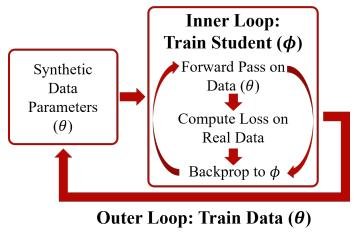  
(a) Optimization-based methods

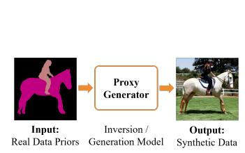  
(b) Proxy-based methods

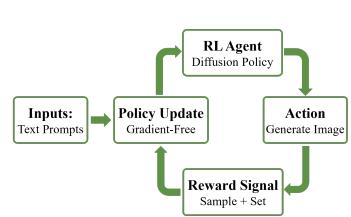  
(c) S2-RL (Ours)  
Figure 1: Comparison of paradigms. (Left) Optimization-based methods incur prohibitive memory costs from unrolling pixel-wise gradients. (Middle) Proxy-based generative methods require masks from real data, restricting synthesized datasets to existing layouts. (Right) $\mathrm { S } ^ { \mathrm { 2 } } \mathrm { - R L }$ treats distillation as active scene construction, using RL to generate diverse spatial topologies and valid scene layouts from text alone.

## 1 Introduction

Data-efficient learning has become crucial as deep learning models grow increasingly data-hungry. Dataset distillation [40] addresses this by condensing massive datasets into compact synthetic surrogates. Existing advances in dataset distillation fall into two primary paradigms: optimization-based methods and proxy-based generative methods. While both paradigms yield strong performance on image classification, their extension to dense prediction tasks such as semantic segmentation remains fraught with substantial challenges.

Specifically, optimization-based methods (Figure 1a), such as gradient matching [48, 3, 50] and distribution matching [39, 49, 28], formulate dataset distillation as a bi-level optimization problem aiming to align the gradients or distributions of student models on synthetic data with those on the real counterpart. While theoretically rigorous, these methods suffer from computational intractability in semantic segmentation tasks. Unlike image classification, which only relies on sparse supervision, semantic segmentation requires unrolling pixel-wise gradients at full spatial resolution, leading to severe memory overhead and making end-to-end optimization practically infeasible.

To circumvent this memory bottleneck, proxy-based generative methods [45, 35] (Figure 1b) have emerged as an efficient alternative, which bypass bi-level optimization via data inversion or global statistic matching. Since global statistics matching cannot comprehensively depict the complex spatial arrangements of multiple categories, existing approaches, such as those for object detection [26] or universal dataset distillation $[ 2 { \bar { 7 } } ] .$ , turn to rely on fixed spatial masks from real data for structural regularization. This strategy reduces the model to a mere texture filler within static boundaries, rather than a genuine scene composer, and thus fails to synthesize a compact set of novel, informative spatial layouts necessary for covering the long-tail distributions of real-world scenes.

To bridge these gaps, we propose a novel Sample-Set Reinforcement Learning $( \mathsf { S } ^ { 2 } \mathrm { - R L } )$ framework for generative semantic segmentation dataset distillation (SSDD), as shown in Figure 1c. Unlike existing gradient-heavy or mask-conditioned methods, we reformulate SSDD as a diffusion-based text-to-image generation paradigm and optimize it through reward-driven reinforcement learning without pixel-wise gradient unrolling through downstream segmentation training. By framing the generative model as an agent, $\mathrm { S } ^ { 2 } \mathrm { - R i }$ directly utilizes appropriate rewards to drive policy updates. This framework not only eliminates the need for heavy second-order gradient computations, but also empowers the model to flexibly synthesize a compact set of images with novel, informative contents from concise text prompts, thus enabling effective SSDD.

However, applying RL to generative dataset distillation introduces a new challenge. Standard RL methods (e.g., DDPO [2], Flow-GRPO [21, 38]) are typically designed for sample-level optimization, aiming to maximize the quality of individual instances. In contrast, dataset distillation is fundamentally a set-level optimization problem: the objective is to construct a collective dataset that covers the original dataset distribution with fewer samples. Straightforwardly applying standard RL is prone to incur model collapse, where the model over-optimizes for easy patterns while ignoring the long-tail distribution characteristics of real datasets. To address this problem, we introduce a sample-set dual reward mechanism. At the sample-level, for each individual generated sample, we enforce semantic alignment with the input prompt while penalizing collapsed local textures within the same class. At the set-level, we maximize inter-sample semantic distribution diversity by solving a contextual multi-armed bandit problem, enabling the generated compact sample set to appropriately cover the original long-tail dataset distribution. Empirical evaluations on ADE20K [51] and COCO [20] benchmarks demonstrate that $\mathrm { S ^ { 2 } \mathrm { - } R I }$ outperforms state-of-the-art baselines, reconciling generation quality with distributional diversity.

Our main contributions are summarized as follows:

• We propose $\mathrm { S ^ { 2 } { - } R L }$ , a novel generative dataset distillation framework that leverages RL to enable efficient image synthesis for dense prediction tasks, bypassing the memory bottlenecks of explicit gradient matching.

• We design a dual reward mechanism that balances sample quality and set diversity, mitigating semantic mode collapse.

• We obtain new state-of-the-art SSDD performance on ADE20K and COCO datasets.

## 2 Related Work

## 2.1 Data-Efficient Learning

Coreset Selection. This paradigm selects a representative subset from the original data. Classical methods include random selection, which samples data stochastically, and uniform selection, which ensures balanced sampling across categories. Beyond these, geometry-based methods leverage feature space structures. Herding [41, 6] selects samples closest to the cluster center of each class to approximate the mean of the distribution. Conversely, K-Center [11, 30] aims to minimize the maximum distance between any data point and the selected subset, effectively prioritizing boundary samples to maximize geometric coverage. While efficient, these extraction-based methods are inherently bounded by the finite samples available in the source domain, limiting their ability to bridge distributional gaps through synthesis.

Optimization-based Dataset Distillation. To synthesize informative data, early methods formulated dataset distillation as a bi-level optimization problem. Gradient matching methods [48, 3, 50] align the gradients or long-term training dynamics of student and teacher models, while distribution matching methods [39, 49, 28] optimize distribution or feature statistics. Differentiable augmentation [47], neural feature regression [52], and difficulty-aligned trajectory matching [14] further advance classification distillation. Extending such methods to high-resolution dense prediction remains challenging. In particular, approaches that differentiate through student training face prohibitive memory costs when unrolling pixel-wise computation graphs.

Proxy-based Generative Dataset Distillation. To bypass the heavy optimization, recent works have shifted towards proxy-based generative methods. Model inversion methods [45, 9, 32] invert pretrained model statistics (e.g., BatchNorm) to recover training images. Generative attempts [35, 4, 53] leverage the rich priors of generative models to synthesize diverse data distributions by matching global statistics or embedding alignments. Minimax Diffusion [13] additionally balances representativeness and diversity during generative training. However, a critical gap remains when transferring these successes to semantic segmentation. Due to the lack of spatial location information in global statistics, existing methods, such as those for object detection [26] or universal distillation [27], typically require pre-defined layouts from real data to constrain the generation process. This dependency limits the synthesized dataset to the topological variations already in the training set, hindering the exploration of novel scene layouts.

Unlike optimization methods that face computational barriers, or proxy methods that depend on static mask priors, $\mathrm { S ^ { 2 } \mathrm { - } R I }$ adopts a reward-driven policy optimization paradigm. This allows for the autonomous construction of complex scene topologies without unrolling downstream studenttraining gradients or using fixed masks as generation conditions.

## 2.2 Reinforcement Learning for Diffusion Models

Reinforcement Learning has recently been integrated with diffusion models to align generation with specific objectives. DDPO [2] treats the multi-step denoising process as a policy, enabling the optimization of non-differentiable reward functions via policy gradient. DPO-Diffusion [37] simplifies this by leveraging preference pairs to optimize the policy without an explicit reward model. To further enhance training stability, Flow-GRPO [21, 38] estimates gradients using the relative advantage of sampled groups, eliminating the need for a separate value network.

While these methods have successfully improved sample quality, they primarily focus on samplelevel optimization. In the context of dataset distillation, our $\mathrm { S ^ { 2 }  – R L }$ extends these frameworks to a set-level perspective, utilizing RL not just for individual image quality, but to actively explore and cover the diverse semantic distribution required for robust downstream training.

## 3 Preliminaries

## 3.1 Problem Formulation

Semantic Segmentation Dataset Distillation. Given a large-scale real dataset $\mathcal { D } _ { r e a l } = \{ ( x , y ) | x \in$ $\textstyle { \mathcal { X } } , y \in { \mathcal { D } } \}$ , where $\mathcal { X } \subset \mathbb { R } ^ { H \times W \times 3 }$ is the image and $\mathcal { Y } \subset \{ \breve { 0 } , 1 \} ^ { H \times W \times C }$ is the pixel-wise label map for C classes. Our goal is to learn a generative policy πθ (parameterized by θ) to synthesize a distilled

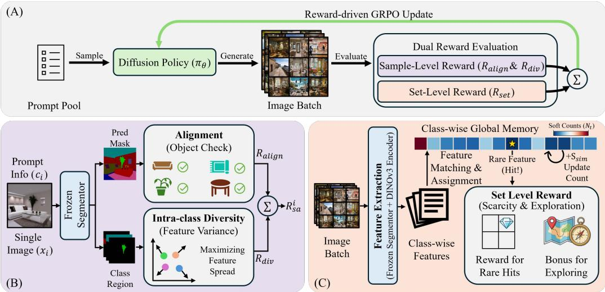  
Figure 2: The architecture of our proposed method. (A) The framework utilizes GRPO to finetune the diffusion policy with a dual reward evaluation system. (B) Sample-level reward ensures semantic alignment and local variance by evaluating individual images against prompt constraints. (C) Set-level reward encourages global exploration. By mapping batch features to a global prototype memory, the system identifies and rewards lowfrequency prototypes, assigning high bonuses for scarcity and exploration to mitigate mode collapse.

dataset $\mathcal { D } _ { s y n } ( \theta ) = \{ ( \hat { x } _ { i } , \hat { y } _ { i } ) \} _ { i = 1 } ^ { M }$ with size $M \ll | \mathcal { D } _ { r e a l } |$ . Ideally, a student segmentation network $f _ { \phi }$ trained on $\mathcal { D } _ { s y n }$ should minimize the validation loss on $\mathcal { D } _ { r e a l }$ . This is classically formulated as a bi-level optimization problem:

$$
\begin{array} { r l } { \underset { \theta } { \mathop { \operatorname* { m i n } } } } & { \mathbb { E } _ { ( x , y ) \sim \mathcal { D } _ { r e a l } } [ \mathcal { L } _ { v a l } ( f _ { \phi ^ { * } ( \theta ) } ( x ) , y ) ] } \\ { \mathrm { s . t . } } & { \phi ^ { * } ( \theta ) = \arg \underset { \phi } { \mathop { \operatorname* { m i n } } } \mathbb { E } _ { ( \hat { x } , \hat { y } ) \sim \mathcal { D } _ { s y n } ( \theta ) } [ \mathcal { L } _ { t r a i n } ( f _ { \phi } ( \hat { x } ) , \hat { y } ) ] , } \end{array}\tag{1}
$$

where $\mathcal { L }$ is the semantic segmentation loss. The policy determines $\mathcal { D } _ { s y n } ( \theta )$ and thereby the trained student $\phi ^ { * } ( \theta )$ ; M is the number of retained image–label pairs.

The Computational Bottleneck. Optimization-based methods attempt to solve Eq. 1 by computing the hypergradient $\nabla _ { \boldsymbol { \theta } } \mathcal { L } _ { v a l }$ via chain rule. However, for dense prediction tasks, the inner-loop optimization requires backpropagating gradients through high-dimensional pixel-wise outputs. Unrolling this computation graph incurs a large memory cost $\check { \mathcal { O } } ( H \cdot W \cdot C )$ , rendering explicit bi-level optimization practically infeasible.

## 3.2 Reinforcement Learning Reformulation

To avoid differentiating through downstream student training, we reformulate dataset distillation as a reward-driven reinforcement learning problem. The pretrained diffusion model acts as the agent, and each text prompt c provides semantic conditioning for a denoising trajectory. Its final image xˆ is sampled from the policy $\pi _ { \boldsymbol { \theta } } ( \cdot | c )$ . The reward $R ( { \hat { x } } , c )$ provides a scalar proxy for the sample’s utility in downstream segmentation. Consequently, the optimization objective shifts from minimizing validation loss to maximizing the expected reward:

$$
\mathcal { I } _ { R L } ( \theta ) = \mathbb { E } _ { c \sim p ( c ) , \hat { x } \sim \pi _ { \theta } ( . | c ) } [ R ( \hat { x } , c ) ] .\tag{2}
$$

## 3.3 Optimization via GRPO

We optimize $\mathcal { I } _ { R L }$ via Group Relative Policy Optimization (GRPO) [31], which uses group-relative advantages without a separate value network. For each prompt c, the rollout policy samples G denoising trajectories, yielding final images $\{ \hat { x } _ { i } \} _ { i = 1 } ^ { G }$ . Their rewards are standardized within the prompt group to form advantages $\mathbb { A } _ { i }$ , which are reused across the trained denoising steps T. Following diffusion-policy optimization [2, 21, 38], we maximize the clipped transition-wise surrogate

$$
\mathcal { I } _ { G R P O } ( \theta ) = \mathbb { E } \Bigg [ \frac { 1 } { G | \mathcal { T } | } \sum _ { i = 1 } ^ { G } \sum _ { t \in \mathcal { T } } w _ { t } \operatorname* { m i n } ( \widetilde { \rho } _ { i , t } \mathbb { A } _ { i } , \mathrm { c l i p } ( \widetilde { \rho } _ { i , t } , 1 - \epsilon , 1 + \epsilon ) \mathbb { A } _ { i } ) \Bigg ] \mathrm { , }\tag{3}
$$

where $\mathbb { A } _ { i }$ is obtained by standardizing $R _ { i }$ as $( R _ { i } - \mu _ { c } ) / ( \sigma _ { c } + \varepsilon )$ , followed by advantage clipping; $\mu _ { c }$ and $\sigma _ { c }$ are the reward mean and standard deviation within the prompt group. Here $\widetilde { \rho } _ { i , \ast }$ t is the RatioNorm-regulated current-to-rollout transition ratio, and $w _ { t }$ eis the inverse scheduler-step weight. Appendix A.1 details the estimator, and Appendix B.4 provides the training settings.

## 4 Method

## 4.1 Framework Overview

As illustrated in Figure $2 , \mathsf { S } ^ { 2 } { \mathrm { - R I } }$ L reformulates SSDD as an RL-based generation process. We finetune a pretrained Stable Diffusion policy $\pi _ { \theta }$ to synthesize a dataset $\mathcal { D } _ { s y n }$ that maximizes downstream semantic segmentation performance. In each iteration, the agent samples a text prompt c and synthesizes an image xˆ. To optimize this generative process without accessing prohibitive pixel-wise gradients, we employ GRPO to update the policy parameters $\theta ,$ directly maximizing a total reward signal $R _ { t o t a l }$ based on the feedback from the synthesized samples.

The efficacy of this optimization relies on our proposed sample-set dual reward mechanism, which evaluates the generation at two distinct granularities. Class-list prompts specify category presence and co-occurrence while leaving spatial arrangements to the generator. In the following sections, we detail how $R _ { s a m p l e }$ and $R _ { s e t }$ are formulated to steer the policy toward high-fidelity and diverse synthesis.

## 4.2 Sample-Level Reward

The sample-level reward $( R _ { s a m p l e } )$ ensures that each generated sample $\hat { x }$ is not only semantically faithful to the conditioning prompt c but also possesses discriminative pixel-level features suitable for training downstream semantic segmentation models. It consists of two components:

Semantic Alignment $( R _ { a l i g n } )$ . To ensure the generated image xˆ faithfully reflects the target classes in prompt $c ,$ we compare the predicted masks against the concepts in prompt. Let $\mathcal { C } _ { g t }$ be the set of target classes in prompt, and $\dot { \mathcal { C } } _ { p r e d }$ be the unique classes identified in the predicted mask $P _ { p r e d } =$ $f _ { e v a l } ( \hat { x } )$ , where $f _ { e v a l }$ is the frozen segmentor. The semantic alignment reward is defined as:

$$
R _ { a l i g n } ( \hat { x } , c ) = ( 1 - \lambda _ { a r e a } ) \underbrace { \frac { \lvert \mathcal { C } _ { g t } \cap \mathcal { C } _ { p r e d } \rvert } { \lvert \mathcal { C } _ { g t } \rvert } } _ { \mathrm { C o n c e p t R e c a l l } } + \lambda _ { a r e a } \underbrace { \frac { 1 } { H W } \sum _ { k \in \mathcal { C } _ { g t } } \sum _ { u = 1 } ^ { H } \sum _ { v = 1 } ^ { W } \mathbb { I } \Big ( P _ { p r e d } ^ { ( u , v ) } = k \Big ) } _ { \mathrm { A r e a ~ O c u p a n c y } } ,\tag{4}
$$

where $P _ { p r e d } ^ { ( u , v ) }$ denotes the predicted class at pixel $( u , v ) , \lambda _ { a r e a }$ is a weighting factor, and $\mathbb { I } [ \cdot ]$ is the indicator function. The first term quantifies the recall of target categories, ensuring that the model does not miss classes in the text. The second term calculates the proportion of pixels belonging to the target classes, penalizing negligible or unrecognizable regions that fail to contribute valid gradients for training.

Intra-class Diversity $( R _ { d i v } )$ . Merely generating correct objects is insufficient. High-quality semantic segmentation data should also exhibit intra-class feature separability, reducing repetitive local textures for the same class. To address this, we introduce an intra-class diversity reward that operates on dense feature maps extracted by the frozen evaluator. For $n _ { k }$ feature-grid locations assigned to class k within one image, we uniformly sample $M _ { k } = \operatorname* { m i n } ( n _ { k } , 1 0 0 )$ vectors $\mathcal { F } _ { k } = \{ \mathbf { z } _ { k , m } \} _ { m = 1 } ^ { M _ { k } } .$ Let $\mathcal { C } _ { p r e d } ^ { \geq 2 } = \{ k \in \mathcal { C } _ { p r e d } : M _ { k } \geq 2 \}$ . We define the diversity reward as

$$
R _ { d i v } ( \hat { x } ) = - \frac { 1 } { | \mathcal { C } _ { p r e d } ^ { \geq 2 } | } \sum _ { k \in \mathcal { C } _ { p r e d } ^ { \geq 2 } } \frac { 2 } { M _ { k } ( M _ { k } - 1 ) } \sum _ { 1 \leq m < n \leq M _ { k } } [ \cos ( \mathbf { z } _ { k , m } , \mathbf { z } _ { k , n } ) - \delta ] _ { + } ,\tag{5}
$$

where $[ x ] _ { + } = \operatorname* { m a x } ( 0 , x )$ and $\delta$ is a similarity margin. Classes with $M _ { k } ~ < ~ 2$ are excluded; we set $R _ { d i v } = 0$ when $\mathcal { C } _ { p r e d } ^ { \geq 2 } = \emptyset$ . Each frozen evaluator computes the reward using its own feature map and predicted mask, and the resulting scalar rewards are combined across evaluators. The penalty fires only when intra-class similarity exceeds $\delta ,$ pushing the generator toward semantically consistent yet texturally diverse features.

## 4.3 Set-Level Reward

While sample-level rewards improve individual images, they do not account for the semantic modes covered by other generated samples. To address this, we reformulate the set-level diversity optimization as a contextual multi-armed bandit (MAB) problem [34], where the diffusion policy acts as the agent, the prompt c serves as the context, and the arms are defined as the discrete collection of semantic prototypes specifically constructed for each category. Our objective is to encourage balanced arm visitation within each class, guiding the agent to cover diverse semantic modes rather than repeatedly exploiting frequent prototypes. To operationalize this discrete bandit framework within a continuous generative space, we introduce three key components: Semantic Arm Construction to discretize the feature space into class-specific prototypes; Robust State-Action Mapping to identify the pulled arms from generated images; and Entropy-Maximizing Reward Mechanism to incentivize the exploration of scarce prototypes.

Semantic Arm Construction. To define a finite set of semantic arms, we perform an offline discretization of the real data manifold. We employ DINOv3 [33] to pool normalized features within real class regions using ground-truth training masks. For each category k, K-means with $K \ = \ 5 0$ centers partitions the region features, and each center is mapped to its nearest observed same-class region feature. These representatives form the discrete arm set $\mathcal { P } _ { k } ,$ , serving as the reference for set-level coverage. If fewer than K regions are available, all are retained. Appendix D.4 compares this construction with random sameclass representatives.

Robust State-Action Mapping. When the agent generates an image xˆ, we must identify which specific arm has been pulled. This requires a robust mapping from pixel space to the prototype space. We use majority-vote masks from the frozen evaluator ensemble. We then perform spatiallymasked pooling on the DINOv3 feature map of xˆi and normalize the pooled feature to obtain a query vector $\mathbf { z } _ { i , k }$ for category k. The pulled arm is identified as the nearest prototype in that class’s bank:

Algorithm 1: Set-Level Reward   
1: Require: Batch of images and prompt $\{ ( \hat { x } _ { i } , c _ { i } ) \} _ { i = 1 } ^ { B }$   
2: Require: Semantic arm set ${ \mathcal { P } } ,$ global memory $N _ { \mathrm { h i s t } }$   
3: Ensure: Reward batch $\mathbf { R } _ { s e t } = \{ r _ { i } \} _ { i = 1 } ^ { B } .$   
4: Initialize: Batch accumulator $\Delta N _ { \mathrm { b a t c h } }  0 .$   
5: Detect classes and extract features for all ${ \hat { x } } _ { i } .$   
// Phase 1: Batch-Aware Online Calibration   
6: for each image $i = 1$ to B do   
7: for each detected target class k do   
8: Match ${ \bf z } _ { i , k }$ to $\mathbf { p } _ { i , k } ^ { * }$ via Eq. $^ { 6 . }$   
9: $s _ { i , k } \gets \operatorname* { m a x } ( 0 , \cos ( \mathbf { z } _ { i , k } , \mathbf { p } _ { i , k } ^ { * } ) ) .$   
10: $\Delta N _ { \mathrm { b a t c h } } ( \mathbf { p } _ { i , k } ^ { * } ) \gets \Delta N _ { \mathrm { b a t c h } } ( \mathbf { p } _ { i , k } ^ { * } ) + s _ { i , k }$   
11: end for   
12: end for   
// Phase 2: Reward Evaluation   
13: for each image i = 1 to B do   
14: Initialize image accumulation score $S _ { i } \gets 0$   
15: Get target object count $K _ { o b j } \gets$ count $\left( c _ { i } \right)$   
16: for each detected target class k do   
17: $\hat { N } ( \mathbf { p } ) \gets N _ { \mathrm { h i s t } } ( \mathbf { p } ) + \Delta N _ { \mathrm { b a t c h } } ( \mathbf { p } )$   
18: Evaluate $r ( \mathbf { p } _ { i , k } ^ { * } )$ via Eq. 7.   
19: $S _ { i }  S _ { i } + r ( \mathbf { p } _ { i , k } ^ { * } )$   
20: end for   
21: $r _ { i } \gets S _ { i } / \operatorname* { m a x } ( 1 , K _ { o b j } )$   
22: end for   
23: Global Update: $N _ { \mathrm { h i s t } }  N _ { \mathrm { h i s t } } + \Delta N _ { \mathrm { b a t c h } }$   
24: return $\mathbf { R } _ { s e t }$

$$
\mathbf { p } _ { i , k } ^ { * } = \arg \operatorname* { m a x } _ { \mathbf { p } \in \mathcal { P } _ { k } } \cos ( \mathbf { z } _ { i , k } , \mathbf { p } ) , \qquad s _ { i , k } = \operatorname* { m a x } \bigl ( 0 , \cos ( \mathbf { z } _ { i , k } , \mathbf { p } _ { i , k } ^ { * } ) \bigr ) .\tag{6}
$$

Entropy-Maximizing Reward Mechanism. To guide the agent towards underrepresented semantic modes, we design a dynamic reward based on soft visitation counts. These counts accumulate matching similarities for each prototype. For the current batch, we first compute $\Delta N _ { \mathrm { b a t c h } }$ and define the batch-aware state $\hat { N } = N _ { \mathrm { h i s t } } + \Delta N _ { \mathrm { b a t c h } }$ . Every image in the batch is evaluated against this shared state. For each requested class k detected in ${ \hat { x } } _ { i } .$ , we compute the utility of its matched prototype $\mathbf { p } _ { i , k } ^ { * } \colon$

$$
r ( \mathbf { p } _ { i , k } ^ { * } ) = \underbrace { s _ { i , k } \left( \frac { \bar { N } _ { k } + 1 } { \hat { N } ( \mathbf { p } _ { i , k } ^ { * } ) + 1 } \right) ^ { \alpha } } _ { \mathrm { Q u a l i t y - W e i g h t e d ~ S c a r c i t y } } + \beta \underbrace { \sqrt { \frac { \ln ( \operatorname* { m a x } ( N _ { k } , 1 ) ) } { \hat { N } ( \mathbf { p } _ { i , k } ^ { * } ) + 1 } } } _ { \mathrm { E x p l o r a t i o n ~ B o n u s } } ,\tag{7}
$$

where $s _ { i , k }$ is the matching similarity, $\hat { N } ( \mathbf { p } _ { i , k } ^ { * } )$ is the batch-aware soft count of the matched prototype, $\begin{array} { r } { N _ { k } = \sum _ { \mathbf { p } \in \mathcal { P } _ { k } } \hat { N } ( \mathbf { p } ) } \end{array}$ is the total batch-aware soft count of class $k ,$ and $\bar { N } _ { k } = N _ { k } / | \mathcal { P } _ { k } |$ is the average soft count over prototypes of class k. The hyperparameters α and $\beta$ control scarcity reweighting and

Whole Dataset

Table 1: Quantitative comparison on ADE20K [51] using SegFormer-B5 [43] as the downstream student. We report mAcc and mIoU (%) at various distillation ratios. ∗ denotes our reproduced implementation. The highlighted row denotes our method, and green indicates the improvement over the strongest baseline.
<table><tr><td rowspan="2">Method</td><td colspan="2">0.25%</td><td colspan="2">0.5%</td><td colspan="2">1.0%</td></tr><tr><td>mAcc</td><td>mIoU</td><td>mAcc</td><td>mIoU</td><td>mAcc</td><td>mIoU</td></tr><tr><td>Random</td><td> $1 4 . 4 8 { \scriptstyle \pm 0 . 4 6 }$ </td><td> $9 . 5 9 { \scriptstyle \pm 0 . 3 6 }$ </td><td> $2 1 . 1 1 { \scriptstyle \pm 0 . 6 9 }$ </td><td> $1 4 . 9 2 \pm 0 . 4 5$ </td><td> $2 7 . 0 8 \pm 1 . 1 1$ </td><td> $1 9 . 9 5 { \scriptstyle \pm 0 . 6 7 }$ </td></tr><tr><td>Uniform</td><td> $1 8 . 4 8 { \scriptstyle \pm 1 . 2 7 }$ </td><td> $1 2 . 0 5 { \scriptstyle \pm 0 . 6 8 }$ </td><td> $2 7 . 4 8 \pm 0 . 9 3$ </td><td> $1 8 . 5 9 { \scriptstyle \pm 0 . 4 7 }$ </td><td> $3 4 . 9 5 { \scriptstyle \pm 1 . 1 7 }$ </td><td> $2 4 . 1 0 { \scriptstyle \pm 0 . 5 5 }$ </td></tr><tr><td>K-Center</td><td> $1 8 . 0 2 { \scriptstyle \pm 0 . 5 5 }$ </td><td> $1 2 . 5 6 { \scriptstyle \pm 0 . 5 5 }$ </td><td> $2 4 . 7 4 \pm 1 . 2 2$ </td><td> $1 7 . 9 2 \pm 0 . 9 3 $ </td><td> $3 1 . 6 9 { \scriptstyle \pm 1 . 2 1 }$ </td><td> $2 3 . 9 0 { \scriptstyle \pm 0 . 9 6 }$ </td></tr><tr><td>Herding</td><td> $1 5 . 5 1 { \scriptstyle \pm 0 . 2 3 }$ </td><td> $1 0 . 5 4 { \scriptstyle \pm 0 . 1 7 }$ </td><td> $2 1 . 2 9 { \scriptstyle \pm 0 . 2 7 }$ </td><td> $1 5 . 4 4 { \scriptstyle \pm 0 . 2 1 }$ </td><td> $2 7 . 6 8 \pm 0 . 2 5$ </td><td> $2 1 . 0 0 { \scriptstyle \pm 0 . 2 1 }$ </td></tr><tr><td>SD3.5 Baseline</td><td> $2 0 . 3 4 { \scriptstyle \pm 0 . 9 1 }$ </td><td> $1 3 . 5 4 { \scriptstyle \pm 0 . 5 6 }$ </td><td> $2 5 . 9 2 { \scriptstyle \pm 1 . 0 6 }$ </td><td> $1 8 . 0 9 { \scriptstyle \pm 0 . 9 0 }$ </td><td> $3 0 . 0 5 { \scriptstyle \pm 0 . 7 0 }$ </td><td> $2 1 . 6 6 \pm 0 . 4 0$ </td></tr><tr><td>UniDD* [27]</td><td> $1 7 . 8 3 { \pm } 1 . 1 2$ </td><td> $1 2 . 0 5 { \scriptstyle \pm 0 . 6 4 }$ </td><td> $2 5 . 9 0 { \scriptstyle \pm 1 . 0 7 }$ </td><td> $1 7 . 8 1 { \scriptstyle \pm 0 . 9 0 }$ </td><td> $3 1 . 1 1 { \scriptstyle \pm 0 . 8 3 }$ </td><td> $2 2 . 7 0 { \scriptstyle \pm 0 . 5 6 }$ </td></tr><tr><td>S²-RL (Ours)</td><td> $2 3 . 0 7 { \scriptstyle \pm 0 . 9 2 } ^ { \Delta 2 . 7 3 }$ </td><td> $\mathbf { 1 5 . 6 0 } \mathrm { { \scriptstyle \pm 0 . 5 9 } } ^ { \Delta 2 . 0 6 }$ </td><td> $\mathbf { 3 0 . 7 4 } \substack { \pm 0 . 7 3 } \Delta 3 . 2 6$ </td><td> $2 1 . 5 2 \substack { \pm 0 . 5 6 } ^ { \Delta 2 . 9 3 }$ </td><td> $3 5 . 5 8 \substack { \pm 0 . 5 7 } ^ { \Delta 0 . 6 3 }$ </td><td> $2 5 . 4 7 { \scriptstyle \pm 0 . 2 4 } ^ { \Delta 1 . 3 7 }$ </td></tr></table>

mAcc: 60.69  
mIoU: 49.13

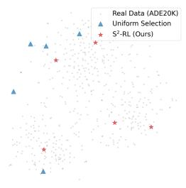  
(a) seat

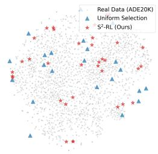  
(b) grass

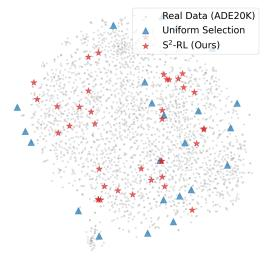  
(c) car

(d) sink  
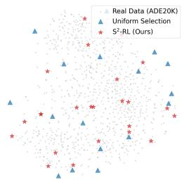  
Figure 3: Class-wise t-SNE embeddings under the 1% data ratio. Compared with Uniform Selection ( ), $\mathrm { S } ^ { 2 _ { - } } \mathrm { R I }$ ( ) spans broader regions of the ADE20K feature manifold ( ) across all four categories.

exploration strength, respectively. The image reward $R _ { s e t }$ averages these utilities over all requested classes, with zero contribution from an absent requested class. Historical counts accumulate across policy-training batches and are updated after each full batch is scored, as outlined in Algorithm 1.

## 4.4 Total Objective and Theoretical Analysis

To guide the policy update, we integrate the proposed hierarchical rewards into a unified feedback signal. The total reward $R _ { t o t a l }$ for a generated image xˆ conditioned on prompt c is computed as a weighted summation:

$$
R _ { t o t a l } ( \hat { x } , c ) = \gamma _ { a } R _ { a l i g n } ( \hat { x } , c ) + \gamma _ { d } R _ { d i v } ( \hat { x } ) + \gamma _ { s } R _ { s e t } ( \hat { x } , c ) ,\tag{8}
$$

where $\gamma _ { a } , \gamma _ { d } , \gamma _ { s }$ are hyperparameters balancing semantic alignment, within-class diversity, and prototype coverage. We optimize the diffusion policy $\pi _ { \theta }$ using ${ \bar { \mathrm { E q . } } } 3 .$

Optimization Behavior. The combined reward objective biases the policy toward promptconsistent, feature-diverse, and semantically well-covered samples, discouraging degenerate solutions by jointly leveraging sample-level quality rewards and a set-level coverage reward. We refer readers to Proposition 5 in Appendix A for a detailed interpretation.

## 5 Experiments

## 5.1 Experimental Settings

Datasets and Metrics. We evaluate our framework on two challenging benchmarks: ADE20K [51] and COCO [20]. For COCO, we utilize the panoptic annotations converted into semantic segmentation masks to ensure high-quality pixel-wise supervision. As one of the first systematic studies of dataset distillation specifically tailored to semantic segmentation, we establish a standardized evalua tion protocol adapted from the image classification task’s images per class (IPC) metric; specifically, considering the multi-class nature of segmentation images, we determine the data budget based on global compression ratios rather than fixed class counts. Accordingly, we set the ratios to 0.25%,

Table 2: Quantitative comparison on COCO [20] using SegFormer-B5 [43] as the downstream student. We report mAcc and mIoU (%) at various distillation ratios. ∗ denotes our reproduced implementation. The highlighted row denotes our method, and green indicates the improvement over the strongest baseline.
<table><tr><td rowspan="2">Method</td><td colspan="2">0.625%o</td><td colspan="2">1.25%</td><td colspan="2">2.5%0</td></tr><tr><td>mAcc</td><td>mIoU</td><td>mAcc</td><td>mIoU</td><td>mAcc</td><td>mIoU</td></tr><tr><td>Random</td><td> $2 8 . 8 2 \pm 1 . 3 2$ </td><td> $1 9 . 7 1 { \scriptstyle \pm 0 . 6 7 }$ </td><td> $3 8 . 0 0 { \scriptstyle \pm 0 . 4 0 }$ </td><td> $2 7 . 7 5 { \scriptstyle \pm 0 . 4 6 }$ </td><td> $4 4 . 8 9 { \scriptstyle \pm 0 . 4 0 }$ </td><td> $3 4 . 3 1 { \pm } 0 . 3 7$ </td></tr><tr><td>Uniform</td><td> $3 3 . 4 5 { \scriptstyle \pm 0 . 8 3 }$ </td><td> $2 3 . 3 7 \pm 0 . 9 7$ </td><td> $4 3 . 3 7 \pm 0 . 9 7$ </td><td> $3 2 . 1 8 \pm 0 . 7 5$ </td><td> $5 0 . 0 7 { \scriptstyle \pm 0 . 4 3 }$ </td><td> $3 7 . 3 9 { \scriptstyle \pm 0 . 4 6 }$ </td></tr><tr><td>K-Center</td><td> $3 4 . 7 7 { \scriptstyle \pm 0 . 6 7 }$ </td><td> $2 4 . 9 9 { \scriptstyle \pm 0 . 5 7 }$ </td><td> $4 3 . 3 5 \pm 0 . 7 2$ </td><td> $3 2 . 3 0 { \scriptstyle \pm 0 . 4 6 }$ </td><td> $4 8 . 9 2 \pm 0 . 4 7$ </td><td> $3 7 . 1 9 { \scriptstyle \pm 0 . 3 8 }$ </td></tr><tr><td>Herding</td><td> $3 2 . 0 7 { \scriptstyle \pm 0 . 3 5 }$ </td><td> $2 3 . 0 4 { \scriptstyle \pm 0 . 2 4 }$ </td><td> $4 0 . 2 0 { \scriptstyle \pm 0 . 2 5 }$ </td><td> $3 0 . 4 9 { \scriptstyle \pm 0 . 2 2 }$ </td><td> $4 7 . 5 6 \pm 0 . 2 3 $ </td><td> $3 7 . 1 0 { \scriptstyle \pm 0 . 2 0 }$ </td></tr><tr><td>SD3.5 Baseline</td><td> $3 8 . 1 8 { \scriptstyle \pm 0 . 7 3 }$ </td><td> $2 5 . 9 8 \pm 0 . 6 7$ </td><td> $4 6 . 6 5 \pm 0 . 4 8$ </td><td> $3 2 . 8 8 \pm 0 . 8 7$ </td><td> $5 1 . 8 1 { \scriptstyle \pm 0 . 3 5 }$ </td><td> $3 7 . 7 4 { \scriptstyle \pm 0 . 3 4 }$ </td></tr><tr><td>UniDD* [27]</td><td> $3 1 . 4 5 { \scriptstyle \pm 0 . 7 3 }$ </td><td> $2 1 . 4 2 { \scriptstyle \pm 0 . 7 2 }$ </td><td> $4 1 . 0 3 { \scriptstyle \pm 0 . 9 7 }$ </td><td> $3 0 . 0 2 { \scriptstyle \pm 0 . 7 4 }$ </td><td> $4 6 . 3 5 { \scriptstyle \pm 0 . 9 7 }$ </td><td> $3 4 . 8 0 { \scriptstyle \pm 0 . 8 8 }$ </td></tr><tr><td>S2-RL (Ours)</td><td> $\mathbf { 4 1 . 1 3 } \scriptstyle \pm 0 . 6 7 ^ { \Delta 2 . 9 5 }$ </td><td> $2 8 . 4 6 { \scriptstyle \pm 0 . 4 8 } ^ { \Delta 2 . 4 8 }$ </td><td> $4 8 . 4 8 \substack { \pm 0 . 8 7 } ^ { \Delta 1 . 8 3 }$ </td><td> $\mathbf { 3 5 . 0 3 _ { \perp 0 . 6 8 } } ^ { \Delta 2 . 1 5 }$ </td><td> $\mathbf { 5 3 . 0 3 } _ { \pm 0 . 5 4 } \Delta 1 . 2 2$ </td><td> $3 8 . 8 3 _ { \perp 0 . 5 9 } ^ { \Delta 1 . 0 9 }$ </td></tr><tr><td colspan="5">Whole Dataset</td><td colspan="2"></td></tr></table>

Table 3: Comprehensive robustness analysis on ADE20K [51]. We report mIoU (%) across varying mode capacities, backbone architectures, and semantic segmentation mechanisms at three distillation ratios.
<table><tr><td rowspan="2">Model Configuration</td><td colspan="2">Ratio = 0.25%</td><td colspan="2">Ratio = 0.5%</td><td colspan="2">Ratio = 1.0%</td><td rowspan="2">Full</td></tr><tr><td>Uniform</td><td> $\mathbf { S } ^ { 2 } \mathbf { - R L } \left( \mathbf { O u r s } \right)$ </td><td>Uniform</td><td> $\mathbf { S } ^ { 2 } \mathbf { - R L } \left( \mathbf { O u r s } \right)$ </td><td>Uniform</td><td> $\mathbf { S } ^ { 2 } \mathbf { - R L } \left( \mathbf { O u r s } \right)$ </td></tr><tr><td colspan="8">(a) Impact of Model Capacity</td></tr><tr><td> $\mathrm { R e s N e t - } 1 8 + \mathrm { U P e r N e t }$ </td><td> $5 . 3 2 { \scriptstyle \pm 0 . 2 0 }$ </td><td> ${ \bf 5 . 9 0 } \mathrm { { \scriptstyle \pm 0 . 2 9 } } ^ { \displaystyle \Delta 0 . 5 8 }  \bf $ </td><td> $8 . 3 3 { \scriptstyle \pm 0 . 4 2 }$ </td><td> $9 . 1 2 \substack { \pm 0 . 3 6 } \Delta 0 . 7 9$ </td><td> $1 2 . 1 0 { \scriptstyle \pm 0 . 6 1 }$ </td><td> $1 2 . 4 5 \substack { \pm 0 . 2 5 } \Delta 0 . 3 5$ </td><td>35.58</td></tr><tr><td> $\mathrm { R e s N e t - } 5 0 + \mathrm { U P e r N e t }$ </td><td> $6 . 7 2 { \scriptstyle \pm 0 . 3 5 }$ </td><td> $\mathbf { 7 . 6 9 } \pm _ { 0 . 3 6 } \Delta 0 . 9 7$ </td><td> $1 0 . 2 5 { \scriptstyle \pm 0 . 3 9 }$ </td><td> $1 1 . 8 4 { \scriptstyle \pm 0 . 5 1 } ^ { \Delta 1 . 5 9 }$ </td><td> $1 4 . 8 3 { \scriptstyle \pm 0 . 5 7 }$ </td><td> $1 5 . 4 3 \substack { \pm 0 . 2 0 } \Delta 0 . 6 0$ </td><td>42.05</td></tr><tr><td> $\mathrm { R e s N e t – 1 0 1 + U P e r N e t }$ </td><td> $7 . 4 0 { \scriptstyle \pm 0 . 4 9 }$ </td><td> $\mathbf { 8 . 6 4 } \pm 0 . 4 9 ^ { \Delta 1 . 2 4 }$ </td><td> $1 0 . 9 9 { \scriptstyle \pm 0 . 3 2 }$ </td><td> $\mathbf { 1 3 . 1 4 } \mathrm { \pm 0 . 4 6 } ^ { \Delta 2 . 1 5 }$ </td><td> $1 5 . 8 9 { \scriptstyle \pm 0 . 6 3 }$ </td><td> $1 6 . 8 2 \substack { \pm 0 . 2 8 } \Delta 0 . 9 3$ </td><td>43.82</td></tr><tr><td colspan="8">(b) Impact of Backbone Architecture</td></tr><tr><td>Swin  $- S + \mathrm { U P e r N e t }$ </td><td> $8 . 6 4 \pm 0 . 4 1$ </td><td> $\mathbf { 1 0 . 0 3 } \pm { 0 . 4 7 } ^ { \Delta 1 . 3 9 }$ </td><td> $1 3 . 4 0 { \scriptstyle \pm 0 . 5 7 }$ </td><td> $\mathbf { 1 5 . 8 6 } \pm _ { 0 . 6 1 } \Delta 2 . 4 6$ </td><td> $1 9 . 4 8 { \scriptstyle \pm 0 . 8 3 }$ </td><td> $2 1 . 4 4 { \scriptstyle \pm 0 . 3 6 } ^ { \Delta 1 . 9 6 }$ </td><td>47.72</td></tr><tr><td> $\mathrm { C o n v N e X t - S } + \mathrm { U P e r N e t }$ </td><td> $9 . 9 4 { \scriptstyle \pm 0 . 4 3 }$ </td><td> $1 2 . 6 4 _ { \pm 0 . 5 8 } \Delta 2 . 7 0$ </td><td> $1 5 . 3 6 { \scriptstyle \pm 0 . 5 4 }$ </td><td> $1 8 . 9 2 \substack { \pm 0 . 4 6 } \Delta 3 . 5 6$ </td><td> $2 1 . 8 3 { \scriptstyle \pm 0 . 4 4 }$ </td><td> $2 3 . 8 0 { \scriptstyle \pm 0 . 2 4 } ^ { \Delta 1 . 9 7 }$ </td><td>48.56</td></tr><tr><td colspan="8">(c) Impact of Semantic Segmentation Mechanism</td></tr><tr><td>ResNet-50 + DeepLabV3</td><td> $6 . 4 2 \pm 0 . 3 8$ </td><td> $7 . 2 5 { \scriptstyle \pm 0 . 3 6 } ^ { \Delta 0 . 8 3 }$ </td><td> $1 0 . 0 6 { \scriptstyle \pm 0 . 4 4 }$ </td><td> ${ \bf 1 1 . 3 1 } \mathrm { \pm 0 . 5 0 } ^ { \Delta 1 . 2 5 }$ </td><td> $1 4 . 2 4 { \scriptstyle \pm 0 . 5 6 }$ </td><td> $1 4 . 7 4 \substack { \pm 0 . 1 7 } \Delta 0 . 5 0$ </td><td>42.66</td></tr><tr><td>SegFormer-B5</td><td> $1 2 . 0 5 { \scriptstyle \pm 0 . 6 8 }$ </td><td> $\mathbf { 1 5 . 6 0 } \pm 0 . 5 9 ^ { \Delta 3 . 5 5 }$ </td><td> $1 8 . 5 9 { \scriptstyle \pm 0 . 4 7 }$ </td><td> $2 1 . 5 2 \substack { \pm 0 . 5 6 } \Delta 2 . 9 3$ </td><td> $2 4 . 1 0 { \scriptstyle \pm 0 . 5 5 }$ </td><td> $2 5 . 4 7 { \scriptstyle \pm 0 . 2 4 } ^ { \Delta 1 . 3 7 }$ </td><td>49.13</td></tr></table>

0.5%, 1.0% for ADE20K and 0.625‰, 1.25‰, 2.5‰ for the larger COCO dataset to align with standard distillation scales (e.g., 10/20/50 IPC). We report mean intersection over union (mIoU) and mean pixel accuracy (mAcc) as the primary metrics. For the main comparisons, we construct 5 dataset groups and train 5 student seeds per group, reporting mean and standard deviation over the 25 downstream runs.

Baselines. We compare $\mathrm { \bf S ^ { 2 } - R L }$ with two categories of baselines: (1) coreset selection methods: We include Random selection, Uniform sampling (class-balanced), K-Center [11, 30], and Herding [41, 6]. We employ a pretrained ResNet-50 [15] to extract deep features for distance computation in K-Center and Herding. (2) generative baselines: Stable Diffusion 3.5 Medium (SD3.5) [10] serves as our vanilla generative baseline, and UniDD∗ [27] denotes our reproduced UniDD-inspired proxyguided segmentation baseline. Implementation details of UniDD∗ are provided in Appendix B.2.

Implementation Details. (1) RL and Set Construction: We employ Stable Diffusion 3.5 Medium [10] as the policy backbone, fine-tuned via LoRA [17] with a rank of 32. To construct the text conditioning, we utilize the image subset selected by the Uniform baseline. Specifically, we extract all category names present in each selected image and concatenate them into a comma-separated string (e.g., “person, car, tree”) to serve as the multi-category prompt. The policy is optimized using AdamW [24] at learning rate 1e-4. After policy adaptation, we generate candidate images and screen them using the same sample-level and set-level reward functions used in training. A pretrained teacher model then supplies pixel-wise pseudo-labels for the retained images. (2) Evaluation Stage: We independently train a student on each synthesized dataset using MMSegmentation [8]. Our default student is SegFormer-B5 [43], whose MiT-B5 backbone is initialized from ImageNet-1Kpretrained weights for each run. The models are trained for 200 epochs using the AdamW optimizer with a crop size of $5 1 2 \times 5 1 2$ . Additional architectural variations are detailed in the ablation studies.

## 5.2 Main Results

Quantitative Analysis. Tables 1 and 2 present the results on ADE20K and COCO, where $\mathrm { S ^ { 2 } \mathrm { - } R I }$ consistently achieves the best performance among the compared methods across all compression ratios. Compared with coreset selection strategies, the advantage is particularly evident at low data ratios, where limited image budgets make redundancy more costly. While selection draws from a fixed pool of real images, $\mathbf { \bar { S } } ^ { 2 } \mathbf { - R L }$ shapes the semantic content and coverage of new training examples through reward-guided synthesis. The DINOv3-based coreset comparison in Appendix D.1 provides a complementary evaluation with stronger selection features. $\mathrm { S } ^ { 2 } \mathrm { - R I }$ also demonstrates a clear advantage over the generative baseline. This highlights the role of RL-driven alignment: while SD3.5 possesses strong general visual priors, $\mathrm { S ^ { 2 }  – R i }$ steers generation toward informative supervision for downstream semantic segmentation. Additional controls appear in Appendix B.6.

Qualitative Analysis. We visualize the latent feature distributions in Figure 3. A pretrained ResNet-50 extracts class-wise embeddings for Real Data ( ), the Uniform Selection Baseline ( ), and $S ^ { 2 } { - } R L$ ( ). In these projections, Uniform samples concentrate around densely populated regions, whereas $\mathrm { \bf S ^ { 2 } - R L }$ samples occupy broader regions of the class-wise feature space. This pattern is consistent with the set-level reward, which favors

Table 4: Semantic/layout diagnostics on ADE20K 1.0%. C/P: coverage/precision; R/P: recall/precision. Values are means over five stored sets; metric definitions and SDs are in Appendix E.
<table><tr><td>Method</td><td>Occupancy C/P</td><td>Pair R/P</td><td>Geometry C/P</td></tr><tr><td>Uniform</td><td>.506/.929</td><td>.592/.932</td><td>.544/.916</td></tr><tr><td>SD3.5</td><td>.434/.888</td><td>.539/.941</td><td>.549/.880</td></tr><tr><td> $\mathrm { U n i D D ^ { * } }$ </td><td>.427/.901</td><td>.500/.955</td><td>.464/.862</td></tr><tr><td> $\mathrm { S ^ { 2 } { - } R L }$ </td><td>.538/.929</td><td>.665/.898</td><td>.693/.939</td></tr></table>

underrepresented semantic prototypes alongside sample-level quality. For a compact segmentation dataset, covering a wider range of class-specific appearances can provide more varied supervision within the same image budget.

Semantic and Layout Coverage. To complement the feature-space visualization, Table 4 evaluates spatial occupancy, category co-occurrence, and relative geometry using a frozen OneFormer [18] outside the reward pipeline. Occupancy describes where each class appears, category pairs capture which classes occur together, and relative geometry describes their spatial relationships. The same annotator is applied to generated images and held-out real references. $\mathrm { S ^ { 2 } \mathrm { - } R I }$ broadens occupancy and relative-geometry coverage while increasing category-pair recall. Images containing the same categories can still differ in object placement and relative scale. Covering these configurations exposes the student to varied spatial contexts within a fixed image budget. The category-pair results also reveal a coverage–precision trade-off as the range of generated combinations expands. These complementary measurements connect the distributional view to semantic content and scene organization relevant to dense prediction. Definitions and complete results appear in Appendix E.

## 5.3 Ablation Study

Component Effectiveness Analysis. To evaluate the contribution of each design element, we incrementally add: 1) Alignment $( R _ { a l i g n } )$ , 2) Diversity $( R _ { d i v } )$ , and 3) Set $( R _ { s e t } )$ Table 5 shows consistent gains from combining these components across the evaluated data ratios. While $R _ { a l i g n }$ establishes the semantic foundation for prompt adherence, $R _ { d i v }$ encour-

Table 5: Component effectiveness. ADE20K performance across distillation ratios.
<table><tr><td>Method Configuration</td><td>0.25%</td><td> $0 . 5 \%$ </td><td>1.0%</td></tr><tr><td>SD3.5 Baseline</td><td> $1 3 . 5 4 { \scriptstyle \pm 0 . 5 6 }$ </td><td> $1 8 . 0 9 { \scriptstyle \pm 0 . 9 0 }$ </td><td> $2 1 . 6 6 { \scriptstyle \pm 0 . 4 0 }$ </td></tr><tr><td>+ Alignment  $( R _ { a l i g n } )$ </td><td> $1 4 . 8 2 { \scriptstyle \pm 0 . 4 3 }$ </td><td> $1 9 . 1 5 { \scriptstyle \pm 0 . 5 7 }$ </td><td> $2 2 . 9 1 { \scriptstyle \pm 0 . 2 3 }$ </td></tr><tr><td>+ Diversity  $( R _ { d i v } )$ </td><td> $1 5 . 1 7 { \scriptstyle \pm 0 . 6 1 }$ </td><td>20.83±0.42</td><td> $2 4 . 7 3 { \scriptstyle \pm 0 . 2 8 }$ </td></tr><tr><td>+ Set  $( R _ { s e t } )$ </td><td> $\mathbf { 1 5 . 6 0 } \pm \mathbf { 0 . 5 9 }$ </td><td>21.52±0.56 25.47±0.24</td><td></td></tr></table>

ages feature variation within class regions, reducing local redundancy. The set reward extends this optimization across images by favoring prototypes underrepresented in the generation history. The results highlight the complementary roles of local sample quality and cross-sample coverage. In a highly compressed dataset, this complementarity helps each image provide useful local supervision while contributing to semantic modes that other images cover less well.

Robustness and Generalization. Table 3 demonstrates the versatility of $\mathrm { S ^ { 2 } \mathrm { - } R I }$ across three dimensions. First, regarding model capacity (Group a), gains persist from ResNet-18 to ResNet-101, showing that the compact dataset supports learning across model scales. Second, regarding backbone architectures (Group b), the benefits extend to both ConvNeXt [23] and Swin Transformer [22]. Third, regarding segmentation mechanisms (Group c), improvements also appear with DeepLabV3 [5] and SegFormer [43], indicating compatibility with different decoding designs. Together, these results show that the same distilled image–mask pairs provide useful supervision across the tested student configurations, allowing a compact dataset to be reused for different model requirements. Additional analyses of independent policy-training variability and prototype construction are provided in Appendices D.3 and D.4, respectively.

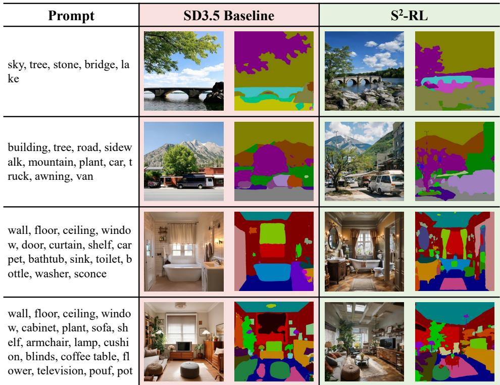  
Figure 4: Qualitative comparison of complex scene generation. We visualize images and pseudo-labels generated from multi-category prompts. In these examples, the SD3.5 baseline produces simplified scenes that omit some requested object categories, whereas $S ^ { 2 }$ -RL synthesizes semantically richer images with more complex scene structure.

Semantic Richness. We assess data quality with the complex-scene examples in Figure 4. While the SD3.5 baseline generates texturally plausible images, it often omits objects requested in dense prompts, such as specific furniture in Row 4 or distinct vehicles in Row 2. In contrast, $\mathrm { S ^ { 2 } \mathrm { - } R I }$ synthesizes scenes with higher semantic density, retaining richer structure and detail, from the foliage in Row 1 to the cluttered interior decor in Row 4. Such multi-category scenes provide supervision for several semantic regions and their shared context within each training image. This is valuable for dense prediction, where the student learns object appearance together with its surrounding scene structure. Preserving requested objects also retains boundaries between semantic regions, providing supervision for class transitions alongside region appearance. The qualitative examples complemen the category co-occurrence and relative-geometry measurements in Table 4.

## 6 Conclusion and Future Work

We propose $\mathrm { S ^ { 2 } \mathrm { - R L } }$ , a generative framework for semantic segmentation dataset distillation that finetunes Stable Diffusion via GRPO with a sample-set dual reward, integrating sample-level fidelity and set-level coverage to bypass the computational bottlenecks of bi-level optimization and the static-prior limitation of proxy-based methods. Experiments on ADE20K and COCO show consistent state-of-the-art gains, and our RL-driven paradigm offers a scalable path toward distillation for broader dense-prediction tasks. The framework incurs an upfront policy-adaptation cost and depends on pretrained generative and segmentation priors. Its rewards approximate downstream utility, and pseudo-labels may inherit teacher errors on rare or ambiguous categories. Future work could reduce adaptation and sampling costs, improve pseudo-label reliability through uncertainty-aware annotation, and incorporate lightweight student feedback to better align reward optimization with segmentation performance without full gradient unrolling.

## Acknowledgments

This work is supported in part by the National Natural Science Foundation of China under Grant 62372379, Grant 62472359, and Grant 62472350; in part by the Xi’an’s Key Industrial Chain Core Technology Breakthrough Project: AI Core Technology Breakthrough under Grant 23ZDCYJSGG0003-2023; in part by Innovation Foundation for Doctor Dissertation of Northwestern Polytechnical University under Grant CX2025092.

## References

[1] Mikołaj Binkowski, Danica J. Sutherland, Michael Arbel, and Arthur Gretton. Demystifying MMD GANs. In´ International Conference on Learning Representations, 2018. URL https://arxiv.org/abs/1801.01401.

[2] Kevin Black, Michael Janner, Yilun Du, Ilya Kostrikov, and Sergey Levine. Training diffusion models with reinforcement learning. In The Twelfth International Conference on Learning Representations, ICLR 2024, Vienna, Austria, May 7-11, 2024. OpenReview.net, 2024.

[3] George Cazenavette, Tongzhou Wang, Antonio Torralba, Alexei A. Efros, and Jun-Yan Zhu. Dataset distillation by matching training trajectories. In IEEE/CVF Conference on Computer Vision and Pattern Recognition, CVPR 2022, New Orleans, LA, USA, June 18-24, 2022, pages 10708–10717. IEEE, 2022.

[4] Jeffrey A. Chan-Santiago, Praveen Tirupattur, Gaurav Kumar Nayak, Gaowen Liu, and Mubarak Shah. MGD3: Modeguided dataset distillation using diffusion models. In Forty-second International Conference on Machine Learning, ICML 2025, Vancouver, BC, Canada, July 13-19, 2025, 2025.

[5] Liang-Chieh Chen, George Papandreou, Florian Schroff, and Hartwig Adam. Rethinking atrous convolution for semantic image segmentation. CoRR, abs/1706.05587, 2017.

[6] Yutian Chen, Max Welling, and Alexander J. Smola. Super-samples from kernel herding. In Peter Grünwald and Peter Spirtes, editors, UAI 2010, Proceedings of the Twenty-Sixth Conference on Uncertainty in Artificial Intelligence, Catalina Island, CA, USA, July 8-11, 2010, pages 109–116. AUAI Press, 2010.

[7] Bowen Cheng, Ishan Misra, Alexander G. Schwing, Alexander Kirillov, and Rohit Girdhar. Masked-attention mask transformer for universal image segmentation. In IEEE/CVF Conference on Computer Vision and Pattern Recognition, CVPR 2022, New Orleans, LA, USA, June 18-24, 2022, pages 1280–1289. IEEE, 2022.

[8] MMSegmentation Contributors. MMSegmentation: Openmmlab semantic segmentation toolbox and benchmark. https://github.com/open-mmlab/mmsegmentation, 2020.

[9] Jiawei Du, Xin Zhang, Juncheng Hu, Wenxin Huang, and Joey Tianyi Zhou. Diversity-driven synthesis: Enhancing dataset distillation through directed weight adjustment. In Amir Globerson, Lester Mackey, Danielle Belgrave, Angela Fan, Ulrich Paquet, Jakub M. Tomczak, and Cheng Zhang, editors, Advances in Neural Information Processing Systems 38: Annual Conference on Neural Information Processing Systems 2024, NeurIPS 2024, Vancouver, BC, Canada December 10 - 15, 2024, 2024

[10] Patrick Esser, Sumith Kulal, Andreas Blattmann, Rahim Entezari, Jonas Müller, Harry Saini, Yam Levi, Dominik Lorenz, Axel Sauer, Frederic Boesel, Dustin Podell, Tim Dockhorn, Zion English, and Robin Rombach. Scaling rectified flow transformers for high-resolution image synthesis. In Forty-first International Conference on Machine Learning, ICML 2024, Vienna, Austria, July 21-27, 2024, 2024.

[11] Reza Zanjirani Farahani and Masoud Hekmatfar. Facility location: concepts, models, algorithms and case studies. Springer Science & Business Media, 2009.

[12] Dan Friedman and Adji Bousso Dieng. The Vendi score: A diversity evaluation metric for machine learning. Transac tions on Machine Learning Research, 2023. URL https://openreview.net/forum?id=g97OHbQyk1.

[13] Jianyang Gu, Saeed Vahidian, Vyacheslav Kungurtsev, Haonan Wang, Wei Jiang, Yang You, and Yiran Chen. Efficient dataset distillation via minimax diffusion. In IEEE/CVF Conference on Computer Vision and Pattern Recognition, pages 15793–15803, 2024. URL https://openaccess.thecvf.com/content/CVPR2024/html/Gu\_ Efficient\_Dataset\_Distillation\_via\_Minimax\_Diffusion\_CVPR\_2024\_paper.html.

[14] Ziyao Guo, Kai Wang, George Cazenavette, Hui Li, Kaipeng Zhang, and Yang You. Towards lossless dataset distillation via difficulty-aligned trajectory matching. In International Conference on Learning Representations, 2024. URL https://proceedings.iclr.cc/paper\_files/paper/2024/hash/ fc740286fb4840cb56f99400817967da-Abstract-Conference.html.

[15] Kaiming He, Xiangyu Zhang, Shaoqing Ren, and Jian Sun. Deep residual learning for image recognition. In 2016 IEEE Conference on Computer Vision and Pattern Recognition, CVPR 2016, Las Vegas, NV, USA, June 27-30, 2016, pages 770–778. IEEE Computer Society, 2016.

[16] Martin Heusel, Hubert Ramsauer, Thomas Unterthiner, Bernhard Nessler, and Sepp Hochreiter. GANs trained by a two time-scale update rule converge to a local nash equilibrium. In Advances in Neural Information Processing Systems, volume 30, 2017. URL https://papers.nips.cc/paper/2017/hash/ 8a1d694707eb0fefe65871369074926d-Abstract.html.

[17] Edward J. Hu, Yelong Shen, Phillip Wallis, Zeyuan Allen-Zhu, Yuanzhi Li, Shean Wang, Lu Wang, and Weizhu Chen. Lora: Low-rank adaptation of large language models. In The Tenth International Conference on Learning Representations, ICLR 2022, Virtual Event, April 25-29, 2022, 2022.

[18] Jitesh Jain, Jiachen Li, MangTik Chiu, Ali Hassani, Nikita Orlov, and Humphrey Shi. OneFormer: One transformer to rule universal image segmentation. In IEEE/CVF Conference on Computer Vision and Pattern Recognition, 2023. URL https://arxiv.org/abs/2211.06220.

[19] Tommie Kerssies, Niccolò Cavagnero, Alexander Hermans, Narges Norouzi, Giuseppe Averta, Bastian Leibe, Gijs Dubbelman, and Daan de Geus. Your vit is secretly an image segmentation model. In IEEE/CVF Conference on Computer Vision and Pattern Recognition, CVPR 2025, Nashville, TN, USA, June 11-15, 2025, pages 25303–25313. Computer Vision Foundation / IEEE, 2025.

[20] Tsung-Yi Lin, Michael Maire, Serge J. Belongie, James Hays, Pietro Perona, Deva Ramanan, Piotr Dollár, and C. Lawrence Zitnick. Microsoft COCO: common objects in context. In David J. Fleet, Tomás Pajdla, Bernt Schiele, and Tinne Tuytelaars, editors, Computer Vision - ECCV 2014 - 13th European Conference, Zurich, Switzerland, September 6-12, 2014, Proceedings, Part V, volume 8693 of Lecture Notes in Computer Science, pages 740–755. Springer, 2014.

[21] Jie Liu, Gongye Liu, Jiajun Liang, Yangguang Li, Jiaheng Liu, Xintao Wang, Pengfei Wan, Di Zhang, and Wanli Ouyang. Flow-GRPO: Training flow matching models via online RL. CoRR, abs/2505.05470, 2025.

[22] Ze Liu, Yutong Lin, Yue Cao, Han Hu, Yixuan Wei, Zheng Zhang, Stephen Lin, and Baining Guo. Swin transformer: Hierarchical vision transformer using shifted windows. In 2021 IEEE/CVF International Conference on Computer Vision, ICCV 2021, Montreal, QC, Canada, October 10-17, 2021, pages 9992–10002. IEEE, 2021.

[23] Zhuang Liu, Hanzi Mao, Chao-Yuan Wu, Christoph Feichtenhofer, Trevor Darrell, and Saining Xie. A convnet for the 2020s. In IEEE/CVF Conference on Computer Vision and Pattern Recognition, CVPR 2022, New Orleans, LA, USA, June 18-24, 2022, pages 11966–11976. IEEE, 2022.

[24] Ilya Loshchilov and Frank Hutter. Decoupled weight decay regularization. In 7th International Conference on Learning Representations, ICLR 2019, New Orleans, LA, USA, May 6-9, 2019, 2019.

[25] Muhammad Ferjad Naeem, Seong Joon Oh, Youngjung Uh, Yunjey Choi, and Jaejun Yoo. Reliable fidelity and diversity metrics for generative models. In Proceedings ofthe 37th International Conference on Machine Learning, volume 119, pages 7176–7185. PMLR, 2020. URL https://proceedings.mlr.press/v119/naeem20a.html.

[26] Ding Qi, Jian Li, Jinlong Peng, Bo Zhao, Shuguang Dou, Jialin Li, Jiangning Zhang, Yabiao Wang, Chengjie Wang, and Cairong Zhao. Fetch and forge: Efficient dataset condensation for object detection. In Amir Globerson, Lester Mackey, Danielle Belgrave, Angela Fan, Ulrich Paquet, Jakub M. Tomczak, and Cheng Zhang, editors, Advances in Neural Information Processing Systems 38: Annual Conference on Neural Information Processing Systems 2024, NeurIPS 2024, Vancouver, BC, Canada, December 10 - 15, 2024, 2024.

[27] Ding Qi, Jian Li, Junyao Gao, Shuguang Dou, Ying Tai, Jianlong Hu, Bo Zhao, Yabiao Wang, Chengjie Wang, and Cairong Zhao. Towards universal dataset distillation via task-driven diffusion. In IEEE/CVF Conference on Computer Vision and Pattern Recognition, CVPR 2025, Nashville, TN, USA, June 11-15, 2025, pages 10557–10566. Computer Vision Foundation / IEEE, 2025.

[28] Fengli Ran, Xiao Pu, Bo Liu, Xiuli Bi, and Bin Xiao. TGDD: Trajectory guided dataset distillation with balanced distribution. In Fortieth AAAI Conference on Artificial Intelligence, AAAI 2026. AAAI Press, 2026.

[29] René Ranftl, Alexey Bochkovskiy, and Vladlen Koltun. Vision transformers for dense prediction. In 2021 IEEE/CVF International Conference on Computer Vision, ICCV 2021, Montreal, QC, Canada, October 10-17, 2021, pages 12159– 12168. IEEE, 2021.

[30] Ozan Sener and Silvio Savarese. Active learning for convolutional neural networks: A core-set approach. In 6th International Conference on Learning Representations, ICLR 2018, Vancouver, BC, Canada, April 30 - May 3, 2018, Conference Track Proceedings, 2018.

[31] Zhihong Shao, Peiyi Wang, Qihao Zhu, Runxin Xu, Junxiao Song, Xiao Bi, Haowei Zhang, Mingchuan Zhang, Y. K. Li, Y. Wu, and Daya Guo. DeepSeekMath: Pushing the limits of mathematical reasoning in open language models. arXiv preprint arXiv:2402.03300, 2024. URL https://arxiv.org/abs/2402.03300.

[32] Zhiqiang Shen, Ammar Sherif, Zeyuan Yin, and Shitong Shao. DELT: A simple diversity-driven Early-Late training for dataset distillation. In IEEE/CVF Conference on Computer Vision and Pattern Recognition, CVPR 2025, Nashville, TN, USA, June 11-15, 2025, pages 4797–4806. Computer Vision Foundation / IEEE, 2025.

[33] Oriane Siméoni, Huy V. Vo, Maximilian Seitzer, Federico Baldassarre, Maxime Oquab, Cijo Jose, Vasil Khalidov, Marc Szafraniec, Seung Eun Yi, Michaël Ramamonjisoa, Francisco Massa, Daniel Haziza, Luca Wehrstedt, Jianyuan Wang, Timothée Darcet, Théo Moutakanni, Leonel Sentana, Claire Roberts, Andrea Vedaldi, Jamie Tolan, John Brandt, Camille Couprie, Julien Mairal, Hervé Jégou, Patrick Labatut, and Piotr Bojanowski. DINOv3. CoRR, abs/2508.10104, 2025.

[34] Aleksandrs Slivkins. Introduction to multi-armed bandits. Found. Trends Mach. Learn., 12(1-2):1–286, 2019.

[35] Duo Su, Junjie Hou, Weizhi Gao, Yingjie Tian, and Bowen Tang. $\mathrm { D } ^ { 4 }$ m: Dataset distillation via disentangled diffusion model. In IEEE/CVF Conference on Computer Vision and Pattern Recognition, CVPR 2024, Seattle, WA, USA, June 16-22, 2024, pages 5809–5818. IEEE, 2024.

[36] Patrick von Platen, Suraj Patil, Anton Lozhkov, Pedro Cuenca, Nathan Lambert, Kashif Rasul, Mishig Davaadorj, Dhruv Nair, Sayak Paul, William Berman, Yiyi Xu, Steven Liu, and Thomas Wolf. Diffusers: State-of-the-art diffusion models. https://github.com/huggingface/diffusers, 2022.

[37] Bram Wallace, Meihua Dang, Rafael Rafailov, Linqi Zhou, Aaron Lou, Senthil Purushwalkam, Stefano Ermon, Caiming Xiong, Shafiq Joty, and Nikhil Naik. Diffusion model alignment using direct preference optimization. In IEEE/CVF Conference on Computer Vision and Pattern Recognition, CVPR 2024, Seattle, WA, USA, June 16-22, 2024, pages 8228–8238. IEEE, 2024.

[38] Jing Wang, Jiajun Liang, Jie Liu, Henglin Liu, Gongye Liu, Jun Zheng, Wanyuan Pang, Ao Ma, Zhenyu Xie, Xintao Wang, Meng Wang, Pengfei Wan, and Xiaodan Liang. GRPO-Guard: Mitigating implicit over-optimization in flow matching via regulated clipping. CoRR, abs/2510.22319, 2025.

[39] Kai Wang, Bo Zhao, Xiangyu Peng, Zheng Zhu, Shuo Yang, Shuo Wang, Guan Huang, Hakan Bilen, Xinchao Wang, and Yang You. CAFE: Learning to condense dataset by aligning features. In IEEE/CVF Conference on Computer Vision and Pattern Recognition, CVPR 2022, New Orleans, LA, USA, June 18-24, 2022, pages 12186–12195. IEEE, 2022.

[40] Tongzhou Wang, Jun-Yan Zhu, Antonio Torralba, and Alexei A. Efros. Dataset distillation. CoRR, abs/1811.10959, 2018.

[41] Max Welling. Herding dynamical weights to learn. In Andrea Pohoreckyj Danyluk, Léon Bottou, and Michael L. Littman, editors, Proceedings ofthe 26th Annual International Conference on Machine Learning, ICML 2009, Montreal, Quebec, Canada, June 14-18, 2009, volume 382 of ACM International Conference Proceeding Series, pages 1121– 1128. ACM, 2009.

[42] Tete Xiao, Yingcheng Liu, Bolei Zhou, Yuning Jiang, and Jian Sun. Unified perceptual parsing for scene understanding. In Vittorio Ferrari, Martial Hebert, Cristian Sminchisescu, and Yair Weiss, editors, Computer Vision - ECCV 2018 - 15th European Conference, Munich, Germany, September 8-14, 2018, Proceedings, Part V, volume 11209 of Lecture Notes in Computer Science, pages 432–448. Springer, 2018.

[43] Enze Xie, Wenhai Wang, Zhiding Yu, Anima Anandkumar, José M. Álvarez, and Ping Luo. SegFormer: Simple and efficient design for semantic segmentation with transformers. In Marc’Aurelio Ranzato, Alina Beygelzimer, Yann N. Dauphin, Percy Liang, and Jennifer Wortman Vaughan, editors, Advances in Neural Information Processing Systems 34: Annual Conference on Neural Information Processing Systems 2021, NeurIPS 2021, December 6-14, 2021, virtual, pages 12077–12090, 2021.

[44] Han Xue, Zhiwu Huang, Qianru Sun, Li Song, and Wenjun Zhang. Freestyle layout-to-image synthesis. In IEEE/CVF Conference on Computer Vision and Pattern Recognition, CVPR 2023, Vancouver, BC, Canada, June 17-24, 2023, pages 14256–14266. IEEE, 2023.

[45] Zeyuan Yin, Eric P. Xing, and Zhiqiang Shen. Squeeze, recover and relabel: Dataset condensation at imagenet scale from a new perspective. In Alice Oh, Tristan Naumann, Amir Globerson, Kate Saenko, Moritz Hardt, and Sergey Levine, editors, Advances in Neural Information Processing Systems 36: Annual Conference on Neural Information Processing Systems 2023, NeurIPS 2023, New Orleans, LA, USA, December 10 - 16, 2023, 2023.

[46] Richard Zhang, Phillip Isola, Alexei A. Efros, Eli Shechtman, and Oliver Wang. The unreasonable effectiveness of deep features as a perceptual metric. In IEEE/CVF Conference on Computer Vision and Pattern Recognition, 2018. URL https://arxiv.org/abs/1801.03924.

[47] Bo Zhao and Hakan Bilen. Dataset condensation with differentiable siamese augmentation. In Proceedings of the 38th International Conference on Machine Learning, volume 139, pages 12674–12685. PMLR, 2021. URL https: //proceedings.mlr.press/v139/zhao21a.html.

[48] Bo Zhao, Konda Reddy Mopuri, and Hakan Bilen. Dataset condensation with gradient matching. In 9th International Conference on Learning Representations, ICLR 2021, Virtual Event, Austria, May 3-7, 2021, 2021.

[49] Ganlong Zhao, Guanbin Li, Yipeng Qin, and Yizhou Yu. Improved distribution matching for dataset condensation. In IEEE/CVF Conference on Computer Vision and Pattern Recognition, CVPR 2023, Vancouver, BC, Canada, June 17-24, 2023, pages 7856–7865. IEEE, 2023.

[50] Wenliang Zhong, Haoyu Tang, Qinghai Zheng, Mingzhu Xu, Yupeng Hu, and Weili Guan. Towards stable and storageefficient dataset distillation: Matching convexified trajectory. In IEEE/CVF Conference on Computer Vision and Pattern Recognition, CVPR 2025, Nashville, TN, USA, June 11-15, 2025, pages 25581–25589. Computer Vision Foundation / IEEE, 2025.

[51] Bolei Zhou, Hang Zhao, Xavier Puig, Sanja Fidler, Adela Barriuso, and Antonio Torralba. Scene parsing through ADE20K dataset. In 2017 IEEE Conference on Computer Vision and Pattern Recognition, CVPR 2017, Honolulu, HI, USA, July 21-26, 2017, pages 5122–5130. IEEE Computer Society, 2017.

[52] Yongchao Zhou, Ehsan Nezhadarya, and Jimmy Ba. Dataset distillation using neural feature regression. In Advances in Neural Information Processing Systems, volume 35, 2022. URL https://proceedings.neurips.cc/paper\_ files/paper/2022/hash/3fe2a777282299ecb4f9e7ebb531f0ab-Abstract-Conference.html.

[53] Yawen Zou, Guang Li, Duo Su, Zi Wang, Jun Yu, and Chao Zhang. Dataset distillation via vision-language category prototype. CoRR, abs/2506.23580, 2025.

## A Theoretical Elaboration

In this section, we provide additional derivations and interpretations supporting our proposed framework, including the gradient estimation of GRPO and an optimization interpretation of the sampleset dual reward.

## A.1 Gradient Estimation of GRPO

A generated image ${ \hat { x } } = x _ { 0 }$ is the endpoint of a denoising trajectory $\tau = ( x _ { T } , \dots , x _ { 0 } )$ . Its trajectory log-probability decomposes into transition log-probabilities, up to the initial noise distribution, which is independent of θ:

$$
\nabla _ { \theta } \log \pi _ { \theta } ( \tau \mid c ) = \sum _ { t = 1 } ^ { T } \nabla _ { \theta } \log \pi _ { \theta } ( x _ { t - 1 } \mid x _ { t } , c ) .\tag{9}
$$

This decomposition motivates assigning a terminal reward to the stored denoising transitions without evaluating the intractable marginal probability of the final image. Our implemented update is a clipped transition-wise GRPO surrogate, rather than an exact trajectory-level importance-sampling estimator.

For a prompt $c ,$ the rollout policy $\pi _ { \theta _ { o l d } }$ generates $G$ trajectories. We evaluate the total terminal rewards $R _ { i }$ against the shared batch count state described in Algorithm 1, then form

$$
\mathbb { A } _ { i } = \mathrm { c l i p } \bigg ( \frac { R _ { i } - \mu _ { c } } { \sigma _ { c } + \varepsilon } , - 5 , 5 \bigg ) , \qquad \mu _ { c } = \frac { 1 } { G } \sum _ { i = 1 } ^ { G } R _ { i } ,\tag{10}
$$

where $\sigma _ { c }$ is the reward standard deviation within this same-prompt group. The reward, count state, and advantage are held fixed during the policy update. The raw importance ratio for a stored transition is

$$
\rho _ { i , t } ( \theta ) = \exp [ \log \pi _ { \theta } ( x _ { i , t - 1 } \mid x _ { i , t } , c ) - \log \pi _ { \theta _ { o l d } } ( x _ { i , t - 1 } \mid x _ { i , t } , c ) ] .\tag{11}
$$

Following GRPO-Guard [38], RatioNorm regulates the transition log-ratios before exponentiation; we denote the resulting ratio by $\widetilde { \rho } _ { i , t }$ . Inverse scheduler-step weighting supplies w to balance contributions across trained denoising timesteps. The resulting objective is $\operatorname { E q . 3 } \colon$ each transition’s ratio is clipped separately and its contribution is averaged across the group and trained timesteps. In particular, the implementation does not multiply transition ratios into one trajectory ratio and then clip that product.

The clipping width is $\epsilon = 2 \times 1 0 ^ { - 6 }$ . We use one inner optimization epoch per rollout, refresh the rollout policy, update only LoRA parameters, clip gradient norms to 1.0, and maintain an exponential moving average (EMA). The reference-policy KL coefficient is zero. Thus, zero reference KL does not remove the transition clipping or these other update constraints. Independent-policy variability is assessed separately in Appendix D.3.

## A.2 Optimization Interpretation of Sample-Set Dual Reward

In this section, we analyze the optimization behavior encouraged by the sample-set dual reward. The policy parameters θ are updated via GRPO to maximize the total reward objective $\mathcal { T } _ { t o t a l } \ \stackrel {  } { = } \ \mathbb { E } _ { \pi _ { \theta } } \bar { [ R } _ { t o t a l } ]$ . Since the total reward is a linear combination of three components (Eq. 8), the policy-gradient update is driven by the standardized advantage of $R _ { t o t a l } , \mathbb { A } _ { t o t a l } =$ $( R _ { t o t a l } - \mu _ { R _ { t o t a l } } ) / ( \sigma _ { R _ { t o t a l } } + \varepsilon )$

$$
\begin{array} { r } { \nabla _ { \theta } \mathcal { I } \approx \mathbb { E } _ { \hat { x } , c } \left[ \mathbb { A } _ { t o t a l } \nabla _ { \theta } \log \pi _ { \theta } ( \hat { x } | c ) \right] . } \end{array}\tag{12}
$$

Because standardization is non-linear, $\mathbb { A } _ { t o t a l }$ does not exactly factorize into a weighted sum of perreward standardized advantages; nonetheless, $R _ { t o t a l }$ is linear in the three reward components, so an increase (decrease) in any single component, holding the others fixed, monotonically increases (decreases) $\mathbb { A } _ { t o t a l }$ within the same group. We use this monotonicity to interpret the role of each component below.

Proposition 1 (Alignment-induced Suppression of Invalid Samples). For samples whose semantic content is inconsistent with the prompt, the alignment reward assigns a lower relative advantage. Under a GRPO update, this decreases their relative likelihood compared with prompt-consistent samples from the same group.

Proof. Consider a generated sample xˆ that fails to match the prompt $c ,$ such as a sample missing the target objects. In this case, the alignment reward $R _ { a l i g n } ( \bar { \hat { x } } )$ is lower than that of semantically valid alternatives generated for the same prompt; holding $R _ { d i v }$ and $R _ { s e t }$ fixed within the group, the total reward $R _ { t o t a l } ( { \hat { x } } )$ is correspondingly smaller, and after group-wise standardization the sample receives a smaller (typically negative) advantage $\mathbb { A } _ { t o t a l } ( \hat { x } )$ ).

The corresponding policy-gradient contribution is

$$
\begin{array} { r } { \Delta \theta \propto \mathbb { A } _ { t o t a l } ( \hat { x } ) \nabla _ { \theta } \log \pi _ { \theta } ( \hat { x } | c ) . } \end{array}\tag{13}
$$

When $\mathbb { A } _ { t o t a l } ( \hat { x } ) < 0 .$ , this update decreases the relative log-probability of producing xˆ under prompt $c .$ Therefore, the alignment reward biases the policy away from semantically invalid generations and toward prompt-consistent samples. This effect should be interpreted as a local optimization pressure induced by the reward, rather than as a guarantee of eliminating all invalid samples. □

Proposition 2 (Diversity Reward Penalizes Feature Collapse). The diversity rewardpenalizes highly similar pixel-level features within the same semantic category, thereby discouraging repetitive or collapsed intra-class structures.

Proof. Let $\mathcal { F } _ { k } = \{ \mathbf { z } _ { k , m } \} _ { m = 1 } ^ { M _ { k } }$ be the set of pixel-level feature vectors belonging to class k in the generated image ${ \hat { x } } .$ For classes with at least two feature vectors, the diversity reward in Eq. 5 can equivalently be written as $\begin{array} { r } { R _ { d i v } ( \hat { x } ) = - \frac { 1 } { | \mathcal C _ { p r e d } ^ { \geq 2 } | } \sum _ { k \in \mathcal C _ { p r e d } ^ { \geq 2 } } \mathcal L _ { d i v , k } . } \end{array}$ , where the per-class penalty

$$
\mathcal { L } _ { d i v , k } = \frac { 2 } { M _ { k } ( M _ { k } - 1 ) } \sum _ { 1 \le m < n \le M _ { k } } \operatorname* { m a x } ( 0 , \cos ( \mathbf { z } _ { k , m } , \mathbf { z } _ { k , n } ) - \delta )\tag{14}
$$

measures the average unordered pairwise cosine similarity exceeding the margin δ. Classes with $M _ { k } \ < \ 2$ are excluded from the average, and $R _ { d i v }$ is set to zero if no class remains. Maximizing $R _ { d i v }$ therefore corresponds to minimizing each valid $\mathcal { L } _ { d i v , k }$

When the generated region for class k collapses into repetitive textures or nearly uniform structures, the corresponding feature vectors become highly similar, yielding $\cos ( \mathbf { z } _ { k , m } , \mathbf { z } _ { k , n } ) > \delta$ for many pairs. This increases $\mathcal { L } _ { d i v , k }$ and lowers $R _ { d i v }$ .

The gradient of the per-class penalty with respect to a feature vector has the form

$$
\nabla _ { \mathbf z _ { k , m } } \mathcal L _ { d i v , k } \propto \sum _ { n : \cos ( \mathbf z _ { k , m } , \mathbf z _ { k , n } ) > \delta } \frac { \mathbf z _ { k , n } - ( \mathbf z _ { k , m } \cdot \mathbf z _ { k , n } ) \mathbf z _ { k , m } } { \| \mathbf z _ { k , m } \| \| \mathbf z _ { k , n } \| } ,\tag{15}
$$

where the simplified form above follows the normalized-vector form of cosine similarity. In implementation, $R _ { d i v }$ is computed with the cosine-similarity operator on intermediate feature maps from the frozen segmentation evaluators, which normalizes each feature vector internally. The summation is taken over feature pairs whose similarity exceeds the margin. Moving in the negative-gradient direction (i.e., performing gradient descent on $\mathcal { L } _ { d i v , k } )$ reduces excessive pairwise similarity among features in the same class. Consequently, the diversity reward discourages trivial intra-class feature collapse and encourages more discriminative local structures within generated semantic regions.

Proposition 3 (Scarcity Reward Induces Negative Feedback). The scarcity term in the set-level reward induces a negativefeedback mechanism over semantic prototypes: under-covered prototypes receive larger rewards, while over-covered prototypes receive smaller rewards.

Proof. Fix a class k and let $\hat { N } ( \mathbf { p } , t )$ denote the accumulated soft count of prototype $\mathbf { p } \in \mathcal { P } _ { k }$ at training step t. Let $\begin{array} { r } { \bar { N } _ { k } ( t ) = \frac { 1 } { | \mathcal { P } _ { k } | } \sum _ { \mathbf { p } \in \mathcal { P } _ { k } } \hat { N } ( \mathbf { p } , t ) } \end{array}$ denote the average soft count over the prototypes of class k. Ignoring the exploration bonus for the moment, the scarcity term in Eq. 7 scales as

$$
r ( \mathbf { p } , t ) \propto \left( \frac { \bar { N } _ { k } ( t ) + 1 } { \hat { N } ( \mathbf { p } , t ) + 1 } \right) ^ { \alpha } .\tag{16}
$$

If prototype p is under-covered, i. $\mathbf { e } . , \hat { N } ( \mathbf { p } , t ) < \bar { N } _ { k } ( t )$ , then $r ( \mathbf { p } , t )$ is strictly larger than the reward of an average-covered prototype $r ( \bar { N } _ { k } ( t ) , \cdot )$ . When samples assigned to this prototype are generated, they receive higher relative advantages, increasing their likelihood under the policy update. This accelerates the accumulation of $\hat { N } ( \mathbf { p } , t )$

Conversely, if prototype $\mathbf { p }$ is over-covered, i.e., $\hat { N } ( \mathbf { p } , t ) > \bar { N } _ { k } ( t )$ , then its scarcity reward becomes smaller. Samples assigned to this prototype receive lower relative advantages, reducing their relative preference in subsequent updates. This forms a closed-loop negative feedback mechanism that encourages more balanced prototype coverage over training. □

Proposition 4 (Exploration Bonus for Under-visited Prototypes). The exploration bonus increases the reward ofpersistently under-visited prototypes, providing an additional incentive for semantic exploration.

Proof. Fix a class k and let $\begin{array} { r } { N _ { k } ( t ) = \sum _ { \mathbf { p } \in \mathcal { P } _ { k } } \hat { N } ( \mathbf { p } , t ) } \end{array}$ denote the total soft count over prototypes of class k at training step t. The exploration bonus in Eq. 7 takes the form

$$
B ( \mathbf { p } , t ) \propto \sqrt { \frac { \mathrm { l n } ( \mathrm { m a x } ( N _ { k } ( t ) , 1 ) ) } { \hat { N } ( \mathbf { p } , t ) + 1 } } .\tag{17}
$$

For a prototype p with a small soft count $\hat { N } ( \mathbf { p } , t )$ , this term becomes large relative to prototypes that have already been frequently visited. Therefore, when a generated sample is assigned to an under-visited prototype, it receives an additional reward bonus and a larger relative advantage in the GRPO update.

This mechanism does not guarantee that every prototype will be sampled with nonzero probability at all times. Rather, it increases the reward of under-visited prototypes once they are reached, thereby encouraging continued exploration and reducing the tendency of the policy to concentrate only on already frequent semantic modes. □

Proposition 5 (Combined Effect of Sample-Set Dual Reward). The combined reward objective biases the policy toward prompt-consistent, feature-diverse, and semantically well-covered samples. It discourages degenerate solutions by combining sample-level quality rewards with a set-level coverage reward.

Proof. Let S be the generation space and let $\boldsymbol { S _ { v a l i d } } \subset \boldsymbol { S }$ denote the subset of samples that are semantically consistent with the prompt. The total reward introduces three complementary optimization effects:

1. Semantic alignment. By Proposition 1, prompt-inconsistent samples receive lower relative advantages, which reduces their relative likelihood compared with semantically valid alternatives generated for the same prompt.

2. Feature diversity. By Proposition 2, repetitive intra-class feature structures receive lower diversity rewards, which discourages low-information textures and encourages more discriminative local structures.

3. Set-level coverage. By Propositions 3 and 4, under-covered semantic prototypes receive larger set-level rewards, creating a negative feedback mechanism that promotes broader prototype coverage over the distilled set.

Therefore, the sample-level rewards improve the local quality of individual generated images, while the set-level reward encourages global semantic coverage across the generated set. The combined objective does not impose exact uniformity or guarantee perfect convergence, but it provides a principled optimization bias toward informative and diverse dense-prediction training samples. □

## B Detailed Implementation Settings

In this section, we provide the comprehensive hyperparameter settings and architectural details required to reproduce our experiments. Our framework is implemented using PyTorch and the Diffusers library [36] based on GRPO Guard [38].

## B.1 Architecture Details

Policy Model. We utilize Stable Diffusion 3.5 Medium [10] as our backbone policy πθ. To ensure training efficiency and prevent catastrophic forgetting of the pretrained generative priors, we adopt low-rank adaptation (LoRA) [17] for fine-tuning.

• Base Model: Stable Diffusion 3.5 Medium (2.5B parameters).

• LoRA Configuration: We inject LoRA layers into the attention mechanisms of the MMDiT. The LoRA rank is set to 32, with an alpha value of 64.

• Trainable Parameters: Only the LoRA weights (∼ 70 MB) are updated during the RL phase.

Reward Models. Our dual-reward mechanism relies on three types of frozen pretrained models, each playing a distinct role:

• Semantic Evaluator Ensemble. For ADE20K we use UPerNet-ConvNeXt-Large [42, 23], SegFormer-B5 [43], and DPT-Large [29]; for COCO we use Mask2Former-Swin-Large [7], EOMT-Large [19], and EOMT-Base. Each frozen evaluator computes alignment from its own mask and diversity from its own intermediate feature grid, using at most 100 locations per predicted class. We sum the resulting scalar sample rewards. Raw feature vectors from different architectures are never compared. Per-pixel majority voting combines the masks only for DINOv3 region pooling in the set-level reward.

• Pseudo-Label Teacher. The downstream student is trained on synthesized images paired with pseudo-labels produced by a single, stronger frozen segmentor: UPerNet-ConvNeXt-XLarge for ADE20K and Mask2Former-Swin-Large for COCO. The same teacher is used to label images from all synthetic baselines (SD3.5, UniDD∗, and S2-RL), so the annotation procedure and downstream training protocol are shared across methods.

• Feature Extractor. The set-level reward (Eq. 7) is computed on dense patch features from a frozen DINOv3 ViT-L model [33]. The semantic mask from the segmentor ensemble is downsampled by nearest-neighbor interpolation to match the DINOv3 patch grid, and DINOv3 features are L - normalized along the channel dimension before any cosine-similarity computation. DINOv3 is used only for semantic-arm construction and matching in $R _ { s e t }$

## B.2 UniDD-inspired Proxy-guided Baseline

We implement a UniDD-inspired proxy-guided baseline as an additional generative comparison. UniDD [27] uses task-specific proxy models to extract task-relevant supervision and guide diffusion-based dataset distillation. Since the official UniDD implementation is not publicly avail able, we implement a segmentation-oriented proxy-guided baseline using a released pretrained FreestyleNet [44] checkpoint as the layout-to-image generator, while following the proxy-guided sampling and refinement principle of UniDD. This implementation corresponds to the UniDD∗ entries in Table 1 and Table 2.

The proxy-guided baseline initializes generation from the masks selected by the Uniform baseline. This keeps the layout source and compression budget aligned with the real-data subset baselines, while replacing the corresponding real images with generated images. FreestyleNet takes dense semantic layouts as conditions and synthesizes images aligned with the input masks, making it suitable for adapting proxy-guided generation to semantic segmentation.

The proxy segmentation model is dataset-specific. For ADE20K, we use SegFormer-B0 as the proxy segmentation model. For COCO, we use MaskFormer-R50 as the proxy segmentation model. During generation, the proxy model scores the semantic consistency between the generated image and the input mask, and this score is used for refinement and filtering. After image generation, we use the same pseudo-labeling teacher as $\mathrm { S ^ { 2 } \mathrm { - R L } }$ to obtain pixel-wise annotations, so that all synthetic baselines are evaluated with the same downstream training pipeline.

We follow the original UniDD hyperparameter setting as closely as possible. Each image is generated with 250 sampling steps. The filtering threshold is set to 0.75. A generated image is accepted if its proxy score exceeds this threshold. If the proxy score remains below the threshold for three consecutive attempts, we keep the highest-scoring image among the attempted samples. This fallback rule preserves a fixed dataset size for every compression ratio and prevents failed generations from changing the number of downstream training images.

We report this method as UniDD∗ to indicate that it is a segmentation-oriented adaptation of UniDD rather than the official implementation. Compared with the vanilla SD3.5 baseline, UniDD∗ uses mask-conditioned generation and task-specific proxy filtering. Compared with $\mathrm { S ^ { 2 } \mathrm { - R L } }$ , it does not fine-tune the diffusion policy with sample-set rewards, but instead relies on iterative proxy-guided sampling from the pretrained FreestyleNet generator.

## B.3 Hyperparameters

We list the detailed hyperparameters used for training $S ^ { 2 }$ -RL in Table 6. The optimization is conducted on a per-dataset basis (ADE20K and COCO).

Table 6: Detailed Hyperparameters for $S ^ { 2 }$ -RL Training.
<table><tr><td>Hyperparameter</td><td>ADE20K</td><td>COCO</td></tr><tr><td colspan="3">Optimization (GRPO) Optimizer</td></tr><tr><td>Learning Rate Batch Size (Prompts)</td><td>AdamW [24]  $1 \times 1 0 ^ { - 4 }$ </td><td></td></tr><tr><td>Group Size (G)</td><td>16</td><td>16</td></tr><tr><td>Ratio Clipping Width (€)</td><td>8  $2 \times 1 0 ^ { - 6 }$ </td><td></td></tr><tr><td>Advantage Clipping</td><td></td><td></td></tr><tr><td>Inner Epochs per Rollout</td><td> $[ - 5 , 5 ]$ </td><td></td></tr><tr><td>Gradient Clipping</td><td>1</td><td></td></tr><tr><td>KL Penalty Coefficient</td><td>1.0</td><td></td></tr><tr><td>EMA</td><td>0.0 true</td><td></td></tr><tr><td>Reward Configuration</td><td></td><td></td></tr><tr><td></td><td></td><td></td></tr><tr><td>Recall vs. Occupancy Weight  $\left( \lambda _ { a r e a } \right)$ </td><td>0.3</td><td></td></tr><tr><td>Diversity Margin (δ)</td><td>0.8</td><td></td></tr><tr><td>Scarcity Decay Factor (α)</td><td>1.0</td><td></td></tr><tr><td>Exploration Bonus Weight (β)</td><td>0.5</td><td></td></tr><tr><td>Total Objective Weights (Eq. 8)</td><td></td><td></td></tr><tr><td>Alignment Weight  $( \gamma _ { a } )$ </td><td>1.0</td><td>1.0</td></tr><tr><td>Diversity Weight (γd)</td><td>5.0</td><td>10.0</td></tr><tr><td>Set Weight (γs)</td><td>3.0</td><td>5.0</td></tr><tr><td>Clustering (Set Reward)</td><td></td><td></td></tr><tr><td>Number of Clusters (K)</td><td>50</td><td></td></tr><tr><td>Clustering Algorithm</td><td>K-Means (Euclidean distance)</td><td></td></tr><tr><td>Generate Configuration</td><td></td><td></td></tr><tr><td>Inference Scheduler</td><td></td><td></td></tr><tr><td></td><td>FlowMatchEulerDiscreteScheduler</td><td></td></tr><tr><td>Classifier-Free Guidance</td><td>7.0</td><td></td></tr><tr><td>Inference Steps</td><td>50</td><td></td></tr></table>

Zero-KL setting. We use the zero-KL setting adopted in the GRPO-Guard [38] training configuration, where the KL loss is not applied. GRPO-Guard stabilizes GRPO-style optimization for diffusion/flow models through regulated clipping, implemented by ratio normalization and gradient reweighting across denoising timesteps. These operations restore more balanced importance-ratio distributions and reduce timestep-wise gradient imbalance during policy optimization.

## B.4 GRPO Reward Computation Details

We describe the reward computation process used during GRPO fine-tuning. In each training iteration, we sample 16 text prompts from the prompt pool. For each prompt, the rollout policy generates a group of 8 trajectories for ADE20K or 16 for COCO, each producing one candidate image. Rewards are computed on the final images, while the policy update uses the stored denoising trajectories to evaluate the clipped per-step importance-ratio objective described in Appendix A.1.

Table 7: Construction cost and peak GPU memory on ADE20K at the 1.0% budget.
<table><tr><td>Method</td><td>Construction Cost</td><td>Peak GPU Memory</td></tr><tr><td>Random</td><td>selection &lt;1 min</td><td>N/A</td></tr><tr><td>Uniform</td><td>selection &lt;1 min</td><td>N/A</td></tr><tr><td>K-Center</td><td>selection ～10 min</td><td>~4 GB</td></tr><tr><td>Herding</td><td>selection ～10 min</td><td>~4 GB</td></tr><tr><td>SD3.5 Baseline</td><td>inference ~1 GPU-hr</td><td>~40 GB</td></tr><tr><td>UniDD*</td><td>FreestyleNet training ~48 GPU-hrs inference ～10 GPU-hrs</td><td>~30 GB</td></tr><tr><td>S2-RL</td><td>RL training ~48 GPU-hrs inference ~1 GPU-hr</td><td>~46 GB</td></tr></table>

For each generated image, we compute the sample-level reward terms, including semantic alignment and intra-class feature diversity. The semantic alignment reward evaluates whether the generated image is consistent with the target semantic content specified by the prompt. The intra-class diversity reward evaluates whether the image contains discriminative class-level features rather than repetitive or collapsed visual patterns. These two terms are computed independently for each image and provide local supervision for sample quality.

The set-level reward is computed on the same generated batch rather than on a separate reward batch. After extracting semantic features from all generated images in the current iteration, each feature is assigned to its nearest semantic prototype. We then accumulate the prototype-count increment induced by the current mini-batch. The set-level reward is evaluated using both the historical prototype counts and the current batch-level increment, before committing the new counts to the global memory. This batch-aware update prevents reward inflation across iterations rather than within a single batch: samples that match the same prototype within a single iteration receive the same exploration bonus, but historical counts are updated only after the entire batch has been evaluated, so later iterations correctly see the marginal coverage contributed by the previous one.

After combining the sample-level and set-level rewards, GRPO computes advantages within each same-prompt group. Specifically, the G rewards belonging to one prompt are normalized within that group, and the resulting advantages are clipped to [−5, 5] before use in the surrogate. We do not normalize rewards across all 16 prompts in the iteration. This design ensures that the policy compares alternative generations under the same semantic condition, rather than mixing reward scales across unrelated prompts.

The sample-level and set-level rewards serve different roles in optimization. The sample-level rewards guide each individual image toward semantic correctness and feature discriminability. The set-level reward tracks prototype visitation during policy training and assigns larger bonuses to under-covered semantic modes. Therefore, the set-level reward does not duplicate the sample-level objectives; instead, it introduces a dataset-level exploration signal that encourages the policy to construct a more balanced and informative synthetic set.

## B.5 Computational Resources

Table 7 summarizes the construction cost and peak GPU memory of different dataset construction pipelines on ADE20K at the 1.0% budget. For selection-based baselines, the reported cost corresponds to feature extraction and subset selection. For generative baselines, the reported cost includes the generation or adaptation stage required by the corresponding pipeline; for UniDD∗, the FreestyleNet training cost is taken from the original FreestyleNet paper because our experiments use its released pretrained checkpoint.

The selection-based baselines only operate on the original training set and therefore require substantially lower construction cost. Random and Uniform selection do not require feature extraction, while K-Center and Herding additionally compute selection features before subset construction.

The SD3.5 baseline directly samples images from the pretrained text-to-image model and does not include task-specific policy adaptation. UniDD∗ uses FreestyleNet for mask-conditioned generation and performs proxy-guided refinement during inference. The FreestyleNet training cost in Table 7 is converted from the FreestyleNet supplementary material [44], which reports approximately 2 days of training on ADE20K using a single NVIDIA A100 GPU, corresponding to approximately 48 GPUhours. In our experiments, UniDD∗ starts from the released pretrained FreestyleNet checkpoint, and the measured inference cost corresponds to proxy-guided generation with this checkpoint.

$\mathrm { S ^ { 2 } \mathrm { - } R I }$ uses pretrained SD3.5 as the initial policy and performs reward-guided RL fine-tuning on our RTX Pro 6000 GPUs. The reported $\mathrm { S ^ { 2 } \mathrm { - } R I }$ cost includes the RL adaptation stage and the subsequent synthetic set generation stage. Downstream student training is conducted under the same protocol for all constructed training sets.

## B.6 Generator and Sampling-Budget Controls

Table 8: Additional controls on ADE20K 1.0% with SegFormer-B5. Both blocks use SD3.5; costs in (b) are approximate generative GPU-hours. Scores are mean ± SD over 5 sets × 5 student seeds.
<table><tr><td>Method</td><td>GPU-hours mIoU (%) mAcc (%)</td><td></td></tr><tr><td colspan="3">(a) Shared generator backbone</td></tr><tr><td>UniDD* (SD3.5 control)</td><td> $2 3 . 9 5 { \scriptstyle \pm 0 . 4 1 }$ </td><td> $3 3 . 8 0 { \scriptstyle \pm 0 . 9 2 }$ </td></tr><tr><td> $\mathrm { S ^ { 2 } { - } R L }$ </td><td> $2 5 . 4 7 { \scriptstyle \pm 0 . 2 4 }$ </td><td> $3 5 . 5 8 { \scriptstyle \pm 0 . 5 7 }$ </td></tr><tr><td colspan="3">(b) Approximately matched generative computation</td></tr><tr><td>SD3.5 best-of-N  ${ \sim } 5 0$ </td><td> $2 3 . { \dot { 2 } } 9 { \pm } 0 . 3 6$ </td><td> $3 3 . 0 4 { \scriptstyle \pm 0 . 8 3 }$ </td></tr><tr><td> $\mathrm { S } ^ { 2 } \mathrm { - R L }$  ~49</td><td> $2 5 . 4 7 { \scriptstyle \pm 0 . 2 4 }$ </td><td> $3 5 . 5 8 { \scriptstyle \pm 0 . 5 7 }$ </td></tr></table>

Shared generator backbone. For the ADE20K 1.0% control in Table 8(a), we adapt SD3.5 to accept semantic masks following the FreestyleNet conditioning approach, train it on ADE20K, and apply the UniDD-inspired proxy-guided procedure. Both methods use SegFormer-B5 with five constructed sets and five student seeds per set. The original multi-budget UniDD∗ results in Tables 1 and 2 use the FreestyleNet-based implementation described in Appendix B.2.

Approximately matched generative computation. The unadapted SD3.5 best-of-N control uses the same class-list prompts and generates approximately 200 candidates per prompt. Candidates are screened with the same sample-level and set-level reward functions used in policy training, retaining one image per prompt and 202 images per set. $\mathrm { ~ S ^ { 2 }  – R L }$ generates four candidates per prompt after policy adaptation and retains the same dataset size. Best-of-N uses approximately 50 GPU-hours for generation; $\mathrm { \bf S ^ { 2 } - R L }$ uses approximately 48 for adaptation and 1 for generation. These totals compare generative GPU-hours, without a complete accounting of preprocessing, reward evaluation, pseudo-labeling, or downstream training. Both methods follow the same five-set, five-student-seed evaluation protocol.

Generator and Compute Controls. Table 8(a) compares $\mathrm { S ^ { 2 } \mathrm { - R L } }$ with a mask-conditioned UniDD∗ adaptation using the same SD3.5 backbone. The advantage persists with a shared generator, highlighting the value of coupling flexible text-conditioned generation with sample-set rewards for segmentation distillation. Table 8(b) compares policy adaptation with best-of-N sampling under a similar generative budget. Both approaches use the same reward functions to screen candidates, and the adapted policy yields stronger downstream performance. This suggests a benefit from shaping the distribution from which candidates are drawn when constructing a compact training set.

## B.7 Downstream Training Details

We train student models independently on each distilled dataset. Each SegFormer-B5 run initializes its MiT-B5 backbone from ImageNet-1K-pretrained weights.

• Framework: MMSegmentation [8].

• Training Schedule: 200 epochs.

• Batch Size: 16.

• Crop Size: $5 1 2 \times 5 1 2 .$

• Data Augmentation: Same as the default settings of MMSegmentation. (Random Resize, Random Crop, Random Flip, and Photo Metric Distortion.)

## C Additional Visualizations

In this section, we provide extensive qualitative results to demonstrate the visual fidelity and semantic diversity of the synthetic datasets generated by $\mathrm { S ^ { 2 } \mathrm { - } R I }$ . We showcase all generated images from both ADE20K and COCO datasets.

## C.1 Qualitative Results on ADE20K

Figures 5, 6, and 7 display all synthetic images generated for the ADE20K dataset using the first generation seed. The results highlight our model’s ability to synthesize complex scene layouts, such as cluttered bedrooms and diverse street scenes, strictly following the semantic constraints defined in the prompts.

## C.2 Qualitative Results on COCO

Figures 8, 9, and 10 present the generation results on the COCO dataset using the first generation seed. Compared to ADE20K, COCO contains more object-centric scenes with varied backgrounds. $\mathrm { S ^ { 2 } \mathrm { - } R I }$ L effectively handles these variations, producing high-fidelity objects with diverse textures and lighting conditions.

## D Extended Ablation Studies

All experiments in this section use ADE20K at the 1.0% budget. The coreset, reward-weight, groupsize, prototype, and evaluator ablations use UPerNet with a ResNet-50 backbone; independentpolicy evaluation uses SegFormer-B5. We distinguish variation across policy training runs from variation across downstream student seeds.

## D.1 DINOv3-controlled Coreset Reruns

We further study the influence of feature extractors in coreset selection. The standard K-Center and Herding baselines follow their conventional setup and use ResNet-50 features for selection. Since $S ^ { 2 } .$ RL uses DINOv3 features inside the set-level reward computation, we additionally rerun K-Center and Herding with DINOv3 features while keeping the downstream training protocol unchanged.

This analysis is conducted on ADE20K at the 1.0% budget under the canonical UPerNet + ResNet-50 downstream evaluation protocol. The purpose of this controlled experiment is to isolate the effect of the feature extractor used for subset selection. We independently train the same downstream segmentation architecture on each selected subset.

Table 9: DINOv3-controlled coreset reruns on ADE20K at the 1.0% budget. This controlled analysis uses the canonical UPerNet + ResNet-50 downstream student.
<table><tr><td>Method</td><td>Selection Feature</td><td>mAcc (%)</td><td>mIoU (%)</td></tr><tr><td>K-Center</td><td>ResNet-50</td><td> $1 9 . 7 3 { \pm } 0 . 5 1 $ </td><td>14.35±0.46</td></tr><tr><td>K-Center</td><td>DINOv3</td><td> $2 1 . 5 3 { \pm } 0 . 6 3$ </td><td> $1 4 . 9 8 { \pm } 0 . 3 7$ </td></tr><tr><td>Herding</td><td>ResNet-50</td><td> $1 6 . 2 1 { \pm } 0 . 2 3 $ </td><td> $1 1 . 8 8 { \pm } 0 . 1 4$ </td></tr><tr><td>Herding</td><td>DINOv3</td><td> $1 7 . 5 5 { \pm } 0 . 2 6 $ </td><td> $1 2 . 6 6 { \pm } 0 . 1 5$ </td></tr><tr><td>Random</td><td>N/A</td><td> $1 6 . 6 1 { \scriptstyle \pm 0 . 6 7 }$ </td><td> $1 2 . 0 0 { \pm } 0 . 4 6$ </td></tr><tr><td>Uniform</td><td>N/A</td><td> $2 1 . 0 3 { \pm } 0 . 9 2$ </td><td> $1 4 . 8 3 { \pm } 0 . 5 7 $ </td></tr><tr><td> $\mathrm { S ^ { 2 } \mathrm { - R L } }$ </td><td>DINOv3 reward only</td><td> $\mathbf { 2 3 . 0 7 } \pm \mathbf { 0 . 3 4 }$ </td><td> $\mathbf { 1 5 . 4 3 { \scriptstyle \pm 0 . 2 0 } }$ </td></tr></table>

Replacing ResNet-50 with DINOv3 improves the two coreset baselines. K-Center improves from 14.35 to 14.98 mIoU, and Herding improves from 11.88 to 12.66 mIoU. This shows that stronger representation features can improve subset selection quality.

$\mathrm { S ^ { 2 } \mathrm { - } R I }$ still achieves the best performance under the same downstream evaluation protocol. This indicates that the improvement of $\mathrm { S ^ { 2 } \mathrm { - } R L }$ is not solely explained by the use of DINOv3 features. Instead, feature-based selection and reward-driven scene construction play different roles: DINOv3 improves the representation space for selecting existing samples, while $\bar { \mathrm { S } } ^ { 2 } \mathrm { - } \mathrm { R } \mathrm { I }$ uses the same type of semantic representation to guide generative exploration and construct new high-density training samples.

## D.2 Impact of Reward Balancing Weights

The total reward in Eq. 8 is a weighted sum of alignment $( \gamma _ { a } )$ , diversity $( \gamma _ { d } )$ , and scarcity $( \gamma _ { s } )$ terms.   
We investigate the sensitivity of the downstream performance to variations in these weights.

Analysis. As shown in Table $1 0 , { \bf S } ^ { 2 } – { \bf R } { \bf L }$ demonstrates remarkable robustness to hyperparameter variations. While the optimal configuration $( \gamma _ { d } = 5 . 0 , \gamma _ { s } = 3 . 0 )$ yields a peak mIoU of 15.43%, deviating from these values results in only marginal fluctuations. Notably, even when the diversity weight is drastically increased to 10.0 or the scarcity weight is adjusted, the model consistently maintains a mIoU above 14.66%, with a maximum performance drop of less than 0.8%. This stability indicates that our framework relies on the intrinsic synergy of the proposed reward components rather than precise hyperparameter tuning, ensuring reliable performance across a broad range of settings.

Table 10: Impact of varying reward weights on downstream metrics (ADE20K 1%).
<table><tr><td> $\gamma _ { a }$ </td><td> $\gamma _ { d }$   $\gamma _ { s }$ </td><td>mAcc</td><td>mIoU</td></tr><tr><td>1.0 3.0</td><td>3.0 5.0 3.0</td><td> $2 1 . 6 5 { \scriptstyle \pm 0 . 2 9 }$ </td><td> $1 4 . 6 6 { \scriptstyle \pm 0 . 1 6 }$ </td></tr><tr><td>1.0 1.0</td><td>3.0 5.0</td><td> $2 2 . 4 0 { \scriptstyle \pm 0 . 3 6 }$   $2 3 . 0 7 { \scriptstyle \pm 0 . 3 4 }$ </td><td> $1 5 . 1 3 { \scriptstyle \pm 0 . 1 6 }$   $1 5 . 4 3 { \scriptstyle \pm 0 . 2 0 }$ </td></tr><tr><td>1.0</td><td></td><td></td><td></td></tr><tr><td></td><td>5.0 5.0</td><td> $2 2 . 4 7 { \scriptstyle \pm 0 . 3 5 }$ </td><td> $1 5 . 2 9 { \scriptstyle \pm 0 . 1 9 }$ </td></tr><tr><td>1.0 1.0</td><td>10.0 3.0 10.0 5.0</td><td> $2 2 . 1 8 { \scriptstyle \pm 0 . 3 7 }$   $2 2 . 9 1 { \scriptstyle \pm 0 . 2 7 }$ </td><td> $1 5 . 0 4 { \scriptstyle \pm 0 . 2 5 }$   $1 5 . 3 1 { \pm } 0 . 2 3 $ </td></tr></table>

## D.3 GRPO Group Size and Policy Variability

The group size G in GRPO determines the accuracy of the baseline estimation for variance reduction.   
We evaluate the model performance with $G \in \{ 4 , \dot { 8 } , 1 6 \}$ .

Analysis. As shown in Table 11, increasing G stabilizes the gradient estimate, leading to faster convergence and higher final mIoU. However, the performance saturates around $G = 8 ,$ , after which the computational overhead outweighs the marginal gains. We choose $G = 8$ for ADE20K; the COCO configuration uses $G = 1 6$

Table 11: Sensitivity to GRPO group size $G$ on downstream mIoU (ADE20K 1%).
<table><tr><td>G |</td><td>4</td><td>8</td><td>16</td></tr><tr><td>mIoU (%)</td><td> $1 4 . 9 6 { \scriptstyle \pm 0 . 2 5 }$ </td><td> $1 5 . 4 3 { \scriptstyle \pm 0 . 2 0 }$ </td><td> $1 5 . 5 2 { \scriptstyle \pm 0 . 1 9 }$ </td></tr></table>

Independent policy runs. We independently train three $\mathrm { S ^ { 2 } \mathrm { - } R L }$ policies on ADE20K and evaluate their 1.0% constructed sets with SegFormer-B5. After averaging downstream student-seed results within each policy, the mean and standard deviation across policies are $2 5 . 1 8 \pm 0 . 3 0$ mIoU and $3 5 . 9 0 \pm 0 . 7 7 ~ \mathrm { m A c c }$ . This measures policy-training variation alongside the variation across constructed sets and student seeds reported in the main comparison.

## D.4 Prototype Number and Construction

We study the effect of the number of semantic prototypes, or semantic arms, used in the set-level reward. The main experiments use $K = 5 0$ prototypes for each class. We additionally evaluate $K = 2 5$ and $K = 1 0 0$ on ADE20K at the 1.0% budget.

The results show that $\mathrm { S ^ { 2 } \mathrm { - } R I }$ is not highly sensitive to moderate changes in K. All three settings produce similar downstream performance, with a maximum difference of 0.43 mIoU. The default setting $K = 5 0$ achieves the best result. Increasing K from 50 to 100 does not further improve performance and leads to larger variance, suggesting that overly fine-grained prototype partitioning may make the set-level reward less stable under a small data budget.

Table 12: Effect of the number of semantic prototypes K on ADE20K at the 1.0% budget.
<table><tr><td>K</td><td> $\mathrm { m A c c } ( \% )$ </td><td>mIoU (%)</td></tr><tr><td>25</td><td> $2 2 . 3 0 { \pm } 0 . 3 8$ </td><td> $1 5 . 0 0 { \pm } 0 . 1 6$ </td></tr><tr><td>50</td><td> $\pm \mathbf { 3 . 0 7 } \pm \mathbf { 0 . 3 4 }$ </td><td> $\mathbf { 1 5 . 4 3 { \scriptstyle \pm 0 . 2 0 } }$ </td></tr><tr><td>100</td><td> $2 2 . 5 8 { \pm } 0 . 8 7$ </td><td> $1 5 . 2 4 { \pm } 0 . 5 5 $ </td></tr></table>

In the current implementation, the same number of prototypes is used for each class. This simple design provides a uniform semantic-arm structure across categories, while the scarcity term in the set-level reward assigns larger bonuses to under-covered semantic modes during generation.

Prototype construction. At $K = 5 0$ , we compare nearest-observed K-means representatives with randomly selected same-class region features. Each representative is an observed region feature rather than a cluster-center vector. Both variants repeat policy adaptation from the same pretrained initialization, keeping the other reward and training settings fixed. Table 13 reports means and standard deviations over five downstream UPerNet–ResNet-50 seeds. The clustered representatives yield better downstream performance, suggesting that prototype placement complements the choice of bank size.

Table 13: Prototype construction at $K = 5 0$ on ADE20K 1.0%, evaluated with UPerNet–ResNet-50 over five student seeds.
<table><tr><td>Prototype bank</td><td>mIoU (%)</td><td> $\mathrm { m A c c } \left( \% \right)$ </td></tr><tr><td>Random same-class regions</td><td> $1 4 . 8 2 { \scriptstyle \pm 0 . 3 7 }$ </td><td> $2 2 . 2 1 { \pm } 0 . 5 1 $ </td></tr><tr><td>K-means nearest real regions</td><td> $1 5 . 4 3 { \scriptstyle \pm 0 . 2 0 }$ </td><td> $2 3 . \mathbf { 0 7 } \pm \mathbf { 0 . 3 4 }$ </td></tr></table>

## D.5 Reward Evaluator Robustness

$\mathrm { S ^ { 2 } \mathrm { - R L } }$ uses frozen segmentation models as reward evaluators during diffusion policy optimization. In the main setting, we use an ensemble evaluator to provide a more stable reward signal. We further study how the choice of reward evaluator affects the final distilled set by replacing the ensemble with a single frozen segmentation model.

This analysis keeps the generator prior, RL training protocol, reward formulation, and downstream evaluation protocol fixed. The only changed component is the reward evaluator used during policy optimization. All experiments are conducted on ADE20K at the 1.0% budget using the canonical UPerNet + ResNet-50 downstream student.

Table 14: Reward-evaluator robustness under a fixed SD3.5 generator prior on ADE20K at the 1.0% budget.
<table><tr><td>Reward Evaluator(s)</td><td>mIoU (%)</td></tr><tr><td>UPerNet only</td><td> $1 4 . 5 2 { \pm } 0 . 2 2$ </td></tr><tr><td>SegFormer-B5 only</td><td> $1 5 . 0 1 { \pm } 0 . 3 6 $ </td></tr><tr><td>DPT-Large only</td><td> $1 4 . 8 5 { \pm } 0 . 2 5 $ </td></tr><tr><td>Ensemble</td><td> $\mathbf { 1 5 . 4 3 { \scriptstyle \pm 0 . 2 0 } }$ </td></tr></table>

The results show that $\mathrm { S ^ { 2 } \mathrm { - R L } }$ remains effective with different frozen evaluators under the same generator prior. Among the single-evaluator variants, SegFormer-B5 achieves the highest mIoU, followed by DPT-Large and UPerNet. The ensemble evaluator performs best, indicating that aggregating complementary segmentation priors provides a more reliable reward signal for policy optimization.

This controlled study separates evaluator choice from the generator prior. Under the fixed SD3.5 prior, the performance improvement of $\mathrm { \partial S ^ { 2 } \mathrm { - R I } }$ does not depend on a single reward-evaluator architecture. Instead, the reward-driven generation process remains effective across multiple segmentation evaluators, while the ensemble setting provides the strongest overall result.

## E Independent Semantic and Layout Evaluation

## E.1 Protocol and Metric Definitions

We evaluate five stored constructed sets per method at ADE20K 1.0% (202 images per set) and COCO 2.5‰ (295 images per set). A frozen OneFormer-Swin-L [18] annotates both the constructed images and the official held-out validation reference (2,000 ADE20K and 5,000 COCO images). All four methods, including real-image Uniform selection, use this same annotation source. OneFormer was unused by the original reward, candidate-selection, pseudo-labeling, and studenttraining pipelines for these sets. This diagnostic is therefore independent of the reward evaluator, although it still relies on pretrained dataset priors.

For semantic appearance, we mask-pool ImageNet-1K V2 ResNet-50 layer-4 features extracted at $4 4 8 \times 4 4 8$ resolution; this feature extractor is also unused by the reward. We discard class regions smaller than 0.1% of image area and repeat the analysis at 0.2%. The OneFormer checkpoint revisions are fixed to 4a5bac8e64f82681a12db2e151a4c2f4ce6092b2 (ADE20K) and 3a263017ca5c75adbea145f25f81b118243d4394 (COCO).

Local-support coverage and precision (C/P). For a held-out descriptor, its self-excluded real 5- nearest-neighbor distance defines a fixed support radius. Coverage is the fraction of held-out descriptors with a constructed descriptor inside their support ball; precision is the fraction of constructed descriptors supported by the union of these fixed real-reference balls. Feature C/P applies this rule to mask-pooled ResNet features, and occupancy C/P to normalized $4 \times 4$ class-occupancy descriptors. Both are macro-averaged over reference-eligible classes. These are local-support diagnostics, distinct from standard generative precision/recall.

Pair recall/precision and geometry C/P. Pair recall and precision compare the unique category pairs co-occurring within images. For each category pair, geometry uses one descriptor per image from the two class-union masks: horizontal and vertical centroid displacement, log area ratio, and centroid distance normalized by the image diagonal. Geometry $\mathrm { C } / \mathrm { P }$ applies the fixed-reference support rule separately to pairs with at least ten held-out observations and macro-averages over eligible pairs. These descriptors measure pairwise spatial support, not object boundaries, higherorder scene graphs, or full topology. We also report class-conditional Vendi [12] on the pooled ResNet features.

Statistical scope. Tables 15 and 16 give means and sample standard deviations across five stored sets. A content-hash check found no constructed/reference or cross-method image overlap, but images can be reused across sets of the same method. The reported variation is descriptive set-level variation, not independent-policy uncertainty or a significance test.

## E.2 Semantic and Pairwise Layout Results

Table 15: Reward-independent feature and occupancy diagnostics at the 0.1% area cutoff. Mean ± sample SD across five stored sets. C: coverage; P: precision.
<table><tr><td>Dataset/method Feature C Feature P Occupancy C Occupancy P</td><td></td><td></td><td></td><td></td><td>Vendi</td></tr><tr><td>ADE Uniform</td><td> $. 5 2 5 { \pm } . 0 1 5$ </td><td> $. 8 7 8 \pm . 0 1 0$ </td><td> $. 5 0 6 { \pm } . 0 1 6$ </td><td> $. 9 2 9 \pm . 0 1 0$ </td><td> $2 . 6 6 4 \pm . 0 2 3$ </td></tr><tr><td> $\mathrm { \ A D E { S D 3 . 5 } }$ </td><td> $. 3 7 0 \pm . 0 1 5$ </td><td> $. 7 7 7 { \scriptstyle \pm . 0 1 8 }$ </td><td> $. 4 3 4 \pm . 0 1 6$ </td><td> $. 8 8 8 \pm . 0 1 9$ </td><td> $2 . 3 9 7 { \scriptstyle \pm . 0 0 5 }$ </td></tr><tr><td> $\mathbf { A D E } \mathbf { U n i D D ^ { * } }$ </td><td> $. 4 4 3 \pm . 0 1 8$ </td><td> $. 8 3 4 \pm . 0 1 9$ </td><td> $. 4 2 7 \pm . 0 1 1$ </td><td> $. 9 0 1 \pm . 0 2 4$ </td><td> $2 . 5 8 7 { \scriptstyle \pm . 0 2 5 }$ </td></tr><tr><td> $\mathbf { A D E  S ^ { 2 } - R L }$ </td><td> $. 4 4 7 \pm . 0 1 0$ </td><td> $. 7 9 6 \pm . 0 1 1$ </td><td> $. 5 3 8 { \pm } . 0 1 6$ </td><td> $. 9 2 9 \pm . 0 0 5$ </td><td> $2 . 3 8 9 { \scriptstyle \pm . 0 2 5 }$ </td></tr><tr><td> $\operatorname { C O C O } \operatorname { U n i f o r m }$ </td><td> $. 3 1 4 \pm . 0 1 1$ </td><td> $. 8 7 5 { \pm } . 0 0 8$ </td><td> $. 3 0 4 \pm . 0 1 4$ </td><td> $. 9 6 7 \pm . 0 0 5$ </td><td> $2 . 6 5 9 { \scriptstyle \pm . 0 0 5 }$ </td></tr><tr><td> $\mathrm { C O C O } \thinspace \mathrm { S D } 3 . 5$ </td><td> $. 2 4 0 \pm . 0 0 5$ </td><td> $. 8 8 4 \pm . 0 1 5$ </td><td> $. 2 6 2 \pm . 0 0 3$ </td><td> $. 9 6 7 \pm . 0 0 8$ </td><td> $2 . 1 8 3 { \pm } . 0 2 9$ </td></tr><tr><td> $\mathrm { C O C O \ U n i D D ^ { * } }$ </td><td> $. 2 1 0 \pm . 0 0 7$ </td><td> $. 8 1 8 \pm . 0 0 8$ </td><td> $. 2 7 4 \pm . 0 0 7$ </td><td> $. 9 7 1 \pm . 0 0 6$ </td><td> $2 . 5 2 7 { \scriptstyle \pm . 0 3 1 }$ </td></tr><tr><td> $\mathrm { C O C O } \mathrm { S } ^ { 2 } \mathrm { - R L }$ </td><td> $. 2 8 6 \pm . 0 0 4$ </td><td> $. 8 6 9 \pm . 0 0 9$ </td><td> $. 3 0 1 \pm . 0 0 3$ </td><td> $. 9 6 4 \pm . 0 0 7$ </td><td> $2 . 2 1 5 { \scriptstyle \pm . 0 1 7 }$ </td></tr></table>

$\mathrm { S ^ { 2 } \mathrm { - } R I }$ has the highest category-pair recall and pair-macro geometry coverage and precision on both datasets. This broader pair coverage comes with lower pair precision. Uniform has the strongest generic feature coverage and slightly higher COCO occupancy coverage (.304 versus .301). Vendi is mixed: $\mathrm { \bf S ^ { 2 } - R L }$ is slightly below SD3.5 on ADE20K and slightly above it on COCO, while remaining below Uniform and $\mathrm { U n i D D ^ { * } }$ on both. These results support broader measured category-pair and relative-geometry support rather than universal diversity improvement.

Table 16: Reward-independent category-pair and relative-geometry diagnostics at the 0.1% area cutoff. Mean ± sample SD across five stored sets.
<table><tr><td>Dataset/method</td><td>Pair R</td><td>Pair P</td><td>Geometry C</td><td>Geometry P</td></tr><tr><td>ADE Uniform</td><td> $. 5 9 2 \pm . 0 0 8$ </td><td> $. 9 3 2 \pm . 0 1 1$ </td><td> $. 5 4 4 \pm . 0 1 2$ </td><td> $. 9 1 6 \pm . 0 0 5$ </td></tr><tr><td>ADE SD3.5</td><td> $. 5 3 9 \pm . 0 1 9$ </td><td> $. 9 4 1 \pm . 0 0 8$ </td><td> $. 5 4 9 \pm . 0 2 0$ </td><td> $. 8 8 0 \pm . 0 1 2$ </td></tr><tr><td> $\mathbf { A D E } \mathbf { U } \mathbf { n i } \mathbf { D D } ^ { * }$ </td><td> $. 5 0 0 \pm . 0 1 7$ </td><td> $. 9 5 5 { \scriptstyle \pm . 0 0 2 }$ </td><td> $. 4 6 4 \pm . 0 1 5$ </td><td> $. 8 6 2 \pm . 0 1 6$ </td></tr><tr><td> $\mathbf { A D E S ^ { 2 } - R L }$ </td><td> $. 6 6 5 { \scriptstyle \pm . 0 1 5 }$ </td><td> $. 8 9 8 \pm . 0 1 0$ </td><td> $. 6 9 3 \pm . 0 0 6$ </td><td> $. 9 3 9 \pm . 0 0 4$ </td></tr><tr><td>COCO Uniform</td><td> $. 5 3 4 \pm . 0 2 4$ </td><td> $. 9 7 5 { \scriptstyle \pm . 0 0 5 }$ </td><td> $. 3 3 4 \pm . 0 2 2$ </td><td> $. 8 3 6 \pm . 0 2 3$ </td></tr><tr><td> $\mathrm { C O C O } \thinspace \mathrm { S D } 3 . 5$ </td><td> $. 4 7 5 { \scriptstyle \pm . 0 0 7 }$ </td><td> $. 9 8 1 \pm . 0 0 2$ </td><td> $. 2 8 8 \pm . 0 1 3$ </td><td> $. 7 7 8 \pm . 0 1 0$ </td></tr><tr><td> $\mathrm { C O C O } \mathrm { U n i D D ^ { * } }$ </td><td> $. 4 7 6 \pm . 0 1 0$ </td><td> $. 9 7 9 \pm . 0 0 5$ </td><td> $. 2 7 7 { \scriptstyle \pm . 0 1 1 }$ </td><td> $. 7 8 1 \pm . 0 1 4$ </td></tr><tr><td> $\mathrm { C O C O } \mathrm { S } ^ { 2 } \mathrm { - R L }$ </td><td> $. 5 7 8 \pm . 0 1 8$ </td><td> $. 9 7 0 { \scriptstyle \pm . 0 0 9 }$ </td><td> $. 4 2 4 \pm . 0 0 9$ </td><td> $. 8 7 2 \pm . 0 1 5$ </td></tr></table>

Threshold and aggregation sensitivity. Table 17 combines the stricter 0.2% area cutoff with alternative precision aggregations. The ordering in pair recall and pair-macro geometry $\mathrm { C } / \mathrm { P }$ persists at the stricter cutoff. Micro precision counts every constructed-set observation, including unsupported classes or pairs; real-frequency-weighted geometry precision weights eligible pairs by heldout occurrence frequency. Geometry precision favors $\mathrm { S ^ { 2 } \mathrm { - } R L }$ under pair-macro and real-frequency weighting, while micro-precision results are mixed.

Table 17: Threshold and aggregation sensitivity. Pair R/P and geometry C/P use the 0.2% area cutoff; the three precision columns list 0.1% / 0.2%. Values are descriptive five-set means.
<table><tr><td>Dataset/method</td><td>Pair R/P</td><td>Geometry C/P</td><td>Feature micro P</td><td>Geometry micro P</td><td>Real-weighted geometry P</td></tr><tr><td>ADE Uniform</td><td>.571/.926</td><td>.537/.907</td><td>.851/.852</td><td>.822/.804</td><td>.959/.955</td></tr><tr><td>ADE SD3.5</td><td>.529/.935</td><td>.545/.879</td><td>.792/.793</td><td>.856/.833</td><td>.948/.948</td></tr><tr><td> $\mathbf { A D E } \mathbf { U n i D D ^ { * } }$ </td><td>.492/.951</td><td>.475/.867</td><td>.839/.837</td><td>.857/.838</td><td>.940/.941</td></tr><tr><td>ADE  $\mathrm { S } ^ { 2 } \mathrm { - R L }$ </td><td>.645/.896</td><td>.680/.937</td><td>.795/.800</td><td>.822/.799</td><td>.971/.971</td></tr><tr><td>COCO Uniform</td><td>.517/.972</td><td>.336/.836</td><td>.868/.866</td><td>.918/.909</td><td>.946/.944</td></tr><tr><td>COCO SD3.5</td><td>.464/.977</td><td>.296/.778</td><td>.865/.864</td><td>.927/.914</td><td>.924/.919</td></tr><tr><td>COCO UniDD*</td><td>.460/.977</td><td>.283/.785</td><td>.814/.811</td><td>.929/.922</td><td>.929/.927</td></tr><tr><td> $\mathrm { C O C O } \mathrm { S } ^ { 2 } \mathrm { - R L }$ </td><td>.568/.965</td><td>.429/.873</td><td>.825/.823</td><td>.919/.906</td><td>.958/.957</td></tr></table>

Complementary image-level diagnostics. Table 18 reports FID [16], KID [1], and PRDC [25] from InceptionV3 pool-3 features. FID uses full-training-set reference statistics; KID and PRDC use the held-out reference, with 50 KID subsets of size 100 and PRDC k = 5. Matched LPIPS [46] uses AlexNet (v0.1) on up to 100 disjoint image pairs with mask class-set Jaccard similarity at least 0.3, using the original teacher masks for synthetic images and ground-truth masks for Uniform. Results are means and sample standard deviations across the same five stored sets. These metrics do not consistently track segmentation utility: relative to unadapted $\mathsf { S D } 3 . 5 , \mathsf { S } ^ { 2 } \mathrm { - R L }$ has worse ADE20K FID/KID, modestly better COCO distribution scores, and lower matched LPIPS on both datasets. The semantic/layout gains therefore coexist with mixed appearance-space results.

Table 18: Generic image-distribution and matched perceptual-diversity diagnostics. Lower FID/KID and higher recall, coverage, and LPIPS are preferred by these metrics.
<table><tr><td>Dataset/method</td><td>FID</td><td> $\mathrm { K I D \times 1 0 ^ { 3 } }$ </td><td></td><td>PRDC recall PRDC coverage Matched LPIPS</td><td></td></tr><tr><td>ADE Uniform</td><td> $1 0 1 . 3 1 { \pm } 0 . 7 4 $ </td><td> $1 . 8 3 { \scriptstyle \pm 0 . 6 6 }$ </td><td> $0 . 7 9 1 { \scriptstyle \pm 0 . 0 1 4 }$ </td><td> $0 . 3 8 1 { \scriptstyle \pm 0 . 0 1 9 }$ </td><td> $0 . 6 9 9 6 { \scriptstyle \pm 0 . 0 0 4 3 }$ </td></tr><tr><td>ADE SD3.5</td><td> $1 1 8 . 0 8 { \scriptstyle \pm 1 . 7 2 }$ </td><td> $1 0 . 1 0 { \scriptstyle \pm 1 . 2 4 }$ </td><td> $0 . 5 9 2 { \scriptstyle \pm 0 . 0 1 2 }$ </td><td> $0 . 2 6 5 { \scriptstyle \pm 0 . 0 0 9 }$ </td><td> $0 . 6 5 6 6 { \scriptstyle \pm 0 . 0 0 4 8 }$ </td></tr><tr><td>ADE UniDD*</td><td> $1 0 6 . 7 5 { \scriptstyle \pm 1 . 6 8 }$ </td><td> $4 . 4 9 { \pm } 1 . 2 5 $ </td><td> $0 . 7 4 9 { \scriptstyle \pm 0 . 0 1 6 }$ </td><td> $0 . 3 5 2 { \scriptstyle \pm 0 . 0 1 4 }$ </td><td> $0 . 6 9 9 3 { \scriptstyle \pm 0 . 0 0 5 2 }$ </td></tr><tr><td> $\mathbf { A D E S ^ { 2 } - R L }$ </td><td> $1 2 2 . 2 1 { \pm } 1 . 0 5$ </td><td> $1 5 . 7 1 \pm 1 . 2 7$ </td><td> $0 . 5 5 0 { \scriptstyle \pm 0 . 0 4 2 }$ </td><td> $0 . 2 6 4 { \scriptstyle \pm 0 . 0 2 7 }$ </td><td> $0 . 5 7 5 4 { \scriptstyle \pm 0 . 0 0 2 3 }$ </td></tr><tr><td>COCO Uniform</td><td> $1 0 8 . 2 0 { \scriptstyle \pm 1 . 5 8 }$ </td><td> $0 . 9 9 { \scriptstyle \pm 0 . 3 6 }$ </td><td> $0 . 7 9 1 { \scriptstyle \pm 0 . 0 1 2 }$ </td><td> $0 . 2 5 3 { \scriptstyle \pm 0 . 0 2 0 }$ </td><td> $0 . 7 0 4 3 { \scriptstyle \pm 0 . 0 1 1 3 }$ </td></tr><tr><td>COCO SD3.5</td><td> $1 2 0 . 9 8 { \pm } 1 . 3 3$ </td><td> $9 . 0 0 { \scriptstyle \pm 0 . 8 9 }$ </td><td> $0 . 5 8 7 { \scriptstyle \pm 0 . 0 2 3 }$ </td><td> $0 . 2 1 8 { \scriptstyle \pm 0 . 0 1 2 }$ </td><td> $0 . 6 8 6 7 { \scriptstyle \pm 0 . 0 0 8 7 }$ </td></tr><tr><td>COCO UniDD*</td><td> $1 1 0 . 5 3 { \scriptstyle \pm 0 . 8 7 }$ </td><td> $3 . 0 3 { \pm } 0 . 2 7 $ </td><td> $0 . 7 4 7 { \scriptstyle \pm 0 . 0 1 1 }$ </td><td> $0 . 2 5 2 { \scriptstyle \pm 0 . 0 1 2 }$ </td><td> $0 . 7 0 9 0 { \scriptstyle \pm 0 . 0 0 4 1 }$ </td></tr><tr><td> $\mathrm { C O C O } \mathrm { S } ^ { 2 } \mathrm { - R L }$ </td><td> $1 2 0 . 8 9 { \scriptstyle \pm 1 . 4 8 }$ </td><td> $8 . 1 3 { \pm } 0 . 9 8$ </td><td> $0 . 6 0 6 { \scriptstyle \pm 0 . 0 1 6 }$ </td><td> $0 . 2 2 2 { \scriptstyle \pm 0 . 0 1 1 }$ </td><td> $0 . 6 2 9 2 { \scriptstyle \pm 0 . 0 0 3 3 }$ </td></tr></table>

## F Limitations and Future Work

While $\mathrm { S ^ { 2 } \mathrm { - } R I }$ establishes a new state-of-the-art for semantic segmentation dataset distillation, we identify several limitations inherent to the current framework and outline promising directions for future research.

## F.1 Limitations

Dataset Construction Cost. $\mathrm { \bf S ^ { 2 } - R L }$ incurs an upfront policy-adaptation cost of approximately 48 GPU-hours, followed by multi-step diffusion sampling. Selection-based methods are substantially cheaper to construct. Although policy optimization avoids differentiating through dense studenttraining updates, the intended use is offline extreme compression with repeated reuse of a constructed set; the measured generative budget does not establish an end-to-end lifecycle speedup.

Dependency on pretrained Priors. Our framework relies on the rich semantic priors encapsulated in the pretrained Stable Diffusion 3.5 and the frozen segmentor reward model. Consequently, the performance of $\mathrm { S ^ { 2 } \mathrm { - R L } }$ is bounded by the capabilities of these foundation models. For extremely rare categories not well-represented in the Stable Diffusion training corpus, the policy may struggle to generate high-fidelity textures even with RL fine-tuning.

Pseudo-Label Fidelity. Generated training masks can inherit teacher errors, especially for small or ambiguous regions.

Reward Proxy Gap. We utilize a frozen segmentor as a proxy to estimate the downstream utility of generated samples. While effective, this is an approximation of the true student learning dynamics. There exists a theoretical gap between maximizing the frozen segmentor’s confidence and minimizing the student’s validation loss. In rare cases, the agent might learn to hack the reward by generating adversarial features that satisfy the frozen segmentor but are less transferable to a student model trained independently on the constructed dataset.

## F.2 Future Work

Extension to Other Dense Prediction Tasks. The proposed sample-set dual reward paradigm is generic and not limited to semantic segmentation. Future work could extend $\mathrm { S ^ { 2 } \mathrm { - } R L }$ to other dense prediction tasks, such as instance segmentation by incorporating box-level alignment rewards and depth estimation by replacing the semantic evaluator with a depth consistency reward.

Student-in-the-Loop Optimization. To bridge the reward proxy gap mentioned above, future iterations could incorporate feedback directly from the student model being trained. Although calculating gradients through the student involves high memory costs (the original bi-level bottleneck), one could employ meta-learning techniques or periodic reward model updates to approximate the student’s needs without full gradient unrolling.

## G Broader Impacts

This work studies semantic segmentation dataset distillation under compact data budgets. Its primary positive impact is improving the efficiency of dense prediction research by reducing the number of annotated training samples required for downstream model development. By constructing compact synthetic training sets, $\mathbf { \bar { S } } ^ { 2 } \mathbf { - R } \mathbf { I }$ may lower storage, annotation, and iteration costs for semantic segmentation experiments, which can make dense prediction model development more accessible in resource-constrained settings.

The method also inherits several limitations and risks from pretrained generative and segmentation models. Since $\mathrm { S ^ { 2 } \mathrm { - } R I }$ relies on pretrained text-to-image generators and frozen reward evaluators, the generated samples may reflect biases, artifacts, or category imbalances present in these models or in the original training datasets. If such distilled sets are used without careful validation, downstream models may inherit these biases or perform unevenly across rare or visually ambiguous categories. Therefore, the generated data should be treated as a compact training surrogate for research evaluation rather than as a replacement for carefully curated real annotations in safety-critical applications.

  
Figure 5: Generated samples on ADE20K with 0.25% data ratio.

  
Figure 6: Generated samples on ADE20K with 0.5% data ratio.

  
Figure 7: Generated samples on ADE20K with 1.0% data ratio. (Continued on next page)

  
Figure 7: (Continued) Generated samples on ADE20K with 1.0% data ratio.

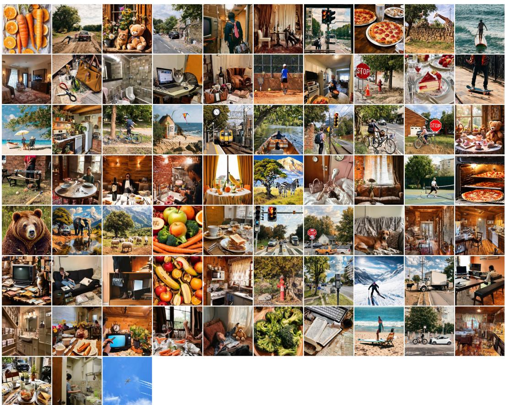  
Figure 8: Generated samples on COCO with 0.625‰ data ratio.

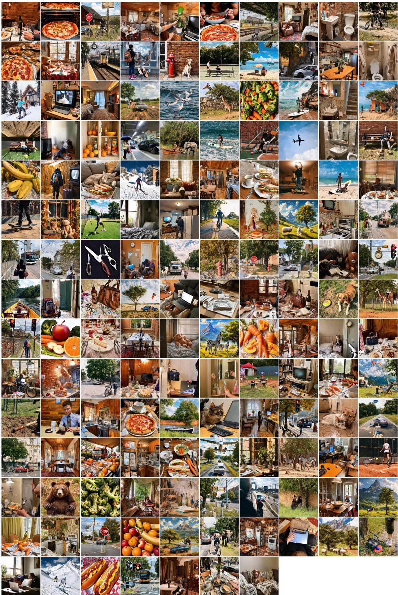  
Figure 9: Generated samples on COCO with 1.25‰ data ratio.

  
Figure 10: Generated samples on COCO with 2.5‰ data ratio. (Continued on next page)

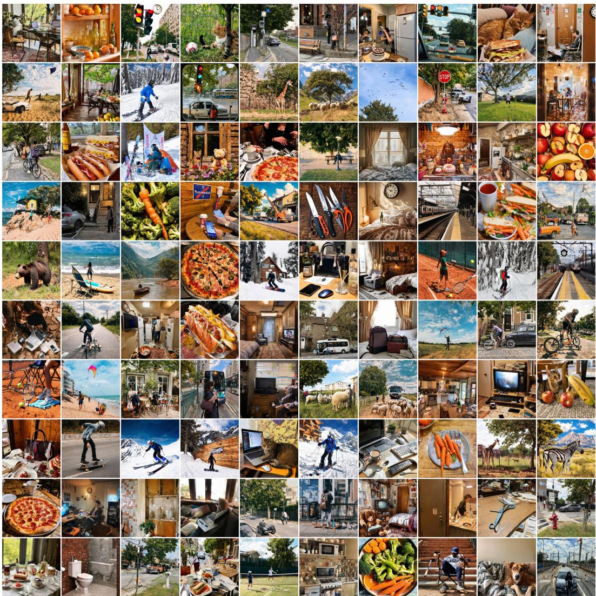  
Figure 10: (Continued) Generated samples on COCO with 2.5‰ data ratio. (Continued on next page)

  
Figure 10: (Continued) Generated samples on COCO with 2.5‰ data ratio.

## NeurIPS Paper Checklist

## 1. Claims

Question: Do the main claims made in the abstract and introduction accurately reflect the paper’s contributions and scope?

Answer: [Yes]

Justification: The abstract and introduction state the main contributions of $\mathrm { S ^ { 2 } \mathrm { - R L } }$ , including the reformulation of semantic segmentation dataset distillation as reward-driven diffusion policy optimization and the proposed sample-set dual reward design. The claims are supported by experiments on ADE20K and COCO and are scoped to semantic segmentation dataset distillation under compact data budgets.

Guidelines:

• The answer [N/A] means that the abstract and introduction do not include the claims made in the paper.

• The abstract and/or introduction should clearly state the claims made, including the contributions made in the paper and important assumptions and limitations. A [No] or [N/A] answer to this question will not be perceived well by the reviewers.

• The claims made should match theoretical and experimental results, and reflect how much the results can be expected to generalize to other settings.

• It is fine to include aspirational goals as motivation as long as it is clear that these goals are not attained by the paper.

## 2. Limitations

Question: Does the paper discuss the limitations of the work performed by the authors?

Answer: [Yes]

Justification: The main text discusses upfront construction cost and possible pseudo-label errors. The appendix further discusses dependence on pretrained models and the reward proxy gap between frozen evaluator scores and downstream student learning dynamics.

Guidelines:

• The answer [N/A] means that the paper has no limitation while the answer [No] means that the paper has limitations, but those are not discussed in the paper.

• The authors are encouraged to create a separate “Limitations” section in their paper.

• The paper should point out any strong assumptions and how robust the results are to violations of these assumptions (e.g., independence assumptions, noiseless settings, model well-specification, asymptotic approximations only holding locally). The authors should reflect on how these assumptions might be violated in practice and what the implications would be.

• The authors should reflect on the scope of the claims made, e.g., if the approach was only tested on a few datasets or with a few runs. In general, empirical results often depend on implicit assumptions, which should be articulated.

• The authors should reflect on the factors that influence the performance of the approach. For example, a facial recognition algorithm may perform poorly when image resolution is low or images are taken in low lighting. Or a speech-to-text system might not be used reliably to provide closed captions for online lectures because it fails to handle technical jargon.

• The authors should discuss the computational efficiency of the proposed algorithms and how they scale with dataset size.

• If applicable, the authors should discuss possible limitations of their approach to address problems of privacy and fairness.

• While the authors might fear that complete honesty about limitations might be used by reviewers as grounds for rejection, a worse outcome might be that reviewers discover limitations that aren’t acknowledged in the paper. The authors should use their best judgment and recognize that individual actions in favor of transparency play an important role in developing norms that preserve the integrity of the community. Reviewers will be specifically instructed to not penalize honesty concerning limitations.

## 3. Theory assumptions and proofs

Question: For each theoretical result, does the paper provide the full set of assumptions and a complete (and correct) proof?

Answer: [Yes]

Justification: The paper presents theoretical propositions as optimization interpretations. The main text states the high-level proposition, and the appendix provides detailed derivations and supporting propositions for GRPO gradient estimation and the sample-set dual reward mechanism.

Guidelines:

• The answer [N/A] means that the paper does not include theoretical results.

• All the theorems, formulas, and proofs in the paper should be numbered and crossreferenced.

• All assumptions should be clearly stated or referenced in the statement of any theorems.

• The proofs can either appear in the main paper or the supplemental material, but if they appear in the supplemental material, the authors are encouraged to provide a short proof sketch to provide intuition.

• Inversely, any informal proof provided in the core of the paper should be complemented by formal proofs provided in appendix or supplemental material.

• Theorems and Lemmas that the proof relies upon should be properly referenced.

## 4. Experimental result reproducibility

Question: Does the paper fully disclose all the information needed to reproduce the main experimental results of the paper to the extent that it affects the main claims and/or conclusions of the paper (regardless of whether the code and data are provided or not)?

Answer: [Yes]

Justification: The paper specifies datasets, compression ratios, baselines, downstream architectures, evaluation metrics, training schedules, reward definitions, and key hyperparameters. Additional implementation details, UniDD∗ baseline settings, computational resources, and ablation protocols are provided in the appendix.

Guidelines:

• The answer [N/A] means that the paper does not include experiments.

• If the paper includes experiments, a [No] answer to this question will not be perceived well by the reviewers: Making the paper reproducible is important, regardless of whether the code and data are provided or not.

• If the contribution is a dataset and/or model, the authors should describe the steps taken to make their results reproducible or verifiable.

• Depending on the contribution, reproducibility can be accomplished in various ways. For example, if the contribution is a novel architecture, describing the architecture fully might suffice, or if the contribution is a specific model and empirical evaluation, it may be necessary to either make it possible for others to replicate the model with the same dataset, or provide access to the model. In general. releasing code and data is often one good way to accomplish this, but reproducibility can also be provided via detailed instructions for how to replicate the results, access to a hosted model (e.g., in the case of a large language model), releasing of a model checkpoint, or other means that are appropriate to the research performed.

• While NeurIPS does not require releasing code, the conference does require all submissions to provide some reasonable avenue for reproducibility, which may depend on the nature of the contribution. For example

(a) If the contribution is primarily a new algorithm, the paper should make it clear how to reproduce that algorithm.

(b) If the contribution is primarily a new model architecture, the paper should describe the architecture clearly and fully.

(c) If the contribution is a new model (e.g., a large language model), then there should either be a way to access this model for reproducing the results or a way to reproduce the model (e.g., with an open-source dataset or instructions for how to construct the dataset).

(d) We recognize that reproducibility may be tricky in some cases, in which case authors are welcome to describe the particular way they provide for reproducibility. In the case of closed-source models, it may be that access to the model is limited in some way (e.g., to registered users), but it should be possible for other researchers to have some path to reproducing or verifying the results.

## 5. Open access to data and code

Question: Does the paper provide open access to the data and code, with sufficient instructions to faithfully reproduce the main experimental results, as described in supplemental material?

Answer: [Yes]

Justification: Code and reproduction instructions are available at https://github.com/ 00why00/S2RL. Released datasets and policy weights are linked from the repository and hosted at https://huggingface.co/0why0/S2RL. The README covers data preparation, training-set construction, and downstream evaluation.

Guidelines:

• The answer [N/A] means that paper does not include experiments requiring code.

• Please see the NeurIPS code and data submission guidelines (https://neurips.cc/ public/guides/CodeSubmissionPolicy) for more details.

• While we encourage the release of code and data, we understand that this might not be possible, so [No] is an acceptable answer. Papers cannot be rejected simply for not including code, unless this is central to the contribution (e.g., for a new open-source benchmark).

• The instructions should contain the exact command and environment needed to run to reproduce the results. See the NeurIPS code and data submission guidelines (https: //neurips.cc/public/guides/CodeSubmissionPolicy) for more details.

• The authors should provide instructions on data access and preparation, including how to access the raw data, preprocessed data, intermediate data, and generated data, etc.

• The authors should provide scripts to reproduce all experimental results for the new proposed method and baselines. If only a subset of experiments are reproducible, they should state which ones are omitted from the script and why.

• At submission time, to preserve anonymity, the authors should release anonymized versions (if applicable).

• Providing as much information as possible in supplemental material (appended to the paper) is recommended, but including URLs to data and code is permitted.

## 6. Experimental setting/details

Question: Does the paper specify all the training and test details (e.g., data splits, hyperparameters, how they were chosen, type of optimizer) necessary to understand the results?

Answer: [Yes]

Justification: The experimental section describes the datasets, compression ratios, metrics, baselines, downstream training protocol, optimizer, crop size, and training schedule. The appendix further reports RL hyperparameters, reward computation details, downstream training details, and computational resource usage.

Guidelines:

• The answer [N/A] means that the paper does not include experiments.

• The experimental setting should be presented in the core of the paper to a level of detail that is necessary to appreciate the results and make sense of them.

• The full details can be provided either with the code, in appendix, or as supplemental material.

## 7. Experiment statistical significance

Question: Does the paper report error bars suitably and correctly defined or other appropriate information about the statistical significance of the experiments?

Answer: [Yes]

Justification: The main comparisons report mean ± standard deviation over five constructed sets and five student seeds per set. The appendix separately reports three independent policy runs, five-seed prototype ablations, and descriptive variation across five stored sets for semantic/layout diagnostics. The stored-set diagnostics are not treated as independent policy replications or significance tests.

## Guidelines:

• The answer [N/A] means that the paper does not include experiments.

• The authors should answer [Yes] if the results are accompanied by error bars, confidence intervals, or statistical significance tests, at least for the experiments that support the main claims of the paper.

• The factors of variability that the error bars are capturing should be clearly stated (for example, train/test split, initialization, random drawing of some parameter, or overall run with given experimental conditions).

• The method for calculating the error bars should be explained (closed form formula, call to a library function, bootstrap, etc.)

• The assumptions made should be given (e.g., Normally distributed errors).

• It should be clear whether the error bar is the standard deviation or the standard error of the mean.

• It is OK to report 1-sigma error bars, but one should state it. The authors should preferably report a 2-sigma error bar than state that they have a 96% CI, if the hypothesis of Normality of errors is not verified.

• For asymmetric distributions, the authors should be careful not to show in tables or figures symmetric error bars that would yield results that are out of range (e.g., negative error rates).

• If error bars are reported in tables or plots, the authors should explain in the text how they were calculated and reference the corresponding figures or tables in the text.

## 8. Experiments compute resources

Question: For each experiment, does the paper provide sufficient information on the computer resources (type of compute workers, memory, time of execution) needed to reproduce the experiments?

Answer: [Yes]

Justification: The appendix includes a computational resources table reporting construction cost and peak GPU memory for selection-based baselines, SD3.5, UniDD∗, and S2-RL. It also states the GPU type used for S2-RL fine-tuning and reports the training and inference costs needed to construct the distilled sets.

## Guidelines:

• The answer [N/A] means that the paper does not include experiments.

• The paper should indicate the type of compute workers CPU or GPU, internal cluster, or cloud provider, including relevant memory and storage.

• The paper should provide the amount of compute required for each of the individual experimental runs as well as estimate the total compute.

• The paper should disclose whether the full research project required more compute than the experiments reported in the paper (e.g., preliminary or failed experiments that didn’t make it into the paper).

## 9. Code of ethics

Question: Does the research conducted in the paper conform, in every respect, with the NeurIPS Code of Ethics https://neurips.cc/public/EthicsGuidelines?

Answer: [Yes]

Justification: The work uses public datasets and pretrained models for semantic segmentation dataset distillation and does not involve human-subject experiments, private data collection, or harmful data acquisition. The study is conducted as a technical investigation of compact training set construction.

Guidelines:

• The answer [N/A] means that the authors have not reviewed the NeurIPS Code of Ethics.

• If the authors answer [No], they should explain the special circumstances that require a deviation from the Code of Ethics.

• The authors should make sure to preserve anonymity (e.g., if there is a special consideration due to laws or regulations in their jurisdiction).

## 10. Broader impacts

Question: Does the paper discuss both potential positive societal impacts and negative societal impacts of the work performed?

Answer: [Yes]

Justification: The paper discusses potential positive and negative societal impacts in Appendix. The positive impacts include reducing annotation, storage, and iteration costs for dense prediction research, while the negative impacts include possible inherited biases, artifacts, and pseudo-label errors from pretrained generative and segmentation models.

Guidelines:

• The answer [N/A] means that there is no societal impact of the work performed.

• If the authors answer [N/A] or [No], they should explain why their work has no societal impact or why the paper does not address societal impact.

• Examples of negative societal impacts include potential malicious or unintended uses (e.g., disinformation, generating fake profiles, surveillance), fairness considerations (e.g., deployment of technologies that could make decisions that unfairly impact specific groups), privacy considerations, and security considerations.

• The conference expects that many papers will be foundational research and not tied to particular applications, let alone deployments. However, if there is a direct path to any negative applications, the authors should point it out. For example, it is legitimate to point out that an improvement in the quality of generative models could be used to generate Deepfakes for disinformation. On the other hand, it is not needed to point out that a generic algorithm for optimizing neural networks could enable people to train models that generate Deepfakes faster.

• The authors should consider possible harms that could arise when the technology is being used as intended and functioning correctly, harms that could arise when the technology is being used as intended but gives incorrect results, and harms following from (intentional or unintentional) misuse of the technology.

• If there are negative societal impacts, the authors could also discuss possible mitigation strategies (e.g., gated release of models, providing defenses in addition to attacks, mechanisms for monitoring misuse, mechanisms to monitor how a system learns from feedback over time, improving the efficiency and accessibility of ML).

## 11. Safeguards

Question: Does the paper describe safeguards that have been put in place for responsible release of data or models that have a high risk for misuse (e.g., pre-trained language models, image generators, or scraped datasets)?

Answer: [N/A]

Justification: The paper does not release a new general-purpose image generator, scraped dataset, or high-risk pretrained model. The experiments rely on existing public datasets and pretrained models, and the generated samples are used for semantic segmentation dataset distillation evaluation.

Guidelines:

• The answer [N/A] means that the paper poses no such risks.

• Released models that have a high risk for misuse or dual-use should be released with necessary safeguards to allow for controlled use of the model, for example by requiring that users adhere to usage guidelines or restrictions to access the model or implementing safety filters.

• Datasets that have been scraped from the Internet could pose safety risks. The authors should describe how they avoided releasing unsafe images.

• We recognize that providing effective safeguards is challenging, and many papers do not require this, but we encourage authors to take this into account and make a best faith effort.

## 12. Licenses for existing assets

Question: Are the creators or original owners of assets (e.g., code, data, models), used in the paper, properly credited and are the license and terms of use explicitly mentioned and properly respected?

Answer: [Yes]

Justification: The paper cites the datasets, pretrained models, and software frameworks used in the experiments, including ADE20K, COCO, Stable Diffusion 3.5, FreestyleNet, DINOv3, segmentation models, and MMSegmentation. We follow their intended researchuse settings and provide code that relies on users obtaining the corresponding assets from their official sources and respecting their licenses.

Guidelines:

• The answer [N/A] means that the paper does not use existing assets.

• The authors should cite the original paper that produced the code package or dataset.

• The authors should state which version of the asset is used and, if possible, include a URL.

• The name of the license (e.g., CC-BY 4.0) should be included for each asset.

• For scraped data from a particular source (e.g., website), the copyright and terms of service of that source should be provided.

• If assets are released, the license, copyright information, and terms of use in the package should be provided. For popular datasets, paperswithcode.com/datasets has curated licenses for some datasets. Their licensing guide can help determine the license of a dataset.

• For existing datasets that are re-packaged, both the original license and the license of the derived asset (if it has changed) should be provided.

• If this information is not available online, the authors are encouraged to reach out to the asset’s creators.

## 13. New assets

Question: Are new assets introduced in the paper well documented and is the documentation provided alongside the assets?

Answer: [Yes]

Justification: The implementation is released at https://github.com/00why00/S2RL, with a README covering dependencies, data preparation, and commands for training-set construction and downstream evaluation.

Guidelines:

• The answer [N/A] means that the paper does not release new assets.

• Researchers should communicate the details of the dataset/code/model as part of their submissions via structured templates. This includes details about training, license, limitations, etc.

• The paper should discuss whether and how consent was obtained from people whose asset is used.

• At submission time, remember to anonymize your assets (if applicable). You can either create an anonymized URL or include an anonymized zip file.

## 14. Crowdsourcing and research with human subjects

Question: For crowdsourcing experiments and research with human subjects, does the paper include the full text of instructions given to participants and screenshots, if applicable, as well as details about compensation (if any)?

Answer: [N/A]

Justification: The paper does not involve crowdsourcing, user studies, or research with human subjects.

Guidelines:

• The answer [N/A] means that the paper does not involve crowdsourcing nor research with human subjects.

• Including this information in the supplemental material is fine, but if the main contribution of the paper involves human subjects, then as much detail as possible should be included in the main paper.

• According to the NeurIPS Code of Ethics, workers involved in data collection, curation, or other labor should be paid at least the minimum wage in the country of the data collector.

## 15. Institutional review board (IRB) approvals or equivalent for research with human subjects

Question: Does the paper describe potential risks incurred by study participants, whether such risks were disclosed to the subjects, and whether Institutional Review Board (IRB) approvals (or an equivalent approval/review based on the requirements of your country or institution) were obtained?

Answer: [N/A]

Justification: The paper does not involve human subjects, crowdsourcing, or collection of personal data, so IRB approval or equivalent human-subjects review is not applicable.

Guidelines:

• The answer [N/A] means that the paper does not involve crowdsourcing nor research with human subjects.

• Depending on the country in which research is conducted, IRB approval (or equivalent) may be required for any human subjects research. If you obtained IRB approval, you should clearly state this in the paper.

• We recognize that the procedures for this may vary significantly between institutions and locations, and we expect authors to adhere to the NeurIPS Code of Ethics and the guidelines for their institution.

• For initial submissions, do not include any information that would break anonymity (if applicable), such as the institution conducting the review.

## 16. Declaration of LLM usage

Question: Does the paper describe the usage of LLMs if it is an important, original, or non-standard component of the core methods in this research? Note that if the LLM is used only for writing, editing, or formatting purposes and does not impact the core methodology, scientific rigor, or originality of the research, declaration is not required.

Answer: [N/A]

Justification: The core method does not use LLMs as an important, original, or nonstandard component. Text prompts are constructed from semantic category names rather than generated or optimized by an LLM.

Guidelines:

• The answer [N/A] means that the core method development in this research does not involve LLMs as any important, original, or non-standard components.

• Please refer to our LLM policy in the NeurIPS handbook for what should or should not be described.