# PRISM: Pathology Reliability In Scarce-label Medicine.

A Tile-level Benchmark of Pathology Foundation Models

Alicem Koyun Westcliff University alicemkoyun@gmail.com

## Abstract

Pathology foundation models are typically benchmarked on classification performance at full label availability and on in-distribution test sets, while the properties relevant to clinical deployment (calibration, behavior at low label budgets, and robustness under cross-institutional shift) are seldom evaluated jointly. We introduce PRISM, a tile-level benchmark that measures the reliability of pathology foundation models along four axes simultaneously: model choice, label fraction, calibration, and out-of-distribution transfer. PRISM evaluates eight foundation models (CLIP, PLIP, CONCH, UNI, VIRCHOW2, GigaPath, H-Optimus-0, MID-NIGHT) on six tile-level datasets at six label fractions (1% to 100%) with three seeds, 864 linear probe runs in total, extended with a five-hospital Camelyon17 study of 20 directed transfer pairs that holds the label definition fixed. We report AUROC, Expected Calibration Error before and after temperature scaling, Brier score, and a Composite Reliability Index (CRI). Four phenomena emerge. (i) Under full supervision AUROC rank predicts post-temperature calibration rank consistently across datasets (pooled within-dataset Spearman ρ = 0.52, betweendataset heterogeneity I2 = 0%), whereas at 1% labels the relationship is no longer detectable and becomes dataset-specific $( \rho = - 0 . 2 4 , I ^ { 2 } = 6 7 \% )$ , a significant difference $( \Delta \rho = 0 . 6 2 $ , 95% CI [0.08, 1.13]). (ii) On the harder datasets the linear probe collapses to a single predicted class below a dataset-specific label fraction. (iii) Whether additional source-domain labels help or harm target calibration tracks how well the probe transfers rather than the presence of shift: in our settings, below a transfer AUROC of roughly 0.85 more labels worsen target ECE in 86–88% of (model, pair) combinations and above it in 1–8%, an association that holds within a single dataset and among combinations that never produce degenerate predictions. (iv) Post-hoc temperature scaling removes more than 0.4 of ECE in some cells yet fails to reduce it in 49 of 288, the fitted temperatures show that the probe's miscalibration is predominantly under-confidence (252 of 288 cells), and a temperature fitted at the source is actively harmful under failing transfer. PRISM is released as a pip-installable package with reference results for all 288 (model, dataset, label fraction) cells, pre-computed embeddings wherever dataset and model licences permit redistribution, and extraction scripts with checksums elsewhere. Code and data: https://github.com/alicemkyn/prism-benchmark.

## 1 Introduction

Pathology foundation models (FMs) trained with self-supervised learning (SSL), such as UNI [8], CONCH [23], VIRCHOW2 [44] and GigaPath [42], now set the state of the art on tile-level classification. The dominant evaluation paradigm reports AUROC or accuracy at full label availability on in-distribution test sets. This has driven rapid progress in discrimination but obscures a question central to clinical use: can the model say "I don't know" when it should not be confident? Regulatory frameworks make the requirement explicit. The FDA Good Machine Learning Practice principles [38] call for evaluation at clinically relevant operating points, which in practice means calibrated probabilities, and the EU AI Act Article 13 [11] requires high-risk systems to report accuracy alongside known limitations under distribution shift. Neither is satisfied by an AUROC reported at 100% labels on a single in-distribution split.

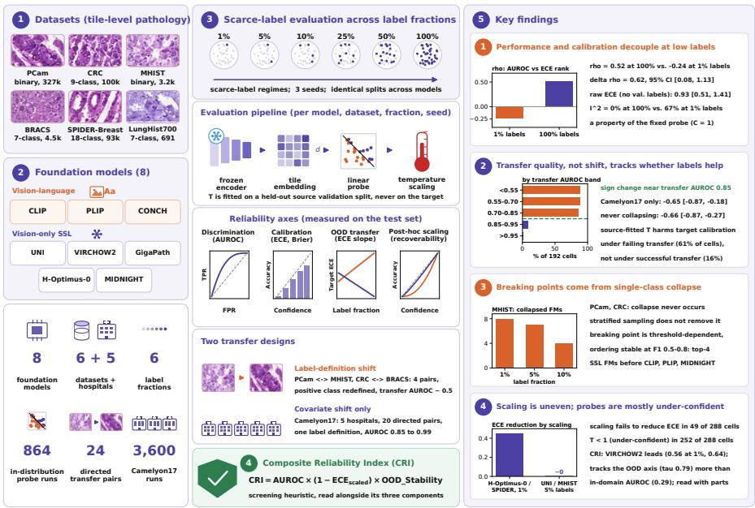  
Figure 1: PRISM overview. Eight foundation models are evaluated on six tile-level datasets at six label fractions with three seeds (864 linear probe runs), plus a five-hospital Camelyon17 grid of 20 directed transfer pairs (3,600 runs), measuring discrimination, calibration, out-of-distribution transfer and post-hoc recoverability. Two transfer designs separate label-definition shift from covariate shift. Right: the four findings, with the numbers reported in Section 4 (finding 3 counts FMs whose probe collapses in all three seeds). The Composite Reliability Index is a screening heuristic read alongside its three components.

Existing benchmarks address subsets of this requirement but not their joint interaction (Table 5, Appendix C): THUNDER [25] reports calibration but varies supervision only through fixed few-shot counts and treats robustness adversarially; HistoVL [1] and Thiringer et al. [37] report calibration at full supervision only; others report discrimination alone [27, 24, 21]. No prior study evaluates the joint interaction of FM choice, label fraction, OOD shift and calibration, the four axes along which we take clinical reliability to be constrained. PRISM closes this gap.

Our contributions are: (i) a unified evaluation of 8 pathology FMs across 6 datasets at 6 label fractions with 3 seeds (864 linear probe runs), extended with a five-hospital Camelyon17 grid of 20 directed transfer pairs (3,600 further runs); (ii) a Composite Reliability Index (CRI) that multiplies AUROC, calibration and OOD stability, reported alongside its components; (iii) an analysis showing that whether additional source labels help or harm target calibration is associated with transfer quality with a sign change near transfer AUROC 0.85 in the evaluated settings; and (iv) an open-source, pip-installable package (prism\_bench) with licence-permitted pre-computed embeddings and a PRISMEvaluator API for evaluating new models against the eight reference FMs without re-running embedding extraction.

Across these runs PRISM surfaces four phenomena, each a property of this evaluation pipeline: AUROC and calibration rankings come apart as supervision shrinks; the probe shows dataset-specific breaking points produced by single-class collapse; more source labels worsen target calibration on label-definition transfer pairs and improve it across Camelyon17 hospitals, with transfer AUROC tracking the sign across both designs; and temperature scaling is far from uniformly effective, harmful when fitted at a source from which the probe does not transfer.

## 2 Related work

Pathology FMs span vision-only DINOv2-style encoders [31] and vision-language variants, from 86M to 1.1B parameters and from 92k to 3.1M pre-training WSIs (Table 3); recent surveys cover the design space [22]. Performance-focused benchmarks compare many models on discrimination alone [41, 16, 12, 43, 27, 24, 21, 6, 7], and Alfasly et al. [2] argue that such evaluation is underpowered relative to clinical claims. Calibration-focused benchmarks are rarer. THUNDER [25] is the most comprehensive, reporting ECE and its variants for 23 FMs with few-shot and adversarial evaluations; HistoVL [1] reports ECE for four vision-language models; Nunes et al. [29, 30] argue for calibration as a primary CPath metric; and Thiringer et al. [37] evaluate 14 FMs under scanner shift with ECE and Brier at full supervision. Neither the decoupling of discrimination from calibration nor the degradation of uncertainty under shift is new: Ovadia et al. [32] establish both outside pathology and Thagaard et al. [36] the second within it, both at full supervision. What PRISM adds is the labelfraction axis for a generation of FMs that postdates these studies, both raw and post-hoc-recovered calibration, and the direction of transfer, evaluated jointly with FM choice. Temperature scaling [13] and ECE [28] are used as standard.

## 3 Measuring reliability of pathology foundation models

## 3.1 Models and datasets

Foundation models. PRISM evaluates eight FMs selected to span the design space of pathology pre-training (Table 3): three vision-language contrastive models (CLIP [33] as a non-pathology baseline, PLIP [15], CONCH [23]) and five vision-only SSL models (UNI [8], GigaPath [42], H-Optimus-0 [4], MIDNIGHT [17], VIRCHOW2 [44]), from 86M to 1.1B parameters and from 92k to 3.1M pre-training WSIs. Preprocessing is not uniform across the eight FMs and we state what each received (Appendix A); embeddings are L2-normalized. Each FM is embedded once under one pipeline held fixed across every label fraction and transfer pair, so comparisons within a model are unaffected by this heterogeneity, while comparisons between models at a fixed fraction are confounded by it. In particular CLIP, PLIP and MIDNIGHT received ImageNet statistics rather than their documented normalization. A partial check: Camelyon17, embedded with every FM's documented transform, shares PCam's task. The AUROC rankings of the eight FMs on the two agree (Kendall τ 0.50–0.79 across fractions; CLIP and PLIP last on both), whereas the scaled-ECE rankings do not (τ between —0.50 and 0.29). This bounds rather than isolates the preprocessing effect, since the datasets also differ in source and tile size

Datasets. Six tile-level datasets (Table 1) span task type (binary PCam [39] and MHIST [40]; 7-class BRACS [5] and LungHist700 [9], 9-class CRC [18], 18-class SPIDER-Breast [26]), scale (691 to 327,680 tiles; absolute training counts per fraction are in Table 2), and organ (lymph node, colorectal, breast, lung). The four-pair OOD evaluation is built from PCam↔MHIST and CRC↔BRACS, cross-institution pairs that can be assembled from publicly available data.

Table 1: Tile-level datasets included in PRISM, ordered by sample count: six datasets spanning binary to 18-class classification, with counts varying by nearly three orders of magnitude. CRC is NCT-CRC-HE-100K, split 70/15/15. RUA: research-use agreement without redistribution rights.
<table><tr><td>Dataset</td><td>Task</td><td>Classes</td><td>Samples</td><td>License</td><td>Source</td></tr><tr><td>PCam</td><td>Binary (tumor)</td><td>2</td><td>327,680</td><td>CCO</td><td>Veeling et al. [39]</td></tr><tr><td>CRC</td><td>Multiclass</td><td>9</td><td>100,000</td><td>CC-BY 4.0</td><td>Kather et al. [18]</td></tr><tr><td>MHIST</td><td>Binary (HP/SSA)</td><td>2</td><td>3,152</td><td>RUA</td><td>Wei et al. [40]</td></tr><tr><td>BRACS</td><td>Multiclass</td><td>7</td><td>4,539</td><td>CC-BY-NC 4.0</td><td>Brancati et al. [5]</td></tr><tr><td>SPIDER-Breast</td><td>Multiclass</td><td>18</td><td>92,900</td><td>CC-BY-NC 4.0</td><td>Nechaev et al. [26]</td></tr><tr><td>LungHist700</td><td>Multiclass</td><td>7</td><td>691</td><td>CC-BY 4.0</td><td>Diosdado et al. [9]</td></tr></table>

## 3.2 Evaluation protocols

Label-fraction sweep. On frozen embeddings $( d \in [ 5 1 2 , 2 5 6 0 ] )$ we train an $\ell _ { 2 }$ -regularized logistic regression probe (scikit-learn LBFGS, $C = 1 . 0 )$ on stratified training subsets at label fractions {0.01, 0.05, 0.10, 0.25, 0.50, 1.00} with three seeds (42, 123, 456); splits are identical across models by construction and test sets are held fixed per dataset, for $8 \times 6 \times 6 \times 3 = 8 6 4$ runs.

Scope of the conclusions. Every result is a property of one evaluation pipeline: frozen tile embeddings, a logistic probe whose regularization is held at $C = 1$ from 7 to 262,144 training tiles, and scalar temperature scaling. Holding C fixed keeps every cell under an identical protocol, but C shapes calibration: across a five-value sweep the AUROC ranking of FMs is stable (mean Kendall $\tau = 0 . 8 2$ against $C = 1 )$ while the raw-ECE ranking is not $( \tau = 0 . 0 2 )$ . On the three datasets swept (MHIST, LungHist700, BRACS; raw ECE), the 1%-versus-100% decoupling contrast of Section 4 is pronounced at $C = 1 ( \Delta \rho = 0 . 9 3 )$ , weaker at $C = 1 0$ and 100 (0.06 and 0.37) and reversed at $C \leq 0 . 1$ (Appendix F). Calibration comparisons between FMs are therefore properties of this pipeline, not intrinsic properties of the FMs.

Calibration with post-hoc recoverability. For each linear probe we report Expected Calibration Error (ECE) [13] both before and after temperature scaling. Partitioning the N test predictions into bins $B _ { 1 } , \ldots , B _ { M }$ by confidence,

$$
\mathrm { E C E } = \sum _ { m = 1 } ^ { M } \frac { | B _ { m } | } { N } \big | \mathrm { a c c } ( B _ { m } ) - \mathrm { c o n f } ( B _ { m } ) \big | , \qquad \mathrm { B r i e r } = \frac { 1 } { N } \sum _ { i = 1 } ^ { N } ( \hat { p } _ { i } - y _ { i } ) ^ { 2 } ,
$$

where conf( $B _ { m } )$ is the mean confidence within bin m and acc $\left( B _ { m } \right)$ the corresponding empirical frequency. On the four multiclass tasks confidence is the top-label probability and acc $\left( B _ { m } ^ { \mathsf { ^ { - } } } \right)$ the top-label accuracy; on the two binary tasks confidence is the predicted probability $\hat { p } _ { i }$ of the positive class and acc $\left( B _ { m } \right)$ the observed positive rate, so ECE measures positive-class calibration. We use $M = 1 5$ equal-width bins; equal-mass bins leave the decoupling contrast unchanged (Appendix F). The Brier score above is the binary form; on multiclass tasks we report its one-vs-rest average over classes. Raw ECE is computed on the probe's own outputs; scaled ECE after dividing the logits by a scalar temperature $T$ fitted by negative log-likelihood on a held-out validation split $( T \in [ \bar { 0 } . 1 , 1 \bar { 0 } ] )$ so the difference isolates miscalibration of scale from miscalibration of ordering. For binary tasks the temperature is fitted on the two-column logit $[ - z , z ]$ of the log-odds $z ;$ we report it divided by two so that $T = 1$ means the probe's own probabilities are kept. For transfer evaluation $T$ is fit on the source validation split and applied to the target without target labels. Brier score is reported as a strictly proper scoring rule. The recoverability axis, raw minus scaled ECE, is itself an evaluation target: a single scalar parameter is the cheapest safeguard a deployment team can afford.

Camelyon17: transfer with the label definition held fixed. The four transfer pairs below vary the label definition together with the acquisition conditions. To separate the two we add Camelyon17 [3] (WILDS release $[ 1 9 ] ,$ ): patches from five hospitals annotated for one binary task (tumour against normal in lymph node) under a single label definition, differing only in scanner, staining and patient population. Treating each hospital as a domain gives 20 directed transfer pairs. We sample 20,000 patches per hospital, label-stratified at 50/50, split 70/15/15 at patch level, since a slide-disjoint split would leave tumour prevalence between 0.1% and 83% across partitions and confound ECE with prevalence; leakage is impossible in the transfer grid, where source and target are different hospitals, and only the in-distribution numbers are optimistic (reported as an upper bound). Here every FM is embedded under its own documented transform (Appendix H), so the cross-model comparison is controlled.

Cross-domain OOD pairs. Beyond in-distribution evaluation we construct four cross-domain transfer pairs: PCam→MHIST, MHIST→PCam, CRC→BRACS, BRACS→CRC. For each pair we train a linear probe on the source at every label fraction and evaluate AUROC, ECE and Brier on the target test split under the binary label mapping of Table 8 (Appendix I). These pairs are not clean covariate shift: tissue, acquisition site and the definition of the positive class all change together, so they measure whether a probe trained on one binary pathology task retains calibrated signal on another.

Table 2: Absolute label budget. Training labels $n _ { \mathrm { { t r a i n } } }$ at each label fraction and the size of the validation split used for temperature scaling (and CRI). The validation split is held at its full size at every fraction, so at 1% it accounts for 90–96% of all labels used; raw ECE uses no validation labels. Camelyon17 counts are per source hospital.
<table><tr><td rowspan="2">Dataset</td><td colspan="5"> $n _ { \mathrm { t r a i n } }$  at label fraction</td><td colspan="2"></td></tr><tr><td>K</td><td>1%</td><td>5%</td><td>10%</td><td>100%</td><td> $n _ { \mathrm { v a l } }$ </td><td>val. share @1%</td></tr><tr><td>PCam</td><td>2</td><td>2,620</td><td>13,106</td><td>26,214</td><td>262,144</td><td>32,768</td><td>93%</td></tr><tr><td>BRACS</td><td>7</td><td>33</td><td>180</td><td>362</td><td>3,657</td><td>312</td><td>90%</td></tr><tr><td>CRC</td><td>9</td><td>696</td><td>3,495</td><td>6,996</td><td>70,000</td><td>15,000</td><td>96%</td></tr><tr><td>MHIST</td><td>2</td><td>18</td><td>92</td><td>184</td><td>1,849</td><td>326</td><td>95%</td></tr><tr><td>LungHist700</td><td>7</td><td>7</td><td>22</td><td>45</td><td>483</td><td>103</td><td>94%</td></tr><tr><td>SPIDER-Breast</td><td>18</td><td>682</td><td>3,431</td><td>6,868</td><td>68,730</td><td>12,128</td><td>95%</td></tr><tr><td>Camelyon17†</td><td>2</td><td>140</td><td>700</td><td>1,400</td><td>14,000</td><td>3,000</td><td>96%</td></tr></table>

†Per hospital; each of the five hospitals contributes the same counts.

What a label fraction consumes. A fraction subsamples the training split only, so the same percentage means very different amounts of data: 7 training tiles on LungHist700 and 2,620 on PCam at 1% (Table 2). The validation split used for temperature fitting is held at full size and supplies 90–96% of all labels a cell consumes at 1%. We therefore separate two kinds of low-label calibration claim. Raw ECE uses no validation labels and reflects the training budget alone; scaled ECE at 1% reflects that budget plus a full validation split. A proportional protocol that subsamples validation by the same fraction moves scaled ECE at 1% by 0.009 and preserves the FM ranking (Appendix D), but leaves as few as three validation samples on MHIST; low-label calibration claims are therefore stated for raw ECE alongside scaled ECE.

Composite Reliability Index. The three reliability axes can pull in opposite directions: an FM may have strong AUROC but poor calibration, or strong in-distribution behavior but catastrophic OOD transfer. To summarize joint reliability we define the Composite Reliability Index:

$$
\mathrm { C R I } = \mathrm { A U R O C } \times ( 1 - \mathrm { E C E } _ { \mathrm { s c a l e d } } ) \times \mathrm { O O D } \_ \mathrm { S t a b i l i t y }\tag{1}
$$

where $\mathrm { E C E } _ { \mathrm { s c a l e d } } \in [ 0 , 1 ]$ is the post-temperature ECE (clipped to [0, 1]; no further normalization is applied), and OOD\_Stability ∈ [0, 1] is the ratio of OOD AUROC to in-distribution AUROC averaged across the relevant transfer pairs (clipped to 1 from above). For the CRC and BRACS source pairs the denominator is the source's multiclass macro AUROC and the numerator a binary AUROC under the mapping of Table 8. The multiplicative form is deliberate: a model that scores zero on any single axis cannot achieve a high CRI, regardless of how strong it is on the others. This penalty structure reflects the view that an FM should be acceptable on all axes, not just the one a benchmark happens to emphasize.

Two properties of the index should be kept in mind. First, OOD\_Stability is a ratio, so it partially rewards models whose in-distribution performance was already weak: the composite tracks the OOD axis (Kendall τ = 0.79 against the OOD AUROC ranking) far more closely than the in-distribution axis (τ = 0.29), so we report the three axes separately and treat the composite as a summary of them. (An earlier release computed 1 — CV of in-distribution AUROC in place of the ratio; all values here use Equation 1.) Second, the calibration term inherits the probe dependence described above, so CRI is meaningful only under a fixed probe protocol. The combination rule is not what drives it (multiplicative, arithmetic, geometric and worst-axis aggregations agree at τ between 0.71 and 1.00) CRI is a hand-specified screening heuristic for down-selection; it is not validated against any clinical outcome and does not measure clinical readiness.

Accessibility. PRISM ships as a pip-installable package, prism\_bench, with a PRISMEvaluator class, a CLI and the reference results. Embeddings are extracted once (about 15 GPU-hours on A100 hardware), after which all 864 probe runs complete in under 30 minutes on one CPU. Licences determine what can be redistributed: embeddings are released for five of the six datasets (all but MHIST, whose research-use agreement forbids redistribution) and for Camelyon17, from the five FMs whose licences permit sharing model outputs (CLIP, PLIP, GigaPath, H-Optimus-0, MIDNIGHT); for MHIST and for UNI, CONCH and VIRCHOW2 we release extraction scripts, split indices and SHA256 checksums so that licensed users can regenerate and verify them.

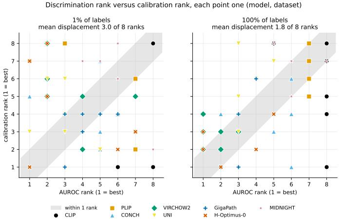  
Figure 2: Discrimination rank against calibration rank. Each point is one (model, dataset) cell: its position on the horizontal axis is the model's AUROC rank within that dataset, on the vertical axis its rank by post-temperature ECE, both with 1 best. Points on the diagonal are models whose two ranks agree and the shaded band marks agreement to within one place. Mean displacement is 3.0 of 8 positions at 1% labels against 1.8 under full supervision. The largest discords at 1% labels are CLIP on BRACS, LungHist700 and PCam (last on AUROC, first on calibration) and H-Optimus-0 on PCam (first on AUROC, seventh on calibration).

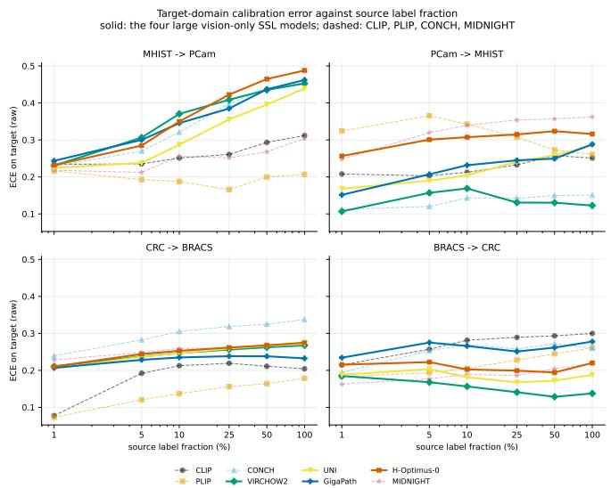  
Figure 3: Reverse OOD calibration scaling. Raw ECE on the transfer target against source-domain label fraction, at all six fractions rather than the two endpoints. On MHIST→PCam the four large vision-only SSL models (UNI, VIRCHOW2, GigaPath, H-Optimus-0; solid lines) rise from roughly 0.23 to between 0.44 and 0.49, monotonically in the label fraction and consistently across seeds; CONCH (dashed) rises as strongly, CLIP and MIDNIGHT more weakly, and PLIP stays flat. The three remaining pairs show the effect weakly or not at all, so the phenomenon is pair-dependent and we do not claim it holds for transfer in general.

## 4 Experiments

We present results across the four reliability axes; per-cell tables, bootstrap intervals and supporting figures are in the appendix.

Performance-reliability decoupling. Figure 2 contrasts AUROC and post-temperature ECE rankings across the six datasets. Pooling within-dataset ranks across the 48 (model, dataset) cells, the correlation between AUROC rank and calibration rank is $\rho = - 0 . 2 4$ at 1% 1abels (95% CI $\left[ - 0 . 5 4 , 0 . 3 6 \right] )$ against $\rho = 0 . 5 2$ at full supervision $( [ 0 . 2 7 , 0 . 7 \dot { 2 } ] )$ , and the contrast is significant, $\bar { \Delta } \rho = 0 . 6 2 \ \bar { ( } [ 0 . 0 8 , 1 . 1 3 ] )$ , under a cluster bootstrap that resamples whole datasets and one seed per cell (seed-averaging gives $\Delta \rho = 0 . 7 5 ;$ we quote the conservative value). A random-effects meta-analysis over the six per-dataset correlations agrees $( \rho = - 0 . 3 0$ and 0.57) and adds that between-dataset heterogeneity is $I ^ { 2 } = 0 \%$ at full supervision but 67% at 1% labels. Because scaled ECE at 1% borrows a full validation split (Table 2), we repeat the analysis on raw ECE, which uses no validation labels: the contrast is larger, $\rho = - 0 . 4 6 \left[ - 0 . 8 5 , - 0 . 0 5 \right]$ at 1% against 0.47 [0.03, 0.86] at full supervision, $\Delta \rho = 0 . 9 3 ~ [ 0 . 5 1 , \bar { 1 } . 4 1 ]$ , and remains significant at 5% and 10% labels (0.52 and 0.37). It is, however, specific to the probe's regularization (Section 3.2). A model's calibration rank sits 3.0 of 8 positions from its AUROC rank at 1% labels against 1.8 at full supervision. The largest discords run in both directions. CLIP ranks last on AUROC yet first on post-temperature ECE on three datasets (BRACS, LungHist700, PCam); on BRACS its probe assigns 92% of the test set to one class (macro-F1 0.08), so it is well calibrated largely because it commits to almost nothing. Conversely, H-Optimus-0 has the top AUROC on PCam at 1% labels (0.982) but ranks seventh of eight on calibration. A practitioner selecting on AUROC alone would therefore not select the best-calibrated model, and selecting on ECE alone would favour a near-degenerate one. The correlation is negative at 1% labels within each seed taken separately, so the pattern is not an averaging artefact (Appendix D).

Breaking points. Macro-F1 against label fraction for every (model, dataset) pair is given in Figure 6 (Appendix I). PCam and CRC are close to saturation in AUROC already at 1% labels (0.88–0.98 and 0.98–1.00), although macro-F1 there still ranges from 0.80 (CLIP) to 0.94 and 0.99; BRACS, MHIST and LungHist700 reveal large label-efficiency differences. CLIP and PLIP never reach $\mathrm { F } 1 = 0 . 5$ on BRACS, while UNI and VIRCHOW2 cross it on every dataset by 25% labels and GigaPath and H-Optimus-0 by 50%. At 10% labels only four FMs (CONCH, GigaPath, UNI, VIRCHOW2) reach the threshold on BRACS and none does on MHIST; we state this as a property of the benchmark tasks, not a deployment criterion. The breaking point is threshold-dependent: sweeping the macro-F1 threshold from 0.4 to 0.8 moves it by 0.23 on average on BRACS and SPIDER-Breast and by 0.64 and 0.72 on MHIST and LungHist700. The ordering (VIRCHOW2, UNI, GigaPath and H-Optimus-0 no later than CLIP, PLIP and MIDNIGHT) holds at every threshold from 0.5 to 0.8, but not at 0.4 on LungHist700, where PLIP and CONCH cross first at 1% labels. A collapse audit (Figure 8) shows why: on MHIST every FM assigns more than 99% of the test set to one class at 1% labels, on PCam and CRC never, and stratified sampling does not remove the collapse. Post-hoc recoverability is likewise non-monotone, from removing 0.45 of ECE (H-Optimus-0 on SPIDER-Breast at 1% labels, 0.465 to 0.020) to none (UNI on MHIST at 5% and 10% labels, where scaling slightly increases ECE); across all 288 cells scaling fails to reduce ECE in 49, concentrated on MHIST, PCam and LungHist700. The plateau between 5% and 25% coincides with the probe emerging from collapse (Figure 11). The fitted temperatures also give the direction of miscalibration, which ECE alone does not. Expressed on the probe's own logit scale, $T < 1$ (under-confidence) holds in 189 of the 192 multiclass cells (T between 0.28 and 0.40 on SPIDER-Breast at 1% labels) and in 63 of the 96 binary cells; over-confidence $( T > 1 )$ appears mainly on PCam from 25% labels and on MHIST at 1–5%, where the probe is collapsed. The large raw ECE of the multiclass probes at low label fractions is therefore under-confidence of a strongly regularized linear probe rather than over-confidence, which is also why a single scalar removes it so readily.

Out-of-distribution reliability and reverse calibration scaling. On the four cross-domain pairs of the original design, more source-domain labels worsen target calibration. Figure 3 shows OOD ECE against source label fraction. On MHIST→PCam all four large vision-only SSL models rise monotonically and consistently across seeds: UNI from 0.225 to 0.439, VIRCHOW2 from 0.231 to 0.453, GigaPath from 0.243 to 0.462 and H-Optimus-0 from 0.232 to 0.488. CONCH rises as strongly (0.229 to 0.455), CLIP and MIDNIGHT more weakly (to 0.312 and 0.304), and only PLIP stays flat. Paired with OOD AUROC the effect is severe: at 100% labels GigaPath reaches OOD AUROC 0.487 yet OOD ECE 0.462, an order of magnitude worse than its in-distribution ECE of 0.042. The three remaining pairs show the effect weakly or not at all, so it is pair-dependent.

This is the phenomenon, not yet an explanation: the four pairs that produce it change the label definition as well as the acquisition conditions, and a probe trained to separate tumour from normal lymph node and evaluated against SSA versus HP polyp labels is not performing standard OOD generalization. Section 4.1 repeats the protocol on Camelyon17, where only scanner, staining and patient population differ. Across all twenty hospital pairs the effect reverses: target ECE rises in 10 of 160 (model, pair) combinations rather than 28 of 32, and the mean change is —0.149 rather than +0.082 (Figure 4a).

Reverse scaling accompanies failing transfer. The two designs differ in transfer difficulty as well as in kind of shift (label-definition pairs transfer at AUROC near 0.5, hospital pairs at 0.85 to 0.996), so we test transfer quality directly over all 192 (model, pair) combinations, using the slope of target ECE against $\log _ { 1 0 }$ label fraction (Figure 4b).

Transfer quality predicts the slope, and the relation survives inside a single dataset. Combinations share models, hospitals and test sets, so we attach 95% CIs from a two-way cluster bootstrap that resamples models and hospitals (and the four label-definition pairs) rather than combinations. Pooling both designs, the Spearman correlation between OOD AUROC and the ECE slope is —0.78 $[ - 0 . 9 1 , - 0 . 5 9 ]$ . Within Camelyon17 alone, where dataset, task and kind of shift are held constant, it $\mathrm { i s - 0 . 6 5 \left[ - 0 . 8 7 , - 0 . 1 8 \right] ( - 0 . 9 1 }$ across the eight FMs and —0.75 across the twenty pairs); the dataset is not what drives the contrast.

In these settings the sign changes near AUROC 0.85. Binning all 192 combinations by transfer AUROC, ECE rises in 88%, 88% and 86% of combinations below 0.55, between 0.55 and 0.70, and between 0.70 and 0.85 respectively, then in 8% between 0.85 and 0.95 and 1% above 0.95; the difference in rising rate below and above 0.85 is 86 percentage points [66, 100]. The two transition bands contain combinations from both designs, so covariate-shift transfers that perform poorly also show the effect.

It is not an artefact of degenerate prediction. Single-class collapse occurs in 57% of label-definition cells and 0.7% of hospital cells, which makes it a candidate explanation. Restricting to the 163 of 192 combinations that never collapse, transfer AUROC still predicts the slope at —0.66 [—0.87, —0.27], and in a joint regression it accounts for $R ^ { 2 } = 0 . 6 5$ against 0.44 for degeneracy alone.

The clearest single case is CLIP. On Camelyon17, with dataset, task and shift type fixed, CLIP transfers at a mean AUROC of 0.849 (over pairs and fractions) and shows rising ECE in 8 of its 20 pairs; its 8 pairs below 0.85 are the only Camelyon17 ones, so the within-Camelyon17 rate below the transition rests on CLIP alone. The other seven FMs transfer at 0.966 to 0.995 and show it in 2 of 140. In the evaluated settings, then, adding source labels worsened target calibration when the probe failed to transfer and improved it when the probe transferred. This is an association, not a causal identification, and the transition point is specific to this probe, these datasets and these pairs; label-definition shift is simply the most reliable way to push a probe below it. As a heuristic diagnostic, calibration that degrades as source labels are added indicated a non-transferring probe.

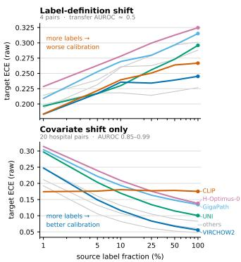  
(a)

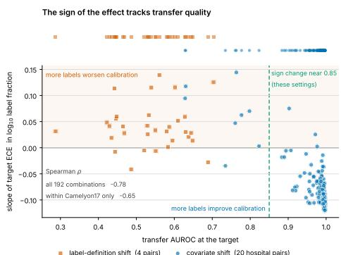  
(b)  
Figure 4: Reverse calibration scaling tracks transfer quality, not the kind of shift. (a) The same protocol, opposite directions: raw target ECE against source label fraction, averaged over pairs within each design. Top: the four label-definition pairs (transfer AUROC near 0.5); bottom: twenty Camelyon17 hospital pairs with one label definition. (b) Each point is one (model, pair) combination; the vertical axis is the slope of target ECE in $\log _ { 1 0 }$ label fraction, so points in the shaded region are combinations where additional source labels worsen calibration. The strip above marks where each design sits on the AUROC axis; the two designs overlap through the transition zone.

Post-hoc correction does not rescue the failing case. Fitting the temperature on a held-out source validation split increases target ECE for all eight FMs on CRC→BRACS from 5% source labels and on MHIST→PCam from 25%, and worsens ECE in 61% of cells across the four original pairs; on the hospital pairs, where transfer succeeds, it worsens ECE in only 16%.

Aggregated reliability via the Composite Reliability Index. Figure 7 (Appendix I) reports CRI per (model, label fraction) cell. VIRCHOW2 leads in both regimes (0.642 at full supervision, 0.564 at 1% labels), with best-to-worst spreads of 0.17 and 0.15. Two placements show what the index rewards: UNI ranks last at full supervision despite in-distribution AUROC 0.954 because its transfer AUROC (0.49) gives it the lowest OOD\_Stability (0.52), whereas CLIP, last on in-distribution AUROC on five of six datasets, places fourth and second because a ratio term rewards a model with little to lose under transfer. Section 4.1 returns to a transfer design in which OOD\_Stability measures what it was defined to measure.

## 4.1 Transfer under covariate shift alone

Camelyon17 supplies 20 directed hospital pairs sharing one label definition, run under the identical protocol: 720 in-distribution and 2,880 transfer runs. Transfer is meaningful here in a way the original pairs could not guarantee: at full supervision the eight FMs reach mean OOD AUROC between 0.885 (CLIP) and 0.996 (VIRCHOW2) against roughly 0.50 on the label-definition pairs, and single-class collapse occurs in 0.7% of cells against 57% there.

Under covariate shift alone additional source labels improve target calibration (Figure 4a): for UNI VIRCHOW2, GigaPath and H-Optimus-0, ECE rises in 1 of 80 combinations with a mean change of —0.184, and a source-fitted temperature worsens target ECE in 16% of cells against 61% on the original pairs. The reliability index also behaves as intended once label semantics are fixed: on sametask transfer the CRI ordering places the pathology-specific FMs (VIRCHOW2, UNI, H-Optimus-0, GigaPath, MIDNIGHT) above CONCH, PLIP and CLIP, and the composite agrees with all three of its components (Kendall $\tau = 0 . 7 1$ , 0.93 and 0.86 against in-distribution AUROC, OOD AUROC and the drop); the ratio term rewarded weak in-distribution models on the original pairs only because transfer there was near chance for every model. Averaging over models at full supervision, the target hospital matters more than the source for calibration (standard deviation of per-hospital mean raw ECE 0.043 across targets against 0.020 across sources) and about equally for AUROC (0.008 against 0.008) (Figure 5). Label-budget accounting for this dataset is in Appendix H.

## 5 Conclusion

PRISM evaluates pathology FM reliability under joint variation of model, label fraction, calibration and transfer (864 in-distribution and 3,600 Camelyon17 runs). Under a fixed frozen-embedding linear-probe pipeline it documents low-label decoupling of discrimination and calibration, collapsedriven breaking points, a sign change in reverse calibration scaling near transfer AUROC 0.85 in the evaluated settings, and far-from-uniform post-hoc recoverability with predominantly under-confident probes. Calibration that degrades as source labels accumulate is a cue to measure transfer before collecting more labels; the Composite Reliability Index is reported alongside its components, not in place of them.

Limitations and broader impact. All findings concern tile-level classification with frozen representations under one probe protocol; they describe model behaviour under these benchmark conditions, not readiness for clinical deployment; slide-level evaluation, confounded with the aggregator [35], is out of scope [12, 43]. The probe's regularization is fixed at C = 1; calibration rankings and the low-label decoupling depend on it (Section 3.2), and a validation-tuned-C replication, like a slide-disjoint Camelyon17 sensitivity analysis, is left to future work. An MLP probe over every cell preserves the direction of the decoupling and reverse-scaling effects (Appendix F). The 0.85 transition is an association on two transfer designs, not a general threshold. Camelyon17 isolates covariate but not scanner-only shift [37]. CRI is a screening heuristic, not a deployment criterion; we recommend institutional validation on local data before any clinical use.

# Acknowledgments and Disclosure of Funding

This work received no external funding. The author declares no competing interests.

## References

[1] Roba Al Majzoub, Hashmat Malik, Muzammal Naseer, Muhammad Zaigham Zaheer, Tariq Mahmood, Salman Khan, and Fahad Khan. How good is my histopathology vision-language foundation model? a holistic benchmark. SSRN Electronic Journal, 2025.

[2] Saghir Alfasly, Peyman Nejat, Sobhan Hemati, Jibran Khan, Isaiah Lahr, Areej Alsaafin, Abubakr Shafique, Nneka Comfere, Dennis Murphree, Chady Meroueh, et al. Foundation models for histopathology-fanfare or flair. Mayo Clinic Proceedings: Digital Health, 2024.

[3] Peter Bandi, Oscar Geessink, Quirine Manson, Marcory van Dijk, Maschenka Balkenhol, Meyke Hermsen, Babak Ehteshami Bejnordi, Byungjae Lee, Kyunghyun Paeng, Aoxiao Zhong, et al. From detection of individual metastases to classification of lymph node status at the patient level: The CAMELYON17 challenge. In IEEE Transactions on Medical Imaging, volume 38, pages 550–560, 2019.

[4] Bioptimus. H-optimus-0: An open-source foundation model for histology, 2024. Hugging Face model card.

[5] Nadia Brancati, Anna Maria Anniciello, Pushpak Pati, Daniel Riccio, Giosuè Scognamiglio, Guillaume Jaume, Giuseppe De Pietro, Maurizio Di Bonito, Antonio Foncubierta, Gerardo Botti, Maria Gabrani, Florinda Feroce, and Maria Frucci. BRACS: A dataset for breast carcinoma subtyping in H&E histology images. Database, 2022:baac093, 2022.

[6] Jack Breen, Katie Allen, Kieran Zucker, Lucy Godson, Nicolas M. Orsi, and Nishant Ravikumar. A comprehensive evaluation of histopathology foundation models for ovarian cancer subtype classification. NPJ Precision Oncology, 2025.

[7] Gabriele Campanella, Shengjia Chen, Manbir Singh, Ruchika Verma, Silke Muehlstedt, Jennifer Zeng, Aryeh Stock, Matt Croken, Brandon Veremis, Abdulkadir Elmas, et al. A clinical benchmark of public self-supervised pathology foundation models. Nature Communications, 2025.

[8] Richard J. Chen, Tong Ding, Ming Y. Lu, Drew F. K. Williamson, Guillaume Jaume, Andrew H. Song, Bowen Chen, Andrew Zhang, Daniel Shao, Muhammad Shaban, Mane Williams, Lukas Oldenburg, Luca L. Weishaupt, Judy J. Wang, Anurag Vaidya, Long Phi Le, Georg Gerber, Sharifa Sahai, Walt Williams, and Faisal Mahmood. Towards a general-purpose foundation model for computational pathology. Nature Medicine, 30(3):850–862, 2024.

[9] Jorge Diosdado, Pere Gilabert, Santi Seguí, and Henar Borrego. LungHist700: A dataset of histological images for deep learning in pulmonary pathology. Scientific Data, 11(1):1088, 2024.

[10] Alexey Dosovitskiy, Lucas Beyer, Alexander Kolesnikov, Dirk Weissenborn, Xiaohua Zhai, Thomas Unterthiner, Mostafa Dehghani, Matthias Minderer, Georg Heigold, Sylvain Gelly, et al. An image is worth 16× 16 words: Transformers for image recognition at scale. In International Conference on Learning Representations (ICLR), 2021.

[11] European Parliament and Council. Regulation (EU) 2024/1689 (artificial intelligence act), article 13: Transparency and provision of information to deployers, 2024.

[12] Ioannis Gatopoulos, Nicolas Känzig, Roman Moser, Sebastian Otálora, et al. eva: Evaluation framework for pathology foundation models. In Medical Imaging with Deep Learning (MIDL) 2024.

[13] Chuan Guo, Geoff Pleiss, Yu Sun, and Kilian Q. Weinberger. On calibration of modern neural networks. In International Conference on Machine Learning (ICML), 2017.

[14] Edward J. Hu, Yelong Shen, Phillip Wallis, Zeyuan Allen-Zhu, Yuanzhi Li, Shean Wang, Lu Wang, and Weizhu Chen. LoRA: Low-rank adaptation of large language models. In International Conference on Learning Representations (ICLR), 2022.

[15] Zhi Huang, Federico Bianchi, Mert Yuksekgonul, Thomas J. Montine, and James Zou. A visual–language foundation model for pathology image analysis using medical Twitter. Nature Medicine, 29(9):2307–2316, 2023.

[16] Mingu Kang, Heon Song, Seonwook Park, Donggeun Yoo, and Sérgio Pereira. Benchmarking self-supervised learning on diverse pathology datasets. In IEEE/CVF Conference on Computer Vision and Pattern Recognition (CVPR), 2023.

[17] Mikhail Karasikov, Joost van Doorn, Nicolas Känzig, Melis Erdal Cesur, Hugo Mark Horlings, Robert Berke, Fei Tang, and Sebastian Otálora. Training state-of-the-art pathology foundation models with orders of magnitude less data. In Medical Image Computing and Computer Assisted Intervention – MICCAI 2025, volume 15967 of Lecture Notes in Computer Science, pages 573–583. Springer Nature Switzerland, 2025.

[18] Jakob Nikolas Kather, Johannes Krisam, Pornpimol Charoentong, Tom Luedde, Esther Herpel, Cleo-Aron Weis, Timo Gaiser, Alexander Marx, Nektarios A. Valous, Dyke Ferber, et al. Predicting survival from colorectal cancer histology slides using deep learning: A retrospective multicenter study. PLoS Medicine, 16(1):e1002730, 2019.

[19] Pang Wei Koh, Shiori Sagawa, Henrik Marklund, Sang Michael Xie, Marvin Zhang, Akshay Balsubramani, Weihua Hu, Michihiro Yasunaga, Richard Lanas Phillips, Irena Gao, Tony Lee, Etienne David, Ian Stavness, Wei Guo, Berton A. Earnshaw, Imran S. Haque, Sara Beery, Jure Leskovec, Anshul Kundaje, Emma Pierson, Sergey Levine, Chelsea Finn, and Percy Liang. WILDS: A benchmark of in-the-wild distribution shifts. In International Conference on Machine Learning, pages 5637–5664, 2021.

[20] Simon Kornblith, Mohammad Norouzi, Honglak Lee, and Geoffrey Hinton. Similarity of neural network representations revisited. In International Conference on Machine Learning (ICML), 2019.

[21] Jaeung Lee, Jeewoo Lim, Keunho Byeon, and Jin Tae Kwak. Benchmarking pathology foundation models: Adaptation strategies and scenarios. Computers in Biology and Medicine, 190:110031,2025.

[22] Dong Li, Guihong Wan, Xintao Wu, Xinyu Wu, Ajit J. Nirmal, Christine G. Lian, Peter K. Sorger, Yevgeniy R. Semenov, and Chen Zhao. A survey on computational pathology foundation models: Datasets, adaptation strategies, and evaluation tasks. arXiv preprint arXiv:2501.15724, 2025.

[23] Ming Y. Lu, Bowen Chen, Drew F. K. Williamson, Richard J. Chen, Ivy Liang, Tong Ding, Guillaume Jaume, Igor Odintsov, Long Phi Le, Georg Gerber, Anil V. Parwani, Andrew Zhang, and Faisal Mahmood. A visual–language foundation model for computational pathology. Nature Medicine, 30(3):863–874, 2024.

[24] Jiabo Ma, Yingxue Xu, Fengtao Zhou, Yihui Wang, Cheng Jin, Zhengrui Guo, Jianfeng Wu, On Ki Tang, Huajun Zhou, Xi Wang, Luyang Luo, Zhengyu Zhang, Du Cai, Zizhao Gao, Wei Wang, Yueping Liu, Jiankun He, Jing Cui, Zhenhui Li, Jing Zhang, Feng Gao, Xiuming Zhang, Li Liang, Ronald Cheong Kin Chan, Zhe Wang, and Hao Chen. PathBench: A comprehensive comparison benchmark for pathology foundation models towards precision oncology. arXiv preprint arXiv:2505.20202, 2025.

[25] Pierre Marza, Leo Fillioux, Sofiène Boutaj, Kunal Mahatha, Christian Desrosiers, Pablo Piantanida, Jose Dolz, Stergios Christodoulidis, and Maria Vakalopoulou. THUNDER: Tile-level histopathology image UNDERstanding benchmark. Neural Information Processing Systems (NeurIPS) Datasets and Benchmarks Track, 2025. Published at NeurIPS 2025 Datasets and Benchmarks Track (Spotlight); code at https://github. com/MICS-Lab/thunder.

[26] Dmitry Nechaev, Alexey Pchelnikov, and Ekaterina Ivanova. SPIDER: A comprehensive multiorgan supervised pathology dataset and baseline models. arXiv preprint arXiv:2503.02876, 2025.

[27] Peter Neidlinger, Omar S. M. El Nahhas, Hannah Sophie Muti, Tim Lenz, Michael Hoffmeister, Hermann Brenner, Marko van Treeck, Rupert Langer, Bastian Dislich, Hans Michael Behrens, Christoph Röcken, Sebastian Foersch, Daniel Truhn, Antonio Marra, Oliver Lester Saldanha, and Jakob Nikolas Kather. Benchmarking foundation models as feature extractors for weakly supervised computational pathology. Nature Biomedical Engineering, 2025.

[28] Jeremy Nixon, Mike W. Dusenberry, Linchuan Zhang, Ghassen Jerfel, and Dustin Tran. Measuring calibration in deep learning. In CVPR Workshops, 2019.

[29] João D. Nunes, Diana Montezuma, Domingos Oliveira, Tania Pereira, Inti Zlobec, and Jaime S. Cardoso. Beyond accuracy: The role of calibration in computational pathology. In 2025 International Joint Conference on Neural Networks (IJCNN), pages 1–7, 2025.

[30] João D. Nunes, Diana Montezuma Felizardo, Domingos Oliveira, Tânia Pereira, and Jaime S. Cardoso. Beyond accuracy: Quantifying the reliability of multiple instance learning for whole slide image classification. arXiv preprint arXiv:2409.11110, 2024.

[31] Maxime Oquab, Timothée Darcet, Théo Moutakanni, Huy Vo, Marc Szafraniec, Vasil Khalidov, Pierre Fernandez, Daniel Haziza, Francisco Massa, Alaaeldin El-Nouby, et al. DINOv2: Learning robust visual features without supervision. Transactions on Machine Learning Research (TMLR), 2024.

[32] Yaniv Ovadia, Emily Fertig, Jie Ren, Zachary Nado, D. Sculley, Sebastian Nowozin, Joshua V. Dillon, Balaji Lakshminarayanan, and Jasper Snoek. Can you trust your model's uncertainty? evaluating predictive uncertainty under dataset shift. In Advances in Neural Information Processing Systems, volume 32, 2019.

[33] Alec Radford, Jong Wook Kim, Chris Hallacy, Aditya Ramesh, Gabriel Goh, Sandhini Agarwal, Girish Sastry, Amanda Askell, Pamela Mishkin, Jack Clark, Gretchen Krueger, and Ilya Sutskever. Learning transferable visual models from natural language supervision. In International Conference on Machine Learning (ICML), 2021.

[34] Mélanie Roschewitz, Raghav Mehta, Fabio De Sousa Ribeiro, and Ben Glocker. Where are we with calibration under dataset shift in image classification?arXiv preprint arXiv:2507.07780, 2025.

[35] Zhuchen Shao, Hao Bian, Yang Chen, Yifeng Wang, Jian Zhang, and Xiangyang Ji. TransMIL: Transformer based correlated multiple instance learning for whole slide image classification. In Advances in Neural Information Processing Systems (NeurIPS), 2021.

[36] Jeppe Thagaard, Søren Hauberg, Bert van der Vegt, Thomas Ebstrup, Johan Doré Hansen, and Anders Bjorholm Dahl. Can you trust predictive uncertainty under real dataset shifts in digital pathology? In Medical Image Computing and Computer Assisted Intervention – MICCAI 2020, volume 12261 of Lecture Notes in Computer Science, pages 824–833. Springer, 2020.

[37] Erik Thiringer, Fredrik K. Gustafsson, Kajsa Ledesma Eriksson, and Mattias Rantalainen. Scanner-induced domain shifts undermine the robustness of pathology foundation models. arXiv preprint arXiv:2601.04163, 2026.

[38] U.S. Food and Drug Administration. Good machine learning practice for medical device development: Guiding principles, 2021.

[39] Bastiaan S. Veeling, Jasper Linmans, Jim Winkens, Taco Cohen, and Max Welling. Rotation equivariant CNNs for digital pathology. In Medical Image Computing and Computer Assisted Intervention – MICCAI 2018, volume 11071 of Lecture Notes in Computer Science, pages 210–218. Springer, 2018.

[40] Jerry Wei, Arief Suriawinata, Bing Ren, Xiaoying Liu, Mikhail Lisovsky, Louis Vaickus, Charles Brown, Michael Baker, Naofumi Tomita, Lorenzo Torresani, Jason Wei, and Saeed Hassanpour. A petri dish for histopathology image analysis. In Artificial Intelligence in Medicine (AIME), 2021.

[41] Georg Wölflein, Dyke Ferber, Asier Rabasco Meneghetti, Omar S. M. El Nahhas, Daniel Truhn, Zunamys I. Carrero, David J. Harrison, Ognjen Arandjelović, and Jakob Nikolas Kather. Benchmarking pathology feature extractors for whole slide image classification. arXiv preprint arXiv:2311.11772,2023.

[42] Hanwen Xu, Naoto Usuyama, Jaspreet Bagga, Sheng Zhang, Rajesh Rao, Tristan Naumann, Cliff Wong, Zelalem Gero, Javier González, Yu Gu, Yanbo Xu, Mu Wei, Wenhui Wang, Shuming Ma, Furu Wei, Jianwei Yang, Chunyuan Li, Jianfeng Gao, Jaylen Rosemon, Tucker Bower, Soohee Lee, Roshanthi Weerasinghe, Bill J. Wright, Ari Robicsek, Brian Piening, Carlo Bifulco, Sheng Wang, and Hoifung Poon. A whole-slide foundation model for digital pathology from real-world data. Nature, 630(8015):181–188, 2024.

[43] Andrew Zhang, Guillaume Jaume, Anurag Vaidya, Tong Ding, and Faisal Mahmood. Accelerating data processing and benchmarking of AI models for pathology. arXiv preprint arXiv:2502.06750, 2025.

[44] Eric Zimmermann, Eugene Vorontsov, Julian Viret, Adam Casson, Michal Zelechowski, George Shaikovski, Neil Tenenholtz, James Hall, David Klimstra, Razik Yousfi, Thomas Fuchs, Nicolò Fusi, Siqi Liu, and Kristen Severson. Virchow2: Scaling self-supervised mixed magnification models in pathology. arXiv preprint arXiv:2408.00738, 2024.

## Appendix

## A Included foundation models

This appendix lists architectural and training details for each of the eight foundation models supported in PRISM, complementing Table 3. All eight models share a Vision Transformer backbone [10], with four of the pathology-pretrained SSL models (UNI, GigaPath, H-Optimus-0, MIDNIGHT) using the DINOv2 [31] self-supervised training recipe at varying scales. Each model is loaded through its native HuggingFace interface, and the preprocessing applied to each is given in Table 4. Five of the eight share a resize to 224 with a centre crop and ImageNet normalization statistics; GigaPath resizes to 256; H-Optimus-0 uses its own normalization statistics; CONCH uses the transform returned by its own loader. All embeddings are L2-normalized.

Table 3: The eight foundation models evaluated. Sizes range from 86M to 1.1B parameters.
<table><tr><td>Model</td><td>Type</td><td>Size</td><td>d</td><td>Pre-training corpus</td></tr><tr><td>CLIP</td><td>Vision-Language</td><td>86M</td><td>768</td><td>WebImageText (general)</td></tr><tr><td>PLIP</td><td>Vision-Language</td><td>86M</td><td>768</td><td>Twitter pathology pairs</td></tr><tr><td>CONCH</td><td>Vision-Language</td><td>86M</td><td>512</td><td>Curated pathology pairs</td></tr><tr><td>UNI</td><td>Vision</td><td>307M</td><td>1024</td><td>100k WSIs (Mass-100K)</td></tr><tr><td>VIRCHOW2</td><td>Vision</td><td>632M</td><td>2560</td><td>3.1M WSIs</td></tr><tr><td>GigaPath</td><td>Vision</td><td>1.1B</td><td>1536</td><td>171k WSIs (Prov-Path)</td></tr><tr><td>H-Optimus-0</td><td>Vision</td><td>1.1B</td><td>1536</td><td>500k WSIs</td></tr><tr><td>MIDNIGHT</td><td>Vision</td><td>1.1B</td><td>1536</td><td>TCGA + NKI-80k (92k WSIs)</td></tr></table>

Table 4: Preprocessing applied to each FM during feature extraction. Each model is embedded once under one pipeline, held fixed thereafter.
<table><tr><td>Model(s)</td><td>Resize</td><td>Crop</td><td>Normalization</td></tr><tr><td>CLIP, PLIP, MIDNIGHT, UNI, VIRCHOW2</td><td>224</td><td>224</td><td>ImageNet</td></tr><tr><td>GigaPath</td><td>256</td><td>224</td><td>ImageNet</td></tr><tr><td>H-Optimus-0</td><td>224</td><td>224</td><td>model-specific</td></tr><tr><td>CONCH</td><td colspan="3">transform supplied by the model loader</td></tr></table>

For vision-language models we use only the image encoder; the text encoder is unused. Embedding dimensionality d is listed in Table 3: 768 for CLIP and PLIP, 512 for CONCH, 1024 for UNI, 1536 for GigaPath, H-Optimus-0 and MIDNIGHT, and 2560 for VIRCHOW2, whose feature is the class token concatenated with the mean patch token. Where models support multiple variants we use the largest publicly released checkpoint at the time of evaluation.

## B Additional runtimes

Embedding extraction was performed on Google Colab NVIDIA A100 GPUs (80 GB VRAM); the same figures are reported in the reproducibility checklist. Per-FM embedding cost across all six datasets ranges from approximately 0.6 GPU-hours (CLIP, the smallest model) to 3.4 GPU-hours (GigaPath and H-Optimus-0, the largest). The total one-time embedding cost is approximately 15 GPU-hours. Once embeddings are cached, all 864 linear probe runs together complete in under 30 minutes on a single CPU; bootstrap CI computation across all 288 cells takes 26 seconds. Per-cell wall-clock for a single linear probe run is dominated by the LBFGS convergence on the high-dimensional embedding space and ranges from 0.3 seconds (CLIP on PCam at 1% labels) to 12 seconds (VIRCHOW2 on SPIDER-Breast at 100% labels). The amortized cost structure is the property that makes PRISM cheap to use as a comparison target for new methods.

Table 5: Comparison of pathology FM benchmarks and adjacent calibration studies. Only PRISM evaluates the joint interaction of FM choice, label fraction, calibration, and cross-domain OOD shift on pathology FMs. † Image classification (not pathology); included as the closest methodological precedent.
<table><tr><td>Benchmark</td><td>FMs</td><td>Label fraction</td><td>Calibration</td><td>OOD</td><td>Year</td></tr><tr><td>THUNDER [25]</td><td>23</td><td>few-shot only</td><td>√</td><td>adversarial only</td><td>2026</td></tr><tr><td>HistoVL [1]</td><td>4VLMs</td><td>x</td><td>√</td><td>x</td><td>2025</td></tr><tr><td>Neidlinger et al. [27]</td><td>19</td><td>x</td><td>x</td><td>x</td><td>2025</td></tr><tr><td>PathBench [24]</td><td>19</td><td>x</td><td>x</td><td>x</td><td>2025</td></tr><tr><td>Lee et al. [21]</td><td>4</td><td>few-shot only</td><td>x</td><td>near/mid/out-domain</td><td>2025</td></tr><tr><td>Nunes et al. [29]</td><td></td><td>x</td><td>√</td><td>x</td><td>2025</td></tr><tr><td>Thiringer et al. [37]</td><td>14</td><td>x</td><td>√</td><td>scanner shift</td><td>2026</td></tr><tr><td>Roschewitz et al.† [34]</td><td>FT only</td><td>x</td><td>√</td><td>√(natural)</td><td>2025</td></tr><tr><td>PRISM (ours)</td><td>8</td><td>√(1-100%)</td><td>√(+ recoverability)</td><td>√(4 + 20 pairs)</td><td>2026</td></tr></table>

## C Comparison with existing benchmarks

A more detailed version of Table 5 comparing PRISM to THUNDER [25], HistoVL [1], Neidlinger et al. [27], PathBench [24], Lee et al. [21], Nunes et al. [29], Thiringer et al. [37], Roschewitz et al. [34], Wölflein et al. [41], eva [12], Patho-Bench [43], and Kang et al. [16] accompanies the code release. The dimensions on which PRISM is unique are: continuous label-fraction sweep (six points from 1% to 100% versus discrete shot counts in THUNDER and Lee et al.); both raw and post-hoc-recovered ECE (versus raw-only in THUNDER, HistoVL, and Thiringer); and cross-domain transfer pairs (versus scanner-only in Thiringer, adversarial in THUNDER, and none in Neidlinger / PathBench / HistoVL).

## D Extended discussion on quantitative results

What a label fraction consumes (six main datasets). The fraction subsamples the training split; the validation split used for temperature fitting is a separate budget, and at 1% labels it supplies 90–96% of all labelled examples a cell consumes. We therefore also report a proportional protocol in which validation is subsampled by the same fraction and seed: AUROC and raw ECE are identical by construction, scaled ECE at 1% labels rises by 0.009, the decoupling contrast is essentially unchanged (∆ρ = 0.69 against 0.75), and the calibration ranking of FMs is preserved (mean Kendall τ = 0.75, no sign inversions). Because the proportional budget leaves three validation samples on MHIST at 1% labels, scaled ECE at 1% is read together with raw ECE, which uses no validation labels (Section 4); absolute counts are in Table 2.

Per-(model, dataset, fraction) results for AUROC, ECE (raw and after temperature scaling), Brier score, and macro-F1, reported as mean ± standard deviation across the three seeds (42, 123, 456), accompany the code release as one CSV file per (model, dataset). At label fraction = 1.0, all three seeds train on identical data with the deterministic LBFGS solver, yielding zero between-seed variance and confidence intervals that collapse to point estimates by construction; we report this regime transparently rather than masking it. That variance is concentrated where the label budget is smallest and where the task is hardest: at 1% labels the between-seed standard deviation in AUROC is 0.055 on MHIST, 0.034 on LungHist700 and 0.026 on BRACS, against 0.002 on CRC and 0.002 on PCam. It is also the larger source of variation at that fraction, roughly twice the spread induced by sweeping the regularization constant over two orders of magnitude, which is why we report it alongside every low-fraction result rather than only the mean. It does not account for the decoupling reported in Section 4: the rank correlation between discrimination and calibration is negative at 1% labels within each of the three seeds taken separately (—0.17, —0.25, -0.10), so the pattern is not produced by averaging across them.

## E Implementation details

The prism\_bench package (pip install prism-bench) exposes a PRISMEvaluator class plus a CLI (prism evaluate, prism compare). It operates on embeddings rather than models, so a new FM is evaluated by extracting its features once with any pipeline and running the protocol on CPU:

from prism\_bench import PRISMEvaluator

```python
ev = PRISMEvaluator(results_dir="results_v2") # shipped reference results
res = ev.evaluate(X_train, y_train, X_test, y_test,
dataset="pcam", model_name="MyFM",
val_features=X_val, val_labels=y_val)# for temperature
cmp = ev.compare(res, dataset="pcam", fraction=0.1) # ranked vs 8 reference FMs
```

evaluate sweeps the six label fractions and three seeds by default and returns one row per (fraction, seed) with AUROC, macro-F1, Brier, raw and scaled ECE under both binning schemes, the fitted temperature and the degeneracy share; without a validation split the temperature and scaled ECE are left undefined rather than fitted on the test set. compare is restricted to the six benchmark datasets, for which reference results exist. The CLI mirrors this interface on . npy files. Random seeds are fixed at {42, 123, 456}; np . random. seed is called immediately before subset sampling to guarantee identical training subsets across FMs at every (dataset, fraction, seed) cell. Package version pins, dataset download instructions, and embedding generation scripts are included in the code release.

## F Impact of probe choice on calibration performance

All main-text results use l2-regularized logistic regression as the probe family. As Marza et al. [25] note, calibration is probe-dependent, and we quantify that dependence rather than assume it away. Repeating the full protocol with a multilayer perceptron of one hidden layer of width 256, under identical splits, seeds and metric definitions, gives the following. The MLP is uniformly better calibrated (mean ECE lower by 0.128 at 1% labels and 0.039 at full supervision) and marginally better at discrimination (mean AUROC higher by 0.004 to 0.015). Discriminative ordering is largely preserved: the Kendall τ between the linear and MLP AUROC rankings averages 0.85 across the 36 (dataset, fraction) cells. Calibration ordering is not: τ averages 0.29 and inverts in sign in several cells, reaching —0.64 on BRACS at 10% labels. Of the qualitative findings, the separation between discrimination and calibration persists in direction but weakens in magnitude (pooled $\rho = 0 . 0 7$ at 1% labels against —0.24 under the linear probe, and 0.42 against 0.52 at full supervision), and the reverse OOD scaling of Section 4 persists for all four models it covers. One linear-probe pattern does not persist: on LungHist700 raw ECE rises with label fraction under the linear probe (UNI 0.213 to 0.313, GigaPath 0.186 to 0.312, H-Optimus-0 0.161 to 0.314), whereas under the MLP it improves with additional labels for UNI (0.144 → 0.086), GigaPath (0.191 → 0.067) and H-Optimus-0 (0.114 → 0.096). That finding therefore belongs to the linear-probe protocol and we state it as such. Taken with the regularization sweep reported above, the pattern across both ablations is consistent: in-distribution comparisons of discrimination between FMs are robust to probe details while comparisons of calibration are not, which is the practical reason a calibration-based index must fix its probe protocol before it can be used to rank models.

LoRA check. A small LoRA fine-tuning check [14] (UNI and H-Optimus-0 on MHIST and LungHist700, three fractions, three seeds; 36 runs) accompanies the code release. It is too small, and its training budget too uneven across fractions, to support conclusions.

Regularization sweep in distribution. On MHIST, LungHist700 and BRACS we refit every probe at C ∈ {0.01, 0.1, 1, 10, 100} (fractions 1%, 10% and 100%, three seeds; raw ECE). Pooled withindataset Spearman correlations between AUROC rank and raw-ECE rank at 1% and 100% labels are −0.41 and −0.46 at C = 0.01, −0.08 and −0.54 at C = 0.1, −0.80 and 0.13 at C = 1, 0.03 and 0.10 at C = 10, and 0.08 and 0.45 at C = 100. The 1%-versus-100% contrast is therefore pronounced only at the protocol value C = 1 and reverses under stronger regularization, which is why Section 3.2 states the decoupling as a property of the fixed-probe pipeline. AUROC rankings are stable across the same sweep (mean Kendall τ = 0.82 against C = 1).

Regularization sweep under transfer. We ran the regularization sweep in the transfer setting as well, over all four pairs, all eight FMs, C ∈ {0.01, 0.1, 1, 10, 100}, three label fractions and three seeds, for 1,440 further fits. Two results. First, the transfer conclusions are insensitive to C: against $C = 1 . 0$ the mean Kendall τ is 0.71 for the OOD AUROC ranking with no sign inversions in 48 comparisons, and 0.59 for the OOD calibration ranking with two. The ranking instability reported above is therefore an in-distribution phenomenon and does not carry into transfer, although in magnitude the asymmetry persists: the ratio of ECE spread to AUROC spread across C is above 1 on three of the four pairs, ranging to 4.31 on PCam→MHIST at 1% labels. Across the four pairs, target raw ECE rises from 1% to 100% source labels in 20, 27, 28, 27 and 22 of the 32 (model, pair) combinations at $C = 0 . 0 1 , 0 . 1 , 1 , 1 0 , 1 0 0$ , while target single-class collapse at 1% labels falls from 82% to 41% of cells as $C$ grows, so the reverse-scaling direction is not produced by the protocol value of C alone.

Second, and bearing on the mechanism proposed in Section 4, the magnitude of the reverse OOD scaling effect increases monotonically with ${ \dot { C } } .$ On MHIST→PCam at 100% source labels, raw ECE rises from 0.221–0.246 across the four models at $C = 0 . 0 1$ to 0.443–0.498 at $C = 1 0 0$ . Since C is precisely the parameter that governs how freely the probe may fit the source domain, this is quantitative support for the over-specialization reading: constraining source-specific fitting suppresses the effect in proportion. The effect is present at 19 of the 20 (model, C) combinations; the exception is UNI at $C = 0 . 0 1$ , a setting at which every FM predicts a single class on the entire target test split and ECE is pinned at the class prior at both ends of the label range, so no effect of any kind can be expressed. Per-cell values accompany the code release. ECE is computed with fixed-width bins (15 bins) on the test split. Because fixed-width binning can leave bins empty on small test sets, we also report ECE under the equal-mass (adaptive) scheme of Nixon et al. [28]. The decoupling contrast is unchanged under equal-mass bins (pooled $\rho = - 0 . 2 4$ at 1% labels and 0.56 at full supervision, against —0.24 and 0.52 with equal-width bins), and the paired values for every cell accompany the code release. For per-FM feature-space comparisons that complement the calibration analysis we use mutual k-nearest-neighbour alignment $( k = 5 0$ , Jaccard overlap of per-sample neighbour sets), reported in Figures 20 and 21; centered kernel alignment [20] is an alternative probe-free measure that we do not compute here. The per-dataset alignment matrices accompany the code release.

## G Different pre-processing for SPIDER-Breast

SPIDER-Breast [26] releases tiles at multiple magnifications and sizes; we use the 224×224 patches at 20× magnification to match the most common pathology FM training resolution. The 18-class taxonomy is used as released, without merging or pruning.

## H Camelyon17 hospital transfer: details

Data. Camelyon17 [3] in the WILDS release [19], read from a parquet redistribution of the same data and verified at 455,954 patches against the published release before use. Five hospitals, one binary task, one label definition. We draw 20,000 patches per hospital, label-stratified at 50/50, and partition 14,000 / 3,000 / 3,000 into train, validation and test, stratified so that every partition of every hospital is exactly balanced.

Why the split is at patch level. Each hospital contributes about ten slides and tumour patches concentrate in two or three of them. A slide-disjoint partition therefore produced tumour prevalence between 0.1% and 83% across splits, ranging within a single hospital from 5.8% in train to 81% in test. Since ECE is prevalence-sensitive, cross-hospital calibration comparisons under such a split would measure prevalence rather than calibration. Patch-level stratification fixes prevalence at 50% everywhere. The cost is within-hospital slide overlap between train and test, which affects only the in-distribution numbers; in the transfer grid, source and target are different hospitals with disjoint patients and slides, so no leakage is possible there. We report the in-distribution results on this dataset as an upper bound.

Preprocessing. Unlike the six main datasets, each FM here is embedded under its own documented transform, resolved programmatically from the model rather than imposed on it (Table 6). Embeddings are L2-normalised, matching the main protocol, so the regularisation constant means the same thing on both datasets.

Table 6: Preprocessing resolved from each model for the Camelyon17 extraction.
<table><tr><td>Model</td><td>Resize</td><td>Normalization</td><td>Dim</td></tr><tr><td>CLIP, PLIP</td><td>224</td><td>CLIP statistics</td><td>768</td></tr><tr><td>CONCH</td><td>model loader</td><td>model loader</td><td>512</td></tr><tr><td>UNI</td><td>224</td><td>ImageNet</td><td>1024</td></tr><tr><td>VIRCHOW2</td><td>224</td><td>ImageNet</td><td>2560</td></tr><tr><td>GigaPath</td><td>224</td><td>ImageNet</td><td>1536</td></tr><tr><td>H-Optimus-0</td><td>256</td><td>model-specific</td><td>1536</td></tr><tr><td>MIDNIGHT</td><td>224</td><td>(0.5, 0.5, 0.5)</td><td>1536</td></tr></table>

Label budget. At 1% labels a cell trains on 140 patches. Under the protocol used for the six main datasets the temperature is fitted on the full 3,000-patch validation split, so 95.5% of the labels the cell consumes come from validation; the share falls to 68% at 10% labels and 18% at full supervision. A proportional protocol, in which validation is subsampled by the same fraction and seed, changes scaled ECE by at most 0.001 at any fraction and leaves AUROC and raw ECE identical by construction. It is not the protocol we report, however, because at 1% labels it leaves 30 validation patches and the fitted temperature reaches a search bound in 47% of cells; the full-validation temperature is stable at every fraction.

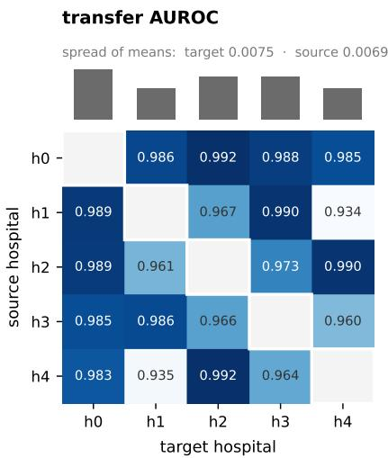

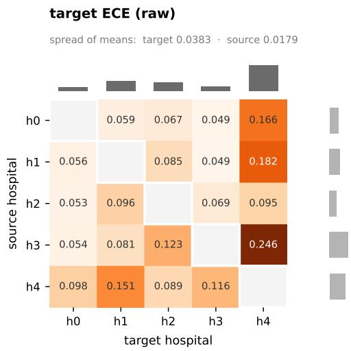  
Figure 5: Calibration under transfer depends mostly on the target hospital. Transfer AUROC and raw target ECE at full supervision, averaged over the eight foundation models, for each ordered pair of Camelyon17 hospitals. Marginal bars give column and row means. The diagonal is empty because source and target are always distinct. For raw ECE, column (target) means vary about twice as much as row (source) means; for AUROC the two spreads are similar.

Mechanism analysis. The 192 (model, pair) combinations used in Section 4 combine the 32 from the four original pairs with the 160 from the twenty hospital pairs. For each combination we fit the slope of mean target ECE against $\log _ { 1 0 }$ label fraction. Table 7 gives the rate at which that slope is positive, by transfer AUROC band.

Per-model transfer on Camelyon17. Averaged over the twenty pairs and the six label fractions, OOD AUROC and the number of pairs on which target ECE rises: CLIP 0.849 and 8; PLIP 0.966 and 1; CONCH 0.984 and 0; MIDNIGHT 0.989 and 0; GigaPath 0.992 and 1; H-Optimus-0 0.992 and 0; UNI 0.994 and 0; VIRCHOW2 0.995 and 0. The Spearman correlation between the two columns is −0.91 (p = 0.002).

Availability. Split indices, the balanced re-split index map, the preprocessing table, per-cell results for both grids and the mechanism summary accompany the code release.

Table 7: Rate of rising target ECE by transfer AUROC, over all 192 (model, pair) combinations from both transfer designs. The two middle bands contain combinations from both designs.
<table><tr><td>Transfer AUROC</td><td>n</td><td>Rising</td><td>Rate</td><td>Mean ∆ECE</td></tr><tr><td>[0.00, 0.55)</td><td>16</td><td>14</td><td>88%</td><td>+0.081</td></tr><tr><td>[0.55, 0.70)</td><td>17</td><td>15</td><td>88%</td><td>+0.089</td></tr><tr><td>[0.70, 0.85)</td><td>7</td><td>6</td><td>86%</td><td>+0.110</td></tr><tr><td>[0.85, 0.95)</td><td>13</td><td>1</td><td>8%</td><td>-0.074</td></tr><tr><td>[0.95, 1.00]</td><td>139</td><td>2</td><td>1%</td><td>-0.172</td></tr></table>

Table 8: Binary label mapping for the four transfer pairs. The positive class is defined differently on each side, so these settings combine covariate shift with a change of label definition.
<table><tr><td>Pair</td><td>Source positive</td><td>Target positive</td></tr><tr><td>PCam→MHIST</td><td>tumour tissue, lymph node</td><td>SSA polyp</td></tr><tr><td>MHIST→PCam</td><td>SSA polyp</td><td>tumour tissue, lymph node</td></tr><tr><td>CRC→BRACS</td><td>TUM</td><td>IC, DCIS</td></tr><tr><td>BRACS→CRC</td><td>IC, DCIS</td><td>TUM</td></tr></table>

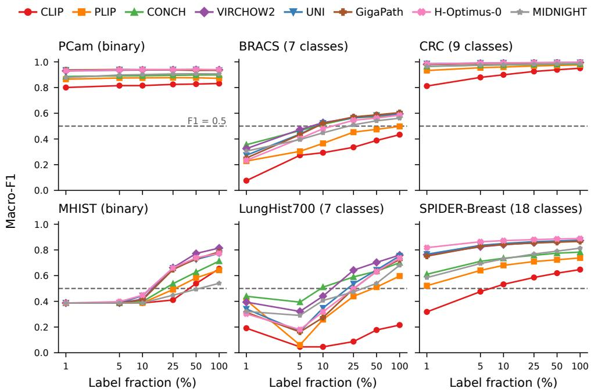  
Figure 6: Breaking points. Macro-F1 versus label fraction for each (model, dataset) pair. PCam and CRC are close to saturation (macro-F1 at least 0.80 already at 1% labels); {BRACS, MHIST, LungHist700} expose label-efficiency differences across FM classes. CLIP and PLIP never break F1 = 0.5 on BRACS regardless of label budget.

## I Additional experimental results

This appendix presents the supporting figures that complement the main-text figures of Section 4. Figure 8 reports the collapse audit that qualifies the breaking-point analysis, and Figure 9 gives the rank-correlation statistics underlying the decoupling claim. Figure 6 gives the breaking-point curves and Figure 7 the Composite Reliability Index heatmap discussed in Section 4. Table 8 gives the binary label mapping of the four original transfer pairs.

Composite Reliability Index (CRI) per model and label fraction
<table><tr><td></td><td rowspan=1 colspan=1>0.483</td><td rowspan=1 colspan=1>0.498</td><td rowspan=1 colspan=1>0.510</td><td rowspan=1 colspan=1>0.524</td><td rowspan=1 colspan=1>0.533</td><td rowspan=1 colspan=1>0.541</td></tr><tr><td></td><td rowspan=1 colspan=1>0.470</td><td rowspan=1 colspan=1>0.477</td><td rowspan=1 colspan=1>0.497</td><td rowspan=1 colspan=1>0.508</td><td rowspan=1 colspan=1>0.513</td><td rowspan=1 colspan=1>0.520</td></tr><tr><td></td><td rowspan=1 colspan=1>0.445</td><td rowspan=1 colspan=1>0.461</td><td rowspan=1 colspan=1>0.469</td><td rowspan=1 colspan=1>0.476</td><td rowspan=1 colspan=1>0.482</td><td rowspan=1 colspan=1>0.489</td></tr><tr><td></td><td rowspan=1 colspan=1>0.564</td><td rowspan=1 colspan=1>0.600</td><td rowspan=1 colspan=1>0.612</td><td rowspan=1 colspan=1>0.626</td><td rowspan=1 colspan=1>0.637</td><td rowspan=1 colspan=1>0.642</td></tr><tr><td></td><td rowspan=1 colspan=1>0.421</td><td rowspan=1 colspan=1>0.434</td><td rowspan=1 colspan=1>0.448</td><td rowspan=1 colspan=1>0.459</td><td rowspan=1 colspan=1>0.469</td><td rowspan=1 colspan=1>0.469</td></tr><tr><td></td><td rowspan=2 colspan=1>0.4790.481</td><td rowspan=1 colspan=1>0.503</td><td rowspan=1 colspan=1>0.516</td><td rowspan=1 colspan=1>0.533</td><td rowspan=1 colspan=1>0.543</td><td rowspan=1 colspan=1>0.552</td></tr><tr><td></td><td rowspan=1 colspan=1>0.504</td><td rowspan=1 colspan=1>0.519</td><td rowspan=1 colspan=1>0.535</td><td rowspan=1 colspan=1>0.543</td><td rowspan=1 colspan=1>0.553</td></tr><tr><td rowspan=1 colspan=1>MIDNIGHT</td><td rowspan=1 colspan=1>0.414</td><td rowspan=1 colspan=1>0.445</td><td rowspan=1 colspan=1>0.455</td><td rowspan=1 colspan=1>0.462</td><td rowspan=1 colspan=1>0.467</td><td rowspan=1 colspan=1>0.475</td></tr><tr><td rowspan=1 colspan=1></td><td rowspan=1 colspan=1>1%</td><td rowspan=1 colspan=1>5%</td><td rowspan=1 colspan=1>10%</td><td></td><td></td><td></td></tr></table>

Figure 7: Composite Reliability Index. CRI per (model, label fraction) cell, aggregating discrimination, calibration and OOD stability with OOD\_Stability as defined in Equation 1. VIRCHOW2 leads in both regimes (0.56 at 1% labels, 0.64 at 100%). Two features of the index are worth reading off the figure rather than inferring from it. The spread between the best and worst model is 0.15 at 1% labels and 0.17 at full supervision, so the index separates models less sharply than AUROC alone does. And CLIP places second at 1% labels despite being last on AUROC on five of six datasets because a ratio-based stability term rewards models that had little in-distribution performance to lose under transfer. We read CRI as a screening heuristic subject to that caveat, not as a ranking.  
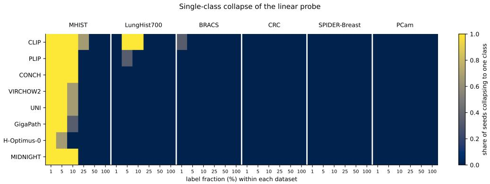  
Figure 8: Single-class collapse of the linear probe. Share of the three seeds in which the probe assigns more than 99% of the test set to one class, per (model, dataset, label fraction). On MHIST every FM collapses at 1% labels and most remain collapsed at 5%; on PCam and CRC collapse never occurs. Stratified sampling does not remove the effect, so it is not purely an artefact of subset selection: at these fractions the probe has enough examples of each class and still does not move its decision threshold off the majority. Where a cell is dark, AUROC may remain informative while macro-F1 and ECE describe a classifier that makes one prediction.

## J Detailed per-(model, dataset) results

This appendix presents the detailed per-(model, dataset) numerical results that underlie the heatmaps and curves in the main paper. All values are mean ± standard deviation across the three random seeds (42, 123, 456). At label fraction = 1.0 the deterministic LBFGS solver yields zero between-seed variance, which is reported as a point estimate.

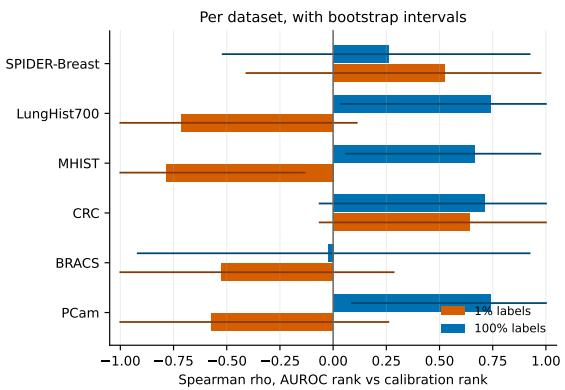

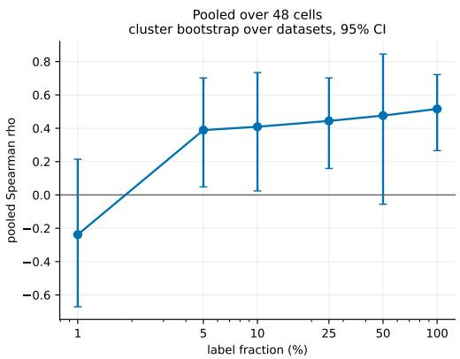  
Figure 9: Rank correlation between discrimination and calibration. Left: per-dataset Spearman ρ between AUROC rank and calibration rank at 1% and 100% labels, with bootstrap intervals over the eight models. Right: the same quantity pooled over all 48 (model, dataset) cells at each label fraction, with intervals from a cluster bootstrap that resamples whole datasets rather than models, since models within a dataset are not independent. The pooled estimate rises from —0.24 at 1% labels to 0.52 at full supervision; the contrast between the two regimes is significant $( \Delta \rho = 0 . 6 2$ 95% CI [0.08, 1.13] when the bootstrap resamples seeds as well as datasets) even though the individual per-fraction estimates do not all exclude zero on their own.

Raw ECE at 1% labels (no temperature scaling; mean of 3 seeds)
<table><tr><td>CLIP</td><td>0.082</td><td>0.048</td><td>0.372</td><td>0.128</td><td>0.067</td><td>0.209</td><td rowspan="5">0.5 beter) 0.4  s  s 0.3</td><td rowspan="5"></td></tr><tr><td>PLIP</td><td>0.072</td><td>0.069</td><td>0.287</td><td>0.146</td><td>0.307</td><td>0.364</td></tr><tr><td>CONCH</td><td>0.052</td><td>0.162</td><td>0.191</td><td>0.119</td><td>0.331</td><td>0.316</td></tr><tr><td>VIRCHOW2</td><td>0.062</td><td>0.158</td><td>0.182</td><td>0.139</td><td>0.294</td><td>0.378</td></tr><tr><td>UNI</td><td>0.073</td><td>0.110</td><td>0.221</td><td>0.121</td><td>0.213</td><td>0.429</td></tr><tr><td>GigaPath</td><td>0.071</td><td>0.084</td><td>0.241</td><td>0.120</td><td>0.186</td><td>0.422</td><td rowspan="4">0.2 &#x27;3C3 0.1 Raw 0.0</td></tr><tr><td>H-Optimus-0</td><td>0.067</td><td>0.074</td><td>0.229</td><td>0.132</td><td>0.161</td><td>0.465</td></tr><tr><td>MIDNIGHT</td><td>0.057</td><td>0.106</td><td>0.182</td><td>0.091</td><td>0.173</td><td>0.310</td></tr><tr><td></td><td>PCam (binary)</td><td>BRACS (7 cl.)</td><td>CRC (9 cl.)</td><td>MHIST (binary)</td><td>LungHist700 SPIDER-Breast (7 cl.)</td><td>(18 cl.)</td></tr></table>

Figure 10: Raw miscalibration at 1% labels. Raw ECE for every (model, dataset) cell. On SPIDER-Breast raw ECE reaches 0.42–0.47 for UNI, GigaPath and H-Optimus-0 against 0.21 for CLIP. The fitted temperatures in these cells are below 1 (Figure 15), so this is under-confidence of the regularized linear probe, not over-confidence, and temperature scaling largely removes it (Figure 11). Complementary to Figure 2: AUROC rankings hide the magnitude of raw miscalibration.

At full label availability, in-distribution AUROC is largely saturated for the pathology-pretrained vision SSL models, with VIRCHOW2, UNI, GigaPath, and H-Optimus-0 all reaching 1.000 on CRC and clustering above 0.98 on PCam and SPIDER-Breast. The two task families that retain headroom are MHIST (binary HP/SSA) and BRACS (7-class breast carcinoma subtyping), where VIRCHOW2 attains the top AUROC on MHIST (0.916) and CONCH leads on BRACS (0.905). MIDNIGHT, trained on roughly an order of magnitude less data than VIRCHOW2, achieves parity on PCam, CRC, and SPIDER-Breast but drops to 0.738 on MHIST, the lowest score in the column. The compact spread on the saturated datasets is the property that motivates the more discriminative protocols of Section 3.2: at 100% labels, raw AUROC alone provides limited signal for ranking pathology FMs.

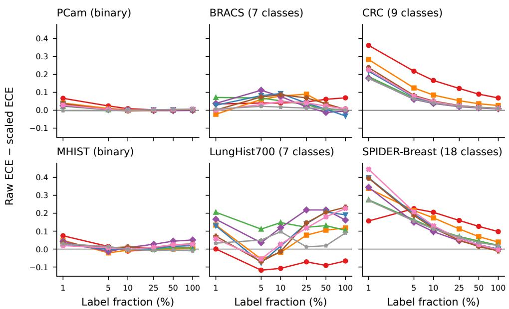  
Figure 11: Calibration recoverability via temperature scaling. Improvement in ECE (raw minus scaled) per (model, dataset) cell, plotted against label fraction. Recoverability ranges from 0.45 (H-Optimus-0 on SPIDER-Breast at 1% labels, raw ECE 0.465 to scaled 0.020) to zero or slightly negative (UNI on MHIST at 5% and 10% labels); scaling fails to reduce ECE in 49 of the 288 cells. Practitioners can use this map to anticipate when a single scalar T suffices and when post-hoc calibration is inert.

Table 9: AUROC at 100% label fraction (mean ± std over 3 seeds). Best per dataset in bold.
<table><tr><td>Model</td><td>PCam</td><td>BRACS</td><td>CRC</td><td>MHIST</td><td>LungHist700</td><td>SPIDER-Breast</td></tr><tr><td>CLIP</td><td>0.917 ± 0.000</td><td>0.814</td><td>0.998 ± 0.000</td><td>0.854</td><td>0.835</td><td>0.964± 0.000</td></tr><tr><td>PLIP</td><td>0.952</td><td>0.857</td><td>0.999</td><td>0.829</td><td>0.922</td><td>0.982 ± 0.000</td></tr><tr><td>CONCH</td><td>0.966 ±0.000</td><td>0.905</td><td>0.999</td><td>0.851</td><td>0.971</td><td>0.988±0.000</td></tr><tr><td>VIRCHOW2</td><td>0.986</td><td>0.904</td><td>1.000</td><td>0.916</td><td>0.972</td><td>0.995</td></tr><tr><td>UNI</td><td>0.979 ± 0.000</td><td>0.901</td><td>1.000</td><td>0.886</td><td>0.963</td><td>0.995</td></tr><tr><td>GigaPath</td><td>0.980</td><td>0.898</td><td>1.000</td><td>0.887</td><td>0.965</td><td>0.995 ± 0.000</td></tr><tr><td>H-Optimus-0</td><td>0.982</td><td>0.896</td><td>1.000</td><td>0.885</td><td>0.964</td><td>0.996</td></tr><tr><td>MIDNIGHT</td><td>0.953</td><td>0.892</td><td>1.000</td><td>0.738</td><td>0.946</td><td>0.989 ± 0.000</td></tr></table>

At 1% labels the ranking restructures considerably. CONCH, the curated pathology vision-language model, leads on BRACS (0.823) and LungHist700 (0.873), the two datasets where domain-aligned text supervision appears to help most under scarce labels. H-Optimus-0 leads PCam (0.982, tied at three decimals with UNI and GigaPath) and SPIDER-Breast (0.991), and UNI has the top CRC score (0.999, tied at three decimals with H-Optimus-0). The largest discord with the 100% regime appears on MHIST, where PLIP attains the highest AUROC (0.704) despite ranking seventh of eight at full labels, and where MIDNIGHT falls to 0.499 (chance level). Every model collapses to a single predicted class on MHIST at this fraction (macro-F1 0.387 for all eight), so these AUROC values order the scores of a probe that makes one prediction. The cross-fraction inversion in MHIST and BRACS rankings underlies the regime-aware FM selection argument made in Section 4.

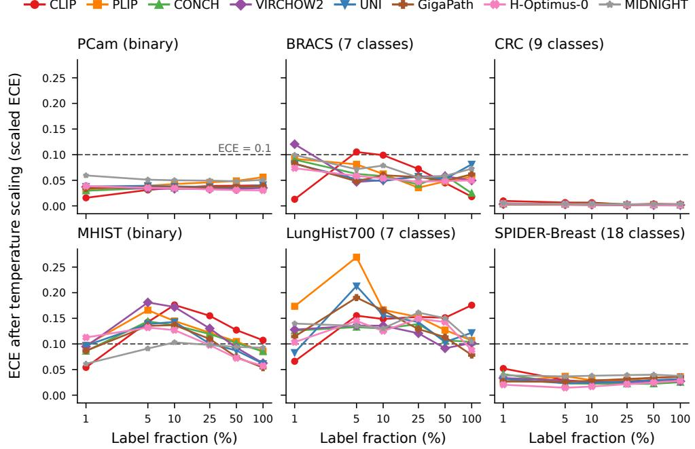  
Figure 12: ECE after temperature scaling across label fractions. ECE per dataset as a function of label fraction, after applying the per-cell temperature T fitted on the validation split. From 5% labels upward, scaling keeps ECE below 0.1 for every FM on PCam, CRC and SPIDER-Breast and in all but one BRACS cell, but not on MHIST and LungHist700, where 62 of the 80 cells remain above 0.1. Scaling also does not repair the OOD calibration failure documented in Figure 3.

Table 10: AUROC at 1% label fraction (mean ± std over 3 seeds). Best per dataset in bold.
<table><tr><td>Model</td><td>PCam</td><td>BRACS</td><td>CRC</td><td>MHIST</td><td>LungHist700</td><td>SPIDER-Breast</td></tr><tr><td>CLIP</td><td> $0 . 8 8 1 \pm 0 . 0 0 1$ </td><td> $0 . 6 9 3 \pm 0 . 0 3 5$ </td><td> $0 . 9 7 8 \pm 0 . 0 0 1$ </td><td> $0 . 6 3 8 \pm 0 . 0 4 7$ </td><td> $0 . 5 9 4 \pm 0 . 0 2 7$ </td><td> $0 . 8 9 0 \pm 0 . 0 0 6$ </td></tr><tr><td>PLIP</td><td> $0 . 9 4 2 \pm 0 . 0 0 1$ </td><td> $0 . 7 2 8 \pm 0 . 0 4 6$ </td><td> $0 . 9 9 6 \pm 0 . 0 0 0$ </td><td> $\mathbf { 0 . 7 0 4 \pm 0 . 0 6 1 }$ </td><td> $0 . 7 6 2 \pm 0 . 0 3 3$ </td><td> $0 . 9 4 5 \pm 0 . 0 0 3$ </td></tr><tr><td>CONCH</td><td> $0 . 9 5 5 \pm 0 . 0 0 2$ </td><td> $\mathbf { 0 . 8 2 3 \pm 0 . 0 2 1 }$ </td><td> $0 . 9 9 8 \pm 0 . 0 0 0$ </td><td> $0 . 6 3 8 \pm 0 . 0 4 8$ </td><td> $\mathbf { 0 . 8 7 3 \pm 0 . 0 2 2 }$ </td><td> $0 . 9 6 6 \pm 0 . 0 0 1$ </td></tr><tr><td>VIRCHOW2</td><td> $0 . 9 7 9 \pm 0 . 0 0 0$ </td><td> $0 . 7 9 2 \pm 0 . 0 2 1$ </td><td> $0 . 9 9 9 \pm 0 . 0 0 0$ </td><td> $0 . 6 2 9 \pm 0 . 0 6 6$ </td><td> $0 . 8 1 0 \pm 0 . 0 2 4$ </td><td> $0 . 9 8 8 \pm 0 . 0 0 1$ </td></tr><tr><td>UNI</td><td> $0 . 9 8 2 \pm 0 . 0 0 1$ </td><td> $0 . 7 8 6 \pm 0 . 0 2 1$ </td><td> $\mathbf { 0 . 9 9 9 } \pm \mathbf { 0 . 0 0 0 }$ </td><td> $0 . 6 9 3 \pm 0 . 0 6 9$ </td><td> $0 . 6 7 9 \pm 0 . 0 1 8$ </td><td> $0 . 9 8 7 \pm 0 . 0 0 0$ </td></tr><tr><td>GigaPath</td><td> $0 . 9 8 2 \pm 0 . 0 0 1$ </td><td> $0 . 7 4 8 \pm 0 . 0 2 4$ </td><td> $0 . 9 9 9 \pm 0 . 0 0 0$ </td><td> $0 . 6 7 0 \pm 0 . 0 1 3$ </td><td> $0 . 6 5 5 \pm 0 . 0 3 7$ </td><td> $0 . 9 8 7 \pm 0 . 0 0 0$ </td></tr><tr><td>H-Optimus-0</td><td> $\mathbf { 0 . 9 8 2 \pm 0 . 0 0 1 }$ </td><td> $0 . 7 4 6 \pm 0 . 0 1 6$ </td><td> $0 . 9 9 9 \pm 0 . 0 0 0$ </td><td> $0 . 7 0 1 \pm 0 . 0 5 5$ </td><td> $0 . 6 4 1 \pm 0 . 0 2 9$ </td><td> $\mathbf { 0 . 9 9 1 } \pm \mathbf { 0 . 0 0 0 }$ </td></tr><tr><td>MIDNIGHT</td><td> $0 . 9 4 6 \pm 0 . 0 0 6$ </td><td> $0 . 7 4 9 \pm 0 . 0 2 2$ </td><td> $0 . 9 9 8 \pm 0 . 0 0 0$ </td><td> $0 . 4 9 9 \pm 0 . 0 7 9$ </td><td> $0 . 6 9 7 \pm 0 . 0 8 4$ </td><td> $0 . 9 5 0 \pm 0 . 0 0 2$ </td></tr></table>

Table 11: ECE (raw, before temperature scaling) at 1% label fraction (mean ± std over 3 seeds). Lower is better. Best per dataset in bold.
<table><tr><td>Model</td><td>PCam</td><td>BRACS</td><td>CRC</td><td>MHIST</td><td>LungHist700</td><td>SPIDER-Breast</td></tr><tr><td>CLIP</td><td> $0 . 0 8 2 \pm 0 . 0 0 2$ </td><td> $\mathbf { 0 . 0 4 8 \pm 0 . 0 2 3 }$ </td><td> $0 . 3 7 2 \pm 0 . 0 0 4$ </td><td> $0 . 1 2 8 \pm 0 . 0 2 7$ </td><td> $\mathbf { 0 . 0 6 7 \pm 0 . 0 7 3 }$ </td><td> $\mathbf { 0 . 2 0 9 \pm 0 . 0 1 0 }$ </td></tr><tr><td>PLIP</td><td> $0 . 0 7 2 \pm 0 . 0 0 4$ </td><td> $0 . 0 6 9 \pm 0 . 0 4 2$ </td><td> $0 . 2 8 7 \pm 0 . 0 0 9$ </td><td> $0 . 1 4 6 \pm 0 . 0 2 5$ </td><td> $0 . 3 0 7 \pm 0 . 0 5 1$ </td><td> $0 . 3 6 4 \pm 0 . 0 0 8$ </td></tr><tr><td>CONCH</td><td> $\mathbf { 0 . 0 5 2 \pm 0 . 0 0 3 }$ </td><td> $0 . 1 6 2 \pm 0 . 0 2 2$ </td><td> $0 . 1 9 1 \pm 0 . 0 0 3$ </td><td> $0 . 1 1 9 \pm 0 . 0 2 7$ </td><td> $0 . 3 3 1 \pm 0 . 0 0 7$ </td><td> $0 . 3 1 6 \pm 0 . 0 0 6$ </td></tr><tr><td>VIRCHOW2</td><td> $0 . 0 6 2 \pm 0 . 0 0 5$ </td><td> $0 . 1 5 8 \pm 0 . 0 2 2$ </td><td> $0 . 1 8 2 \pm 0 . 0 0 3$ </td><td> $0 . 1 3 9 \pm 0 . 0 4 5$ </td><td> $0 . 2 9 4 \pm 0 . 0 3 1$ </td><td> $0 . 3 7 8 \pm 0 . 0 1 1$ </td></tr><tr><td>UNI</td><td> $0 . 0 7 3 \pm 0 . 0 0 2$ </td><td> $0 . 1 1 0 \pm 0 . 0 3 3$ </td><td> $0 . 2 2 1 \pm 0 . 0 0 5$ </td><td> $0 . 1 2 1 \pm 0 . 0 2 7$ </td><td> $0 . 2 1 3 \pm 0 . 0 3 2$ </td><td> $0 . 4 2 9 \pm 0 . 0 0 6$ </td></tr><tr><td>GigaPath</td><td> $0 . 0 7 1 \pm 0 . 0 0 0$ </td><td> $0 . 0 8 4 \pm 0 . 0 5 5$ </td><td> $0 . 2 4 1 \pm 0 . 0 0 3$ </td><td> $0 . 1 2 0 \pm 0 . 0 1 9$ </td><td> $0 . 1 8 6 \pm 0 . 0 4 8$ </td><td> $0 . 4 2 2 \pm 0 . 0 0 5$ </td></tr><tr><td>H-Optimus-0</td><td> $0 . 0 6 7 \pm 0 . 0 0 0$ </td><td> $0 . 0 7 4 \pm 0 . 0 2 6$ </td><td> $0 . 2 2 9 \pm 0 . 0 0 3$ </td><td> $0 . 1 3 2 \pm 0 . 0 2 6$ </td><td> $0 . 1 6 1 \pm 0 . 0 6 9$ </td><td> $0 . 4 6 5 \pm 0 . 0 1 5$ </td></tr><tr><td>MIDNIGHT</td><td> $0 . 0 5 7 \pm 0 . 0 0 4$ </td><td> $0 . 1 0 6 \pm 0 . 0 0 9$ </td><td> $\mathbf { 0 . 1 8 2 \pm 0 . 0 0 1 }$ </td><td> $\mathbf { 0 . 0 9 1 } \pm \mathbf { 0 . 0 0 4 }$ </td><td> $0 . 1 7 3 \pm 0 . 1 1 3$ </td><td> $0 . 3 1 0 \pm 0 . 0 1 0$ </td></tr></table>

Raw ECE at 1% labels is largest on the multiclass datasets, and there it reflects under-confidence of the regularized linear probe rather than over-confidence: the validation-fitted temperature is below 1 in these cells (Figure 15). On SPIDER-Breast (18 classes) the pathology SSL models reach the

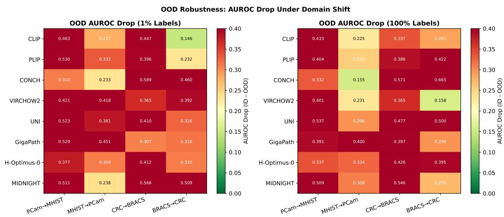

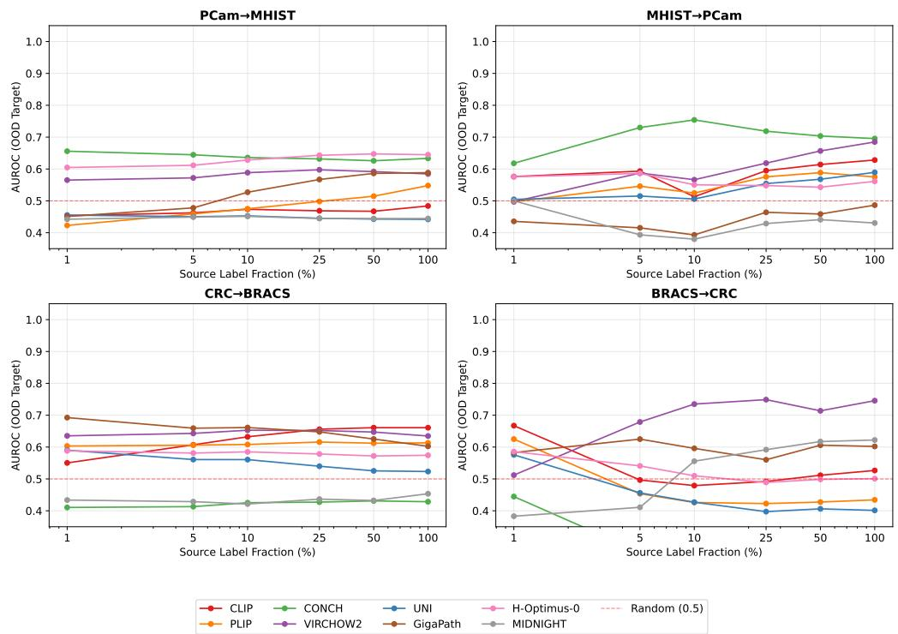  
Figure 13: OOD transfer: AUROC versus source label fraction. Companion to Figure 3, showing OOD discrimination on the four transfer pairs. On MHIST→PCam, several FMs hold AUROC near random (0.4–0.5) across the entire 1–100% range while their OOD ECE rises monotonically: confidence increasing without competence.  
Figure 14: OOD AUROC drop heatmap. Per (model, transfer pair) drop in AUROC from indistribution to OOD, at 1% and 100% labels. Drops above 0.4 (e.g., CONCH on CRC→BRACS at 100% labels) indicate that the model's discrimination collapses near random under domain shift, even before calibration is considered.

highest raw ECE (H-Optimus-0 0.465, UNI 0.429, GigaPath 0.422, VIRCHOW2 0.378), while CLIP, the non-pathology baseline, holds the best score in the column (0.209). CLIP is also best on BRACS (0.048) and LungHist700 (0.067), the same datasets on which it ranks last on AUROC, and MIDNIGHT is best on MHIST (0.091) and CRC (0.182). A probe that commits weakly to any class can be well calibrated in raw terms while discriminating poorly, which reinforces the

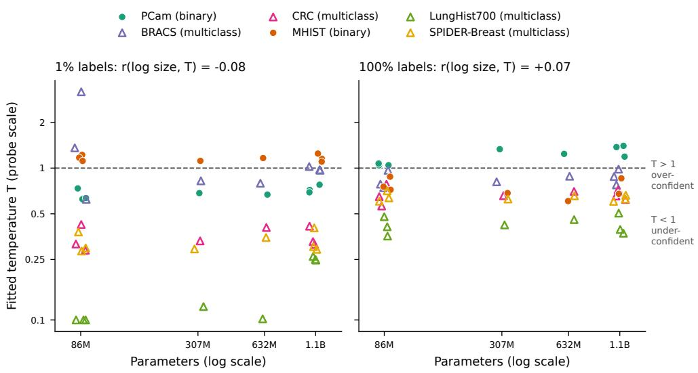  
Figure 15: Fitted temperature versus model size. Validation-fitted temperature T (on the probe's own logit scale) against parameter count, at 1% and 100% labels; $T > 1$ indicates an over-confident probe and $T < 1$ an under-confident one. The correlation between log size and T is negligible $( r = - 0 . 0 8 $ at 1% labels, $r = + 0 . 0 7$ at 100%). Task type dominates: $T < 1$ in 189 of 192 multiclass cells, whereas binary cells straddle $T = 1$ . On LungHist700 at 1% labels T reaches the lower search bound (0.1) for four FMs, so scaled ECE there is bound-limited. This pattern mirrors the absence of a clean “bigger is better" rule in CRI rankings (Figure 7).

performance-reliability decoupling reported in Figure 2. These raw values use no validation labels;   
after temperature scaling the ordering changes (Appendix tables and Figure 12).

Table 12: ECE after post-hoc temperature scaling at 100% label fraction. Lower is better.
<table><tr><td>Model</td><td>PCam</td><td>BRACS</td><td>CRC</td><td>MHIST</td><td>LungHist700</td><td>SPIDER-Breast</td></tr><tr><td>CLIP</td><td> $0 . 0 4 0 \pm 0 . 0 0 0$ </td><td> $\mathbf { 0 . 0 1 8 \pm 0 . 0 0 0 }$ </td><td> $0 . 0 0 4 \pm 0 . 0 0 0$ </td><td> $0 . 1 0 7 \pm 0 . 0 0 0$ </td><td> $0 . 1 7 6 \pm 0 . 0 0 0$ </td><td> $0 . 0 2 9 \pm 0 . 0 0 0$ </td></tr><tr><td>PLIP</td><td> $0 . 0 5 6 \pm 0 . 0 0 0$ </td><td> $0 . 0 5 7 \pm 0 . 0 0 0$ </td><td> $0 . 0 0 2 \pm 0 . 0 0 0$ </td><td> $0 . 0 8 5 \pm 0 . 0 0 0$ </td><td> $0 . 1 0 7 \pm 0 . 0 0 0$ </td><td> $0 . 0 3 6 \pm 0 . 0 0 0$ </td></tr><tr><td>CONCH</td><td> $0 . 0 3 7 \pm 0 . 0 0 0$ </td><td> $0 . 0 2 5 \pm 0 . 0 0 0$ </td><td> $0 . 0 0 2 \pm 0 . 0 0 0$ </td><td> $0 . 0 8 5 \pm 0 . 0 0 0$ </td><td> $0 . 1 0 4 \pm 0 . 0 0 0$ </td><td> $\mathbf { 0 . 0 2 5 \pm 0 . 0 0 0 }$ </td></tr><tr><td>VIRCHOW2</td><td> $0 . 0 3 5 \pm 0 . 0 0 0$ </td><td> $0 . 0 5 0 \pm 0 . 0 0 0$ </td><td> $0 . 0 0 2 \pm 0 . 0 0 0$ </td><td> $0 . 0 6 2 \pm 0 . 0 0 0$ </td><td> $0 . 1 0 2 \pm 0 . 0 0 0$ </td><td> $0 . 0 2 7 \pm 0 . 0 0 0$ </td></tr><tr><td>UNI</td><td> $0 . 0 4 1 \pm 0 . 0 0 0$ </td><td> $0 . 0 8 1 \pm 0 . 0 0 0$ </td><td> $\mathbf { 0 . 0 0 1 } \pm \mathbf { 0 . 0 0 0 }$ </td><td> $0 . 0 6 1 \pm 0 . 0 0 0$ </td><td> $0 . 1 2 2 \pm 0 . 0 0 0$ </td><td> $0 . 0 3 2 \pm 0 . 0 0 0$ </td></tr><tr><td>GigaPath</td><td> $0 . 0 3 9 \pm 0 . 0 0 0$ </td><td> $0 . 0 6 2 \pm 0 . 0 0 0$ </td><td> $0 . 0 0 2 \pm 0 . 0 0 0$ </td><td> $\mathbf { 0 . 0 5 4 \pm 0 . 0 0 0 }$ </td><td> $\mathbf { 0 . 0 7 8 \pm 0 . 0 0 0 }$ </td><td> $0 . 0 3 6 \pm 0 . 0 0 0$ </td></tr><tr><td>H-Optimus-0</td><td> $\mathbf { 0 . 0 3 0 \mathop { \pm } 0 . 0 0 0 }$ </td><td> $0 . 0 5 0 \pm 0 . 0 0 0$ </td><td> $0 . 0 0 1 \pm 0 . 0 0 0$ </td><td> $0 . 0 5 7 \pm 0 . 0 0 0$ </td><td> $0 . 0 8 8 \pm 0 . 0 0 0$ </td><td> $0 . 0 2 8 \pm 0 . 0 0 0$ </td></tr><tr><td>MIDNIGHT</td><td> $0 . 0 5 1 \pm 0 . 0 0 0$ </td><td> $0 . 0 7 3 \pm 0 . 0 0 0$ </td><td> $0 . 0 0 3 \pm 0 . 0 0 0$ </td><td> $0 . 0 9 3 \pm 0 . 0 0 0$ </td><td> $0 . 1 0 5 \pm 0 . 0 0 0$ </td><td> $0 . 0 3 7 \pm 0 . 0 0 0$ </td></tr></table>

After post-hoc temperature scaling, in-distribution ECE drops below 0.10 for every (model, dataset) cell except for LungHist700 (the smallest dataset, 691 tiles), where four of eight models still exceed 0.10. CRC is trivially calibrated post-scaling, with all models reaching $\mathrm { E C E } \leq 0 . 0 0 4$ . The largest residuals after scaling concentrate on LungHist700 (CLIP 0.176, UNI 0.122) and MHIST (CLIP 0.107), both small-sample multiclass tasks where the validation split available for fitting T is thin. Combined with the raw values in Table 11, this confirms the recoverability axis introduced in Section 3.2: a single scalar parameter suffices for in-distribution calibration on five of six datasets, but fails to repair OOD ECE (Table 17).

Brier score, a strictly proper scoring rule that combines discrimination and calibration into one number, ranks the pathology vision SSL family ahead of the vision-language models on most datasets, in line with the AUROC patterns of Table 9. VIRCHOW2 leads on PCam (0.047) and MHIST (0.130), CONCH on BRACS (0.072) and LungHist700 (0.052), and H-Optimus-0 on CRC (0.001) and SPIDER-Breast (0.007). MIDNIGHT records the highest Brier on MHIST (0.201), consistent with its weak AUROC on the same dataset and confirming that the score reflects both axes simultaneously. The very low Brier values on CRC (all models $\underline { { \bar { \mathbf { \Pi } } } } ( 0 . 0 1 0 )$ reflect the saturation already visible in

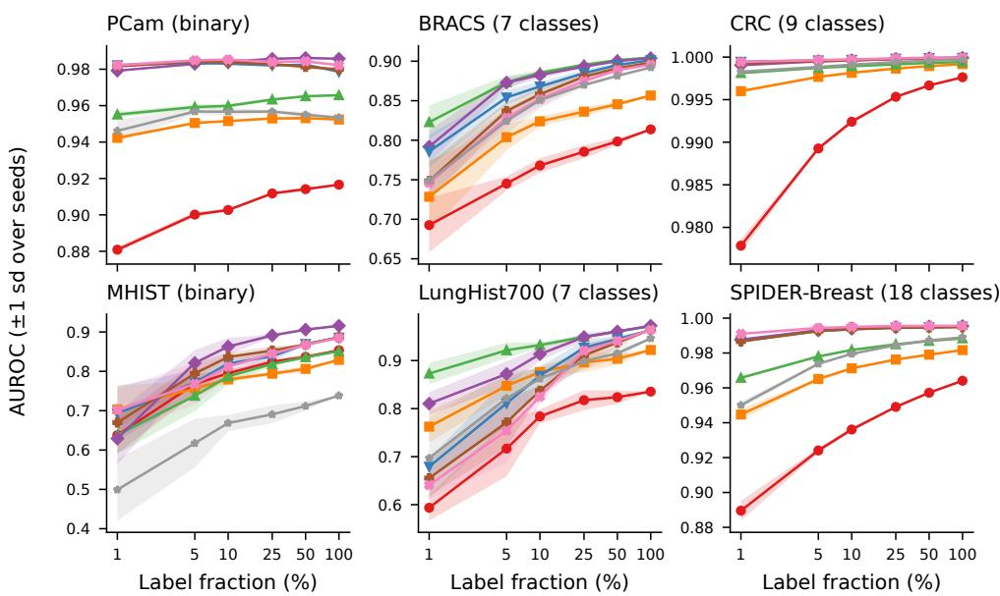  
Figure 16: AUROC versus label fraction. Companion to Figure 6, showing AUROC instead of macro-F1 across the same six datasets. Top-4 pathology SSL models (VIRCHOW2, UNI, GigaPath, H-Optimus-0) form a tight cluster from 1% labels upward, while CLIP, PLIP, and MIDNIGHT separate visibly on the harder triplet {BRACS, MHIST, LungHist700}. Shaded bands show ±1 standard deviation across the three random seeds.

Table 13: Brier score at 100% label fraction. Lower is better.
<table><tr><td>Model</td><td>PCam</td><td>BRACS</td><td>CRC</td><td>MHIST</td><td>LungHist700</td><td>SPIDER-Breast</td></tr><tr><td>CLIP</td><td> $0 . 1 1 8 \pm 0 . 0 0 0$ </td><td> $0 . 0 9 5 \pm 0 . 0 0 0$ </td><td> $0 . 0 1 0 \pm 0 . 0 0 0$ </td><td> $0 . 1 6 8 \pm 0 . 0 0 0$ </td><td> $0 . 1 1 0 \pm 0 . 0 0 0$ </td><td> $0 . 0 2 4 \pm 0 . 0 0 0$ </td></tr><tr><td>PLIP</td><td> $0 . 0 9 2 \pm 0 . 0 0 0$ </td><td> $0 . 0 8 6 \pm 0 . 0 0 0$ </td><td>0.004 ± 0.000</td><td> $0 . 1 7 1$ </td><td>0.077</td><td> $0 . 0 1 7 \pm 0 . 0 0 0$ </td></tr><tr><td>CONCH</td><td> $0 . 0 7 4 \pm 0 . 0 0 0$ </td><td> $\mathbf { 0 . 0 7 2 \pm 0 . 0 0 0 }$ </td><td> $0 . 0 0 3 \pm 0 . 0 0 0$ </td><td> $0 . 1 6 1 \pm 0 . 0 0 0$ </td><td>0.052</td><td> $0 . 0 1 4 \pm 0 . 0 0 0$ </td></tr><tr><td>VIRCHOW2</td><td> $\mathbf { 0 . 0 4 7 \pm 0 . 0 0 0 }$ </td><td> $0 . 0 7 2 \pm 0 . 0 0 0$ </td><td> $0 . 0 0 1 \pm 0 . 0 0 0$ </td><td> $\mathbf { 0 . 1 3 0 \pm 0 . 0 0 0 }$ </td><td>0.055</td><td> $0 . 0 0 8 \pm 0 . 0 0 0$ </td></tr><tr><td>UNI</td><td> $0 . 0 5 3 \pm 0 . 0 0 0$ </td><td> $0 . 0 7 4 \pm 0 . 0 0 0$ </td><td> $0 . 0 0 1 \pm 0 . 0 0 0$ </td><td> $0 . 1 4 2 \pm 0 . 0 0 0$ </td><td>0.062</td><td> $0 . 0 0 8 \pm 0 . 0 0 0$ </td></tr><tr><td>GigaPath</td><td> $0 . 0 5 3 \pm 0 . 0 0 0$ </td><td> $0 . 0 7 3 \pm 0 . 0 0 0$ </td><td> $0 . 0 0 1 \pm 0 . 0 0 0$ </td><td> $0 . 1 4 1 \pm 0 . 0 0 0$ </td><td>0.064</td><td> $0 . 0 0 8 \pm 0 . 0 0 0$ </td></tr><tr><td>H-Optimus-0</td><td> $0 . 0 4 8 \pm 0 . 0 0 0$ </td><td> $0 . 0 7 4 \pm 0 . 0 0 0$ </td><td> $\mathbf { 0 . 0 0 1 } \pm \mathbf { 0 . 0 0 0 }$ </td><td> $0 . 1 4 3 \pm 0 . 0 0 0$ </td><td> $0 . 0 6 7 \pm 0 . 0 0 0$ </td><td> $\mathbf { 0 . 0 0 7 \pm 0 . 0 0 0 }$ </td></tr><tr><td>MIDNIGHT</td><td> $0 . 0 7 4 \pm 0 . 0 0 0$ </td><td> $0 . 0 7 6 \pm 0 . 0 0 0$ </td><td> $0 . 0 0 2 \pm 0 . 0 0 0$ </td><td> $0 . 2 0 1 \pm 0 . 0 0 0$ </td><td>0.064</td><td> $0 . 0 1 2 \pm 0 . 0 0 0$ </td></tr></table>

AUROC and macro F1, where the seven-class colorectal task admits near-perfect linear separation in every embedding space considered.

Table 14: Fitted temperature T at 100% labels, on the probe's own logit scale (binary values are the fitted two-column temperature divided by two). $T < 1$ indicates an under-confident probe, $T > 1$ an over-confident one; bold marks the value closest to 1 per dataset. Seeds agree exactly at 100% labels.
<table><tr><td>Model</td><td>PCam</td><td>BRACS</td><td>CRC</td><td>MHIST</td><td>LungHist700</td><td>SPIDER-Breast</td></tr><tr><td>CLIP</td><td>1.04</td><td>0.74</td><td>0.56</td><td>0.75</td><td>0.36</td><td>0.61</td></tr><tr><td>PLIP</td><td>1.07</td><td>0.78</td><td>0.65</td><td>0.72</td><td>0.41</td><td>0.64</td></tr><tr><td>CONCH</td><td>1.04</td><td>0.97</td><td>0.78</td><td>0.88</td><td>0.48</td><td>0.71</td></tr><tr><td>VIRCHOW2</td><td>1.24</td><td>0.88</td><td>0.70</td><td>0.61</td><td>0.46</td><td>0.66</td></tr><tr><td>UNI</td><td>1.33</td><td>0.81</td><td>0.66</td><td>0.68</td><td>0.42</td><td>0.63</td></tr><tr><td>GigaPath</td><td>1.40</td><td>0.78</td><td>0.65</td><td>0.68</td><td>0.39</td><td>0.62</td></tr><tr><td>H-Optimus-0</td><td>1.37</td><td>0.88</td><td>0.62</td><td>0.68</td><td>0.37</td><td>0.66</td></tr><tr><td>MIDNIGHT</td><td>1.19</td><td>0.98</td><td>0.72</td><td>0.86</td><td>0.51</td><td>0.60</td></tr></table>

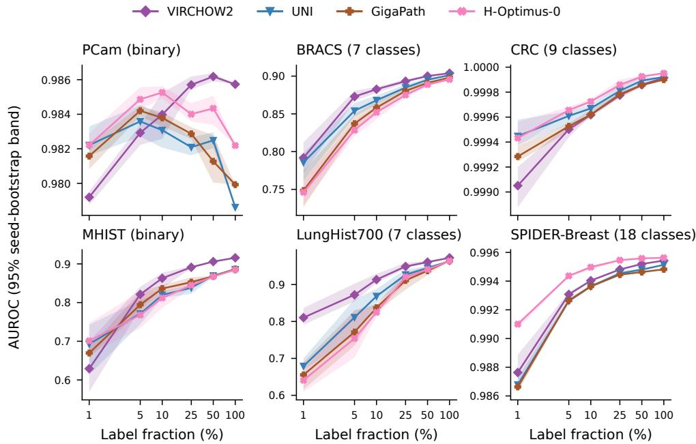  
Figure 17: Bootstrap 95% confidence intervals. AUROC for the four strongest pathology SSL FMs (VIRCHOW2, UNI, GigaPath, H-Optimus-0) across all six datasets, with 1000-resample bootstrap CI bands computed over the three random seeds. With only three seeds these bands describe seed variability, not sampling uncertainty of the test set. Band width collapses at 100% labels because the deterministic LBFGS solver yields zero between-seed variance, as noted in Appendix D.

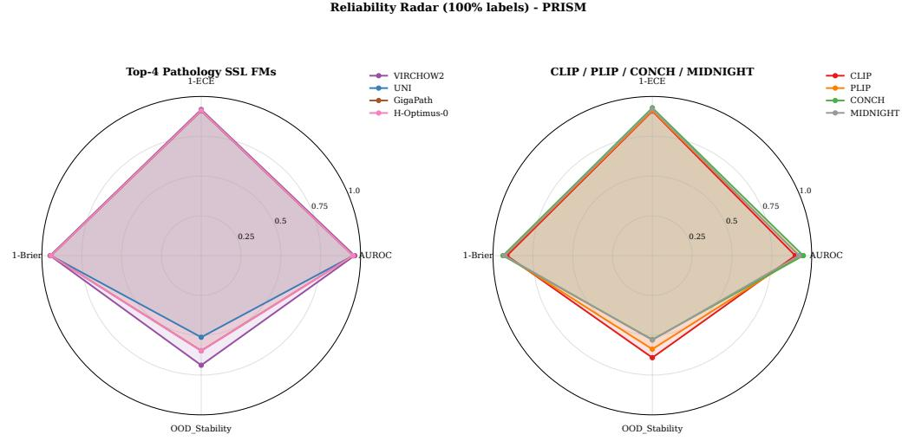  
Figure 18: Reliability radar. Per-model summary at 100% labels across the four reliability axes: AUROC (in-distribution, mean over 6 datasets), $1 \dot { - } \mathrm { E C E } _ { \mathrm { r a w } } , 1 - \mathrm { B r i e r }$ , and OOD\_Stability (mean OOD AUROC divided by mean in-distribution AUROC across the four transfer pairs, clipped to [0, 1]). The top-4 panel shows the four large pathology SSL FMs; the bottom-4 panel shows CLIP, PLIP, CONCH, and MIDNIGHT for visual separation.

At full supervision the direction of miscalibration is set by the dataset rather than by the model. On the four multiclass datasets every FM is under-confident $( T < 1 ;$ as low as 0.36 on LungHist700). On PCam every FM is mildly over-confident (T from 1.04 to 1.40), whereas on MHIST all FMs are under-confident (T from 0.61 to 0.88). Across all 288 cells the probe is under-confident in 252, which is consistent with a strongly regularized linear probe on L2-normalized features producing compressed logits.

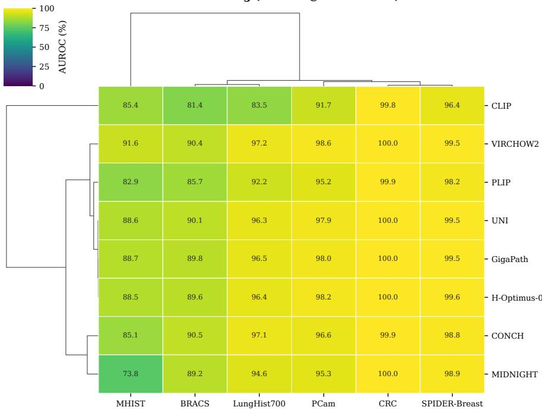  
Figure 19: Performance clustering. Hierarchical clustering of the $8 \times 6 ~ { \mathrm { A U R O C } }$ matrix at 100% labels using $1 - \rho$ correlation distance with average linkage on both axes. The dendrogram on the rows separates the four pathology SSL FMs (VIRCHOW2, UNI, GigaPath, H-Optimus-0) from CLIP and the vision-language pathology models (PLIP, CONCH), with MIDNIGHT joining the lighter-pretraining cluster despite its 1.1B parameter count. The grouping confirms that pre-training corpus rather than parameter count is the dominant predictor of in-distribution AUROC ranking on PRISM datasets.

Table 15: Macro-F1 at 100% label fraction (seeds agree exactly). Best per dataset in bold.
<table><tr><td>Model</td><td>PCam</td><td>BRACS</td><td>CRC</td><td>MHIST</td><td>LungHist700</td><td>SPIDER-Breast</td></tr><tr><td>CLIP</td><td>0.831</td><td>0.433</td><td>0.950</td><td>0.654</td><td>0.216</td><td>0.647</td></tr><tr><td>PLIP</td><td>0.872</td><td>0.498</td><td>0.976</td><td>0.642</td><td>0.597</td><td>0.738</td></tr><tr><td>CONCH</td><td>0.898</td><td>0.589</td><td>0.983</td><td>0.713</td><td>0.701</td><td>0.783</td></tr><tr><td>VIRCHOW2</td><td>0.937</td><td>0.596</td><td>0.995</td><td>0.815</td><td>0.760</td><td>0.873</td></tr><tr><td>UNI</td><td>0.935</td><td>0.596</td><td>0.995</td><td>0.773</td><td>0.753</td><td>0.875</td></tr><tr><td>GigaPath</td><td>0.934</td><td>0.605</td><td>0.994</td><td>0.785</td><td>0.725</td><td>0.866</td></tr><tr><td>H-Optimus-0</td><td>0.939</td><td>0.585</td><td>0.996</td><td>0.773</td><td>0.737</td><td>0.888</td></tr><tr><td>MIDNIGHT</td><td>0.906</td><td>0.561</td><td>0.988</td><td>0.540</td><td>0.681</td><td>0.813</td></tr></table>

Macro-F1 at full label availability separates the eight FMs more sharply than AUROC because it depends on the decision threshold and on minority-class recall. H-Optimus-0 leads on PCam (0.939), CRC (0.996) and SPIDER-Breast (0.888), VIRCHOW2 on MHIST (0.815) and LungHist700 (0.760), and GigaPath on BRACS (0.605). MIDNIGHT records the lowest macro-F1 on MHIST (0.540), mirroring its low AUROC there. The CLIP gap relative to the pathology-pretrained FMs is much larger in macro-F1 (BRACS 0.433, LungHist700 0.216) than in AUROC, which motivates the breaking-point analysis in Figure 6.

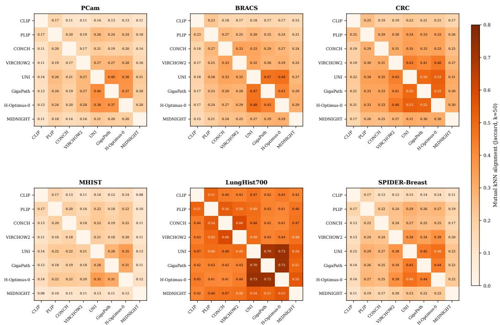  
Figure 20: Embedding alignment across foundation models. Mutual k-nearest-neighbor alignment $( k = 5 0 ,$ , Jaccard overlap of per-sample neighbor sets) between every pair of FMs, computed on each test split. Higher values indicate more similar embedding geometry. Alignment is uniformly low on PCam, BRACS, and CRC, where every FM produces a distinctive neighbor structure, and substantially higher on LungHist700 and SPIDER-Breast, where the four pathology SSL FMs (UNI, GigaPath, H-Optimus-0, VIRCHOW2) form a tightly aligned subgroup. MHIST sits in between, with moderate alignment that mirrors its position as the binary task with the most cross-model disagreement. The diagonal is omitted as self-alignment is identically 1.

## K OOD transfer detailed results

Per-(model, transfer pair) numerical OOD results corresponding to Figures 3, 13 and 14.

Table 16: OOD AUROC on target dataset, trained at 100% source labels. Best per transfer pair in bold.
<table><tr><td>Model</td><td>PCam→MHIST</td><td>MHIST→PCam</td><td>CRC→BRACS</td><td>BRACS→CRC</td></tr><tr><td>CLIP</td><td>0.484</td><td>0.628</td><td>0.661</td><td>0.527</td></tr><tr><td>PLIP</td><td>0.548</td><td>0.575</td><td>0.613</td><td>0.434</td></tr><tr><td>CONCH</td><td>0.633 ± 0.000</td><td>0.696</td><td>0.428</td><td>0.240</td></tr><tr><td>VIRCHOW2</td><td>0.585</td><td>0.685 ± 0.000</td><td>0.635</td><td>0.746</td></tr><tr><td>UNI</td><td>0.442</td><td>0.589</td><td>0.523</td><td>0.401</td></tr><tr><td>GigaPath</td><td>0.588</td><td>0.487</td><td>0.602</td><td>0.602</td></tr><tr><td>H-Optimus-0</td><td>0.645</td><td> $0 . 5 6 1 \pm 0 . 0 0 0$ </td><td>0.574</td><td>0.501</td></tr><tr><td>MIDNIGHT</td><td>0.445</td><td> $0 . 4 3 0 \pm 0 . 0 0 0$ </td><td>0.454</td><td>0.622</td></tr></table>

OOD AUROC values reveal that several pathology FMs lose discrimination under cross-domain shift even at full source-label availability. On PCam→MHIST H-Optimus-0 leads (0.645) but CLIP, MIDNIGHT, and UNI remain near or below 0.5; on MHIST→PCam CONCH leads (0.696) and MIDNIGHT collapses to 0.430. The most striking entry is CONCH on BRACS→CRC, with OOD

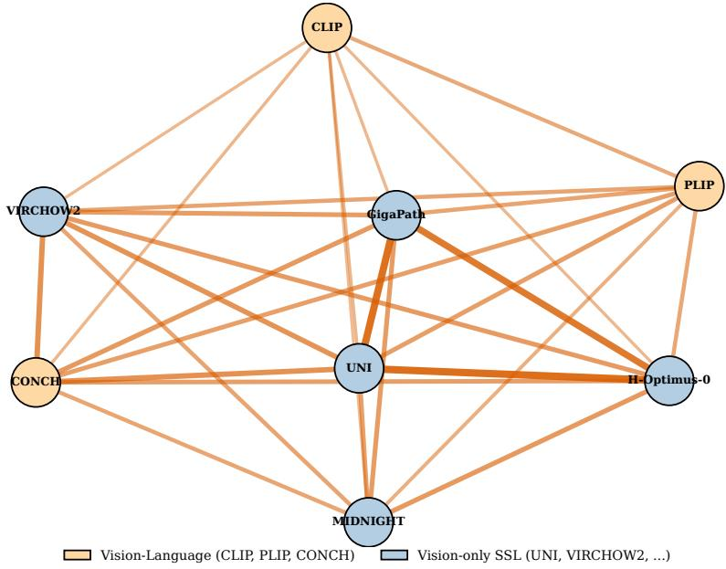  
Figure 21: Embedding alignment network on BRACS. Force-directed layout of the eight FMs with edge thickness proportional to mutual k-nearest-neighbor alignment (k = 50). The strongest pairwise alignment is between GigaPath and H-Optimus-O, with VIRCHOW2 and UNI joining the same dense central cluster; CLIP and PLIP sit at the periphery, consistent with their non-pathology and Twitter-pathology pre-training corpora respectively. CONCH, despite being a vision-language model, integrates into the central pathology-SSL cluster, indicating that curated pathology image-caption pairs produce embedding geometry closer to the vision-only SSL family than to CLIP or PLIP. The complementary heatmaps for the remaining five datasets are reported in Figure 20.

AUROC = 0.240, well below the random-prediction threshold of 0.5, indicating systematically inverted predictions on the target taxonomy. Comparison with Table 9 makes the in-distribution to OOD gap explicit: a model with ID AUROC of 0.999 on CRC drops to 0.240 in the BRACS→CRC transfer, a magnitude of degradation that is invisible in any single-dataset benchmark.

Table 17: OOD ECE (raw, 15 equal-width bins) on the target dataset at 100% source labels (seeds agree exactly). Lower is better.
<table><tr><td>Model</td><td>PCam→MHIST</td><td>MHIST→PCam</td><td>CRC→BRACS</td><td>BRACS→CRC</td></tr><tr><td>CLIP</td><td>0.251</td><td>0.312</td><td>0.204</td><td>0.300</td></tr><tr><td>PLIP</td><td>0.261</td><td>0.207</td><td>0.179</td><td>0.261</td></tr><tr><td>CONCH</td><td>0.151</td><td>0.455</td><td>0.338</td><td>0.261</td></tr><tr><td>VIRCHOW2</td><td>0.123</td><td>0.453</td><td>0.268</td><td>0.138</td></tr><tr><td>UNI</td><td>0.285</td><td>0.439</td><td>0.272</td><td>0.188</td></tr><tr><td>GigaPath</td><td>0.288</td><td>0.462</td><td>0.232</td><td>0.278</td></tr><tr><td>H-Optimus-0</td><td>0.316</td><td>0.488</td><td>0.275</td><td>0.220</td></tr><tr><td>MIDNIGHT</td><td>0.362</td><td>0.304</td><td>0.268</td><td>0.218</td></tr></table>

OOD ECE on the target is several times larger than the corresponding in-distribution ECE in Table 12. The MHIST→PCam column is the most extreme: H-Optimus-0 0.488, GigaPath 0.462, CONCH 0.455, VIRCHOW2 0.453, on a target where the same models have in-distribution ECE below 0.06 after temperature scaling. PLIP has the lowest OOD ECE on MHIST→PCam (0.207) and CRC→BRACS (0.179), inverting the in-distribution ranking on those pairs, while VIRCHOW2 is best on PCam→MHIST (0.123) and BRACS→CRC (0.138). These are label-definition pairs on which every model transfers near chance (Table 16), so the values describe calibration of failing transfer rather than a ranking of FMs.