# Physics Guided Diffusion Model Based Exposure Interpolation for High Dynamic Range Imaging

Zhengguo Li, Fellow, IEEE, and Chaobing Zheng, Member IEEE

Abstract—Ghosting artifacts are an open problem for popular multi-shot based high dynamic range (HDR) imaging. An effective solution is to capture two large-exposure-ratio (LER) standard dynamic range (SDR) images simultaneously via a single-shot. Brightness order reversal (BOR) artifacts are generated when the two LER images are directly fused together. It is crucial to interpolate an image with an exposure time in between the exposure times of two LER images. In this paper, a novel physics-guided diffusion model based exposure interpolation algorithm is proposed to address the BOR artifacts. An initial image is interpolated by a physics-driven component, and the residual high-frequency details are generated by a new diffusion model based component. The new diffusion model is based on the correlation analysis of generative models and includes a new predicted target to reduce the variation of the Pearson correlation between the noisy data and the target, as well as the amplification factor of the fitting error. Compared with existing neural augmented exposure interpolation algorithms on top of convolution neural networks, the proposed exposure interpolation algorithm has an inherent advantage to generate more high frequency information. Experiment results validate the proposed exposure interpolation algorithm.

Index Terms—High dynamic range imaging, dual large-exposureratio images, brightness order reversal artifacts, exposure interpolation, physics guided diffusion model.

## I. INTRODUCTION

Many real-world scenes are with high dynamic ranges (HDRs) while a standard dynamic range (SDR) image by an existing camera can only capture limited dynamic range of these realworld scenes. Fine details in highlight/shadow regions of these scenes cannot be captured simultaneously by the existing camera via a single-shot. There are over-exposed/under-exposed regions in an SDR image captured by the existing camera, and the saturation could affect subsequent tasks such as image classification, object detection, image segmentation, etc. An effective solution is to capture multiple SDR images with different exposures for an HDR scene [1]. The differently exposed SDR images are usually captured sequentially by multiple shots. Both camera movements and moving objects are issues for such an HDR imaging system. It is not difficult to address the former while ghosting artifacts caused by the moving objects is an open problem for multi-shot HDR imaging [2] even though there are many ghost removal algorithms [3]–[7].

Two large-exposure-ratio (LER) SDR images can be captured simultaneously by a single-shot using the special devices in [8]–[10]. Ghosting artifacts are not an issue for such single-shot HDR imaging. However, there are brightness order reversal (BOR) artifacts when the two LER images are directly fused together via conventional filter-based multi-scale exposure fusion (MEF) algorithms [11]–[13]. Many data-driven single-scale exposure fusion (SEF) algorithms are proposed to address the BOR artifacts for the fusion of two LER images [14]–[17]. Unfortunately, the data-driven SEF algorithms have a difficulty in preserving the scene depth of real-world HDR scene in the fused image. An alternative solution is to interpolate an image with an exposure time in between the two LER images [18] and fuse the two LER images and interpolation image using a conventional filter based MEF algorithm or a data-driven MEF algorithm. It is thus highly demanded to develop an efficient exposure interpolation algorithm.

In this paper, a novel exposure interpolation algorithm is proposed through seamless integration of physics-driven and generative AI-based methods. Similar to [19], [20], an image is first interpolated from the two LER images using a physicsdriven exposure interpolation component. The image is then refined via a generative AI-based component which is different from the data-driven components in [19], [20]. Our generative AI-based component has a potential to generate more highfrequency information than the the data-driven components in [19], [20]. Instead of directly using exiting diffusion models [21]–[28], a new diffusion model is proposed on top of theoretical analysis results in [29]. Each diffusion model has a forward process and a reverse process. The forward process begins with a ground truth data sample and evolves to a noise sample by progressively adding the Gaussian noise to the data sample. A predicted target can be defined in the forward process. A neural network is trained to map the noisy data to the predicted target during the forward process. The reverse process starts from the noise sample and converts it back to the corresponding data sample through progressively reducing the Gaussian noise from the noisy data. The noisy data and the output of the neural network at the current moment are utilized to estimate the ground-truth data and the Gaussian noise in the reverse process. They are adopted to predict the noisy data at the next moment. The reverse process is usually conducted via tens to thousands steps. Fortunately, the sampling process can be optimized using trajectory distillation [23]. On the other hand, the fitting error of the neural network could be amplified during the trajectory distillation [23]. In addition to the well known amplification factor on the fitting error of the neural network, theoretical analysis in [29] indicates that the variation of the Pearson correlation between the noisy data and the predicted target is also important to reduce the overall fitting error. Therefore, the predicted target plays an important role in the diffusion model. A new predicted target is proposed in this paper to reduce the variation of the Pearson correlation between the predicted target and the noise data as well as the amplification factor of the fitting error. The new predicted target outperforms the predicted target in [30]. A new diffusion model is then built up using the new predicted target. Finally, the new model is adopted to design a novel physics-guided diffusion model based exposure interpolation algorithm for HDR imaging. Experiment results show that the proposed exposure interpolation algorithm outperforms the exposure interpolation algorithms in [18]–[20]. Overall, the main contributions of this paper are:

1) a new diffusion model is proposed to minimize the variation of the Pearson correlation between the predicted target and the noise data as well as the amplification factor of the fitting error. The new model outperforms the model in [30];

2) the new diffusion model is adopted to develop a new neural augmented exposure interpolation algorithm. More highfrequency information is preserved by the proposed exposure interpolation algorithms.

The rest of this paper is organized as follows: preliminary knowledge is provided in section II. Problem formulation is given in section III. Details of the proposed algorithm are presented in section IV. Experiment results are given in section V to validate the proposed algorithm. Finally, conclusion remarks are provided in section VI.

## II. PRELIMINARY KNOWLEDGE

In this section, preliminary Knowledge on exposure interpolation and diffusion models is presented. The knowledge is useful for the proposed neural augmented exposure interpolation algorithm.

## A. Exposure interpolation

Given a pair of aligned LER images $Z _ { 1 }$ and $Z _ { 7 }$ with exposure times as $\Delta t _ { 1 }$ and $\Delta t _ { 7 }$ , respectively, an image $\hat { Z } _ { 4 }$ with exposure time as $\Delta t _ { 4 }$ is interpolated. The relationship among $\Delta t _ { 1 } , \Delta t _ { 4 }$ and $\Delta t _ { 7 }$ is represented by

$$
\frac { \Delta t _ { 1 } } { \Delta t _ { 4 } } = \frac { \Delta t _ { 4 } } { \Delta t _ { 7 } } .\tag{1}
$$

There are three different types of algorithm to interpolate the image $\hat { Z } _ { 4 }$ . The first type is physics-driven exposure interpolation [18], and the image $\hat { Z } _ { 4 }$ is interpolated as

$$
\hat { Z } _ { 4 } = f _ { m } ( Z _ { 1 } , Z _ { 7 } ) .\tag{2}
$$

As shown in [31], two images with different exposures can be mapped to each other using intensity mapping functions (IMFs) between them. The IMFs can be estimated from camera response functions (CRFs). The algorithm in [18] is on top of IMFs.

The second type is data-driven exposure interpolation with the image $\hat { Z } _ { 4 }$ being interpolated as

$$
\hat { Z } _ { 4 , t } = f _ { d , t } ( Z _ { 1 } , Z _ { 7 } ) .\tag{3}
$$

A neural network is trained to map the two LER images $Z _ { 1 }$ and $Z _ { 7 }$ to the image $\hat { Z } _ { 4 }$

The third type is neural augmented exposure interpolation, and the image $\hat { Z } _ { 4 }$ is interpolated as

$$
\hat { Z } _ { 4 , t } = f _ { m } ( Z _ { 1 } , Z _ { 7 } ) + f _ { d , t } ( Z _ { 1 } , Z _ { 7 } ) .\tag{4}
$$

An initially interpolated image $f _ { m } ( Z _ { 1 } , Z _ { 7 } )$ is generated using a physics-driven exposure interpolation component, and the residual image is learned using a data-driven component [19], [20]. As shown in [20], the convergence rate of the neuralaugmented exposure interpolation algorithm is much faster than that of the data-driven exposure interpolation algorithm if the physics-driven component $f _ { m } ( Z _ { 1 } , Z _ { 7 } )$ is accurate. Let $Z _ { 4 }$ be the ground truth image of $\hat { Z } _ { 4 , t }$ . The data-driven component in the neural augmented exposure interpolation algorithm is supposed to learn the residual image $( Z _ { 4 } - f _ { m } ( Z _ { 1 } , Z _ { 7 } ) )$ while the data-driven exposure interpolation algorithm is supposed to learn the image $Z _ { 4 }$

The data-driven components in [19], [20] are designed using convolution neural networks (CNNs). Unfortunately, CNNs have a fundamentally difficulty in learning high-frequency information. A new neural-augmented exposure interpolation algorithm is proposed in this paper using a new diffusion model to replace the CNNs in [19], [20].

## B. Diffusion models

The goal of generative model is to use a set of data which is sampled from an unknown distribution $p _ { d } ( \cdot )$ to learn a model for generating new samples from the distribution $p _ { d } ( \cdot )$ Diffusion models have emerged as promising and popular frameworks for generative models [21]–[28]. Each diffusion model has a forward process and a reverse process. The forward process begins with a ground truth data sample $Z$ and evolves to a noise sample $X _ { t }$ by progressively adding the Gaussian noise ϵ to the data sample $Z .$ The forward process is represented by [29]

$$
X _ { t } = a _ { 1 1 } ( t ) Z + a _ { 1 2 } ( t ) \epsilon ,\tag{5}
$$

where $a _ { 1 1 } ( t )$ and $a _ { 1 2 } ( t )$ specify the forward path from data to noise. Different choices of $a _ { 1 1 } ( t )$ and $a _ { 1 2 } ( t )$ are presented in [21]–[28]. The choices affect both training efficiency and sampling efficiency. Let $T$ be the number of steps. The forward time sequence $\Gamma _ { f }$ is defined as [30]

$$
\Gamma _ { f } = \{ 1 , 2 , \cdots , T \} ,\tag{6}
$$

$a _ { 1 1 } ( t )$ and $a _ { 1 2 } ( t )$ satisfy

$$
\left\{ \begin{array} { l l } { \operatorname* { l i m } _ { t \to 0 } a _ { 1 1 } ( t ) = 1 \ ; \ \operatorname* { l i m } _ { t \to T } a _ { 1 1 } ( t ) = 0 } \\ { \operatorname* { l i m } _ { t \to 0 } a _ { 1 2 } ( t ) = 0 \ ; \ \operatorname* { l i m } _ { t \to T } a _ { 1 2 } ( t ) = 1 } \end{array} \right. .\tag{7}
$$

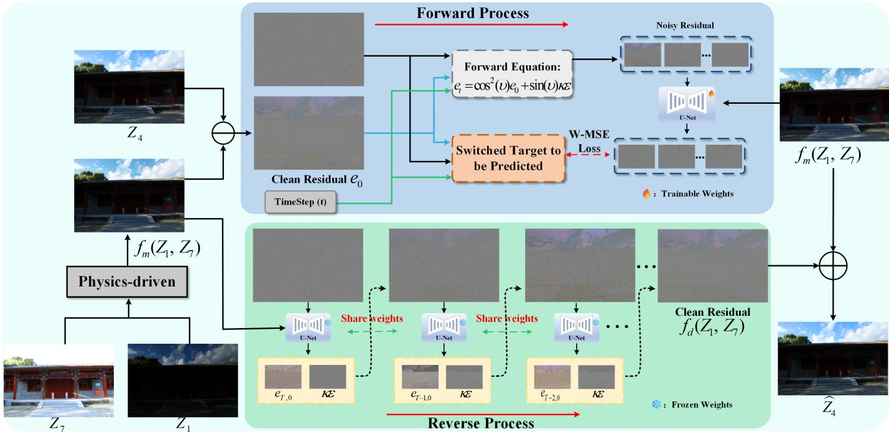  
Fig. 1: Overview of the proposed neural augmented exposure interpolation algorithm on top of a new diffusion model. Through reducing the variation of $\Psi _ { \mathbf { e } _ { t } , \omega _ { t } }$ as well as $| \Phi _ { 1 } ( t ^ { \prime } , t ) |$ and $| \Phi _ { 2 } ( t ^ { \prime } , t ) |$ , the fitting error of the neural network is reduced in the reverse process. Subsequently, the quality of the interpolated image is improved.

A neural network $f _ { \theta } ( X _ { t } , t )$ can be trained to map the noisy data $X _ { t }$ and t to a predicted target $\omega _ { t }$ during the forward process. The predicted target is defined as [29]

$$
\omega _ { t } = a _ { 2 1 } ( t ) Z + a _ { 2 2 } ( t ) \epsilon ,\tag{8}
$$

where $a _ { 2 1 } ( t )$ and $a _ { 2 2 } ( t )$ are two hyper-parameters. Different choices of $a _ { 2 1 } ( t )$ and $a _ { 2 2 } ( t )$ are also provided in [21]–[28]. The output of the neural network $f _ { \theta } ( X _ { t } , t )$ and the noisy data $X _ { t }$ will be utilized to estimate the ground-truth data $Z$ and the Gaussian noise ϵ in the reverse process.

The reverse process starts from the noise sample ϵ and converts it back to the corresponding data sample $Z$ through progressively reducing the Gaussian noise ϵ from the noisy data $X _ { t }$ . Considering two instances t and $t ^ { \prime }$ satisfying $t ^ { \prime } < t ,$ the noisy data $X _ { t }$ and the prediction $f _ { \theta } ( X _ { t } , t )$ are available at $t ^ { \prime }$ in the reverse process. Defining a matrix $A ( t )$ as [29]

$$
A ( t ) = \left[ \begin{array} { l l } { a _ { 1 1 } ( t ) } & { a _ { 1 2 } ( t ) } \\ { a _ { 2 1 } ( t ) } & { a _ { 2 2 } ( t ) } \end{array} \right] ,\tag{9}
$$

$Z$ and ϵ can be estimated as

$$
\left[ \begin{array} { l } { Z } \\ { \epsilon } \end{array} \right] = \frac { 1 } { | A ( t ) | } \left[ \begin{array} { l l } { a _ { 2 2 } ( t ) } & { - a _ { 1 2 } ( t ) } \\ { - a _ { 2 1 } ( t ) } & { a _ { 1 1 } ( t ) } \end{array} \right] \left[ \begin{array} { l } { X _ { t } } \\ { f _ { \theta } } \end{array} \right] ,\tag{10}
$$

where $| A ( t ) |$ is the determinant of matrix $A ( t )$

Subsequently, the reverse process is given as

$$
\begin{array} { r l } & { X _ { t ^ { \prime } } = a _ { 1 1 } ( t ^ { \prime } ) Z + a _ { 1 2 } ( t ^ { \prime } ) \epsilon } \\ & { \qquad = \Phi _ { 1 } ( t ^ { \prime } , t ) X _ { t } + \Phi _ { 2 } ( t ^ { \prime } , t ) f _ { \theta } ( X _ { t } , t ) , } \end{array}\tag{11}
$$

where $\Phi _ { 1 } ( t ^ { \prime } , t )$ and $\Phi _ { 2 } ( t ^ { \prime } , t )$ are

$$
\left\{ \begin{array} { l l } { \Phi _ { 1 } ( t ^ { \prime } , t ) = \frac { a _ { 1 1 } ( t ^ { \prime } ) a _ { 2 2 } ( t ) - a _ { 1 2 } ( t ^ { \prime } ) a _ { 2 1 } ( t ) } { | A ( t ) | } } \\ { \Phi _ { 2 } ( t ^ { \prime } , t ) = \frac { a _ { 1 1 } ( t ) a _ { 1 2 } ( t ^ { \prime } ) - a _ { 1 1 } ( t ^ { \prime } ) a _ { 1 2 } ( t ) } { | A ( t ) | } } \end{array} \right. ,\tag{12}
$$

and $\Phi _ { 2 } ( t ^ { \prime } , t )$ is the well known amplification factor on the fitting error of $f _ { \theta } ( X _ { t } , t )$ .

The reverse time sequence is defined as

$$
\Gamma _ { r } = \{ t _ { 1 } , t _ { 2 } , \cdot \cdot \cdot , t _ { N _ { r } } \} ,\tag{13}
$$

where $t _ { 1 }$ is $T$ and $t _ { N _ { r } }$ is 1. The set $\Gamma _ { f }$ and $\Gamma _ { r }$ can be the same. By repeating the reverse process (11) from $t _ { 1 }$ to $t _ { N _ { \tau } }$ along the reverse time sequence $\Gamma _ { r }$ (13), $X _ { t _ { N _ { \tau } } }$ is obtained from $X _ { t _ { 1 } } ( = \epsilon )$ as

$$
\begin{array} { l } { { \displaystyle X _ { t _ { N _ { r } } } = \prod _ { i = 1 } ^ { N _ { r } - 1 } \Phi _ { 1 } ( t _ { i + 1 } , t _ { i } ) X _ { t _ { 1 } } + } } \\ { { \displaystyle \sum _ { i = 1 } ^ { N _ { r } - 1 } \prod _ { j = i + 1 } ^ { N _ { r } - 1 } \Phi _ { 1 } ( t _ { j + 1 } , t _ { j } ) \Phi _ { 2 } ( t _ { i + 1 } , t _ { i } ) f _ { \theta } ( X _ { t _ { i } } , t _ { i } ) . } } \end{array}\tag{14}
$$

$N _ { r }$ should be as small as possible to reduce the time of the reverse process [23], [25]–[27]. In addition to $| \Phi _ { 1 } ( t ^ { \prime } , t ) |$ and $| \Phi _ { 2 } ( t ^ { \prime } , t ) |$ , the overall prediction error also depends on the fitting errors of $f _ { \theta } ( X _ { t _ { i } } , t _ { i } ) ( i \ = \ 1 , \cdot \cdot \cdot , N _ { r } \ - \ 1 )$ as shown in equation (14). As indicated in [29], the fitting error of $f _ { \theta } ( X _ { t } , t )$ depends on the Pearson correlation between the noisy data $X _ { t }$ and the target $\omega _ { t }$ which is defined as

$$
\Psi _ { X _ { t } , \omega _ { t } } = \frac { \cos ( X _ { t } , \omega _ { t } ) } { \sigma _ { X _ { t } } \sigma _ { \omega _ { t } } } ,\tag{15}
$$

where $\mathsf { c o v } ( X _ { t } , \omega _ { t } )$ is the covariance of the noisy data $X _ { t }$ and the predicted target $\omega _ { t } . \sigma _ { X _ { t } }$ and $\sigma _ { \omega _ { t } }$ are the standard deviation of $X _ { t }$ and $\omega _ { t } .$ , respectively.

Since the neural network $f _ { \theta } ( \cdot )$ is shared among all $t \mathbf { \bar { s } }$ the fitting error of $f _ { \theta } ( \cdot )$ depends on those t’s with small $\Psi _ { X _ { t } , \omega _ { t } } \mathrm { ' s } .$ Therefore, it is important to reduce the variation of $\Psi _ { X _ { t } , \omega _ { t } } .$ . Certainly, it is also important to reduce $| \Phi _ { 1 } ( t ^ { \prime } , t )$ | and $| \Phi _ { 2 } ( t ^ { \prime } , t ) |$ . They are the guidelines for the proposed diffusion model in this paper.

The diffusion model has a potential to generate high-frequency information which is missed by the physics-driven and datadriven methods. New diffusion models will be presented in this paper to generate high-frequency information which is missed by the physics-driven exposure interpolation component.

## III. PROBLEM FORMULATION

$\mathbf { Z } _ { 1 } , \mathbf { Z } _ { 2 } , \cdots$ , and $\mathbf { Z } _ { 7 }$ are differently exposed SDR images that are captured from a real-world HDR scene. They are aligned and cover the whole dynamic range of the HDR scene. $\Delta t _ { i }$ is the exposure time of image $\mathbf { Z } _ { i } ,$ and the exposure times of the seven SDR images satisfy

$$
\Delta t _ { 1 } < \Delta t _ { 2 } < \cdots < \Delta t _ { 7 } ,\tag{16}
$$

$$
{ \frac { \Delta t _ { 2 } } { \Delta t _ { 1 } } } = { \frac { \Delta t _ { 3 } } { \Delta t _ { 2 } } } = \cdots = { \frac { \Delta t _ { 7 } } { \Delta t _ { 6 } } } .\tag{17}
$$

$\mathbf { Z } _ { 1 }$ and $\mathbf { Z } _ { 7 }$ are the inputs of the proposed exposure interpolation algorithm. They are a pair of aligned LER images, and can be captured simultaneously by a single-shot [8]–[10]. Similarly to the neural augmentation framework in [19], [20], the image $\hat { \mathbf { Z } } _ { 4 , t }$ is interpolated as

$$
\begin{array} { r l } & { \hat { \mathbf { Z } } _ { 4 , t } = f _ { t } ( \mathbf { Z } _ { 1 } , \mathbf { Z } _ { 7 } ) } \\ & { \quad \quad \quad = f _ { m } ( \mathbf { Z } _ { 1 } , \mathbf { Z } _ { 7 } ) + f _ { d , t } ( \mathbf { Z } _ { 1 } , \mathbf { Z } _ { 7 } ) , } \end{array}\tag{18}
$$

where $f _ { m } ( \mathbf { Z } _ { 1 } , \mathbf { Z } _ { 7 } )$ and $f _ { d , t } ( \mathbf { Z } _ { 1 } , \mathbf { Z } _ { 7 } )$ are physics-driven representation and data-driven representation of $\mathbf { e } _ { 0 } ,$ , respectively. t is in the set $\Gamma _ { f }$ . The initial value of $\hat { \mathbf { Z } } _ { 4 , t }$

$$
\hat { \mathbf { Z } } _ { 4 , 0 } = \mathbf { Z } _ { 4 } .\tag{19}
$$

The physics-driven representation $f _ { m } ( \mathbf { Z } _ { 1 } , \mathbf { Z } _ { 7 } )$ is kept the same as [20] while the data-driven component $f _ { d , t } ( \mathbf { Z } _ { 1 } , \mathbf { Z } _ { 7 } )$ is implemented by a new diffusion model in this paper. Details on the $f _ { m } ( \mathbf { Z } _ { 1 } , \mathbf { Z } _ { 7 } )$ are given in Appendix. Compared to the data-driven components in [19], [20], more high-frequency information is generated by the proposed diffusion model. For simplicity, a residual image $\mathbf { e } _ { t }$ is defined as

$$
\begin{array} { r } { \mathbf { e } _ { t } = \hat { \mathbf { Z } } _ { 4 , t } - f _ { m } ( \mathbf { Z } _ { 1 } , \mathbf { Z } _ { 7 } ) . } \end{array}\tag{20}
$$

It can be derived from equations (19) and (20) that

$$
{ \bf e } _ { 0 } = { \bf Z } _ { 4 } - f _ { m } ( { \bf Z } _ { 1 } , { \bf Z } _ { 7 } ) .\tag{21}
$$

In other words, $\mathbf { e } _ { 0 }$ is the residual image between the physicsdriven component $f _ { m } ( \mathbf { Z } _ { 1 } , \mathbf { Z } _ { 7 } )$ and the ground-truth (or captured) image $\mathbf { Z } _ { 4 }$ . Generally, the residual image $\mathbf { e } _ { 0 }$ contains mainly the high-frequency details that are missing in the the physics-driven component $f _ { m } ( \mathbf { Z } _ { 1 } , \mathbf { Z } _ { 7 } )$ . The problem studied in this paper is to learn the conditional distribution $q ( \mathbf { e } _ { 0 } | f _ { m } ( \mathbf { Z } _ { 1 } , \mathbf { Z } _ { 7 } ) )$ . The learned ${ \bf e } _ { 0 }$ is denoted as $\begin{array} { r l } { \hat { \mathbf { e } } _ { 0 } . } & { { } } \end{array}$ . Subsequently, the image is interpolated as $( f _ { m } ( \mathbf { Z } _ { 1 } , \mathbf { Z } _ { 7 } ) + \hat { \mathbf { e } } _ { 0 } )$ .

IV. GENERATIVE AI-BASED EXPOSURE INTERPOLATION In this section, the conditional distribution $q ( \mathbf { e } _ { 0 } | f _ { m } ( \mathbf { Z } _ { 1 } , \mathbf { Z } _ { 7 } ) )$ is learned through an efficient diffusion model because the diffusion model has more chance to learn the missing highfrequency information than the CNN based methods. The proposed diffusion model has a forward process and a reverse process. To save space, cos ν and sin ν are respectively denoted as $C _ { \nu }$ and $S _ { \nu }$ in the rest of this paper. The forward process is defined as

$$
\begin{array} { c } { { { \bf e } _ { t } = a _ { 1 1 } ( t ) { \bf e } _ { 0 } + a _ { 1 2 } ( t ) \epsilon } } \\ { { = C _ { \nu } ^ { 2 } { \bf e } _ { 0 } + S _ { \nu } \epsilon , } } \end{array}\tag{22}
$$

where ν is $\frac { \pi t } { 2 T }$ , and $t \in \Gamma _ { f }$

A deep neural network with parameter θ, $g _ { \theta } ( \mathbf { e } _ { t } , f _ { m } , t )$ is trained to map the noisy data $\mathbf { e } _ { t }$ to the predicted target $\omega _ { t }$ during the forward process. The predicted target is an important component of the diffusion model. Two different choices of $\omega _ { t }$ are persented as below.

## A. The proposed target to be predicted

Inspired by the preliminary knowledge in Section II-B, the target to be predicted, $\omega _ { t } ^ { ( 1 ) }$ is proposed as

$$
\begin{array} { c } { { \omega _ { t } ^ { ( 1 ) } = a _ { 2 2 } ^ { ( 1 ) } ( t ) { \bf e } _ { 0 } + a _ { 2 2 } ^ { ( 1 ) } ( t ) \epsilon } } \\ { { = ( \gamma - S _ { \nu } ) { \bf e } _ { 0 } + \epsilon , } } \end{array}\tag{23}
$$

where $\gamma ( < 1 )$ is defined as

$$
\gamma = \operatorname* { m i n } \{ \alpha ( C _ { \nu } - C _ { \frac { \pi \tau } { 2 T } } ) , 0 \} ,\tag{24}
$$

$\tau ( \in \ [ 0 , T ] )$ and α are two hyperparameter. $\tau$ is selected as $T / 5$ in this paper. α is selected as 0.02.

A deep neural network with parameter θ, $g _ { \theta } ^ { ( 1 ) } ( \mathbf { e } _ { t } , f _ { m } , t )$ is trained to map the noisy data $\mathbf { e } _ { t }$ to the predicted target $\boldsymbol { \dot { \omega } } _ { t } ^ { ( 1 ) }$ during the forward process which is demonstrated in Algorithm 1.We adopt Swin-UNet [32] as the backbone network. In particular, $g _ { \theta } ^ { ( \hat { 1 } ) } ( \mathbf { e } _ { t } , f _ { m } , t )$ is obtained as

$$
\operatorname* { m i n } _ { \theta } \{ \sum _ { t \in \Gamma _ { f } } \| g _ { \theta } ^ { ( 1 ) } ( \mathbf { e } _ { t } , f _ { m } , t ) - \omega _ { t } ^ { ( 1 ) } \| _ { 2 } ^ { 2 } \} .\tag{25}
$$

The output of the neural network $g _ { \theta } ^ { ( 1 ) } ( \mathbf { e } _ { t } , f _ { m } , t )$ and the noisy data $\mathbf { e } _ { t }$ will be utilized to estimate the ground-truth data $\mathbf { e } _ { 0 }$ and the noise ϵ in the reverse process. It can be derived from equations (22) and (23) that $\mathbf { e } _ { 0 }$ and ϵ can be estimated as

$$
\left\{ \begin{array} { l } { \mathbf { e } _ { 0 } = \frac { 1 } { 1 - \gamma S _ { \nu } } \mathbf { e } _ { t } - \frac { S _ { \nu } } { 1 - \gamma S _ { \nu } } g _ { \theta } ^ { ( 1 ) } ( \mathbf { e } _ { t } , f _ { m } , t ) } \\ { \epsilon = \frac { S _ { \nu } - \gamma } { 1 - \gamma S _ { \nu } } \mathbf { e } _ { t } + \frac { C _ { \nu } ^ { 2 } } { 1 - \gamma S _ { \nu } } g _ { \theta } ^ { ( 1 ) } ( \mathbf { e } _ { t } , f _ { m } , t ) } \end{array} \right. .\tag{26}
$$

The reverse process starts from the noise sample ϵ and converts it back to the corresponding data sample $\mathbf { e } _ { 0 }$ through progressively reducing the noise from the noisy data $\mathbf { e } _ { t }$

Algorithm 1: Neural Augmented Exposure Interpolation Algorithm 2: Neural Augmented Exposure Interpolation   
Diffusion Model (Training) (Inference)   
Input : Dual large-exposure-ratio (LER) SDR images Input : Aligned test LER image pair $\overline { { Z _ { 1 } , Z _ { 7 } ; } }$ Trained   
$Z _ { 1 } , Z _ { 7 } ;$ Ground-truth middle-exposure image network $g _ { \theta } ^ { ( 1 ) }$ ; Reverse time sequence   
$Z _ { 4 } ;$ Total timesteps $T ;$ Hyperparameters $\alpha , \tau .$ $\Gamma _ { r } = \{ t _ { 1 } , \dot { t } _ { 2 } , \dots , t _ { N _ { r } } \}$ with $t _ { 1 } = T , t _ { N _ { r } } = 1 ;$   
Output: Optimized parameters θ of the neural network Hyperparameters $\alpha , \tau .$   
$g _ { \theta } ^ { ( \mathrm { \hat { 1 } } ) }$ Output: Interpolated middle-exposure image $\hat { Z } _ { 4 }$   
Compute the physics-driven prior image $f _ { m } ( Z _ { 1 } , Z _ { 7 } )$ Generate physics-driven initial interpolation $f _ { m } ( Z _ { 1 } , Z _ { 7 } ) ;$   
using Intensity Mapping Functions $( { \mathrm { I N F s } } ) ;$ Initialize noisy state at time $t _ { 1 } \colon e _ { t _ { 1 } } \sim \mathcal { N } ( \mathbf { 0 } , \mathbf { I } ) ;$   
Calculate the high-frequency target residual for $i = 1$ to $N _ { r } - 1$ do   
$e _ { 0 } = Z _ { 4 } - f _ { m } ( Z _ { 1 } , Z _ { 7 } ) ;$ Set current timestep $t = t _ { i }$ and next timestep   
repeat $t ^ { \prime } = t _ { i + 1 } ~ ( t ^ { \prime } < t ) ;$   
Sample a timestep $t \sim$ Uniform( $\left. 1 , 2 , \ldots , T \right.$ ; Compute $\begin{array} { r } { \nu = \frac { \pi t } { 2 T } , \nu ^ { \prime } = \frac { \pi t ^ { \prime } } { 2 T } , C _ { \nu } = \cos ( \nu ) . } \end{array}$   
Sample Gaussian noise $\mathbf { \epsilon } \gets \mathcal { N } ( \mathbf { 0 } , \mathbf { I } ) ;$ $S _ { \nu } = \sin ( \nu ) , \ \bar { C } _ { \nu ^ { \prime } } = \cos ( \bar { \nu ^ { \prime } } ) , \ S _ { \nu ^ { \prime } } = \sin ( \nu ^ { \prime } ) ;$   
Calculate angles $\begin{array} { r } { \nu = \frac { \pi t } { 2 T } , C _ { \nu } = \cos ( \nu ) } \end{array}$ , and Calculate $\gamma = \operatorname* { m i n } \{ \alpha ( C _ { \nu } - C _ { \frac { \pi \tau } { 2 T } } ) , 0 \} ;$   
$S _ { \nu } = \sin ( \nu ) ;$ Predict target $\hat { \omega } _ { t } ^ { ( 1 ) } = g _ { \theta } ^ { ( 1 ) } ( e _ { t } , \tilde { f _ { m } } ( Z _ { 1 } , Z _ { 7 } ) , t ) ;$   
Calculate forward noisy residual state: Compute coefficient $\begin{array} { r } { \Phi _ { 1 } ^ { \dot { ( 1 ) } } ( t ^ { \prime } , t ) = \frac { S _ { \nu ^ { \prime } } S _ { \nu } + C _ { \nu ^ { \prime } } ^ { 2 } - \gamma S _ { \nu ^ { \prime } } } { 1 - \gamma S , } } \end{array}$   
$e _ { t } = C _ { \nu } ^ { 2 } e _ { 0 } + S _ { \nu } \epsilon ;$   
Calculate dynamic parameter Compute coefficient $\begin{array} { r } { \Phi _ { 2 } ^ { ( 1 ) } ( t ^ { \prime } , t ) = \frac { S _ { \nu ^ { \prime } } C _ { \nu } ^ { 2 } - \dot { C } _ { \nu ^ { \prime } } ^ { 2 } S _ { \nu } } { 1 - \gamma S _ { \nu } } ; } \end{array}$   
$\gamma = \operatorname* { m i n } \{ \alpha ( C _ { \nu } - C _ { \frac { \pi \tau } { 2 T } } ) , 0 \}$ Update residual state for step $t ^ { \prime } { : }$   
Define the switched predicted target: $e _ { t ^ { \prime } } = \Phi _ { 1 } ^ { ( 1 ) } ( t ^ { \prime } , t ) e _ { t } + \Phi _ { 2 } ^ { ( 1 ) } ( t ^ { \prime } , t ) \hat { \omega } _ { t } ^ { ( 1 ) }$   
$\omega _ { t } ^ { ( 1 ) } = ( \gamma - S _ { \nu } ) e _ { 0 } \dot { + } \epsilon ;$   
Compute network prediction $g _ { \theta } ^ { ( 1 ) } ( e _ { t } , f _ { m } ( Z _ { 1 } , Z _ { 7 } ) , t ) ;$ end   
Update parameters $\theta$ via gradient step on Weighted Set final predicted residual $\boldsymbol { \hat { e } } _ { 0 } = \boldsymbol { e } _ { t _ { N _ { r } } } ;$   
MSE loss: Reconstruct the target middle-exposure image:   
$\begin{array} { r } { \hat { Z } _ { 4 } = f _ { m } ( Z _ { 1 } , Z _ { 7 } ) { \stackrel { . } { + } } \hat { e } _ { 0 } ; } \end{array}$   
$\mathcal { L } ( \theta ) = \left\| g _ { \theta } ^ { ( 1 ) } ( e _ { t } , f _ { m } ( Z _ { 1 } , Z _ { 7 } ) , t ) - \omega _ { t } ^ { ( 1 ) } \right\| _ { 2 } ^ { 2 }$ return $\hat { Z } _ { 4 } ;$   
until converged;

Mathematically, as shown in Algorithm 2, the reverse process is

$$
\begin{array} { r l } & { { \bf e } _ { t ^ { \prime } } = C _ { \nu ^ { \prime } } ^ { 2 } { \bf e } _ { 0 } + S _ { \nu ^ { \prime } } \epsilon } \\ & { \qquad = \Phi _ { 1 } ^ { ( 1 ) } ( t ^ { \prime } , t ) { \bf e } _ { t } + \Phi _ { 2 } ^ { ( 1 ) } ( t ^ { \prime } , t ) g _ { \theta } ^ { ( 1 ) } ( { \bf e } _ { t } , f _ { m } , t ) , } \end{array}
$$

$$
t ^ { \prime } < t , \nu ^ { \prime }\tag{27}
$$

$$
\begin{array} { r } { \frac { \pi t ^ { \prime } } { 2 T } , \ \Phi _ { 1 } ^ { ( 1 ) } ( t ^ { \prime } , t ) } \end{array}
$$

$$
\Phi _ { 2 } ^ { ( 1 ) } ( t ^ { \prime } , t )
$$

$$
\left\{ \begin{array} { l l } { \boldsymbol { \Phi } _ { 1 } ^ { ( 1 ) } ( t ^ { \prime } , t ) = \frac { S _ { \nu ^ { \prime } } S _ { \nu } + C _ { \nu ^ { \prime } } ^ { 2 } - \gamma S _ { \nu ^ { \prime } } } { 1 - \gamma S _ { \nu } } > 0 } \\ { \boldsymbol { \Phi } _ { 2 } ^ { ( 1 ) } ( t ^ { \prime } , t ) = \frac { S _ { \nu ^ { \prime } } C _ { \nu } ^ { 2 } - C _ { \nu ^ { \prime } } ^ { 2 } S _ { \nu } } { 1 - \gamma S _ { \nu } } < 0 } \end{array} \right. .\tag{28}
$$

The correlation between $\mathbf { e } _ { t }$ and $\omega _ { t } ^ { ( 1 ) }$ is

$$
\Psi _ { \mathbf { e } _ { t } , \omega _ { t } ^ { ( 1 ) } } = \frac { \gamma C _ { \nu } ^ { 2 } + S _ { \nu } ^ { 3 } } { \sqrt { ( C _ { \nu } ^ { 4 } + S _ { \nu } ^ { 2 } ) ( 1 + ( \gamma - S _ { \nu } ) ^ { 2 } ) } } > 0 .\tag{29}
$$

It can be verified that

$$
\left\{ \begin{array} { l l } { \frac { d \Phi _ { 1 } ^ { ( 1 ) } ( t ^ { \prime } , t ) } { d \gamma } = \frac { ( S _ { \nu } - S _ { \nu ^ { \prime } } ) C _ { \nu } ^ { 2 } } { ( 1 - \gamma S _ { \nu } ) ^ { 2 } } > 0 } \\ { \frac { d \Phi _ { 2 } ^ { ( 1 ) } ( t ^ { \prime } , t ) } { d \gamma } = \frac { S _ { \nu } ( S _ { \nu ^ { \prime } } - S _ { \nu } ) ( 1 + S _ { \nu ^ { \prime } } S _ { \nu } ) } { ( 1 - \gamma S _ { \nu } ) ^ { 2 } } < 0 } \\ { \frac { d \Psi _ { \mathbf { e } _ { t } , \omega _ { t } ^ { ( 1 ) } } } { d \gamma } = \frac { 1 - \gamma S _ { \nu } } { \sqrt { ( C _ { \nu } ^ { 4 } + S _ { \nu } ^ { 2 } ) ( 1 + ( \gamma - S _ { \nu } ) ^ { 2 } ) ^ { 3 } } } > 0 } \end{array} \right. .\tag{30}
$$

Clearly, $| \Phi _ { 1 } ^ { ( 1 ) } ( t ^ { \prime } , t ) | , | \Phi _ { 2 } ^ { ( 1 ) } ( t ^ { \prime } , t ) |$ , and $\boldsymbol { \Psi } _ { \mathbf { e } _ { t } , \omega _ { t } ^ { ( 1 ) } }$ decrease if t is larger than $\tau$ as shown in Fig. 2. Subsequently, the variation of $\Psi _ { \mathbf { e } _ { t } , \omega _ { t } ^ { ( 1 ) } }$ reduces.

By repeating the reverse process (27) from $t _ { 1 }$ to $t _ { N _ { \tau } }$ along the reverse time sequence $\Gamma _ { r } ( 1 3 ) , \mathbf { e } _ { t _ { N _ { r } } }$ is obtained from ${ \bf e } _ { t _ { 1 } } ( = \epsilon )$ as

$$
\begin{array} { l } { { \displaystyle { \bf e } _ { t _ { N _ { r } } } = \prod _ { i = 1 } ^ { N _ { r } - 1 } \Phi _ { 1 } ^ { ( 1 ) } ( t _ { i + 1 } , t _ { i } ) { \bf e } _ { t _ { 1 } } + } } \\ { { \displaystyle \sum _ { i = 1 } ^ { N _ { r } - 1 } \prod _ { j = i + 1 } ^ { N _ { r } - 1 } \Phi _ { 1 } ^ { ( 1 ) } ( t _ { j + 1 } , t _ { j } ) \Phi _ { 2 } ^ { ( 1 ) } ( t _ { i + 1 } , t _ { i } ) g _ { \theta } ^ { ( 1 ) } ( { \bf e } _ { t _ { i } } , f _ { m } , t _ { i } ) } . } \end{array}\tag{31}
$$

Similar to the ResShift [30], the proposed diffusion model can be transferred into the latent space [22], [33]. The image can be compressed by a factor of four in spatial dimensions to reduce the computational cost. This can be implemented by substituting $\mathbf { Z } _ { 4 }$ and $f _ { m } ( \mathbf { Z } _ { 1 } , \mathbf { Z } _ { 7 } )$ with their latent codes.

## B. Comparison with the target to be predicted in $I 3 0 J$

In this subsection, the proposed $\omega _ { t } ^ { ( 1 ) }$ in equation (23) is compared with the $\boldsymbol { \omega } _ { t } ^ { ( 2 ) }$ in [30] that is defined as

$$
\boldsymbol \omega _ { t } ^ { ( 2 ) } = { \bf e } _ { 0 } ; t \in \Gamma _ { f } .\tag{32}
$$

The forward process is given in equation (22), and the reverse process is

$$
{ \bf e } _ { t ^ { \prime } } = \Phi _ { 1 } ^ { ( 2 ) } ( t ^ { \prime } , t ) { \bf e } _ { t } + \Phi _ { 2 } ^ { ( 2 ) } ( t ^ { \prime } , t ) g _ { \theta } ^ { ( 2 ) } ( { \bf e } _ { t } , f _ { m } , t ) ,\tag{33}
$$

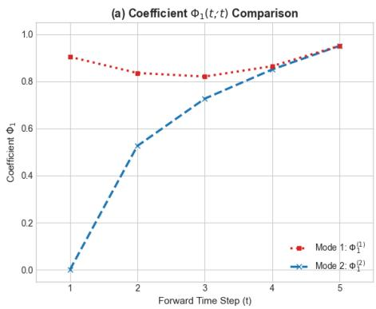

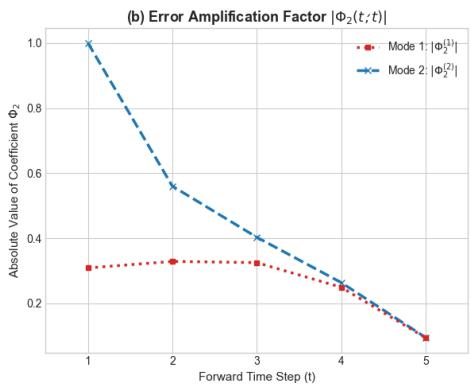

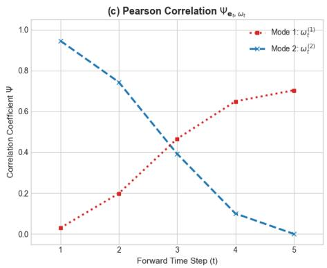  
Fig. 2: $| \Phi _ { 1 } ( t ^ { \prime } , t ) | , | \Phi _ { 2 } ( t ^ { \prime } , t ) |$ and $\Psi _ { \mathbf { e } _ { t } , \omega _ { t } }$ of two different choices of $\omega _ { t }$ in equations (23) and (32) with T as 5. $| \Phi _ { 2 } ^ { ( 1 ) } ( t ^ { \prime } , t ) |$ is smaller than $| \Phi _ { 2 } ^ { ( 1 ) } ( t ^ { \prime } , t ) |$ and the variation of $\Psi _ { \mathbf { e } _ { t } , \omega _ { t } ^ { ( 1 ) } }$ is smaller than the variation of $\Psi _ { \mathbf { e } _ { t } , \omega _ { t } ^ { ( 2 ) } }$

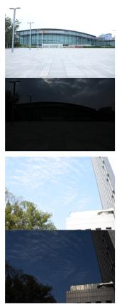  
(a)

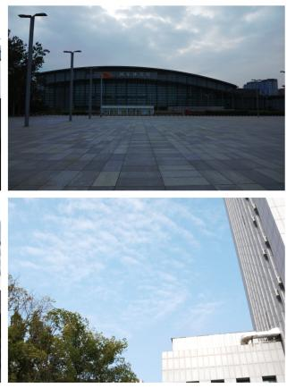  
(b)

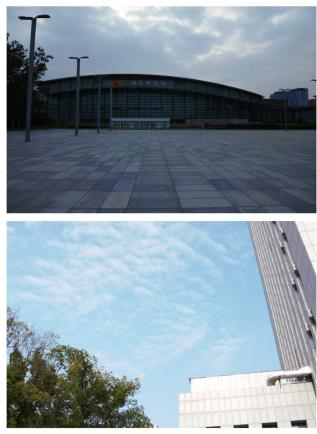  
(c)

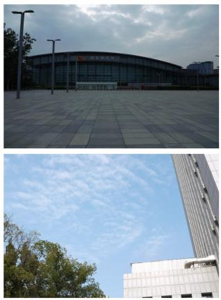  
(d)

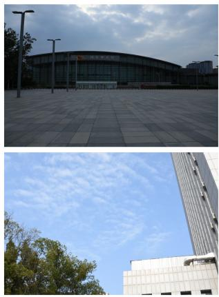  
(e)  
Fig. 3: Comparison of different physics-driven exposure interpolation algorithms. (a) are the inputs, (b), (c) and (d) show the results obtained by the physics-driven exposure interpolation algorithms in [18], [19], and our adopted physics-driven component, respectively. (e) represents the ground truth.

where $g _ { \theta } ^ { ( 2 ) } ( \mathbf { e } _ { t } , f _ { m } , t )$ is obtained as

$$
\operatorname* { m i n } _ { \theta } \{ \sum _ { t \in \Gamma _ { f } } \| g _ { \theta } ^ { ( 2 ) } ( \mathbf { e } _ { t } , f _ { m } , t ) - \omega _ { t } ^ { ( 2 ) } \| _ { 2 } ^ { 2 } \} ,\tag{34}
$$

$\Phi _ { 1 } ^ { ( 2 ) } ( t ^ { \prime } , t )$ and $\Phi _ { 2 } ^ { ( 2 ) } ( t ^ { \prime } , t )$ are

$$
\left\{ \begin{array} { l l } { \Phi _ { 1 } ^ { ( 2 ) } ( t ^ { \prime } , t ) = \frac { S _ { \nu ^ { \prime } } } { S _ { \nu } } } \\ { \Phi _ { 2 } ^ { ( 2 ) } ( t ^ { \prime } , t ) = \frac { C _ { \nu ^ { \prime } } ^ { 2 } S _ { \nu } - S _ { \nu ^ { \prime } } C _ { \nu } ^ { 2 } } { S _ { \nu } } } \end{array} \right. .\tag{35}
$$

The correlation between $\mathbf { e } _ { t }$ and $\boldsymbol { \omega } _ { t } ^ { ( 2 ) }$ is

$$
\Psi _ { { \bf e } _ { t } , \omega _ { t } ^ { ( 2 ) } } = \frac { C _ { \nu } ^ { 2 } } { \sqrt { C _ { \nu } ^ { 4 } + S _ { \nu } ^ { 2 } } } .\tag{36}
$$

$\omega _ { t } ^ { ( 1 ) } \mathrm { i n }$ equation (23) and $\omega _ { t } ^ { ( 2 ) }$ (32) are now compared. As shown in Figure 2, the variation of $\Psi _ { \mathbf { e } _ { t } , \omega _ { t } ^ { ( 2 ) } }$ is larger than that of $\Psi _ { { \bf e } _ { t } , \omega _ { t } ^ { ( 1 ) } } . | \Phi _ { 2 } ^ { ( 2 ) } ( t ^ { \prime } , t ) |$ is usually larger than $| \Phi _ { 2 } ^ { ( 1 ) } ( t ^ { \prime } , t )$ |.

## V. EXPERIMENTS

## A. Experimental Settings

Experiments are conducted to validate the effectiveness of the proposed exposure interpolation algorithm. The HDR imaging datasets introduced in [10], [19] are adopted for training and evaluation. Specifically, the dataset is divided into three subsets, including 420 sequences for training, 40 sequences for validation, and 60 sequences for testing. To ensure data consistency, camera motion and object movement are strictly controlled, and sequences containing noticeable misalignment are excluded.Data In addition, all images are randomly cropped into patches of size $5 1 2 \times 5 1 2$ to augment the training data and improve model generalization. Furthermore, the dataset from [34] is utilized solely for testing to evaluate the network’s performance, with no involvement in the training stage. During training, the batch size is set to 4. We adopt Swin-UNet [32] as the backbone network. The initial learning rate is $5 \times 1 0 ^ { - 5 }$ , which is gradually decreased following a cosine annealing schedule. All experiments are implemented in PyTorch and conducted on an NVIDIA A6000 GPU.

## B. Comparison of Different Physics-driven Exposure Interpolation Components

Physics-driven exposure interpolation component plays an important role in the proposed neural augmented framework.

TABLE I: Objective comparison among the physics-driven exposure interpolation algorithms in [18], [19] and our adopted physics-driven exposure interpolation component.
<table><tr><td rowspan=1 colspan=1>Methods</td><td rowspan=1 colspan=1>Data</td><td rowspan=1 colspan=1>PSNR↑</td><td rowspan=1 colspan=1>SSIM↑</td><td rowspan=1 colspan=1>FSIM↑</td><td rowspan=1 colspan=1>LPIPS</td><td rowspan=1 colspan=1>Entropy↑</td><td rowspan=1 colspan=1>CLIPIQA↑</td><td rowspan=1 colspan=1>MUSIQ ↑</td><td rowspan=1 colspan=1>HyperIQA ↑</td></tr><tr><td rowspan=1 colspan=1>Algorithm in [18]</td><td rowspan=1 colspan=1>[10], [19]</td><td rowspan=1 colspan=1>26.65</td><td rowspan=1 colspan=1>0.9114</td><td rowspan=1 colspan=1>0.9761</td><td rowspan=1 colspan=1>0.0905</td><td rowspan=1 colspan=1>6.4661</td><td rowspan=1 colspan=1>0.4834</td><td rowspan=1 colspan=1>58.996</td><td rowspan=1 colspan=1>65.07</td></tr><tr><td rowspan=1 colspan=1>Algorithm in [19]</td><td rowspan=1 colspan=1>[10], [19]</td><td rowspan=1 colspan=1>28.07</td><td rowspan=1 colspan=1>0.9142</td><td rowspan=1 colspan=1>0.98</td><td rowspan=1 colspan=1>0.0901</td><td rowspan=1 colspan=1>6.5903</td><td rowspan=1 colspan=1>0.4836</td><td rowspan=1 colspan=1>58.438</td><td rowspan=1 colspan=1>65.38</td></tr><tr><td rowspan=1 colspan=1>Our</td><td rowspan=1 colspan=1>[10], [19]</td><td rowspan=1 colspan=1>29.79</td><td rowspan=1 colspan=1>0.919</td><td rowspan=1 colspan=1>0.9823</td><td rowspan=1 colspan=1>0.0848</td><td rowspan=1 colspan=1>6.691</td><td rowspan=1 colspan=1>0.4727</td><td rowspan=1 colspan=1>59.0875</td><td rowspan=1 colspan=1>65.46</td></tr><tr><td rowspan=1 colspan=1>Algorithm in [18]</td><td rowspan=1 colspan=1>[34]</td><td rowspan=1 colspan=1>24.4</td><td rowspan=1 colspan=1>0.8633</td><td rowspan=1 colspan=1>0.9519</td><td rowspan=1 colspan=1>0.1268</td><td rowspan=1 colspan=1>7.0101</td><td rowspan=1 colspan=1>0.4972</td><td rowspan=1 colspan=1>61.7405</td><td rowspan=1 colspan=1>65.36</td></tr><tr><td rowspan=2 colspan=1>Algorithm in [19]Our</td><td rowspan=1 colspan=1>[34]</td><td rowspan=1 colspan=1>24.93</td><td rowspan=1 colspan=1>0.8702</td><td rowspan=1 colspan=1>0.957</td><td rowspan=1 colspan=1>0.1192</td><td rowspan=1 colspan=1>7.0443</td><td rowspan=1 colspan=1>0.496</td><td rowspan=1 colspan=1>61.8327</td><td rowspan=1 colspan=1>65.44</td></tr><tr><td rowspan=1 colspan=1>[34]</td><td rowspan=1 colspan=1>25.87</td><td rowspan=1 colspan=1>0.8848</td><td rowspan=1 colspan=1>0.9631</td><td rowspan=1 colspan=1>0.1083</td><td rowspan=1 colspan=1>7.0817</td><td rowspan=1 colspan=1>0.4998</td><td rowspan=1 colspan=1>61.8573</td><td rowspan=1 colspan=1>65.53</td></tr></table>

TABLE II: Objective comparison between two different choices of $\omega _ { t }$ in equations (23)(the proposed one) and (32) (one in [30]) with T as 5 using date sets in [10], [19].
<table><tr><td rowspan=1 colspan=1>Target</td><td rowspan=1 colspan=1>PSNR↑</td><td rowspan=1 colspan=1>SSIM↑</td><td rowspan=1 colspan=1>FSIM↑</td><td rowspan=1 colspan=1>LPIPS ↓</td><td rowspan=1 colspan=1>Entropy↑</td><td rowspan=1 colspan=1>CLIPIQA↑</td><td rowspan=1 colspan=1>MUSIQ ↑</td><td rowspan=1 colspan=1>HyperIQA ↑</td></tr><tr><td rowspan=1 colspan=1>Eq. (23)</td><td rowspan=1 colspan=1>33.55</td><td rowspan=1 colspan=1>0.9489</td><td rowspan=1 colspan=1>0.9900</td><td rowspan=1 colspan=1>0.0441</td><td rowspan=1 colspan=1>6.8237</td><td rowspan=1 colspan=1>0.4702</td><td rowspan=1 colspan=1>63.40</td><td rowspan=1 colspan=1>67.23</td></tr><tr><td rowspan=1 colspan=1>Eq. (32)</td><td rowspan=1 colspan=1>32.77</td><td rowspan=1 colspan=1>0.9429</td><td rowspan=1 colspan=1>0.9883</td><td rowspan=1 colspan=1>0.0492</td><td rowspan=1 colspan=1>6.8181</td><td rowspan=1 colspan=1>0.4704</td><td rowspan=1 colspan=1>61.89</td><td rowspan=1 colspan=1>66.94</td></tr></table>

Therefore, in this subsection, we first conduct a comparative evaluation of the adopted physics-driven exposure interpolation component against two representative physics-driven exposure interpolation methods reported in [18], [19]. As summarized in Table II, the adopted physics-driven component consistently outperforms the competing approaches across multiple widely adopted image quality metrics, including fullreference metrics such as SSIM [35], PSNR, FSIM [36], and LPIPS [37], as well as no-reference metrics, including CLIP-IQA [38], Entropy, MUSIQ [39], and HyperIQA [40]. The interpolated images by our adopted component also approach closer to the ground truth images subjectively as demonstrated in Fig. 3. The results of the interpolation methods reported in [18], [19] exhibit noticeable color deviation, with a bluish cast in the pavement and building regions of the first scene and washed-out, desaturated skies in the second. In contrast, our result preserves natural color tones and fine textures such as cloud structures and tile patterns, and is closest to the ground truth

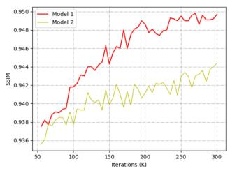  
(a) SSIM

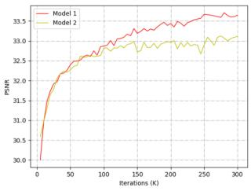  
(b) PSNR  
Fig. 4: Comparison oftraining curvesfor two different choices of ωt in equations (23) and (32) with T as 5.

## C. Comparison Between Different $\omega _ { t } \mathbf { \dot { \omega } } _ { s }$

The proposed $\omega _ { t } ^ { ( 1 ) }$ in equation (23) is compared with $\omega _ { t } ^ { ( 2 ) }$ in equation (32) in this subsection. For simplicity, the simple case with the forward and reverse processes having 5 steps is considered. $\| g _ { \theta } ( \mathbf { e } _ { t } , f _ { m } , t ) \ - \omega _ { t } \|$ heavily depends on $\| g _ { \boldsymbol { \theta } } ( \mathbf { e } _ { t ^ { \prime } } , f _ { m } , t ^ { \prime } ) - \omega _ { t ^ { \prime } } \| ^ { 3 } \mathbf { s }$ with small $\Psi _ { \mathbf { e } _ { t ^ { \prime } } , \omega _ { t ^ { \prime } } } \mathrm { \tilde { s } } .$ . It is thus important to reduce the variation of $\Psi _ { \mathbf { e } _ { t ^ { \prime } } , \omega _ { t ^ { \prime } } } \mathrm { ' s }$ . It is also important to reduce $| \Phi _ { 2 } ( t , t ^ { \prime } ) |$ . The $\omega _ { t } ^ { ( 1 ) }$ in equation (23) is proposed according to this guideline. $| \Phi _ { 2 } ^ { ( 1 ) } ( t , t ^ { \prime } ) |$ is smaller than $| \Phi _ { 2 } ^ { ( 2 ) } ( t , t ^ { \prime } ) |$ as demonstrated in Fig. 2. Subsequently, the proposed $\omega _ { t } ^ { ( 1 ) }$ in equation (23) outperforms the $\stackrel { \cdot } { \omega } _ { t } ^ { ( 2 ) }$ in equation (32) as shown in Table II. Fig. 4 illustrates the convergence behavior of the two models in terms of SSIM and PSNR at the sane training iterations. Both models improve rapidly during the early stage and gradually stabilize, indicating stable training. The proposed $\omega _ { t } ^ { ( \overline { { 1 } } ) }$ in equation (23) consistently outperforms the $\omega _ { t } ^ { \left( 2 \right) }$ in equation (32) as training proceeds.

## D. Ablation study on different α

The hyperparameter α in equation III determines how strongly the proposed target $\omega _ { t } ^ { ( 1 ) }$ departs from its baseline form. Since $C _ { \nu }$ decreases monotonically with $t , \ \gamma$ is kept at zero for $t ~ \leq ~ \tau$ and becomes increasingly negative for $t \ > \ \tau$ at a rate proportional to α. As indicated by equation (30), a more negative $\gamma$ reduces $\Phi _ { 1 } ^ { ( 1 ) } ( t ^ { \prime } , t )$ and $| \dot { \Phi } _ { 2 } ^ { ( 1 ) } ( t ^ { \prime } , t ) |$ , and it also lowers $\boldsymbol { \Psi } _ { \mathbf { e } _ { t } , \omega _ { t } ^ { ( 1 ) } }$ at the same time. The value of α therefore governs a trade-off between suppressing the amplification of the fitting error and keeping the Pearson correlation from becoming too small. In this subsection, the influence of this trade-off on the interpolation quality is investigated. Three values, $\alpha \in \{ 0 . 0 2 , 0 . 1 , 1 . 0 \}$ , are examined. For a fair comparison, τ is fixed at $T / 5$ and T is set to 5. Both the forward and reverse processes are conducted with 5 steps. As shown in Table III, $\alpha = 0 . 0 2$ achieves the best results on six of the eight metrics, including PSNR, FSIM, LPIPS, Entropy, MUSIQ and HyperIQA. Considering the overall performance, $\alpha = 0 . 0 2$ is adopted in this paper.

## E. Comparison of Different Neural Augmentation-based Exposure Interpolation Components

The proposed Diffusion neural augmentation-based exposure interpolation is compared with the CNN neural augmentationbased exposure interpolation in [19], [20]. As shown in Fig. 5, the proposed diffusion-based exposure interpolation method produces sharper results with more clearly defined fine details and improved local structural clarity. These improvements stem from the progressive generative refinement process, in which the model iteratively reconstructs image content to recover fine-scale structures and enhance local contrast. Compared with conventional exposure interpolation methods, the proposed approach better preserves subtle textures and spatial details, yielding visually sharper and more coherent results, particularly in challenging regions with large exposure differences. The objective results in Table IV show that the proposed algorithm achieves the best performance on all eight metrics and on both datasets [10], [19] and [34].

TABLE III: Objective comparison between different choices of α in equations (24) with T as 5 on [10], [19].
<table><tr><td rowspan=1 colspan=1>α</td><td rowspan=1 colspan=1>PSNR↑</td><td rowspan=1 colspan=1>SSIM↑</td><td rowspan=1 colspan=1>FSIM↑</td><td rowspan=1 colspan=1>LPIPS ↓</td><td rowspan=1 colspan=1>Entropy↑</td><td rowspan=1 colspan=1>CLIPIQA↑</td><td rowspan=1 colspan=1>MUSIQ ↑</td><td rowspan=1 colspan=1>HyperIQA ↑</td></tr><tr><td rowspan=1 colspan=1>0.02</td><td rowspan=1 colspan=1>33.55</td><td rowspan=1 colspan=1>0.9489</td><td rowspan=1 colspan=1>0.9900</td><td rowspan=1 colspan=1>0.0441</td><td rowspan=1 colspan=1>6.8237</td><td rowspan=1 colspan=1>0.4702</td><td rowspan=1 colspan=1>63.40</td><td rowspan=1 colspan=1>67.23</td></tr><tr><td rowspan=1 colspan=1>0.1</td><td rowspan=1 colspan=1>33.44</td><td rowspan=1 colspan=1>0.9493</td><td rowspan=1 colspan=1>0.9899</td><td rowspan=1 colspan=1>0.0442</td><td rowspan=1 colspan=1>6.8139</td><td rowspan=1 colspan=1>0.4681</td><td rowspan=1 colspan=1>63.28</td><td rowspan=1 colspan=1>67.13</td></tr><tr><td rowspan=1 colspan=1>1.0</td><td rowspan=1 colspan=1>33.12</td><td rowspan=1 colspan=1>0.9447</td><td rowspan=1 colspan=1>0.9893</td><td rowspan=1 colspan=1>0.0454</td><td rowspan=1 colspan=1>6.8212</td><td rowspan=1 colspan=1>0.4775</td><td rowspan=1 colspan=1>62.77</td><td rowspan=1 colspan=1>66.91</td></tr></table>

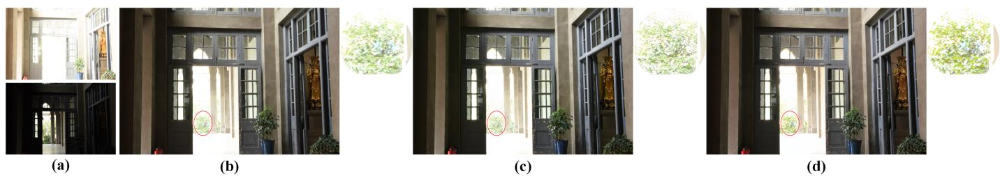  
Fig. 5: Comparison of neural augmented exposure interpolation algorithms in [19], [20] and the proposed neural augmented exposure interpolation algorithm. (a) Input images with different exposures. (b) Result of [19]. (c) Result of [20]. (d) Result of the proposed algorithm. The red circles mark the regions shown enlarged on the right of each result. The proposed algorithm produces sharper results with clearer details, especially in the highlighted foliage region.

## F. Application of Exposure Interpolation to Exposure Fusion

To verify the effectiveness of the proposed exposure interpolation, the virtual image $\hat { Z } _ { 4 }$ and the two LER images $Z _ { 1 }$ and $Z _ { 7 }$ are fused together using GGIF [41]. The resultant MEF algorithm is compared with GGIF [41], MSF [18], DeepFuse [14], MEFNET [42], UltraFusion [7], and DiFuser [43]. The GGIF, DeepFuse, MEFNET, UltraFusion, and DiFuser take the two LER images $Z _ { 1 }$ and $Z _ { 7 }$ as their inputs. All seven algorithms are first objectively compared. The MEF-SSIM [45] for each HDR scene is calculated using the fused image $Z _ { F }$ and the set $\left\{ Z _ { 1 } , Z _ { 2 } , Z _ { 3 } , Z _ { 4 } , Z _ { 5 } , Z _ { 6 } , Z _ { 7 } \right\}$ . An HDR image is synthesized from the set $\left\{ Z _ { 1 } , Z _ { 2 } , Z _ { 3 } , Z _ { 4 } , Z _ { 5 } , Z _ { 6 } , Z _ { 7 } \right\}$ using the algorithm in [1]. The TQMI is calculated using the HDR image and the fused image $Z _ { F }$ . As such, MEF-SSIM [45] and TQMI [46] measure the similarity between the fused image $Z _ { F }$ and the real world HDR scene. Since ground truth sRGB images are available for the data set in [34], the seven algorithms are also compared using PSNR and SSIM. It should be pointed out that the ground truth image is obtained by fusing all the images in the set $\left\{ Z _ { 1 } , Z _ { 2 } , Z _ { 3 } , Z _ { 4 } , Z _ { 5 } , Z _ { 6 } , Z _ { 7 } \right\}$ . This implies that PSNR and SSIM also measure the similarity between the fused image $Z _ { F }$ and the HDR scene. As demonstrated in Table V, the resultant MEF algorithm by the proposed exposure interpolation algorithm outperforms the other six exposure fusion algorithms from the MEF-SSIM, TMQI, SSIM and

PSNR points of view. The consistent improvements across both datasets indicate that the proposed exposure interpolation can provide useful intermediate-exposure information beyond the two original LER inputs, thereby facilitating the generation of fused images with improved structural fidelity. This experiments further demonstrate the practical value of integrating exposure interpolation into an existing fusion framework.

All seven algorithms are then subjectively compared. Readers are encouraged to zoom in on the electronic version of the figure to more clearly observe the differences among all images. As shown in the top scene of Fig. 6, both GGIF [41] and MEFNET [42] suffer from the BOR artifacts in the sense that the floor is darker than the sky in the real world HDR scene but it is brighter than the sky in the fused images. The BOR artifacts are alleviated by MSF [18], DeepFuse [14], UltraFusion [7], DiFuser [43], and our algorithm. DeepFuse [14] has a difficulty in preserving fine details in the fused images. UltraFusion [7] suffers from color distortion in the bottom scene. DiFuser [43] does not preserve fine details in the sky region of the bottom scene. All these problems are well addressed by our algorithm. However, our algorithm could suffer from halo artifacts because conventional filter based MEF algorithms have a risk to produce halo artifacts.

## VI. CONCLUSION REMARKS

This paper has presented a novel neural augmented exposure interpolation algorithm for dual large-exposure-ratio (LER) standard dynamic range (SDR) images from a high dynamic range (HDR) real world scene. A physics-driven component first interpolated an initial image, and a new diffusion model based component then generates the residual high-frequency details. In the proposed diffusion model, a new predicted target is designed to reduce both the variation of the Pearson correlation between the noisy data and the target and the amplification factor of the fitting error. The proposed exposure interpolation algorithm outperforms existing exposure interpolation algorithms, with particularly clear gains in perceptual metrics such as MUSIQ, and recovers sharper textures in highlight regions. When the proposed exposure interpolation algorithm is integrated with an existing filter based multi-scale exposure fusion (MEF) algorithm, the resultant MEF algorithm outperform six state-of-the-art exposure fusion algorithms. On the other hand, the speed of our exposure interpolation algorithm is an issue. Future work will focus on reducing the sampling cost of the reverse process.

(d) MEFNet  
TABLE IV: Comparison of neural augmented exposure interpolation algorithms in [19], [20] and the proposed neural augmented exposure interpolation algorithm.
<table><tr><td rowspan=1 colspan=1>Methods</td><td rowspan=1 colspan=1>Data</td><td rowspan=1 colspan=1>PSNR↑</td><td rowspan=1 colspan=1>SSIM↑</td><td rowspan=1 colspan=1>FSIM↑</td><td rowspan=1 colspan=1>LPIPS ↓</td><td rowspan=1 colspan=1>Entropy↑</td><td rowspan=1 colspan=1>CLIPIQA↑</td><td rowspan=1 colspan=1>MUSIQ ↑</td><td rowspan=1 colspan=1>HyperIQA ↑</td></tr><tr><td rowspan=1 colspan=1>Algorithm in [19]</td><td rowspan=1 colspan=1>[10], [19]</td><td rowspan=1 colspan=1>32.07</td><td rowspan=1 colspan=1>0.9362</td><td rowspan=1 colspan=1>0.9859</td><td rowspan=1 colspan=1>0.0527</td><td rowspan=1 colspan=1>6.7896</td><td rowspan=1 colspan=1>0.4541</td><td rowspan=1 colspan=1>58.80</td><td rowspan=1 colspan=1>66.19</td></tr><tr><td rowspan=1 colspan=1>Algorithm in [20]</td><td rowspan=1 colspan=1>[10], [19]</td><td rowspan=1 colspan=1>33.41</td><td rowspan=1 colspan=1>0.9443</td><td rowspan=1 colspan=1>0.9894</td><td rowspan=1 colspan=1>0.0472</td><td rowspan=1 colspan=1>6.8137</td><td rowspan=1 colspan=1>0.4648</td><td rowspan=1 colspan=1>60.42</td><td rowspan=1 colspan=1>66.75</td></tr><tr><td rowspan=1 colspan=1>Our</td><td rowspan=1 colspan=1>[10], [19]</td><td rowspan=1 colspan=1>33.55</td><td rowspan=1 colspan=1>0.9489</td><td rowspan=1 colspan=1>0.9900</td><td rowspan=1 colspan=1>0.0441</td><td rowspan=1 colspan=1>6.8237</td><td rowspan=1 colspan=1>0.4702</td><td rowspan=1 colspan=1>63.40</td><td rowspan=1 colspan=1>67.23</td></tr><tr><td rowspan=1 colspan=1>Algorithm in [19]</td><td rowspan=1 colspan=1>[34]</td><td rowspan=1 colspan=1>25.38</td><td rowspan=1 colspan=1>0.8822</td><td rowspan=1 colspan=1>0.9582</td><td rowspan=1 colspan=1>0.1239</td><td rowspan=1 colspan=1>7.1253</td><td rowspan=1 colspan=1>0.4455</td><td rowspan=1 colspan=1>60.64</td><td rowspan=1 colspan=1>65.51</td></tr><tr><td rowspan=1 colspan=1>Algorithm in [20]</td><td rowspan=1 colspan=1>[34]</td><td rowspan=1 colspan=1>26.62</td><td rowspan=1 colspan=1>0.8830</td><td rowspan=1 colspan=1>0.9613</td><td rowspan=1 colspan=1>0.1228</td><td rowspan=1 colspan=1>7.1333</td><td rowspan=1 colspan=1>0.4744</td><td rowspan=1 colspan=1>61.39</td><td rowspan=1 colspan=1>66.36</td></tr><tr><td rowspan=1 colspan=1>Our</td><td rowspan=1 colspan=1>[34]</td><td rowspan=1 colspan=1>26.71</td><td rowspan=1 colspan=1>0.8922</td><td rowspan=1 colspan=1>0.9621</td><td rowspan=1 colspan=1>0.1207</td><td rowspan=1 colspan=1>7.1406</td><td rowspan=1 colspan=1>0.4745</td><td rowspan=1 colspan=1>64.26</td><td rowspan=1 colspan=1>67.17</td></tr></table>

TABLE V: Objective comparison among the resultant MEF algorithm with 6 state-of-the-art exposure fusion algorithms with inputs as two LER images $Z _ { 1 }$ and $Z _ { 7 }$ (↑: larger is better).
<table><tr><td rowspan=1 colspan=1>Metrics</td><td rowspan=1 colspan=1>Data</td><td rowspan=1 colspan=1>GGIF [41]</td><td rowspan=1 colspan=1>MSF [18]</td><td rowspan=1 colspan=1>DeepFuse [14]</td><td rowspan=1 colspan=1>MEFNet [42]</td><td rowspan=1 colspan=1>UltraFusion [7]</td><td rowspan=1 colspan=1>DiFuser [43]</td><td rowspan=1 colspan=1>Proposed</td></tr><tr><td rowspan=1 colspan=1>MEF-SSIM</td><td rowspan=1 colspan=1>[10], [19]</td><td rowspan=1 colspan=1>0.8717</td><td rowspan=1 colspan=1>0.8782</td><td rowspan=1 colspan=1>0.8579</td><td rowspan=1 colspan=1>0.8662</td><td rowspan=1 colspan=1>0.8834</td><td rowspan=1 colspan=1>0.7806</td><td rowspan=1 colspan=1>0.9172</td></tr><tr><td rowspan=1 colspan=1>MEF-SSIM</td><td rowspan=1 colspan=1>[34]</td><td rowspan=1 colspan=1>0.9126</td><td rowspan=1 colspan=1>0.9277</td><td rowspan=1 colspan=1>0.9104</td><td rowspan=1 colspan=1>0.9010</td><td rowspan=1 colspan=1>0.9409</td><td rowspan=1 colspan=1>0.8081</td><td rowspan=1 colspan=1>0.9484</td></tr><tr><td rowspan=1 colspan=1>TMQI</td><td rowspan=1 colspan=1>[10], [19]</td><td rowspan=1 colspan=1>0.8328</td><td rowspan=1 colspan=1>0.8448</td><td rowspan=1 colspan=1>0.8219</td><td rowspan=1 colspan=1>0.8185</td><td rowspan=1 colspan=1>0.8365</td><td rowspan=1 colspan=1>0.8507</td><td rowspan=1 colspan=1>0.8768</td></tr><tr><td rowspan=1 colspan=1>PSNR</td><td rowspan=1 colspan=1>[34]</td><td rowspan=1 colspan=1>14.48</td><td rowspan=1 colspan=1>18.25</td><td rowspan=1 colspan=1>16.23</td><td rowspan=1 colspan=1>13.30</td><td rowspan=1 colspan=1>20.24</td><td rowspan=1 colspan=1>15.56</td><td rowspan=1 colspan=1>21.94</td></tr><tr><td rowspan=1 colspan=1>SSIM</td><td rowspan=1 colspan=1>[34]</td><td rowspan=1 colspan=1>0.7755</td><td rowspan=1 colspan=1>0.8119</td><td rowspan=1 colspan=1>0.7679</td><td rowspan=1 colspan=1>0.7429</td><td rowspan=1 colspan=1>0.8335</td><td rowspan=1 colspan=1>0.6884</td><td rowspan=1 colspan=1>0.8404</td></tr></table>

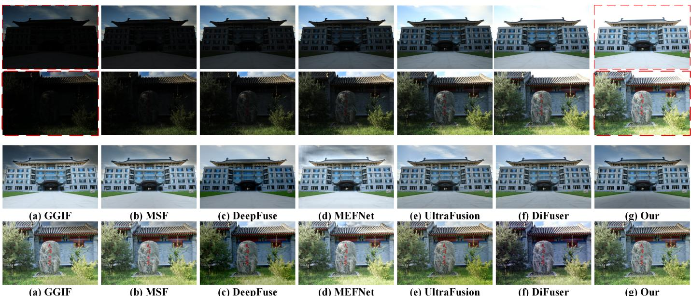  
Fig. 6: Subjective comparison of seven exposure fusion algorithms with inputs as two LER images $Z _ { 1 }$ and $Z _ { 7 } .$ . These two sets of differently exposed images are from the data set in [19], [44]. All images in the set are given in the top two rows. BOR and halo artifacts, color distortion, loss of details in highlight/shadow regions, and reduced global contrast are possible issues fo exposure fusion algorithms.

APPENDIX: PHYSICS-DRIVEN EXPOSURE INTERPOLATION The image $f _ { m } ( Z _ { 1 } , Z _ { 7 } )$ with the exposure time as $\Delta t _ { 4 }$ is interpolated from the two LER images $Z _ { 1 }$ and $Z _ { 7 }$ as

$$
f _ { m } ( Z _ { 1 } , Z _ { 7 } ) = f _ { m , b } ( Z _ { 1 } , Z _ { 7 } ) + f _ { m , d } ( Z _ { 1 } , Z _ { 7 } ) ,\tag{37}
$$

where $f _ { m , b } ( Z _ { 1 } , Z _ { 7 } )$ and $f _ { m , d } ( Z _ { 1 } , Z _ { 7 } )$ are base and detail layers of the image $f _ { m } ( Z _ { 1 } , Z _ { 7 } )$ , respectively.

Two images with the exposure time as $\Delta t _ { 4 }$ are generated from $Z _ { 1 }$ and $Z _ { 7 }$ using the corresponding IMFs $\Lambda _ { c } ^ { i  4 } ( \cdot )$ $( i \in \{ 1 , 7 \} , c \in \{ R , G , B \} )$ which can be estimated from the CRFs [19]. They are denoted as $Z _ { c } ^ { 1 \to 4 }$ and $Z _ { c } ^ { 7 \to 4 }$ , respectively. Two scale factors $\tilde { \alpha } _ { c } ^ { i  4 } ( i \in \{ 1 , 7 \} )$ are calculated

$$
\tilde { \alpha } _ { c } ^ { i  4 } = { \frac { \sum _ { p } \varphi _ { d } ( Z _ { i , c } ( p ) ) \varphi _ { d } ( Z _ { c } ^ { i  4 } ( p ) ) } { \sum _ { p } \varphi _ { d } ^ { 2 } ( Z _ { i , c } ( p ) ) } } ,\tag{38}
$$

where $\varphi _ { d } ( Z _ { i , c } ( p ) )$ ) is $( Z _ { i , c } ( p ) - \mu _ { Z _ { i , c } , 1 } ( p ) )$ , and $\mu _ { Z _ { c } ^ { i \to 4 } , 1 } ( p )$ is the mean value of $Z _ { c } ^ { i \to 4 }$ in the $3 \times 3$ window centered at $p .$

The image $Z _ { c } ^ { 1 \to 4 }$ is refined as

$$
\hat { Z } _ { c } ^ { 1 \to 4 } ( p ) = \left\{ \begin{array} { l l } { { Z _ { c } ^ { 1 \to 4 } ( p ) ; } } & { { \mathrm { i f ~ } Z _ { 1 , c } ( p ) \geq \xi } } \\ { { \tilde { Z } _ { c } ^ { 1 \to 4 } ( p ) ; } } & { { \mathrm { o t h e r w i s e } } } \end{array} \right. ,\tag{39}
$$

where ξ is empirically selected as $5 . \tilde { Z } _ { c } ^ { 1 \to 4 } ( p )$ is $( \mu _ { Z _ { c } ^ { 1 } \to 4 } , _ { 1 } ( p ) +$ $\tilde { \alpha } _ { c } ^ { 1 \to 4 } \varphi _ { d } ( Z _ { 1 , c } ( p ) ) ;$ ). Similarly, the image $Z _ { c } ^ { 7 \to 4 }$ is refined as

$$
\hat { Z } _ { c } ^ { 7 \to 4 } ( p ) = \left\{ \begin{array} { l l } { { Z _ { c } ^ { 7 \to 4 } ( p ) ; } } & { { \mathrm { i f ~ } Z _ { 7 , c } ( p ) \le ( 2 5 5 - \xi ) } } \\ { { \tilde { Z } _ { c } ^ { 7 \to 4 } ( p ) ; } } & { { \mathrm { o t h e r w i s e } } } \end{array} \right.\tag{40}
$$

where $\tilde { Z } _ { c } ^ { 7 \to 4 } ( p ) \mathrm { ~ i s ~ } ( \mu _ { Z _ { c } ^ { 7 \to 4 } , 1 } ( p ) + \tilde { \alpha } _ { c } ^ { 7 \to 4 } \varphi _ { d } ( Z _ { 7 , c } ( p ) ) )$

An intermediate image $\hat { Z } _ { 4 } ^ { ( 0 ) }$ is obtained from the images $\hat { Z } _ { c } ^ { 1 \to 4 }$ and $\hat { Z } _ { c } ^ { 7 \to 4 }$ as

$$
\hat { Z } _ { 4 , c } ^ { ( 0 ) } ( p ) = \frac { \sum _ { i \in \{ 1 , 7 \} } W _ { i } ( Z _ { i , c } ( p ) ) \hat { Z } _ { c } ^ { i \to 4 } ( p ) } { \sum _ { i \in \{ 1 , 7 \} } W _ { i } ( Z _ { i , c } ( p ) ) } ,\tag{41}
$$

where weights $W _ { 1 } ( z )$ and $W _ { 7 } ( z )$ are defined as

$$
W _ { 1 } ( z ) = { \left\{ \begin{array} { l l } { { \frac { z + 1 } { 5 6 } } ; } & { { \mathrm { i f ~ } } z < 5 5 } \\ { 1 ; } & { { \mathrm { o t h e r w i s e } } } \end{array} \right. } ,\tag{42}
$$

$$
W _ { 7 } ( z ) = \left\{ \begin{array} { l l } { 1 ; } & { \mathrm { i f ~ } z < 2 0 0 } \\ { \frac { 2 5 6 - z } { 5 6 } ; } & { \mathrm { o t h e r w i s e , } } \end{array} \right. .\tag{43}
$$

The base layer $f _ { m , b } ( Z _ { 1 } , Z _ { 7 } )$ is then constructed as

$$
f _ { m , b } ( Z _ { 1 } , Z _ { 7 } ) = { \mu } _ { \hat { Z } _ { 4 } ^ { ( 0 ) } , 1 } .\tag{44}
$$

The detail layer $f _ { m , d } ( Z _ { 1 } , Z _ { 7 } )$ is now given as

$$
f _ { m , d } ( Z _ { 1 } , Z _ { 7 } ) = \frac { \sum _ { i \in \{ 1 , 7 \} } W _ { i } ( Z _ { i } ) f _ { d } ^ { i \to 4 } } { \sum _ { i \in \{ 1 , 7 \} } W _ { i } ( Z _ { i } ) } ,\tag{45}
$$

where two detail layers $f _ { c , d } ^ { i  4 } { } ^ { \mathrm { , } } \mathrm { s } ~ ( i \in \{ 1 , 7 \} )$ are

$$
\left\{ \begin{array} { l l } { f _ { c , d } ^ { 1 \to 4 } ( p ) = \beta _ { c } ^ { 1 \to 4 } \varphi _ { d } ( Z _ { 1 , c } ( p ) ) } \\ { f _ { c , d } ^ { 7 \to 4 } ( p ) = \beta _ { c } ^ { 7 \to 4 } \varphi _ { d } ( Z _ { 7 , c } ( p ) ) } \end{array} \right.\tag{46}
$$

with $\beta _ { c } ^ { 1  4 }$ and $\beta _ { c } ^ { 7  4 }$ being estimated as

$$
\begin{array} { r } { \beta _ { c } ^ { 1 \to 4 } = \sqrt { \frac { \sum _ { p } \varphi _ { d } ( Z _ { 1 , c } ( p ) ) \varphi _ { d } ( Z _ { 7 , c } ( p ) ) } { \sum _ { p } \varphi _ { d } ^ { 2 } ( Z _ { 1 , c } ( p ) ) } } , } \\ { \beta _ { c } ^ { 7 \to 4 } = \sqrt { \frac { \sum _ { p } \varphi _ { d } ( Z _ { 7 , c } ( p ) ) \varphi _ { d } ( Z _ { 1 , c } ( p ) ) } { \sum _ { p } \varphi _ { d } ^ { 2 } ( Z _ { 7 , c } ( p ) ) } } . } \end{array}\tag{47}
$$

(48)

Due to the limited representation capacity of $f _ { m } ( Z _ { 1 } , Z _ { 7 } )$ there is residual information in the image $Z _ { 4 }$ . The residual information $( Z _ { 4 } - f _ { m } ( Z _ { 1 } , Z _ { 7 } ) )$ will be explicitly interpolated using an asymmetric diffusion model in the next section.

## REFERENCES

[1] P. E. Debevec and J. Malik, “Rendering high dynamic range radiance maps from photographs,” in Proceedings of SIGGRAPH 1997. SIG-GRAPH, 1997, pp. 369–378.

[2] Q. Tao, W. Wang, C. Zheng, and Z. Li, “Multi-exposure HDR imaging: A review of pixel-level and feature-level reconstruction methods,” Sensor, vol. 26, no. 14, pp. 1–40, 2026.

[3] S. W. Hasinoff, D. Sharlet, R. Geiss, A. Adams, J. T. Barron, F. Kainz, J. Chen, and M. Levoy, “Burst photography for high dynamic range and low-light imaging on mobile cameras,” ACM Transactions on Graphics (ToG), vol. 35, no. 6, pp. 1–12, 2016.

[4] N. K. Kalantari, R. Ramamoorthi et al., “Deep high dynamic range imaging of dynamic scenes.” ACM Trans. Graph., vol. 36, no. 4, pp. 144–1, 2017.

[5] Z. Liu, Z. Li, W. Chen, X. Wu, and Z. Liu, “Unsupervised optical flow estimation for differently exposed images in LDR domain,” IEEE Transactions on Circuits and Systems for Video Technology, vol. 33, no. 10, pp. 5332–5344, 2023.

[6] Z. Zhang, H. Wang, S. Liu, X. Wang, L. Lei, and W. Zuo, “Selfsupervised high dynamic range imaging with multi-exposure images in dynamic scenes,” in 12th International Conference on Learning Representations, 2024.

[7] Z. Chen, Y. Wang, X. Cai, Z. You, Z. Lu, F. Zhang, S. Guo, and T. Xue, “UltraFusion: Ultra high dynamic imaging using exposure fusion,” in Proceedings of the IEEE/CVF Conference on Computer Vision and Pattern Recognition, 2025, pp. 16 111–16 121.

[8] S. Tanaka, T. Otaka, K. Mori, N. Yoshimura, S. Matsuo, H. Abe, N. Yasuda, K. Ishikawa, S. Okura, S. Ohsawa, T. Akutsu, W. Fu, H. Chien, K. Liu, Y. Tsai, S. Chen, L. Teng, and I. Takayanagi, “Single exposure type wide dynamic range CMOS image sensor with enhanced NIR sensitivity,” ITE Trans. on Media Technology and Applications, vol. 6, no. 7, pp. 195–201, July 2018.

[9] D. Tocci, C. Kiser, N. Tocci, and P. Sen, “A versatile hdr video pro duction system,” in Special Interest Group on Graphics and Interactive Techniques (SIGGRAPH), 2011, pp. 1–9.

[10] Y. Xu, Z. Liu, X. Wu, W. Chen, C. Wen, and Z. Li, “Deep joint demosaicing and high dynamic range imaging within a single shot,” IEEE Transactions on Circuits and Systems for Video Technology, vol. 32, no. 7, pp. 4255–4270, 2021.

[11] T. Mertens, J. Kautz, and F. Van Reeth, “Exposure fusion: A simple and practical alternative to high dynamic range photography,” in Computer Graphics Forum, vol. 28, no. 1. Wiley Online Library, 2009, pp. 161– 171.

[12] F. Kou, Z. Li, C. Wen, and W. Chen, “Edge-preserving smoothing pyramid based multi-scale exposure fusion,” Journal of Visual Communication and Image Representation, vol. 53, pp. 235–244, 2018.

[13] W. Jia, Z. Song, and Z. Li, “Multi-scale exposure fusion via content adaptive edge-preserving smoothing pyramids,” IEEE Transactions on Consumer Electronics, vol. 68, no. 4, pp. 317–326, 2022.

[14] K. Ram Prabhakar, V. Sai Srikar, and R. Venkatesh Babu, “DeepFuse: A deep unsupervised approach for exposure fusion with extreme exposure image pairs,” in Proceedings of the IEEE/CVF International Conference on Computer Vision, 2017, pp. 4714–4722.

[15] H. Xu, J. Ma, Z. Le, J. Jiang, and X. Guo, “FusionDN: A unified densely connected network for image fusion,” in Proceedings of the AAAI Conference on Artificial Intelligence, vol. 34, no. 07, 2020, pp. 12 484–12 491.

[16] G. Wu, H. Fu, J. Liu, L. Ma, X. Fan, and R. Liu, “Hybrid-supervised dual-search: Leveraging automatic learning for loss-free multi-exposure image fusion,” in Proceedings of the AAAI Conference on Artificial Intelligence, vol. 38, no. 6, 2024, pp. 5985–5993.

[17] Q. Huang, G. Wu, Z. Jiang, W. Fan, B. Xu, and J. Liu, “Leveraging a self-adaptive mean teacher model for semi-supervised multi-exposure image fusion,” Information Fusion, vol. 112, p. 102534, 2024.

[18] Y. Yang, W. Cao, S. Wu, and Z. Li, “Multi-scale fusion of two largeexposure-ratio images,” IEEE Signal Processing Letters, vol. 25, no. 12, pp. 1885–1889, 2018.

[19] C. Zheng, W. Jia, S. Wu, and Z. Li, “Neural augmented exposure interpolation for two large-exposure-ratio images,” IEEE Transactions on Consumer Electronics, vol. 69, no. 1, pp. 87–97, 2022.

[20] Z. Li, C. Zheng, B. Chen, and S. Wu, “Neural-augmented HDR imaging via two aligned large-exposure-ratio images,” IEEE Transactions on Instrumentation and Measurement, vol. 74, 2025.

[21] J. Ho, A. Jain, and P. Abbeel, “Denoising diffusion probabilistic models,” Advances in neural information processing systems, vol. 33, pp. 6840– 6851, 2020.

[22] R. Rombach, A. Blattmann, D. Lorenz, P. Esser, and B. Ommer, “Highresolution image synthesis with latent diffusion models,” in Proceedings of the IEEE/CVF conference on computer vision and pattern recognition, 2022, pp. 10 684–10 695.

[23] T. Salimans and J. Ho, “Progressive distillation for fast sampling of diffusion models,” arXiv preprint arXiv:2202.00512, 2022.

[24] S. Gu, D. Chen, J. Bao, F. Wen, B. Zhang, D. Chen, L. Yuan, and B. Guo, “Vector quantized diffusion model for text-to-image synthesis,” in Proceedings of the IEEE/CVF conference on computer vision and pattern recognition, 2022, pp. 10 696–10 706.

[25] T. Karras, M. Aittala, T. Aila, and S. Laine, “Elucidating the design space of diffusion-based generative models,” Advances in neural information processing systems, vol. 35, pp. 26 565–26 577, 2022.

[26] Y. Song, P. Dhariwal, M. Chen, and I. Sutskever, “Consistency models,” arXiv preprint arXiv:2303.01469, 2023.

[27] X. Liu, C. Gong, and Q. Liu, “Flow straight and fast: Learning to generate and transfer data with rectified flow,” arXiv preprint arXiv:2209.03003, 2022.

[28] C. Lu and Y. Song, “Simplifying, stabilizing and scaling continuoustime consistency models,” in International Conference on Learning Representations, 2025.

[29] Z. Li, C. Zheng, and W. Wang, “Correlation analysis of generative models,” arXiv preprint arXiv:2603.06614, 2026.

[30] Z. Yue, J. Wang, and C. C. Loy, “ResShift: Efficient diffusion model for image super-resolution by residual shifting,” Advances in neural information processing systems, vol. 36, pp. 13 294–13 307, 2023.

[31] Z. Li, J. Zheng, Z. Zhu, and S. Wu, “Selectively detail-enhanced fusion of differently exposed images with moving objects,” IEEE Transactions on Image Processing, vol. 23, no. 10, pp. 4372–4382, 2014.

[32] H. Cao, Y. Wang, J. Chen, D. Jiang, X. Zhang, Q. Tian, and M. Wang, “Swin-unet: Unet-like pure transformer for medical image segmentation,” in European conference on computer vision. Springer, 2022, pp. 205–218.

[33] P. Esser, R. Rombach, and B. Ommer, “Taming transformers for highresolution image synthesis,” in Proceedings of the IEEE/CVF Conference on Computer Vision and Pattern Recognition, 2021, pp. 12 873– 12 883.

[34] J. Cai, S. Gu, and L. Zhang, “Learning a deep single image contrast enhancer from multi-exposure images,” IEEE Transactions on Image Processing, vol. 27, no. 4, pp. 2049–2062, 2018.

[35] Z. Wang, A. C. Bovik, H. R. Sheikh, and E. P. Simoncelli, “Image quality assessment: from error visibility to structural similarity,” IEEE transactions on image processing, vol. 13, no. 4, pp. 600–612, 2004.

[36] L. Zhang, L. Zhang, X. Mou, and D. Zhang, “Fsim: A feature similarity index for image quality assessment,” IEEE transactions on Image Processing, vol. 20, no. 8, pp. 2378–2386, 2011.

[37] R. Zhang, P. Isola, A. A. Efros, E. Shechtman, and O. Wang, “The unreasonable effectiveness of deep features as a perceptual metric,” in 2018 IEEE/CVF conference on computer vision and pattern recognition. IEEE, 2018, pp. 586–595.

[38] J. Wang, K. C. Chan, and C. C. Loy, “Exploring clip for assessing the look and feel of images,” in Proceedings of the AAAI conference on artificial intelligence, vol. 37, no. 2, 2023, pp. 2555–2563.

[39] J. Ke, Q. Wang, Y. Wang, P. Milanfar, and F. Yang, “Musiq: Multi-scale image quality transformer,” in 2021 IEEE/CVF International Conference on Computer Vision (ICCV). IEEE, 2021, pp. 5128–5137.

[40] S. Su, Q. Yan, Y. Zhu, C. Zhang, X. Ge, J. Sun, and Y. Zhang, “Blindly assess image quality in the wild guided by a self-adaptive hyper network,” in 2020 IEEE/CVF Conference on Computer Vision and Pattern Recognition (CVPR). IEEE, 2020, pp. 3664–3673.

[41] F. Kou, W. Chen, C. Wen, and Z. Li, “Gradient domain guided image filtering,” IEEE Transactions on Image Processing, vol. 24, no. 11, pp. 4528–4539, 2015.

[42] K. Ma, Z. Duanmu, H. Zhu, Y. Fang, and Z. Wang, “Deep guided learning for fast multi-exposure image fusion,” IEEE Transactions on Image Processing, vol. 29, pp. 2808–2819, 2019.

[43] L. Tang, C. Li, and J. Ma, “Mask-DiFuser: A masked diffusion model for unified unsupervised image fusion,” IEEE Transactions on Pattern Analysis and Machine Intelligence, vol. 48, no. 1, pp. 591–608, January 2026.

[44] Y. Xu, Z. Liu, X. Wu, W. Chen, C. Wen, and Z. Li, “Deep joint demosaicing and high dynamic range imaging within a single shot,” IEEE Transactions on Circuits and Systems for Video Technology, vol. 32, no. 7, pp. 4255–4270, 2021.

[45] K. Ma, K. Zeng, and Z. Wang, “Perceptual quality assessment for multiexposure image fusion,” IEEE transactions on image processing, vol. 24, no. 11, pp. 3345–3356, 2015.

[46] H. Yeganeh and Z. Wang, “Objective quality assessment of tone-mapped images,” IEEE Transactions on Image processing, vol. 22, no. 2, pp. 657–667, 2012.