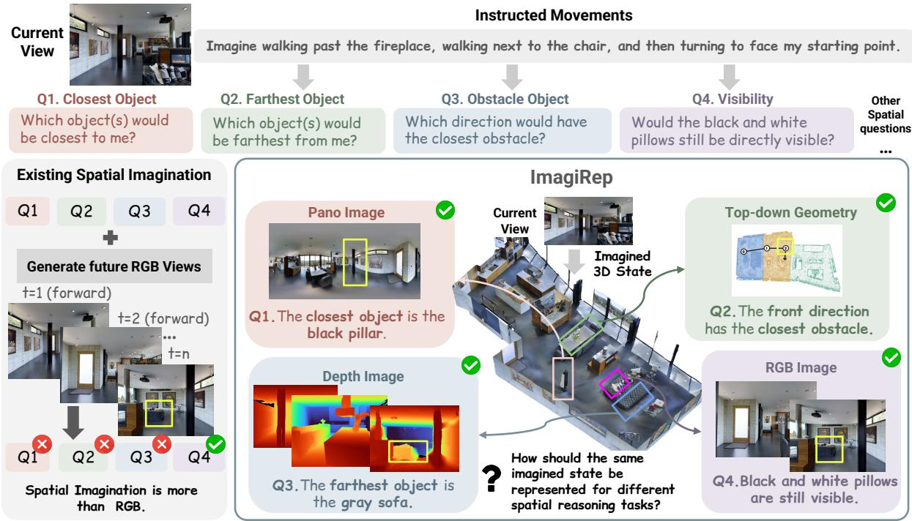
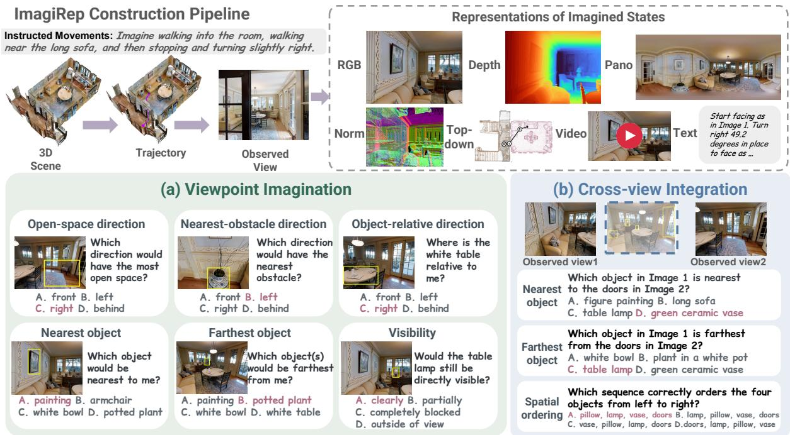
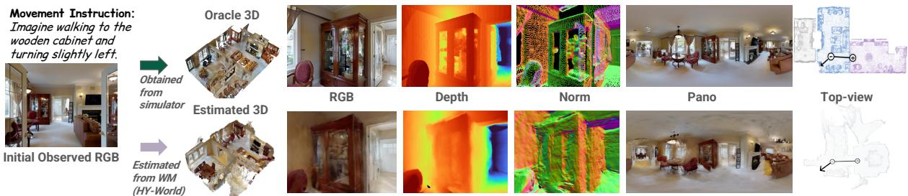
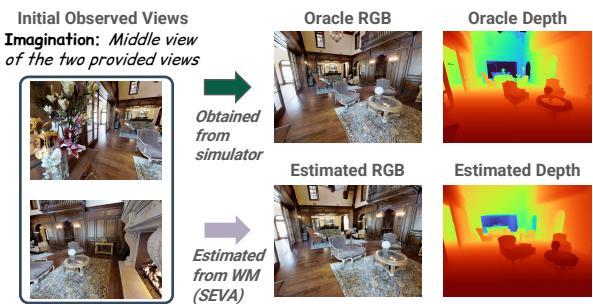
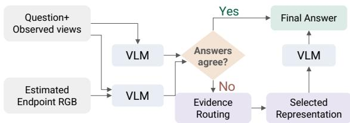
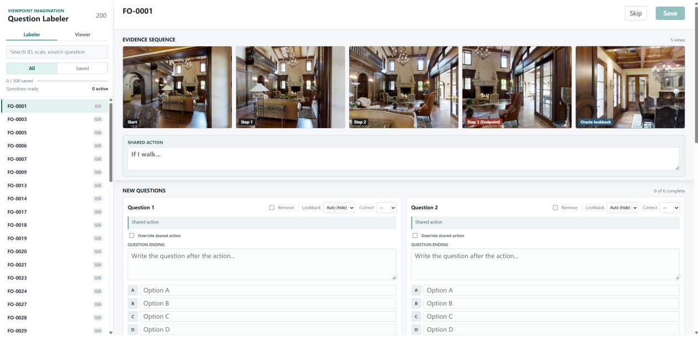
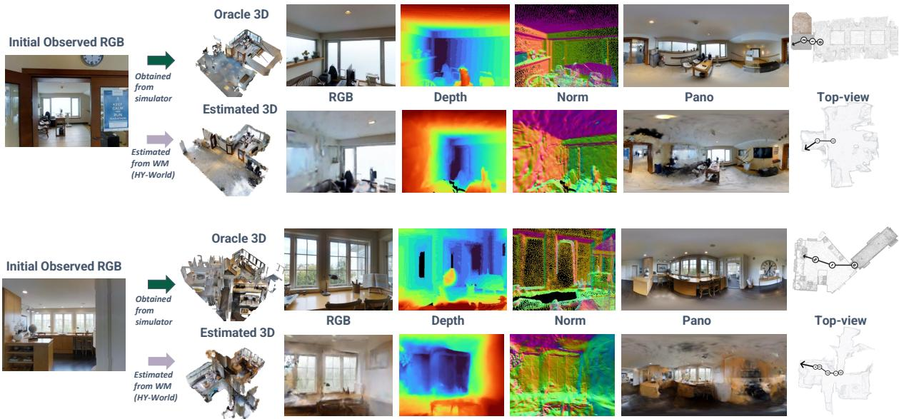
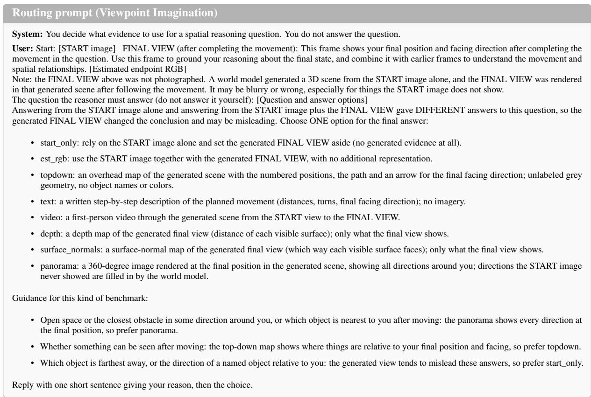
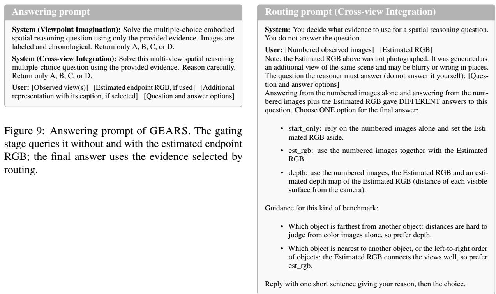

# Representing the Unseen: Rethinking Visual Imagination for Spatial Reasoning

Zengqi Zhao\* Zun Wang\* Shoubin Yu Mohit Bansal Yue Zhang UNC Chapel Hill

https://imagirep.github.io/

## Abstract

Visual world models increasingly support spatial reasoning by generating RGB views of unobserved states. However, RGB has become the default interface largely because it is well suited for visual generation, rather than necessarily being the most effective representation for downstream reasoning. Different spatial questions may benefit from different representations of the same imagined state: top-down geometry can facilitate global distance comparisons, while panoramic views provide broader context for reasoning about open space. To isolate the role of representation in spatial imagination, we introduce IMA-GIREP, a simulator-grounded benchmark of 922 questions spanning seven question types across two settings, Viewpoint Imagination and Cross-view Integration, providing oracle RGB and six alternative representations (e.g., depth, panoramic views, and top-down geometry) of the same unobserved state. This controlled comparison reveals that even accurate imagined RGB does not guarantee accurate spatial reasoning, and different questions benefit from different representations. Similar trends hold for representations derived from world-model estimated states. Notably, estimated RGB alone can mislead spatial reasoning, while alternative representations retain complementary benefits. Building on these findings, we introduce GEARS, a lightweight test-time strategy for adaptive representation selection, outperforming existing spatial imagination methods and showing that reasoning about unseen states requires more than generating RGB views.

## 1 Introduction

Recent spatial reasoning systems increasingly use visual world models to imagine what lies beyond the current observation. Many spatial questions involve changes in viewpoint, such as what becomes visible after a turn or how object relations change after moving. Given a movement or hypothetical action, these systems generate future RGB views and feed them back to a vision-language model for reasoning (Yang et al., 2025b; Yu et al., 2026; Zhu et al., 2026; Yuan et al., 2026). These generated views provide explicit evidence about an unobserved state, complementing what the model can infer from its initial observations.

RGB is a natural representation for generation because it preserves rich visual appearance and is the standard output of modern visual world models (Agarwal et al., 2025; Du et al., 2023; Bar et al., 2025; Zhou et al., 2025). Consequently, existing spatial imagination methods largely treat RGB as the default interface between world models and downstream reasoners (Yu et al., 2026; Yang et al., 2025b). However, this choice is driven by how imagined states are generated, rather than by which representation best supports spatial reasoning across different question types. As illustrated in Fig. 1, the same imagined spatial state can support diverse questions about visibility, distance, and free space, where representations such as depth and panorama can make distance cues and surrounding spatial context more explicit than RGB alone. This raises a fundamental question: should all spatial reasoning tasks rely on imagined RGB views, or could alternative representations better support different reasoning needs?

To understand how different representations affect spatial reasoning, we need to compare them under the same underlying spatial state. Therefore, we first introduce IMAGIREP, a simulator-grounded benchmark for systematically studying how different representations of imagined spatial states affect reasoning. IMAGIREP includes two complementary settings: Viewpoint Imagination (Fig. 2(a)), which requires reasoning about spatial relations after an instructed movement, and Cross-view Integration (Fig. 2(b)), which requires combining information across partial observations. Using groundtruth scene geometry and camera poses, we obtain oracle RGB and six alternative representations (Depth, Surface Normals, Panorama, Top-down Geometry, Spatial Text, and RGB Video). To examine how representation utility varies across reasoning needs, we design seven question categories across two settings, covering directional reasoning, nearest/farthest-object comparisons, visibility, and spatial ordering. For example, open-space reasoning may benefit from panoramic views, while global distance comparisons may benefit from topdown geometry. By keeping the underlying spatial state and question fixed, IMAGIREP enables controlled comparisons of how different representations support spatial reasoning.

  
Figure 1: Spatial imagination is more than generating future RGB views. The same imagined state may support different spatial questions (e.g., top-down geometry helps global distance comparisons; panoramic views facilitate reasoning about open space), yet existing approaches typically expose it to the reasoner only through RGB. IMAGIREP provides controlled access to the same underlying state through multiple representations, allowing us to study how the choice of representation affects downstream spatial reasoning.

Our findings reveal a gap between the accuracy of imagined views and their usefulness for spatial reasoning, a pattern observed across both GPT-6.1-sol and Gemini 3.7 Flash. For example, with GPT-6.1-sol, adding oracle endpoint RGB reduces accuracy on Farthest Object questions from 68.4% to 58.2%. Yet top-down geometry raises the corresponding score to 75.5%, showing that how spatial information is presented matters. More broadly, different representations provide complementary benefits across models and questions, with no single representation consistently performing best. Beyond oracle representations, we further investigate a realistic setting where world models estimate unobserved spatial states and provide corresponding representations for reasoning. Interestingly, representations derived from these estimated states can still improve spatial reasoning, even when estimated RGB views alone degrade performance. Together, these findings suggest that effective spatial imagination depends not only on the accuracy of imagined views, but also on how spatial information is represented and understood by the reasoner.

Motivated by these findings, we next introduce GEARS (Gated Evidence and Adaptive Representation Selection) (shown in Fig. 5), a lightweight test-time strategy that adaptively determines when to use imagined evidence and which representation to select. Rather than assuming that imagined RGB is always beneficial, GEARS first examines the agreement between predictions based on observed evidence and those incorporating estimated RGB. When the predictions disagree, it adaptively selects among observed evidence and estimated representations to support spatial reasoning. GEARS achieves 61.4% accuracy on Viewpoint Imagination and 77.7% on Cross-view Integration, outperforming other spatial imagination methods. Nevertheless, a substantial gap remains compared with oracle-assisted results, highlighting the need for world models to not only estimate unobserved states more accurately, but also provide spatial information that reasoners can effectively use.

## 2 Related Work

Visual Spatial Reasoning. Spatial reasoning in vision-language models has been studied across a broad range of abilities, from relative position, depth, and orientation in single images (Chen et al., 2024; Fu et al., 2024; Ma et al., 2025; Zhang et al., 2024, 2026) to perspective taking and reasoning under ego and object motion (Ray et al., 2025; Li et al., 2026b), cross-view correspondence (Yeh et al., 2026; Yang et al., 2026b), mental modeling from limited views (Wang et al., 2026b), and spatial memory and situated awareness in video (Yang et al., 2025a, 2026a; Li et al., 2026a). While these benchmarks evaluate diverse spatial reasoning abilities, they do not systematically examine how different representations of the same unobserved state affect reasoning. In contrast, our IMA-GIREP provides multiple oracle representations of the same simulator-grounded target state, enabling controlled comparisons while keeping the spatial state and question fixed.

Spatial Imagination with World Models. Actionand camera-conditioned video models can now render plausible unseen views (Agarwal et al., 2025; Bar et al., 2025; Zhou et al., 2025; Parker-Holder and Fruchter, 2025; Wang et al., 2026c,d), and several works feed these views back to an agent or reasoner (Lu et al., 2024; Huang et al., 2026; Yang et al., 2025b; Yuan et al., 2026; Hwang et al., 2026). AVIC (Yu et al., 2026) and Astra (Zhu et al., 2026) further explore selective world-model use through controlled views or camera motions. However, these methods primarily rely on imagined RGB views, despite emerging world models that can also generate depth, surface normals, and camera geometry (Aether Team et al., 2025). Yet the ability to generate these representations does not establish whether they are more useful for downstream spatial reasoning. Our work addresses this by systematically comparing representations of the same unobserved state under oracle and estimated imagination, and exploring adaptive representation selection at test time.

3 IMAGIREP: A Controlled Benchmark for Spatial Imagination

## 3.1 Benchmark Overview and Design Principles

Spatial cognition involves reasoning about environments beyond the immediately observed view, including updating spatial relations after movement, integrating information across viewpoints, and reasoning within different spatial reference frames (Rieser, 1989). Prior research on spatial cognition has studied these processes and the role of spatial representations in supporting them (Tversky, 2003; Burgess, 2006; Wang et al., 2026b; Ray et al., 2025). Inspired by these distinctions, we design IMAGIREP to evaluate spatial reasoning over unobserved states through diverse questions and controlled representation inputs.

Recent benchmarks (Ray et al., 2025; Yang et al., 2026b; Wang et al., 2026b) evaluate these spatial reasoning capabilities through questions involving perspective changes, object relations, and imagined movements. However, these benchmarks are not designed to provide controlled access to the underlying spatial states across different representations. This makes it difficult to isolate the effect of representation choice from errors in estimating or generating the imagined state. To address this limitation, we construct IMAGIREP using Matterport3D (Chang et al., 2017), which provides 3D scene geometry and camera poses. This allows us to obtain different representations of the same ground-truth spatial state while keeping the underlying scene and question fixed. IMAGIREP follows three design principles: (1) Reasoning over unobserved spatial states, with questions involving viewpoint changes and spatial integration across partial observations; (2) Diverse spatial reasoning tasks, covering directions, distances, visibility, and object ordering to probe different spatial information needs; and (3) Controlled representation comparisons, where the same underlying spatial state and question are held fixed while the representation of imagined evidence is varied.

To achieve this, as shown in Fig. 2, we sample movement routes and groups of views from Matterport3D scenes for Viewpoint Imagination and Cross-view Integration, respectively. Human annotators write spatial questions based on the resulting observations and movement instructions. Using the corresponding scene geometry and camera poses, we obtain oracle RGB and six alternative representations of imagined evidence. The question, observed inputs, and answer options remain fixed across representation conditions, allowing us to isolate the effect of representation choice.

  
Figure 2: Overview of IMAGIREP. The top left illustrates benchmark construction, including a 3D scene, movement instructions, and observed view. The top right shows oracle RGB and six alternative representations of the same imagined state. The lower panels present example questions and ground-truth answers for the Viewpoint Imagination and Cross-view Integration question types.

## 3.2 Spatial Imagination Tasks

Reasoning about unobserved spatial states presents two complementary challenges: updating spatial relations after a change in viewpoint and integrating spatial information distributed across partial observations. We design two settings to study representation utility under these different conditions. (1) Viewpoint imagination requires reasoning about a new viewpoint after an instructed movement, where spatial relations must be updated relative to the observer’s new position and orientation. Given an initial RGB observation, the model receives a movement instruction specifying a route and final heading, and answers questions about the resulting viewpoint. We sample straight and turning routes from the navigable connectivity graph, spanning one to three edges and approximately 0.5–9 meters. We favor routes connecting different rooms and endpoints surrounded by recognizable objects to support diverse spatial questions. We design six question types that probe different spatial relations: Open-space Direction, Nearestobstacle Direction, and Object-relative Direction for directional reasoning; Nearest Object and Farthest Object for distance comparison; and Visibility for determining whether the starting area remains visible after movement.

(2) Cross-view integration examines how spatial information distributed across partial observations can be combined to reason about an unobserved viewpoint. When relevant objects appear in different views, their spatial relations are not directly observable in any single image, requiring the model to integrate information across viewpoints. To study this, we construct groups of two or three partially overlapping RGB observations captured from different views. We consider Cross-view Nearest Object and Cross-view Farthest Object, which follow the same reasoning tasks as in Viewpoint Imagination but require comparing objects across different views. We additionally introduce Spatial Ordering, which asks the model to determine the ordering of objects relative to a specified viewpoint.

## 3.3 Representations of Imagined States

For each question, we identify the target viewpoint in Matterport3D and render the corresponding oracle RGB image using its ground-truth camera pose. Leveraging the simulator’s 3D geometry and camera information, we further obtain six additional representations: Depth, Surface Normals, Panorama, Top-down Geometry, Spatial Text, and Video (Fig. 2). Depth and surface normals are rendered from the target viewpoint, while panoramas and top-down maps provide broader spatial context. Spatial text describes camera movements derived from ground-truth poses, and videos capture movement along the route or transitions between observed views. All representations are derived from the same underlying 3D scene, enabling controlled comparisons of their utility for spatial reasoning.

<table><tr><td colspan="4"></td><td colspan="6">Endpoint RGB + Additional Representation</td><td rowspan="2">Oracle</td></tr><tr><td>Task</td><td>Question Type</td><td>Observed View</td><td>+ Endpoint RGB</td><td>Top-down</td><td>Text</td><td>Video</td><td>Depth</td><td>Normals</td><td>Panorama Selection</td></tr><tr><td rowspan="7">Viewpoint Imagination</td><td>Open-space Direction</td><td>60.4</td><td>57.1</td><td>74.7</td><td>69.2</td><td>65.9</td><td>64.8</td><td>61.5</td><td>73.6</td><td>89.0</td></tr><tr><td>Nearest-obstacle Direction</td><td>38.2</td><td>49.1</td><td>61.8</td><td>58.2</td><td>60.0</td><td>63.6</td><td>58.2</td><td>65.5</td><td>81.8</td></tr><tr><td>Visibility</td><td>39.4</td><td>64.4</td><td>73.1</td><td>71.2</td><td>76.0</td><td>73.1</td><td>75.0</td><td>76.9</td><td>80.8</td></tr><tr><td>Nearest Object</td><td>51.0</td><td>64.4</td><td>76.9</td><td>73.1</td><td>76.0</td><td>76.9</td><td>71.2</td><td>80.8</td><td>87.5</td></tr><tr><td>Farthest Object</td><td>68.4</td><td>58.2</td><td>75.5</td><td>67.3</td><td>72.4</td><td>70.4</td><td>67.3</td><td>71.4</td><td>87.8</td></tr><tr><td>Object-relative Direction</td><td>70.0</td><td>82.9</td><td>88.2</td><td>87.6</td><td>89.4</td><td>86.5</td><td>85.9</td><td>91.8</td><td>92.4</td></tr><tr><td>All</td><td>57.2</td><td>66.1</td><td>77.5</td><td>74.0</td><td>76.2</td><td>74.9</td><td>72.7</td><td>79.3</td><td>87.5</td></tr><tr><td rowspan="4">Cross-view Integration</td><td>Nearest Object</td><td>56.8</td><td>74.1</td><td>79.0</td><td>79.0</td><td>77.8</td><td>84.0</td><td>80.2</td><td>76.5</td><td>87.7</td></tr><tr><td>Farthest Object</td><td>59.8</td><td>54.9</td><td>70.7</td><td>67.1</td><td>69.5</td><td>69.5</td><td>59.8</td><td>64.6</td><td>85.4</td></tr><tr><td>Spatial Ordering</td><td>79.6</td><td>89.1</td><td>92.0</td><td>95.6</td><td>94.2</td><td>94.2</td><td>92.7</td><td>95.6</td><td>97.8</td></tr><tr><td>All</td><td>68.0</td><td>75.7</td><td>82.7</td><td>83.3</td><td>83.0</td><td>84.7</td><td>80.3</td><td>82.0</td><td>91.7</td></tr></table>

Table 1: Complementary benefits of oracle representations. Oracle selection counts a question as correct if the endpoint RGB alone or any one of the additional representations answers it correctly. Videos are provided as 16 uniformly sampled frames. Best and second-best results are marked in bold and underlined, respectively.

<table><tr><td rowspan="2">Input</td><td colspan="2">Gemini 3.7 Flash</td><td colspan="2">GPT-6.1-sol</td></tr><tr><td>Viewpoint Imagination</td><td>Cross-view Integration</td><td>Viewpoint Imagination</td><td>Cross-view Integration</td></tr><tr><td>Random Selection</td><td>25.0</td><td>25.0</td><td>25.0</td><td>25.0</td></tr><tr><td>Question Only</td><td>31.7</td><td>29.7</td><td>31.0</td><td>31.0</td></tr><tr><td>Observed View(s)</td><td>53.7</td><td>66.3</td><td>57.2</td><td>68.0</td></tr><tr><td>+ Oracle Endpoint RGB</td><td>63.7</td><td>78.7</td><td>66.1</td><td>75.7</td></tr></table>

Table 2: Accuracy (%) of Gemini 3.7 Flash and GPT-6.1-sol under different input conditions.

## 3.4 Dataset Statistics and Quality Control

IMAGIREP contains 922 human-annotated spatial questions, including 622 Viewpoint Imagination questions from 200 routes across 73 scenes and 300 Cross-view Integration questions from 143 view groups across 21 scenes (Table 6 in Appendix A.1). Human annotators write the questions and identify the correct answers from four candidate options based on the corresponding scenes and viewpoints. All examples undergo manual review to ensure that the spatial relations are inferable from the provided observations and movement instructions. We additionally check rendering quality, camera-pose alignment, and annotation consistency, remove duplicate routes, and randomize answer options to reduce potential biases manually.

## 4 Evaluating Imagined Evidence for Spatial Reasoning

In this section, we evaluate how imagined evidence affects spatial reasoning. We first test whether oracle endpoint RGB improves performance (Sec. 4.2), then examine whether alternative oracle representations provide further gains (Sec. 4.3), and finally assess whether these benefits persist with estimated imagination (Sec. 4.4).

## 4.1 Experimental Setup

Models and evaluation metric. We evaluate two multimodal reasoning models, GPT-6.1-sol (OpenAI, 2026) and Gemini 3.7 Flash (Google Deep-Mind, 2026), using high reasoning effort. Since GPT-6.1-sol achieves higher oracle-selection accuracy across both settings, we use it as the primary reasoner for estimated imagination and test-time experiments. Both models receive identical questions, answer options, and representation-specific inputs in the oracle comparisons, and are instructed to select one of four answer choices (A–D). We report accuracy (%) as the percentage of correctly answered questions.

Input conditions. We first establish three conditions: question-only, observed view(s), and observed view(s) augmented with oracle endpoint RGB. We then examine six alternative representations of the same target state: top-down geometry, spatial text, video, depth, surface normals, and panorama. Each representation is provided alongside the observed view(s) and endpoint RGB, while the question, answer options, and underlying spatial state remain fixed. We additionally evaluate estimated representations to study the effect of imperfect imagination.

<table><tr><td colspan="5"></td><td colspan="5">+ Estimated Representation</td><td rowspan="2">Per-Type</td></tr><tr><td>Task</td><td>Question Type</td><td>Observed View</td><td>+ Est. Endpoint RGB</td><td>Top-down</td><td>Text</td><td>Video</td><td>Depth</td><td>Normals</td><td>Panorama Best</td></tr><tr><td rowspan="7">Viewpoint Imagination</td><td>Open-space Direction</td><td>60.4</td><td>52.7</td><td>63.7</td><td>60.4</td><td>62.6</td><td>57.1</td><td>57.1</td><td>70.3</td><td>70.3</td></tr><tr><td>Nearest-obstacle Direction</td><td>38.2</td><td>45.5</td><td>56.4</td><td>54.5</td><td>61.8</td><td>54.5</td><td>52.7</td><td>60.0</td><td>61.8</td></tr><tr><td>Visibility</td><td>39.4</td><td>47.1</td><td>50.0</td><td>51.9</td><td>54.8</td><td>52.9</td><td>52.9</td><td>56.7</td><td>56.7</td></tr><tr><td>Nearest Object</td><td>51.0</td><td>49.0</td><td>57.7</td><td>56.7</td><td>59.6</td><td>61.5</td><td>58.7</td><td>59.6</td><td>61.5</td></tr><tr><td>Farthest Object</td><td>68.4</td><td>53.1</td><td>62.2</td><td>69.4</td><td>70.4</td><td>66.3</td><td>67.3</td><td>63.3</td><td>70.4</td></tr><tr><td>Object-relative Direction</td><td>70.0</td><td>67.6</td><td>72.4</td><td>73.5</td><td>72.4</td><td>71.2</td><td>71.2</td><td>75.3</td><td>75.3</td></tr><tr><td>All</td><td>57.2</td><td>54.7</td><td>61.9</td><td>62.9</td><td>64.6</td><td>62.2</td><td>61.7</td><td>65.6</td><td>67.2</td></tr></table>

Table 3: Complementary benefits of estimated representations on Viewpoint Imagination. Reported scores retain correct predictions from estimated endpoint RGB and include additional questions answered correctly with each representation. Per-Type Best reports the highest score across representations for each question type. Best and second-best results among the six representations are marked in bold and underlined, respectively.

<table><tr><td>Question Type</td><td>Observed View</td><td>+ Est. RGB</td><td>+ Est. Depth</td></tr><tr><td>Nearest Object</td><td>56.8</td><td>74.1</td><td>79.0</td></tr><tr><td>Farthest Object</td><td>59.8</td><td>54.9</td><td>65.9</td></tr><tr><td>Spatial Ordering</td><td>79.6</td><td>89.8</td><td>93.4</td></tr><tr><td>All</td><td>68.0</td><td>76.0</td><td>82.0</td></tr></table>

Table 4: Complementary benefits of estimated representations on Cross-view Integration. Best and second-best results are marked in bold and underlined, respectively.

Estimated representations. We use HY-World 2.0 (Team HY-World, 2026) for Viewpoint Imagination, generating a 3D scene from the initial observation and following a trajectory planned from the movement instruction. Endpoint RGB and the alternative visual representations are rendered from this generated scene, while spatial text describes the planned camera movements. For Crossview Integration, we use Stable Virtual Camera (SEVA) (Zhou et al., 2025) to synthesize endpoint RGB from the observed views and consider depth estimated from the synthesized RGB as the additional representation. Implementation details are provided in Appendix A.3.

## 4.2 Does Oracle Imagination Improve Spatial Reasoning?

We first examine whether providing oracle imagined views improves spatial reasoning over unobserved states. As shown in Table 2, Questiononly performance is close to the random baseline, suggesting that language priors alone provide limited information for answering these spatial questions. Providing observed views substantially improves 20+% absolute accuracy for both models and settings, suggesting that VLMs can already infer some spatial relations without explicit imagined evidence. Interestingly, both models achieve lower accuracy on Viewpoint Imagination than on Crossview Integration, suggesting that reasoning about spatial changes after movement is more challenging than integrating information across observed views. Adding an oracle endpoint RGB further improves accuracy by around 10% across both models and settings. Nevertheless, substantial errors remain even with ground-truth endpoint views, suggesting that accurate imagined RGB alone is insufficient for reliable spatial reasoning.

The benefits of oracle RGB vary considerably across question types. As shown in Tables 1 and 7, both models achieve substantial improvements on visibility and object-relative direction questions, while performance on farthest-object reasoning remains unchanged or even decreases. For example, GPT-6.1-sol drops from 68.4% to 58.2% on Farthest Object despite receiving the ground-truth endpoint view. This observation is consistent with AVIC (Yu et al., 2026), which highlights the importance of selectively invoking imagination rather than assuming that additional imagined views are always beneficial.

Finding 1: Oracle imagined RGB improves spatial reasoning overall, but can degrade performance on certain question types, such as Farthest Object, showing that accurate visual evidence does not guarantee better reasoning.

## 4.3 Can Alternative Representations Improve Reasoning Beyond RGB?

We next investigate whether alternative representations can provide useful spatial information beyond oracle endpoint RGB. As shown in Table 1, all six representations recover some errors made with oracle RGB across both reasoning settings. For GPT-6.1-sol, panorama achieves the highest overall recovery score on Viewpoint Imagination (79.3% vs. 66.1% with RGB), while depth performs best on Cross-view Integration (84.7% vs. 75.7%). Similar improvements are observed with Gemini 3.7 Flash, as shown in Table 7 in Appendix A.2 where topdown geometry performs best on Viewpoint Imagination (73.0% vs. 63.7% with RGB) and video on Cross-view Integration (85.3% vs. 78.7%). These results suggest that even when the imagined RGB is accurate, alternative representations can provide complementary evidence that the reasoner does not fully extract from RGB alone.

  
Figure 3: Example comparison of oracle and estimated spatial representations for Viewpoint Imagination. Oracle representations are from ground-truth 3D scenes; estimated representations are obtained from HY-World 2.0.

  
Figure 4: Example comparison of oracle and estimated Initial Observed View2representations for Cross-view Integration. Estimated RGB is synthesized by SEVA, and estimated depth is predicted from the synthesized RGB.

Importantly, the benefits of different representations depend on the spatial information required by the question. Top-down geometry performs best on Farthest Object questions (75.5% vs. 58.2% with RGB), suggesting that explicit scene layout helps reason about objects distributed across a larger area. Panorama improves Open-space Direction from 57.1% to 73.6%, where a wider field of view provides more information about the surrounding space. In contrast, depth performs best on Crossview Nearest Object questions (84.0% vs. 74.1% with RGB), where explicit distance cues may fa-Obtained cilitate comparisons across viewpoints. These patterns suggest different representations make differ-Estimated Depthent spatial relationships easier to reason about by making relevant spatial cues more explicit.

This complementarity also explains why no single representation consistently performs best. Oracle selection across representations achieves 87.5% on Viewpoint Imagination and 91.7% on Crossview Integration, exceeding the best fixed representations (79.3% and 84.7%, respectively). Although this represents an upper bound based on ground-truth correctness, it highlights the potential of selecting representations according to the spatial evidence needed for each question.

Finding 2: Alternative representations provide complementary spatial evidence beyond RGB, with their benefits varying across question types. No single representation consistently performs best.

## 4.4 Do Representation Benefits Persist under Imperfect Imagination?

So far, our analysis has focused on oracle representations derived from ground-truth 3D scenes. We now investigate whether their complementary benefits persist when the imagined state must be estimated from observed views. Unlike the oracle setting, estimated representations may contain errors in scene geometry and viewpoint placement (see examples in Fig. 3 for Viewpoint Imagination and Fig. 4 for Cross-view Integration). We first evaluate estimated endpoint RGB, then examine whether additional estimated representations can recover its remaining errors. More implementation details are provided in Appendix A.3.

As shown in Table 3, estimated endpoint RGB reduces accuracy from 57.2% to 54.7% on Viewpoint Imagination, potentially due to errors in scene reconstruction and instruction-conditioned viewpoint estimation. Nevertheless, all six alternative representations provide complementary evidence, yielding potential error-recovery scores of 61.7-65.6%. Their effectiveness varies across question types: panorama performs best on Open-space Direction (70.3%), while depth performs best on Nearest Object (61.5%). Selecting the best representation per question type further increases the score to 67.2%. In contrast, estimated RGB improves Cross-view Integration from 68.0% to 76.0%. This difference may reflect the greater difficulty of reconstructing a 3D scene and estimating an instructed movement endpoint from a single observation in Viewpoint Imagination. Estimated depth further increases the score to 82.0% (Table 4). Together, these results suggest that representation complementarity persists even under imperfect imagination.

  
Figure 5: Overview of GEARS, combining predictionagreement gating with adaptive representation selection.

Finding 3: Even when estimated RGB alone does not help, alternative representations derived from the same estimated scene still improve spatial reasoning.

## 5 Our Method: Gated Evidence and Adaptive Representation Selection (GEARS)

Our findings in Sec. 4 reveal two challenges for practical spatial imagination: estimated RGB does not always improve reasoning, and different representations provide complementary spatial information. These observations motivate adaptive decisions about when to use imagined evidence and which representation to provide.

We therefore introduce GEARS, as shown in Fig. 5, a lightweight test-time strategy that decides when to use imagined evidence and which representation to provide. A gating stage keeps the answer when predictions with and without the estimated endpoint RGB agree, while a routing stage selects the evidence that best suits the spatial information required by the question. For Viewpoint Imagination, we consider all six alternative representations, while for Cross-view Integration, we consider estimated depth as the additional representation.

<table><tr><td>Question Type</td><td>MindJourney</td><td>AVIC</td><td>GEARS</td></tr><tr><td>Viewpoint Imagination</td><td></td><td></td><td></td></tr><tr><td>Open-space Direction</td><td>53.8</td><td>51.6</td><td>63.7</td></tr><tr><td>Nearest-obstacle Direction</td><td>52.7</td><td>49.1</td><td>54.5</td></tr><tr><td>Visibility</td><td>45.2</td><td>46.2</td><td>48.1</td></tr><tr><td>Nearest Object</td><td>53.8</td><td>51.0</td><td>55.8</td></tr><tr><td>Farthest Object</td><td>69.4</td><td>63.3</td><td>68.4</td></tr><tr><td>Object-relative Direction</td><td>67.1</td><td>62.4</td><td>70.0</td></tr><tr><td>Overall</td><td>58.4</td><td>55.1</td><td>61.4</td></tr><tr><td colspan="4">Cross-view Integration</td></tr><tr><td>Nearest Object</td><td>61.7</td><td>59.3</td><td>74.1</td></tr><tr><td>Farthest Object</td><td>62.2</td><td>51.2</td><td>61.0</td></tr><tr><td>Spatial Ordering</td><td>81.8</td><td>85.4</td><td>89.8</td></tr><tr><td>Overall</td><td>71.0</td><td>69.0</td><td>77.7</td></tr></table>

Table 5: Comparison with test-time spatial imagination methods on IMAGIREP. Accuracy (%) is reported for each question type, with the best results in bold.

We compare GEARS against two existing spatial imagination methods, MindJourney (Yang et al., 2025b) and AVIC (Yu et al., 2026). For a consistent comparison, all methods use GPT-6.1-sol as the final reasoner and are evaluated on the same benchmark questions. Implementation details, an ablation of the two stages, and baseline configurations are provided in Appendix A.4. As shown in Table 5, GEARS also achieves the highest accuracy on most question types (61.4% accuracy on Viewpoint Imagination and 77.7% on Cross-view Integration). These results demonstrate that the complementary benefits identified in our controlled analysis can be translated into practical improvements through adaptive representation selection.

## 6 Conclusion

We introduce IMAGIREP, a controlled benchmark for studying how representations of imagined spatial states affect reasoning. Our findings reveal that accurate imagined RGB does not guarantee effective reasoning, while alternative representations offer complementary benefits even under imperfect imagination. Building on these insights, GEARS improves test-time spatial reasoning. More broadly, our study calls for a shift in world model development from merely generating accurate views to providing spatial representations that enable effective reasoning about the unseen world.

## 7 Limitations

Our study has several limitations. First, IMAGIREP focuses on static indoor scenes and selected spatial reasoning tasks, leaving dynamic environments and more complex interactions unexplored. Second, our estimated representation analysis relies on a limited set of world models, and not all representations are evaluated across both settings. Finally, despite the improvements achieved by GEARS, a substantial gap remains compared with oracleassisted results, suggesting that reliable estimation and selection of imagined spatial evidence remain open challenges. Future work could extend our framework to more diverse environments, world models, and reasoning tasks.

## 8 Acknowledgements

This work was supported by NSF-AI Engage Institute DRL-2112635, NSF-CAREER Award 1846185, ARO Award W911NF2110220, ONR Grant N00014-23-1-2356, and a Google Faculty Award. The views contained in this article are those of the authors and not of the funding agency.

## References

Aether Team, Haoyi Zhu, Yifan Wang, Jianjun Zhou, Wenzheng Chang, Yang Zhou, Zizun Li, Junyi Chen, Chunhua Shen, Jiangmiao Pang, and Tong He. 2025. Aether: Geometric-aware unified world modeling. In ICCV.

Niket Agarwal, Arslan Ali, Maciej Bala, Yogesh Balaji, Erik Barker, Tiffany Cai, Prithvijit Chattopadhyay, Yongxin Chen, Yin Cui, Yifan Ding, et al. 2025. Cosmos world foundation model platform for physical AI. arXiv preprint arXiv:2501.03575.

Amir Bar, Gaoyue Zhou, Danny Tran, Trevor Darrell, and Yann LeCun. 2025. Navigation world models. In 2025 IEEE/CVF Conference on Computer Vision and Pattern Recognition (CVPR), pages 15791–15801. IEEE.

Neil Burgess. 2006. Spatial memory: how egocentric and allocentric combine. Trends in cognitive sciences, 10(12):551–557.

Angel Chang, Angela Dai, Thomas Funkhouser, Maciej Halber, Matthias Nießner, Manolis Savva, Shuran Song, Andy Zeng, and Yinda Zhang. 2017. Matterport3D: Learning from RGB-D data in indoor environments. In International Conference on 3D Vision (3DV).

Boyuan Chen, Zhuo Xu, Sean Kirmani, Brian Ichter, Dorsa Sadigh, Leonidas Guibas, and Fei Xia. 2024. SpatialVLM: Endowing vision-language models with

spatial reasoning capabilities. In Proceedings ofthe IEEE/CVF conference on computer vision and pattern recognition, pages 14455–14465.

Yilun Du, Sherry Yang, Bo Dai, Hanjun Dai, Ofir Nachum, Josh Tenenbaum, Dale Schuurmans, and Pieter Abbeel. 2023. Learning universal policies via text-guided video generation. Advances in neural information processing systems, 36:9156–9172.

Xingyu Fu, Yushi Hu, Bangzheng Li, Yu Feng, Haoyu Wang, Xudong Lin, Dan Roth, Noah A Smith, Wei-Chiu Ma, and Ranjay Krishna. 2024. BLINK: Multimodal large language models can see but not perceive. In European Conference on Computer Vision, pages 148–166. Springer.

Google DeepMind. 2026. Gemini 3.7 Flash model card. Google DeepMind.

Yanjia Huang, Mingyang Wu, Renjie Li, and Zhengzhong Tu. 2026. VISTA: Generative visual imagination for vision-and-language navigation. In 2026 IEEE International Conference on Robotics and Automation.

Chan Yeong Hwang, Miso Choi, Sunghyun On, Jinkyu Kim, and Jungbeom Lee. 2026. SpatiO: Adaptive test-time orchestration of vision-language agents for spatial reasoning. In European Conference on Computer Vision.

Chuhan Li, Rilyn Han, Joy Hsu, Yongyuan Liang, Rajiv Dhawan, Jiajun Wu, Ming-Hsuan Yang, and Xin Eric Wang. 2026a. SAW-Bench: Learning situated awareness in the real world. In Forty-third International Conference on Machine Learning.

Dingming Li, Hongxing Li, Zixuan Wang, Yuchen Yan, Hang Zhang, Siqi Chen, Guiyang Hou, Shengpei Jiang, Wenqi Zhang, Yongliang Shen, et al. 2026b. ViewSpatial-Bench: Evaluating multi-perspective spatial localization in vision-language models. In European Conference on Computer Vision. Springer.

Taiming Lu, Tianmin Shu, Alan Yuille, Daniel Khashabi, and Jieneng Chen. 2024. Generative World Explorer. arXiv preprint arXiv:2411.11844.

Wufei Ma, Haoyu Chen, Guofeng Zhang, Yu-Cheng Chou, Jieneng Chen, Celso De Melo, and Alan Yuille. 2025. 3DSRBench: A comprehensive 3d spatial reasoning benchmark. In 2025 IEEE/CVF International Conference on Computer Vision (ICCV), pages 6924– 6934. IEEE.

OpenAI. 2026. Addendum to GPT-6 Astra system card: GPT-6.1 Sol. OpenAI Deployment Safety Hub.

Jack Parker-Holder and Shlomi Fruchter. 2025. Genie 3: A new frontier for world models. Google DeepMind Blog.

Arijit Ray, Jiafei Duan, Ellis Brown, Reuben Tan, Dina Bashkirova, Rose Hendrix, Kiana Ehsani, Aniruddha Kembhavi, Bryan A. Plummer, Ranjay Krishna,

Kuo-Hao Zeng, and Kate Saenko. 2025. SAT: Dynamic spatial aptitude training for multimodal language models. In Conference on Language Modeling (COLM).

John J Rieser. 1989. Access to knowledge of spatial structure at novel points of observation. Journal of Experimental Psychology: Learning, Memory, and Cognition, 15(6):1157.

Team HY-World. 2026. HY-World 2.0: A multi-modal world model for reconstructing, generating, and simulating 3D worlds. arXiv preprint arXiv:2604.14268.

Barbara Tversky. 2003. Structures of mental spaces: How people think about space. Environment and behavior, 35(1):66–80.

Jianyuan Wang, Minghao Chen, Shangzhan Zhang, Nikita Karaev, Johannes Schönberger, Patrick Labatut, Piotr Bojanowski, David Novotny, Andrea Vedaldi, and Christian Rupprecht. 2026a. VGGT-Ω. In Proceedings of the IEEE/CVF Conference on Computer Vision and Pattern Recognition (CVPR).

Qineng Wang, Baiqiao Yin, Pingyue Zhang, Jianshu Zhang, Kangrui Wang, Zihan Wang, Jieyu Zhang, Keshigeyan Chandrasegaran, Han Liu, Ranjay Krishna, Saining Xie, Jiajun Wu, Li Fei-Fei, and Manling Li. 2026b. MindCube: Spatial mental modeling from limited views. In International Conference on Learning Representations.

Ruicheng Wang, Sicheng Xu, Yue Dong, Yu Deng, Jianfeng Xiang, Zelong Lv, Guangzhong Sun, Xin Tong, and Jiaolong Yang. 2025. MoGe-2: Accurate monocular geometry with metric scale and sharp details. In Advances in Neural Information Processing Systems, volume 38.

Zun Wang, Jaemin Cho, Jialu Li, Han Lin, Jaehong Yoon, Yue Zhang, and Mohit Bansal. 2026c. Epic: Efficient video camera control learning with precise anchor-video guidance. In Forty-third International Conference on Machine Learning.

Zun Wang, Han Lin, Jaehong Yoon, Jaemin Cho, Yue Zhang, and Mohit Bansal. 2026d. Anchorweave: World-consistent video generation with retrieved local spatial memories. In European Conference on Computer Vision, pages 203–224. Springer.

Jihan Yang, Shusheng Yang, Anjali W Gupta, Rilyn Han, Li Fei-Fei, and Saining Xie. 2025a. Thinking in space: How multimodal large language models see, remember, and recall spaces. In 2025 IEEE/CVF Conference on Computer Vision and Pattern Recognition (CVPR), pages 10632–10643. IEEE.

Shusheng Yang, Jihan Yang, Pinzhi Huang, Ellis Brown, Zihao Yang, Yue Yu, Shengbang Tong, Zihan Zheng, Yifan Xu, Muhan Wang, et al. 2026a. Cambrian-S: Towards spatial supersensing in video. In International Conference on Learning Representations.

Sihan Yang, Runsen Xu, Yiman Xie, Sizhe Yang, Mo Li, Jingli Lin, Chenming Zhu, Xiaochen Chen, Haodong Duan, Xiangyu Yue, Dahua Lin, Tai Wang, and Jiangmiao Pang. 2026b. MMSI-Bench: A benchmark for multi-image spatial intelligence. In International Conference on Learning Representations (ICLR).

Yuncong Yang, Jiageng Liu, Zheyuan Zhang, Siyuan Zhou, Reuben Tan, Jianwei Yang, Yilun Du, and Chuang Gan. 2025b. MindJourney: Test-time scaling with world models for spatial reasoning. In Advances in Neural Information Processing Systems, volume 38, pages 121747–121777. Curran Associates, Inc.

Chun-Hsiao Yeh, Chenyu Wang, Shengbang Tong, Ta-Ying Cheng, Ruoyu Wang, Tianzhe Chu, Yuexiang Zhai, Yubei Chen, Shenghua Gao, and Yi Ma. 2026. Seeing from another perspective: Evaluating multiview understanding in MLLMs. In Proceedings of the AAAI Conference on Artificial Intelligence, volume 40, pages 12000–12008.

Shoubin Yu, Yue Zhang, Zun Wang, Jaehong Yoon, Huaxiu Yao, Mingyu Ding, and Mohit Bansal. 2026. When and how much to imagine: Adaptive test-time scaling with world models for visual spatial reasoning. arXiv preprint arXiv:2602.08236.

Tianyuan Yuan, Zibin Dong, Yicheng Liu, and Hang Zhao. 2026. Fast-WAM: Do world action models need test-time future imagination? arXiv preprint arXiv:2603.16666.

Yue Zhang, Zun Wang, Han Lin, Yonatan Bitton, Idan Szpektor, and Mohit Bansal. 2026. Seeing isn’t knowing: Do vlms know when not to answer spatial questions (and why)? arXiv preprint arXiv:2605.30557.

Yue Zhang, Zhiyang Xu, Ying Shen, Parisa Kordjamshidi, and Lifu Huang. 2024. Spartun3d: Situated spatial understanding of 3d world in large language models. arXiv preprint arXiv:2410.03878.

Jensen Zhou, Hang Gao, Vikram Voleti, Aaryaman Vasishta, Chun-Han Yao, Mark Boss, Philip Torr, Christian Rupprecht, and Varun Jampani. 2025. Stable Virtual Camera: Generative view synthesis with diffusion models. In 2025 IEEE/CVF International Conference on Computer Vision (ICCV), pages 12405– 12414. IEEE.

Chenming Zhu, Jingli Lin, Yilin Long, Peizhou Cao, Tai Wang, Jiangmiao Pang, and Xihui Liu. 2026. Thinking with imagination: Agentic visual spatial reasoning with world simulators. arXiv preprint arXiv:2606.06476.

## A Appendix

## A.1 Details of IMAGIREP

Additional statistics. Of the 200 Viewpoint Imagination trajectories, 46 involve one move, 139 involve two moves and 15 involve three moves between navigable viewpoints. The median total length of a trajectory is 4.2 m. 52 trajectories include a turn of at least 45◦, and the rest are approximately straight. Each trajectory carries one to six questions, and 257 questions (41%) ask the observer to turn back toward the starting point at the end of the movement. All observed views in a Cross-view Integration view group are rendered from the same camera position with a 15◦ downward pitch, and adjacent views are 98.5◦ apart.

Annotation process. Figure 6 shows the web tool used to annotate Viewpoint Imagination. For each trajectory, annotators first review the views rendered by the simulator along the trajectory and write a shared movement description that begins every question on that trajectory. They then complete a question for each question type, write the question ending and four answer options, and mark the correct answer. When a question asks the observer to turn back, a look-back view rendered at the endpoint and facing the start serves as its endpoint evidence.

## A.2 Results on Oracle Representations with Gemini 3.7 Flash

With Gemini 3.7 Flash (Table 7), top-down geometry is the best addition on Viewpoint Imagination (73.0% vs. 63.7% with endpoint RGB alone), and video is the best addition on Cross-view Integration (85.3% vs. 78.7%). Adding the best representation per question type reaches 74.4% on Viewpoint Imagination (Table 8). Choosing the best representation for each question in hindsight reaches 82.5% on Viewpoint Imagination and 89.0% on Cross-view Integration (Table 9).

## A.3 Implementation Details on Estimation

For Viewpoint Imagination, we run HY-World 2.0 (Team HY-World, 2026) on each initial image and export the generated world as a Gaussiansplat scene with a fused mesh. The camera trajectory is planned in this world from the initial image and the movement instruction only, without any ground-truth poses, views, or answers. Gemini 3.7 Flash decomposes the movement instruction into simple actions, describes the referenced objects, and localizes them with bounding boxes in the initial image. Ray casting from the initial camera through these image regions estimates the objects’ distances and 3D positions in the generated scene. Using the scene’s obstacles, we plan the shortest traversable path to each target and convert it into camera translations and rotations. The camera stops at a navigable position at a prepositiondependent distance from the target (e.g., 0.8 m for “walk to”). Scene scale is calibrated with metric depth estimated by MoGe-2 (Wang et al., 2025) from the initial image. Endpoint RGB, depth, surface normals, panorama, and top-down geometry are rendered from the same generated world at the planned endpoint with the same camera settings as the oracle views. Video captures the planned camera trajectory, while spatial text describes the planned camera movements. Over all Viewpoint Imagination questions, the planned endpoints deviate from the ground truth by a median of 1.4 m in position and 14◦ in heading, which partly explains why estimated endpoint RGB falls short of oracle RGB in Sec. 4.4. Figure 7 shows more examples.

<table><tr><td>Task</td><td>Question Type</td><td>n</td></tr><tr><td rowspan="5">Viewpoint Imagination</td><td>Open-space Direction</td><td>91</td></tr><tr><td>Nearest-obstacle Direction</td><td>55</td></tr><tr><td>Visibility</td><td>104</td></tr><tr><td>Nearest Object</td><td>104</td></tr><tr><td>Farthest Object Object-relative Direction</td><td>98 170</td></tr><tr><td rowspan="4">Cross-view Integration</td><td>All</td><td>622</td></tr><tr><td>Nearest Object</td><td>81</td></tr><tr><td>Farthest Object</td><td>82</td></tr><tr><td>Spatial Ordering</td><td>137</td></tr><tr><td colspan="2">All Total</td><td>300 922</td></tr></table>

Table 6: Number of questions per question type.

For Cross-view Integration, we estimate camera poses from the observed images using VGGT-Ω (Wang et al., 2026a). With two reference images, we select a target pose midway between their estimated poses. With three reference images, the model plans a camera trajectory. The reference images and estimated poses provide the context for Stable Virtual Camera (SEVA) (Zhou et al., 2025), which synthesizes RGB at the target viewpoint without constructing an explicit 3D scene. We use MoGe-2 (ViT-L) (Wang et al., 2025) to estimate depth from the synthesized endpoint RGB.

  
Figure 6: Annotation interface for Viewpoint Imagination.

<table><tr><td colspan="4"></td><td colspan="6">Endpoint RGB + Additional Representation</td><td rowspan="2"></td></tr><tr><td>Task</td><td>Question Type</td><td>Observed View + Endpoint RGB</td><td></td><td>Top-down</td><td>Text</td><td>Video</td><td>Depth</td><td>Normals</td><td>Panorama Oracle Selection</td></tr><tr><td rowspan="7">Viewpoint Imagination</td><td>Open-space Direction</td><td>52.7</td><td>58.2</td><td>67.0</td><td>63.7</td><td>63.7</td><td>69.2</td><td>63.7</td><td>74.7</td><td>85.7</td></tr><tr><td>Nearest-obstacle Direction</td><td>36.4</td><td>45.5</td><td>61.8</td><td>54.5</td><td>56.4</td><td>52.7</td><td>52.7</td><td>56.4</td><td>74.5</td></tr><tr><td>Visibility</td><td>32.7</td><td>49.0</td><td>57.7</td><td>57.7</td><td>55.8</td><td>56.7</td><td>51.9</td><td>55.8</td><td>69.2</td></tr><tr><td>Nearest Object</td><td>51.9</td><td>65.4</td><td>75.0</td><td>70.2</td><td>68.3</td><td>71.2</td><td>69.2</td><td>70.2</td><td>80.8</td></tr><tr><td>Farthest Object</td><td>66.3</td><td>65.3</td><td>75.5</td><td>68.4</td><td>69.4</td><td>73.5</td><td>69.4</td><td>71.4</td><td>80.6</td></tr><tr><td>Object-relative Direction</td><td>66.5</td><td>79.4</td><td>86.5</td><td>84.1</td><td>87.6</td><td>84.1</td><td>82.9</td><td>87.1</td><td>93.5</td></tr><tr><td>All</td><td>53.7</td><td>63.7</td><td>73.0</td><td>69.3</td><td>69.9</td><td>70.7</td><td>67.8</td><td>72.0</td><td>82.5</td></tr><tr><td rowspan="4">Cross-view Integration</td><td>Nearest Object</td><td>60.5</td><td>75.3</td><td>80.2</td><td>80.2</td><td>80.2</td><td>81.5</td><td>79.0</td><td>80.2</td><td>84.0</td></tr><tr><td>Farthest Object</td><td>59.8</td><td>62.2</td><td>73.2</td><td>65.9</td><td>72.0</td><td>68.3</td><td>68.3</td><td>69.5</td><td>79.3</td></tr><tr><td>Spatial Ordering</td><td>73.7</td><td>90.5</td><td>94.9</td><td>95.6</td><td>96.4</td><td>94.9</td><td>95.6</td><td>93.4</td><td>97.8</td></tr><tr><td>All</td><td>66.3</td><td>78.7</td><td>85.0</td><td>83.3</td><td>85.3</td><td>84.0</td><td>83.7</td><td>83.3</td><td>89.0</td></tr></table>

Table 7: Results with Gemini 3.7 Flash using oracle representations, under the protocol of Table 1. Oracle selection: correct if the endpoint RGB or any additional representation is correct (an upper bound). Bold and underline: best and second-best additional representation.
<table><tr><td>Question Type</td><td>Added Representation</td><td>Endpoint Correct</td><td>Rescued</td><td>Total</td><td>Acc. (%)</td><td>Gain (pp)</td></tr><tr><td>Open-space Direction</td><td>Panorama</td><td>53</td><td>15</td><td>68/91</td><td>74.7</td><td>16.5</td></tr><tr><td>Nearest-obstacle Direction</td><td>Top-down</td><td>25</td><td>9</td><td>34/55</td><td>61.8</td><td>16.4</td></tr><tr><td>Visibility</td><td>Text</td><td>51</td><td>9</td><td>60/104</td><td>57.7</td><td>8.7</td></tr><tr><td>Nearest Object</td><td>Top-down</td><td>68</td><td>10</td><td>78/104</td><td>75.0</td><td>9.6</td></tr><tr><td>Farthest Object</td><td>Top-down</td><td>64</td><td>10</td><td>74/98</td><td>75.5</td><td>10.2</td></tr><tr><td>Object-relative Direction</td><td>Video</td><td>135</td><td>14</td><td>149/170</td><td>87.6</td><td>8.2</td></tr><tr><td>All</td><td></td><td>396</td><td>67</td><td>463/622</td><td>74.4</td><td>10.8</td></tr></table>

Table 8: Adding the best representation per Viewpoint Imagination question type. Rescued: endpoint-RGB errors corrected by the added representation. Gain: rescued questions as a percentage of the type.

Depth is the only additional estimated representation considered in this setting.

## A.4 Implementation Details of GEARS and Baselines

Gating and routing. In the gating stage, the reasoner answers each question twice, from the observed view(s) alone and with the estimated endpoint RGB added. If the two answers agree, this answer is returned. Otherwise, the question enters the routing stage, where the reasoner sees the question, the observed view(s), and the estimated endpoint RGB, together with a short description of each option, and chooses which evidence to use without answering the question. The prompt includes brief guidance on which evidence suits each question type (prompts in Appendix A.5). The reasoner then answers using the chosen evidence. All calls use GPT-6.1-sol with high reasoning effort.

  
Figure 7: Examples of oracle and estimated spatial representations. Oracle representations are derived from ground-truth 3D scenes; estimated representations are obtained from HY-World 2.0 for Viewpoint Imagination.

<table><tr><td></td><td colspan="3">Viewpoint Imagination (n=622)</td><td colspan="3">Cross-view Integration (n=300)</td></tr><tr><td>Representation</td><td>Acc.</td><td>Δ</td><td>Best For</td><td>Acc.</td><td>Δ</td><td>Best For</td></tr><tr><td>Endpoint RGB Only</td><td>63.7</td><td>一</td><td>一</td><td>78.7</td><td>一</td><td>一</td></tr><tr><td>+ Top-down</td><td>73.0</td><td>↑9.3</td><td>4/6</td><td>85.0</td><td>↑6.3</td><td>1/3</td></tr><tr><td>+ Text</td><td>69.3</td><td>↑5.6</td><td>1/6</td><td>83.3</td><td>↑4.7</td><td>0/3</td></tr><tr><td>+ Video</td><td>69.9</td><td>↑6.3</td><td>1/6</td><td>85.3</td><td>↑6.7</td><td>1/3</td></tr><tr><td>+ Depth</td><td>70.7</td><td>↑7.1</td><td>0/6</td><td>84.0</td><td>↑5.3</td><td>1/3</td></tr><tr><td>+ Surface Normals</td><td>67.8</td><td>↑4.2</td><td>0/6</td><td>83.7</td><td>↑5.0</td><td>0/3</td></tr><tr><td>+ Panorama</td><td>72.0</td><td>↑8.4</td><td>1/6</td><td>83.3</td><td>↑4.7</td><td>0/3</td></tr><tr><td>Oracle Selection</td><td>82.5</td><td>↑18.8</td><td>一</td><td>89.0</td><td>↑10.3</td><td>一</td></tr></table>

Table 9: Representation breakdown for Gemini 3.7 Flash. ∆: change from the endpoint RGB alone. Best For: number of question types on which the representation scores highest (ties counted for each). Oracle selection as in Table 7.

Ablation. Table 10 ablates the two stages. No Gate provides all estimated representations at once. +Gating keeps the answer when the observed-view and estimated-RGB answers agree, and otherwise falls back to No Gate. +Routing applies routing to every question. Gating+Routing is the full method, i.e., GEARS in Table 5. On Viewpoint Imagination, each stage alone improves over No Gate, and combining them performs best.

Baselines. We compare MindJourney (Yang et al., 2025b), which generates imagined views for test-time spatial reasoning, and AVIC (Yu et al., 2026), which adaptively invokes imagination and selects trajectories. Both methods are evaluated on the same questions with GPT-6.1-sol as the final reasoner. MindJourney uses its released Search World Model and AVIC uses SEVA. MindJourney answers from its three most helpful imagined views and AVIC from its selected trajectory, with a note that imagined views may be inaccurate.

<table><tr><td>Task</td><td></td><td>No Gate +Gating</td><td>+Routing</td><td>Gating+ Routing</td></tr><tr><td>Viewpoint Imagination</td><td>54.7</td><td>58.8</td><td>58.5</td><td>61.4</td></tr><tr><td>Cross-view Integration</td><td>77.3</td><td>76.3</td><td>77.7</td><td>77.7</td></tr></table>

Table 10: Gating ablation with GPT-6.1-sol on IMA-GIREP: overall accuracy (%). Best per row in bold.

## A.5 Prompts of GEARS

Figure 9 shows the answering prompt used for both gating predictions and the final answer. The gating stage compares the two predicted letters directly and uses no additional prompt. Figures 8 and 10 show the routing prompts. Bracketed items are placeholders for question-specific inputs.

## A.6 Use of LLMs

We used LLMs for grammar correction, text polishing, and minor formatting suggestions.

## A.7 Artifact Licenses and Usage Rights

Our work builds upon publicly available research datasets, pretrained models, and commercial language model services. We acknowledge their respective licenses and usage terms below.

Figure 8: Routing prompt of GEARS for Viewpoint Imagination. The output is constrained to a JSON object with a reason and one choice.  
  
Figure 10: Routing prompt of GEARS for Cross-view Integration.

Datasets. Matterport3D (Chang et al., 2017) is used to construct ImagiRep and obtain ground-truth scene geometry, camera poses, and visual observations. It is subject to the Matterport End User License Agreement for Academic Use of Model Data, which permits non-commercial academic research. The original dataset remains subject to its distribution restrictions.

Pretrained Models. HY-World 2.0 (Team HY-World, 2026) is released under the Tencent HY-World 2.0 Community License Agreement, which includes geographic and usage restrictions. Stable Virtual Camera (SEVA) (Zhou et al., 2025) is released under the Stability AI Non-Commercial License. MoGe-2 (Wang et al., 2025) provides code under the MIT License, with certain third-party components under Apache 2.0. VGGT-Ω (Wang et al., 2026a) is released under the FAIR Noncommercial Research License.

Language Models. GPT-6.1-sol and Gemini 3.7 Flash are accessed through their respective services and are subject to the applicable OpenAI and Google usage terms rather than open-source model licenses. All third-party artifacts are used for academic research and evaluation. We do not redistribute third-party model weights or the original Matterport3D dataset. Their original licenses and usage restrictions remain applicable.