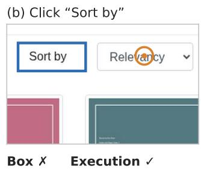  
Every row opens the same profile The label focuses its menu

# Right Click, Wrong Box: Grading GUI Grounding by What a Click Does

Xiaokang Yuan1 Binhui Yao1 Luwei Yang2 Ruimin Chen2 Zeng Wang2

1Zhejiang University, Hangzhou, China

2Zhejiang Geely Holding Group Co., Ltd, Hangzhou, China

22621230@zju.edu.cn

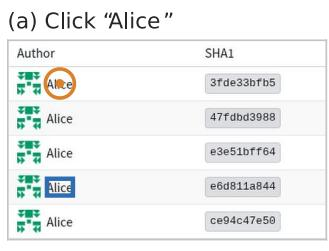

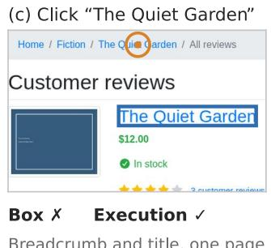

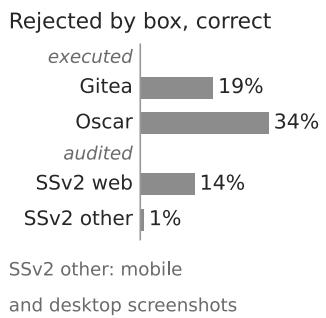  
Figure 1. Correct clicks that box scoring rejects. (a–c) Predictions of GTA1-7B (a, b) and UI-Venus-1.5-8B (c) on Gitea and the Oscar shop. The blue box is the annotation and the orange circle the model’s click. Each click misses the box, and executing it produces the same outcome as clicking the target. Instructions are shortened from the template Click the <role> "<text>". Right: share of box-rejected clicks that reach the target outcome, by execution for three 7–8B grounders and by a reviewed audit of 11 models on ScreenSpot-v2.

## Abstract

Leading GUI grounders score 93 to 96% on ScreenSpot-v2, and reported gaps between new andprior models are about a point. At this level the useful question is what the remaining errors are. Benchmarks count a click as correct only inside one annotated box, but interfaces often expose one action through several elements: a duplicated link, the label of a checkbox, the title next to a logo. The box is not wrong. The rule is incomplete. We call a click correct when executing it produces the same outcome as clicking the annotated target. A probe that executes and fingerprints about a thousand clicks per page turns this definition into outcome maps and an execution judge for live web applications, with no new annotation. We execute the predictions ofthree strong 7–8B grounders on a codeforge and an online shop. About one infive and one in three ofthe clicks that box scoring rejects reach the intended outcome, and the shares remain one in seven and one in three when the instructions are rewritten as natural tasks. A blind audit of11 models on ScreenSpot-v2 (three 7–8B grounders and eight 3B variants)finds the same effect on web screenshots, with two independent reviewers on a 60-unit subset. The share is highest for the strongest

grounders. Training seeds and test-set sampling add noise that more runs and paired intervals control. Box scoring instead under-counts correct clicks, which repetition does not remove, and the audit-based correction of 0.2 to 1.8 points on ScreenSpot-v2 is as large as the gaps the field reports. The correction is needed in evaluation. In our 3B GRPO study, crediting equivalent clicks in the reward gives no stable gain over box rewards across three seeds andfour test sets. We release the probe, the outcome maps, the audit and every prediction.

## 1. Introduction

GUI agents act through clicks, so grounding an instruction to a screen location is the perception step every agent depends on. The strongest open grounders we evaluate score 93 to 96% on ScreenSpot-v2 [28] (Sec. 4), and across 29 recent grounding papers the median absolute gap between a new model and the strongest prior model of its size is 1.15 points. At this level the useful question is no longer how many clicks miss the box. It is what the remaining misses are. When the remaining mistakes of top ImageNet models were reviewed one by one, nearly half turned out not to be mistakes [25].

Grounding benchmarks score a predicted point with one rule. It is correct when it falls inside the annotated box of the target element [7, 9, 17, 28, 30], and reinforcement learning for grounding uses the same rule as its reward [24, 33]. The rule assumes that each instruction has one correct region. Interfaces are built the other way. A commit list links every author name to the same profile, a form label focuses its control, and a shop shows a product’s name in the breadcrumb and in the title, both linking to the product (Fig. 1). Public screenshots show the same pattern (Fig. 3). None of this is an annotation mistake. The box is not wrong. The rule is incomplete, because a click outside the box can do exactly what the instruction asks. The converse also happens, and parts of an annotated box can be inert.

We define correctness by what a click does. Given an interface state and an annotated target, a click is outcomecorrect when executing it produces the same outcome as clicking the target. A probe executes a click in a browser, intercepts every request that would change server state, and records a fingerprint of the result. Running the probe densely over a page yields an outcome map, the set of pixels that achieve each element’s outcome. Running it on model predictions yields an execution judge. Neither needs annotation beyond the existing box. For public screenshot benchmarks, where nothing can be executed, we run a blind audit with the same definition.

What the remaining errors are. On a self-hosted Gitea code forge and a Django Oscar shop, 17.7% and 31.2% of live targets have pixels outside the box that reach the same outcome or pixels inside it that do nothing. Executing the predictions of UI-Venus-1.5-8B, GTA1-7B and Qwen3-VL-8B shows that about one in five clicks rejected by box scoring is outcome-correct on Gitea, and about one in three on Oscar. Rewriting the instructions as natural tasks keeps these shares at 14.3% and 34.8%. On ScreenSpot-v2, a blind audit of 11 models, cross-checked by two independent reviewers, finds 6.4% of rejected clicks outcome-correct overall and 14.4% on web screenshots. Among the audited models the share is highest for the strongest grounders, so box scoring misreads more of the errors that still separate strong grounders than of the errors of weaker models.

Bias, not noise. Another training seed moves ScreenSpotv2 accuracy by up to 2.6 points, and test-set sampling limits paired comparisons of 7–8B models to about 1.4 points. Both are noise that more seeds and a paired interval control, yet none of the 29 papers reports run-to-run variation on ScreenSpot-v2. Box scoring adds a bias, a one-sided undercount of the correct clicks of every model. It is estimated at 0.2 to 1.8 points on ScreenSpot-v2, and no number of runs or test items removes it. That is the size of the gaps the field reports, and the part that differs between models changes the point-estimate order of models within a point of each other.

Where the fix belongs. In our 3B study, a GRPO reward that credits the equivalent clicks found by the probe brings no stable gain over box rewards across three seeds and four test sets. Trained models already reach the target outcome on every held-out item whose target has an exact duplicate, so the correction is needed in evaluation, while its value as a training reward remains unshown at this scale.

Our contributions are:

• A definition of outcome-defined correctness for GUI grounding, and a probe that turns it into outcome maps and an execution judge for live web applications without new annotation.

• An audit of what box scoring rejects on two live applications and two public benchmarks, with execution judging of strong grounders and a reviewed screenshot audit of 11 models.

• An error budget for one-point comparisons on ScreenSpotv2 that separates the scoring bias from seed and sampling noise, with reporting recommendations.

• A controlled training study that places the fix in evaluation rather than in the reward. All maps, judgments, predictions and protocols are released.

## 2. Related Work

GUI grounding benchmarks and models. ScreenSpot [7] established the screenshot grounding task across mobile, desktop and web, and ScreenSpot-v2 [28] re-annotated 11.3% of its samples to fix wrong boxes and ambiguous instructions. ScreenSpot-Pro [17] raises resolution and domain difficulty, OSWorld-G [30] adds fine-grained annotations, and Mind2Web [9] provides real web pages with elementlevel ground truth. All of them score a prediction by its position relative to one annotated region. Grounding models have grown from supervised pretraining on large GUI corpora [7, 12, 18, 21, 28, 31] to coordinate-free heads [27], data-centric recipes [34] and reinforcement learning, as in GTA1 [33], GUI-G2 [24] and UI-Venus [26]. They and general models such as Qwen-VL [2, 3] report results under this protocol.

Rewards for grounding. GRPO [23] with a point-in-box reward is the standard recipe for RL-trained grounders [33], and GUI-G2 replaces the binary hit with a Gaussian reward around the box centre [24]. GUI-Libra [32] observes that offline GUI rewards are only partially verifiable, since a zero reward may hide an alternative valid action, and proposes KL regularisation and success-adaptive scaling of negative advantages, studied mainly for multi-step navigation. We measure how often such alternative actions exist in singlestep grounding, give the reward access to those the probe finds, and train GUI-Libra alongside.

Multiple valid actions. MobiBench [15] annotates several valid actions per step for mobile agents and shows that single-path evaluation underestimates task success. Concurrent work, ConClick [35], studies grounding errors that land on non-target elements and uses a vision-language judge to estimate that at most 6% of them are valid alternatives. Its sample and categories differ from ours, so the comparison is only broad. Our ScreenSpot-v2 audit adds three things: human judgments with measured agreement, a breakdown by platform that reveals a much larger share on the web, and execution judging on two live applications where equivalence is observed directly.

Execution-based evaluation. AutoGUI [16] executes interactions and asks an LLM to describe each element’s function from the change on screen, to create training data. We compare outcomes of clicks to grade predictions. WebArena [36] and OSWorld [29] judge agents by the state they reach at the end of a task. We bring the same principle down to a single click, which makes it usable for grounding benchmarks and grounding rewards.

Auditing benchmarks. Re-examining test sets has repeatedly changed how the vision community reads its leaderboards, from ImageNet re-labelling and replication [4, 22] to systematic label-error audits [20]. A review of every remaining mistake of top ImageNet models found that nearly half were not mistakes [25], and Boundary IoU showed that the standard mask measure overlooks improvements in boundary quality [6]. Work on benchmark variance [1, 5, 10, 13] shows that seeds and test-set sampling can rival the effects being claimed. In GUI grounding, the re-annotation behind ScreenSpot-v2 corrected individual labels. We keep the labels and audit the grading rule, with ground truth obtained by execution wherever the interface can run, and we measure seed and sampling variance alongside it.

## 3. Outcome-Defined Correctness

## 3.1. Definition

Let s be an interface state, p a screen point and $o ( s , p )$ the outcome of clicking p in state s. For an annotated target with box $b ,$ the target outcome $o _ { b }$ is the most frequent non-null outcome over points inside b, with the box centre breaking ties. A click is outcome-correct when $o ( s , p ) = o _ { b }$ , and the outcome-equivalent region is $E ( s , b ) = \{ p : o ( s , p ) = o _ { b } \}$ Box scoring replaces $E ( s , b )$ with b. The two disagree in two ways. Points in $E ( s , b ) \mid$ b are correct clicks that box scoring rejects, and points in $b \backslash E ( s , b )$ are inert clicks that it accepts. Outcomes are defined relative to the state s, which is fixed by the screenshot or page being evaluated. On live pages, $o ( s , p )$ is the operational fingerprint of Sec. 3.2.

## 3.2. Executing and fingerprinting a click

The probe (Fig. 2) runs Chromium at $1 2 8 0 \times 7 2 0$ . For each point it hovers for 120 ms, records the page state, clicks, waits until requests issued by the click have settled (at least 250 ms and at most 1.5 s beyond that, ignoring long-lived streaming connections), and records the state again. The outcome is the first matching signature in a fixed order: main-frame navigation (method, normalised URL and form fields), a new window, a non-GET request, a dialog, a change in the visible page, or no effect. Navigations and non-GET requests are intercepted and aborted, so the server state never changes and every click starts from the same page. Hover effects cancel out because both snapshots include them, and nodes that change on their own, such as clocks, are found from idle snapshots and excluded. A text field gaining focus counts as an outcome, and other elements gaining focus do not. After any click with an effect the page is reloaded.

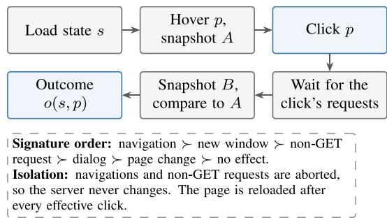  
Figure 2. The probe. Each screen point p is executed in the interface state s and fingerprinted by the first matching signature. Running it over a grid gives an outcome map, and running it on a model’s prediction gives an execution judgment.

## 3.3. Outcome maps

For every visible interactive element the probe clicks a $3 \times 3$ grid inside the box and one point 3 px outside each edge, and it adds a 48 px grid over the whole viewport (at most 1,500 points per page). Elements whose box contains no effective point are dead and set aside. For each live target we record whether a different element reaches its outcome (a distinct equivalent, such as a duplicated link or a label), whether at least 10% of its box is inert, and whether clicks just outside the box still reach its outcome. A target disagrees with box scoring if any of the three holds. A random 10% of points on every page is re-probed from a fresh load to measure repeatability.

We probe two self-hosted applications with different interaction structure, both seeded deterministically. Gitea 1.25 is a code forge similar to the GitLab site of WebArena [36], with users, organisations, repositories, issues, pull requests and wikis (94 pages). Django Oscar 4.2 is an open-source e-commerce framework, close to the shopping site of WebArena, with a storefront of product grids, categories, reviews, basket and account pages and a staff dashboard of tables and forms (60 pages). On Oscar an application-side middleware rolls back every database transaction, so that page views leave no trace. Both databases are identical before and after probing.

## 3.4. Execution judging

Each live target with visible text becomes a grounding item with the instruction template Click the <role> "<text>", up to 40 items per page. We execute each model’s predicted point with the same probe and compare its outcome with the target outcome. As a reference we also execute the centre of every annotated box. The centre reproduces the mapped outcome on 98.1% of items, which bounds environment drift between mapping and judging. Confidence intervals resample pages [11].

## 3.5. Screenshot audit

Public benchmarks ship screenshots, so outcomes cannot be executed. For ScreenSpot-v2 we use human judgment with the same definition. We take the existing predictions of 11 models and keep the parsed clicks that miss the box. Clicks on the same item that lie within 0.8% of the long image side are merged, giving 1,036 audit units. A fixed random order selects a 40-unit pilot and a 360-unit main sample. Each unit is shown as a panel with the full screenshot and a zoomed crop, the target box in red and the click in blue, together with the instruction. Model names are hidden. A unit is E-same when the click hits the target control outside its box (the box covers only an icon of a larger button), E-dup when it hits another control with the same function (a duplicated link, the label of a checkbox or field), N when the function differs, and U when the screenshot does not show enough to decide. Clear conventions are required to accept a whole row or card as clickable, and uncertain cases go to U. Two independent reviewers judge a random 60-unit subset of the main sample without seeing our labels.

All decision rules, thresholds and sampling seeds were recorded with timestamps and checksums before the data they govern was produced. The supplementary material lists the rule files behind every analysis in this paper and each later amendment, together with what had been seen when it was written.

## 4. What Box Scoring Misreads

Every instrument in this study is checked against an independent repetition or an independent judge. Table 1 collects these checks, and all of them pass with a wide margin.

## 4.1. Outcome maps of live applications

The probe executed about 1,000 clicks on each of 94 Gitea pages and about 700 on each Oscar page. Of 4,970 live targets, 17.7% disagree with their box. Most disagreements come from distinct equivalents (15.1% of targets). Duplicated links form the largest group, such as commit hashes and messages, issue titles and numbers, and user names and avatars. Labels that focus or toggle their control come second (Tab. 2). Smaller groups are elements that stay clickable beyond their box (Fig. S1c in the supplement) and boxes with at least 10% inert area (2.6% of targets). The estimate is stable. Restricting the analysis to pages with at least 95% repeatability leaves the rate at 17.4%. Discarding every equivalence that rests on a page change without a label, the type that contains one of the two self-check false positives, still leaves 16.1%. The shop shows the same pattern more strongly. On 56 Oscar pages that meet the repeatability threshold, 31.2% of 1,224 live targets disagree with their box, mostly through distinct equivalents (27.5%), for example the image and the title of a product card that open the same product page.

<table><tr><td colspan="2">Instrument Check</td><td>Result</td></tr><tr><td rowspan="3">Probe</td><td>Same outcome after fresh reload</td><td>97.9 / 99.8%</td></tr><tr><td>Same outcome across probe versions Disagreements confirmed in self-check</td><td>99.4%</td></tr><tr><td>Server database after probing</td><td>28/30 unchanged</td></tr><tr><td rowspan="2">Judge</td><td>Box centre reaches mapped outcome</td><td>98.1 / 98.7%</td></tr><tr><td>Same verdict on re-execution</td><td>98.6 / 98.7%</td></tr><tr><td rowspan="2">Audit</td><td>Reviewer A vs reviewer B, κ</td><td>0.95</td></tr><tr><td>Ours vs reviewers, κ</td><td>0.89, 0.84</td></tr></table>

Table 1. Checks on each instrument. Pairs of values are Gitea / Oscar. Probe repeatability is the mean per page of a random 10% of points re-probed from a fresh load. Version agreement covers 60,995 points on 58 pages. Re-execution covers 712 predictions. Cohen’s κ [8] is computed over E, N and U on 60 units. Details are in the supplement.
<table><tr><td>Type</td><td>Targets</td></tr><tr><td>Duplicate link (navigation to the same URL)</td><td>566</td></tr><tr><td>Label and its control</td><td>86</td></tr><tr><td rowspan="3">Other page-change equivalent At least 10% inert area in the box Clickable area beyond the box</td><td>60</td></tr><tr><td>64</td></tr><tr><td>69</td></tr><tr><td>Any disagreement</td><td>774</td></tr></table>

Table 2. Disagreeing targets by type on the 85 pages with at least 95% repeatability (4,436 live targets). A target can have several types.

## 4.2. Execution-judged accuracy

We judged 3,586 Gitea items and 1,147 Oscar items by execution for three strong grounders: UI-Venus-1.5-8B [26], GTA1-7B [33] and Qwen3-VL-8B [2]. Table 3 shows the result. About one in five clicks that box scoring rejects reaches the target outcome on Gitea, and about one in three on Oscar. Accuracy rises by about two points for every model on both applications. Box-accepted clicks with a different outcome occur at the same rate as for the box centre itself, so inert pixels inside boxes play a minor role for these models.

<table><tr><td>Model</td><td>Box</td><td>Outcome</td><td>∆ [95% CI]</td><td>Rescued</td></tr><tr><td colspan="5">Gitea (3,586 items)</td></tr><tr><td>UI-Venus-1.5-8B 82.3 GTA1-7B Qwen3-VL-8B Box centre</td><td>81.1 79.7 100</td><td>84.3 83.2 81.9 98.1</td><td>+2.0 [0.6, 3.3] 130 (20.5%) +2.2 [0.9, 3.4] +2.2 [0.9, 3.5]</td><td>135 (19.9%) 128 (17.6%) 0</td></tr><tr><td colspan="5">Oscar (1,147 items)</td></tr><tr><td>UI-Venus-1.5-8B 91.3</td><td></td><td>93.0</td><td>+1.7 [0.6, 2.9]</td><td>34 (34.0%)</td></tr><tr><td>GTA1-7B</td><td>90.1</td><td>92.6</td><td>+2.4 [1.2, 3.6]</td><td>43 (38.1%)</td></tr><tr><td>Qwen3-VL-8B</td><td>90.3</td><td>92.3</td><td>+2.0 [1.0, 3.0]</td><td>33 (29.7%)</td></tr><tr><td>Box centre</td><td>100</td><td>98.7</td><td></td><td>0</td></tr><tr><td></td><td></td><td></td><td></td><td></td></tr></table>

Table 3. Execution judging on two live applications. Accuracy (%) under box scoring and outcome scoring. “Rescued” counts box-rejected clicks that reach the target outcome, with their share of all box-rejected clicks. The box centre is a reference click; its agreement with the mapped outcome bounds environment drift. Intervals resample pages.

The gain concentrates where the interface offers several routes to the same action. On the 193 items whose instruction matches several elements with the same outcome, models often pick the other copy, and box accuracy stays at 28.5– 35.2%. Outcome accuracy on these items is 90.7–100%. On the 3,092 items with a unique match, outcome accuracy sits slightly below box accuracy, by less than the gap of the box centre itself. The 301 items whose matching elements lead to different outcomes stay hard under both scores, so execution judging credits genuine equivalence only. Oscar repeats this picture: on its 55 items with same-outcome copies, box accuracy is 47–49% and outcome accuracy 96–100%, and on unique items the two scores differ by less than a point. On Oscar, GTA1-7B trails Qwen3-VL-8B by 0.17 points under box scoring and leads by 0.26 under outcome scoring.

Natural instructions. The template names the element’s text, so an element and its same-text copies match the instruction equally well. To test whether the effect depends on this, a text-only model (Qwen3-4B-Instruct-2507) rewrote every instruction as a task a user would give, from the element’s text, type and effect and without the screen. For example, Click the link “1.25.0” became Go to the admin configuration page. In a reading of 100 random rewrites, 10 were clearly unfit, mostly checkboxes described as text fields and invented search terms. The task becomes harder, and box accuracy drops by 10 to 16 points. The share of box-rejected clicks that reach the target outcome stays high, at 14.3% on Gitea (19.2% with the template) and 34.8% on Oscar (34.0%), pooled over the three grounders. A rule written before any rewrite existed counted the effect as persisting if both shares stayed above half their template values. Outcome scoring now raises accuracy by 2.5–3.2 points on Gitea and 6.2–8.4 points on Oscar. Rescued clicks also appear on items whose template text was unique, 6.8% of rejections on Gitea and 30.6% on Oscar, so the effect is not limited to literal copies of the instruction text (Tab. S3).

<table><tr><td>Split</td><td>Units</td><td>E-same</td><td>E-dup</td><td>N</td><td>U</td><td>E share [95% CI]</td></tr><tr><td>Web</td><td>145</td><td>8</td><td>12</td><td>119</td><td>6</td><td>14.4 [9.5, 21.2]</td></tr><tr><td>Mobile</td><td>104</td><td>1</td><td>0</td><td>97</td><td>6</td><td>1.0 [0.2, 5.6]</td></tr><tr><td>Desktop</td><td>111</td><td>0</td><td>1</td><td>105</td><td>5</td><td>0.9 [0.2, 5.2]</td></tr><tr><td>All</td><td>360</td><td>9</td><td>13</td><td>321</td><td>17</td><td>6.4 [4.3, 9.5]</td></tr></table>

Table 4. Screenshot audit of ScreenSpot-v2. Box-rejected clicks of 11 models, judged blind. E share is (E-same + E-dup)/(E + N) in % with Wilson intervals. Counting all U units as N or as E bounds the overall share between 6.1% and 10.8%.

## 4.3. Public benchmarks

Mind2Web. The released Mind2Web pages strip almost all element attributes, link targets included, so equivalence can only be recovered from label relations. Such static equivalents are visible for 1.3% of the 4,838 click steps we evaluate. Box and outcome accuracy of the three grounders therefore differ by at most 0.26 points. Where an equivalent is visible the effect is large. With task-level instructions, outcome accuracy on these steps exceeds box accuracy by 12.6 to 20.3 points. Duplicated links, the largest group on Gitea, are invisible in such snapshots, which is why live execution is needed to measure them.

ScreenSpot-v2. The screenshot audit covers 11 models: the three grounders above, Qwen2.5-VL-3B [3] and seven GRPO-trained 3B variants from Sec. 5. A 40-unit pilot decided that the full audit was worthwhile, and the 360-unit main sample gives the estimates in Tab. 4. Two independent reviewers agree closely with each other and with our labels (Tab. 1). Where both reviewers disagreed with us, on 2 of 60 units, we adopted their label. Outcome-correct clicks make up 6.4% of the rejected clicks. On web screenshots the share is 14.4%, and mobile and desktop screenshots show about 1%. Figure 3 shows the typical cases: a project logo and title that form one link, an address that is a single link around the annotated word, a checkbox label, and a header link that duplicates a page button. The audit also surfaced five items with a likely annotation problem, which we release with the audit.

## 4.4. Stronger models, more misread errors

The share of outcome-correct clicks among rejections is not a constant of the benchmark. Among the 11 audited models it is highest for the strongest grounders (Fig. 4). Pooled over the audit units that contain a click of one of the three 7–8B grounders, 20.6% [12.7, 31.6] of rejected clicks are outcome-correct. For units with clicks of the 3B models only, the share is 2.9% [1.5, 5.6]. What remains for the strongest models is more often the other copy of the target, a label, or the rest of a button. On the live applications the rate is high for every model, 3B models included, because duplicated elements make up a large part of the items there. Section 6 measures what this does to close comparisons.

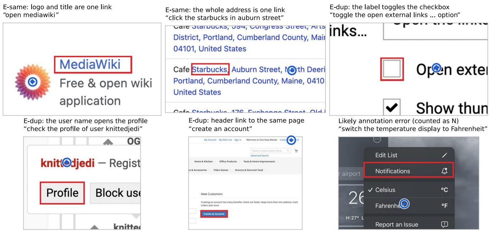  
Figure 3. Outcome-correct clicks that ScreenSpot-v2 rejects. Zoomed audit panels: red box is the annotation, blue circle the model click, instruction in quotes. E-same clicks hit the target control outside its box, E-dup clicks hit another control with the same function. In the last panel the click follows the instruction and the box marks a different control. We release such cases as likely annotation errors and count them as N.

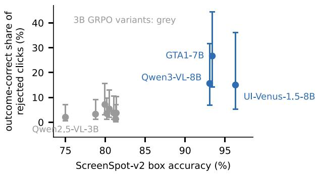  
Figure 4. The strongest grounders have the largest share of outcome-correct errors on ScreenSpot-v2. Share of each model’s audited box-rejected clicks judged equivalent, with Wilson intervals, against its box accuracy.

## 5. Where the Fix Belongs

Outcome maps also give a reward that credits the equivalent clicks they find. GUI-Libra [32] argues that box rewards are only partially verifiable and that the missing credit hurts training. If that held at our scale, the correction would belong in the reward as well as in evaluation. GUI-Libra studies multi-step navigation; we test whether the same ambiguity costs anything when training single-step grounding.

Setup. We split the Gitea items by page layout, giving 1,745 training and 1,841 held-out items from layouts never seen in training. Items that the base model answers inside the box in all 8 samples carry no GRPO gradient under any reward and are removed for all arms. This leaves 1,589 training items, and 313 of them have at least one outcome-equivalent element. We fine-tune Qwen2.5-VL-3B-Instruct [3] with LoRA [14] using the GRPO implementation of GTA1 [33], with 8 samples per item for 2 epochs (396 updates). Three arms differ only in the reward. Box rewards clicks inside the target box. Outcome rewards clicks inside the box of the target or of any outcome-equivalent element found by the outcome maps. This stand-in for executing every rollout click agrees with the execution judge on 98.6% of 14,727 held-out clicks of the eight 3B models, and only 5 outcome-correct clicks fall outside every rewarded box. GUI-Libra uses the box reward with KL regularisation $( \beta = 0 . 0 0 1 )$ and successadaptive scaling of negative advantages $( \lambda _ { 0 } = \kappa = 0 . 5 )$ All arms share data, order and hyperparameters. We train three seeds for every arm, and evaluate with greedy decoding by execution on the held-out Gitea layouts and on the Oscar shop, which no model saw in training, and by box on ScreenSpot-v2 and on the 4,731 Mind2Web steps with element-level instructions.

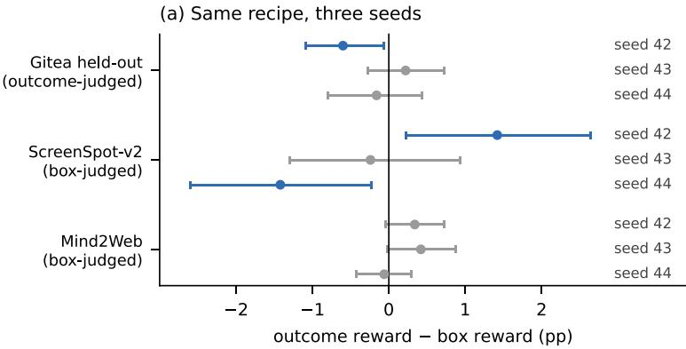

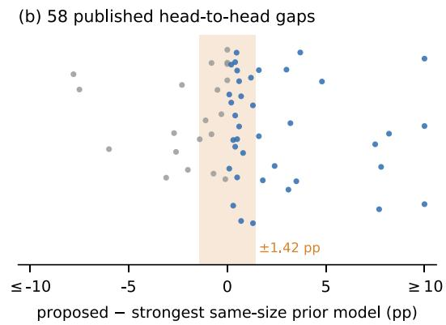  
Figure 5. Seeds and sampling set the resolution of ScreenSpot-v2. (a) Outcome-reward minus box-reward accuracy for the same recipe trained with three seeds. Blue marks intervals that exclude zero (Gitea resamples pages, ScreenSpot-v2 resamples screenshots, Mind2Web resamples tasks). On ScreenSpot-v2 seed 42 shows a significant gain and seed 44 an equally significant loss. (b) Head-to-head gaps between a proposed model and the strongest prior model of the same size, as reported on ScreenSpot-v2 by 28 recent papers (blue: proposed model ahead). The band marks ±1.42 points, the size of the single-seed effects in (a) that reverse across seeds.

<table><tr><td></td><td>Gitea held-out outcome</td><td>Oscar outcome</td><td>ScreenSpot-v2 Mind2Web box</td><td>box</td></tr><tr><td>Base model</td><td>78.4</td><td>91.0</td><td>75.0</td><td>83.7</td></tr><tr><td>Box reward</td><td> $8 5 . 2 _ { [ 8 5 . 2 , 8 5 . 3 ] }$ </td><td> $8 9 . 6 _ { [ 8 9 . 4 , 8 9 . 9 ] }$ </td><td> $8 0 . 5 _ { [ 8 0 . 0 , 8 1 . 3 ] }$ </td><td>86.5[86.4, 86.6]</td></tr><tr><td>Outcome reward</td><td> $8 5 . 0 _ { [ 8 4 . 6 , 8 5 . 5 ] }$ </td><td> $8 9 . 7 _ { [ 8 9 . 3 , 9 0 . 2 ] }$ </td><td> $8 0 . 4 _ { [ 7 8 . 8 , 8 1 . 4 ] }$ </td><td>86.7 [86.6, 86.9]</td></tr><tr><td>GUI-Libra</td><td> $8 4 . 8 _ { [ 8 4 . 5 , 8 5 . 3 ] }$ </td><td> $9 0 . 0 _ { [ 8 9 . 8 , 9 0 . 2 ] }$ </td><td> $8 0 . 9 _ { [ 8 0 . 5 , 8 1 . 2 ] }$ </td><td> $8 6 . 7 _ { [ 8 6 . 2 , 8 7 . 0 ] }$ </td></tr><tr><td>Outcome — box</td><td>-0.18</td><td>+0.06</td><td>-0.08</td><td>+0.23</td></tr></table>

Table 5. Reward definition and held-out accuracy (%). Each arm shows the mean over seeds 42, 43 and 44 with the range across seeds, and the last row gives the difference of the outcome and box means in points. Per-seed differences with confidence intervals are in Fig. 5a.

Results. Every arm improves on the base model by 6–7 points on held-out Gitea layouts, by 4–6 points on ScreenSpot-v2 and by about 3 points on Mind2Web (Tab. 5). On the unseen shop every arm ends 0.8 to 1.4 points below a strong base model, so this training does not transfer there. The reward definition makes no stable difference. Averaged over the three seeds, outcome and box rewards lie within a quarter of a point of each other on every test set, and individual seeds point in both directions (Fig. 5a). Taking each training run as one observation, the three seeds bound the difference to about one point on held-out Gitea and Mind2Web. On ScreenSpot-v2 the seed spread is too large to bound it this tightly (Sec. 6). GUI-Libra lands in the same range, within half a point of the box reward on average on every test set.

Why the extra credit adds little. The two rewards differ only on items with an equivalent element, about a fifth of the training items. On the 96 held-out items whose instruction matches several elements with the same outcome, the base model already reaches the target outcome on 92%. Every trained model of every arm and seed reaches 100%, while picking the annotated copy only 27–29% of the time. The box reward on these items acts as label noise that averages out. At this scale the richer reward has almost nothing left to improve, which is a ceiling of the test rather than proof that such a reward can never help. On the shop, every model, the base model included, reaches the target outcome on all 55 items with same-outcome copies.

## 6. Bias and Noise at the One-Point Scale

Three things move a close comparison on ScreenSpot-v2: the training seed, the test sample and the scoring rule (Fig. 6). The first two are noise. More seeds average them out, and a paired interval bounds what remains. The third is a bias, a one-sided under-count of correct clicks. It belongs to the model and the benchmark, so repeated runs and more items from the same benchmark leave it in place.

Seeds. Retraining the same recipe with three seeds changes ScreenSpot-v2 accuracy by up to 1.3 points for box rewards and up to 2.6 points for outcome rewards. The same models vary by less than a point on Mind2Web and on held-out Gitea layouts. With seed 42 the outcome reward wins on ScreenSpot-v2 with a paired McNemar test [19] at $p = 0 . 0 3 $ , and with seed 44 the box reward wins at $p = 0 . 0 2$ (Fig. 5a). A single-seed significance test is a statement about one training run and says little about the method.

Test-set sampling. Even a fixed model is measured on a finite sample of 1,272 items. We resampled ScreenSpot-v2 items 10,000 times and computed paired intervals for the three strong grounders, the size class most papers compete in. The half-width of the interval on a difference is 1.26–1.54 points. GTA1-7B and Qwen3-VL-8B differ by 0.31 points, and their interval extends more than a point to each side of zero. The leads of UI-Venus-1.5-8B over both models, about three points each, are clearly resolved.

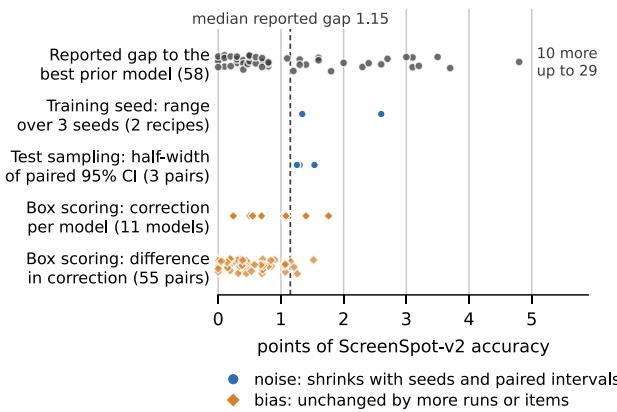  
Figure 6. Error budget of one-point comparisons on ScreenSpotv2. Each row shows one source of variation on the same scale as the margins that recent papers report. Seed ranges come from the three box-reward and the three outcome-reward runs of Sec. 5, interval half-widths from the three pairs of 7–8B grounders, and corrections from the audit (point estimates; intervals in the supplement). The rows have different statistical meanings, so the figure compares scales and is not an additive decomposition.

Scoring. Outcome scoring raises ScreenSpot-v2 accuracy by 0.2 to 1.8 points, depending on the model (Tab. S5 in the supplement). GTA1-7B gains the most, so its gap to UI-Venus-1.5-8B shrinks from 2.9 to 1.7 points. When two models receive a similar correction, their order stays and only both absolute scores move. What can change an order is the difference between two models’ corrections, which reaches 1.5 points for one pair. Three pairs change order in the point estimates, all within 0.8 points under box scoring, for example the seed-43 box-reward model and its outcome-reward twin (+0.24 under box scoring, −0.23 corrected). These reversals are descriptive. Adding the audit uncertainty of the correction to the box gap gives intervals that include zero for all three pairs (Tab. S6), so the corrected order of these pairs is not resolved either. Box scoring keeps the coarse leaderboard intact and decides the order of close models partly by how often each model picks an equivalent element.

Reported margins. Two independent literature searches, each coded with fixed rules and checked against the original tables, together cover 29 recent grounding papers that report ScreenSpot-v2, 28 of which contain a head-to-head comparison. Of the 58 head-to-head comparisons with the strongest prior model of the same size, the median absolute gap is 1.15 points (Fig. 5b). The proposed model leads in 38 of them, and in 21 of these the lead is no larger than a single-seed effect. Ablations show a similar median of 1.2 points. Gains over the untrained base model are larger, with a median of 4.0 points, so the field’s progress is real and visible at that scale. No paper reports run-to-run variation on ScreenSpot-v2.

All three sources act at the scale of the reported margins. Several seeds and a paired interval handle the noise. Only a rule that credits equivalent clicks removes the bias.

## 7. Recommendations and Outlook

Recommendations. Our measurements translate into two practices for evaluation that are cheap to adopt.

1. Credit equivalent clicks on the web, and report both scores. On web interfaces, between one in seven and one in three of the clicks that box scoring rejects do the right thing, and for the strongest grounders this is about a fifth of their remaining ScreenSpot-v2 errors. Benchmarks can ship outcome maps or lists of equivalent elements with each web item. Reporting outcome-corrected accuracy next to box accuracy shows how much of a margin depends on the choice between equivalent targets.

2. Report seeds and paired intervals. Three seeds and a paired bootstrap interval cost little compared with training, and they turn a 1-point margin from an anecdote into evidence.

In our 3B study, box labels remained an adequate training target (Sec. 5).

Where equivalence comes from. The difference between web and native screenshots follows from how the two are built. Web pages routinely expose one action through several elements: the image and title of a card, a label bound to its control, a link repeated in a header and a page body. Native mobile and desktop widgets usually have a single hit target, so a click outside the box is almost always a real error, and the audit finds about 1% there against 14.4% on web screenshots. Lists of equivalent elements therefore matter most for web items.

Scope. Execution judging covers two live web applications, a code forge and an online shop that stand in for the GitLab and shopping sites of WebArena, and the screenshot audit extends the picture to public mobile, desktop and web data. The training study uses a 3B model with LoRA and about 400 GRPO updates, and larger models or longer schedules may use the extra credit differently. Equivalence is defined for one interface state, which matches how grounding benchmarks are built. The released probe is designed to extend to more applications, mobile platforms and multi-step tasks.

Conclusion. A click is right when it does the right thing. Graded this way, many of the errors that still separate strong grounders on the web are correct clicks. This under-count does not average out, and it is as large as the gaps the field now reports. Outcome maps and execution judging remove it from evaluation.

## References

[1] Rishabh Agarwal, Max Schwarzer, Pablo Samuel Castro, Aaron Courville, and Marc G. Bellemare. Deep reinforcement learning at the edge of the statistical precipice. In Advances in Neural Information Processing Systems, 2021. 3

[2] Shuai Bai, Yuxuan Cai, Ruizhe Chen, et al. Qwen3-VL technical report. arXiv preprint arXiv:2511.21631, 2025. 2, 4

[3] Shuai Bai, Keqin Chen, Xuejing Liu, et al. Qwen2.5-VL technical report. arXiv preprint arXiv:2502.13923, 2025. 2, 5, 6

[4] Lucas Beyer, Olivier J. Henaff, Alexander Kolesnikov, Xi-´ aohua Zhai, and Aaron van den Oord. Are we done with¨ ImageNet? arXiv preprint arXiv:2006.07159, 2020. 3

[5] Xavier Bouthillier, Pierre Delaunay, Mirko Bronzi, et al. Accounting for variance in machine learning benchmarks. In Proceedings ofMachine Learning and Systems, 2021. 3

[6] Bowen Cheng, Ross Girshick, Piotr Dollar, Alexander C.´ Berg, and Alexander Kirillov. Boundary IoU: Improving object-centric image segmentation evaluation. In IEEE/CVF Conference on Computer Vision and Pattern Recognition, 2021. 3

[7] Kanzhi Cheng, Qiushi Sun, Yougang Chu, Fangzhi Xu, Yantao Li, Jianbing Zhang, and Zhiyong Wu. SeeClick: Harnessing GUI grounding for advanced visual GUI agents. In Annual Meeting of the Association for Computational Linguistics (ACL), 2024. 2

[8] Jacob Cohen. A coefficient of agreement for nominal scales. Educational and Psychological Measurement, 20(1):37–46, 1960. 4

[9] Xiang Deng, Yu Gu, Boyuan Zheng, Shijie Chen, Samuel Stevens, Boshi Wang, Huan Sun, and Yu Su. Mind2Web: Towards a generalist agent for the web. In Advances in Neural Information Processing Systems (Datasets and Benchmarks Track), 2023. 2

[10] Rotem Dror, Gili Baumer, Segev Shlomov, and Roi Reichart. The hitchhiker’s guide to testing statistical significance in natural language processing. In Annual Meeting ofthe Associationfor Computational Linguistics, 2018. 3

[11] Bradley Efron and Robert J. Tibshirani. An Introduction to the Bootstrap. Chapman and Hall/CRC, 1993. 4

[12] Boyu Gou, Ruohan Wang, Boyuan Zheng, Yanan Xie, Cheng Chang, Yiheng Shu, Huan Sun, and Yu Su. Navigating the digital world as humans do: Universal visual grounding for GUI agents. In International Conference on Learning Representations (ICLR), 2025. 2

[13] Peter Henderson, Riashat Islam, Philip Bachman, Joelle Pineau, Doina Precup, and David Meger. Deep reinforcement learning that matters. In AAAI Conference on Artificial Intelligence, 2018. 3

[14] Edward J. Hu, Yelong Shen, Phillip Wallis, Zeyuan Allen-Zhu, Yuanzhi Li, Shean Wang, Lu Wang, and Weizhu Chen. LoRA: Low-rank adaptation of large language models. In International Conference on Learning Representations, 2022. 6

[15] Youngmin Im, Byeongung Jo, Jaeyoung Wi, et al. MobiBench: Multi-branch, modular benchmark for mobile GUI agents. arXiv preprint arXiv:2512.12634, 2025. 2

[16] Hongxin Li, Jingfan Chen, Jingran Su, Yuntao Chen, Li Qing, and Zhaoxiang Zhang. AutoGUI: Scaling GUI grounding with automatic functionality annotations from LLMs. In Annual Meeting of the Association for Computational Linguistics, 2025. 3

[17] Kaixin Li, Ziyang Meng, Hongzhan Lin, et al. ScreenSpot-Pro: GUI grounding for professional high-resolution computer use. arXiv preprint arXiv:2504.07981, 2025. 2

[18] Kevin Qinghong Lin, Linjie Li, Difei Gao, Zhengyuan Yang, Shiwei Wu, Zechen Bai, Weixian Lei, Lijuan Wang, and Mike Zheng Shou. ShowUI: One vision-language-action model for GUI visual agent. In IEEE/CVF Conference on Computer Vision and Pattern Recognition (CVPR), 2025. 2

[19] Quinn McNemar. Note on the sampling error of the difference between correlated proportions or percentages. Psychometrika, 12(2):153–157, 1947. 7

[20] Curtis G. Northcutt, Anish Athalye, and Jonas Mueller. Pervasive label errors in test sets destabilize machine learning benchmarks. In Advances in Neural Information Processing Systems (Datasets and Benchmarks Track), 2021. 3

[21] Yujia Qin, Yining Ye, Junjie Fang, Haoming Wang, Shihao Liang, Shizuo Tian, et al. UI-TARS: Pioneering automated GUI interaction with native agents. arXiv preprint arXiv:2501.12326, 2025. 2

[22] Benjamin Recht, Rebecca Roelofs, Ludwig Schmidt, and Vaishaal Shankar. Do ImageNet classifiers generalize to ImageNet? In International Conference on Machine Learning, 2019. 3

[23] Zhihong Shao, Peiyi Wang, Qihao Zhu, Runxin Xu, Junxiao Song, Mingchuan Zhang, Y. K. Li, Y. Wu, and Daya Guo. DeepSeekMath: Pushing the limits of mathematical reasoning in open language models. arXiv preprint arXiv:2402.03300, 2024. 2

[24] Fei Tang, Zhangxuan Gu, Zhengxi Lu, et al. GUI-G2: Gaussian reward modeling for GUI grounding. arXiv preprint arXiv:2507.15846, 2025. 2

[25] Vijay Vasudevan, Benjamin Caine, Raphael Gontijo-Lopes, Sara Fridovich-Keil, and Rebecca Roelofs. When does dough become a bagel? Analyzing the remaining mistakes on ImageNet. In Advances in Neural Information Processing Systems, 2022. 2, 3

[26] Venus Team, Changlong Gao, Zhangxuan Gu, et al. UI-Venus-1.5 technical report. arXiv preprint arXiv:2602.09082, 2026. 2, 4

[27] Qianhui Wu, Kanzhi Cheng, Rui Yang, Chaoyun Zhang, Jianwei Yang, Huiqiang Jiang, et al. GUI-Actor: Coordinate-free visual grounding for GUI agents. In Advances in Neural Information Processing Systems (NeurIPS), 2025. 2

[28] Zhiyong Wu, Zhenyu Wu, Fangzhi Xu, et al. OS-ATLAS: Foundation action model for generalist GUI agents. In International Conference on Learning Representations (ICLR), 2025. 1, 2

[29] Tianbao Xie, Danyang Zhang, Jixuan Chen, et al. OSWorld: Benchmarking multimodal agents for open-ended tasks in real computer environments. In Advances in Neural Information Processing Systems (Datasets and Benchmarks Track), 2024. 3

[30] Tianbao Xie, Jiaqi Deng, Xiaochuan Li, et al. Scaling computer-use grounding via user interface decomposition and synthesis. arXiv preprint arXiv:2505.13227, 2025. 2

[31] Yiheng Xu, Zekun Wang, Junli Wang, Dunjie Lu, Tianbao Xie, Amrita Saha, Doyen Sahoo, Tao Yu, and Caiming Xiong. Aguvis: Unified pure vision agents for autonomous GUI interaction. In International Conference on Machine Learning (ICML), 2025. 2

[32] Rui Yang, Qianhui Wu, Zhaoyang Wang, et al. GUI-Libra: Training native GUI agents to reason and act with actionaware supervision and partially verifiable RL. arXiv preprint arXiv:2602.22190, 2026. 2, 6

[33] Yan Yang, Dongxu Li, Yutong Dai, et al. GTA1: GUI testtime scaling agent. arXiv preprint arXiv:2507.05791, 2025. 2, 4, 6

[34] Miaosen Zhang, Ziqiang Xu, Jialiang Zhu, Qi Dai, Kai Qiu, Yifan Yang, Chong Luo, Tianyi Chen, Justin Wagle, Tim Franklin, and Baining Guo. Phi-Ground tech report: Advancing perception in GUI grounding. arXiv preprint arXiv:2507.23779, 2025. 2

[35] Ruotian Zhang, Yuhui Zhang, Junzhe Huang, Yu Xin, Hehe Fan, and Xiaoxiao Sun. ConClick: Element-wise contrastive learning improves GUI grounding. arXiv preprint arXiv:2610.13268, 2026. 3

[36] Shuyan Zhou, Frank F. Xu, Hao Zhu, Xuhui Zhou, Robert Lo, Abishek Sridhar, Xianyi Cheng, Tianyue Ou, Yonatan Bisk, Daniel Fried, Uri Alon, and Graham Neubig. WebArena: A realistic web environment for building autonomous agents. In International Conference on Learning Representations, 2024. 3

# Right Click, Wrong Box: Grading GUI Grounding by What a Click Does

Supplementary Material

Sections A–I, Figure S1 and Tables S1–S7 are in this supplement. All other section, table and figure numbers refer to the main paper.

## A. Probe and Outcome Maps

Signatures. Table S1 lists the outcome signatures in order of precedence. A navigation records the method, the URL with session tokens such as csrf removed, and the names of submitted form fields. A page change is a difference between the post-hover and post-click snapshots in the fingerprints of visible nodes, the URL after pushState, the focused text control, or the number of open dialogs.

<table><tr><td>Order</td><td>Signature</td><td>Recorded as</td></tr><tr><td>1</td><td>nav</td><td>main-frame navigation, aborted</td></tr><tr><td>2</td><td>popup</td><td>new window or tab</td></tr><tr><td>3</td><td>req</td><td>non-GET request, aborted</td></tr><tr><td>4</td><td>dialog</td><td>alert or confirm, dismissed</td></tr><tr><td>5</td><td>dom</td><td>visible change of the page</td></tr><tr><td>6</td><td>noop</td><td>none of the above</td></tr></table>

Table S1. Outcome signatures.

Waiting rule. After the click the probe waits at least 250 ms and then until requests issued after the click have finished, for at most 1.5 s more. Event streams, web sockets and URLs containing /events, /stream, /sse, longpoll or /socket are ignored. The first version of the probe also waited for long-lived connections opened before the click. Gitea keeps such a connection open, so almost every click waited the full 1.5 s and probing took 3.4 s per point. We changed only this rule, for speed. A preliminary disagreement rate of about 26% on the first 16 pages had been seen at that point, so the second version was accepted only if it reproduced the outcomes of the first, independent of the direction of any result. The comparison covers 58 pages that both versions finished with at least 95% repeatability. On these pages 99.4% of 60,995 matched points received the same outcome, and the overall disagreement rate changed by 0.1 points.

Self-check. Thirty disagreeing targets were drawn at random (seed 20261024) from the 85 pages with at least 95% repeatability. Each was judged against written criteria from its signatures and equivalent elements, with rendered overlays where needed. Twenty-eight are true disagreements, including panels (b) and (c) of Fig. S1. Two are false positives. In one, the Delete links of three different labels open one shared confirmation dialog, and the page-change fingerprint merges the three actions. In the other, a search field already holds focus after some page loads, so a click on it changes nothing. Table 2 breaks down all 774 disagreeing targets on these pages.

Page statistics. Of 5,073 interactive targets on 94 pages, 103 are dead. Among the 4,970 live targets, 748 have a distinct equivalent, 127 have at least 10% inert box area, and 881 (17.7%) disagree with their box in at least one way. Repeatability per page has a mean of 97.9% and a minimum of 80.9%. Nine pages fall below 95%. Eight of them are issue pages that embed Gitea’s comment editor, and the ninth is the user list in site administration.

Oscar. The shop runs Django Oscar with SQLite in a separate environment. Fixed lists and templates populate 32 products (16 books and 16 home goods) across six categories, 48 programmatically generated placeholder images, 18 approved reviews, five accounts (one administrator and four customers) and seven pending orders. The seed also includes a three-item basket, two saved addresses, a threeitem wishlist, a stock alert, a site-wide 10% discount with a linked voucher, three shipping price bands, account messages and an About page. Product images are 640 × 480 PNGs with coloured backgrounds and product-title text. A middleware placed first rolls back the database transaction of every request, so that page views and analytics writes leave the database unchanged. Every page loads with a 1.5 s wait before probing. For this application the probe additionally normalises the boundary string of multipart form submissions and the random element ids generated by the rich-text editor, and it treats a failed page load as an error instead of a page state. The valid run followed two deployments that stopped on these signature issues and on SQLite lock contention. Of 60 candidate pages, 56 completed with repeatability of at least 95% (mean 99.8%); four timed out during a later reload and count as failures. Execution judging covers 1,149 items with 11 models; three page-load errors leave 1,147 items for the core comparison.

## B. Execution Judging

Items come from live targets with visible text, at most 40 per page. Of the 5,073 targets, 103 are dead and 443 have no visible text, and the cap leaves 3,586 items on 94 pages. The role word in the instruction is chosen from the element type (link, button, tab, checkbox, field). We stratify items by how many elements on the page match the instruction text.

Repeated execution of 712 predictions from a fresh page load agreed in 98.6% of cases. Predictions that cannot be parsed count as wrong under both scores (2.3% of UI-Venus-1.5-8B outputs, none for the other two models).

(a) Same colour, same outcome  
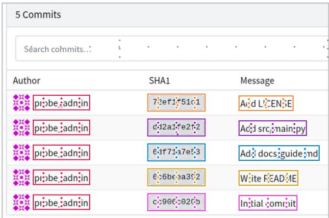

(b) The label focuses the field  
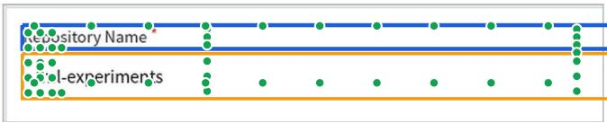

(c) The whole avatar is the link  
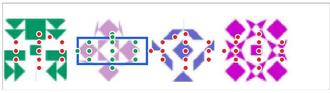  
Figure S1. Outcome maps of a self-hosted Gitea instance, made by executing about a thousand clicks per page. (a) Clicks that produce the same outcome share a colour. Each commit is opened by its hash and by its message, and the author name in every row opens the same profile. (b) Clicking the label of a text field (blue box) focuses the field (orange). (c) The annotated box covers the middle of an avatar, and clicks anywhere on the avatar open the same profile. Green dots reach the outcome of the annotated target and red dots reach a different one. Box scoring counts every green dot outside the blue box as an error.

<table><tr><td></td><td>Same-outcome copies (193)</td><td>Different-outcome copies (301)</td><td>Unique (3,092)</td></tr><tr><td>UI-Venus-1.5-8B</td><td>35.2 / 95.9</td><td>32.9 / 32.2</td><td>90.0 / 88.6</td></tr><tr><td>GTA1-7B</td><td>34.2 / 100</td><td>35.2 / 33.9</td><td>88.5 / 87.0</td></tr><tr><td>Qwen3-VL-8B</td><td>28.5 / 90.7</td><td>29.6 / 28.9</td><td>87.8 / 86.5</td></tr><tr><td>Box centre</td><td>100 / 100</td><td>100 / 98.0</td><td>100 / 98.0</td></tr></table>

Table S2. Box / outcome accuracy (%) by item type on Gitea.

<table><tr><td></td><td>Model</td><td>Box</td><td>Outcome</td><td>∆ [95% CI]</td><td>Rescued</td></tr><tr><td rowspan="3">Gitea</td><td>UI-Venus-1.5-8B71.9</td><td></td><td>75.0</td><td>+3.1 [1.7, 4.5]</td><td>16.9%</td></tr><tr><td>GTA1-7B</td><td>69.4</td><td>72.6</td><td>+3.2 [2.0, 4.5]</td><td>15.2%</td></tr><tr><td>Qwen3-VL-8B</td><td>64.9</td><td>67.4</td><td>+2.5 [1.1, 3.8]</td><td>11.5%</td></tr><tr><td rowspan="3"></td><td>UI-Venus-1.5-8B</td><td>79.6</td><td>85.9</td><td>+6.3 [4.3, 8.3]</td><td>35.9%</td></tr><tr><td>Oscar GTA1-7B</td><td>78.5</td><td>84.7</td><td>+6.2 [4.5, 7.8]</td><td>34.0%</td></tr><tr><td>Qwen3-VL-8B</td><td>73.9</td><td>82.3</td><td>+8.4 [6.7, 10.3]</td><td>34.7%</td></tr></table>

Table S3. Execution judging with natural instructions (accuracy in %). “Rescued” is the share of box-rejected clicks that reach the target outcome. All 3,586 Gitea and 1,149 Oscar items were rewritten without exclusions. Pooled over models, the rescued share on items whose template text was unique is 6.8% on Gitea (2.8% with the template) and 30.6% on Oscar (16.4%).

## C. Screenshot Audit of ScreenSpot-v2

Units and sampling. Clicks are mapped to page coordinates with the frozen evaluation convention (prediction plus crop offset, box inclusive). Unparsed predictions are excluded. Units are sorted by item and position and shuffled with seed 20261025. The pilot rule stated that the audit would stop with the conclusion “ScreenSpot-v2 is barely affected” if the pilot share fell below 5%. The pilot gave 5.4% (2 E, 35 N, 3 U), and the main sample followed.

Review. The 60 review units were drawn with seed 20261026. The reviewers worked independently from a selfcontained page that shows only the panel, the instruction and the category definitions. Table S4 gives the agreement over the three classes E, N and U. The rule to adopt the reviewers label when both disagree with ours was added after seeing the review. It changed two units, one from U to E-dup and one from N to U, and moved the overall share from 6.1% to 6.4%.

<table><tr><td>Pair</td><td>Agreement</td><td>Cohen&#x27;s κ</td></tr><tr><td>Reviewer A vs reviewer B</td><td>98.3%</td><td>0.95</td></tr><tr><td>Ours vs reviewer A</td><td>96.7%</td><td>0.89</td></tr><tr><td>Ours vs reviewer B</td><td>95.0%</td><td>0.84</td></tr></table>

Table S4. Agreement on the 60 review units.

Per-model results. Table S5 gives the share of equivalent clicks among each model’s audited units and the corrected accuracy, $\mathrm { a c c } _ { \mathrm { b o x } } + \mathrm { e r r } _ { \mathrm { b o x } } \times$ E share, with intervals from resampling units.

Pairs whose gap changes. Table S6 lists the three pairs that change order together with the comparisons discussed in the main text. Eight of the 55 intervals on the difference in correction exclude zero, where about three would be expected by chance. The seed-42 comparison of outcome and box rewards, significant under box scoring, halves under outcome scoring.

Likely annotation problems. Seven units on five items were flagged during judging. On three items the click follows the instruction and the annotated box marks another element, for example “switch the temperature display to Fahrenheit” boxed on Notifications. On the other two the instruction fits both the click and the box. All seven units count as N in every estimate and are listed in the release.

<table><tr><td>Model</td><td></td><td>Units E/N/U</td><td>Box</td><td>Corrected [95% CI]</td><td>Rank</td></tr><tr><td>UI-Venus-1.5-8B</td><td>20</td><td>3/17/0</td><td></td><td>96.31 96.86 [96.31, 97.54]</td><td>1 → 1</td></tr><tr><td>GTA1-7B</td><td>33</td><td>8/22/3</td><td></td><td>93.40 95.16 [94.13, 96.29]</td><td>2 → 2</td></tr><tr><td>Qwen3-VL-8B</td><td>35</td><td>5/27/3</td><td></td><td>93.08 94.16 [93.34, 95.12]</td><td>3→ 3</td></tr><tr><td>3B, outcome s42</td><td>84</td><td></td><td></td><td>3/78/381.3782.06 [81.37, 82.93]</td><td>4→ 4</td></tr><tr><td>3B, box s43</td><td>78</td><td></td><td></td><td>1/74/381.2981.53 [81.29, 82.08]</td><td>5 → 7</td></tr><tr><td>3B, outcome s43</td><td>82</td><td></td><td></td><td>3/77/2 81.0581.76 [81.05, 82.64]</td><td>6→ 5</td></tr><tr><td>3B, GUI-Libra s42</td><td>80</td><td></td><td></td><td>4/71/580.5081.54 [80.74, 82.63]</td><td>7 → 6</td></tr><tr><td>3B, box s44</td><td>89</td><td></td><td></td><td>3/83/380.1980.87 [80.19, 81.73]</td><td>8→ 9</td></tr><tr><td>3B, box s42</td><td>73</td><td></td><td></td><td>5/65/3 79.9581.35 [80.25, 82.63]</td><td>9 → 8</td></tr><tr><td>3B, outcome s44</td><td>96</td><td></td><td></td><td>3/89/4 78.77 79.46 [78.77, 80.33]10 → 10</td><td></td></tr><tr><td>Qwen2.5-VL-3B</td><td>103</td><td></td><td></td><td>2/97/4 75.00 75.50 [75.00, 76.30] 11 → 11</td><td></td></tr></table>

Table S5. ScreenSpot-v2 audit per model (accuracy in %). The correction only credits rejected clicks, since accepted clicks with a different outcome cannot be seen on screenshots. Ranks in bold change.
<table><tr><td>Pair (A vs B)</td><td>Box</td><td>∆ corr. [95% CI]</td><td>Corrected [95% CI]</td></tr><tr><td>box s44 vs box s42</td><td></td><td></td><td>+0.24 −0.71 [−1.60, -0.07] -0.48 [−1.36, 0.17]</td></tr><tr><td>box s43 vs outcome s43 +0.24</td><td></td><td></td><td>-0.47[−1.46, 0.41] -0.23[-1.22, 0.65]</td></tr><tr><td>box s43 vs GUI-Libra</td><td></td><td></td><td>+0.79 −0.80 [−1.77, -0.01] -0.01 [-0.98, 0.78]</td></tr><tr><td>outcome s42 vs box s42 +1.42 −0.71 [−1.59, -0.06] +0.70 [−0.17, 1.36]</td><td></td><td></td><td></td></tr><tr><td>box s43 vs box s42</td><td></td><td></td><td>+1.34 -1.16[-2.34, -0.26] +0.18 [−1.00, 1.08]</td></tr><tr><td>UI-Venus vs GTA1</td><td></td><td></td><td>+2.91 −1.21 [−2.45, −0.01] +1.70 [0.46, 2.90]</td></tr><tr><td>UI-Venus vs Qwen3-VL +3.22</td><td></td><td>-0.53[−1.62, 0.48]</td><td>+2.70 [1.60, 3.70]</td></tr><tr><td>GTA1 vs Qwen3-VL</td><td></td><td>+0.31 +0.68 [-0.50, 1.90]</td><td>+0.99 [-0.19, 2.21]</td></tr></table>

Table S6. Selected pairs on ScreenSpot-v2 (points). The correctedgap interval adds the box gap to the interval of the difference in correction, so it reflects audit uncertainty and holds the test set fixed. All 55 pairs are released.

## D. Mind2Web Static Analysis

For each click step we evaluate the 1280 × 720 window that the grounders see and look for elements that share the target’s outcome from page annotations alone: elements with the same link target, and labels bound to the target control. The released page HTML keeps no link targets, so only the label channel can be measured, and the reported 1.3% is a lower bound. Step-level instructions name the element and its text, and task-level instructions give the task and previous actions.

## E. Training Details

Recipe. GTA1 GRPO (commit 81f0c4c) with gradient checkpointing, a shared coordinate parser for reward and evaluation, and a chunked vision attention patch to fit 24 GB GPUs. LoRA has rank 16 and α = 32 on the attention and

MLP projections, with the vision modules frozen. Learning rate $2 \times 1 0 ^ { - 5 }$ with 5% warm-up and linear decay, 8 items per update on 8 GPUs, 8 samples per item at temperature 1, at most 64 new tokens, images up to $1 2 8 0 \times 7 2 0 .$ . Each arm takes about one hour on eight RTX 4090 GPUs. GUI-Libra does not give values for λ and κ, and we use 0.5 for both.

Decision rules. The first study (seed 42) asked whether the outcome reward raises outcome accuracy on held-out Gitea layouts, with a guard against losing more than one point on ScreenSpot-v2. The difference was −0.60 points [−1.09, −0.06], so the outcome reward gave no gain. Seed 42 did show a +1.42 point difference on ScreenSpot-v2, which motivated a confirmation with seeds 43 and 44 on ScreenSpot-v2 and Mind2Web. Averaged over the two new seeds the difference is −0.83 [−1.66, +0.04] on ScreenSpotv2. On Mind2Web it is +0.18 [−0.11, +0.47]. The seed-42 effect therefore did not replicate. Seeds 43 and 44 were also evaluated on held-out Gitea as a report-only analysis, which gives the three-seed Gitea results in Tab. 5. GUI-Libra seeds 43 and 44 were added later as a report-only analysis, with the same script, data and hyperparameters. Averaged over three seeds, GUI-Libra minus box is −0.36 (Gitea), +0.40 (Oscar), +0.47 (ScreenSpot-v2) and +0.16 (Mind2Web) points.

## F. Test-Set Noise

We recomputed per-item correctness for all 11 models from the raw predictions and checked it against the audit totals. Pairs are resampled jointly over items (10,000 times, seed 20261025).
<table><tr><td>Pair</td><td>Diff</td><td>95% CI</td><td></td><td>Discord. McNemar p</td></tr><tr><td>GTA1 – Venus</td><td>-2.91</td><td>[-4.25, -1.65]</td><td>5.7%</td><td>&lt;0.001</td></tr><tr><td>Qwen3 — Venus</td><td>-3.22</td><td>[-4.48, -1.97]</td><td>5.3%</td><td>&lt;0.001</td></tr><tr><td>GTA1 - Qwen3</td><td>+0.31</td><td>[−1.26, 1.81]</td><td>8.0%</td><td>0.77</td></tr></table>

Table S7. Paired comparisons of 7–8B grounders on ScreenSpot-v2 (points). Discord. is the share of items that exactly one of the two models gets right.

## G. Literature Coding

We collected papers that report ScreenSpot-v2 grounding accuracy and coded three kinds of comparison: the proposed model against the strongest prior model of the same size reported in the same table (head-to-head), against its own untrained base model, and ablations. Two searches were run independently with their own coding notes, and every number was checked against the original table. The union contains 29 papers, 58 head-to-head comparisons from 28 of them, 47 base comparisons and 166 ablation rows. The reference thresholds are the single-seed effect of 1.42 points and the largest seed spread of 2.60 points from Sec. 6. Of the head-to-head gaps, 57% are at most 1.42 and 69% at most 2.60 points. The paper list and coded rows are released.

## H. Protocol Log

Each analysis has a rule file with a timestamp and checksum. Later changes were appended as amendments that state what had been seen when they were written. The amendments behind the reported analyses are, in order:

1. The probe waiting rule of Sec. A.

2. Execution-judged items taken from the second probe run, decided before any judging.

3. Qwen3-VL-8B added after its adapter reproduced the published ScreenSpot-v2 accuracy (93.1% against 91.7%).

4. The coordinate parser extended to parenthesised boxes, written when only base-model outputs existed.

5. The report-only Gitea evaluation of seeds 43 and 44.

6. The audit pilot outcome and the exploratory flags.

7. The reviewer adjudication rule.

8. The pairwise correction analysis of Sec. 6.

9. The natural-instruction check of Sec. 4 and its reading rule, written before any rewrite. The rewriting model was then changed from Qwen2.5-7B-Instruct, which would have had to be downloaded, to Qwen3-4B-Instruct-2507, which was available locally, still before any rewrite.

10. GUI-Libra seeds 43 and 44, with a fallback to four GPUs at the same 64 samples per update. Both seeds ran on eight GPUs.

The first Gitea execution of the natural-instruction check failed the drift rule (52% of box centres changed), because the login session of the probe had expired. The run was declared invalid as the rule requires, the session was renewed, and the execution was repeated with drift 1.8%. Earlier Gitea executions passed the same check. Item 4 also resolved the low parse rate that stopped the first training diagnostic. A memory overflow in the same diagnostic was resolved by the vision attention patch, which matches the upstream attention to numerical precision.

## I. Release

We release the probe and its tests, the seeded Gitea application, all outcome maps, the 3,586 execution-judged items with every prediction and outcome, the ScreenSpot-v2 audit panels with our labels and both reviewers’ labels, training and evaluation code with all checkpoints’ predictions, the literature coding, and every rule file with its checksum.