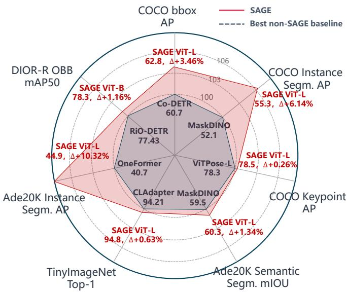
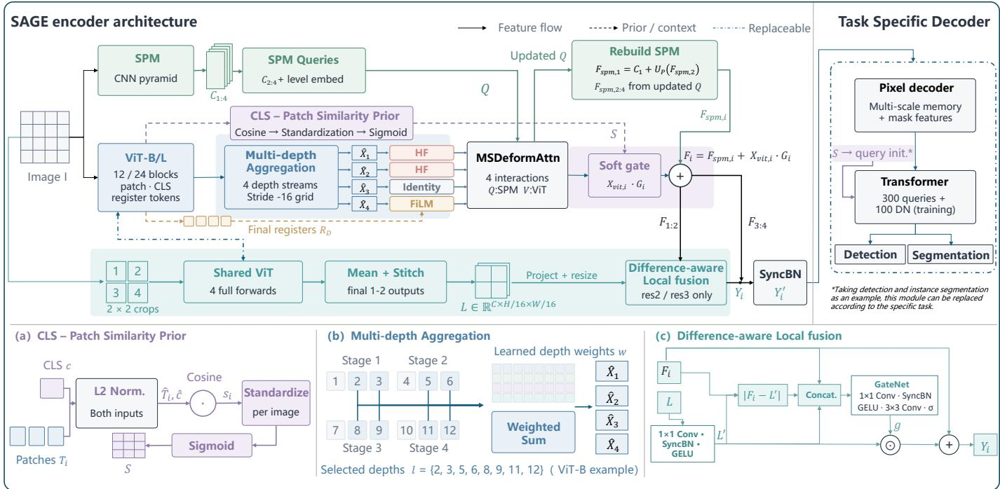

# SAGE: Saliency-Annealed Gated Encoder for Universal Vision Recognition

Le Yang, Yucheng Huang, Junyu Chen, Qi Dang, Xin Kong, Haifeng Huo, and Qiang Zhao Huawei Technologies Co., Ltd.

  
Fig. 1. Cross-task performance comparison of SAGE across six vision tasks on seven benchmarks, normalized to the strongest non-SAGE baseline (100%). For fair comparison, we include baselines with comparable backbone sizes and evaluate all methods without test-time augmentation (TTA).

Abstract—When adapting self-supervised Vision Transformers (ViTs) to dense prediction, existing methods often treat the ViT as a passive feature extractor and may underuse the rich priors encoded in its representations, including saliency, global context, and high-frequency details. We propose SAGE (Saliency-Annealed Gated Encoder), an enhanced ViT-Adapter backbone that explicitly exploits these priors through three complementary innovations: (1) a saliency-guided architecture that extracts DINO-style class-token (CLS) saliency to guide feature gating and high-frequency enhancement, together with dynamic multi-layer aggregation and a local-detail branch; (2) an annealing-based training paradigm designed to improve convergence and feature quality during early training while reducing feature drift later in training; and (3) a two-stage, quality-aware training mechanism that smoothly transitions from focal loss to Varifocal Loss (VFL) within a single training run. Across the evaluated tasks (Fig. 1), SAGE achieves state-of-the-art (SOTA) or competitive results on COCO (62.8 box AP and 55.3 mask AP), COCO keypoint estimation (78.5 AP), ADE20K (60.3 mIoU for semantic segmentation and 44.9 mask AP for instance segmentation), TinyImageNet classification (94.76% Top-1 accuracy), and DIOR-R oriented object detection (78.8 AP ). The same backbone is used across tasks, with task-specific decoders. To the best of our knowledge, SAGE is the first framework to achieve multitask state-of-the-art results on Huawei Ascend NPUs. Code and pretrained models will be released after internal review.

## I. INTRODUCTION

The DETR architecture [1] eliminates anchor boxes and non-maximum suppression (NMS) through bipartite matching. Subsequent work has advanced the field through deformable attention (Deformable DETR [2]), denoising training (DINO [3]), and unified frameworks (MaskDINO [4]). More recently, Co-DETR [5] introduced collaborative multihead training, D-FINE [6] reformulated box regression as distribution refinement, DEIMv2 [7] introduced a matchingaware loss, and RF-DETR [8] combined DINOv2 with neural architecture search (NAS) to surpass 60 AP.

Despite these advances, self-supervised ViT foundation models have demonstrated strong representational capabilities, while adapting them to dense prediction continues to pose distinct architectural challenges.

Limited access to high-frequency detail. ViT’s 16 × 16 patchification limits the representation of fine-grained edge and texture information. The SPM in ViT-Adapter [9] operates independently of the ViT pathway and may not fully compensate for this limitation, particularly for small-object detection and precise boundary localization.

Limited explicit foreground discrimination. DINO [10]- style pretraining can encode saliency-related information in the CLS token. Its cosine similarity with patch tokens can highlight foreground objects without additional supervision. Although this prior has been explored in unsupervised object discovery, it has received limited attention in detection adapters.

Underuse of multi-layer representations and auxiliary tokens. ViTs encode different levels of abstraction at different depths, while register tokens [11] can capture global context. Existing adapters often use only the final layer or a fixed set of layer indices, without learnable dynamic layer selection. Register tokens typically contribute to the representation only implicitly through attention.

We propose SAGE, an enhanced ViT-Adapter backbone that aims to improve feature representations by explicitly exploiting information encoded in self-supervised ViTs. Our contributions comprise three innovations at the architectural, training-paradigm, and training-strategy levels:

Contribution 1 (Architecture): Saliency-guided ViT-Adapter enhancement. We explicitly extract DINO-style CLS-token saliency to guide scale-adaptive residual soft gating, register-token FiLM modulation, and a Laplacian highfrequency enhancer. Temperature-controlled softmax $\mathit { \Omega } ( \tau \ =$ 2.0) enables learnable multi-depth fusion as an alternative to

DEIMv2’s fixed layer selection [5,8,11]. A $2 \times 2$ sub-crop branch and difference-aware gated fusion are used to recover high-resolution details.

Contribution 2 (Training paradigm): Annealing-based enhancement. A three-stage, proportion-based cosine annealing schedule gradually reduces the contribution of all enhancement modules toward identity mapping.

Contribution 3 (Training strategy): Two-stage, qualityaware training. We smoothly transition from focal loss to VFL within a single training run to address the cold-start problem, and combine this transition with saliency-guided query initialization and a semantic-consistency loss.

Our ablation studies indicate that combining the annealing schedule with two-stage VFL improves performance. The results suggest a positive interaction between the two mechanisms, indicating that their effects may be complementary.

SAGE achieves state-of-the-art or competitive results across multiple vision tasks under single-scale inference without TTA. The same enhanced backbone is used across tasks, with only the downstream task head changed. These results suggest that the proposed components operate primarily at the feature-representation level rather than relying on taskspecific architectural changes. All experiments were conducted on Huawei Ascend NPUs.

## II. RELATED WORK

## A. DETR-Based Detection and ViT Adaptation

End-to-end object detection has advanced rapidly since DETR [1] introduced bipartite matching to eliminate anchor boxes and NMS. Key developments include multi-scale deformable attention (Deformable DETR [2]), contrastive denoising training (DINO [3]), and unified detection and segmentation frameworks (MaskDINO [4]). More recent methods extend this line of work: Co-DETR [5] uses collaborative multi-head training and discards its auxiliary heads at inference, reaching 60.7 AP on COCO with Swin-L; D-FINE [6] formulates box regression as distribution refinement; DEIMv2 [7] introduces a matching-aware loss with DINOv3 features; and RF-DETR [8] combines DINOv2 with neural architecture search.

Several adapter approaches have been proposed to connect self-supervised ViT backbones with dense prediction. ViT-Det [12] constructs feature pyramids using strided convolutions, without direct interaction between the ViT and detector. ViT-Adapter [9] introduces a spatial prior module (SPM) and multi-scale deformable attention (MSDeformAttn) for bidirectional feature interaction, achieving 58.8 box AP on COCO with ViT-L pretrained on IN-22K. DEIMv2’s spatial tuning adapter (STA) extracts features from fixed layer indices [5, 8, 11] and interpolates them independently, without learnable aggregation. RF-DETR uses a basic projector without explicit feature enhancement. These methods generally treat the ViT as a passive feature extractor and do not explicitly exploit information such as CLS-token saliency, register-token global context, or high-frequency edge details. DINOv2 [13] further scales self-supervised ViT pretraining, but these properties have primarily been examined through representation analysis rather than explicitly extracted for downstream feature enhancement. Our method builds on this line of research by computing DINO-style saliency maps and extracting registertoken context to guide feature enhancement.

## B. Training Strategies and General-Purpose Backbone Design

Training strategies for DETR-based detectors have also received increasing attention. DINO [3] introduces contrastive denoising (CDN), which provides dense supervision through noisy ground-truth queries; this strategy has become common in subsequent methods [4]–[6]. Co-DETR [5] uses auxiliary one-to-many assignment heads during training and discards them at inference, which may introduce a distribution shift between training and deployment. In terms of loss design, VarifocalNet [14] uses predicted IoU as a soft label through Varifocal Loss (VFL), which has been adopted by D-FINE, DEIMv2, and RF-DETR. Applying VFL from the beginning of training, however, may be unstable when predicted IoUs are noisy during early iterations. More broadly, existing strategies focus mainly on loss design or architecture search (e.g., RF-DETR [8]), while the coordinated design of enhancement modules, loss schedules, and representation stability has received less attention. SAGE explores this direction through (1) a twostage focal-to-VFL transition intended to mitigate the coldstart problem and (2) an annealing schedule that gradually reduces enhancement modules toward identity mappings, with the aim of retaining training-time benefits in the backbone representation.

Regarding cross-task generality, many ViT adaptation methods, such as TADFormer [15], require task-specific adapter configurations. In contrast, SAGE’s enhancement modules operate at the feature-representation level and are designed to be independent of downstream tasks. We evaluate the same enhanced backbone with task-specific decoders on object detection, instance segmentation, image classification, oriented object detection, pose estimation, and semantic segmentation.

## III. METHOD

## A. Overall Architecture

The core of SAGE is an enhanced ViT-Adapter backbone with three main components: (1) a saliency-guided featureenhancement architecture, (2) an annealing-based training paradigm, and (3) a two-stage, quality-aware training strategy. The enhancement modules are jointly controlled by the annealing coefficient λ. Fig. 2 illustrates the overall architecture.

As shown in Fig. 2, the forward pass follows three parallel paths. (i) SPM path: The input x is fed into the SPM CNN pyramid [9] to generate four-scale features $\mathbf { C } _ { 1 : 4 }$ . The query sequence c is updated by MSDeformAttn, and $\mathbf { C } _ { 1 }$ is subsequently reconstructed as $\mathbf { F } _ { s p m , 1 } = \mathbf { C } _ { 1 } + U _ { p } ( \mathbf { F } _ { s p m , 2 } )$ . (ii) ViT path: The ViT produces representations from all layers. CLS– patch cosine similarity at two-thirds depth yields the saliency prior S, while multi-depth aggregation fuses sampled layers into four features $\hat { \mathbf { X } } _ { 1 : 4 }$ using learned softmax weights. These features are enhanced at each scale using Laplacian highfrequency enhancement and register-token FiLM modulation before interacting with the SPM queries through MSDeformAttn. (iii) Local-detail path: The input is divided into

  
Fig. 2. Overview of the SAGE architecture. The input image is processed in three parallel paths: (1) SPM CNN pyramid generating multi-scale features $\mathbf { C } _ { 1 : 4 } ;$ (2) ViT backbone producing all layer outputs (patch/CLS/register tokens), from which the saliency prior S and multi-depth aggregated features $\hat { \mathbf { X } } _ { 1 : 4 }$ are derived; (3) a 2×2 local-detail branch extracting L. The aggregated features are per-scale enhanced (HF/FiLM), interact with SPM queries via MSDeformAttn, and are fused through residual soft gating $( \mathbf { F } _ { i } = \mathbf { F } _ { s p m , i } \bar { + } \bar { \mathbf { X } } _ { v i t , i } \cdot \mathbf { G } _ { i } )$ and difference-aware local fusion, followed by SyncBN and a task-specific decoder. (a) CLS–Patch similarity prior: S from 2/3-depth tokens via L2-norm cosine similarity, standardization, sigmoid. (b) Multi-depth aggregation: sampled layers fused into $\hat { \mathbf { X } } _ { 1 : 4 }$ via temperature-softmax weights. (c) Difference-aware local fusion: $\mathbf { \widetilde { Y } } _ { i } = \mathbf { F } _ { i } + \sigma ( \operatorname { G a t e N e t } ( [ \mathbf { F } _ { i } , \mathbf { L } ^ { \prime } , | \mathbf { F } _ { i } - \mathbf { \widetilde { L } } ^ { \prime } | ] ) ) \odot \mathbf { \widetilde { L } } ^ { \prime }$ for high-resolution scales.

$2 \times 2$ sub-crops, each of which is processed independently by the final blocks of the shared ViT. The resulting features are stitched into a global feature map L and fused into $\mathbf { F } _ { 1 : 2 }$ through difference-aware local fusion.

After these paths are combined, saliency-guided residual soft gating modulates only the ViT residual features $( \mathbf { F } _ { i } = $ $\mathbf { F } _ { s p m , i } + \mathbf { X } _ { v i t , i } \cdot \mathbf { G } _ { i }$ , where $\mathbf { G } _ { i } = 1 + s _ { m a x } \alpha _ { i } ( 2 \mathbf { S } _ { i } - 1 ) )$ The resulting four-scale features are normalized by SyncBN to produce $\mathbf { Y } _ { 1 : 4 } ^ { \prime }$ . These features are passed to a task-specific decoder, such as the MaskDINO [4] pixel and transformer decoders with 300 queries for detection and segmentation, or other heads for classification, pose estimation, and oriented detection. The saliency map S also guides query initialization. All enhancement modules are controlled by the same annealing coefficient λ.

## B. Saliency-Guided Enhanced ViT-Adapter Architecture

When ViT-Adapter injects ViT features into the multiscale SPM pyramid, features from different spatial locations are fused without an explicit saliency prior. DINO [10]-style pretraining encodes saliency-related information in the CLS token; its cosine similarity with patch tokens can highlight foreground objects without additional supervision. This prior has been studied in unsupervised object discovery but has not been widely used to guide detection adapters. ViT’s 16 × 16 patchification also limits access to fine-grained edge information, while register tokens in modern ViTs [11] encode global context but typically participate in attention implicitly. These three information sources—saliency, high-frequency detail, and global context—motivate three complementary featuremodulation modules targeting foreground discrimination, edge precision, and semantic consistency.

1) DINO-style Saliency Computation: Given patch tokens $\mathbf { T } \in \mathbb { R } ^ { N \times C }$ and a class token $\mathbf { c } \in \mathbb { R } ^ { C }$ from an intermediate ViT layer (at two-thirds depth, balancing semantic abstraction and spatial detail), where $N = H \times W$ is the number of patches at 1/16 resolution, we compute the saliency map in three steps (Fig. 2(a)). First, we apply L2 normalization and compute the cosine similarity $s _ { i } = \langle \hat { \mathbf { T } } _ { i } , \hat { \mathbf { c } } \rangle$ . Cosine similarity measures directional alignment and can therefore serve as a semantic-relevance signal:

$$
\hat { \mathbf { T } } _ { i } = \frac { \mathbf { T } _ { i } } { \| \mathbf { T } _ { i } \| _ { 2 } + \epsilon } , \quad \hat { \mathbf { c } } = \frac { \mathbf { c } } { \| \mathbf { c } \| _ { 2 } + \epsilon } , \quad s _ { i } = \langle \hat { \mathbf { T } } _ { i } , \hat { \mathbf { c } } \rangle\tag{1}
$$

Second, we standardize the similarity values for each image to have zero mean and unit variance, then map them consistently to [0, 1] through the subsequent sigmoid:

$$
\begin{array} { c } { \displaystyle { \mu = \frac { 1 } { N } \sum _ { i = 1 } ^ { N } s _ { i } , } } \\ { \displaystyle { \sigma _ { s t d } = \sqrt { \frac { 1 } { N } \sum _ { i = 1 } ^ { N } ( s _ { i } - \mu ) ^ { 2 } + \epsilon } , } } \\ { \displaystyle { s _ { i } ^ { \prime } = \frac { s _ { i } - \mu } { \sigma _ { s t d } } } } \end{array}\tag{2}
$$

Third, sigmoid activation produces the saliency map ${ \textbf { S } } \in$ $( 0 , 1 ) ^ { H \times W }$ , which highlights potentially salient foreground

regions without additional annotations or pretraining:

$$
\mathbf { S } _ { i } = \sigma ( s _ { i } ^ { \prime } ) = \frac { 1 } { 1 + e ^ { - s _ { i } ^ { \prime } } }\tag{3}
$$

We extract saliency from the two-thirds-depth layer, which balances semantic abstraction for foreground-background discrimination with sufficient spatial detail to localize foreground boundaries.

2) Scale-Adaptive Residual Soft Gating: We design a residual gate centered at 1.0 to enhance salient foreground regions while suppressing less-salient regions. This design avoids the overly aggressive behavior of binary masks, which can discard background context, and the limitation of conventional multiplicative gates, which only attenuate features. The modulation applied to the ViT residual feature ${ \bf X } _ { v i t }$ is defined as follows:

$$
\mathbf { G } _ { i } = \mathrm { c l a m p } ( 1 + s _ { m a x } \cdot \alpha _ { i } \cdot ( 2 \mathbf { S } _ { i } - 1 ) , 1 - s _ { m a x } , 1 + s _ { m a x } )
$$

where $i \in \{ 1 , 2 , 3 \}$ indexes the scale group (stride 4/8, 16, 32), $\alpha _ { i } = \sigma ( \beta _ { i } ) \in ( 0 , 1 )$ is a learnable per-scale weight, and $s _ { m a x } = 0 . 2 0$ bounds the modulation range. $\left( 2 \mathbf { S } - 1 \right)$ maps [0, 1] saliency to [−1, 1] — foreground regions $\mathbf { ( S \theta > \theta 0 . 5 ) }$ obtain $\mathbf { G } > 1$ (enhancement by at most 20%), background regions $( \mathbf { S } \ \mathrm { ~ < ~ } \ 0 . 5 )$ obtain $\textbf { G } < \textbf { 1 }$ (suppression but not zeroing). The learnable per-scale weights $\alpha _ { i }$ are initialized to {0.20, 0.50, 0.80}, encouraging stronger gating on deeper scales where semantic information is more reliable. The final feature at each scale is:

$$
\mathbf { F } _ { i } = \mathbf { F } _ { s p m , i } + \mathbf { X } _ { v i t , i } \cdot \mathbf { G } _ { i }\tag{5}
$$

We leave the SPM baseline ungated to preserve a stable multiscale structural foundation, while the ViT residual features provide foreground-background discrimination.

3) Register-Token FiLM Modulation: Modern selfsupervised ViTs contain register or memory tokens $\mathbf { R } ^ { \mathbf { \bar { \alpha } } } \in \mathbb { R } ^ { K \times C }$ [11] that encode global context but typically contribute to feature representations only through attention. We explicitly extract this context using Feature-wise Linear Modulation (FiLM) [16]. We mean-pool the register tokens, pass the pooled representation through a two-layer MLP to generate modulation parameters, and apply bounded FiLM modulation as follows:

$$
g _ { c t x } = \mathrm { m e a n } ( \mathbf { R } ) ,\tag{6a}
$$

$$
\mathbf { h } = \mathrm { R e L U } ( \mathbf { W } _ { 1 } g _ { c t x } + \mathbf { b } _ { 1 } ) ,\tag{6b}
$$

$$
\left[ \gamma _ { r a w } , \ \beta _ { r a w } \right] = { \bf W } _ { 2 } { \bf h } + { \bf b } _ { 2 } ,\tag{6c}
$$

$$
\gamma = 1 + g _ { m a x } \cdot \operatorname { t a n h } ( \gamma _ { r a w } ) ,\tag{6d}
$$

$$
\beta = b _ { m a x } \cdot \operatorname { t a n h } ( \beta _ { r a w } ) ,\tag{6e}
$$

$$
\mathbf { y } = \mathbf { x } \cdot \boldsymbol { \gamma } + \boldsymbol { \beta }\tag{6f}
$$

The tanh bounds constrain γ to [0.90, 1.10] and β to $[ - 0 . 1 0 , 0 . 1 0 ]$ , limiting the magnitude of modulation during long training schedules. Because $\gamma$ is centered at 1.0, the modulation remains close to the identity transformation when its raw parameters are small. We apply this module only to the deepest scale (res5, stride 32), where global semantic context is expected to be most useful.

4) Laplacian High-Frequency Enhancer: ViT’s $1 6 \times 1 6$ patchification limits the representation of high-frequency edge information. Although the SPM in ViT-Adapter generates multi-scale features using CNN convolutions, its features are computed in a separate pathway and do not directly restore fine-grained information within the ViT features. We therefore use a fixed four-neighborhood Laplacian operator to extract edge-related responses. The fixed kernel introduces no additional parameters, while a learnable scale factor s controls the enhancement strength. We apply the enhancement in a bounded residual form:

$$
\mathbf { H } = \operatorname { L a p } ( \mathbf { X } ) = \mathbf { X } * \left[ \begin{array} { c c c } { 0 } & { 1 } & { 0 } \\ { 1 } & { - 4 } & { 1 } \\ { 0 } & { 1 } & { 0 } \end{array} \right]\tag{7}
$$

$$
\mathbf { Y } = \mathbf { X } + \lambda \cdot s \cdot \mathrm { S i L U } ( \mathbf { H } )\tag{8}
$$

Here, $s = s _ { m a x } \cdot \sigma ( s _ { r a w } ) \in [ 0 , s _ { m a x } ]$ is a learnable scale factor $( s _ { m a x } ~ = ~ 0 . 2 0 $ initialized to 0.10), and λ is the annealing coefficient (Sec. III-C). The SiLU activation is intended to attenuate weak responses while retaining stronger edge responses. We apply this module to the shallow scales (res2 at stride 4 and res3 at stride $^ { 8 ) , }$ , where high-frequency detail is particularly relevant to small-object detection and boundary localization.

5) Dynamic Multi-Layer Aggregation: ViT-Adapter’s MS-DeformAttn uses features from the final ViT layer, although different depths encode different levels of abstraction. DEIMv2’s STA uses fixed layer indices [5, 8, 11] without learnable inter-layer weighting. In contrast, we learn the aggregation weights over Transformer layers. Given L Transformerlayer outputs {xl} (spatial tokens) and {cl} (class tokens), we aggregate the spatial features into $S \ : = \ : 4$ scale-specific representations (Fig. 2(b)):

$$
w _ { s , l } = \frac { \exp ( W _ { s , l } / \tau ) } { \sum _ { l = 1 } ^ { L } \exp ( \mathbf { W } _ { s , l } / \tau ) } , \quad \hat { \mathbf { x } } _ { s } = \sum _ { l = 1 } ^ { L } w _ { s , l } \cdot \mathbf { x } _ { l }\tag{9}
$$

where $\mathbf { W } _ { s } \in \mathbb { R } ^ { L }$ contains the learnable weights for scale $s ,$ and $\tau = 2 . 0$ is the temperature. In our experiments, this value provides a useful balance between the sharper distribution produced by $\tau = 1 . 0$ and the flatter distribution produced by $\tau = 5 . 0$ . We initialize the weights with values that decay with distance from the depth center associated with each scale:

$$
W _ { s , l } ^ { ( i n i t ) } = - 0 . 5 \cdot | l - c _ { s } | , \quad c _ { s } = \lfloor ( s + 0 . 5 ) \cdot L / S \rfloor\tag{10}
$$

For $L = 1 2$ and $S = 4$ , the corresponding centers are at layers 1.5, 4.5, 7.5, and 10.5. We sample the final two blocks from each stage (layers {2, 3, 5, 6, 8, 9, 11, 12}), using eight layers instead of twelve and thereby reducing the number of sampled layers by 33%.

6) Local Detail Branch and Difference-Aware Gated $F u \mathrm { - }$ sion: Because ViT uses a 1/16 patch grid, its high-resolution pyramid levels (res2/res3) may lack fine local detail. To address this limitation, we introduce a $2 \times 2$ sub-crop branch that divides the input image into four non-overlapping regions. Each crop is processed independently by the final one or two Transformer blocks, so each patch corresponds to an $8 \times 8$ pixel region and can capture finer edge and texture details.

TABLE I  
COMPARISON WITH STATE-OF-THE-ART METHODS ON COCO VAL2017. ALL RESULTS USE SINGLE-SCALE INFERENCE WITHOUT TTA. PARAMETER COUNTS REFER TO THE BACKBONE. THE BEST RESULTS ARE SHOWN IN BOLD, AND THE SECOND-BEST RESULTS ARE UNDERLINED.
<table><tr><td>Method</td><td>Backbone Params</td><td>Pretrain Data</td><td></td><td>bbox AP</td><td>bbox AP@.50 segm AP</td><td></td><td>segm AP@.50</td></tr><tr><td>DINO [3]</td><td>ResNet-50</td><td>25M</td><td>IN-1K</td><td>49.0</td><td>67.0</td><td></td><td></td></tr><tr><td>MaskDINO [4]</td><td>ResNet-50</td><td>25M</td><td>IN-1K</td><td>51.7</td><td>70.5</td><td>45.0</td><td>68.0</td></tr><tr><td>D-FINE-X [6]</td><td>HGNetv2-B5</td><td>30M</td><td>0365</td><td>59.3</td><td>78.0</td><td></td><td></td></tr><tr><td>RT-DETRv4-X [17]</td><td>HGNetv2-B4</td><td>22M</td><td>0365</td><td>57.0</td><td>75.0</td><td></td><td></td></tr><tr><td>DEIMv2-X [7]</td><td>HGNetv2-B4</td><td>22M</td><td>0365</td><td>57.8</td><td>76.0</td><td></td><td></td></tr><tr><td>DINO [3]</td><td>Swin-L</td><td>197M</td><td>IN-22K</td><td>58.5</td><td>78.0</td><td></td><td></td></tr><tr><td>ViTDet [12]</td><td>ViT-H</td><td>632M</td><td>IN-22K</td><td>58.7</td><td>78.5</td><td>50.9</td><td>72.0</td></tr><tr><td>MaskDINO [4]</td><td>Swin-L</td><td>197M</td><td>IN-22K</td><td>58.3</td><td>78.0</td><td>52.1</td><td>73.0</td></tr><tr><td>ViT-Adapter-L [9]</td><td>ViT-L</td><td>304M</td><td>IN-22K</td><td>58.8</td><td>78.5</td><td>51.1</td><td>72.5</td></tr><tr><td>Co-DETR [5]</td><td>Swin-L</td><td>197M</td><td>IN-22K</td><td>60.7</td><td>79.0</td><td></td><td></td></tr><tr><td>RF-DETR-2XL [8]</td><td>ViT-B</td><td>86M</td><td>0365</td><td>60.1</td><td>78.5</td><td>49.9</td><td>73.1</td></tr><tr><td>SAGE (ours)</td><td>ViT-B</td><td>86M</td><td>0365</td><td>61.1</td><td>79.5</td><td>54.4</td><td>78.5</td></tr><tr><td>SAGE (ours)</td><td>ViT-L</td><td>304M</td><td>0365</td><td>62.8</td><td>81.3</td><td>55.3</td><td>79.9</td></tr></table>

The output from each crop is reshaped into a 2D feature map and stitched back by spatial coordinates to form a global 1/16-resolution token map $\mathbf { \Delta L } \in \mathbb { R } ^ { C \times H / 1 6 \times W / 1 6 }$ . We fuse the local-detail features with the global features using a differenceaware gating mechanism:

$$
\mathbf { L } ^ { \prime } = \mathbf { C o n v } _ { 1 \times 1 } ( \mathbf { L } ) , \quad \mathbf { D } = | \mathbf { G } - \mathbf { L } ^ { \prime } |\tag{11}
$$

$$
\begin{array} { r } { \mathbf { g } = \sigma ( \mathbf { C o n v } _ { 1 \times 1 } ( [ \mathbf { G } , \mathbf { L } ^ { \prime } , \mathbf { D } ] ) ) , \quad \mathbf { Y } = \mathbf { G } + \mathbf { g } \odot \mathbf { L } ^ { \prime } } \end{array}\tag{12}
$$

Including $| \mathbf { G } - \mathbf { L } ^ { \prime } |$ , the absolute difference, as a third input allows the gate to respond to inconsistencies between local and global features. Regions with larger differences can therefore receive higher fusion weights. We apply this module only to the high-resolution scales (res2 and res3). Fig. 2(b) and Fig. 2(c) illustrate multi-depth aggregation and differenceaware local fusion, respectively.

## C. Annealing-enhanced Training Paradigm

The enhancement modules are intended to accelerate convergence and improve feature quality during early training. Later in training, however, continued reliance on auxiliary signals may lead to feature drift and reduce the model’s reliance on its standard architecture. We therefore use a schedule that activates the enhancement modules during early training and gradually withdraws them later. The three-stage cosine annealing schedule is defined in terms of the proportion p of total training iterations T: (1) ramp-up $( 0 \leq p < r _ { u p } ) .$ , during which λ increases from 0 to 1; (2) plateau $( r _ { u p } \le p < r _ { d o w n } )$ during which $\lambda = 1 ;$ and (3) annealing $( r _ { d o w n } \le p < 1 )$ during which λ decreases from 1 to 0:

$$
\lambda ( p ) = { \frac { 1 } { 2 } } \left( 1 - \cos \left( \pi \cdot { \frac { p } { r _ { u p } } } \right) \right) \quad { \mathrm { ( S t a g e ~ } } 1 { \mathrm { ) } }\tag{13}
$$

$$
\lambda ( p ) = 1 . 0 \quad ( { \mathrm { S t a g e ~ } } 2 )\tag{14}
$$

$$
\lambda ( p ) = \frac { 1 } { 2 } \left( 1 + \cos \left( \pi \cdot \frac { p - r _ { d o w n } } { 1 - r _ { d o w n } } \right) \right) \quad ( \mathrm { S t a g e \ 3 } )\tag{15}
$$

The ramp-up phase allows the ViT to establish an initial representation before the enhancement modules reach full strength. The plateau maintains the modules at full strength, while the cosine schedule gradually reduces their contribution. As λ approaches zero, the enhancement terms are intended to approach identity mappings. We apply the coefficient as $\mathbf { y } = \mathbf { x } + { \boldsymbol { \lambda } } \cdot { \boldsymbol { \Delta } } ( \mathbf { x } )$ . At the beginning of the annealing phase, we freeze the gradients of the dynamic layer-aggregation weights $\mathbf { W } _ { s } \colon \nabla \mathbf { w } _ { s } \mathcal { L } = 0$ when $p \ge r _ { d o w n }$ . The enhancement modules influence the optimization trajectory during training; the annealing schedule is designed to reduce reliance on these auxiliary pathways toward the end of training. Unlike conventional knowledge distillation, this procedure does not require a separate teacher model or an explicit distillation loss.

## D. Two-Stage Quality-Aware Training

1) Two-Stage VFL Switch: VFL uses the IoU between a predicted box and its ground-truth box as a soft classification label, jointly optimizing classification confidence and localization quality. D-FINE, DEIMv2, and RF-DETR use VFL throughout training, but this may introduce a cold-start issue: predicted-box IoUs can be unstable in early iterations, causing noisy soft labels that affect the classification branch. We therefore use a two-stage transition. In Stage 1 (iter < VFL START ITER), we use standard sigmoid focal loss $( \alpha =$ $0 . 2 5 , \gamma = 2 . 0 )$ to support stable early training. In Stage 2 (iter ≥ VFL START ITER), we use Varifocal Loss with IoU-based soft labels $( t = y _ { o n e h o t }$ · IoU(pred box, target box).detach()). To avoid an abrupt change in the loss, we linearly interpolate between the two losses over VFL RAMPUP ITERS steps:

$$
{ \mathsf { v f l \_ s c a l e } } = \operatorname* { m i n } \left( 1 . 0 , { \frac { { \mathrm { i t e r - V F L \_ S T A R T \_ I T E R } } } { { \mathrm { V F L \_ R A M P U P \_ I T E R S } } } } \right)\tag{16}
$$

$$
\mathcal { L } _ { c l s } = \mathrm { v f l \_ s c a l e } \cdot \mathcal { L } _ { V F L } + ( 1 - \mathrm { v f l \_ s c a l e } ) \cdot \mathcal { L } _ { f o c a l }\tag{17}
$$

TABLE II  
MODULE CONTRIBUTIONS (COCO VAL2017, VIT-B).
<table><tr><td>Configuration</td><td>bbox AP</td><td>segm AP</td><td>∆ bbox</td></tr><tr><td>Baseline</td><td>57.70</td><td>51.05</td><td></td></tr><tr><td>+ Saliency modulation</td><td>58.90</td><td>52.25</td><td>+1.20</td></tr><tr><td>+ Annealing</td><td>60.07</td><td>53.46</td><td>+1.17</td></tr><tr><td>+ Dyn. agg. + local detail</td><td>60.91</td><td>54.23</td><td>+0.84</td></tr><tr><td>+ Two-stage VFL + sem.</td><td>61.10</td><td>54.40</td><td>+0.19</td></tr><tr><td>Full SAGE</td><td>61.10</td><td>54.40</td><td>+3.40</td></tr></table>

TABLE III  
ANNEALING SCHEDULE ABLATION (COCO VAL2017, VIT-B).
<table><tr><td>Strategy</td><td>bbox</td><td>AP@.50</td><td>∆ bbox</td></tr><tr><td>No anneal (λ = 1)</td><td>60.15</td><td>53.62</td><td></td></tr><tr><td>2-stage (no ramp-up)</td><td>59.21</td><td>52.61</td><td>-0.94</td></tr><tr><td>Linear anneal</td><td>60.09</td><td>53.64</td><td>-0.06</td></tr><tr><td>3-stage + FREEZE</td><td>60.91</td><td>54.23</td><td>+0.76</td></tr></table>

2) Saliency-Guided Query Initialization: Standard DETR decoder queries are typically initialized using learnable embeddings or selected from encoder outputs according to topk scores. These approaches do not explicitly use the DINO saliency prior computed by the backbone. We therefore use the backbone saliency prior to guide query initialization, as an alternative to standard top-k selection:

$$
w _ { q , h , w } = \sigma ( \mathbf { M } _ { q , h , w } ) \cdot \lVert \mathbf { F } _ { : , h , w } \rVert _ { 2 } , \quad \mathbf { f } _ { q } ^ { i n i t } = \sum _ { h , w } w _ { q , h , w } \cdot \mathbf { F } _ { : , h , w }\tag{18}
$$

This produces the initialization features $\mathbf { f } _ { q } ^ { i n i t } \in \mathbb { R } ^ { Q \times C }$ , which aggregate information from salient spatial regions and complement the saliency-guided residual gating in the backbone.

3) Semantic Consistency Loss: After passing through nine decoder layers, a query representation may deviate from its initial semantic content. We introduce a constraint to limit this drift:

$$
\hat { \mathbf { f } } _ { q } ^ { p r e d } = \frac { \mathbf { f } _ { q } ^ { p r e d } } { \Vert \mathbf { f } _ { q } ^ { p r e d } \Vert _ { 2 } + \epsilon } , \quad \hat { \mathbf { f } } _ { q } ^ { i n i t } = \frac { \mathbf { f } _ { q } ^ { i n i t } . \mathrm { d e t a c h ( ) } } { \Vert \mathbf { f } _ { q } ^ { i n i t } . \mathrm { d e t a c h ( ) } \Vert _ { 2 } + \epsilon }\tag{19}
$$

$$
\mathcal { L } _ { s e m } = \frac { 1 } { | P | } \sum _ { q \in P } \Big ( 1 - \cos ( \hat { \mathbf { f } } _ { q } ^ { p r e d } , \hat { \mathbf { f } } _ { q } ^ { i n i t } ) \Big )\tag{20}
$$

The detach operation ensures that the loss pulls the predicted feature toward the initialized feature without allowing the initialization target to be changed by this loss.

## E. Training Objective

The total training loss is defined as follows:

$$
\mathcal { L } = \mathcal { L } _ { c l s } + \mathcal { L } _ { b o x } + \mathcal { L } _ { m a s k } + \mathcal { L } _ { d i c e } + \mathcal { L } _ { d n } + \lambda _ { s e m } \cdot \mathcal { L } _ { s e m }\tag{21}
$$

The Hungarian matching cost is defined as $\mathcal { C } = \lambda _ { c l s } \mathcal { C } _ { c l s } +$ $\lambda _ { m a s k } \mathcal { C } _ { m a s k } + \lambda _ { d i c e } \mathcal { C } _ { d i c e } + \lambda _ { b o x } \mathcal { C } _ { b o x } + \lambda _ { g i o u } \mathcal { C } _ { g i o u } .$

TABLE IV  
TWO-STAGE VFL TRAINING STRATEGY ABLATION (COCO VAL2017, VIT-B).
<table><tr><td>Strategy</td><td>Anneal</td><td>bbox AP</td><td>segm AP</td><td>∆AP</td></tr><tr><td>VFL from scratch</td><td>X</td><td>60.69</td><td>53.80</td><td></td></tr><tr><td>Two-stage VFL</td><td>X</td><td>60.15</td><td>53.62</td><td>-0.54</td></tr><tr><td>VFL from scratch</td><td>√</td><td>60.09</td><td>53.64</td><td>-0.60</td></tr><tr><td>Two-stage VFL</td><td>√</td><td>60.91</td><td>54.23</td><td>+0.22</td></tr></table>

## IV. EXPERIMENTS

## A. Datasets and Evaluation Metrics

We evaluate SAGE on four benchmarks: COCO [18] for object detection, instance segmentation, and keypoint estimation; ADE20K for semantic and instance segmentation; TinyImageNet for image classification; and DIOR-R for oriented object detection. All results are obtained using singlescale inference without TTA.

## B. Implementation Details

Adapter configuration. The SPM produces four feature scales with strides of 4, 8, 16, and 32. MSDeformAttn uses four attention heads.

Annealing. The schedule uses a ramp-up phase over 0–10% of training, a plateau over 10–75%, and an annealing phase over 75–100%.

Decoder. SAGE is designed to improve ViT feature representations at the backbone level rather than through taskspecific modules. To evaluate this design, we use existing or lightweight task heads where possible. The MaskDINO [4] decoder is used for object detection and segmentation. For oriented object detection, the RiO-DETR [19] head is connected directly to the SAGE output. For image classification, the classification head consists of two MLP layers followed by softmax. For keypoint estimation, the four feature scales $\mathbf { Y } _ { i }$ are upsampled to 1/4 resolution, and a 1 × 1 convolution produces the keypoint predictions.

Training. Models are trained for 100K iterations with batch sizes of 16–32 on 64 Huawei Ascend 910B1 NPUs. We use AdamW with a learning rate of $1 0 ^ { - 4 }$ , weight decay of 0.05, and the WarmupPolyLR schedule.

## C. COCO Object Detection and Instance Segmentation

1) Comparison with SOTA Methods: Table I compares SAGE with other methods on COCO object detection and instance segmentation. The ViT-L configuration achieves 62.8 box AP and 55.3 mask AP on COCO val2017, the strongest results among the methods listed in the table.

• SAGE ViT-B vs. RF-DETR-2XL: Both methods are reported with the same backbone scale and pre-training data. In the listed results, SAGE-B improves box AP by 1.00 and mask AP by 4.50. These differences are consistent with a benefit from the proposed featureenhancement components, although other training and implementation details should also be matched before attributing the gains solely to the architecture.

TABLE V  
CROSS-TASK COMPARISON OF SAGE WITH REPRESENTATIVE METHODS. THE BEST RESULT IS SHOWN IN BOLD, AND THE SECOND-BEST RESULT IS UNDERLINED. ALL REPORTED RESULTS ARE SINGLE-MODALITY (VISION-ONLY), AND SINGLE-SCALE WITHOUT TEST-TIME AUGMENTATION (TTA).
<table><tr><td>Task &amp; Dataset</td><td>Method</td><td>Backbone</td><td>Backbone Params.</td><td>Pre-training</td><td>Metric</td><td>Baseline</td><td>SAGE-B</td><td>SAGE-L</td></tr><tr><td rowspan="3">Object Detection (COCO)</td><td>Co-DETR [5]</td><td>Swin-L</td><td>197M</td><td>IN-22K</td><td rowspan="3">Box AP</td><td rowspan="3">60.7 60.1</td><td rowspan="3">61.1</td><td rowspan="3">62.8</td></tr><tr><td>RF-DETR-2XL [8]</td><td>ViT-B</td><td>86M</td><td>0365</td></tr><tr><td>D-FINE-X [6]</td><td>HGNetv2-B5</td><td>30M</td><td>0365</td></tr><tr><td rowspan="3">Instance Segmentation (COCO)</td><td>MaskDINO [4]</td><td>Swin-L</td><td>197M</td><td>IN-22K</td><td rowspan="3">Mask AP</td><td rowspan="3">59.3 52.1 50.9</td><td rowspan="3">54.4</td><td rowspan="3">55.3</td></tr><tr><td>ViTDet [12]</td><td>ViT-H</td><td>632M</td><td>IN-22K</td></tr><tr><td>ViT-Adapter-L [9]</td><td>ViT-L</td><td>304M</td><td></td></tr><tr><td rowspan="3">Instance Segmentation (ADE20K)</td><td>OneFormer + ViT-P [20]</td><td></td><td></td><td>IN-22K</td><td rowspan="3">Mask AP</td><td rowspan="3">51.1 40.7</td><td rowspan="3"></td><td rowspan="3">42.5 44.9</td></tr><tr><td></td><td>DiNAT-L + ViT-P</td><td>300M</td><td>IN-22K</td></tr><tr><td>Mask2Former + DiNAT</td><td>DiNAT-L</td><td>200M</td><td>IN-22K</td></tr><tr><td rowspan="2">Semantic Segmentation</td><td>OneFormer [20]</td><td>DiNAT-L</td><td>200M</td><td>IN-22K</td><td rowspan="2"></td><td rowspan="2">35.4 37.1 56.1</td><td rowspan="2">58.7</td><td rowspan="2">60.3</td></tr><tr><td>Mask2Former [21]</td><td>Swin-L</td><td>197M</td><td>IN-22K</td><td>mIoU (%)</td></tr><tr><td rowspan="2">(ADE20K)</td><td>ViT-Adapter-L + UPerNet [9] UPerNet [22]</td><td>ViT-L</td><td>304M</td><td>IN-22K</td><td rowspan="2"></td><td rowspan="2">58.0 59.9</td><td rowspan="2"></td><td rowspan="2"></td></tr><tr><td></td><td>InternImage-H</td><td>1.08B</td><td>IN-22K</td><td></td></tr><tr><td rowspan="2">Rotated Detection (DIOR-R)</td><td>RiO-DETR-X [19]</td><td>HGNetV2-B5</td><td>33M</td><td>IN-1K</td><td rowspan="2">AP50</td><td rowspan="2">77.43 76.52</td><td rowspan="2">78.3</td><td rowspan="2">78.8</td></tr><tr><td>RT-DETRv2-OBB-X [23]</td><td>HGNetV2-B5</td><td>33M</td><td>IN-1K</td><td></td></tr><tr><td rowspan="2">Image Classification</td><td>YOLO26x-OBB [24]</td><td>YOLO26x</td><td>56M</td><td></td><td rowspan="2"></td><td rowspan="2">76.48 94.21</td><td rowspan="2"></td><td rowspan="2">91.46 94.76</td></tr><tr><td>CLAdapter [25]</td><td>ViT-L</td><td>304M</td><td>IN-22K</td><td></td></tr><tr><td rowspan="3">(TinyImageNet)</td><td>Swin-L/4 [26]</td><td>Swin-L/4</td><td>196M</td><td>IN-22K</td><td rowspan="3">Top-1 (%)</td><td rowspan="3"></td><td rowspan="3">91.35 87.29</td><td rowspan="3"></td><td rowspan="3"></td></tr><tr><td>DeiT-B/16-D [27]</td><td>DeiT-B/16-D</td><td>87M</td><td>IN-1K</td></tr><tr><td>RTMPose-L [28]</td><td>CSPNeXt-L</td><td>26M</td><td>IN-1K</td></tr><tr><td rowspan="3">Keypoint Estimation (COCO-Keypoint)</td><td>ViTPose-B [29]</td><td>ViT-B</td><td>86M</td><td>IN-1K</td><td rowspan="3">AP</td><td rowspan="3">75.8 79.1</td><td rowspan="3">75.8 78.3</td><td rowspan="3">76.0</td><td rowspan="3">78.5</td></tr><tr><td>ViTPose-L [29]</td><td></td><td></td><td></td></tr><tr><td>ViTPose-H [29]</td><td>ViT-L ViT-H</td><td>306M 631M</td><td>IN-1K IN-1K</td></tr></table>

\*SAGE-B and SAGE-L denote SAGE with ViT-B (86M parameters) and ViT-L (304M parameters), respectively. Both of them use O365 pre-training.

• SAGE ViT-B vs. Co-DETR: SAGE-B has fewer than half as many backbone parameters as Co-DETR with Swin-L and uses a smaller reported pre-training dataset (∼2M versus ∼14M images), yet achieves a 0.40-point higher box AP in the listed comparison. This result suggests that exploiting information already encoded in the backbone may be an effective way to improve performance, though differences in training and implementation mean that the comparison does not isolate the effect of any single design choice.

2) Ablation Study: Module Contributions: The baseline uses ViT-Adapter with ViT-B and MaskDINO, pretrained on Objects365, without the proposed enhancement modules; it achieves 57.70 box AP. The full SAGE configuration reaches 61.10 box AP. The intermediate values are reported from separate measurements of module contributions and combination analyses.

The full model improves box AP from 57.70 to 61.10, a gain of 3.40 points. Saliency-guided modulation (Secs. III-B1– III-B4) contributes +1.20 box AP and +1.20 mask AP in the reported ablation, making it the largest individual contribution in this sequence. The DINO saliency prior provides an annotation-free signal for distinguishing foreground and background in the ViT residual features. The annealing paradigm (Sec. III-C) contributes a further +1.17 box AP and +1.21 mask AP. Dynamic layer aggregation and local-detail fusion (Secs. III-B5–III-B6) contribute +0.84 box AP and +0.77 mask AP, allowing scale-specific aggregation of layer features and incorporating fine edge and texture information through 2 × 2 sub-crops. Two-stage VFL and semantic consistency (Sec. III-D) contribute a further +0.19 box AP in the reported sequence. These values should be interpreted according to the configurations and measurements described in the table.

3) Ablation Study: Annealing Strategy: To reduce experimental cost, all configurations in Tables III and IV use the same 70K-iteration training budget.

The three-stage schedule improves box AP by 0.76 points over the no-annealing setting (60.91 versus 60.15). The twostage schedule without ramp-up performs worse than the threestage schedule (59.21 versus 60.91, a difference of 1.70 AP), suggesting that gradual activation may help the enhancement modules adapt to the evolving features. Cosine annealing also outperforms linear annealing (60.91 versus 60.09, a difference of 0.82 AP). These results support the effectiveness of the tested schedule, although they do not by themselves establish the proposed internalization mechanism.

4) Ablation Study: Two-Stage VFL: The estimated main effect of annealing is +0.08 AP, computed as (60.09+60.91)/2− (60.69 + 60.15)/2, while the estimated main effect of VFL strategy is +0.14 AP, computed as (60.15+60.91)/2−(60.69+ 60.09)/2. Neither main effect is large in isolation. The results show a positive interaction: annealing improves AP by 0.76 under two-stage VFL (60.91 − 60.15) but reduces AP by 0.60 under VFL-from-scratch (60.09−60.69). This pattern suggests that the effect of annealing depends on the VFL strategy, with the two mechanisms exhibiting a positive interaction of +1.36 AP when combined.

## D. Universality of the Enhanced Backbone

We evaluate SAGE on six visual recognition tasks, as summarized in Table V. SAGE-L performs competitively against the representative methods on most tasks, including several comparisons with methods that use larger backbones or more pre-training data. On COCO keypoint estimation, for example, SAGE-L achieves 78.5 AP, compared with 79.1 AP for ViTPose-H, whose backbone has 631M parameters versus 304M for SAGE-L. On ADE20K semantic segmentation, SAGE-B achieves 58.7 mIoU, exceeding the 58.0 mIoU reported for ViT-Adapter-L + UPerNet, while SAGE-L reaches 60.3 mIoU compared with 59.9 for UPerNet [22]. The latter uses a substantially larger backbone. Across tasks, we use existing or lightweight decoders where possible (Sec. IV-B). These results demonstrate the potential versatility of SAGE across different visual prediction tasks, although differences in pre-training data and training configurations limit strict cross-paper comparisons. Further details are provided in the supplementary material.

## V. CONCLUSION

We presented SAGE, an enhanced ViT-Adapter backbone with three complementary components: saliency-guided feature modulation that exploits CLS-token saliency, registertoken context, multi-depth representations, and high-frequency details; an annealing-based training paradigm that gradually reduces the contribution of enhancement modules; and a twostage, quality-aware training strategy that transitions from focal loss to VFL. Using a ViT-L backbone and task-specific heads, SAGE achieves strong results across six task settings: COCO object detection (62.8 box AP) and instance segmentation (55.3 mask AP), TinyImageNet classification (94.76% Top-1 accuracy), ADE20K semantic segmentation (60.3 mIoU) and instance segmentation (44.9 mask AP), COCO keypoint estimation (78.5 AP), and DIOR-R oriented detection (78.8 AP50). The ablation results suggest a positive interaction between annealing and two-stage VFL. Future work will evaluate the approach on additional vision tasks, including 3D detection for embodied intelligence.

## REFERENCES

[1] N. Carion, F. Massa, G. Synnaeve, N. Usunier, A. Kirillov, and S. Zagoruyko, “End-to-end object detection with transformers,” in European Conference on Computer Vision (ECCV), 2020.

[2] X. Zhu, W. Su, L. Lu, B. Li, X. Wang, and J. Dai, “Deformable detr: Deformable transformers for end-to-end object detection,” in International Conference on Learning Representations (ICLR), 2021.

[3] H. Zhang, F. Li, S. Liu, L. Zhang, H. Su, J. Zhu, L. M. Ni, and H.-Y. Shum, “Dino: Detr with improved denoising anchor boxes,” in International Conference on Learning Representations (ICLR), 2023.

[4] F. Li, H. Zhang, S. Liu, J. Guo, L. M. Ni, and L. Zhang, “Mask dino: Towards a unified transformer-based framework for object detection and segmentation,” in IEEE/CVF Conference on Computer Vision and Pattern Recognition (CVPR), 2023.

[5] Z. Zong, G. Song, and Y. Liu, “Detrs with collaborative hybrid assignments training,” in International Conference on Computer Vision (ICCV), 2023.

[6] Y. Peng, Y. Liu, T. Zhang, T. Cheng, W. Xu, J. Chu, X. Wei, S. Lai, W. Liu, and X. He, “D-fine: Redefine regression task in detrs as fine-grained distribution refinement,” in International Conference on Learning Representations (ICLR), 2025.

[7] S. Huang et al., “Real-time object detection meets dinov3 (deimv2),” arXiv preprint arXiv:2509.20787, 2025.

[8] I. Robinson et al., “Rf-detr: Neural architecture search for real-time detection transformers,” in International Conference on Learning Representations (ICLR), 2026.

[9] Z. Chen, Y. Duan, W. Wang, J. He, T. Lu, W. Chen, and Y. Qiao, “Vision transformer adapter for dense predictions,” in International Conference on Learning Representations (ICLR), 2023.

[10] M. Caron, H. Touvron, I. Misra, H. Jegou, J. Mairal, P. Bojanowski, and´ A. Joulin, “Emerging properties in self-supervised vision transformers,” in International Conference on Computer Vision (ICCV), 2021.

[11] T. Darcet, M. Oquab, J. Mairal, and P. Bojanowski, “Vision transformers need registers,” in International Conference on Learning Representations (ICLR), 2024.

[12] Y. Li, T. Yao, Y. Chen, and K. He, “Exploring plain vision transformer backbones for object detection,” in European Conference on Computer Vision (ECCV), 2022.

[13] M. Oquab, T. Darcet, T. Moutakanni, H. Vo, M. Szafraniec, V. Khalidov, P. Fernandez, D. Haziza, F. Massa, A. El-Nouby et al., “Dinov2: Learning robust visual features without supervision,” Transactions on Machine Learning Research (TMLR), 2024.

[14] H. Zhang, Y. Wang, F. Dayoub, and N. Sunderhauf, “Varifocalnet: An¨ iou-aware dense object detector,” in IEEE/CVF Conference on Computer Vision and Pattern Recognition (CVPR), 2021.

[15] S. Baek et al., “Tadformer: Task-adaptive dynamic transformer for efficient multi-task learning,” in CVPR, 2025.

[16] E. Perez, F. Strub, H. De Vries, V. Dumoulin, and A. Courville, “Film: Visual reasoning with a general conditioning layer,” in AAAI Conference on Artificial Intelligence (AAAI), 2018.

[17] Z. Liao et al., “Rt-detrv4: Painlessly furthering real-time object detection with vision foundation models,” arXiv preprint, 2025.

[18] T.-Y. Lin, M. Maire, S. Belongie, J. Hays, P. Perona, D. Learned-Miller, D. Ramanan, P. Dollar, and C. L. Zitnick, “Microsoft coco:´ Common objects in context,” in European Conference on Computer Vision (ECCV), 2014.

[19] Z. Hu, Y. Zhao, Y. Peng, W. Sun, X. Yin, J. Chen, P. Wu, H. Li, X. Wang, D. Jiang, and X. Sun, “Rio-detr: Detr for real-time oriented object detection,” in Computer Vision – ECCV 2026. Springer Nature, 2026.

[20] J. Jain, J. Li, M. Chiu, A. Hassani, N. Orji, H. Dhamo, Y. Li, J. Li, W. Xia, S. Savarese et al., “Oneformer: One transformer to rule universal image segmentation,” in IEEE/CVF Conference on Computer Vision and Pattern Recognition (CVPR), 2023.

[21] B. Cheng, I. Misra, A. G. Schwing, A. Kirillov, and R. Girdhar, “Mask2former: Masked-attention mask transformer for universal image segmentation,” in IEEE/CVF Conference on Computer Vision and Pattern Recognition (CVPR), 2022.

[22] J. Wang et al., “Internimage: Exploring large-scale vision foundation models with deformable convolutions v3,” in IEEE/CVF Conference on Computer Vision and Pattern Recognition (CVPR), 2023.

[23] W. Lv, Y. Zhao, Q. Chang, K. Huang, G. Wang, and Y. Liu, “Rtdetrv2: Improved baseline with bag-of-freebies for real-time detection transformer,” arXiv preprint arXiv:2407.17140, 2024.

[24] G. Wang, “Yolo26,” arXiv preprint, 2026.

[25] Q. Li et al., “Unleashing foundation vision models: Adaptive transfer for diverse data-limited scientific domains,” in Conference on Neural Information Processing Systems (NeurIPS), 2025.

[26] Z. Liu, Y. Lin, Y. Cao, H. Hu, Y. Wei, Z. Zhang, S. Lin, and B. Guo, “Swin transformer: Hierarchical vision transformer using shifted windows,” in International Conference on Computer Vision (ICCV), 2021.

[27] H. Touvron, M. Cord, M. Douze, F. Massa, A. Sablayrolles, and H. Jegou, “Training data-efficient image transformers & distillation´ through attention,” in International Conference on Machine Learning (ICML), 2021.

[28] T. Jiang, P. Lu, L. Zhang, N. Ma, R. Han, C. Lyu, Y. Li, and K. Chen, “Rtmpose: Real-time multi-person pose estimation based on mmpose,” arXiv preprint arXiv:2303.07399, 2023.

[29] Y. Xu, J. Zhang, Q. Zhang, and D. Tao, “Vitpose: Simple vision transformer baselines for human pose estimation,” in NeurIPS, 2022.

[30] Z. Liu, H. Hu, Y. Lin, Z. Yao, Z. Xie, Y. Wei, J. Ning, Y. Cao, Z. Zhang, L. Dong et al., “Swin transformer v2: Scaling up capacity and resolution,” in IEEE/CVF Conference on Computer Vision and Pattern Recognition (CVPR), 2022.

[31] H. Zhang, F. Li, H. Xu, S. Huang, S. Liu, L. M. Ni, and L. Zhang, “Mpformer: Mask-piloted transformer for image segmentation,” in CVPR, 2023.

[32] C. Li et al., “Ringmoe: Remote sensing foundation model with mixtureof-experts,” arXiv preprint arXiv:2504.03166, 2025.

[33] X. Guo, J. Lao, B. Dang, Y. Zhang, L. Yu, L. Ru, L. Zhong, Z. Huang, K. Wu, D. Hu, H. He, J. Wang, J. Chen, M. Yang, Y. Zhang, and Y. Li, “Skysense: A multi-modal remote sensing foundation model towards universal interpretation,” in CVPR, 2024.

[34] A. Dosovitskiy, L. Beyer, A. Kolesnikov, D. Weissenborn, X. Zhai, T. Unterthiner, M. Dehghani, M. Minderer, G. Heigold, S. Gelly, J. Uszkoreit, and N. Houlsby, “An image is worth 16x16 words: Transformers for image recognition at scale,” in International Conference on Learning Representations (ICLR), 2021.

[35] H. Touvron, M. Cord, A. Sablayrolles, G. Synnaeve, and H. Jegou,´ “Going deeper with image transformers,” in International Conference on Computer Vision (ICCV), 2021.

[36] S. Lutati and L. Wolf, “Ocd: Learning to overfit with conditional diffusion models,” in International Conference on Machine Learning (ICML), 2023.

## SUPPLEMENTARY MATERIAL

This supplementary material provides detailed comparisons across six benchmark groups covering seven visual task settings. Where available, each table reports the backbone architecture, backbone parameter count, pre-training data, and task-specific performance. The evaluation includes image classification on TinyImageNet; object detection and instance segmentation on COCO; semantic and instance segmentation on ADE20K; keypoint detection on COCO 2017; and oriented object detection on DIOR-R.

Across the evaluated metrics, SAGE-L achieves strong or competitive results across the evaluated tasks. The comparisons also show that SAGE-B is competitive at a smaller backbone scale and that scaling to ViT-L can improve performance. In particular, SAGE reports strong results on COCO instance segmentation and ADE20K instance segmentation, as well as competitive semantic segmentation performance relative to some larger alternatives.

The compared methods use different backbones, pretraining datasets, training schedules, and task-specific components. We report parameter counts and pre-training configurations to provide context, not to imply that all comparisons are strictly controlled. When configuration details are unavailable, they are marked as unspecified rather than inferred.

## VI. COCO OBJECT DETECTION AND INSTANCE SEGMENTATION

As shown in Table VI, SAGE-L achieves 62.8 box AP and 55.3 mask AP, exceeding the strongest listed baselines for these metrics by 2.1 and 3.2 points, respectively. It also achieves 81.3 box $\mathrm { { A P } _ { 5 0 } }$ and 79.9 mask $\mathrm { { A P } _ { 5 0 } }$ , indicating strong performance at an IoU threshold of 0.50.

A useful comparison is between SAGE-B and RF-DETR-2XL. Both are reported with a ViT-B backbone, 86M parameters, and O365 pre-training. SAGE-B improves box AP from 60.1 to 61.1 and box $\mathsf { A P } _ { 5 0 }$ from 78.5 to 79.5. This comparison provides evidence of competitiveness at a similar backbone scale. SAGE-L achieves further gains, suggesting that the larger configuration provides additional capacity for detection and instance segmentation. Note, however, that the reported parameter counts refer to the backbone and may not reflect the total number of detector parameters.

Scaling from ViT-B to ViT-L improves box AP by 1.7 points and mask AP by 0.9 points. Box $\mathrm { { A P } _ { 5 0 } }$ increases by 1.8 points, slightly more than the gain in overall box AP, which may indicate that the larger configuration improves performance at the 0.50 IoU threshold. The results also show that the enhancement modules remain effective with the larger backbone, although further controlled experiments would be needed to isolate the source of the gains.

## VII. SEMANTIC SEGMENTATION ON ADE20K

As shown in Table VII, SAGE-L achieves 60.3% mIoU, exceeding the 59.9% reported for InternImage-H by 0.4 percentage points. SAGE-L uses a ViT-L backbone with 304M reported parameters, whereas InternImage-H has approximately 1.08B parameters. Thus, SAGE-L achieves a higher reported mIoU with a substantially smaller backbone in this comparison.

SAGE-B achieves 58.7% mIoU with 86M parameters, outperforming several listed methods while remaining below the strongest large-scale baselines. Its mAcc and aAcc are 73.21% and 85.88%, respectively. Because these auxiliary metrics are unavailable for most competing methods, direct comparisons are not possible. In addition, the methods use different pre-training datasets; the results therefore indicate empirical competitiveness rather than a controlled comparison of backbone architectures.

## VIII. INSTANCE SEGMENTATION ON ADE20K

Table VIII shows that SAGE-L achieves 44.9 mask AP, exceeding the strongest listed baseline, OneFormer + ViT-P with additional COCO data (40.7), by 4.2 points. SAGE-B achieves 42.5 mask AP, approaching this baseline while using a ViT-B backbone with 86M parameters and O365 v2 pretraining.

Scaling SAGE from ViT-B to ViT-L improves mask AP by 2.0 points, suggesting that the larger configuration provides additional capacity for instance-level recognition and mask prediction. However, the parameter counts and complete pretraining configurations of the competing methods are unavailable in the collected results. A direct comparison of parameter efficiency is therefore not possible, and the results should be interpreted in the context of the reported configurations rather than as a fully controlled architectural comparison.

## IX. ORIENTED OBJECT DETECTION ON DIOR-R

Table IX reports oriented detection results on DIOR-R. SAGE-L achieves 78.8 $\mathsf { A P } _ { 5 0 }$ , exceeding RiO-DETR-X (77.43 $\mathrm { A P _ { 5 0 } ) }$ by 1.37 points. SAGE-B achieves 78.30 $\mathrm { { A P } _ { 5 0 } }$ , also exceeding all listed baselines. Scaling from ViT-B to ViT-L further improves $\mathrm { { A P } _ { 5 0 } }$ by 0.5 points.

Both SAGE configurations outperform the listed baselines in this comparison. SAGE-B uses an 86M-parameter backbone, compared with 33M for RiO-DETR-X. However, the methods differ in backbone size, pre-training data, and task-specific components. The comparison therefore supports SAGE’s competitive performance but does not establish a strictly controlled parameter-efficiency advantage.

## X. IMAGE CLASSIFICATION ON TINYIMAGENET

Table X compares CNN- and Transformer-based classifiers with different backbone scales and pre-training datasets. SAGE-L achieves 94.76% Top-1 accuracy and 99.11% Top-5 accuracy. Its Top-1 accuracy exceeds the 94.21% reported for CLAdapter, which uses a ViT-L backbone with approximately 304M parameters and IN-22K pre-training, by 0.55 percentage points. SAGE-L also exceeds Swin-L/4 in Top-5 accuracy, increasing the reported result from 98.50% to 99.11%.

SAGE-B achieves 91.46% Top-1 accuracy with 86M parameters, close to the 91.35% reported for Swin-L/4 despite its smaller reported backbone. Their Top-5 results are also nearly identical. These results suggest that SAGE-B is competitive at a moderate backbone scale, while SAGE-L achieves the strongest reported classification result among the methods collected here. The OCD ensemble result uses five models and is therefore not directly comparable to single-model results. Differences in pre-training data and training procedures also prevent the gains from being attributed solely to the backbone architecture.

TABLE VI  
DETAILED COMPARISON ON COCO OBJECT DETECTION AND INSTANCE SEGMENTATION.
<table><tr><td>Method</td><td>Backbone</td><td>Params</td><td>Pre-training Data</td><td>Box AP</td><td>Box  $\mathrm { A P _ { 5 0 } }$ </td><td>Mask AP</td><td>Mask  $\mathrm { A P _ { 5 0 } }$ </td></tr><tr><td>CNN Backbones</td><td></td><td></td><td></td><td></td><td></td><td></td><td></td></tr><tr><td>DINO [3]</td><td>ResNet-50</td><td>25M</td><td>IN-1K</td><td>49.0</td><td>67.0</td><td></td><td></td></tr><tr><td>MaskDINO [4]</td><td>ResNet-50</td><td>25M</td><td>IN-1K</td><td>51.7</td><td>70.5</td><td>45.0</td><td>68.0</td></tr><tr><td>D-FINE-X [6]</td><td>HGNetv2-B5</td><td>30M</td><td>0365</td><td>59.3</td><td>78.0</td><td></td><td></td></tr><tr><td>RT-DETRv4-X [17]</td><td>HGNetv2-B4</td><td>22M</td><td>0365</td><td>57.0</td><td>75.0</td><td></td><td></td></tr><tr><td>DEIMv2-X [7]</td><td>HGNetv2-B4</td><td>22M</td><td>0365</td><td>57.8</td><td>76.0</td><td>一</td><td></td></tr><tr><td>ViT/Swin Backbones</td><td></td><td></td><td></td><td></td><td></td><td></td><td></td></tr><tr><td>DINO [3]</td><td>Swin-L</td><td>197M</td><td>IN-22K</td><td>58.5</td><td>78.0</td><td></td><td></td></tr><tr><td>ViTDet [12]</td><td>ViT-H</td><td>632M</td><td>IN-22K</td><td>58.7</td><td>78.5</td><td>50.9</td><td>72.0</td></tr><tr><td>MaskDINO [4]</td><td>Swin-L</td><td>197M</td><td>IN-22K</td><td>58.3</td><td>78.0</td><td>52.1</td><td>73.0</td></tr><tr><td>ViT-Adapter-L [9]</td><td>ViT-L</td><td>304M</td><td>IN-22K</td><td>58.8</td><td>78.5</td><td>51.1</td><td>72.5</td></tr><tr><td>Co-DETR [5]</td><td>Swin-L</td><td>197M</td><td>IN-22K</td><td>60.7</td><td>79.0</td><td>一</td><td></td></tr><tr><td>RF-DETR-2XL [8]</td><td>ViT-B</td><td>86M</td><td>0365</td><td>60.1</td><td>78.5</td><td>一</td><td></td></tr><tr><td>SAGE (ours)</td><td>ViT-B</td><td>86M</td><td>0365</td><td>61.1</td><td>79.5</td><td>54.4</td><td>78.5</td></tr><tr><td>SAGE (ours)</td><td>ViT-L</td><td>304M</td><td>0365</td><td>62.8</td><td>81.3</td><td>55.3</td><td>79.9</td></tr></table>

TABLE VII  
DETAILED COMPARISON ON ADE20K SEMANTIC SEGMENTATION.
<table><tr><td>Method</td><td>Backbone</td><td>Params</td><td>Pre-training Data</td><td>mIoU (%)</td></tr><tr><td>Mask2Former [21]</td><td>Swin-T</td><td>28M</td><td>IN-1K</td><td>47.7</td></tr><tr><td>Mask2Former [21]</td><td>Swin-L</td><td>197M</td><td>IN-22K</td><td>56.1</td></tr><tr><td>ViT-Adapter-L + UPerNet [9]</td><td>ViT-L</td><td>304M</td><td>IN-22K</td><td>58.0</td></tr><tr><td>OneFormer [20]</td><td>Swin-L</td><td>219M</td><td>IN-22K</td><td>58.3</td></tr><tr><td>Mask2Former + ViT-Adapter-L [9]</td><td>ViT-L</td><td>304M</td><td>IN-22K</td><td>59.4</td></tr><tr><td>MaskDINO [4]</td><td>Swin-L</td><td>223M</td><td>IN-22K+O365</td><td>59.5</td></tr><tr><td>UPerNet [22]</td><td>InternImage-H</td><td>1.08B</td><td>IN-22K</td><td>59.9</td></tr><tr><td>UPerNet + SwinV2-G [30]</td><td>SwinV2-G</td><td>3.0B</td><td>IN-22K</td><td>59.3</td></tr><tr><td>DINOv3 (frozen)</td><td>ViT-L</td><td>304M</td><td>LVD-1689M</td><td>54.9</td></tr><tr><td>SAGE (ours)</td><td>ViT-B</td><td>86M</td><td>0365</td><td>58.7</td></tr><tr><td>SAGE (ours)</td><td>ViT-L</td><td>304M</td><td>0365</td><td>60.3</td></tr></table>

## XI. KEYPOINT DETECTION ON COCO

As reported in Table XI, SAGE-L achieves 78.5 AP on COCO keypoint detection. The strongest listed baseline, ViTPose-H, achieves 79.1 AP with a 631M-parameter ViT-

H backbone, whereas SAGE-L uses a 304M-parameter backbone. SAGE-L is therefore competitive with a smaller backbone in this comparison. SAGE-B achieves 76.0 AP, exceeding the 75.8 AP reported for both ViTPose-B and RTMPose with CSPNeXt-L.

These results indicate that SAGE is competitive at both ViT-B and ViT-L scales. Both SAGE configurations use O365 v2 pre-training, whereas the listed baselines differ in pretraining data and parameter count. The results therefore support SAGE’s competitiveness and suggest favorable parameter efficiency in this comparison: SAGE-L approaches the re-

TABLE VIII  
DETAILED COMPARISON ON ADE20K INSTANCE SEGMENTATION.
<table><tr><td>Method</td><td>Backbone</td><td>Params</td><td>Pre-training Mask AP (%)</td></tr><tr><td>MP-Former [31]</td><td>Swin-L</td><td>197M</td><td>IN-22K 35.3</td></tr><tr><td>Mask2Former + DiNAT</td><td>DiNAT-L</td><td>200M</td><td>IN-22K 35.4</td></tr><tr><td>OneFormer</td><td>DiNAT-L</td><td>200M</td><td>IN-22K 37.1</td></tr><tr><td>OneFormer</td><td>Swin-L</td><td>197M</td><td>IN-22K 37.8</td></tr><tr><td>OneFormer + ViT-P</td><td>DiNAT-L + ViT-P</td><td>300M</td><td>IN-22K 37.8</td></tr><tr><td>OneFormer</td><td>DiNAT-L</td><td>200M</td><td>IN-22K 40.2</td></tr><tr><td>OneFormer + ViT-P</td><td>DiNAT-L + ViT-P</td><td>300M</td><td>IN-22K 40.7</td></tr><tr><td>SAGE (ours)</td><td>ViT-B</td><td>86M</td><td>0365 42.5</td></tr><tr><td>SAGE (ours)</td><td>ViT-L</td><td>304M</td><td>0365 44.9</td></tr></table>

TABLE IX  
DETAILED COMPARISON ON DIOR-R ORIENTED OBJECT DETECTION.
<table><tr><td>Method</td><td>Backbone</td><td>Params</td><td>Pre-training Data</td><td> $\mathrm { A P _ { 5 0 } }$  (%)</td></tr><tr><td>RiO-DETR-X [19]</td><td>HGNetV2-B5</td><td>33M</td><td>IN-1K</td><td>77.43</td></tr><tr><td>RT-DETRv2-OBB-X [23]</td><td>HGNetV2-B5</td><td>33M</td><td>IN-1K</td><td>76.52</td></tr><tr><td>YOLO26x-OBB [24]</td><td>YOLO26x</td><td>56M</td><td></td><td>76.48</td></tr><tr><td>Oriented R-CNN + RingMoE-KC [32]</td><td>RingMoE-KC</td><td>1000M</td><td>RingMOSS</td><td>76.04</td></tr><tr><td>RT-DETRv2-OBB-L [23]</td><td>HGNetV2-B4</td><td>13.6M</td><td>IN-1K</td><td>75.69</td></tr><tr><td>Oriented R-CNN + SkySense V2 [33]</td><td>MoE</td><td>1994M</td><td></td><td>75.29</td></tr><tr><td>SAGE (ours)</td><td>ViT-B</td><td>86M</td><td>0365</td><td>78.30</td></tr><tr><td>SAGE (ours)</td><td>ViT-L</td><td>304M</td><td>0365</td><td>78.80</td></tr></table>

ported ViTPose-H result with roughly half as many backbone parameters. They do not, however, establish an advantage under strictly matched conditions.

TABLE X  
DETAILED COMPARISON ON TINYIMAGENET IMAGE CLASSIFICATION.
<table><tr><td>Method</td><td>Backbone</td><td>Params</td><td>Pre-training Data Top-1 Acc. (%)</td><td>Top-5 Acc. (%)</td></tr><tr><td>ViT-L/16 [34]</td><td>ViT-L/16</td><td>304M</td><td>IN-22K</td><td>86.43</td></tr><tr><td>CaiT-S/36 [35]</td><td>CaiT-S/36</td><td>68M</td><td>IN-22K</td><td>86.74</td></tr><tr><td>DeiT-B/16-D [27]</td><td>DeiT-B/16-D</td><td>87M</td><td>IN-1K</td><td>87.29</td></tr><tr><td>Swin-L/4 [26]</td><td>Swin-L/4</td><td>196M</td><td>IN-22K 91.35</td><td></td></tr><tr><td>OCD (single) [36]</td><td>DeiT-B/16-D</td><td>87M</td><td>IN-1K 90.80 92.00</td><td></td></tr><tr><td>OCD (ensemble×5) [36]</td><td>DeiT-B/16-D</td><td>87M×5</td><td>IN-1K</td><td></td></tr><tr><td>CLAdapter [25]</td><td>ViT-L</td><td>304M</td><td>IN-22K</td><td></td></tr><tr><td>SAGE (ours)</td><td>ViT-B</td><td>86M</td><td>0365</td><td>91.46 98.49</td></tr><tr><td>SAGE (ours)</td><td>ViT-L</td><td>304M</td><td>0365</td><td>94.76 99.11</td></tr></table>

DETAILED COMPARISON ON COCO 2017 KEYPOINT DETECTION.  
TABLE XI
<table><tr><td>Method</td><td>Backbone</td><td>Params</td><td>Pre-training Data</td><td>AP (%)</td></tr><tr><td>RTMPose [28]</td><td>CSPNeXt-L</td><td></td><td></td><td>75.8</td></tr><tr><td>ViTPose [29]</td><td>ViT-B</td><td>86M</td><td>IN-1K</td><td>75.8</td></tr><tr><td>ViTPose [29]</td><td>ViT-L</td><td>306M</td><td>IN-1K</td><td>78.3</td></tr><tr><td>ViTPose [29]</td><td>ViT-H</td><td>631M</td><td>IN-1K</td><td>79.1</td></tr><tr><td>SAGE (ours)</td><td>ViT-B</td><td>86M</td><td>0365</td><td>76.0</td></tr><tr><td>SAGE (ours)</td><td>ViT-L</td><td>304M</td><td>0365</td><td>78.5</td></tr></table>