# SO-101 Bench: Accessible Spatial Manipulation

Truman Hickok   
Independent   
hickoktruman@gmail.com

Website · GitHub · Hugging Face

Low-cost arms such as the SO-101 have become the most common entry point to robot learning, yet no released policy performs spatially constrained, language-conditioned tasks on them out of the box, and existing SO-101 benchmarks run only on physical hardware with simple tasks and few held-out objects. We introduce SO-101 Bench, a simulated benchmark for language-conditioned spatial manipulation built on an Isaac Lab digital twin of a real SO-101 setup. It has four tasks scored as five families, 138 objects in seen, unseen-instance and unseen-class splits, 916 evaluation episodes with subsets for held-out appearances, rotate-to-fit planning and occlusion memory, and 3,629 simulated demonstrations on which every learned policy is fine-tuned under an equal compute budget. The twin ranks policies as the real robot does: five policies trained without real data, four VLAs and an LLM agent, keep their exact ranking when the same weights run on the physical arm in an unseen environment with unseen objects (Spearman ρ = 1.00, MMRV = 0.000), although simulation overestimates success. Across nine VLAs and world-action models, the best learned policies score near 61%, with spatial placement, unseen object classes and rotate-to-fit planning remaining open. An LLM agent that writes code and hands grasping to a learned policy scores 83.2%, and an ablation shows that this lead comes from the choice of harness and the choice of language model.

Keywords: Robot Manipulation, Benchmarks, Sim2Real

## 1 Introduction

Low-cost arms have become the most common entry point to robot learning. The open-source SO-101 [1, 2] is a 3D-printed arm driven by six serial-bus servos; a follower arm costs about \$120–150 in parts [2, 3], against roughly \$4,900 for one ALOHA arm [4]. LeRobot [5] supports it from teleoperation to deployment, and SO-family arms produce most of the community robot datasets on the Hugging Face Hub.1 Open models now train on these data: SmolVLA was pretrained on 481 community datasets [6], and MolmoAct2 has a variant post-trained on 38k curated SO-100/101 episodes [7]. These models, however, are starting points for fine-tuning on a user’s own demonstrations: MolmoAct2-SO100/101 demonstrates out-of-the-box performance on basic tasks, and to our knowledge no released policy performs spatially constrained, language-conditioned tasks on an SO-101 out of the box in a new environment with new objects. Evaluation, too, has not kept pace: the SO-101 benchmarks released this year run only on physical hardware [8, 9, 3, 10]. Their tasks include insertion, pouring, wiping and spatial grounding; Spa-Bench tests relational placement, referential descriptions, ordinal position and counting, with familiar constituents in its primary evaluation and a separate novel-object pilot [10]. They are also costly: real-robot studies typically afford tens of rollouts per condition [11], and results depend on the particular build (servo offsets differ between arms [9]; one arm farm reports a misaligned camera and objects that wore down during evaluation [3]).

Simulation removes these costs, but a simulated benchmark is useful only if its rankings hold on hardware. Widely used suites target other embodiments [12, 13, 14], the one simulated SO-101 task set we know of contains eight language-free cube and can tasks [15], and the most cited suite is saturated: a 0.54M-parameter policy reaches 95.1% on LIBERO [16], where clean averages for three protocol-faithful vision-language action model (VLA) and world-action model (WAM) evaluations span only 1.36 points [17]. Real2sim evaluation [18, 19, 20, 21] shows that a carefully built digital twin can predict real-world rankings, but the prediction is specific to the simulator, policies and setup on which it was validated: in a five-policy study spanning 1,115 real rollouts across three simulators, SIMPLER showed weak ranking agreement with the real robot [22]. These studies also mostly run in one direction, placing policies trained on real data inside a twin. As policies are increasingly trained on simulated data alone [23, 24], a benchmark should also show that its ranking survives when the same sim-trained weights run on a real robot. Finally, it should measure what aggregate success hides: a policy can complete a task without understanding it: on LIBERO, a probe that replaces instruction text with a task-ID embedding nearly matches the best published results [25], and on a real SO-101, VLAs that manipulate reliably can fail to adapt to OOD spatial relations [10].

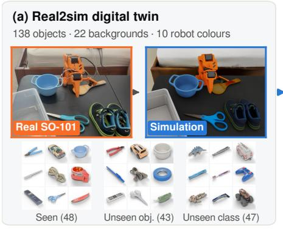

(b) SO-101 Bench: train and evaluate in simulation Fine-tune on 3,629 teleoperated sim demos (18.5 h, seen objects, randomized visuals)  
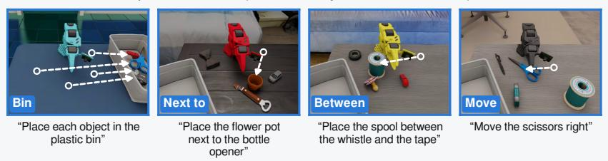  
Evaluate on 916 episodes: 5 task families × 3 object splits; score = mean success over the 15 cells Subsets: ROBUST (held-out visuals) · PLAN (rotate to fit) · MEM (remember occluded objects)

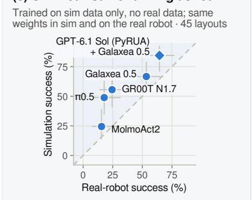

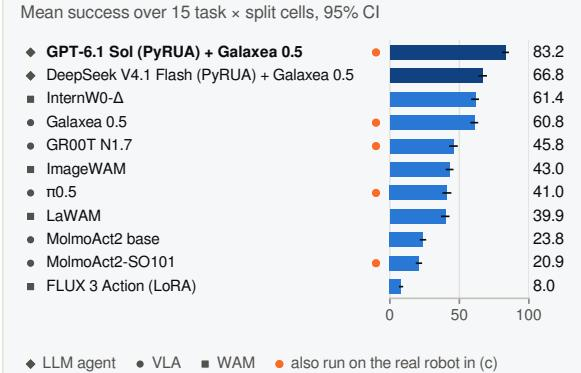

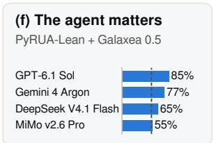  
Figure 1: SO-101 Bench at a glance. (a) Real SO-101 and its digital twin. (b) The four tasks. (c) Sim2real: five policies trained without real data keep their ranking on the real robot. (d) Leaderboard. (e) Harness ablation. (f) The language model matters.

We introduce SO-101 Bench, a simulated benchmark for language-conditioned spatial manipulation with a single SO-101 arm, built so that its rankings carry over to the real robot (Fig. 1). Its core is an Isaac Lab [26] digital twin of a real SO-101 setup with 138 household objects in three generalization splits: seen (in the training dataset), unseen object of a seen class, and unseen class, with 37 unseen-class objects kept private. Four tasks (place every object in a bin; place an object next to another; place it between two others; move it in a direction until it reaches the boundary object) are scored automatically from simulator state. They require the policy to pick out the named object among same-class distractors, grasp unfamiliar geometry and place it under spatial constraints. The primary evaluation has 916 feasibility-checked episodes over 15 task-family × split cells, with subsets for held-out appearances (ROBUST), rotating an object to fit a tight space (PLAN) and remembering occluded objects (MEM). Every learned policy is fine-tuned on the same 3,629 simulated teleoperated demonstrations of seen objects under an equal 36 h x 4 x A100 compute budget.

Two studies test whether the twin can stand in for the real robot. Independently trained real-only and sim-only GR00T N1.6 policies find the same conditions hard (Pearson r = 0.86 across the 15 cells) and fail in the same ways (Sec. 4). Five policies that never saw real data from our setup, four VLAs and an LLM agent, then run with identical weights in the twin and on the physical SO-101 in an environment unseen in training, with objects from all three splits; SO-101 Bench policies work out of the box in unseen real environments with unseen objects. Simulation ranks them exactly as the real robot does (Spearman ρ = 1.00, MMRV = 0.000, 95% CI [0.000, 0.169]), although it overestimates every policy’s success by 9 to 31 percentage points (Sec. 5). On the full leaderboard of nine VLAs and WAMs, the best learned policies, InternW0-∆ [27] and Galaxea 0.5 [28], are statistically tied near 61; spatial placement and unseen classes are where they fail, and none exceeds 17% on PLAN. The strongest entry is an LLM agent: GPT-6.1 Sol [29] writing code in the PyRUA-Lean harness [30] and handing grasps to Galaxea 0.5 scores 83.2 and solves 75% of PLAN. Its lead comes largely from the harness. On 60 paired episodes, Sol succeeds on 35% (21/60) with direct tool calls, 67% (40/60) with PyRUA-Lean and 85% (51/60) with the Galaxea 0.5 hand-off, against 53% (32/60) for Galaxea 0.5 alone, and the lead holds on the real robot, 64% (29/45) against 53% (24/45).

## Our contributions are:

• SO-101 Bench, a digital-twin benchmark for language-conditioned spatial manipulation on a low-cost arm, with instance- and class-level object splits, ROBUST, PLAN and MEM subsets and automatic scoring, released with the so101\_bench\_sim (3,629 simulated episodes) and so101\_bench\_real (∼4,400 real episodes) datasets.

• Evidence that the twin ranks policies as the real robot does: condition- and failure-level correspondence between independently trained real-only and sim-only policies, and an exact sim2real ranking of five policies, including an LLM agent, run with identical weights and no real data from our setup; these policies perform language-conditioned tasks out of the box in an unseen real environment with unseen objects.

• A leaderboard of nine VLAs and WAMs and two LLM agents, with every learned policy fine-tuned on the same data and compute, showing that spatial placement, unseen object classes and rotate-to-fit planning remain open.

• Harness and model ablations showing that, in our setting, a code-as-policy harness that hands grasping to a learned policy outperforms either on their own; Direct action generation by the agent proves expensive and ineffective, and 6.1 Sol compares favorably to other agents.

## 2 Related Work

Low-cost hardware and SO-101 benchmarks. Cheap hardware has repeatedly widened who can do robot learning. ALOHA showed that a low-cost bimanual rig can learn fine manipulation [31], and 2026 platforms push prices further, from a \$1,688 bimanual mobile manipulator [32] to the SO-101, at about a fortieth of the price of an ALOHA arm [4]. LeRobot [5] and community data have made the SO-100/101 a training platform for open VLAs [6, 7]. Four 2026 benchmarks evaluate VLAs on physical SO-101 arms. Yu and Qiu [8] analyse failure and recovery on four tasks, VLA-REPLICA is a sub-\$1,100 kit reproduced across sites [9], ArmnetBench scores 2,518 rollouts of seven policies on an arm farm [3], and Spa-Bench probes recombinations of familiar objects, spatial concepts and actions in its primary evaluation, with a separate novel-object pilot [10]. All four use real robot demonstrations for task-specific adaptation and evaluate on physical hardware. In simulation, the SO-101 Task Set contains eight language-free tasks for visual reinforcement learning with sim2real transfer [15], and LeIsaac provides SO-101 teleoperation and data-collection tooling in Isaac Lab [33]. To our knowledge, SO-101 Bench is the first language-conditioned SO-101 benchmark with held-out object splits whose simulated policy ranking is validated on the real arm. It also represents one of, if not the most, challenging task suites handled by an SO-101 up to this point.

Real2sim evaluation and sim2real transfer. Whether simulated evaluation predicts real performance was studied early for navigation [34]; for manipulation, SIMPLER [18] showed that an aligned simulator can rank real-world policies and introduced the MMRV metric. Twins built from scans, neural reconstructions or generated assets now report strong score or ranking agreement within their validated settings [19, 20, 35, 36, 37, 38]; SimFoundry reaches Pearson 0.911 and MMRV 0.018 over five policy architectures [21]. Two 2026 results temper this. Validity does not carry across setups: re-tested against new real rollouts, SIMPLER’s agreement with the real-robot ranking is weak [22]. Reconstruction quality also matters: an authored object-and-scene pipeline achieved sim–real correlation of 0.90 versus 0.51 for a default reconstruction in a ten-cell study [39], consistent with our tuning of each reconstructed object against its physical counterpart (Appendix E). Learned world models are an alternative evaluator [40], but released models often predict success on verified failures [41]. In parallel, policies trained only on simulated data now transfer to real robots: MolmoB0T reaches 79.2% on real pick-andplace without real demonstrations [23], OASIS pairs image-to-3D assets with teleoperation inside simulation [24], and LEGS and Splat2Act fine-tune pretrained VLAs using only synthetic robot demonstrations [42, 43]. We deploy five sim-trained policies, including an LLM agent, with identical weights and test whether their ranking survives.

LLM agents for manipulation. Language models have long planned over learned skills [44] or written programs that compose perception and control [45, 46], and hierarchical systems pair high-level language reasoning with low-level action generation [47, 48]. In 2026 such agents became competitive with end-to end policies: coding agents are now benchmarked on manipulation directly [49, 50, 51]; GPT-6 Astra with direct end-effector tool calls ranked above all forty public-policy entries in its September 2026 RoboDojo comparison [52, 53]; RoboICL reports higher aggregate progress than its strongest listed baseline on a thirty-task subset [54], and PyRUA-Lean exceeds the best public entries in its reported leaderboard snapshot [30]. A parallel line treats the VLA as a tool: Harness VLA exposes a frozen VLA as a retryable contact-rich primitive [55], VoLo steers one as an interruptible tool [56], Gemini Robotics ER 2 hands motor execution to any VLA [57], and a systematic study of such hierarchies finds that model choice and interface jointly shape performance [58]. Harness effects are large. With the same planner and primitives, one study reports that writing code instead of calling tools raises success from 63.1% to 71.7% [30]; a better harness lets a weaker model beat a stronger one [59]; and outside robotics the scaffold alone moves accuracy by up to 28 points within one model [60]. These studies usually compare agents with published entries trained under each entry’s own protocol. Simulated agent evaluations, ours included, commonly pause the simulator while the model computes, which hides its real-time cost [61], and frontier models controlling physical arms directly are not yet precise or efficient enough to finish tasks within a practical action budget [62]. SO-101 Bench compares agents and learned policies on the same episodes after training every learned policy on the same data and compute, ablates harness and model separately, and runs the agent on the real robot.

Manipulation benchmarks and evaluation practice. Simulated benchmarks for generalist policies [12, 13, 14, 53, 63] face saturation and train–test overlap. LIBERO instruction conditioning largely selects among memorized tasks [16]; policies above 90% there fall below 30%, or to zero, under modest perturbations [64, 65]; and an audit of five suites finds shortcut solvability, state-of-the-art gains not established as statistically significant, creeping overfitting and dependence on the training-data source [25]. Responses include generalization suites [66, 63], capability suites for memory of occluded objects [67] and spatial grounding [10]. Real-world evaluation has moved to distributed pairwise comparison [68], autonomous evaluation cells [69], and statistical methods that separate policies with few trials [11, 70]. SO-101 Bench adopts several of these lessons: it separates unseen instances from unseen classes and keeps part of the latter private, fine-tunes every policy on the same seen-object data under one compute budget, selects checkpoints on a separate validation set, and reports confidence intervals over 916 episodes. It also scores two spatial skills that, to our knowledge, few benchmarks test in closed loop: placing an object between two referents, and rotating a grasped object to fit (PLAN).

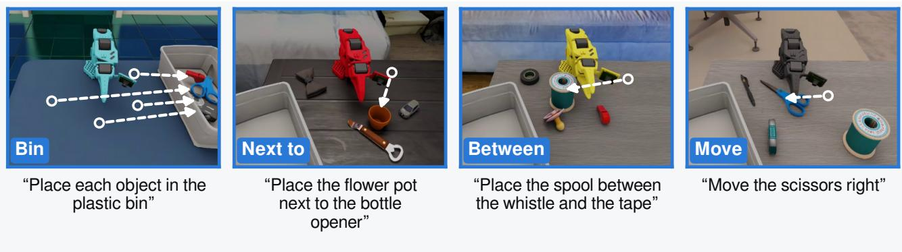  
Figure 2: The four SO-101 Bench tasks. Bin, next-to, between and directional move, with the target paths overlaid on successful simulation episodes. The task panels repeat Fig. 1b.

## 3 SO-101 Bench

SO-101 Bench evaluates language-conditioned tabletop manipulation with a single SO-101 arm [1]. It is designed to test whether a policy can turn semantic understanding into precise physical execution: identifying the right object among distractors, grasping objects of unfamiliar geometry, and placing them under (often precise) spatial constraints. Every component below is shared by all evaluated policies.

## 3.1 Tasks

The benchmark comprises four language-conditioned tasks (Fig. 2), scored as five task families.

• Place each object in the plastic bin. The pure grasping task: the policy must identify, grasp, transport and deposit every object on the table. The bin moves between episodes. We evaluate a 1-object and a 4-object condition as separate families.

• Place [object 1] next to [object 2]. The policy must place the target close to a referent without disturbing other objects, adding semantic grounding and basic spatial placement.

• Place [object 1] between [object 2] and [object 3]. The target must end centred between two referents, which makes the task sensitive to object extent, orientation and fine placement; it is the most demanding task.

• Move [object 1] [direction]. The policy must push or carry the target along a straight path in a commanded direction until it reaches the boundary formed by the next object in its way.

The bin task stresses grounding, grasp strategy and grasp precision; the three spatial tasks additionally require relational grounding, spatial reasoning, fine-grained placement and robustness to partial occlusion. To keep language grounding nontrivial, distractors of the same class or colour are included so that class identity alone is insufficient, and colour words are omitted from instructions unless necessary (i.e when two objects of the same class are on the table).

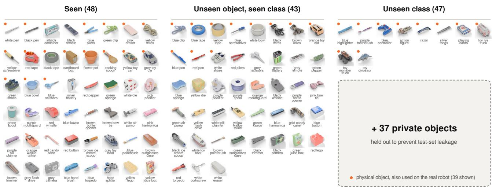  
Figure 3: Simulation objects by generalization split. Orange dots mark physical objects that are also used in the real-robot evaluation. The 37 private unseen-class objects are held out to prevent test-set leakage and are not shown.

## 3.2 Objects and Generalization Splits

The benchmark uses 138 household objects in three generalization splits (Fig. 3): seen (48 objects that appear in training), unseen object, seen class (43 objects whose class, e.g. bowl or pen, appears in training but whose instance does not), and unseen class (47 objects of entirely novel classes). The splits separate transfer across instances from transfer across categories. Objects were chosen to maximize diversity of geometry and of domain (e.g. office, kitchen, sports, toys), with priority on irregular shapes. Every object was verified through teleoperation to be graspable by the SO-101, so that failures reflect the policy rather than the hardware. Of the unseen-class objects, 37 are kept private to prevent test-set leakage.

All objects were created using the image-to-3D tools in 3D AI Studio [71]. The ∼60 physical objects were reconstructed from photographs of the real items and their simulated appearance and physical properties were tuned to match them; the remaining objects were generated from internet or AI-generated images and passed through the same pipeline (Appendix E). All simulated objects are rigid bodies.

## 3.3 Digital Twin

All evaluation runs in a digital twin of the original real-world setup, built in Isaac Lab [26] from a scan of the room and the object assets of Sec. 3.2. Physics runs at 240 Hz and the policy acts at 30 Hz. Policies observe an overhead camera and a wrist camera, both at 640 × 480, and the arm’s joint positions. The twin includes 22 background environments: 18 are used in training and in the varied evaluation episodes, and 4 are held out (Appendix F). The robot is rendered in one of 6 training colours or one of 4 held-out colours. The real arm’s joint calibration is aligned to the simulated kinematics so that the same policy weights can run in both domains (Sec. 5).

## 3.4 Scoring

Episodes are scored automatically from simulator state. Positions are measured in the tabletop plane from where objects rest at the start of the episode. A success condition must hold continuously for 5 s; a failure condition ends the episode once it has held for 5 s, so briefly undoing a mistake is allowed. The robot is considered to touch an object when any link presses on it with more than 0.05 N. Episodes time out after 30 s (75 s for 4-object bins).

• Bin: every object ends with its reference point (the centre of its top-down bounding box) inside the bin’s footprint and untouched by the robot. Fails if the bin moves more than 0.5 in.

“Move the tape backwards”  
PLAN: rotate a boat to fit between referents  
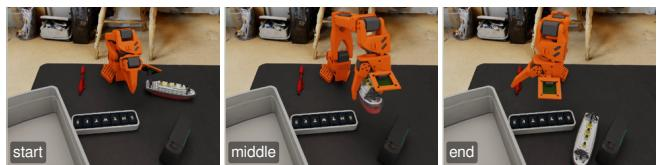  
“Place the toy boat between the pill planner and the camera”

MEM: move towards an occluded boundary  
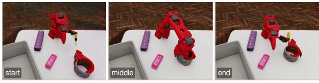  
Figure 4: PLAN and MEM examples (start, middle and end of successful primary-evaluation episodes). Left: GPT-6.1 Sol with PyRUA-Lean and Galaxea 0.5 rotates the toy boat to fit between the pill planner and the camera (episode 529), which all nine learned policies fail. Right: ImageWAM moves the tape backwards (episode 300), retaining the boundary object position while it is occluded during the move; four of the nine learned policies solve this episode. All objects and backgrounds shown are public.

• Next to: the target’s top-down outline ends within 2 in of the referent’s outline.

• Between: the target’s reference point ends within 1.75 in of the line through the two referents’ reference points, and closer to each referent than the referents are to each other.

• Move: with an object ahead of the target, the target’s leading edge ends within 2 in of that object’s facing edge; otherwise the target advances at least 2 in. The target must stay within 2 in of the straight path, and the boundary object must not move more than 0.5 in along the direction.

In all three spatial tasks the target must move at least 1 in and must not be touched by the robot at the end, and the episode fails if any non-target object (referents included) moves more than 1 in, or if the target or a held object stays in contact with another object for more than 5 s.

## 3.5 Training Data

All learned policies are fine-tuned on so101\_bench\_sim: 3,629 teleoperated episodes (18.5 h at 30 fps) recorded in the digital twin using seen objects only. It contains 1,892 bin episodes (including bin instructions that name a single target among other objects), 1,150 next-to and between episodes, and 587 move episodes; 3,004 episodes have four objects on the table. Most episodes are rendered with randomized lighting, camera intrinsics and extrinsics, background and robot colour; the canonical setup remains in the training distribution. A variant, so101\_bench\_sim\_WM, adds the episode’s initial overhead and wrist frames for policies that accept them. We also release so101\_bench\_real, approximately 4,400 real-robot teleoperated episodes (∼20 h) across approximately 35 objects.

## 3.6 Primary Evaluation

The primary evaluation contains 916 scored episodes spanning the 15 task-family × split cells, with every object appearing in each family it supports. Feasibility (spacing between objects) is checked for every layout so that a poor arrangement cannot make success impossible. About half the episodes use the canonical appearance and half vary the background and robot colour. We report the benchmark score, the mean success rate over the 15 cells, with a 95% bootstrap confidence interval that resamples episodes within cells. Three overlapping subsets probe specific capabilities: ROBUST (178 episodes with held-out backgrounds and robot colours), PLAN (48 episodes in which the grasped object must be rotated to fit into a tight space), and MEM (51 episodes in which the policy must remember the position and 3D footprint of an object that becomes occluded). Figure 4 shows a successful example of each.

## 3.7 Fine-Tuning Protocol

Every learned policy is fine-tuned with an equal compute budget of 36 h on 4×A100-80GB GPUs, following its authors’ recommended recipe where one exists (Appendix C). Checkpoints are evaluated on a held out 39-episode validation set, and the best checkpoint is used for the primary evaluation. Three policies

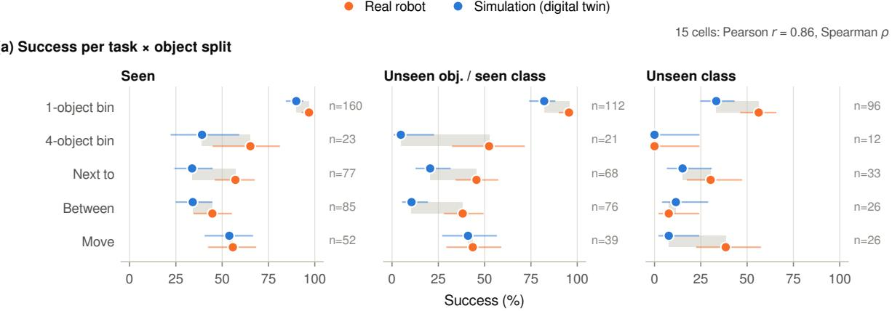

(b) Why episodes fail (next to, between, move)  
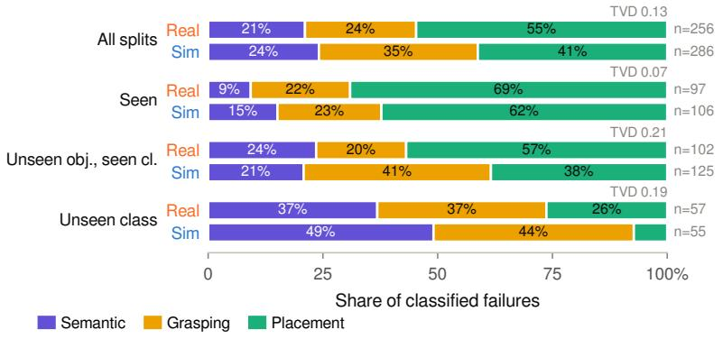

(c) 4-object bin: objects binned  
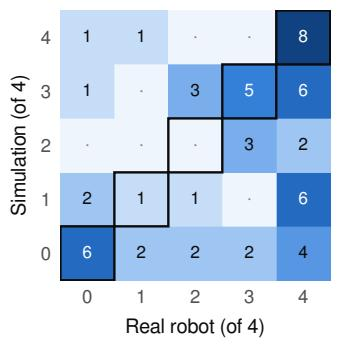  
56 paired episodes; outlined = exact agreement Spearman ρ = 0.35, quadratic κ = 0.32

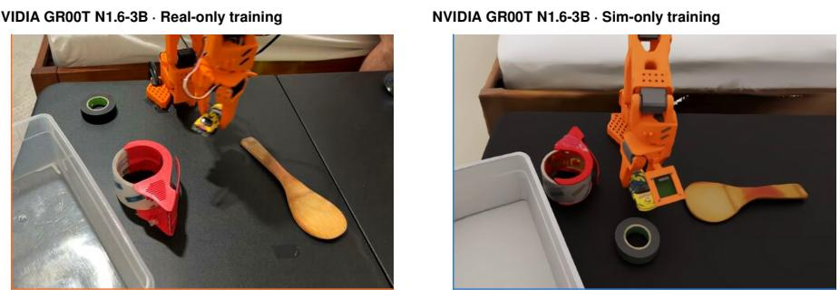  
Figure 5: Sim–real correspondence of independently trained GR00T N1.6 policies. (a) Success of a real-only policy on the physical SO-101 and a sim-only policy in the digital twin, per task and object split (95% Wilson intervals). (b) Composition of hand-annotated failures (next to, between, move): both domains shift from placement to semantic and grasping failures as object novelty increases. (c) Objects binned in 4-object bin episodes, real vs. simulation (56 paired episodes; outlined cells are exact agreement). Below: overhead views of independently trained NVIDIA GR00T N1.6-3B policies executing the same instruction with the same objects (real trial 52, matched task row 466). Poses and frame times differ.  
(GR00T N1.7 [72, 73], $\pi _ { 0 . 5 }$ [48] and MolmoAct2 [7]) additionally receive the episode’s initial frames at each timestep.

## 4 Real-Only vs. Sim-Only Policy Correspondence

Before measuring sim2real transfer (Sec. 5), we ask a coarser question: does the digital twin reproduce the difficulty structure of the real benchmark? If a policy trained in simulation and evaluated in the twin finds the same tasks, splits and failure modes hard as a policy trained and evaluated in the real world, the twin is a useful proxy for real-world evaluation even before any weights cross domains.

Setup. We fine-tune two GR00T N1.6-3B policies [72, 74] independently: a real-only policy on real tele operated demonstrations (so101\_bench\_real), evaluated on the physical SO-101, and a sim-only policy on demonstrations collected in the digital twin (a subset of so101\_bench\_sim containing 3D scanned objects from so101\_bench\_real, with 50% of the data volume of so101\_bench\_real), evaluated in simulation. We compare them on 906 episodes matched across domains by task, instruction, ordered object set and object split. Object poses are not identical across domains, so individual episodes are not exact replicas; the primary comparison is therefore at the level of the 15 task × split conditions and of failure composition, with episode-level agreement reported as a secondary measure. Real-world outcomes and failure types were labelled by hand; simulated failures were labelled the same way and both were mapped to three categories, semantic (wrong object or referent(s)), grasping (grasp, lift or release failed) and placement (correct object handled, imprecise/incorrect placement).

Difficulty is preserved across conditions. The sim-only policy succeeds on 45% (409/906) of episodes and the real-only policy on 61% (552/906), a gap of −15.8 pp (95% CI [−19.9, −11.8]). Despite this offset, the two systems order the 15 conditions similarly: Pearson r = 0.86 [0.71, 0.91] and Spearman ρ = 0.74 [0.52, 0.91] across cells (Fig. 5a). In both domains success is highest on the 1-object bin and seen objects and falls with task difficulty and object novelty, with the 4-object bin and the between task hardest on unseen classes.

Failure modes are preserved. The composition of failures on the spatial tasks follows the same trend in both domains (Fig. 5b). On seen objects most failures are placement errors (69% real, 62% sim; total variation distance 0.07); on unseen classes most are semantic or grasping errors (74% real, 93% sim). Across all splits the two failure mixes differ by a total variation distance of 0.13. On the 4-object bin, the real-only policy bins 67% of objects and the sim-only policy 47%; per-episode progress is weakly correlated across domains, likely due to the small size of the sim dataset for this experiments (Spearman ρ = 0.35; Fig. 5c).

Episode-level agreement is moderate. Paired episodes have the same outcome 66% of the time (MCC 0.36), and where both failed the failure type matches in 47% of cases (Cohen’s κ = 0.17). This is expected given differeing training dataset scales, initial poses and stochastic policies, and is why we emphasize condition-level correspondence. Full results are in Appendix A.

Overall, because the two policies differ in training data as well as in evaluation domain, this experiment cannot attribute the absolute gap to the simulator; the lower sim success reflects both policies and domains together. What it does show is that the twin reproduces which conditions are hard and why policies fail there. Section 5 isolates the simulator by running identical weights (with sim training only) in both domains.

## 5 Sim2Real with No Real Data

A simulated benchmark is only useful if it tells us which policies are better in the real world. We test this directly: five policies that never saw real data from our setup are evaluated, with identical weights, both in the digital twin and on the physical SO-101.

Setup. We evaluate four learned policies, Galaxea 0.5 [28], GR00T N1.7 [73], π [48] and MolmoAct2- SO101 [7], and the strongest LLM agent, GPT-6.1 Sol (PyRUA) + Galaxea 0.5, with the same checkpoints and harness as the leaderboard (Sec. 6). The learned policies were fine-tuned only on simulated demonstrations; the agent pairs a frozen language model with the same sim-trained Galaxea 0.5 checkpoint, to which it hands

(a) Policy ranking

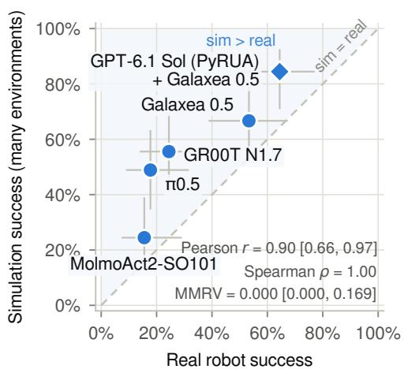

All families (n=45) 1-object bin (n=9) 4-object bin (n=9)  
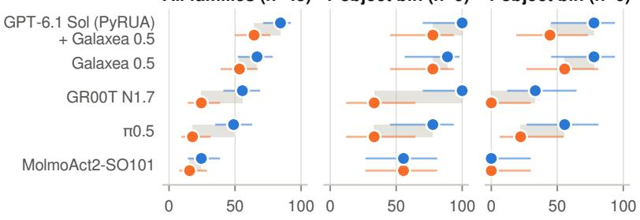

Start  
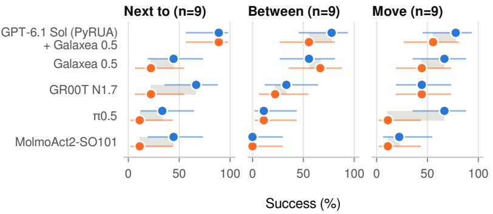

Galaxea 0.5 grasps the tongs  
Placed (success)  
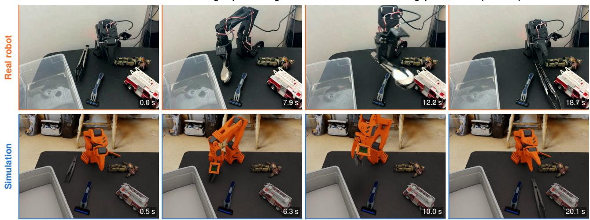  
Trial 41: “Place the tongs between the razor and the toy fire truck” (unseen class). Robot time shown; the real episode took 9.2 min of wall-clock time.

Figure 6: Sim2real. (a) Policy-level success on the real robot (unseen environment) vs. simulation (many environments) on the same 45 layouts: the ranking of all five policies is preserved exactly (Spearman $\rho = 1 . 0 0$ MMRV = 0.000) and every policy scores higher in simulation. Diamond: the LLM agent; circles: learned policies fine-tuned only on simulated demonstrations. (b) Success in simulation and on the real robot per policy, overall (45 episodes) and per task family (9 episodes), with 95% Wilson intervals. Bottom: the agent on matched trial 41, a between episode with unseen-class objects that none of the four learned policies solved on the real robot. Galaxea 0.5 grasps the tongs, then the agent carries and places them, in both domains.

off grasping. The evaluation set has 45 episodes: 3 for each of the 15 task-family × split cells, using only the 40 benchmark objects we still own physically (18 seen, 11 unseen object, 11 unseen class), with every object used at least once. Each layout is reproduced on the real table by projecting the simulated object footprints into the overhead camera view, so both domains start from matched object positions and poses. The real robot operates in an environment that does not appear in the training data, and real episodes are scored by the operator under the benchmark’s success and failure rules and the same time limits. As in simulation, the agent’s time limit counts control steps only: the arm holds still while the model computes. Median elapsed wall time to rollout stop is 197 s for the agent, compared with 38 s for Galaxea 0.5, 38 s for GR00T N1.7, 59 s for $\pi _ { 0 . 5 }$ and 56 s for MolmoAct2-SO101 over the same 45 layouts, including successes and failures. These times come from timestamped control traces checked against the original recordings and include inference waits and within-rollout stalls, but exclude model/server startup, scene resets and subsequent operator scoring (Appendix B). Lighting and camera placement are fixed for the whole study. The four learned policies are evaluated in alternating blocks so that slow drift does not favour any one of them, and the agent in a later session in the same environment; before every episode the overhead view is compared with a reference frame (across all 225 real episodes the camera moved by at most 2.6 px and brightness changed by at most 7%). In simulation each layout is run once with the canonical appearance.

Simulation preserves the policy ranking. Success in simulation and on the real robot ranks the five policies identically (Fig. 6a): GPT-6.1 Sol (PyRUA) + Galaxea 0.5 84% (38/45) vs. 64% (29/45), Galaxea 0.5 67% (30/45) vs. 53% (24/45), GR00T N1.7 56% (25/45) vs. 24% (11/45), π0.5 49% (22/45) vs. 18% (8/45), and MolmoAct2-SO101 24% (11/45) vs. 16% (7/45). The Spearman correlation is 1.00 and the mean maximum rank violation (MMRV [18]) is 0.000 (95% CI [0.000, 0.169], resampling episodes within each policy); the Pearson correlation is 0.90 [0.66, 0.97]. The ranking spans two kinds of system, an LLM agent that plans and places through code and four end-to-end policies, so it does not depend on the policies sharing an architecture. With five policies these intervals remain wide, and we treat the result as evidence that simulation ranks policies correctly rather than as a precise calibration.

The agent’s lead transfers. On the real robot the agent succeeds on 29 of 45 episodes against 24 for Galaxea 0.5, the policy it calls for grasping: it solves 10 episodes that Galaxea 0.5 fails and fails 5 that Galaxea 0.5 solves (exact McNemar $p = 0 . 3 0 ;$ ; in simulation 10 against 2, $p = 0 . 0 4 )$ . Its advantage lies where it, rather than Galaxea 0.5, does the work. It succeeds on 8 of 9 real next-to episodes, against 2 for Galaxea 0.5, and on 7 of 15 unseen-class episodes, against 4. Eight real episodes were solved by the agent and by none of the four learned policies, including the between episode with unseen-class objects in Fig. 6 (bottom). None of the agent’s 16 real failures involved the wrong object: 7 were on the bin tasks (5 knocked the lighter real bin), 3 moved a non-target object, and the remaining 6 missed the placement criteria (for example, by setting the target on top of a referent).

Simulation is optimistic, by different amounts per policy. Every policy succeeds more often in simulation, by 9 to 31 percentage points (20 for the agent). Paired episodes agree on the outcome 56–91% of the time, and almost all disagreements are episodes that succeed in simulation and fail on the real robot (57, against 10 the other way). The gap is largest on the bin tasks for GR00T N1.7 and on the bin and move tasks for $\pi _ { 0 . 5 }$ (Fig. 6b): for example, GR00T bins the single object in 9/9 simulated episodes but 3/9 real ones; each policy’s low real-world success rate on bin tasks is, however, largely explained by the far lesser mass of the real plastic bin (making it easier to displace). Many larger real objects were also scaled down to 0.7–0.9 times their real-world size in simulation. Overall, absolute success rates in simulation should be read as an upper bound on real-world performance, while comparisons between policies transfer. Per-family and per-split results are in Appendix B.

## 6 Leaderboard

We evaluate nine learned policies and two LLM agents on the full primary evaluation (Fig. 7).

Policies. The learned policies cover two families. Vision-language-action models (VLAs) map images and language directly to actions: GR00T N1.7 [73], π [48], Galaxea 0.5 [28], and MolmoAct2 [7], which we fine-tune from two starting points, the general MolmoAct2 checkpoint (base) and its SO-100/101 post-trained variant (SO101). World-action models (WAMs) additionally model future observations: InternW0-∆ [27] and FLUX 3 Action [75] jointly model video and actions, ImageWAM [76] uses an image-editing backbone, and

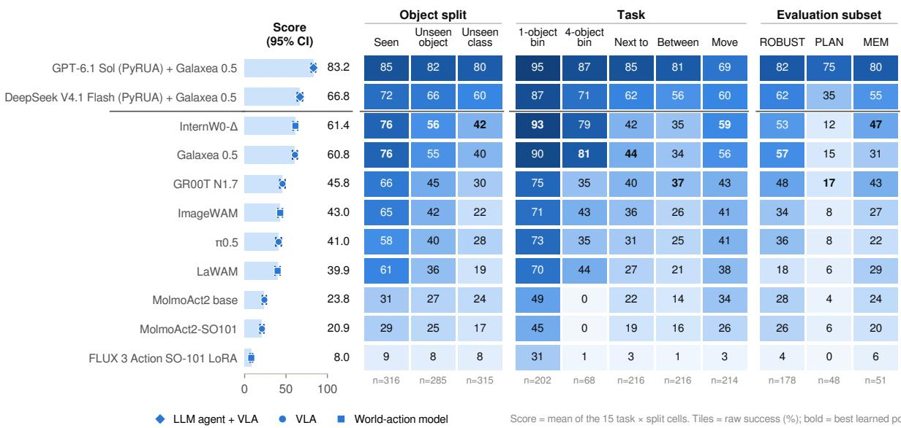  
Figure 7: SO-101 Bench leaderboard (916 primary-evaluation episodes). Score is the mean success over the 15 task × object-split cells with a 95% bootstrap CI; tiles give raw success by object split, task and evaluation subset (ROBUST: held-out backgrounds and robot colours; PLAN: rotate to fit; MEM: remember occluded objects). Bold marks the best learned policy in each column. Diamonds: LLM agents; circles: VLAs; squares: WAMs.

LaWAM [77] predicts DINOv3 [78] latent states. All learned policies are fine-tuned on so101\_bench\_sim under the protocol of Sec. 3.7; FLUX 3 Action is fine-tuned with LoRA [79], following its released recipe, and the rest are fine-tuned in full or with their recommended frozen components (Appendix C). The two LLM agents pair a frozen language model (GPT-6.1 Sol [29] or DeepSeek V4.1 Flash-1017 [80]) with a code-as-policy harness [45], PyRUA-Lean [30], that hands grasping to Galaxea 0.5; we analyse them in Sec. 7.

Learned policies fall short of the benchmark. The best learned policies, InternW0-∆ (61.4, 95% CI [58.5, 64.1]) and Galaxea 0.5 (60.8 [57.9, 63.6]), are statistically tied, followed by GR00T N1.7 (45.8), Image WAM (43.0), π (41.0) and LaWAM (39.9). Both MolmoAct2 variants score below 25 and FLUX 3 Action scores 8.0. Starting MolmoAct2 from its SO-100/101 checkpoint does not help (20.9 vs. 23.8 for the base model, with overlapping intervals), so prior exposure to the embodiment (in its current form) is no substitute for the benchmark’s task and object coverage under this protocol.

Training scale appears to drive performance. Under the equal 36 hr budget, the number of fine-tuning samples each policy sees varies by a factor of 30 (Appendix C), and the amount of robot data in its pretraining varies widely as well. The strongest learned policies combine large robot pretraining corpora with at least a full epoch of fine-tuning (InternW0-∆ 1.2 epochs, Galaxea 0.5 1.6), whereas the three weakest saw well under one epoch: MolmoAct2 0.5–0.6 epochs and FLUX 3 Action 0.2; both appear under-trained. The MolmoAct2 training loss was still falling steeply when the budget ran out, and its published simulation recipe uses about five times as many samples [7]; FLUX 3 Action’s LoRA run used less than a tenth of the samples in its released full fine-tuning recipe [75]. These results therefore rank policies at a fixed compute budget, and the low scores of MolmoAct2 and FLUX 3 Action should not be read as their capability ceiling.

Spatial tasks and novel objects are the bottleneck. Grasping familiar objects is largely solved: the strongest learned policies bin a single object in 90–93% of episodes and place 90% of objects in 4-object bins. The spatial tasks are far harder, with next-to and between success of 34–44% for the same policies. Object novelty compounds this. On the spatial tasks, InternW0-∆ falls from 72% on seen objects to 18% on unseen classes for next to, and from 56% to 19% for between; Galaxea 0.5 falls from 71% to 19% and from 63% to 12%. Pooled

Episode 174 · PLAN  
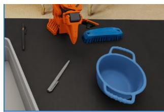  
Place the hand brush between the white pen and the bowl

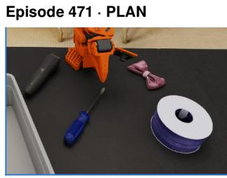  
Place the trimmer between the spool and the bow tie

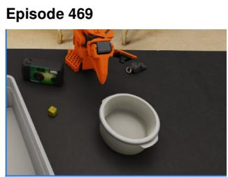  
Place the camera between the die and the whistle

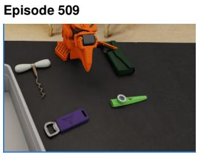  
Place the bottle opener between the kazoo and the corkscrew

Figure 8: Episodes solved only by GPT-6.1 Sol + PyRUA-Lean v9.6 + Galaxea 0.5. Initial overhead views, cropped to the task workspace, with the exact instructions. All ten other leaderboard entries failed each episode. Episodes 174 and 471 belong to PLAN.

over tasks, the six strongest learned policies lose 30–43 points between seen objects and unseen classes; the three weakest lose less only because their seen-object success is already low.

Subsets isolate distinct weaknesses. PLAN is the clearest gap: no learned policy exceeds 17% when the grasped object must be rotated to fit (GR00T N1.7 is best), while the agent reaches 75%. On MEM, learned policies reach at most 47% (InternW0-∆, which has native memory [27]). ROBUST separates policies by visual robustness rather than skill: Galaxea 0.5 and GR00T N1.7 keep their overall success under held-out backgrounds and robot colours, whereas LaWAM drops from 39% to 18% and ImageWAM from 43% to 34%.

LLM agents lead. Both agents outperform every learned policy, including the Galaxea 0.5 policy they call: GPT-6.1 Sol reaches 83.2 [80.7, 85.7] and DeepSeek V4.1 Flash-1017 66.8 [63.7, 69.9]. The agent’s advantage is largest where learned policies are weakest: Sol’s success varies by only five points across object splits (85/82/80%) and it leads on PLAN and MEM. Sol also outperforms Galaxea 0.5 on the real robot (64% vs. 53%, Sec. 5). Section 7 analyses where this advantage comes from.

## 7 LLM Agents: Harness and Model Ablations

The LLM agents lead the leaderboard (Sec. 6). We ask what drives this: the harness that connects the language model to the robot, or the language model itself.

Harnesses. All harnesses give the model the same overhead and wrist images, the same task rules and no privileged simulator state. Direct tool calls uses the inspect-robots harness [81], letting the model command end-effector motions directly through tool calls. PyRUA-Lean [30] is a code-as-policy harness [45]: the model writes Python that uses open-vocabulary segmentation (via SAM3 [82]), 3D localization and inverse kinematics to move the arm. PyRUA-Lean + Galaxea 0.5 adds the fine-tuned Galaxea 0.5 policy as a tool: the model localizes objects, plans, and places, while handing grasping to Galaxea 0.5; the agent inspects Galaxea 0.5’s results periodically, and can initiate recoveries or take over. The simulator is paused while the model computes, so time limits apply to simulated time only.

Paired episodes. Running agents on all 916 episodes is costly, so the ablations use 60 fixed primary-evaluation episodes: 30 easy episodes (six per task family) and 30 hard episodes (six per family with the fewest successes among the nine learned policies, including 11 PLAN episodes). Both sets were selected before any agent was run.

The harness matters more than the model. With GPT-6.1 Sol, success rises from 35% (21/60) with direct tool calls to 67% (40/60) with PyRUA-Lean and 85% (51/60) with the Galaxea 0.5 hand-off (Fig. 9a), against

(a) Harness × LLM  
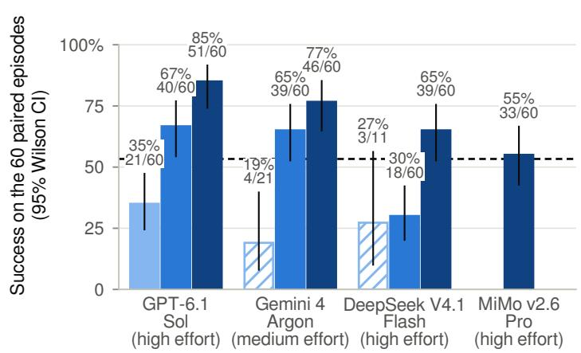

(b) Sol per task vs Galaxea 0.5 alone  
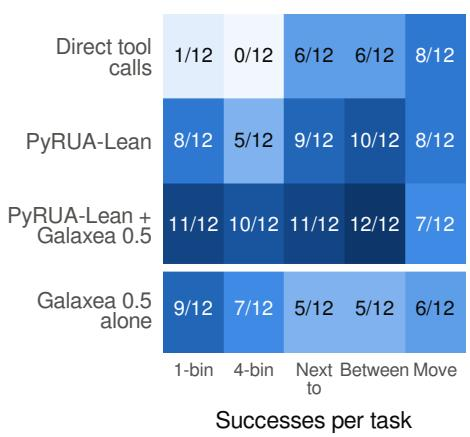  
Figure 9: Harness and LLM ablation on the 60 paired episodes. (a) Success of each harness with three LLMs, and of the PyRUA-Lean v9.6 + Galaxea 0.5 harness with a fourth, MiMo v2.6 Pro (95% Wilson intervals); hatched bars were stopped before completing all 60 episodes. The dashed line marks Galaxea 0.5 alone. (b) Successes per task family for GPT-6.1 Sol with each harness and for Galaxea 0.5 alone.

Table 1: Cost and token usage of the PyRUA-Lean v9.6 + Galaxea 0.5 harness with each LLM, summed over the same 60 paired episodes. Output tokens include reasoning tokens (shown in parentheses). API cost is estimated from token counts at list prices (Gemini: gross Vertex rate).
<table><tr><td>LLM (effort)</td><td>Success</td><td>API cost</td><td>Output tokens (reasoning)</td><td>Input tokens (cached)</td></tr><tr><td>GPT-6.1 Sol (high)</td><td>85% (51/60)</td><td>$14.68</td><td>0.32M (0.15M)</td><td>61.82M (96%)</td></tr><tr><td>Gemini 4 Argon (medium)</td><td>77% (46/60)</td><td>$74.25</td><td>1.11M (0.86M)</td><td>42.30M (73%)</td></tr><tr><td>DeepSeek V4.1 Flash-1017 (high)</td><td>65% (39/60)</td><td>$1.40</td><td>1.45M (1.23M)</td><td>87.33M (98%)</td></tr><tr><td>MiMo v2.6 Pro (high)</td><td>55% (33/60)</td><td>$2.63</td><td>1.06M (0.82M)</td><td>75.33M (96%)</td></tr><tr><td>Galaxea 0.5 alone</td><td>53% (32/60)</td><td>$0</td><td>一</td><td></td></tr></table>

53% (32/60) for Galaxea 0.5 alone. Direct tool calls have trouble grasping (1/12 single-object bins, 0/12 four-object bins) but handle the spatial tasks reasonably (Fig. 9b); writing perception and IK code unlocks grasping, and handing grasps to Galaxea 0.5 makes them reliable. The hand-off is also cheaper: Sol’s API cost falls from \$18.44 with PyRUA-Lean to \$14.68 with the hand-off over the 60 episodes. The same ordering holds for Gemini 4 Argon (65% to 77%) and DeepSeek V4.1 Flash-1017 (30% to 65%). The two policies are complementary: Galaxea 0.5 alone succeeds on 93% of easy episodes but only 13% of hard ones, whereas Sol with the hand-off reaches 93% and 77%. Move is the one family where the hand-off does not help (7/12, against 8/12 with PyRUA-Lean alone).

The model matters too. Holding the PyRUA-Lean + Galaxea 0.5 harness fixed, we compare four language models on the same 60 episodes (Fig. 9a, Table 1). GPT-6.1 Sol [29] reaches 85% (51/60), Gemini 4 Argon [83] 77% (46/60), DeepSeek V4.1 Flash-1017 [80] 65% (39/60) and MiMo v2.6 Pro [84] 55% (33/60); all four exceed Galaxea 0.5 alone. The models differ most on the spatial tasks (between: 4 to 12 of 12 episodes) and on the hard episodes, where they solve 23, 20, 14 and 11 of 30. The full benchmark confirms the ordering of the two models we ran on all 916 episodes (83.2 vs. 66.8). Cost and capability are only loosely related: DeepSeek V4.1 Flash-1017 costs \$1.40 for the 60 episodes, a tenth of Sol, while Argon costs the most (\$74.25) without matching Sol. Sol also generates the fewest tokens, 0.32M output tokens against 1.06–1.45M for the others (despite Gemini being at Medium effort).

## 8 Conclusion

SO-101 Bench makes evaluation of language-conditioned spatial manipulation on a low-cost arm both repeatable and predictive of the real robot. Its digital twin reproduces which conditions are hard and why policies fai there, and it ranks five policies trained without real data exactly as the physical SO-101 does; policies developed against the benchmark run out of the box in unseen real environments with unseen objects. The leaderboard shows where current methods stand: learned policies grasp familiar objects reliably but struggle with spatial placement, unseen object classes and rotate-to-fit planning, while an LLM agent that writes code and delegates grasping to a learned policy leads both in simulation and on the real robot, largely because of its harness.

Limitations. The sim2real study covers five policies and 45 layouts in one real environment, so its intervals are wide (MMRV 95% CI [0.000, 0.169]), and simulation overestimates absolute success by 9 to 31 percentage points; simulated success rates should be read as an upper bound and comparisons, not levels, as what transfers. The learned policies are compared at a fixed 36 h fine-tuning budget, which left some of them under-trained, so the leaderboard does not measure capability ceilings. The agents’ time limits count simulated or control time only: the simulator pauses, and the real arm holds still, while the language model computes, which hides their real-time cost. Finally, the benchmark covers rigid objects and a single arm. Extending the twin to deformable objects and bimanual setups, adding real-time constraints for agents, and using the twin’s ranking as a prior for cheaper real-robot evaluation are natural next steps.

A logical next step is to use repeated rollouts in the twin to refine control programs and accumulate validated, reusable skills across episodes, as in ASPIRE [85] and RoboRSI [86], while keeping the held-out evaluation fixed.

## References

[1] Hugging Face. SO-101: LeRobot Robot Documentation, 2026. URL https://huggingface.co/docs/ lerobot/so101. Official release or documentation; accessed 26 October 2026.

[2] R. Knight, P. Kooijmans, R. Cadene, S. Alibert, M. Aractingi, D. Aubakirova, A. Zouitine, R. Martino, S. Palma, C. Pascal, and T. Wolf. SO-ARM100: Standard Open SO-100 & SO-101 Arms, 2024. URL https://github.com/TheRobotStudio/SO-ARM100. GitHub repository; accessed 26 October 2026.

[3] P. Selvaraj, L. Uttini, and V. Kuosmanen. ArmnetBench v0.1: Parallel Real-World Evaluation of Manipulation Policies on a Low-Cost Arm Farm, 2026. URL https://arxiv.org/abs/2607.24481.

[4] K. Kawaharazuka, Y. Obinata, H. Ishida, J. Oh, T. Suzuki, S. Inoue, K. Yoneda, A. Iwata, and K. Okada. MEVION: Low-Cost Open-Source Data Collection System for Powerful and High-Speed Dual-Arm Manipulation, 2026. URL https://arxiv.org/abs/2607.17970. Accepted to IEEE Robotics and Automation Practice.

[5] R. Cadene, S. Alibert, F. Capuano, M. Aractingi, A. Zouitine, P. Kooijmans, J. Choghari, M. Russi, C. Pascal, S. Palma, D. Aubakirova, M. Shukor, J. Moss, A. Soare, Q. Lhoest, Q. Gallouédec, and T. Wolf. LeRobot: An Open-Source Library for End-to-End Robot Learning. In International Conference on Learning Representations (ICLR), 2026. URL https://openreview.net/forum?id=CiZMMAFQR3.

[6] M. Shukor, D. Aubakirova, F. Capuano, P. Kooijmans, S. Palma, A. Zouitine, M. Aractingi, C. Pascal, M. Russi, A. Marafioti, S. Alibert, M. Cord, T. Wolf, and R. Cadene. SmolVLA: A Vision-Language-Action Model for Affordable and Efficient Robotics, 2025. URL https://arxiv.org/abs/2506.01844.

[7] H. Fang, J. Duan, D. Clay, S. Wang, S. Liu, W. Huang, X. Fan, W.-C. Tsai, S. Chen, Y. R. Wang, S. Xing, J. Cho, J. S. Park, A. Eftekhar, P. Sushko, K. Farley, A. Wadhwa, C. Harrison, W. Han, Y.- C. Lee, E. VanderBilt, R. Hendrix, S. Ellawela, L. Ngoo, J. Chai, Z. Ren, A. Farhadi, D. Fox, and R. Krishna. MolmoAct2: Action Reasoning Models for Real-world Deployment, 2026. URL https: //arxiv.org/abs/2605.02881.

[8] Y. Yu and X. Qiu. Benchmarking Vision-Language-Action Models on SO-101: Failure and Recovery Analysis, 2026. URL https://arxiv.org/abs/2606.08881.

[9] A. S. Huang, J. Zhang, S. Tang, and Y. Xiang. VLA-REPLICA: A Low-Cost, Reproducible Benchmark for Real-World Evaluation of Vision-Language-Action Models, 2026. URL https://arxiv.org/abs/ 2605.20774.

[10] J. Tien-Smith, M. Pidden, and R. A. Potamias. Spa-Bench: A Real-Robot Benchmark for Spatial Grounding in Vision-Language-Action Models, 2026. URL https://arxiv.org/abs/2610.12696.

[11] S. Arkhangelskiy. PhAIL: A Real-Robot VLA Benchmark and Distributional Methodology, 2026. URL https://arxiv.org/abs/2605.29710.

[12] B. Liu, Y. Zhu, C. Gao, Y. Feng, Q. Liu, Y. Zhu, and P. Stone. LIBERO: Benchmarking Knowledge Transfer for Lifelong Robot Learning, 2023. URL https://arxiv.org/abs/2306.03310.

[13] S. Nasiriany, S. Nasiriany, A. Maddukuri, and Y. Zhu. RoboCasa365: A Large-Scale Simulation Framework for Training and Benchmarking Generalist Robots, 2026. URL https://arxiv.org/abs/2603.04356. International Conference on Learning Representations (ICLR), 2026.

[14] T. Chen, Z. Chen, B. Chen, Z. Cai, Y. Liu, Z. Li, Q. Liang, X. Lin, Y. Ge, Z. Gu, W. Deng, Y. Guo, T. Nian, X. Xie, Q. Chen, K. Su, T. Xu, G. Liu, M. Hu, H. ang Gao, K. Wang, Z. Liang, Y. Qin, X. Yang, P. Luo, and Y. Mu. RoboTwin 2.0: A Scalable Data Generator and Benchmark with Strong Domain Randomization for Robust Bimanual Robotic Manipulation, 2025. URL https://arxiv.org/abs/2506.18088.

[15] A. Almuzairee and H. I. Christensen. Squint: Fast Visual Reinforcement Learning for Sim-to-Real Robotics, 2026. URL https://arxiv.org/abs/2602.21203. Accepted to IEEE Robotics and Automation Letters (RA-L), 2026.

[16] K. Sendai, T. Matsushima, and Y. Iwasawa. MINERVA: How Small Can a Manipulation Policy Be and Still Solve LIBERO?, 2026. URL https://arxiv.org/abs/2609.03715.

[17] Y. Wang, Z. Rao, J. Zhang, X. Li, Z. Wu, Y. Duan, M. Zheng, F. Wang, S. You, and T. Cai. IndustrialVLA-Bench: A Traceable Multi-Axis Evaluation of Open Robot Policy Models, 2026. URL https://arxiv. org/abs/2609.25562.

[18] X. Li, K. Hsu, J. Gu, K. Pertsch, O. Mees, H. R. Walke, C. Fu, I. Lunawat, I. Sieh, S. Kirmani, S. Levine, J. Wu, C. Finn, H. Su, Q. Vuong, and T. Xiao. Evaluating real-world robot manipulation policies in simulation. In Conference on Robot Learning (CoRL), 2024.

[19] A. Jain, M. Zhang, K. Arora, W. Chen, M. Torne, M. Z. Irshad, S. Zakharov, Y. Wang, S. Levine, C. Finn, W.-C. Ma, D. Shah, A. Gupta, and K. Pertsch. PolaRiS: Scalable Real-to-Sim Evaluations for Generalist Robot Policies, 2025. URL https://arxiv.org/abs/2512.16881.

[20] M. Sedlacek, P. Yefanov, G. Ponimatkin, J. Bardhan, S. Pilc, M. Fourmy, E. Kazakos, C. G. M. Snoek, J. Sivic, and V. Petrik. REALM: A Real-to-Sim Validated Benchmark for Generalization in Robotic Manipulation, 2025. URL https://arxiv.org/abs/2512.19562.

[21] N. Ranawaka, J. Wong, W.-L. Pai, W.-T. Chu, T. Dai, M. Moghani, H. Yin, Y. Jiang, W. Durbano, B. Huynh, Y. Fang, D. Xu, R. Zhang, L. Fei-Fei, L. Fan, B. Wen, A. Mandlekar, and Y. Zhu. SimFoundry: Modular and Automated Scene Generation for Policy Learning and Evaluation, 2026. URL https: //arxiv.org/abs/2606.28276.

[22] S. Wang, H. Xu, Y. Hu, F. Lin, and Y. Gao. A Practical Recipe Towards Improving Sim-and-Real Correlation for VLA Evaluation, 2026. URL https://arxiv.org/abs/2606.10366.

[23] A. Deshpande, M. Guru, R. Hendrix, S. Jauhri, A. Eftekhar, R. Tripathi, M. Argus, J. Salvador, H. Fang, M. Wallingford, W. Pumacay, Y. Kim, Q. Pfeifer, Y.-C. Lee, P. Wolters, O. Rayyan, M. Zhang, J. Duan, K. Farley, W. Han, E. Vanderbilt, D. Fox, A. Farhadi, G. Chalvatzaki, D. Shah, and R. Krishna. MolmoB0T: Large-Scale Simulation Enables Zero-Shot Manipulation, 2026. URL https://arxiv.org/abs/2603. 16861.

[24] Z. Yu, J. Zheng, W. Xie, J. Shi, C. Zhang, C. Bai, and X. Li. OASIS: From Simulation Data Collection to Real-World Humanoid Loco-Manipulation, 2026. URL https://arxiv.org/abs/2606.08548.

[25] T. Jiang, X. Tan, S. Wheeler, L. Sun, T. W. Ayalew, and M. Walter. What Are We Actually Benchmarking in Robot Manipulation?, 2026. URL https://arxiv.org/abs/2606.04233.

[26] NVIDIA. Isaac Lab: A GPU-Accelerated Simulation Framework for Multi-Modal Robot Learning. arXiv preprint arXiv:2511.04831, 2025. URL https://arxiv.org/abs/2511.04831.

[27] X. Miao, Z. Li, B. Fang, K. Song, T. Wang, H. Zhang, Y. Wang, X. Li, Y. He, X. Wei, C. Gao, X. Yang, Y. Xu, K. Ren, W. Guo, J. Zhou, X. Wang, W. Zhao, N. Yang, Z. Cai, Y. Xue, H. Li, Z. He, Y. Zhou, R. Fu, J. Zhang, S. Cui, F. Huang, Y. Zhou, X. Gao, Y. Yao, Q. Yu, K. Li, M. Zhou, M. Huang, X. Li, W. Cui, B. Jiang, X. Zhu, J. Dong, H. Guo, T. Lu, M. Yu, B. Zhou, B. Zhao, T. Xue, W. Zhang, and C. Shen. InternW0-∆: A World Action Model Bridging Predictive Dynamics and Actions with 20K+ Hours of Open Data, 2026. URL https://arxiv.org/abs/2609.31394.

[28] Y. Liu, Z. Dong, B. Ye, T. Yuan, T. Jiang, A. Yang, S. Cao, H. Liu, Y. Sun, Z. Guo, X. Liu, K. Dong, C. Pan, C. Wu, T. Cheng, X. Ren, X. Zhang, J. Cui, Z. Zhao, H. Zhang, K. Xu, H. Yang, B. Zhang, J. Niu, S. Zhu, S. Zhang, and H. Zhao. G0.5: One Autoregressive Stream for Robot Reasoning and Action, 2026. URL https://arxiv.org/abs/2608.11739.

[29] OpenAI. Introducing GPT-6.1 Sol, 2026. URL https://openai.com/index/ introducing-gpt-6-1-sol/. Official release or documentation; accessed 26 October 2026.

[30] R. Si, J. Bi, S. Yang, R. Ni, W. Huang, Q. Wang, S. Jiang, Y. Zhang, F. Ruan, K. Zhang, D. Wang, X. Li, H. Feng, Z. Dong, and D. Zhou. Fewer Tokens, Better Action: GPT-6 Astra Robot Agents with 14% Higher Success Rate but 65% Fewer Tokens, 2026. URL https://arxiv.org/abs/2610.01939.

[31] T. Z. Zhao, V. Kumar, S. Levine, and C. Finn. Learning Fine-Grained Bimanual Manipulation with Low-Cost Hardware, 2023. URL https://arxiv.org/abs/2304.13705.

[32] A. Li. Nori A3: A Bimanual Mobile Manipulator at the Appliance Price Point, 2026. URL https: //arxiv.org/abs/2605.16537.

[33] LightwheelAI. LeIsaac, 2025. URL https://github.com/LightwheelAI/leisaac. GitHub repository: SO-101 teleoperation, data collection and policy training in Isaac Lab; accessed 26 October 2026.

[34] A. Kadian, J. Truong, A. Gokaslan, A. Clegg, E. Wijmans, S. Lee, M. Savva, S. Chernova, and D. Batra. Sim2Real Predictivity: Does Evaluation in Simulation Predict Real-World Performance? IEEE Robotics and Automation Letters, 2020. URL https://arxiv.org/abs/1912.06321.

[35] J. X. Yang, R. Dagli, A. Zook, H. Hadfield, A. Goyal, S. Birchfield, F. Ramos, and J. Tremblay. RoboLab: A High-Fidelity Simulation Benchmark for Analysis of Task Generalist Policies, 2026. URL https: //arxiv.org/abs/2604.09860. Robotics: Science and Systems (RSS), 2026.

[36] L. Ruan, J. Yang, S. Gao, F. Gao, K. Liang, G. Liu, L. Wu, L. Jin, G. Gu, B. Xie, C. Yan, Z. Yuan, K. Luo, E. Chen, S. Chen, Y. Ping, M. Guo, R. Sun, K. Zhang, A. Du, R. Wu, L. Hao, Z. Li, R. Gan, H. Wang, and Q. Wang. X2Real: an eXtensive simulation benchmark for real-world generalist policies, 2026. URL https://arxiv.org/abs/2609.27449.

[37] C. Xiao, H. Zhan, S. Krishna, P. Meng, M. Z. Irshad, S. Zakharov, and D. Held. H2RBench: A Real-to-Sim Benchmark for Evaluating Human-to-Robot Transfer, 2026. URL https://arxiv.org/abs/2609. 24778. Conference on Robot Learning (CoRL), 2026.

[38] X. Wang, H. Hao, W. Hu, A. E. Li, D. Ma, K. Ramani, H. Moon, and Y.-D. Kwon. ReVeal: A Reconstruction-Aware Real-to-Sim Framework for VLA Policy Evaluation, 2026. URL https: //arxiv.org/abs/2609.23910.

[39] S. Verma, L. Cilio, V. Christodoulou, T. Fermelis, Q. T. Ng, R. Chung, and S. Liang. Measuring Asset and Scene Reconstruction Effects in Real-to-Sim Robot Evaluation, 2026. URL https://arxiv.org/abs/ 2610.00731.

[40] Gemini Robotics Team, K. Choromanski, C. Devin, Y. Du, D. Dwibedi, R. Gao, A. Jindal, T. Kipf, S. Kirmani, I. Leal, F. Liu, A. Majumdar, A. Marmon, C. Parada, Y. Rubanova, D. Shah, V. Sindhwani, J. Tan, F. Xia, T. Xiao, S. Yang, W. Yu, and A. Zhou. Evaluating Gemini Robotics Policies in a Veo World Simulator, 2025. URL https://arxiv.org/abs/2512.10675.

[41] J. Xu, X. Hu, M. Chen, P. Gao, Y. Ye, and Y. Shi. World Models Dream of Success: Diagnosing and Repairing Failure Insensitivity in Robot World Models, 2026. URL https://arxiv.org/abs/2610. 09134.

[42] H. Kim, T. Chen, J. Sun, L. W. Osterberg, Q. Chen, K. Wang, and M. Schwager. LEGS: Fine-Tuning Teleop-Free VLAs for Humanoid Loco-manipulation in an Embodied Gaussian Splatting World, 2026. URL https://arxiv.org/abs/2606.01458.

[43] X. Ye, K. Jaganathan, G. Lim, G. Chhablani, M. Z. Irshad, and Z. Kira. Splat2Act: From Captured Scenes to Personalized VLA Manipulation, 2026. URL https://arxiv.org/abs/2610.13945.

[44] M. Ahn, A. Brohan, N. Brown, Y. Chebotar, O. Cortes, B. David, C. Finn, C. Fu, K. Gopalakrishnan, K. Hausman, et al. Do As I Can, Not As I Say: Grounding Language in Robotic Affordances, 2022. URL https://arxiv.org/abs/2204.01691. Conference on Robot Learning (CoRL), 2022.

[45] J. Liang, W. Huang, F. Xia, P. Xu, K. Hausman, B. Ichter, P. Florence, and A. Zeng. Code as Policies: Language Model Programs for Embodied Control, 2023. URL https://arxiv.org/abs/2209.07753.

[46] W. Huang, C. Wang, R. Zhang, Y. Li, J. Wu, and L. Fei-Fei. VoxPoser: Composable 3D Value Maps for Robotic Manipulation with Language Models, 2023. URL https://arxiv.org/abs/2307.05973. Conference on Robot Learning (CoRL), 2023.

[47] L. X. Shi, B. Ichter, M. Equi, L. Ke, K. Pertsch, Q. Vuong, J. Tanner, A. Walling, H. Wang, N. Fusai, A. Li-Bell, D. Driess, L. Groom, S. Levine, and C. Finn. Hi Robot: Open-Ended Instruction Following with Hierarchical Vision-Language-Action Models, 2025. URL https://arxiv.org/abs/2502.19417. International Conference on Machine Learning (ICML), 2025.

[48] Physical Intelligence, K. Black, N. Brown, J. Darpinian, K. Dhabalia, D. Driess, A. Esmail, M. Equi, C. Finn, N. Fusai, M. Y. Galliker, D. Ghosh, L. Groom, K. Hausman, B. Ichter, S. Jakubczak, T. Jones, L. Ke, D. LeBlanc, S. Levine, A. Li-Bell, M. Mothukuri, S. Nair, K. Pertsch, A. Z. Ren, L. X. Shi, L. Smith, J. T. Springenberg, K. Stachowicz, J. Tanner, Q. Vuong, H. Walke, A. Walling, H. Wang, L. Yu, and U. Zhilinsky. π0.5: a Vision-Language-Action Model with Open-World Generalization, 2025. URL https://arxiv.org/abs/2504.16054.

[49] L. Fu, J. Yu, K. El-Refai, E. Kou, H. Xue, H. Huang, W. Xiao, G. Wang, D. Niu, F.-F. Li, G. Shi, J. Wu, S. Sastry, Y. Zhu, K. Goldberg, and L. Fan. CaP-X: A Framework for Benchmarking and Improving Coding Agents for Robot Manipulation, 2026. URL https://arxiv.org/abs/2603.22435.

[50] Y. Lyu, X. Jiang, W. Li, S. Lu, and G. Zhang. CodeActionBench: Evaluating Agentic Code-as-Policy for Embodied Manipulation, 2026. URL https://arxiv.org/abs/2609.33807.

[51] Z. Chu, E. T. Barr, C. Le Goues, P. O’Hearn, M. Harman, F. Sarro, and H. Ye. OpenRUA: Robot-Use Agents Are Zero-Shot Visuomotor Policies, 2026. URL https://arxiv.org/abs/2610.02459.

[52] W. Zhang, K. Wang, Y. Ouyang, X. Huang, L. Li, K. Su, W. Jin, W. Chai, H. Liang, Z. Dou, Y. Chen, and T. Chen. An Unexpected Robot Policy: Early Evaluations of GPT-6 Astra on RoboDojo and Beyond, 2026. URL https://arxiv.org/abs/2609.24170.

[53] T. Chen, Y. Chen, Z. Li, J. Tang, K. Su, H. Lu, W. Wan, B. Chen, S. Liu, H. Yan, et al. RoboDojo: A Unified Sim-and-Real Benchmark for Comprehensive Evaluation of Generalist Robot Manipulation Policies, 2026. URL https://arxiv.org/abs/2607.04434.

[54] F. Liu, Y. Shen, A. Cheng, W. Mi, C. Tang, C. Liu, Y. Xiang, T. Li, Y.-L. Li, and Y. Tang. RoboICL: Embodied In-Context Learning with GPT-6 Astra, 2026. URL https://arxiv.org/abs/2609.34261.

[55] Y. Zhang, H. Zhang, F. Gao, X. Li, Z. Liu, Y. Nie, C. Zhu, J. Qiu, Y. Yan, J. Liu, W. Tang, J. Rao, Z. Fang, C. Wei, Y. Wang, W. Ding, and C. Yu. Harness VLA: Steering Frozen VLAs into Reliable Manipulation Primitives via Memory-Guided Agents, 2026. URL https://arxiv.org/abs/2607.08448.

[56] S. Chen, H. Hadfield, A. Zook, M. A. Uy, C. H. Song, E. Coumans, X. Yang, F. Ladhak, Q. Qu, S. Birchfield, J. Tremblay, and V. Blukis. VoLo: A Physical Orchestrator for Open-Vocabulary Long-Horizon Manipulation, 2026. URL https://arxiv.org/abs/2606.07723.

[57] S. Hansen and P. Xu. Introducing Gemini Robotics ER 2, 2026. URL https://blog.google/ innovation-and-ai/models-and-research/google-deepmind/gemini-robotics-er-2/. Google DeepMind blog post, 30 July 2026; accessed 26 October 2026.

[58] J. Hu, M. Shridhar, C. Lu, D. Shah, H.-T. L. Chiang, J. Tan, and A. Xie. What Matters in Orchestrating Robot Policies: A Systematic Study of Hierarchical VLA Agents, 2026. URL https://arxiv.org/abs/ 2606.10267.

[59] Z. Li, Y. Zhang, W. Li, H. Huang, C. Wang, S. Deng, Y. Wei, T. Zhang, B. Xie, B. Zhou, Y. Chang, K. Zhou, Y.-C. Chen, J. Cheng, and Y. Li. Robo-Harness K1: Harnessing Robot-Use Agents via Perception Augmentation, 2026. URL https://arxiv.org/abs/2609.29389.

[60] J. Starace. Scaffold Effects on GAIA: A Controlled Comparison, 2026. URL https://arxiv.org/abs/ 2606.08529.

[61] SenseNova and Joint Research Team, Z. Cai, Z. Cao, T. Chen, H. C. Chua, L. Dai, H. Deng, H. Deng, H. Diao, C. Ding, et al. Has GPT-6-Astra Achieved Embodied Intelligence?, 2026. URL https: //arxiv.org/abs/2610.22471.

[62] C. Leet, A. Menon, S. Machcha, S. Koenig, T. K. Chan, and J. Chooi. The Bitter Lesson Comes to Robotics, 2026. URL https://arxiv.org/abs/2610.25287.

[63] B. Zhang, J. Li, J. Shen, Y. Zhang, Y. Cai, L. Liu, H. Ji, Y. Chen, J. Dai, J. Ji, and Y. Yang. VLA-Arena: An Open-Source Framework for Benchmarking Vision-Language-Action Models, 2025. URL https://arxiv.org/abs/2512.22539. International Conference on Machine Learning (ICML), 2026.

[64] S. Fei, S. Wang, J. Shi, Z. Dai, J. Cai, P. Qian, L. Ji, X. He, S. Zhang, Z. Fei, J. Fu, J. Gong, and X. Qiu. LIBERO-Plus: In-depth Robustness Analysis of Vision-Language-Action Models, 2025. URL https://arxiv.org/abs/2510.13626.

[65] X. Zhou, Y. Xu, G. Tie, Y. Chen, G. Zhang, D. Chu, P. Zhou, and L. Sun. LIBERO-PRO: Towards Robust and Fair Evaluation of Vision-Language-Action Models Beyond Memorization, 2025. URL https://arxiv.org/abs/2510.03827.

[66] G. Wang, C. Zhang, Q. Liu, J. Zhang, J. Cai, J. Liu, and X. Liu. LIBERO-X: Robustness Litmus for Vision-Language-Action Models, 2026. URL https://arxiv.org/abs/2602.06556.

[67] Y. Dai, H. Fu, J. Lee, Y. Liu, H. Zhang, J. Yang, C. Finn, N. Fazeli, and J. Chai. RoboMME: Benchmarking and Understanding Memory for Robotic Generalist Policies, 2026. URL https://arxiv.org/abs/ 2603.04639. International Conference on Machine Learning (ICML), 2026.

[68] P. Atreya, K. Pertsch, T. Lee, M. J. Kim, A. Jain, A. Kuramshin, C. Neary, E. S. Hu, K. Arora, K. Ellis, L. Macesanu, M. Leonard, M. Cho, O. Aslan, S. Dass, T. Wang, X. Yuan, A. Gupta, D. Jayaraman, G. Berseth, K. Daniilidis, R. Martín-Martín, Y. Lee, P. Liang, C. Finn, and S. Levine. RoboArena: Distributed Real-World Evaluation of Generalist Robot Policies. In Proceedings ofThe 9th Conference on Robot Learning, volume 305 of Proceedings ofMachine Learning Research, pages 336–364. PMLR, 2025. URL https://proceedings.mlr.press/v305/atreya25a.html.

[69] Z. Zhou, P. Atreya, Y. L. Tan, K. Pertsch, and S. Levine. AutoEval: Autonomous Evaluation of Generalist Robot Manipulation Policies in the Real World. In Proceedings ofThe 9th Conference on Robot Learning, volume 305 of Proceedings of Machine Learning Research, pages 1997–2017. PMLR, 2025. URL https://proceedings.mlr.press/v305/zhou25a.html.

[70] A. Badithela, D. Snyder, T. Yin, J. Sceats, G. Pappas, N. Matni, M. Itkina, H. Nishimura, and A. Majumdar. AnyRank: Reliable Anytime Policy Ranking via Sequential Testing, 2026. URL https://arxiv.org/ abs/2610.14603. Conference on Robot Learning (CoRL), 2026.

[71] 3D AI Studio. 3D AI Studio: Image-to-3D Tools, 2026. URL https://www.3daistudio.com/. Online service; accessed 26 October 2026.

[72] NVIDIA, J. Bjorck, F. Castañeda, N. Cherniadev, et al. GR00T N1: An Open Foundation Model for Generalist Humanoid Robots, 2025. URL https://arxiv.org/abs/2503.14734.

[73] NVIDIA. Isaac GR00T N1.7: Model and Code Release, 2026. URL https://github.com/NVIDIA/ Isaac-GR00T/releases/tag/n1.7-release. Official release or documentation; accessed 26 October 2026.

[74] NVIDIA. GR00T N1.6: An Improved Open Foundation Model for Generalist Humanoid Robots, 2025. URL https://research.nvidia.com/labs/gear/gr00t-n1\_6/. Official release or documentation; accessed 26 October 2026.

[75] Black Forest Labs. FLUX 3 Action, 2026. URL https://bfl.ai/models/flux-3-action. Official release or documentation; accessed 26 October 2026.

[76] Y. Zhang, W. Zhang, Z. Qi, H. Zhang, H. Lin, J. Zhang, Y. Mu, X. Yang, W. Zeng, and X. Jin. ImageWAM: Do World Action Models Really Need Video Generation, or Just Image Editing?, 2026. URL https: //arxiv.org/abs/2606.19531.

[77] J. Chen, K. Wang, K. Chen, S. Chen, F. Gao, W. Tang, Z. Li, W. Liu, Z. Yao, B. Li, Y. Xu, and C. Yu. LaWAM: Latent World Action Models for Efficient Dynamics-Aware Robot Policies, 2026. URL https://arxiv.org/abs/2606.15768.

[78] O. Siméoni, H. V. Vo, M. Seitzer, F. Baldassarre, M. Oquab, C. Jose, V. Khalidov, M. Szafraniec, S. Yi, M. Ramamonjisoa, F. Massa, D. Haziza, L. Wehrstedt, J. Wang, T. Darcet, T. Moutakanni, L. Sentana, C. Roberts, A. Vedaldi, J. Tolan, J. Brandt, C. Couprie, J. Mairal, H. Jégou, P. Labatut, and P. Bojanowski. DINOv3, 2025. URL https://arxiv.org/abs/2508.10104.

[79] E. J. Hu, Y. Shen, P. Wallis, Z. Allen-Zhu, Y. Li, S. Wang, L. Wang, and W. Chen. LoRA: Low-Rank Adaptation of Large Language Models, 2021. URL https://arxiv.org/abs/2106.09685.

[80] DeepSeek. DeepSeek-V4.1-Flash-1017, 2026. URL https://huggingface.co/deepseek-ai/ DeepSeek-V4.1-Flash-1017. Official model card; accessed 26 October 2026.

[81] Robocurve. Inspect Robots: The Open-Source Evaluation Framework for Physical AI, 2026. URL https://github.com/robocurve/inspect-robots.

[82] N. Carion, L. Gustafson, Y.-T. Hu, S. Debnath, R. Hu, D. Suris, C. Ryali, K. V. Alwala, H. Khedr, A. Huang, J. Lei, T. Ma, B. Guo, A. Kalla, M. Marks, J. Greer, M. Wang, P. Sun, R. Rädle, T. Afouras, E. Mavroudi, K. Xu, T.-H. Wu, Y. Zhou, L. Momeni, R. Hazra, S. Ding, S. Vaze, F. Porcher, F. Li, S. Li, A. Kamath, H. K. Cheng, P. Dollár, N. Ravi, K. Saenko, P. Zhang, and C. Feichtenhofer. SAM 3: Segment Anything with Concepts, 2025. URL https://arxiv.org/abs/2511.16719.

[83] Google DeepMind. Gemini 4 Argon: Model Card, 2026. URL https://deepmind.google/models/ model-cards/gemini-4-argon/. Official release or documentation; accessed 26 October 2026.

[84] Xiaomi. Introducing MiMo-V2.6 Series, 2026. URL https://mimo.xiaomi.com/mimo-v2-6. Official release or documentation; accessed 26 October 2026.

[85] R. Lu, Y. Wu, E. Kou, H. Lin, L. Fu, W. Xiao, A. Mandlekar, Y. Xu, G. Shi, K. Goldberg, A. Chen, M. Chowdhury, J. Kautz, Y. Zhu, L. J. Fan, and G. Wang. ASPIRE: Agentic /Skills Discovery for Robotics, 2026. URL https://arxiv.org/abs/2607.00272v2.

[86] Z. Wen, Y. Chen, Y. Cao, W. Chen, Y. Zou, W. Yu, F. Kuang, H. Xue, J. Lv, C. Wen, and C. Lu. RoboRSI: Stable, Efficient, and Reusable Robot Self-Evolution in Complex Real-World Environments, 2026. URL https://arxiv.org/abs/2610.12424v1.

Table 2: GR00T sim–real correspondence. A real-only GR00T N1.6-3B policy evaluated on the physical SO-101 versus an independently trained sim-only GR00T N1.6-3B policy evaluated in the digital twin, on 906 episodes matched on task, instruction, ordered objects and object split. ∆ is sim minus real success in percentage points with a 95% bootstrap CI that resamples matched semantic configurations within task×split cells; agreement and MCC compare paired episode outcomes.
<table><tr><td></td><td>n</td><td>Sim</td><td>Real</td><td></td><td>∆ (pp) [95% CI]</td><td>Agree</td><td>MCC</td></tr><tr><td>1-object bin</td><td>368</td><td>73% (268/368)</td><td>86% (316/368)</td><td></td><td>-13.0 [−20.1, -6.5]</td><td>81%</td><td>0.47</td></tr><tr><td>4-object bin</td><td>56</td><td>18% (10/56)</td><td>46% (26/56)</td><td></td><td>-28.6 [−42.9, −14.3]</td><td>64%</td><td>0.31</td></tr><tr><td>Next to</td><td>178</td><td>25% (45/178)</td><td>48% (85/178)</td><td></td><td>-22.5 [−32.0, −12.4]</td><td>49%</td><td>-0.04</td></tr><tr><td>Between</td><td>187</td><td>21% (40/187)</td><td>37% (69/187)</td><td></td><td>−15.5 [−24.6, −6.4]</td><td>60%</td><td>0.06</td></tr><tr><td>Move</td><td>117</td><td>39% (46/117)</td><td>48% (56/117)</td><td></td><td>-8.5 [−20.5, +3.4]</td><td>57%</td><td>0.14</td></tr><tr><td>Seen</td><td>397</td><td>59% (236/397)</td><td>71% (281/397)</td><td></td><td>-11.3 [−17.4, −5.5]</td><td>67%</td><td>0.29</td></tr><tr><td>Unseen object, seen class</td><td>316</td><td>41% (131/316)</td><td>62% (195/316)</td><td></td><td>-20.3 [−27.8, −13.2]</td><td>62%</td><td>0.29</td></tr><tr><td>Unseen class</td><td>193</td><td>22% (42/193)</td><td>39% (76/193)</td><td></td><td>-17.6 [−28.0, -8.3]</td><td>72%</td><td>0.40</td></tr><tr><td>All</td><td>906</td><td>45% (409/906)</td><td>61% (552/906)</td><td></td><td>-15.8 [−19.9, -11.8]</td><td>66%</td><td>0.36</td></tr><tr><td colspan="8">Condition level (15 task×split cells): Pearson r = 0.86 [0.71, 0.91], Spearman ρ = 0.74 [0.52, 0.91]</td></tr></table>

Table 3: Failure-type correspondence (GR00T, next-to / between / move). Every failed episode was annotated by hand in each domain and assigned to the first matching type in the order semantic > grasping > placement. Shares are of classified failures; TVD is the total variation distance between the real and sim mixes (0 = identical, 1 = disjoint).
<table><tr><td rowspan="3"></td><td colspan="4">Real</td><td colspan="4">Sim</td><td rowspan="3">TVD</td></tr><tr><td>n</td><td>Sem.</td><td>Grasp</td><td>Place</td><td>n</td><td>Sem.</td><td>Grasp</td><td>Place</td></tr><tr><td>All</td><td>256</td><td>21%</td><td>24%</td><td>55%</td><td>286</td><td>24%</td><td>35%</td><td>41%</td><td>0.13</td></tr><tr><td>Seen</td><td>97</td><td>9%</td><td>22%</td><td>69%</td><td>106</td><td>15%</td><td>23%</td><td>62%</td><td>0.07</td></tr><tr><td>Unseen obj. / seen class</td><td>102</td><td>24%</td><td>20%</td><td>57%</td><td>125</td><td>21%</td><td>41%</td><td>38%</td><td>0.21</td></tr><tr><td>Unseen class</td><td>57</td><td>37%</td><td>37%</td><td>26%</td><td>55</td><td>49%</td><td>44%</td><td>7%</td><td>0.19</td></tr><tr><td>Episodes where both domains failed: 144; same type in 47%, Cohen&#x27;s κ = 0.17</td><td></td><td></td><td></td><td></td><td></td><td></td><td></td><td></td><td></td></tr></table>

## A GR00T Sim–Real Correspondence: Additional Results

Exact agreement 47%, Cohen's κ = 0.17

Table 4: GR00T sim–real correspondence, all 15 task×split cells. Each entry is simulation / real success.
<table><tr><td>Task</td><td>Seen</td><td>Unseen object, seen class</td><td>Unseen class</td></tr><tr><td>1-object bin</td><td>90% (144/160) / 97% (155/160)</td><td>82% (92/112) / 96% (107/112)</td><td>33% (32/96) / 56% (54/96)</td></tr><tr><td>4-object bin</td><td>39% (9/23) / 65% (15/23)</td><td>5% (1/21) / 52% (11/21)</td><td>0% (0/12) / 0% (0/12)</td></tr><tr><td>Next to</td><td>34% (26/77) / 57% (44/77)</td><td>21% (14/68) / 46% (31/68)</td><td>15% (5/33) / 30% (10/33)</td></tr><tr><td>Between</td><td>34% (29/85) / 45% (38/85)</td><td>11% (8/76) / 38% (29/76)</td><td>12% (3/26) / 8% (2/26)</td></tr><tr><td>Move</td><td>54% (28/52) / 56% (29/52)</td><td>41% (16/39) / 44% (17/39)</td><td>8% (2/26) / 38% (10/26)</td></tr></table>

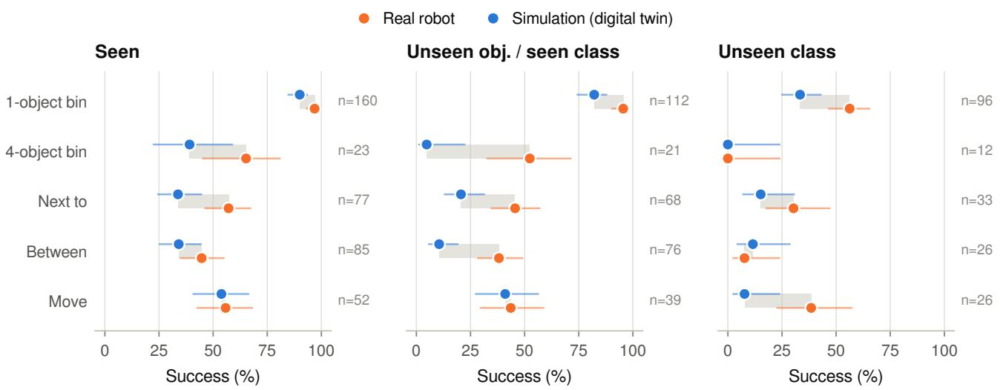  
Figure 10: Real vs. simulation success in all 15 task × object-split cells (95% Wilson intervals).

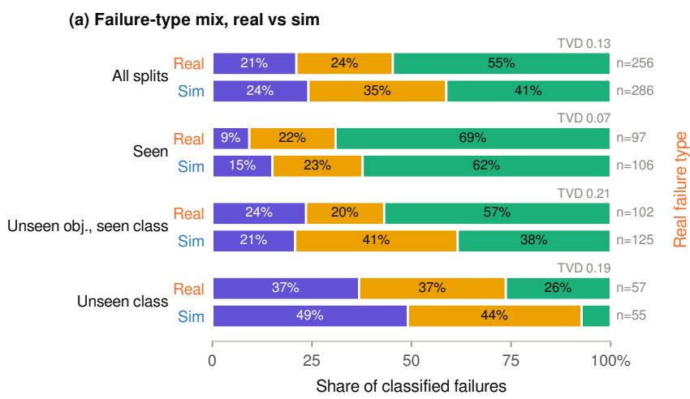

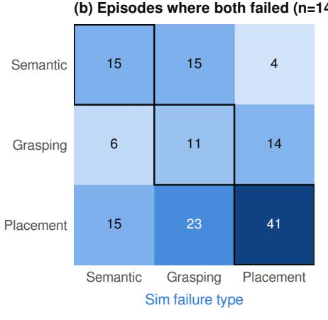  
Figure 11: Failure-type mix per split and real × sim failure-type confusion on episodes where both domains failed.

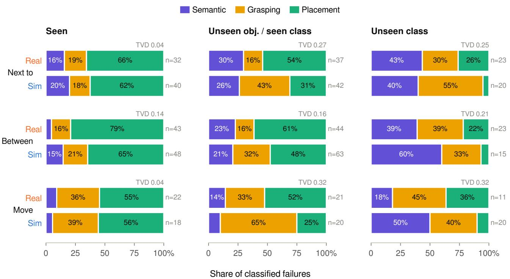  
Figure 12: Failure-type mix per task and object split.

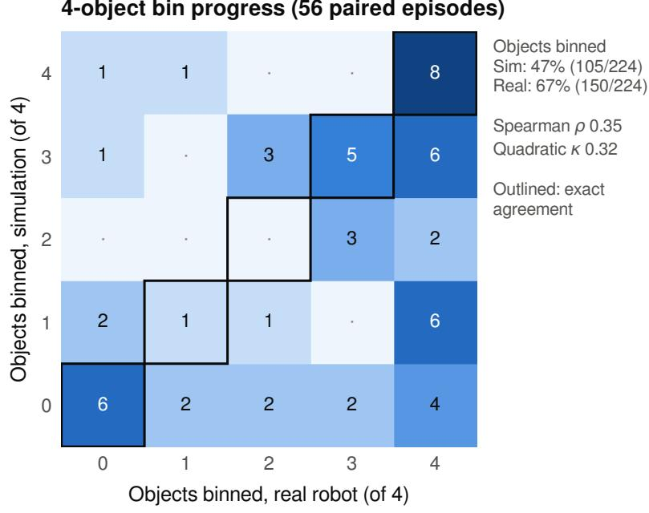  
Figure 13: Objects binned in 4-object bin episodes, real vs. simulation (56 paired episodes).

## B Sim2Real: Additional Results

The agent on the real robot. GPT-6.1 Sol (PyRUA) + Galaxea 0.5 runs on the real robot with the same harness (PyRUA-Lean v9.6), reasoning effort (high) and Galaxea 0.5 checkpoint as in simulation, with the real overhead and wrist cameras in place of the simulated ones. Table 5 compares elapsed real-robot rollout time for all five systems on the same 45 layouts. We use the last monotonic control timestamp relative to episode start for every policy, checked against its original recording. Three older recordings omit elapsed gaps present in the control traces, so compressed video duration is not substituted for elapsed time. These are deployed-system measurements of time to rollout stop, not time to success; early failures can therefore shorten a rollout.

Table 5: Real-robot elapsed time in Sim2Real. Forty-five matched layouts per policy, including both successes and failures. Elapsed wall time runs from episode start to the last logged control command and includes policy/API waits and any within-rollout stalls; server/model startup, scene resets and subsequent operator scoring are excluded. Times measure rollout stopping, not time to successful completion.
<table><tr><td>Policy</td><td>n</td><td>Median (s)</td><td>P95 (s)</td></tr><tr><td>GPT-6.1 Sol + PyRUA-Lean + Galaxea 0.5</td><td>45</td><td>196.6</td><td>391.8</td></tr><tr><td>Galaxea 0.5</td><td>45</td><td>37.5</td><td>116.5</td></tr><tr><td>GR00T N1.7</td><td>45</td><td>37.9</td><td>95.8</td></tr><tr><td>π0.5</td><td>45</td><td>59.1</td><td>153.3</td></tr><tr><td>MolmoAct2-SO101</td><td>45</td><td>56.0</td><td>138.0</td></tr></table>

Real robot (unseen environment)  
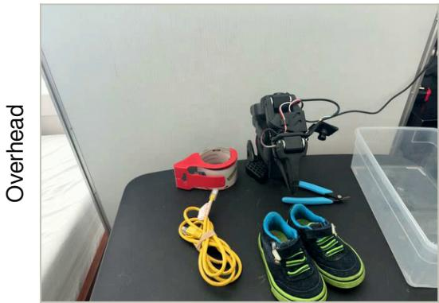

Simulation  
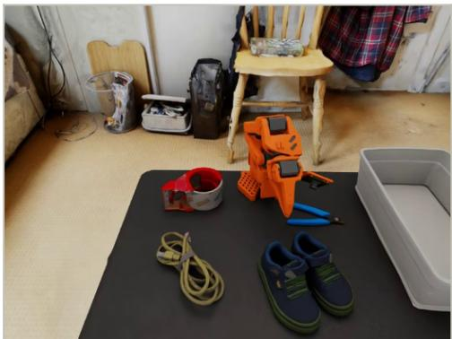

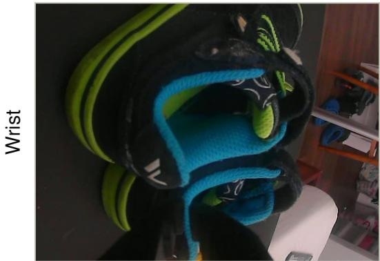

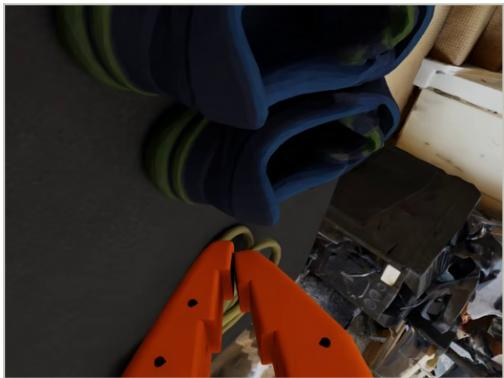  
Figure 14: One sim2real episode, real vs. simulation. Initial overhead (top) and wrist (bottom) views of the same 4-object layout on the real robot and in the digital twin.

Table 6: Sim2real evaluation with identical weights. Each policy was evaluated on the same 45 layouts (5 task families × 3 object splits × 3) in simulation and on the physical SO-101. Agreement is the fraction of paired episodes with the same binary outcome. Ranking metrics are computed across the five policies; CIs resample episodes within each policy (10,000 replicates). MMRV [18] is the mean maximum rank violation (0 = sim preserves the real ranking).
<table><tr><td>Policy</td><td>Simulation</td><td>Real robot</td><td>∆ (pp)</td><td>Agreement</td></tr><tr><td>GPT-6.1 Sol (PyRUA) + Galaxea 0.5</td><td>84% (38/45)</td><td>64% (29/45)</td><td>+20.0</td><td>76% (34/45)</td></tr><tr><td>Galaxea 0.5</td><td>67% (30/45)</td><td>53% (24/45)</td><td>+13.3</td><td>64% (29/45)</td></tr><tr><td>GR00T N1.7</td><td>56% (25/45)</td><td>24% (11/45)</td><td>+31.1</td><td>56% (25/45)</td></tr><tr><td>π0.5</td><td>49% (22/45)</td><td>18% (8/45)</td><td>+31.1</td><td>64% (29/45)</td></tr><tr><td>MolmoAct2-SO101</td><td>24% (11/45)</td><td>16% (7/45)</td><td>+8.9</td><td>91% (41/45)</td></tr><tr><td></td><td>Pearson r [95% CI]</td><td>Spearman ρ</td><td>MMRV [95% CI]</td><td></td></tr><tr><td>Binary success</td><td>0.90 [0.66, 0.97]</td><td>1.00</td><td>0.000 [0.000, 0.169]</td><td></td></tr><tr><td>4-bin as progress</td><td>0.87 [0.62, 0.96]</td><td>0.90</td><td>0.002 [0.000, 0.187]</td><td></td></tr></table>

Table 7: Sim2real by task family and object split. Successes in simulation / on the real robot; 9 episodes per family and 15 per split for each policy. GPT-6.1 Sol†: GPT-6.1 Sol (PyRUA) + Galaxea 0.5.
<table><tr><td></td><td>GPT-6.1 Sol†</td><td>Galaxea 0.5</td><td>GR00T N1.7</td><td>π0.5</td><td>MolmoAct2-SO101</td></tr><tr><td>1-object bin</td><td>9/7</td><td>8/7</td><td>9/3</td><td>7/3</td><td>5/5</td></tr><tr><td>4-object bin</td><td>7/4</td><td>7/5</td><td>3/0</td><td>5/2</td><td>0/0</td></tr><tr><td>Next to</td><td>8/8</td><td>4/2</td><td>6/2</td><td>3/1</td><td>4/1</td></tr><tr><td>Between</td><td>7/5</td><td>5/6</td><td>3/2</td><td>1/1</td><td>0/0</td></tr><tr><td>Move</td><td>7/5</td><td>6/4</td><td>4/4</td><td>6/1</td><td>2/1</td></tr><tr><td>Seen</td><td>15 / 12</td><td>14/11</td><td>10/5</td><td>12/5</td><td>5/3</td></tr><tr><td>Unseen object, seen class</td><td>13 / 10</td><td>10/9</td><td>10/4</td><td>7/2</td><td>5/3</td></tr><tr><td>Unseen class</td><td>10/7</td><td>6/4</td><td>5/2</td><td>3/1</td><td>1/1</td></tr></table>

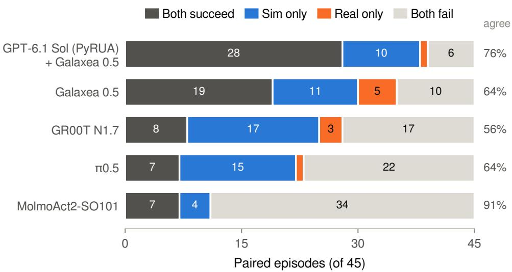  
Figure 15: Paired episode outcomes per policy.

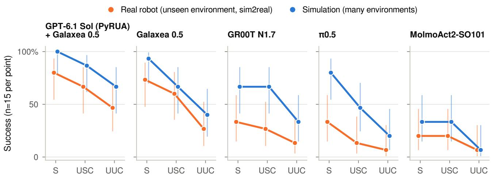  
Figure 16: Seen → unseen gradient in each domain, per policy.

## C Leaderboard: Additional Results

Measured inference latency. Table 8 summarizes server-reported dt\_ms values from the completed primaryevaluation runs, after removing the same eight excluded trials as the leaderboard. Each sample times one action-chunk query, including preprocessing and action conversion within the server’s prediction call; it excludes HTTP transport, simulation and model loading. PNG decoding is inside some server timers and outside others. All recorded first calls are retained. ImageWAM uses precomputed instruction embeddings. The shared HTTP client labels these messages “MolmoAct2 inference” for all eight HTTP-served policies; policy identity comes from the completed run and checkpoint, not that generic log label. GR00T N1.7 did not record this metric and is marked NR. The returned chunk length can exceed the prefix actually executed before replanning, so chunk latency is not per-control-step latency or an end-to-end control rate.

Table 8: Measured learned-policy inference latency. Server-reported wall time per action-chunk query over the 916 scored primary-evaluation episodes, pooled across completed runs (one evaluation worker). First calls are retained. Steps are returned / executed, not necessarily the underlying model’s full prediction horizon. Median and 95th percentile (P95) are in milliseconds. Hardware differs across policies; these are deployment measurements, not a controlled hardware comparison. NR: not recorded.
<table><tr><td>Policy</td><td>GPU</td><td>Steps</td><td>Queries</td><td>Median (ms)</td><td>P95 (ms)</td></tr><tr><td>GR00T N1.7</td><td>RTX 3090</td><td>-/16</td><td>NR</td><td>NR</td><td>NR</td></tr><tr><td>π0.5</td><td>RTX A5000</td><td>30 / 15</td><td>44,334</td><td>337.0</td><td>376.9</td></tr><tr><td>Galaxea 0.5</td><td>RTX A5000</td><td>27 / 15</td><td>33,422</td><td>791.8</td><td>933.8</td></tr><tr><td>MolmoAct2-SO101</td><td>RTX A5000</td><td>30/30</td><td>26,046</td><td>696.8</td><td>741.3</td></tr><tr><td>MolmoAct2 base</td><td>RTX A5000</td><td>30 /30</td><td>25,661</td><td>775.3</td><td>818.6</td></tr><tr><td>FLUX 3 Action SO-101 LoRA</td><td>A40</td><td>42/32</td><td>25,080</td><td>2894.0</td><td>3129.4</td></tr><tr><td>ImageWAM</td><td>RTX A5000</td><td>16/ 16</td><td>41,721</td><td>322.5</td><td>410.0</td></tr><tr><td>LaWAM</td><td>RTX A5000</td><td>36/36</td><td>18,651</td><td>274.1</td><td>333.4</td></tr><tr><td>InternWO-∆</td><td>A40</td><td>16/ 16</td><td>34,378</td><td>986.5</td><td>1089.8</td></tr></table>

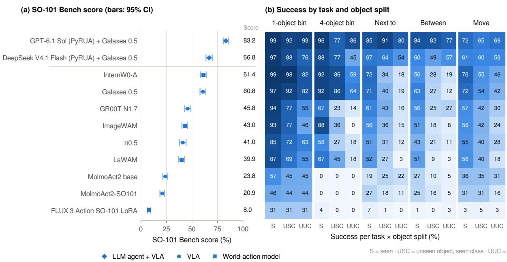  
S = seen · USC = unseen object, seen class · UUC = unseen class

Figure 17: Score and success in all 15 task × object-split cells.

Table 9: SO-101 Bench leaderboard (primary evaluation, 916 episodes). The score is the mean success over the 15 task × object-split cells, with a 95% bootstrap CI that resamples episodes within cells. Remaining columns are raw success rates (%) over the n episodes in the header. All learned policies were fine-tuned on so101\_bench\_sim; LLM agents are frozen PyRUA-Lean v9.6 harnesses that hand grasping to Galaxea 0.5 and perform placement themselves.
<table><tr><td></td><td>Policy</td><td>Type</td><td>Score [95% CI]</td><td>1-bin n=202</td><td>4-bin n=68</td><td>Next to n=216</td><td>Between n=216</td><td>Move n=214</td><td>S 316</td><td>USC 285</td><td>UUC 315</td><td>4-bin prog.</td></tr><tr><td>1</td><td>GPT-6.1 Sol (PyRUA) + Galaxea 0.5</td><td>LLM agent + VLA</td><td>83.2 [80.7, 85.7]</td><td>95</td><td>87</td><td>85</td><td>81</td><td>69</td><td>85</td><td>82</td><td>80</td><td>94</td></tr><tr><td>2</td><td>DeepSeek V4.1 Flash-1017 (PyRUA) + Galaxea 0.5</td><td>LLM agent + VLA</td><td>66.8 [63.7, 69.9]</td><td>87</td><td>71</td><td>62</td><td>56</td><td>60</td><td>72</td><td>66</td><td>60</td><td>81</td></tr><tr><td>3</td><td>InternW0-∆</td><td>WAM</td><td>61.4 [58.5, 64.1]</td><td>93</td><td>79</td><td>42</td><td>35</td><td>59</td><td>76</td><td>56</td><td>42</td><td>91</td></tr><tr><td>4</td><td>Galaxea 0.5</td><td>VLA</td><td>60.8 [57.9, 63.6]</td><td>90</td><td>81</td><td>44</td><td>34</td><td>56</td><td>76</td><td>55</td><td>40</td><td>90</td></tr><tr><td>5</td><td>GR00T N1.7</td><td>VLA</td><td>45.8 [42.6, 48.8]</td><td>75</td><td>35</td><td>40</td><td>37</td><td>43</td><td>66</td><td>45</td><td>30</td><td>52</td></tr><tr><td>6</td><td>ImageWAM</td><td>WAM</td><td>43.0 [40.2, 45.7]</td><td>71</td><td>43</td><td>36</td><td>26</td><td>41</td><td>65</td><td>42</td><td>22</td><td>58</td></tr><tr><td>7</td><td>π0.5</td><td>VLA</td><td>41.0 [37.8, 44.3]</td><td>73</td><td>35</td><td>31</td><td>25</td><td>41</td><td>58</td><td>40</td><td>28</td><td>65</td></tr><tr><td>8</td><td>LaWAM</td><td>WAM</td><td>39.9 [36.8, 42.9]</td><td>70</td><td>44</td><td>27</td><td>21</td><td>38</td><td>61</td><td>36</td><td>19</td><td>60</td></tr><tr><td>9</td><td>MolmoAct2 base</td><td>VLA</td><td>23.8 [21.5, 26.1]</td><td>49</td><td>0</td><td>22</td><td>14</td><td>34</td><td>31</td><td>27</td><td>24</td><td>18</td></tr><tr><td>10</td><td>MolmoAct2-SO101</td><td>VLA</td><td>20.9 [18.6, 23.2]</td><td>45</td><td>0</td><td>19</td><td>16</td><td>26</td><td>29</td><td>25</td><td>17</td><td>22</td></tr><tr><td>11</td><td>FLUX 3 Action SO-101 LoRA</td><td>WAM</td><td>8.0 [6.5, 9.5]</td><td>31</td><td>1</td><td>3</td><td>1</td><td>3</td><td>9</td><td>8</td><td>8</td><td>15</td></tr></table>

Table 10: Leaderboard, all 15 task × object-split cells. Success as % (successes/episodes).
<table><tr><td></td><td colspan="3">1-object bin</td><td colspan="3">4-object bin</td><td colspan="3">Next to</td><td colspan="3">Between</td><td colspan="3">Move</td></tr><tr><td>Policy</td><td>S</td><td>USC</td><td>UUC</td><td>S</td><td>USC</td><td>UUC</td><td>S</td><td>USC</td><td>UUC</td><td>S</td><td>USC</td><td>UUC</td><td>S</td><td>USC</td><td>UUC</td></tr><tr><td rowspan="2">GPT-6.1 Sol (PyRUA) + Galaxea 0.5</td><td>99%</td><td>92%</td><td>93%</td><td>96%</td><td>77%</td><td>86%</td><td>85%</td><td>91%</td><td>80%</td><td>84%</td><td>82%</td><td>77%</td><td>72%</td><td>65%</td><td>69%</td></tr><tr><td>(66/67)</td><td>(59/64)</td><td>(66/71)</td><td>(23/24)</td><td>(17/22)</td><td>(19/22)</td><td>(64/75)</td><td>(61/67)</td><td>(59/74)</td><td>(63/75)</td><td>(55/67)</td><td>(57/74)</td><td>(54/75)</td><td>(42/65)</td><td>(51/74)</td></tr><tr><td rowspan="2">DeepSeek V4.1 Flash-1017 (PyRUA) + Galaxea 0.5</td><td>97%</td><td>88%</td><td>76%</td><td>88%</td><td>77%</td><td>45%</td><td>67%</td><td>64%</td><td>54%</td><td>60%</td><td>49%</td><td>57%</td><td>61%</td><td>60%</td><td>59%</td></tr><tr><td>(65/67)</td><td>(56/64)</td><td>(54/71)</td><td>(21/24)</td><td>(17/22)</td><td>(10/22)</td><td>(50/75)</td><td>(43/67)</td><td>(40/74)</td><td>(45/75)</td><td>(33/67)</td><td>(42/74)</td><td>(46/75)</td><td>(39/65)</td><td>(44/74)</td></tr><tr><td rowspan="2">InternW0-∆</td><td></td><td>98%</td><td>82%</td><td>92%</td><td>86%</td><td>59%</td><td>72%</td><td>34%</td><td>18%</td><td>56%</td><td>28%</td><td>19%</td><td>76%</td><td>55%</td><td>46%</td></tr><tr><td>99% (66/67)</td><td>(63/64)</td><td>(58/71)</td><td>(22/24)</td><td>(19/22)</td><td>(13/22)</td><td>(54/75)</td><td>(23/67)</td><td>(13/74)</td><td>(42/75)</td><td>(19/67)</td><td>(14/74)</td><td>(57/75)</td><td>(36/65)</td><td>(34/74)</td></tr><tr><td rowspan="2">Galaxea 0.5</td><td></td><td>92%</td><td>82%</td><td>92%</td><td>86%</td><td>64%</td><td>71%</td><td>40%</td><td>19%</td><td>63%</td><td>27%</td><td>12%</td><td>72%</td><td>54%</td><td>42%</td></tr><tr><td>97% (65/67)</td><td>(59/64)</td><td>(58/71)</td><td>(22/24)</td><td>(19/22)</td><td>(14/22)</td><td>(53/75)</td><td>(27/67)</td><td>(14/74)</td><td>(47/75)</td><td>(18/67)</td><td>(9/74)</td><td>(54/75)</td><td>(35/65)</td><td>(31/74)</td></tr><tr><td rowspan="2">GR00T N1.7</td><td></td><td>77%</td><td>55%</td><td>67%</td><td>23%</td><td>14%</td><td>61%</td><td>43%</td><td>16%</td><td>56%</td><td>25%</td><td>27%</td><td>57%</td><td>42%</td><td>30%</td></tr><tr><td>94% (63/67)</td><td>(49/64)</td><td>(39/71)</td><td>(16/24)</td><td>(5/22)</td><td>(3/22)</td><td>(46/75)</td><td>(29/67)</td><td>(12/74)</td><td>(42/75)</td><td>(17/67)</td><td>(20/74)</td><td>(43/75)</td><td>(27/65)</td><td>(22/74)</td></tr><tr><td rowspan="2">ImageWAM</td><td></td><td>77%</td><td>46%</td><td>88%</td><td>36%</td><td>0%</td><td>56%</td><td>36%</td><td>15%</td><td>51%</td><td>18%</td><td>8%</td><td>56%</td><td>42%</td><td>24%</td></tr><tr><td>93% (62/67)</td><td>(49/64)</td><td>(33/71)</td><td>(21/24)</td><td>(8/22)</td><td>(0/22)</td><td>(42/75)</td><td>(24/67)</td><td>(11/74)</td><td>(38/75)</td><td>(12/67)</td><td>(6/74)</td><td>(42/75)</td><td>(27/65)</td><td>(18/74)</td></tr><tr><td rowspan="2">π0.5</td><td>85%</td><td>72%</td><td>63%</td><td>58%</td><td>27%</td><td>18%</td><td>51%</td><td>31%</td><td>12%</td><td>43%</td><td>21%</td><td>11%</td><td>55%</td><td>40%</td><td>28%</td></tr><tr><td>(57/67)</td><td>(46/64)</td><td>(45/71)</td><td>(14/24)</td><td>(6/22)</td><td>(4/22)</td><td>(38/75)</td><td>(21/67)</td><td>(9/74)</td><td>(32/75)</td><td>(14/67)</td><td>(8/74)</td><td>(41/75)</td><td>(26/65)</td><td>(21/74)</td></tr><tr><td rowspan="2">LaWAM</td><td>87%</td><td>69%</td><td>55%</td><td>67%</td><td>45%</td><td>18%</td><td>52%</td><td>27%</td><td>3%</td><td>51%</td><td>9%</td><td>3%</td><td>56%</td><td>40%</td><td>18%</td></tr><tr><td>(58/67)</td><td>(44/64)</td><td>(39/71)</td><td>(16/24)</td><td>(10/22)</td><td>(4/22)</td><td>(39/75)</td><td>(18/67)</td><td>(2/74)</td><td>(38/75)</td><td>(6/67)</td><td>(2/74)</td><td>(42/75)</td><td>(26/65)</td><td>(13/74)</td></tr><tr><td rowspan="2">MolmoAct2 base</td><td>57%</td><td>45%</td><td>45%</td><td>0%</td><td>0%</td><td>0%</td><td>19%</td><td>25%</td><td>22%</td><td>27%</td><td>10%</td><td>5%</td><td>36%</td><td>35%</td><td>31%</td></tr><tr><td>(38/67)</td><td>(29/64)</td><td>(32/71)</td><td>(0/24)</td><td>(0/22)</td><td>(0/22)</td><td>(14/75)</td><td>(17/67)</td><td>(16/74)</td><td>(20/75)</td><td>(7/67)</td><td>(4/74)</td><td>(27/75)</td><td>(23/65)</td><td>(23/74)</td></tr><tr><td rowspan="2">MolmoAct2-SO101</td><td>46%</td><td>44%</td><td>44%</td><td>0%</td><td>0%</td><td>0%</td><td>27%</td><td>18%</td><td>11%</td><td>25%</td><td>16%</td><td>5%</td><td>31%</td><td>31%</td><td>16%</td></tr><tr><td>(31/67)</td><td>(28/64)</td><td>(31/71)</td><td>(0/24)</td><td>(0/22)</td><td>(0/22)</td><td>(20/75)</td><td>(12/67)</td><td>(8/74)</td><td>(19/75)</td><td>(11/67)</td><td>(4/74)</td><td>(23/75)</td><td>(20/65)</td><td>(12/74)</td></tr><tr><td rowspan="2">FLUX 3 Action SO-101 LoRA</td><td>31%</td><td>31%</td><td>31%</td><td>4%</td><td>0%</td><td>0%</td><td>7%</td><td>1%</td><td>0%</td><td>1%</td><td>0%</td><td>3%</td><td>3%</td><td>5%</td><td>3%</td></tr><tr><td>(21/67)</td><td>(20/64)</td><td>(22/71)</td><td>(1/24)</td><td>(0/22)</td><td>(0/22)</td><td>(5/75)</td><td>(1/67)</td><td>(0/74)</td><td>(1/75)</td><td>(0/67)</td><td>(2/74)</td><td>(2/75)</td><td>(3/65)</td><td>(2/74)</td></tr></table>

Table 11: Evaluation subsets and visual conditions. ROBUST (held-out backgrounds and robot colours), PLAN and MEM are tagged subsets of the same 916 episodes; appearance profiles partition them. Profiles use different layouts, so the columns are not a paired visual-robustness test.
<table><tr><td rowspan="2">Policy</td><td colspan="3">Subsets</td><td colspan="3">Appearance profile</td></tr><tr><td>ROBUST</td><td>PLAN</td><td>MEM</td><td>Canonical</td><td>Varied</td><td>Held-out</td></tr><tr><td>GPT-6.1 Sol (PyRUA) + Galaxea 0.5</td><td>82% (146/178)</td><td>75% (36/48)</td><td>80% (41/51)</td><td>82% (307/374)</td><td>83% (303/364)</td><td>82% (146/178)</td></tr><tr><td>DeepSeek V4.1 Flash-1017 (PyRUA) + Galaxea 0.5</td><td>62% (111/178)</td><td>35% (17/48)</td><td>55% (28/51)</td><td>66% (248/374)</td><td>68% (246/364)</td><td>62% (111/178)</td></tr><tr><td>InternW0-∆</td><td>53% (94/178)</td><td>12% (6/48)</td><td>47% (24/51)</td><td>59% (219/374)</td><td>60% (220/364)</td><td>53% (94/178)</td></tr><tr><td>Galaxea 0.5</td><td>57% (102/178)</td><td>15% (7/48)</td><td>31% (16/51)</td><td>57% (214/374)</td><td>57% (209/364)</td><td>57% (102/178)</td></tr><tr><td>GR00T N1.7</td><td>48% (85/178)</td><td>17% (8/48)</td><td>43% (22/51)</td><td>49% (184/374)</td><td>45% (164/364)</td><td>48% (85/178)</td></tr><tr><td>ImageWAM</td><td>34% (60/178)</td><td>8% (4/48)</td><td>27% (14/51)</td><td>47% (174/374)</td><td>44% (159/364)</td><td>34% (60/178)</td></tr><tr><td>π0.5</td><td>36% (64/178)</td><td>8% (4/48)</td><td>22% (11/51)</td><td>45% (167/374)</td><td>41% (151/364)</td><td>36% (64/178)</td></tr><tr><td>LaWAM</td><td>18% (32/178)</td><td>6% (3/48)</td><td>29% (15/51)</td><td>46% (173/374)</td><td>42% (152/364)</td><td>18% (32/178)</td></tr><tr><td>MolmoAct2 base</td><td>28% (50/178)</td><td>4% (2/48)</td><td>24% (12/51)</td><td>30% (112/374)</td><td>24% (88/364)</td><td>28% (50/178)</td></tr><tr><td>MolmoAct2-SO101</td><td>26% (47/178)</td><td>6% (3/48)</td><td>20% (10/51)</td><td>23% (86/374)</td><td>24% (86/364)</td><td>26% (47/178)</td></tr><tr><td>FLUX 3 Action SO-101 LoRA</td><td>4% (7/178)</td><td>0% (0/48)</td><td>6% (3/51)</td><td>10% (39/374)</td><td>9% (34/364)</td><td>4% (7/178)</td></tr></table>

Table 12: Evaluated checkpoints. Hugging Face repository and revision (learned policies) or frozen harness (LLM agents), and the evaluation hardware.
<table><tr><td>Policy</td><td>Checkpoint</td><td>Hardware</td></tr><tr><td>GPT-6.1 Sol (PyRUA) + Galaxea 0.5</td><td>PyRUA-Lean v9.6 + G0.5 step25600 (@957d33b)</td><td>RunPod A40, 2 isolated agent workers per pod</td></tr><tr><td>DeepSeek V4.1 Flash-1017 (PyRUA) + Galaxea 0.5</td><td>PyRUA-Lean v9.6 + G0.5 step25600 (@957d33b)</td><td>RunPod A40, 2 isolated agent workers per pod</td></tr><tr><td>InternW0-∆</td><td>5hadytru/so101_bench_InternW0-Delta@8316ccc</td><td>RunPod A40, 1 worker</td></tr><tr><td>Galaxea 0.5</td><td>5hadytru/so101_bench_G0.5_full_fine_tune@957d33b (step25600)</td><td>RunPod RTX A5000 secure, 1 worker</td></tr><tr><td>GR00T N1.7</td><td>5hadytru/so101_bench_GR00T_N1.7-3B@572a932(step16000)</td><td>workstation RTX 3090, 1 worker</td></tr><tr><td>ImageWAM</td><td>5hadytru/so101_bench_ImageWAM-FLUX.2-4B_full_fine_tune@0ba49ae</td><td>RunPod RTX A5000, 1 worker</td></tr><tr><td>π0.5</td><td>5hadytru/so101_bench_pi05@de712e6(step18000)</td><td>RunPod RTX A5000 secure, 1 worker</td></tr><tr><td>LaWAM</td><td>5hadytru/so101_bench_LaWAM_full_fine_tune@a7ddd36</td><td>RunPod RTX A5000, 1 worker</td></tr><tr><td>MolmoAct2 base</td><td>5hadytru/so101_bench_MolmoAct2-S0101_WM_base_full_fine_tune@723a9a8</td><td>RunPod RTX A5000, 1 worker</td></tr><tr><td>MolmoAct2-SO101</td><td>5hadytru/so101_bench_MolmoAct2-S0101_WM_full_fine_tune@8d04677</td><td>RunPod RTX A5000, 1 worker</td></tr><tr><td>FLUX 3 Action SO-101 LoRA</td><td>5hadytru/so101_bench_flux-3-action-so101@ac49157</td><td>RunPod A40, 1 worker</td></tr></table>

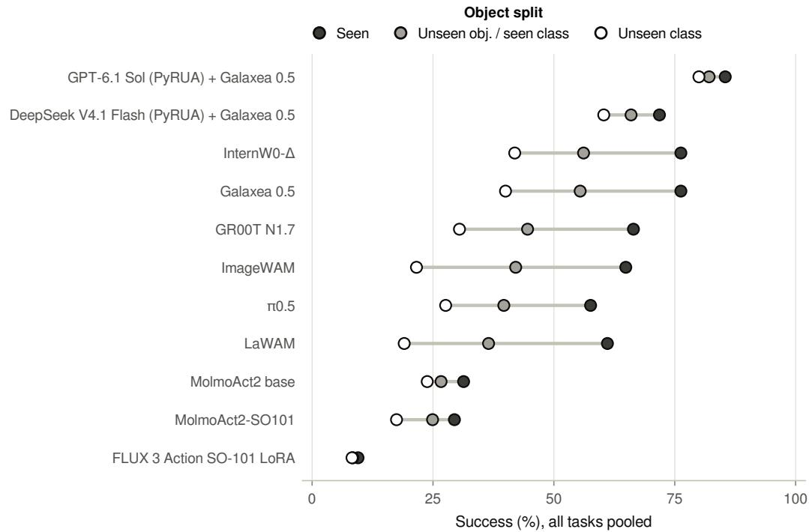  
Figure 18: Success by object split, all tasks pooled.

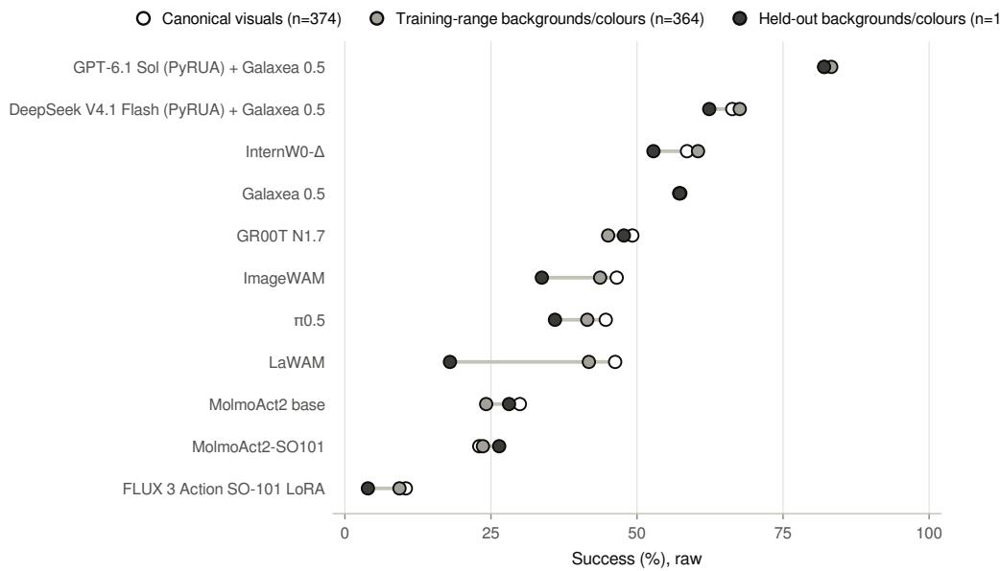  
Figure 19: Success by appearance profile: canonical, training-range and held-out visuals.

<table><tr><td colspan="10">(a) Performance (success %, n episodes in each header)</td></tr><tr><td>Policy</td><td>Type</td><td>Score [95% CI]</td><td>All S 916 316</td><td>USC 285</td><td>UUC 1-bin 315</td><td>4-bin 202</td><td>Next to 68 216</td><td>Between 216</td><td>Move 214</td><td>4-bin prog. 68</td><td>MEM 51</td><td>PLAN 48</td><td>ROBUST 178</td></tr><tr><td>GPT-6.1 Sol (PyRUA) + Galaxea 0.5</td><td>LLM agent + VLA</td><td>83.2 [80.7, 85.7]</td><td>83 85</td><td>82</td><td>80</td><td>95</td><td>87 85</td><td>81</td><td>69</td><td>94</td><td>80</td><td>75</td><td>82</td></tr><tr><td>DeepSeek V4.1 Flash-1017 (PyRUA) + Galaxea 0.5</td><td>LLM agent + VLA</td><td>66.8 [63.7, 69.9]</td><td>66 72</td><td>66</td><td>60</td><td>87</td><td>71</td><td>62</td><td>56 60</td><td></td><td>81 55</td><td>35</td><td>62</td></tr><tr><td>InternW0-Delta</td><td>WAM (video generation)</td><td>61.4 [58.5, 64.1]</td><td>58 76</td><td>56</td><td>42</td><td>93</td><td>79</td><td>42</td><td>35</td><td>59</td><td>91</td><td>47 12</td><td>53</td></tr><tr><td>Galaxea 0.5</td><td>VLA</td><td>60.8 [57.9, 63.6]</td><td>57 76</td><td>55</td><td>40</td><td>90</td><td>81</td><td>44</td><td>34 56</td><td></td><td>90 31</td><td>15</td><td>57</td></tr><tr><td>GR00T N1.7</td><td>VLA</td><td>45.8 [42.6, 48.8]</td><td>47 66</td><td>45</td><td>30</td><td>75</td><td>35</td><td>40</td><td>37 43</td><td></td><td>52 43</td><td>17</td><td>48</td></tr><tr><td>ImageWAM</td><td>WAM (image editing)</td><td>43.0 [40.2, 45.7]</td><td>43 65</td><td>42</td><td>22</td><td>71</td><td>43</td><td>36</td><td>26 41</td><td></td><td>58 27</td><td>8</td><td>34</td></tr><tr><td>π0.5</td><td>VLA</td><td>41.0 [37.8, 44.3]</td><td>42 58</td><td>40</td><td>28</td><td>73</td><td>35</td><td>31</td><td>25 41</td><td></td><td>65 22</td><td>8</td><td>36</td></tr><tr><td>LaWAM</td><td>WAM (latent action)</td><td>39.9 [36.8, 42.9]</td><td>39 61</td><td>36</td><td>19</td><td>70</td><td>44 0</td><td>27</td><td>21 38</td><td></td><td>60 29</td><td>6</td><td>18</td></tr><tr><td>MolmoAct2 base</td><td>VLA VLA</td><td>23.8 [21.5, 26.1]</td><td>27 31 24 29</td><td>27</td><td>24 17</td><td>49</td><td></td><td>22</td><td>14 34 26</td><td></td><td>18 24</td><td>4</td><td>28</td></tr><tr><td>MolmoAct2-SO101 FLUX 3 Action SO-101 LoRA</td><td>WAM (video generation)</td><td>20.9 [18.6, 23.2] 8.0 [6.5, 9.5]</td><td>9 9</td><td>25</td><td>8</td><td>45 31</td><td>0 1</td><td>19 3</td><td>16 1</td><td>3</td><td>22 20 15 6</td><td>6 0</td><td>26 4</td></tr><tr><td rowspan="12"></td><td colspan="9">8</td><td rowspan="8"></td><td rowspan="8"></td><td rowspan="8"></td></tr><tr><td>(b) Evaluation cost (916 episodes)</td><td></td><td></td><td></td><td></td><td></td><td></td><td></td><td></td></tr><tr><td>Policy</td><td></td><td>Hardware</td><td></td><td>Sim time (h)</td><td>GPU-h</td><td>API$ API $/episode</td></tr><tr><td>GPT-6.1 Sol (PyRUA) + Galaxea 0.5 DeepSeek V4.1 Flash-1017 (PyRUA) + Galaxea 0.5</td><td></td><td>A40, 2 agent workers per GPU</td><td>5.7 216 1</td></tr><tr><td>InternW0-Delta</td><td>A40, 2 agent workers per GPU 5.8 一</td><td>50</td><td>0.236 22 0.024</td></tr><tr><td>Galaxea 0.5</td><td></td><td>5.4 5.0</td><td></td></tr><tr><td>GR00T N1.7</td><td></td><td>44 39</td><td></td></tr><tr><td>ImageWAM</td><td>RTX A5000</td><td>6.6 6.5</td><td></td></tr><tr><td>π0.5</td><td>RTX 3090</td><td>6.5</td><td>53</td></tr><tr><td></td><td>RTX A5000</td><td></td><td>54</td><td></td><td></td></tr><tr><td>LaWAM</td><td>RTX A5000</td><td></td><td>59</td><td></td><td></td></tr><tr><td>MolmoAct2 base</td><td>RTX A5000</td><td></td><td>59</td><td></td><td></td></tr><tr><td>MolmoAct2-SO101</td><td>6.5 RTX A5000 7.4</td><td>7.5</td><td>56</td><td></td><td></td></tr><tr><td></td><td>RTX A5000 FLUX 3 Action SO-101 LoRA A40</td><td></td><td>7.7</td><td>105</td><td></td></tr><tr><td colspan="12">(c) Fine-tuning (to the evaluated checkpoint; equal 36 h budget on 4×A100-80GB)</td></tr><tr><td colspan="12">Policy Trainable parameters Memory Updates × batch Samples Epochs % of LIBERO recipe</td></tr><tr><td colspan="12" rowspan="6">GPT-6.1 Sol (PyRUA) + Galaxea 0 (LLM); G0.5 as below</td></tr><tr><td></td><td>Agent context (full episode) + G0.5&#x27;s LLM frozen (API); uses the G0.5 checkpoint below</td><td></td><td></td><td></td><td>A100-h</td></tr><tr><td>0.5</td><td>frame history 0 (LLM); G0.5 as below</td></tr><tr><td>DeepSeek V4.1 Flash-1017 (PyRUA) + Galaxea 0.5</td><td></td><td colspan="10">Agent context (full episode) + G0.5&#x27;s LLM frozen (API); uses the G0.5 checkpoint below frame history Episode-start anchor frame + frame 18,200 × 128</td></tr><tr><td colspan="10">Intern W0-Delta Full (Wan2.2-5B video expert + 1.2B action</td></tr><tr><td></td><td rowspan="4">expert; RynnBrain-2B VLM frozen) Full (8-bit AdamW); count TBD</td><td colspan="9">32 steps back</td></tr><tr><td rowspan="3">Galaxea 0.5</td><td rowspan="3">Projector + diffusion action head + VLLN</td><td colspan="5">6 observation frames at 1 s stride 25,600 × 128</td><td colspan="3" rowspan="2">3.28M 1.64 10.24M 5.13</td></tr><tr><td colspan="10">Episode-start frames (overhead +</td></tr><tr><td>(LLM and vision frozen) FLUX.2-klein-4B editing branch + ~642M</td><td>wrist init) None (current frame)</td><td>16,000 × 640 30,000 × 128</td><td></td><td></td><td></td><td>80%</td><td>142 project 130</td></tr><tr><td>ImageWAM</td><td colspan="9">action DiT (text encoder frozen)</td><td></td></tr><tr><td>π0.5</td><td colspan="7">Full, 4.14B Episode-start frames (overhead + wrist init)</td><td>1.15 30%</td><td></td><td>136 run</td></tr><tr><td>LaWAM</td><td colspan="7">Full (Qwen3-VL-2B + DINOv3 + LAM) None (current frame)</td><td>5.77 2</td><td>132 run</td><td></td></tr><tr><td>MolmoAct2 base</td><td colspan="7">Full, ~5.4B Episode-start frames (overhead + wrist init)</td><td>0.51</td><td>16%</td><td>110 run</td></tr><tr><td>MolmoAct2-SO101</td><td colspan="7">Full, ~5.4B Episode-start frames (overhead + wrist init)</td><td>0.64</td><td>20%</td><td>129 run</td></tr><tr><td>FLUX 3 Action SO-101 LoRA</td><td colspan="7">LoRA r32 on attention/MLP + action heads 8 ticks (0.27 s) of state history + 2 (full) frames</td><td colspan="3">0.19 2 69 run</td></tr><tr><td>(d) Data</td><td colspan="10"></td></tr><tr><td>Policy SO-101 in pre-training</td><td colspan="10">Initial checkpoint</td></tr><tr><td>GPT-6.1 Sol (PyRUA) + Galaxea</td><td colspan="2">gpt-6.1-sol (API, frozen) + G0.5 step 25600</td><td colspan="3">SO-101 in post-training via G0.5</td><td colspan="3">via G0.5</td><td colspan="3">none (LLM frozen); G0.5 as below</td></tr><tr><td>0.5</td><td colspan="7">deepseek-flash-1017 (API, frozen) + G0.5 step via G0.5</td><td colspan="3">none (LLM frozen); G0.5 as below</td></tr><tr><td>DeepSeek V4.1 Flash-1017 (PyRUA) + Galaxea 0.5 25600</td><td colspan="7">InternRobotics/InternW0-Delta-Base @ ?</td></table>

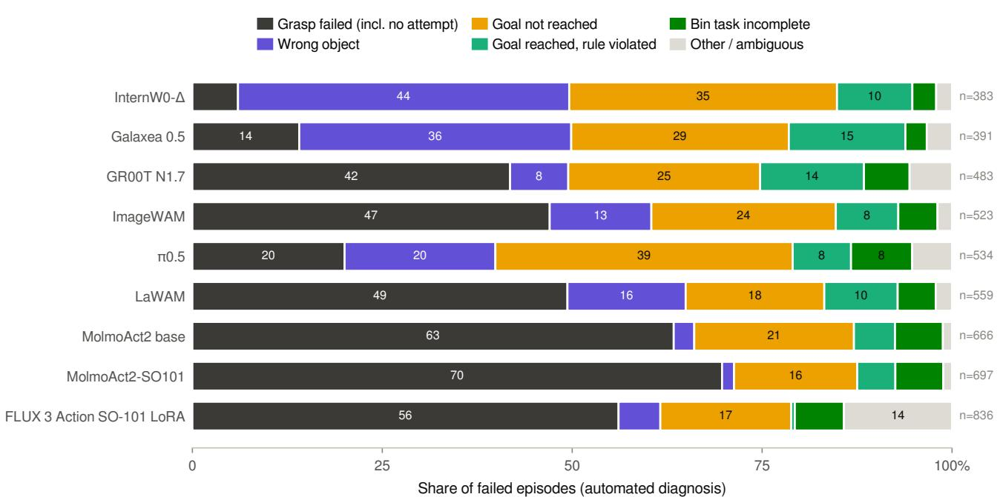  
Figure 20: Automated failure diagnosis for the learned policies. [TODO: Only include after validating the classifier against human labels.]

Table 14: Harness ablation on 60 paired primary-evaluation episodes (30 easy, 30 hard; six per task in each stratum, selected from the nine learned policies’ outcomes before any LLM run). Direct: the LLM issues end-effector tool calls. PyRUA-Lean: code-as-policy with perception and IK tools. + Galaxea 0.5: the same harness hands grasping to Galaxea 0.5; the LLM performs placement. API cost is an estimate at list prices. †Stopped by the operator after the listed episodes (easy stratum only).
<table><tr><td>LLM</td><td>Harness</td><td>All 60</td><td>Easy 30</td><td>Hard 30</td><td>1-bin</td><td>4-bin</td><td>Next to</td><td>Between</td><td>Move</td></tr><tr><td rowspan="3">GPT-6.1 Sol</td><td>Direct tool calls</td><td>35% (21/60)</td><td>47% (14/30)</td><td>23% (7/30)</td><td>1/12</td><td>0/12</td><td>6/12</td><td>6/12</td><td>8/12</td></tr><tr><td>PyRUA-Lean</td><td>67% (40/60)</td><td>73% (22/30)</td><td>60% (18/30)</td><td>8/12</td><td>5/12</td><td>9/12</td><td>10/12</td><td>8/12</td></tr><tr><td>PyRUA-Lean + Galaxea 0.5</td><td>85% (51/60)</td><td>93% (28/30)</td><td>77% (23/30)</td><td>11/12</td><td>10/12</td><td>11/12</td><td>12/12</td><td>7/12</td></tr><tr><td rowspan="3">Gemini 4 Argon</td><td>Direct tool calls†</td><td>19% (4/21)</td><td>19% (4/21)</td><td></td><td>0/5</td><td>0/5</td><td>0/4</td><td>0/3</td><td>4/4</td></tr><tr><td>PyRUA-Lean</td><td>65% (39/60)</td><td>70% (21/30)</td><td>60% (18/30)</td><td>8/12</td><td>2/12</td><td>9/12</td><td>12/12</td><td>8/12</td></tr><tr><td>PyRUA-Lean + Galaxea 0.5</td><td>77% (46/60)</td><td>87% (26/30)</td><td>67% (20/30)</td><td>9/12</td><td>9/12</td><td>9/12</td><td>10/12</td><td>9/12</td></tr><tr><td rowspan="3">DeepSeek V4.1 Flash-1017</td><td>Direct tool calls†</td><td>27% (3/11)</td><td>27% (3/11)</td><td></td><td>0/2</td><td>0/3</td><td>0/2</td><td>1/2</td><td>2/2</td></tr><tr><td>PyRUA-Lean</td><td>30% (18/60)</td><td>43% (13/30)</td><td>17% (5/30)</td><td>4/12</td><td>0/12</td><td>5/12</td><td>6/12</td><td>3/12</td></tr><tr><td>PyRUA-Lean + Galaxea 0.5</td><td>65% (39/60)</td><td>83% (25/30)</td><td>47% (14/30)</td><td>12/12</td><td>9/12</td><td>6/12</td><td>4/12</td><td>8/12</td></tr><tr><td>Galaxea 0.5 alone (reference)</td><td></td><td>53% (32/60)</td><td>93% (28/30)</td><td>13% (4/30)</td><td>9/12</td><td>7/12</td><td>5/12</td><td>5/12</td><td>6/12</td></tr></table>

Table 15: LLM ablation with the PyRUA-Lean v9.6 + Galaxea 0.5 harness held fixed, on the same 60 paired episodes. Effort is the provider reasoning setting. API cost is an estimate at list prices (Gemini: gross Vertex list rate). The last column repeats the full-benchmark score where the hybrid was run on all 916 episodes.
<table><tr><td>LLM</td><td>Effort</td><td>Runtime</td><td>All 60</td><td>Easy</td><td>Hard</td><td>1-bin</td><td>4-bin</td><td>Next to</td><td>Between</td><td>Move</td><td>$/episode</td></tr><tr><td>GPT-6.1 Sol</td><td>high</td><td>Codex</td><td>85% (51/60)</td><td>93% (28/30)</td><td>77% (23/30)</td><td>11/12</td><td>10/12</td><td>11/12</td><td>12/12</td><td>7/12</td><td>0.245</td></tr><tr><td>Gemini 4 Argon</td><td>medium</td><td>OpenAI-compatible chat (Vertex)</td><td>77% (46/60)</td><td>87% (26/30)</td><td>67% (20/30)</td><td>9/12</td><td>9/12</td><td>9/12</td><td>10/12</td><td>9/12</td><td>1.237</td></tr><tr><td>DeepSeek V4.1 Flash-1017</td><td>high</td><td>Codex</td><td>65% (39/60)</td><td>83% (25/30)</td><td>47% (14/30)</td><td>12/12</td><td>9/12</td><td>6/12</td><td>4/12</td><td>8/12</td><td>0.023</td></tr><tr><td>MiMo v2.6 Pro</td><td>high</td><td>Codex via Responses→Chat bridge</td><td>55% (33/60)</td><td>73% (22/30)</td><td>37% (11/30)</td><td>7/12</td><td>8/12</td><td>7/12</td><td>7/12</td><td>4/12</td><td>0.044</td></tr><tr><td>Galaxea 0.5 alone</td><td></td><td></td><td>53% (32/60)</td><td>93% (28/30)</td><td>13% (4/30)</td><td>9/12</td><td>7/12</td><td>5/12</td><td>5/12</td><td>6/12</td><td>0</td></tr></table>

## D LLM Agents: Additional Results

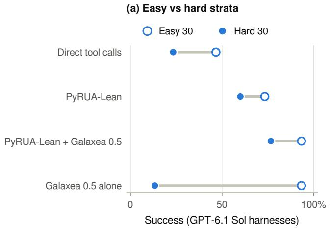

(b) Cost (GPT-6.1 Sol)  
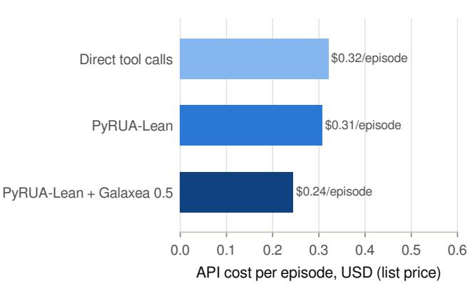  
Figure 21: Harness ablation by stratum (easy30 / hard30) and cost.

PyRUA-Lean + Galaxea 0.5, successes per task and stratum
<table><tr><td rowspan=6 colspan=1>GPT-6.1 SolGemini 4 ArgonDeepSeek V4.1 FlashMiMo v2.6 ProGalaxea 0.5 alone</td><td rowspan=1 colspan=1>11/12</td><td rowspan=1 colspan=1>10/12</td><td rowspan=1 colspan=1>11/12</td><td rowspan=1 colspan=1>12/12</td><td rowspan=1 colspan=1>7/12</td><td rowspan=1 colspan=1>28/30</td><td rowspan=1 colspan=1>23/30</td></tr><tr><td rowspan=1 colspan=1>9/12</td><td rowspan=1 colspan=1>9/12</td><td rowspan=1 colspan=1>9/12</td><td rowspan=1 colspan=1>10/12</td><td rowspan=1 colspan=1>9/12</td><td rowspan=1 colspan=1>26/30</td><td rowspan=1 colspan=1>20/30</td></tr><tr><td rowspan=1 colspan=1>12/12</td><td rowspan=1 colspan=1>9/12</td><td rowspan=1 colspan=1>6/12</td><td rowspan=1 colspan=1>4/12</td><td rowspan=1 colspan=1>8/12</td><td rowspan=1 colspan=1>25/30</td><td rowspan=1 colspan=1>14/30</td></tr><tr><td rowspan=1 colspan=1>7/12</td><td rowspan=1 colspan=1>8/12</td><td rowspan=1 colspan=1>7/12</td><td rowspan=1 colspan=1>7/12</td><td rowspan=1 colspan=1>4/12</td><td rowspan=1 colspan=1>22/30</td><td rowspan=1 colspan=1>11/30</td></tr><tr><td rowspan=1 colspan=1>9/12</td><td rowspan=1 colspan=1>7/12</td><td rowspan=1 colspan=2>5/12       5/12</td><td rowspan=1 colspan=1>6/12</td><td rowspan=1 colspan=1>28/30</td><td rowspan=1 colspan=1>4/30</td></tr><tr><td rowspan=1 colspan=1>1-bin</td><td rowspan=1 colspan=4>4-bin     Next to  Between    Move</td><td rowspan=1 colspan=1>Easy 30</td><td rowspan=1 colspan=1>Hard 30</td></tr></table>

Figure 22: Successes per task and stratum for each LLM, and for Galaxea 0.5 alone.

## E Object Real2Sim Pipeline

Every object passes through the same pipeline, which produces a rigid body with separate visual and collision geometry.

1. Asset generation. We start from an image of the object: a photograph of the real object, an image from the internet, or an image from a text-to-image model. An image-to-3D model accessed through 3D AI Studio [71] converts it into a textured mesh (GLB) with physically based rendering (PBR) materials.

2. Mesh processing (Blender). The mesh is scaled to the object’s real dimensions, oriented, and given an origin at its base, which serves as the object’s root pose for the success conditions. Texture colours are corrected towards the object’s real palette and brightness. The mesh is then duplicated into a visual and a physics mesh.

• Visual mesh: remeshed and decimated to a fixed visual budget, repaired (loose geometry removed, duplicate vertices merged, no non-manifold edges), and the original colour and roughness are baked onto it.

• Physics mesh: cleaned and remeshed to a coarser physical budget, avoiding small crevices in which the gripper could become caught. Over-faceted results are smoothed, remaining non-manifold regions are filled or remeshed at a larger voxel size, and face normals are made consistent. The physics mesh is checked to align with the visual mesh.

Both meshes are exported together as a USD file with packed textures.

3. Physics setup (Isaac Sim). The root prim is made a rigid body with mass. The physics mesh is given a collider, using a signed-distance-field (SDF) collider for complex non-convex shapes without thin walls and a convex hull or convex decomposition otherwise. A physics material sets static and dynamic friction and restitution, and the physics mesh is hidden from rendering.

4. Appearance tuning (Isaac Lab). The visual mesh’s colour texture is adjusted, usually by tuning its brightness and occasionally by repainting regions, until the object’s appearance under the benchmark cameras matches the real object.

## F Simulation Backgrounds

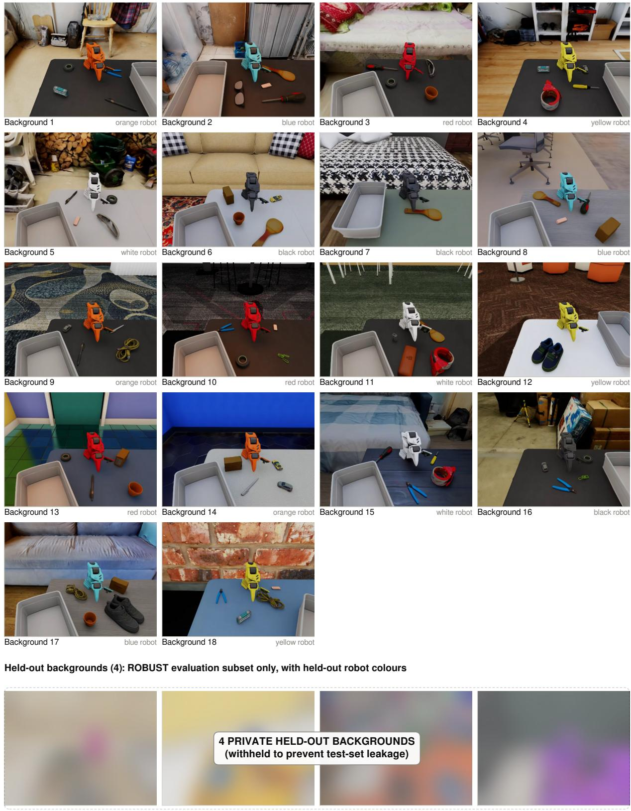  
Figure 23: Simulation backgrounds. The 18 training backgrounds (shown with varied robot colours) and the 4 held-out ROBUST backgrounds, which are withheld to prevent test-set leakage.