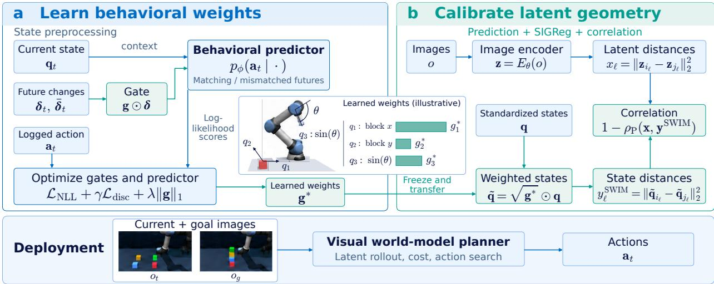
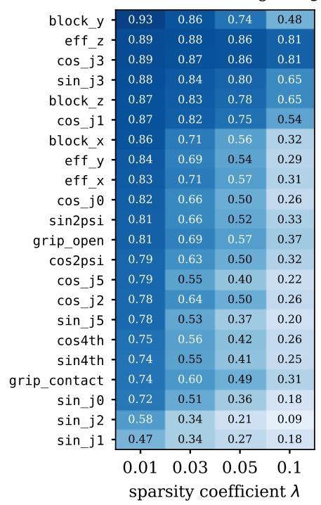
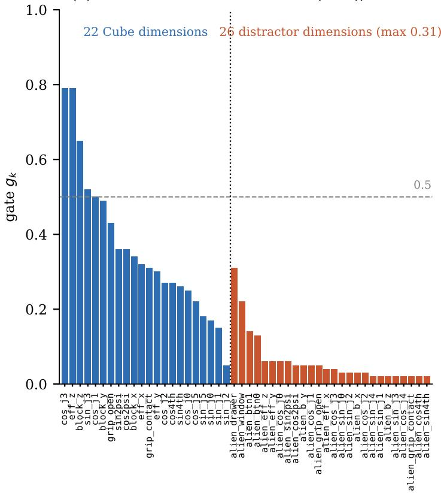

# SWIM: Learning What Matters from Behaviors for JEPA World Models

Jiaming Hu1,2,\*, Shi Bo1,2,\*, Yan Zheng2, Tian Wang2 Florian Dubost2, Alejandro Mottini2, Junze Liu2, Arvind Srinivasan2 Kai Zhong2, Kun Qian2, Sharon Gao2, Vianne Gao2, Houyu Zhang2, Qingjun Cui2 1Boston University 2Unity Technologies

October 28, 2026

## Abstract

Joint-embedding predictive architectures (JEPAs) enable world models to plan from images by predicting future embeddings. However, their visual prediction objectives do not explicitly incorporate task-relevant state information, so the physical state that determines task progress may not be reliably captured in the latent space. Supervising world models with simulator state can make planning more informative, but it requires deciding which state features matter. Features are typically selected by hand or weighted uniformly, and a uniform weighting gives every standardized state feature equal influence, so redundant coordinates can overcount the same variation, while irrelevant ones can obscure task-relevant diferences. To address this limitation, we propose SWIM (State Weighting with Inverse-Dynamics Model), which learns state weights from ofline trajectories by predicting recorded actions from current states and observed future displacements. The learned weights quantify each feature’s contribution to action prediction and define a weighted state metric for state-supervised training, which we demonstrate by aligning latent and state distances. The inverse-dynamics model is used only during training, so the resulting world model plans from images with no additional planning-time computation. Across five simulated robotic manipulation tasks, SWIM consistently improves planning success over uniform state weighting.

## Contents

1 Introduction 3   
2 Related Work 4   
3 Preliminaries 5   
3.1 Latent-Space Planning with LeWM . 5   
3.2 SCALE 6   
4 SWIM 6   
4.1 Learning State-Feature Gates via Inverse Dynamics . 6   
4.2 Transferring Learned Gates to Latent Geometry 8   
4.3 Why Learned Weights Help Planning 8   
5 Experiments 9   
5.1 Setup 9   
5.2 Does Behavioral Weighting Improve Planning? 9   
5.3 What Happens When Irrelevant Variables Are Supplied? 10   
Discussion and Conclusion 11   
A Training Details and the Behavioral Objective 14   
B Metric Transfer and Interpretation 15   
C State-Gate Values Across Tasks 15   
D Structured-Distractor Diagnostics 18   
E Experimental Details and Planning Protocol 19   
F Ablation Studies 19   
F.1 Loss-Component Ablations 19   
F.2 Gate Penalty and Discrimination Objective 20   
F.3 Hinge-Margin and InfoNCE-Temperature Sensitivity 20   
F.4 Data Eficiency of Gate Learning 20   
G State-Weight Comparison and Planning Proofs 21

## 1 Introduction

World models support planning by predicting the consequences of candidate actions before execution (Ha and Schmidhuber, 2018; Hafner et al., 2019; Chua et al., 2018). Joint-embedding predictive architectures (JEPAs) perform this prediction in latent space without reconstructing future observations (LeCun, 2022; Assran et al., 2023; Zhou et al., 2025). For example, LeWorldModel (LeWM) jointly learns an image encoder and action-conditioned latent dynamics through a next-embedding prediction objective and anti-collapse regularization (Maes et al., 2026). At planning time, candidate action sequences are evaluated using the Euclidean distance between predicted terminal and goal embeddings. However, the prediction objective does not explicitly require the latent space to represent the physical state that determines task progress. Although probing shows that JEPA latents encode physical quantities (Maes et al., 2026), forward prediction alone does not ensure that task-relevant physical state is reliably identifiable or well separated in latent space, which can limit downstream planning (Yan et al., 2026; Zeng et al., 2026).

This has motivated supervising world models with the simulator states recorded alongside ofline data, which provide a direct signal of task progress: TC-WM aligns compact visual representations with proprioceptive state (Fu et al., 2026), PhyLatent and PSG-JEPA ground latent representations in physical state (Zeng et al., 2026; Yan et al., 2026), and SCALE aligns latent distances with taskstate distances during world-model training (Hu et al., 2026). These methods take the supervising state as given, so their efectiveness depends on how the state is selected and weighted. Although state variables contain information relevant to planning, diferent coordinates may encode overlapping information, while others may be irrelevant to the task. Assigning equal weights to all coordinates can therefore overemphasize redundant information and introduce irrelevant variation into the state supervision, while selecting coordinates by hand requires task-specific expertise. This motivates learning the relative contributions of state features rather than treating all coordinates equally.

A key question is how to determine these weights. Prior action-based objectives, including inverse-dynamics models (which infer the action that produced an observed state change) and PLDM (Agrawal et al., 2016; Pathak et al., 2017; Sobal et al., 2025), shape latent representations directly but do not address how individual state coordinates should be weighted. Since actions directly influence future state transitions and task outcomes, we leverage recorded actions to identify state changes that are informative about behavior: a coordinate whose change helps infer the action reflects the agent’s behavior, whereas a redundant or unafected coordinate adds little information. This provides a behavior-grounded surrogate for state relevance.

Building on this idea, we propose SWIM (State Weighting with Inverse-Dynamics Model), a twostage framework for learning behavior-informed state supervision. First, a gated inverse-dynamics model learns continuous state weights by predicting recorded actions from current states and observed future displacements. Its training combines the log-likelihood of recorded actions, discrimination between matching and mismatched state changes, and regularization. The learned weights define a weighted state metric that can replace the hand-specified state in state-supervised training; we then demonstrate it by calibrating JEPA latent geometry through SCALE (Hu et al., 2026). This approach requires neither reward nor success labels. Because the inverse-dynamics model and simulator states are used only during training, the world model still plans from images without additional inference-time computation.

Our contributions are as follows: (i) We introduce an inverse-dynamics approach to automatically learn the relative importance of state features from ofline trajectories. (ii) We demonstrate the learned state metric in SCALE, aligning JEPA latent distances with weighted state distances to better support downstream planning. (iii) We evaluate SWIM on five OGBench manipulation tasks (Park et al., 2025) with the cross-entropy method (CEM) and iCEM planners over five training seeds, where it consistently improves over uniform state weighting , and we analyze how the learned weights respond to structured distractors.

The rest of the paper is organized as follows. Section 2 reviews related work, and Section 3 introduces latent-space planning and state-distance supervision. Section 4 presents SWIM, followed by the experiments in Section 5. Section 6 discusses limitations and concludes. The appendices provide implementation and evaluation details, an analysis of the state transformation and learned weights, and additional experimental results.

## 2 Related Work

Latent World Models and Planning. World models support control by learning policies from imagined experience (Ha and Schmidhuber, 2018; Hafner et al., 2020) or optimizing action sequences through model predictions (Chua et al., 2018; Hafner et al., 2019; Hansen et al., 2024). Jointembedding predictive architectures (JEPAs) learn representations through latent prediction without reconstructing observations (LeCun, 2022; Assran et al., 2023). DINO-WM builds on pretrained visual features (Zhou et al., 2025), whereas PLDM and LeWorldModel (LeWM) jointly learn visual representations and latent dynamics (Sobal et al., 2025; Maes et al., 2026). Their prediction objectives do not specify which task-relevant information the representation should capture, which motivates the state supervision discussed next.

State Supervision and Planning-Oriented Representations. Several approaches introduce additional supervision to improve the planning relevance of learned representations. TC-WM learns a compact latent space with a subspace contrastively aligned to the agent’s physical state (Fu et al., 2026), while PhyLatent and PSG-JEPA incorporate physical-state grounding and dynamics-related objectives (Zeng et al., 2026; Yan et al., 2026). Other methods use value guidance, temporal distance, and reachability information to make latent representations more suitable for planning (Destrade et al., 2025; Bai and Xiong, 2026; Li et al., 2026). Decision-Metric Alignment further studies whether latent distances correctly rank candidate action sequences (Wang et al., 2026). SCALE directly correlates pairwise latent distances with task-state distances (Hu et al., 2026). TC-WM, PhyLatent, PSG-JEPA, and SCALE all rely on a fixed choice of state coordinates, selected by hand or weighted uniformly; SWIM instead learns how much each state coordinate should contribute, and we demonstrate it with SCALE.

Inverse Dynamics and Behavioral Relevance. Inverse dynamics has been widely used to learn action-relevant representations from observed transitions (Agrawal et al., 2016; Pathak et al., 2017). More recent approaches incorporate action-based objectives into latent world-model training, including PLDM, DA-LeWM, AC-MTM, and LeWAM (Sobal et al., 2025; Wang et al., 2026; Boylan and Hokamp, 2026; Hegde et al., 2026). Related work on actionable representations and bisimulation connects state similarity to behavior and task-related signals (Ghosh et al., 2019; Ferns et al., 2004; Zhang et al., 2021), while sparse regularization and diferentiable feature selection provide mechanisms for learning feature weights (Tibshirani, 1996; Louizos et al., 2018). These methods shape latent representations directly, define state similarity through rewards or learned policies, or provide weighting mechanisms without a behavioral target; none learns per-coordinate weights over recorded state variables for state supervision. SWIM instead uses gated inverse dynamics to learn weights over recorded state variables, which then define the state supervision for world-model training.

## 3 Preliminaries

In this section, we review latent-space planning with LeWM and introduce SCALE, the statesupervised objective we use to demonstrate SWIM, which correlates latent distances with state distances. Throughout the paper, lowercase bold letters denote vectors and uppercase bold letters denote matrices; unbolded indexed letters denote scalar entries. For example, $\mathbf { v } = ( v _ { 1 } , \ldots , v _ { d } ) ^ { \top } \in \mathbb { R } ^ { d }$ has entries $v _ { k }$ , and $\mathbf { M } = ( M _ { i j } ) \in \mathbb { R } ^ { m \times n }$ has entries $M _ { i j }$ . For $\mathbf { v } \in \mathbb { R } ^ { d }$ , we define $\begin{array} { r } { \| \mathbf { v } \| _ { 1 } = \sum _ { k = 1 } ^ { d } \left| v _ { k } \right| } \end{array}$ and $\textstyle \| \mathbf { v } \| _ { 2 } = ( \sum _ { k = 1 } ^ { d } v _ { k } ^ { 2 } ) ^ { 1 / 2 }$

## 3.1 Latent-Space Planning with LeWM

LeWorldModel (LeWM) jointly learns an image encoder and action-conditioned latent dynamics, enabling an agent to evaluate candidate action sequences by predicting their outcomes in latent space (Maes et al., 2026). We introduce its planning formulation and training objective below. Let $o _ { t }$ denote an image at decision step t and $\mathbf { a } _ { t }$ the stacked vector of actions executed before the next decision step. An episode is one recorded environment trajectory, and a sub-trajectory is a contiguous segment of an episode. LeWM uses an encoder $E _ { \theta }$ and an action-conditioned predictor $P _ { \psi } .$ , with trainable parameters θ and $\psi _ { ; }$ respectively. Writing $d _ { z }$ for the latent dimension, the model produces $\mathbf { z } _ { t } = E _ { \theta } ( o _ { t } ) \in \mathbb { R } ^ { d _ { z } }$ and $\hat { \mathbf { z } } _ { t + 1 } = P _ { \psi } ( \mathbf { z } _ { t } , \mathbf { a } _ { t } )$ . We suppress the predictor’s finite history in this notation.

At test time, H is the planning horizon in decision steps. Given a current image $o _ { 0 }$ and candidate actions ${ \bf a } _ { 0 : { H - 1 } }$ , the model initializes $\hat { \mathbf { z } } _ { 0 } = E _ { \theta } ( o _ { 0 } )$ and rolls out

$$
\hat { \mathbf { z } } _ { t + 1 } = P _ { \psi } ( \hat { \mathbf { z } } _ { t } , \mathbf { a } _ { t } ) , \qquad t = 0 , \ldots , H - 1 .\tag{3.1}
$$

For a fixed initial observation and history, $\hat { \mathbf { z } } _ { H } ( \mathbf { a } _ { 0 : H - 1 } )$ denotes the predicted terminal embedding under that action sequence. Given a goal image $o _ { g }$ and its embedding $\mathbf { z } _ { g } = E _ { \theta } ( o _ { g } )$ , we define the planning cost function $J ,$ which assigns a scalar score to each candidate action sequence, as

$$
J ( { \bf { a } } _ { 0 : H - 1 } ) = { \left\| \hat { \bf { z } } _ { H } ( { \bf { a } } _ { 0 : H - 1 } ) - { \bf { z } } _ { g } \right\| } _ { 2 } ^ { 2 } .\tag{3.2}
$$

The cross-entropy method (CEM) and its improved variant iCEM search for action sequences that minimize the planning cost J in Equation (3.2), while the encoder and predictor remain fixed (de Boer et al., 2005; Pinneri et al., 2021). Thus the solver performs the search, and the latent distance supplies the cost used to compare candidates.

LeWM learns the encoder and predictor from observed transitions. For a transition $\left( o _ { t } , \mathbf { a } _ { t } , o _ { t + 1 } \right)$ ， the one-step latent-prediction loss is

$$
\begin{array} { r } { \mathcal { L } _ { \mathrm { p r e d } } = \Vert \hat { \mathbf { z } } _ { t + 1 } - \mathbf { z } _ { t + 1 } \Vert _ { 2 } ^ { 2 } , \qquad \mathbf { z } _ { t + 1 } = E _ { \theta } \big ( o _ { t + 1 } \big ) . } \end{array}\tag{3.3}
$$

This loss alone admits collapsed solutions in which every image has the same embedding. LeWM stacks a batch of encoder outputs as the rows of a matrix Z and applies SIGReg, which projects the embeddings onto random unit directions and penalizes deviations of those projected distributions from a standard Gaussian (Balestriero and LeCun, 2025; Maes et al., 2026). This regularizer maintains global spread. With nonnegative weight $\lambda _ { \mathrm { s i g } }$ , the objective is

$$
\begin{array} { r } { \mathcal { L } _ { \mathrm { L e W M } } = \mathcal { L } _ { \mathrm { p r e d } } + \lambda _ { \mathrm { s i g } } \mathrm { S I G R e g } ( \mathbf { Z } ) . } \end{array}\tag{3.4}
$$

While these objectives support stable latent prediction, neither explicitly optimizes the representation geometry used to compare candidate action sequences in Equation (3.2).

## 3.2 SCALE

SCALE (State-CAlibrated Latent Embeddings) aims to make the planning cost more informative about task progress by encouraging latent distances to reflect diferences in task-relevant state (Hu et al., 2026). Let $\mathbf { q } \in \mathbb { R } ^ { d }$ contain selected state variables, such as an object’s position and orientation, standardized componentwise using statistics computed once over all frames of the ofline dataset, before the train/validation split. For K sampled image-frame index pairs $( i _ { \ell } , j _ { \ell } ) , \ell = 1 , \dots , K$ , latent and state distances are computed from the same pairs:

$$
x _ { \ell } = \| { \mathbf z } _ { i _ { \ell } } - { \mathbf z } _ { j _ { \ell } } \| _ { 2 } ^ { 2 } , \qquad y _ { \ell } = \| { \mathbf q } _ { i _ { \ell } } - { \mathbf q } _ { j _ { \ell } } \| _ { 2 } ^ { 2 } .\tag{3.5}
$$

Writing $\mathbf { x } = ( x _ { 1 } , \ldots , x _ { K } ) ^ { \top }$ and $\mathbf { y } = ( y _ { 1 } , \dots , y _ { K } ) ^ { \top }$ for the paired distance vectors, SCALE encourages positive correlation between them. For nonconstant x and ${ \mathbf { y } } ,$ its correlation loss and complete training objective take the following form when numerical stabilization is omitted:

$$
{ \mathcal { L } } _ { \mathrm { c o r r } } = 1 - \rho _ { \mathrm { { P } } } ( \mathbf { x } , \mathbf { y } ) , \qquad { \mathcal { L } } _ { \mathrm { S C A L E } } = { \mathcal { L } } _ { \mathrm { p r e d } } + \lambda _ { \mathrm { { s i g } } } \mathrm { { S I G R e g } } ( \mathbf { Z } ) + \lambda _ { \mathrm { { c o r r } } } { \mathcal { L } } _ { \mathrm { c o r r } } ,\tag{3.6}
$$

where $\rho _ { \mathrm { P } }$ denotes Pearson correlation and the nonnegative coeficients weight the regularizers. Minimizing ${ \mathcal { L } } _ { \mathrm { c o r r } }$ encourages pairs with larger task-state diferences to lie farther apart in latent space.

We refer to SCALE applied to all supplied state coordinates with uniform weights as SCALE-All; it is the main baseline in our experiments. SCALE uses state distances as fixed supervision targets for latent geometry. However, these targets are determined by the supplied state coordinates and their uniform weighting. Consequently, redundant or irrelevant coordinates can influence the learned geometry even when latent-state alignment is successful. This limitation motivates learning a weighted state metric before using it for representation calibration. In the next section, we introduce SWIM, which learns these weights from ofline action information.

## 4 SWIM

SWIM consists of two stages (Figure 1). In Stage 1, we learn state-feature weights from ofline trajectories using gated inverse dynamics; these weights define a state metric that does not depend on the downstream objective. In Stage 2, we demonstrate this metric with SCALE, using it as the target for calibrating the latent geometry of JEPA world models.

## 4.1 Learning State-Feature Gates via Inverse Dynamics

Each Stage-1 example is drawn from one ofline trajectory and contains the state $\mathbf { q } _ { t } \in \mathbb { R } ^ { d }$ at a decision step t, the state $\mathbf { q } _ { t + h }$ reached h decision steps later in the same trajectory, and the action chunk $\mathbf { a } _ { t }$ recorded at step t. The behavioral horizon h is sampled per example and is distinct from the planning horizon H (Appendix A). As in SCALE, each state coordinate is standardized by its mean and standard deviation over all frames of the ofline dataset; Stage 1 additionally floors the standard deviation and clips extreme values (Appendix $\mathrm { A } )$ . Standardization places coordinates with diferent physical units, such as positions and joint-angle features, on a common scale, so each gate weights a coordinate relative to its typical variation in the data rather than its units.

We introduce trainable gate logits $\pmb { \alpha } \in \mathbb { R } ^ { d }$ and define $\mathbf { g } = \mathrm { s i g m o i d } ( \pmb { \alpha } ) \in ( 0 , 1 ) ^ { d }$ . We define the observed displacement $\pmb { \delta } _ { t } = \mathbf q _ { t + h } - \mathbf q _ { t }$ . A Gaussian multilayer perceptron (MLP) parameterized by $\phi ,$ which we call the behavioral predictor, predicts the recorded action from the current state and a gated displacement $\delta ,$ , and we write the resulting log-likelihood as

$$
\begin{array} { r } { s _ { t } ( \delta ) = \log p _ { \phi } \big ( \mathbf { a } _ { t } ~ | ~ [ \mathbf { q } _ { t } ; \mathbf { g } \odot \delta ] \big ) , } \end{array}\tag{4.1}
$$

  
Figure 1: SWIM. (a) The behavioral predictor learns coordinate weights from current states, gated future changes, and logged actions. (b) Frozen weights rescale standardized states. Squared latent and state distances from the same frame pairs enter the correlation loss, with state distances held fixed; prediction and SIGReg losses are retained. The inset names physical features before standardization and shows illustrative weight bars; within this inset, θ denotes a joint angle. The training symbols are defined in Sections 4.1–4.2. Deployment uses image-based latent planning; the behavioral predictor and logged future states are training-only components.

where $\left[ \cdot ; \cdot \right]$ denotes concatenation. The MLP outputs the mean and per-component log standard deviations of the action chunk (Appendix A). The current state remains ungated, while each gate scales the corresponding displacement coordinate. A single gate vector is shared across trajectories within an environment.

Fitting the recorded actions gives the negative log-likelihood (NLL)

$$
\mathcal { L } _ { \mathrm { N L L } } = - \mathbb { E } \left[ s _ { t } ( \delta _ { t } ) \right] ,\tag{4.2}
$$

where the expectation is over ofline examples $( \mathbf { q } _ { t } , \mathbf { q } _ { t + h } , \mathbf { a } _ { t } )$ . This objective alone does not guarantee that the predictor uses the displacement, because actions can often be partly predicted from the current state. If the predictor ignores the displacement, the NLL provides no gradient to the gates, and the gate penalty introduced below drives all gates toward zero regardless of behavioral relevance. We therefore add a discrimination term that requires the observed displacement $\delta _ { t }$ to explain the recorded action better than mismatched displacements $\bar { \pmb { \delta } } _ { t } = \bar { \bf q } - { \bf q } _ { t }$ , where $\bar { \bf q }$ is the later state of another example in the same training batch, and $\mathbf { q } _ { t }$ and $\mathbf { a } _ { t }$ are held fixed. We consider two forms. The hinge loss uses a single mismatched displacement:

$$
\mathcal { L } _ { \mathrm { h i n g e } } = \mathbb { E } \big [ \operatorname* { m a x } \big ( 0 , \kappa - s _ { t } ( \delta _ { t } ) + s _ { t } ( \bar { \delta } _ { t } ) \big ) \big ] ,\tag{4.3}
$$

where $\kappa > 0$ is the margin. If the predictor ignores the displacement, then $s _ { t } ( \delta _ { t } ) = s _ { t } ( \bar { \delta } _ { t } )$ and the loss remains $\kappa .$ The InfoNCE loss (van den Oord et al., 2018) instead contrasts the observed displacement with N mismatched displacements $\bar { \delta } _ { t , k } = \bar { \mathbf q } _ { k } - \mathbf q _ { t } , k = 1 , \ldots , N \mathrm { ; }$

$$
\mathcal { L } _ { \mathrm { I n f o N C E } } = - \mathbb { E } \left[ \log \frac { \exp \bigl ( s _ { t } ( \delta _ { t } ) / \tau \bigr ) } { \exp \bigl ( s _ { t } ( \delta _ { t } ) / \tau \bigr ) + \sum _ { k = 1 } ^ { N } \exp \bigl ( s _ { t } ( \bar { \delta } _ { t , k } ) / \tau \bigr ) } \right] ,\tag{4.4}
$$

where $\tau > 0$ is a temperature. Appendix A specifies how the mismatched later states are drawn from the batch. The complete Stage-1 objective uses a discrimination weight $\gamma \geq 0$ and a gate-penalty

coeficient $\lambda \geq 0$

$$
\begin{array} { r } { \mathcal { L } _ { \mathrm { S t a g e l } } ( \alpha , \phi ) = \mathcal { L } _ { \mathrm { N L L } } + \gamma \mathcal { L } _ { \mathrm { d i s c } } + \lambda \Vert \mathbf { g } \Vert _ { 1 } , \qquad \mathcal { L } _ { \mathrm { d i s c } } \in \{ \mathcal { L } _ { \mathrm { h i n g e } } , \mathcal { L } _ { \mathrm { I n f o N C E } } \} . } \end{array}\tag{4.5}
$$

We jointly optimize $\pmb { \alpha }$ and $\phi ;$ the $\ell _ { 1 }$ penalty acts on g and encourages small gates without hard feature selection. Sampling and preprocessing details are in Appendix A.

## 4.2 Transferring Learned Gates to Latent Geometry

We freeze the learned gates $\mathbf { g } ^ { * }$ and apply them to the same state coordinates after SCALE’s standardization. The gates must enter after standardization and must not be followed by a second coordinate-wise standardization, which would undo them (Appendix B). Defining $\widetilde { \mathbf { q } } = \sqrt { \mathbf { g } ^ { * } } \odot \mathbf { q }$ (with elementwise square root), we obtain the weighted squared state distance

$$
D _ { \mathbf { g } ^ { * } } ^ { 2 } ( \mathbf { q } _ { i } , \mathbf { q } _ { j } ) = \| \widetilde { \mathbf { q } } _ { i } - \widetilde { \mathbf { q } } _ { j } \| _ { 2 } ^ { 2 } = \sum _ { k = 1 } ^ { d } g _ { k } ^ { * } ( q _ { i , k } - q _ { j , k } ) ^ { 2 } .\tag{4.6}
$$

For the K frame pairs $( i _ { \ell } , j _ { \ell } )$ used by SCALE (Equation (3.5)), we replace SCALE’s uniform statedistance target with $y _ { \ell } ^ { \mathrm { S W I M } } = D _ { \mathbf { g } ^ { * } } ^ { 2 } ( \mathbf { q } _ { i _ { \ell } } , \mathbf { q } _ { j _ { \ell } } )$ . Let $\dot { \mathbf { y } } ^ { \mathrm { S W I M } }$ collect these targets and x the corresponding squared latent distances. Substituting the new target into SCALE’s correlation term gives

$$
\mathcal { L } _ { \mathrm { S W I M } } = \mathcal { L } _ { \mathrm { L e W M } } + \lambda _ { \mathrm { c o r r } } \big [ 1 - \rho _ { \mathrm { P } } ( \mathbf { x } , \mathbf { y } ^ { \mathrm { S W I M } } ) \big ] .\tag{4.7}
$$

Here $\mathcal { L } _ { \mathrm { L e W M } }$ is the objective from Equation (3.4). Relative to SCALE-All, only the state-distance targets change; $\mathbf { g } ^ { * }$ remains fixed and the correlation loss trains the image encoder. The inversedynamics model is discarded after Stage 1. At deployment, planning uses the original image-based latent cost and optimizer, without simulator states or additional computation.

## 4.3 Why Learned Weights Help Planning

The state metric determines the geometry toward which the latent space is calibrated. Under uniform weighting, a redundant encoding of one quantity, such as a sine–cosine pair, is counted more than once, and coordinates unrelated to the task add variation to the target; even perfect latent–state alignment then carries these distortions into the planning cost. The following result makes this precise by separating the planning error into an alignment term, a rollout term, and a term that depends on the state weights.

Following SCALE’s planning analysis (Hu et al., 2026), fix a start–goal pair and $M \geq 2$ candidate action sequences. For candidate $m ,$ let ${ \bf q } _ { H } ^ { ( m ) } \in \mathbb { R } ^ { d }$ be its actual terminal state, ${ \bf z } _ { H } ^ { ( m ) }$ the encoded actual terminal observation, and $\widehat { \mathbf { z } } _ { H } ^ { ( m ) }$ its predicted terminal embedding; $\mathbf { q } _ { g }$ and $\mathbf { z } _ { g }$ denote the goal state and goal embedding. Define

$$
\begin{array} { r } { J _ { m } ^ { \mathrm { t r u e } } = \lVert \mathbf { z } _ { H } ^ { ( m ) } - \mathbf { z } _ { g } \rVert _ { 2 } ^ { 2 } , \qquad \widehat { J } _ { m } = \lVert \widehat { \mathbf { z } } _ { H } ^ { ( m ) } - \mathbf { z } _ { g } \rVert _ { 2 } ^ { 2 } , \qquad Q _ { m } = D _ { \mathbf { g } } ^ { 2 } ( \mathbf { q } _ { H } ^ { ( m ) } , \mathbf { q } _ { g } ) , } \end{array}
$$

where ${ \widehat { J } } _ { m }$ is the planning cost in Equation (3.2), $\mathbf { g } = \mathbf { g } ^ { * } / \lVert \mathbf { g } ^ { * } \rVert .$ 1 are the normalized learned gates, and the subscript of $D ^ { 2 }$ indicates the weights used in Equation (4.6). Task progress is measured by a reference metric with weights $\begin{array} { r } { \mathbf { g } ^ { 0 } \geq 0 , \sum _ { k } g _ { k } ^ { 0 } = 1 } \end{array}$ , on the same standardized state coordinates. Let $\sigma _ { z }$ and $\sigma _ { q }$ be the empirical standard deviations of $( J _ { m } ^ { \mathrm { t r u e } } ) _ { m = 1 } ^ { M }$ and $( Q _ { m } ) _ { m = 1 } ^ { M }$ , respectively, using divisor M, and let $\rho _ { \mathrm { P } }$ be their Pearson correlation.

Theorem 4.1 (Candidate selection with learned state weights). Suppose $\sigma _ { z } , \sigma _ { q } \ > \ 0$ , and let $\begin{array} { r } { C _ { z } = \operatorname* { m a x } _ { m } \lVert \mathbf { z } _ { H } ^ { ( m ) } - \mathbf { z } _ { g } \rVert _ { 2 } , C _ { \mathrm { r o l l } } = \operatorname* { m a x } _ { m } \lVert \widehat { \mathbf { z } } _ { H } ^ { ( m ) } - \mathbf { z } _ { H } ^ { ( m ) } \rVert _ { 2 } , R = \operatorname* { m a x } _ { m , k } | q _ { H , k } ^ { ( m ) } - q _ { g , k } | } \end{array}$ . For every $\widehat { m } \in$ arg $\operatorname* { m i n } _ { m } \widehat { J } _ { m } .$ , we have

$$
\begin{array} { r l } & { 0 \leq D _ { \mathbf { g } ^ { 0 } } ^ { 2 } ( \mathbf { q } _ { H } ^ { ( \widehat { m } ) } , \mathbf { q } _ { g } ) - \underset { m } { \operatorname* { m i n } } D _ { \mathbf { g } ^ { 0 } } ^ { 2 } ( \mathbf { q } _ { H } ^ { ( m ) } , \mathbf { q } _ { g } ) } \\ & { \quad \leq 2 \sigma _ { q } \sqrt { M ( 1 - \rho \mathrm { p } ) } + 2 \frac { \sigma _ { q } } { \sigma _ { z } } \big ( 2 C _ { z } C _ { \mathrm { r o l l } } + C _ { \mathrm { r o l l } } ^ { 2 } \big ) + R ^ { 2 } \| \mathbf { g } - \mathbf { g } ^ { 0 } \| _ { 1 } . } \end{array}\tag{4.8}
$$

The three terms in Equation (4.8) correspond to imperfect alignment with the learned metric, latent rollout error, and discrepancy from the reference task weights. The last term vanishes when $ { \mathbf { g } } =  { \mathbf { g } } ^ { 0 }$ . SCALE-All corresponds to uniform weights $\mathbf { g } ^ { \mathrm { u } } = ( 1 / d , \dots , 1 / d )$ , for which the bound retains the term $R ^ { 2 } \| \mathbf { g } ^ { \mathrm { u } } - \mathbf { g } ^ { 0 } \| .$ 1 however well the latent space is aligned. Learned weights that move toward the reference metric reduce this term; Proposition G.1 and Remark G.2 in Appendix G make this comparison precise.

## 5 Experiments

## 5.1 Setup

Environments and Comparisons. We evaluate five OGBench visual manipulation tasks (Park et al., 2025): Cube, Cube-Double, Cube-Triple, Cube-Quadruple, and Scene. Their simulator states expose structured task variables, including object poses, end-efector and joint configurations, and articulated scene elements, together with redundant encodings such as sine–cosine pairs, and the Cube tasks increase the state dimension from 22 to 37 as objects are added. This makes them well suited for studying state weighting. All candidate state coordinates are supplied to the gate together, so feature construction is fixed while relevance weighting is learned. We compare LeWM, LeWM with SCALE-All, and two SWIM variants, SWIM-H and SWIM-N, trained with hinge and InfoNCE discrimination, respectively. We also evaluate DINO-WM, which plans with pretrained visual features. All methods use the same ofline data, planning protocol, and planning instances.

Evaluation. We evaluate with CEM and iCEM. Each LeWM-based method is trained with five seeds, and each task, configuration, and planner is evaluated on 600 episodes per training seed. Unless stated otherwise, SWIM-H uses $\lambda = 0 . 0 3$ and SWIM-N uses λ = 0.1. Table 1 reports CEM results and Table 8 reports iCEM results. For significance, we average success over all tasks and both planners for each training seed and compare with SCALE-All using a paired t-test over the five seeds. Planner parameters, episode allocation, and goal sampling are detailed in Appendix E. The appendices provide gate-learning and feature-weight analyses (Appendices A–C), structureddistractor diagnostics (Appendix D), and objective and data-eficiency ablations (Appendix F).

## 5.2 Does Behavioral Weighting Improve Planning?

SWIM outperforms LeWM and SCALE-All on all five tasks (Table 1), improving over SCALE-All by 1.0–6.0 percentage points and over LeWM by 2.0–8.9 points, with the largest gain on Scene. With the default configurations, SWIM-H and SWIM-N improve over SCALE-All by 0.9 points $( p = 0 . 0 0 9 )$ and 1.0 points $( p = 0 . 0 2 2 )$ , respectively, and averaging over all ten configurations gives 0.7 points $( p = 0 . 0 0 6 )$ ; in each case, SWIM is better on all five training seeds. DINO-WM remains stronger on Cube-Triple. SWIM-H⋆ is higher on four tasks and SWIM-N⋆ on Scene, but the two objectives perform comparably overall, so the choice of discrimination loss is not critical.

<table><tr><td>Task</td><td>DINO-WM†</td><td></td><td>LeWM SCALE-All</td><td>SWIM-H*</td><td>SWIM-N*</td><td>∆SCALE-All</td><td> $\Delta _ { \mathrm { L e W M } }$ </td></tr><tr><td>Cube</td><td>72.5</td><td> $6 7 . 7 { \pm } 1 . 0 $ </td><td> $7 4 . 6 { \pm } 1 . 1$ </td><td> ${ \bf 7 5 . 9 { \pm } 1 . 5 { \bf \ ( . 0 1 ) } }$ </td><td> $7 5 . 8 { \pm } 1 . 2 \ ( . 0 3 )$ </td><td>+1.3</td><td>+8.3</td></tr><tr><td>Cube-Double</td><td>17.5</td><td> $1 6 . 4 { \pm } 1 . 1 $ </td><td> $1 8 . 2 { \pm } 0 . 8 $ </td><td>19.4±1.1 (1.0)</td><td> $1 9 . 3 { \pm } 0 . 7 \ ( 1 . 0 )$ </td><td>+1.1</td><td>+3.0</td></tr><tr><td>Cube-Triple</td><td>34.2</td><td> $3 0 . 6 { \pm } 0 . 8 $ </td><td> $3 1 . 3 { \pm } 1 . 2 $ </td><td> $3 2 . 6 { \pm } 1 . 0 \ ( . 0 5 )$ </td><td>32.4±0.5 (.03)</td><td>+1.3</td><td>+2.0</td></tr><tr><td>Cube-Quadruple</td><td>30.2</td><td> $2 8 . 3 { \pm } 1 . 0 $ </td><td> $2 9 . 6 { \pm } 0 . 7 \ \AA$ </td><td> ${ \bf 3 0 . 7 \pm 0 . 9 }$  (.03)</td><td>30.5±0.6 (1.0)</td><td>+1.0</td><td>+2.3</td></tr><tr><td>Scene</td><td>22.0</td><td> $3 0 . 5 { \pm } 0 . 5 $ </td><td> $3 3 . 4 { \pm } 1 . 9 $ </td><td> $3 7 . 3 { \pm } 3 . 3 $  (.1)</td><td> $\mathbf { 3 9 . 4 \pm 2 . 3 \ ( . 1 ) }$ </td><td>+6.0</td><td>+8.9</td></tr></table>

Table 1: CEM planning success (%) over five training seeds (mean ± standard deviation). SWIM-H⋆ and $\mathrm { S W I M - N ^ { \star } }$ use the best λ for each task, shown in parentheses. DINO-WM† uses pretrained visual features. The $\Delta$ columns compare the better SWIM variant with SCALE-All and LeWM. Bold: best; underline: second best.

(a) Cube: learned gates $g _ { k }$  

(b) Cube + 26 Scene distractors (48-d), = 0.1  
  
Figure 2: Learned gates on Cube (InfoNCE with $\| \mathbf { g } \| _ { 1 }$ regularization). (a) Gate values for the 22 candidate state dimensions as the sparsity coeficient λ increases. End-efector height (eff z), block height (block z), and the arm joints $( \cos _ { - } \mathrm { j } 1 , \cos _ { - } \mathrm { j } 3 , \sin _ { - } \mathrm { j } 3 )$ are retained longest, while sin j1 and sin j2 are suppressed first. (b) Gates learned at $\lambda = 0 . 1$ when 26 structured variables from unrelated Scene trajectories are appended to the Cube state (48 candidate dimensions). Every distractor receives a gate of at most 0.31, and the five Cube dimensions at or above 0.5 are exactly the five retained at $\lambda = 0 . 1$ on the clean 22-dimensional state.

## 5.3 What Happens When Irrelevant Variables Are Supplied?

SWIM assigns low weights to irrelevant state variables while preserving the ranking of the original coordinates, and largely recovers the planning success lost to them. We first examine the weights on the clean Cube state. Figure $2 ( \mathrm { a } )$ shows how regularization changes the Cube weights. At $\lambda = 0 . 1$ five coordinates have gates of at least 0.5: eff z, cos j1, cos j3, sin j3, and block z. Relative rankings can change with regularization: for example, block y starts highest but falls below 0.5 at the strongest displayed penalty.

To test contamination, we append 26 variables from unrelated Scene trajectories to the 22- dimensional Cube vector. The ranking of the original coordinates remains similar to the clean-state ranking across the reported penalties (Table 6); Figure 2(b) displays all weights in the augmented state at λ = 0.1. At $\lambda = 0 . 1$ , their Spearman correlation is 0.995, and all appended coordinates have gates at most 0.31.

The distractors also afect planning (Table 7, single training seed). Uniform alignment to the contaminated state lowers CEM success from 75.5 to 74.2, and weighted alignment at $\lambda = 0 . 0 5$ recovers 75.2. Under iCEM, weighted alignment reaches 76.7, above both contaminated (75.5) and clean (76.3) uniform alignment.

## 6 Discussion and Conclusion

In this paper, we propose SWIM, a behavior-informed framework that automatically identifies and weights useful state information for JEPA planning from ofline trajectories. Rather than requiring human priors to preselect which candidate state variables are important for a task, SWIM uses recorded actions to learn their relative behavioral relevance, and we demonstrate the resulting weights in SCALE’s state-distance calibration. Across five OGBench manipulation tasks and two planners, SWIM consistently improves over uniform state weighting (+0.9–1.0 percentage points, $p < 0 . 0 5 )$ , while the structured-distractor experiment shows that it downweights unrelated variables appended to the state. These results suggest that learning the state metric from behavior can reduce reliance on manually designed task-state representations, particularly when the relevant state information is dificult to identify a priori. SWIM depends on the state variables supplied during training and on the behaviors covered by the ofline data, and we have demonstrated it through SCALE. Because the learned metric does not depend on the downstream objective, applying it to other state-supervised objectives, such as subspace alignment or physical-state grounding, is a natural next step. We also expect larger gains when the supplied state contains many more redundant or noisy coordinates, and future work should explore richer, state-dependent weighting mechanisms.

## References

Agrawal, P., Nair, A., Abbeel, P., Malik, J., and Levine, S. (2016). Learning to poke by poking: Experiential learning of intuitive physics. In Advances in Neural Information Processing Systems (NeurIPS).

Assran, M., Duval, Q., Misra, I., Bojanowski, P., Vincent, P., Rabbat, M., LeCun, Y., and Ballas, N. (2023). Self-supervised learning from images with a joint-embedding predictive architecture. In IEEE/CVF Conference on Computer Vision and Pattern Recognition (CVPR).

Bai, J. and Xiong, J. (2026). Temporal-distance JEPA: Plan-aware representation learning for latent world model predictive control. arXiv preprint arXiv:2607.25337.

Balestriero, R. and LeCun, Y. (2025). LeJEPA: Provable and scalable self-supervised learning without the heuristics. arXiv preprint arXiv:2511.08544.

Boylan, J. and Hokamp, C. (2026). No Gaussian required: Contrastive inverse dynamics for JEPA world models. arXiv preprint arXiv:2608.17542.

Chua, K., Calandra, R., McAllister, R., and Levine, S. (2018). Deep reinforcement learning in a handful of trials using probabilistic dynamics models. In Advances in Neural Information Processing Systems (NeurIPS).

de Boer, P.-T., Kroese, D. P., Mannor, S., and Rubinstein, R. Y. (2005). A tutorial on the cross-entropy method. Annals of Operations Research, 134(1):19–67.

Destrade, M., Bounou, O., Le Lidec, Q., Ponce, J., and LeCun, Y. (2025). Value-guided action planning with JEPA world models. arXiv preprint arXiv:2601.00844.

Ferns, N., Panangaden, P., and Precup, D. (2004). Metrics for finite Markov decision processes. In Conference on Uncertainty in Artificial Intelligence (UAI).

Fu, M., Feng, F., Hansen, N., and Huang, B. (2026). Back to parsimonious latents: Learning task-centric world models from visual foundations. arXiv preprint arXiv:2605.25620.

Ghosh, D., Gupta, A., and Levine, S. (2019). Learning actionable representations with goalconditioned policies. In International Conference on Learning Representations (ICLR).

Ha, D. and Schmidhuber, J. (2018). Recurrent world models facilitate policy evolution. In Advances in Neural Information Processing Systems (NeurIPS).

Hafner, D., Lillicrap, T., Ba, J., and Norouzi, M. (2020). Dream to control: Learning behaviors by latent imagination. In International Conference on Learning Representations (ICLR).

Hafner, D., Lillicrap, T., Fischer, I., Villegas, R., Ha, D., Lee, H., and Davidson, J. (2019). Learning latent dynamics for planning from pixels. In International Conference on Machine Learning (ICML).

Hansen, N., Su, H., and Wang, X. (2024). TD-MPC2: Scalable, robust world models for continuous control. In International Conference on Learning Representations (ICLR).

Hegde, S., Popov, A., Aljalbout, E., and Smolyanskiy, N. (2026). LeWAM: A JEPA world action model with difusion-steering-based MPC. arXiv preprint arXiv:2610.12407.

Hu, J., Zheng, Y., and Wang, T. (2026). SCALE: State-calibrated latent embeddings for JEPA planning in the right geometry. arXiv preprint arXiv:2608.16287.

LeCun, Y. (2022). A path towards autonomous machine intelligence. OpenReview, version 0.9.2.

Li, W., Li, G., Maeda, K., Ogawa, T., and Haseyama, M. (2026). Predictive but not plannable: RC-aux for latent world models. arXiv preprint arXiv:2605.07278.

Louizos, C., Welling, M., and Kingma, D. P. (2018). Learning sparse neural networks through L0 regularization. In International Conference on Learning Representations (ICLR).

Maes, L., Le Lidec, Q., Scieur, D., LeCun, Y., and Balestriero, R. (2026). LeWorldModel: Stable end-to-end joint-embedding predictive architecture from pixels. arXiv preprint arXiv:2603.19312.

Park, S., Frans, K., Eysenbach, B., and Levine, S. (2025). OGBench: Benchmarking offline goal-conditioned RL. In International Conference on Learning Representations (ICLR). arXiv:2410.20092.

Pathak, D., Agrawal, P., Efros, A. A., and Darrell, T. (2017). Curiosity-driven exploration by self-supervised prediction. In International Conference on Machine Learning (ICML).

Pinneri, C., Sawant, S., Blaes, S., Achterhold, J., Stueckler, J., Rolinek, M., and Martius, G. (2021). Sample-eficient cross-entropy method for real-time planning. In Conference on Robot Learning (CoRL).

Sobal, V., Zhang, W., Cho, K., Balestriero, R., Rudner, T. G. J., and LeCun, Y. (2025). Learning from reward-free ofline data: A case for planning with latent dynamics models. arXiv preprint arXiv:2502.14819.

Tibshirani, R. (1996). Regression shrinkage and selection via the lasso. Journal of the Royal Statistical Society: Series B, 58(1):267–288.

van den Oord, A., Li, Y., and Vinyals, O. (2018). Representation learning with contrastive predictive coding. arXiv preprint arXiv:1807.03748.

Wang, J., Rui, K., Zuo, Y., Feng, Y., and Li, M. (2026). Decision-metric alignment in latent world models: Diagnostics and action-conditioned objectives for MPC planning. arXiv preprint arXiv:2608.18746.

Yan, H. et al. (2026). Is forward prediction enough? physical state grounding for JEPA world models. arXiv preprint arXiv:2608.06799.

Zeng, X., Ren, H., and Song, Z. (2026). PhyLatent: Learning dynamics-relevant representations for JEPA world models. arXiv preprint arXiv:2608.05720.

Zhang, A., McAllister, R., Calandra, R., Gal, Y., and Levine, S. (2021). Learning invariant representations for reinforcement learning without reconstruction. In International Conference on Learning Representations (ICLR).

Zhou, G., Pan, H., LeCun, Y., and Pinto, L. (2025). DINO-WM: World models on pre-trained visual features enable zero-shot planning. In Proceedings of the 42nd International Conference on Machine Learning (ICML). arXiv:2411.04983.

## A Training Details and the Behavioral Objective

In Appendices A–F, gate values refer to the original Stage-1 sigmoid gates, before the normalization used in the planning analysis.

Data and Time Indexing. Stage 1 uses simulator states and actions from the same ofline trajectories as Stage 2. Images, rewards, and success labels do not enter the behavioral predictor. Let r denote a sampled raw-frame start and $\mathbf { a } _ { s } ^ { \mathrm { r a w } }$ the action at raw frame s. With frame skip $c = 5$ the target action chunk is $\mathbf { a } _ { r } = [ ( \mathbf { a } _ { r } ^ { \mathrm { r a w } } ) ^ { \top } , \dots , ( \mathbf { \bar { a } } _ { r + 4 } ^ { \mathrm { r a w } } ) ^ { \top } ] ^ { \top }$ . A behavioral horizon $h \in \{ 1 , 2 , 4 , 8 \}$ spans ch raw frames. Starting frames are sampled uniformly over all raw frames whose $r +$ 45 frame lies in the same episode, irrespective of the sampled $h ;$ the fixed validity filter uses the maximum ofset $8 \cdot 5 + 5 = 4 5$ raw frames. Horizon h is distinct from the planner’s rollout horizon H.

State and Action Standardization. Stage 1 and Stage 2 compute separate per-coordinate state means and standard deviations, each once over all frames of the ofline dataset, before the train/validation split. In Stage 1, standardized state coordinates use a standard-deviation floor of $1 0 ^ { - 3 }$ and are clipped to [−10, 10]; Stage 2 does not clip standardized states. Stage 1 displacements are direct diferences of its once-standardized states, with no additional normalization. Stage 1 action targets are standardized per coordinate and clipped to [−10, 10], and the Gaussian negative log-likelihood is evaluated in this standardized action space.

Predictor and Initialization. The Gaussian predictor is an MLP with two hidden layers of 1024 units, each followed by layer normalization (LayerNorm) and a Gaussian error linear unit (GELU) activation. Its outputs are the mean and diagonal log-standard-deviation of the action chunk. The latter is clamped to [−5, 2]. Gate logits are initialized at $\alpha _ { k } = 2$ , giving $g _ { k } \approx 0 . 8 8$ . All candidate coordinates start with positive weight; no hard threshold is applied to the learned vector.

In-Batch Discrimination. The mismatched later states $\bar { \bf q }$ in Equations (4.3) and (4.4) are taken from other examples in the same batch, each at its own sampled horizon, while the current state $\mathbf { q } _ { t }$ and action $\mathbf { a } _ { t }$ stay fixed. The examples in a batch are ordered cyclically. For the hinge loss, the mismatched later state of each example is that of the next example in this order. For InfoNCE, the $N = 2 5 5$ mismatched later states $\bar { \bf q } _ { 1 } , \ldots , \bar { \bf q } _ { N }$ are those of the next N examples, with batch size $B = 1 0 2 4$ and temperature $\tau = 1$ . Thus, the denominator contains the observed displacement and 255 alternatives, not every example in the batch. Neither construction verifies that a mismatch is unreachable or behaviorally incompatible, so correlated or similar examples can weaken the contrast.

Regularization Settings. The reported grid uses $\lVert \mathbf { g } \rVert _ { 1 }$ with $\lambda \in \{ 0 . 0 1 , 0 . 0 3 , 0 . 0 5 , 0 . 1 0 , 1 . 0 \}$ for both discrimination objectives. The reference hinge configuration uses margin $\kappa = 1$ and $\lambda = 0 . 0 3 ;$ InfoNCE uses temperature $\tau = 1$ and $\lambda = 0 . 1 0$ . All Stage-1 runs use $\gamma = 1 . 0$ . Optimization uses Adam with learning rate $1 0 ^ { - 3 }$ for 8000 steps, gradient clipping at 1.0, and a fixed gate-training seed. The hinge batch size is 4096 and the InfoNCE batch size is 1024.

Stage-2 Interface. The learned gates are detached. The state distances are computed after applying $\sqrt { \mathbf { g } ^ { * } }$ to standardized coordinates, with no subsequent coordinate-wise restandardization. Stage 2 uses $\lambda _ { \mathrm { c o r r } } = 0 . 1$ and $\lambda _ { \mathrm { s i g } } ~ = ~ 0 . 0 9$ . Each batch samples 4096 frame pairs: half within trajectory segments and half across episodes, with rejection sampling ensuring that the two episodes in each cross-episode pair are diferent. The latent encoder and predictor, prediction and SIGReg terms, optimizer, data, and number of epochs match the SCALE-All arm for the task; the optional state-regression head is disabled.

## B Metric Transfer and Interpretation

Preprocessing Order. If $q _ { k }$ has unit variance, $\sqrt { g _ { k } ^ { * } } q _ { k }$ has variance $g _ { k } ^ { * } ,$ , so a second coordinate-wise standardization would divide by $\sqrt { g _ { k } ^ { * } }$ and restore uniform weighting. The weights must therefore enter after state standardization.

Scale of the Gates. Multiplying g by $b \in ( 0 , 1 )$ and dividing the predictor’s first-layer weights on the gated displacement by b leaves every score $s _ { t } ( \delta )$ in Equation (4.1) unchanged while reducing the gate penalty, so Stage 1 does not identify an absolute scale of the gates. This does not afect Stage 2, because Pearson correlation is invariant to a common positive rescaling of the state distances; only the relative weights matter.

## C State-Gate Values Across Tasks

The following tables report Stage-1 gate values for Cube-Double, Cube-Triple, Cube-Quadruple, and Scene. Each table includes the full candidate state vector for ℓ1-regularized Hinge and InfoNCE models at four sparsity coeficients. These tables report continuous gate values without thresholding.

Feature names in these tables identify coordinates in the supplied state representation. The prefixes b0, b1, and so on identify cube slots, with sufixes x, y, and z denoting position coordinates; eff denotes end-efector position. The sin j and cos j fields encode joint angles, and grip fields describe the gripper. The sin2psi, cos2psi, sin4th, and cos4th fields are trigonometric orientation features. The Scene fields drawer, window, and btn refer to the corresponding objects and buttons.

For the multi-cube tasks, corresponding coordinates of diferent cube slots often receive closely matched gates. For example, at $\lambda = 0 . 0 1$ , InfoNCE assigns b0 y, b1 y, and b2 y gates of 0.95 on Cube-Triple and all four corresponding b0 y–b3 y coordinates gates of 0.95 on Cube-Quadruple; their corresponding x and z coordinates are also closely grouped. This suggests that the learned weighting reflects shared coordinate roles across repeated objects, rather than arbitrary slot-specific preferences, while not implying exact equality at every coeficient.

Table 2: Stage-1 gate values on Cube-Double (27 dimensions). Values are continuous gates learned with $\ell _ { 1 }$ regularization and the two discrimination objectives across the displayed λ values.
<table><tr><td>Feature</td><td>l1 + Hinge λ = 0.01 0.03 0.05</td><td>0.10 λ = 0.01</td><td>l1 + InfoNCE 0.03 0.05 0.10</td></tr><tr><td></td><td>0.76</td><td>0.51</td><td>0.95 0.91 0.86 0.66</td></tr><tr><td>b0-y</td><td>0.94 0.87 0.94 0.86 0.75</td></tr><tr><td>b1_y</td><td>0.50 0.95 0.92 0.87 0.67 0.39</td></tr><tr><td>b0_x</td><td>0.93 0.88 0.79 0.55</td></tr><tr><td>b1_x</td><td>0.79 0.63 0.78 0.62 0.39 0.93 0.88 0.79 0.56</td></tr><tr><td>eff_z</td><td>0.84 0.80 0.68 0.88 0.85 0.81 0.71</td></tr><tr><td>eff_y</td><td>0.70 0.49 0.89 0.82 0.75 0.56</td></tr><tr><td>0.88 0.80 cos-j3 0.87 0.84</td><td>0.79 0.67 0.87 0.85 0.81 0.72</td></tr><tr><td>grip-open 0.84 0.77</td><td>0.70 0.53 0.84 0.78 0.71 0.55</td></tr><tr><td>sin_j3 0.84 0.76</td><td>0.45 0.84 0.78 0.71 0.53</td></tr><tr><td>b1_z 0.82</td><td>0.65 0.64 0.46 0.84 0.76 0.68 0.51</td></tr><tr><td>0.74 b0_z 0.82 0.74 0.64 0.47</td><td>0.84 0.76 0.68 0.51</td></tr><tr><td>eff_x 0.82 0.67</td><td>0.52 0.32 0.83 0.73 0.61 0.40</td></tr><tr><td>0.80 0.66 0.51 0.29</td><td>0.80 0.69 0.57 0.35 0.29</td></tr><tr><td>cos-j1 COS.  $- \dot { \mathsf { J } } 0$  0.78 0.60</td><td>0.45 0.25 0.79 0.65 0.51</td></tr></table>

Continued on next page

Table 2 (continued)
<table><tr><td>Feature</td><td> $\ell _ { 1 }$ </td><td>+ Hinge</td><td></td><td></td><td> $\ell _ { 1 } + \mathrm { I n f o N C E }$  0.10</td></tr><tr><td></td><td> $\lambda = 0 . 0 1$ </td><td>0.03</td><td>0.05</td><td>0.10 λ = 0.01</td><td>0.03 0.05</td></tr><tr><td>cos2psi</td><td>0.75</td><td>0.58</td><td>0.45 0.29</td><td>0.79</td><td>0.66 0.55 0.37</td></tr><tr><td>sin2psi</td><td>0.73</td><td>0.56</td><td>0.44 0.28</td><td>0.77 0.64</td><td>0.53 0.35</td></tr><tr><td>sin-j2</td><td>0.67</td><td>0.45</td><td>0.31 0.16</td><td>0.64 0.43</td><td>0.30 0.15</td></tr><tr><td>COS.  $- { \dot { \mathsf { J } } } ^ { 2 }$ </td><td>0.67</td><td>0.45</td><td>0.30 0.14 0.31 0.18</td><td>0.66 0.47</td><td>0.33 0.16</td></tr><tr><td> $\mathtt { s i n \_ j 0 }$ </td><td>0.64</td><td>0.44 0.47</td><td>0.36 0.20</td><td>0.67 0.50</td><td>0.37 0.21</td></tr><tr><td>grip-contact</td><td>0.63</td><td>0.36</td><td>0.26 0.17</td><td>0.63 0.48 0.72</td><td>0.38 0.23</td></tr><tr><td>b0_cos4th</td><td>0.57 0.56</td><td>0.35</td><td>0.26 0.16</td><td>0.52</td><td>0.40 0.25</td></tr><tr><td>b0_sin4th</td><td>0.56</td><td>0.35</td><td>0.26 0.16</td><td>0.72 0.53</td><td>0.40 0.25</td></tr><tr><td>b1_sin4th</td><td>0.55</td><td>0.34</td><td>0.25 0.16</td><td>0.71 0.52</td><td>0.39 0.24</td></tr><tr><td>b1_cos4th</td><td>0.49</td><td>0.35</td><td>0.26 0.17</td><td>0.71 0.51</td><td>0.39 0.24</td></tr><tr><td>sin-j1</td><td>0.25</td><td>0.10</td><td>0.06 0.04</td><td>0.51 0.38</td><td>0.30 0.20</td></tr><tr><td>cos-j4</td><td>0.06</td><td>0.03</td><td>0.03 0.02</td><td>0.27 0.10</td><td>0.06 0.03</td></tr><tr><td>sin  $- { \dot { \mathsf { J } } } ^ { 4 }$ </td><td></td><td></td><td></td><td>0.09 0.03</td><td>0.03 0.02</td></tr></table>

Table 3: Stage-1 gate values on Cube-Triple (32 dimensions). Values are continuous gates learned with $\ell _ { 1 }$ regularization and the two discrimination objectives across the displayed λ values.
<table><tr><td rowspan="2">Feature</td><td colspan="4"> $\ell _ { 1 } +$  Hinge</td><td colspan="4"> $\ell _ { 1 } + \mathrm { I n f o N C E }$ </td></tr><tr><td> $\lambda = 0 . 0 1$ </td><td>0.03</td><td>0.05</td><td>0.10</td><td>λ = 0.01</td><td>0.03</td><td>0.05</td><td>0.10</td></tr><tr><td> $\mathtt { b 0 \mathrm { _ - y } }$ </td><td>0.93</td><td>0.82</td><td>0.67</td><td>0.41</td><td>0.95</td><td>0.90</td><td>0.82</td><td>0.58</td></tr><tr><td>b1_y</td><td>0.93</td><td>0.82</td><td>0.66</td><td>0.40</td><td>0.95</td><td>0.90</td><td>0.82</td><td>0.57</td></tr><tr><td>b2-y</td><td>0.93</td><td>0.81</td><td>0.65</td><td>0.40</td><td>0.95</td><td>0.90</td><td>0.82</td><td>0.57</td></tr><tr><td>b2_x</td><td>0.89</td><td>0.69</td><td>0.50</td><td>0.30</td><td>0.93</td><td>0.85</td><td>0.73</td><td>0.46</td></tr><tr><td>b0_x</td><td>0.89</td><td>0.68</td><td>0.50</td><td>0.30</td><td>0.94</td><td>0.86</td><td>0.74</td><td>0.47</td></tr><tr><td>b1_x</td><td>0.89</td><td>0.68</td><td>0.49</td><td>0.29</td><td>0.94</td><td>0.86</td><td>0.73</td><td>0.47</td></tr><tr><td> $\mathsf { e f f } _ { - } \mathtt { y }$ </td><td>0.88</td><td>0.80</td><td>0.69</td><td>0.48</td><td>0.89</td><td>0.82</td><td>0.73</td><td>0.54</td></tr><tr><td> $_ { \tt e f f \_ z }$ </td><td>0.88</td><td>0.84</td><td>0.79</td><td>0.65</td><td>0.87</td><td>0.84</td><td>0.80</td><td>0.69</td></tr><tr><td>CoS.  $_ { - \dot { \mathsf { J } } 3 }$ </td><td>0.88</td><td>0.83</td><td>0.77</td><td>0.61</td><td>0.87</td><td>0.84</td><td>0.81</td><td>0.70</td></tr><tr><td> $\mathtt { g r i p \mathrm { - } \circ p e n }$ </td><td>0.84</td><td>0.76</td><td>0.67</td><td>0.49</td><td>0.84</td><td>0.76</td><td>0.68</td><td>0.50</td></tr><tr><td> $_ { \tt e f f \_ x }$ </td><td>0.83</td><td>0.68</td><td>0.53</td><td>0.32</td><td>0.85</td><td>0.74</td><td>0.62</td><td>0.40</td></tr><tr><td> $\mathtt { s i n \_ j 3 }$ </td><td>0.83</td><td>0.73</td><td>0.61</td><td>0.39</td><td>0.84</td><td>0.77</td><td>0.69</td><td>0.49</td></tr><tr><td> ${ \tt c o s } _ { - } { \tt j } 1$ </td><td>0.81</td><td>0.66</td><td>0.52</td><td>0.30</td><td>0.80</td><td>0.68</td><td>0.55</td><td>0.33</td></tr><tr><td>b1_z</td><td>0.79</td><td>0.66</td><td>0.54</td><td>0.36</td><td>0.79</td><td>0.67</td><td>0.56</td><td>0.38</td></tr><tr><td>b0_z</td><td>0.78</td><td>0.64</td><td>0.53</td><td>0.35</td><td>0.80</td><td>0.69</td><td>0.58</td><td>0.40</td></tr><tr><td>cos-j0</td><td>0.77</td><td>0.57</td><td>0.40</td><td>0.21</td><td>0.81</td><td>0.67</td><td>0.53</td><td>0.30</td></tr><tr><td>b2_z</td><td>0.77</td><td>0.63</td><td>0.52</td><td>0.34</td><td>0.79</td><td>0.68</td><td>0.57</td><td>0.39</td></tr><tr><td>cos2psi</td><td>0.75</td><td>0.57</td><td>0.44</td><td>0.28</td><td>0.81</td><td>0.68</td><td>0.56</td><td>0.37</td></tr><tr><td>sin2psi</td><td>0.74</td><td>0.56</td><td>0.43</td><td>0.27</td><td>0.81</td><td>0.69</td><td>0.56</td><td>0.37</td></tr><tr><td>cos-j2</td><td>0.69</td><td>0.45</td><td>0.30</td><td>0.14</td><td>0.66</td><td>0.44</td><td>0.29</td><td>0.14</td></tr><tr><td>sin-j2</td><td>0.67</td><td>0.43</td><td>0.29</td><td>0.14</td><td>0.62</td><td>0.38</td><td>0.25</td><td>0.12</td></tr><tr><td>sin_j0</td><td>0.65</td><td>0.43</td><td>0.31</td><td>0.17</td><td>0.68</td><td>0.49</td><td>0.35</td><td>0.20</td></tr><tr><td>grip_contact</td><td>0.62</td><td>0.43</td><td>0.32</td><td>0.18</td><td>0.62</td><td>0.46</td><td>0.34</td><td>0.20</td></tr><tr><td>b2_sin4th</td><td>0.57</td><td>0.34</td><td>0.24</td><td>0.15</td><td>0.75</td><td>0.54</td><td>0.40</td><td>0.24</td></tr><tr><td>b1_sin4th</td><td>0.56</td><td>0.34</td><td>0.24</td><td>0.15</td><td>0.74</td><td>0.53</td><td>0.39</td><td>0.24</td></tr><tr><td>b0_cos4th</td><td>0.56</td><td>0.33</td><td>0.24</td><td>0.15</td><td>0.74</td><td>0.53</td><td>0.39</td><td>0.23</td></tr><tr><td>b0_sin4th</td><td>0.56</td><td>0.33</td><td>0.24</td><td>0.15</td><td>0.73</td><td>0.51</td><td>0.38</td><td>0.23</td></tr><tr><td>b2_cos4th</td><td>0.55</td><td>0.33</td><td>0.24</td><td>0.15</td><td>0.71</td><td>0.49</td><td>0.36</td><td>0.21</td></tr><tr><td>b1_cos4th</td><td>0.54</td><td>0.32</td><td>0.23</td><td>0.15</td><td>0.74</td><td>0.53</td><td>0.39</td><td>0.23</td></tr><tr><td>sin_j1</td><td>0.48</td><td>0.33</td><td>0.25</td><td>0.16</td><td>0.52</td><td>0.38</td><td>0.29</td><td>0.19</td></tr><tr><td>cos-j4</td><td>0.21</td><td>0.09</td><td>0.06</td><td>0.04</td><td>0.29</td><td>0.12</td><td>0.07</td><td>0.04</td></tr><tr><td>sin_j4</td><td>0.12</td><td>0.04</td><td>0.03</td><td>0.02</td><td>0.07</td><td>0.03</td><td>0.02</td><td>0.02</td></tr></table>

Table 4: Stage-1 gate values on Cube-Quadruple (37 dimensions). Values are continuous gates learned with $\ell _ { 1 }$ regularization and the two discrimination objectives across the displayed λ values.
<table><tr><td rowspan="2">Feature</td><td colspan="4"> $\ell _ { 1 } + \mathbf { H i n g e }$ </td><td colspan="5"> $\ell _ { 1 } + \mathrm { I n f o N C E }$ </td></tr><tr><td>λ = 0.01</td><td>0.03</td><td>0.05</td><td>0.10</td><td>λ = 0.01</td><td></td><td>0.03</td><td>0.05</td><td>0.10</td></tr><tr><td></td><td>0.93</td><td>0.77</td><td>0.58</td><td>0.34</td><td></td><td>0.95</td><td>0.89</td><td>0.79</td><td>0.52</td></tr><tr><td>b3-y b2_y</td><td>0.92</td><td>0.76</td><td>0.57</td><td>0.33</td><td></td><td>0.95</td><td>0.89</td><td>0.78</td><td>0.51</td></tr><tr><td>b0-y</td><td>0.92</td><td>0.75</td><td>0.57</td><td>0.33</td><td></td><td>0.95</td><td>0.88</td><td>0.77</td><td>0.50</td></tr><tr><td> $\mathtt { b 1 \mathrm { _ - y } }$ </td><td>0.92</td><td>0.75</td><td>0.57</td><td>0.33</td><td></td><td>0.95</td><td>0.88</td><td>0.77</td><td>0.50</td></tr><tr><td> $\mathsf { e f f } \mathtt { f } _ { - } \mathtt { y }$ </td><td>0.89</td><td>0.80</td><td>0.69</td><td>0.48</td><td></td><td>0.89</td><td>0.82</td><td>0.74</td><td>0.53</td></tr><tr><td> $\mathtt { b 0 . x }$ </td><td>0.88</td><td>0.62</td><td>0.43</td><td>0.25</td><td></td><td>0.93</td><td>0.82</td><td>0.67</td><td>0.41</td></tr><tr><td>b2_x</td><td>0.88</td><td>0.62</td><td>0.44</td><td>0.26</td><td></td><td>0.93</td><td>0.83</td><td>0.68</td><td>0.41</td></tr><tr><td>b1_x</td><td>0.88</td><td>0.62</td><td>0.44</td><td>0.26</td><td></td><td>0.93</td><td>0.84</td><td>0.69</td><td>0.42</td></tr><tr><td> $\mathtt { b 3 . x }$ </td><td>0.88</td><td>0.62</td><td>0.44</td><td>0.26</td><td></td><td>0.93</td><td>0.83</td><td>0.69</td><td>0.42</td></tr><tr><td> $\mathsf { c o s } _ { - } \mathsf { j } 3$ </td><td>0.87</td><td>0.82</td><td>0.76</td><td>0.59</td><td></td><td>0.88</td><td>0.84</td><td>0.80</td><td>0.69</td></tr><tr><td> $_ { \tt e f f \_ z }$ </td><td>0.87</td><td>0.82</td><td>0.77</td><td>0.62</td><td></td><td>0.88</td><td>0.84</td><td>0.81</td><td>0.70</td></tr><tr><td> $\mathtt { s i n \_ j 3 }$ </td><td>0.84</td><td>0.74</td><td>0.64</td><td>0.42</td><td></td><td>0.85</td><td>0.79</td><td>0.71</td><td>0.53</td></tr><tr><td> $_ { \tt e f f - x }$ </td><td>0.83</td><td>0.65</td><td>0.50</td><td>0.30</td><td></td><td>0.85</td><td>0.73</td><td>0.59</td><td>0.38</td></tr><tr><td>grip-open</td><td>0.82</td><td>0.70</td><td>0.58</td><td>0.39</td><td></td><td>0.85</td><td>0.77</td><td>0.68</td><td>0.50</td></tr><tr><td> ${ \tt c o s } _ { - } { \tt j } 1$ </td><td>0.81</td><td>0.68</td><td>0.54</td><td>0.32</td><td></td><td>0.81</td><td>0.68</td><td>0.54</td><td>0.31</td></tr><tr><td> $\mathsf { c o s } _ { - } \mathsf { j } 0$ </td><td>0.78</td><td>0.56</td><td>0.39</td><td>0.21</td><td></td><td>0.80</td><td>0.63</td><td>0.47</td><td>0.25</td></tr><tr><td>cos2psi</td><td>0.78</td><td>0.60</td><td>0.46</td><td>0.29</td><td></td><td>0.83</td><td>0.70</td><td>0.57</td><td>0.37</td></tr><tr><td>sin2psi</td><td>0.78</td><td>0.59</td><td>0.45</td><td>0.29</td><td></td><td>0.83</td><td>0.69</td><td>0.56</td><td>0.37</td></tr><tr><td>b2_z</td><td>0.74</td><td>0.57</td><td>0.45</td><td>0.28</td><td></td><td>0.76</td><td>0.63</td><td>0.51</td><td>0.33</td></tr><tr><td>b1_z</td><td>0.72</td><td>0.55</td><td>0.43</td><td>0.27</td><td></td><td>0.76</td><td>0.63</td><td>0.52</td><td>0.34</td></tr><tr><td>b3_z</td><td>0.72</td><td>0.55</td><td>0.42</td><td>0.27</td><td></td><td>0.77</td><td>0.65</td><td>0.53</td><td>0.35</td></tr><tr><td>b0_z</td><td>0.71</td><td>0.54</td><td>10.42</td><td>0.26</td><td></td><td>0.76</td><td>0.63</td><td>0.52</td><td>0.34</td></tr><tr><td> ${ \tt c o s } _ { - } { \mathrm { j } } 2$ </td><td>0.67</td><td>0.41</td><td>0.27</td><td>0.13</td><td></td><td>0.65</td><td>0.42</td><td>0.27</td><td>0.12</td></tr><tr><td>sin-j0</td><td>0.66</td><td>0.44</td><td>40.31</td><td>0.18</td><td></td><td>0.69</td><td>0.48</td><td>0.35</td><td>0.19</td></tr><tr><td>sin-j2</td><td>0.66</td><td>0.40</td><td>0.26</td><td>0.13</td><td></td><td>0.69</td><td>0.46</td><td>0.31</td><td>0.15</td></tr><tr><td>grip_contact</td><td>0.57</td><td>0.37</td><td>0.26</td><td>0.15</td><td></td><td>0.65</td><td>0.48</td><td>0.36</td><td>0.21</td></tr><tr><td>b1_cos4th</td><td>0.53</td><td>0.30</td><td>0.21</td><td>0.13</td><td></td><td>0.72</td><td>0.49</td><td>0.35</td><td>0.21</td></tr><tr><td>b3_sin4th</td><td>0.52</td><td>0.29</td><td>0.21</td><td>0.12</td><td></td><td>0.73</td><td>0.50</td><td>0.36</td><td>0.22</td></tr><tr><td>b0_sin4th</td><td>0.52</td><td>0.29</td><td>0.21</td><td>0.13</td><td></td><td>0.74</td><td>0.51</td><td>0.37</td><td>0.22</td></tr><tr><td>b3_cos4th</td><td>0.51</td><td>0.29</td><td>0.21</td><td>0.13</td><td></td><td>0.72</td><td>0.48</td><td>0.35</td><td>0.20</td></tr><tr><td>b2_sin4th</td><td>0.51</td><td>0.28</td><td>0.20</td><td>0.12</td><td></td><td>0.73</td><td>0.50</td><td>0.36</td><td>0.21</td></tr><tr><td>b1_sin4th</td><td>0.50</td><td>0.28</td><td>0.20</td><td>0.12</td><td></td><td>0.73</td><td>0.51</td><td>0.37</td><td>0.22</td></tr><tr><td>b0_cos4th</td><td>0.50</td><td>0.28</td><td>0.21</td><td>0.13</td><td></td><td>0.70</td><td>0.46</td><td>0.32</td><td>0.19</td></tr><tr><td>b2_cos4th</td><td>0.48</td><td>0.27</td><td>0.20</td><td>0.12</td><td></td><td>0.73</td><td>0.50</td><td>0.36</td><td>0.22</td></tr><tr><td>sin-j1</td><td>0.47</td><td>0.31</td><td>0.23</td><td>0.14</td><td></td><td>0.53</td><td>0.38</td><td>0.29</td><td>0.18</td></tr><tr><td>cos-j4</td><td>0.19</td><td>0.08</td><td>0.06</td><td>0.04</td><td></td><td>0.32</td><td>0.12</td><td>0.07</td><td>0.04</td></tr><tr><td>sin-j4</td><td>0.04</td><td>0.03</td><td>0.03</td><td>0.02</td><td></td><td>0.11</td><td>0.04</td><td>0.03</td><td>0.02</td></tr></table>

Table 5: Stage-1 gate values on Scene (26 dimensions). Values are continuous gates learned with $\ell _ { 1 }$ regularization and the two discrimination objectives across the displayed λ values.
<table><tr><td>Feature</td><td> $\ell _ { 1 } + \mathbf { H i n g e }$   $\lambda = 0 . 0 1$  0.03</td><td>0.05 0.10</td><td> $\ell _ { 1 } + \mathrm { I n f o N C E }$   $\lambda = 0 . 0 1$  0.03 0.05</td></tr><tr><td></td><td>0.66</td><td>0.44</td><td>0.10 0.96 0.92 0.86 0.68</td></tr><tr><td>drawer</td><td>0.89 0.78 0.88 0.82</td></tr><tr><td>eff_z</td><td>0.76 0.61 0.87 0.83 0.78 0.63 0.77 0.60</td></tr><tr><td>cos-j3</td><td>0.87 0.83 0.78 0.64 0.60</td></tr><tr><td>window</td><td>0.85 0.73 0.60 0.40 0.92 0.87 0.79 0.81</td></tr><tr><td>sin-j2</td><td>0.63 0.48 0.27 0.80 0.66 0.52 0.29</td></tr><tr><td>eff_y</td><td>0.63 0.49 0.31 0.80 0.66 0.53 0.35</td></tr><tr><td>0.80 btn0 0.80</td><td>0.62 0.48 0.29 0.83 0.71 0.60 0.40 0.70</td></tr><tr><td>grip-open 0.80</td><td>0.62 0.44 0.79 0.70 0.61 0.45 0.50</td></tr><tr><td>cos2psi 0.79</td><td>0.33 0.82 0.70 0.59 0.40</td></tr><tr><td> $\mathtt { e f f \_ x }$  0.79</td><td>0.63 0.64 0.49 0.28 0.78 0.65 0.53 0.32 0.48</td></tr><tr><td> $\mathtt { s i n \_ j 3 }$  0.79 0.62</td><td>0.28 0.80 0.67 0.55 0.34 0.34</td></tr><tr><td>sin_j0 0.79 0.62</td><td>0.48 0.29 0.80 0.67 0.54</td></tr><tr><td>btn1 0.79 0.60 0.46 0.28</td><td>0.82 0.71 0.59 0.39 0.34</td></tr><tr><td> $\mathsf { c o s \mathrm { _ { - } j 0 } }$  0.78 0.60 0.45 cos-j1 0.78</td><td>0.27 0.79 0.66 0.54 0.64 0.50 0.29 0.77 0.65 0.54 0.33</td></tr></table>

Continued on next page

Table 5 (continued)
<table><tr><td>Feature</td><td> $\ell _ { 1 }$   $\lambda = 0 . 0 1$ </td><td>+ Hinge 0.03</td><td>0.05 0.10</td><td></td><td> $\ell _ { 1 } + \mathrm { I n f o N C E }$ </td><td></td><td></td></tr><tr><td></td><td></td><td></td><td></td><td></td><td> $\lambda = 0 . 0 1$ </td><td>0.03 0.05</td><td>0.10</td></tr><tr><td>b0-y</td><td>0.75</td><td>0.46 0.46</td><td>0.31 0.31</td><td>0.18 0.14</td><td>0.78</td><td>0.50 0.35 0.50 0.35</td><td>0.20</td></tr><tr><td>COS.  $- \dot { \mathsf { J } } ^ { 2 }$  sin2psi</td><td>0.69 0.67</td><td>0.50</td><td>0.39</td><td>0.25</td><td>0.69 0.72</td><td>0.59 0.49</td><td>0.17 0.33</td></tr><tr><td>sin.  $- \mathrm { j } 1$ </td><td>0.64</td><td>0.48</td><td>0.38</td><td>0.24</td><td>0.63</td><td>0.50 0.41</td><td>0.27</td></tr><tr><td>sin_j4</td><td>0.55</td><td>0.34</td><td>0.25</td><td>0.15</td><td>0.63</td><td>0.44 0.33</td><td>0.20</td></tr><tr><td>COS  $- { \dot { \mathsf { J } } } ^ { 4 }$ </td><td>0.50</td><td>0.31</td><td>0.23</td><td>0.13</td><td>0.57</td><td>0.39 0.29</td><td>0.18</td></tr><tr><td> $\mathtt { b 0 . x }$ </td><td>0.49</td><td>0.26</td><td>0.17</td><td>0.10</td><td>0.56</td><td>0.31 0.21</td><td>0.12</td></tr><tr><td>b0_z</td><td>0.47</td><td>0.27</td><td>0.19</td><td>0.11</td><td>0.49</td><td>0.30 0.22</td><td>0.13</td></tr><tr><td>grip-contact</td><td>0.27</td><td>0.17</td><td>0.13</td><td>0.08</td><td>0.32</td><td>0.21 0.16</td><td>0.10</td></tr><tr><td>b0_sin4th</td><td>0.26</td><td>0.13</td><td>0.08</td><td>0.05</td><td>0.34</td><td>0.17 0.11</td><td>0.06</td></tr><tr><td>b0_cos4th</td><td>0.19</td><td>0.09</td><td>0.06</td><td>0.04</td><td>0.27</td><td>0.13 0.09</td><td>0.05</td></tr></table>

## D Structured-Distractor Diagnostics

The contamination experiment appends 26 coordinates from unrelated Scene trajectories to Cube’s 22-dimensional state. Gate stability compares the weights assigned to the same original Cube coordinates under clean and augmented training. For $k = 1 , \ldots , 2 2$ , let $g _ { k } ^ { \mathrm { c l e a n } }$ and $g _ { k } ^ { \mathrm { a u g } }$ denote these two gate values, and define $\Delta g _ { k } = g _ { k } ^ { \mathrm { a u g } } - g _ { k } ^ { \mathrm { c l e a n } }$ . The mean and maximum of $| \Delta g _ { k } |$ are taken over these 22 coordinates. We denote Spearman rank correlation by $\rho \mathrm { s }$ and Pearson correlation by $\rho _ { \mathrm { P } }$ . The reporting sets are $S _ { \mathrm { c l e a n } } = \{ k \in \{ 1 , \dots , 2 2 \} : g _ { k } ^ { \mathrm { c l e a n } } \geq 0 . 5 \}$ and $S _ { \mathrm { a u g } } = \{ k \in \{ 1 , . . . , 2 2 \} : g _ { k } ^ { \mathrm { a u g } } \geq 0 . 5 \}$ Jaccard overlap is $| S _ { \mathrm { c l e a n } } \cap S _ { \mathrm { a u g } } | / | S _ { \mathrm { c l e a n } } \cup S _ { \mathrm { a u g } } |$ . The gates remain continuous in the planner’s training target.

<table><tr><td> $\lambda$ </td><td>Spearman  $\rho _ { \mathrm { S } }$ </td><td>Pearson  $\rho _ { \mathrm { P } }$ </td><td>mean  $| \Delta g _ { k } |$ </td><td>max  $| \Delta g _ { k } |$ </td><td>Counts</td><td>Jaccard</td></tr><tr><td>0.01</td><td>0.959</td><td>0.966</td><td>0.040</td><td>0.08</td><td>21  /  22</td><td>0.95</td></tr><tr><td>0.03</td><td>0.981</td><td>0.974</td><td>0.037</td><td>0.09</td><td>20 / 20</td><td>1.00</td></tr><tr><td>0.05</td><td>0.977</td><td>0.982</td><td>0.029</td><td>0.08</td><td>13 / 15</td><td>0.87</td></tr><tr><td>0.10</td><td>0.995</td><td>0.983</td><td>0.023</td><td>0.14</td><td>5/5</td><td>1.00</td></tr></table>

Table 6: Gate stability under the Scene-coordinate augmentation. The comparison uses the original 22 Cube coordinates, with InfoNCE and $\| \mathbf { g } \| _ { 1 }$ regularization. Spearman $\rho _ { \mathrm { S } }$ and Pearson $\rho _ { \mathrm { P } }$ measure rank and linear association, respectively. Counts give clean $/$ augmented numbers of coordinates at or above the reporting threshold.

<table><tr><td>Alignment target</td><td>State</td><td>CEM</td><td>iCEM</td></tr><tr><td>none (LeWM)</td><td></td><td>67.7</td><td>70.8</td></tr><tr><td>SCALE-All</td><td>clean, 22-d</td><td>75.5</td><td>76.3</td></tr><tr><td>SCALE-All</td><td>contaminated, 48-d</td><td>74.2</td><td>75.5</td></tr><tr><td>SWIM (λ=.05)</td><td>contaminated, 48-d</td><td>75.2</td><td>76.7</td></tr><tr><td>SWIM (λ=.10)</td><td>contaminated, 48-d</td><td>74.5</td><td>76.8</td></tr></table>

Table 7: Downstream planning under state contamination on Cube. CEM/iCEM success percentages from a single training seed. The reference is clean SCALE-All; bold marks the largest value in each planner column.

## E Experimental Details and Planning Protocol

Tasks and Evaluation. The state dimensions for Cube, Cube-Double, Cube-Triple, Cube-Quadruple, and Scene are 22, 27, 32, 37, and 26, respectively. Each LeWM-based method is trained with five seeds. Each task, configuration, and planner is evaluated for 600 episodes per training seed, distributed across six evaluation seeds with 100 episodes per seed. Table 8 reports iCEM planning success in the format of Table 1.

CEM Planning Protocol. Following the CEM setup in LeWM (Maes et al., 2026), each planning iteration evaluates 300 candidate action sequences and retains 30 elite sequences. CEM uses 30 iterations for Push-T and 10 iterations for other environments; the five OGBench tasks evaluated in this work therefore use 10 iterations. The planning horizon is five decision steps with frame skip 5 (25 environment steps). Model predictive control (MPC) executes the complete five-step plan before replanning. Each evaluation episode allows at most 50 environment steps. The goal is sampled from the same ofline trajectory at the state 25 environment steps after the initial state.
<table><tr><td>Task</td><td>LeWM</td><td>SCALE-All</td><td>SWIM-H*</td><td>SWIM-N*</td><td>∆SCALE-All</td><td> $\Delta _ { \mathrm { L e W M } }$ </td></tr><tr><td>Cube</td><td>67.8±1.7</td><td>76.8±0.5</td><td>77.1±0.6 (.03)</td><td>76.8±0.4 (.03)</td><td>+0.2</td><td>+9.3</td></tr><tr><td>Cube-Double</td><td>18.0±1.7</td><td>19.5±1.8</td><td>21.6±1.4 (1.0)</td><td>22.6±1.9 (.05)</td><td>+3.1</td><td>+4.6</td></tr><tr><td>Cube-Triple</td><td>35.3±1.5</td><td> $3 6 . 0 { \pm } 1 . 5 $ </td><td>36.9±1.3 (.1)</td><td>37.1±0.9 (1.0)</td><td>+1.1</td><td>+1.8</td></tr><tr><td>Cube-Quadruple</td><td>33.9±1.5</td><td> $3 4 . 7 { \pm } 1 . 0 $ </td><td>35.2±1.3 (1.0)</td><td>35.7±0.2 (.05)</td><td>+1.0</td><td>+1.8</td></tr><tr><td>Scene</td><td>24.6±1.8</td><td> $2 6 . 3 { \pm } 1 . 2 $ </td><td>26.7±1.1 (.03)</td><td>27.1±1.5 (.01)</td><td>+0.7</td><td>+2.5</td></tr></table>

Table 8: iCEM planning success (%) over five training seeds (mean ± standard deviation). Notation as in Table 1.

## F Ablation Studies

All planning results below use a single training seed and follow the planning protocol in Appendix E. The full models in Table 9 and all settings in Table 11 use λ = 0.03 for both discrimination objectives so that they share the same gate penalty. Entries with ± report mean and standard deviation across the six evaluation seeds.

## F.1 Loss-Component Ablations

<table><tr><td>Variant</td><td>CEM success (%)</td><td>iCEM success (%)</td><td>Dimensions with  $g _ { k } \geq 0 . 5$ </td></tr><tr><td>Full Hinge (κ = 1)</td><td> $7 5 . 5 \pm 4 . 2$ </td><td> $7 8 . 0 \pm 3 . 3$ </td><td>15/22</td></tr><tr><td>Full InfoNCE (τ = 1)</td><td> $7 7 . 0 \pm 6 . 6$ </td><td> $7 7 . 3 \pm 3 . 6$ </td><td>20/22</td></tr><tr><td>No discrimination term</td><td> $7 6 . 2 \pm 5 . 3$ </td><td> $7 6 . 8 \pm 4 . 7$ </td><td>13/22</td></tr><tr><td>No NLL</td><td> $7 5 . 7 \pm 6 . 2$ </td><td> $7 6 . 7 \pm 3 . 9$ </td><td>0/22</td></tr></table>

Table 9: Loss-component ablations. Success rates are percentages. The gate-count threshold is used only for reporting; gates remain continuous. Both ablated objectives retain the gate penalty $\lambda \| \mathbf { g } \| _ { 1 }$

The four SWIM variants have similar success rates. Removing the NLL leaves no gate at or above the reporting threshold, whereas variants retaining the NLL leave 13–20 dimensions at or above threshold. For Hinge, removing the discrimination term reduces the number of retained

dimensions from 15 to 13. These results suggest that the NLL supports nontrivial gates and that the discrimination term afects the learned gate profile.

## F.2 Gate Penalty and Discrimination Objective

The $\ell _ { 1 }$ penalty is $\| \mathbf { g } \| _ { 1 } ;$ the squared $\ell _ { 2 }$ penalty is $\begin{array} { r } { \| \mathbf { g } \| _ { 2 } ^ { 2 } = \sum _ { k } g _ { k } ^ { 2 } } \end{array}$ . The latter replaces the $\ell _ { 1 }$ penalty in Equation (4.5) for the corresponding ablations.
<table><tr><td>Penalty + objective</td><td>λ</td><td>CEM (%)</td><td>iCEM (%)</td></tr><tr><td>LeWM baseline</td><td>一</td><td>67.7</td><td>70.8</td></tr><tr><td>SCALE (9 selected dimensions)</td><td>一 0.01</td><td>73.5 76.0</td><td>76.7 77.5</td></tr><tr><td rowspan="2"> $\ell _ { 1 } + \mathrm { H i n g e }$ </td><td>0.03</td><td>75.5</td><td>78.0</td></tr><tr><td>0.05</td><td>75.2</td><td>75.5</td></tr><tr><td></td><td>0.10</td><td>76.2</td><td>75.2</td></tr><tr><td rowspan="3"> $\ell _ { 2 } ^ { 2 } + \mathrm { H i n g e }$ </td><td>0.01</td><td>74.5</td><td>76.0</td></tr><tr><td>0.03</td><td>74.5</td><td>77.0</td></tr><tr><td>0.05 0.10</td><td>75.7</td><td>76.3</td></tr><tr><td rowspan="4"> $\ell _ { 1 } + \mathrm { I n f o N C E }$ </td><td></td><td>75.3</td><td>75.8</td></tr><tr><td>0.01 0.03</td><td>74.8</td><td>76.2</td></tr><tr><td>0.05</td><td>77.0</td><td>77.3</td></tr><tr><td>0.10</td><td>76.0 75.7</td><td>78.0 76.8</td></tr><tr><td rowspan="4"> $\ell _ { 2 } ^ { 2 } + \mathrm { I n f o N C E }$ </td><td>0.01</td><td></td><td></td></tr><tr><td>0.03</td><td>76.3</td><td>76.5 77.0</td></tr><tr><td>0.05</td><td>75.0 76.0</td><td>75.8</td></tr><tr><td>0.10</td><td>75.8</td><td>76.7</td></tr></table>

Table 10: Regularization–objective comparison. All entries are planning success percentages under the planning protocol in Appendix E.

On Cube, all 16 SWIM configurations exceed SCALE with nine manually selected state dimensions under CEM (74.5–77.0% vs. 73.5%) and are comparable under iCEM (75.2–78.0% vs. 76.7%), without requiring the manual selection. The Spearman rank correlation between $\ell _ { 1 } \cdot$ and squared-ℓ2-regularized gates is 0.97 at $\lambda = 0 . 0 1$ and 0.99 at $\lambda = 0 . 1$ . At $\lambda = 0 . 3$ and 1.0, all squared- $\boldsymbol { \cdot } \boldsymbol { \ell } _ { 2 }$ gates fall below 0.5 without approaching zero, so the squared penalty preserves graded weights but does not produce the same threshold-based feature selection as $\ell _ { 1 }$ . The $\ell _ { 2 } ^ { 2 } -$ +Hinge, $\ell _ { 1 } -$ +InfoNCE, and $\ell _ { 2 } ^ { 2 } -$ +InfoNCE variants share the retained set {eff z, cos j3, sin j3, block z, cos j1}. $\ell _ { 1 } + \mathrm { H i n g e }$ is the exception, retaining grip open and block y among its selected dimensions.

## F.3 Hinge-Margin and InfoNCE-Temperature Sensitivity

Hinge success changes modestly over the tested margins. For InfoNCE, $\tau = 1$ has the highest mean across CEM and iCEM among the tested temperatures; larger temperatures do not improve CEM success. We therefore use $\kappa = 1$ and $\tau = 1$ as defaults.

## F.4 Data Eficiency of Gate Learning

For each subset size, we sample three subsets of complete trajectories from the 2,000-trajectory dataset. Selected dimensions are coordinates with $g _ { k } \geq 0 . 5 ;$ their reported count is averaged over the

<table><tr><td>Setting</td><td></td><td>CEM success (%) iCEM success (%)</td></tr><tr><td> $\mathrm { H i n g e , } \kappa = 0 . 3$ </td><td> $7 4 . 7 \pm 4 . 3$ </td><td> $7 7 . 3 \pm 3 . 1$ </td></tr><tr><td>Hinge, κ = 1 (default)</td><td> $7 5 . 5 \pm 4 . 2$ </td><td> $7 8 . 0 \pm 3 . 3$ </td></tr><tr><td> ${ \mathrm { H i n g e } } , \kappa = 3$ </td><td> $7 3 . 5 \pm 2 . 7$ </td><td> $7 7 . 0 \pm 3 . 6$ </td></tr><tr><td> $\mathrm { H i n g e } , \kappa = 1 0$ </td><td> $7 5 . 3 \pm 5 . 1$ </td><td> $7 6 . 8 \pm 4 . 0$ </td></tr><tr><td> $\mathrm { I n f o N C E } , \tau = 0 . 3$ </td><td> $7 5 . 0 \pm 5 . 6$ </td><td> $7 7 . 7 \pm 3 . 7$ </td></tr><tr><td>InfoNCE, τ = 1 (default)</td><td> $7 7 . 0 \pm 6 . 6$ </td><td> $7 7 . 3 \pm 3 . 6$ </td></tr><tr><td>InfoNCE, τ = 3</td><td> $7 5 . 7 \pm 4 . 2$ </td><td> $7 7 . 5 \pm 3 . 9$ </td></tr><tr><td> $\mathrm { I n f o N C E } , \tau = 1 0$ </td><td> $7 2 . 8 \pm 4 . 0$ </td><td> $7 6 . 8 \pm 4 . 2$ </td></tr><tr><td>InfoNCE, τ = 30</td><td> $7 3 . 8 \pm 4 . 7$ </td><td> $7 6 . 2 \pm 4 . 2$ </td></tr><tr><td> $\mathrm { I n f o N C E } , \tau = 1 0 0$ </td><td> $7 5 . 5 \pm 4 . 3$ </td><td> $7 6 . 8 \pm 4 . 6$ </td></tr><tr><td> $\mathrm { I n f o N C E } , \tau = 3 0 0$ </td><td> $7 3 . 8 \pm 4 . 2$ </td><td> $7 7 . 0 \pm 4 . 6$ </td></tr></table>

Table 11: Margin and temperature sensitivity. Values report planning success percentages as mean $\pm$ standard deviation over six evaluation seeds.

three subsets. We use the gates learned from all 2,000 trajectories as the reference for the Jaccard and Spearman comparisons.
<table><tr><td rowspan="2">Trajectories</td><td colspan="3"> $\lambda = 0 . 1$ </td><td> $\lambda = 0 . 0 1$ </td></tr><tr><td>Jaccard</td><td>Spearman</td><td>Selected dims</td><td>Spearman</td></tr><tr><td>25</td><td>0.40</td><td>0.69</td><td>13.0</td><td>0.03</td></tr><tr><td>50</td><td>0.45</td><td>0.71</td><td>11.0</td><td>0.08</td></tr><tr><td>100</td><td>0.65</td><td>0.79</td><td>6.0</td><td>0.30</td></tr><tr><td>250</td><td>0.80</td><td>0.81</td><td>4.0</td><td>0.61</td></tr><tr><td>500</td><td>0.80</td><td>0.86</td><td>4.0</td><td>0.81</td></tr><tr><td>1000</td><td>0.87</td><td>0.94</td><td>4.3</td><td>0.93</td></tr><tr><td>2000 (all)</td><td>1.00</td><td>0.99</td><td>5.0</td><td>0.98</td></tr></table>

Table 12: Gate stability versus ofline-data size. Hinge with $\kappa = 1$ . Values are means over three trajectory-subset draws. The full-data gates from 2,000 trajectories are the reference for Jaccard and Spearman calculations.

With λ = 0.1, the selected-dimension set reaches 0.80 Jaccard overlap with the full-data reference using 250–500 trajectories, and the full-gate ranking reaches Spearman 0.94 at 1,000 trajectories. With weaker sparsity $( \lambda = 0 . 0 1 )$ , ranking is less stable at small sample sizes (Spearman 0.81 at 500 trajectories). Small subsets also retain more dimensions: 25 trajectories retain 13 on average, compared with 5 using all 2,000.

## G State-Weight Comparison and Planning Proofs

We use the normalized learned weights $\mathbf { g } = \mathbf { g } ^ { * } / \lVert \mathbf { g } ^ { * } \rVert _ { 1 }$ and reference weights $\mathbf { g } ^ { 0 } \geq 0$ , with $\textstyle \sum _ { k } g _ { k } ^ { 0 } = 1$ on the same Stage-2 standardized state coordinates. The notation g denotes normalized weights in this appendix and the planning analysis in Section 4.3; elsewhere, it retains its Stage-1 meaning as the sigmoid gates. Normalization preserves candidate ordering and, for nonconstant distance vectors, leaves ideal Pearson correlation unchanged. The subscript of $D ^ { 2 }$ specifies the weights in the sum in Equation (4.6), replacing $\mathbf { g } ^ { * }$ as appropriate. Fix a start–goal pair and $M \geq 2$ candidate action sequences, and write ${ \bf q } _ { H } ^ { ( m ) } \in \mathbb { R } ^ { d }$ , with $d \geq 1$ , for candidate m’s actual terminal state and ${ \bf q } _ { g }$ for the goal state.

The following proposition isolates the efect of the state metric under exact state-based candidate selection. These exact state-metric minimizers are analytical benchmarks; the deployed planner searches using the predicted latent cost ${ \widehat { J } } _ { m }$ . The comparison relates deviations from the segment joining uniform and reference weights to the reduction in learned-metric cost.

Proposition G.1 (Comparison with uniform state weighting). Let $\mathbf { g } ^ { \mathrm { u } } = ( 1 / d , \dots , 1 / d )$ denote uniform weights and set $R = \operatorname* { m a x } _ { m , k } | q _ { H , k } ^ { ( m ) } - q _ { g , k } |$ . Choose any $m _ { g } \in$ arg minm ${ \cal D } _ { \mathbf { g } } ^ { 2 } ( \mathbf { q } _ { H } ^ { ( m ) } , \mathbf { q } _ { g } )$ and $m _ { \mathrm { u } } \in$ arg minm ${ \cal D } _ { { \bf g } ^ { \mathrm { u } } } ^ { 2 } ( { \bf q } _ { H } ^ { ( m ) } , { \bf q } _ { g } )$ . For $0 < \beta \leq 1$ , let $\varepsilon _ { \beta } = \| \mathbf { g } - ( 1 - \beta ) \mathbf { g } ^ { \mathrm { u } } - \beta \mathbf { g } ^ { 0 } \| _ { 1 } , ~ \Delta _ { g } = D _ { \mathbf { g } } ^ { 2 } ( \mathbf { q } _ { H } ^ { ( m _ { \mathrm { u } } ) } , \mathbf { q } _ { g } ) -$ ${ \cal D } _ { \mathbf { g } } ^ { 2 } ( \mathbf { q } _ { H } ^ { ( m _ { g } ) } , \mathbf { q } _ { g } ) \geq 0$ . The condition $R ^ { 2 } \varepsilon _ { \beta } \leq \Delta _ { g }$ for at least one $\beta \in ( 0 , 1 ]$ implies

$$
D _ { \mathbf { g } ^ { 0 } } ^ { 2 } ( \mathbf { q } _ { H } ^ { ( m _ { g } ) } , \mathbf { q } _ { g } ) \leq D _ { \mathbf { g } ^ { 0 } } ^ { 2 } ( \mathbf { q } _ { H } ^ { ( m _ { \mathrm { u } } ) } , \mathbf { q } _ { g } ) ,\tag{G.1}
$$

with strict improvement whenever $R ^ { 2 } \varepsilon _ { \beta } < \Delta _ { g }$ . Moreover, every $\beta \in ( 0 , 1 ]$ satisfies

$$
\| \mathbf { g } - \mathbf { g } ^ { 0 } \| _ { 1 } \leq ( 1 - \beta ) \| \mathbf { g } ^ { \mathrm { u } } - \mathbf { g } ^ { 0 } \| _ { 1 } + \varepsilon _ { \beta } .\tag{G.2}
$$

Uniform weights give the same candidate ordering as the unweighted state distance used by SCALE. A reference metric supported on task-relevant coordinates assigns zero weight to nuisance coordinates. The parameter $\beta$ indexes a linear interpolation of the uniform and reference weights, and $\varepsilon _ { \beta }$ measures deviation from this segment. The learned gates need not lie on the segment, but the suficient condition still restricts their deviation relative to the selection gain. Zero deviation recovers the exact interpolation case. At $\beta = 1$ , the suficient condition becomes $R ^ { 2 } \| \mathbf { g } - \mathbf { g } ^ { 0 } \| _ { 1 } \leq \Delta _ { g }$ The comparison uses exact state-metric minimization; Stage 1 is not assumed to satisfy its suficient condition, consistent with the gate interpretation in Appendix B.

Remark G.2 (Comparison with SCALE-All). Theorem 4.1 provides a common basis for comparing SWIM and SCALE-All when its conditions hold for both models on the same candidates, standardized coordinates, and reference metric. Let $\mathbf { g } ^ { \mathrm { u } } = ( 1 / d , \dots , 1 / d )$ and $\varepsilon _ { \beta } = \| \mathbf { g } - ( 1 - \beta ) \mathbf { g } ^ { \mathrm { u } } - \beta \mathbf { g } ^ { 0 } \| _ { 1 }$ for $0 < \beta \leq 1$ . By Proposition G.1, the reduction in the weight-discrepancy term from SCALE-All to SWIM satisfies

$$
R ^ { 2 } \big ( \| \mathbf { g } ^ { \mathrm { u } } - \mathbf { g } ^ { 0 } \| _ { 1 } - \| \mathbf { g } - \mathbf { g } ^ { 0 } \| _ { 1 } \big ) \geq R ^ { 2 } \big ( \beta \| \mathbf { g } ^ { \mathrm { u } } - \mathbf { g } ^ { 0 } \| _ { 1 } - \varepsilon _ { \beta } \big ) .\tag{G.3}
$$

The SWIM total upper bound is strictly smaller whenever the right-hand side is positive and exceeds any increase in the combined calibration and rollout terms.

We first establish a weight-perturbation bound and prove the proposition. We then control latent rollout error and prove Theorem 4.1.

The first lemma controls the change in a candidate cost diference when the learned weights are replaced by the reference weights.

Lemma G.3 (Perturbation of a candidate cost diference). For candidates $i , j \in \{ 1 , \dots , M \}$ , suppose $| q _ { H , k } ^ { ( i ) } - q _ { g , k } | \leq R$ and $| q _ { H , k } ^ { ( j ) } - q _ { g , k } | \leq R$ for all k. Then

$$
\begin{array} { r l } & { \left| \{ D _ { \mathbf { g } ^ { 0 } } ^ { 2 } ( \mathbf { q } _ { H } ^ { ( i ) } , \mathbf { q } _ { g } ) - D _ { \mathbf { g } ^ { 0 } } ^ { 2 } ( \mathbf { q } _ { H } ^ { ( j ) } , \mathbf { q } _ { g } ) \} \right. } \\ & { \left. \ - \ \{ D _ { \mathbf { g } } ^ { 2 } ( \mathbf { q } _ { H } ^ { ( i ) } , \mathbf { q } _ { g } ) - D _ { \mathbf { g } } ^ { 2 } ( \mathbf { q } _ { H } ^ { ( j ) } , \mathbf { q } _ { g } ) \} \right| \le R ^ { 2 } \| \mathbf { g } - \mathbf { g } ^ { 0 } \| _ { 1 } . } \end{array}
$$

Proof. Expand both cost diferences and collect the terms involving the weight change. The expression inside the absolute value becomes

$$
\sum _ { k = 1 } ^ { d } ( g _ { k } ^ { 0 } - g _ { k } ) \big \{ ( q _ { H , k } ^ { ( i ) } - q _ { g , k } ) ^ { 2 } - ( q _ { H , k } ^ { ( j ) } - q _ { g , k } ) ^ { 2 } \big \} .
$$

The coordinate bounds place both squared diferences in $[ 0 , R ^ { 2 } ]$ . Their diference therefore has absolute value at most $R ^ { 2 }$ . Taking the absolute value of the sum and applying the triangle inequality bounds it by

$$
R ^ { 2 } \sum _ { k = 1 } ^ { d } | g _ { k } ^ { 0 } - g _ { k } | = R ^ { 2 } \| \mathbf { g } - \mathbf { g } ^ { 0 } \| _ { 1 } ,
$$

which proves the stated inequality.

Proof of Proposition G.1. Fix any minimizers $m _ { g }$ and $m _ { \mathrm { u } }$ and any $\beta \in \mathsf { \Gamma } ( 0 , 1 ]$ . The minimizing property of $m _ { g }$ gives $\Delta _ { g } \geq 0$ . For this proof, write $\mathbf { g } _ { \beta } = ( 1 - \beta ) \mathbf { g } ^ { \mathrm { u } } + \beta \mathbf { g } ^ { 0 }$ for the comparison weights, so that $\varepsilon _ { \beta } = \| \mathbf { g } - \mathbf { g } _ { \beta } \| _ { 1 }$ . Applying Lemma G.3 to the two selected candidates, with $\mathbf { g } _ { \beta }$ in place of the reference weights, gives

$$
\begin{array} { r l } & { D _ { \mathbf { g } _ { \beta } } ^ { 2 } ( \mathbf { q } _ { H } ^ { ( m _ { g } ) } , \mathbf { q } _ { g } ) - D _ { \mathbf { g } _ { \beta } } ^ { 2 } ( \mathbf { q } _ { H } ^ { ( m _ { \mathrm { u } } ) } , \mathbf { q } _ { g } ) } \\ & { \quad \leq D _ { \mathbf { g } } ^ { 2 } ( \mathbf { q } _ { H } ^ { ( m _ { g } ) } , \mathbf { q } _ { g } ) - D _ { \mathbf { g } } ^ { 2 } ( \mathbf { q } _ { H } ^ { ( m _ { \mathrm { u } } ) } , \mathbf { q } _ { g } ) + R ^ { 2 } \varepsilon _ { \beta } = R ^ { 2 } \varepsilon _ { \beta } - \Delta _ { g } . } \end{array}
$$

The lemma’s coordinate bounds follow from the definition of R. Linearity in the weights expresses the left-hand side as

$$
\begin{array} { r } { ( 1 - \beta ) \big \{ D _ { \mathbf { g } ^ { \mathrm { u } } } ^ { 2 } ( \mathbf { q } _ { H } ^ { ( m _ { g } ) } , \mathbf { q } _ { g } ) - D _ { \mathbf { g } ^ { \mathrm { u } } } ^ { 2 } ( \mathbf { q } _ { H } ^ { ( m _ { \mathrm { u } } ) } , \mathbf { q } _ { g } ) \big \} } \\ { + \beta \big \{ D _ { \mathbf { g } ^ { 0 } } ^ { 2 } ( \mathbf { q } _ { H } ^ { ( m _ { g } ) } , \mathbf { q } _ { g } ) - D _ { \mathbf { g } ^ { 0 } } ^ { 2 } ( \mathbf { q } _ { H } ^ { ( m _ { \mathrm { u } } ) } , \mathbf { q } _ { g } ) \big \} . } \end{array}
$$

The first term is nonnegative because $m _ { \mathrm { u } }$ minimizes the uniform-metric cost and $1 - \beta \ge 0$ . Dropping this term and dividing by $\beta > 0$ therefore yields

$$
\begin{array} { r l } & { D _ { \mathbf { g } ^ { 0 } } ^ { 2 } ( \mathbf { q } _ { H } ^ { ( m _ { g } ) } , \mathbf { q } _ { g } ) - D _ { \mathbf { g } ^ { 0 } } ^ { 2 } ( \mathbf { q } _ { H } ^ { ( m _ { \mathrm { u } } ) } , \mathbf { q } _ { g } ) } \\ & { \qquad \leq \frac { R ^ { 2 } \varepsilon _ { \beta } - \Delta _ { g } } { \beta } . } \end{array}
$$

The condition $R ^ { 2 } \varepsilon _ { \beta } \leq \Delta _ { g }$ makes the right-hand side nonpositive, proving Equation (G.1). Strict inequality makes it negative and gives strict improvement. The argument holds for every choice among tied minimizers.

Finally, decompose the weight error through the comparison weights:

$$
\begin{array} { r } { \mathbf { g } - \mathbf { g } ^ { 0 } = ( \mathbf { g } - \mathbf { g } _ { \beta } ) + ( 1 - \beta ) ( \mathbf { g } ^ { \mathrm { u } } - \mathbf { g } ^ { 0 } ) . } \end{array}
$$

The triangle inequality and $1 - \beta \ge 0$ give

$$
\| \mathbf { g } - \mathbf { g } ^ { 0 } \| _ { 1 } \leq \| \mathbf { g } - \mathbf { g } _ { \beta } \| _ { 1 } + ( 1 - \beta ) \| \mathbf { g } ^ { \mathrm { u } } - \mathbf { g } ^ { 0 } \| _ { 1 } ,
$$

which is Equation (G.2).

The next lemma converts an error in the terminal embedding into an error in the squared planning cost.

Lemma G.4 (Rollout error in the planning cost). For every candidate $m$

$$
| \widehat { J } _ { m } - J _ { m } ^ { \mathrm { t r u e } } | \leq 2 C _ { z } C _ { \mathrm { r o l l } } + C _ { \mathrm { r o l l } } ^ { 2 } .
$$

Proof. Fix a candidate m. Factoring the diference of squared norms reduces the claim to bounding the diference and the sum of the two norms. The reverse triangle inequality and the definition of $C _ { \mathrm { r o l l } }$ give

$$
\big \| | \widehat { \mathbf { z } } _ { H } ^ { ( m ) } - \mathbf { z } _ { g } \| _ { 2 } - \| \mathbf { z } _ { H } ^ { ( m ) } - \mathbf { z } _ { g } \| _ { 2 } \big | \leq \| \widehat { \mathbf { z } } _ { H } ^ { ( m ) } - \mathbf { z } _ { H } ^ { ( m ) } \| _ { 2 } \leq C _ { \mathrm { r o l l } } .
$$

For their sum, the triangle inequality gives

$$
\begin{array} { r l } & { \| \widehat { \mathbf { z } } _ { H } ^ { ( m ) } - \mathbf { z } _ { g } \| _ { 2 } + \| \mathbf { z } _ { H } ^ { ( m ) } - \mathbf { z } _ { g } \| _ { 2 } } \\ & { \qquad \leq \| \widehat { \mathbf { z } } _ { H } ^ { ( m ) } - \mathbf { z } _ { H } ^ { ( m ) } \| _ { 2 } + 2 \| \mathbf { z } _ { H } ^ { ( m ) } - \mathbf { z } _ { g } \| _ { 2 } \leq C _ { \mathrm { r o l l } } + 2 C _ { z } . } \end{array}
$$

Multiplying these bounds in the diference-of-squares factorization yields

$$
| \widehat { J } _ { m } - J _ { m } ^ { \mathrm { t r u e } } | \leq C _ { \mathrm { r o l l } } ( 2 C _ { z } + C _ { \mathrm { r o l l } } ) = 2 C _ { z } C _ { \mathrm { r o l l } } + C _ { \mathrm { r o l l } } ^ { 2 } .
$$

This holds for every candidate $m$

Proof of Theorem 4.1. Fix any $\widehat { m } \in \arg \operatorname* { m i n } _ { m } \widehat { J } _ { m }$ and choose $m ^ { 0 } \in \arg \operatorname* { m i n } _ { m } D _ { \mathbf { g } ^ { 0 } } ^ { 2 } ( \mathbf { q } _ { H } ^ { ( m ) } , \mathbf { q } _ { g } )$ . Both minimizers exist because the candidate set is finite and nonempty. We first bound the diference between their learned-metric costs, then use Lemma G.3 to return to the reference metric.

From correlation to cost diferences. Let $\bar { J }$ and $\bar { Q }$ be the empirical means of $( J _ { m } ^ { \mathrm { t r u e } } ) _ { m = 1 } ^ { M }$ and $( Q _ { m } ) _ { m = 1 } ^ { M }$ , respectively. Since $\sigma _ { z } , \sigma _ { q } > 0$ , we can define

$$
u _ { m } = \frac { J _ { m } ^ { \mathrm { t r u e } } - \bar { J } } { \sigma _ { z } } , \qquad v _ { m } = \frac { Q _ { m } - \bar { Q } } { \sigma _ { q } } , \qquad e _ { m } = v _ { m } - u _ { m } .
$$

The empirical standard deviations use divisor M, so their definitions and the definition of Pearson correlation imply

$$
\sum _ { m = 1 } ^ { M } u _ { m } ^ { 2 } = \sum _ { m = 1 } ^ { M } v _ { m } ^ { 2 } = M , \qquad \sum _ { m = 1 } ^ { M } u _ { m } v _ { m } = M \rho _ { \mathrm { P } } .
$$

Expanding the squared residual and substituting these identities gives

$$
\sum _ { m = 1 } ^ { M } e _ { m } ^ { 2 } = \sum _ { m = 1 } ^ { M } v _ { m } ^ { 2 } + \sum _ { m = 1 } ^ { M } u _ { m } ^ { 2 } - 2 \sum _ { m = 1 } ^ { M } u _ { m } v _ { m }
$$

In particular, $M ( 1 - \rho _ { \mathrm { P } } ) \geq 0$ . For distinct indices $i , j , ( e _ { i } - e _ { j } ) ^ { 2 } \leq 2 ( e _ { i } ^ { 2 } + e _ { j } ^ { 2 } )$ , and the remaining squared residuals are nonnegative. Hence

$$
( e _ { i } - e _ { j } ) ^ { 2 } \leq 2 \sum _ { m = 1 } ^ { M } e _ { m } ^ { 2 } = 4 M ( 1 - \rho _ { \mathrm { P } } ) .
$$

Taking square roots gives $| e _ { i } - e _ { j } | \leq 2 \sqrt { M ( 1 - \rho _ { \mathrm { P } } ) }$ . When $i = j$ , the left-hand side is zero, so this bound holds for every pair. The centering terms cancel in cost diferences; substituting the definitions of $u _ { m } , v _ { m } , e _ { m }$ therefore gives the exact identity

$$
Q _ { \widehat { m } } - Q _ { m ^ { 0 } } = \frac { \sigma _ { q } } { \sigma _ { z } } ( J _ { \widehat { m } } ^ { \mathrm { t r u e } } - J _ { m ^ { 0 } } ^ { \mathrm { t r u e } } ) + \sigma _ { q } ( e _ { \widehat { m } } - e _ { m ^ { 0 } } ) .
$$

This identity separates the true latent-cost diference from the calibration residual, which the preceding bound controls.

Cost of the selected candidate. To bound the true latent-cost diference, insert the predicted costs used by the planner:

$$
\begin{array} { r l } & { J _ { \widehat { m } } ^ { \mathrm { t r u e } } - J _ { m ^ { 0 } } ^ { \mathrm { t r u e } } = ( J _ { \widehat { m } } ^ { \mathrm { t r u e } } - \widehat { J } _ { \widehat { m } } ) + ( \widehat { J } _ { \widehat { m } } - \widehat { J } _ { m ^ { 0 } } ) } \\ & { \phantom { J _ { \widehat { m } } ^ { \mathrm { t r u e } } } + ( \widehat { J } _ { m ^ { 0 } } - J _ { m ^ { 0 } } ^ { \mathrm { t r u e } } ) } \\ & { \phantom { J _ { \widehat { m } } ^ { \mathrm { t r u e } } } \leq | J _ { \widehat { m } } ^ { \mathrm { t r u e } } - \widehat { J } _ { \widehat { m } } | + | \widehat { J } _ { m ^ { 0 } } - J _ { m ^ { 0 } } ^ { \mathrm { t r u e } } | } \\ & { \phantom { J _ { \widehat { m } } ^ { \mathrm { t r u e } } } \leq 2 ( 2 C _ { z } C _ { \mathrm { r o l l } } + C _ { \mathrm { r o l l } } ^ { 2 } ) . } \end{array}
$$

The first inequality uses $\widehat { J } _ { \widehat { m } } \leq \widehat { J } _ { m ^ { 0 } } ;$ ; the second applies Lemma G.4 to the two candidates. Substituting this bound and the residual bound into the preceding cost identity, and using $\sigma _ { q } > 0$ and $\sigma _ { q } / \sigma _ { z } > 0$ yields

$$
\begin{array} { r l r } {  { Q _ { \widehat { m } } - Q _ { m ^ { 0 } } \leq 2 \sigma _ { q } \sqrt { M ( 1 - \rho _ { \mathrm { P } } ) } } } \\ & { } & { + \ : 2 \frac { \sigma _ { q } } { \sigma _ { z } } ( 2 C _ { z } C _ { \mathrm { r o l l } } + C _ { \mathrm { r o l l } } ^ { 2 } ) . } \end{array}
$$

Returning to the reference metric. The definition of R supplies the coordinate bounds required by Lemma G.3. Applying that lemma with $i = \widehat { m }$ and $j = m ^ { 0 }$ , and using the definition of $Q _ { m } ,$ gives

$$
\begin{array} { r l } & { D _ { { \bf g } ^ { 0 } } ^ { 2 } ( { \bf q } _ { H } ^ { ( \widehat { m } ) } , { \bf q } _ { g } ) - D _ { { \bf g } ^ { 0 } } ^ { 2 } ( { \bf q } _ { H } ^ { ( m ^ { 0 } ) } , { \bf q } _ { g } ) } \\ & { \qquad \leq { \cal Q } _ { \widehat { m } } - { \cal Q } _ { m ^ { 0 } } + R ^ { 2 } \| { \bf g } - { \bf g } ^ { 0 } \| _ { 1 } . } \end{array}
$$

Substituting the learned-metric bound proves the upper inequality in Equation (4.8). The minimizing property of $m ^ { 0 }$ gives the lower inequality. Since $\widehat { m }$ was any minimizer of the predicted costs, the conclusion also covers arbitrary ties. □