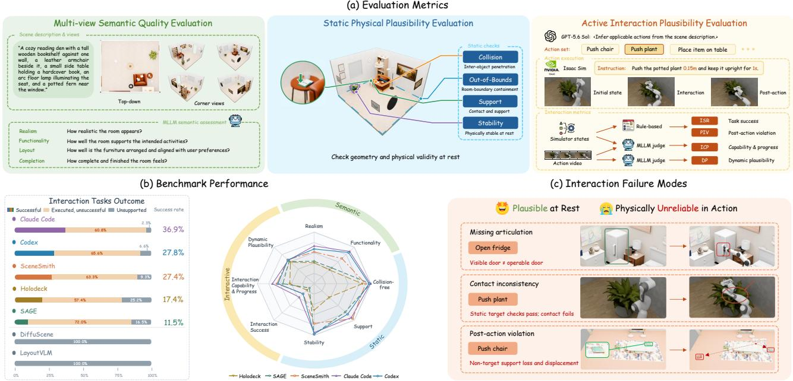
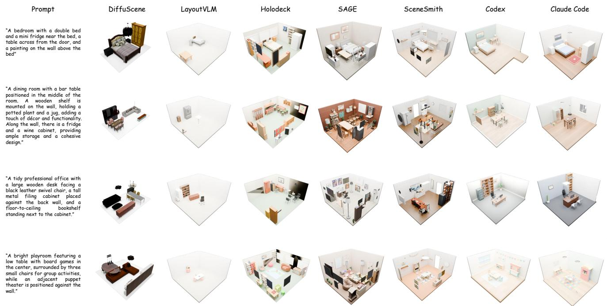
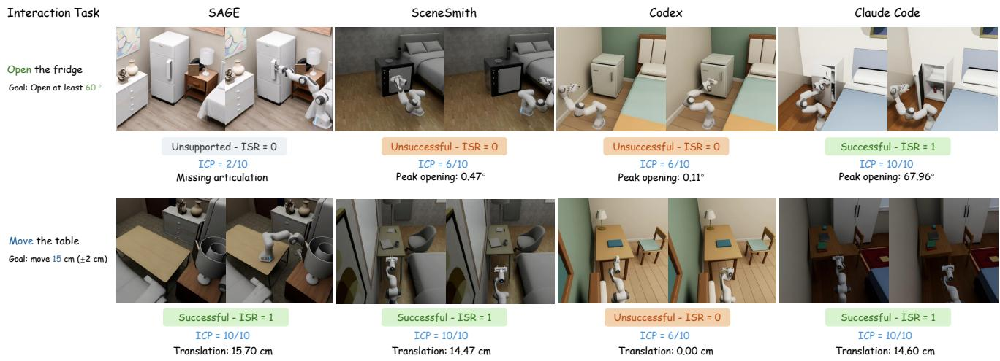
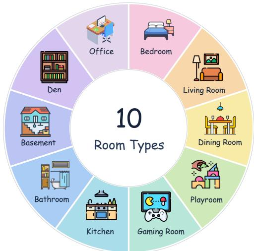
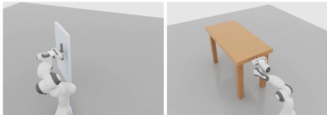
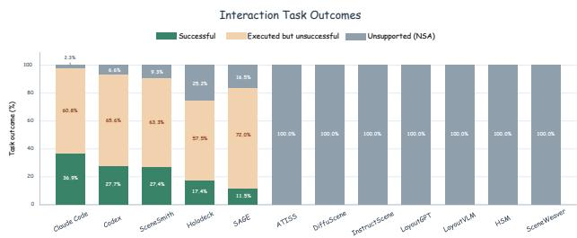
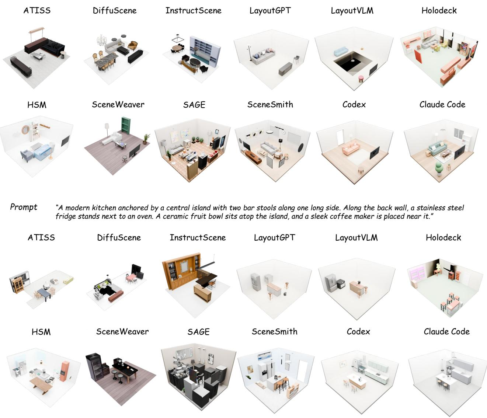
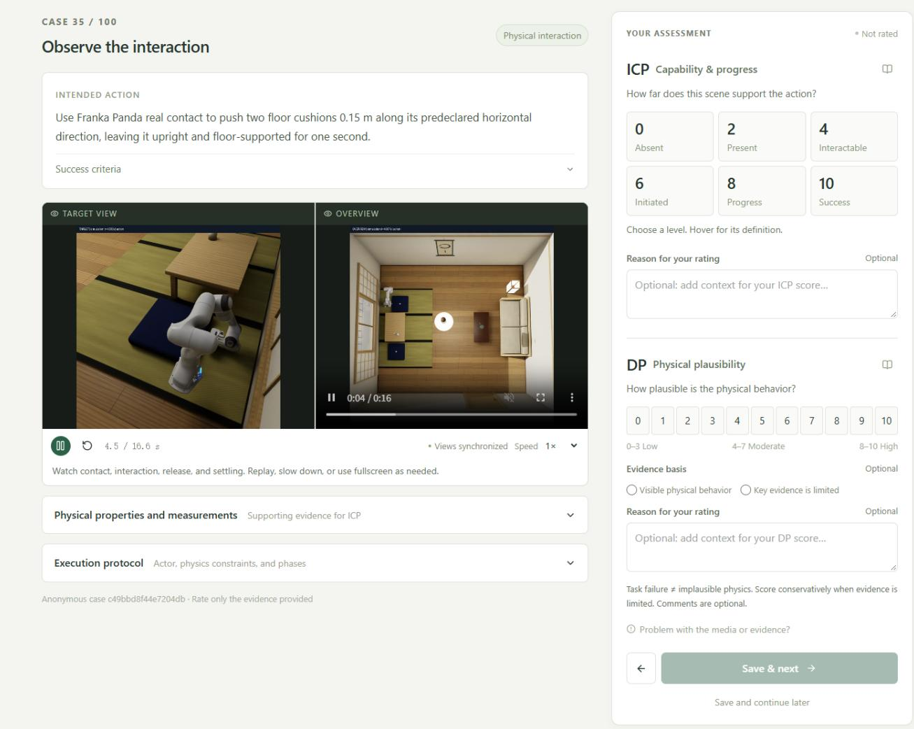

# ScIntBench: Physical Interaction Plausibility in 3D Scene Generation

Wendi Ying<sup>1</sup> Daochang Liu<sup>1</sup> Leonid Sigal<sup>2,3</sup> Ajmal Saeed Mian<sup>1</sup> <sup>1</sup>The University of Western Australia <sup>2</sup>University of British Columbia <sup>3</sup>Canada CIFAR AI Chair https://scintbench.github.io

  
Figure 1. Overview of ScIntBench. We propose ScIntBench, a comprehensive text-conditioned 3D indoor scene generation benchmark that extends conventional evaluation with simulation-based action interaction metrics. Our framework integrates multi-view semantic evaluation and static physical plausibility evaluation, while further measuring interaction success, capability progress, post-interaction violations, and dynamic plausibility. We benchmark various scene generation systems and identify representative failure modes, revealing that plausible appearance at rest does not guarantee interaction readiness.

## Abstract

Existing evaluations of text-conditioned 3D indoor scene generation largely emphasize semantic fidelity and physical validity at rest, leaving interaction-time physical reliability insufficiently assessed. To address this gap, we introduce ScIntBench, a unified benchmark centered on interaction readiness: it executes prescribed manipulation actions (e.g., pushing, opening, and surface probing) in physics simulation and measures task success, capability and progress, post-interaction integrity, and dynamic plausibility. Multi-view semantic and static physical evaluations complement these metrics and help explain interaction outcomes. We systematically evaluate 12 state-of-the-art scene generation systems across 10 room types. Our results re-

veal that strong semantic and static physical performance does not necessarily translate into interaction readiness: a system with near-perfect static plausibility completes only 11.54% of interactions, 7 of the 12 systems produce scenes that cannot support any interaction, and even the best system succeeds in only 36.92% of prescribed tasks. These findings highlight two fundamental challenges in generating interaction-ready scenes: providing the necessary physical interaction capabilities and ensuring reliable physical behavior under active manipulation.

## 1. Introduction

Text-conditioned 3D indoor scene generation has made substantial progress, enabling the automatic construction of increasingly complex environments from natural-language descriptions. Recent advances have expanded scene generation from data-driven generative models to LLM/VLMbased workflows, specialized agentic pipeline, and generalpurpose coding agents operating through modeling tools. This evolution has broadened the goal of scene generation beyond visual content creation toward simulation-ready environments for robotics, embodied AI, and interactive applications. However, as generation systems become increasingly capable, a fundamental question remains: Are generated 3D scenes truly ready for physical interaction, and can existing evaluations reliably assess this capability?

Existing evaluation protocols for generated 3D scenes primarily assess semantic quality and physical plausibility at initialization. Semantic evaluation examines visual fidelity while physical evaluation measures collision, boundary violations, support correctness, and passive stability under gravity. Recent works improve semantic, structural, and agent-centric evaluation of generated 3D environments, as summarized in Tab. 1. However, these evaluations provide limited evidence of whether generated scenes can support physical manipulation and exhibit plausible responses to active interaction.

A scene that is geometrically valid and plausible at rest is not necessarily interaction-ready. For example, a refrigerator may appear correctly placed but lack the articulation required to open its door; a chair may remain stable under gravity yet behave implausibly when pushed or subjected to a load. Such failures expose two distinct limitations: interaction availability, which concerns whether a scene provides the prerequisites for an intended action, and interaction reliability, which concerns whether that action can be successfully executed with physically plausible outcomes. This motivates two research questions: (1) To what extent do conventional semantic and static evaluations characterize interaction readiness? (2) What limits interaction readiness across different scene generation paradigms: missing capabilities, unsuccessful execution, or implausible physical responses?

To address these limitations and advance simulationready scene generation, we present ScIntBench, a comprehensive benchmark designed to systematically evaluate the semantic fidelity, static physical validity, and interactiontime physical reliability of generated 3D scenes across diverse generation paradigms. ScIntBench has three evaluation dimensions: a) multi-view semantic evaluation. We employ top-down render views and four corner views to better capture spatial arrangements and object relationships. b) static physical plausibility evaluation. We evaluate initialization-time physics through geometric validity checks and passive stability simulation. c) active interaction evaluation. We introduce standardized physicsbased interaction tests that assess action executability, postinteraction physical integrity, and dynamic plausibility. To ensure fair comparisons, we evaluate scenes as generated, without adding missing articulations or physical properties. Together, these evaluations characterize not only the initial configuration of a generated scene but also its behavior during physical interaction, as illustrated in Fig. 1.

We benchmark 12 state-of-the-art 3D scene generation systems across 10 room types under the same text prompts to systematically investigate their simulation readiness. Our evaluation reveals substantial interaction-time failures that are overlooked by conventional initialization-time assessments. Despite achieving strong semantic fidelity and static physical validity, several methods generate scenes that frequently fail under active interaction due to missing articulations, inconsistent physical metadata, or post-interaction physical violations. By distinguishing interaction availability from execution reliability, our analysis reveals two complementary barriers to simulation readiness: providing the necessary interaction capabilities and ensuring physically reliable behavior when those capabilities are exercised.

In summary, our main contributions are threefold:

• We introduce ScIntBench, a unified benchmark that comprehensively evaluates interaction readiness in textconditioned 3D indoor scene generation.

• We propose 4 interaction-based metrics to characterize simulation readiness beyond initialization-time validity.

• We systematically benchmark 12 SOTA scene generation systems across ten room types, highlighting key challenges between static scene quality and interaction-time reliability, and identifying key failure modes that limit simulation readiness.

## 2. Related Work

3D Indoor Scene Generation. Early specialized, datadriven approaches learn object distributions and spatial arrangements from large-scale indoor datasets [10, 16, 26] such as 3D-FRONT [5]. To enable more flexible textconditioned generation, subsequent methods incorporate semantic representations, vision-language models (VLMs), and spatial reasoning for scene planning and layout generation [4, 18, 23, 33]. More recently, agentic frameworks have extended scene synthesis through multi-step planning, tool use, and iterative refinement [17, 28, 34]. Additionally, general-purpose coding agents have demonstrated the ability to construct and modify 3D worlds through programmatic tools [13, 36]. This progression has diversified scene generation paradigms, motivating unified evaluation across systems with different generation mechanisms and capabilities.

Table 1. Comparison of representative benchmarks and evaluation protocols for text-conditioned 3D scene generation. Semantic view setting: camera viewpoints used to render scenes for semantic evaluation. Static physics: geometric and physical plausibility checks Active interaction physics: evaluates physical behavior during object manipulation. Methods Evaluated: TSG (task-specific generators), LVG (LLM/VLM-based generators), SAG (specialized agentic systems), GCA (general-purpose coding agents).
<table><tr><td rowspan="2">Evaluation / Benchmark</td><td rowspan="2">Semantic View Setting</td><td rowspan="2">Static Physics</td><td rowspan="2">Active Interaction Physics</td><td colspan="4">Methods Evaluated</td></tr><tr><td>TSG</td><td>LVG</td><td>SAG</td><td>GCA</td></tr><tr><td>SceneWeaver [34]</td><td>Top-down</td><td></td><td>X</td><td></td><td></td><td></td><td>X</td></tr><tr><td>SceneEval [25]</td><td>Top-down</td><td></td><td>X</td><td></td><td></td><td></td><td>X</td></tr><tr><td>SceneCritic [22]</td><td>Per-view analysis</td><td></td><td>X</td><td>X</td><td></td><td></td><td>X</td></tr><tr><td>LEGO-Eval [7]</td><td>Constraint-specific</td><td></td><td>X</td><td></td><td></td><td></td><td>X</td></tr><tr><td>VWE-Bench [13]</td><td>5 views</td><td></td><td>X</td><td></td><td></td><td></td><td></td></tr><tr><td>3DTindo-Bench [19]</td><td>Top-down + side</td><td></td><td>X</td><td></td><td></td><td></td><td>X</td></tr><tr><td>AuthorBench [31]</td><td>Scene state + renders</td><td></td><td>X</td><td>X</td><td></td><td></td><td></td></tr><tr><td>Code4Scene [36]</td><td>4 overview + targeted</td><td></td><td>X</td><td>X</td><td></td><td></td><td></td></tr><tr><td>ScIntBench (Ours)</td><td>Top-down + 4 corner</td><td></td><td></td><td></td><td></td><td></td><td></td></tr></table>

Simulation-Ready and Agentic Scene Generation. Recent research has shown a growing trend toward generating physically plausible and interactive environments for embodied AI through geometric constraints and physicsguided optimization [11, 32]. Meanwhile, agentic frameworks further enable tool-based scene construction, executable interaction representations, and iterative refinement [21, 27, 29, 31, 34, 37]. SAGE [28] incorporates visual and physics critics to iteratively refine scenes through simulation-based validation. SceneSmith [17] integrates articulated assets and physical property estimation to construct simulation-ready environments for downstream robotic tasks. EmbodiedSmith [20] further leverages simulated task execution feedback to jointly refine scenes and task plans. Complementary approaches explore efficient tool orchestration, code-based generation, and functional or task-driven scene refinement [3, 6, 30, 35]. Despite these advances, scene refinement often focuses on initializationtime physical validity or downstream task success, rather than explicitly addressing physical violations during active interaction.

## Evaluation of Text-Conditioned 3D Scene Generation.

Existing evaluation protocols primarily assess semantic fidelity, geometric consistency, and static physical plausibility through visual assessments and constraint-based checks [7, 19, 22, 25, 34]. More recent benchmarks extend the evaluation to agentic and general-purpose 3D scene construction and editing, assessing instruction satisfaction, geometric validity, and scene-state preservation [13, 31, 36]. SceneTeract [12] further evaluates agent-specific activity feasibility through navigability, reachability, and interaction clearance. SceneSmith [17] and EmbodiedSmith [20] further incorporate simulated robotic manipulation, but their execution-based evaluations primarily focus on downstream task success rather than scene-level physical reliability. Nevertheless, existing approaches lack a unified protocol for systematically evaluating interaction availability and physical reliability during and after active object manipulation across diverse scene generation paradigms. ScIntBench addresses this gap through multi-view semantic evaluation, static physical evaluation, and standardized simulation-based interaction tests, as summarized in Tab. 1.

## 3. ScIntBench

We present ScIntBench, a unified framework for evaluating the simulation readiness of text-conditioned 3D indoor scenes. Our evaluation suite consists of comprehensive evaluation metrics, including semantic fidelity, static physical validity, and interaction-time physical reliability. An overview of our metric dimensions and performance aspects can be found in Fig. 1. Please see metric implementation details in our Supplementary Sec. C.

## 3.1. Benchmark Construction

ScIntBench builds on the text prompts from SceneEval [25], covering 10 different indoor room types, and extends them with standardized interaction specifications. Each benchmark instance consists of a text description specifying object categories, attributes, and spatial relationships, together with corresponding semantic requirements and interaction tasks. To assess interaction readiness, we construct an interaction task suite based on the room descriptions. Specifically, an LLM proposes candidate interactions involving relevant object categories. Each specification defines a target object, an intended action, the required interaction capabilities, predefined success conditions, and applicable physical constraints. These interaction specifications are established independently of the generated scenes and shared across all evaluated methods, enabling consistent assessment of interaction availability and physical reliability under active manipulation. More details of construction can be found in Supplementary Sec. B.

## 3.2. Active Interaction Evaluation

A scene that satisfies semantic and initialization-time physical constraints may still lack the capabilities required for active interaction. To assess interaction readiness, ScInt-Bench introduces standardized simulation-based interaction tests that evaluate both interaction availability and physical reliability. For each text prompt $p ,$ let $S _ { m , p }$ denote the scene generated by method $m ,$ and let $\mathcal { T } _ { p } = \{ t _ { 1 } , \ldots , t _ { N _ { p } } \}$ denote the corresponding set of prescribed interactions, where $N _ { p }$ is the number of interaction tasks associated with prompt $p .$ This set of interactions is shared across all evaluated methods. For each interaction, we first verify the required target object and native physical capabilities, then execute supported actions in a physics simulator. We evaluate the outcomes using four complementary metrics.

Interaction Success Rate (ISR). ISR measures the proportion of interactions in $\tau _ { p }$ whose predefined goals are achieved in the generated scene $S m , p .$ Each action is assigned a binary success outcome based on simulatorobservable state and action-specific success criteria. Unresolved controller or simulation failures are flagged separately rather than attributed to the generated scene.

Interaction Capability Progress (ICP). Binary failure outcomes may conceal differences in interaction capabilities and execution progress. To capture these distinctions, ICP adopts a six-level rubric: Target Absent (0), Target Present (2), Physically Interactable (4), Interaction Initiated (6), Substantial Progress (8), and Task Success (10). A MLLM assigns scores based on the capabilities of $S _ { m , p }$ and available execution evidence. ICP is averaged over $\mathcal { T } _ { p }$ to provide a graded assessment of interaction readiness. Detailed action-specific scoring criteria are provided in the supplementary material.

Post-Interaction Physical Violation (PIV). For each executed interaction $t \in \mathcal { T } _ { p } ,$ PIV measures the percentage of scene objects exhibiting physical violations following manipulation. We compare scene states before execution and after a standardized settling period, checking for unintended object displacement, new or worsened interpenetration, outof-bound placements, and loss of required support relationships. An object is counted as violated if any of these conditions occurs. Intended object motion alone is not considered a violation. Lower PIV indicates better post-interaction physical integrity.

Dynamic Plausibility (DP). For each executed interaction $t \in \mathcal { T } _ { p } ,$ DP provides a complementary perceptual assessment of physical behavior during interaction. Given rendered interaction videos, a MLLM evaluates observable physical behaviors, including motion naturalness, contact behavior, gravity, support, friction, and articulation consistency on a 0-10 scale. The scoring rubric distinguishes observable physical violations from insufficient visual evidence. Task failure alone does not imply physically implausible motion. Detailed scoring criteria are provided in the supplementary material.

## 3.3. Semantic and Static Physical Evaluation

To complement the evaluation of interaction readiness, we also evaluate semantic quality and static physical validity by adapting existing evaluation protocols with several modifications.

Multi-view Semantic Evaluation. To evaluate visual and semantic fidelity, we adopt a standardized five-view rendering protocol consisting of one top-down view and four complementary corner views. The top-down view captures the global scene layout, while the corner views provide additional perspectives to reduce occlusion and reveal spatial relationships that may be ambiguous from a single viewpoint. Following SceneWeaver [34], a MLLM jointly evaluates all five views against the corresponding text prompt using four metrics: visual realism (Real), functionality (Func), layout correctness (Lay), and scene completeness (Comp).

Static Physical Evaluation. We assess initialization-time physical validity through geometric check and passive stability simulation. Following prior work [25, 28], geometric checks examine object collisions (COL), support relationships (SUP), and out-of-bounds placements (OB). Passive stability (STAB) is evaluated by simulating the scene under gravity without active manipulation and detecting unintended object movement, loss of support, or instability. These evaluations characterize whether a generated scene is geometrically valid and physically stable at rest, providing a reference for subsequent interaction-time assessment.

## 3.4. Standardized Evaluation Protocol

To ensure consistent evaluation across different scene generation methods, we adopt a unified evaluation protocol that preserves the original scene geometry, object poses, and native physical properties. Generated scenes are reconstructed in Blender [2] for standardized multi-view rendering, while geometric checks are performed on the preserved scene geometry, and simulation-based assessments are conducted in Isaac Sim [14]. Missing physical properties or articulation mechanisms are not automatically supplemented.

For each text prompt, interaction specifications and success criteria are established independently of generated scenes and shared across all evaluated methods. A calibration procedure using reference simulations validates the action executors and success conditions before evaluation. The supported interactions are then executed using standardized, task-specific manipulation procedures, with consistent execution parameters and success criteria across methods. Following each interaction, the scene is allowed to settle before assessing post-interaction physical violations. Additionally, missing target objects or required physical capabilities contribute to ISR and ICP, whereas PIV and DP are evaluated only when valid interaction evidence is available.

## 4. Experiment

## 4.1. Experiment Setup

Evaluated Methods. We evaluate 12 text-conditioned 3D indoor scene generation systems spanning four paradigms: task-specific generators, including ATISS [16], DiffuScene [26], and InstructScene [10]; LLM/VLM-based generators, including LayoutGPT [4], LayoutVLM [23], Holodeck [33], and HSM [18]; specialized agentic pipelines, including SceneWeaver [34], SAGE [28], and SceneSmith [17]; and general-purpose coding agents, including Codex [15] and Claude Code [1]. The first group learns scene distributions from 3D-FRONT, whereas the remaining methods employ language-guided planning, hierarchical scene construction, agentic tool use, or programmatic generation.

Benchmark Data. We selected 30 prompts from SceneEval [25], covering 10 types of indoor room (3 prompts for each type). Based on the room descriptions, we construct 203 prescribed interaction tasks. The same interaction task set is shared across all evaluated methods, yielding 2436 scene-interaction evaluation instances.

Implementation Details. We use Blender [2] for standardized five-view rendering and Isaac Sim [14] for physics-based evaluation. GPT-5.6 is employed to construct applicable interaction tasks from room descriptions and to evaluate semantic fidelity, interaction capability progress, and dynamic plausibility. Active interactions are executed using a Franka Panda robot for contact-based manipulation and a standardized force-driven probe for surface interaction tests. For method reproduction, SAGE and SceneSmith use two NVIDIA L40S GPUs, while the remaining methods use one NVIDIA RTX 4090 GPU. LLM/VLM inference is performed through APIs. Further implementation details are provided in the supplementary material. Please refer to Supplementary Sec. A for more details on the baseline implementation. Please refer to Supplementary Sec. D for simulation and execution details.

Metrics. We report four semantic metrics (Real, Func, Lay, Comp), four static physical metrics (COL, OB, SUP, STAB), and four active interaction metrics (ISR, ICP, PIV, DP). For active evaluation, scores are first aggregated across prescribed or valid interactions within each scene and then averaged equally across scenes.

## 4.2. Overall Performance on ScIntBench

As shown in Tab. 2, our results reveal a substantial gap between static physical validity and interaction readiness. For example, SAGE achieves strong performance in static physics, with a COL of 0.41% and STAB of 98.33%, but its ISR is only 11.54%. In contrast, Holodeck exhibits considerably worse static physical scores, but achieves a higher ISR of 17.39%. More broadly, 7 of the 12 evaluated methods cannot complete any prescribed interaction, as their scenes do not support physical simulation. As illustrated in Fig. 3 (additional results can be found in Supplementary Sec. E), visually plausible scenes can exhibit substantially different interaction outcomes. In the refrigeratoropening task, only Claude Code achieves the required opening angle among the illustrated methods. For the tablepushing task, SAGE, SceneSmith, and Claude Code succeed, while Codex fails. These observations demonstrate that favorable initialization-time physical properties do not necessarily translate into the ability to support active manipulation.

Interestingly, interaction readiness appears to be more closely aligned with semantic functionality than with passive physical stability. Among the 5 methods with executable interactions, the ranking by ICP exactly matches that by Func, while ISR follows a similar ordering (except for SAGE and Holodeck). This suggests that providing functionally appropriate scene content may be particularly important for enabling physical interaction.

Furthermore, interaction success does not guarantee post-interaction physical integrity. Claude Code achieves the highest ISR but exhibits a relatively high PIV, whereas SAGE obtains the lowest PIV despite completing fewer tasks. SceneSmith achieves the highest DP, further illustrating that task completion and physical behavior capture complementary aspects of interaction readiness.

Another notable finding is the competitive performance of general-purpose coding agents. Claude Code leads in Real, Func, Lay, ISR, and ICP, while Codex ranks second in Func, Lay, ISR, and ICP. However, both methods obtain lower Comp scores than specialized pipelines such as SAGE and SceneSmith, suggesting that strong functional coherence does not necessarily imply richly populated scenes. Moreover, Codex and Claude Code require approximately

Table 2. Performance comparison of different scene generation methods on ScIntBench. Metrics: Real = realism, Func = functionality, Lay = layout, Comp = completeness, COL = collision rate, OB = out-of-bounds, SUP = support, STAB = stability, ISR = interaction success rate, ICP = interaction capability progress, PIV = post-interaction violation rate, DP = dynamic plausibility. COL, OB, SUP, STAB, ISR, PIV are percentages, while all other metrics are scored on a 0–10 scale. N.S.A. denotes not support interaction due to missing targets or native physical prerequisites. We use mean values ± 95% t-distribution CI to quantify uncertainty. ↑ indicates higher is better, and ↓ indicates lower is better. Bold = best, underline = second best.
<table><tr><td rowspan="2">Method</td><td colspan="4">Semantic Quality</td><td colspan="4">Static Physical Plausibility</td><td colspan="4">Interactive Physical Plausibility</td></tr><tr><td>Real ↑</td><td>Func ↑</td><td>Lay↑</td><td>Comp ↑</td><td>COL↓</td><td>OB↓</td><td>SUP↑</td><td>STAB ↑</td><td>ISR↑</td><td>ICP↑</td><td>PIV↓</td><td>DP↑</td></tr><tr><td colspan="10">Task-specific trained scene generators</td><td colspan="3"></td></tr><tr><td>ATISS</td><td>3.00 ± 0.35</td><td> $1 . 1 3 \pm 0 . 5 0$ </td><td>1.93 ± 0.39</td><td> $1 . 8 0 \pm 0 . 3 2$ </td><td> $5 9 . 2 0 \pm { 9 . 4 3 }$ </td><td> $2 7 . 0 4 \pm 5 . 6 5$ </td><td> $2 7 . 5 2 \pm 6 . 1 7$ </td><td>N.S.A.</td><td> $0 . 0 0 \pm 0 . 0 0$ </td><td> $0 . 7 2 \pm 0 . 4 4$ </td><td>N.S.A.</td><td>N.S.A.</td></tr><tr><td>DiffuScene</td><td> $3 . 8 7 \pm 0 . 4 8$ </td><td>1.30 ± 0.49</td><td> $2 . 5 3 \pm 0 . 3 9$ </td><td> $2 . 1 3 \pm 0 . 3 2$ </td><td> $4 1 . 5 8 \pm 7 . 7 0$ </td><td> $1 4 . 6 9 \pm 4 . 8 7$ </td><td> $6 5 . 1 4 \pm 6 . 1 5$ </td><td>N.S.A.</td><td> $0 . 0 0 \pm 0 . 0 0$ </td><td> $0 . 8 4 \pm 0 . 4 4$ </td><td>N.S.A.</td><td>N.S.A.</td></tr><tr><td colspan="10">InstructScene 3.33 ± 0.32 1.40 ± 0.57 2.20 ± 0.37</td><td colspan="3"> $0 . 7 7 \pm 0 . 4 9$  N.S.A.</td></tr><tr><td>LLM/VLM scene workflows</td><td></td><td></td><td></td><td></td><td></td><td></td><td></td><td></td><td></td><td></td><td></td><td></td></tr><tr><td colspan="10">LayoutGPT 2.90 ± 0.38 3.60 ± 0.48</td><td colspan="3"></td></tr><tr><td>LayoutVLM</td><td></td><td></td><td> $2 . 4 0 \pm 0 . 4 2$ </td><td> $1 . 9 0 \pm 0 . 2 7$ </td><td> $2 3 . 8 3 \pm 1 1 . 6 7$   $3 3 . 8 9 \pm 1 0 . 2 7$ </td><td> $3 7 . 8 0 \pm 1 0 . 8 5$   $1 8 . 7 0 \pm 6 . 5 8$ </td><td> $1 4 . 1 3 \pm 6 . 9 0$   $7 4 . 6 6 \pm 8 . 7 5$ </td><td>N.S.A. N.S.A.</td><td>0.00 ± 0.00  $0 . 0 0 \pm 0 . 0 0$ </td><td> $2 . 0 0 \pm 0 . 0 0$   $2 . 0 0 \pm 0 . 0 0$ </td><td>N.S.A. N.S.A.</td><td>N.S.A. N.S.A.</td></tr><tr><td>Holodeck</td><td>3.07 ± 0.34 4.07 ± 0.42</td><td> $4 . 0 3 \pm 0 . 4 5$   $3 . 8 0 \pm 0 . 5 3$ </td><td> $3 . 0 0 \pm 0 . 4 3$   $2 . 9 7 \pm 0 . 3 0$ </td><td> $2 . 1 0 \pm 0 . 2 7$ </td><td> $1 4 . 8 6 \pm 4 . 9 8$ </td><td> $4 . 7 6 \pm 2 . 1 5$ </td><td> $3 7 . 4 1 \pm 5 . 3 0$ </td><td>51.43± 16.99</td><td> $1 7 . 3 9 \pm 7 . 9 8$ </td><td> $4 . 2 8 \pm 0 . 6 9$ </td><td>7.33 ± 3.46</td><td>5.88 ± 0.36</td></tr><tr><td>HSM</td><td></td><td>4.13 ± 0.36 4.30 ± 0.53</td><td> $3 . 5 0 \pm 0 . 3 8$ </td><td> $3 . 1 3 \pm 0 . 4 7$   $3 . 5 7 \pm 0 . 3 9$ </td><td> $1 4 . 0 8 \pm 5 . 4 5$ </td><td> $1 0 . 3 6 \pm 3 . 5 5$ </td><td> $7 4 . 2 4 \pm 5 . 8 0$ </td><td>N.S.A.</td><td> $0 . 0 0 \pm 0 . 0 0$ </td><td> $1 . 5 0 \pm 0 . 4 8$ </td><td>N.S.A.</td><td>N.S.A.</td></tr><tr><td colspan="10"></td><td colspan="3"></td></tr><tr><td colspan="10">Specialized agentic pipelines</td><td></td><td></td><td></td><td></td></tr><tr><td>SceneWeaver</td><td> $4 . 4 0 \pm 0 . 8 4$ </td><td>5.10 ± 0.86</td><td> $4 . 9 0 \pm 1 . 0 4$ </td><td> $3 . 3 0 \pm 0 . 6 8$ </td><td> $6 . 9 4 \pm 1 0 . 9 7$ </td><td> $2 . 6 8 \pm 4 . 0 5$   ${ \bf 0 . 0 0 \pm 0 . 0 0 }$ </td><td> $4 . 3 8 \pm 5 . 9 2$   $7 7 . 4 2 \pm 4 . 8 4$ </td><td>N.S.A.  $\mathbf { 9 8 . 3 3 \pm 1 . 4 6 }$ </td><td> $0 . 0 0 \pm 0 . 0 0$   $1 1 . 5 4 \pm 7 . 5 4$ </td><td> $1 . 8 0 \pm 0 . 2 4$   $5 . 5 0 \pm 0 . 5 6$ </td><td>N.S.A.</td><td>N.S.A. 6.21 ± 0.32</td></tr><tr><td>SAGE SceneSmith</td><td> $4 . 8 3 \pm 0 . 4 5$   $6 . 7 8 \pm 0 . 4 3$ </td><td> $4 . 3 7 \pm 0 . 5 6$   $6 . 9 3 \pm 0 . 7 1$ </td><td> $2 . 9 0 \pm 0 . 4 3$   $6 . 0 0 \pm 0 . 5 3$ </td><td> $\underline { { 4 . 8 3 \pm 0 . 6 7 } }$   ${ \bf 5 . 1 7 \pm 0 . 5 6 }$ </td><td> $\mathbf { 0 . 4 1 \pm 0 . 4 1 }$   $9 . 3 3 \pm 3 . 3 5$ </td><td> $5 . 0 3 \pm 1 . 8 6$ </td><td> $\mathbf { 9 6 . 0 3 } \pm 2 . 0 2$ </td><td> $7 6 . 9 8 \pm 9 . 8 3$ </td><td> $2 7 . 4 0 \pm 9 . 9 8$ </td><td> $6 . 4 3 \pm 0 . 5 5$ </td><td> $\mathbf { 1 . 1 0 \pm 0 . 5 6 }$   $4 . 3 5 \pm 1 . 8 7$ </td><td> ${ \bf 6 . 5 7 \pm 0 . 3 1 }$ </td></tr><tr><td colspan="10">General-purpose coding agents</td><td colspan="3"></td></tr><tr><td></td><td></td><td></td><td></td><td> $4 . 4 3 \pm 0 . 5 0$ </td><td> $3 . 0 4 \pm 3 . 1 4$ </td><td> $2 . 1 9 \pm 1 . 9 1$ </td><td> $8 3 . 6 6 \pm 7 . 8 2$ </td><td> $9 7 . 4 6 \pm 2 . 8 9$ </td><td> $2 7 . 7 5 \pm 7 . 7 5$ </td><td> $6 . 5 6 \pm 0 . 4 8$ </td><td></td><td></td></tr><tr><td>Codex Claude Code</td><td> $6 . 7 3 \pm 0 . 2 9$   ${ \bf 7 . 3 3 \pm 0 . 2 7 }$ </td><td> $\underline { { 8 . 5 7 \pm 0 . 3 4 } }$   $\mathbf { 8 . 8 7 \pm 0 . 3 2 }$ </td><td> $7 . 5 0 \pm 0 . 4 4$   $7 . 7 7 \pm 0 . 2 9$ </td><td> $4 . 6 0 \pm 0 . 4 0$ </td><td> $\underline { { 0 . 8 1 \pm 1 . 1 6 } }$ </td><td> ${ \underline { { 0 . 6 7 \pm 1 . 3 6 } } }$ </td><td> $9 2 . 8 3 \pm 3 . 9 6$ </td><td> $9 4 . 7 5 \pm 6 . 8 0$ </td><td> ${ \bf 3 6 . 9 2 \pm 1 0 . 6 3 }$ </td><td> $7 . 3 5 \pm 0 . 4 7$ </td><td> $6 . 8 9 \pm 3 . 1 9$   $1 2 . 5 2 \pm { 5 . 1 6 }$ </td><td> $\underline { { 6 . 5 3 \pm 0 . 2 7 } }$   $6 . 4 3 \pm 0 . 3 9$ </td></tr></table>

  
Figure 2. Qualitative comparison of generated scenes on ScIntBench. We show scenes generated by DiffuScene [26], LayoutVLM [23] Holodeck [33], SAGE [28], SceneSmith [17], Codex [15], and Claude Code [1].

28 minutes per scene, substantially less than SAGE and SceneSmith. Although runtime comparisons are influenced

  
Figure 3. Qualitative comparison of interaction task outcomes. We show example outcomes in scenes generated by SAGE [28], SceneSmith [17], Codex [15], and Claude Code [1].

Table 3. Computational requirements statistics over these methods. For Codex and Claude Code, API costs are estimated from recorded token usage using OpenAI’s pricing and Anthropic’s pricing, respectively.

<table><tr><td rowspan="2">Method</td><td colspan="3">Runtime (min)</td><td colspan="3">API Cost (USD)</td></tr><tr><td>Mean</td><td>Min</td><td>Max</td><td>Mean</td><td>Min</td><td>Max</td></tr><tr><td colspan="7">Task-specific trained scene generators</td></tr><tr><td>ATISS</td><td>0.19</td><td>0.15</td><td>0.27</td><td>0</td><td>0</td><td>0</td></tr><tr><td>DiffuScene</td><td>0.53</td><td>0.51</td><td>0.55</td><td>0</td><td>0</td><td>0</td></tr><tr><td>InstructScene</td><td>0.05</td><td>0.03</td><td>0.06</td><td>0</td><td>0</td><td>0</td></tr><tr><td colspan="7">LLM/VLM scene workflows</td></tr><tr><td>LayoutGPT</td><td>0.30</td><td>0.16</td><td>0.67</td><td>0.20</td><td>0.13</td><td>0.22</td></tr><tr><td>LayoutVLM</td><td>0.88</td><td>0.66</td><td>1.03</td><td>0.14</td><td>0.10</td><td>0.19</td></tr><tr><td>Holodeck</td><td>3.00</td><td>2.10</td><td>3.83</td><td>0.07</td><td>0.06</td><td>0.08</td></tr><tr><td>HSM</td><td>8.48</td><td>3.32</td><td>16.90</td><td>0.56</td><td>0.22</td><td>0.80</td></tr><tr><td colspan="7">Specialized agentic pipelines</td></tr><tr><td>SceneWeaver</td><td>84.29</td><td>5.45</td><td>209.63</td><td>0.46</td><td>0.15</td><td>0.88</td></tr><tr><td>SAGE</td><td>235.13</td><td>176.00</td><td>370.00</td><td>0.80</td><td>0.60</td><td>0.99</td></tr><tr><td>SceneSmith</td><td>174.34</td><td>101.70</td><td>455.42</td><td>10.18</td><td>6.98</td><td>24.77</td></tr><tr><td colspan="7">General-purpose coding agents</td></tr><tr><td>Codex</td><td>27.77</td><td>22.15</td><td>36.66</td><td>5.99†</td><td>4.36†</td><td>8.76†</td></tr><tr><td>Claude Code</td><td>28.00</td><td>16.38</td><td>53.32</td><td>3.02†</td><td>1.83†</td><td>5.43†</td></tr></table>

by hardware and implementation differences, these findings highlight the potential of general-purpose coding agents for scene generation while revealing substantial opportunities to improve interaction readiness.

## 4.3. Active Metrics Validation

Validation on Interactive Reference Scenes. We further evaluate our active interaction metrics on selected reference scenes from ReplicaCAD [24] and iGibson [8] (reconstructed from real-world scans) and BEHAVIOR-1K [9] (curated interactive simulations). We evaluate matched interaction tasks using calibrated manipulation protocols and predefined success criteria. Across seven matched interaction tasks in BEHAVIOR-1K and three in iGibson, the corresponding reference scenes successfully complete all ten tasks, while each evaluated generation method achieves at most five confirmed successes across the same planned task set. These results demonstrate that our evaluation can identify interaction capability gaps between generated and reference scenes, highlighting limitations that can inform subsequent simulation-aware scene refinement. Please refer to Supplementary Sec. F.1 for more details of validation on reference scenes.

Human Evaluation. To assess the alignment of our MLLM-based active evaluation metrics with human judgments, we conduct a human study focusing on ICP and DP. Three annotators independently rated each of 100 interaction cases sampled from different generation methods, covering diverse action types and execution outcomes. For ICP, annotators assessed interaction capabilities and task progress using the same six-level rubric as the MLLM evaluator. For DP, annotators assessed physical plausibility from interaction videos and could indicate insufficient visual evidence. Annotators could optionally provide a rationale for their ratings. For each metric, we measured the correlation between MLLM scores and mean human ratings using Spearman’s rank correlation coefficient (ρ) and Kendall’s τ. The results are shown in Tab. 4. Further details are provided in the Supplementary Sec. F.2.

## 4.4. Interaction Failure Analysis

We further analyze the failure modes that limit the interaction readiness of generated scenes. A major limitation is the absence of required interaction capabilities. Among 2436 prescribed scene–interaction pairs, 1534 cannot be executed due to missing target objects or native physical prerequisites. For example, as shown in Fig. 3, SAGE generates a visually plausible fridge but lacks the articulation required to open its door.

Table 4. The correlation between MLLM-based evaluations and human evaluations.
<table><tr><td>Metric</td><td>Spearman  $\rho \uparrow$ </td><td>Kendall  $\tau \uparrow$ </td></tr><tr><td>ICP</td><td>0.5126</td><td>0.4654</td></tr><tr><td>DP</td><td>0.4169</td><td>0.4215</td></tr></table>

Even when interactions can be executed, the generated scenes may fail to achieve the predefined goals. In the refrigerator-opening example, SceneSmith and Codex reach only $0 . 4 7 ^ { \circ }$ and 0.11<sup>◦</sup>, respectively, far below the required $6 0 ^ { \circ }$ . Such cases demonstrate the importance of distinguishing interaction availability from actual task completion.

Finally, executed interactions can expose physical inconsistencies, including interpenetration, support loss, and unintended object displacement. As illustrated in Fig. 1(c), two non-target books originally resting on a table are displaced onto the floor following a chair-pushing interaction. These failure modes highlight the need for scene generation methods to incorporate native physical capabilities and maintain physical reliability during interaction.

## 5. Conclusion

In this paper, we propose ScIntBench, a comprehensive benchmark for evaluating the physical interaction plausibility of text-conditioned 3D indoor scenes across semantic quality, static physical plausibility, and active interaction behavior. By introducing four complementary interaction metrics, ScIntBench extends conventional scene evaluation beyond visual appearance and static physical validity to assess interaction capabilities and physical reliability. Our evaluation of 12 scene generation methods reveals that strong semantic and static performance does not necessarily translate into interaction readiness, with many generated scenes lacking the capabilities required for physical manipulation. We also find that general-purpose coding agents emerge as competitive alternatives to specialized scene generation pipelines, although substantial limitations in interaction success and physical reliability remain. Therefore, ScIntBench provides a standardized basis for assessing simulation readiness and informing future advances in interactive 3D scene generation.

## 6. Acknowledgments

This research is supported by the Australian Research Council (ARC) under the Discovery Project scheme

(Project ID: DP240101926).

## References

[1] Anthropic. Claude Code Overview. https://code. claude.com/docs, 2026. Official Claude Code docu mentation. Accessed: April 12, 2026. 5, 6, 7, 12

[2] Blender Foundation. Blender. https://www.blender. org/. 3D creation software. 4, 5

[3] Hao Feng, Zhi Zuo, MingJian Liang, Jingyu Hu, Xiaowei Hu, Liupengfei Wu, Dian Zhang, Guoxin Fang, and Zhengzhe Liu. Funcroom-agent: Sequential feed-forward 3d functional indoor scene generation. arXiv preprint arXiv:2608.29519, 2026. 3

[4] Weixi Feng, Wanrong Zhu, Tsu-jui Fu, Varun Jampani, Arjun Akula, Xuehai He, Sugato Basu, Xin Eric Wang, and William Yang Wang. Layoutgpt: Compositional visual planning and generation with large language models. Advances in neural information processing systems, 36:18225–18250, 2023. 2, 5, 12

[5] Huan Fu, Bowen Cai, Lin Gao, Ling-Xiao Zhang, Jiaming Wang, Cao Li, Qixun Zeng, Chengyue Sun, Rongfei Jia, Binqiang Zhao, et al. 3d-front: 3d furnished rooms with layouts and semantics. In 2021 IEEE/CVF International Con ference on Computer Vision (ICCV), pages 10913–10922. IEEE, 2021. 2, 12

[6] Yun He, Kelin Yu, and Matthias Zwicker. Sceneorchestra: Efficient agentic 3d scene synthesis via full tool-call trajec tory generation. In European Conference on Computer Vision, pages 521–538. Springer, 2026. 3

[7] Minseok Kang, Dongwook Choi, Gyeom Hwangbo, Seungwon Lim, Kai Tzu-iunn Ong, and Jinyoung Yeo. Apples on the table? evaluating text-guided 3d scene synthesis via fine-grained constraint verification. arXiv preprint arXiv:2511.03001, 2025. 3

[8] Chengshu Li, Fei Xia, Roberto Mart´ın-Mart´ın, Michael Lingelbach, Sanjana Srivastava, Bokui Shen, Kent Elliott Vainio, Cem Gokmen, Gokul Dharan, Tanish Jain, Andrey Kurenkov, Karen Liu, Hyowon Gweon, Jiajun Wu, Li Fei-Fei, and Silvio Savarese. igibson 2.0: Object-centric simulation for robot learning of everyday household tasks. In Proceedings of the 5th Conference on Robot Learning, pages 455–465. PMLR, 2022. 7, 16

[9] Chengshu Li, Ruohan Zhang, Josiah Wong, Cem Gokmen, Sanjana Srivastava, Roberto Mart´ın-Mart´ın, Chen Wang, Gabrael Levine, Michael Lingelbach, Jiankai Sun, et al. Behavior-1k: A benchmark for embodied ai with 1,000 everyday activities and realistic simulation. In Conference on Robot Learning, pages 80–93. PMLR, 2023. 7, 16

[10] Chenguo Lin and Yadong Mu. Instructscene: Instructiondriven 3d indoor scene synthesis with semantic graph prior. In International Conference on Learning Representations, pages 25687–25718, 2024. 2, 5, 12

[11] Guying Lin, Kemeng Huang, Michael Liu, Ruihan Gao, Hanke Chen, Lyuhao Chen, Beijia Lu, Taku Komura, Yuan Liu, Jun-Yan Zhu, et al. Pat3d: Physics-augmented text-to-3d scene generation. In International Conference on Learn ing Representations, pages 150281–150301, 2026. 3

[12] Leopold Maillard, Francis Engelmann, Tom Durand, Box-´ iao Pan, Yang You, Or Litany, Leonidas Guibas, and Maks Ovsjanikov. Sceneteract: Agentic functional affordances and vlm grounding in 3d scenes. arXiv preprint arXiv:2603.29798, 2026. 3

[13] Yansong Ning, Jingwen Ye, Zhongkai Wu, Yang Sun, Yiqin Zhu, Xingyi Li, Weidong Zhang, and Hao Liu. Vibeworlding: Can multimodal agents construct 3d open worlds endto-end? arXiv preprint arXiv:2608.15265, 2026. 2, 3

[14] NVIDIA. Isaac Sim. https://docs.isaacsim. omniverse.nvidia.com/5.1.0/, 2025. Version 5.1.0. 4, 5, 15

[15] OpenAI. Codex CLI. https : / / developers . openai.com/codex/cli, 2026. Accessed: May 6, 2026. 5, 6, 7, 12

[16] Despoina Paschalidou, Amlan Kar, Maria Shugrina, Karsten Kreis, Andreas Geiger, and Sanja Fidler. Atiss: Autoregressive transformers for indoor scene synthesis. Advances in neural information processing systems, 34:12013–12026, 2021. 2, 5, 12

[17] Nicholas Pfaff, Thomas Cohn, Sergey Zakharov, Rick Cory, and Russ Tedrake. Scenesmith: Agentic generation of simulation-ready indoor scenes. In Forty-third International Conference on Machine Learning, 2026. 2, 3, 5, 6, 7, 12

[18] Hou In Derek Pun, Hou In Ivan Tam, Austin T Wang, Xiaoliang Huo, Angel X Chang, and Manolis Savva. Hsm: Hierarchical scene motifs for multi-scale indoor scene generation. In 2026 International Conference on 3D Vision (3DV), pages 1356–1367. IEEE, 2026. 2, 5, 12

[19] Mengshi Qi, Wei Deng, Xianlin Zhang, and Huadong Ma. Global-local monte carlo tree search in vision-language models for text-to-3d indoor scene generation. arXiv preprint arXiv:2606.06002, 2026. 3

[20] Yikai Qin, Yifei Deng, Mingjian Liang, Wenxuan Song, Zepeng Lin, Zhiyi Jiang, Jiajun Fu, Qiao Sun, Huashuo Lei, Xicheng Gong, et al. Embodiedsmith: Scaling embodied data through recursive self-improvement flywheel in simulation. arXiv preprint arXiv:2610.07969, 2026. 3

[21] Xingjian Ran, Xiaoye Mo, Sihao Liu, Jianyu Zhang, Li Luo, and Bo Dai. Scenemosaic: Efficient and diverse simulationready scene generation via hybrid agentic layout evolution. arXiv preprint arXiv:2609.05594, 2026. 3

[22] Kathakoli Sengupta, Kai Ao, and Paola Cascante-Bonilla. Scenecritic: A symbolic evaluator for 3d indoor scene synthesis. arXiv preprint arXiv:2604.13035, 2026. 3

[23] Fan-Yun Sun, Weiyu Liu, Siyi Gu, Dylan Lim, Goutam Bhat, Federico Tombari, Manling Li, Nick Haber, and Jiajun Wu. Layoutvlm: Differentiable optimization of 3d layout via vision-language models. In 2025 IEEE/CVF Conference on Computer Vision and Pattern Recognition (CVPR), pages 29469–29478. IEEE, 2025. 2, 5, 6, 12

[24] Andrew Szot, Alexander Clegg, Eric Undersander, Erik Wijmans, Yili Zhao, John Turner, Noah Maestre, Mustafa Mukadam, Devendra Singh Chaplot, Oleksandr Maksymets, et al. Habitat 2.0: Training home assistants to rearrange their habitat. Advances in neural information processing systems, 34:251–266, 2021. 7, 16

[25] Hou In Ivan Tam, Hou In Derek Pun, Austin T Wang, Angel X Chang, and Manolis Savva. Sceneeval: Evaluating semantic coherence in text-conditioned 3d indoor scene syn thesis. In 2026 IEEE/CVF Winter Conference on Applications of Computer Vision (WACV), pages 7355–7365. IEEE, 2026. 3, 4, 5, 11, 13

[26] Jiapeng Tang, Yinyu Nie, Lev Markhasin, Angela Dai, Justus Thies, and Matthias Nießner. Diffuscene: Denoising diffusion models for generative indoor scene synthesis. In 2024 IEEE/CVF Conference on Computer Vision and Pattern Recognition (CVPR), pages 20507–20518. IEEE, 2024. 2, 5, 6, 12

[27] Puyi Wang, Yuhao Wang, Linjie Li, Zhengyuan Yang, Kevin Qinghong Lin, Yangguang Li, and Yu Cheng. Scenecode: Executable world programs for editable indoor scenes with articulated objects. arXiv preprint arXiv:2605.19587, 2026. 3

[28] Hongchi Xia, Xuan Li, Zhaoshuo Li, Qianli Ma, Jiashu Xu, Ming-Yu Liu, Yin Cui, Tsung-Yi Lin, Wei-Chiu Ma, Shenlong Wang, Shuran Song, and Fangyin Wei. Sage: Scalable agentic 3d scene generation for embodied ai. In Proceedings of the IEEE/CVF Conference on Computer Vision and Pat tern Recognition (CVPR), pages 22358–22368, 2026. 2, 3, 4, 5, 6, 7, 12, 13, 14

[29] Zijian Xiao, Zipeng Ye, Jinkun Hao, Xiong Yang, Yuchen Xie, and Ran Yi. Beyond placement and articulation: Usagedriven code scenes for embodied interaction. arXiv preprint arXiv:2608.18840, 2026. 3

[30] Long Xu, Zhiqi Zhang, Mi Yan, Shengliang Deng, Chong Xia, Mingyu Dong, Jiayi Chen, Jiangran Lyu, Fei Gao, Zhizheng Zhang, et al. Gif: Agentic generation of interactive and functional object compositions for robot learning. arXiv preprint arXiv:2609.05927, 2026. 3

[31] Ruijie Xu, Xinnan Zhu, Jiayu Ying, Daoguo Dong, Yuzhou Ji, and Xin Tan. Muse: Agentic 3d scene authoring via memory-grounded incremental requirement satisfaction. arXiv preprint arXiv:2606.14168, 2026. 3

[32] Yandan Yang, Baoxiong Jia, Peiyuan Zhi, and Siyuan Huang. Physcene: Physically interactable 3d scene synthesis for embodied ai. In 2024 IEEE/CVF Conference on Computer Vision and Pattern Recognition (CVPR), pages 16262– 16272. IEEE, 2024. 3

[33] Yue Yang, Fan-Yun Sun, Luca Weihs, Eli VanderBilt, Alvaro Herrasti, Winson Han, Jiajun Wu, Nick Haber, Ranjay Krishna, Lingjie Liu, et al. Holodeck: Language guided generation of 3d embodied ai environments. In 2024 IEEE/CVF Conference on Computer Vision and Pattern Recognition (CVPR), pages 16277–16287. IEEE, 2024. 2, 5, 6, 12

[34] Yandan Yang, Baoxiong Jia, Shujie Zhang, and Siyuan Huang. Sceneweaver: All-in-one 3d scene synthesis with an extensible and self-reflective agent. Advances in neural information processing systems, 38:140319–140351, 2026. 2, 3, 4, 5, 12

[35] Yixuan Yang, Zhen Luo, Wanshui Gan, Jinkun Hao, Junru Lu, Jinghao Yan, Zhaoyang Lyu, and Xudong Xu. Code-asroom: Generating 3d rooms from top-down view images via agentic code synthesis. arXiv preprint arXiv:2605.18451, 2026. 3

[36] Xiaokang Ye, Siddhant Hitesh Mantri, Zimeng Chen, Edward Zhang, Zhaoxu Zheng, Yuanheng Li, Yizhao Chen, Tianyang Huang, and Lianhui Qin. Code4scene: Benchmarking coding agents for constructing and editing 3d scenes. arXiv preprint arXiv:2609.36777, 2026. 2, 3

[37] Jiawei Zhang, Hongsong Wang, and Pan Zhou. Scenepilot: Grow-and-repair policy for text-driven 3d indoor scene generation. arXiv preprint arXiv:2608.30307, 2026. 3

# ScIntBench: Physical Interaction Plausibility in 3D Scene Generation

Supplementary Material

This supplementary material provides additional information, including implementation details of the evaluated baselines ( Sec. A; construct details of ScIntBench ( Sec. B); detailed definitions, scoring criteria, and aggregation procedures for all evaluation metrics ( Sec. C); simulation environment, configurations, and interaction execution protocols ( Sec. D); additional results in ScIntBench ( Sec. E); and validation of the proposed active metrics ( Sec. F).

## Contents

A. Baseline Implementation Details 11   
B. Benchmark Construction Details 11   
B.1. Scene Prompts and Room Types . 11   
B.2. Interaction Task Construction 11   
B.3. Benchmark Example 12   
C. Metrics Details 12   
C.1. Semantic Quality Evaluation . 12   
C.2. Static Physical Evaluation 13   
C.3. Interaction Success Rate (ISR) 14   
C.4. Interaction Capability Progress (ICP) 14   
C.5. Post-Interaction Physical Violation (PIV) 14   
C.6. Dynamic Plausibility (DP) 14   
C.7. Metric Aggregation and Evaluation Coverage 15   
D. Simulation and Execution Protocol 15   
D.1. Simulation Environment . . 15   
D.2. Interaction Execution and Configurations 15   
D.3. Execution Protocol 15   
E. Additional Results 15   
F. Active Metrics Validation 16   
F.1. Validation on Reference Scenes . . 16   
F.2. Human Evaluation 16

## A. Baseline Implementation Details

In this section, we provide implementation details for the scene generation methods evaluated in the main paper. Table 5 summarizes their training strategies and backbone models, highlighting the differences between task-specific trained generators and methods primarily relying on pretrained foundation models. All external language or vision models are via API usage. In addition, the computational environments differ across methods. SAGE and Scene-Smith are executed using two NVIDIA L40S GPUs, while the remaining executed methods primarily use one NVIDIA RTX 4090 GPU.

## B. Benchmark Construction Details

## B.1. Scene Prompts and Room Types

We select 30 indoor scene descriptions from SceneEval [25], covering 10 different room types, as shown in Fig. 4. The resulting benchmark comprises 360 generated scenes.

  
Figure 4. Overview of the 10 room types included in ScInt Bench.

## B.2. Interaction Task Construction

To evaluate interaction readiness independently of scene generation methods, we construct a shared set of interaction tasks from each original text prompt. We use GPT-5.6 in a two-stage procedure. First, it identifies applicable action categories from a predefined action library and enumerates all entities explicitly mentioned in the scene description. Second, it examines each action-entity pair and determines whether the interaction is semantically applicable.

The current action library includes three categories: open hinged, push rigid, and place push probe, corresponding to the opening of the hinged object, the pushing of the rigid object, and surface interactions based on standardized probe. This library is used to guide the LLM in selecting appropriate actions, avoiding it from consistently favoring a single action type.

Table 5. Configuration of the evaluated methods. 3D-FRONT denotes task-specific scene generation models trained on the 3D-FRONT [5] dataset, while Pretrained denotes approaches primarily relying on pretrained foundation models.
<table><tr><td>Method</td><td>Category</td><td>Training / Adaptation</td><td>Backbone</td></tr><tr><td>ATISS [16]</td><td>Trained Generator</td><td>3D-FRONT</td><td></td></tr><tr><td>DiffuScene [26]</td><td>Trained Generator</td><td>3D-FRONT</td><td></td></tr><tr><td>InstructScene [10]</td><td>Trained Generator</td><td>3D-FRONT</td><td></td></tr><tr><td>LayoutGPT [4]</td><td>LLM/VLM Workflow</td><td>Pretrained</td><td>GPT-4</td></tr><tr><td>LayoutVLM [23]</td><td>LLM/VLM Workflow</td><td>Pretrained</td><td>GPT-40</td></tr><tr><td>Holodeck [33]</td><td>LLM/VLM Workflow</td><td>Pretrained</td><td>GPT-4</td></tr><tr><td>HSM [18]</td><td>LLM/VLM Workflow</td><td>Pretrained</td><td>GPT-40</td></tr><tr><td>SceneWeaver [34]</td><td>Agentic Pipeline</td><td>Pretrained</td><td>GPT-4.1</td></tr><tr><td>SAGE [28]</td><td>Agentic Pipeline</td><td>Pretrained</td><td>GPT-oss-120b, Qwen3-VL-30B-A3B-Instruct</td></tr><tr><td>SceneSmith [17]</td><td>Agentic Pipeline</td><td>Pretrained</td><td>GPT-5.2</td></tr><tr><td>Codex [15]</td><td>Coding Agent</td><td>Pretrained</td><td>GPT-6-Astra</td></tr><tr><td>Claude Code [1]</td><td>Coding Agent</td><td>Pretrained</td><td>Opus-5.5</td></tr></table>

The prompt template used for interaction task generation is illustrated as below:

## Task Generation Prompt

## Stage 1: Action and Entity Identification.

Task Choose all meaningful action FAMILIES from the supplied executable library, and inventory every explicit physical entity in the room prompt (including landmarks, mounted objects and architecture). Merge repeated references to one entity. Do not invent contents, handles or implicit components. Quote a contiguous phrase for each entity. Use compatible canonical categories from the library where possible, but keep inapplicable entities with their own category. Count is the number explicitly specified (e.g. three chairs → 3), otherwise 1; unspecified plurals represent one category slot, not an invented count. Double bed and two-seater sofa are each one entity. Return the supplied JSON schema. Input Format The input will be {room prompt} and {library}.

Output Format Return the results: {selected family} and {entity inventory}.

## Stage 2: Action–Entity Applicability.

Task Classify EVERY selected action family x inventoried entity pair, including both applicable and inapplicable pairs. Include all applicable targets, no top-K limit. Judge semantic applicability using the prompt and library, never predicted method capabilities. A missing native mechanism is checked later per method and MUST NOT prune a meaningful intended action. Push-rigid is horizontal translation of floor-supported freestanding objects and must end floorsupported; do not detach mounted fixtures, push shelf contents off supports, or treat a fixed built-in island / vanity as freestanding. Hinged opening applies only to normally hinged enclosures / doors, not generic opening of drawer-only storage; identify uncertainty in the reason. Surface probing requires a meaningful accessible horizontal support surface for the standardized small rigid probe, not an invented platform on a curved object or an opening filled by a sink. Every pair must appear exactly once.

Input Format The input will be {room prompt}, {library}, and {entity inventory}.

Output Format Return the results in the following JSON format:

```json
{"pairs": [
{
"action family": "...",
"object": "...",
"applicable": true / false,
"reason": "..."
},...]
}
```

## B.3. Benchmark Example

We present an example of ScIntBench as below:

## Room Type: Bedroom.

Text Prompt: A bedroom with a double bed and a mini fridge near the bed, a table across from the door, and a painting on the wall above the bed.

Interaction Tasks: Tab. 6 summarizes the interaction tasks constructed for this scene, including their action families, target objects, and main success criteria.

## C. Metrics Details

We evaluate generated scenes in three complementary dimensions: semantic quality, static physical plausibility, and active interaction behavior. This section provides details of implementation and scoring for the metrics introduced in the main paper. All evaluations operate on the generated scene content without adding missing physical capabilities to improve the evaluated results.

## C.1. Semantic Quality Evaluation

Following SceneWeaver [34], semantic quality is assessed using four criteria: realism, functionality, layout, and completeness. Each criterion is evaluated on a 0–10 scale using a MLLM-based judge.

For each generated scene, we render five standardized views using Blender: one top-down view and four corner views. Each image has a resolution of 1024 × 1024. The views are provided individually, together with the original scene description and structured geometric layout information.

The four dimensions are defined as follows. Realism measures the visual plausibility of the generated environment. Functionality assesses whether the furnishings and spatial arrangement are suitable for the intended room activities. Layout measures the coherence of object placement and spatial organization. Completeness evaluates whether the scene contains sufficient objects and details to satisfy the text description and form a complete indoor environment. The complete scoring instructions for the MLLM are provided below:

Table 6. Interaction tasks constructed for Scene 3 (Bedroom). The main success criteria are shown; additional contact, support, and physical validity conditions are specified in the frozen action contracts.
<table><tr><td>Action</td><td>Action Family</td><td>Target Object</td><td>Success Criteria</td></tr><tr><td>Open mini-fridge door</td><td>open_hinged</td><td>Mini fridge</td><td>Opening ≥ 60°, held for ≥ 1 s</td></tr><tr><td>Open room door</td><td>open_hinged</td><td>Room door</td><td>Opening ≥ 60°, held for ≥ 1 s</td></tr><tr><td>Push double bed</td><td>push_rigid</td><td>Double bed</td><td>Displacement 0.13–-0.17 m</td></tr><tr><td>Push mini fridge</td><td>push_rigid</td><td>Mini fridge</td><td>Displacement 0.13–-0.17 m</td></tr><tr><td>Push table</td><td>push_rigid</td><td>Table</td><td>Displacement 0.13–-0.17 m</td></tr><tr><td>Place and push probe</td><td>place-push-probe</td><td>Bed surface</td><td>Sliding ≥ 0.02 m for ≥ 0.2 s</td></tr><tr><td>Place and push probe</td><td>place-push-probe</td><td>Fridge top</td><td>Sliding ≥ 0.02 m for ≥ 0.2 s</td></tr><tr><td>Place and push probe</td><td>place_push_probe</td><td>Table surface</td><td>Sliding ≥ 0.02 m for ≥ 0.2 s</td></tr></table>

## Semantic Quality Scoring Prompt

Task You are given a top-down and four corner-view room render images. Your task is to evaluate how well they align with the user’s preferences across the four criteria listed below. For each criterion, assign a score from 0 to 10, and provide a brief justification for your rating. Scoring must be strict. If any critical issue is found (such as missing key objects, obvious layout errors, or unrealistic elements), the score should be significantly lowered, even if other aspects are fine.

Score Guidelines

• Score 10: Fully meets or exceeds expectations; no major improvements needed.

• Score 5: Partially meets expectations; some obvious flaws exist that limit usefulness.

• Score 0: Completely fails to meet expectations; the aspect is absent, wrong, or contradicts user needs.

Evaluation Criteria

1. Realism: How realistic the room appears. Ignore texture, lighting, and doors.

• Good (8-10): The layout (position, rotation, and size) is believable, and common daily objects make the room feel lived-in. Rich of daily furniture and objects.

• Bad (0-3): Unusual objects or strange placements make the room unrealistic.

• Note: If object types or combinations defy real-world logic (e.g., bathtubs in bedrooms), score should be below 5.

2. Functionality: How well the room supports the intended activities.

• Good (8-10): Contains the necessary furniture and setup for the specified function.

• Bad (0-3): Missing key objects or contains mismatched furniture (e.g., no bed in a bedroom).

• Note: Even one missing critical item should lower the score below 6.

3. Layout: Whether the furniture is arranged logically in good pose and aligns with the user’s preferences.

Good (8-10): Each objects is in reasonable size, neatly placed, objects of the same category are well aligned, relationships are reasonable (e.g., chairs faces desks), sufficient space exists for walking, and orientations must be correct.

Bad (0-3): Floating objects, crowded floor, abnormal size, objects with collision, incorrect orientation, or large items placed oddly (e.g., sofa not against the wall). Large empty space. Blocker in front of furniture.

• Note: If the room has layout issues that affect use, it should not score above 5.

4. Completion: How complete and finished the room feels.

Good (8-10): All necessary large and small items are present. Has rich details. Each shelf has multiple objects inside. Each supporter (e.g., table, desk, and shelf) has small objects on it. Empty area is less than 50%. The room feels done.

• Bad (0-3): Room is sparse or empty, lacks decor or key elements.

• Note: If more than 50% of the room is blank or lack detail, score under 5. Note: If more than 50% of the room is blank or lack detail, score under 5.

Input Format The input will be a {scene description} and {rendered images I<sub>t</sub>}.

Output Format Return the results in the following JSON format, the comment should be short:

{ "realism": {   
"grade": your grade as int,   
"comment": "Your comment and suggestion."   
},   
"functionality": {...},   
"layout": {...},   
"completion": {...}}

## C.2. Static Physical Evaluation

Static physical plausibility is evaluated using four metrics: collision, out-of-bounds, support correctness (following SceneEval [25]), and stability (following SAGE [28]).

Collision (COL). We use SceneEval’s [25] mesh-based collision detector, including its 5-mm contact-filtering procedure: an initially intersecting object pair is counted as colliding only if the intersection persists after the prescribed temporary separation check. This operation is performed on a detection copy and does not modify the generated scene.

Out-of-Bounds (OB). We adopt SceneEval’s [25] outof-bounds detector, which samples points on each object’s mesh surface and casts downward rays toward the evaluation floor. An object is classified as out of bounds when fewer than 99% of its sampled points intersect the floor.

Support (SUP). Following SceneEval [25], we assess support in two stages. First, GPT-5.6 determines the expected support category of each object from multi-view visual evidence, selecting among ground, object, wall, and ceiling support. Second, We verify the corresponding geometric support relationships using an adapted ray-based contact detector.

2. Contact and Collision. Examine contact interactions across frames. Identify interpenetration, clipping, pass-through, chattering, unrealistic impacts, or missing physical coupling. Occluded contacts are unverified, and visual artifacts alone do not establish collisions.

Stability (STAB). Following the stability criterion used in SAGE [28], we simulate each scene for 120 physics steps and identify objects whose displacement exceeds 0.2 m or whose orientation change exceeds $8 ^ { \circ }$ relative to the initial state. Our evaluation uses Isaac Sim 5.1.

## C.3. Interaction Success Rate (ISR)

The Interaction Success Rate measures the proportion of prescribed tasks that satisfy their predefined success conditions under the standardized interaction protocol. A task is considered successful only when its numerical success criteria are met. If the generated scene lacks the required target object or native physical prerequisites, the corresponding task is counted as unsuccessful.

For a scene with $N _ { p }$ prescribed tasks, ISR is defined as:

$$
\mathrm { I S R } _ { m , p } = \frac { 1 } { \mathscr { N } _ { p } } \sum _ { t \in \mathcal { T } _ { p } } \mathbb { I } [ \mathrm { S u c c e s s } ( m , p , t ) ] ,\tag{1}
$$

where m denotes the generation method, $\mathcal { T } _ { p }$ denotes the set of shared tasks for prompt p.The indicator function equals 1 if the task succeeds and 0 otherwise.

## C.4. Interaction Capability Progress (ICP)

Interaction Capability Progress provides a more finegrained assessment of interaction readiness than binary success. We use a six-level ordinal rubric to distinguish target availability, physical interaction capability, execution progress, and successful task completion.

## ICP Rubric

Score Guidelines For the intended interaction action:

Score 4: Physically Interactable. The interaction target contains the required physical properties or mechanisms, such as valid collision geometry, joints, or articulation, such that the intended action is physically possible.

Score 2: Target Present. The required interaction target is present in the scene, but does not provide the physical structure or properties required for the intended action.

• Score 0: Target Absent. The required interaction target is absent from the scene.

The MLLM judge receives task-specific evidence, including the scene representation, available native capabilities, and execution observations when applicable. Its assessment follows the same ordered rubric for all generation methods and action categories. Hence, for a scene with $N _ { p }$ tasks, ICP is measured as:

$$
\mathrm { I C P } _ { m , p } = \frac { 1 } { \mathcal { N } _ { p } } \sum _ { t \in \mathcal { T } _ { p } } s _ { ( } m , p , t ) ,\tag{2}
$$

where $s _ { ( } m , p , t ) \in \{ 0 , 2 , 4 , 6 , 8 , 1 0 \}$ denotes the score assigned to task t.

## C.5. Post-Interaction Physical Violation (PIV)

Post-Interaction Physical Violation measures newly introduced or worsened physical inconsistencies observed after an executed interaction. We compare the initial scene state with the state obtained after execution. We consider violations including object interpenetration, out-of-bounds conditions, unintended displacements, and loss of required support relationships. For each object in the scene, we determine whether at least one disallowed violation has newly appeared or worsened. Also, an object affected by multiple violation types is counted only once.

For each executed task t, the violation rate is defined as:

$$
\mathrm { V i o l a t i o n } ( m , p , t ) = \frac { | \mathcal { V } _ { m , p , t } | } { | \mathcal { O } _ { m , p } | } ,\tag{3}
$$

where $\mathcal { O } _ { m , p }$ denotes the set of objects of the original scene, and $\nu _ { m , p , t }$ denotes the subset that exhibits newly introduced or worsened physical violations after task t.

Then, the scene-level PIV for a scene is defined as:

$$
\mathrm { P I V } _ { m , p } = \frac { 1 } { N _ { m , p } ^ { \prime } } \sum _ { t \in \mathcal { T } _ { m , p } ^ { \prime } } \mathrm { V i o l a t i o n } ( m , p , t ) ,\tag{4}
$$

where $\mathcal { T } _ { m , p } ^ { \prime }$ denotes the set of interaction tasks that have been validly executed, and $N _ { m , p } ^ { \prime } = | T _ { m , p } ^ { \prime } | .$

Furthermore, those intended task motions are distinguished from physical violations. For example, opening a door or translating the intended target does not itself constitute a violation. However, intended motion does not exempt an object from collision, out-of-bounds, or support checks.

## C.6. Dynamic Plausibility (DP)

Dynamic Plausibility evaluates whether the observed physical behavior of a scene is consistent with plausible interaction dynamics. For each executed interaction, we record target-focused and overview observations that cover the interaction progress and the post-interaction settling period. The MLLM evaluates the visual evidence from action render video frames using a fixed 0–10 scoring rubric.

## Dynamic Plausibility Scoring Prompt

Task You are given frames from an interaction video recorded in a physics simulator, the intended action, and its execution protocol. Evaluate Dynamic Plausibility (DP): ”How physically plausible are the observed scene-object behaviors throughout the interaction?” Be a strict, evidence-grounded evaluator. High scores must be earned by visible physical behavior.

## Physical Criteria

1. Motion and Causality. Assess whether object motion follows contact or applied forces, with plausible acceleration, inertia, and stopping. Identify unexplained motion, discontinuities, or violations of stated constraints. Smooth motion alone does not imply correct causality.

3. Gravity and Support. Evaluate falling, settling, tipping, and support transitions, including non-target objects. A single significant violation matters. Physically coherent falling or damage is not inherently a violation; assess

the underlying physical behavior.

4. Friction and Sliding. Evaluate resting, sliding onset, sustained motion, and deceleration against applied forces. Avoid inferring exact physical parameters or inventing hidden constraints to explain unexpected motion. Acknowl edge insufficient evidence.

5. Rigidity and Articulation. Assess rigid-body integrity, attachments, hinge axes, and joint motion. Identify unintended detachment, deformation, pivot changes, or penetration. Respect stated rigid-body approximations.

Score Guidelines

• High Plausibility (8-10): Critical interaction phases are clearly observed and physically coherent, with no moderate or major violations. Minor defects or noncritical uncertainty may remain. A score of 10 requires clear positive evidence of physical plausibility.

Moderate Plausibility (4-7): The interaction remains broadly understandable but contains minor to moderate physical inconsistencies or partially observed critical phases. Scores decrease with the severity, frequency, and extent of inconsistencies. Missing evidence should not be treated as a physical violation.

• Low Plausibility (0-3): Clear major physical violations undermine the interaction, ranging from isolated major failures (3) to pervasive physical incoherence (0). A single major violation limits the score to 3 or below. Missing targets and task failures do not justify a score of 0.

Input Format The input will be a {action} and {rendered video frames}. Output Format Return the results in the following JSON format, the comment should be short:

"score": you grade as int,   
"comment": "Brief justification identifying the   
decisive evidence and limit.",   
"violations": [],   
}

During the judgment, task failure does not automatically imply low dynamic plausibility: an interaction may fail to reach its target while exhibiting physically reasonable behavior. Conversely, successful task completion does not guarantee physical plausibility if visible violations occur.

## C.7. Metric Aggregation and Evaluation Coverage

For each scene, the interaction-level scores are aggregated over the corresponding shared task set. ISR and ICP account for the prescribed interactions, including cases in which the target object or required native capability is missing. PIV and DP are computed conditionally on valid executed interactions, and their reported averages are therefore accompanied by evaluation coverage.

Across the 30 scene descriptions and 12 generation methods, ScIntBench evaluates 2436 prescribed method– interaction pairs. Of these, 902 interactions are executed with valid physical evidence, while 1534 are classified as unsupported by the generated scene.

## D. Simulation and Execution Protocol

## D.1. Simulation Environment

We conduct all interaction and physical simulation in NVIDIA Isaac Sim 5.1 [14]. Each generated scene is converted into a unified representation that preserves its original geometry, object identities, and spatial arrangements. Native physical properties, including rigid-body states, collision shapes, masses, friction, and articulation constraints, are recovered from the original scene assets and their associated loading procedures.

## D.2. Interaction Execution and Configurations

We evaluate three interaction families: open hinged, push rigid, and place push probe. For hinged opening and rigid pushing, we use a Franka Panda manipulator available in Isaac Sim to interact with target objects through physical contact. For surface probing, we use a standardized rigid probe with prescribed physical properties and an external force schedule.

## D.3. Execution Protocol

Before the interaction execution, we first calibrate and validate the robot execution policies on positive-control scenes (as shown in Fig. 5), verifying that they can successfully complete the prescribed interactions. We then apply the validated policies to generated scenes, performing targetspecific setup, including object binding, contact geometry checks, and robot placement when applicable. This procedure helps distinguish failures arising from the generated scenes’ physical properties from those caused by the robot controller. Throughout evaluation, we preserve the generated scenes’ native physical properties and the predefined success criteria.

  
Figure 5. Examples of robot policy calibration in controlled scenes. We validate the Franka Panda execution policies for hinged opening (left) and rigid pushing (right) before evaluating generated scenes.

Each interaction starts independently from the original scene state. After execution, the actuator is released or withdrawn, followed by five seconds of post-interaction settling. We record interaction videos at 12 FPS for subsequent scoring. Tasks lacking the required target or native physical capability are marked as not supported (N.S.A).

## E. Additional Results

We provide additional results in ScIntBench. Fig. 6 summarizes the outcomes of the interaction tasks across all twelve methods, distinguishing successful executions, executed but unsuccessful tasks, and unsupported actions (N.S.A). Furthermore, Fig. 7 presents two more qualitative comparisons of scenes generated by all twelve methods using two shared text prompts that describe a living room and a kitchen, respectively.

Table 7. Comparison with interactive reference scenes. We select BEHAVIOR-1K [9], ReplicaCAD [24], and iGibson [8]. ↑ indicates higher is better, and ↓ indicates lower is better. Bold = best.
<table><tr><td>Reference set</td><td>Source</td><td>ISR (%)↑</td><td>ICP↑</td><td>PIV (%)↓</td><td>DP↑</td></tr><tr><td rowspan="5">BEHAVIOR-1K</td><td>Reference</td><td>100.0</td><td>10.00</td><td>0.00</td><td>7.57</td></tr><tr><td>SAGE</td><td>14.3</td><td>6.00</td><td>0.53</td><td>6.00</td></tr><tr><td>SceneSmith</td><td>28.6</td><td>6.00</td><td>4.11</td><td>5.20</td></tr><tr><td>Holodeck</td><td>42.9</td><td>5.43</td><td>6.58</td><td>6.50</td></tr><tr><td>Codex Claude Code</td><td>57.1 57.1</td><td>7.33</td><td>0.00</td><td>7.00</td></tr><tr><td>ReplicaCAD</td><td></td><td></td><td>9.20</td><td>10.30</td><td>7.00</td></tr><tr><td rowspan="6"></td><td>Reference SAGE</td><td>66.7</td><td>8.00</td><td>0.00</td><td>7.00</td></tr><tr><td></td><td>0.0</td><td>7.00</td><td>0.74</td><td>6.00</td></tr><tr><td>SceneSmith</td><td>33.3</td><td>7.00</td><td>10.28</td><td>4.50</td></tr><tr><td>Holodeck</td><td>33.3</td><td>4.67</td><td>0.00</td><td>7.00</td></tr><tr><td>Codex</td><td>33.3</td><td>6.00</td><td>0.00</td><td>6.50</td></tr><tr><td>Claude Code</td><td>33.3</td><td>6.67</td><td>0.00</td><td>7.00</td></tr><tr><td rowspan="6">iGibson</td><td>Reference</td><td>100.0</td><td>10.00</td><td>0.00</td><td>6.33</td></tr><tr><td>SAGE</td><td>33.3</td><td>6.00</td><td>0.00</td><td>6.00</td></tr><tr><td>SceneSmith</td><td>66.7</td><td>7.33</td><td>15.15</td><td>6.00</td></tr><tr><td>Holodeck Codex</td><td>33.3</td><td>4.67 6.67</td><td>0.00</td><td>7.00</td></tr><tr><td>Claude Code</td><td>33.3</td><td>6.67</td><td>0.00</td><td>6.50</td></tr><tr><td></td><td>33.3</td><td></td><td>3.33</td><td>8.00</td></tr></table>

  
Figure 6. Overview of interaction task outcomes across twelve scene generation methods.

## F. Active Metrics Validation

## F.1. Validation on Reference Scenes

Table 7 reports the comparison between selected interactive reference scenes and scenes generated by five methods. We select rooms or regions from BEHAVIOR-1K [9], Replica-CAD [24], and iGibson [8] based on their similarity to the input scene descriptions and the presence of relevant interaction targets. We evaluate matched tasks using fixed taskspecific protocols and success criteria. The comparison includes seven planned interaction tasks in BEHAVIOR-1K, three in ReplicaCAD, and three in iGibson, with results aggregated across task types within each reference set.

## F.2. Human Evaluation

Fig. 8 illustrates our human evaluation interface. Participants are presented with the intended action and its success criteria, followed by two interaction videos showing the target and overview perspectives. We also provide the physical properties and measurements for reference. On the right side of the interface, participants independently rate interaction capability progress (ICP) and dynamic plausibility (DP) using the same scoring rubrics as the MLLM-based evaluator in our ScIntBench. Participants may optionally provide reasons for their rating. Thus, we use these human annotations to assess the correlation of the scores given by ScIntBench metrics with human preference.

Prompt “A living room with a sofa in front of a wall-mounted TV, a lamp behind the sofa, and a stool near the TV against the wall.”  
  
Figure 7. Additional qualitative comparison of generated scenes across twelve scene generation systems.

  
Figure 8. Human evaluation interface for active metrics validation. Participants inspect synchronized target and overview videos, the intended action, and supporting physical measurements. They independently assess interaction capability and progress (ICP) using a six-level rubric and dynamic plausibility (DP) on a 0–10 scale.