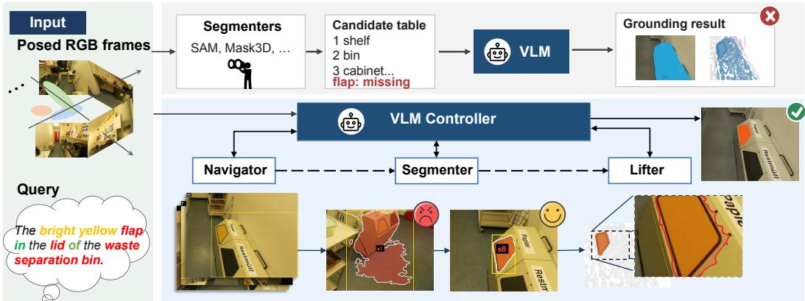
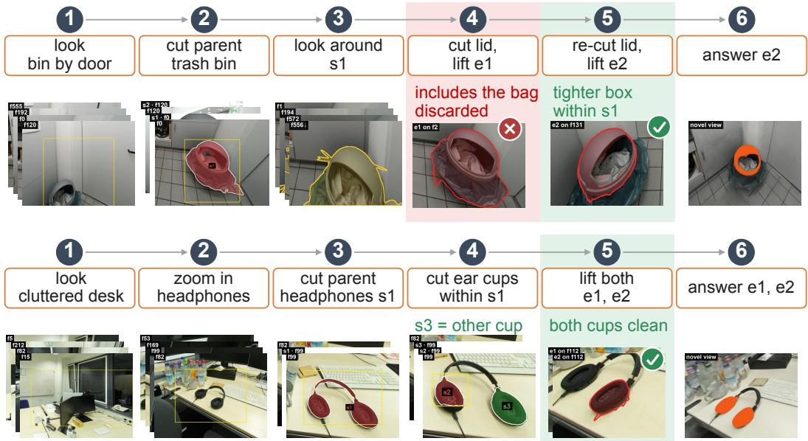
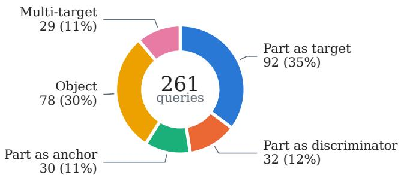

# SplatScout: Query-Driven Part-Level Referring Segmentation in Gaussian Scenes

Yihan Zang Da Li Shinkyu Park Ivan Viola Dominik Engel CEMSE Division, King Abdullah University of Science and Technology {yihan.zang, da.li, shinkyu.park, ivan.viola, dominik.engel}@kaust.edu.sa

## Abstract

Existing referring segmentation methods on Gaussian scenes primarily target whole objects, relying on segmenter-generated candidates from which a visionlanguage model (VLM) selects. Such predetermined fixed candidates may omit fine-grained parts needed as targets or cues for identifying objects. We introduce SplatScout, a query-driven, closed-loop approach that places perception under VLM control. The model actively selects views, directs segmentation, and inspects rendered 3D results to refine its predictions. For part-level evaluation, we introduce PartRef-ScanNet++, comprising 261 manually verified queries across 12 ScanNet++ scenes with mesh-derived ground truth. On PartRef-ScanNet++, SplatScout achieves 0.538 mIoU, substantially outperforming existing methods. Ablations demonstrate the benefits of iterative refinement, while comparisons across VLM backbones highlight the importance of effective toolfeedback utilization. SplatScout also achieves higher scores on four existing referring benchmarks. Code and the PartRef-ScanNet++ benchmark are available at https://github.com/kaust-violab/SplatScout.

## 1 Introduction

3D Gaussian Splatting [Kerbl et al., 2023] represents scenes as explicit primitives that can be reconstructed and rendered in real time. Beyond rendering, a growing body of work attaches language to Gaussian scenes. Open-vocabulary methods distil features from 2D foundation models into Gaussian primitives, enabling category-level queries [Qin et al., 2024, Shi et al., 2024, Wu et al., 2024]. Referring methods go further, identifying specific objects described by expressions involving attributes and spatial relations [He et al., 2025, Ding et al., 2026c,b, Hassan et al., 2026]. However, existing referring methods for Gaussian scenes primarily focus on whole objects, while practical instructions often refer to their parts, such as “the handle of the second drawer on the right of the table by the window”. Unlike whole objects, parts have query-dependent granularity: the same chair may be requested as a whole in one query, its backrest in another, and its armrest in a third. Parts may also serve as targets, discriminators between similar objects, or anchors for locating other objects.

Grounding such expressions requires identifying the relevant scene regions and segmenting them at the granularity specified by the query. Suitable observations must be selected to obtain segmentation masks across multiple views, which are then integrated to construct the target Gaussian instance. However, the required views and segmentation regions depend on the query and may only become apparent during perception. A fixed, query-independent scene decomposition therefore cannot reliably provide all the candidates needed for grounding.

Meanwhile, modern vision-language models (VLMs) are increasingly capable of recognizing visual attributes, distinguishing fine-grained regions, and reasoning about spatial relationships in 2D images. Yet many existing grounding methods limit the VLM to selecting candidates proposed by a segmenter, either during preprocessing or in a single pass at query time. Even when candidates are generated on demand, the VLM typically cannot use intermediate visual feedback to revise them. Consequently, if the target part is missing or segmented at the wrong granularity, stronger visual reasoning alone cannot recover it through candidate selection. This design limits how effectively advances in VLM capabilities translate into better grounding.

We address this limitation by changing the role of the VLM from candidate selection to perception control. Rather than choosing from a predetermined set of instances, the model decides where to look, what to segment, and at what granularity, based on the expression and its observations. The segmenter and geometric operations become tools that execute these decisions, allowing the VLM to apply its visual understanding directly to the construction of query-specific 3D instances.

However, query-time perception alone is insufficient if decisions are executed in a single pass. The appropriate next action often depends on previous results: an observation may require closer inspection, segmentation may reveal an incorrectly selected region, and lifting the masks into 3D may expose errors that were not apparent in the original images. We therefore organize perception as a closed loop in which each operation returns feedback to the VLM. By inspecting intermediate results, the model can revise its decisions and progressively refine the target rather than committing to its initial predictions.

On this basis, we introduce SplatScout, a query-driven, closed-loop perception system for referring segmentation in Gaussian scenes. Before a query arrives, SplatScout never constructs semantic candidates. During query execution, the VLM coordinates three tools: the Navigator selects informative observations, the Segmenter produces query-directed masks, and the Lifter constructs 3D Gaussian instances. Each tool returns feedback that informs subsequent decisions, including rendered views of lifted instances for detecting and correcting errors. The VLM thus controls both instance construction and the decision of when to return an answer.

To evaluate part-level grounding, we introduce PartRef-ScanNet++, a benchmark containing 261 manually verified referring expressions across 12 ScanNet++[Yeshwanth et al., 2023] scenes. It covers whole objects, parts serving different roles in referring expressions, and multiple-target queries, with ground truth verified on laser-scanned meshes. On this benchmark, SplatScout substantially outperforms prior referring segmentation methods and achieves higher scores on four of five existing referring benchmarks. Controlled experiments further investigate the benefits of closed-loop perception and the role of VLM capabilities in utilizing perceptual feedback.

Our main contributions are:

• We identify and experimentally investigate the limitations of fixed segmentation candidate pipelines and compare them to a VLM using visual feedback to guide perception, particularly for part-level referring expressions.

• We introduce SplatScout, which transfers perceptual decision-making to the VLM and coordinates observation, segmentation, and 3D instance construction within a query-driven, closed-loop framework, without precomputed semantic candidates.

• We introduce PartRef-ScanNet++, a part-level referring segmentation benchmark with 261 human-verified expressions across 12 ScanNet++ scenes and an evaluation protocol based on mesh ground truth.

• SplatScout substantially improves referring segmentation performance on existing objectlevel benchmarks and the part-level tasks in PartRef-ScanNet++. Controlled experiments demonstrate the benefits of using perceptual feedback to guide grounding.

## 2 Related Work

Grounding without a VLM: Gaussian Splatting [Kerbl et al., 2023] represents scenes as explicit primitives that can be reconstructed and rendered in real time. Many works attach language to these primitives, primarily enabling open-vocabulary segmentation through object names or category labels rather than full referring expressions. They train features from 2D foundation models into per-scene fields [Qin et al., 2024, Shi et al., 2024, Zhou et al., 2024], attach semantic information to Gaussian groups [Ye et al., 2024, Wu et al., 2024, Li et al., 2025a, Xie et al., 2026], or back project features without training [Kim et al., 2025, Marrie et al., 2025, Ding et al., 2026a, Chacko et al., 2025, Zang et al., 2026]. ReferSplat [He et al., 2025] extends language-based Gaussian segmentation to full referring expressions by training a referring field per scene. These approaches rely largely on pre-established semantic representations, rather than constructing target instances through query-driven perceptual interaction.

Grounding with a VLM: A second line brings in a vision-language model at query time, but these methods restrict its use to choosing among candidates that a segmenter has produced. On Gaussian scenes the candidates are instance groups or a scene graph built once per scene [Hassan et al., 2026, Ding et al., 2026b], or masks cut once at query time from a class label parsed out of the expression [Ding et al., 2026c]. On point clouds they are a lookup table of segmented objects that the model reasons over before selecting an ID [Yang et al., 2024, Yuan et al., 2024, 2025, Li et al., 2025b, Lin et al., 2025]. OpenGround [Huang et al., 2026] and Think, Act, Build [Wang et al., 2026] segment a missing label on demand, but only to extend the existing candidate set in a single query, and without any check in 3D. Similar to VLM-free methods, all of the above only select among pre-segmented candidates, without enabling the VLM to use its perception to explore the 3D scene or guide the segmentation with expressions based on scene and query understanding. In this work we focus on adding this capability to the VLM.

Part-level grounding: Existing part-aware Gaussian methods such as LangSplat and its successors [Qin et al., 2024, Xie et al., 2026, Chacko et al., 2025] primarily rely on SAM and CLIP models to create pre-generated whole-object, part, and sub-part masks and language embeddings. Their supported granularity is therefore limited by the regions identified during preprocessing. On point clouds, part-level understanding has been studied mainly through functional elements. Scene-Fun3D [Delitzas et al., 2024] annotates handles, knobs, and buttons referenced by task instructions. Subsequent methods ground such parts using 2D detectors and segmenters [Corsetti et al., 2025, Wang et al., 2025b] or fixed superpoints [Wu et al., 2025]. Anywhere3D [Wang et al., 2025a] evaluates bounding-box grounding across granularities, while Articulate3D and MultiScan [Halacheva et al., 2025, Mao et al., 2022] provide detailed part annotations. Existing benchmarks primarily treat parts as predefined targets, with limited coverage of their roles in identifying other objects. In contrast, PartRef-ScanNet++ includes parts as targets, discriminators, and relational anchors, with mesh-level segmentation ground truth. SplatScout supports these different roles through queryadaptive part segmentation.

## 3 Method

## 3.1 Preliminaries

2D Gaussian Splatting: We represent each scene with 2D Gaussian Splatting (2DGS) [Huang et al., 2024] as a set $\breve { \mathcal { G } } = \{ g _ { j } \} _ { j = 1 } ^ { \breve { N } }$ of N planar disks. Each has a center, two tangent axes, an opacity αj, and a colour $c _ { j }$ . Compared with 3DGS, it provides a surface-oriented representation for segmentation.

For a frame f with known camera pose and P pixels, let p denote a pixel. Ray-splat intersection orders the disks by depth along each pixel ray, yielding the compositing weight

$$
w _ { j } ^ { f } ( p ) = \alpha _ { j } G _ { j } ( p ) \prod _ { k < j } \bigl ( 1 - \alpha _ { k } G _ { k } ( p ) \bigr ) ,\tag{1}
$$

where $G _ { j } ( \boldsymbol { p } )$ is the Gaussian falloff at the ray-disk intersection, and $k < j$ indexes disks preceding $g _ { j }$ along the ray. The rendered colour is $\begin{array} { r } { C ^ { f } ( p ) = \sum _ { j } w _ { j } ^ { f } ( p ) c _ { j } } \end{array}$

The same weights render arbitrary per-Gaussian attributes. Let $a \in \mathbb { R } ^ { N \times d }$ contain d-dimensional attributes for all N Gaussians. Their rendered values are $A ^ { f } = W ^ { f } a$ , where $W ^ { f } \in \mathbb { R } ^ { P \times N }$ is the sparse contribution matrix with $W _ { p , j } ^ { f } = w _ { j } ^ { f } ( p )$ . For a Gaussian subset ${ \mathcal { S } } \subseteq { \mathcal { G } }$ , its accumulated contribution at pixel p is $\begin{array} { r } { \sigma _ { S } ^ { f } ( \boldsymbol { p } ) = \sum _ { g _ { j } \in \mathcal { S } } w _ { j } ^ { f } ( \boldsymbol { p } ) } \end{array}$ . Thresholding this contribution yields the mask $\{ p : \sigma _ { S } ^ { f } ( p ) > { \frac { 1 } { 2 } } \}$ , with occlusion handled by compositing.

Notation: We write s for a group (masks of one thing in one or more frames, not yet lifted), o for an object (groups the model has declared to be the same thing), and e for an instance (a subset of $\mathcal { G }$ obtained by lifting). Only lifted instances can be returned as answers.

  
Figure 1: Overview of SplatScout. Top: Existing methods restrict the VLM to selecting from fixed segmentation candidates, which may omit the referred target. Bottom: SplatScout enables query-driven, closed-loop perception. The VLM coordinates the Navigator, Segmenter, and Lifter to explore views, extract target regions, and construct 3D-lifted Gaussian instances. Visual feedback allows the VLM to inspect and refine intermediate results without fixed semantic candidates.

## 3.2 Method Overview

As illustrated in Fig. 1, SplatScout consists of three functional tool sets coordinated by a VLM controller: the Navigator, Segmenter, and Lifter. Starting from the desired output, obtaining the target Gaussian subset requires constructing 3D instances from multi-view segmentation masks, which in turn requires acquiring suitable observations of the scene. These dependencies define the responsibilities of the three tool sets. The Navigator retrieves informative scene views, the Segmenter produces query-directed masks, and the Lifter integrates multi-view masks into 3D Gaussian instances. Their complete interfaces, including available actions, arguments, and feedback, are listed in Table 5 of Appendix A.

Rather than executing these tools in a predetermined sequence, the VLM selects its next step action based on the referring expression and the results of previous steps. Each tool returns task-specific feedback, including scene observations, segmentation overlays, or rendered views of lifted instances. The VLM inspects these intermediate results and may invoke additional tools to refine its current hypothesis. Consequently, the target instances are constructed progressively during query execution, without precomputed semantic candidates.

## 3.3 Closed-Loop Grounding

Given a referring expression Q, let $E _ { t }$ denote the intermediate entities constructed at step t, including segmentation groups and lifted 3D instances. Let $\mathcal { F }$ be the available input frames, and $\mathcal { H } _ { t } \subseteq \mathcal { F }$ the frames already observed by the VLM. The interaction history is $\tau _ { t } = ( ( a _ { 0 } , r _ { 0 } ) , \ldots , ( a _ { t - 1 } , r _ { t - 1 } ) )$ where $a _ { i }$ and $r _ { i }$ denote an action and its corresponding feedback. Initially, $E _ { 0 } , \mathcal { H } _ { 0 }$ , and $\tau _ { 0 }$ are empty.

At each step, the VLM selects an action $a _ { t } = \pi ( Q , \tau _ { t } , \ell _ { t } )$ , where $\pi$ denotes the VLM and $\ell _ { t }$ summarizes the execution state and remaining budget. The tool interface Φ takes the action, current entities, observed frames, Gaussian scene, and available frames as inputs, returning feedback $r _ { t }$ and updated states $E _ { t + 1 }$ and $\mathcal { H } _ { t + 1 }$ . The interaction history is then updated as $\tau _ { t + 1 } = \tau _ { t } \| ( a _ { t } , r _ { t } )$

The tools execute operations but do not decide whether to accept their results. Based on the feedback, the VLM may explore additional views, revise segmentations, merge observations, or lift and inspect 3D instances. The execution order thus adapts to the query and previous observations rather than following a fixed pipeline.

The VLM terminates by returning a valid answer, reporting that the target cannot be identified, or exhausting its budget. A valid answer selects previously lifted instances supported by multiple observations. For the selected instance set I, the final prediction is $\textstyle S = \bigcup _ { e \in I } { \bar { \mathcal { G } } } _ { e }$ , where $\mathcal { G } _ { e } \subseteq \mathcal { G }$ is the Gaussian subset associated with instance $e .$ This also supports multi-target queries. The full grounding algorithm is provided in Appendix A.

  
Figure 2: Examples of closed-loop grounding. Top: For “the lid of the trash bin beside the room door,” render-back reveals that the initial lift $e _ { 1 }$ includes the bag. The VLM re-segments within parent $s _ { 1 }$ and accepts the corrected lift $e _ { 2 } .$ . Bottom: For “the padded ear cups of the black headphones on the desk,” the VLM identifies and segments both ear cups within the parent headphones, then lifts and returns both instances $e _ { 1 }$ and $e _ { 2 }$

## 3.4 Perception Tools

The three tool sets in Figure. 1 provide the perceptual and geometric operations used by the VLM controller. The Navigator retrieves informative scene observations, the Segmenter constructs querydirected 2D masks, and the Lifter converts these masks into subsets of 2D Gaussian primitives in 3D space. Each tool returns intermediate results that the VLM can inspect before selecting its next action.

## 3.4.1 Navigator: Active Scene Exploration

The Navigator provides two complementary capabilities: global scene exploration and local inspection. Global exploration helps the VLM locate relevant regions, whereas local inspection provides higher-resolution observations and complementary viewpoints for examining a region.

Geometry-based scene preparation: To support efficient exploration without precomputing semantic candidates, we prepare a lightweight geometric index for each scene. For every training frame $f ,$ we record the set of visible Gaussians $V _ { f } ,$ together with an approximate area weight wj for each Gaussian. For any Gaussian subset ${ \mathcal { A } } \subseteq { \mathcal { G } } $ , we define its weighted area as $w ( A ) \ =$ $\sum _ { j : g _ { j } \in A } w _ { j }$

Given the set of previously observed frames H, their accumulated scene coverage is

$$
\operatorname { c o v } ( { \mathcal { H } } ) = { \frac { w \left( \bigcup _ { f \in { \mathcal { H } } } V _ { f } \right) } { w ( { \mathcal { G } } ) } } .\tag{2}
$$

This provides a geometry-based measure of how much of the reconstructed scene has been observed, without requiring semantic information.

Global exploration: The Navigator supports global exploration through explore, which greedily selects frames to increase scene coverage. Given the previously observed frames H, the next frame is selected by

$$
f ^ { \star } = \arg \operatorname* { m a x } _ { f \notin \mathcal { H } } w \left( V _ { f } \setminus \bigcup _ { f ^ { \prime } \in \mathcal { H } } V _ { f ^ { \prime } } \right) .\tag{3}
$$

Intuitively, each step selects the frame that reveals the largest weighted portion of the scene not yet observed. Repeating this process yields complementary views while avoiding redundant coverage. The selected frames are returned as thumbnails with their accumulated coverage, allowing the VLM to identify promising regions or request further exploration.

Local inspection: Once a potentially relevant region has been identified, the Navigator supports closer inspection through nearby. Given a reference frame, it retrieves additional frames with moderate visual overlap, avoiding both unrelated regions and nearly identical viewpoints.

For a specific region, the VLM may additionally provide a bounding box b in frame $f .$ The Navigator returns a high-resolution crop of the selected region and retrieves other viewpoints observing approximately the same reconstructed surface.

Specifically, let $\mathcal { G } _ { b }$ denote the visible Gaussians whose projected centers lie inside the selected box $b .$ Candidate frames are identified according to their visibility of $\mathcal { G } _ { b }$ . To obtain complementary observations, the Navigator selects viewpoints that maximize angular diversity:

$$
f ^ { \star } = \arg \operatorname* { m a x } _ { f ^ { \prime } \in { \cal K } \backslash { \cal P } } \operatorname* { m i n } _ { f ^ { \prime \prime } \in { \cal P } } \angle \left( { \bf d } _ { f ^ { \prime } } , { \bf d } _ { f ^ { \prime \prime } } \right) ,\tag{4}
$$

where $\kappa$ denotes the candidate frames and $\mathcal { P }$ contains the already selected frames. Here, $f ^ { \prime }$ is a candidate frame, $f ^ { \prime \prime }$ is a previously selected frame, and $\mathbf { d } _ { f }$ denotes the viewing direction from the selected region toward camera $f .$ Selection is initialized with the frame providing the greatest visibility of $\mathcal { G } _ { b }$

The same strategy allows the VLM to revisit an existing segmentation group or lifted instance from previously unseen viewpoints. In this case, the Navigator returns cropped images with the corresponding region outlined, enabling visual inspection before further segmentation or lifting.

## 3.4.2 Segmenter: Query-Adaptive Segmentation

VLM-directed segmentation: The Segmenter uses SAM3 [Carion et al., 2026] to generate queryspecific masks from the frame, bounding box, and text prompt selected by the VLM. The VLM may also specify additional frames for multi-view tracking. If joint text-and-box prompting fails, the tool retries with the box alone. The resulting masks are organized into segmentation groups for subsequent 3D lifting.

Parent constraints and feedback: For part-level queries, the VLM may restrict segmentation to an existing parent object. The Segmenter projects the parent’s Gaussian representation into the selected frame and suppresses regions outside its dilated mask $m _ { \mathrm { p a r } }$ . A predicted mask m is retained $\mathrm { i f ~ } | m \cap m _ { \mathrm { p a r } } | / | m | \geq 0 . 8$

The Segmenter returns mask overlays, cut-outs, multi-view results, and quality indicators, including box-mask agreement and 3D overlap with existing groups. These allow the VLM to inspect results and decide whether to revise them, explore views, or proceed to lifting.

## 3.4.3 Lifter: Multi-View Gaussian Instance Construction

The Lifter converts query-specific 2D masks into 2D Gaussian instances in 3D space. Given segmentation groups from one or more views, it aggregates their geometric evidence, identifies the Gaussian primitives, and returns a rendered view of the instance for inspection.

Multi-view mask aggregation: Before lifting, the Lifter organizes the masks returned by the Segmenter into multi-view groups. Each segmentation call produces a mask track spanning the prompted frame and additional tracked frames. Tracks are split at tracking gaps to avoid incorrect associations. The masks are then approximately back-projected onto the Gaussians, and tracks with sufficient 3D overlap are merged into groups. The VLM can further merge groups belonging to the same physical entity using the same tool. Each resulting group provides the multi-view masks used for Gaussian lifting.

Gaussian lifting: We recover the Gaussian primitives corresponding to each segmentation group using the contribution-based voting formulation of FlashSplat [Shen et al., 2024]. For each group, we aggregate the multi-view masks obtained through our closed-loop perception process.

For a group s with masks $\{ m ^ { f } \} _ { f \in \mathcal { F } _ { s } }$ , where $m ^ { f } \in \{ 0 , 1 \} ^ { P }$ , we accumulate the foreground and background contributions of all Gaussians:

$$
[ \nu ^ { 1 } , \nu ^ { 0 } ] = \sum _ { f \in \mathcal { F } _ { s } } ( W ^ { f } ) ^ { \top } [ m ^ { f } , 1 - m ^ { f } ] .\tag{5}
$$

Here, $W ^ { f } \in \mathbb { R } ^ { P \times N }$ is the rendering contribution matrix, and $\nu ^ { 1 }$ and $\nu ^ { 0 }$ denote the accumulated foreground and background contributions. A Gaussian is assigned to the instance when its foreground contribution exceeds its background contribution:

$$
\mathcal { G } _ { e } = \left\{ g _ { j } \in \mathcal { G } : \nu _ { j } ^ { 1 } + \nu _ { j } ^ { 0 } > 0 , \nu _ { j } ^ { 1 } > \nu _ { j } ^ { 0 } \right\} .\tag{6}
$$

To improve multi-view consistency, when multiple voting frames are available, a selected Gaussian must additionally project inside the segmentation masks of at least two views. Very small Gaussian subsets are discarded as fragments.

Iterative lifting: An initial lift uses the masks obtained from the views selected during segmentation. However, these observations may not capture the complete geometry of the target. When requested by the VLM, the Lifter performs additional refinement rounds. At each round, it retrieves complementary views in which the current Gaussian instance is sufficiently visible. The instance is projected into these views to guide additional segmentation, and the resulting masks are selected according to their agreement with the rendered instance silhouette. New observations contribute additional foreground and background votes, and the Gaussian instance is updated using Eq. (6).

Let ${ \mathcal G } _ { e } ^ { ( k ) }$ denote the Gaussian subset of instance e after refinement round $k ,$ and let | · | denote set cardinality. Refinement stops when the relative change in the number of selected Gaussians falls below a threshold:

$$
\frac { \Big | | \mathcal { G } _ { e } ^ { ( k + 1 ) } | - | \mathcal { G } _ { e } ^ { ( k ) } | \Big | } { \operatorname* { m a x } \Big ( | \mathcal { G } _ { e } ^ { ( k ) } | , 1 \Big ) } \leq 0 . 0 5 ,\tag{7}
$$

or when no suitable additional views remain or the maximum number of steps is reached.

Render-back feedback: After lifting, the resulting Gaussian instance is rendered into an observation frame where it is highly visible. Its projected outline is overlaid on the corresponding RGB image and returned to the VLM, together with its geometric properties, supporting views, and refinement statistics. This allows the VLM to inspect the lifted result in image space and, if necessary, revisit earlier observations, refine the segmentation, or request further lifting. The lifted instance is therefore not automatically accepted as the final answer.

## 4 Experiments

## 4.1 PartRef-ScanNet++ Dataset and Evaluation Metrics

Dataset: We introduce PartRef-ScanNet++, a benchmark for part-level referring segmentation comprising 261 manually verified queries across 12 ScanNet++ scenes. The queries reference 201 object and 95 part instances annotated on laser-scanned meshes. They cover five referring roles: objects, parts as targets, parts as discriminators, parts as anchors, and multiple targets. In 154 queries (59%), parts serve as targets, discriminators, or anchors. Each query was manually reviewed to ensure unambiguous target identification and natural, contextually appropriate wording. Dataset construction, query statistics, and comparisons with existing benchmarks are detailed in Appendix B.

Evaluation metrics: We evaluate on 216 held-out test frames, excluded from all methods’ perception and preprocessing. Predicted Gaussian subsets are rendered within their complete scenes to obtain occlusion-aware masks, which are compared against ground-truth masks ray-traced from the laser-scanned meshes. For each query, we average the intersection over union (IoU) over test frames containing at least 300 visible target pixels. We report mean IoU (mIoU) across queries and the percentage of queries achieving IoU thresholds of 0.25 and 0.5 (Acc@0.25/0.5). Of the 261 queries, 256 are evaluable; the remaining five have insufficient target visibility. Further evaluation details are provided in Appendix B.3.

Table 1: Results on PartRef-ScanNet++. Groups: Obj (76), Part (151: part as target, discriminator or anchor), Multi (29). Every method uses its original model and candidate source. GaussDet uses Qwen2.5-VL-7B, OpenGround uses GLM-4.5V, and ZeroSplat uses Qwen3-VL-30B.
<table><tr><td></td><td colspan="4">mIoU↑</td><td colspan="4">Acc@0.25↑</td><td colspan="4">Acc@0.5↑</td></tr><tr><td>Method</td><td>Obj</td><td>Part</td><td>Multi</td><td>All</td><td>Obj</td><td>Part</td><td>Multi</td><td>All</td><td>Obj</td><td>Part</td><td>Multi</td><td>All</td></tr><tr><td>CLIP retrieval [Radford et al., 2021]</td><td>0.138</td><td>0.169</td><td>0.137</td><td>0.156</td><td>0.21</td><td>0.27</td><td>0.24</td><td>0.25</td><td>0.16</td><td>0.16</td><td>0.10</td><td>0.15</td></tr><tr><td colspan="9">Candidates fixed before the query arrives</td><td></td><td></td><td></td><td></td></tr><tr><td>Search3D [Takmaz et al., 2025]</td><td>0.161</td><td>0.137</td><td>0.122</td><td>0.143</td><td>0.18</td><td>0.21</td><td>0.28</td><td>0.21</td><td>0.16</td><td>0.09</td><td>0.07</td><td>0.11</td></tr><tr><td>GaussDet [Hassan et al., 2026]</td><td>0.293 0.195</td><td>0.237 0.156</td><td>0.230 0.229</td><td>0.253 0.176</td><td>0.49 0.237</td><td>0.44 0.219</td><td>0.38 0.379</td><td>0.45 0.242</td><td>0.28 0.224</td><td>0.19</td><td>0.10</td><td>0.21</td></tr><tr><td colspan="9">OpenGround [Huang et al., 2026]</td><td>0.152</td><td>0.241</td><td></td><td>0.184</td></tr><tr><td>Candidates fixed in one pass at query time</td><td></td><td>0.075</td><td></td><td></td><td></td><td></td><td>0.24</td><td></td><td></td><td></td><td></td><td></td></tr><tr><td colspan="9">ZeroSplat [Ding et al., 2026c] 0.108</td><td>0.03</td><td></td><td>0.07</td><td>0.05</td></tr><tr><td>Never fixed: the model decides what to perceive</td><td></td><td></td><td></td><td></td><td></td><td></td><td></td><td></td><td></td><td></td><td></td><td></td></tr><tr><td colspan="9">SplatScout (Qwen3.5-397B)</td><td></td><td>0.48</td><td>0.38</td><td>0.48</td></tr><tr><td>SplatScout (GPT-5.6)</td><td>0.469 0.572</td><td>0.453 0.519</td><td>0.385 0.548</td><td>0.450 0.538</td><td>0.70 0.88</td><td>0.73 0.82</td><td>0.62 0.86</td><td>0.71 0.84</td><td>0.50 0.62</td><td>0.58</td><td>0.59</td><td>0.59</td></tr></table>

Table 2: Results on external benchmarks (mIoU, %). LERF uses 2D test-view masks, while Scan-Net uses 3D vertex labels. See Appendix D for protocols.
<table><tr><td colspan="2">Ref-LERF</td><td colspan="2">Causal-LERF</td><td colspan="2">GR-LERF</td><td colspan="2">Causal-ScanNet</td><td colspan="2">GR-ScanNet</td></tr><tr><td>ReferSplat</td><td>29.2</td><td>ReferSplat</td><td>10.0</td><td>ReferSplat</td><td>8.8</td><td>OpenGaussian</td><td>2.9</td><td>OpenGaussian</td><td>19.8</td></tr><tr><td>GaussDet</td><td>45.9</td><td>LUDVIG</td><td></td><td>23.6 LUDVIG</td><td>23.8</td><td>LUDVIG</td><td></td><td>5.1 LUDVIG</td><td>15.1</td></tr><tr><td>ZeroSplat</td><td>32.7</td><td>InstanceGaussian</td><td></td><td>6.8 InstanceGaussian</td><td>9.9</td><td>InstanceGaussian</td><td></td><td>1.4 InstanceGaussian</td><td>24.5</td></tr><tr><td>CausalSplat</td><td>36.1</td><td>CausalSplat</td><td>47.0</td><td>ZeroSplat</td><td>50.8</td><td>CausalSplat</td><td>14.9</td><td>ZeroSplat</td><td>41.2</td></tr><tr><td>SplatScout</td><td>61.1</td><td>SplatScout</td><td>65.7</td><td>SplatScout</td><td>63.3</td><td>SplatScout</td><td>23.6</td><td>SplatScout</td><td>24.0</td></tr></table>

## 4.2 3D Visual Grounding Experiments

Main results: As shown in Table 1, SplatScout achieves 0.538 mIoU, compared with 0.253 for the strongest baseline, with substantial gains across all query types. These results demonstrate the difficulty of referring segmentation in large indoor scenes, where identifying the correct target requires scene exploration and disambiguation. The consistent improvements support the effectiveness of query-driven, closed-loop perception.

Since ZeroSplat and GaussDet had not released their implementations at the time of our experiments, we reproduced both methods from their papers. Their reproduced results on Ref-LERF are reported in Appendix C.

Evaluation on other datasets: We evaluate SplatScout on five existing benchmarks following their protocols (Appendix D). As shown in Table 2, SplatScout outperforms published baselines on four of the five benchmarks. The exception is GR-ScanNet, where SplatScout achieves 24.0 mIoU versus ZeroSplat’s 41.2. A likely factor is the mismatch in evaluation granularity: GR-ScanNet uses category-level ground truth, which can include multiple instances of the same category, whereas SplatScout identifies the specific instances referred to by the query. Consequently, instance-level predictions may be penalized for not covering other same-category regions.

## 4.3 Effect of Model Capability

Table 3 compares three VLM backbones across different perception strategies. Changing the backbone has little effect on ZeroSplat (around 0.09 mIoU) or OpenGround (0.161–0.180). In contrast, SplatScout improves from 0.128 to 0.450 mIoU.

Ground-truth(GT) interventions further expose the limitations of candidate-based grounding. Supplying ground-truth candidate masks to OpenGround improves to 0.424, while making oracle selection over an augmented candidate pool collected across four runs achieves 0.435. ZeroSplat reaches 0.293 when its text and box prompts are provided from ground truth, while supplying it with ground-truth masks does not resolve its incorrect target selection even with large models (Appendix E). With Qwen3.5-397B SplatScout outperforms both baselines, even when they use ground truth information.

Table 3: Effect of VLM choice and perception strategy on PartRef-ScanNet++ (mIoU). ∆ denotes the change from Qwen3-VL-30B to Qwen3.5-397B. GT masks and GT table replace the respective methods’ segmentation masks and candidate table. The final column reports GT-guided prompting for ZeroSplat and oracle selection for OpenGround. See Appendix E.
<table><tr><td>Method</td><td>Qwen3-VL-30B</td><td>Qwen3.5-35B</td><td>Qwen3.5-397B</td><td>∆</td><td>GT intervention</td></tr><tr><td rowspan="2">ZeroSplat + GT masks</td><td>0.090</td><td>0.083</td><td>0.088</td><td>-0.002</td><td>0.293</td></tr><tr><td>0.062</td><td>0.057</td><td>0.060</td><td>-0.002</td><td></td></tr><tr><td>OpenGround</td><td>0.161</td><td>0.173</td><td>0.180</td><td>+0.019</td><td>0.435</td></tr><tr><td>+ GT table</td><td>0.349</td><td>0.360</td><td>0.424</td><td>+0.075</td><td>一</td></tr><tr><td>SplatScout</td><td>0.128</td><td>0.353</td><td>0.450</td><td>+0.322</td><td>一</td></tr></table>

Table 4: Ablation and oracle results on PartRef-ScanNet++ using Qwen3.5-397B. Wrong counts queries with IoU below 0.1. Details in App. F.
<table><tr><td>Setting</td><td>Obj</td><td>Part</td><td>Multi</td><td>All</td><td>Wrong</td></tr><tr><td colspan="6">Interaction and feedback ablations</td></tr><tr><td>One look, one cut</td><td>0.224</td><td>0.199</td><td>0.215</td><td>0.209</td><td>154</td></tr><tr><td>No visual exploration</td><td>0.344</td><td>0.301</td><td>0.348</td><td>0.319</td><td>114</td></tr><tr><td>No segmentation feedback</td><td>0.433</td><td>0.403</td><td>0.407</td><td>0.412</td><td>68</td></tr><tr><td>No lifting feedback</td><td>0.471</td><td>0.429</td><td>0.420</td><td>0.440</td><td>62</td></tr><tr><td>Full SplatScout</td><td>0.469</td><td>0.453</td><td>0.385</td><td>0.450</td><td>55</td></tr><tr><td colspan="6">Progressive ground-truth interventions</td></tr><tr><td>GT boxes, same frames</td><td>0.591</td><td>0.558</td><td>0.585</td><td>0.571</td><td>12</td></tr><tr><td>GT boxes, GT frames</td><td>0.595</td><td>0.563</td><td>0.616</td><td>0.578</td><td>13</td></tr><tr><td>GT masks, same K frames</td><td>0.691</td><td>0.682</td><td>0.722</td><td>0.689</td><td>6</td></tr></table>

These results suggest that stronger VLMs are more effectively utilized when they control perception rather than only selecting from generated candidates. The poor performance of SplatScout with the 30B model also highlights the importance of effective tool use.

## 4.4 Ablations and Oracle Experiments

Table 4 examines the role of closed-loop interaction and individual perceptual feedback channels. Restricting the system to a single round observation and segmentation decision reduces mIoU from 0.450 to 0.209. Among the three feedback ablations, removing visual exploration causes the largest drop, to 0.319 mIoU. Suppressing segmentation and lifting feedback yields 0.412 and 0.440 mIoU, respectively. These results highlight the importance of early visual observations and suggest that the remaining feedback channels can partially compensate for missing information. We analyze the resulting tool-use behavior in Appendix F.

Oracle experiments reveal further opportunities for improvement. Ground-truth boxes increase mIoU to 0.571, while ground-truth frame selection provides only a marginal additional gain (0.578). Replacing segmentation masks with ground truth further improves performance to 0.689, highlighting the importance of accurate query-directed segmentation.

## 5 Conclusion

We introduced SplatScout, a query-driven, closed-loop approach to part-level referring segmentation in Gaussian scenes. By placing perception under VLM control, our method enables the model to select observations, construct query-specific instances, and refine its predictions through perceptual feedback without precomputed semantic candidates. We also introduced PartRef-ScanNet++, a benchmark covering diverse part-level referring expressions with mesh-derived ground truth. SplatScout substantially outperforms existing methods on our benchmark and achieves higher scores on four external referring benchmarks. Our experiments further demonstrate the benefits of iterative interaction and show that feedback from different perceptual stages plays complementary roles. These findings highlight the potential of closed-loop perception for leveraging increasingly capable VLMs in fine-grained 3D scene understanding.

## Acknowledgments and Disclosure of Funding

This work was supported by the King Abdullah University of Science and Technology (KAUST) research fund under grant BAS/1/1680-01-01.

## References

Nicolas Carion, Laura Gustafson, Yuan-Ting Hu, Shoubhik Debnath, Ronghang Hu, Didac Suris Coll-Vinent, Chaitanya Ryali, Kalyan Vasudev Alwala, Haitham Khedr, Andrew Huang, et al. Sam 3: Segment anything with concepts. In International conference on learning representations, volume 2026, pages 138846–138923, 2026.

Rohan Chacko, Nicolai Haeni, Eldar Khaliullin, Lin Sun, and Douglas Lee. Lifting by gaussians: A¨ simple, fast and flexible method for 3D instance segmentation. In Proceedings of the IEEE/CVF Winter Conference on Applications of Computer Vision (WACV), pages 3497–3507, 2025.

Jaime Corsetti, Francesco Giuliari, Alice Fasoli, Davide Boscaini, and Fabio Poiesi. Functionality understanding and segmentation in 3D scenes. In Proceedings of the IEEE/CVF Conference on Computer Vision and Pattern Recognition (CVPR), pages 24550–24559, 2025.

Alexandros Delitzas, Ayca Takmaz, Federico Tombari, Robert Sumner, Marc Pollefeys, and Francis Engelmann. SceneFun3D: Fine-grained functionality and affordance understanding in 3D scenes. In Proceedings of the IEEE/CVF Conference on Computer Vision and Pattern Recognition (CVPR), pages 14531–14542, 2024.

Jiayu Ding, Xinpeng Liu, Zhiyi Pan, Shiqiang Long, and Ge Li. ExtrinSplat: Decoupling geometry and semantics for open-vocabulary understanding in 3D gaussian splatting. In Proceedings ofthe IEEE/CVF Conference on Computer Vision and Pattern Recognition (CVPR), 2026a.

Jiayu Ding, Meilu Song, Yun Chen, Wei Gao, and Ge Li. CausalSplat: Towards comprehensive hierarchical reasoning in 3D gaussian splatting. arXiv preprint arXiv:2608.11150, 2026b.

Jiayu Ding, Meilu Song, Xiaoyi Zhang, Hongbo Jin, Yichen Jin, and Xiangtian Si. Zerosplat: Generalized referring segmentation in 3d gaussian splatting. In European Conference on Computer Vision, pages 147–163. Springer, 2026c.

Anna-Maria Halacheva, Yang Miao, Jan-Nico Zaech, Xi Wang, Luc Van Gool, and Danda Pani Paudel. Articulate3D: Holistic understanding of 3D scenes as universal scene description. In Proceedings of the IEEE/CVF International Conference on Computer Vision (ICCV), pages 5633– 5644, 2025.

Jameel Hassan, Yasiru Ranasinghe, and Vishal Patel. Open-vocabulary and referring segmentation for 3D gaussians using 2D detectors. arXiv preprint arXiv:2606.30638, 2026.

Shuting He, Guangquan Jie, Changshuo Wang, Yun Zhou, Shuming Hu, Guanbin Li, and Henghui Ding. ReferSplat: Referring segmentation in 3D gaussian splatting. In International Conference on Machine Learning (ICML), volume 267 of Proceedings ofMachine Learning Research, pages 22456–22467. PMLR, 2025.

Binbin Huang, Zehao Yu, Anpei Chen, Andreas Geiger, and Shenghua Gao. 2d gaussian splatting for geometrically accurate radiance fields. In ACM SIGGRAPH 2024 conference papers, pages 1–11, 2024.

Wenyuan Huang, Zhenyu Zhang, Zhao Wang, Zhou Wei, Ting Huang, Fang Zhao, and Jian Yang. OpenGround: Planning-based online perception for open-world 3D visual grounding. In European Conference on Computer Vision (ECCV), pages 468–487, 2026. doi: 10.1007/ 978-3-032-37013-6 25.

Bernhard Kerbl, Georgios Kopanas, Thomas Leimkuhler, and George Drettakis. 3D gaussian splat-¨ ting for real-time radiance field rendering. ACM Transactions on Graphics, 42(4):1–14, 2023. doi: 10.1145/3592433.

Jun-Seong Kim, GeonU Kim, Yu-Ji Kim, Yu-Chiang Frank Wang, Jaesung Choe, and Tae-Hyun Oh. Dr. Splat: Directly referring 3D gaussian splatting via direct language embedding registration. In Proceedings ofthe IEEE/CVF Conference on Computer Vision and Pattern Recognition (CVPR), pages 14137–14146, 2025.

Haijie Li, Yanmin Wu, Jiarui Meng, Qiankun Gao, Zhiyao Zhang, Ronggang Wang, and Jian Zhang. InstanceGaussian: Appearance-semantic joint gaussian representation for 3D instance-level perception. In Proceedings ofthe IEEE/CVF Conference on Computer Vision and Pattern Recognition (CVPR), pages 14078–14088, 2025a.

Rong Li, Shijie Li, Lingdong Kong, Xulei Yang, and Junwei Liang. SeeGround: See and ground for zero-shot open-vocabulary 3D visual grounding. In Proceedings ofthe IEEE/CVF Conference on Computer Vision and Pattern Recognition (CVPR), pages 3707–3717, 2025b.

Jiawen Lin, Shiran Bian, Yihang Zhu, Wenbin Tan, Yachao Zhang, Yuan Xie, and Yanyun Qu. SeqVLM: Proposal-guided multi-view sequences reasoning via VLM for zero-shot 3D visual grounding. In Proceedings of the 33rd ACM International Conference on Multimedia (ACM MM), pages 3094–3103, 2025. doi: 10.1145/3746027.3754985.

Yongsen Mao, Yiming Zhang, Hanxiao Jiang, Angel Chang, and Manolis Savva. MultiScan: Scalable RGBD scanning for 3D environments with articulated objects. In Advances in Neural Information Processing Systems (NeurIPS), volume 35, pages 9058–9071, 2022.

Juliette Marrie, Romain Menegaux, Michael Arbel, Diane Larlus, and Julien Mairal. LUDVIG: Learning-free uplifting of 2D visual features to gaussian splatting scenes. In Proceedings of the IEEE/CVF International Conference on Computer Vision (ICCV), pages 7440–7450, 2025.

Minghan Qin, Wanhua Li, Jiawei Zhou, Haoqian Wang, and Hanspeter Pfister. LangSplat: 3D language gaussian splatting. In Proceedings of the IEEE/CVF Conference on Computer Vision and Pattern Recognition (CVPR), pages 20051–20060, 2024.

Alec Radford, Jong Wook Kim, Chris Hallacy, Aditya Ramesh, Gabriel Goh, Sandhini Agarwal, Girish Sastry, Amanda Askell, Pamela Mishkin, Jack Clark, et al. Learning transferable visual models from natural language supervision. In International conference on machine learning, pages 8748–8763. PmLR, 2021.

Qiuhong Shen, Xingyi Yang, and Xinchao Wang. Flashsplat: 2d to 3d gaussian splatting segmentation solved optimally. In European Conference on Computer Vision, pages 456–472. Springer, 2024.

Jin-Chuan Shi, Miao Wang, Hao-Bin Duan, and Shao-Hua Guan. Language embedded 3D gaussians for open-vocabulary scene understanding. In Proceedings of the IEEE/CVF Conference on Computer Vision and Pattern Recognition (CVPR), pages 5333–5343, 2024.

Ayca Takmaz, Alexandros Delitzas, Robert W Sumner, Francis Engelmann, Johanna Wald, and Federico Tombari. Search3d: Hierarchical open-vocabulary 3d segmentation. IEEE Robotics and Automation Letters, 10(3):2558–2565, 2025.

Haibo Wang, Zihao Lin, Zhiyang Xu, and Lifu Huang. Think, act, build: An agentic framework with vision language models for zero-shot 3D visual grounding. arXivpreprint arXiv:2604.00528, 2026.

Tianxu Wang, Zhuofan Zhang, Ziyu Zhu, Yue Fan, Jing Xiong, Pengxiang Li, Xiaojian Ma, and Qing Li. From objects to anywhere: A holistic benchmark for multi-level visual grounding in 3D scenes. In Advances in Neural Information Processing Systems (NeurIPS), Datasets and Benchmarks Track, volume 38, 2025a.

Xinyi Wang, Xun Yang, Yanlong Xu, Yuchen Wu, Zhen Li, and Na Zhao. AffordBot: 3D finegrained embodied reasoning via multimodal large language models. In Advances in Neural Information Processing Systems (NeurIPS), volume 38, pages 140367–140387, 2025b.

Hongyu Wu, Pengwan Yang, Yuki M. Asano, and Cees G. M. Snoek. Segment any 3D-part in a scene from a sentence. arXiv preprint arXiv:2506.19331, 2025.

Yanmin Wu, Jiarui Meng, Haijie Li, Chenming Wu, Yahao Shi, Xinhua Cheng, Chen Zhao, Haocheng Feng, Errui Ding, Jingdong Wang, and Jian Zhang. OpenGaussian: Towards pointlevel 3D gaussian-based open vocabulary understanding. In Advances in Neural Information Processing Systems (NeurIPS), volume 37, pages 19114–19138, 2024.

Yaxu Xie, Abdalla Arafa, Alireza Javanmardi, Christen Millerdurai, Jia Cheng Hu, Shaoxiang Wang, Alain Pagani, and Didier Stricker. ReLaGS: Relational language gaussian splatting. In Proceedings of the IEEE/CVF Conference on Computer Vision and Pattern Recognition (CVPR), pages 23826–23836, 2026.

Jianing Yang, Xuweiyi Chen, Shengyi Qian, Nikhil Madaan, Madhavan Iyengar, David F. Fouhey, and Joyce Chai. LLM-Grounder: Open-vocabulary 3D visual grounding with large language model as an agent. In IEEE International Conference on Robotics and Automation (ICRA), pages 7694–7701, 2024. doi: 10.1109/ICRA57147.2024.10610443.

Mingqiao Ye, Martin Danelljan, Fisher Yu, and Lei Ke. Gaussian grouping: Segment and edit anything in 3D scenes. In European Conference on Computer Vision (ECCV), pages 162–179, 2024. doi: 10.1007/978-3-031-73397-0 10.

Chandan Yeshwanth, Yueh-Cheng Liu, Matthias Nießner, and Angela Dai. Scannet++: A highfidelity dataset of 3d indoor scenes. In 2023 IEEE/CVF International Conference on Computer Vision (ICCV), pages 12–22. IEEE, 2023.

Qihao Yuan, Kailai Li, and Jiaming Zhang. Solving zero-shot 3D visual grounding as constraint satisfaction problems. In British Machine Vision Conference (BMVC), 2025.

Zhihao Yuan, Jinke Ren, Chun-Mei Feng, Hengshuang Zhao, Shuguang Cui, and Zhen Li. Visual programming for zero-shot open-vocabulary 3D visual grounding. In Proceedings of the IEEE/CVF Conference on Computer Vision and Pattern Recognition (CVPR), pages 20623– 20633, 2024.

Yihan Zang, Da Li, Dominik Engel, Shinkyu Park, and Ivan Viola. Normlift: From lifted features to semantic reliability in 3d gaussian splatting. arXiv preprint arXiv:2609.18898, 2026.

Shijie Zhou, Haoran Chang, Sicheng Jiang, Zhiwen Fan, Zehao Zhu, Dejia Xu, Pradyumna Chari, Suya You, Zhangyang Wang, and Achuta Kadambi. Feature 3DGS: Supercharging 3D gaussian splatting to enable distilled feature fields. In Proceedings of the IEEE/CVF Conference on Computer Vision and Pattern Recognition (CVPR), pages 21676–21685, 2024.

## A Closed-Loop Grounding Implementation

Tool interface: Table 5 lists the tools available to the VLM, their arguments, and the feedback returned after execution.

Algorithm 1 Closed-Loop Grounding in SplatScout   
Input: Query Q, scene G, frames F, VLM π, tools Φ, budget B   
Output: Gaussian subset S or a failure report   
1: $\mathbf { \bar { \mathit { E } } } _ { 0 } , \mathcal { H } _ { 0 } , \tau _ { 0 } \gets \emptyset , \emptyset , ( )$   
2: for $t = 0 , 1 , \ldots$ do   
3: $\ell _ { t } \gets \mathrm { s t a t u s } ( t , E _ { t } , \mathcal { H } _ { t } , B )$   
4: if budget exhausted then   
5: Restrict actions to answer and report   
6: end if   
7: $a _ { t } \gets \pi ( Q , \tau _ { t } , \ell _ { t } )$   
8: $E _ { t + 1 } , \mathcal { H } _ { t + 1 }  E _ { t } , \mathcal { H } _ { t }$   
9: if $a _ { t } =$ answer $( I , \varepsilon )$ then   
10: if $\mathrm { l e g a l } ( I , \varepsilon , E _ { t } )$ then   
11: return $\cup _ { e \in I } \mathcal { G } _ { e }$   
12: end if   
13: r ← constraint feedback   
14: else if $a _ { t } = \tt r e p o r t ( \cdot )$ then   
15: return failure report   
16: else if at is a permitted tool call then   
17: $( r _ { t } , E _ { t + 1 } , \mathcal { H } _ { t + 1 } ) \gets$   
Φ $\cdot ( a _ { t } ; E _ { t } , \mathcal { H } _ { t } , \mathcal { G } , \mathcal { F } )$   
18: else   
19: r ← action feedback   
20: end if   
21: $\tau _ { t + 1 } \gets \tau _ { t } \parallel ( a _ { t } , r _ { t } )$   
22: if two forced termination attempts fail then   
23: return not found   
24: end if   
25: end for

Table 5: Tool interfaces of SplatScout, organized by tool set. Optional arguments are shown in brackets.
<table><tr><td></td><td>Action Arguments</td><td>Feedback</td></tr><tr><td colspan="3">Navigator</td></tr><tr><td>explore n</td><td></td><td>Unseen frames selected by additional coverage</td></tr><tr><td>nearby f</td><td></td><td>Neighboring frames</td></tr><tr><td></td><td>f, box</td><td>Full-resolution crop and frames observing the selected region</td></tr><tr><td></td><td>s or e</td><td>Alternative views of a group or instance</td></tr><tr><td colspan="3">Segmenter</td></tr><tr><td></td><td></td><td>segment f, box, word [, frames, parent] Segmentation masks, overlays, cutouts, box agreement, and alter- native matches</td></tr><tr><td>same</td><td>groups</td><td>Merged object ID and pairwise 3D overlap</td></tr><tr><td colspan="3">Lifter</td></tr><tr><td>lift</td><td>s or o [, thorough]</td><td>Lifted instance ID, rendered inspection view, and single-view flag</td></tr><tr><td colspan="3">VLM termination actions</td></tr><tr><td></td><td>answer ids, evidence</td><td>Final Gaussian subset</td></tr><tr><td></td><td>report status, detail [, candidates]</td><td>Termination report</td></tr></table>

Grounding algorithm: Algorithm 1 describes how the VLM selects these tools, incorporates feedback, and terminates with an answer or failure report.

## B PartRef-ScanNet++: Dataset and Evaluation Details

## B.1 Benchmark Comparison and Statistics

Comparison with existing benchmarks: Table 6 compares PartRef-ScanNet++ with existing referring benchmarks. Previous Gaussian-based benchmarks primarily focus on object-level grounding. OpenTarget [Huang et al., 2026] extends 3D grounding to articulated parts using 3D boundingbox annotations. In contrast, PartRef-ScanNet++ covers both objects and parts, including expressions in which parts serve as targets, discriminators, or relational anchors, and provides mesh-level segmentation ground truth.

Table 6: Comparison with existing referring benchmarks.
<table><tr><td colspan="3"></td><td colspan="3">Targets</td><td rowspan="2">Ground truth</td></tr><tr><td>Benchmark</td><td>Scenes</td><td>Queries</td><td>Object</td><td>Part</td><td>Multi</td></tr><tr><td>Ref-LERF [He et al., 2025]</td><td>4</td><td>59</td><td>√</td><td></td><td>一</td><td>2D masks</td></tr><tr><td>GR-LERF [Ding et al., 2026c]</td><td>4</td><td>111</td><td>√</td><td></td><td>√</td><td>2D masks</td></tr><tr><td>GR-ScanNet [Ding et al., 2026c]</td><td>10</td><td>83</td><td>√</td><td></td><td>√</td><td>Point labels</td></tr><tr><td>Causal-LERF [Ding et al., 2026b]</td><td>4</td><td>158</td><td>√</td><td></td><td>一</td><td>2D masks</td></tr><tr><td>Causal-ScanNet [Ding et al., 2026b]</td><td>10</td><td>73</td><td>√</td><td></td><td>一</td><td>Point labels</td></tr><tr><td>OpenTarget [Huang et al., 2026]</td><td>236</td><td>7,724</td><td></td><td>√</td><td>一</td><td>3D boxes</td></tr><tr><td>PartRef-ScanNet++</td><td>12</td><td>261</td><td>√</td><td>√</td><td>√</td><td>3D mesh masks</td></tr></table>

Comparison with OpenTarget: OpenTarget contains 7,724 descriptions across 236 ScanNet++ scenes, with part annotations from Articulate3D. Its descriptions are generated by a VLM and subsequently reviewed by human annotators. While OpenTarget focuses on articulated parts and uses 3D bounding boxes for evaluation, PartRef-ScanNet++ additionally includes whole objects, nonarticulated parts, and multi-target expressions, evaluated using mesh-derived segmentation masks.

OpenTarget contains substantially longer descriptions, averaging approximately 31 words, compared with a median of nine words in PartRef-ScanNet++. Our annotation process emphasizes natural, contextually appropriate expressions, with manual review to ensure that each query unambiguously identifies its intended target.

Evaluation on OpenTarget: To further evaluate generalization, we compare SplatScout with OpenGround on OpenTarget. We sample 300 of the 651 OpenTarget queries from the 12 scenes shared with PartRef-ScanNet++, using only training frames and OpenGround’s official evaluation protocol.

Both methods use Qwen3.5-397B. For SplatScout, we convert the predicted Gaussian subset into a 3D bounding box using the primitives accounting for 99% of its mass. Two queries blocked by API content filtering are excluded from both methods.

As shown in Table 7, SplatScout achieves higher box accuracy under both IoU thresholds.

Table 7: Evaluation on OpenTarget using 300 sampled queries from the 12 shared scenes. Two blocked queries are excluded from evaluation. Both methods use Qwen3.5-397B.
<table><tr><td>Method</td><td>Acc@0.25</td><td>Acc@0.5</td></tr><tr><td>OpenGround</td><td>10.0</td><td>6.3</td></tr><tr><td>SplatScout</td><td>33.9</td><td>22.5</td></tr></table>

Dataset statistics: PartRef-ScanNet++ contains 261 queries across 12 ScanNet++ scenes, covering five referring roles: 78 object targets, 92 part targets, 32 part discriminators, 30 part anchors, and 29 multi-target queries. As shown in Fig. 3, 154 queries (59%) involve parts as targets, discriminators, or anchors.

  
Figure 3: Distribution of the 261 queries in PartRef-ScanNet++ across five referring roles.

## B.2 Dataset Construction

Scenes and annotations: We select 12 ScanNet++ scenes, each providing laser-scanned meshes and posed DSLR images. Following the official splits, we reconstruct one 2DGS scene using the training frames of each scene. The 216 held-out test frames are reserved exclusively for evaluation.

Object annotations are obtained from ScanNet++, yielding 1,616 valid instances after filtering nonobject labels. Part annotations are derived from 723 Articulate3D[Halacheva et al., 2025] instances and supplemented with 24 manually verified parts. All annotations are represented as vertex subsets of the same laser-scanned meshes. The final queries reference 201 object and 95 part instances.

Query construction and verification: Initial query candidates are generated with AI assistance from mesh-derived geometric relations and subsequently reviewed and revised by human annotators. Scene-level relation summaries identify suitable anchors and spatial relationships that distinguish target instances. Viewpoint-dependent expressions are excluded.

Each expression is checked for naturalness, target uniqueness, and the necessity of its qualifying conditions. We additionally verify target visibility and annotation validity.

All 357 initial queries undergo manual review using a 3D annotation interface displaying highlighted mesh targets and corresponding images. Of these, 254 are retained, nine are revised, and 94 are discarded. After deduplication, the final benchmark contains 261 queries.

Ground-truth generation: For each held-out test frame, we generate occlusion-aware groundtruth masks by ray tracing the laser-scanned meshes. A pixel belongs to the target only when the first ray intersection lies on its annotated mesh surface. Privacy-masked regions are excluded from evaluation.

## B.3 Evaluation Protocol

Evaluation setup: We evaluate predictions against mesh-derived ground truth on 216 held-out test frames. These frames are excluded from all methods’ perception and preprocessing procedures.

The evaluator supports binary Gaussian subsets, per-Gaussian soft weights, and mesh vertex subsets. For vertex-based submissions, a triangle is included when at least two of its vertices belong to the predicted subset.

Occlusion-aware rendering evaluation: For Gaussian-based predictions, the submitted subset is rendered together with the complete scene. Each selected Gaussian is assigned a membership value of one, while all remaining Gaussians are assigned zero. The membership values are composited using the original Gaussian opacities.

A pixel is classified as foreground when the accumulated target contribution exceeds 0.5 and the total accumulated opacity exceeds 0.5. For soft-weight predictions, the submitted weights replace binary membership values.

The predicted masks are compared against occlusion-aware ground-truth masks obtained by ray tracing the laser-scanned meshes. Only frames containing at least 300 visible ground-truth pixels are evaluated.

For each query, we average the IoU across all valid test frames:

$$
\mathrm { I o U } _ { q } = \frac { 1 } { | \mathcal { V } _ { q } | } \sum _ { f \in \mathcal { V } _ { q } } \frac { | P _ { q } ^ { f } \cap G _ { q } ^ { f } | } { | P _ { q } ^ { f } \cup G _ { q } ^ { f } | } ,\tag{8}
$$

where $\mathcal { V } _ { q }$ denotes the valid test frames for query q, and $P _ { q } ^ { f }$ and $G _ { q } ^ { f }$ are the predicted and ground-truth masks, respectively.

We report mean IoU (mIoU) across queries, together with Acc@0.25 and Acc@0.5. Of the 261 queries, 256 are evaluable; the remaining five have insufficient target visibility.

## C Reproduction of Unreleased Baselines

At the time of our experiments, the implementations of ZeroSplat and GaussDet were not publicly available. We therefore reimplemented both methods following their respective papers. To document the differences between the published results and our reproductions, we evaluate both implementations on the four Ref-LERF scenes.

Table 8: Published and reproduced results on Ref-LERF (mIoU, %). The reproduced implementations are used in our comparisons on PartRef-ScanNet++.
<table><tr><td>Method</td><td>Waldo</td><td>Ramen</td><td>Teatime</td><td>Figurines</td><td>Mean</td></tr><tr><td>ZeroSplat (published)</td><td>21.3</td><td>30.4</td><td>41.4</td><td>37.8</td><td>32.7</td></tr><tr><td>ZeroSplat (reproduced)</td><td>24.8</td><td>33.6</td><td>26.0</td><td>29.0</td><td>28.4</td></tr><tr><td>GaussDet (published)</td><td>33.3</td><td>52.3</td><td>39.2</td><td>58.7</td><td>45.9</td></tr><tr><td>GaussDet (reproduced)</td><td>36.2</td><td>46.7</td><td>40.5</td><td>37.6</td><td>40.2</td></tr></table>

Our reproductions achieve 28.4 and 40.2 mIoU for ZeroSplat and GaussDet, respectively, compared with their published results of 32.7 and 45.9. Performance differences vary across scenes, with larger discrepancies on Teatime for ZeroSplat and Figurines for GaussDet. For evaluation on PartRef-ScanNet++, we use our reproduced implementations of ZeroSplat and GaussDet. Results on other benchmarks are taken directly from their respective papers.

## D External Benchmark Evaluation Protocols

Experimental setup: We evaluate SplatScout on five existing benchmarks: Ref-LERF [He et al., 2025], GR-LERF and GR-ScanNet [Ding et al., 2026c], and Causal-LERF and Causal-ScanNet [Ding et al., 2026b]. We use only the training frames of each benchmark, without modifying our perception or grounding pipeline, and follow its original evaluation protocol. All baseline results in Table 2 are taken from the respective publications.

2D evaluation on LERF: Ref-LERF, GR-LERF, and Causal-LERF evaluate segmentation on the four LERF scenes using 2D mIoU. We render the predicted Gaussian subsets from the benchmark’s evaluation views and compare the resulting masks against the provided ground-truth masks, following each benchmark’s scoring protocol.

3D evaluation on ScanNet: GR-ScanNet and Causal-ScanNet use point-level 3D mIoU, following the fixed-point evaluation setup of OpenGaussian. We initialize one Gaussian per input Scan-Net point and disable densification and position updates during reconstruction, preserving one-toone correspondence between Gaussians and ground-truth points. Consequently, predicted Gaussian membership can be compared directly with the corresponding ground-truth point labels, without nearest-neighbor matching or label transfer.

Generalized referring queries: GR-LERF and GR-ScanNet additionally include zero-target and multi-target queries. Following ZeroSplat, zero-target queries receive a score of one when the prediction is empty and zero otherwise. For the remaining queries, we evaluate the predicted union of target instances against the corresponding ground truth.

## E VLM and Perception Analysis

Experimental setup: All methods use only training frames, with fixed method-specific configurations across VLM backbones. SplatScout uses identical prompts, tools, and execution budgets across models. ZeroSplat follows its published settings, while OpenGround uses a temperature of 0.2. Decoding settings differ between some ZeroSplat runs, and API filtering reduces the evaluable queries in a few runs from 256 to 254–255.

Ground-truth interventions: We conduct three distinct interventions. For ZeroSplat, GT masks replace segmentation outputs without correcting the VLM’s instance selection. Performance decreases because incorrect selections can still produce accurate masks of distractors. Separately, GTguided prompting supplies the correct category and ground-truth bounding boxes while retaining ZeroSplat’s segmentation and lifting pipeline, reaching 0.293 mIoU.

For OpenGround, GT table replaces its candidates with official ScanNet++ instances, reaching 0.424 mIoU. However, this table has limited part coverage. Oracle selection instead chooses the highestoverlap candidate from OpenGround’s static table augmented with candidates recovered across four runs, reaching 0.435 mIoU. This oracle is restricted to one candidate per query, including multitarget queries.

Tool-use behavior: The 30B model struggles to use SplatScout’s feedback effectively: it reaches the execution budget without a valid terminal action on 65 queries, compared with none for 397B. After unsuccessful segmentation, the respective re-segmentation rates are 52% and 69%. These observations help explain the stronger backbone’s larger gains under closed-loop perception.

## F Ablation and Oracle Details

Interaction and feedback ablations: All experiments use Qwen3.5-397B with the same tool interfaces and execution budget, except for the specified restrictions. In the one-look, one-cut setting, the VLM receives four overview images and makes a single frame selection and segmentation decision without further interaction. Automatic multi-view lifting remains enabled.

For the feedback ablations, we suppress one feedback channel at a time while preserving the other two. No visual exploration prevents the Navigator from returning images and disables box-based local inspection, while retaining frame identifiers and other necessary information. No segmentation feedback hides segmentation visualizations and quality diagnostics, returning only the identifiers and status needed for subsequent operations. No lifting feedback similarly suppresses rendered inspection views and lifting-quality feedback while preserving the underlying lifting operations. The VLM remains free to invoke all permitted tools and revise its decisions.

Compensation between feedback channels: The feedback ablations reveal distinct patterns of tool use. Without visual exploration, segmentation calls increase from 2.5 to 4.6 per query, including 58 attempts to specify segmentation boxes in frames not previously visualized through the Navigator. The number of queries reported as not found increases from 15 to 62, indicating that subsequent feedback cannot fully compensate for missing early visual observations.

Without segmentation feedback, the VLM increasingly relies on lifting to inspect its intermediate results. Lifting calls increase from 1.8 to 4.9 per query, while the average interaction length increases from 11.0 to 13.4 steps. Token consumption also increases from 118k to 131k per query, despite the reduced segmentation feedback. This behavior suggests that lifting feedback can partially substitute for direct inspection of segmentation masks, but requires additional interaction.

Removing lifting feedback has a smaller effect on overall accuracy. With segmentation feedback still available, the VLM can continue to inspect and revise its 2D predictions. However, part-level mIoU decreases from 0.453 to 0.429, indicating that lifting feedback retains value for some queries.

Progressive oracle experiments: We progressively replace the model’s decisions with ground truth while retaining the same lifting pipeline. GT boxes replaces predicted boxes and parent scopes with mesh-derived annotations on the model’s selected training frames, while SAM3 performs segmentation as usual. GTframes additionally selects the top K training frames by visible target area, where K matches the number of distinct segmentation frames in the original run. GT masks retains exactly these frames but replaces SAM3 outputs with mesh-projected ground-truth masks, including those used during multi-view refinement. The comparison between the final two settings isolates the contribution of segmentation quality.

Table 9: Tool-use behavior under feedback ablations. Calls and tokens are averaged per query.
<table><tr><td>Setting</td><td>Seg./q</td><td>Steps/q</td><td>Not found</td></tr><tr><td>Full SplatScout</td><td>2.5</td><td>11.0</td><td>15</td></tr><tr><td>No visual exploration</td><td>4.6</td><td>13.0</td><td>62</td></tr><tr><td>No segmentation feedback</td><td>1.9</td><td>13.4</td><td>26</td></tr><tr><td>No lifting feedback</td><td>2.5</td><td>11.1</td><td>17</td></tr></table>