# TRUCO: A Scalable Lock-Free Algorithm for Parallel Contour Extraction.

Rafael Mu˜noz-Salinas<sup>a,∗</sup>, Francisco J. Romero-Ramirez<sup>b</sup>, Manuel J. Mar´ın-Jim´enez<sup>a</sup>

<sup>a</sup>Department of Computing and Numerical Analysis, C´ordoba University, Spain <sup>b</sup>Department of Electronics and Computer Engineering, C´ordoba University, Spain

## Abstract

Transforming binary masks into geometric contours remains a critical step in many computer vision pipelines, particularly for post-processing high-resolution segmentation outputs. Yet, standard algorithms such as the Suzuki-Abe method are limited by their sequential nature and the overhead of building topological hierarchies. As modern applications transition<sup>6</sup> to high-resolution imaging, there is a critical need for contour extraction that leverages multi-core CPU architectures without the complexity of tile stitching or heavy synchronization.<sub>2</sub>

This paper presents TRUCO (Threaded Raster Unrestricted Contour Ownership), a lock-free parallel algorithm designed for high-performance geometric boundary extraction. TRUCO introduces a start-point ownership rule, combined with a<sup>c</sup> <sub>speculative</sub> <sub>tracing</sub> <sub>model,</sub> <sub>in</sub> <sub>which</sub> <sub>threads</sub> <sub>trace</sub> <sub>contours</sub> <sub>downward</sub> <sub>into</sub> <sub>adjacent</sub> <sub>regions</sub> <sub>and</sub> <sub>use</sub> <sub>an</sub> <sub>upward-termination</sub>O logic to ensure each contour is processed exactly once.

Experimental results on synthetic and real-world datasets, conducted on both consumer and server-grade CPUs, demonstrate that TRUCO significantly outperforms existing baselines. The method achieves speedups of over an order of magnitude compared to the industry standard while maintaining robust scalability on high-resolution scenes across diverse hardware architectures.

Keywords: Contour Tracing, Parallel Algorithms, Suzuki-Abe, Image Processing, High-Performance Computing.

## 1. Introduction

Binary image contour extraction is a fundamental prereq-v uisite for a wide array of computer vision applications,   
ranging from shape analysis and optical character recogni-<sub>2</sub><sup>9</sup> tion (OCR) [1, 2, 3] to fiducial marker detection [4, 5] and   
robotic vision [6, 7]. Standard algorithms, most notably3 the topological structural analysis algorithm by Suzuki<sup>.</sup> and Abe [8], have served as the industry standard for   
decades. However, the landscape of digital imaging has6   
shifted dramatically since these algorithms were conceived.<sup>2</sup> Modern applications increasingly demand the processing<sub>v</sub>   
of high-resolution images (4K and beyond) in real time,<sup>i</sup> <sub>placing</sub> <sub>significant</sub> <sub>strain</sub> <sub>on</sub> <sub>traditional</sub> <sub>serial</sub> <sub>processing</sub>X   
pipelines.<sub>a</sub>

The primary bottleneck in standard contour extraction is its sequential nature and the high computational cost of establishing topological hierarchies (i.e., determining parent-child relationships between contours). While this topological information is valuable for specific tasks, many high-performance applications require only the geometric boundaries of objects, making hierarchical computation an unnecessary overhead. Furthermore, as central processing units (CPUs) have evolved toward multi-core architectures, legacy single-threaded algorithms fail to exploit the available hardware parallelism, limiting the overall system throughput.

While the literature presents several parallel strategies to accelerate this process [9, 10, 11, 12], a significant gap remains between theoretical proposals and practical utility. Most existing parallel alternatives are either computationally complex or lack publicly available implementations, making them inaccessible in real-world scenarios. For instance, even the industry-standard OpenCV library [13] currently lacks a native parallel implementation for contour extraction.

In this paper, we present TRUCO, a high-performance parallel algorithm for contour tracing that optimizes the fundamental Suzuki-Abe method [8] for multi-core architectures. Our approach utilizes a deterministic vertical partitioning strategy governed by a unidirectional tracing constraint. By enforcing a strict start-point ownership rule, we eliminate the need for complex boundary stitching or synchronization primitives often found in tilebased approaches. Since the algorithm relies on a benign race condition model where tracing operations are idempotent—the outcome of multiple threads marking the same pixel is identical to a single thread doing so—threads can modify the shared image bufer concurrently without the need for mutexes or atomic hardware instructions. Threads are permitted to trace contours downwards into adjacent regions speculatively, but are governed by an upward termination logic: a trace must abort immediately if the path traverses upward into a preceding thread’s domain. This mechanism ensures that every contour is extracted exactly once by the thread that contains its raster-scan entry point, efectively resolving the doublecounting problem inherent in parallel processing. Consequently, TRUCO delivers a lock-free, high-throughput solution tailored for applications that require geometric boundary data, without the computational burden of constructing a topological hierarchy. Furthermore, by restricting the state space to 8-bit operations rather than the 32- bit integer labeling required by the standard Suzuki-Abe algorithm, TRUCO achieves higher SIMD throughput and reduced memory-bandwidth pressure, providing a performance advantage that is independent of thread count.

This approach specifically addresses the gap in current libraries by providing a lightweight, deterministic tracer optimized for modern multi-core architectures. The source code for TRUCO and all necessary materials to reproduce our results are publicly available <sup>1</sup>.

The remainder of this paper is organized as follows: Section 2 reviews related works in contour extraction. Section 3 details the Suzuki-Abe algorithm, and Section 4 explains our proposal. Section 5 presents the experimental results on synthetic and real-world datasets, and finally, Section 6 presents some conclusions.

## 2. Related Work

The extraction and tracing of contours in digital images have been extensively studied, evolving from simple local boundary followers to complex global topological analyzers and, more recently, to data-driven deep learning models.

## 2.1. Classical Sequential Tracing Paradigms

Early contour extraction research focused primarily on local neighborhood analysis [14, 15, 16]. The Square Tracing Algorithm remains the most fundamental non-topological approach, operating on purely reactive logic in which local turns are made based on the current pixel’s state. While conceptually simple, it is highly susceptible to the ”stopping problem” and fails in complex 8-connectivity scenarios common in noisy binary masks. A more robust evolution, the Moore-Neighbor Tracing algorithm, utilizes the 8-pixel neighborhood to identify the next boundary point. Although Moore’s algorithm ensures a more reliable trace, it is inherently serial; the identification of the (n+1)-th pixel depends strictly on the coordinates of the n-th pixel. Recent optimizations, such as those by [17], introduced pixel-type classification (straight lines, inner corners, and outer corners) to reduce the search space at each step. While these refinements optimize execution on lowpower hardware, the fundamental algorithmic complexity remains O(L), where L is the object’s perimeter, leaving it ill-suited for the massive parallelism of modern multi-core systems.

## 2.2. Topological connectivity

A significant paradigm shift occurred with the Suzuki-Abe algorithm [8], which introduced topological structural analysis by establishing a hierarchical tree of contours. While this remains the gold standard for libraries like OpenCV, its O(N×M) complexity imposes a significant global overhead. To mitigate this, [18] proposed a lineartime algorithm that unifies connected component labeling and contour tracing in a single pass, eliminating redundant pixel scans. Further optimizations, such as block-based decision trees from [19], have reduced memory accesses, improving speed. However, for high-performance geometric tasks, such as robotic fiducial detection or path planning, these methods remain burdened by their reliance on global topological structures, which limit their scalability compared to purely coordinate-based approaches.

## 2.3. Run-Length Encoding Approaches

To mitigate the overhead of pixel-by-pixel traversal, alternative strategies use Run-Length Encoding (RLE) to eficiently process segments of foreground pixels [20, 21]. While Run-Length Encoding (RLE) is frequently associated with region labeling [22], early boundary-specific methods [23, 24] demonstrated that contours could be extracted directly from raster-ordered runs in a single pass. This process is formalized in the ”Link-Run” algorithm, which establishes topological connectivity by examining the spatial overlap between horizontal segments in adjacent scanlines [25]. By operating on these compressed run data structures rather than individual pixels such methods achieve significantly higher throughput for images with simple geometries [20, 25]. However, as with traditional Moore-Neighbor tracing, the linking phase remains inherently sequential; it often struggles to scale efectively on massively parallel architectures due to the intricate data dependencies between adjacent rows. Despite these limitations, the run-based approach is included as a baseline in our experimental analysis to evaluate the eficiency of purely geometric tracing against run-based connectivity.

## 2.4. Parallel Contour Extraction

To overcome the sequential limit of traditional contourfollowing, research has explored various parallelization strategies. Foundational parallel approaches focused on specific contour representations and hardware models. Chen et al. [9] developed O(log N) algorithms for ranking and linearizing contour pixels on PRAM architectures, enabling eficient subsequent geometric operations. Similarly, Chia et al. [10] proposed a parallel systolic array architecture to generate chain codes in linear time (3N cycles) without requiring complex backtracking.

More recently, research has prioritized massive parallelization through image tiling and architectural optimizations. Garcia et al. [11, 12] introduced a parallel Suzuki-Abe adaptation for both GPUs and CPUs that uses rectangular image partitioning; however, this approach often encounters a ”stitching” bottleneck when merging contour segments across tile boundaries. To address this, [26] proposed a communication-based paradigm for torusconnected architectures that eliminates complex merging phases by assigning pixels to individual processing elements. More recent approaches have explored data structures for massive extraction; [27] introduced G-Contour, utilizing a parallel Union-Find structure to identify objects before extraction. While extremely fast for images with thousands of small objects, its eficiency can fluctuate with object density.

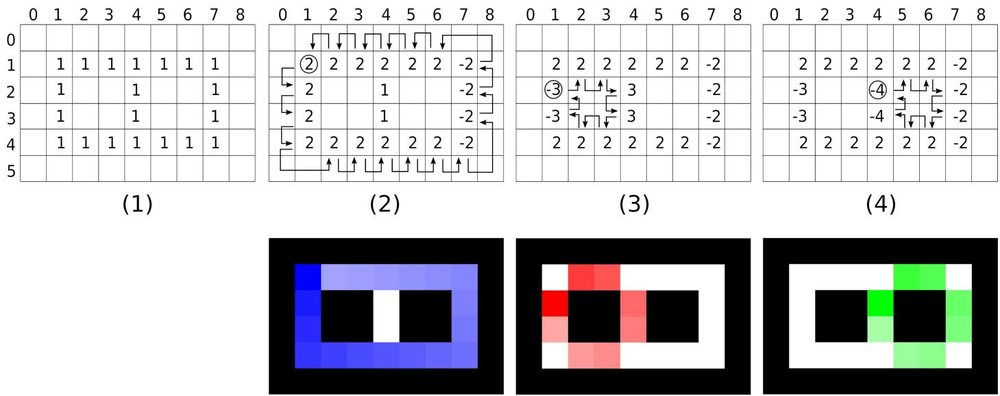  
Figure 1: The Suzuki-Abe scanning and labeling logic. (1) Input image. (2) First contour, which is an outer contour. (3,4) Inner contours. (See text for details)

## 2.5. Deep Learning edge detection

In the contemporary landscape, state-of-the-art models such as Holistically-Nested Edge Detection (HED) [28] and Meta’s Segment Anything Model (SAM) [29] have redefined boundary detection through superior zero-shot generalization and semantic awareness. However, these models primarily generate dense pixel-wise probability maps rather than structured geometric entities, creating a critical ”post-processing gap.” To extract usable coordinates or topological trees, their outputs must still be vectorized using classical algorithms such as the Suzuki-Abe method [8] or the Chang method [18]. Consequently, even with advanced neural architectures, the total system throughput remains constrained by the same O(N×M) bottlenecks and the sequential limitations of topological vectorization that classical methods strive to overcome.

Unlike the aforementioned works, our proposed method focuses on eliminating the synchronization overhead inherent in both topological and tile-based merging strategies. By adopting a speculative execution model and a start-point-invariant geometric hashing for deduplication, we achieve high-throughput parallel tracing without complex stitching logic or hierarchical construction. This approach specifically addresses the gap in current libraries by providing a lightweight, deterministic tracer optimized for modern multi-core architectures.

## 3. The Suzuki-Abe Algorithm

Our parallel approach builds upon the algorithm proposed by Suzuki and Abe [8], which extracts contours from a binary image I while simultaneously constructing its hierarchy tree. However, since we are not interested in the contours’ topological structure, we omit that part of our explanation of the algorithm.

Let $I = \{ I _ { i , j } \}$ be an input binarized image, $I _ { i , j } = \{ 0 , 1 \}$ , of dimensions $H \times W$ . To ensure eficient processing without conditional boundary checks, we assume I is surrounded by a one-pixel border of background pixels (0). The algorithm performs a raster scan of the image, maintaining a state variable NBD (initialized to 1) to track the current label index.

The algorithm, formalized in Algorithm 1, operates inplace, on an integer image, modifying I to label visited pixels. Pixels in the contour are labeled with the magnitude of the current counter, |NBD|. To ensure topological correctness, the algorithm employs a signing mechanism to distinguish the rightmost edge of a component. Specifically, a pixel on the contour is marked with −NBD if it is identified as an eastern edge. A pixel $I _ { i , j }$ is designated as an east pixel if, during the neighborhood search for the next boundary pixel, the tracer starts from, ends at, or bypasses the eastern neighbor $I _ { i , j + 1 ; }$ , provided that it is a background pixel.

This distinction is important because east pixels are defined diferently for outer contours versus hole contours, as they are traversed in opposite orders relative to the background. This negative marker acts as a sentinel, preventing the raster scanner from misinterpreting the right

## 4. Threaded Raster Unrestricted Contour Ownership

## 4.1. Domain Decomposition and State Space

Our approach employs a row-based decomposition to parallelize contour extraction. The input image I is divided into K horizontal strips (slices), where each thread $T _ { k }$ is responsible for a specific range of rows $[ i _ { s t a r t } ^ { k } , i _ { e n d } ^ { k } )$ Unlike the sequential Suzuki-Abe algorithm, which relies on a global integer state (NBD) for hierarchy construction, our method focuses on contour retrieval using a simplified state space. We treat the input image as a shared labeling board, utilizing only 4 labels: BACKGROUND, FOREGROUND, and the visited states VISITED and EAST VISITED. Crucially, the Moore tracing logic treats all non-background states as equivalent to FOREGROUND. This ensures that a pixel marked as visited by one thread remains geometrically valid for another thread performing a speculative trace, preserving the operation’s idempotent nature.

```latex
edge of an existing outer contour as the start of a new Algorithm 1: Suzuki-Abe Contour Tracing
hole contour. The scan proceeds in row-major order (top-
Input: Binary Image I (0 for background, 1 for
left to bottom-right). For each pixel (i,j), the following
foreground)
conditions are evaluated: Output: Set of Contours C
1 $c \gets \bar { \emptyset }$
1. Outer Contour Start: If $I _ { i , j } = 1$ and $I _ { i , j - 1 } = 0 ,$ 2 $N B D  1$
the pixel marks a transition from background to un- <sub>3</sub> for $i \gets 0$ to $H - 1$ do
visited foreground. We increment NBD and initiate 4 for $j  0$ to $W - 1$ do
the contour following procedure. $\bar { / } /$ Outer Contour Start
2. Hole Contour Start: If $I _ { i , j } \geq 1$ and $I _ { i , j + 1 } = 0 { . }$ , the 5 if $I _ { i , j - 1 } = 0$ and $I _ { i , j } = 1$ then
6 $\overrightarrow { N B D }  N B D + 1$
pixel marks a transition from foreground to internal
7 $c \gets$ FollowContour((i, j), (i, j −1), NBD)
background. We increment $N B D$ and initiate con- 8 ${ \mathcal { C } } \gets { \mathcal { C } } \cup \{ c \}$
tour following. Note that if $I _ { i , j }$ is negative (indicat- 9 end
ing a visited right-edge), this condition fails, correctly $/ /$ Hole Contour Start
inhibiting re-processing. 10 if $I _ { i , j } \geq 1$ and $I _ { i , j + 1 } = 0$ then
11 $\Breve { N } \mathit { B } \mathit { D } \gets \ N \mathit { B } \tilde { D } + 1$
During the FollowContour routine, the standard Moore- <sub>12</sub> $c \gets$ FollowContour((i, j), (i, j +1), NBD)
Neighbor tracing is applied in a counter-clockwise direc- 13 ${ \mathcal { C } } \gets { \mathcal { C } } \cup \{ c \}$
tion. The labeling of a visited pixel P depends on the 14 end
specific neighbor transition: if the tracer reaches P hav- 15 end
ing started from or crossed the East pixel (where the East 16 end
neighbor is 0), P is labeled −NBD; otherwise, it is labeled 17 Function FollowContour $\cdot ( P _ { c u r r } , P _ { p r e v } , N B D )$
NBD. 18 $c \gets \emptyset$
// Perform Moore-Neighbor Tracing
Figure 1 helps illustrate the process with a simple example.
19 do
The top row shows the integer values of I as the algorithm 20 $c  c \cup \{ P _ { c u r r } \}$
iterates (where 0 is represented by an empty space). Fig- 21 $P _ { n e x t }  $ indNextP ixel(P<sub>curr</sub>, P<sub>prev</sub>)
ures 1(2-4) show the steps the algorithm uses to find the 22 if $P _ { c u r r }$ is East Edge then
image’s contours. In the raster process, the algorithm de- <sub>23</sub> $I _ { P _ { c u r r } }  - N B \bar { D }$
tects the start of a contour at pixel (1,1) and follows it 24 else if $I _ { P _ { c u r r } } = 1$ then
as shown in Figure 1(2). Below, we show, in blue, the 25 $\begin{array} { r l } { | } & { { } I _ { P _ { c u r r } } \xleftarrow { } N B D } \end{array}$
contour pixels, with fading colours indicating the counter- 26 end
clockwise tracing direction. As can be seen, the rightmost <sup>27</sup> $P _ { p r e v }  P _ { c }$ urr
pixels of the contour are marked with the value -2, indi- 28 $\dot { P _ { c u r r } } \gets P _ { n e x t }$
cating that they are the end of the outer contour and will 29 while Tracing not complete
30 return c
not be the start of any contour again. Figures 1(3,4) show
31 end
the remaining contours detected by the algorithm, which
in this case belong to holes.
```

Crucially, this simplified state space allows the algorithm to operate directly on 8-bit data, in contrast to the standard Suzuki-Abe method, which necessitates a 32-bit integer image to store arbitrarily large contour IDs (NBD). This reduction significantly optimizes resource utilization: it not only reduces memory bandwidth pressure but also maximizes vectorized instruction throughput, since more pixels can be processed per CPU cycle than 32-bit integers. These factors contribute to the performance gains observed even in single-threaded execution, as we observe in the experimental Section 5.

## 4.2. Speculative Tracing Logic

The core challenge in parallel contour extraction is avoiding double-counting when a contour crosses the boundary between two threads. We resolve this using a start-point ownership rule: a contour belongs to the thread that contains its raster-scan start point (the first pixel encountered in a row-major scan).

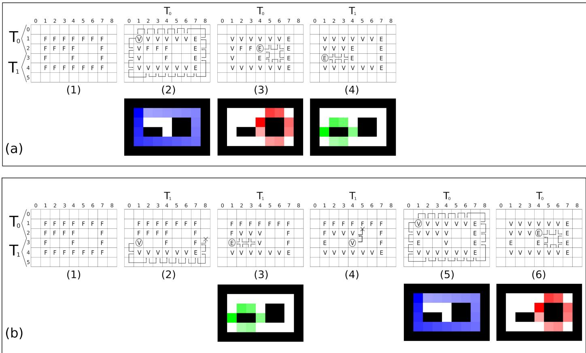  
Figure 2: The proposed scanning and labeling logic using two threads (T<sub>0</sub> and T<sub>1</sub>). (a) A possible scenario where thread $T _ { 0 }$ runs before $T _ { 1 }$ (b) A possible scenario where $T _ { 1 }$ runs before $T _ { 0 }$ (See text for details)

Since threads operate asynchronously, thread $T _ { k }$ may encounter a foreground pixel that efectively belongs to a contour started in an upper region (by thread $T _ { k - 1 } )$ but not yet marked as visited. To handle this without complex locking, we employ a speculative tracing with an upward termination strategy:

1. Unrestricted Downward Tracing: A thread is permitted to trace a contour indefinitely downwards into the regions of subsequent threads $( i \geq i _ { e n d } ^ { k } )$ . It marks pixels as it goes, efectively claiming them.

2. Upward Termination (The Abort Condition): If a thread $T _ { k }$ traces a contour and the path crosses into the upper neighbor’s region (specifically, if the current pixel $\begin{array} { r } { i \ < \ i _ { s t a r t } ^ { k } \Big ) } \end{array}$ , the thread immediately aborts the trace and discards the contour.

This logic ensures uniqueness: if $T _ { k }$ starts tracing a contour that actually starts in $T _ { k - 1 }$ , the trace will inevitably loop back up to the actual start point in $T _ { k - 1 }$ ’s region, triggering the abort condition in $T _ { k }$ . Meanwhile, $T _ { k - 1 }$ will eventually scan the actual start point and complete the whole trace.

A special boundary case arises for hole contours (internal contours) that are detected exactly on the first row of a thread’s slice $( i = i _ { s t a r t } ^ { k } )$ . Due to the local geometry of holes, the contour path may briefly oscillate into the row immediately above $( i _ { s t a r t } ^ { k } - 1 )$ without actually ”belong-$\operatorname { i n g } ^ { \dag }$ to the upper thread. To prevent false aborts in this scenario, we relax the termination condition specifically for holes. A hole contour trace initiated at $i _ { s t a r t } ^ { k }$ is not aborted if it touches $i _ { s t a r t } ^ { k } - 1$ , provided it does not extend further upward.

The complete logic is formalized in Algorithm 2, and Figure 2 illustrates the behavior of the algorithm on a simple input image processed by two threads, $T _ { 0 }$ and $T _ { 1 }$ . Figure $2 ( \mathrm { a } )$ shows the result obtained if $T _ { 0 }$ starts before $T _ { 1 }$ . In this case, $T _ { 0 }$ detects the first contour shown in (a.2) and subsequently the contour in (a.3). The last contour (a.4) is detected by $T _ { 1 }$ . This contour represents the special boundary case: an internal contour detected on the first line of the thread range $( i = 3 )$ . The thread is allowed to claim the contour, even if it has pixels in the region immediately above, provided it does not extend further upward.

Figure 2(b) shows an example in which $T _ { 1 }$ starts before $T _ { 0 }$ . The thread detects its first contour (b.2) and traces it until it must stop at pixel (3,8) because the tracing leads to the region above. It is worth noting that the pixels written during this process do not need to be reverted to their original values for the algorithm to work. Then, $T _ { 1 }$ detects its next contour (b.3), which is the valid exceptional case mentioned previously. Next, $T _ { 1 }$ starts tracing the last contour starting at pixel (3,4) as seen in $\left( \mathrm { { b . 4 } } \right)$ Although this is a hole contour starting at the first line of the region, it requires extending to pixel (1,5), which is above the limit for this special case. Consequently, the tracing is aborted. Now the thread $T _ { 0 }$ starts and detects its first contour (b.5). Despite the modifications on the image from the aborted traces, the contour is properly traced and claimed. Next, the second hole contour (b.6) is efectively started and completely traced.

Algorithm 2: Parallel Worker Logic (Thread $T _ { k } )$   
Input: Image I, Thread Range $[ \underline { i } _ { s t a r t } , i _ { e n d } )$   
Output: Local Set of Contours C<sub>local</sub>   
1 C ← ∅   
2 for $i  i _ { s t a r t }$ to $i _ { e n d } - 1$ do   
3 for $j  0$ to $\bar { W } - 1$ do   
// Check for Outer Contour Start   
4 if ${ \cal I } _ { i , j - 1 } = B A C K G R O U N D$ and $I _ { i , j } = F O R E G R O U N D$   
then   
5 c ←   
TraceWithBounds((i, j), (i, j − 1), i )   
6 if $c \neq$ Aborted then   
7 $\mathcal { \dot { C } } _ { l o c a l }  \mathcal { C } _ { l o c a l } \cup \{ c \}$   
8 end   
9 end   
// Check for Hole Contour Start   
10 if $I _ { i , j } \in \{ F O R E G R O U N D , V I S I T E D \}$ and $I _ { i , j + 1 } =$   
BACKGROUND then   
11 c ←   
TraceWithBounds((i, j), (i, j + 1), i<sub>start</sub>)   
12 if $c \neq$ Aborted then   
13 $| \quad \dot { \mathcal { C } } _ { l o c a l } \gets \mathcal { C } _ { l o c a l } \cup \{ c \}$   
14 end   
15 end   
16 end   
17 end   
18 return $\mathcal { C } _ { l o c a l }$   
19 Function TraceWithBounds $( P _ { c u r r } , P _ { p r e v } , i _ { s t a r t } )$   
20 c ← ∅   
21 i ${ \sqrt [ 3 ] { o l e } } \gets P _ { . } { \mathrm { { c u r r } } } . { j } < P _ { p r e v } . { j }$   
22 i<sub>0</sub> ← P<sub>curr</sub>.i   
23 do   
24 $P _ { \it { n e x t } }  \it { F i n d N e x t P i x e l } ( P _ { \it { c u r r } } , P _ { \it { p r e v } } )$   
// Check Abort Condition   
25 $i \gets P _ { n e x t } . i$   
26 $\mathbf { i f } \ i < i _ { s t a r t }$ then   
// Check boundary condition   
27 if not   
(isHole and $i _ { 0 } = i _ { s t a r t }$ and $i = i _ { s t a r t } - 1 )$   
then   
28 return Aborted   
29 end   
30 end   
31 $c  c \cup \{ P _ { c u r r } \}$   
// Mark visited   
32 if P<sub>curr</sub> is East Edge then   
33 I<sub>Pcurr</sub> ← EAST VISITED   
34 else if I<sub>Pcurr</sub> = FOREGROUND then   
35 I<sub>Pcurr</sub> ← VISITED   
36 end   
37 $P _ { p r e v }  P _ { c }$ urr   
38 $\dot { P _ { c u r r } } \gets P _ { n e x t }$   
39 while Tracing not complete   
40 return c   
41 end

## 4.3. Formal Correctness Proof

We now provide a formalized proof of correctness for the proposed algorithm.

Definition 1 (raster-scan start point). For any contour C, its raster-scan start point $\boldsymbol { p } ^ { * } = ( i ^ { * } , j ^ { * } )$ is the first pixel of C encountered during row-major traversal where the contour initiation condition holds:

• Outer contour: ${ \cal I } _ { i ^ { * } , j ^ { * } - 1 } = B A C K G R O U N D \land { \cal I } _ { i ^ { * } , j ^ { * } } =$ FOREGROUND

• Hole contour: $I _ { i ^ { * } , j ^ { * } } \in$ {FOREGROUND, VISITED} ∧ $I _ { i ^ { * } , j ^ { * } + 1 } = B A C K G R O U N D$

Theorem 1 (Unique Contour Ownership). Under the start-point ownership rule combined with upward termination logic, every contour $C$ is emitted exactly once—by the thread $T _ { k }$ owning row slice $[ i _ { s t a r t } ^ { k } , i _ { e n d } ^ { k } )$ containing $p ^ { * }$

Proof. Let $T _ { k }$ be the thread owning the slice containing $p ^ { * }$ $( i _ { s t a r t } ^ { k } \leq i ^ { * } < i _ { \mathrm { e n d } } ^ { k } )$ . We prove that $T _ { k }$ claims $C$ and no other thread does.

1. Existence $( T _ { k }$ claims C): For outer contours, $p ^ { * }$ is the topmost pixel; the trace never ascends above $i ^ { * }$ and thus never triggers an abort in $T _ { k }$ . For hole contours, the geometry of an internal enclosure implies that a trace starting at row $i ^ { * }$ must traverse the enclosing pixels at $i ^ { * } - 1$ . Consequently, if a hole starts exactly at the thread boundary $( i ^ { * } = i _ { s t a r t } ^ { k } )$ , the trace will oscillate into $i _ { s t a r t } ^ { k } -$ 1. The boundary exception rule (Algorithm 2, lines $2 7 -$ 29) explicitly permits this specific single-row excursion, ensuring $T _ { k }$ does not abort valid contours starting at its first row.

2. Uniqueness (No $T _ { k ^ { \prime } } \neq T _ { k }$ claims C): Threads above $T _ { k }$ never encounter $C$ because $p ^ { * }$ is the first raster appearance. Consider a thread $T _ { k ^ { \prime } }$ below $T _ { k } \ ( i _ { s t a r t } ^ { k ^ { \prime } } > i ^ { * } )$ . If $T _ { k ^ { \prime } }$ encounters $C ,$ it initiates a speculative trace. To complete the contour, this trace must eventually ascend to $p ^ { * }$ (at row i<sup>∗</sup>), but the abort condition prevents this.

• Outer Contours: The trace ascends to $i ^ { * } < i _ { s t a r t } ^ { k ^ { \prime } } .$ Since outer contours are not eligible for the boundary exception, $T _ { k ^ { \prime } }$ aborts tracing the contour immediately upon entering the upper region.

• Hole Contours: The trace ascends to $i ^ { * }$

If $i ^ { * } < i _ { s t a r t } ^ { k ^ { \prime } } - 1$ , the trace exceeds the one-row allowance and aborts.

– If $i ^ { * } = i _ { s t a r t } ^ { k ^ { \prime } } - 1$ (the dangerous edge case), the geometric property of holes requires the trace to further oscillate to $i ^ { * } - 1$ (which is $i _ { s t a r t } ^ { k ^ { \prime } } - 2 )$

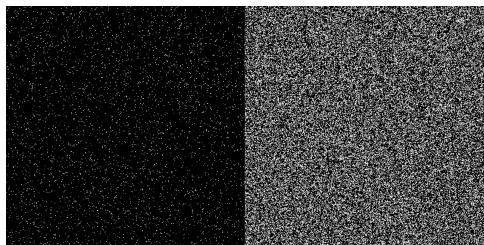  
(a) Synthetic images employed for testing. Left image with object density p = 0.05. Right image p = 0.75

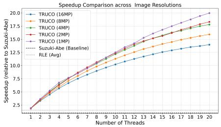

(b) Comparison of speedup factors against the Suzuki-Abe method on the i7-13700H.  
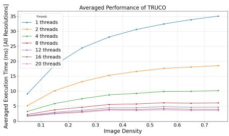  
(c) Execution time of the proposed algorithm as a function of object density p for varying thread counts on 16MP images.  
Figure 3: Synthetic image dataset results

In all cases, the trace reaches a row $i < i _ { s t a r t } ^ { k ^ { \prime } } - 1$ . The exception strictly allows contact with $i _ { s t a r t } ^ { k ^ { \prime } } - 1$ only. Thus, the condition fails, and $T _ { k ^ { \prime } }$ aborts.

Since only $T _ { k }$ completes the trace without aborting, C is emitted exactly once. □

## 4.4. Synchronization and Memory Model

The proposed method is designed to be logically synchronization-free. While threads share the same image bufer I and may write to adjacent or even identical pixels (in the case of a speculative trace overlapping with a valid trace), these operations are logically benign. The action of marking a pixel as VISITED or EAST VISITED is idempotent; whether one thread or multiple threads write this value, the final state remains consistent. Consequently, we eliminate the need for explicit execution barriers, mutex locks, or atomic compare-and-swap (CAS) operations, which are traditional sources of latency in multi-core scaling.

However, it is important to note that while we remove software synchronization, the hardware’s cache coherency mechanisms remain active. In scenarios where multiple threads speculatively trace—and thus write to—pixels within the same cache line, false sharing can occur. For typical images with spatially distributed objects, this overlap is negligible. However, in pathological cases where a single contour spans multiple thread domains (such as the spiral stress test discussed in Section 5.3), this implicit hardware synchronization can introduce latency due to cache line invalidations, representing a trade-of between algorithmic simplicity and worst-case hardware contention. Therefore, although TRUCO is algorithmically lock-free (no mutexes/atomics), hardware cache coherency protocols may introduce implicit synchronization, especially in pathological cases.

## 5. Experimental Section

The proposed algorithm was benchmarked against three baselines. First, we evaluated the Suzuki-Abe and RLE methods as implemented in OpenCV 4.12 (findContours and findContourLinkRuns, respectively). To ensure a fair comparison focused strictly on raw tracing throughput, calculations of hierarchical relationships among contours were disabled. Furthermore, we compared our approach against the parallel tiling method introduced by Garcia et al. [12]. Notably, rigorous validation confirmed that the contours generated by our proposed method are identical to those obtained by the Suzuki-Abe algorithm across all test cases.

All experiments were conducted on two distinct hardware architectures to evaluate cross-platform consistency:

1. Consumer Workstation: A 13th Gen Intel Core i7- 13700H (14 cores: 6P+8E, 20 threads, 32GB DDR5 RAM) running Ubuntu 22.04. To ensure consistent benchmarking, Intel Turbo Boost was disabled, and the CPU frequency was fixed at 3.5 GHz.

2. Server Node: An Intel Xeon Silver 4510 (12 cores, 24 threads, 64GB DDR5 RAM) running Ubuntu 22.04. This platform represents a homogeneous core architecture typical of high-performance computing environments.

Unless otherwise stated, the detailed breakdown of results refers to the i7-13700H. For the parallel scaling experiments, we limited the Xeon execution to 20 threads to maintain parity with the consumer hardware.

The experimental validation is organized into three subsections. First, we analyze the algorithm’s scalability and robustness to object density using a synthetic dataset. Second, we assess performance on real-world data using the Liu4K [30] high-resolution dataset to test the method against irregular shapes and noise. Finally, we evaluate the method on pathological images to find its limits.

## 5.1. Synthetic Dataset

We generated a synthetic dataset with 40 images (4000×4000) designed to simulate varying levels of geometric complexity and computational load. The dataset consists of high-resolution images (16 MP) containing a distributed set of small circular foreground objects.

<table><tr><td rowspan="2">Resolution</td><td rowspan="2">Baseline (ms) Suzuki-Abe</td><td colspan="4">i7-13700H Speedup</td><td rowspan="2">Xeon 4510 Speedup TRUCO (20T)</td></tr><tr><td>RLE</td><td>Garcia</td><td>TRUCO (1T)</td><td>TRUCO (20T)</td></tr><tr><td>16MP</td><td>96.23</td><td>1.32×</td><td>0.67×</td><td>1.82×</td><td>13.97×</td><td>10.91×</td></tr><tr><td>8MP</td><td>65.00</td><td>1.50×</td><td>0.55×</td><td>1.81×</td><td>15.91×</td><td>12.34×</td></tr><tr><td>4MP</td><td>39.48</td><td>1.56×</td><td>0.60×</td><td>1.84×</td><td>17.80×</td><td>12.64×</td></tr><tr><td>2MP</td><td>25.77</td><td>1.61×</td><td>0.41×</td><td>1.86×</td><td>18.31×</td><td>12.59×</td></tr><tr><td>1 MP</td><td>17.58</td><td>1.55×</td><td>0.40×</td><td>1.91×</td><td>19.97×</td><td>12.00×</td></tr></table>

Table 1: Comparison of contour finding algorithms. We include the peak performance on the Intel Xeon Silver 4510 to demonstrate architectural consistency.

The complexity of each image is controlled by an object density parameter p, which represents the probability of placing circles. We varied p from 0.05 to 0.75 in increments of 0.05. To ensure statistical significance and minimize the impact of random spatial distributions, we generated 5 unique images for each density level. This resulting corpus allows for a granular analysis of how thread divergence and deduplication overhead scale with the number of detected contours. An example of the images employed is shown in Figure 3a, for p = 0.05 and p = 0.75.

Table 1 summarizes the performance of the tested algorithms across increasing image resolutions, ranging from 16MP to 1MP. Each row corresponds to a specific resolution and serves as a benchmark for evaluating how the algorithms handle increasing data volumes. The first column shows the resolution, while the second shows the mean execution time for the standard Suzuki-Abe, which serves as the reference for all speedup calculations. The subsequent columns, RLE, Garcia, and TRUCO(1T), represent the performance gains achieved by the RLE OpenCV algorithm, Garcia et al. [12], and our single-thread algorithm, respectively. Finally, the TRUCO(20T) column identifies the peak eficiency achieved by the parallel implementation, which is achieved at 20 threads.

The data demonstrates that the proposed algorithm offers a substantial performance advantage across all tested resolutions. A significant portion of this improvement is algorithmic: the single-threaded (1T) version of the proposed method is approximately 2× faster than the baseline. This indicates that for spatially distributed objects, the reduced 8-bit state space significantly reduces memory bandwidth pressure compared to the 32-bit baseline, thereby outweighing the overhead of the proposed speculative logic. When parallelism is fully utilized, the algorithm scales robustly, achieving a peak speedup of nearly 20× on smaller images. As the resolution increases to 16MP, the peak speedup declines slightly to nearly 14×.

The architectural robustness is further confirmed by the Xeon results. While the server platform yields slightly lower peak speedups than the i7 (maxing at 12.64× versus 19.97×), the algorithm maintains strong scalability relative to the baseline, demonstrating that the lock-free logic translates efectively to homogeneous server architectures.

Regarding the RLE method, it provides a modest 1.5× speedup over the baseline, but it consistently underperforms both the single-threaded and parallel versions of the proposed TRUCO algorithm. In stark contrast, the Garcia method exhibits significantly poor performance, achieving only a fraction of the baseline’s speed (between 0.40× and 0.67×) across all tested resolutions. Due to these substantial performance deficits and its inability to compete with other methods, the Garcia algorithm will not be used in subsequent experiments for further evaluation.

Figure 3b illustrates the scalability of the proposed TRUCO algorithm across varying resolutions. The speedup increases significantly as the number of threads grows, peaking at a remarkable 19.97× for 1MP images. Importantly, this robust pattern of improvement is consistent across all tested resolutions, though relative eficiency gracefully tapers as image size increases, dropping to a maximum speedup of 13.97× for 16MP images. The superior performance on lower-resolution images is likely due to better cache locality, as a larger proportion of the image data can reside in the CPU cache, reducing memory access latency.

Figure 3c details the algorithm’s scalability with respect to both thread count and object density. As anticipated, single-threaded execution is the most sensitive to density variations, with processing time increasing steeply to approximately 35 ms at higher density levels. However, introducing parallelism yields immediate and substantial benefits; for instance, utilizing just two threads nearly halves the total execution time. Furthermore, as the thread count increases, the performance penalty imposed by higher contour densities diminishes significantly. At higher degrees of parallelism, execution time remains exceptionally stable across image complexities, demonstrating TRUCO’s resilience in contour-dense scenarios and efective workload distribution.

## 5.2. Liu4K dataset

To validate the proposed method under non-synthetic, practical conditions, we utilized the Liu4K dataset <sup>2</sup>, which provides a diverse collection of high-resolution, realworld scenes. From the original training set, we selected the 924 images with a minimum resolution of 16 megapixels (MP). To ensure consistency across our experiments, all selected images were standardized by resizing them to exactly 16 MP and converting them to JPG.

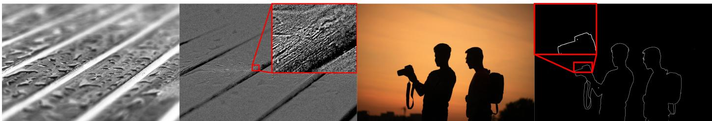

Figure 4: Examples from the Liu4K dataset showing the original RGB images and their corresponding binary input masks generated via adaptive thresholding. The left images show a complex scene with 1.4 million contours, where our method achieves the maximum speedup (23.64×). The right image shows one of the simplest cases, with approximately 2500 contours, where our method achieves its minimum speedup (2.09×).
<table><tr><td>Resolution</td><td>Baseline (ms) Suzuki-Abe</td><td>RLE</td><td>i7-13700H Speedup TRUCO (1T)</td><td>TRUCO (20T)</td><td>Xeon 4510 Speedup TRUCO (20T)</td></tr><tr><td>16 MP</td><td>136.25</td><td>1.37×</td><td>1.79×</td><td>10.50×</td><td>9.95×</td></tr><tr><td>8MP</td><td>65.93</td><td>1.46×</td><td>1.79×</td><td>10.10×</td><td>9.97×</td></tr><tr><td>4MP</td><td>36.26</td><td>1.50×</td><td>1.80×</td><td>9.80×</td><td>9.43×</td></tr><tr><td>2MP</td><td>23.40</td><td>1.51×</td><td>1.80×</td><td>10.10×</td><td>8.76×</td></tr><tr><td>1 MP</td><td>12.63</td><td>1.54×</td><td>1.79×</td><td>9.40×</td><td>7.79×</td></tr></table>

Table 2: Performance comparison on the Liu4K real-world dataset across consumer and server architectures.

Unlike synthetic datasets, real-world images inherently require preprocessing to generate the binary inputs necessary for contour extraction. We applied an adaptive thresholding filter (box size: 15, constant: 3) to extract significant edges. This preprocessing step typically produces binary maps characterized by complex, noisy topologies and irregular contour distributions. Consequently, this dataset provides a rigorous stress test for evaluating the algorithm’s load-balancing capabilities and parallel efficiency. Figure 4 illustrates representative samples, displaying both the original color inputs and the resulting binary masks used for the contour extraction process.

The quantitative performance results are detailed in Table 2. The standard Suzuki-Abe algorithm, as implemented in OpenCV, establishes a baseline execution time of 136.25 ms for 16 MP images. The Run-Length Encoding (RLE) algorithm provides a modest but consistent improvement, achieving speedups ranging from 1.37× to 1.54× across the tested resolutions. Notably, the singlethreaded version of our approach, TRUCO(1T), consistently delivers a ≈ 1.8× speedup over the OpenCV baseline across all resolutions. This finding is significant: it indicates that the core logic of our proposed contour extraction, specifically the use of 8-bit rather than 32-bit image representations, establishes a substantially higher performance baseline, independent of parallelization.

The true strength of the proposed method becomes evident under multi-threaded execution. When utilizing 20 threads, TRUCO(20T), the algorithm achieves up to a 10.50× speedup over the Suzuki-Abe baseline for 16 MP images. Figure 5a presents the overall scalability analysis on the Liu4K dataset, demonstrating robust performance scaling across varying thread counts.

The cross-architecture comparison in Table 2 highlights the method’s reliability. On the computationally demanding 16 MP images, the Xeon server achieves a 9.95× speedup, virtually matching the 10.50× obtained on the consumer workstation. This indicates that for heavy, realworld workloads, TRUCO efectively saturates the available throughput regardless of the underlying core topology (hybrid vs. homogeneous).

To further understand this behavior, Figure 5b provides a detailed scalability analysis stratified by image complexity. For this evaluation, the 16 MP dataset was partitioned into three equal-sized categories (Low, Medium, and High complexity) based on the total number of contours present in each image. The results clearly demonstrate that parallel eficiency depends strongly on the workload. For highly complex images, the proposed algorithm exhibits excellent scalability, with the speedup curve closely tracking the ideal linear progression with more threads. In these contour-dense scenarios, the abundance of independent tasks eficiently masks the overhead of thread management. In contrast to the synthetic benchmarks, where lower resolutions yielded higher speedups, the real-world dataset exhibits a slight reduction in parallel eficiency as resolution decreases (from 10.50× at 16MP to 9.40× at 1MP). This divergence suggests that the performance balance is sensitive to the nature of the workload.

While the uniform, high-density nature of the synthetic tests likely allowed the algorithm to maximize cache locality on small images, the real-world data contains irregular geometries and varying sparsity. In these practical scenarios, as the total pixel count decreases, the fixed overhead of thread management and synchronization may dilute the computational speedup, preventing the massive scaling observed in purely synthetic tests.

Table 3: Statistical analysis of the speedup factor for the proposed method on the Liu4K dataset (i7-13700H). ’1T’ denotes the singlethreaded performance, and ’20T’ denotes the peak performance achieved 20 threads.
<table><tr><td rowspan="2">Res.</td><td colspan="4">TRUCO(1T)</td><td colspan="4">TRUCO(20T)</td></tr><tr><td>Mean</td><td>Std</td><td>Min</td><td>Max</td><td>Mean</td><td>Std</td><td>Min</td><td>Max</td></tr><tr><td>16MP</td><td>1.79</td><td>0.19</td><td>1.15</td><td>2.74</td><td>10.50</td><td>3.94</td><td>2.09</td><td>23.64</td></tr><tr><td>8MP</td><td>1.79</td><td>0.15</td><td>1.46</td><td>2.97</td><td>10.10</td><td>3.42</td><td>2.14</td><td>20.72</td></tr><tr><td>4MP</td><td>1.80</td><td>0.13</td><td>1.54</td><td>2.77</td><td>9.80</td><td>3.16</td><td>2.20</td><td>22.66</td></tr><tr><td>2MP</td><td>1.80</td><td>0.11</td><td>1.21</td><td>2.49</td><td>10.10</td><td>3.18</td><td>1.66</td><td>20.54</td></tr><tr><td>1MP</td><td>1.79</td><td>0.10</td><td>1.16</td><td>2.48</td><td>9.40</td><td>2.92</td><td>1.59</td><td>20.23</td></tr></table>

To provide a deeper insight into the algorithm’s reliability, Table 3 presents a detailed statistical breakdown of the speedup factors on the Liu4K dataset. The analysis of the single-threaded performance, TRUCO(1T), reveals a remarkable consistency across all resolutions. The mean speedup remains stable at approximately 1.80×, with a very low standard deviation (σ ≈ 0.15). Crucially, the minimum recorded speedup never drops below 1.15×, confirming that the architectural optimizations provide a guaranteed performance floor that strictly outperforms the OpenCV baseline.

In contrast, the parallel performance, TRUCO(20T), exhibits a higher variance $( \sigma \in [ 2 . 9 2 , 3 . 9 4 ] )$ , which correlates with the diversity of geometric complexity in real-world scenes. Figure 4 visually illustrates this dichotomy by depicting the dataset’s geometric extremes. The complex scene on the left, containing 1.4 million contours, corresponds to the best-case scenario in which the abundance of independent tasks allows the algorithm to achieve its peak speedup (≈ 23.64×). Conversely, the simple scene on the right (approx. 2500 contours) represents the worst-case scenario (≈ 2×), where the synchronization and threadcreation overhead outweigh the computational benefits of parallel processing.

## 5.3. Worst-Case Stress Tests

This section analyzes the worst-case scenarios of the proposed method to better understand its limitations.

## 5.3.1. Vertical Stripes

One of the primary theoretical concerns with speculative tracing is the abort penalty. In scenarios where contours are perfectly vertical and span the entire image height, a thread $T _ { k }$ may trace a contour downwards only to discover it originated in $T _ { k - 1 }$ , forcing a discard. To evaluate the algorithm’s stability under this worst-case condition, we generated a 16 MP image consisting entirely of vertical 1-pixel stripes spaced 1 pixel apart. Figure 6(a) shows a portion of the image, and Figure 6(b) displays the results obtained by the tested methods extended up to 20 threads.

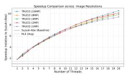  
(a) Speedup evolution of the proposed TRUCO algorithm relative to the Suzuki-Abe baseline on the Liu4K dataset. The curves depict performance scaling across image resolutions ranging from 1 MP to 16 MP.

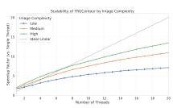  
(b) Scalability analysis on 16 MP images stratified by geometric complexity (total contour count). The data is partitioned into Low, Medium, and High density tiers, demonstrating improved parallel eficiency in contourdense scenarios.

Figure 5: Scalability analysis on the Liu4K dataset.  
(a)  
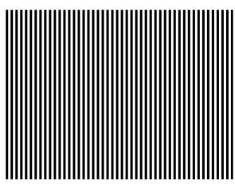

(b)  
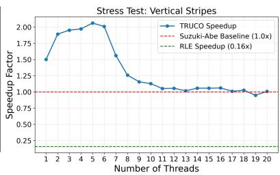

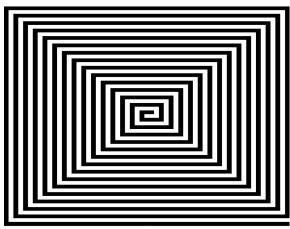  
(c)

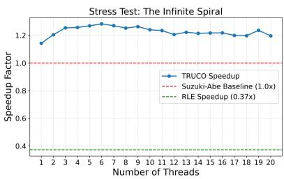  
(d)  
Figure 6: Performance analysis under worst-case geometric conditions. (a) Vertical Stripes image. (b) Computing times of TRUCO and Suzuki-Abe in the previous image. TRUCO obtains up to 2.06× speedup before abort overhead dominates. (c) Infinite Spiral image. (d) Computing times of the tested methods in the previous image. TRUCO achieves an almost constant 1.2× speedup.

The results reveal two critical insights: first, even with the overhead of speculative checks, our single-threaded implementation executes significantly faster than the OpenCV baseline, achieving a 1.50× speedup. Second, the speedup peaks at 2.06× with 5 threads. Beyond this point, the probability of thread contention increases because every vertical line traverses every thread’s domain, meaning that adding threads increases the ratio of aborted work to valid work.

While TRUCO is optimized for natural images with spatially distributed contours, this stress test shows that the method degrades gracefully. It avoids catastrophic failure and instead reverts to a performance level comparable to the industry standard, ensuring reliability even in pathological geometric scenarios. Finally, the RLE method performs very poorly in this scenario, yielding a speedup of just 0.16×.

## 5.3.2. The Spiral

Next, to identify the algorithm’s operational floor, we evaluated a single-spiral scenario: a 16 MP image containing a single continuous contour spiraling from the center, as shown in Figure 6(c). This structure forces serialization and exposes specific processing costs.

The results, shown in Figure 6(d), reveal that the singlethreaded implementation outpaces the Suzuki-Abe baseline, achieving a 1.14× speedup. Parallel execution yields modest gains, peaking at a 1.28× speedup with 6 threads, and hovering around 1.20× across the 20-thread spectrum. Because multiple threads speculatively trace and modify the same contour in this scenario, they likely trigger severe cache coherency trafic (false sharing) that stalls the primary owner thread, preventing massive scaling. However, the crucial takeaway is that TRUCO never degrades below the baseline in this scenario. This confirms that while purely serial space-filling curves limit parallel scalability, the optimized 8-bit state space still provides enough raw eficiency to outperform traditional sequential tracers. Finally, the RLE method achieves a speedup of 0.37× in this test.

## 6. Conclusions

TRUCO provides a novel parallel framework for binary contour extraction that prioritizes geometric throughput by optimizing the scanning process for multi-core architectures. By eliminating the need for mutexes, atomic operations, or complex boundary-merging logic, the method achieves a performance floor that is significantly faster than the standard Suzuki-Abe implementation, even in single-threaded execution.

The start-point ownership rule and speculative tracing logic facilitate eficient workload distribution, allowing the algorithm to scale robustly across varying thread counts and image resolutions. Unlike tile-based approaches that struggle with stitching overhead, TRUCO’s speculative model handles complex contours naturally and degrades gracefully in pathological geometric scenarios such as infinite spirals or dense vertical stripes.

Furthermore, experimental validation on both consumer (Intel i7) and server (Intel Xeon) architectures demonstrates the algorithm’s portability. The consistent performance observed across hybrid and homogeneous core topologies confirms that the lock-free logic efectively saturates available throughput regardless of the specific hardware configuration. This approach ofers a practical, architecture-agnostic solution for real-time applications in robotics and high-speed inspection where rapid geometric boundary data is essential.

Declaration of generative AI and AI-assisted technologies in the manuscript preparation process.

During the preparation of this work, the author(s) used Gemini 3.0 Pro to assist in coding algorithms and writing this paper. After using this tool/service, the author(s) reviewed and edited the content as needed and take(s) full responsibility for the content of the published article.

## Acknowledgements

This research has been funded by the PID2023-147296NB-I00 project of the Ministry of Science, Innovation, and Universities of Spain.

## CRediT authorship contribution statement

• Rafael Mu˜noz-Salinas: Conceptualization Methodology , Software , Validation , Writing - Original Draft, Project administration, Funding acquisition.

• Francisco J. Romero-Ramirez: Software , Investigation , Data Curation , Visualization, Writing – review and editing.

• Manuel J. Mar´ın-Jim´enez: Conceptualization, Formal analysis, Supervision, Writing - Review & Editing, Funding acquisition.

## Data Availability Statement

The source code for TRUCO and the materials required to reproduce the results are available at https://github. com/rmsalinas/truco. Real-world images were sourced from the Liu4K dataset [30].

## References

[1] A. Chaudhuri, K. Mandaviya, P. Badelia, S. K. Ghosh, Optical Character Recognition Systems, Springer International Publishing, Cham, 2017, pp. 9–41. doi:10.1007/978-3-319-50252-6\_ 2.

[2] J. I. Olszewska, Active contour based optical character recognition for automated scene understanding, Neurocomputing 161 (2015) 65–71. doi:https://doi.org/10.1016/j.neucom.2014. 12.089.

[3] P. Arbel´aez, M. Maire, C. Fowlkes, J. Malik, Contour detection and hierarchical image segmentation, IEEE Transactions on Pattern Analysis and Machine Intelligence 33 (5) (2011) 898– 916. doi:10.1109/TPAMI.2010.161.

[4] F. J. Romero-Ramirez, R. Mu˜noz-Salinas, R. Medina-Carnicer, Speeded up detection of squared fiducial markers, Image and Vision Computing 76 (2018) 38–47. doi:https://doi.org/10. 1016/j.imavis.2018.05.004.

[5] E. Olson, Apriltag: A robust and flexible visual fiducial system, in: Robotics and Automation (ICRA), 2011 IEEE International Conference on, 2011, pp. 3400–3407. doi:10.1109/ICRA.2011. 5979561.

[6] W.-C. Chang, M.-Y. Cheng, H.-J. Tsai, Image feature command generation of contour following tasks for scara robots employing image-based visual servoing—a ph-spline approach, Robotics and Computer-Integrated Manufacturing 44 (2017) 57–66. doi: https://doi.org/10.1016/j.rcim.2016.08.002.

[7] Q. Huang, J. Huang, Comprehensive review of edge and contour detection: from traditional methods to recent advances, Neural Computing and Applications 37 (2025) 2175–2209. doi: 10.1007/s00521-024-10936-2

[8] S. Suzuki, K. Abe, Topological structural analysis of digitized binary images by border following, Computer Vision, Graphics, and Image Processing 30 (1) (1985) 32–46. doi:"https://doi. org/10.1016/0734-189X(85)90016-7".

[9] L. Chen, L. Davis, C. Kruskal, Eficient parallel processing of image contours, IEEE Transactions on Pattern Analysis and Machine Intelligence 15 (1) (1993) 69–81. doi:10.1109/34. 184775.

[10] T.-L. Chia, K.-B. Wang, L.-R. Chen, Z. Chen, A parallel algorithm for generating chain code of objects in binary images, Information Sciences 149 (4) (2003) 219–234. doi:https: //doi.org/10.1016/S0020-0255(02)00267-0.

[11] V. Garcia-Molla, P. Alonso, R. Garc´ıa-Lagu´ıa, Parallel border tracking in binary images using gpus, The Journal of Supercomputing 78 (2022) 9817–9839. doi:10.1007/ s11227-021-04260-y.

[12] V. Garcia-Molla, P. Alonso-Jord´a, Parallel border tracking in binary images for multicore computers, The Journal of Supercomputing 79 (2023) 9915–9931. doi:https://doi.org/10.1007/ s11227-023-05052-2.

[13] G. Bradski, The opencv library, Dr. Dobb’s Journal of Software Tools 25 (2000) 120–125.

[14] T. Pavlidis, Algorithms for graphics and image processing, in: Springer Berlin Heidelberg, 1981. doi:https://doi.org/10. 1007/978-3-642-93208-3.

[15] I. Pitas, Digital image processing algorithms and applications, John Wiley & Sons, USA, 2000.

[16] M. Ren, J. Yang, H. Sun, Tracing boundary contours in a binary image, Image and Vision Computing 20 (2) (2002) 125–131. doi:https://doi.org/10.1016/S0262-8856(01)00091-9.

[17] J. Seo, S. Chae, J. Shim, D. Kim, C. Cheong, T.-D. Han, Fast contour-tracing algorithm based on a pixel-following method for image sensors, Sensors 16 (3). doi:10.3390/s16030353.

[18] F. Chang, C.-J. Chen, C.-J. Lu, A linear-time componentlabeling algorithm using contour tracing technique, Computer Vision and Image Understanding 93 (2) (2004) 206–220. doi: https://doi.org/10.1016/j.cviu.2003.09.002.

[19] C. Grana, D. Borghesani, R. Cucchiara, Optimized block-based connected components labeling with decision trees, IEEE Transactions on Image Processing 19 (6) (2010) 1596–1609. doi: 10.1109/TIP.2010.2044963.

[20] S.-D. Kim, J.-H. Lee, J.-K. Kim, A new chain-coding algorithm for binary images using run-length codes, Computer Vision, Graphics, and Image Processing 41 (1) (1988) 114–128. doi:https://doi.org/10.1016/0734-189X(88)90121-1.

[21] F. K. Quek, An algorithm for the rapid computation of boundaries of run-length encoded regions, Pattern Recognition 33 (10) (2000) 1637–1649. doi:https://doi.org/10.1016/ S0031-3203(98)00118-6.

[22] L. He, X. Ren, Q. Gao, X. Zhao, B. Yao, Y. Chao, The

connected-component labeling problem: A review of state-ofthe-art algorithms, Pattern Recognition 70 (2017) 25–43. doi: https://doi.org/10.1016/j.patcog.2017.04.018.

[23] D. W. Capson, An improved algorithm for the sequential extraction of boundaries from a raster scan, Computer Vision, Graphics, and Image Processing 28 (1) (1984) 109–125. doi: https://doi.org/10.1016/0734-189X(84)90143-9.

[24] R. L. Cederberg, Chain-link coding and segmentation for raster scan devices, Computer Graphics and Image Processing 10 (3) (1979) 224–234. doi:https://doi.org/10.1016/ 0146-664X(79)90002-9.

[25] L. He, Y. Chao, K. Suzuki, K. Wu, Fast connected-component labeling, Pattern Recognition 42 (9) (2009) 1977–1987. doi: https://doi.org/10.1016/j.patcog.2008.10.013.

[26] S. Gupta, S. Kar, Algorithms to speed up contour tracing in real time image processing systems, IEEE Access 10 (2022) 127365– 127376. doi:10.1109/ACCESS.2022.3226943.

[27] S. Yin, J. Xu, J. Jiang, M. Li, Y. Ma, T.-Y. Ho, B. Yu, Gcontour: Gpu accelerated contour tracing for large-scale layouts, in: 2025 IEEE/ACM International Conference On Computer Aided Design (ICCAD), IEEE, 2025, pp. 1–9. doi:10.1109/ ICCAD66269.2025.11240932.

[28] S. Xie, Z. Tu, Holistically-nested edge detection, in: 2015 IEEE International Conference on Computer Vision (ICCV), 2015, pp. 1395–1403. doi:10.1109/ICCV.2015.164.

[29] A. Kirillov, E. Mintun, N. Ravi, H. Mao, C. Rolland, L. Gustafson, T. Xiao, S. Whitehead, A. C. Berg, W.-Y. Lo, P. Doll´ar, R. Girshick, Segment anything, arXiv:2304.02643.

[30] J. Liu, D. Liu, W. Yang, S. Xia, X. Zhang, Y. Dai, A comprehensive benchmark for single image compression artifact reduction, IEEE Transactions on Image Processing 29 (2020) 7845–7860. doi:10.1109/TIP.2020.3007828.