# ThinkWorld: World Imagination Reinforces Chain-of-Dynamics Reasoning

Chaehyun Kim,1,2 Chi-Pin Huang,1 Jisoo Kim,2 Min-Hung Chen,1 Yu-Chiang Frank Wang,1 Seungryong Kim,2 Fu-En Yang1 1 NVIDIA 2 KAIST

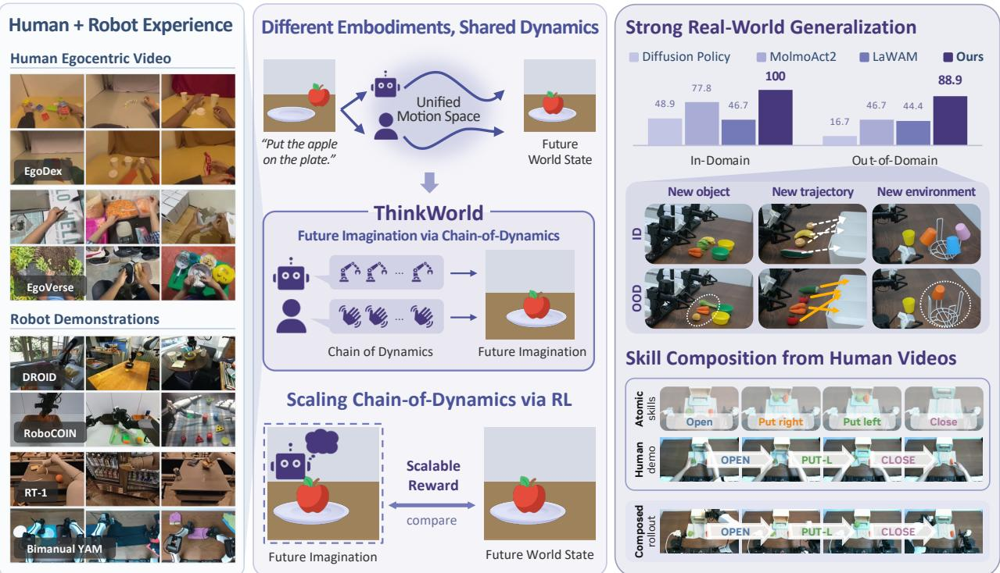  
Figure 1: We introduce ThinkWorld, a vision-language-action framework that learns transferable Chain-of-Dynamics (CoD) reasoning from diverse human and robot experiences. CoD captures action-induced dynamics across embodiments and is reinforced through future imagination, enabling robust generalization in the real world and skill composition guided by human videos.

## Abstract

Vision-Language-Action (VLA) models have made substantial progress in robotic manipulation, but their generalization remains constrained by the diversity and coverage of action-labeled robot demonstrations. Human videos provide much broader behavioral and environmental experience, while learning from them faces a fundamental trade-of between scalable data and explicit action grounding. We introduce ThinkWorld, a VLA learning framework that grounds action reasoning in world dynamics and strengthens it through reinforcement learning with world imagination. ThinkWorld represents each action thought as a Chain-of-Dynamics (CoD), a sequence of discrete motion tokens that captures the intermediate dynamics connecting the current world to a future state and serves as a common action representation across embodiments. We first initialize CoD with action-labeled demonstrations, then predict the future induced by each CoD and reinforce those whose predictions better match the observed outcome. This enables videos without action annotations to provide direct supervision from observed state transitions, allowing human and robot experience to refine the same reasoning space. Experiments in simulation and on real robots demonstrate efective human-to-robot transfer and strong generalization to unseen tasks and environments.

Links: Project Page

## 1. Introduction

Building general-purpose action models that transfer across tasks, objects, environments, and embodiments is a central goal of robot learning. Recent vision-language-action models (VLAs) (Brohan et al., 2023; O’Neill et al., 2024; Team et al., 2024; Kim et al., 2024; Black et al., 2024; Intelligence et al., 2025; Bjorck et al., 2025) have made substantial progress by transferring pretrained vision-language knowledge and scaling across heterogeneous robot demonstrations. Nevertheless, their policy learning and behavioral coverage remain largely tied to action-labeled robot trajectories, whose collection requires physical platforms, embodiment-specific interfaces, and substantial human efort. Human videos ofer a complementary source of experience with far greater behavioral and environmental diversity, but do not provide directly executable robot actions.

Existing approaches seek to extract actionable supervision from human videos along two main directions. Latent action models (Ye et al., 2025; Bu et al., 2025; Dai et al., 2026; Sun et al., 2026) infer transition variables from pairs or sequences of frames and use them for representation or policy learning. While naturally scalable to action-unlabeled videos, these inferred variables are underconstrained and may capture appearance changes or camera motion rather than controllable behavior. In contrast, fully supervised approaches recover hand poses, object interactions, or retargeted trajectories to provide explicit motion supervision (Kareer et al., 2025; Zheng et al., 2026; Liu et al., 2026). Such supervision provides direct physical grounding, but relies on accurate pose estimation and human-to-robot correspondence. Human-video learning therefore yields a trade-of between stronger action grounding from explicit supervision and broader behavioral coverage from unlabeled videos.

Future observations provide a natural supervisory signal to bridge this gap as every video records the consequences that follow a behavior, regardless of embodiment. Predictive world models (Agarwal et al., 2026; Zhou et al., 2024; Assran et al., 2025) and foresight-based VLAs (Zhang et al., 2026; Sun et al., 2026; Cai et al., 2026; Li et al., 2026) exploit this signal by forecasting future pixels, visual features, or trajectories, providing a direct account of what changes in the world. However, inferring the intermediate dynamics that result in these changes remains challenging, particularly from large-scale human videos without action annotations. Recent reasoning-augmented VLAs ofer a useful perspective by introducing intermediate tokens, such as textual plans (Zawalski et al., 2024; Huang et al., 2026), visual guidance (Lee et al., 2025; Fang et al., 2026), continuous latents (Huang et al., 2026), or coarse action trajectories (Zhong et al., 2026), to structure action generation. This raises a natural question of whether such intermediate representations can instead be grounded in the dynamics they induce in the world, providing a shared action interface across embodiments.

Motivated by this perspective, we introduce ThinkWorld, a VLA learning framework that formulates action thoughts as Chain-of-Dynamics (CoD) and reinforces them through world imagination. CoD represents an action as a sequence of discrete motion tokens that captures how the world evolves over time, providing a common reasoning interface across human and robot behaviors. We first initialize this space with actionlabeled demonstrations, grounding CoD in physically meaningful behavior. ThinkWorld then predicts the future world representation induced by each CoD and compares it with the future observation, using their alignment to reinforce action reasoning. As a result, videos even without motion annotations provide a learning signal, allowing large-scale human videos and robot trajectories to jointly refine the same CoD space. This training objective propagates through the shared VLM, enriching the representations for action prediction with knowledge of how motion transforms the world. Across simulation benchmarks and real-robot evaluations, we demonstrate that ThinkWorld enables human-to-robot skill composition and generalization to unseen scenarios.

Our contributions are as follows:

• We introduce ThinkWorld, a VLA learning framework that couples a common VLM-native action-reasoning interface for both human and robot with internal world imagination.

• We propose consequence-grounded reinforcement learning, which rewards CoD according to its consistency with observed future consequences and thereby enables action reasoning to improve from videos without action labels.

• We show that ThinkWorld benefits from scaling action-unlabeled human video and enables human-torobot skill transfer, allowing robots to execute complete tasks demonstrated in human videos while receiving robot supervision only for the constituent atomic skills.

## 2. Related Works

Generalist Robot Policies. Vision-Language-Action (VLA) models (Kim et al., 2024; Bjorck et al., 2025; Black et al., 2024; Intelligence et al., 2025; Wang et al., 2026; Chen et al., 2025; Team et al., 2025) build upon advances in vision-language models (VLMs) (Bai et al., 2025; Li et al., 2025; Chen et al., 2026; Liu et al., 2025; Ye et al., 2026) to learn generalist manipulation policies that map visual observations and language instructions to executable actions.. Despite acquiring broad capabilities from large-scale robot demonstrations, end-to-end imitation remains bounded by the behaviors observed during training. Recent embodied reasoning methods introduce intermediate reasoning between perception and control (Zawalski et al., 2024; Huang et al., 2026; Lee et al., 2025; Huang et al., 2026; Fang et al., 2026; Zhong et al., 2026; Lu et al., 2026; Liu et al., 2026). ThinkAct (Huang et al., 2026) reinforces textual and visual plans with action-aligned rewards, MolmoAct (Lee et al., 2025) reasons through spatial traces, Fast-ThinkAct (Huang et al., 2026) compresses reasoning into latent thoughts, and ACoT-VLA (Zhong et al., 2026) predicts coarse reference actions to guide policy generation. However, these methods largely augment robot demonstrations with intermediate reasoning, without explicitly grounding the learned thoughts in the task-relevant changes they induce in the world. Their generalization to novel scenes and skills therefore remains constrained by the behavioral coverage of the underlying robot data.

Learning Robot Policies from Human Videos. Improving generalization also requires expanding the behavioral coverage of the training data. Human videos capture substantially greater diversity in scenes, objects, and skills than robot demonstrations, motivating their use for scaling robot learning (Yang et al., 2025; Zheng et al., 2026; Kim et al., 2026; Li et al., 2026). Supervised methods convert human interactions into robot-compatible representations, as in EgoScale (Zheng et al., 2026) and EgoWAM (Li et al., 2026), but require costly crossembodiment supervision. Latent action models instead infer action-like variables from visual transitions without explicit control labels (Ye et al., 2025; Chen et al., 2025; Routray et al., 2026), with LAPA (Ye et al., 2025) learning discrete latent actions before grounding them into robot control. Such representations may capture appearance or embodiment cues rather than task-relevant dynamics. ThinkWorld grounds shared motion tokens and refines them by matching predicted and observed futures in videos.

World Models and Visual Foresight for Embodied Control. Recent advances in generative video models (Wan et al., 2025; Agarwal et al., 2025) have enabled their application to a wide range of tasks (Xu et al., 2023; Tosi et al., 2024; Huang et al., 2025; Kim et al., 2025). World models learn action-conditioned dynamics to support planning and policy optimization. Dreamer-style agents optimize policies through imagined rollouts (Hafner et al., 2023, 2025), while recent large-scale models acquire broad physical priors from diverse video data (Agarwal et al., 2026; Gao et al., 2026; Li et al., 2026). In robotics, visual-foresight methods generate video plans or image subgoals to guide control (Du et al., 2023; Black et al., 2024; Bharadhwaj et al., 2024; Zhao et al., 2025), while predictive VLAs forecast future pixels or latent features for planning and representation learning (Zhang et al., 2026; Sun et al., 2026; Cai et al., 2026; Li et al., 2026; Kim et al., 2026). More recent world-action models jointly model future-world evolution and robot actions (Ye et al., 2026; Pai et al., 2025; Cen et al., 2025; Kim et al., 2026). In contrast, ThinkWorld does not use future prediction as the control output or an imagined rollout for policy optimization. Instead, it treats agreement between predicted and observed futures as a training-time signal to reinforce action-grounded Chain-of-Dynamics within the VLM. This directly turns observed world changes, including those in action-unlabeled videos, into supervision for action reasoning, while future prediction is discarded at deployment.

Stage (a) Chain-of-Dynamics for Embodied Ac8on Reasoning  
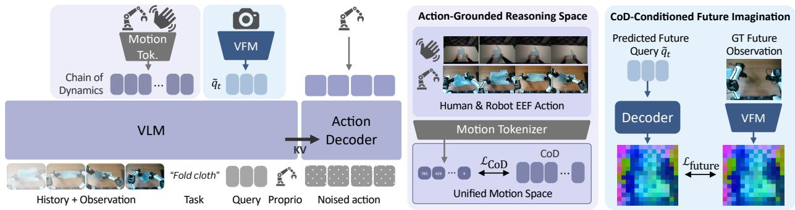

Stage (b) Scaling Chain-of-Dynamics via RL  
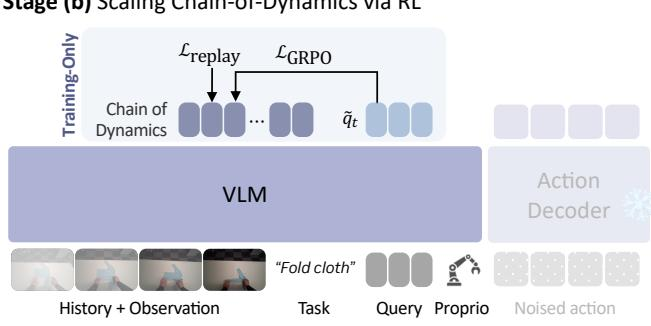

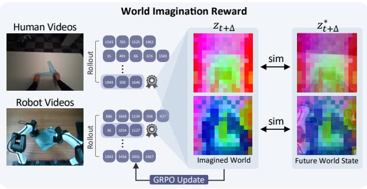  
Figure 2: ThinkWorld architecture and training stages. In stage (a), supervised fine-tuning (SFT) tokenizes robot actions and annotated human hand motions into a unified discrete motion space to ground Chain-of-Dynamics (CoD) reasoning, while CoD-conditioned imagination predicts the future visual feature. In stage (b), reinforcement learning (RL) uses the alignment between imagined and observed futures as a scalable reward for CoD reasoning over human and robot videos, strengthening action reasoning without motion annotations and improving guidance for continuous control.

## 3. Method

## 3.1. Problem Formulation

Given a language instruction �, a current visual observation $o _ { t } ,$ sampled history frames $\mathbf { h } _ { t } ,$ and proprioceptive state $s _ { t }$ in case of robot, our goal is to predict a continuous robot action sequence $\mathbf { a } _ { t }$ . Rather than treating actions solely as supervision for continuous control, ThinkWorld turns them into a reasoning interface for modeling how an action should unfold and transform the world. Through supervised fine-tuning, we instantiate this interface as a Chain-of-Dynamics (CoD) $\mathbf { c } _ { t } ,$ , grounding its discrete motion vocabulary with action-labeled demonstrations across human and robot embodiments while learning CoD-conditioned future imagination through learnable queries that predict the future visual state (Sec. 3.2). We then reinforce CoD reasoning through world imagination, using the alignment between the imagined future and the observed future $o _ { t + \Delta }$ after a physical horizon $\Delta$ as a learning signal that does not require motion annotations (Sec. 3.3). Together, action grounding and reinforcement through world imagination refine the model representations used for continuous control while extending learning to action-unlabeled videos at scale.

## 3.2. Chain-of-Dynamics for Embodied Action Reasoning

Robot actions are typically represented in embodiment-specific control spaces, such as joint positions or endefector poses. Although directly executable, these control targets keep action supervision tied to individual embodiments, limiting transfer across robots and from human demonstrations. We therefore introduce Chainof-Dynamics (CoD), a sequence of discrete motion tokens that provides a shared action language for human and robot motion, as illustrated in Fig. 2(a).

Action-Grounded Reasoning Space. Let $\mathbf { m } _ { t }$ denote a motion segment from a robot trajectory or an annotated human hand trajectory. We map both to a normalized delta end-efector representation and tokenize them with a FAST-style motion tokenizer $\tau ( \cdot )$ (Pertsch et al., 2025), obtaining the target CoD sequence $\mathbf { c } _ { t } ^ { \star } = \mathcal { T } ( \mathbf { m } _ { t } )$ in a shared discrete vocabulary. Conditioned on the instruction, visual history, and current observation, the VLM learns to generate $\mathbf { c } _ { t }$ autoregressively. This tokenization provides a common interface grounded in motion from both sources without assuming kinematic equivalence between humans and robots.

CoD-Conditioned Future Imagination. Motion grounding defines a CoD sequence, but not the world change it induces. To predict this change, we append learnable future queries $\mathbf { q } _ { t + \Delta }$ after the CoD. Given the visual context and teacher-forced CoD $\mathbf { c } _ { t } ^ { \star }$ , the VLM contextualizes these queries as $\tilde { \mathbf { q } } _ { t + \Delta }$ , which a lightweight decoder $\mathcal { D } _ { \mathrm { f u t u r e } }$ maps to the predicted future representation $\mathbf { z } _ { t + \Delta }$ at physical horizon $\Delta \colon$

$$
\begin{array} { r l } & { \tilde { \bf q } _ { t + \Delta } = { \sf V L M } ( l , { \bf h } _ { t } , o _ { t } , { \bf c } _ { t } ^ { \star } , { \bf q } _ { t + \Delta } ) , } \\ & { { \bf z } _ { t + \Delta } = \mathcal { D } _ { \mathrm { f u t u r e } } ( \tilde { \bf q } _ { t + \Delta } ) . } \end{array}\tag{1}
$$

Instead of reconstructing future RGB pixels, we predict in a frozen DINO feature space. DINO features retain dense spatial and object structure while abstracting away appearance details (Zhou et al., 2024; Siméoni et al., 2025), allowing imagined and observed futures to be compared by structural change without photorealistic generation. The target $\mathbf { z } _ { t + \Delta } ^ { \star }$ is obtained by encoding the observed future frame $o _ { t + \Delta }$ with the frozen DINO encoder ${ \mathcal E } _ { \mathrm { f u t u r e } } .$ This frame is used only to construct the target and is never provided as VLM input.

Joint Supervision of CoD and Future Prediction. We jointly train the VLM to generate CoDs from observed motion and predict future visual states conditioned on those CoDs. The objective is

$$
\begin{array} { r } { \begin{array} { c } { \mathcal { L } _ { \mathrm { S F T } } = \mathcal { L } _ { \mathrm { C o D } } + \lambda _ { \mathrm { f u t u r e } } \mathcal { L } _ { \mathrm { f u t u r e } } , } \\ { { } } \\ { { \mathrm { w h e r e } \quad \mathcal { L } _ { \mathrm { C o D } } = \mathrm { C E } \left( p _ { \theta } ( \mathbf { c } _ { t } \mid l , \mathbf { h } _ { t } , o _ { t } ) , \mathbf { c } _ { t } ^ { \star } \right) , \quad \mathcal { L } _ { \mathrm { f u t u r e } } = \mathrm { d i s t } \left( \mathbf { z } _ { t + \Delta } , \mathbf { z } _ { t + \Delta } ^ { \star } \right) . } } \end{array} } \end{array}\tag{2}
$$

Here, dis $, ( \cdot , \cdot )$ is a feature distance metric and $\lambda _ { \mathrm { f u t u r e } }$ weights the future prediction loss. For continuous control, the action expert uses the VLM representations shaped by these objectives, rather than decoding or directly consuming CoD tokens (Intelligence et al., 2025; Chen et al., 2025; Sun et al., 2026). Unlike CoD targets, future prediction targets are available from any temporally ordered human or robot video. In Sec. 3.3, we use observed futures to evaluate sampled CoDs and extend learning to transitions without motion annotations.

## 3.3. Scaling Chain-of-Dynamics Reasoning via Reinforcing World Imagination

Once trained with joint supervision, the model generates CoDs and predicts future visual states conditioned on them. However, prediction under teacher-forced CoDs alone does not train the VLM to plan the intermediate dynamics needed to reach a desired future state. Therefore, we reward sampled CoDs according to the agreement between their imagined and observed futures, encouraging the VLM to reason about the world changes implied by its CoDs, as shown in Fig. 2(b). Since this reward requires only observed transitions, it enables the VLM to explore alternative CoDs and learn from human and robot videos without requiring action labels or executing candidate motions.

Reward Shaping from World Imagination. For each candidate CoD, ThinkWorld predicts its future visual representation and compares it with the observed future in latent space. We compute the reward using a motion-enhanced feature similarity score sim $( \cdot , \cdot )$ , which places greater weight on DINO feature agreement in patches with larger current-to-future changes:

$$
\begin{array} { r } { r _ { \mathrm { w o r l d } } = \sin ( \mathbf { z } _ { t + \Delta } , \mathbf { z } _ { t + \Delta } ^ { \star } ) . } \end{array}\tag{3}
$$

The score retains a uniform contribution from the full scene to preserve global consistency while preventing redundant background regions from dominating the reward (Shah et al., 2026). Motion weighting uses only observed frames, so scoring requires no action annotations.

Optimizing CoD Reasoning with World-Imagination RL. We aim to learn CoDs that capture the intermediate dynamics leading from the current scene to a desired future state. To train this reasoning process, ThinkWorld samples alternative CoDs from the same visual context and rewards those whose imagined futures best match the observed future. These rewards let ThinkWorld explore alternative CoDs that could lead from the current scene to the observed future, allowing passive human and robot videos to guide action reasoning without action labels or online execution of candidate motions.

We update the VLM with GRPO (Shao et al., 2024) using normalized world-imagination rewards (Liu et al., 2026), while supervised replay preserves the motion grounding learned during SFT:

$$
\begin{array} { r } { \mathcal { L } _ { \mathrm { R L } } = \lambda _ { \mathrm { G R P O } } \mathcal { L } _ { \mathrm { G R P O } } ( r _ { \mathrm { w o r l d } } ) + \lambda _ { \mathrm { r e p l a y } } \mathcal { L } _ { \mathrm { r e p l a y } } . } \end{array}\tag{4}
$$

By comparing imagined and observed futures, this stage encourages the VLM to encode action-relevant dynamics in the representations later used for continuous control. All other components remain frozen during RL, and neither CoD generation nor future prediction is required at deployment. Complete optimization details are provided in Appendix A.6.

## 4. Experiment

## 4.1. Implementation Details

Training Setup. For the motion tokenizer $\tau ( \cdot )$ , we convert both robot actions and human wrist poses into a unified delta end-efector representation. We use Qwen3-VL-2B (Bai et al., 2025) as the VLM backbone with the action expert from MolmoAct2 (Fang et al., 2026). Future queries are decoded by a Transformer decoder, with ground-truth future representations extracted using DINOv3 (Siméoni et al., 2025). Our training proceeds in two stages. During SFT and RL pre-training, we first fully fine-tune the VLM for CoD reasoning and future prediction, and then adapt the action expert while freezing the VLM following Driess et al. (2026). We subsequently perform RL with � = 4 sampled trajectories, updating only the VLM while keeping the action expert frozen. We use 128 and 64 NVIDIA H100 GPUs for SFT and RL, respectively. During Embodiment-Specific Post-Training, we further adapt the pretrained model to each target embodiment. ThinkWorld-LIBERO is trained on the standard LIBERO training set to evaluate generalization and robustness to novel environments and perturbations, while ThinkWorld-YAM is adapted on MolmoAct2-BimanualYAM for real-robot experiments. We use 32 and 64 NVIDIA H100 GPUs for the two settings, respectively.

Training Datasets. Our training corpus combines human egocentric data from EgoDex (Hoque et al., 2026) and EgoVerse (Punamiya et al., 2026) with robot demonstrations from MolmoAct2-DROID/BimanualYAM (Fang et al., 2026), Bridge/RT-1 (O’Neill et al., 2024), BC-Z (Jang et al., 2021), and RoboCOIN (Wu et al., 2025). During SFT, we also use auxiliary VQA data to preserve visual-language capabilities and reduce catastrophic forgetting. Wrist views are included when available; otherwise, only the main view is used.

Real-Robot Experimental Setup. We use a bimanual YAM system equipped with three cameras for real-robot evaluation: one global top-view camera and wrist-view camera for each arm. We use only RGB observations for both training and inference. The embodiment-adapted ThinkWorld-YAM model is then used as the initialization for eficient task-specific fine-tuning. Additional implementation and training details are provided in Appendix.

## 4.2. Real-World Generalization under Distribution Shifts

We evaluate real-world generalization under matched in-domain (ID) and out-of-distribution (OOD) settings across three manipulation tasks: placing cups on a hanger, color matching, and object sorting. OOD settings introduce changes in object color or category and, in some cases, require trajectories not observed during task-specific training. For each task, we collect demonstrations across at least six object configurations and evaluate multiple settings under both ID and OOD conditions, with five trials per setting. These tasks require the policy to identify task-relevant object attributes, such as color and category, and adapt its motion accordingly.

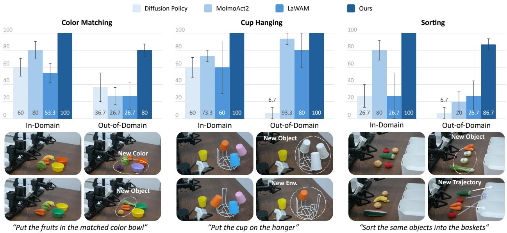  
Figure 3: Real-world out-of-distribution (OOD) generalization. Success rates for color matching, cup hanging, and sorting under in-domain and OOD conditions. OOD settings introduce new colors, objects, environments, or sorting trajectories, as illustrated below the plots. ThinkWorld achieves the highest OOD success rates across all three tasks, despite substantial drops for the baselines.

As shown in Fig. 3, we compare ThinkWorld-YAM with Difusion Policy (Chi et al., 2023), MolmoAct2 (Fang et al., 2026), a VLA with explicit action reasoning, and LaWAM (Chen et al., 2026), which conditions action generation on predicted latent visual subgoals. While the methods perform similarly in-domain, their diferences become more pronounced under OOD shifts. ThinkWorld maintains higher success rates when object appearances change or unseen trajectories are required, outperforming both MolmoAct2 and LaWAM. This suggests that grounding CoD reasoning in action-induced world changes helps the policy adapt to task-relevant changes rather than relying on appearance cues or memorized trajectories.

## 4.3. Acquiring Skill Composition from Human Experience

We further evaluate whether human demonstrations can transfer compositional knowledge to robot control. We construct an oven manipulation task from reusable atomic robot skills and provide robot demonstrations only for the individual skills 1) open, 2) close, 3) put the left object in the oven, and 4) put the right object in the oven, while a human video demonstrates how a complete compositional task can be achieved. Existing end-to-end VLA approaches typically learn executable control from robot action supervision (Fang et al., 2026), making it dificult to compose complete robot tasks from human demonstrations when only atomic robot skills are supervised. Successful execution requires the robot to identify the relevant skills, preserve their temporal order, and transition between them without observing the complete robot trajectory during training. As shown in Fig. 4, a human demonstration of open → put-left → close enables ThinkWorld to compose the corresponding robot skills and execute the full sequence in a single rollout. These results demonstrate that the shared CoD reasoning space enables compositional knowledge to transfer from human demonstrations to robot execution, allowing the robot to perform a complete skill sequence never demonstrated in robot data. Additional qualitative examples of skill composition in drawer manipulation are provided in the Appendix C.1.

## 4.4. Robustness to Task and Environment Shifts in Simulation

We evaluate ThinkWorld on standard LIBERO (Liu et al., 2023) and the more challenging LIBERO-PRO (Zhou et al., 2025). LIBERO evaluates manipulation across spatial, object, goal, and long-horizon task suites, while LIBERO-PRO introduces controlled shifts in object attributes, positions, instruction semantics, task goals, and environments. ThinkWorld-LIBERO is post-trained only on the standard LIBERO training set and evaluated directly on LIBERO-PRO without exposure to these perturbations. As shown in Tab. 1, ThinkWorld achieves the best overall performance on both benchmarks, with average success rates of 97.3% on LIBERO and 55.6% on LIBERO-PRO. Notably, under task and environment shifts, ThinkWorld reaches 31.9% and 60.9%, outperforming VLA-JEPA by 11.1 and 19.9 percentage points, respectively. While VLA-JEPA also incorporates latent world modeling, these gains suggest that grounding CoD reasoning in action-induced world changes provides more transferable structure for adapting to shifts beyond the training distribution.

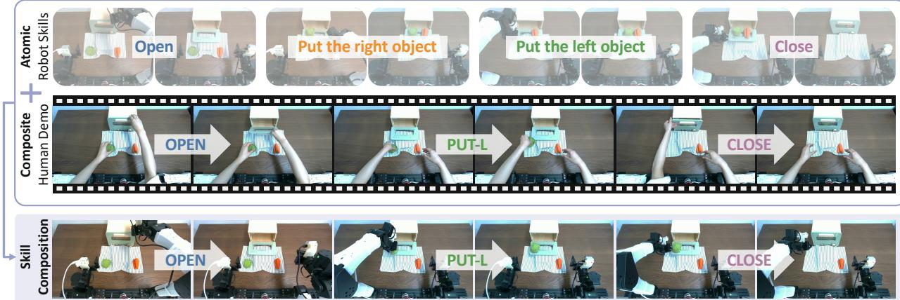  
Figure 4: Composing atomic robot skills from a human demonstration. The top shows atomic robot skills, while the middle shows a human demonstration that provides the complete task composition, e.g., open → put-left → close. Guided by this human demonstration, ThinkWorld composes the corresponding robot skills and executes the complete task in a single rollout at the bottom.

Table 1: Success rates (%) on LIBERO and LIBERO-PRO. LIBERO-PRO axis values are arithmetic means over Goal, Spatial, LIBERO-10, and Object. LIBERO-PRO baseline results are taken from the oficial repository unless marked with †, which denotes our reproduced result. Best and second-best results within each benchmark column are shown in bold and underlined, respectively.
<table><tr><td></td><td></td><td colspan="5">LIBERO</td><td colspan="5">LIBERO-PRO</td></tr><tr><td>Model</td><td>Params.</td><td>Spatial</td><td>Object</td><td>Goal</td><td>Long</td><td>Avg.</td><td>Object</td><td>Position</td><td>Semantic</td><td>Task Environment</td><td>Avg.</td></tr><tr><td>OpenVLA (Kim et al., 2024)</td><td>7.5</td><td>84.7</td><td>88.4</td><td>79.2</td><td>53.7 76.5</td><td>93.0</td><td>0.0</td><td>97.3</td><td>0.0</td><td>68.0</td><td>51.7</td></tr><tr><td>π0 (Black et al., 2024)</td><td>3.2</td><td>96.8</td><td>98.8</td><td>95.8</td><td>85.2 94.2</td><td>90.5</td><td>0.0</td><td>90.5</td><td>0.0</td><td>38.8</td><td>44.0</td></tr><tr><td>π0.5 (Intelligence et al., 2025)</td><td>3.4</td><td>98.8</td><td>98.2</td><td>98.0</td><td>92.4 96.9</td><td>96.0</td><td>20.8</td><td>95.8</td><td>0.8</td><td>52.8</td><td>53.2</td></tr><tr><td>MolmoAct (Lee et al., 2025)</td><td>8.1</td><td>87.0</td><td>95.4</td><td>87.6</td><td>77.2 86.6</td><td>76.0</td><td>1.5</td><td>85.8</td><td>1.5</td><td>一</td><td>41.2</td></tr><tr><td>VLA-JEPA (Sun et al., 2026)</td><td>2.8</td><td>96.2</td><td>99.6</td><td>97.2</td><td>95.8 97.2</td><td>80.4</td><td>3.5</td><td>97.2</td><td>20.8</td><td>41.0</td><td>48.5†</td></tr><tr><td>ThinkWorld (Ours)</td><td>2.9</td><td>98.2</td><td>98.8</td><td>97.8</td><td>94.2 97.3</td><td>73.3</td><td>18.2</td><td>93.9</td><td>31.9</td><td>60.9</td><td>55.6</td></tr></table>

## 4.5. Analysis

Cross-Embodiment Structure of CoD. We first examine whether CoD induces a shared motion-centric structure across human and robot embodiments. For each sample, we extract the VLM hidden state of the final </think> token, which summarizes the generated CoD, and visualize these features with t-SNE in Fig. 5. We use bimanual human and robot datasets, with colors denoting four 2D end-efector motion directions and marker shapes indicating dataset sources. Despite substantial diferences in embodiment and visual appearance, samples with similar motion directions form coherent clusters that contain examples from multiple datasets, while samples from the same dataset separate according to their motions. This suggests that CoD features are organized primarily around action-relevant motion rather than embodiment identity, revealing a shared action-level structure shared across human and robot behaviors.

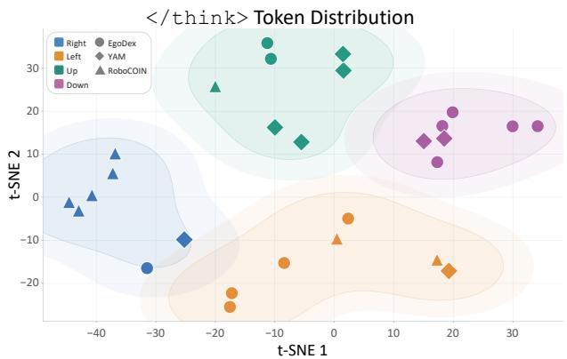  
Figure 5: t-SNE visualization of CoD across embodiments. Colors denote four end-efector motion directions and marker shapes denote datasets. Similar motions cluster across human and robot data rather than by source, suggesting action structure shared across embodiments.

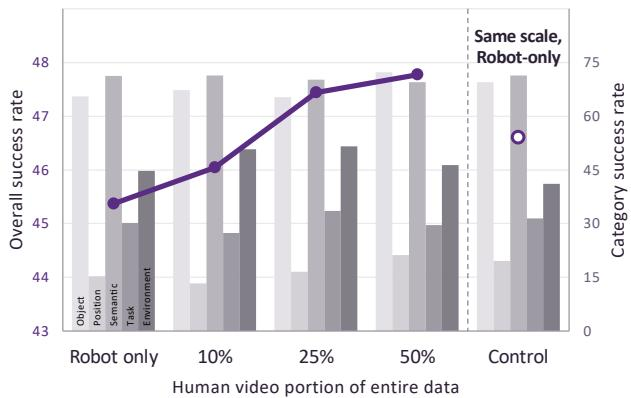  
Figure 6: Efectiveness of human data. The LIBERO-PRO evaluation success rates (%) on the model variants trained with diferent amount of human egocentric video, fixing the robot data quantity. Leveraging human data continuously enhances the performance.

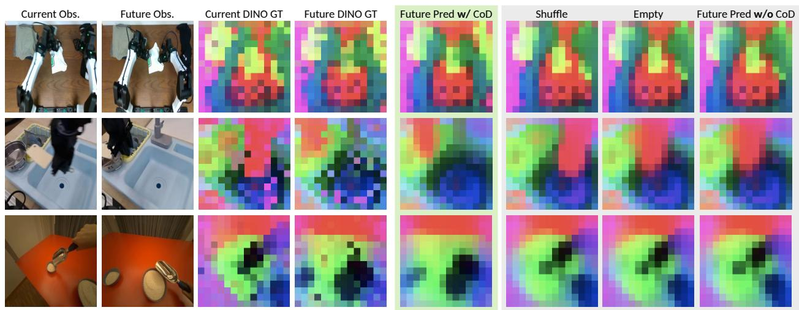  
Figure 7: Efect of Chain-of-Dynamics (CoD) on future prediction. We compare future DINO predictions under generated, shufled, empty, and no-CoD conditions against the current and future ground-truth features. The generated CoD captures the future-state structure, whereas the other variants largely remain similar to the current state and fail to reflect the expected future change.

Efectiveness of Human Data. We investigate the contribution of human egocentric video through a controlled pretraining study, keeping the amount of robot data fixed while increasing the human video fraction to 10%, 25%, and 50% of the total training data. We compare these variants against a robot-only baseline and an additional robot-only control that matches the training scale and number of training iterations of the 50% human-data variant by using additional robot data. This control helps distinguish the benefits of human video from those of increased training scale alone. These experimental configurations are designed to assess the contribution of heterogeneous human video to robustness and difer from our final model configuration. After SFT, each variant undergoes embodiment-specific post-training on LIBERO and is evaluated on LIBERO-PRO to assess generalization. As shown in Fig. 6, overall success increases monotonically with the proportion of human video, from 45.4% for the robot-only baseline to 47.8% for the 50% human-data variant. The latter also outperforms the matched robot-only control by approximately 1.2 percentage points. These results suggest that the diversity provided by human egocentric video improves generalization beyond the gains attributable to increased training scale alone.

Current Obs.  
CoD à Current  
Current Obs.  
CoD à Current  
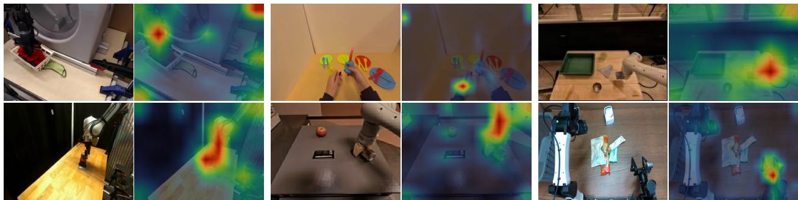  
Current Obs.  
CoD à Current  
Figure 8: Attention analysis of CoD. We visualize attention from CoD tokens to the current observation. Across human and robot examples, CoD attends to action-relevant regions, including human hands, robot arms, and manipulated objects, highlighting its focus on motion-relevant cues.

Table 2: Efect of CoD on future prediction. Cosine similarity to ground-truth DINOv3 features one second ahead, over all patches and top-25% motion patches. ∆ is relative to CoD on; higher is better. Best in bold.  
Table 3: Efectiveness of training components. Success rates (%) on LIBERO-PRO when visual history frames, future prediction objective, CoD, and RL are cumulatively added to the Qwen baseline.
<table><tr><td rowspan="2">Condition</td><td colspan="2">All patches</td><td colspan="2">Top-25% motion</td></tr><tr><td>Cos ↑</td><td>∆</td><td>Cos ↑</td><td>∆</td></tr><tr><td>Shuffle</td><td>0.71</td><td>-0.024</td><td>0.55</td><td>-0.071</td></tr><tr><td>Empty</td><td>0.72</td><td>-0.020</td><td>0.54</td><td>-0.079</td></tr><tr><td>CoD off</td><td>0.72</td><td>-0.018</td><td>0.55</td><td>-0.071</td></tr><tr><td>CoD on</td><td>0.74</td><td></td><td>0.62</td><td></td></tr></table>

<table><tr><td rowspan="2">Model variant</td><td colspan="5">LIBERO-PRO</td></tr><tr><td>Object</td><td>Pos. Sem.</td><td>Task</td><td>Env.</td><td>Avg.</td></tr><tr><td>Qwen baseline + History frames</td><td>59.5 61.3</td><td>1.9 4.9</td><td>84.4 84.6</td><td>17.2 37.8 22.8</td><td>40.1</td></tr><tr><td>+ Future prediction</td><td>70.0</td><td>11.9</td><td>89.4</td><td>29.8</td><td>40.7 50.4</td></tr><tr><td>+ CoD + RL</td><td>74.5</td><td>16.9 94.4</td><td>26.3 29.7</td><td>54.4 56.4</td><td>54.4</td></tr></table>

Role of CoD in Future Prediction. We further examine how CoD contributes to future prediction. As shown in Fig. 7, predictions conditioned on the generated CoD better capture the action-induced transition toward the ground-truth future, whereas shufled, empty, or no-CoD variants tend to preserve the current-state structure or predict incorrect transitions. Tab. 2 quantitatively supports this observation: CoD achieves a cosine similarity of 0.74 across all patches, compared with 0.71–0.72 for the other conditions. The diference is more pronounced in the top 25% most dynamic target patches, where CoD reaches 0.62 compared with 0.54–0.55, indicating that CoD is particularly efective at predicting action-induced changes.

We further examine what information CoD captures through attention visualization in Fig. 8. Across both human and robot examples, CoD consistently attends to action-relevant dynamic regions, including human hands or robot arms and the manipulated objects, rather than static background regions. This pattern indicates that CoD focuses on the parts of the scene most involved in the ongoing motion and links these motion cues to the resulting changes in object state and configuration. Together with the future-prediction results, these visualizations suggest that CoD captures action-centric dynamics that ground future prediction in the state transitions induced by an action.

Efect of Training Components. To assess the efectiveness of each training component, we start from a baseline consisting of the Qwen3-VL backbone with the MolmoAct2 action expert, and progressively add visual history, future prediction, CoD, and world-imagination RL. As shown in Tab. 3, history provides temporal context and slightly improves the average success rate from 40.1% to 40.7%. Future prediction brings a much larger gain to 50.4%, indicating the benefit of explicitly modeling how the scene evolves. Adding CoD further raises performance to 54.4%, with consistent improvements across all distribution shifts, showing the value of grounding future prediction in action-relevant dynamics. Finally, world-imagination RL improves the average to 55.6%, with further gains under position, task, and environment shifts, demonstrating its role in refining CoD reasoning beyond supervised training. Overall, these ablations support the design of ThinkWorld, showing that each component contributes to more robust and generalizable action reasoning.

## 5. Conclusion

We present ThinkWorld, a VLA learning framework that learns transferable Chain-of-Dynamics (CoD) through reinforcement learning with world imagination. By grounding action thoughts in the world changes they induce, ThinkWorld learns a common representation across human and robot embodiments and extends action reasoning to videos without explicit action annotations. Extensive experiments demonstrate efective humanto-robot transfer and strong generalization to unseen tasks and environments, validating the efectiveness of learning transferable action reasoning from observed world dynamics and its potential for scaling robot learning with diverse human and robot experience.

## Appendix

• Section A. Extended Implementation Details

– Section A.1. Model Configuration

– Section A.2. Input and Output Configuration

– Section A.3. Training Data

– Section A.4. Training Configuration

– Section A.5. Details on Future Prediction Loss Design

– Section A.6. Details on RL Training Objectives

• Section B. Evaluation Details

– Section B.1. Simulation Benchmarks and Baselines

– Section B.2. Real-Robot Setup

– Section B.3. Real-Robot Evaluation

• Section C. Additional Analyses and Results

– Section C.1. Detailed Real-Robot Evaluation Results

– Section C.2. Additional Qualitative Results on PCA and Attention Analysis

– Section C.3. Closed-Loop Future-Prediction Results

– Section C.4. LIBERO-Plus Evaluation Results

– Section C.5. Inference Eficiency

• Section D. Limitations and Reproducibility

## A. Extended Implementation Details

## A.1. Model Configuration

ThinkWorld uses Qwen3-VL-2B-Instruct (Bai et al., 2025) as its vision-language backbone and a frozen DINOv3 ViT-H/16+ target encoder (Siméoni et al., 2025). The DINO encoder receives the main-camera target image at 224 × 224 resolution and produces a 14 × 14 grid of 1,280-dimensional patch features. We append 64 learned future-query tokens to the VLM sequence. A two-layer MLP and a six-layer cross-attention decoder map their 2,048-dimensional hidden states to 196 predicted DINO patch features. The future target is the main-camera observation closest to exactly one second after the current observation; samples more than 50 ms from the requested time are masked from the future loss.

Continuous actions are produced by an action expert initialized from MolmoAct2 (Fang et al., 2026). The expert contains 36 non-causal Transformer blocks with hidden width 768 and operates in FP32. It exposes a maximum 30 × 32 action tensor, but a two-dimensional validity mask restricts each example to its dataset-native horizon and action channels. The expert receives layer-wise Qwen key/value features from input tokens only; generated CoD tokens and future-query tokens are not part of its direct context.

For clean normalized action � and Gaussian noise �, we sample � ∼ Beta(1, 1.5), set $t = 0 . 0 0 1 + 0 . 9 9 9 z$ , and construct $x _ { t } = ( 1 - t ) \epsilon + t a$ . The action expert regresses � − � using masked mean-squared error over valid entries. We draw eight independently noised flow samples per training example and use ten Euler integration steps at inference.

## A.2. Input and Output Configuration

## Input prompt.

All media precede the textual metadata in a single user turn. When temporal context is available, the order is main-view history, current main view, and the remaining current views in their dataset-defined order. History contains at most 16 main-view frames sampled at 2 Hz and ordered from oldest to newest. The current main image is not repeated in the history.

The complete VLA input/output template is shown below. Bracketed lines are optional, and the textual portion

is rendered as one normalized string rather than as separate lines.

Future-prediction prompt template   
USER MEDIA:   
[main-camera history video: 0--16 frames]   
<current\_main\_image>   
[<current\_wrist\_image\_1><current\_wrist\_image\_2>]   
USER TEXT:   
The task is to {task}. The setup is {embodiment}   
[ with {native\_control} control].   
[The current state of the robot is {state}.]   
[A {N}-frame history video is followed by the current observation image.   
| The current observation frame is provided.]   
The future visual target is the main-view observation exactly one second   
after the current observation. Given these, produce a future motion plan   
and then predict the future state one second in the future.   
ASSISTANT:

## Proprioceptive state encoding.

Following MolmoAct2 (Fang et al., 2026), we encode proprioceptive state as discrete tokens. Each dataset-native state dimension is normalized using training-split statistics, clipped to [−1, 1], uniformly quantized into 256 bins, and serialized between dedicated state-boundary tokens. The native state width is preserved, so no common padded state vector is exposed in the prompt.

## Media processing.

Dataset-side resizing is disabled. Qwen retains the source aspect ratio, with a pixel-area range of 4,096–200,704 for each current image and 4,096–50,176 for each history frame. State conditioning is dropped with probability 0.10 and wrist views with probability 0.20 during supervised training. The maximum multimodal sequence length is 2,048 tokens; over-length examples are removed rather than silently truncating their supervision.

Training-time image augmentation can be summarized with the following torchvision-style transform:

Image augmentation pipeline   
import torchvision.transforms as T   
transform = T.Compose([   
T.RandomResizedCrop((height, width), scale=(0.95, 0.95)),   
T.RandomRotation(degrees=5),   
T.ColorJitter(brightness=0.2, contrast=0.2,   
saturation=0.2, hue=0.05),   
T.RandomApply([   
T.GaussianBlur(kernel\_size=5, sigma=(0.1, 1.0))   
], p=0.2),   
])

The transform parameters are sampled once and replayed across all views and time steps in an example. RL disables image augmentation so that the four sampled completions for a prompt receive identical media.

CoD tokens receive language cross-entropy supervision, whereas future-query tokens are excluded from crossentropy and supervise only the future projector. Action SFT uses an empty <think>...</think> wrapper and disables assistant-token cross-entropy.

## Motion Tokenizer Training.

We train a motion tokenizer following the FAST architecture (Pertsch et al., 2025) on one-second windows of consecutive wrist-motion deltas from robot and human trajectories. Each time step contains a 6D motion vector for one hand or a 12D vector for two hands: translation in meters and rotation as a rotation vector in radians, with gripper state excluded. We normalize translation and rotation using fixed scales of 0.3448 m and 0.9119 rad, respectively, and encode the sequences with a vocabulary of 2,048 tokens. Robot poses are expressed in the robot base frame, whereas human poses are expressed in an actor-centered frame whose +� axis is gravity-aligned and whose +� axis follows the actor’s current yaw. Training on both domains yields a shared token space for intended wrist motion. The tokens are not executed as native robot actions; a separate continuous action expert predicts executable actions.

Table 4: Training datasets and native observation/action contracts. K and M denote thousands and millions, respectively.
<table><tr><td>Source</td><td>Episodes</td><td>Frames</td><td>Hours</td><td>Hz</td><td>Camera view</td><td>Action representation</td></tr><tr><td>YAM</td><td>32.2K</td><td>76.0M</td><td>704.1</td><td>30</td><td>Top + two wrists</td><td>30 × 14D absolute joint</td></tr><tr><td>DROID</td><td>74.6K</td><td>17.8M</td><td>328.9</td><td>15</td><td>Exterior + wrist</td><td>15 × 8D absolute joint</td></tr><tr><td>RoboCOIN</td><td>112.0K</td><td>82.3M</td><td>755.2</td><td>30/50</td><td>One or three views</td><td>30/50 × (12/14)D absolute EEF</td></tr><tr><td>Bridge</td><td>53.2K</td><td>1.9M</td><td>105.2</td><td>5</td><td>Main</td><td>5 × 7D delta EEF</td></tr><tr><td>RT-1</td><td>87.2K</td><td>3.8M</td><td>350.6</td><td>3</td><td>Main</td><td>3 × 7D delta EEF</td></tr><tr><td>BC-Z</td><td>39.4K</td><td>5.5M</td><td>152.0</td><td>10</td><td>Main</td><td>10 × 7D delta EEF</td></tr><tr><td>EgoVerse</td><td>55.6K</td><td>124.8M</td><td>1,155.4</td><td>30</td><td>Egocentric</td><td>One-second 6D/12D motion tokens</td></tr><tr><td>EgoDex</td><td>314.8K</td><td>78.3M</td><td>724.8</td><td>30</td><td>Egocentric</td><td>One-second 6D/12D motion tokens</td></tr><tr><td>Total</td><td>769.1K</td><td>390.3M</td><td>4,276.1</td><td>一</td><td>Mixed</td><td>Dataset-native</td></tr></table>

## A.3. Training Data

VLM SFT combines robot trajectories from BimanualYAM (Fang et al., 2026), DROID (Khazatsky et al., 2024), RoboCOIN (Wu et al., 2025), Bridge (Walke et al., 2023), RT-1 (O’Neill et al., 2024), and BC-Z (Jang et al., 2021) with egocentric human-motion trajectories from EgoVerse (Punamiya et al., 2026) and EgoDex Hoque et al. (2026). Table 4 summarizes the frozen source scale and native action contracts without exposing dataset sampling weights. Episode and frame counts describe source data before the episode-disjoint validation holdout, and a frame denotes one trajectory timestep rather than one image per camera. For Action SFT, we exclude the 50-Hz RoboCOIN trajectories and retain only its 30-Hz trajectories.

Auxiliary visual-language supervision covers image and video captioning, caption question answering, spatial reasoning, pointing, counting, point tracking, robotics-oriented pointing, and robot VQA. Specifically, Pixmo-Cap (Deitke et al., 2025), Molmo2-ER (Fang et al., 2026), Molmo2 Cap-LLaVA, Molmo2 Video-Track (Clark et al., 2026), RoboPoint (Yuan et al., 2025), and RoboVQA (Sermanet et al., 2023). These examples retain their language targets and do not contribute continuous-action or future-feature losses.

## A.4. Training Configuration

Training consists of VLM SFT, Action SFT, and RL. All phases use fused AdamW with $( \beta _ { 1 } , \beta _ { 2 } ) = ( 0 . 9 , 0 . 9 5 )$ $\epsilon = 1 0 ^ { - 8 }$ , weight decay 0.1, gradient-norm clipping at 1.0, and DeepSpeed ZeRO stage 1 without optimizer ofload. Table 5 shows the detailed configuration by phase for direct comparison.

VLM SFT and RL execute the VLM in BF16. During Action SFT, Qwen uses BF16 autocast while the action expert is stored and optimized in FP32. For downstream LIBERO evaluation, we full-finetune the final model on demonstrations from the Object, Goal, Spatial, and LIBERO-10 suites for 50k iterations using masked flow matching, cosine learning-rate decay.

Table 5: Training configuration. Batch is the efective global batch, and allocations report representative resources used for the runs.
<table><tr><td>Setting</td><td>VLM SFT</td><td>Action SFT</td><td>RL</td></tr><tr><td>Initialization</td><td>Qwen3-VL-2B</td><td>VLM SFT</td><td>Action SFT</td></tr><tr><td>Trainable modules</td><td>Language model + future projector</td><td>Action expert</td><td>Language model</td></tr><tr><td>Objective</td><td>CoD/VQA CE +3Lfuture</td><td>Masked flow matching</td><td>GRPO/GDPO + weak SFT replay</td></tr><tr><td>Data</td><td>Robot + human motion; auxiliary VQA</td><td>Robot trajectories</td><td>Robot + human motion</td></tr><tr><td>Iterations</td><td>150k</td><td>50k (5k current-view + 45k history)</td><td>2k</td></tr><tr><td>Learning rate</td><td>VLM  $1 0 ^ { - 5 } ;$  projector 10−4</td><td>Expert  $1 0 ^ { - 4 } \to 5 \times 1 0 ^ { - 5 }$ </td><td> $1 0 ^ { - 6 }$ </td></tr><tr><td>Schedule</td><td>5% warmup, constant</td><td>Warmup + cosine cooldown</td><td>50-step warmup, constant</td></tr><tr><td>Batch</td><td>128</td><td>128</td><td>128</td></tr><tr><td>Seed</td><td>42</td><td>43/44</td><td>45</td></tr><tr><td>Allocation</td><td>16 × 8 GPUs</td><td>8 × 8 then 16 × 8 GPUs</td><td>8 × 8 GPUs</td></tr></table>

## A.5. Details on Future Prediction Loss Design

Following the main text, let $\mathbf { z } _ { t + \Delta }$ be the predicted DINO feature map and $\begin{array} { r } { \mathbf { z } _ { t + \Delta } ^ { \star } = \mathcal { E } _ { \mathrm { f u t u r e } } ( o _ { t + \Delta } ) } \end{array}$ the target from the observed future, with $\Delta = 1 \mathrm { s }$ . The distance used in $\mathcal { L } _ { \mathrm { f u t u r e } } = \mathrm { d i s t } ( \mathbf { z } _ { t + \Delta } , \mathbf { z } _ { t + \Delta } ^ { \star } )$ is

$$
\operatorname { d i s t } ( \mathbf { z } , \mathbf { z } ^ { \star } ) = \frac { 1 } { | \mathcal { V } | } \sum _ { p \in \mathcal { V } } \left[ 1 - \cos ( \mathbf { z } _ { p } , \mathbf { z } _ { p } ^ { \star } ) + \lambda _ { \mathrm { S L 1 } } \mathrm { S m o o t h L } 1 _ { \beta } ( \mathbf { z } _ { p } , \mathbf { z } _ { p } ^ { \star } ) \right] ,\tag{5}
$$

where $\nu$ contains the valid image patches. Both feature maps are $\ell _ { 2 }$ -normalized before computing the loss. We use $\beta = 0 . 0 1$ and $\lambda _ { \mathrm { S L 1 } } = 0 . 2 5 \times 2 1$ .792413. During ${ \mathrm { R L } } ,$ the future projector is frozen and ${ \mathcal L } _ { \mathrm { f u t u r e } }$ is not optimized.

## A.6. Details on RL Training Objectives

For each context, we sample $K = 4$ CoDs and use the frozen future projector to obtain a predicted future representation from each candidate. The similarity function in the main-text reward $r _ { \mathrm { w o r l d } } = \mathrm { s i m } ( \mathbf { z } _ { t + \Delta } , \mathbf { z } _ { t + \Delta } ^ { \star } )$ averages global and motion-weighted patch agreement:

$$
\sin ( \mathbf { z } , \mathbf { z } ^ { \star } ) = \frac { 1 } { 2 } \left[ \frac { 1 } { | \mathcal { V } | } \sum _ { p \in \mathcal { V } } s _ { p } + \frac { \sum _ { p \in \mathcal { V } } w _ { p } s _ { p } } { \sum _ { p \in \mathcal { V } } w _ { p } } \right] ,\tag{6}
$$

where $s _ { p } = \cos ( \mathbf { z } _ { p } , \mathbf { z } _ { p } ^ { \star } )$ . To form $w _ { p } .$ , we measure the DINO feature change between the current and observed future frames. The weight is 0.2 for patches at or below the median change, increases linearly to 1 at the 90th percentile, and is clipped outside that range. For nearly static targets, we use the global average for both terms.

A malformed CoD receives a reward 0.05 below the lowest candidate similarity in its group. We standardize rewards within each four-candidate group and then across the rollout batch; each candidate’s resulting advantage is shared by its tokens. GRPO uses token-level importance ratios clipped to [0.8, 1.28] and a KL coeficient of 0.04. In the main-text objective ${ \mathcal { L } } _ { \mathrm { R L } }$ , we set $\lambda _ { \mathrm { G R P O } } = 0 . 9 9 9$ and $\lambda _ { \mathrm { r e p l a y } } = 0 . 0 0 1$ . The replay term is teacher-forced cross-entropy on a separate minibatch of canonical CoDs. Only the VLM is updated during RL; the action expert and future projector remain frozen.

## B. Evaluation Details

## B.1. Simulation Benchmarks and Baselines

We fine-tune our policy only on standard LIBERO (Liu et al., 2023) and use its unmodified tasks as the indistribution reference. We then evaluate the trained policy on LIBERO-PRO and LIBERO-Plus without further adaptation to either benchmark. We select LIBERO-PRO as the primary benchmark because its controlled changes to objects, object positions, task specifications, and environments directly test whether the policy can adapt its behavior to new manipulation settings. LIBERO-Plus additionally covers camera, lighting, background, and sensor-noise perturbations, which probe perceptual robustness beyond our main methodological focus. We report a supplementary LIBERO-Plus evaluation in Appendix C.4.

Table 6: Full real-robot success-rate (SR) comparison. Each task is evaluated under in-distribution (ID) and out-of-distribution (OOD) settings; cells report successes/trials with SR (%) in parentheses. Task 1 comprises six ID and six OOD conditions (5 trials each); Tasks 2 and 3 comprise three of each. Macro SR is the unweighted mean of the six per-setting rates; Micro SR pools all 120 trials.
<table><tr><td></td><td colspan="2">Color Matching</td><td colspan="2">Cup Hanging</td><td colspan="2">Sorting</td><td colspan="2">Overall</td></tr><tr><td>Model</td><td>ID</td><td>OOD</td><td>ID</td><td>OOD</td><td>ID</td><td>OOD</td><td>Macro SR</td><td>Micro SR</td></tr><tr><td>Diffusion Policy</td><td>18/30 (60.0)</td><td>11/30 (36.7)</td><td>9/15 (60.0)</td><td>1/15 (6.7)</td><td>4/15 (26.7)</td><td>1/15 (6.7)</td><td>32.8</td><td>36.7</td></tr><tr><td>MolmoAct2</td><td>24/30 (80.0)</td><td>8/30 (26.7)</td><td>11/15 (73.3)</td><td>14/15 (93.3)</td><td>12/15 (80.0)</td><td>3/15 (20.0)</td><td>62.2</td><td>60.0</td></tr><tr><td>LaWAM</td><td>16/30 (53.3)</td><td>8/30 (26.7)</td><td>9/15 (60.0)</td><td>12/15 (80.0)</td><td>4/15 (26.7)</td><td>4/15 (26.7)</td><td>45.6</td><td>44.2</td></tr><tr><td>ThinkWorld (ours)</td><td>30/30 (100.0)</td><td>24/30 (80.0)</td><td>15/15 (100.0)</td><td>15/15 (100.0)</td><td>15/15 (100.0)</td><td>13/15 (86.7)</td><td>94.4</td><td>93.3</td></tr></table>

## B.2. Real-Robot Setup

We use the BimanualYAM robot system to collect our in-lab dataset and evaluate trained policies. As shown in Fig. 9, the system comprises two YAM arms and three RealSense D405 cameras: one providing a top view and one mounted on each wrist. Policies use RGB observations only.

Policy inference runs on a single NVIDIA RTX 3090. To account for diferences in inference latency, we query each policy and execute its actions at the same 15 Hz control rate, while the remaining system components run at 30 Hz. For each predicted action chunk, we execute the first half and then replan using the latest observation.

## B.3. Real-Robot Evaluation

For the real-robot experiments, we evaluate three tasks on the bimanual YAM platform: color matching (60 robot demonstrations), cup hanging (45), and object sorting (100). Within each task, the demonstrations span multiple trajectories and environment configurations, and we use them jointly to fine-tune a single task-specific policy. The tasks are designed to test whether the policy can infer task-level regularities and adapt its actions to the current scene rather than memorize a single trajectory. Separately, we study skill composition on the oven task using 100 robot episodes of atomic-action trajectories and 90 human-video episodes of full task sequences. We co-train a single model on the combined robot and human datasets. Example task trajectory for four tasks can be found in Fig. 10 (a) and Fig. 11 (a).

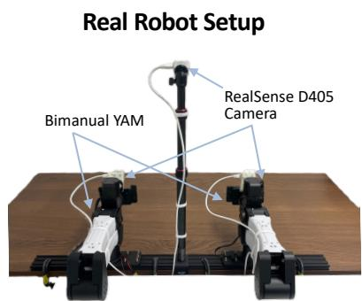  
Figure 9: BimanualYAM setup.

We fine-tune ThinkWorld for 50,000 steps, applying LoRA to the VLM and fully updating the action DiT decoder. ThinkWorld can also leverage human videos during training; for these samples, we optimize only the VLM future-prediction loss and omit the action DiT loss. We train each baseline for 50,000 steps using its model-specific fine-tuning recipe from the oficial LeRobot (Cadene et al., 2024) repository.

## C. Additional Analyses and Results

## C.1. Detailed Real-Robot Evaluation Results

In-domain and out-of-domain task evaluation. Tab. 6 reports detailed rollout success rates under indistribution (ID) and out-of-distribution (OOD) conditions for all tasks. ThinkWorld achieves the highest success rate in all six task–condition pairs, succeeding in all 60 ID trials and 52 of 60 OOD trials. Its macro and micro success rates are 94.4% and 93.3%, respectively, compared with 62.2% and 60.0% for the strongest baseline, MolmoAct2. Example in-domain and out-of-domain rollout trajectories for all compared methods are shown in Figs. 10 (b) and (c) respectively.

Skill composition. Fig. 11 presents qualitative results for real-robot skill composition in oven and drawer manipulation tasks. Each task involves opening the oven or a specified drawer, optionally placing the left or right object inside, and closing it. Robot demonstrations cover only the individual atomic skills (OPEN, PUT-L, PUT-R, and CLOSE; panel (a)), while human demonstrations specify complete skill sequences (panel (b)). The oven tasks include open → close and open → put-left → close. The drawer tasks include open → put-left → close and open → put-right → close for the upper drawer, and open → put-left → close for the lower drawer. The successful rollouts in panel (c) show ThinkWorld executing these compositions under the corresponding natural-language instructions, manipulating the specified objects and compartments while preserving the required skill order. These qualitative results illustrate the transfer of compositional knowledge from human demonstrations to robot execution without complete robot task trajectories during training.

## C.2. Additional Qualitative Results on PCA and Attention Analysis

We provide additional qualitative visualizations that extend the analysis in the main text. Future-representation PCA and attention visualizations leverage Qwen layers 24–27. PCA and attention are descriptive analyses and are not used as causal evidence.

Fig. 12 expands the PCA visualization of future-prediction representations across five CoD conditions: the original CoD, shufled CoD, empty CoD, a donor CoD from another episode, and no CoD. This comparison illustrates how the predicted future representations vary with CoD conditioning.

Fig. 13 extends the CoD-to-input-observation attention maps shown in the main text and additionally shows attention from future-prediction tokens to the input observation. CoD attention tends to concentrate on dynamic, task-relevant regions, whereas future-prediction attention is distributed more broadly across the scene. This pattern suggests that CoD emphasizes localized changes relevant to action, while future prediction incorporates wider scene context.

## C.3. Closed-Loop Future-Prediction Results

Tab. 7 reports SimplerEnv (Li et al., 2024) success rates without additional embodiment-specific fine-tuning for this benchmark. The model nevertheless encountered Bridge and RT-1 data during SFT and RL, providing prior experience with related robot settings. It achieves 49.31% on Google visual matching, 46.54% on the Google-VA variants (micro average), and 41.67% on WidowX visual matching, with an overall micro success rate of 46.51%. These results show that the policy can complete a substantial fraction of SimplerEnv rollouts without benchmark-specific adaptation.

Fig. 14 visualizes future predictions during closed-loop SimplerEnv rollouts. In each column, the one-second-ahead prediction is paired with the observation subsequently reached at the predicted time. The predictions are PCA-projected feature maps and their spatial structure and progression closely track the corresponding observations across the three examples. This qualitative alignment suggests that the future representation remains informative as the policy encounters its own observations and replans under distribution shift.

Table 7: Out-of-the-box performance on SimplerEnv.
<table><tr><td>Group</td><td>Task</td><td>SR (%)</td></tr><tr><td>Google-VM</td><td></td><td>49.31</td></tr><tr><td rowspan="5">Google-VA</td><td>Pick Coke can</td><td>56.00</td></tr><tr><td>Drawer</td><td>33.33</td></tr><tr><td>Move-near</td><td>55.83</td></tr><tr><td>Put-in-drawer</td><td>2.12</td></tr><tr><td>Micro avg.</td><td>46.54</td></tr><tr><td>WidowX VM</td><td></td><td>41.67</td></tr><tr><td>Overall</td><td>micro</td><td>46.51</td></tr></table>

Table 8: Success rates (%) on LIBERO-Plus across seven perturbation dimensions. Only methods with published LIBERO-Plus results are listed. Higher is better.
<table><tr><td>Method</td><td>Camera</td><td></td><td>Robot Language</td><td></td><td>Light Background Noise</td><td></td><td>Layout Avg.</td><td></td></tr><tr><td>OpenVLA-OFT</td><td></td><td></td><td></td><td></td><td></td><td></td><td></td><td></td></tr><tr><td>(Kim et al., 2024) π0-FAST</td><td>56.4</td><td>31.9</td><td>79.5</td><td>88.7</td><td>93.3</td><td>75.8</td><td>74.2</td><td>69.6</td></tr><tr><td>(Black et al., 2024) DreamVLA</td><td>65.1</td><td>21.6</td><td>61.0</td><td>73.2</td><td>73.2</td><td>74.4</td><td>68.8</td><td>61.6</td></tr><tr><td>(Zhang et al., 2026)</td><td>65.0</td><td>40.8</td><td>63.5</td><td>85.7</td><td>82.6</td><td>84.9</td><td>74.0</td><td>69.9</td></tr><tr><td>ThinkWorld (Ours)</td><td>46.9</td><td>70.5</td><td>73.5</td><td>90.7</td><td>90.0</td><td>62.7</td><td>79.6</td><td>71.7</td></tr></table>

## C.4. LIBERO-Plus Evaluation Results

Tab. 8 reports zero-shot LIBERO-Plus (Fei et al., 2026) results using the policy fine-tuned only on standard LIBERO. ThinkWorld achieves the highest reported Avg. among the four methods at 71.7%, exceeding DreamVLA by 1.8 percentage points. It leads under robot initial-state, lighting, and object-layout perturbations. In particular, ThinkWorld reaches 70.5% on robot initial-state changes, compared with 40.8% for the next-best method, and 79.6% on object-layout changes, compared with 74.2%. These results are consistent with our goal of adapting actions to changed physical configurations and provide supplementary evidence of generalization beyond standard LIBERO.

## C.5. Inference Eficiency

Table 9 reports steady-state batch-1 policy latency with CUDA graph capture disabled, using eager inference without static-shape graph setup. All models are measured on the same NVIDIA H100 80GB GPU, with five warm-up calls followed by 50 CUDA-synchronized timed calls. Each model uses its native deployed input contract, so the table reflects practical policy latency rather than an identical-input architecture ablation.

ThinkWorld uses the reasoning process only during training, where it encourages the VLM to learn

Table 9: Inference eficiency. Per-call latency percentiles, total wall time, and peak GPU memory, measured at steady state over 50 consecutive eager-mode calls on a single NVIDIA H100 GPU. Lower is better for all metrics.
<table><tr><td>Policy</td><td>p50 (ms)</td><td>p95 (ms)</td><td>Wall (s)</td><td>Mem. (GiB)</td></tr><tr><td>MolmoAct2</td><td>335.07</td><td>467.96</td><td>18.44</td><td>12.11</td></tr><tr><td>MolmoAct2-Think</td><td>879.37</td><td>1014.47</td><td>46.76</td><td>12.12</td></tr><tr><td>ThinkWorld</td><td>324.84</td><td>333.09</td><td>16.31</td><td>7.07</td></tr></table>

more action-centric representations. The deployed policy does not execute this process at inference, so each policy call avoids its additional runtime computation. This separation ofers an explanation for how training-time reasoning can support strong task performance while preserving low inference latency.

## D. Limitations and Reproducibility

Training results are obtained from a single training seed; accordingly, the reported episode-level confidence intervals characterize evaluation variability rather than variation across independently trained checkpoints. For real-robot experiments, we report the number of physical trials and task-level results to make the evaluation scope explicit. Inference latency should be interpreted under the stated deployment setup, as it varies with hardware and input configuration. To support reproducibility, we provide trial denominators, model initialization details, training configurations, and hardware specifications alongside the aggregate results.

(a) Color Matching Task Sample Trajectory  
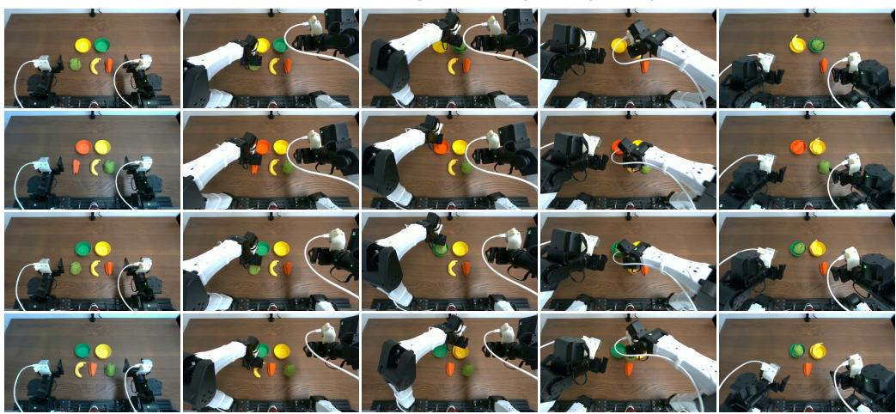

(b) In-Domain Rollout Result  
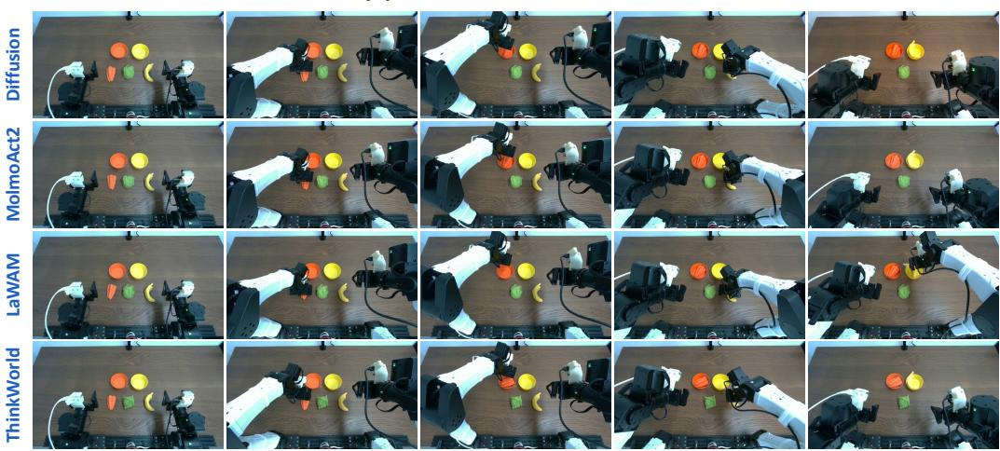

(c) Out-of-Domain Rollout Result  
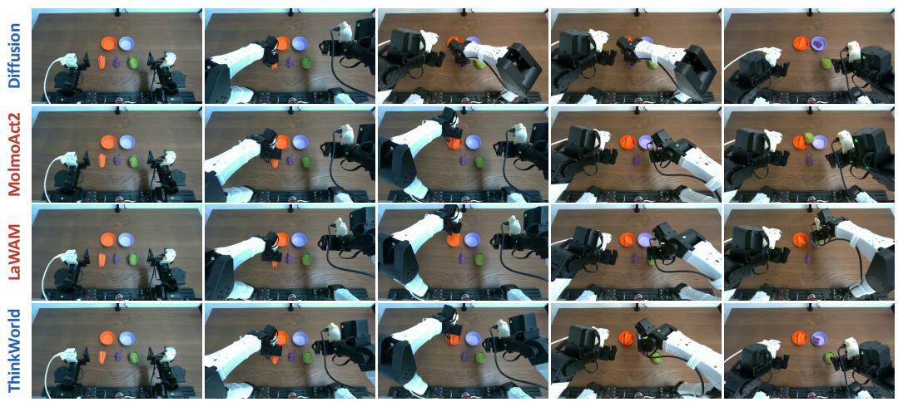  
Figure 10: Real-robot experiment task rollout results. (a) Sample teleoperation demonstrations used for training. (b) In-domain rollouts. (c) Out-of-domain rollouts. Each panel shows qualitative rollout quality for every method, with frames sampled uniformly over an episode and time advancing left to right; the corresponding success rates are reported in Tab. 6.

(a) Cup Hanging Task Sample Trajectory  
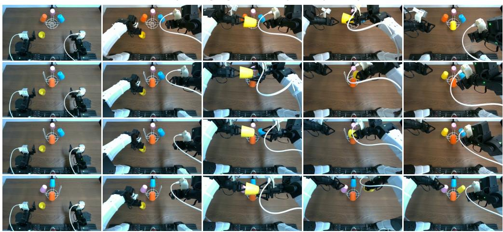

(b) In-Domain Rollout Result  
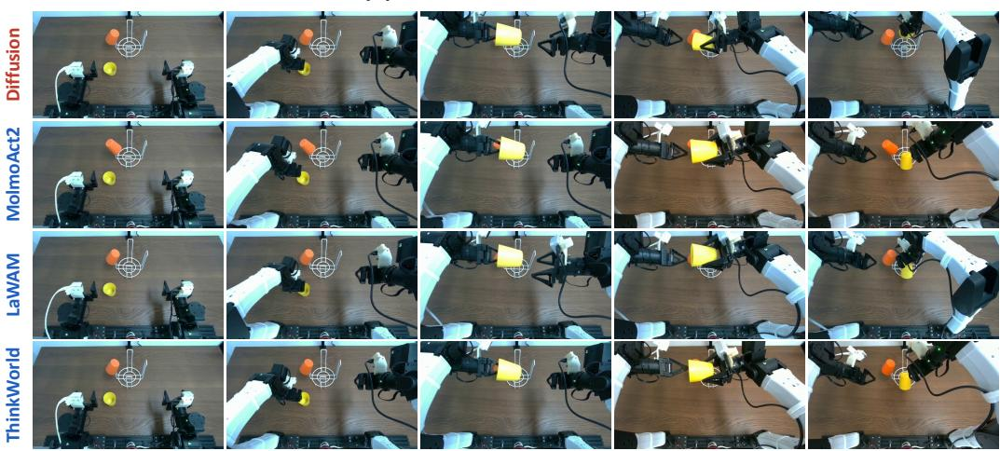

(c) Out-of-Domain Rollout Result  
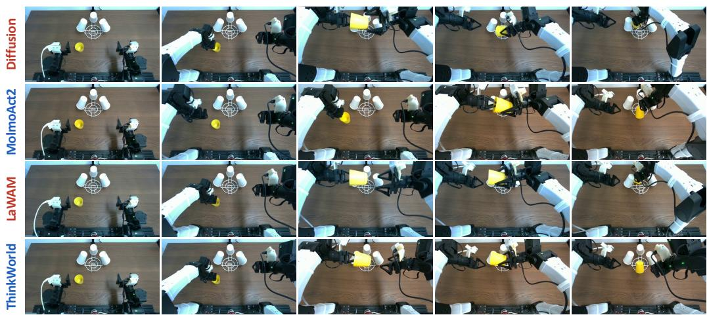  
Figure 10: Real-robot experiment task rollout results. (a) Sample teleoperation demonstrations used for training. (b) In-domain rollouts. (c) Out-of-domain rollouts. Each panel shows qualitative rollout quality for every method, with frames sampled uniformly over an episode and time advancing left to right; the corresponding success rates are reported in Tab. 6.

(a) Sorting Task Sample Trajectory  
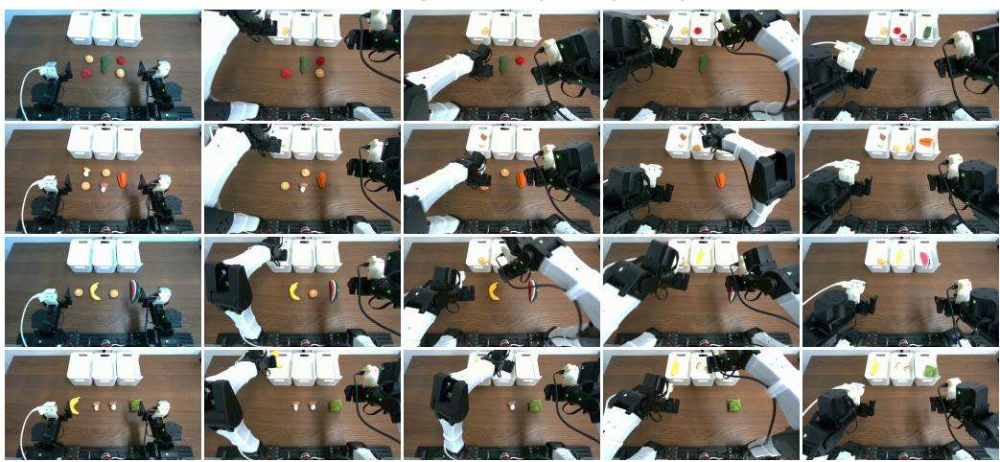

(b) In-Domain Rollout Result  
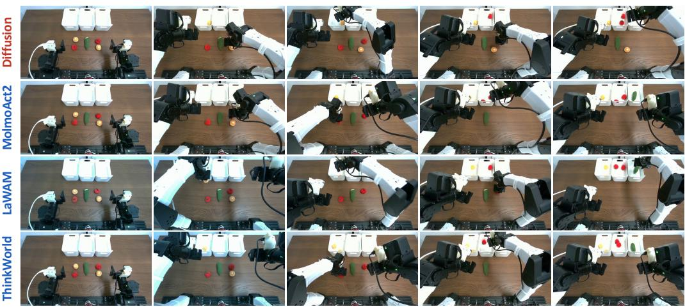

(c) Out-of-Domain Rollout Result  
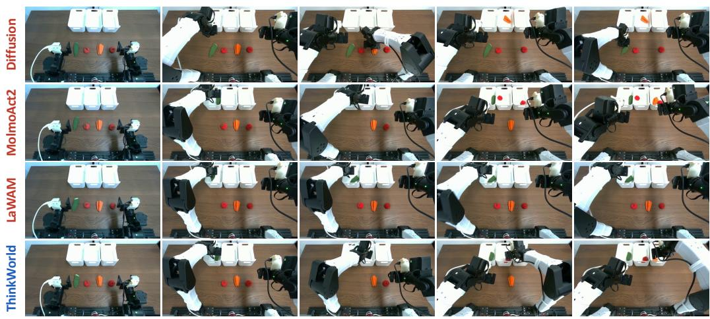  
Figure 10: Real-robot experiment task rollout results. (a) Sample teleoperation demonstrations used for training. (b) In-domain rollouts. (c) Out-of-domain rollouts. Each panel shows qualitative rollout quality for every method, with frames sampled uniformly over an episode and time advancing left to right; the corresponding success rates are reported in Tab. 6.

open → put-L → close  
(a) Atomic Robot Skill Sample Trajectory  
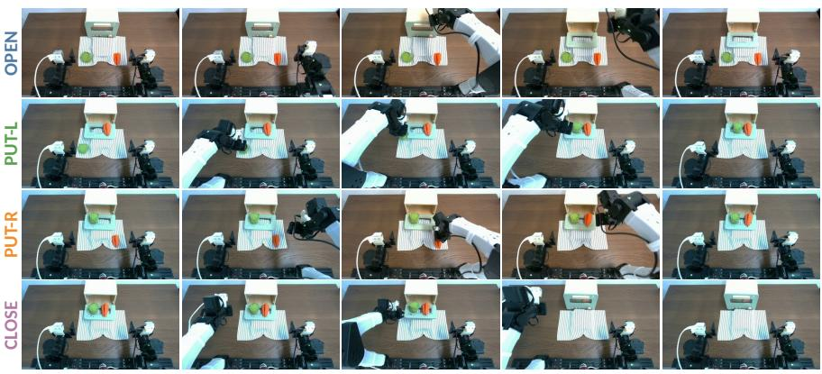

(b) Composite Human Demonstration  
open → close  
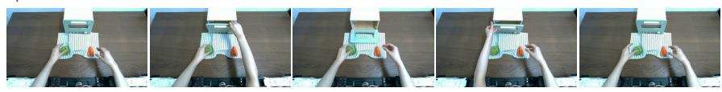

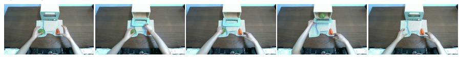

(c) Successful Rollout Result  
“open the oven, then close the oven”  
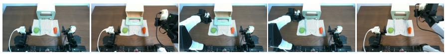  
“open the oven, put the left object in the oven, then close the oven”

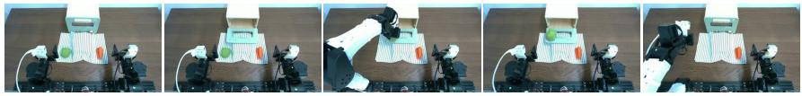  
Figure 11: Real-Robot skill composition sample trajectory and rollout results. (a) Sample atomic robot trajectories for opening the oven (OPEN), placing the left or right object inside (PUT-L, PUT-R), and closing the oven (CLOSE). (b) Human demonstrations that combine these skills into open → close and open → put-L → close sequences. (c) Successful robot rollouts for the corresponding natural-language instructions. Frames in each row progress from left to right.

upper drawer: open → put-L → close  
upper drawer  
(a) Atomic Robot Skill Sample Trajectory  
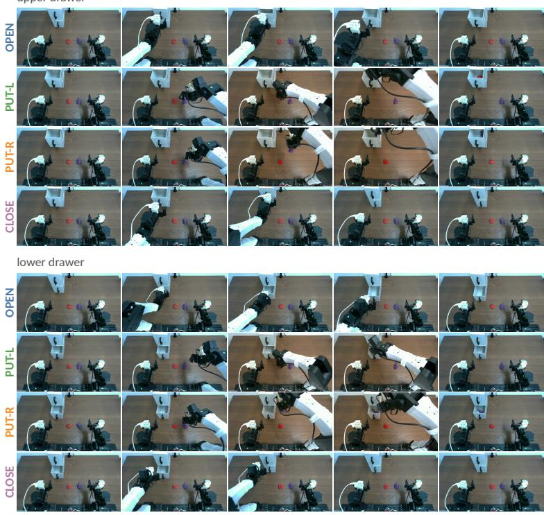

(b) Composite Human Demonstration  
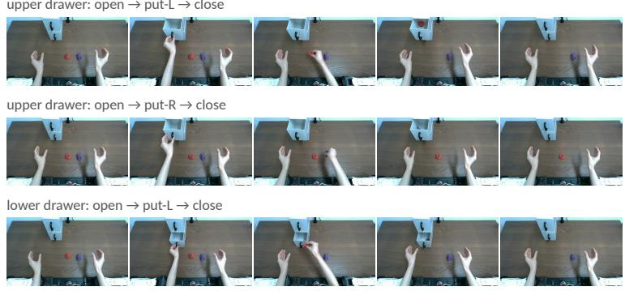

(c) Successful Rollout Result  
“open the upper drawer, put the left object in the upper drawer, then close the upper drawer”  
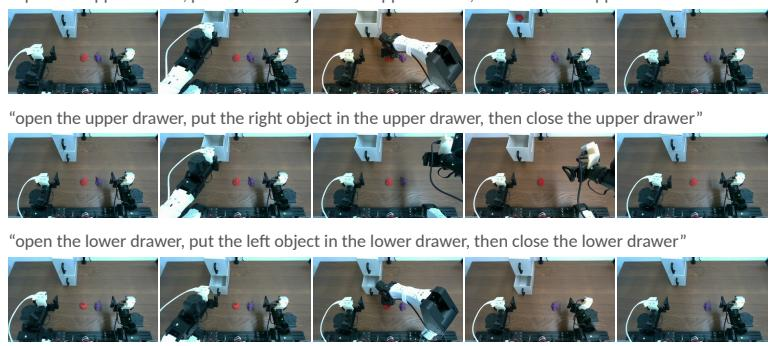  
Figure 11: Real-Robot skill composition sample trajectory and rollout results. (a) Sample atomic robot trajectories for opening the upper or lower drawer (OPEN), placing the left or right object inside (PUT-L, PUT-R), and closing the drawer (CLOSE). (b) Human demonstrations that combine these skills into open → put-L → close and open → put-R → close sequences for the upper drawer, and an open → put-L → close sequence for the lower drawer. (c) Successful robot rollouts for the corresponding natural-language instructions. Frames in each row progress from left to right.

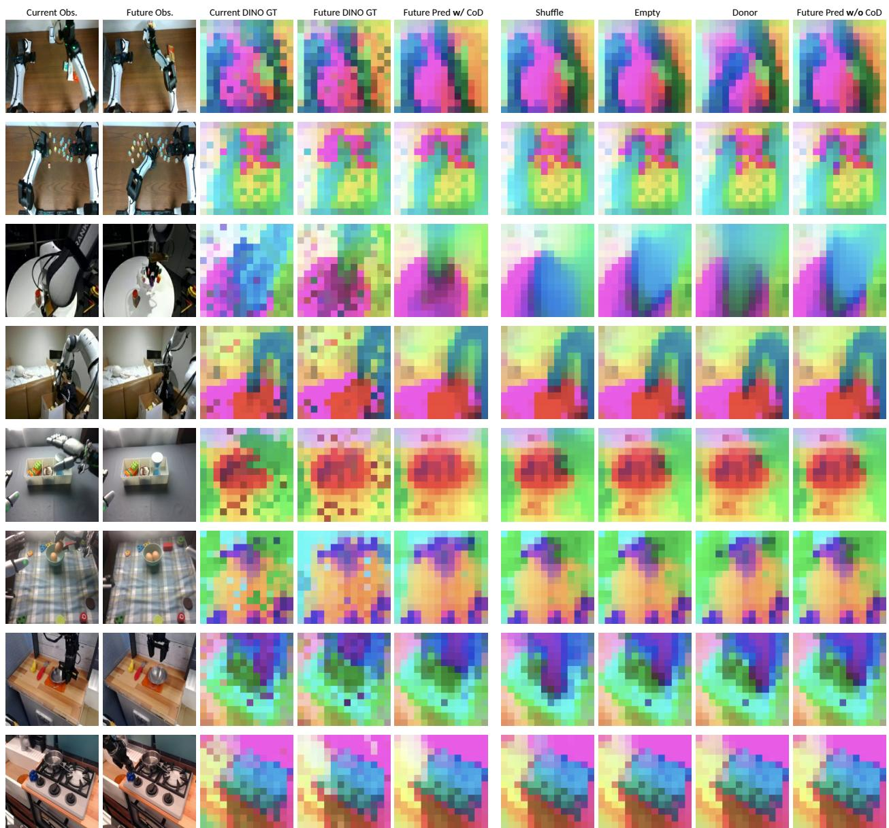  
Figure 12: Qualitative future-prediction results. Each row is one episode. The first two columns show the current and ground-truth future RGB observations, and the next two show PCA projections of the ground-truth DINO features for those frames. The remaining five columns show the predicted future DINO features under diferent CoD conditions: with CoD, shufled CoD, empty CoD, a CoD taken from a diferent (donor) episode, and without CoD. All PCA panels share one color mapping.

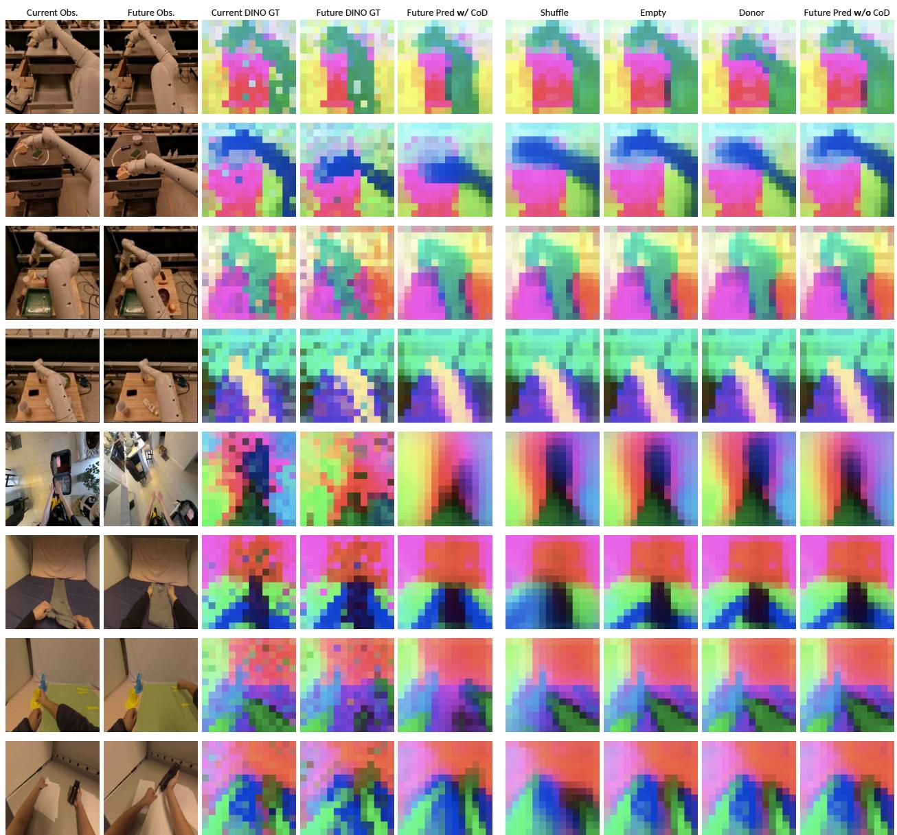  
Figure 12: Qualitative future-prediction results. Each row is one episode. The first two columns show the current and ground-truth future RGB observations, and the next two show PCA projections of the ground-truth DINO features for those frames. The remaining five columns show the predicted future DINO features under diferent CoD conditions: with CoD, shufled CoD, empty CoD, a CoD taken from a diferent (donor) episode, and without CoD. All PCA panels share one color mapping.

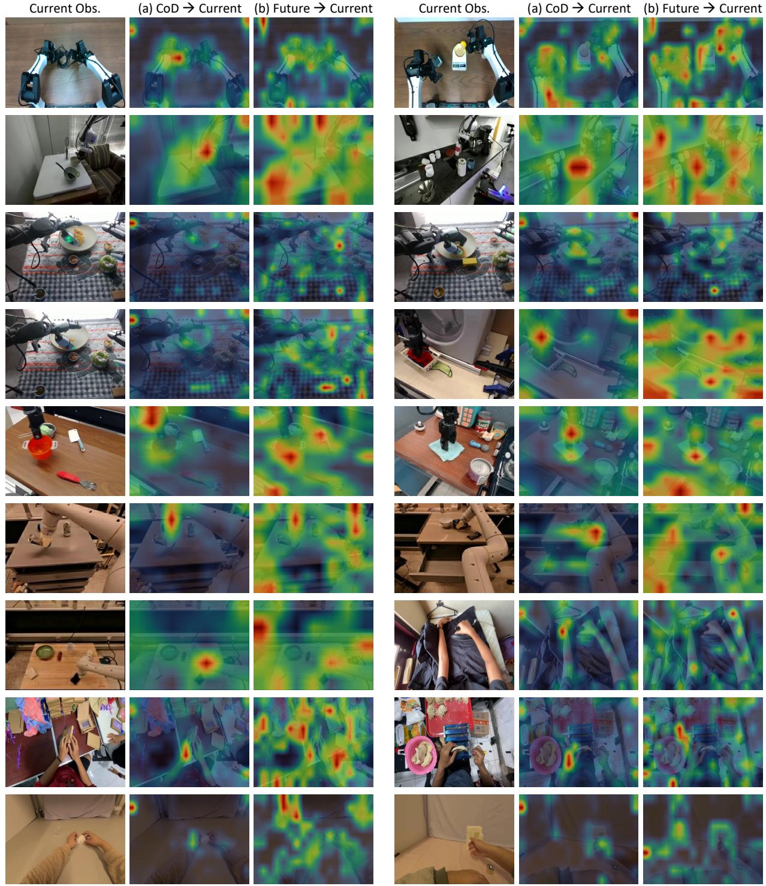  
Figure 13: Additional attention visualizations. Attention maps from CoD and future-prediction tokens to the input observation. CoD attention concentrates on dynamic, task-relevant regions, while future-prediction attention is more broadly distributed across the scene.

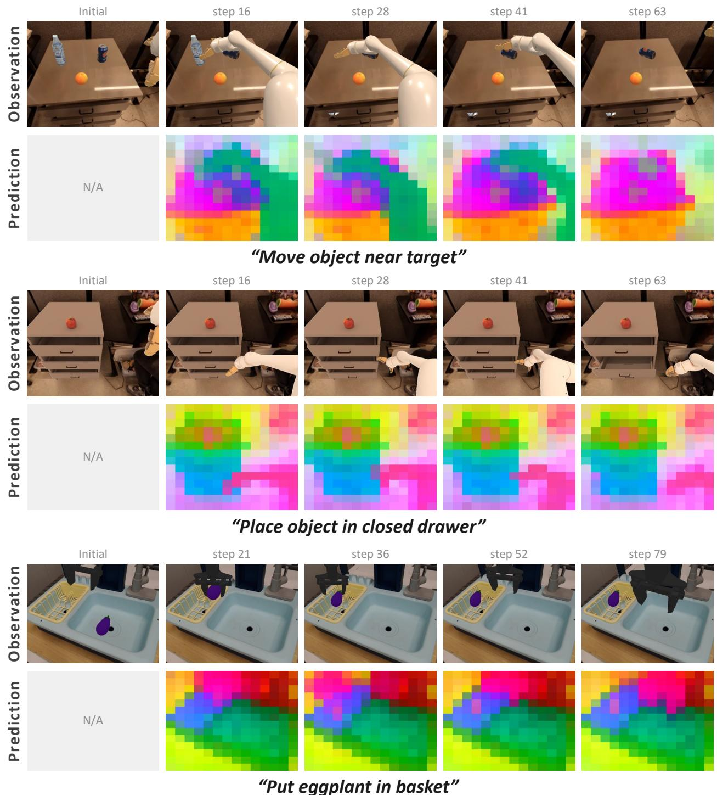  
Figure 14: One-second-ahead future predictions during closed-loop SimplerEnv rollouts. For each task, the upper row shows observations actually reached by the policy, while the lower row shows PCA-projected future representations predicted at the preceding replanning horizon. Each column pairs a prediction with the observation at its target time, so their scene structure should correspond. The close qualitative alignment in layout and task progress shows that the predictions track the states encountered during closed-loop execution. The initial frame has no preceding prediction.

## References

[1] Niket Agarwal, Arslan Ali, Maciej Bala, Yogesh Balaji, Erik Barker, Tifany Cai, Prithvijit Chattopadhyay, Yongxin Chen, Yin Cui, Yifan Ding, et al. Cosmos world foundation model platform for physical ai. arXiv preprint arXiv:2501.03575, 2025. 3

[2] Niket Agarwal, Arslan Ali, Jon Allen, Martin Antolini, Adeline Aubame, Alisson Azzolini, Junjie Bai, Maciej Bala, Yogesh Balaji, Josh Bapst, et al. Cosmos 3: Omnimodal world models for physical ai. arXiv preprint arXiv:2606.02800, 2026. 2, 3

[3] Mahmoud Assran, Adrien Bardes, David Fan, Quentin Garrido, Russell Howes, Mojtaba Komeili, Matthew Muckley, Ammar Rizvi, Claire Roberts, Koustuv Sinha, Artem Zholus, Sergio Arnaud, Abha Gejji, Ada Martin, Francois Robert Hogan, Daniel Dugas, Piotr Bojanowski, Vasil Khalidov, Patrick Labatut, Francisco Massa, Marc Szafraniec, Kapil Krishnakumar, Yong Li, Xiaodong Ma, Sarath Chandar, Franziska Meier, Yann LeCun, Michael Rabbat, and Nicolas Ballas. V-jepa 2: Self-supervised video models enable understanding, prediction and planning. arXiv preprint arXiv:2506.09985, 2025. 2

[4] Shuai Bai, Yuxuan Cai, Ruizhe Chen, Keqin Chen, Xionghui Chen, Zesen Cheng, Lianghao Deng, Wei Ding, Chang Gao, Chunjiang Ge, et al. Qwen3-vl technical report. arXiv preprint arXiv:2511.21631, 2025. 3, 6, 12

[5] Homanga Bharadhwaj, Debidatta Dwibedi, Abhinav Gupta, Shubham Tulsiani, Carl Doersch, Ted Xiao, Dhruv Shah, Fei Xia, Dorsa Sadigh, and Sean Kirmani. Gen2act: Human video generation in novel scenarios enables generalizable robot manipulation. arXiv preprint arXiv:2409.16283, 2024. 3

[6] Johan Bjorck, Fernando Castañeda, Nikita Cherniadev, Xingye Da, Runyu Ding, Linxi Fan, Yu Fang, Dieter Fox, Fengyuan Hu, Spencer Huang, et al. Gr00t n1: An open foundation model for generalist humanoid robots. arXiv preprint arXiv:2503.14734, 2025. 2, 3

[7] Kevin Black, Noah Brown, Danny Driess, Adnan Esmail, Michael Equi, Chelsea Finn, Niccolo Fusai, Lachy Groom, Karol Hausman, Brian Ichter, et al. � : A vision-language-action flow model for general robot control. arXiv preprint arXiv:2410.24164, 2024. 2, 3, 8, 18

[8] Kevin Black, Mitsuhiko Nakamoto, Pranav Atreya, Homer Walke, Chelsea Finn, Aviral Kumar, and Sergey Levine. Zero-shot robotic manipulation with pre-trained image-editing difusion models. In International Conference on Learning Representations, volume 2024, pages 33431–33452, 2024. 3

[9] Anthony Brohan, Noah Brown, Justice Carbajal, Yevgen Chebotar, Xi Chen, Krzysztof Choromanski, Tianli Ding, Danny Driess, Avinava Dubey, Chelsea Finn, et al. Rt-2: Vision-language-action models transfer web knowledge to robotic control. arXiv preprint arXiv:2307.15818, 2023. 2

[10] Qingwen Bu, Yanting Yang, Jisong Cai, Shenyuan Gao, Guanghui Ren, Maoqing Yao, Ping Luo, and Hongyang Li. Univla: Learning to act anywhere with task-centric latent actions. arXiv preprint arXiv:2505.06111, 2025. 2

[11] Remi Cadene, Simon Alibert, Alexander Soare, Quentin Gallouedec, Adil Zouitine, Steven Palma, Pepijn Kooijmans, Michel Aractingi, Mustafa Shukor, Dana Aubakirova, Martino Russi, Francesco Capuano, Caroline Pascal, Jade Choghari, Khalil Meftah, Maxime Ellerbach, Jess Moss, and Thomas Wolf. Lerobot: State-of-the-art machine learning for real-world robotics in pytorch. https://github.com/huggingface/ lerobot, 2024. 16

[12] Junhao Cai, Zetao Cai, Jiafei Cao, Yilun Chen, Zeyu He, Lei Jiang, Hang Li, Hengjie Li, Yang Li, Yufei Liu, et al. Internvla-a1: Unifying understanding, generation and action for robotic manipulation. arXiv preprint arXiv:2601.02456, 2026. 2, 3

[13] Jun Cen, Chaohui Yu, Hangjie Yuan, Yuming Jiang, Siteng Huang, Jiayan Guo, Xin Li, Yibing Song, Hao Luo, Fan Wang, et al. Worldvla: Towards autoregressive action world model. arXiv preprint arXiv:2506.21539, 2025. 3

[14] Guo Chen, Zhiqi Li, Shihao Wang, Jindong Jiang, Yicheng Liu, Lidong Lu, De-An Huang, Wonmin Byeon, Matthieu Le, Max Ehrlich, et al. Eagle 2.5: Boosting long-context post-training for frontier vision-language models. Advances in Neural Information Processing Systems, 38:91077–91100, 2026. 3

[15] Jialei Chen, Kai Wang, Kang Chen, Shuaihang Chen, Feng Gao, Wenhao Tang, Zhiyuan Li, Weilin Liu, Zhuyu Yao, Boxun Li, et al. Lawam: Latent world action models for eficient dynamics-aware robot policies. arXiv preprint arXiv:2606.15768, 2026. 7

[16] William Chen, Suneel Belkhale, Suvir Mirchandani, Oier Mees, Danny Driess, Karl Pertsch, and Sergey Levine. Training strategies for eficient embodied reasoning. arXiv preprint arXiv:2505.08243, 2025. 5

[17] Xinyi Chen, Yilun Chen, Yanwei Fu, Ning Gao, Jiaya Jia, Weiyang Jin, Hao Li, Yao Mu, Jiangmiao Pang, Yu Qiao, et al. Internvla-m1: A spatially guided vision-language-action framework for generalist robot policy. arXiv preprint arXiv:2510.13778, 2025. 3

[18] Yi Chen, Yuying Ge, Weiliang Tang, Yizhuo Li, Yixiao Ge, Mingyu Ding, Ying Shan, and Xihui Liu. Moto: Latent motion token as the bridging language for learning robot manipulation from videos. In 2025 IEEE/CVF International Conference on Computer Vision (ICCV), pages 19752–19763. IEEE, 2025. 3

[19] Cheng Chi, Zhenjia Xu, Siyuan Feng, Eric Cousineau, Yilun Du, Benjamin Burchfiel, Russ Tedrake, and Shuran Song. Difusion policy: Visuomotor policy learning via action difusion. The International Journal of Robotics Research, page 02783649241273668, 2023. 7

[20] Christopher Clark, Jieyu Zhang, Zixian Ma, Jae Sung Park, Rohun Tripathi, Sangho Lee, Mohammadreza Salehi, Jason Ren, Chris Dongjoo Kim, Yinuo Yang, et al. Molmo2: Open weights and data for visionlanguage models with video understanding and grounding. In Proceedings of the IEEE/CVF Conference on Computer Vision and Pattern Recognition, pages 28652–28668, 2026. 14

[21] Weisheng Dai, Kai Lan, Jianyi Zhou, Bo Zhao, Xiu Su, Junwen Tong, Weili Guan, and Shuo Yang. Conla: Contrastive latent action learning from human videos for robotic manipulation. arXiv preprint arXiv:2602.00557, 2026. 2

[22] Matt Deitke, Christopher Clark, Sangho Lee, Rohun Tripathi, Yue Yang, Jae Sung Park, Mohammadreza Salehi, Niklas Muennighof, Kyle Lo, Luca Soldaini, et al. Molmo and pixmo: Open weights and open data for state-of-the-art vision-language models. In 2025 IEEE/CVF Conference on Computer Vision and Pattern Recognition (CVPR), pages 91–104. IEEE, 2025. 14

[23] Danny Driess, Jost Springenberg, Brian Ichter, Lili Yu, Adrian Li-Bell, Karl Pertsch, Allen Ren, Homer Walke, Quan Vuong, Lucy Xiaoyang Shi, et al. Knowledge insulating vision-language-action models: Train fast, run fast, generalize better. Advances in Neural Information Processing Systems, 38:102867–102888, 2026. 6

[24] Yilun Du, Sherry Yang, Bo Dai, Hanjun Dai, Ofir Nachum, Josh Tenenbaum, Dale Schuurmans, and Pieter Abbeel. Learning universal policies via text-guided video generation. Advances in neural information processing systems, 36:9156–9172, 2023. 3

[25] Haoquan Fang, Jiafei Duan, Donovan Clay, Sam Wang, Shuo Liu, Weikai Huang, Xiang Fan, Wei-Chuan Tsai, Shirui Chen, Yi Ru Wang, et al. Molmoact2: Action reasoning models for real-world deployment. arXiv preprint arXiv:2605.02881, 2026. 2, 3, 6, 7, 12, 13, 14

[26] Senyu Fei, Siyin Wang, Junhao Shi, Zihao Dai, Jikun Cai, Pengfang Qian, Li Ji, Xinzhe He, Shiduo Zhang, Zhaoye Fei, Jinlan Fu, Jingjing Gong, and Xipeng Qiu. Libero-plus: A progressive robustness benchmark for visual-language-action models. In Proceedings of the IEEE/CVF Conference on Computer Vision and Pattern Recognition (CVPR), pages 38574–38583, June 2026. 18

[27] Shenyuan Gao, William Liang, Kaiyuan Zheng, Ayaan Malik, Seonghyeon Ye, Sihyun Yu, Wei-Cheng Tseng, Yuzhu Dong, Kaichun Mo, Chen-Hsuan Lin, et al. Dreamdojo: A generalist robot world model from large-scale human videos. arXiv preprint arXiv:2602.06949, 2026. 3

[28] Danijar Hafner, Jurgis Pasukonis, Jimmy Ba, and Timothy Lillicrap. Mastering diverse domains through world models. arXiv preprint arXiv:2301.04104, 2023. 3

[29] Danijar Hafner, Wilson Yan, and Timothy Lillicrap. Training agents inside of scalable world models. arXiv preprint arXiv:2509.24527, 2025. 3

[30] Ryan Hoque, Peide Huang, David Yoon, Jian Zhang, et al. Egodex: Learning dexterous manipulation from large-scale egocentric video. In International Conference on Learning Representations, volume 2026, pages 4218–4237, 2026. 6, 14

[31] Chi-Pin Huang, Yen-Siang Wu, Hung-Kai Chung, Kai-Po Chang, Fu-En Yang, and Yu-Chiang Frank Wang. Videomage: Multi-subject and motion customization of text-to-video difusion models. In 2025 IEEE/CVF Conference on Computer Vision and Pattern Recognition (CVPR), pages 17603–17612. IEEE, 2025. 3

[32] Chi-Pin Huang, Yunze Man, Zhiding Yu, Min-Hung Chen, Jan Kautz, Yu-Chiang Frank Wang, and Fu-En Yang. Fast-thinkact: Eficient vision-language-action reasoning via verbalizable latent planning. arXiv preprint arXiv:2601.09708, 2026. 2, 3

[33] Chi-Pin Huang, Yueh-Hua Wu, Min-Hung Chen, Frank Wang, and Fu-En Yang. Thinkact: Vision-languageaction reasoning via reinforced visual latent planning. Advances in Neural Information Processing Systems, 38:82782–82802, 2026. 2, 3

[34] Physical Intelligence, Kevin Black, Noah Brown, James Darpinian, Karan Dhabalia, Danny Driess, Adnan Esmail, Michael Equi, Chelsea Finn, Niccolo Fusai, et al. �0. 5: a vision-language-action model with open-world generalization, 2025. URL https://arxiv. org/abs/2504.16054, 1(2):3, 2025. 2, 3, 5, 8

[35] Eric Jang, Alex Irpan, Mohi Khansari, Daniel Kappler, Frederik Ebert, Corey Lynch, Sergey Levine, and Chelsea Finn. BC-z: Zero-shot task generalization with robotic imitation learning. In 5th Annual Conference on Robot Learning, 2021. URL https://openreview.net/forum?id=8kbp23tSGYv. 6, 14

[36] Simar Kareer, Dhruv Patel, Ryan Punamiya, Pranay Mathur, Shuo Cheng, Chen Wang, Judy Hofman, and Danfei Xu. Egomimic: Scaling imitation learning via egocentric video. In 2025 IEEE International Conference on Robotics and Automation (ICRA), pages 13226–13233. IEEE, 2025. 2

[37] Alexander Khazatsky, Karl Pertsch, Suraj Nair, Ashwin Balakrishna, Sudeep Dasari, Siddharth Karamcheti, Soroush Nasiriany, Mohan Kumar Srirama, Lawrence Yunliang Chen, Kirsty Ellis, et al. Droid: A large-scale in-the-wild robot manipulation dataset. arXiv preprint arXiv:2403.12945, 2024. 14

[38] Chaehyun Kim, Heeseong Shin, Eunbeen Hong, Heeji Yoon, Anurag Arnab, Paul Hongsuck Seo, Sunghwan Hong, and Seungryong Kim. Seg4dif: Unveiling open-vocabulary segmentation in text-to-image difusion transformers. arXiv preprint arXiv:2509.18096, 2025. 3

[39] Ji Woong Kim, Ke Wang, Zipeng Fu, Sirui Chen, Cong Zhao, Jef Lai, and Chelsea Finn. Ego-pi: Vla fine-tuning for ego-centric human and robot data. arXiv preprint arXiv:2606.08107, 2026. 3

[40] Jisoo Kim, Jungbin Cho, Sanghyeok Chu, Ananya Bal, Jinhyung Kim, Gunhee Lee, Sihaeng Lee, Seung Hwan Kim, Bohyung Han, Hyunmin Lee, et al. Pri4r: Learning world dynamics for vision-languageaction models with privileged 4d representation. arXiv preprint arXiv:2603.01549, 2026. 3

[41] Moo Jin Kim, Karl Pertsch, Siddharth Karamcheti, Ted Xiao, Ashwin Balakrishna, Suraj Nair, Rafael Rafailov, Ethan Foster, Grace Lam, Pannag Sanketi, Quan Vuong, Thomas Kollar, Benjamin Burchfiel, Russ Tedrake, Dorsa Sadigh, Sergey Levine, Percy Liang, and Chelsea Finn. Openvla: An open-source vision-language-action model. arXiv preprint arXiv:2406.09246, 2024. 2, 3, 8, 18

[42] Moo Jin Kim, Yihuai Gao, Tsung-Yi Lin, Yen-Chen Lin, Yunhao Ge, Grace Lam, Percy Liang, Shuran Song, Ming-Yu Liu, Chelsea Finn, et al. Cosmos policy: Fine-tuning video models for visuomotor control and planning. arXiv preprint arXiv:2601.16163, 2026. 3

[43] Jason Lee, Jiafei Duan, Haoquan Fang, Yuquan Deng, Shuo Liu, Boyang Li, Bohan Fang, Jieyu Zhang, Yi Ru Wang, Sangho Lee, et al. Molmoact: Action reasoning models that can reason in space. arXiv preprint arXiv:2508.07917, 2025. 2, 3, 8

[44] Baoyu Li, Xinchen Yin, Mengying Lin, Yixin Zhang, and Danfei Xu. Egowam: World action models beyond pixels with in-the-wild egocentric human data. In Robot World Models, 2026. 3

[45] Hongyu Li, Bowen Wen, Xinghao Zhu, Yixuan Wang, Yilun Du, Yunzhu Li, George Konidaris, Stan Birchfield, Soha Pouya, Chenran Li, et al. Hydra-0: Action flow for generalist world modeling and control. arXiv preprint arXiv:2608.18077, 2026. 3

[46] Wei Li, Peijin Jia, Yuan Ma, Xuefeng Jiang, Titong Jiang, Sheng Sun, Yujian Li, Xin Wen, Han Hong, Zhikang Liu, et al. Fomovla: Bridging visual foresight and motion guidance for vision-language-action models. arXiv preprint arXiv:2607.14739, 2026. 2, 3

[47] Xuanlin Li, Kyle Hsu, Jiayuan Gu, Karl Pertsch, Oier Mees, Homer Rich Walke, Chuyuan Fu, Ishikaa Lunawat, Isabel Sieh, Sean Kirmani, et al. Evaluating real-world robot manipulation policies in simulation. arXiv preprint arXiv:2405.05941, 2024. 17

[48] Zhiqi Li, Guo Chen, Shilong Liu, Shihao Wang, Vibashan VS, Yishen Ji, Shiyi Lan, Hao Zhang, Yilin Zhao, Subhashree Radhakrishnan, et al. Eagle 2: Building post-training data strategies from scratch for frontier vision-language models. arXiv preprint arXiv:2501.14818, 2025. 3

[49] Bo Liu, Yifeng Zhu, Chongkai Gao, Yihao Feng, Qiang Liu, Yuke Zhu, and Peter Stone. Libero: Benchmarking knowledge transfer for lifelong robot learning. Advances in Neural Information Processing Systems, 36:44776–44791, 2023. 7, 15

[50] Isabella Liu, An-Chieh Cheng, Rui Yan, Geng Chen, Ri-Zhao Qiu, Xueyan Zou, Sha Yi, Hongxu Yin, Xiaolong Wang, and Sifei Liu. Long-horizon manipulation via trace-conditioned vla planning. arXiv preprint arXiv:2604.21924, 2026. 3

[51] Shih-Yang Liu, Xin Dong, Ximing Lu, Shizhe Diao, Peter Belcak, Mingjie Liu, Min-Hung Chen, Hongxu Yin, Yu-Chiang Frank Wang, Kwang-Ting Cheng, et al. Gdpo: Group reward-decoupled normalization policy optimization for multi-reward rl optimization. arXiv preprint arXiv:2601.05242, 2026. 6

[52] Yangcen Liu, Shuo Cheng, Xinchen Yin, Woo Chul Shin, Alfred Cueva, Yiran Yang, Zhenyang Chen, Chuye Zhang, and Danfei Xu. Egoengine: From egocentric human videos to high-fidelity dexterous robot demonstrations. arXiv preprint arXiv:2606.12604, 2026. 2

[53] Zhijian Liu, Ligeng Zhu, Baifeng Shi, Zhuoyang Zhang, Yuming Lou, Shang Yang, Haocheng Xi, Shiyi Cao, Yuxian Gu, Dacheng Li, et al. Nvila: Eficient frontier visual language models. In 2025 IEEE/CVF Conference on Computer Vision and Pattern Recognition (CVPR), pages 4122–4134. IEEE, 2025. 3

[54] Jack Lu, Yurong You, Boyi Li, Yulong Cao, Thomas Tian, Chaowei Xiao, Xiangyu Chen, Wenjie Luo, Boris Ivanovic, Marco Pavone, et al. Tacitvla: Reasoning vision-language-action models without reasoning latency. arXiv preprint arXiv:2610.17540, 2026. 3

[55] Abby O’Neill, Abdul Rehman, Abhiram Maddukuri, Abhishek Gupta, Abhishek Padalkar, Abraham Lee, Acorn Pooley, Agrim Gupta, Ajay Mandlekar, Ajinkya Jain, et al. Open x-embodiment: Robotic learning datasets and rt-x models: Open x-embodiment collaboration 0. In 2024 IEEE International Conference on Robotics and Automation (ICRA), pages 6892–6903. IEEE, 2024. 2, 6, 14

[56] Jonas Pai, Liam Achenbach, Victoriano Montesinos, Benedek Forrai, Oier Mees, and Elvis Nava. mimicvideo: Video-action models for generalizable robot control beyond vlas. arXiv preprint arXiv:2512.15692, 2025. 3

[57] Karl Pertsch, Kyle Stachowicz, Brian Ichter, Danny Driess, Suraj Nair, Quan Vuong, Oier Mees, Chelsea Finn, and Sergey Levine. Fast: Eficient action tokenization for vision-language-action models. arXiv preprint arXiv:2501.09747, 2025. 5, 13

[58] Ryan Punamiya, Simar Kareer, Zeyi Liu, Josh Citron, Ri-Zhao Qiu, Xiongyi Cai, Alexey Gavryushin, Jiaqi Chen, Davide Liconti, Lawrence Y Zhu, et al. Egoverse: An egocentric human dataset for robot learning from around the world. arXiv preprint arXiv:2604.07607, 2026. 6, 14

[59] Sandeep Kumar Routray, Hengkai Pan, Unnat Jain, Shikhar Bahl, and Deepak Pathak. Vipra: Video prediction for robot actions. In International Conference on Learning Representations, volume 2026, pages 68823–68857, 2026. 3

[60] Pierre Sermanet, Tianli Ding, Jefrey Zhao, Fei Xia, Debidatta Dwibedi, Keerthana Gopalakrishnan, Christine Chan, Gabriel Dulac-Arnold, Sharath Maddineni, Nikhil J Joshi, Pete Florence, Wei Han, Robert Baruch, Yao Lu, Suvir Mirchandani, Peng Xu, Pannag Sanketi, Karol Hausman, Izhak Shafran, Brian Ichter, and Yuan Cao. Robovqa: Multimodal long-horizon reasoning for robotics. In arXiv preprint arXiv:2311.00899, 2023. 14

[61] Ketul Shah, Robert Crandall, Jie Xu, Peng Zhou, Vipin Pillai, Marian George, Mayank Bansal, and Rama Chellappa. Mv2mae: Self-supervised video pre-training with motion-aware multi-view masked autoencoders. Transactions on Machine Learning Research, 2026. 5

[62] Zhihong Shao, Peiyi Wang, Qihao Zhu, Runxin Xu, Junxiao Song, Xiao Bi, Haowei Zhang, Mingchuan Zhang, YK Li, Y Wu, et al. Deepseekmath: Pushing the limits of mathematical reasoning in open language models. arXiv preprint arXiv:2402.03300, 2024. 6

[63] Oriane Siméoni, Huy V Vo, Maximilian Seitzer, Federico Baldassarre, Maxime Oquab, Cijo Jose, Vasil Khalidov, Marc Szafraniec, Seungeun Yi, Michaël Ramamonjisoa, et al. Dinov3. arXiv preprint arXiv:2508.10104, 2025. 5, 6, 12

[64] Jingwen Sun, Wenyao Zhang, Zekun Qi, Shaojie Ren, Zezhi Liu, Hanxin Zhu, Guangzhong Sun, Xin Jin, and Zhibo Chen. Vla-jepa: Enhancing vision-language-action model with latent world model. In European Conference on Computer Vision, pages 478–497. Springer, 2026. 2, 3, 8

[65] Nan Sun, Yuan Zhang, Yongkun Yang, Wentao Zhao, Peiyan Li, Jun Guo, Wenxuan Song, Pengxiang Ding, Runze Suo, Yifei Su, et al. Revisiting embodied chain-of-thought for generalizable robot manipulation. arXiv preprint arXiv:2606.03784, 2026. 5

[66] Gemini Robotics Team, Saminda Abeyruwan, Joshua Ainslie, Jean-Baptiste Alayrac, Montserrat Gonzalez Arenas, Travis Armstrong, Ashwin Balakrishna, Robert Baruch, Maria Bauza, Michiel Blokzijl, et al. Gemini robotics: Bringing ai into the physical world. arXiv preprint arXiv:2503.20020, 2025. 3

[67] Octo Model Team, Dibya Ghosh, Homer Walke, Karl Pertsch, Kevin Black, Oier Mees, Sudeep Dasari, Joey Hejna, Tobias Kreiman, Charles Xu, et al. Octo: An open-source generalist robot policy. arXiv preprint arXiv:2405.12213, 2024. 2

[68] Fabio Tosi, Pierluigi Zama Ramirez, and Matteo Poggi. Difusion models for monocular depth estimation: Overcoming challenging conditions. In European Conference on Computer Vision, pages 236–257. Springer, 2024. 3

[69] Homer Walke, Kevin Black, Abraham Lee, Moo Jin Kim, Max Du, Chongyi Zheng, Tony Zhao, Philippe Hansen-Estruch, Quan Vuong, Andre He, Vivek Myers, Kuan Fang, Chelsea Finn, and Sergey Levine. Bridgedata v2: A dataset for robot learning at scale. In Conference on Robot Learning (CoRL), 2023. 14

[70] Team Wan, Ang Wang, Baole Ai, Bin Wen, Chaojie Mao, Chen-Wei Xie, Di Chen, Feiwu Yu, Haiming Zhao, Jianxiao Yang, et al. Wan: Open and advanced large-scale video generative models. arXiv preprint arXiv:2503.20314, 2025. 3

[71] Qiuyue Wang, Mingsheng Li, Jian Guan, Jinhui Ye, Sicheng Xie, Yitao Liu, Junhao Chen, Zhixuan Liang, Jie Zhang, Xintong Hu, et al. Qwen-vla: Unifying vision-language-action modeling across tasks, environments, and robot embodiments. arXiv preprint arXiv:2605.30280, 2026. 3

[72] Shihan Wu, Xuecheng Liu, Shaoxuan Xie, Pengwei Wang, Xinghang Li, Bowen Yang, Zhe Li, Kai Zhu, Hongyu Wu, Yiheng Liu, et al. Robocoin: An open-sourced bimanual robotic data collection for integrated manipulation. arXiv preprint arXiv:2511.17441, 2025. 6, 14

[73] Jiarui Xu, Sifei Liu, Arash Vahdat, Wonmin Byeon, Xiaolong Wang, and Shalini De Mello. Open-vocabulary panoptic segmentation with text-to-image difusion models. In 2023 IEEE/CVF conference on computer vision and pattern recognition (CVPR), pages 2955–2966. IEEE, 2023. 3

[74] Ruihan Yang, Qinxi Yu, Yecheng Wu, Rui Yan, Borui Li, An-Chieh Cheng, Xueyan Zou, Yunhao Fang, Xuxin Cheng, Ri-Zhao Qiu, et al. Egovla: Learning vision-language-action models from egocentric human videos. arXiv preprint arXiv:2507.12440, 2025. 3

[75] Hanrong Ye, Chao-Han Huck Yang, Arushi Goel, Wei Huang, Zhen Wan, Jinchuan Tian, An-Chieh Cheng, Ligeng Zhu, Yuanhang Su, Yuming Lou, et al. Omnivinci: Enhancing architecture and data for omnimodal understanding llm. In International Conference on Learning Representations, volume 2026, pages 56101–56138, 2026. 3

[76] Seonghyeon Ye, Joel Jang, Byeongguk Jeon, Se June Joo, Jianwei Yang, Baolin Peng, Ajay Mandlekar, Reuben Tan, Yu-Wei Chao, Bill Yuchen Lin, et al. Latent action pretraining from videos. In International Conference on Learning Representations, volume 2025, pages 28213–28239, 2025. 2, 3

[77] Seonghyeon Ye, Yunhao Ge, Kaiyuan Zheng, Shenyuan Gao, Sihyun Yu, George Kurian, Suneel Indupuru, You Liang Tan, Chuning Zhu, Jiannan Xiang, et al. World action models are zero-shot policies. arXiv preprint arXiv:2602.15922, 2026. 3

[78] Wentao Yuan, Jiafei Duan, Valts Blukis, Wilbert Pumacay, Ranjay Krishna, Adithyavairavan Murali, Arsalan Mousavian, and Dieter Fox. Robopoint: A vision-language model for spatial afordance prediction in robotics. In Pulkit Agrawal, Oliver Kroemer, and Wolfram Burgard, editors, Proceedings of The 8th Conference on Robot Learning, volume 270 of Proceedings of Machine Learning Research, pages 4005–4020. PMLR, 06–09 Nov 2025. URL https://proceedings.mlr.press/v270/yuan25c.html. 14

[79] Michał Zawalski, William Chen, Karl Pertsch, Oier Mees, Chelsea Finn, and Sergey Levine. Robotic control via embodied chain-of-thought reasoning. arXiv preprint arXiv:2407.08693, 2024. 2, 3

[80] Wenyao Zhang, Hongsi Liu, Zekun Qi, Yunnan Wang, Xinqiang Yu, Jiazhao Zhang, Runpei Dong, Jiawei He, He Wang, Zhizheng Zhang, et al. Dreamvla: a vision-language-action model dreamed with comprehensive world knowledge. Advances in Neural Information Processing Systems, 38:24195–24228, 2026. 2, 3, 18

[81] Qingqing Zhao, Yao Lu, Moo Jin Kim, Zipeng Fu, Zhuoyang Zhang, Yecheng Wu, Zhaoshuo Li, Qianli Ma, Song Han, Chelsea Finn, et al. Cot-vla: Visual chain-of-thought reasoning for vision-languageaction models. In 2025 IEEE/CVF Conference on Computer Vision and Pattern Recognition (CVPR), pages 1702–1713. IEEE, 2025. 3

[82] Ruijie Zheng, Dantong Niu, Yuqi Xie, Jing Wang, Mengda Xu, Yunfan Jiang, Fernando Castañeda, Fengyuan Hu, You Liang Tan, Letian Fu, et al. Egoscale: Scaling dexterous manipulation with diverse egocentric human data. arXiv preprint arXiv:2602.16710, 2026. 2, 3

[83] Linqing Zhong, Yi Liu, Yifei Wei, Ziyu Xiong, Maoqing Yao, Si Liu, and Guanghui Ren. Acot-vla: Action chain-of-thought for vision-language-action models. arXiv preprint arXiv:2601.11404, 2026. 2, 3

[84] Gaoyue Zhou, Hengkai Pan, Yann LeCun, and Lerrel Pinto. Dino-wm: World models on pre-trained visual features enable zero-shot planning. arXiv preprint arXiv:2411.04983, 2024. 2, 5

[85] Xueyang Zhou, Yangming Xu, Guiyao Tie, Yongchao Chen, Guowen Zhang, Duanfeng Chu, Pan Zhou, and Lichao Sun. Libero-pro: Towards robust and fair evaluation of vision-language-action models beyond memorization. arXiv preprint arXiv:2510.03827, 2025. 7