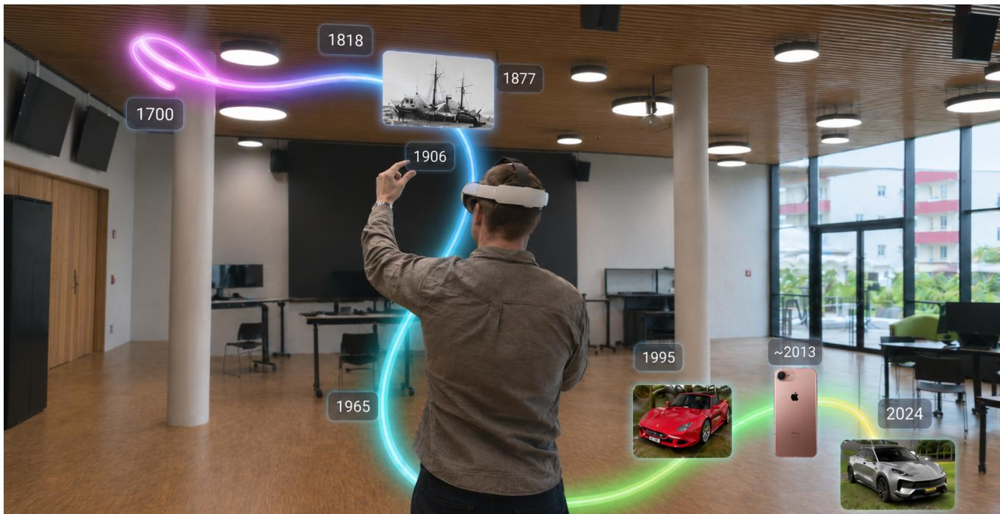
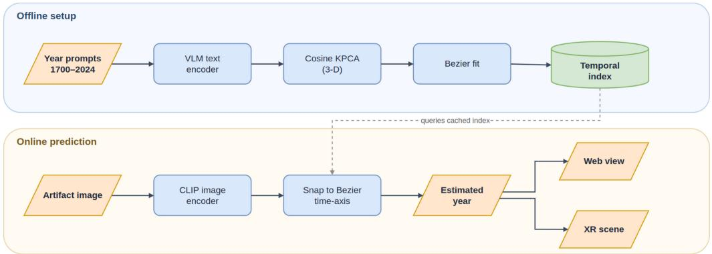
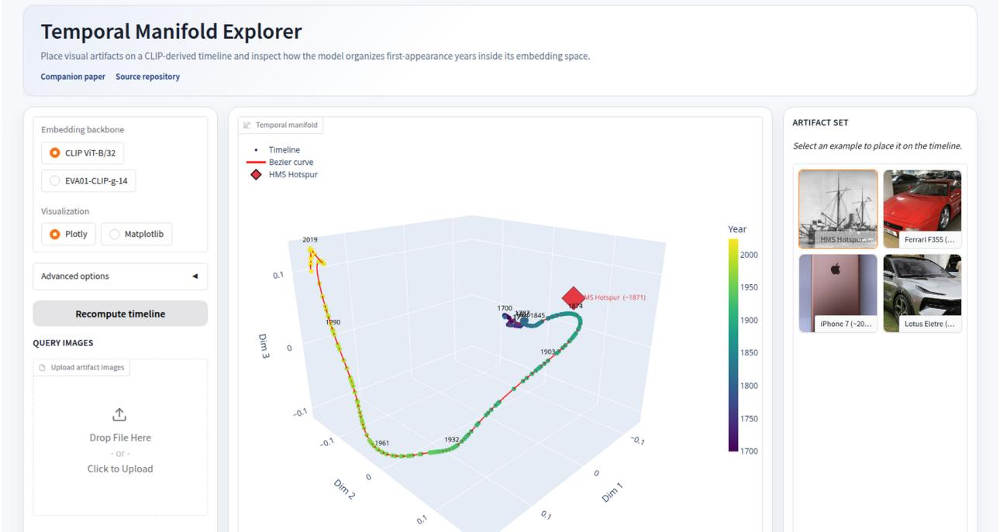

# TimeLineXR: An Interactive Exploration of Time in Vision-Language Models

Nidham Tekaya∗

Univ. of Applied Sciences St. Polten¨ TU Wien

St. Polten / Vienna, Austria¨ nidham.tekaya@ustp.at

Markus Passecker

Univ. of Applied Sciences St. Polten ¨ TU Wien

St. Polten / Vienna, Austria¨ markus.passecker@ustp.at

Matthias Zeppelzauer Univ. of Applied Sciences St. Polten¨ St. Polten, Austria¨ matthias.zeppelzauer@ustp.at

  
Fig. 1: TimeLineXR in mixed reality. A user explores a vision-language model’s time axis at room scale; when an image card is thrown into the scene, the system places it at its estimated year of first appearance on the time axis. The supplementary video shows this XR workflow and the corresponding browser workflow.

Abstract—Recently, it has been shown that vision-language models (VLMs) have a certain intrinsic understanding of time. They can estimate the temporal origin of objects and encode time along a low-dimensional, non-linear manifold inside their embedding space [1]. That result is quantitative and reproducible, but the structure itself stays out of reach for end users: they cannot see it, query it with their own images, or inspect where a query lands relative to other years on the time axis. We present TimeLineXR, an interactive demonstration that turns this time axis into an explorable 3D scene. A web demo lets users upload or select images and see each placed on a color-coded 3D time axis; a Three.js WebXR scene renders the same time axis as a room-scale representation that can be grabbed, scaled, inspected, and queried by throwing image cards into it. Both clients run the same prediction pipeline against the same cached temporal index: encode the query with CLIP, project it through cosine-kernel KPCA, and snap it to the Bezier time axis. The system turns´ each image into a point on the time axis, so users can compare where different objects land and read off their estimated first year of appearance.Code source and reproduction steps can be found in: https://github.com/sterngefeuert/timeline-xr.

Index Terms—extended reality, WebXR, vision-language models, time estimation, content-based image retrieval

## I. INTRODUCTION

Temporal reasoning in images asks when an object or visual artifact first appeared in time. In information retrieval terms, this is a query-by-example task over a temporal index: an image query should be mapped to a year coordinate that can support search, filtering, browsing, and comparison in multimedia collections.

Recent work has shown that VLMs implicitly encode time along a structured, low-dimensional axis inside their joint image-text embedding space [1]. This time axis acts as an internal timeline: images of objects from similar periods cluster together, and the axis progresses chronologically from older to more recent artifacts. This is an intriguing property that may reveal something fundamental about the expressiveness and temporal awareness of VLMs. Yet the time axis itself has not been explored interactively: users cannot see it, walk along it, or query it with their own images to understand where a given artifact lands and why. Enabling this exploration is a step toward interpretability of VLM representations, which is a topic of growing interest in multimedia analysis [2], [3].

To enable this exploration, we introduce TimeLineXR. The system estimates each query image’s year of first appearance and places it on a browsable 3D representation of the VLM’s time axis. The web frontend opens this view in any browser; the WebXR frontend adds depth, real-world scale, and handson manipulation. Seeing where images land on the time axis, and being able to move around it, compare placements, and inspect the structure, gives users direct intuition about how the model organises time and where its estimates agree or diverge with expectations.

As supplementary material we include a demo video that walks through the headset exploration and estimation workflow; upon acceptance, the WebXR application will be hosted at a public HTTPS endpoint and the Gradio web demo will be released as a Hugging Face Space.

This demonstration makes three contributions:

• A browser-accessible web demo that lets users upload or select images and see their estimated first-appearance years rendered as placements on an interactive 3D time axis.

• A zero-install WebXR interface that renders the same time axis immersively at room scale, with grab, rotate, and scale manipulation and throw-to-time queries.

• A single shared backend serving both clients, which packages the time estimation method of [1] (CLIP encoder, cosine-kernel KPCA projection, Bezier time axis,´ nearest-point assignment) for two deployment modes: embedded in a server-side Gradio Space for the web demo and exposed through a FastAPI HTTP service for the WebXR client.

## II. RELATED WORK

Time-aware vision-language models. The reference method [1] uses CLIP ViT-B/32 [4] and EVA-CLIP [5] as representative backbones and shows that their time axis can be approximated by a 1D Bezier curve in a kernel PCA sub-´ space. Earlier visual time-estimation work focused on dating historical photographs in a single visual domain [6] and did not expose the underlying temporal structure of the model.

Embedding-space and retrieval interfaces. Embedding Projector [2] popularised interactive visualization of highdimensional embeddings, but it is a generic projection viewer: it does not provide a temporal index or time estimation capabilities. TimeLineXR instead treats the time axis itself as an explorable structure that users can query with their own images, see their placement on, and browse along.

Immersive analytics and cultural heritage. Immersive analytics studies show how spatial interaction in XR can support reasoning about abstract data [3], and XR is widely used in cultural-heritage and museum contexts [7] for situating artifacts in space and time. TimeLineXR draws on both: the time axis is easier to read when explored in space, and users can place any image on it (vehicles, instruments, ships, mobile phones, and beyond), which makes it a good fit for museumstyle exploration of how objects evolved over time. To our knowledge, no prior demonstration combines a VLM-derived time axis, live image placement, and WebXR interaction in a single package.

## III. SYSTEM OVERVIEW

TimeLineXR builds the time axis offline and then handles queries online (Fig. 2). The fitted Bezier time axis and KPCA´ projection state are computed once and reused for every query. Users submit a query either through the web upload controls or by throwing a card in the WebXR scene; both clients run the same estimation pipeline and return an estimated year together with a 3D coordinate on the time axis, which the active client uses to place the image in the rendered scene. The time axis points are the per-year text embeddings, reduced by KPCA and projected onto the fitted curve, so a placed image lands next to the years that best match it in the embedding space.

## A. Time Estimation Backend

The time axis is extracted from the VLM following Tekaya et al. [1]: text prompts for each year are encoded by the VLM’s text encoder and reduced to a low-dimensional subspace via cosine-kernel KPCA. A smooth 1D Bezier curve is then fitted´ through these reduced time embeddings, and each embedding is projected onto its closest point on the curve, so the years are arranged uniformly along it from 1700 to 2024. At query time, the image is encoded by the same VLM, projected into the same subspace, and assigned the year of the closest point on the curve. Figure 2 illustrates this pipeline.

For TimeLineXR we reduce to a 3D projection subspace instead of the 13-dimensional subspace of the reference work, so the time axis can be rendered directly as a navigable 3D scene. Reducing to 3 dimensions increases MAE compared to the reference setting, as shown in Table I; this is expected and acceptable since spatial legibility takes priority over benchmark accuracy in an interactive exploration tool. Users can switch between CLIP ViT-B/32 [4] and EVA-CLIP [5] from the web demo to observe how the choice of backbone affects the estimated year.

## B. Web Demo

The web demo is a Gradio application that renders the time axis as an interactive Plotly 3D scatter (Fig. 3). Users upload an image or select a bundled example; the estimated year is added to the plot and to a running prediction table. The time embeddings, reduced to 3D and projected onto the fitted Bezier curve, are shown as points colour-coded by year on´ a viridis ramp; the curve itself is drawn as a continuous red line. The demo is a hosted web application reachable from any browser and is the hardware-free entry point for users without a headset.

  
Fig. 2: System architecture in two phases. The offline setup encodes text prompts for each year, reduces them to three dimension with cosine-kernel KPCA, fits a Bezier curve through the reduced time embeddings, and projects the embeddings onto the´ curve to obtain a uniform time axis, caching the result as a single temporal index. The online prediction encodes the query image with CLIP, snaps it to the Bezier time axis using the cached index, and returns an estimated year that the web view´ and the XR scene display in their own way. Parallelograms denote inputs and outputs, rounded rectangles denote processes, and the cylinder denotes the cached temporal index.

TABLE I: Dimensionality trade-off on TIME10k: MAE (years) at S=13 (reference) vs. S=3 (TimeLineXR), Bezier(´ RS, NN) variant of [1].
<table><tr><td>Backbone</td><td>S = 3 (demo)</td><td>S = 13 (reference)</td></tr><tr><td>CLIP ViT-B/32</td><td>15.30</td><td>9.00</td></tr><tr><td>EVA-CLIP</td><td>20.81</td><td>7.62</td></tr></table>

## C. WebXR Application

The immersive frontend is built with Three.js and the WebXR Device API and runs unmodified in any WebXR-capable browser. Desktop browsers get an orbitable preview; headsets enter an immersive session that first requests passthrough mixed reality (immersive-ar) and falls back to a dark virtual environment (immersive-vr). The time axis is rendered as a room-scale point cloud with a Bezier time axis´ (a tube mesh) running through it. The entire scene can be grabbed, moved, and pinch-scaled. To query it, the user takes a card from a grabbable example shelf (or uploads a personal image) and throws it into the scene. The throw animation is designed to overlap with the backend prediction time: the animation lasts 0.5–1.3 s (see Table II), which is enforced to be long enough to cover typical prediction times on both CPU and GPU hosts, so the visitor never sees an idle wait. Beyond masking latency, the motion gives the interaction a physical feel, as though the user is placing the image into the time axis by hand. The card then settles at the estimated year on the time axis. The supplementary video was recorded on a Meta Quest 3 running the Meta Quest Browser, which is also the device we will use for on-site presentation. Uploaded and bundled images are the universal input path, since raw passthrough-camera access is not reliably exposed by current headset browsers.

## IV. DEMONSTRATION SCENARIO

The temporal structure reported in [1] exists only as numbers: correlation scores and error metrics that summarise the time axis but never show its shape, its dense and sparse regions, or how images attach to it. TimeLineXR makes that structure directly inspectable, without aiming to improve estimation accuracy.

Users can start from either interface. In the web demo, the time axis begins empty and images are added one at a time. Adding mobile phones across several decades, the user watches where each attaches and whether the ordering matches expectation. Adding objects from a different category over the same period reveals whether the model groups images by era or by domain, a qualitative observation that aggregate metrics cannot convey. As images accumulate the global shape becomes visible; at any point the user can also load a precomputed time axis from TIME10k [1], populating it with hundreds of images across all six categories, and then add their own to probe the model beyond the benchmark.

In the XR version on a Meta Quest 3, the same structure is explored at room scale. Walking along the axis and rotating the point cloud makes the non-linearity tangible in a way a 2D plot cannot. The demonstration’s value is this shift: from a reported statistic to an inspectable, navigable object.

## V. IMPLEMENTATION NOTES

The backend is implemented in Python with PyTorch, HuggingFace Transformers, and scikit-learn; it uses frozen pre-trained encoders and introduces no new training. The web client uses Gradio and Plotly and will be released as a Hugging Face Space upon acceptance. The WebXR client is served by a FastAPI/uvicorn application and rendered in Three.js through a CDN-imported module map, so the only clientside dependency is a WebXR-capable browser (immersive WebXR sessions require HTTPS). Table II reports typical end-to-end timings for the backend prediction (CLIP encode, KPCA projection, and Bezier snap) on a CPU-only host and´ on a GPU-enabled host, alongside the XR throw animation duration.

  
Fig. 3: Browser web demo after selecting an example. The left panel specifies the embedding backbone and query path. The centre panel shows the VLM’s time axis in 3D: the time embeddings projected onto the fitted Bezier curve (drawn in red) as´ points colour-coded by year, with the query image placed on it. The right panel provides bundled examples

TABLE II: Backend prediction latency and XR throw animation duration.
<table><tr><td>Stage</td><td>Time</td></tr><tr><td>Backend prediction (CPU)</td><td>150–300 ms</td></tr><tr><td>Backend prediction (GPU)</td><td>&lt; 50 ms</td></tr><tr><td>XR throw animation</td><td>0.5-1.3s</td></tr></table>

## VI. FUTURE WORK

We see two complementary directions for future work. Technical: Meta Quest and similar headsets limit what WebXR can access on the device; in particular, raw passthroughcamera access is not reliably exposed today. Once that changes, we plan to embed the live camera feed directly into the XR scene so that a user can point their headset at a physical object and watch its position appear on the time axis in real time, without an upload step. Lighter on-device backbones such as MobileCLIP [8] would make this loop fully local. Applicational: we plan to deploy TimeLineXR in museums and exhibitions [7], where visitors can follow any chosen collection (for instance, vehicles, mobile phones, ships, or instruments) and see how the look of the objects changed decade by decade while estimating the year of each item in real time.

## VII. CONCLUSION

TimeLineXR provides an interactive way to explore how a VLM organises time in its embedding space. We introduced two complementary views, a browser demo and a WebXR scene, built on a shared estimation pipeline. The demo lets users query the VLM’s time axis with their own images and compare where in time different objects are placed. By turning a previously statistical finding into an inspectable, navigable object, it offers a qualitative, complementary view alongside the quantitative results of the method it builds on.

## ACKNOWLEDGEMENTS

This work was funded by the Austrian Science Fund (FWF) under the Visual Heritage PhD Program doctoral grant [10.55776/DFH37] and by the Austrian Research Promotion Agency (FFG) under project TrustAI (no. 898085).

## REFERENCES

[1] N. Tekaya, M. Waldner, and M. Zeppelzauer, “A matter of time: Revealing the structure of time in vision-language models,” in Proceedings of the 33rd ACM International Conference on Multimedia, ser. MM ’25. New York, NY, USA: Association for Computing Machinery, 2025, pp. 12 371– 12 380. [Online]. Available: https://doi.org/10.1145/3746027.3758163

[2] D. Smilkov, N. Thorat, C. Nicholson, E. Reif, F. B. Viegas, and M. Wat-´ tenberg, “Embedding projector: Interactive visualization and interpretation of embeddings,” arXiv preprint arXiv:1611.05469, 2016.

[3] K. Marriott, F. Schreiber, T. Dwyer, K. Klein, N. H. Riche, T. Itoh, W. Stuerzlinger, and B. H. Thomas, Eds., Immersive Analytics, ser. Lecture Notes in Computer Science. Springer, 2018, vol. 11190.

[4] A. Radford, J. W. Kim, C. Hallacy, A. Ramesh, G. Goh, S. Agarwal, G. Sastry, A. Askell, P. Mishkin, J. Clark et al., “Learning transferable visual models from natural language supervision,” in Proc. ICML, 2021, pp. 8748–8763.

[5] Q. Sun, Y. Fang, L. Wu, X. Wang, and Y. Cao, “EVA-CLIP: Improved training techniques for CLIP at scale,” arXiv:2303.15389, 2023.

[6] A. Barancova, M. Wevers, and N. van Noord, “Blind dates: Examining´ the expression of temporality in historical photographs,” in Proc. Computational Humanities Research (CHR), 2023, pp. 490–499.

[7] M. K. Bekele, R. Pierdicca, E. Frontoni, E. S. Malinverni, and J. Gain, “A survey of augmented, virtual, and mixed reality for cultural heritage,” ACM J. Comput. Cult. Herit., vol. 11, no. 2, pp. 1–36, 2018.

[8] P. K. A. Vasu, H. Pouransari, F. Faghri, R. Vemulapalli, and O. Tuzel, “MobileCLIP: Fast image-text models through multi-modal reinforced training,” in Proc. CVPR, 2024, pp. 15 963–15 974.