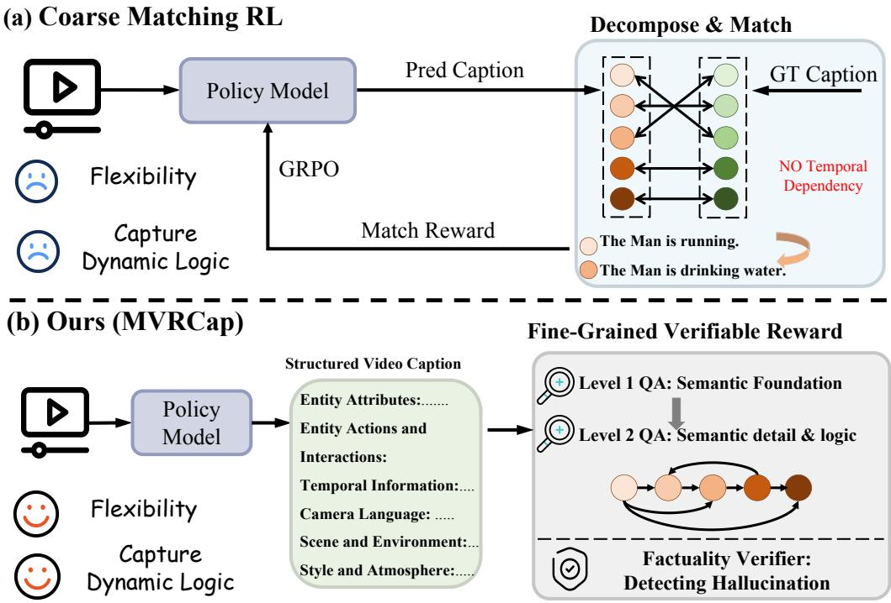
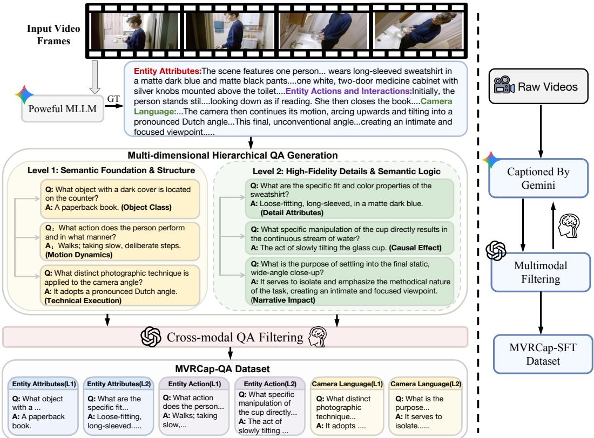
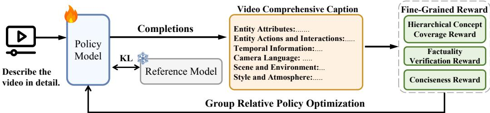

# Towards Comprehensive Video Captioning via Hierarchical Multi-Dimensional Verifiable Rewards

Weihuang Lin1,⋄ Xianing Chen2,∗ Zhibin Wang2,∗ Congzhi Zhang2 Yiwei Ma1 Jiayi Ji1 Miao Chen2 Jun Song2 YuCheng2 Bo Zheng2 Xiaoshuai Sun1,† Rongrong Ji1 1Xiamen University 2Alibaba Group

## Abstract

Despite significant progress, current models struggle to generate comprehensive video captions, constrained primarily by coarse-grained supervision, which often fails to capture spatial-temporal dynamics and the underlying logical intent. To address this issue, we introduce MVRCap, a novel framework that reformulates video captioning as a reinforcement learning task steered by structured verification. Central to our approach is a Fine-Grained Verifiable Reward mechanism, serving as dense supervision to enforce rigorous visual-semantic alignment. Specifically, we construct this reward system anchored by three complementary pillars: a Hierarchical Concept Coverage Reward utilizing our newly constructed MVRCap-QA dataset to ensure multi-dimensional completeness and semantic depth, a Factuality Verification Reward to enhance factual consistency, and a Conciseness Constraint to maximize semantic density. Furthermore, we curate the high-quality MVRCap-SFT dataset, providing structured annotations across six key dimensions, to serve as a robust foundational initialization for the RL policy in this training pipeline. Extensive experiments demonstrate that MVRCap achieves state-of-the-art performance on authoritative benchmarks including VDC, CAPability, and VC4VG.

## 1 Introduction

Video captioning [3, 13, 16, 38] involves translating dynamic visual streams into coherent natural language. Unlike static image captioning [25], it requires modeling complex temporal dependencies and motion evolution.

Current approaches [20, 37, 23] have achieved remarkable success in identifying salient visual entities and recognizing primary actions. While these models can generate basic inventories of specific events, they often struggle to weave these facts into a comprehensive and logically consistent narrative. Constrained by paradigms that prioritize local object recognition over global scene reasoning, their focus remains tethered to literal physical content. This structural limitation results in fundamentally incomplete visual narratives. Specifically, these models frequently overlook the underlying logical intent behind explicit actions and fail to integrate essential observational dynamics, such as viewpoint shifts and lighting, which require holistic perception.

To achieve a comprehensive representation of video content, we propose a holistic captioning taxonomy encompassing six essential dimensions. These dimensions are systematically structured to deconstruct the core facets of visual narratives: Entity Attributes and Scene and Environment define the physical composition; Actions and Interactions and Temporal Information model the dynamic evolution; while Camera Language and Style and Atmosphere determine the observational context. Given that existing datasets lack caption annotations that comprehensively model video scenes, we leverage advanced commercial MLLMs to establish an automated pipeline, generating high-density, structured captions across these specialized dimensions. Through this pipeline, we curate MVRCap-SFT, a high-quality instruction-tuning dataset with fine-grained multi-dimensional annotations. While Supervised Fine-Tuning on base MLLMs using MVRCap-SFT enables multi-dimensional instruction following, this approach proves insufficient for achieving reliable video understanding. Our analysis reveals that the model prioritizes superficial pattern memorization [6] over genuine visual reasoning. It mimics the linguistic complexity of the synthetic data without robust visual grounding, leading to significant hallucinations, particularly when describing temporal dynamics.

  
Figure 1: (a) Coarse Matching RL treats captions as unordered sets of atomic facts, failing to capture dynamic logic. (b) In contrast, our approach leverages Structured Visual Probing. We employ a Fine-Grained Verifiable Reward that integrates hierarchical QA probing and factuality verification to enforce supervision across six key dimensions.

To overcome the disconnect between linguistic fluency and visual grounding, simply applying standard reinforcement learning is insufficient. As illustrated in Fig. 1 (a), prevailing Coarse Matching RL approaches treat captions as unordered sets of atomic semantic units [37]. This paradigm fails to capture the temporal dependencies and causal logic essential for comprehensive video understanding. To transcend these limitations, we introduce MVRCap (Fig. 1 (b)), a novel framework that enforces genuine visual-semantic alignment via a Fine-Grained Verifiable Reward mechanism. Specifically, we construct this reward system anchored by three pillars. First, to ensure comprehensive content coverage, we introduce a Hierarchical Concept Coverage Reward underpinned by our curated MVRCap-QA dataset. By actively interrogating the model with multi-level question-answer pairs across six critical dimensions, we transform the captioning objective into a quantifiable metric that probes structural hierarchy and information diversity. Second, to enhance factual consistency, we implement a Factuality Verification Reward as a rigorous guardrail. This mechanism penalizes inconsistencies across objects, actions, and temporal dynamics. Finally, we incorporate a Conciseness Constraint to regularize generation length [32], guiding the model to convey maximum semantic richness with minimal redundancy.

Extensive experiments demonstrate MVRCap’s superiority, achieving state-of-the-art performance on VDC [3], CAPability [18], and VC4VG [9]. The consistent performance gains across benchmarks verify that our approach effectively captures fine-grained visual details while maintaining semantic coherence and structural integrity.

In summary, the contributions of this paper are threefold:

• We formulate a comprehensive video captioning schema that systematically deconstructs video content from explicit physical properties to underlying logical semantics. Based on this, we construct the high-quality MVRCap-SFT and MVRCap-QA datasets, providing a rigorous foundational data suite that facilitates the transition of video captioning from flat enumeration to structured visual reasoning.

• We propose MVRCap, a novel framework that steers models towards rigorous visual fidelity using Reinforcement Learning. We design a Hierarchical Multi-Dimensional Verifiable Reward mechanism, which synergizes Hierarchical Concept Coverage, Factuality Verification, and Conciseness Constraints.

• Extensive experiments demonstrate that MVRCap significantly outperforms state-of-the-art on benchmarks including VDC, CAPability, and VC4VG.

## 2 Related Work

## 2.1 Video Captioning

Video captioning has evolved from generating concise summaries [28, 26, 12] to producing comprehensive narratives that fuel Multimodal Large Language Models. A prevailing trend involves leveraging advanced proprietary models to synthesize instruction data for supervised fine-tuning. For instance, ShareGPT4Video [4], AuroraCap [3], and Tarsier [23] enhance description density by scaling up detailed annotations of objects and temporal events. More recently, VideoCap-R1 [20] pioneered the integration of reinforcement learning into this domain by employing explicit reasoning steps to analyze subjects and attributes prior to generation. However, even with reasoning-enhanced strategies, existing methods largely remain confined to a surface-level enumeration paradigm. These approaches tend to treat video understanding as a flat inventory of isolated entities and primary motions, frequently overlooking the underlying causal logic and the holistic structural context of the video. In contrast, our work transcends this literal fact-listing by formulating video captioning as a structured visual reasoning process. By integrating a systematic multi-dimensional taxonomy with a Fine-Grained Verifiable Reward mechanism, MVRCap enforces deep visual-semantic alignment, producing narratives that are not only comprehensively structured but also grounded and logically coherent.

## 2.2 Reinforcement Learning with Verifiable Rewards

Unlike supervised fine-tuning which enforces imitation of specific trajectories, reinforcement learning with verifiable rewards paradigm encourages models to explore diverse solution paths toward an objective and verifiable outcome, achieving remarkable success in linguistics [21, 11] and multimodal domains [19, 10, 24, 31, 34, 8]. However, applying verifiable rewards to open-ended video captioning remains notoriously difficult due to the lack of objective ground truth. VideoCap-R1 [20] attempts to use event coverage as a reward, but its metric remains coarse-grained. OwlCap [37] advances this by decomposing captions into atomic units for set matching. However, by treating semantic concepts as isolated entities, this paradigm fails to capture the intricate causal logic and temporal dependencies that exist between these atoms. In contrast, we propose a reinforcement learning paradigm that shifts from lexical set matching to cognitive verification. Instead of fragmenting captions into isolated units, we utilize hierarchical question-answering to probe the underlying narrative structure and causal logic. This constructs a verifiable reward system that rigorously enforces factual faithfulness.

## 3 Method

## 3.1 Data Construction Workflow

To bridge the gap between video content and comprehensive narratives, we establish a systematic pipeline for data synthesis. This workflow transforms subjective video description tasks into a structured semantic parsing objective. First, we define our Multi-Dimensional Annotation Paradigm to delineate the information requisite for a comprehensive video description in Sec. 3.1.1. Second, we leverage a powerful MLLM to generate the MVRCap-SFT dataset by sampling from diverse open-source collections aimed at equipping the model with fundamental multi-dimensional captioning capabilities in Sec. 3.1.2. Third, we construct the MVRCap-QA dataset to facilitate fine-grained verifiable reward signal in Sec. 3.1.3.

  
Figure 2: The Data Construction Pipeline for MVRCap. The left panel details the construction of the MVRCap-QA dataset. For brevity, only three dimensions are visualized. The right panel illustrates the workflow for generating the MVRCap-SFT dataset. The human icons denote steps involving manual validation.

## 3.1.1 Multi-Dimensional Annotation Paradigm.

To transition from coarse-grained captions to holistic perception, we design a hierarchical paradigm centered on six critical dimensions. This paradigm transforms the task into a structured visual reasoning process.

• Entity Attributes. This dimension mandates the precise identification of subjects and their corresponding detailed attributes.

• Actions and Interactions. We focus on the causal logic of motion. Furthermore, we analyze the complex interactions between subjects and their environment, as well as the consequent state transitions within the scene.

• Temporal Information. This component enforces narrative coherence by reconstructing the chronological evolution of events and scene transitions.

• Camera Language. We incorporate cinematic syntax to interpret how technical choices, such as camera movement, focus shift, and depth of field, construct the visual narrative.

• Scene and Environment. This dimension concentrates on the physical characteristics of the setting. It details static environmental attributes while tracking dynamic changes throughout the video.

• Style and Atmosphere. The final dimension synthesizes the aesthetic tone, explicitly linking visual composition to the underlying mood of the footage.

## 3.1.2 MVRCap-SFT Dataset Construction

Building upon the proposed paradigm, we establish an automated pipeline to construct the MVRCap-SFT dataset, as shown in the right part of Fig. 2. This process leverages the advanced multimodal understanding of Gemini 2.5 Pro [7] to scale high-quality annotations. To ensure diversity in visual scenarios, we sample raw videos from open-source datasets, as detailed in Appendix. By integrating the definitions of our Multi-Dimensional Annotation Paradigm Prompt, as detailed in Appendix, directly into the generation instruction, we ensure the model produces dense, logically coherent descriptions that adhere to our structural requirements.

  
Figure 3: The Overall Framework of MVRCap.

To filter the generated captions and eliminate hallucinations, we employ a Cross-Model Validation approach. Specifically, we use an independent model, GPT-5, to compare the generated captions directly against the source videos, explicitly pruning any hallucinatory content. Furthermore, we introduce human feedback by reviewing a subset of the identified failure cases. Insights from these failure cases are then used to iteratively adjust and optimize the generation prompts. This streamlined process yields 4K video-caption pairs.

## 3.1.3 MVRCap-QA Dataset Construction

Motivated by DeepSeek-R1’s [11] success with verifiable reinforcement learning, we adapt this paradigm to video captioning. Yet, unlike math or coding, this task is highly subjective and lacks a definitive ground truth. To circumvent reward hacking via generic outputs, we transform our 6-D schema evaluation into an open-ended QA assessment. Specifically, we curate the MVRCap-QA dataset using a Two-Level Cognitive Hierarchy. This penalizes superficial recognition and ensures a comprehensive evaluation ranging from basic semantic accuracy to nuanced contextual understanding.

The initial cognitive level, Semantic Foundation and Structure, functions as a mechanism to ensure factual grounding, focusing on the fundamental accuracy of explicit visual content. By interrogating the locations, and basic events within the video, this level aims to prevent generative hallucinations. For static modalities, such as Entity Attributes and Scene, we validate the model’s grasp of Entity Presence and Spatial Layout, ensuring the correct perception of subject existence and their arrangement within the environment. In parallel, the assessment of dynamic and technical dimensions centers on Subject Behavioral Performance, Chronological Sequence, and Technical Classification. Consequently, this level confirms the model’s foundational capability to identify actions, order events linearly, and classify camera techniques, such as shot sizes, without error.

To transcend basic pattern matching, the second cognitive level, High-Fidelity Details and Semantic Logic, is designed to assess the descriptive depth and causal reasoning underlying the video content. For entities and scenes, we prioritize the richness of visual details and optical atmosphere, requiring the model to capture fine-grained attributes. Regarding action-oriented and stylistic dimensions, the assessment concentrates on Interaction Logic, Environmental Impact, and Aesthetic Intent. Rather than simply cataloging isolated events, the model must explain how actions physically transform their surroundings, the narrative coherence governing temporal transitions, and the manner in which specific lighting or cinematographic choices actively construct the video’s atmospheric mood. Please refer to the Appendix for more details.

By systematically extracting QA pairs across these two levels for each dimension, we processed another 5K video samples, as detailed in Appendix, yielding a total of 205K QA pairs. This transformation converts the subjective captioning task into a verifiable matrix of objective facts and logical deductions, providing a robust supervision signal for reinforcement learning. First, we utilize GPT-5 to verify the extracted QA pairs directly against the source videos, pruning or correcting any ungrounded instances. Crucially, human experts not only review failure cases to iteratively refine the extraction prompts, but also conduct final manual quality assurance on randomly sampled batches of the finalized dataset. This rigorous, visually grounded curation ensures that all QA pairs are anchored in visual evidence rather than linguistic artifacts.

## 3.2 Training Strategy

Our training framework proceeds in two distinct phases. We first establish a foundational capability for multi-dimensional instruction following via Supervised Fine-Tuning, followed by a reinforcement learning stage that enforces rigorous visual-semantic alignment using GRPO.

## 3.2.1 Supervised Fine-Tuning

We initialize our model by fine-tuning a base MLLM on the MVRCap-SFT dataset to adapt it to our multi-dimensional schema and establish preliminary visual-semantic alignment. Given a video input $V$ and the corresponding ground-truth structured caption $Y$ , the loss function is $\begin{array} { r } { \mathcal { L } _ { S F T } = } \end{array}$ $\begin{array} { r } { - \sum _ { t = 1 } ^ { T } \log \pi _ { \theta } ( y _ { t } | V , y _ { < t } ) } \end{array}$ , where $\pi _ { \theta }$ represents the policy of the model parameterized by $\theta , \ y _ { t }$ denotes the token at time step t, and $y _ { < t }$ represents the preceding context. This stage ensures that the model learns to generate fluent and structured text, providing a stable reference policy $\pi _ { r e f }$ for the subsequent reinforcement learning phase.

## 3.2.2 Group Relative Policy Optimization

While SFT provides formatted outputs, it lacks a mechanism to penalize hallucinations or enforce deep visual grounding. To address this, we employ Group Relative Policy Optimization (GRPO) [22]. For each video query $q ,$ GRPO samples a group of $G$ outputs $\left\{ o _ { 1 } , o _ { 2 } , . . . , o _ { G } \right\}$ from the current policy $\pi _ { \theta _ { o l d } } .$ . For each output $o _ { i } ,$ we compute a composite reward $r _ { i }$ . The advantage $A _ { i }$ for each output is calculated by standardizing the rewards within the group: $\begin{array} { r } { A _ { i } = \frac { r _ { i } - \mathrm { m e a n ( { \bf r } ) } } { \mathrm { s t d ( { \bf r } ) } + \epsilon } } \end{array}$ , where $\mathbf { r } = \{ r _ { 1 } , . . . , r _ { G } \}$ represents the vector of rewards for the sampled group.

The training objective seeks to maximize the surrogate loss function, which incorporates a clipping mechanism to prevent destructive policy updates and a regularization term to maintain stability:

$$
\mathcal { L } _ { G R P O } ( \theta ) = \mathbb { E } _ { q \sim P ( Q ) , \{ \sigma _ { i } \} \sim \pi _ { \theta _ { o l d } } } \left[ \frac { 1 } { G } \sum _ { i = 1 } ^ { G } ( \operatorname* { m i n } \left( \rho _ { i } A _ { i } , \mathrm { c l i p } ( \rho _ { i } , 1 - \epsilon , 1 + \epsilon ) A _ { i } \right) - \beta \mathbb { D } _ { K L } ( \pi _ { \theta } | | \pi _ { r e f } ) ) \right]\tag{1}
$$

where $\begin{array} { r } { \rho _ { i } = \frac { \pi _ { \theta } \left( o _ { i } | q \right) } { \pi _ { \theta _ { o l d } } \left( o _ { i } | q \right) } } \end{array}$ denotes the probability ratio between the new and old policies, clip(·) restricts the ratio to the range $[ 1 - \epsilon , 1 + \epsilon ]$ , and $\mathbb { D } _ { K L } ( \pi _ { \theta } | | \pi _ { r e f } )$ represents the KL divergence between the current policy $\pi _ { \theta }$ and the reference SFT model $\pi _ { r e f }$

## 3.2.3 Fine-Grained Verifiable Reward Formulation

The efficacy of GRPO relies heavily on the reward signal $r _ { i }$ . To enforce strict visual grounding and logical coherence, we formulate a composite reward comprising three pillars: a Hierarchical Concept Coverage Reward, a Factuality Verification Reward, and a Conciseness Constraint.

## Hierarchical Concept Coverage Reward.

An ideal caption serves as a standalone semantic proxy for the visual content, negating the need for a viewer to revisit the source video to extract information. Consequently, we formulate the coverage reward $R _ { c o v }$ based on the principle of Question Answering capability. We utilize the curated MVRCap-QA dataset, which consists of hierarchical question-answer pairs derived from the ground truth. Specifically, for each video sample, we meticulously organized the corresponding QA pairs across six critical dimensions, with each dimension further stratified into specific hierarchical levels.

For a generated caption $C _ { p r e d } .$ , we employ a frozen Judge LLM J to evaluate whether $C _ { p r e d }$ contains sufficient information to correctly answer a set of dimension-specific questions. Importantly, the Judge determines the answer solely based on $C _ { p r e d }$ without accessing the video. The detailed prompting schema for Judge is provided in Appendix. To ensure balanced optimization across all semantic aspects, we adopt a dimension-wise aggregation strategy. We first compute the accuracy within each specific dimension d and then average these dimension-level scores to obtain the final reward. Formally, let D be the set of all defined dimensions and $Q _ { d }$ be the set of questions belonging to dimension d. The Concept Coverage Reward $R _ { c o v }$ is calculated as:

$$
R _ { c o v } = \frac { 1 } { | \mathcal { D } | } \sum _ { d \in \mathcal { D } } \underbrace { \left( \frac { 1 } { | Q _ { d } | } \sum _ { q \in Q _ { d } } \mathbb { I } \left( \mathcal { I } ( q , C _ { p r e d } ) \equiv A _ { g t } \right) \right) } _ { R _ { d } } ,\tag{2}
$$

where $\mathbb { I } ( \cdot )$ is the indicator function, $A _ { g t }$ is the ground truth answer, and $R _ { d }$ represents the coverage score for dimension $d .$ This compels the model to adopt a strategy of maximal semantic coverage, effectively learning to intrinsically embed deep visual reasoning and evidence into its descriptions to satisfy potential queries across all cognitive levels.

Factuality Verification Reward. While coverage ensures comprehensiveness, it does not guarantee accuracy. Video captioning is particularly susceptible to specific types of hallucinations that compromise the narrative integrity. To suppress these errors, we introduce a Factuality Verification Reward $R _ { f a c t }$ . Specifically, we leverage the Judge LLM to scrutinize the predicted caption $C _ { p r e d }$ against the ground truth $C _ { g t } ,$ specifically targeting the three high-risk failure modes most prevalent in video descriptions: (1) Object Hallucination, which penalizes the fabrication of non-existent entities; (2) Action Hallucination, which detects contradictions in motion dynamics or interactions; and (3) Temporal Hallucination, which identifies disorders in the chronological sequence relative to the ground truth. The detailed prompting schema is illustrated in Appendix. Based on these strict criteria, the Judge assigns a graded scalar score $R _ { f a c t }$ that is inversely proportional to the severity of detected errors; effectively, a higher score indicates fewer contradictions and higher factual consistency. Crucially, by instructing the Judge to detect contradictions rather than measuring surface similarity, we penalize factual errors without punishing valid paraphrases. This distinction is vital: it ensures that the optimization objective is semantic consistency rather than lexical replication. Consequently, the model is incentivized to align with the ground truth’s logic while retaining the freedom to utilize diverse syntactic structures and synonyms.

Conciseness Constraint. Maximizing coverage can inadvertently encourage verbosity. To address this, we introduce a Concise Constraint $R _ { l e n }$ to promote high information density. We implement a soft punishment mechanism that applies a linear penalty only when the generated length exceeds a target threshold $L _ { t a r g e t }$ . This approach grants the model flexibility for complex descriptions while effectively penalizing unnecessary redundancy.

Total Reward Formulation. The final reward $r _ { i }$ for a given video-caption pair is formulated as the weighted sum of the three holistic components:

$$
r _ { i } = \lambda _ { c o v } R _ { c o v } + \lambda _ { f a c t } R _ { f a c t } + \lambda _ { l e n } R _ { l e n } ,\tag{3}
$$

where $\begin{array} { r } { R _ { l e n } = \operatorname* { m a x } \left( - 1 , \operatorname* { m i n } \left( 0 , \frac { \left( L _ { m a x } - L _ { c a c h e } \right) - \operatorname { l e n } \left( C _ { p r e d } \right) } { L _ { c a c h e } } \right) \right) } \end{array}$ represents the length penalty term.

## 4 Experiments

## 4.1 Implementation Details.

We employ Qwen2.5-VL-7B-Instruct [2] as the default baseline model. The training process consists of two stages: SFT and RL. During the SFT phase, we use the Adam optimizer with a learning rate of $1 \times 1 0 ^ { - 5 }$ . In the RL phase, we set a default frame rate of 2.0 FPS. The values for $L _ { m a x }$ and $L _ { c a c h \epsilon }$ are set to 1280 and 256. We set the reward weight to 1.0. The RL process is configured with 8 rollouts per iteration, utilizing Qwen3-30B-A3B-Instruct [27] as the judge model. All experiments are conducted on 16 NVIDIA H100 GPUs. Refer to the Appendix for further implementation and training specifics.

## 4.2 Main Results

We evaluate our model using three mainstream benchmarks: VC4VG [9], CAPability [18], and VDC [3]. Refer to Appendix for detailed descriptions. In this section, we report the competitive performance achieved by our model across these three benchmarks.

Additionally, human blind evaluations are included in Appendix to further demonstrate the superior captioning quality of our method.

Table 1: Quantitative captioning evaluation results on VC4VG-Bench.
<table><tr><td>Model</td><td>Environment Subject</td><td></td><td>Motion</td><td>Camera</td><td>Style</td><td>Necessity-L1 Necessity-L2 Total score</td><td></td><td></td></tr><tr><td></td><td>Score/%</td><td>Score/%</td><td>Score/%</td><td>Score/%</td><td>Score/%</td><td>Score/%</td><td>Score/%</td><td>Score/%</td></tr><tr><td>ShareCaptioner [4]</td><td>196/43.5</td><td>103/22.3</td><td>85/25.4</td><td>48/33.1</td><td>12/70.6</td><td>284/46.3</td><td>160/20.1</td><td>444/31.5</td></tr><tr><td>Vriptor [29]</td><td>208/46.1</td><td>126/27.3</td><td>60/17.9</td><td>31/21.4</td><td>16/94.1</td><td>303/49.3</td><td>138/17.3</td><td>441/31.3</td></tr><tr><td>VideoLLaMA3 [35]</td><td>119/26.4</td><td>106/22.9</td><td>88/26.3</td><td>17/11.7</td><td>14/82.4</td><td>232/37.8</td><td>112/14.1</td><td>344/24.4</td></tr><tr><td>CogVLM2Cap [30]</td><td>216/47.9</td><td>174/37.7</td><td>93/27.8</td><td>14/9.7</td><td>13/76.5</td><td>317/51.6</td><td>193/24.2</td><td>510/36.2</td></tr><tr><td>Tarsier2 [33] LLaVA-Video-Gen [9]</td><td>170/37.7 304/67.4</td><td>256/55.4154/46.074/51.0</td><td>155/33.5 164/49.0</td><td>29/20.0</td><td>16/94.1 16/94.1</td><td>308/50.2 459/74.8</td><td>226/28.4 345/43.3</td><td>534/37.9</td></tr><tr><td></td><td></td><td></td><td></td><td></td><td></td><td></td><td></td><td>804/57.0</td></tr><tr><td>Gemini-1.5-Pro</td><td>372/82.5</td><td></td><td>328/71.0 170/50.7</td><td>85/58.6</td><td>17/100.0</td><td>513/83.6</td><td>459/57.7</td><td>972/68.9</td></tr><tr><td>Gemini-2.5-Pro Gemini-3.1-Pro</td><td>368/81.6 359/79.6</td><td>339/73.4 199/59.4 91/62.8</td><td></td><td></td><td>319/69.1 230/68.7 85/58.617/100.0 16/94.1</td><td>504/82.1 507/82.6</td><td>515/64.7 497/62.4</td><td>1019/72.3</td></tr><tr><td></td><td></td><td></td><td></td><td></td><td></td><td></td><td></td><td>1004/71.2</td></tr><tr><td>Qwen3-VL-8B [2]</td><td>269/59.7</td><td></td><td>181/39.2 107/31.9 28/19.3</td><td></td><td>16/94.1</td><td>357/58.1</td><td>244/30.7</td><td>601/42.6</td></tr><tr><td>MVRCap-8B (Ours)</td><td>348/77.2</td><td></td><td>295/63.9 182/54.3</td><td></td><td>80/55.2 17/100.0</td><td>497/80.9</td><td>425/53.4</td><td>922/65.4</td></tr><tr><td>Qwen3-VL-32B [1]</td><td>341/75.6</td><td></td><td></td><td></td><td>311/67.3 205/61.2 59/40.6 17/100.0</td><td>460/74.9 513/83.6</td><td>473/59.4</td><td>933/66.2</td></tr><tr><td>MVRCap-32B (Ours)</td><td>379/84.0</td><td></td><td>353/76.4 222/66.3 81/55.9 17/100.0</td><td></td><td></td><td></td><td>539/67.7</td><td>1052/74.6</td></tr></table>

Table 2: Quantitative comparison on the CAPability benchmark. The F1 Score across all dimensions. “Video Avg.” represents the mean score of the four dynamic dimensions.
<table><tr><td rowspan="2">Model</td><td rowspan="2">Obj. Cate.</td><td rowspan="2">Obj. Num.</td><td rowspan="2">Obj. Color</td><td rowspan="2">Spa. Rel.</td><td rowspan="2">Scene</td><td rowspan="2"> $\mathbf { \Pi } _ { \mathbf { A n g . } } ^ { \mathbf { C a m . } }$ </td><td rowspan="2">OCR</td><td rowspan="2"> $\mathbf { S t y l e }$ </td><td rowspan="2">Cha. Iden.</td><td colspan="2">(D) Obj. Num.</td><td rowspan="2"> $\mathbf { A c t } .$ </td><td rowspan="2"> $\begin{array} { c } { \mathbf { C a m . } } \\ { \mathbf { M o v . } } \end{array}$ </td><td rowspan="2">Event</td><td rowspan="2">Video Avg.</td><td rowspan="2">All Avg.</td></tr><tr><td></td><td></td></tr><tr><td>InternVL2.5-8B</td><td>69.01</td><td>31.08</td><td>60.78</td><td>54.18</td><td>75.23</td><td>42.72</td><td></td><td>77.62</td><td>76.10</td><td>12.74</td><td>16.12</td><td>30.86</td><td>18.44</td><td>42.11</td><td>26.88</td><td>46.69</td></tr><tr><td>LLaVA-OV-7B</td><td>71.90</td><td>28.66</td><td>61.40</td><td>53.98</td><td>75.66</td><td>41.76</td><td></td><td>70.29</td><td>74.80</td><td>6.81</td><td>17.07</td><td>32.31</td><td>7.69</td><td>40.42</td><td>24.37</td><td>44.83</td></tr><tr><td>NVILA-8B</td><td>73.43</td><td>34.21</td><td>63.30</td><td>52.22</td><td>72.64</td><td>41.29</td><td></td><td>75.34</td><td>72.70</td><td>9.89</td><td>9.06</td><td>22.25</td><td>7.28</td><td>31.19</td><td>17.45</td><td>43.45</td></tr><tr><td>VideoLLaMA3-7B</td><td>72.85</td><td>31.80</td><td>65.64</td><td>59.51</td><td>78.33</td><td>41.63</td><td>74.41</td><td></td><td>73.04</td><td>4.86</td><td>7.32</td><td>34.05</td><td>25.03</td><td>44.31</td><td>27.68</td><td>47.14</td></tr><tr><td>VideoChat-R1-7B</td><td>76.85</td><td>30.21</td><td>64.94</td><td>55.56</td><td>80.64</td><td>45.87</td><td>80.19</td><td></td><td>71.28</td><td>12.53</td><td>18.97</td><td>29.66</td><td>22.76</td><td>38.61</td><td>27.50</td><td>48.31</td></tr><tr><td>Qwen2.5-VL-7B</td><td>75.72</td><td>27.62</td><td>65.59</td><td>56.73</td><td>80.56</td><td>47.38</td><td>81.49</td><td></td><td>72.7012.14</td><td></td><td>16.95</td><td>37.47</td><td>26.02</td><td>44.09</td><td>31.13</td><td>49.57</td></tr><tr><td>MVRCap</td><td>81.16</td><td>40.39</td><td>74.08</td><td>66.50</td><td>82.09</td><td>51.29</td><td></td><td></td><td>82.13 70.20 20.30</td><td></td><td>19.60</td><td>45.03 34.63</td><td></td><td>49.89</td><td>37.29</td><td>55.18</td></tr></table>

Table 3: Quantitative comparison on the VDC benchmark.
<table><tr><td>Model</td><td>Detailed (Acc/Score)</td><td>Camera (Acc/Score)</td><td>Short (Acc/Score)</td><td>Background (Acc/Score)</td><td>Object (Acc/Score)</td><td>Average (Acc/Score)</td></tr><tr><td>General MLLM</td><td></td><td></td><td></td><td></td><td></td><td></td></tr><tr><td>VILA-v1.5-8B [17]</td><td>42.8/2.2</td><td>39.7/2.1</td><td>39.3/2.0</td><td>39.8/2.1</td><td>40.9/2.1</td><td>40.5/2.1</td></tr><tr><td>VideoChat2-7B [15]</td><td>40.5/2.1</td><td>31.9/1.7</td><td>40.2/2.1</td><td>34.9/1.8</td><td>34.9/1.8</td><td>36.5/1.9</td></tr><tr><td>InternVL2-8B [5]</td><td>34.9/1.8</td><td>39.1/2.1</td><td>33.0/1.7</td><td>37.5/1.9</td><td>44.2/2.2</td><td>33.7/2.0</td></tr><tr><td>LLaVA-OneVision-7B [14]</td><td>41.8/2.2</td><td>37.6/2.0</td><td>41.6/2.1</td><td>34.3/1.8</td><td>38.8/2.0</td><td>38.8/2.0</td></tr><tr><td>LLaVA-Video-7B [36]</td><td>35.0/1.8</td><td>46.1/2.3</td><td>32.8/1.7</td><td>37.6/1.9</td><td>46.2/2.4</td><td>39.0/2.0</td></tr><tr><td>Video-R1-7B [10]</td><td>45.6/2.4</td><td>42.7/2.2</td><td>44.5/2.3</td><td>40.6/2.1</td><td>45.9/2.3</td><td>43.9/2.3</td></tr><tr><td>Video Caption MLLMs</td><td></td><td></td><td></td><td></td><td></td><td></td></tr><tr><td>ShareGPT4Video-8B [4]</td><td>35.6/1.8</td><td>33.3/1.8</td><td>39.1/1.9</td><td>35.8/1.8</td><td>37.1/1.9</td><td>36.2/1.9</td></tr><tr><td>Vriptor [29]</td><td>38.5/2.0</td><td>37.6/2.0</td><td>38.4/2.0</td><td>37.1/1.9</td><td>37.0/1.9</td><td>37.7/2.0</td></tr><tr><td>AuroraCap-7B [3]</td><td>41.3/2.1</td><td>43.5/2.3</td><td>32.1/1.7</td><td>35.9/1.8</td><td>39.0/2.0</td><td>38.2/2.0</td></tr><tr><td>Tarsier-7B [23]</td><td>38.3/2.1</td><td>42.6/2.3</td><td>41.7/2.2</td><td>36.4/1.9</td><td>42.2/2.2</td><td>40.2/2.1</td></tr><tr><td>VideoCap-R1-7B [20]</td><td>43.8/2.4</td><td>41.7/2.3</td><td>35.2/1.9</td><td>47.2/2.5</td><td>47.0/2.5</td><td>43.0/2.3</td></tr><tr><td>Qwen2.5-VL-7B [2]</td><td>46.1/2.3</td><td>41.3/2.2</td><td>37.5/2.0</td><td>45.8/2.4</td><td>46.9/2.4</td><td>43.5/2.2</td></tr><tr><td>MVRCap (Ours)</td><td>51.6/2.7</td><td>49.2/2.6</td><td>41.4/2.2</td><td>53.6/2.8</td><td>52.5/2.7</td><td>49.7/2.6</td></tr></table>

Results on VC4VG Table 1 evaluates caption quality on the VC4VG benchmark. MVRCap-32B achieves a Total Score of 74.6%, significantly outperforming LLaVA-Video-Gen (57.0%) and remaining competitive with proprietary Gemini models. Even our 7B model (65.4%) yields substantial gains over its Qwen2.5-VL baseline (42.6%). Consistently high scores across dynamic precision and Necessity-L1/L2 demonstrate that MVRCap generates highly accurate and structurally comprehensive video narratives.

Table 4: Ablation study on the effectiveness of different reward components. $R _ { c o v } , R _ { f a c t }$ , and $R _ { l e n }$ denote Coverage, Factuality, and Conciseness respectively.  
Table 5: Ablation study on different training stages. We compare the Base Qwen2.5- VL-7B with combinations of Supervised Fine-Tuning and Reinforcement Learning.
<table><tr><td colspan="3">Components</td><td colspan="2">VDC</td><td colspan="2">Capability</td></tr><tr><td> $R _ { c o v }$ </td><td> $R _ { f a c t }$ </td><td> $R _ { l e n }$ </td><td>Acc</td><td>Score</td><td>Video F1</td><td>All F1</td></tr><tr><td rowspan="4"> $\checkmark$ </td><td></td><td></td><td>45.23</td><td>2.38</td><td>30.95</td><td>50.46</td></tr><tr><td> $\checkmark$ </td><td>√</td><td>47.12</td><td>2.42</td><td>33.77</td><td>52.85</td></tr><tr><td></td><td> $\checkmark$ </td><td>47.85</td><td>2.45</td><td>34.12</td><td>53.21</td></tr><tr><td> $\checkmark$ </td><td></td><td>48.72</td><td>2.52</td><td>35.84</td><td>54.45</td></tr><tr><td> $\checkmark$ </td><td> $\checkmark$ </td><td> $\checkmark$ </td><td>49.67</td><td>2.60</td><td>37.29</td><td>55.18</td></tr></table>

<table><tr><td rowspan="2">Method</td><td colspan="2">VDC</td><td colspan="2">Capability</td></tr><tr><td>Acc</td><td>Score</td><td>Video F1 All F1</td><td></td></tr><tr><td>Base</td><td>43.53</td><td>2.24</td><td>31.13</td><td>49.57</td></tr><tr><td> $\mathrm { B a s e + S F T }$ </td><td>45.23</td><td>2.38</td><td>30.95</td><td>50.46</td></tr><tr><td> $\mathrm { B a s e + R L }$ </td><td>44.28</td><td>2.31</td><td>32.24</td><td>51.64</td></tr><tr><td> $\mathbf { B a s e } + \mathbf { S F T } + \mathbf { R L }$ </td><td>49.672.60</td><td></td><td>37.29</td><td>55.18</td></tr></table>

Results on CAPability Table 2 reports F1 scores on the CAPability benchmark, where MVRCap achieves state-of-the-art performance among 7B open-source models. Notably, it attains an All Avg. of 55.18, outperforming the strong Qwen2.5-VL baseline by 5.61 points. Improvements are particularly pronounced in dynamic dimensions (Video Avg. of 37.29), demonstrating superior temporal reasoning in Action (+7.56) and Camera Movement (+8.61). Furthermore, significant gains in static dimensions (e.g., Object Number, Spatial Relations) confirm that our fine-grained reward mechanism effectively enhances both fundamental visual perception and complex temporal reasoning.

Results on VDC Table 3 presents results on the VDC benchmark, where MVRCap outperforms both general and caption-specific MLLMs. Setting a new state-of-the-art, it achieves an Average Accuracy of 49.7% and a Score of $2 . 6 ,$ significantly surpassing the strong Qwen2.5-VL baseline. Across fine-grained dimensions, MVRCap dominates four of the five categories, notably excelling in Background (53.6%) and Object (52.5%). This confirms our hierarchical verifiable reward effectively enhances dense detail capture and minimizes hallucinations. Furthermore, MVRCap establishes a clear lead over the competitive OwlCap-7B in Detailed descriptions, validating its ability to generate comprehensive, logically coherent long-form narratives.

## 4.3 Ablation Study

Synergy of Reward Components. Table 4 investigates the contribution of each individual component within our reward mechanism. We observe that removing $R _ { c o v }$ results in the most significant performance decline where the VDC Score drops remarkably from 2.60 to 2.42. This indicates its pivotal role in guiding the model to capture comprehensive semantic details. Furthermore the omission of $R _ { f a c t }$ leads to a distinct decrease in the Capability Video F1 from 37.29 to 34.12. This suggests that strict factual verification is indispensable for precise dynamic event understanding. The optimal results are achieved only when $R _ { c o v } , R _ { f a c t }$ , and $R _ { l e n }$ function synergistically to reach the peak All F1 score of 55.18.

## Role of SFT Initialization.

Table 5 validates the necessity of our two-stage training pipeline. We observe that applying reinforcement learning directly to the baseline model yields suboptimal results compared to the full two-stage approach. This performance gap indicates that pure RL suffers from a cold-start problem where the model lacks the fundamental schema for comprehensive video description. Without the supervised fine-tuning phase to instill the ability to cover multi-dimensional semantics, the RL optimization struggles to effectively guide the policy. Consequently, the combination of SFT and RL is essential. The SFT stage establishes a robust structural foundation while the RL stage further refines visual grounding and information density to reach SOTA.

## 5 Conclusion

In this work, we introduced MVRCap, a framework for comprehensive video captioning. We constructed two complementary datasets: MVRCap-SFT for establishing a semantic foundation and MVRCap-QA for fine-grained policy optimization. Furthermore, we designed a Fine-Grained Verifiable Reward that explicitly enforces both hierarchical concept coverage and precise factuality.

## References

[1] Shuai Bai, Yuxuan Cai, Ruizhe Chen, Keqin Chen, Xionghui Chen, Zesen Cheng, Lianghao Deng, Wei Ding, Chang Gao, Chunjiang Ge, et al. Qwen3-vl technical report. arXiv preprint arXiv:2511.21631, 2025.

[2] Shuai Bai, Keqin Chen, Xuejing Liu, Jialin Wang, Wenbin Ge, Sibo Song, Kai Dang, Peng Wang, Shijie Wang, Jun Tang, et al. Qwen2. 5-vl technical report. arXiv preprint arXiv:2502.13923, 2025.

[3] Wenhao Chai, Enxin Song, Yilun Du, Chenlin Meng, Vashisht Madhavan, Omer Bar-Tal, Jenq-Neng Hwang, Saining Xie, and Christopher D Manning. Auroracap: Efficient, performant video detailed captioning and a new benchmark. arXiv preprint arXiv:2410.03051, 2024.

[4] Lin Chen, Xilin Wei, Jinsong Li, Xiaoyi Dong, Pan Zhang, Yuhang Zang, Zehui Chen, Haodong Duan, Zhenyu Tang, Li Yuan, et al. Sharegpt4video: Improving video understanding and generation with better captions. Advances in Neural Information Processing Systems, 37:19472–19495, 2024.

[5] Zhe Chen, Weiyun Wang, Yue Cao, Yangzhou Liu, Zhangwei Gao, Erfei Cui, Jinguo Zhu, Shenglong Ye, Hao Tian, Zhaoyang Liu, et al. Expanding performance boundaries of open-source multimodal models with model, data, and test-time scaling. arXiv preprint arXiv:2412.05271, 2024.

[6] Tianzhe Chu, Yuexiang Zhai, Jihan Yang, Shengbang Tong, Saining Xie, Dale Schuurmans, Quoc V Le, Sergey Levine, and Yi Ma. Sft memorizes, rl generalizes: A comparative study of foundation model post-training. arXiv preprint arXiv:2501.17161, 2025.

[7] Gheorghe Comanici, Eric Bieber, Mike Schaekermann, Ice Pasupat, Noveen Sachdeva, Inderjit Dhillon, Marcel Blistein, Ori Ram, Dan Zhang, Evan Rosen, et al. Gemini 2.5: Pushing the frontier with advanced reasoning, multimodality, long context, and next generation agentic capabilities. arXiv preprint arXiv:2507.06261, 2025.

[8] Yang Ding, Yizhen Zhang, Xin Lai, Ruihang Chu, and Yujiu Yang. Videozoomer: Reinforcement-learned temporal focusing for long video reasoning. arXiv preprint arXiv:2512.22315, 2025.

[9] Yang Du, Zhuoran Lin, Kaiqiang Song, Biao Wang, Zhicheng Zheng, Tiezheng Ge, Bo Zheng, and Qin Jin. Vc4vg: Optimizing video captions for text-to-video generation. In Proceedings of the 2025 Conference on Empirical Methods in Natural Language Processing, pages 1124–1138, 2025.

[10] Kaituo Feng, Kaixiong Gong, Bohao Li, Zonghao Guo, Yibing Wang, Tianshuo Peng, Junfei Wu, Xiaoying Zhang, Benyou Wang, and Xiangyu Yue. Video-r1: Reinforcing video reasoning in mllms. arXiv preprint arXiv:2503.21776, 2025.

[11] Daya Guo, Dejian Yang, Haowei Zhang, Junxiao Song, Peiyi Wang, Qihao Zhu, Runxin Xu, Ruoyu Zhang, Shirong Ma, Xiao Bi, et al. Deepseek-r1 incentivizes reasoning in llms through reinforcement learning. Nature, 645(8081):633–638, 2025.

[12] Hang Hua, Yunlong Tang, Chenliang Xu, and Jiebo Luo. V2xum-llm: Cross-modal video summarization with temporal prompt instruction tuning. In Proceedings ofthe AAAI Conference on Artificial Intelligence, volume 39, pages 3599–3607, 2025.

[13] Md Mohaiminul Islam, Ngan Ho, Xitong Yang, Tushar Nagarajan, Lorenzo Torresani, and Gedas Bertasius. Video recap: Recursive captioning of hour-long videos. In Proceedings ofthe IEEE/CVF Conference on Computer Vision and Pattern Recognition, pages 18198–18208, 2024.

[14] Bo Li, Yuanhan Zhang, Dong Guo, Renrui Zhang, Feng Li, Hao Zhang, Kaichen Zhang, Peiyuan Zhang, Yanwei Li, Ziwei Liu, et al. Llava-onevision: Easy visual task transfer. arXiv preprint arXiv:2408.03326, 2024.

[15] Kunchang Li, Yali Wang, Yinan He, Yizhuo Li, Yi Wang, Yi Liu, Zun Wang, Jilan Xu, Guo Chen, Ping Luo, et al. Mvbench: A comprehensive multi-modal video understanding benchmark. In Proceedings of the IEEE/CVF Conference on Computer Vision and Pattern Recognition, pages 22195–22206, 2024.

[16] Long Lian, Yifan Ding, Yunhao Ge, Sifei Liu, Hanzi Mao, Boyi Li, Marco Pavone, Ming-Yu Liu, Trevor Darrell, Adam Yala, et al. Describe anything: Detailed localized image and video captioning. arXiv preprint arXiv:2504.16072, 2025.

[17] Ji Lin, Hongxu Yin, Wei Ping, Pavlo Molchanov, Mohammad Shoeybi, and Song Han. Vila: On pretraining for visual language models. In Proceedings ofthe IEEE/CVF conference on computer vision and pattern recognition, pages 26689–26699, 2024.

[18] Zhihang Liu, Chen-Wei Xie, Bin Wen, Feiwu Yu, Pandeng Li, Boqiang Zhang, Nianzu Yang, Zuan Gao, Yun Zheng, Hongtao Xie, et al. Capability: A comprehensive visual caption benchmark for evaluating both correctness and thoroughness. In The Thirty-ninth Annual Conference on Neural Information Processing Systems Datasets and Benchmarks Track, 2025.

[19] Ziyu Liu, Zeyi Sun, Yuhang Zang, Xiaoyi Dong, Yuhang Cao, Haodong Duan, Dahua Lin, and Jiaqi Wang. Visual-rft: Visual reinforcement fine-tuning. arXiv preprint arXiv:2503.01785, 2025.

[20] Desen Meng, Rui Huang, Zhilin Dai, Xinhao Li, Yifan Xu, Jun Zhang, Zhenpeng Huang, Meng Zhang, Lingshu Zhang, Yi Liu, et al. Videocap-r1: Enhancing mllms for video captioning via structured thinking. arXiv preprint arXiv:2506.01725, 2025.

[21] Zhihong Shao, Peiyi Wang, Qihao Zhu, Runxin Xu, Junxiao Song, Xiao Bi, Haowei Zhang, Mingchuan Zhang, YK Li, Yang Wu, et al. Deepseekmath: Pushing the limits of mathematical reasoning in open language models. arXiv preprint arXiv:2402.03300, 2024.

[22] Kimi Team, Angang Du, Bofei Gao, Bowei Xing, Changjiu Jiang, Cheng Chen, Cheng Li, Chenjun Xiao, Chenzhuang Du, Chonghua Liao, et al. Kimi k1. 5: Scaling reinforcement learning with llms. arXiv preprint arXiv:2501.12599, 2025.

[23] Jiawei Wang, Liping Yuan, Yuchen Zhang, and Haomiao Sun. Tarsier: Recipes for training and evaluating large video description models. arXiv preprint arXiv:2407.00634, 2024.

[24] Qi Wang, Yanrui Yu, Ye Yuan, Rui Mao, and Tianfei Zhou. Videorft: Incentivizing video reasoning capability in mllms via reinforced fine-tuning. arXiv preprint arXiv:2505.12434, 2025.

[25] Long Xing, Xiaoyi Dong, Yuhang Zang, Yuhang Cao, Jianze Liang, Qidong Huang, Jiaqi Wang, Feng Wu, and Dahua Lin. Caprl: Stimulating dense image caption capabilities via reinforcement learning. arXiv preprint arXiv:2509.22647, 2025.

[26] Shen Yan, Tao Zhu, Zirui Wang, Yuan Cao, Mi Zhang, Soham Ghosh, Yonghui Wu, and Jiahui Yu. Videococa: Video-text modeling with zero-shot transfer from contrastive captioners. arXiv preprint arXiv:2212.04979, 2022.

[27] An Yang, Anfeng Li, Baosong Yang, Beichen Zhang, Binyuan Hui, Bo Zheng, Bowen Yu, Chang Gao, Chengen Huang, Chenxu Lv, et al. Qwen3 technical report. arXiv preprint arXiv:2505.09388, 2025.

[28] Antoine Yang, Arsha Nagrani, Paul Hongsuck Seo, Antoine Miech, Jordi Pont-Tuset, Ivan Laptev, Josef Sivic, and Cordelia Schmid. Vid2seq: Large-scale pretraining of a visual language model for dense video captioning. In Proceedings ofthe IEEE/CVF conference on computer vision and pattern recognition, pages 10714–10726, 2023.

[29] Dongjie Yang, Suyuan Huang, Chengqiang Lu, Xiaodong Han, Haoxin Zhang, Yan Gao, Yao Hu, and Hai Zhao. Vript: A video is worth thousands of words. Advances in Neural Information Processing Systems, 37:57240–57261, 2024.

[30] Zhuoyi Yang, Jiayan Teng, Wendi Zheng, Ming Ding, Shiyu Huang, Jiazheng Xu, Yuanming Yang, Wenyi Hong, Xiaohan Zhang, Guanyu Feng, et al. Cogvideox: Text-to-video diffusion models with an expert transformer. arXiv preprint arXiv:2408.06072, 2024.

[31] Zuhao Yang, Sudong Wang, Kaichen Zhang, Keming Wu, Sicong Leng, Yifan Zhang, Bo Li, Chengwei Qin, Shijian Lu, Xingxuan Li, et al. Longvt: Incentivizing" thinking with long videos" via native tool calling. arXiv preprint arXiv:2511.20785, 2025.

[32] Qiying Yu, Zheng Zhang, Ruofei Zhu, Yufeng Yuan, Xiaochen Zuo, Yu Yue, Weinan Dai, Tiantian Fan, Gaohong Liu, Lingjun Liu, et al. Dapo: An open-source llm reinforcement learning system at scale. arXiv preprint arXiv:2503.14476, 2025.

[33] Liping Yuan, Jiawei Wang, Haomiao Sun, Yuchen Zhang, and Yuan Lin. Tarsier2: Advancing large vision-language models from detailed video description to comprehensive video understanding. arXiv preprint arXiv:2501.07888, 2025.

[34] Xiangyu Zeng, Zhiqiu Zhang, Yuhan Zhu, Xinhao Li, Zikang Wang, Changlian Ma, Qingyu Zhang, Zizheng Huang, Kun Ouyang, Tianxiang Jiang, et al. Video-o3: Native interleaved clue seeking for long video multi-hop reasoning. arXiv preprint arXiv:2601.23224, 2026.

[35] Boqiang Zhang, Kehan Li, Zesen Cheng, Zhiqiang Hu, Yuqian Yuan, Guanzheng Chen, Sicong Leng, Yuming Jiang, Hang Zhang, Xin Li, et al. Videollama 3: Frontier multimodal foundation models for image and video understanding. arXiv preprint arXiv:2501.13106, 2025.

[36] Yuanhan Zhang, Jinming Wu, Wei Li, Bo Li, Zejun Ma, Ziwei Liu, and Chunyuan Li. Video instruction tuning with synthetic data. arXiv preprint arXiv:2410.02713, 2024.

[37] Chunlin Zhong, Qiuxia Hou, Zhangjun Zhou, Shuang Hao, Haonan Lu, Yanhao Zhang, He Tang, and Xiang Bai. Owlcap: Harmonizing motion-detail for video captioning via hmd-270k and caption set equivalence reward. arXiv preprint arXiv:2508.18634, 2025.

[38] Xingyi Zhou, Anurag Arnab, Shyamal Buch, Shen Yan, Austin Myers, Xuehan Xiong, Arsha Nagrani, and Cordelia Schmid. Streaming dense video captioning. In Proceedings ofthe IEEE/CVF Conference on Computer Vision and Pattern Recognition, pages 18243–18252, 2024.