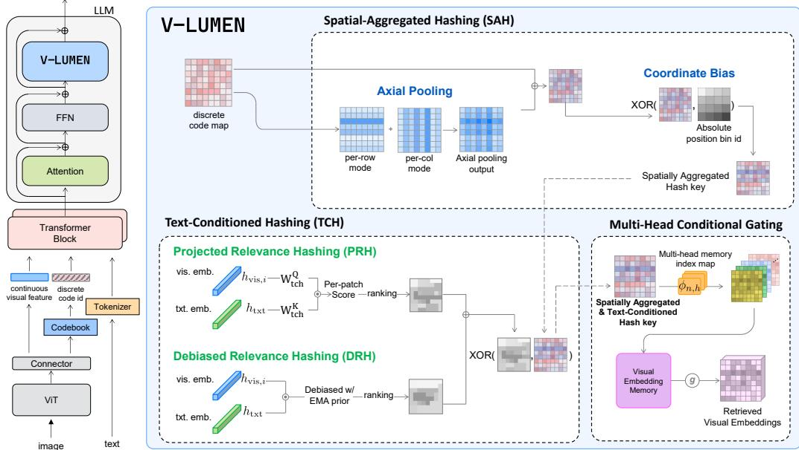
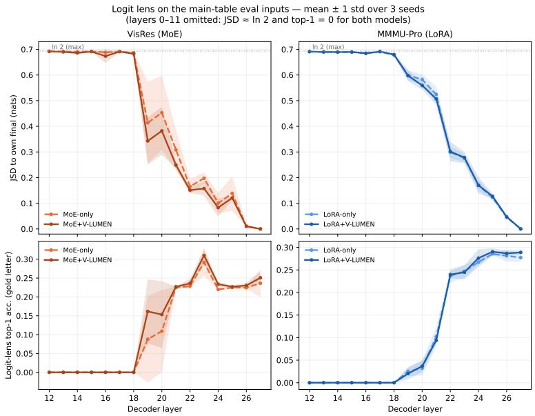
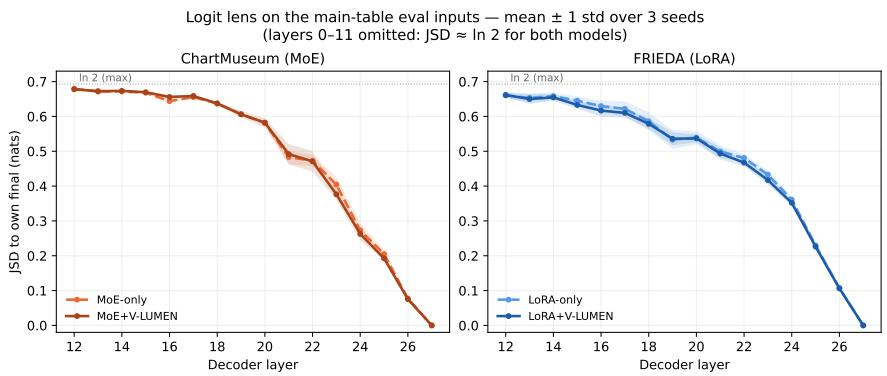

# V-LUMEN: Visual Lookup Memory for Embedding Scaling in Vision-Language Models

Miso Choi1,\* Daekeun Kim1,\* Eunji Kim2 Jungbeom Lee1,†

1Dept. of Computer Science and Engineering, Korea University 2Amazon {miso8070, housekdk, jbeomlee}@korea.ac.kr eunjkim@amazon.com

\*Equal contribution. †Corresponding author.

## Abstract

Embedding-level scaling expands the capacity of language models through lookupbased memory rather than by increasing model depth, width, or dense computation. Extending this idea to vision-language models (VLMs) is challenging because visual features are continuous, spatially structured, and query-dependent, unlike discrete text tokens that naturally support n-gram lookup. We introduce V-LUMEN, a visual lookup memory for VLMs. V-LUMEN discretizes visual features with a frozen codebook, builds spatially aware memory keys through spatial aggregationbased hashing, and modulates them with text-conditioned relevance signals; all addressing is non-parametric, and the retrieved embeddings are fused into the backbone through a gated residual pathway. On five reasoning-intensive benchmarks, V-LUMEN substantially improves a frozen Qwen3-VL-2B backbone and transfers zero-shot to three benchmarks whose images are disjoint from the training data. At a matched parameter budget, moving part of a LoRA or MoE adapter’s capacity into V-LUMEN preserves accuracy on two backbones, indicating that external visual memory is an independent capacity axis rather than a stronger adaptation method. Because lookup cost is constant in table size and incurred only once at prefill, this capacity grows in storage rather than in per-token compute. Code is available at https://github.com/miso-choi/V-Lumen.

## 1 Introduction

Scaling vision–language models (VLMs) by widening or deepening the backbone pays a dense compute price at every forward pass. A natural question follows: can we grow a VLM’s visual representation capacity without growing its per-token compute?

Recent work on LLMs answers an analogous question with external memory lookup. Engram [1], STEM [2], and SCONE [3] augment a language model with a large table of learned embeddings and address it through a non-parametric hash over token IDs, so capacity grows with the table size while per-token activated compute stays flat. These methods assume a discrete token alphabet. Visual features in a VLM are continuous, laid out on a 2-D patch grid, and their relevance depends on the question being asked, so a direct port of text-side lookup is not available.

We introduce V-LUMEN, an external visual memory for a VLM. V-LUMEN is built from three components, each of which resolves one obstacle above. First, a frozen codebook [4] discretizes continuous patch features into visual code IDs, giving the memory a stable, reusable address space. Second, Spatial Aggregation-based Hashing (SAH) folds row-, column-, and region-level context into the integer hash key, so the same code at different locations reaches different memory slots. Third, Text-Conditioned Hashing — via Projected Relevance Hashing (PRH) and its debiased variant Debiased Relevance Hashing (DRH) — modulates the key with a coarse text-to-visual relevance signal, so the same image patch can route to different memory slots under different questions. Retrieved memory cells are then fused into the backbone through Multi-Head Conditional Gating (MHCG), which assigns an independent gate per cell. All addressing on the memory side is nonparametric; only the memory tables and the fusion layer carry gradients.

We evaluate V-LUMEN on five reasoning-intensive vision-language benchmarks spanning chart, document, and multi-discipline understanding. Attached to a frozen Qwen3-VL-2B backbone, V-LUMEN improves accuracy on all five benchmarks without updating any backbone weight, and it transfers zero-shot to three benchmarks whose images share no source with the training data. We then ask how this memory relates to adaptation methods that add capacity in other ways. At a matched total budget, combining a smaller LoRA or MoE adapter with V-LUMEN performs on par with a larger adapter alone in Qwen3-VL-2B, and the MoE comparison carries over to a second backbone, InternVL3.5-2B. Part of an adapter’s capacity can thus be moved into an external memory without loss in accuracy, and this memory has a property that adapter parameters lack: its rows are addressed by hashing and only a few rows are read per visual token, rather than being used in dense matrix multiplications for every token. The memory can therefore, in principle, reside in host (CPU) memory or SSD-backed storage and be fetched on demand, as in large embedding tables of industrial recommendation models [5, 6, 7] and text-side lookup memories [1], leaving GPU memory for the backbone and adapters. We therefore view V-LUMEN as an independent capacity axis: capacity that matches adaptation in accuracy while growing in storage rather than in per-token compute.

Our contributions are as follows. First, we extend lookup-based embedding scaling from discrete text tokens to continuous visual features, with a recipe in which every addressing mechanism is non-parametric: a frozen codebook for discrete addresses, spatial aggregation-based hashing for region-aware keys, and text-conditioned hashing for query-dependent keys. Second, we show that this visual memory forms an independent capacity axis. It improves a frozen backbone and transfers zero-shot to unseen image domains, and at the same total budget it matches LoRA and MoE adapters on two backbones while holding part of their capacity in an external memory rather than in adapter parameters. Third, we show that this capacity grows in storage rather than in per-token compute: lookup latency stays constant across a 40× range of table sizes, and the memory adds a one-off prefill cost without changing per-token decode latency. Because the memory is addressed by hashing and read sparsely, it can in principle be served from host memory or storage, which we leave to future work.

## 2 Method

We briefly recall the Engram-style lookup memory that motivates the design of V-LUMEN.

Engram. Engram [1] augments language models with deterministic n-gram lookup memory, where a fixed number of memory entries are retrieved per token and fused into the hidden state as a residual. This scales accessible memory capacity without increasing the number of retrieved entries per token, providing a conditional-memory axis of sparse capacity, complementary to dense parameter scaling or MoE-style conditional computation.

## 2.1 Overview

V-LUMEN expands VLM capacity through a sparsely read external visual memory, a capacity axis that is independent of adaptation-based methods such as low-rank adapters and MoE-style conditional computation. We retrieve per-position (visual token) embeddings from a memory, and conditionally fuse them back into the backbone hidden states via a residual pathway. V-LUMEN specializes it to the vision side of a VLM through three components, as shown in Fig. 1: (i) Visual Embedding Scaling (§2.2) discretizes continuous patch features into codebook indices and reads per-position memory vectors; (ii) Spatial Aggregation-based Hashing (§2.3) builds region-aware keys so that lookup uses local neighborhoods rather than isolated patches; and (iii) Text-Conditioned Hashing (§2.4) routes the same patch to query-adaptive memory slots, so that different text queries over the same image read from different parts of the memory. The retrieved memory is fused into the hidden states through a multi-head conditional gating (§2.5), and an optional small LoRA or MoE adapts the frozen backbone to the injected residual.

  
Figure 1: Overview of V-LUMEN. V-LUMEN retrieves visual memory embeddings using spatially aggregated and text-conditioned hash keys, then fuses them into the frozen VLM through gated residual updates.

Formally, let $f _ { \theta }$ be the backbone VLM with hidden dimension $D ,$ , which is kept frozen unless otherwise specified. Let $\mathcal { L } _ { \mathrm { i n j } } = \{ \ell _ { 1 } , \dots , \ell _ { L } \}$ denote the set of LLM decoder layer indices at which V-LUMEN is injected, where L is the number of fused layers. We set $L { = } 2$ in our main experiments and choose the injection layers according to the layer ablation in Appendix I.5. For each $\ell \in \mathcal { L } _ { \mathrm { i n j } }$ , the hidden state is updated by a residual memory contribution:

$$
\mathbf { h } _ { \ell } ^ { \prime } \ : = \ : \mathbf { h } _ { \ell } + \Delta \mathbf { h } _ { \ell } , \qquad \Delta \mathbf { h } _ { \ell } \ : = \ : \mathrm { F u s e } _ { \ell } \bigl ( \mathbf { h } _ { \ell } , \ : \mathbf { e } _ { \ell } \bigr ) ,\tag{1}
$$

where $\mathbf { e } _ { \ell }$ denotes the memory representation retrieved by the mechanisms described in §2.2–§2.4.

## 2.2 Visual Embedding Scaling with External Memory

A central challenge in visual embedding scaling is how to define reusable memory addresses for visual representations. Unlike language tokens, which are already represented as discrete vocabulary indices, visual tokens are continuous feature vectors. Directly using raw visual features as memory keys would lead to an overly sparse address space: even visually similar regions may produce slightly different features, making deterministic memory lookup unreliable and limiting memory reuse. Moreover, storing memories for such fine-grained continuous addresses would be prohibitively inefficient. We address this by introducing a discrete key space, where continuous visual features are mapped to compact code indices before memory lookup.

Discretization via a frozen codebook. We first discretize continuous visual features into a finite set of visual codes using a codebook $\mathbf { C } \in \mathbb { R } ^ { V \times d _ { \mathrm { { c b } } } }$ , where V is the visual vocabulary size and $d _ { \mathrm { c b } }$ is the codebook embedding dimension. We adopt the pretrained LaVIT codebook [4] $\scriptstyle ( V = 1 6 , 3 8 4$ $d _ { \mathrm { c b } } { = } 3 2 )$ and keep it frozen, using it as a fixed visual vocabulary. Given a patch hidden state x $\mathbf { \Sigma } \in \mathbb { R } ^ { D }$ captured at layer $\ell _ { 1 }$ , we apply a frozen random projection $\mathbf { W } _ { \mathrm { p r o j } } ^ { \mathbf { \sigma } } \in \mathbb { R } ^ { d _ { \mathrm { c b } } \times \mathbf { \bar { D } } }$ with $\mathcal { N } ( 0 , 1 / D )$ entries, L2-normalize, and take the nearest-neighbor codebook index:

$$
\mathbf { z } ~ = ~ \frac { \mathbf { W } _ { \mathrm { p r o j } } \mathbf { x } } { \| \mathbf { W } _ { \mathrm { p r o j } } \mathbf { x } \| _ { 2 } } , \qquad s ( \mathbf { x } ) ~ = ~ \arg \operatorname* { m a x } _ { v \in [ V ] } ~ \mathbf { z } ^ { \top } \bar { \mathbf { c } } _ { v } ,\tag{2}
$$

where $\bar { \mathbf { c } } _ { v }$ is the L2-normalized v-th codebook row. Although $\mathbf { W } _ { \mathrm { p r o j } }$ is frozen and randomly initialized, Johnson–Lindenstrauss-style random projections approximately preserve pairwise distances with high probability, making them a standard choice for dimensionality reduction and nearest-neighbor indexing [8, 9]. Thus, nearby visual features tend to receive similar code assignments, which is sufficient for our purpose — the discretizer only needs to induce a stable and reusable partition of visual features, not reconstruct the original representation. Applying Eq. (2) to all $T$ visual patch hidden states $\{ { \bf x } _ { t } \} _ { t = 1 } ^ { T }$ at layer $\ell _ { 1 }$ yields the visual codebook ID stream $s ^ { \mathrm { v i \bar { s } } } = ( s ( \mathbf { x } _ { 1 } ) , \dotsc , s ( \mathbf { x } _ { T } ^ { \cdot } ) { \big ) } \in$ $[ V ] ^ { T }$ , where $T = H _ { v } W _ { v }$ is the number of visual tokens per image.

Given this ID stream $s ^ { \mathrm { v i s } } \in [ V ] ^ { T }$ , we construct a per-position visual memory key through the spatial aggregation and text-conditioned hashing stages described in §2.3 and §2.4. The codebook ID at each image position is first enriched with spatial information from axial and coordinate-based aggregation, and is then conditioned on the input text query to produce a per-position aggregated visual key (formally defined in Eq. (8)). This key is not a codebook $\operatorname { I D } ;$ rather, it is an integer hash key derived from the local visual code, spatial context, and text-conditioned retrieval signal.

## 2.3 Spatial Aggregation-based Hashing (SAH)

Visual memory keys should reflect not only which visual code appears at a patch, but also how that code is situated within the image. The same code can carry different meanings depending on its neighboring codes and absolute location; therefore, a memory key based only on the per-patch code ID lacks sufficient context for region-level visual retrieval. Therefore, we construct spatially contextualized visual keys that incorporate both local spatial context and absolute positional cues before memory lookup. Let $\mathbf { G } \in [ V ] ^ { \mathbf { ^ { \bullet } } H _ { v } \times W _ { \imath } }$ denote the ${ \bar { H } } _ { v } \times W _ { v }$ grid of codebook IDs for a single image, reconstructed from the visual ID sequence in row-major order $( H _ { v } { = } W _ { v } { = } 8$ for Qwen3-VL-2B). Starting from $\mathbf { G }$ , we produce an aggregated grid $\widetilde { \mathbf { G } }$ using two non-parametric refinements applied in sequence.

Axial pooling. To capture coarse spatial context, we summarize visual codes along the horizontal and vertical axes and fold the summary back into each cell. This allows each patch key to reflect row- and column-level context, which is useful for structured visual inputs such as charts, tables, and documents.

Concretely, for a row/column index u and a 1-D slice $\mathbf { s } \in [ V ] ^ { n }$ of codebook IDs (row: $\mathbf { s } = \mathbf { G } _ { u , : } ,$ column: $\mathbf { s } = \mathbf { G } _ { : , u } )$ , we define a summary

$$
\rho : [ V ] ^ { n } \to \mathbb { Z } _ { \geq 0 } , \qquad \rho ( \mathbf { s } ) = \left\{ \begin{array} { l l } { \mathrm { m o d e } ( \mathbf { s } ) , } & { \mathrm { i f ~ \mathbf { s o m e } ~ c o d e b o o k ~ I D ~ i n ~ \mathbf { s } ~ r e p e a t s } , } \\ { \mathcal { H } ( \mathbf { s o r t } ( \mathbf { s } ) ) , } & { \mathrm { o t h e r w i s e } , } \end{array} \right.\tag{3}
$$

where $\mathcal { H } ( \cdot )$ is a deterministic, order-independent rolling hash of the sorted codebook IDs (details in Section D.3). We set $\rho _ { \mathrm { r o w } } ( i ) = \rho ( \mathbf { G } _ { i , : } )$ and $\rho _ { \mathrm { c o l } } ( j ) = \bar { \rho } ( \mathbf { G } _ { : , j } )$ . The “repeat” condition means some codebook ID appears at least twice in the row (resp. column), so that mode(·) is well-defined; when all $W _ { v }$ (resp. $H _ { v } )$ codes in a row (resp. column) are distinct, the mode is ambiguous and H is used instead. With a fixed mixing weight $\bar { \beta } \in [ 0 , 1 ]$ , we form the axial-mixed grid by

$$
\begin{array} { r } { { \bf G } _ { i , j } ^ { \mathrm { a x } } = \mathrm { r o u n d } \Big ( \big ( 1 - \beta \big ) { \bf G } _ { i , j } + \frac { \beta } { 2 } \big ( \rho _ { \mathrm { r o w } } ( i ) + \rho _ { \mathrm { c o l } } ( j ) \big ) \Big ) . } \end{array}\tag{4}
$$

Patches that share the same row summary $\rho _ { \mathrm { r o w } } ( i )$ (or column summary $\rho _ { \mathrm { c o l } } ( j ) )$ therefore receive a row/column-correlated offset in the hash key, so they are routed to systematically related memory addresses by $\phi _ { n , h } -$ without requiring codebook-space arithmetic to be meaningful. This yields a useful invariance for horizontally or vertically coherent structures. Eqs. (3) and (4) introduce no trainable parameters; the only hyperparameter is $\beta .$

Coordinate bias. While axial pooling incorporates row- and column-level context, it can also make visually similar codes less distinguishable across different absolute regions of the image. We therefore inject coarse positional information into the integer key using a position-level salt. Specifically, we partition the $\bar { H } _ { v } \times W _ { \imath }$ grid into an $H _ { p } \times W _ { p }$ coarse position grid (we use 4×4 positions for the $8 \times 8$ grid) and let $p ( i , j ) \in \{ 0 , \ldots , H _ { p } W _ { p } - 1 \}$ denote the coarse position index of cell $( i , j )$ . With a fixed salt prime $\pi _ { \mathrm { c r d } }$ (see Section D.3 for its value), we define

$$
\widetilde { \mathbf { G } } _ { i , j } \ : = \ : \mathbf { G } _ { i , j } ^ { \mathrm { a x } } \ : \oplus \ : \left( p ( i , j ) \cdot \pi _ { \mathrm { c r d } } \right) ,\tag{5}
$$

where ⊕ denotes the XOR operation. Coordinate bias is also non-parametric and operates purely on integer keys. The resulting grid $\widetilde { \mathbf G }$ encodes the spatially aggregated visual key, which is subsequently modulated by the text query in §2.4 before being used as the final memory lookup address.

## 2.4 Text-Conditioned Hashing (TCH)

While image-only retrieval provides a fixed visual representation, the relevance of a specific region often depends on the input question. To account for this, we introduce Text-Conditioned Hashing (TCH), which makes the retrieval process query-aware. TCH modulates visual memory keys with text signals, allowing the same image region to point to different memory slots depending on the specific task or question.

TCH keeps the routing parameter-free: it modifies the integer memory key using a deterministic hash operation. Motivated by the deterministic routing in sparse systems [10, 11, 12], we apply it to query-conditioned visual memory indexing with two instantiations: Projected Relevance Hashing (PRH), described below, and its debiased variant Debiased Relevance Hashing (DRH); their exact forms and an ensemble are deferred to Appendix. D.1, D.2, and Appendix. I.4 ablates PRH, DRH, and their ensemble.

Let $\mathbf { h } _ { \mathrm { t x t } } \in \mathbb { R } ^ { D }$ denote the input hidden state of layer $\ell _ { 1 }$ at the last text token (i.e., the pre-injection representation), and let $\mathbf { h } _ { \mathrm { v i s } , k } \in \mathbb { R } ^ { D }$ denote the k-th image-patch hidden state at the same layer, where $k \in \{ 1 , \ldots , N \}$ and $N = H _ { v } W _ { v }$ . Using two frozen random projections $\mathbf { W } _ { \mathrm { p r h } } ^ { Q } , \mathbf { W } _ { \mathrm { p r h } } ^ { K } \in \mathbb { R } ^ { \bar { P } \times D }$ , PRH computes a per-patch dot-product relevance score

$$
r _ { k } \ = \ \frac { \left. \mathbf { W } _ { \mathrm { p r h } } ^ { Q } \mathbf { h } _ { \mathrm { t x t } } , \mathbf { W } _ { \mathrm { p r h } } ^ { K } \mathbf { h } _ { \mathrm { v i s } , k } \right. } { \sqrt { P } } .\tag{6}
$$

DRH is a debiased variant of PRH that directly computes text–visual dot-product scores without random projection and applies an EMA-based prior correction to reduce scoring bias; we provide the details in Section D.2. We rank-bucket the scores into $b _ { k } \in \{ 0 , \ldots , K { - } 1 \}$ with $K { = } 8$ , and reshape them into a text-conditioned bin grid $\mathbf { B } \in \{ 0 , \ldots , K - 1 \} ^ { \tilde { H } _ { v } \times W _ { \ast } }$ . The bin grid is then folded into the spatial hash key via a salted XOR:

$$
\widetilde { \mathbf { G } } _ { i , j }  \widetilde { \mathbf { G } } _ { i , j } \oplus ( \mathbf { B } _ { i , j } \cdot \boldsymbol { \pi } _ { \mathrm { t c h } } ) ,\tag{7}
$$

with $\pi _ { \mathrm { t c h } }$ a salt prime distinct from $\pi _ { \mathrm { c r d } }$ introduced in §2.3 (see Section D.3 for both values). The same image patch now addresses different memory slots when the text query changes.

For each grid cell $( i , j )$ , we set the final memory key as

$$
\begin{array} { r } { \kappa _ { i , j } ^ { \mathrm { v i s } } = \widetilde { \mathbf { G } } _ { i , j } . } \end{array}\tag{8}
$$

## 2.5 Conditional Memory Fusion

Given the final visual memory key $\kappa _ { i , j } ^ { \mathrm { v i s } }$ , V-LUMEN retrieves a per-position memory vector from multiorder, multi-head lookup tables. For each order $n \in \mathcal { O }$ and head $h \in \{ 1 , \ldots , H \}$ , a deterministic hash map $\phi _ { n , h }$ maps $\kappa _ { i , j } ^ { \mathrm { v i s } }$ to a row address in the learnable visual memory table $\bar { \mathbf { E } } _ { n , h } ^ { \mathrm { v i s } } .$ . For a visual position t corresponding to grid cell $( i , j )$ , the retrieved memory representation is

$$
\mathbf { e } _ { t } ^ { \mathrm { v i s } } = \underset { n \in \mathcal { O } , h \in \{ 1 , \dots , H \} } { \mathrm { c o n c a t } } ~ \mathbf { E } _ { n , h } ^ { \mathrm { v i s } } \left[ \phi _ { n , h } ( \kappa _ { i , j } ^ { \mathrm { v i s } } ) \right] \in \mathbb { R } ^ { d _ { \mathrm { m e m } } } .\tag{9}
$$

This yields a fixed number of retrieved memory cells per visual token, while the total accessible memory capacity can grow with the table size.

The retrieved vector is then fused into the backbone hidden state through a gated residual pathway. Rather than applying a single gate to the entire retrieved vector, we use cell-wise conditional gating, where each retrieved memory cell is weighted based on the current hidden state $\mathbf { h } _ { \ell , t }$ . The resulting fused memory update is added as a residual as in Eq. (1): We provide the exact form of the multi-head conditional gating and the depthwise-convolution smoothing used in Fuseℓ of Eq. (1) in Section D.6.

## 2.6 Retrieval Latency

Because rows are addressed by hashing, the cost of a lookup should not depend on the size of the memory table. We test this by scaling the number of rows per cell from 0.2× to 8× of our default setting (81,920 rows per cell, used in all main experiments), a 40× range, while keeping all other components fixed (Tab. 1). A lookup consists of two stages. Key construction computes row indices from the spatially aggregated codes, coordinate bins, text-conditioned bins, and per-cell hashing, without accessing the table. Gather then reads the memory embeddings at those indices. We measure both stages for one fusion layer with 64 visual tokens in bf16 on a single RTX 6000 Ada GPU, averaging 50 runs after 10 warm-up runs.

Table 1: Lookup latency versus memory table size for one fusion layer (64 visual tokens, bf16, RTX 6000 Ada; mean over 50 runs). Values in parentheses are relative to the default setting (1×).
<table><tr><td>Rows / cell</td><td>Table params</td><td>Memory</td><td>Lookup total (ms)</td><td>Gather only (ms)</td></tr><tr><td>16,384 (0.2×)</td><td>8,433,472</td><td>16.9 MB</td><td>11.22±0.15 (1.005×)</td><td>0.463 (0.983×)</td></tr><tr><td>81,920 (1×)</td><td>41,976,448</td><td>84.0 MB</td><td>11.16±0.11 (1.000×)</td><td>0.471 (1.000×)</td></tr><tr><td>327,680 (4×)</td><td>167,825,792</td><td>335.7 MB</td><td>11.16±0.11 (1.000×)</td><td>0.462 (0.981×)</td></tr><tr><td>655,360 (8×)</td><td>335,605,248</td><td>671.2 MB</td><td>11.23±0.21 (1.006×)</td><td>0.491 (1.042×)</td></tr></table>

Across the 40× range (0.2× to 8×), total lookup latency varies by less than 1% (11.16–11.23 ms), and gather time by at most 6% (0.46–0.49 ms). Most of the lookup time (∼10.7 ms) is spent on key construction, which never touches the table; the gather itself takes under 0.5 ms. Lookup cost is therefore O(1) in table size: enlarging the memory adds storage but not per-token computation, so the accessible capacity of V-LUMEN is decoupled from its per-token compute.

## 3 Experiments

## 3.1 Experimental Settings

Training Datasets. The strategic design of our training data is paramount to ensuring that the visual memory captures reusable visual priors rather than merely memorizing task-specific answers. To facilitate this, we deliberately curate a training corpus from diverse domains characterized by high visual pattern recurrence, such as document layouts, tabular structures, and OCR regions. This exposes the model to similar visual motifs across varied contexts, providing training signals that can make memory lookup beneficial for downstream reasoning tasks.

The training consists of two stages with different data mixtures: mid-training and SFT. The goal of mid-training is to form visual static priors in the memory, while the goal of SFT is reasoning alignment after memory retrieval.

In the mid-training stage, we organize the data into four groups to help the model learn various visual patterns. The first group focuses on documents and charts, using DocVQA [13], ChartQA [14], InfographicVQA [15], and ScienceQA [16] to learn recurring layouts such as tables, grids, and text structures. The second group includes spatial-structure data, Visual Genome [17], GQA [18], and RefCOCO/RefCOCOg [19], which help the model understand how objects relate to each other. The remaining groups consist of diagrams from AI2D [20] and natural scenes from AOKVQA [21] and TextCaps [22]. For ScienceQA during this stage, we use a special method where the model predicts the lecture explanation before the answer. This helps the model connect its visual memory with the underlying meaning of the image.

During SFT, we use datasets that require high-level thinking, including ScienceQA, AI2D, DocVQA, ChartQA, GQA, and AOKVQA, to teach the model how to use retrieved information correctly. During this stage, we no longer use the lecture explanation policy and instead train the model to predict the final answer directly. This process ensures the model can use its memory to support deeper reasoning and generate accurate responses for complex tasks.

For evaluation-domain adaptation, we additionally use 10% of each evaluation dataset as few-shot training data and reserve the remaining 90% strictly for evaluation.

Evaluations. We evaluated V-LUMEN on five vision–language benchmarks that emphasize reasoning: ChartMuseum [23], FRIEDA [24], VisRes [25], MMMU [26], and MMMU-Pro [27]. For consistency with our few-shot protocol, evaluation used the held-out 90% partition induced by the fixed split seed, from which we sampled up to 1,000 examples for each benchmark. We report relaxed accuracy: for numeric answers we accept predictions within 5% relative error of the ground truth when both can be parsed as numbers; otherwise we compare predictions to answers after light normalization (case, punctuation, whitespace).

Table 2: Accuracy (%) on five reasoning-intensive vision-language benchmarks, reported as mean ± std over three seeds. Avg ∆ is the average gain over the vanilla backbone (pp). Within each LoRA and MoE pair, both settings are matched in total parameter budget (Appendix G): LoRA-only and MoEonly correspond to LoRA(1+k) and MoE(1+k), and the +V-LUMEN variants combine LoRA(k) or MoE(k) with V-LUMEN(1), where $k = 0 . 5 .$ . Training schedules are listed in Appendix E.2.
<table><tr><td>Setting</td><td>ChartMus.</td><td>Frieda</td><td>VisRes</td><td>MMMU</td><td>MMMU-Pro</td><td>Avg</td><td>Avg∆</td></tr><tr><td>Vanilla</td><td>1.69</td><td>2.27</td><td>5.00</td><td>1.63</td><td>0.30</td><td>2.18</td><td>一</td></tr><tr><td>V-LUMEN-only</td><td>16.70±0.79</td><td>4.77±0.23</td><td>24.50±2.07</td><td>33.38±0.95</td><td>20.50±0.82</td><td>19.97±0.47</td><td>+17.79±0.47</td></tr><tr><td>LoRA-only</td><td>17.87±0.28</td><td>5.53±0.13</td><td>22.03±0.50</td><td>41.87±1.47</td><td>26.50±1.93</td><td>22.76±0.85</td><td>+20.58±0.85</td></tr><tr><td>LoRA + V-LUMEN</td><td>18.24±0.41</td><td>5.61±0.35</td><td>21.70±2.39</td><td>41.91±1.30</td><td>29.20±0.66</td><td>23.33±0.02</td><td>+21.15±0.02</td></tr><tr><td>MoE-only</td><td>13.48±0.90</td><td>4.85±0.35</td><td>23.53±3.87</td><td>33.21±2.22</td><td>20.10±0.26</td><td></td><td>19.03±0.95 +16.85±0.95</td></tr><tr><td>MoE + V-LUMEN</td><td>14.19±0.49</td><td>4.70±1.02</td><td>25.07±1.43</td><td>32.54±1.17</td><td>19.00±2.59</td><td>19.10±0.91</td><td>+16.92±0.91</td></tr></table>

Training details. V-LUMEN is trained in two stages. In both stages, we update only the trainable paths of each configuration, including LoRA/MoE weights and/or V-LUMEN memory tables and fusion parameters, while keeping the backbone $f _ { \theta }$ frozen. The training objective is next-token crossentropy with an answer-only mask, where image and prompt tokens do not contribute to the loss. For V-LUMEN+LoRA/MoE, the adaptation modules and V-LUMEN fusion parameters are fine-tuned jointly. Both stages use AdamW $( \beta { = } ( 0 . 9 , 0 . 9 5 )$ , weight decay 0.01), bf16 mixed precision, a cosine learning-rate schedule with a 200-step linear warmup, and gradient clipping at global norm 1.0. For additional implementation details, please refer to Appendix. E.

## 3.2 Experimental Results

Reasoning-intensive vision-language benchmarks. Tab. 2 reports results on five reasoningintensive vision-language benchmarks, using Qwen3-VL-2B-Instruct [28] as the backbone for all experiments. The table consists of three comparison blocks. (i) The vanilla-based block attaches V-LUMEN to the frozen backbone and asks whether a visual lookup memory alone improves reasoning. (ii) The LoRA-based block compares LoRA + V-LUMEN, which combines LoRA(k) with V-LUMEN(1), against LoRA-only, a larger LoRA(1+k) adapter scaled to the same total trainableparameter budget. The two differ in how this budget is used at inference: in LoRA-only, every added parameter is activated in each token’s forward pass, whereas in LoRA + V-LUMEN, only the LoRA component is fully activated and the memory contributes just the few rows retrieved for each visual token. (iii) The MoE-based block compares MoE + V-LUMEN, which combines MoE(k) with V-LUMEN(1), against MoE-only, a larger MoE(1+k) matched in both accessible parameters (all parameters the model can route to) and activated parameters per token. Both sides are sparse: MoE-only activates the routed expert for each token, while MoE + V-LUMEN activates a smaller routed expert together with the retrieved memory rows.

Frozen backbone. Attaching V-LUMEN to the frozen vanilla backbone improves accuracy by +17.79 ± 0.47pp on average, with gains on all five benchmarks. Without updating any backbone weight, adding a visual lookup memory alone substantially strengthens visual reasoning. This setting uses a longer training schedule than the adapter-based settings (Appendix E.2), so we do not compare it directly against LoRA-only or MoE-only.

Matched budgets. When part of the budget is reallocated from adapter parameters to V-LUMEN, performance is preserved. In the MoE-based block, MoE + V-LUMEN reaches +16.92 ± 0.91pp versus +16.85 ± 0.95pp for MoE-only, with higher accuracy on ChartMuseum and VisRes and lower accuracy on the other three benchmarks. In the LoRA-based block, LoRA + V-LUMEN reaches +21.15 ± 0.02pp versus +20.58 ± 0.85pp for LoRA-only (+0.57pp), higher on MMMU-Pro and ChartMuseum, on par on FRIEDA and MMMU, and lower on VisRes. Both differences are within about one seed standard deviation of the adapter-only baseline, so we do not claim that lookup memory improves over adaptation at a fixed budget. Rather, these results show that V-LUMEN acts as an independent capacity axis: capacity can be moved from adapter parameters into a sparsely addressed memory with little or no loss in accuracy at a matched budget, and this memory scales without a corresponding increase in per-token compute (Sec. 2.6).

Table 3: Zero-shot accuracy (%) on benchmarks outside the training curriculum, using the frozen Qwen3-VL-2B backbone (mean ± std over three seeds). No in-domain few-shot samples are used, and none of the benchmarks shares image sources with our training data (Appendix F). Gains over the vanilla backbone are shown in green.
<table><tr><td>Benchmark</td><td>Vanilla</td><td>+V-LUMEN</td></tr><tr><td>TextVQA [29]</td><td>11.00</td><td>37.17±3.42 (+26.17)</td></tr><tr><td>OCR-VQA [30]</td><td>13.80</td><td>47.67±0.76 (+33.87)</td></tr><tr><td>VizWiz-VQA [31]</td><td>2.00</td><td> $9 . 9 7 { \scriptstyle \pm 1 . 8 4 \ ( + 7 . 9 7 ) }$ </td></tr></table>

Zero-shot evaluation. We use a 10% few-shot / 90% evaluation protocol on the benchmarks in Tab. 2. These benchmarks are recent and highly challenging, and the 2B backbone scores near zero without in-domain adaptation, so a small few-shot split is needed to obtain a measurable signal. To evaluate V-LUMEN without any in-domain adaptation, we further test it in a fully zero-shot setting on three benchmarks outside our training curriculum, comparing the frozen Qwen3-VL-2B backbone with V-LUMEN disabled and enabled on 1,000 samples per benchmark (Tab. 3). None of the three benchmarks shares image sources with our training data (Appendix F), and no in-domain few-shot samples are used. V-LUMEN improves over the frozen backbone on all three benchmarks and in every seed, spanning three independently sourced image domains. This suggests that the retrieved memory encodes reusable visual priors rather than memorizing the training distribution.

## 4 Analysis

We use the logit lens to examine where in depth V-LUMEN changes the model’s prediction. For each decoder layer ℓ, we project the hidden state of the last token through the final RMSNorm and the tied LM head, obtaining a distribution $p _ { \ell } .$ , and measure (i) the Jensen–Shannon divergence $\mathrm { J S D } ( p _ { \ell } , p _ { \mathrm { f i n a l } } )$ to the model’s own final prediction, computed with the natural logarithm (in nats), and (ii) the top-1 accuracy of $p _ { \ell }$ against the gold answer. No probe parameters are trained. Text-only Engram [1] reports that lookup memory lets intermediate layers approach the final prediction earlier, which it interprets as accelerated convergence; we test whether visual memory behaves similarly.

Setup. We probe the main-table checkpoints (fusion layers (2, 8)), using the same inputs and evaluation samples as the main evaluation. For MoE, we use the budget-matched pair of Tab. 2. For LoRA, we use the rank-matched pair of Tab. 5 (LoRA(0.5) with and without V-LUMEN), whose adapter is identical on both sides, so that layer-wise differences isolate the effect of the memory. Among the four (adapter, benchmark) pairs in which adding V-LUMEN improves over the corresponding adapter-only model, we analyze the two whose answers are a single option letter, VisRes (MoE) and MMMU-Pro (LoRA), for which the layer-wise top-1 accuracy of the gold answer is well defined. Since these pairs are selected because V-LUMEN improves on them, they are not a random sample of benchmarks. All results are means over three seeds (Fig. 2).

V-LUMEN tends to approach the final prediction earlier. Up to layer 18, neither model ranks the gold answer first and the JSD stays at its maximum (ln 2) on both benchmarks, so the probes can distinguish the two models only from layer 19 onward. There, the V-LUMEN models tend to approach their final prediction earlier. Averaged over layers 19–26, the JSD to the final prediction is lower with V-LUMEN on both benchmarks (−0.036 on VisRes and −0.004 on MMMU-Pro), and on VisRes the gold answer becomes the top-1 prediction earlier, with leads of +7.4 and +4.4 points at layers 19 and 20 in two of three seeds. At the final layer, top-1 accuracy rises from 0.236 to 0.251 on VisRes and from 0.277 to 0.289 on MMMU-Pro, matching the margins in Tab. 2. This pattern is consistent with the accelerated convergence reported for Engram. However, the differences are small relative to seed variance: in each pair, only two of three seeds show a lower JSD, and the mean difference lies within one standard deviation across seeds. We therefore read these probes as a tendency rather than a consistent effect, in line with the modest accuracy margins in Tab. 2.

  
Figure 2: Layer-wise logit-lens analysis on VisRes (MoE, left) and MMMU-Pro (LoRA, right), comparing each adapter-only model with its +V-LUMEN counterpart (MoE: budget-matched pair of Tab. 2; LoRA: rank-matched LoRA(0.5) pair of Tab. 5). Top: $\mathrm { J S D } \bar { ( } p _ { \ell } , p _ { \mathrm { f i n a l } } )$ to the model’s own final prediction. Bottom: top-1 accuracy of the gold answer. Layers 12–27 are shown; below layer 19, both models stay at the maximum JSD and zero top-1 accuracy. Mean ± 1 std over three seeds.

## 5 Related Work

## 5.1 Embedding Scaling in LLMs

Embedding-level scaling has emerged as an axis of model capacity that is complementary to scaling depth, width, or dense computation. Lookup-based methods expand accessible capacity through sparsely accessed embedding memories: Engram [1] retrieves static n-gram memories through deterministic lookup and fuses them into the hidden state, and STEM [2] replaces FFN up-projections with layer-local embedding lookup, decoupling capacity growth from per-token dense computation. A related line scales token or n-gram representations themselves: N-Grammer [32] augments transformers with latent n-gram embeddings built from discrete token representations, SCONE [3] learns contextualized embeddings for frequent n-grams with a separate transformer, and vocabulary scaling studies show that larger or compute-optimal vocabularies improve language modeling efficiency and performance [33, 34].

Several of these designs also exploit the fact that embedding tables need not reside in accelerator memory. SCONE precomputes its embeddings into an off-accelerator store, MoLE [35] reparameterizes expert computation as lookup tables for inference, and the per-layer embeddings of Gemma 3n [36] can be generated outside the model’s operating memory and cached for layer-wise execution. Together, these works treat embedding tables as a capacity reservoir that grows in storage rather than in per-token compute.

All of these methods, however, rely on the discreteness of language tokens, which naturally supports vocabulary expansion, n-gram indexing, and deterministic lookup. Visual features in VLMs are instead continuous, spatially structured, and query-dependent, so text-based embedding scaling does not transfer directly. V-LUMEN extends lookup-based scaling to this setting by discretizing continuous visual features and constructing spatially aware and text-conditioned memory keys. Related work on spatial aggregation is discussed in Appendix. C.

## 5.2 Hash-based and Deterministic Routing

Sparse-MoE architectures route inputs via a learned gate, but the learned router is notoriously unstable: load-imbalance collapse and auxiliary balancing losses are documented in Switch Transformer [37].

A parallel line replaces the learned router with a non-parametric function: Hash Layers [10] (fixed hash), BASE Layers [11] (balanced assignment as a linear program), and THOR [12] (stochastic expert selection). Our TCH (§2.4) transposes this pattern from expert selection to memory addressing: the same patch under different queries is routed to different slots of one memory bank via a frozen random projection and a rank-bucket XOR.

## 6 Conclusion

We introduced V-LUMEN, an external visual lookup memory for vision-language models. Three components make lookup-based scaling work on the vision side: a frozen codebook that maps continuous patch features to discrete codes that serve as memory addresses (§2.2), non-parametric spatial aggregation that turns isolated patch codes into region-aware keys (§2.3), and text-conditioned hashing that routes the same patch to different memory slots depending on the query (§2.4). V-LUMEN improves a frozen backbone and transfers zero-shot to unseen image domains. At the same total budget, it matches LoRA and MoE adapters while holding part of their capacity in an external memory rather than in adapter parameters, forming an independent capacity axis whose capacity grows in storage rather than in per-token compute. Because this memory is addressed by hashing and read sparsely, it opens a path toward serving visual capacity outside GPU memory.

## 7 Future Work

Serving the memory outside GPU memory. Each visual token reads only |O| · H rows of the memory table (Eq. (9)), and these rows are addressed by hashing rather than used in dense matrix multiplications. The table can therefore, in principle, reside in host (CPU) memory or SSD-backed storage and be fetched on demand, as in the large embedding tables of industrial recommendation models [5, 6, 7] and text-side lookup memories [1]. Unlike text-side memories, whose addresses depend only on input token IDs, the addresses of V-LUMEN are computed from hidden states at the first fusion layer, so fetching for later fusion layers can overlap with computation but fetching for the first cannot. Measuring the latency and throughput of such a deployment, and designing prefetching policies around this constraint, is a natural next step.

Faster key construction. Key construction accounts for about three quarters of the prefill overhead in our implementation (Appendix H.1). It consists of integer hashing and indexing over the visualtoken grid, so vectorizing it on the GPU while keeping the computed addresses identical should remove most of this overhead.

Turning memory rows into accuracy. Additional rows are free in per-token compute but do not yet improve accuracy in our setting, whereas wider memory vectors do (Appendix J). Understanding what the memory learns, and how training data and key design affect how much of a larger table is used, could let the row axis deliver the gains that width currently provides without increasing the per-token read.

Broader settings. Extending V-LUMEN to backbones beyond 2B parameters would test whether the capacity axis persists with scale. The component ablation (Appendix I.4) also suggests evaluating settings where visual codes shift systematically, such as reusing a trained memory after the vision encoder or connector is updated.

## Acknowledgments and Disclosure of Funding

This work was supported by the NRF(RS-2026-25488668, RS-2026-25621049) and IITP under the Leading Generative AI Human Resources Development(IITP-2026-RS-2024-00397085) grant, the artificial intelligence star fellowship support program to nurture the best talents (IITP-2026-RS-2025- 02304828) grant, (RS-2022-II220043,Adaptive Personality for Intelligent Agents), ITRC(Information Technology Research Center) grant (IITP-2025-RS-2022-00156295), (No. RS-2026-25522672, Development of Unified Reasoning Technology Mimicking Human Cognition for Hierarchical Understanding and Unbounded Problem Solving), and IITP-ICT Creative Consilience Program grant (IITP-2026-RS-2020-II201819) funded by the Korea government(MSIT). This research was supported by the ANCHOR through the Seoul ANCHOR Center, funded by the Ministry of Education (MOE) and the Seoul Metropolitan Government. (2026-ANCHOR-01-003-09). This work was partly supported by IITP, AI Computing Support Project for R&D grant funded by the Korea government(MSIT) (High-Performance Research AI Computing Infrastructure Support at the 2 PFLOPS Scale, RS-2026-25505492)

## References

[1] Xin Cheng, Wangding Zeng, Damai Dai, Qinyu Chen, Bingxuan Wang, Zhenda Xie, Kezhao Huang, Xingkai Yu, Zhewen Hao, Yukun Li, Han Zhang, Huishuai Zhang, Dongyan Zhao, and Wenfeng Liang. Conditional memory via scalable lookup: A new axis of sparsity for large language models. arXiv preprint arXiv:2601.07372, 2026.

[2] Ranajoy Sadhukhan, Sheng Cao, Harry Dong, Changsheng Zhao, Attiano Purpura-Pontoniere, Yuandong Tian, Zechun Liu, and Beidi Chen. STEM: Scaling transformers with embedding modules. arXiv preprint arXiv:2601.10639, 2026.

[3] Da Yu, Edith Cohen, Badih Ghazi, Yangsibo Huang, Pritish Kamath, Ravi Kumar, Daogao Liu, and Chiyuan Zhang. Scaling embedding layers in language models. In Advances in Neural Information Processing Systems (NeurIPS), 2025.

[4] Yang Jin, Kun Xu, Liwei Chen, Chao Liao, Jianchao Tan, Quzhe Huang, Bin Chen, Chenyi Lei, An Liu, Chengru Song, Xiaoqiang Lei, Di Zhang, Wenwu Ou, Kun Gai, and Yadong Mu. Unified language-vision pretraining in LLM with dynamic discrete visual tokenization. In International Conference on Learning Representations (ICLR), 2024.

[5] Maxim Naumov, Dheevatsa Mudigere, Hao-Jun Michael Shi, Jianyu Huang, Narayanan Sundaraman, Jongsoo Park, Xiaodong Wang, Udit Gupta, Carole-Jean Wu, Alisson G. Azzolini, Dmytro Dzhulgakov, Andrey Mallevich, Ilia Cherniavskii, Yinghai Lu, Raghuraman Krishnamoorthi, Ansha Yu, Volodymyr Kondratenko, Stephanie Pereira, Xianjie Chen, Wenlin Chen, Vijay Rao, Bill Jia, Liang Xiong, and Misha Smelyanskiy. Deep learning recommendation model for personalization and recommendation systems. arXiv preprint arXiv:1906.00091, 2019.

[6] Saurabh Agarwal, Chengpo Yan, Ziyi Zhang, and Shivaram Venkataraman. Bagpipe: Accelerating deep recommendation model training. In Proceedings of the 29th Symposium on Operating Systems Principles, pages 348–363, 2023.

[7] Mark Wilkening, Udit Gupta, Samuel Hsia, Caroline Trippel, Carole-Jean Wu, David Brooks, and Gu-Yeon Wei. RecSSD: Near data processing for solid state drive based recommendation inference. In Proceedings of the 26th ACM International Conference on Architectural Supportfor Programming Languages and Operating Systems (ASPLOS), pages 717–729, 2021.

[8] William B. Johnson and Joram Lindenstrauss. Extensions of Lipschitz mappings into a Hilbert space. Contemporary Mathematics, 26:189–206, 1984.

[9] Casper Benjamin Freksen. An introduction to Johnson-Lindenstrauss transforms. arXiv preprint arXiv:2103.00564, 2021.

[10] Stephen Roller, Sainbayar Sukhbaatar, Arthur Szlam, and Jason Weston. Hash layers for large sparse models. In Advances in Neural Information Processing Systems (NeurIPS), 2021.

[11] Mike Lewis, Shruti Bhosale, Tim Dettmers, Naman Goyal, and Luke Zettlemoyer. BASE layers: Simplifying training of large, sparse models. In International Conference on Machine Learning (ICML), 2021.

[12] Simiao Zuo, Xiaodong Liu, Jian Jiao, Young Jin Kim, Hany Hassan, Ruofei Zhang, Tuo Zhao, and Jianfeng Gao. Taming sparsely activated transformer with stochastic experts. In International Conference on Learning Representations (ICLR), 2022.

[13] Minesh Mathew, Dimosthenis Karatzas, and C. V. Jawahar. DocVQA: A dataset for VQA on document images. In IEEE Winter Conference on Applications ofComputer Vision (WACV), 2021.

[14] Ahmed Masry, Do Xuan Long, Jia Qing Tan, Shafiq Joty, and Enamul Hoque. ChartQA: A benchmark for question answering about charts with visual and logical reasoning. In Findings of the Association for Computational Linguistics: ACL, 2022.

[15] Minesh Mathew, Viraj Bagal, Rubèn Pérez Tito, Dimosthenis Karatzas, Ernest Valveny, and C. V. Jawahar. InfographicVQA. In IEEE Winter Conference on Applications ofComputer Vision (WACV), 2022.

[16] Pan Lu, Swaroop Mishra, Tony Xia, Liang Qiu, Kai-Wei Chang, Song-Chun Zhu, Oyvind Tafjord, Peter Clark, and Ashwin Kalyan. Learn to explain: Multimodal reasoning via thought chains for science question answering. In Advances in Neural Information Processing Systems (NeurIPS), 2022.

[17] Ranjay Krishna, Yuke Zhu, Oliver Groth, Justin Johnson, Kenji Hata, Joshua Kravitz, Stephanie Chen, Yannis Kalantidis, Li-Jia Li, David A. Shamma, Michael S. Bernstein, and Li Fei-Fei. Visual genome: Connecting language and vision using crowdsourced dense image annotations. International Journal of Computer Vision (IJCV), 123(1):32–73, 2017.

[18] Drew A. Hudson and Christopher D. Manning. GQA: A new dataset for real-world visual reasoning and compositional question answering. In IEEE/CVF Conference on Computer Vision and Pattern Recognition (CVPR), 2019.

[19] Licheng Yu, Patrick Poirson, Shan Yang, Alexander C. Berg, and Tamara L. Berg. Modeling context in referring expressions. In European Conference on Computer Vision (ECCV), 2016.

[20] Aniruddha Kembhavi, Mike Salvato, Eric Kolve, Minjoon Seo, Hannaneh Hajishirzi, and Ali Farhadi. A diagram is worth a dozen images. In European Conference on Computer Vision (ECCV), 2016.

[21] Dustin Schwenk, Apoorv Khandelwal, Christopher Clark, Kenneth Marino, and Roozbeh Mottaghi. A-OKVQA: A benchmark for visual question answering using world knowledge. In European Conference on Computer Vision (ECCV), 2022.

[22] Oleksii Sidorov, Ronghang Hu, Marcus Rohrbach, and Amanpreet Singh. Textcaps: a dataset for image captioning with reading comprehension. In ECCV, 2020.

[23] Liyan Tang, Grace Kim, Xinyu Zhao, Thom Lake, Wenxuan Ding, Fangcong Yin, Prasann Singhal, Manya Wadhwa, Zeyu Leo Liu, Zayne Sprague, et al. Chartmuseum: Testing visual reasoning capabilities of large vision-language models. 2025.

[24] Jiyoon Pyo, Yuankun Jiao, Dongwon Jung, Zekun Li, Leeje Jang, Sofia Kirsanova, Jina Kim, Yijun Lin, Qin Liu, Junyi Xie, et al. Frieda: Benchmarking multi-step cartographic reasoning in vision-language models. 2026.

[25] Brigitta Malagurski Törtei, Yasser Dahou, Ngoc Dung Huynh, Wamiq Reyaz Para, Phúc H Lê Khac, Ankit Singh, Sofian Chaybouti, and Sanath Narayan. Visres bench: On evaluating the visual reasoning capabilities of vlms. arXiv preprint arXiv:2512.21194, 2025.

[26] Xiang Yue, Yuansheng Ni, Kai Zhang, Tianyu Zheng, Ruoqi Liu, Ge Zhang, Samuel Stevens, Dongfu Jiang, Weiming Ren, Yuxuan Sun, et al. Mmmu: A massive multi-discipline multimodal understanding and reasoning benchmark for expert agi. In CVPR, 2024.

[27] Xiang Yue, Tianyu Zheng, Yuansheng Ni, Yubo Wang, Kai Zhang, Shengbang Tong, Yuxuan Sun, Botao Yu, Ge Zhang, Huan Sun, et al. Mmmu-pro: A more robust multi-discipline multimodal understanding benchmark. In ACL, 2025.

[28] Shuai Bai, Yuxuan Cai, Ruizhe Chen, Keqin Chen, Xionghui Chen, Zesen Cheng, Lianghao Deng, Wei Ding, Chang Gao, Chunjiang Ge, et al. Qwen3-vl technical report. arXiv preprint arXiv:2511.21631, 2025.

[29] Amanpreet Singh, Vivek Natarajan, Meet Shah, Yu Jiang, Xinlei Chen, Dhruv Batra, Devi Parikh, and Marcus Rohrbach. Towards vqa models that can read. In 2019 IEEE/CVF Conference on Computer Vision and Pattern Recognition (CVPR), pages 8309–8318. IEEE, 2019.

[30] Anand Mishra, Shashank Shekhar, Ajeet Kumar Singh, and Anirban Chakraborty. Ocr-vqa: Visual question answering by reading text in images. In 2019 international conference on document analysis and recognition (ICDAR), pages 947–952. IEEE, 2019.

[31] Danna Gurari, Qing Li, Abigale J Stangl, Anhong Guo, Chi Lin, Kristen Grauman, Jiebo Luo, and Jeffrey P Bigham. Vizwiz grand challenge: Answering visual questions from blind people. In 2018 IEEE/CVF Conference on Computer Vision and Pattern Recognition, pages 3608–3617. IEEE, 2018.

[32] Aurko Roy, Rohan Anil, Guangda Lai, Benjamin Lee, Jeffrey Zhao, Shuyuan Zhang, Shibo Wang, Ye Zhang, Shen Wu, Rigel Swavely, Tao Yu, Phuong Dao, Christopher Fifty, Zhifeng Chen, and Yonghui Wu. N-Grammer: Augmenting transformers with latent n-grams. arXiv preprint arXiv:2207.06366, 2022.

[33] Hongzhi Huang, Defa Zhu, Banggu Wu, Yutao Zeng, Ya Wang, Qiyang Min, and Xun Zhou. Overtokenized transformer: Vocabulary is generally worth scaling. In International Conference on Machine Learning (ICML), 2025.

[34] Chaofan Tao, Qian Liu, Longxu Dou, Niklas Muennighoff, Zhongwei Wan, Ping Luo, Min Lin, and Ngai Wong. Scaling laws with vocabulary: Larger models deserve larger vocabularies. In Advances in Neural Information Processing Systems (NeurIPS), 2024.

[35] Shibo Jie, Yehui Tang, Kai Han, Yitong Li, Duyu Tang, Zhi-Hong Deng, and Yunhe Wang. Mixture of lookup experts. In International Conference on Machine Learning (ICML), 2025.

[36] Google DeepMind. Gemma 3n Documentation. https://ai.google.dev/gemma/docs/gemma-3n, 2024. Accessed: 2026-05-07.

[37] William Fedus, Barret Zoph, and Noam Shazeer. Switch transformers: Scaling to trillion parameter models with simple and efficient sparsity. Journal ofMachine Learning Research (JMLR), 23(120):1–39, 2022.

[38] Qibin Hou, Li Zhang, Ming-Ming Cheng, and Jiashi Feng. Strip pooling: Rethinking spatial pooling for scene parsing. In IEEE/CVF Conference on Computer Vision and Pattern Recognition (CVPR), 2020.

[39] Zilong Huang, Xinggang Wang, Yunchao Wei, Lichao Huang, Humphrey Shi, Wenyu Liu, and Thomas S. Huang. CCNet: Criss-cross attention for semantic segmentation. In IEEE/CVF International Conference on Computer Vision (ICCV), 2019.

[40] Huiyu Wang, Yukun Zhu, Bradley Green, Hartwig Adam, Alan Yuille, and Liang-Chieh Chen. Axial-DeepLab: Stand-alone axial-attention for panoptic segmentation. In European Conference on Computer Vision (ECCV), 2020.

[41] Rosanne Liu, Joel Lehman, Piero Molino, Felipe Petroski Such, Eric Frank, Alex Sergeev, and Jason Yosinski. An intriguing failing of convolutional neural networks and the CoordConv solution. In Advances in Neural Information Processing Systems (NeurIPS), 2018.

[42] Zihang Dai, Hanxiao Liu, Quoc V. Le, and Mingxing Tan. CoAtNet: Marrying convolution and attention for all data sizes. In Advances in Neural Information Processing Systems (NeurIPS), 2021.

[43] Andrew Jaegle, Sebastian Borgeaud, Jean-Baptiste Alayrac, Carl Doersch, Catalin Ionescu, David Ding, Skanda Koppula, Daniel Zoran, Andrew Brock, Evan Shelhamer, Olivier J. Hénaff, Matthew M. Botvinick, Andrew Zisserman, Oriol Vinyals, and João Carreira. Perceiver IO: A general architecture for structured inputs & outputs. In International Conference on Learning Representations (ICLR), 2022.

[44] Jean-Baptiste Alayrac, Jeff Donahue, Pauline Luc, Antoine Miech, Iain Barr, Yana Hasson, Karel Lenc, Arthur Mensch, Katie Millican, Malcolm Reynolds, Roman Ring, Eliza Rutherford, Serkan Cabi, Tengda Han, Zhitao Gong, Sina Samangooei, Marianne Monteiro, Jacob Menick, Sebastian Borgeaud, Andrew Brock, Aida Nematzadeh, Sahand Sharifzadeh, Mikolaj Binkowski, Ricardo Barreira, Oriol Vinyals, Andrew Zisserman, and Karen Simonyan. Flamingo: a visual language model for few-shot learning. In Advances in Neural Information Processing Systems (NeurIPS), 2022.

[45] Junnan Li, Dongxu Li, Silvio Savarese, and Steven Hoi. BLIP-2: Bootstrapping language-image pretraining with frozen image encoders and large language models. In International Conference on Machine Learning (ICML), 2023.

[46] Wenliang Dai, Junnan Li, Dongxu Li, Anthony Meng Huat Tiong, Junqi Zhao, Weisheng Wang, Boyang Li, Pascale Fung, and Steven Hoi. InstructBLIP: Towards general-purpose vision-language models with instruction tuning. In Advances in Neural Information Processing Systems (NeurIPS), 2023.

[47] Alina Kuznetsova, Hassan Rom, Neil Alldrin, Jasper Uijlings, Ivan Krasin, Jordi Pont-Tuset, Shahab Kamali, Stefan Popov, Matteo Malloci, Alexander Kolesnikov, et al. The open images dataset v4: Unified image classification, object detection, and visual relationship detection at scale. International journal of computer vision, 128(7):1956–1981, 2020.

[48] Yuying Ge, Sijie Zhao, Ziyun Zeng, Yixiao Ge, Chen Li, Xintao Wang, and Ying Shan. Making llama see and draw with seed tokenizer. In International Conference on Learning Representations, volume 2024, pages 35206–35231, 2024.

[49] Weiyun Wang, Zhangwei Gao, Lixin Gu, Hengjun Pu, Long Cui, Xingguang Wei, Zhaoyang Liu, Linglin Jing, Shenglong Ye, Jie Shao, et al. Internvl3. 5: Advancing open-source multimodal models in versatility, reasoning, and efficiency. arXiv preprint arXiv:2508.18265, 2025.

## A Limitations

At a matched parameter budget, V-LUMEN matches LoRA and MoE adapters in accuracy, so the advantage of holding capacity in an external memory lies in system-level properties that we have argued from its design but not yet fully demonstrated. First, because the memory is addressed by hashing and only a few rows are read per visual token, it can in principle be served from host memory or storage rather than GPU memory. We have not measured such a deployment: in our implementation, the memory table resides in GPU memory in fp32, and the prefill overhead (19– 25 ms; Appendix H.1) is dominated by key construction computed with a Python loop on the CPU, so the reported latency reflects our implementation rather than a lower bound. Second, the number of memory rows can grow without increasing per-token compute, as lookup latency stays constant across a 40× range of table sizes (Tab. 1). In our current setting, however, additional rows have not yet translated into higher accuracy, whereas widening the retrieved vectors does improve accuracy while slightly increasing the per-token read (Appendix J). This suggests that the training data and key design, rather than table size, currently bound how much of the memory is used, which leaves room for improving how a larger table is filled and read. Turning these properties into measured benefits is the main direction for future work (§7).

## B Broader Impact

V-LUMEN adds capacity to a vision-language model through an external memory that is addressed by hashing and read only a few rows at a time, rather than through parameters used in every forward pass. If this memory is served from slower but larger memory tiers, such as host memory on a server or flash storage on a device, capacity could be added to VLMs deployed under tight accelerator-memory budgets, including on-device and edge settings, without a matching increase in accelerator memory or per-token compute. Related designs in language models already keep embedding tables outside the accelerator’s working memory [36, 1]. Such deployments could lower the hardware cost and energy of running capable multimodal models and make them available on consumer hardware and in settings with limited connectivity, where processing images locally can also keep user data on the device. We have not yet measured such deployments (Appendix A), so these benefits remain potential.

At the same time, making capable VLMs easier to deploy broadly also lowers the barrier to misuse, for example in surveillance or automated decision-making without human oversight, and carries over the risks of the underlying backbone, including incorrect or overconfident predictions and biases inherited from pretrained models and training data. Because the memory table stores content learned from training images, models trained on sensitive data could retain information from that data. Our work does not introduce new datasets of sensitive content or a deployed system, and any practical use should follow the safety, fairness, and privacy requirements of the target application and include human oversight where errors could have significant consequences.

## C Extended Related Work

Spatial aggregation. Our spatial aggregation design (§2.3) draws on prior work that uses axisaligned operations for efficient spatial context modeling, including strip pooling [38], criss-cross attention [39], and axial attention [40]. It is also related to explicit positional conditioning method such as CoordConv [41] and CoAtNet [42]. Unlike these works, V-LUMEN applies these ideas to memory addressing rather than feature transformation: row/column summaries and coordinate-bucket salts construct spatially aware hash keys without trainable parameters.

## D Method Details

## D.1 Projected Relevance Hashing: Implementation Details

This appendix expands on the text-conditioning pipeline of §2.4, where the main text keeps only the final XOR update Eq. (7) and defers score / bucketing details here.

Score. Let $\mathbf { h } _ { \mathrm { t x t } } \in \mathbb { R } ^ { D }$ be the input hidden state of layer $\ell _ { 1 }$ at the last text position and $\mathbf { h } _ { \mathrm { v i s } , i } \in \mathbb { R } ^ { D }$ $( i \in \{ 1 , \dots , N \} , N = H _ { v } W _ { v } )$ the image-patch hidden states at the same layer. With two frozen random projections $\mathbf { W } _ { \mathrm { p r h } } ^ { Q } , \mathbf { W } _ { \mathrm { p r h } } ^ { K } \in \mathbb { R } ^ { P \times \bar { D } } ( \bar { P } { = } 6 4 $ , entries initialized $\mathcal { N } ( 0 , 0 . 0 2 ^ { 2 } )$ and never updated), we compute the per-patch score

$$
r _ { i } ^ { \mathrm { p r h } } = \ : \frac { \langle \mathbf { W } _ { \mathrm { p r h } } ^ { Q } \mathbf { h } _ { \mathrm { t x t } } , \mathbf { W } _ { \mathrm { p r h } } ^ { K } \mathbf { h } _ { \mathrm { v i s } , i } \rangle } { \sqrt { P } } , \qquad i \in \{ 1 , \dots , N \} .\tag{10}
$$

Rank-based bucketing. Raw scores $r _ { i } ^ { \mathrm { p r h } }$ are sensitive to magnitude / sign drift across samples. We therefore rank-bucket them within each image so that only the ordering of patches enters the hash key:

$$
b _ { i } \ = \ \Big \lfloor \frac { \mathrm { r a n k } ( r _ { i } ^ { \mathrm { p r h } } ) \cdot K } { N } \Big \rfloor , b _ { i } \in \{ 0 , \ldots , K - 1 \} ,\tag{11}
$$

with $K { = } 8$ . The resulting grid $\mathbf { B } \in \{ 0 , \ldots , K - 1 \} ^ { H _ { v } \times W _ { v } }$ is the object folded into the hash key by Eq. (7).

Why frozen random projections are sufficient. (i) Both Eq. (11) and the integer XOR of $\operatorname { E q . } \left( 7 \right)$ are non-differentiable, so end-to-end gradient cannot reach $\mathbf { W } _ { \mathrm { p r h } } ^ { Q , \dot { K } }$ and making the projections “learnable” in the standard sense would require a straight-through estimator or a soft-lookup relaxation that reintroduces the learned-router instability the design of $\ S 2 .$ .4 set out to avoid. (ii) Random Gaussian projections approximately preserve pairwise inner products [8]: for any $\epsilon > 0$ and $m \ge \Theta ( \log N / \epsilon ^ { 2 } )$ a random $\mathbf { W } \in \mathbb { R } ^ { m \times D }$ satisfies $| \langle \hat { \mathbf { W } } \mathbf { u } , \mathbf { W } \mathbf { v } \rangle - \langle \mathbf { u } , \mathbf { v } \rangle | \leq \epsilon \| \mathbf { u } \| \| \mathbf { v } \|$ for all u, v in a fixed N-element set with high probability. With $N { = } 6 4$ patches, even the small $\scriptstyle { \dot { P } } = 6 4$ we use suffices to separate semantically distinct queries into different rank orderings without any training.

## D.2 Debiased Relevance Hashing (DRH) Details

DRH (§2.4) replaces only the score in Eq. (10); the bucketing and XOR stages are identical. We use the backbone’s raw layer $\scriptstyle - \ell _ { 1 }$ text-to-visual similarity $r _ { i } ^ { \mathrm { r a w } } = \langle { \bf h } _ { \mathrm { t x t } } , { \bf h } _ { \mathrm { v i s } , i } \rangle / \sqrt { D }$ (no projection), normalize into a patch probability $\mathbf { p } = \mathrm { s o f t m a x } ( \mathbf { r } ^ { \mathrm { r a w } } ) \in \bar { \Delta ^ { N } }$ , and debias it with an EMA running prior $\bar { \mathbf { p } } \in \mathbb { R } _ { > 0 } ^ { N }$ that is maintained across training forwards to suppress patches whose mean similarity mass is always high regardless of the query:

$$
r _ { i } ^ { \mathrm { { d r h } } } = p _ { i } - \lambda \bar { p } _ { i } , \qquad \bar { \bf { p } } ^ { ( t ) } = \gamma \bar { \bf { p } } ^ { ( t - 1 ) } + ( 1 - \gamma ) \mathrm { s g } [ { \bf { p } } ^ { ( t ) } ] ,\tag{12}
$$

with $\lambda { = } 1$ and $\gamma { = } 0 . 9 9 ; \mathrm { s g } [ \cdot ]$ denotes the stop-gradient applied before the EMA update so that the prior never back-propagates into the backbone. The prior is maintained as a non-trainable buffer of size N, initialized to the uniform prior $\bar { p } _ { i } ^ { ( 0 ) } = 1 / N$ , and is updated only during training-mode forwards. At inference the prior is frozen.

PRH ⊕ DRH ensemble. The two scores can be combined before Eq. (11). We normalize each by its per-image standard deviation and take a convex combination,

$$
\begin{array} { r } { r _ { i } ^ { \mathrm { e n s } } = \eta \cdot \frac { r _ { i } ^ { \mathrm { p r h } } } { \hat { \sigma } _ { \mathrm { p r h } } } + ( 1 - \eta ) \cdot \frac { r _ { i } ^ { \mathrm { d r h } } } { \hat { \sigma } _ { \mathrm { d r h } } } , \qquad \eta \in [ 0 , 1 ] , } \end{array}\tag{13}
$$

with $\eta { = } 0 . 5$ as the default; $\eta { = } 1$ recovers PRH and $\scriptstyle \eta = 0$ recovers DRH. Per-image normalization is necessary because the two raw scales differ by roughly an order of magnitude $( r ^ { \mathrm { { \tilde { p } r h } } }$ lives in R while $r ^ { \mathrm { d r h } }$ is a softmax residual near zero). We use the symbol η for the ensemble mixing weight to avoid collision with the MHCG gate $\alpha _ { \ell , t }$ of Eq. (17).

## D.3 Spatial Key Refiners

Axial pooling fallback. Eq. (3) requires the row and column summaries $\rho _ { \mathrm { r o w } } ( i )$ and $\rho _ { \mathrm { c o l } } ( j )$ to be scalar integers that (i) are identical across visually similar rows and columns (for the intended row/column invariance of §2.3) and (ii) are deterministic given the ID content. A majority vote satisfies both: whenever any codebook ID repeats in a row, the modal ID is a stable, content-based summary. With an $8 \times 8$ grid over a $V { = } 1 6 { , } 3 8 { \dot { 4 } }$ codebook, however, a non-trivial fraction of rows and columns is all-distinct—no ID repeats, so the mode is undefined and arg max over the unique-count vector is arbitrary.

Returning 0, the minimum ID, or a random value in this case would create a large summary discontinuity: rows with one repeat and rows with none would be pushed into incomparable integer ranges, corrupting the blend in Eq. (4). We therefore fall back to a deterministic rolling hash of the row content—specifically, a polynomial rolling hash over the sorted ID sequence, which realizes the operator $\mathcal { H } ( \cdot )$ used in Eq. (3):

$$
{ \mathcal H } ( { \mathbf s } ) = \Bigl ( \sum _ { x \in \mathrm { s o r t } ( { \mathbf s } ) } x \cdot \pi _ { \mathrm { r h } } ^ { \mathrm { p o s } ( x ) } \Bigr ) \bmod 2 ^ { 3 1 } , \qquad \pi _ { \mathrm { r h } } = 2 ^ { 1 7 } - 1 .\tag{14}
$$

Three properties justify this choice. Content invariance: sorting before hashing makes H depend only on the multiset of IDs in the slice, so two rows (resp. columns) with the same ID content hash to the same value regardless of within-slice arrangement—the same invariance the modal branch offers. Scale compatibility: both the modal branch and H return non-negative integers in the same $[ 0 , 2 ^ { 3 1 } \}$ range, so no discontinuity is introduced at the branch boundary when Eq. (4) blends the summary with $\mathbf { G } _ { i , j }$ . Collision resistance: the Mersenne prime $\pi _ { \mathrm { r h } } = 2 ^ { \tilde { 1 } 7 } - 1$ gives the polynomial a large multiplicative order modulo $2 ^ { 3 1 }$ , so semantically distinct all-distinct rows are unlikely to collide.

The column summary $\rho _ { \mathrm { c o l } } ( j )$ follows the same definition with rows replaced by columns and uses the same $\pi _ { \mathrm { r h } }$ . This fallback is a correctness rather than an optimization choice: it is what lets Eqs. (3) and (4) remain well-defined, order-independent operations on every patch, not just on patches whose row or column happens to contain a repeat.

Salt primes for the XOR overlays. Both the coordinate-bias update of Eq. (5) and the PRH / DRH update of Eq. (7) mix a scalar salt times a small integer bin id into the spatial key via XOR. The two salts $\pi _ { \mathrm { c r d } } , \pi _ { \mathrm { t c h } }$ are chosen to be (i) coprime to each other and (ii) large compared with the number of coordinate bins $( H _ { p } W _ { p } = 1 6 )$ and the number of rank buckets $( K { = } 8 )$ , so that the products $p ( i , j ) \cdot \pi _ { \mathrm { c r d } }$ and $\mathbf { B } _ { i , j } \cdot \boldsymbol { \pi } _ { \mathrm { t c h } }$ occupy different, well-separated regions of the 64-bit integer key and their XOR contributions do not systematically cancel. We use $\pi _ { \mathrm { c r d } } = 1 , 0 0 0 , 0 0 3$ and $\bar { \pi _ { \mathrm { t c h } } } = \bar { 2 } , 0 0 0 , 0 0 3$ The specific pair of primes is not load-bearing — any two coprime primes in the same magnitude class yield the same qualitative behaviour.

## D.4 Rolling-Hash Index Map for the V-LUMEN Memory Tables

The memory read Eq. (9) writes $\phi _ { n , h } \big ( \kappa _ { i , j } ^ { \mathrm { v i s } } \big )$ for brevity; we now give its explicit form, which is a polynomial rolling hash over the preceding n cells in row-major order. Let $t \in \{ 1 , \ldots , T \}$ index visual-token positions with $\kappa _ { t } ^ { \mathrm { v i s } } \equiv \kappa _ { i ( t ) , j ( t ) } ^ { \mathrm { v i s } } = \widetilde { \mathbf { G } } _ { i ( t ) , j ( t ) }$ . For order $n \in \mathcal { O }$ and head $h \in \{ 1 , \ldots , H \}$ let $\alpha _ { n , h } \in \mathbb { Z } _ { > 0 } ^ { n }$ be random integer coefficients sampled once from Uniform $( 1 , 1 0 ^ { 6 } )$ and kept fixed throughout training, and let $P _ { n , h }$ be a prime per-head table size, chosen distinctly across $( n , h )$ pairs so that independent heads collide on different partitions of memory. The index map at position t is

$$
\phi _ { n , h } ( t ) ~ = ~ \Bigl ( \sum _ { k = 0 } ^ { n - 1 } \alpha _ { n , h , k } \cdot \kappa _ { t - n + 1 + k } ^ { \mathrm { v i s } } \Bigr ) \bmod { \cal P } _ { n , h } ,\tag{15}
$$

where out-of-sequence positions $( t - n + 1 + k ) < 1$ are zero-padded. The first $n - 1$ positions of each sequence are masked out because they lack a complete n-gram history. Distinct primes per $( n , h )$ minimize co-collisions across heads, so different heads address different regions of memory for the same n-gram. The rolling hash is a drop-in replacement for the deterministic multiplicative-XOR hash of [1]; results in our experiments are insensitive to this choice because the only property the memory tables rely on is that the map be fixed and collision-balanced across the index space.

Note on α overloading. Within this appendix $\scriptstyle \alpha _ { n , h }$ denotes the rolling-hash coefficients of Eq. (15), which are scalar integers and never appear together with the MHCG gate $\alpha _ { \ell , t }$ of Eq. (17). They live in disjoint scopes (hash vs. fusion) and should not be confused.

## D.5 Distinction from Cross-Modal Query Bridges

Prior VLMs often use trainable query or bridge modules to connect visual encoders with language models, such as Perceiver-style latent arrays [43], Flamingo’s Perceiver Resampler and gated crossattention [44], and the Q-Former modules in BLIP-2 [45] and InstructBLIP [46]. Although these methods also introduce text- or query-dependent visual processing, their role is fundamentally different from our text-conditioned hashing. Bridge modules learn to transform, compress, or select visual features so that they can be consumed by the language model. In contrast, V-LUMEN keeps the backbone interface unchanged and uses text-conditioned signals only to alter the memory addressing process for external visual memory lookup.

Therefore, our method should not be interpreted as another cross-modal connector. The projected relevance hashing component uses a frozen random projection and similarity-based scoring, rather than a learned query module or soft cross-attention. Its goal is not to produce language-aligned visual tokens, but to make the memory address depend on the input instruction. This provides a lightweight distinction from query-bridge architectures: they learn how to read visual features into the language model, whereas V-LUMEN determines which reusable memory embeddings are retrieved for a given visual pattern and text query.

## D.6 Conditional Memory Fusion Details

This section provides the details of the fusion module summarized in §2.5. Given the retrieved visual memory vector $\mathbf { e } _ { t } ^ { \mathrm { { v i s } } }$ , the goal of the fusion module is to convert it into a residual update $\Delta \mathbf { h } _ { \ell , t }$ that can be injected into the backbone hidden state at layer ℓ. Since $\mathbf { e } _ { t } ^ { \mathrm { { v i s } } }$ is constructed by concatenating multiple memory cells retrieved from different orders and hash heads, we allow each cell to contribute independently rather than applying a single scalar gate to the entire vector.

Multi-head conditional gating. Let $C = | \mathcal { O } | H$ denote the number of retrieved memory cells. We split the retrieved memory vector into C chunks,

$$
{ \mathbf e } _ { t } ^ { \mathrm { v i s } } = \mathrm { c o n c a t } \left( { \mathbf e } _ { t } ^ { ( 1 ) } , \ldots , { \mathbf e } _ { t } ^ { ( C ) } \right) , \qquad { \mathbf e } _ { t } ^ { ( c ) } \in \mathbb { R } ^ { d _ { \mathrm { h e a d } } } .\tag{16}
$$

For the hidden state $\mathbf { h } _ { \ell , t } \in \mathbb { R } ^ { D }$ at layer ℓ, we compute a cell-wise gate conditioned on the current backbone representation:

$$
\begin{array} { r } { \pmb { \alpha } _ { \ell , t } = \sigma ( \mathbf { W } _ { g , \ell } \mathbf { h } _ { \ell , t } ) \in ( 0 , 1 ) ^ { C } , } \end{array}\tag{17}
$$

where $\mathbf { W } _ { g , \ell } \in \mathbb { R } ^ { C \times D }$ is a layer-specific gating matrix. Each retrieved memory cell is then projected into the backbone hidden dimension and weighted by its corresponding gate:

$$
\mathbf { o } _ { \ell , t } = \sum _ { c = 1 } ^ { C } \alpha _ { \ell , t , c } \mathbf { V } _ { \ell , c } \mathbf { e } _ { t } ^ { ( c ) } ,\tag{18}
$$

where $\mathbf { V } _ { \ell , c } \in \mathbb { R } ^ { D \times d _ { \mathrm { h e a d } } }$ is a layer-specific projection for the c-th memory cell. This design allows different retrieved cells to be selectively amplified or suppressed depending on the current hidden state.

Depthwise-convolution smoothing. Before adding the memory update to the residual stream, we apply a zero-initialized depthwise 1-D convolution along the backbone token sequence. Let

$$
\mathbf { o } _ { \ell } = [ \mathbf { o } _ { \ell , 1 } , \dots , \mathbf { o } _ { \ell , T } ]\tag{19}
$$

denote the fused memory outputs over the full sequence of length T, including both text and visual tokens. We use a depthwise convolution with kernel size 3:

$$
\begin{array} { r } { \widetilde { \mathbf { o } } _ { \ell , t } = \mathbf { o } _ { \ell , t } + \mathrm { D W C o n v } _ { k = 3 , \ell } \big ( \mathbf { o } _ { \ell } \big ) _ { t } . } \end{array}\tag{20}
$$

The convolution is initialized to zero so that the fusion module initially behaves as an identity residual path with respect to the convolutional branch. The spatial structure of V-LUMEN is encoded primarily in the hash-key construction described in §2.3 and §2.4; this convolution only provides lightweight local smoothing along the backbone’s native token order.

Residual update. The final memory-induced residual update is obtained by normalizing the smoothed fused output:

$$
\Delta \mathbf { h } _ { \ell , t } = \mathrm { R M S N o r m } _ { \ell } \left( \widetilde { \mathbf { o } } _ { \ell , t } \right) .\tag{21}
$$

The backbone hidden state is then updated as

$$
\mathbf { h } _ { \ell , t } ^ { \prime } = \mathbf { h } _ { \ell , t } + \Delta \mathbf { h } _ { \ell , t } .\tag{22}
$$

In our main experiments, this fusion module is applied only at the selected injection layers $\ell \in \mathcal { L } _ { \mathrm { i n j } }$

## E Implementation Details

For the main results in Tab. 2, we set the adaptation budget ratio to k = 0.5, where k denotes the trainable adaptation budget relative to the V-LUMEN module. In all settings of Tab. 2, including the LoRA- and MoE-based ones, we inject V-LUMEN at layers (2, 8), following the fusion-layer ablation (Appendix I.5). Across all experiments, the learnable residual scaling factor for retrieved-memory fusion is initialized to 0.75. When ensembling PRH and DRH, we apply a scale factor of 0.5 to the PRH branch before combining the two hashing signals.

## E.1 Compute Resources

All training runs use a single NVIDIA RTX 6000 Ada GPU with 48 GB of memory. With the schedules in Tab. 4, one V-LUMEN-only run (10k mid-training and 2k SFT steps) takes about 5.5 hours, and one LoRA- or MoE-based run (2k and 1k steps) takes about 1.5 hours. Evaluation on the five benchmarks takes about 2 hours per run. Latency and memory measurements are performed on a single NVIDIA RTX 6000 Ada GPU (Appendix H.1). In total, the experiments reported in this paper, including three seeds per setting, required about 700 GPU-hours.

## E.2 Training Schedules

Tab. 4 lists the number of training steps for each setting in Tab. 2. All other training settings are identical across settings, with a batch size of 4 for mid-training and 8 for SFT. Within each LoRA and MoE pair, both settings share the same schedule, so pairwise comparisons are unaffected. The V-LUMEN-only setting, built on the frozen vanilla backbone, uses a longer schedule; we therefore do not compare it directly with the LoRA- and MoE-based settings.

Table 4: Training steps for each setting.
<table><tr><td>Setting</td><td>Mid-training steps</td><td>SFT steps</td></tr><tr><td>V-LUMEN-only (frozen vanilla backbone)</td><td>10,000</td><td>2,000</td></tr><tr><td>LoRA-only / LoRA + V-LUMEN</td><td>2,000</td><td>1,000</td></tr><tr><td>MoE-only / MoE + V-LUMEN</td><td>2,000</td><td>1,000</td></tr></table>

## F Evaluation Protocol

Image-level overlap with the training corpus. Zero-shot claims are most often questioned on image exposure rather than annotation leakage. For each of the three zero-shot benchmarks in Tab. 3, the QA pairs are distinct from our training annotations, and we additionally verify that the benchmark shares no images with our training corpus.

TextVQA. We evaluate on the TextVQA [29] validation split, whose images are drawn from Open Images [47]. One of our training sources, TextCaps [22], reuses TextVQA images and follows the same train/val partition, and we train only on the TextCaps train split. The two sets are therefore disjoint by construction. We further confirm this with an image-ID check, finding that no TextVQA validation image appears in our training data.

VizWiz-VQA and OCR-VQA. VizWiz-VQA [31] consists of photos taken by blind and low-vision users through the VizWiz mobile app. OCR-VQA [30] consists of book-cover images collected from an online bookstore. Neither collection pipeline draws on COCO, Visual Genome, or Open Images, which underlie our natural-image training sources. Neither draws on our document, chart, or diagram sources either. Both benchmarks are therefore disjoint from our training images at the source level, and no image-ID audit is required.

## G Budget Matching Against Baselines

All comparisons in Tab. 2 are budget-matched: each baseline is given a parameter budget comparable to that of the corresponding V-LUMEN variant. The matched quantity depends on the baseline family.

For LoRA, we match trainable parameters. For MoE, whose defining trade-off is between total and per-token activated parameters, we match both accessible parameters (all parameters the model can route to) and activated parameters per token. All V-LUMEN variants use the same memory configuration as in Tab. 2.

LoRA baselines. We compare against LoRA under two designs. Here, LoRA(β) denotes a LoRA adapter whose trainable parameter count is β times that of the V-LUMEN module.

Design 1: rank-matched. The LoRA component is identical on both sides, and the V-LUMEN memory table is added on top (Tab. 6). This design isolates the contribution of V-LUMEN at a fixed adapter configuration. Since the V-LUMEN variant carries more trainable parameters under this design, Design 2 controls for the total budget.

Tab. 5 reports accuracy under this design on Qwen3-VL-2B. Adding V-LUMEN to the same adapter leaves the average accuracy unchanged within the seed spread $\left( - 0 . 4 7 \mathrm { p p } \right)$ , with higher accuracy on Frieda and MMMU-Pro, equal accuracy on ChartMuseum, and lower accuracy on VisRes and MMMU.

Table 5: Accuracy (%) under LoRA Design 1 (rank-matched) on Qwen3-VL-2B, mean ± std over three seeds. Both settings share the same LoRA(0.5) adapter (rank 107; Tab. 6), and V-LUMEN is added on top. Avg ∆ is the average gain over the vanilla backbone (pp). Training schedules follow Tab. 4.
<table><tr><td>Setting</td><td>ChartMus.</td><td>Frieda</td><td>VisRes</td><td>MMMU</td><td>MMMU-Pro</td><td>Avg</td><td> $\operatorname { A v g } \Delta$ </td></tr><tr><td>Vanilla</td><td>1.69</td><td>2.27</td><td>5.00</td><td>1.63</td><td>0.30</td><td>2.18</td><td>1</td></tr><tr><td>LoRA(0.5)</td><td>18.24±0.70</td><td> $5 . 5 3 { \pm } 0 . 6 9$ </td><td>23.63±1.40</td><td> $4 3 . 3 7 { \scriptstyle \pm 0 . 8 2 }$ </td><td> $2 8 . 2 0 { \scriptstyle \pm 1 . 2 1 }$ </td><td></td><td>23.79±0.33 +21.62±0.33</td></tr><tr><td>LoRA(0.5) + V-LUMEN</td><td>18.24±0.41</td><td> $5 . 6 1 \pm 0 . 3 5$ </td><td> $2 1 . 7 0 { \scriptstyle \pm 2 . 3 9 }$ </td><td> $4 1 . 9 1 { \pm } 1 . 3 0 $ </td><td> $2 9 . 2 0 { \scriptstyle \pm 0 . 6 6 }$ </td><td> $2 3 . 3 3 { \pm } 0 . 0 2$ </td><td> $+ 2 1 . 1 5 { \pm } 0 . 0 2 $ </td></tr></table>

Table 6: LoRA Design 1 (rank-matched). The LoRA component is shared, and V-LUMEN is added on top.
<table><tr><td>Configuration</td><td>LoRA rank</td><td>LoRA params</td><td>V-LUMEN params</td><td>Total trainable</td></tr><tr><td>LoRA(0.5)</td><td>107</td><td>42,950,656</td><td></td><td>42,950,656</td></tr><tr><td>LoRA(0.5) + V-LUMEN</td><td>107</td><td>42,950,656</td><td>86,132,038</td><td>129,082,694</td></tr></table>

Design 2: total-budget-matched. We increase the LoRA rank until the LoRA-only model matches the combined trainable parameters of LoRA(0.5) + V-LUMEN (Tab. 7). The resulting baseline is within 0.2% of the V-LUMEN variant in total trainable parameters, so differences between the two cannot be attributed to the size of the trainable budget. Tab. 2 uses Design 2. Design 1 is used for the InternVL3.5-2B experiments (Appendix I.3) and the logit-lens analysis (§4), and serves as an additional reference in the cost measurements (Appendix H.1).

Table 7: LoRA Design 2 (total-budget-matched). The LoRA-only baseline is scaled to match the combined trainable parameters of LoRA(0.5) + V-LUMEN.
<table><tr><td>Configuration</td><td>LoRA rank</td><td>LoRA params</td><td>V-LUMEN params</td><td>Total trainable</td><td>Ratio</td></tr><tr><td> $\mathrm { L o R A } ( 0 . 5 ) + \mathrm { V } \mathrm { - } \mathrm { L U M E N }$ </td><td>107</td><td>42,950,656</td><td>86,132,038</td><td>129,082,694</td><td>1.000×</td></tr><tr><td>LoRA(1.5)</td><td>321</td><td>128,851,968</td><td></td><td>128,851,968</td><td>0.998×</td></tr></table>

MoE baselines. The MoE-only baseline is configured to match the combined accessible and pertoken activated parameters of MoE + V-LUMEN (Tab. 8). The V-LUMEN variant is slightly below the baseline on both axes (0.988× accessible, 0.995× activated), so the comparison, if anything, favors the baseline. In both configurations, the MoE module is attached to the same decoder layers as V-LUMEN (layers 2 and 8), uses top-1 routing without a shared expert, and is trained with a load-balancing loss weight of $\dot { \alpha } = 1 0 ^ { - 2 } ,$ . We attach the MoE module to the same layers as V-LUMEN so that the two methods differ only in how the added parameters are organized, not in where they are inserted. Per-side configurations are given in Tab. 9.

Table 8: MoE budget matching. Accessible parameters include all parameters the model can route to; activated parameters are those used per token.
<table><tr><td>Configuration</td><td>Accessible params</td><td>Activated params / token</td></tr><tr><td>MoE only</td><td>131,170,304</td><td>4,358,144</td></tr><tr><td>MoE + V-LUMEN</td><td>129,574,214 (0.988×)</td><td>4,334,592 (0.995×)</td></tr><tr><td>MoE component</td><td>43,442,176</td><td>2,154,496</td></tr><tr><td>V-LUMEN component</td><td>86,132,038</td><td>2,180,096</td></tr></table>

Table 9: Per-side MoE configurations. Both use top-1 routing at decoder layers 2 and 8 without a shared expert. The V-LUMEN memory table consists of 32 cells, one for each combination of fusion layer (2), n-gram order (2), and head (8).
<table><tr><td>Configuration</td><td># experts</td><td>Expert hidden dim</td><td>V-LUMEN memory table</td></tr><tr><td>MoE only</td><td>31</td><td>344</td><td></td></tr><tr><td>MoE + V-LUMEN</td><td>21</td><td>168</td><td>32 cells × 81,920 rows × 32 dims</td></tr></table>

## H Inference Cost

## H.1 End-to-End Latency

We measure prefill and decode latency for the six settings of Tab. 2 and for LoRA(0.5), the rankmatched baseline of Design 1 (Appendix G). To avoid run-to-run drift from GPU clock and thermal state, all seven models are loaded in a single process on one RTX 6000 Ada GPU, and the order of settings is shuffled for every sample. We use 60 ChartMuseum samples over two rounds (n = 120), bf16, and 10 warm-up runs. Prefill is the time to generate one token; decode is the per-token time obtained from forced 32-token and 1-token generations, $( t _ { 3 2 } - t _ { 1 } ) / 3 1$

Table 10: Prefill and per-token decode latency (ms). ∆ is the change from adding V-LUMEN to the corresponding budget-matched baseline (Vanilla, LoRA(1.5), or MoE(1.5)). Relative to the rank-matched LoRA(0.5), LoRA(0.5) + V-LUMEN adds +25.0 ms prefill and −0.04 ms decode.
<table><tr><td>Setting</td><td>Prefill</td><td>∆ prefill</td><td>Decode / token</td><td>∆ decode</td></tr><tr><td>Vanilla</td><td>66.0</td><td></td><td>31.90</td><td></td></tr><tr><td>V-LUMEN</td><td>91.3</td><td>+25.3 (+38%)</td><td>31.93</td><td>+0.03</td></tr><tr><td>LoRA(0.5)</td><td>85.2</td><td>一</td><td>49.07</td><td>一</td></tr><tr><td>LoRA(1.5)</td><td>85.4</td><td></td><td>49.29</td><td></td></tr><tr><td>LoRA(0.5) + V-LUMEN</td><td>110.2</td><td>+24.8 (+29%)</td><td>49.03</td><td>-0.26</td></tr><tr><td>MoE(1.5)</td><td>84.2</td><td></td><td>31.96</td><td></td></tr><tr><td>MoE(0.5) + V-LUMEN</td><td>102.8</td><td>+18.6 (+22%)</td><td>31.91</td><td>-0.05</td></tr></table>

Decode. Adding V-LUMEN leaves per-token decode latency unchanged: $| \Delta | \leq 0 . 0 5$ ms against the vanilla, MoE(1.5), and rank-matched LoRA(0.5) baselines. The −0.26 ms against LoRA(1.5) reflects its larger rank-321 adapter, which is 0.22 ms per token slower than LoRA(0.5), rather than V-LUMEN. Memory is retrieved and fused only at visual-token positions. Since visual tokens are processed once during prefill and their memory-augmented states are stored in the KV cache, each decode step, which processes a single new text token, involves no lookup. V-LUMEN therefore adds no per-token cost during generation. The higher decode latency of the LoRA settings comes from evaluating an unmerged adapter, a cost that disappears once the adapter is merged; we therefore do not compare throughput against LoRA.

Prefill. V-LUMEN adds 19–25 ms of one-off prefill latency. Tab. 11 decomposes this overhead; the component sums match the measured increases (24.6 vs. 25.3 ms over the vanilla backbone, and 23.7 vs. 25.0 ms over LoRA(0.5), which shares the same adapter). The V-LUMEN cost is about 23–25 ms in every setting. The smaller increase in the MoE pair arises because the MoE module of the budget-matched MoE(0.5) + V-LUMEN variant is smaller (21 experts of width 168 versus 31 of width 344), which reduces MoE time by about 5 ms (17.0 → 12.1 ms). Most of the overhead (about three quarters) is key construction, which our current implementation computes with a Python loop on the CPU; the table read itself takes about 1.8 ms and, as shown in Tab. 1, does not grow with table size. Key construction consists of integer hashing and indexing over the visual-token grid, which we expect to be reducible by vectorizing it on the GPU.

Table 11: Breakdown of V-LUMEN prefill overhead (ms per sample, summed over both fusion layers).
<table><tr><td>Component</td><td>V-LUMEN</td><td>LoRA(0.5) + V-LUMEN</td><td>MoE(0.5) + V-LUMEN</td><td>MoE(1.5)</td></tr><tr><td>Quantizer (patch → code)</td><td>0.3</td><td>0.3</td><td>0.3</td><td>一</td></tr><tr><td>TCH bins (PRH / DRH)</td><td>1.1</td><td>1.1</td><td>1.1</td><td></td></tr><tr><td>Key construction</td><td>18.2</td><td>17.3</td><td>16.6</td><td>一</td></tr><tr><td>Gather (table read)</td><td>1.8</td><td>1.8</td><td>1.8</td><td>一</td></tr><tr><td>Fusion (gate, value projection, norm)</td><td>3.2</td><td>3.2</td><td>3.1</td><td>一</td></tr><tr><td>V-LUMEN total</td><td>24.6</td><td>23.7</td><td>22.8</td><td></td></tr><tr><td>MoE module</td><td></td><td>一</td><td>12.1</td><td>17.0</td></tr></table>

End-to-end overhead. For an answer of n generated tokens, end-to-end latency is approximately

$$
T ( n ) = t _ { \mathrm { p r e f i l l } } + n \cdot t _ { \mathrm { d e c o d e } } .\tag{23}
$$

Since V-LUMEN leaves $t _ { \mathrm { d e c o d e } }$ unchanged, its relative overhead is approximately $\Delta t _ { \mathrm { p r e f i l l } } / T ( n ) ;$ : the one-off prefill cost is amortized over the generated tokens and shrinks as answers get longer. For example, with a 7-token answer, close to the average answer length in our evaluation, Tab. 10 gives an end-to-end increase of about 5–6% for both the LoRA pair (LoRA(1.5) → LoRA(0.5) + V-LUMEN, 430 → 453 ms) and the MoE pair (308 → 326 ms).

## H.2 Memory Overhead

Tab. 12 reports GPU memory after loading each model and the peak during inference (same checkpoints and hardware as Tab. 10). When V-LUMEN is added on top of the vanilla backbone or LoRA(0.5), GPU memory increases by 0.35 GB. Almost all of this is the memory table: our implementation keeps all trainable modules, including the memory table, LoRA adapters, and MoE experts, in fp32 on top of the bf16 backbone, so the table’s 83,952,896 parameters occupy 0.34 GB. At a matched total budget, the increase nearly vanishes: 0.003 GB for the LoRA pair (LoRA(1.5) → LoRA(0.5) + V-LUMEN, 4.772 → 4.775 GB; 0.001 GB at peak) and 0.02 GB for the MoE pair (4.781 → 4.801 GB, with the same increase at peak). In both cases, the adapter component of the +V-LUMEN variant is smaller than the adapter-only baseline (LoRA rank 107 vs. 321; 21 experts of width 168 vs. 31 of width 344), which offsets nearly all of the table’s footprint; at a matched budget, V-LUMEN reallocates memory rather than adding to it. In our current implementation, the memory table resides on the GPU; offloading it to host memory is left to future work.

Table 12: GPU memory overhead (GB). Memory-table parameters are summed over both fusion layers.
<table><tr><td>Setting</td><td>Memory-table params</td><td>After load</td><td>Peak inference</td></tr><tr><td>Vanilla</td><td></td><td>4.256</td><td>4.311</td></tr><tr><td>V-LUMEN</td><td>83,952,896 (335.8 MB, fp32)</td><td>4.603</td><td>4.658</td></tr><tr><td>LoRA(0.5)</td><td>一</td><td>4.428</td><td>4.483</td></tr><tr><td>LoRA(1.5)</td><td></td><td>4.772</td><td>4.829</td></tr><tr><td>LoRA(0.5) + V-LUMEN</td><td>83,952,896 (335.8 MB, fp32)</td><td>4.775</td><td>4.830</td></tr><tr><td>MoE</td><td></td><td>4.781</td><td>4.836</td></tr><tr><td>MoE + V-LUMEN</td><td>83,952,896 (335.8 MB, fp32)</td><td>4.801</td><td>4.856</td></tr></table>

## I Additional Experiments

## I.1 Choice of Visual Codebook

V-LUMEN addresses its memory table through a frozen discretizer, so a natural question is whether the gains depend on the specific codebook of LaVIT [4]. To test this, we replace LaVIT with SEED [48], an independently pretrained visual tokenizer, and keep everything else identical to the V-LUMEN-only setting of Tab. 2: the backbone, fusion layers (2, 8), memory configuration, training recipe, and data scale. Only the codebook changes (16,384 codes for LaVIT vs. 8,192 for SEED); because the discretizer is frozen, both settings have the same number of trainable V-LUMEN parameters (86.1M).

Table 13: V-LUMEN-only accuracy (%) with different frozen codebooks, mean ± std over three seeds. Avg ∆ is the average gain over the frozen backbone (pp). The LaVIT row is the V-LUMEN-only setting of Tab. 2.
<table><tr><td>Codebook</td><td>ChartMus.</td><td>Frieda</td><td>VisRes</td><td>MMMU</td><td>MMMU-Pro</td><td> $\operatorname { A v g } \Delta$ </td></tr><tr><td>Vanilla</td><td>1.69</td><td>2.27</td><td>5.00</td><td>1.63</td><td>0.30</td><td>一</td></tr><tr><td>LaVIT (16,384 codes)</td><td>16.70±0.79 4.77±0.23</td><td></td><td>3 24.50±2.07 33.38±0.95</td><td></td><td>20.50±0.82</td><td>+17.79±0.47</td></tr><tr><td>SEED (8,192 codes)</td><td>16.33±0.52 5.83±0.66</td><td></td><td>27.17±1.01 34.00±2.63</td><td></td><td>20.10±0.44</td><td>+18.51±1.00</td></tr></table>

With SEED, V-LUMEN improves over the frozen backbone by +18.51 ± 1.00pp on average, 0.72pp above LaVIT and within the seed spread. SEED is slightly higher on Frieda, VisRes, and MMMU and slightly lower on ChartMuseum and MMMU-Pro, despite using a codebook half the size of $\mathrm { L a V I T ^ { \circ } s }$ . These results indicate that the gains of V-LUMEN are not tied to a particular codebook and transfer to an independently pretrained discretizer.

## I.2 Hyperparameter Sensitivity

Hashing constants. The salts, prime multipliers, and rolling-hash coefficients used in V-LUMEN (Appendix D.3) are not tuned hyperparameters. They only serve to give different addressing components (coordinates, text-conditioned bins, and n-gram orders) distinct, non-colliding contributions to the hash key, following standard hashing practice. Any coprime primes of similar magnitude behave the same way, so we do not tune them per benchmark.

Single-axis sensitivity. We perturb one design choice at a time from the default configuration (fusion layers (2, 8), K = 8 text-conditioned bins, 8 memory-table heads, and n-gram orders {2, 3}), keeping all other settings fixed, and report the average gain over the frozen backbone on the five benchmarks of Tab. 2 (Tab. 14).

Every perturbation yields a gain between +17.20 and +18.64pp, within −0.6 to +0.9pp of the default $( + 1 7 . 7 9 \pm 0 . 4 7 \mathrm { p p } )$ and thus within about one to two seed standard deviations. The benefit of V-LUMEN therefore does not hinge on a particular hyperparameter setting, and the default is not uniquely optimal. Moving the fusion layers to (4, 10) is the only perturbation that falls below the default (−0.59pp, mostly on MMMU), consistent with the fusion-layer ablation in Appendix I.5.

Transfer beyond the training curriculum. The same default configuration transfers without modification to three benchmarks outside the training curriculum in a fully zero-shot setting (Tab. 3), suggesting that it is not overfit to the five benchmarks used for development.

## I.3 Generalization to Another Backbone: InternVL3.5-2B

To test whether V-LUMEN depends on the Qwen3-VL visual pipeline, we repeat the experiments of Tab. 2 on InternVL3.5-2B [49], which uses a different vision encoder (InternViT-300M) and a different visual-token pipeline (pixel-shuffle compression) from Qwen3-VL-2B. We use the same recipe as the main experiments: memory width $d _ { \mathrm { h e a d } } = 3 2 .$ , fusion layers (2, 8), text-conditioned hashing with PRH + DRH, and the same training schedules, with k = 0.5 (LoRA(k) corresponds to rank 78 on this backbone). The MoE pair is matched in total parameter budget as in Tab. 2, whereas the LoRA pair is rank-matched (Design 1 in Appendix G): V-LUMEN is added on top of the same LoRA(k) adapter. The only adaptation is the visual grid: InternVL3.5-2B produces $1 6 \times 1 6$ image

Table 14: Single-axis sensitivity of V-LUMEN-only. Avg ∆ is the average gain over the frozen backbone across the five benchmarks (pp, mean ± std over three seeds). Changing the number of heads keeps the total memory dimension fixed (512), so $d _ { \mathrm { h e a d } }$ becomes 64 with 4 heads and 16 with 16 heads while the table size stays about 86M parameters; this differs from the width axis in Appendix J, where the total memory dimension changes. Adding a third n-gram order (n=4) keeps $d _ { \mathrm { h e a d } } = 3 2$ and adds 16 memory cells.
<table><tr><td>Axis</td><td>Setting</td><td>Avg∆</td></tr><tr><td>—(default)</td><td>layers (2, 8), K=8, 8 heads, orders {2, 3}</td><td>+17.79±0.47</td></tr><tr><td>Fusion layers</td><td> $( 2 , 8 )  ( 4 , 1 0 )$ </td><td> $+ 1 7 . 2 0 { \scriptstyle \pm 0 . 3 5 }$ </td></tr><tr><td rowspan="3">Bins K</td><td> $8 \to 4$ </td><td> $+ 1 8 . 3 3 { \pm } 0 . 5 7$ </td></tr><tr><td> $8  1 6$ </td><td> $+ 1 7 . 8 1 \pm 0 . 2 7$ </td></tr><tr><td> $8 \to 4$ </td><td> $+ 1 8 . 6 4 { \scriptstyle \pm 0 . 7 7 }$ </td></tr><tr><td rowspan="2">Memory heads n-gram orders</td><td> $8  1 6$ </td><td> $+ 1 7 . 9 9 { \scriptstyle \pm 0 . 8 3 }$ </td></tr><tr><td> $\{ 2 , 3 \}  \{ 2 , 3 , 4 \}$ </td><td> $+ 1 7 . 8 1 { \pm } 0 . 1 5$ </td></tr></table>

tokens per image, so spatial aggregation and text-conditioned hashing operate on a $1 6 \times 1 6$ grid.   
Results are mean ± std over three seeds (Tab. 15).

Table 15: Accuracy (%) on InternVL3.5-2B, mean ± std over three seeds. Avg ∆ is the average gain over the frozen backbone (pp). The MoE pair is matched in total parameter budget; the LoRA pair is rank-matched (LoRA(0.5) with and without V-LUMEN; Design 1 in Appendix G).
<table><tr><td>Setting</td><td>ChartMus.</td><td>Frieda</td><td>VisRes</td><td>MMMU</td><td>MMMU-Pro</td><td> $\operatorname { A v g } \Delta$ </td></tr><tr><td>Vanilla</td><td>5.41</td><td>1.36</td><td>0.00</td><td>2.26</td><td>1.30</td><td></td></tr><tr><td>V-LUMEN-only</td><td>14.49±0.86 4.62±0.35</td><td></td><td></td><td>22.27±0.06 29.11±4.79</td><td>14.33±3.95</td><td> $+ 1 4 . 9 0 { \scriptstyle \pm 1 . 8 2 }$ </td></tr><tr><td>LoRA(0.5)</td><td></td><td></td><td>18.62±0.28 6.59±0.23 21.40±0.61</td><td> $4 5 . 1 7 { \scriptstyle \pm 0 . 8 8 }$ </td><td> $2 7 . 5 7 { \pm } 0 . 6 5$ </td><td> $+ 2 1 . 8 0 { \scriptstyle \pm 0 . 2 8 }$ </td></tr><tr><td>LoRA(0.5)+ V-LUMEN</td><td>18.32±0.17 5.23±0.39 21.80±0.72</td><td></td><td></td><td> $4 4 . 6 3 { \scriptstyle \pm 2 . 0 7 }$ </td><td> $2 6 . 6 0 { \scriptstyle \pm 0 . 8 7 }$ </td><td> $+ 2 1 . 2 5 { \pm } 0 . 4 9$ </td></tr><tr><td>MoE(1.5)</td><td>15.47±0.36</td><td> $6 . 2 1 { \pm } 1 . 0 5$ </td><td> $2 2 . 5 3 { \pm } 0 . 4 0$ </td><td> $3 4 . 9 2 { \scriptstyle \pm 1 . 0 5 }$ </td><td> $1 8 . 7 3 { \scriptstyle \pm 0 . 8 1 }$ </td><td> $+ 1 7 . 5 1 \pm 0 . 2 5$ </td></tr><tr><td> $\mathbf { M o E } ( 0 . 5 ) + \mathbf { V } \mathbf { - } \mathbf { L U M E N }$ </td><td> $1 6 . 3 3 { \scriptstyle \pm 0 . 9 2 }$ </td><td> $5 . 6 8 \pm 0 . 9 9$ </td><td> $2 1 . 7 0 { \scriptstyle \pm 0 . 7 5 }$ </td><td> $3 3 . 2 9 { \scriptstyle \pm 0 . 9 6 }$ </td><td> $1 9 . 2 7 { \pm } 1 . 7 6 $ </td><td> $+ 1 7 . 1 9 { \scriptstyle \pm 0 . 3 6 }$ </td></tr></table>

The results follow the same pattern as on Qwen3-VL-2B. Used alone, V-LUMEN improves the frozen backbone by +14.90pp on average, so the mechanism is not specific to the Qwen3-VL visual pipeline. On this backbone, its standalone gain is below that of LoRA-only and MoE-only, although the vanilla-based setting uses a longer training schedule and is not directly comparable to the adapter-based settings (Appendix E.2). In the budget-matched MoE pair, MoE + V-LUMEN performs close to MoE-only (−0.32pp, within the seed spread), so reallocating part of the budget from expert parameters to V-LUMEN preserves performance on a second backbone with a different visual-token pipeline. In the rank-matched LoRA pair, adding V-LUMEN on top of the same adapter changes the average by −0.55pp, which is comparable to the seed spread and consistent with Design 1 on Qwen3-VL-2B (Tab. 5).

## I.4 Component Ablation and Robustness to Code Changes

Tab. 16 ablates the hashing components of V-LUMEN (SAH, PRH, and DRH) on the frozen vanilla backbone, where only the memory and fusion parameters are trained. The rolling hash only variant replaces spatial aggregation with sequential 2-/3-gram rolling hashing over the visual codes. All results are mean ± std over three seeds.

Accuracy without perturbation. All variants reach a similar average gain over the frozen backbone, from +17.79 to +18.67pp, and the differences fall within the seed spread. Without perturbation, no single component changes accuracy, and rolling hashing alone already captures most of the gain.

Stress test: re-drawn projection. V-LUMEN addresses its memory through discrete visual codes, each obtained as arg maxv⟨normalize $( W _ { \mathrm { p r o j } } x ) , \bar { c } _ { v } \rangle$ , where x is the visual embedding at the LLM input, $W _ { \mathrm { p r o j } }$ is a frozen random projection, and $\bar { c } _ { v }$ are the frozen codebook entries. When the codes change, the memory reads rows that were trained for other codes. To test how each key design copes with this, we discretize a fixed random subset of image patches with a re-drawn frozen projection at evaluation time only: half of the patches in the 50% setting and all of them in the 100% setting. Here the components differ clearly. Rolling hash only is the most fragile, losing 4.67pp at 50% and 14.69pp at 100%, with the largest variance. Adding SAH sharply reduces the loss at 100% (−4.25pp), and adding either relevance-hashing variant alone performs similarly. The full model, SAH + PRH + DRH, shows the smallest drop at both levels (−1.61pp and −2.17pp), retaining a +15.62pp gain even when every code changes. The ordering, rolling hash only < SAH ≈ single relevance hashing < full model, holds at both levels.

Table 16: Component ablation of V-LUMEN on the frozen vanilla backbone. Values are the average gain over the frozen backbone across five benchmarks (pp, mean ± std over three seeds). Perturbed columns discretize 50% or 100% of the image patches with a re-drawn projection at evaluation time; the drop from the unperturbed setting is shown in parentheses, and the smallest drop at each level is bold.
<table><tr><td colspan="2"></td><td colspan="2">Perturbed patches</td></tr><tr><td>Variant</td><td>Unperturbed</td><td>50%</td><td>100%</td></tr><tr><td>Rolling hash only</td><td> $+ 1 8 . 6 7 { \scriptstyle \pm 0 . 7 0 }$ </td><td> $+ 1 4 . 0 1 { \pm } 1 . 3 8 \ ( - 4 . 6 7 )$ </td><td> $+ 3 . 9 8 { \scriptstyle \pm 0 . 2 1 \ ( - 1 4 . 6 9 ) }$ </td></tr><tr><td>SAH</td><td> $+ 1 8 . 1 9 { \scriptstyle \pm 0 . 9 0 }$ </td><td> $+ 1 5 . 0 9 { \scriptstyle \pm 0 . 2 9 \ ( - 3 . 1 0 ) }$ </td><td> $+ 1 3 . 9 4 { \scriptstyle \pm 0 . 6 8 \ ( - 4 . 2 5 ) }$ </td></tr><tr><td> $\mathsf { S A H } + \mathsf { P R H }$ </td><td> $+ 1 8 . 5 1 \pm 0 . 0 2$ </td><td> $+ 1 5 . 0 3 { \scriptstyle \pm 1 . 3 6 ~ ( - 3 . 4 8 ) }$ </td><td> $+ 1 3 . 8 3 { \scriptstyle \pm 0 . 9 6 \ ( - 4 . 6 8 ) }$ </td></tr><tr><td> $\mathsf { S A H } + \mathsf { D R H }$ </td><td> $+ 1 8 . 3 2 { \scriptstyle \pm 0 . 4 1 }$ </td><td> $+ 1 5 . 1 4 { \scriptstyle \pm 0 . 4 4 \ ( - 3 . 1 7 ) }$ </td><td> $+ 1 4 . 5 5 { \scriptstyle \pm 1 . 0 0 \ ( - 3 . 7 7 ) }$ </td></tr><tr><td> $\mathtt { S A H } + \mathtt { P R H } + \mathtt { D R H }$ </td><td> $+ 1 7 . 7 9 { \scriptstyle \pm 0 . 4 7 }$ </td><td> $+ 1 6 . 1 9 { \scriptstyle \pm 0 . 3 1 \ ( - 1 . 6 1 ) }$ </td><td> $+ 1 5 . 6 2 { \pm } 0 . 1 1 \ ( - 2 . 1 7 )$ </td></tr></table>

Discussion. This difference between key designs appears only under the stress test. Under common image degradation such as JPEG compression and downscaling, which also change most of the visual codes, all variants, including rolling hash only, remain robust, with accuracy changes below 1pp. A re-drawn projection is harsher because it assigns new codes at random, including to informative patches. Spatial aggregation and text-conditioned hashing may therefore matter in settings where codes shift more systematically than under natural degradation, for example when a trained memory is reused after the vision encoder or connector is updated, or under small adversarial perturbations of the input; we do not evaluate these settings here.

We hypothesize that the full design degrades less under the stress test because of row sharing, rather than because its addresses survive the perturbation or because it relies less on the memory. Spatial aggregation blends each code with its row- and column-wise context before hashing, and text-conditioned hashing further salts the key with the query, so each memory row is reached by many codes and contexts during training and learns more generic content. Reading a row trained for a different code therefore costs little. Rolling-hash keys, in contrast, map nearly one-to-one to code n-grams, so their rows are specific to particular code sequences and reading a wrong row injects noise. The two alternative explanations do not hold: when all codes change, every memory address changes for all key designs, and the average fusion-gate activation is similar across designs (0.61–0.67). We have not verified this hypothesis directly, and the stress test uses a single draw of the perturbed projection.

## I.5 Fusion-Layer Ablation

Tab. 17 varies the two decoder layers at which V-LUMEN fuses the retrieved memory, in the V-LUMEN-only setting on the frozen backbone. All other settings follow Tab. 2, and results are reported as mean ± std over three seeds.

Fusing at layers (2, 6) and (2, 8) yields comparable gains over the frozen backbone $( + 1 7 . 9 8 \pm 0 . 2 8 \mathrm { ~ ‰ ~ }$ s. $+ 1 7 . 7 \overset { \smile } { 9 } \pm \overset { \bullet } { 0 . 4 7 } \mathfrak { p p } )$ , with the difference falling within seed variance. Moving the second fusion layer deeper generally reduces the gain, reaching +16.12 pp at (2, 10) and +15.87 pp at (2, 15). Starting fusion at layer 3 and ending at layer 15 yields the smallest gain $( + 1 5 . 0 8 \pm 0 . 5 6 \mathrm { p p } )$ . These results support fusing at early layers; we use (2, 8) as the default throughout the paper.

Table 17: Fusion-layer ablation of V-LUMEN-only on the frozen backbone (accuracy $\%$ , mean ± std over three seeds). Avg ∆ denotes the average gain over the frozen backbone (pp). The default configuration is (2, 8).
<table><tr><td>Fusion layers ChartMus.</td><td></td><td>Frieda</td><td>VisRes</td><td>MMMU</td><td>MMMU-Pro</td><td>Avg ∆</td></tr><tr><td>Vanilla</td><td>1.69</td><td>2.27</td><td>5.00</td><td>1.63</td><td>0.30</td><td>一</td></tr><tr><td>(2, 6)</td><td> $1 5 . 9 2 { \scriptstyle \pm 0 . 3 4 }$ </td><td> $5 . 5 3 { \pm } 1 . 0 7$ </td><td> $2 5 . 8 3 { \pm } 1 . 4 5$ </td><td> $3 4 . 4 2 \pm 1 . 4 3 $ </td><td>19.10±0.92</td><td>+17.98±0.28</td></tr><tr><td>(2, 8)</td><td> $1 6 . 7 0 { \scriptstyle \pm 0 . 7 9 }$ </td><td> $4 . 7 7 { \scriptstyle \pm 0 . 2 3 }$ </td><td> $2 4 . 5 0 { \scriptstyle \pm 2 . 0 7 }$ </td><td> $3 3 . 3 8 { \pm } 0 . 9 5 $ </td><td> $2 0 . 5 0 { \scriptstyle \pm 0 . 8 2 }$ </td><td>+17.79±0.47</td></tr><tr><td>(2, 10)</td><td> $1 6 . 0 7 { \scriptstyle \pm 0 . 3 3 }$ </td><td> $5 . 3 0 { \pm } 0 . 1 3$ </td><td> $2 6 . 1 3 { \pm } 1 . 1 8$ </td><td> $2 7 . 4 4 { \pm } 0 . 5 1 $ </td><td> $1 6 . 5 3 { \pm } 1 . 7 2$ </td><td>+16.12±0.31</td></tr><tr><td>(2, 15)</td><td> $1 6 . 0 3 { \pm } 0 . 1 3$ </td><td> $5 . 3 0 { \scriptstyle \pm 0 . 4 7 }$ </td><td> $2 1 . 6 7 { \pm } 1 . 5 2$ </td><td> $2 9 . 5 7 { \scriptstyle \pm 0 . 9 2 }$ </td><td> $1 7 . 6 7 { \scriptstyle \pm 0 . 9 1 }$ </td><td> $+ 1 5 . 8 7 { \scriptstyle \pm 0 . 1 4 }$ </td></tr><tr><td>(3, 15)</td><td> $1 4 . 8 6 { \scriptstyle \pm 0 . 7 9 }$ </td><td> $4 . 9 2 \pm 0 . 4 7$ </td><td> $2 3 . 5 7 { \pm } 0 . 5 1 $ </td><td> $2 6 . 6 8 { \scriptstyle \pm 1 . 7 0 }$ </td><td> $1 6 . 2 7 { \scriptstyle \pm 1 . 4 8 }$ </td><td> $+ 1 5 . 0 8 { \pm } 0 . 5 6 $ </td></tr></table>

## J Capacity Scaling: Memory Width and Depth

We scale the memory of V-LUMEN-only along two axes while keeping all other settings at the default configuration of Tab. 2 (Tab. 18). Along depth, we vary the number of rows per table cell from 0.5× to 8× the default (81,920). This grows the trainable V-LUMEN parameters from 44.2M to 673.4M but leaves the computation per token unchanged, since each visual token still reads one row from each of the 32 cells. Along width, we vary the per-head memory dimension $d _ { \mathrm { h e a d } } \in \{ 8 , 1 6 , 3 2 , 6 4 \}$ which widens every retrieved vector and the fusion projections that read it, so both the accessible and the per-token activated parameters grow (21.6M to 172.2M). Results are mean ± std over three seeds.

Table 18: Capacity scaling of V-LUMEN-only on the frozen backbone. Read / token is the amount of memory read per visual token relative to the default. Avg ∆ is the average gain over the frozen backbone across five benchmarks (pp, mean ± std over three seeds). ∗Default configuration (Tab. 2).
<table><tr><td>Axis</td><td>Setting</td><td>V-LUMEN params</td><td>Read / token</td><td>Avg∆</td></tr><tr><td rowspan="5">Depth</td><td>0.5× rows (40,960)</td><td>44.2M</td><td>1×</td><td>+18.14±0.95</td></tr><tr><td>1× rows (81,920)* 4</td><td>86.1M</td><td>1×</td><td>+17.79±0.47</td></tr><tr><td>2× rows (163,840)</td><td>170.0M</td><td>1×</td><td>+18.36±0.84</td></tr><tr><td>4× rows (327,680)</td><td>337.8M</td><td>1×</td><td>+18.33±0.78</td></tr><tr><td>8× rows (655,360)</td><td>673.4M</td><td>1×</td><td>+17.79±0.46</td></tr><tr><td rowspan="4">Width</td><td> $d _ { \mathrm { h e a d } } = 8$ </td><td>21.6M</td><td>0.25×</td><td>+16.44±0.46</td></tr><tr><td> $d _ { \mathrm { h e a d } } = 1 6$ </td><td>43.1M</td><td>0.5×</td><td>+17.68±1.60</td></tr><tr><td> $d _ { \mathrm { h e a d } } = 3 2 ^ { \ast }$ </td><td>86.1M</td><td>1×</td><td> $+ 1 7 . 7 9 { \scriptstyle \pm 0 . 4 7 }$ </td></tr><tr><td> $d _ { \mathrm { h e a d } } = 6 4$ </td><td>172.2M</td><td>2×</td><td> $+ 1 8 . 7 0 { \scriptstyle \pm 0 . 5 4 }$ </td></tr></table>

Depth. From 0.5× to 8× the default number of rows, a 15× range in parameters (44.2M to 673.4M), the average gain stays between +17.79 and +18.36pp, within one seed standard deviation of each configuration. Because lookup cost is constant in table size (Tab. 1), these larger tables add capacity in storage without adding per-token compute, but in our current setting the additional rows have not yet translated into higher accuracy. Improving how a larger table is filled during training and read at inference is therefore a natural direction for making this axis pay off (§7).

Width. Accuracy instead increases with the width of the retrieved vectors: the average gain rises from +16.44pp at $d _ { \mathrm { h e a d } } = 8 ~ \mathrm { t o } + 1 7 . 6 8 , + 1 7 . 7 9$ , and +18.70pp at 16, 32, and 64. The +2.3pp difference between 8 and 64 comes mostly from MMMU (+4.8pp) and MMMU-Pro (+5.2pp). The same tendency appears at matched parameter counts: with about 43–44M parameters, a wider memory with fewer rows $( d _ { \mathrm { h e a d } } = 3 2 ,$ , 0.5× rows) reaches +18.14pp versus +17.68pp for $d _ { \mathrm { h e a d } } = 1 6$ , and with about 170M parameters, $d _ { \mathrm { h e a d } } = 6 4$ reaches +18.70pp versus +18.36pp for 2× rows, although both differences lie within the seed spread. Since width also increases the memory read per token, this is not a pure storage effect; even at $d _ { \mathrm { h e a d } } = 6 4$ , however, the parameters activated per token by V-LUMEN remain a small fraction of the backbone’s (about 0.1% at $d _ { \mathrm { h e a d } } = 3 2 ;$ Tab. 8). We use $d _ { \mathrm { h e a d } } = 3 2$ throughout the paper as a balance between accuracy and memory size: doubling the width to 64 adds 0.9pp at twice the memory parameters.

## K Logit-Lens Analysis Details

Selection of probe pairs. We fix the selection rule before running the probes: the four (adapter, benchmark) pairs in which the +V-LUMEN mean exceeds the adapter-only mean, using the budgetmatched MoE pair of Tab. 2 and the rank-matched LoRA(0.5) pair of Tab. 5, namely MMMU-Pro (LoRA), VisRes (MoE), FRIEDA (LoRA), and ChartMuseum (MoE). MMMU-Pro and VisRes have single-letter answers and are analyzed with both JSD and gold top-1 accuracy (Fig. 2). Frieda and ChartMuseum have open-ended, multi-token answers and are analyzed with JSD only (Fig. 3).

  
Figure 3: Layer-wise $\mathrm { J S D } ( p _ { \ell } , p _ { \mathrm { f i n a l } } )$ on the two open-ended probe pairs, ChartMuseum (MoE, left) and Frieda (LoRA, right), comparing each adapter-only model with its +V-LUMEN counterpart (MoE: budget-matched; LoRA: rank-matched LoRA(0.5)). Mean ± 1 std over three seeds.

Consistency with the main evaluation. Inputs and samples are identical to the main evaluation (n = 900 for MMMU-Pro and VisRes, 888 for ChartMuseum, and 438 for FRIEDA). For the +V-LUMEN models, the final-layer top-1 prediction equals the first generated token of the main evaluation for every sample. Text-conditioned hashing requires a single grid of image tokens and is therefore applied only to single-image samples, as in the main evaluation; 7% of MMMU-Pro and 61% of FRIEDA samples contain multiple images.

Results on open-ended benchmarks. The two open-ended pairs (Fig. 3) show the same tendency as the single-letter pairs in Fig. 2. Averaged over layers 19–26, the JSD with V-LUMEN is slightly lower on both FRIEDA and ChartMuseum $( - 0 . 0 0 6 { \pm } 0 . 0 1 1$ in each case), and on FRIEDA it is lower around layers 15–17 and 22–23 (−0.01), indicating that the model approaches its final prediction somewhat earlier. ChartMuseum also shows a small increase around layer 16 $( + 0 . 0 1 2 \pm 0 . 0 0 1$ , positive in all three seeds) before the JSD falls below the baseline around layers 23–25; this may reflect a brief perturbation of the intermediate trajectory by the retrieved memory, although its magnitude is small. As with the single-letter pairs, these differences are small relative to seed variance.

## NeurIPS Paper Checklist

The checklist is designed to encourage best practices for responsible machine learning research, addressing issues of reproducibility, transparency, research ethics, and societal impact. Do not remove the checklist: The papers not including the checklist will be desk rejected. The checklist should follow the references and follow the (optional) supplemental material. The checklist does NOT count towards the page limit.

Please read the checklist guidelines carefully for information on how to answer these questions. For each question in the checklist:

• You should answer [Yes], [No], or [N/A].

• [N/A] means either that the question is Not Applicable for that particular paper or the relevant information is Not Available.

• Please provide a short (1–2 sentence) justification right after your answer (even for [N/A]).

The checklist answers are an integral part of your paper submission. They are visible to the reviewers, area chairs, senior area chairs, and ethics reviewers. You will also be asked to include it (after eventual revisions) with the final version of your paper, and its final version will be published with the paper.

The reviewers of your paper will be asked to use the checklist as one of the factors in their evaluation. While [Yes] is generally preferable to [No], it is perfectly acceptable to answer [No] provided a proper justification is given (e.g., error bars are not reported because it would be too computationally expensive” or “we were unable to find the license for the dataset we used”). In general, answering [No] or [N/A] is not grounds for rejection. While the questions are phrased in a binary way, we acknowledge that the true answer is often more nuanced, so please just use your best judgment and write a justification to elaborate. All supporting evidence can appear either in the main paper or the supplemental material, provided in appendix. If you answer [Yes] to a question, in the justification please point to the section(s) where related material for the question can be found.

IMPORTANT, please:

• Delete this instruction block, but keep the section heading “NeurIPS Paper Checklist",

• Keep the checklist subsection headings, questions/answers and guidelines below.

• Do not modify the questions and only use the provided macros for your answers.

## 1. Claims

Question: Do the main claims made in the abstract and introduction accurately reflect the paper’s contributions and scope?

Answer: [Yes]

Justification: The abstract and introduction state the main contributions of V-LUMEN, and the experimental sections evaluate the claimed benefits across frozen-backbone, LoRAbased, and MoE-based settings.

Guidelines:

• The answer [N/A] means that the abstract and introduction do not include the claims made in the paper.

• The abstract and/or introduction should clearly state the claims made, including the contributions made in the paper and important assumptions and limitations. A [No] or [N/A] answer to this question will not be perceived well by the reviewers.

• The claims made should match theoretical and experimental results, and reflect how much the results can be expected to generalize to other settings.

• It is fine to include aspirational goals as motivation as long as it is clear that these goals are not attained by the paper.

## 2. Limitations

Question: Does the paper discuss the limitations of the work performed by the authors?

Answer: [Yes]

Justification: The paper discusses its limitations in Appendix A, including that offloading the memory is a design property we do not measure.

Guidelines:

• The answer [N/A] means that the paper has no limitation while the answer [No] means that the paper has limitations, but those are not discussed in the paper.

• The authors are encouraged to create a separate “Limitations” section in their paper.

• The paper should point out any strong assumptions and how robust the results are to violations of these assumptions (e.g., independence assumptions, noiseless settings, model well-specification, asymptotic approximations only holding locally). The authors should reflect on how these assumptions might be violated in practice and what the implications would be.

• The authors should reflect on the scope of the claims made, e.g., if the approach was only tested on a few datasets or with a few runs. In general, empirical results often depend on implicit assumptions, which should be articulated.

• The authors should reflect on the factors that influence the performance of the approach. For example, a facial recognition algorithm may perform poorly when image resolution is low or images are taken in low lighting. Or a speech-to-text system might not be used reliably to provide closed captions for online lectures because it fails to handle technical jargon.

• The authors should discuss the computational efficiency of the proposed algorithms and how they scale with dataset size.

• If applicable, the authors should discuss possible limitations of their approach to address problems of privacy and fairness.

• While the authors might fear that complete honesty about limitations might be used by reviewers as grounds for rejection, a worse outcome might be that reviewers discover limitations that aren’t acknowledged in the paper. The authors should use their best judgment and recognize that individual actions in favor of transparency play an important role in developing norms that preserve the integrity of the community. Reviewers will be specifically instructed to not penalize honesty concerning limitations.

## 3. Theory assumptions and proofs

Question: For each theoretical result, does the paper provide the full set of assumptions and a complete (and correct) proof?

Answer: [No]

Justification: The paper does not present formal theoretical results or theorem-proof claims. Guidelines:

• The answer [N/A] means that the paper does not include theoretical results.

• All the theorems, formulas, and proofs in the paper should be numbered and crossreferenced.

• All assumptions should be clearly stated or referenced in the statement of any theorems.

• The proofs can either appear in the main paper or the supplemental material, but if they appear in the supplemental material, the authors are encouraged to provide a short proof sketch to provide intuition.

• Inversely, any informal proof provided in the core of the paper should be complemented by formal proofs provided in appendix or supplemental material.

• Theorems and Lemmas that the proof relies upon should be properly referenced.

## 4. Experimental result reproducibility

Question: Does the paper fully disclose all the information needed to reproduce the main experimental results of the paper to the extent that it affects the main claims and/or conclusions of the paper (regardless of whether the code and data are provided or not)?

Answer: [Yes]

Justification: The paper describes the model architecture, training datasets, evaluation protocol, baselines, training objective, and key hyperparameters needed to reproduce the main experimental results.

## Guidelines:

• The answer [N/A] means that the paper does not include experiments.

• If the paper includes experiments, a [No] answer to this question will not be perceived well by the reviewers: Making the paper reproducible is important, regardless of whether the code and data are provided or not.

• If the contribution is a dataset and/or model, the authors should describe the steps taken to make their results reproducible or verifiable.

• Depending on the contribution, reproducibility can be accomplished in various ways. For example, if the contribution is a novel architecture, describing the architecture fully might suffice, or if the contribution is a specific model and empirical evaluation, it may be necessary to either make it possible for others to replicate the model with the same dataset, or provide access to the model. In general. releasing code and data is often one good way to accomplish this, but reproducibility can also be provided via detailed instructions for how to replicate the results, access to a hosted model (e.g., in the case of a large language model), releasing of a model checkpoint, or other means that are appropriate to the research performed.

• While NeurIPS does not require releasing code, the conference does require all submissions to provide some reasonable avenue for reproducibility, which may depend on the nature of the contribution. For example

(a) If the contribution is primarily a new algorithm, the paper should make it clear how to reproduce that algorithm.

(b) If the contribution is primarily a new model architecture, the paper should describe the architecture clearly and fully.

(c) If the contribution is a new model (e.g., a large language model), then there should either be a way to access this model for reproducing the results or a way to reproduce the model (e.g., with an open-source dataset or instructions for how to construct the dataset).

(d) We recognize that reproducibility may be tricky in some cases, in which case authors are welcome to describe the particular way they provide for reproducibility. In the case of closed-source models, it may be that access to the model is limited in some way (e.g., to registered users), but it should be possible for other researchers to have some path to reproducing or verifying the results.

## 5. Open access to data and code

Question: Does the paper provide open access to the data and code, with sufficient instructions to faithfully reproduce the main experimental results, as described in supplemental material?

Answer: [Yes]

Justification: The paper uses public datasets and describes the experimental protocol.

Guidelines:

• The answer [N/A] means that paper does not include experiments requiring code.

• Please see the NeurIPS code and data submission guidelines (https://neurips.cc/ public/guides/CodeSubmissionPolicy) for more details.

• While we encourage the release of code and data, we understand that this might not be possible, so [No] is an acceptable answer. Papers cannot be rejected simply for not including code, unless this is central to the contribution (e.g., for a new open-source benchmark).

• The instructions should contain the exact command and environment needed to run to reproduce the results. See the NeurIPS code and data submission guidelines (https: //neurips.cc/public/guides/CodeSubmissionPolicy) for more details.

• The authors should provide instructions on data access and preparation, including how to access the raw data, preprocessed data, intermediate data, and generated data, etc.

• The authors should provide scripts to reproduce all experimental results for the new proposed method and baselines. If only a subset of experiments are reproducible, they should state which ones are omitted from the script and why.

• At submission time, to preserve anonymity, the authors should release anonymized versions (if applicable).

• Providing as much information as possible in supplemental material (appended to the paper) is recommended, but including URLs to data and code is permitted.

## 6. Experimental setting/details

Question: Does the paper specify all the training and test details (e.g., data splits, hyperparameters, how they were chosen, type of optimizer) necessary to understand the results?

Answer: [Yes]

Justification: The paper specifies the backbone model, training stages, data mixtures, evaluation splits, baselines, optimizer, learning-rate schedule, precision, and key implementation details in the main text and appendix.

Guidelines:

• The answer [N/A] means that the paper does not include experiments.

• The experimental setting should be presented in the core of the paper to a level of detail that is necessary to appreciate the results and make sense of them.

• The full details can be provided either with the code, in appendix, or as supplemental material.

## 7. Experiment statistical significance

Question: Does the paper report error bars suitably and correctly defined or other appropriate information about the statistical significance of the experiments?

Answer: [Yes]

Justification: Main results, zero-shot results, the second-backbone results, and the ablations report mean ± standard deviation over three seeds; the layer-wise logit-lens analysis reports mean ± standard deviation over three seeds.

## Guidelines:

• The answer [N/A] means that the paper does not include experiments.

• The authors should answer [Yes] if the results are accompanied by error bars, confidence intervals, or statistical significance tests, at least for the experiments that support the main claims of the paper.

• The factors of variability that the error bars are capturing should be clearly stated (for example, train/test split, initialization, random drawing of some parameter, or overall run with given experimental conditions).

• The method for calculating the error bars should be explained (closed form formula, call to a library function, bootstrap, etc.)

• The assumptions made should be given (e.g., Normally distributed errors).

• It should be clear whether the error bar is the standard deviation or the standard error of the mean.

• It is OK to report 1-sigma error bars, but one should state it. The authors should preferably report a 2-sigma error bar than state that they have a 96% CI, if the hypothesis of Normality of errors is not verified.

• For asymmetric distributions, the authors should be careful not to show in tables or figures symmetric error bars that would yield results that are out of range (e.g., negative error rates).

• If error bars are reported in tables or plots, the authors should explain in the text how they were calculated and reference the corresponding figures or tables in the text.

## 8. Experiments compute resources

Question: For each experiment, does the paper provide sufficient information on the computer resources (type of compute workers, memory, time of execution) needed to reproduce the experiments?

Answer: [Yes]

Justification: Appendix E.1 reports the GPU type and number used for training, the wallclock time of each training configuration and of evaluation, and the total compute used for the reported experiments; training schedules and batch sizes are given in Appendix E.2, and latency and GPU memory measurements, including the hardware used, are reported in Appendix H.1.

Guidelines:

• The answer [N/A] means that the paper does not include experiments.

• The paper should indicate the type of compute workers CPU or GPU, internal cluster, or cloud provider, including relevant memory and storage.

• The paper should provide the amount of compute required for each of the individual experimental runs as well as estimate the total compute.

• The paper should disclose whether the full research project required more compute than the experiments reported in the paper (e.g., preliminary or failed experiments that didn’t make it into the paper).

## 9. Code of ethics

Question: Does the research conducted in the paper conform, in every respect, with the NeurIPS Code of Ethics https://neurips.cc/public/EthicsGuidelines?

Answer: [Yes]

Justification: The work uses public benchmarks and pretrained models for methodological research, and we have reviewed the NeurIPS Code of Ethics and believe the research conforms to it.

Guidelines:

• The answer [N/A] means that the authors have not reviewed the NeurIPS Code of Ethics.

• If the authors answer [No], they should explain the special circumstances that require a deviation from the Code of Ethics.

• The authors should make sure to preserve anonymity (e.g., if there is a special consideration due to laws or regulations in their jurisdiction).

## 10. Broader impacts

Question: Does the paper discuss both potential positive societal impacts and negative societal impacts of the work performed?

Answer: [Yes]

Justification: The paper discusses that improving VLM reasoning can benefit document, chart, and multimodal understanding applications, while also acknowledging potential risks from more capable VLMs such as incorrect or overconfident predictions in downstream use.

Guidelines:

• The answer [N/A] means that there is no societal impact of the work performed.

• If the authors answer [N/A] or [No], they should explain why their work has no societal impact or why the paper does not address societal impact.

• Examples of negative societal impacts include potential malicious or unintended uses (e.g., disinformation, generating fake profiles, surveillance), fairness considerations (e.g., deployment of technologies that could make decisions that unfairly impact specific groups), privacy considerations, and security considerations.

• The conference expects that many papers will be foundational research and not tied to particular applications, let alone deployments. However, if there is a direct path to any negative applications, the authors should point it out. For example, it is legitimate to point out that an improvement in the quality of generative models could be used to generate Deepfakes for disinformation. On the other hand, it is not needed to point out that a generic algorithm for optimizing neural networks could enable people to train models that generate Deepfakes faster.

• The authors should consider possible harms that could arise when the technology is being used as intended and functioning correctly, harms that could arise when the technology is being used as intended but gives incorrect results, and harms following from (intentional or unintentional) misuse of the technology.

• If there are negative societal impacts, the authors could also discuss possible mitigation strategies (e.g., gated release of models, providing defenses in addition to attacks, mechanisms for monitoring misuse, mechanisms to monitor how a system learns from feedback over time, improving the efficiency and accessibility of ML).

## 11. Safeguards

Question: Does the paper describe safeguards that have been put in place for responsible release of data or models that have a high risk for misuse (e.g., pre-trained language models, image generators, or scraped datasets)?

Answer: [N/A]

Justification: The paper does not introduce or release a new high-risk pretrained generative model, scraped dataset, or deployment system requiring additional release safeguards.

Guidelines:

• The answer [N/A] means that the paper poses no such risks.

• Released models that have a high risk for misuse or dual-use should be released with necessary safeguards to allow for controlled use of the model, for example by requiring that users adhere to usage guidelines or restrictions to access the model or implementing safety filters.

• Datasets that have been scraped from the Internet could pose safety risks. The authors should describe how they avoided releasing unsafe images.

• We recognize that providing effective safeguards is challenging, and many papers do not require this, but we encourage authors to take this into account and make a best faith effort.

## 12. Licenses for existing assets

Question: Are the creators or original owners of assets (e.g., code, data, models), used in the paper, properly credited and are the license and terms of use explicitly mentioned and properly respected?

Answer: [Yes]

Justification: We cite the original papers for all pretrained models, datasets, and benchmarks, and use them in accordance with their respective licenses and terms of use.

Guidelines:

• The answer [N/A] means that the paper does not use existing assets.

• The authors should cite the original paper that produced the code package or dataset.

• The authors should state which version of the asset is used and, if possible, include a URL.

• The name of the license (e.g., CC-BY 4.0) should be included for each asset.

• For scraped data from a particular source (e.g., website), the copyright and terms of service of that source should be provided.

• If assets are released, the license, copyright information, and terms of use in the package should be provided. For popular datasets, paperswithcode.com/datasets has curated licenses for some datasets. Their licensing guide can help determine the license of a dataset.

• For existing datasets that are re-packaged, both the original license and the license of the derived asset (if it has changed) should be provided.

• If this information is not available online, the authors are encouraged to reach out to the asset’s creators.

## 13. New assets

Question: Are new assets introduced in the paper well documented and is the documentation provided alongside the assets?

Answer: [N/A]

Justification: The paper does not currently release a new dataset, benchmark, or model checkpoint as a new public asset.

Guidelines:

• The answer [N/A] means that the paper does not release new assets.

• Researchers should communicate the details of the dataset/code/model as part of their submissions via structured templates. This includes details about training, license, limitations, etc.

• The paper should discuss whether and how consent was obtained from people whose asset is used.

• At submission time, remember to anonymize your assets (if applicable). You can either create an anonymized URL or include an anonymized zip file.

## 14. Crowdsourcing and research with human subjects

Question: For crowdsourcing experiments and research with human subjects, does the paper include the full text of instructions given to participants and screenshots, if applicable, as well as details about compensation (if any)?

Answer: [N/A]

Justification: The paper does not involve new crowdsourcing experiments or research with human subjects.

Guidelines:

• The answer [N/A] means that the paper does not involve crowdsourcing nor research with human subjects.

• Including this information in the supplemental material is fine, but if the main contribution of the paper involves human subjects, then as much detail as possible should be included in the main paper.

• According to the NeurIPS Code of Ethics, workers involved in data collection, curation, or other labor should be paid at least the minimum wage in the country of the data collector.

## 15. Institutional review board (IRB) approvals or equivalent for research with human subjects

Question: Does the paper describe potential risks incurred by study participants, whether such risks were disclosed to the subjects, and whether Institutional Review Board (IRB) approvals (or an equivalent approval/review based on the requirements of your country or institution) were obtained?

Answer: [N/A]

Justification: The paper does not involve human-subject studies, so IRB or equivalent approval is not applicable.

Guidelines:

• The answer [N/A] means that the paper does not involve crowdsourcing nor research with human subjects.

• Depending on the country in which research is conducted, IRB approval (or equivalent) may be required for any human subjects research. If you obtained IRB approval, you should clearly state this in the paper.

• We recognize that the procedures for this may vary significantly between institutions and locations, and we expect authors to adhere to the NeurIPS Code of Ethics and the guidelines for their institution.

• For initial submissions, do not include any information that would break anonymity (if applicable), such as the institution conducting the review.

## 16. Declaration of LLM usage

Question: Does the paper describe the usage of LLMs if it is an important, original, or non-standard component of the core methods in this research? Note that if the LLM is used only for writing, editing, or formatting purposes and does not impact the core methodology, scientific rigor, or originality of the research, declaration is not required.

Answer: [N/A]

Justification: The core method does not use LLMs as an important, original, or nonstandard component. The pretrained vision-language backbones (Qwen3-VL-2B-Instruct and InternVL3.5-2B) are the standard models that V-LUMEN augments and are described in the paper. No LLM is used to generate or annotate training data, and evaluation uses rule-based accuracy without LLM-based judging.

## Guidelines:

• The answer [N/A] means that the core method development in this research does not involve LLMs as any important, original, or non-standard components.

• Please refer to our LLM policy in the NeurIPS handbook for what should or should not be described.