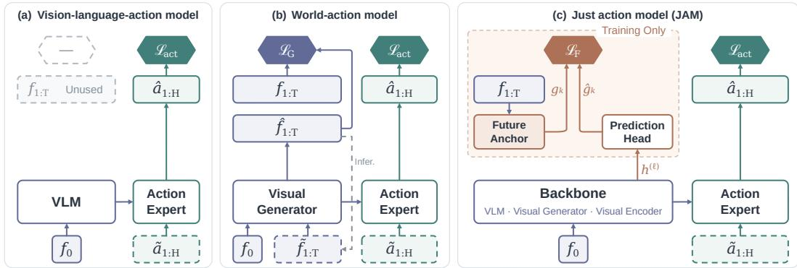
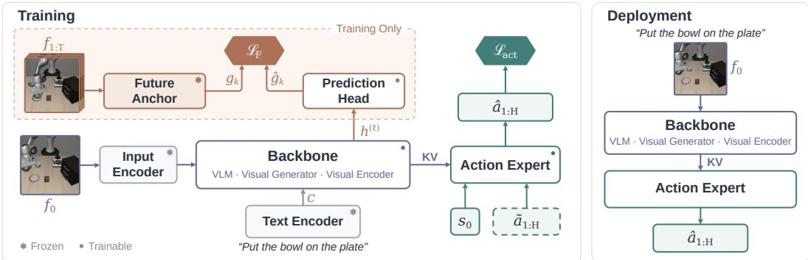
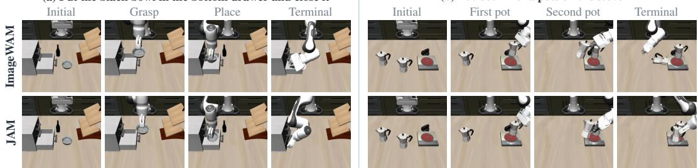
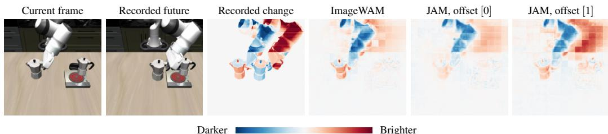
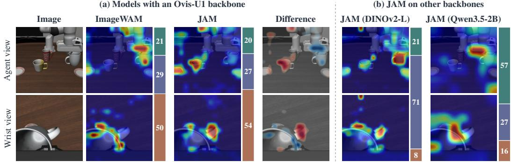
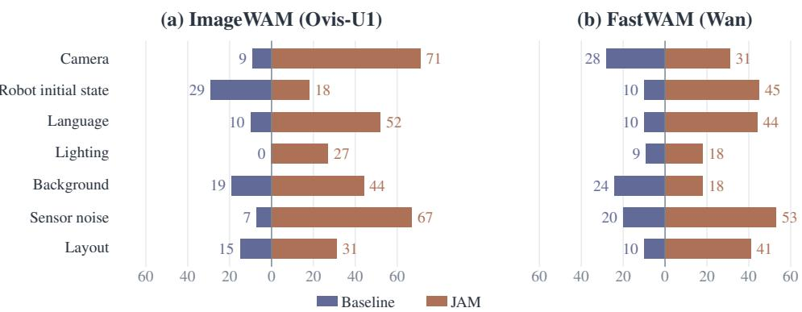
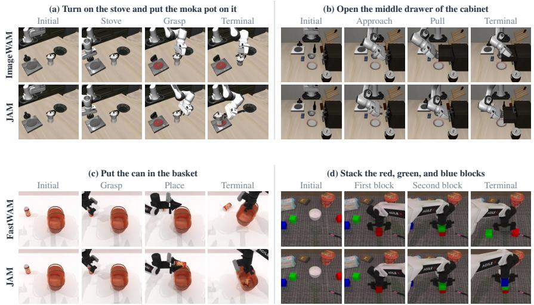
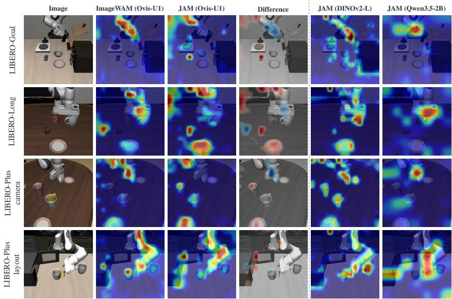
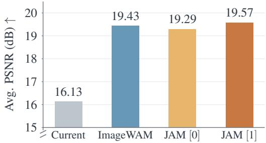

# VISION-LANGUAGE-ACTION OR WORLD-ACTION? JUST ACTION MODELS

Yonghao Yu The University of Tokyo y yu@cvm.t.u-tokyo.ac.jp

Runyi Li The University of Tokyo r li@cvm.t.u-tokyo.ac.jp

Lang Huang∗ National Institute of Informatics lang@nii.ac.jp

Toshihiko Yamasaki   
The University of Tokyo   
yamasaki@cvm.t.u-tokyo.ac.jp

## ABSTRACT

The vision-language-action (VLA) and world-action model (WAM) communities debate whether control policies should inherit pretrained knowledge from visionlanguage models or from visual generators. The debate, however, bundles three separable choices: backbone initialization, the objective applied to future observations, and whether the machinery for that future loss is kept at inference. A gap between a VLA and a WAM therefore cannot simply be attributed to any one of them. We show that decoupling these choices yields a common framework for both families, which we term Just Action Model (JAM): a pretrained visual backbone with an action expert, trained with an action loss and a foresight loss. The foresight loss trains current-observation features to predict frozen encodings of the recorded future through a prediction head discarded after training, so no visual generation is involved in either training or inference, and the backbone can be chosen freely. We first compare objectives within fixed policy architectures, then evaluate the foresight recipe across backbone families. The resulting JAM policies outperform their matched FastWAM and ImageWAM counterparts on LIBERO and LIBERO-Plus, and achieve similar or slightly higher success rates on RoboTwin. Compared with FastWAM, JAM improves the success rates from 97.0%/55.3%/91.2% to 98.2%/64.5%/91.4%, respectively. With cached foresight targets, JAM reduces estimated online training FLOPs per sample per update by 73% relative to FastWAM. Our results show that future supervision improves control without visual generation or additional inference machinery, and strong foresight performance is attainable with either generator-initialized or vision-language backbones. Project Page: https://y0uroy.github.io/JAM

## 1 INTRODUCTION

Pretrained visual models provide a starting point for robot control. Standard vision-languageaction models (VLAs) adapt vision-language representations to predict actions (Kim et al., 2025b; Black et al., 2025a;b). World-action models (WAMs) start from image or video generators and learn actions together with future visual prediction (Ye et al., 2026b; Yuan et al., 2026; Li et al., 2026b; Bi et al., 2026; Zhang et al., 2026a). These approaches differ, as depicted in Figure 1, in both their pretrained knowledge and how they use the robot trajectories: most VLAs learn only the actions in a trajectory, whereas a WAM also learns to generate the observations that follow. Comparing their success rates alone does not identify which difference matters.

We separate three choices: backbone initialization, the objective on recorded future observations, and the modules used at inference. Recent attempts such as FastWAM (Yuan et al., 2026) and ImageWAM (Zhang et al., 2026a) remove test-time video or image generation and suggest that visual generative objectives at training time are the key to WAMs. We ask a more basic question: does

Figure 1: The three choices that separate VLAs, WAMs, and JAM: backbone initialization, the objective on recorded future observations, and the modules kept at inference. (a) The VLA reference uses no future objective, only the action loss ${ \mathcal { L } } _ { \mathrm { a c t } } .$ (b) WAMs add visual generation loss $\mathcal { L } _ { \mathrm { G } }$ . The dashed loop shows generated future observations entering the action expert in some WAMs. (c) JAM uses foresight loss $\mathcal { L } _ { \mathrm { F } }$ across pretraining families, discards its supervision branch, and retains the corresponding action path.

learning from recordedfuture observations require a visual generative objective at all? If not, can backbones without visual generative pretraining learnfromfuture observations in the same way?

We show that predicting future representations can replace visual generative supervision in policy training. We introduce Just Action Model (JAM), a common recipe for a pretrained visual backbone and an action expert. The policy is trained with an action loss and a foresight loss: a prediction head maps current-observation features to targets supplied by a frozen future anchor. Future observations provide targets for the foresight loss, never inputs to the action path. The anchor branch and prediction head are used only during training, and fixed targets can be cached. At deployment, the backbone encodes the current context and the action expert predicts the action chunk. JAM requires no image or video generation during policy fine-tuning or deployment. The backbone may still come from generative pretraining, and the action expert still uses flow matching.

We evaluate the recipe in two stages. First, we replace the generative objectives of FastWAM and f̂ImageWAM while keeping each policy’s architecture, data, optimizer, training budget, and deployment path fixed. Predicting future representations preserves or improves success, and targets at future positions are more effective than those at the current position. Backbone and future anchor pretraining play different roles: a pretrained FastWAM backbone remains effective with a randomly initialized, frozen future anchor, and direct VAE features give its strongest result. JAM (Ovis-U1) performs best with targets from the pretrained Yak backbone, so the preferred target is architecture dependent. With the best target for each architecture, LIBERO-Plus success rises from 55.31% to 64.54% for FastWAM and from 65.27% to 79.95% for ImageWAM. With cached targets, this recipe reduces estimated online FLOPs per sample per update by 73.0% for FastWAM and 36.8% for ImageWAM.

Second, we retain the common foresight objective and instantiate it with generative, self-supervised, and vision-language backbones. On LIBERO-Plus, JAM (Ovis-U1), JAM (DINOv2-L), and JAM (Qwen3.5-2B) reach 79.95%, 70.39%, and 81.14%, against 65.27% for ImageWAM (Ovis-U1), which is trained with the generation loss $\mathcal { L } _ { \mathrm { G } }$ . These results establish the recipe’s applicability across all three families: generative backbones can learn from future observations without a visual generative loss, and the same supervision applies to non-generative backbones.

Our contributions are:

• We propose JAM, a single recipe for a pretrained visual backbone and an action expert in which recorded future observations enter only as frozen prediction targets, and the foresight branch is discarded after training.

• We show through fixed-architecture comparisons that foresight can replace visual generation while preserving or improving success. Future-offset targets are more effective than current-offset targets, and the best target depends on the backbone: a plain VAE suffices for the Wan video backbone. With targets cached, JAM reduces the estimated online training FLOPs per sample per update by 73.0% relative to FastWAM.

• We apply the same objective to generative, self-supervised, and vision-language backbones, with the strongest generative and vision-language instantiations achieving comparable control performance, showing that strong performance with foresight is attainable using either a generator-initialized or a vision-language backbone.

## 2 RELATED WORK

Pretrained models for robot control. OpenVLA adapts a vision-language model to autoregressive action prediction; π0 and $\pi _ { 0 . 5 }$ pair vision-language backbones with flow-matching action experts (Kim et al., 2025b; Black et al., 2025a;b). WAMs combine generator initialization with future visual prediction (Ye et al., 2026a;b; Li et al., 2026b; Bi et al., 2026). FastWAM retains video co-training without test-time video generation (Yuan et al., 2026); ImageWAM uses an image-editing backbone and a future-image target (Zhang et al., 2026a). JAM replaces their visual generation objectives while preserving each policy’s architecture and deployment path, separating the use of pretrained generators from the need to generate during policy training.

Future-representation supervision. Future observations support planning and predictive supervision (Wu et al., 2024; Cheang et al., 2024; Guo et al., 2024; Li et al., 2025). Joint-embedding methods avoid pixel reconstruction (Assran et al., 2025; Daithankar et al., 2026); Var-JEPA studies a variational formulation on tabular data (Gogl & Yau, 2026). Mirai and Video-Mirai apply¨ foresight to image and video generation (Yu et al., 2026b;a). For control, FRAPPE aligns policy features with multiple future representations, VLAFlow pairs latent alignment with languagesupervised co-training, and Being-H0.7 aligns a deployable prior with a future-informed posterior (Zhao et al., 2026; Xia et al., 2026; Luo et al., 2026). VLA-JEPA uses frozen video targets for human-video pretraining and joint representation and action learning (Sun et al., 2026); PFD distills future-conditioned action residuals into a current-only FastWAM policy while retaining video co-training and a deployed residual adapter (Fang et al., 2026).

Predictive supervision for action policies. FLARE mixes future, state, and action tokens through self-attention in the action DiT (Zheng et al., 2025). JEPA-WAM supervises a shared actiongenerating predictor using dense joint current–future targets in a frozen V-JEPA space. Its pretrained-VLA instantiation preserves the original pathways and removes the prediction branch at deployment (Lin et al., 2026). JAM differs from FLARE in where prediction is applied: a separate training-only head supervises existing visual-backbone tokens, preserving the matched policy’s action computation. In contrast to JEPA-WAM’s joint current–future V-JEPA target, it supervises future-position features in a target space chosen for each backbone. This common recipe replaces visual generation in existing WAMs and extends across generative, self-supervised, and vision-language backbones. Appendix E gives further comparisons and more related work.

## 3 JAM: JUST ACTION MODELS

## 3.1 PROBLEM FORMULATION

All three recipes in Figure 1 share the same data and the same deployed interface. A training example contains the current observation $f _ { 0 } ,$ the robot state $s _ { 0 } .$ , an instruction $^ { c , }$ an action chunk $a _ { 1 : H }$ , and recorded future observations $f _ { 1 : T }$ . The deployed policy predicts $a _ { 1 : H }$ from $f _ { 0 } , s _ { 0 }$ , and $c .$ The recipes differ in which pretrained model initializes the backbone, and what loss is placed on the recorded futures $f _ { 1 : T }$

The action-only VLA reference adapts a pretrained vision-language backbone and an action expert with the action flow-matching loss alone (Lipman et al., 2023),

$$
\mathcal { L } _ { \mathrm { V L A } } = \mathcal { L } _ { \mathrm { a c t } } ,\tag{1}
$$

where $\mathcal { L } _ { \mathrm { a c t } }$ supervises the action chunk. The recorded futures are unused, and pretrained weights enter through policy initialization. The WAM reference starts from a pretrained generator and adds its generative loss $\mathcal { L } _ { \mathrm { G } }$ on the recorded futures,

$$
\begin{array} { r } { \mathcal { L } _ { \mathrm { W A M } } = \mathcal { L } _ { \mathrm { a c t } } + \lambda _ { \mathrm { G } } \mathcal { L } _ { \mathrm { G } } . } \end{array}\tag{2}
$$

  
Figure 2: JAM training (left) and deployment (right), with the notation of Section 3.2. The input and text encoders stand for architecture-specific interfaces. Recorded futures $f _ { 1 : T }$ enter only the future anchor branch inside the dashed box; deployment discards this branch and the prediction head, leaving the backbone and action expert.

This term ties the recipe to a generator: it needs a decoder or denoising path during training, and in some WAMs also at inference. JAM pairs a backbone with an action expert and optimizes

$$
\mathcal { L } _ { \mathrm { J A M } } = \mathcal { L } _ { \mathrm { a c t } } + \lambda _ { \mathrm { F } } \mathcal { L } _ { \mathrm { F } } ,\tag{3}
$$

as shown in Figure 2. The foresight loss $\mathcal { L } _ { \mathrm { F } }$ trains current-observation features to predict the future anchor’s representation of the recorded futures, without a visual generative loss. The anchor branch and prediction head are used only during training; the deployed architecture is unchanged, and no future frame is ever generated, either in training or at inference.

Equation 3 bridges the two families: the futures supervise through the frozen future anchor rather than through visual generation. The objective does not require an image or video generator, so the backbone can be a generative DiT, a self-supervised encoder, or a vision-language model. The future anchor can use a frozen backbone or reuse the policy’s VAE tokenizer. The deployed policy consists of the backbone and the action expert.

## 3.2 FORESIGHT SUPERVISION

Policy and target features. The visual backbone encodes $f _ { 0 } ,$ conditioned on c when the backbone supports text input. The action expert receives the resulting visual context, c, the robot state $s _ { 0 } ,$ and the noised action chunk $\widetilde { a } _ { 1 : H }$ at a sampled flow time. Let $\mathbf { h } ^ { ( \ell ) } \in \mathbb { R } ^ { N \times D }$ denote the current-observation tokens at backbone block ℓ. The frozen future anchor $E _ { \varphi }$ processes the recorded futures $f _ { 1 : T }$ through its own conditioning interface. For Yak, FLUX.2, and Qwen, this interface also reads $f _ { 0 }$ and $c .$ . The target $\mathbf { g } _ { k } \in \mathbb { R } ^ { N \times D _ { g } }$ contains the anchor’s features at readout offset k, its k-th temporal position, where $k = 0$ is the current observation and $k \geq 1$ are recorded futures. Backbone features or VAE latents are matched to the spatial-token layout of $\mathbf { h } ^ { ( \ell ) }$ , and $D _ { g }$ is the target feature dimension. With fixed target preprocessing and conditioning, these targets can be computed once and cached.

Foresight loss. The trainable prediction head $p$ maps the policy tokens $\mathbf { h } ^ { ( \ell ) }$ into the target space, giving one prediction $\hat { \mathbf { g } } _ { k } \in \mathbb { R } ^ { N \times D _ { g } }$ per offset k. The foresight loss is the cosine distance between prediction and target, averaged over tokens and offsets:

$$
\mathcal { L } _ { \mathrm { F } } = \frac { 1 } { \vert \mathcal { K } \vert } \sum _ { k \in \mathcal { K } } \mathbb { E } _ { n } \Big [ 1 - \cos \big ( \hat { \mathbf { g } } _ { k , n } , \ : \mathrm { s g } [ \mathbf { g } _ { k , n } ] \big ) \Big ] ,\tag{4}
$$

where $\kappa$ is the set of supervised readout offsets and n indexes spatial tokens. The operator sg stops gradients through the target. Gradients reach the head and the policy backbone, so recorded futures supervise the features read by the action expert without entering the action path. Supervision is applied at the selected current or future target positions. The head is a small token-mixing transformer with one linear readout per offset.

Action inference. The foresight branch exists only in training. After training, we discard the anchor branch and prediction head, and neither target extraction nor future prediction runs at inference. The policy encodes $f _ { 0 }$ and c once, and the action expert reuses this context across its flow-matching sampling steps. This is the inference procedure of the matched FastWAM and ImageWAM baselines, which already avoid test-time future generation. The difference is that JAM avoids visual generation during training as well.

## 3.3 INSTANTIATIONS ACROSS PRETRAINING FAMILIES

We instantiate JAM with backbones from three pretraining families. In the cross-backbone comparison in Table 3, each future anchor is a frozen copy of the corresponding backbone. Our matched FastWAM and ImageWAM experiments additionally evaluate VAE-direct future anchors.

Generative backbones. FastWAM pairs a Wan2.2-5B video backbone with an action expert of the same depth, and ImageWAM (Ovis-U1) pairs the pretrained Yak18 image-editing backbone with an 18-block action expert of matching width (Team Wan et al., 2025; Yuan et al., 2026; Zhang et al., 2026a). Their generative objectives denoise future video latents and generate a future image. Under JAM, the backbone sees only the clean current frame, and the policy architecture and action-expert initialization are unchanged. Two further targets isolate what the frozen generator contributes: the same backbone with random initialization, which keeps the architecture but removes the pretrained features, and the frozen VAE tokenizer alone, which removes the target transforme and predicts lifted latent-patch features.

Self-supervised backbones. DINOv2 is an image encoder with no language input and no generative head (Oquab et al., 2024). The action expert mirrors the backbone’s transformer blocks, and a separate text encoder supplies instruction features to the action expert, but not to the visual backbone.

Vision-language backbone. Qwen3.5-2B is a vision-language model that already reads images and text together (Qwen Team, 2026). The action expert mirrors the backbone’s blocks and reads the backbone’s tokens through causal token mixing over image, text, and action tokens, so it is a VLA trained with an additional foresight loss.

## 4 EXPERIMENTS

Our study has two stages. First, we replace visual generation with foresight within fixed policy architectures and deployment paths, examining target offsets and future anchors. Second, we apply the common objective to backbones from different pretraining families. We also compare the resulting policies with published systems and evaluate training cost.

## 4.1 SETUP

Benchmarks. LIBERO contains the Spatial, Object, Goal, and Long suites (Liu et al., 2023). We evaluate 40 tasks with 50 rollouts each and report success per suite and averaged across suites. For LIBERO-Plus, we follow ImageWAM’s 15% subset protocol (Fei et al., 2026; Zhang et al., 2026a): a seeded draw per suite produces a fixed manifest of 1,506 perturbed tasks, evaluated once each and shared by all local policies. RoboTwin 2.0 evaluates 50 bimanual tasks under Clean and Randomized settings (Chen et al., 2026).

Training and comparisons. Each generative policy and its foresight counterpart share data, policy architecture, optimizer, training budget, and evaluator. Training budgets follow FastWAM and ImageWAM (Yuan et al., 2026; Zhang et al., 2026a). On LIBERO, the FastWAM recipe runs 20k updates and the ImageWAM recipe, used by the other backbones, 21.7k, both at global batch 128. On RoboTwin 2.0, both recipes run five epochs, 29,355 updates at global batch 1,024 for FastWAM and 69,900 at global batch 384 for ImageWAM.

Foresight configurations. For anchors that use a backbone, the policy and anchor readouts are at about 60% of their depth: block 18 of 30 for FastWAM, Yak layer 11 of 18 for ImageWAM, and layer 13 of 24 for Qwen3.5. DINOv2 is the exception and is supervised at its final block. Foresight losses are averaged over readout offsets, with total weight $\lambda _ { \mathrm { F } } = 0 . 6$ for FastWAM and 0.3

(a) Put the black bowl in the bottom drawer and close it  
(b) Put both moka pots on the stove  
  
Figure 3: Matched LIBERO-Long rollouts for ImageWAM and JAM, both on Ovis-U1.

Table 1: Generation versus foresight supervision with the policy architecture fixed. $\mathcal { L } _ { \mathrm { G } }$ is the generative loss and $\mathcal { L } _ { \mathrm { F } }$ the foresight loss. The target rows also vary the future anchor. Readout offsets are the set K of target positions, with 0 the current frame. The total foresight weight λF is fixed at 0.6 for Wan and 0.3 for Ovis-U1 and is divided equally among the readout offsets.
<table><tr><td>Policy</td><td> $\mathcal { L } _ { \mathrm { G } }$ </td><td> $\mathcal { L } _ { \mathrm { F } }$ </td><td>Future anchor</td><td>Readout offsets</td><td>LIBERO</td><td>LIBERO-Plus</td></tr><tr><td rowspan="2">FastWAM</td><td>X</td><td>X</td><td>一</td><td>1</td><td>95.25</td><td>45.55</td></tr><tr><td> $\checkmark$ </td><td>X</td><td>一</td><td>一</td><td>97.00</td><td>55.31</td></tr><tr><td rowspan="5">JAM (Wan)</td><td>X</td><td>√</td><td></td><td>[0]</td><td>95.80</td><td>44.62</td></tr><tr><td>X</td><td>√</td><td>Pretrained Wan</td><td>[1,2]</td><td>97.45</td><td>55.58</td></tr><tr><td>X</td><td>√</td><td></td><td>[0,1,2]</td><td>97.40</td><td>54.18</td></tr><tr><td> $\times$ </td><td>√</td><td>Random Wan</td><td>[1,2]</td><td>97.65</td><td>58.63</td></tr><tr><td>×</td><td>√</td><td>Pretrained VAE</td><td></td><td>98.15</td><td>64.54</td></tr><tr><td rowspan="2">ImageWAM (Ovis-U1)</td><td> $\times$ </td><td>X</td><td>一</td><td>一</td><td>90.20</td><td>61.35</td></tr><tr><td> $\checkmark$ </td><td>X</td><td>一</td><td>一</td><td>92.90</td><td>65.27</td></tr><tr><td rowspan="5">JAM (Ovis-U1)</td><td> $\times$ </td><td>√</td><td></td><td>[0]</td><td>94.55</td><td>69.65</td></tr><tr><td>X</td><td>√</td><td>Pretrained Yak</td><td>[1]</td><td>96.75</td><td>79.95</td></tr><tr><td>X</td><td>√</td><td></td><td>[0, 1]</td><td>95.00</td><td>72.58</td></tr><tr><td>X</td><td>√</td><td>Random Yak</td><td>[1]</td><td>95.55</td><td>72.51</td></tr><tr><td>X</td><td>√</td><td>Pretrained VAE</td><td></td><td>95.75</td><td>76.43</td></tr></table>

for the other policies. Readout indices count positions in the anchor’s temporal sequence. FastWAM samples frames every four environment steps, and its causal VAE encodes the current frame alone and merges each following group of four frames into one latent position. Offset [0] is therefore the current frame, and offsets [1] and [2] cover steps 4 to 16 and 20 to 32, respectively. For the other backbones, the recorded future is a single frame 16 steps ahead, so readout offset [1] denotes that frame and [0] the current one. More training details are given in Appendix A.

## 4.2 REPLACING GENERATION WITH FORESIGHT

Table 1 compares generation with foresight and reports the readout offsets and target choices examined below. For FastWAM, replacing video denoising with foresight on pretrained Wan targets moves LIBERO from 97.00% to 97.45% and LIBERO-Plus from 55.31% to 55.58%. The readout offset makes a larger difference than the objective swap itself: moving from offset [0] to the futureonly offsets [1,2] raises LIBERO-Plus from 44.62% to 55.58%, and adding the current position back, offsets [0, 1, 2], lowers it to 54.18%. For the Wan anchor, the current-position feature [0] may also contain future context through bidirectional attention.

For ImageWAM, the replacement improves LIBERO from 92.90% to 96.75% and LIBERO-Plus from 65.27% to 79.95%. Future-offset targets again improve LIBERO-Plus success from 69.65% at [0] to 79.95% at [1]. Figure 3 shows two matched LIBERO-Long episodes. ImageWAM does not close the drawer in (a) and knocks over the second pot in (b), whereas JAM completes both tasks. Appendix D.4 gives more matched rollouts on LIBERO-Plus and RoboTwin 2.0.

The target rows of Table 1 then vary the future anchor. On LIBERO-Plus, JAM (Wan) performs best with the frozen VAE tokenizer alone, 64.54%, and a random Wan target still reaches 58.63%, whereas JAM (Ovis-U1) performs best with the pretrained Yak anchor, 79.95% against 76.43%

  
Figure 4: Decoded future change for put both moka pots on the stove, for ImageWAM and the two JAM (Ovis-U1) policies of Table 1 with readout offsets [0] and [1]. Two MLP readouts reconstruct the current frame and the frame 16 steps ahead from the same frozen features, and their difference is compared with the recorded change. Red marks pixels that get brighter and blue marks pixels that get darker, on a common scale. In this example, the features of JAM trained with offset [1] make the future-frame change more readily decodable than the features of ImageWAM or JAM trained with offset [0].

Table 2: JAM (Wan) with the backbone and the future anchor each pretrained or random.  
Table 3: JAM across pretrained backbones with a common actionplus-foresight objective and frozen backbone copies as future anchors. Architecture and action-interface differences prevent isolating pretraining effects.
<table><tr><td>Backbone Anchor</td><td></td><td>LIBERO</td></tr><tr><td>Pretrained Pretrained</td><td></td><td>97.45</td></tr><tr><td>Pretrained Random</td><td></td><td>97.65</td></tr><tr><td>Random</td><td>Random</td><td>84.40</td></tr><tr><td>Random</td><td>Pretrained</td><td>71.15</td></tr></table>

<table><tr><td>Policy backbone</td><td>Size</td><td>LIBERO LIBERO-Plus</td><td></td></tr><tr><td>ImageWAM (Ovis-U1) (Zhang et al., 2026a)</td><td>1.13B</td><td>92.90</td><td>65.27</td></tr><tr><td>JAM (Ovis-U1) (Zhang et al., 2026a)</td><td>1.13B</td><td>96.75</td><td>79.95</td></tr><tr><td>JAM (DINOv2-B) (Oquab et al., 2024)</td><td>86.6M</td><td>95.50</td><td>68.19</td></tr><tr><td>JAM (DINOv2-L) (Oquab et al., 2024)</td><td>304M</td><td>96.30</td><td>70.39</td></tr><tr><td>JAM (Qwen3.5-2B) (Qwen Team, 2026)</td><td>2.0B</td><td>96.55</td><td>81.14</td></tr></table>

for the VAE tokenizer and 72.51% for random Yak. The preferred target therefore differs between the two architectures. One possible explanation is the temporal information already present in the target representations. Their temporal inputs differ: Wan encodes a strided window over the 32-step action chunk, so its VAE latents already trace how the scene changes, whereas Yak encodes only the 16-step endpoint, which its pretrained layers relate to the current observation and instruction.

What future changes can be decoded from these policy features? Two MLP readouts reconstruct the current frame and the frame 16 steps ahead from each frozen policy. Figure 4 shows their signed difference for ImageWAM (Ovis-U1) and two JAM variants. In this example, JAM trained with off set [1] recovers future changes more clearly. It also achieves the highest mean future-frame PSNR among the compared policies. These observations suggest that explicit future-position supervision helps make future information more accessible in current-observation features. Appendix D.6 describes the probes and reports the PSNR.

## 4.3 VARYING THE BACKBONE

Having replaced visual generation with foresight and compared different target representations, we next examine the role of backbone pretraining and whether the same recipe extends beyond generative backbones. Table 2 separates backbone and future anchor initialization for JAM (Wan). With a pretrained visual backbone, pretrained and random Wan targets reach 97.45% and 97.65% on LIBERO. With a random visual backbone, they reach 71.15% and 84.40%. Pretrained backbone weights are important in both matched-target comparisons, whereas a random target remains effec tive. A frozen random future anchor supplies stable, input-dependent features of the recorded future, not independently sampled noise. Together with the VAE results in Table 1, this shows that the future anchor need not use the same pretrained backbone as the policy, while the policy backbone still relies on pretraining for strong control performance.

We next ask whether the recipe requires a generative backbone or can also be applied to other types of backbones. For vision-language Qwen3.5-2B, adding foresight raises LIBERO-Plus success from 77.03% to 81.14% with policy architecture and training settings fixed. Table 3 compares the generative Ovis-U1, self-supervised DINOv2-B/L, and vision-language Qwen3.5-2B backbones under the same action-plus-foresight objective (Section 3.3). JAM (Ovis-U1) reaches 96.75% on LIBERO and 79.95% on LIBERO-Plus, and JAM (Qwen3.5-2B) reaches 96.55% and 81.14%. The two differ by 0.20 and 1.19 points despite their different pretraining objectives. JAM (DINOv2-B) and JAM (DINOv2-L) reach 68.19% and 70.39% on LIBERO-Plus. All four exceed the generative baseline ImageWAM (Ovis-U1) on both benchmarks. The recipe therefore extends beyond both visual generators and vision-language models, with the same action-only deployment path in every case. We also evaluate action-only training variants of Qwen3.5-2B and DINOv2-L in Appendix C.5.

(a) Models with an Ovis-U1 backbone  
(b) JAM on other backbones  
  
Figure 5: Action-to-visual attention on one LIBERO-Long observation for put the white mug on the left plate and put the yellow and white mug on the right plate, in the agent and wrist views. (a) ImageWAM (Ovis-U1) and JAM share the deployed policy architecture but use different training objectives. The difference map compares normalized display intensities, with red indicating higher values for JAM and blue for ImageWAM. (b) JAM on a self-supervised and a vision-language backbone. Bars show attention shares over text (orange), image (blue), and action keys (green), averaged over 100 reference frames.

Table 4: RoboTwin 2.0 success (%), averaged over Clean and Randomized settings (Table 19).
<table><tr><td>Method</td><td>P.T.</td><td>AVG</td></tr><tr><td>VLM-based policies</td><td></td><td></td></tr><tr><td>π0 (Black et al., 2025b)</td><td>√</td><td>62.2</td></tr><tr><td>π0.5 (Black et al., 2025a)</td><td>√</td><td>79.8</td></tr><tr><td>JAM (Qwen3.5-2B)†</td><td>X</td><td>89.8</td></tr><tr><td>Video generator-based policies</td><td></td><td></td></tr><tr><td>Motus (Bi et al., 2026)</td><td>√</td><td>87.8</td></tr><tr><td>LingBot-VA (Li et al., 2026b)</td><td>√</td><td>92.2</td></tr><tr><td>FastWAM† (Yuan et al., 2026)</td><td>X</td><td>91.2</td></tr><tr><td>JAM (Wan)†</td><td>X</td><td>91.4</td></tr><tr><td>Image generator-based policies</td><td></td><td></td></tr><tr><td>ImageWAM (Ovis-U1)† (Zhang et al., 2026a)</td><td>X</td><td>89.0</td></tr><tr><td>ImageWAM (FLUX.2)† (Zhang et al., 2026a)</td><td>X</td><td>92.9</td></tr><tr><td>JAM (Ovis-U1)†</td><td>X</td><td>89.9</td></tr><tr><td>JAM (FLUX.2)†</td><td>X</td><td>93.1</td></tr></table>

Table 5: LIBERO success (%), averaged over four suites. Table 18 gives per-suite results.
<table><tr><td>Method</td><td>P.T.</td><td>AVG</td></tr><tr><td>VLM-based policies</td><td></td><td></td></tr><tr><td>OpenVLA (Kim et al., 2025b)</td><td>√</td><td>76.5</td></tr><tr><td>GR00T N1 (NVIDIA et al., 2025)</td><td>√</td><td>93.9</td></tr><tr><td>π0 (Black et al., 2025b)</td><td>√</td><td>94.1</td></tr><tr><td>π0.5 (Black et al., 2025a)</td><td>√</td><td>96.9</td></tr><tr><td>JAM (Qwen3.5-2B)†</td><td>X</td><td>96.6</td></tr><tr><td>Video generator-based policies</td><td></td><td></td></tr><tr><td>Motus (Bi et al., 2026)</td><td>√</td><td>97.7</td></tr><tr><td>LingBot-VA (Li et al., 2026b)</td><td>√</td><td>98.5</td></tr><tr><td>FastWAM† (Yuan et al., 2026)</td><td>X</td><td>97.0</td></tr><tr><td>JAM (Wan)†</td><td>X</td><td>98.2</td></tr><tr><td>Image generator-based policies</td><td></td><td></td></tr><tr><td>ImageWAM (Ovis-U1)f (Zhang et al., 2026a)</td><td>X</td><td>92.9</td></tr><tr><td>JAM (Ovis-U1)†</td><td>X</td><td>96.8</td></tr></table>

To see how these policies use their inputs, Figure 5 visualizes the action expert’s attention to visual tokens on one observation across the different backbones. Each map averages heads, action queries, sampling steps, and layers, then shows the attention above that policy’s mean map over 100 reference frames, so it highlights content-dependent variation. On the displayed example, ImageWAM concentrates on the mug in the gripper, while JAM on the same backbone places more attention on the second mug named in the instruction. The Difference panel makes this contrast clearer. The share bars summarize all 100 frames and show that the action interfaces allocate atten tion differently: DINOv2-L gives its largest share to image keys, JAM (Ovis-U1) to text keys, and Qwen3.5-2B to action keys. These maps and shares describe where attention goes. Appendix D.5 gives further details and results of this analysis.

## 4.4 BENCHMARK COMPARISONS

Tables 4, 5, and 6 compare policies on RoboTwin 2.0, LIBERO, and LIBERO-Plus, grouped by backbone pretraining family, with bold marking the best score within each group. The P.T. column marks embodied pretraining on robot data, which none of our policies use. Rows marked † are evaluated by us, and the others keep their published values and protocols. JAM (Wan) and JAM (Ovis-U1) use the configurations selected in Table 1. Full results appear in Appendices D.2 and D.3.

Table 6: LIBERO-Plus success (%) by perturbation category, with the task-weighted average. Published rows retain their original evaluation protocols; † marks our evaluation on a fixed 1,506-task subset.
<table><tr><td>Method</td><td>P.T.</td><td>Camera</td><td></td><td>Robot Language</td><td>Light</td><td>Background</td><td>Noise Layout</td><td></td><td>AVG</td></tr><tr><td colspan="10">VLM-based policies</td></tr><tr><td>UniVLA (Bu et al., 2025)</td><td>√</td><td>1.8</td><td>46.2</td><td>69.6</td><td>69.0</td><td>81.0</td><td>21.2</td><td>31.9</td><td>42.9</td></tr><tr><td>OpenVLA-OFT (Kim et al., 2025a)</td><td>√</td><td>56.4</td><td>31.9</td><td>79.5</td><td>88.7</td><td>93.3</td><td>75.8</td><td>74.2</td><td>69.6</td></tr><tr><td>π0 (Black et al., 2025b)</td><td>√</td><td>13.8</td><td>6.0</td><td>58.8</td><td>85.0</td><td>81.4</td><td>79.0</td><td>68.9</td><td>53.6</td></tr><tr><td>π0-Fast (Pertsch et al., 2025)</td><td>√</td><td>65.1</td><td>21.6</td><td>61.0</td><td>73.2</td><td>73.2</td><td>74.4</td><td>68.8</td><td>61.6</td></tr><tr><td>WorldVLA (Cen et al., 2025)</td><td>X</td><td>0.1</td><td>27.9</td><td>41.6</td><td>43.7</td><td>17.1</td><td>10.9</td><td>38.0</td><td>25.0</td></tr><tr><td>JAM (Qwen3.5-2B)†</td><td>X</td><td>80.8</td><td>61.4</td><td>71.7</td><td>93.8</td><td>81.7</td><td>94.2</td><td>84.5</td><td>81.1</td></tr><tr><td colspan="10">Video generator-based policies</td></tr><tr><td>FastWAM† (Yuan et al., 2026)</td><td>X</td><td>24.2</td><td>50.3</td><td>78.7</td><td>87.6</td><td>49.5</td><td>39.9</td><td>67.3</td><td>55.3</td></tr><tr><td>JAM (Wan)†</td><td>X</td><td>25.4</td><td>68.0</td><td>92.6</td><td>93.2</td><td>46.2</td><td>52.7</td><td>81.4</td><td>64.5</td></tr><tr><td colspan="10">Image generator-based policies</td></tr><tr><td>ImageWAM (Ovis-U1)† (Zhang et al., 2026a)</td><td>X</td><td>57.9</td><td>54.8</td><td>67.6</td><td>78.9</td><td>66.7</td><td>68.6</td><td>65.0</td><td>65.3</td></tr><tr><td>JAM (Ovis-U1)†</td><td>X</td><td>83.8</td><td>49.2</td><td>84.8</td><td>95.7</td><td>80.1</td><td>91.9</td><td>72.3</td><td>79.9</td></tr></table>

On RoboTwin 2.0, JAM has the best score among VLM-based and image generator-based policies, and JAM (FLUX.2) has the highest listed score, 93.1%. Among video generator-based policies, LingBot-VA, which uses embodied pretraining, leads JAM (Wan) by 0.8 points. Unlike LingBot-VA, JAM (Wan) predicts actions without first generating future video, and Yuan et al. (2026) mea sured this inference path as over four times faster than a matched variant that generates video first. On LIBERO, JAM (Ovis-U1) leads the image generator-based policies, while π . and LingBot-VA, both with embodied pretraining, stay 0.3 points ahead of JAM (Qwen3.5-2B) and JAM (Wan). On LIBERO-Plus, JAM has the best average in all three groups. It exceeds FastWAM and ImageWAM (Ovis-U1) by 9.2 and 14.7 points and trails them only in the background and robot-state categories, respectively. Overall, JAM matches or exceeds its generative baselines on all three benchmarks, so learning from future observations does not require a visual generative objective. JAM (Qwen3.5-2B) is competitive on LIBERO and leads on LIBERO-Plus, but trails JAM (FLUX.2) by 3.30 percentage points on RoboTwin 2.0. These results support a common recipe for vision-language and generative backbones: action and foresight losses during training, with only the action policy retained at inference.

## 4.5 TRAINING COST

JAM reduces online training cost by processing only the current observation in the trainable visual branch and caching fixed targets. With cached foresight targets, the estimated cost per sample per update falls from 15.52 TFLOPs for FastWAM to 4.19 for JAM (Wan), a 73.0% reduction. Generation denoises a nine-frame window that the video VAE must also encode, whereas cached foresight uses only the current frame online. With cached Yak targets, the estimated cost falls from 5.81 TFLOPs for ImageWAM (Ovis-U1) to 3.67 for JAM (Ovis-U1), a 36.8% reduction. Its generative branch predicts only one future frame, and both objectives process the text context. Measured on one GH200, the GPU time of the operations covered by these estimates falls by 67.3% and 37.8% in the same two comparisons. Appendix B details the FLOP estimates and GPU-time measurements.

## 5 CONCLUSION

JAM bridges vision-language-action and world-action models by separating backbone initialization, supervision on future observations, and the modules retained at inference. It trains a pretrained visual backbone and an action expert with action and foresight losses, using frozen future representations as targets and discarding the foresight branch after training. With the policy architecture fixed, replacing visual generation with foresight yields higher success rates than the corresponding generative baselines on LIBERO and LIBERO-Plus, with the largest gains on LIBERO-Plus; RoboTwin 2.0 success is similar or slightly higher. With cached targets, JAM reduces online FLOPs per sample per update by 73.0% relative to FastWAM and 36.8% relative to ImageWAM. With the recipe fixed, the same supervision applies to generative, self-supervised, and vision-language backbones, and the best generator-initialized and vision-language policies achieve comparable performance. These results show that effective foresight training is possible with either pretraining family, while the cross-backbone comparison does not isolate the effect of pretraining alone. Both families can be trained as Just Action Models that learn from recorded futures without visual generation during policy training or additional inference machinery.

## AI USE STATEMENT

We used generative AI tools to assist with code implementation and literature checks, obtain reviewer-style research feedback, and refine the writing. The authors take full responsibility for the final text, code, figures, methods, results, analyses, claims, and references, including material prepared with AI assistance.

## ETHICS STATEMENT

This study evaluates robot manipulation policies in simulation using public models, code, and datasets. Experiments use LIBERO, LIBERO-Plus, and RoboTwin 2.0 and involve no human participants or personal data. Relevant risks include failures under distribution shift and unsafe deployment of simulation-trained policies without physical validation.

## REPRODUCIBILITY STATEMENT

Section 3 defines JAM’s objective and policy interfaces, and Section 4.1 describes the benchmarks and comparison protocol. Appendix A specifies the architectures, target construction, training hyperparameters, and budgets. Appendix B details the FLOP estimates and GPU-time measurements, while Appendix C reports the ablations and action-only controls. Appendix D documents the evaluation and analysis protocols, including LIBERO-Plus subset sampling, paired statistical tests, and independent training runs. Our implementation builds on public FastWAM and ImageWAM code and public benchmark datasets. Our code and selected model weights are publicly available.

## REFERENCES

Mahmoud Assran, Adrien Bardes, David Fan, Quentin Garrido, Russell Howes, Mojtaba Komeili, Matthew Muckley, Ammar Rizvi, Claire Roberts, Koustuv Sinha, et al. V-JEPA 2: Self-supervised video models enable understanding, prediction and planning. arXiv preprint arXiv:2506.09985, 2025.

Hongzhe Bi, Hengkai Tan, Shenghao Xie, Zeyuan Wang, Shuhe Huang, Haitian Liu, Ruowen Zhao, Yao Feng, Chendong Xiang, Yinze Rong, et al. Motus: A unified latent action world model. In CVPR, pp. 35101–35113, 2026.

Kevin Black, Noah Brown, James Darpinian, Karan Dhabalia, Danny Driess, Adnan Esmail, Michael Robert Equi, Chelsea Finn, Niccolo Fusai, Manuel Y. Galliker, et al. π : a visionlanguage-action model with open-world generalization. In CoRL, volume 305, pp. 17–40, 2025a.

Kevin Black, Noah Brown, Danny Driess, Adnan Esmail, Michael Robert Equi, Chelsea Finn, Niccolo Fusai, Lachy Groom, Karol Hausman, Brian Ichter, et al. π0: A vision-language-action flow model for general robot control. In RSS, 2025b.

Piotr Bojanowski and Armand Joulin. Unsupervised learning by predicting noise. In ICML, volume 70, pp. 517–526, 2017.

Qingwen Bu, Yanting Yang, Jisong Cai, Shenyuan Gao, Guanghui Ren, Maoqing Yao, Ping Luo, and Hongyang Li. Learning to act anywhere with task-centric latent actions. In RSS, 2025.

Yuri Burda, Harrison Edwards, Amos Storkey, and Oleg Klimov. Exploration by random network distillation. In ICLR, 2019.

Jun Cen, Chaohui Yu, Hangjie Yuan, Yuming Jiang, Siteng Huang, Jiayan Guo, Xin Li, Yibing Song, Hao Luo, Fan Wang, Deli Zhao, and Hao Chen. WorldVLA: Towards autoregressive action world model. arXiv preprint arXiv:2506.21539, 2025.

Chi-Lam Cheang, Guangzeng Chen, Ya Jing, Tao Kong, Hang Li, Yifeng Li, Yuxiao Liu, Hongtao Wu, Jiafeng Xu, Yichu Yang, Hanbo Zhang, and Minzhao Zhu. GR-2: A generative video-language-action model with web-scale knowledge for robot manipulation. arXiv preprint arXiv:2410.06158, 2024.

Tianxing Chen, Zanxin Chen, Baijun Chen, Zijian Cai, Yibin Liu, Zixuan Li, Qiwei Liang, Xianliang Lin, Yiheng Ge, Zhenyu Gu, Weiliang Deng, Yubin Guo, Tian Nian, Xuanbing Xie, Qiangyu Chen, Kailun Su, Tianling Xu, Guodong Liu, Mengkang Hu, Huan-ang Gao, et al. RoboTwin 2.0: A scalable data generator and benchmark with strong domain randomization for robust bimanual robotic manipulation. In ICML, 2026.

Ninad Daithankar, Alexi Gladstone, Yann LeCun, and Heng Ji. You don’t need strong assumptions: Visual representation learning via temporal differences. arXiv preprint arXiv:2606.15956, 2026.

Pengcheng Fang, Hongli Chen, and Xiaohao Cai. Privileged foresight distillation: Zero-cost future correction for world action models. arXiv preprint arXiv:2604.25859, 2026.

Senyu Fei, Siyin Wang, Junhao Shi, Zihao Dai, Jikun Cai, Pengfang Qian, Li Ji, Xinzhe He, Shiduo Zhang, Zhaoye Fei, Jinlan Fu, Jingjing Gong, and Xipeng Qiu. LIBERO-Plus: A progressive robustness benchmark for visual-language-action models. In CVPR, pp. 38574–38583, 2026.

Moritz Gogl and Christopher Yau. Var-JEPA: A variational formulation of the joint-embedding¨ predictive architecture – bridging predictive and generative self-supervised learning. In ICML, 2026.

Jean-Bastien Grill, Florian Strub, Florent Altche, Corentin Tallec, Pierre Richemond, Elena´ Buchatskaya, Carl Doersch, Bernardo Avila Pires, Zhaohan Guo, Mohammad Gheshlaghi Azar, et al. Bootstrap your own latent - a new approach to self-supervised learning. In NeurIPS, volume 33, pp. 21271–21284, 2020.

Yanjiang Guo, Yucheng Hu, Jianke Zhang, Yen-Jen Wang, Xiaoyu Chen, Chaochao Lu, and Jianyu Chen. Prediction with action: Visual policy learning via joint denoising process. In NeurIPS, volume 37, pp. 112386–112410, 2024.

Yucheng Hu, Yanjiang Guo, Pengchao Wang, Xiaoyu Chen, Yen-Jen Wang, Jianke Zhang, Koushil Sreenath, Chaochao Lu, and Jianyu Chen. Video prediction policy: A generalist robot policy with predictive visual representations. In ICML, volume 267, pp. 24328–24346, 2025.

Jiakai Huang, Zhongbo Wu, Zheng Zhang, Zihan Wang, Shan You, and Tao Huang. Foresight without seeing: Latent futures for world action models. arXiv preprint arXiv:2608.11605, 2026.

Moo Jin Kim, Chelsea Finn, and Percy Liang. Fine-tuning vision-language-action models: Opti mizing speed and success. In RSS, 2025a.

Moo Jin Kim, Karl Pertsch, Siddharth Karamcheti, Ted Xiao, Ashwin Balakrishna, Suraj Nair, Rafael Rafailov, Ethan P. Foster, Pannag R. Sanketi, Quan Vuong, et al. OpenVLA: An opensource vision-language-action model. In CoRL, volume 270, pp. 2679–2713, 2025b.

Jiajun Li, Tiecheng Guo, Yifan Ye, Rongyu Zhang, Xiaowei Chi, Qianpu Sun, Ying Li, Yunfan Lou, Yan Huang, Zhihe Lu, et al. Efficient-WAM: A 1B-parameter world-action model with low-cost future imagination. arXiv preprint arXiv:2606.10040, 2026a.

Lin Li, Qihang Zhang, Yiming Luo, Shuai Yang, Ruilin Wang, Luyao Zhang, Mingrui Yu, Zelin Gao, Nan Xue, Boyu Zhou, et al. Causal world modeling for robot control. In RSS, 2026b. doi: 10.15607/RSS.2026.XXII.016.

Shuang Li, Yihuai Gao, Dorsa Sadigh, and Shuran Song. Unified video action model. In RSS, 2025.

Ying Li, Xiaobao Wei, Jiajun Cao, Hao Wang, Xiaowei Chi, Chengyu Bai, Qianpu Sun, Jiajun Li, Xiaojie Zhang, Peidong Jia, Jian Tang, Sirui Han, and Shanghang Zhang. WAM4D: Fast 4D world action model via spatial register tokens. arXiv preprint arXiv:2606.14048, 2026c.

Yihan Lin, Jiawei He, Shifeng Bao, Chen Zhao, Yang Li, Xiaobo Wang, Yan Wang, Cheng Chi, and Jing Zhang. JEPA-WAM: Learning vision-language-action policies with joint-embedding world modeling. arXiv preprint arXiv:2608.09381, 2026.

Yaron Lipman, Ricky T. Q. Chen, Heli Ben-Hamu, Maximilian Nickel, and Matthew Le. Flow matching for generative modeling. In ICLR, 2023.

Bo Liu, Yifeng Zhu, Chongkai Gao, Yihao Feng, Qiang Liu, Yuke Zhu, and Peter Stone. LIBERO: Benchmarking knowledge transfer for lifelong robot learning. In NeurIPS, volume 36, pp. 44776– 44791, 2023.

Hao Luo, Wanpeng Zhang, Yicheng Feng, Sipeng Zheng, Haiweng Xu, Chaoyi Xu, Ziheng Xi, Yuhui Fu, and Zongqing Lu. Being-H0.7: A latent world-action model from egocentric videos. arXiv preprint arXiv:2605.00078, 2026.

NVIDIA, Johan Bjorck, Fernando Castaneda, Nikita Cherniadev, Xingye Da, Runyu Ding, Linxi ˜ Fan, Yu Fang, Dieter Fox, Fengyuan Hu, et al. GR00T N1: An open foundation model for generalist humanoid robots. arXiv preprint arXiv:2503.14734, 2025.

Maxime Oquab, Timothee Darcet, Th´ eo Moutakanni, Huy V. Vo, Marc Szafraniec, Vasil Khalidov,´ Pierre Fernandez, Daniel Haziza, Francisco Massa, Alaaeldin El-Nouby, Mido Assran, Nicolas Ballas, Wojciech Galuba, Russell Howes, Po-Yao Huang, Shang-Wen Li, Ishan Misra, Michael Rabbat, Vasu Sharma, Gabriel Synnaeve, Hu Xu, Herve J´ egou, Julien Mairal, Patrick Labatut,´ Armand Joulin, and Piotr Bojanowski. DINOv2: Learning robust visual features without supervision. TMLR, 2024.

Karl Pertsch, Kyle Stachowicz, Brian Ichter, Danny Driess, Suraj Nair, Quan Vuong, Oier Mees, Chelsea Finn, and Sergey Levine. FAST: Efficient action tokenization for vision-language-action models. In RSS, 2025.

Lu Qiu, Yizhuo Li, Yi Chen, Yuying Ge, Yixiao Ge, and Xihui Liu. Making foresight actionable: Repurposing representation alignment in world action models. arXiv preprint arXiv:2606.12217, 2026.

Qwen Team. Qwen3.5: Towards native multimodal agents, February 2026. URL https://qwen. ai/blog?id=qwen3.5.

Felix Sarnthein, Gregor Bachmann, Sotiris Anagnostidis, and Thomas Hofmann. Random teachers are good teachers. In ICML, volume 202, pp. 30022–30041, 2023.

Jingwen Sun, Wenyao Zhang, Zekun Qi, Shaojie Ren, Zezhi Liu, Hanxin Zhu, Guangzhong Sun, Xin Jin, and Zhibo Chen. VLA-JEPA: Enhancing vision-language-action model with latent world model. In ECCV, volume 17064 of Lecture Notes in Computer Science, pp. 478–497, 2026. doi: 10.1007/978-3-032-37196-6 26.

Team Wan, Ang Wang, Baole Ai, Bin Wen, Chaojie Mao, Chen-Wei Xie, Di Chen, Feiwu Yu, Haiming Zhao, Jianxiao Yang, et al. Wan: Open and advanced large-scale video generative models. arXiv preprint arXiv:2503.20314, 2025.

Yang Tian, Sizhe Yang, Jia Zeng, Ping Wang, Dahua Lin, Hao Dong, and Jiangmiao Pang. Predictive inverse dynamics models are scalable learners for robotic manipulation. In ICLR, pp. 92033– 92052, 2025.

Rui Wang, Yue Zhang, Jiehong Lin, Kuncheng Luo, Jianan Wang, Zhongrui Wang, and Xiaojuan Qi. When to trust imagination: Adaptive action execution for world action models. arXiv preprint arXiv:2605.06222, 2026.

Hongtao Wu, Ya Jing, Chilam Cheang, Guangzeng Chen, Jiafeng Xu, Xinghang Li, Minghuan Liu, Hang Li, and Tao Kong. Unleashing large-scale video generative pre-training for visual robot manipulation. In ICLR, pp. 10641–10662, 2024.

Guoyang Xia, Fengfa Li, Hongjin Ji, Lei Ren, Fangxiang Feng, Kun Zhan, and Yan Xie. VLAFlow: A unified training framework for vision-language-action models via co-training and future latent alignment. arXiv preprint arXiv:2607.01586, 2026.

Angen Ye, Boyuan Wang, Chaojun Ni, Guan Huang, Guosheng Zhao, Hao Li, Hengtao Li, Jie Li, Jindi Lv, Jingyu Liu, et al. GigaWorld-Policy: An efficient action-centered world–action model. arXiv preprint arXiv:2603.17240, 2026a.

Seonghyeon Ye, Yunhao Ge, Kaiyuan Zheng, Shenyuan Gao, Sihyun Yu, George Kurian, Suneel Indupuru, You Liang Tan, Chuning Zhu, Jiannan Xiang, et al. World action models are zero-shot policies. arXiv preprint arXiv:2602.15922, 2026b.

Sihyun Yu, Sangkyung Kwak, Huiwon Jang, Jongheon Jeong, Jonathan Huang, Jinwoo Shin, and Saining Xie. Representation alignment for generation: Training diffusion transformers is easier than you think. In ICLR, pp. 87400–87442, 2025.

Yonghao Yu, Lang Huang, Runyi Li, Zerun Wang, and Toshihiko Yamasaki. Video-Mirai: Autoregressive video diffusion models need foresight. arXiv preprint arXiv:2606.03971, 2026a.

Yonghao Yu, Lang Huang, Zerun Wang, Runyi Li, and Toshihiko Yamasaki. Mirai: Autoregressive visual generation needs foresight. In CVPR, pp. 30511–30520, 2026b.

Tianyuan Yuan, Zibin Dong, Yicheng Liu, and Hang Zhao. Fast-WAM: Do world action models need test-time future imagination? arXiv preprint arXiv:2603.16666, 2026.

Yuyang Zhang, Wenyao Zhang, Zekun Qi, He Zhang, Haitao Lin, Jingbo Zhang, Yao Mu, Xiaokang Yang, Wenjun Zeng, and Xin Jin. ImageWAM: Do world action models really need video generation, or just image editing? In CoRL, 2026a.

Zhuoyang Zhang, Shang Yang, Qinghao Hu, Luke J. Huang, James Hou, Yufei Sun, Yao Lu, and Song Han. ForeAct: Steering your VLA with efficient visual foresight planning. In CVPR, pp. 37195–37205, 2026b.

Han Zhao, Jingbo Wang, Wenxuan Song, Shuai Chen, Yang Liu, Yan Wang, Haoang Li, and Donglin Wang. FRAPPE: Infusing world modeling into generalist policies via multiple future representation alignment. arXiv preprint arXiv:2602.17259, 2026.

Ruijie Zheng, Jing Wang, Scott Reed, Johan Bjorck, Yu Fang, Fengyuan Hu, Joel Jang, Kaushil Kundalia, Zongyu Lin, Lo¨ıc Magne, et al. FLARE: Robot learning with implicit world modeling. In CoRL, volume 305, pp. 3952–3971, 2025.

## A IMPLEMENTATION DETAILS

## A.1 TRAINING SETUP

All runs use eight NVIDIA GH200 GPUs and bf16 mixed precision. We use AdamW with betas (0.9,0.95) and weight decay 0.01, a learning rate of $1 0 ^ { - 4 }$ with cosine decay and 5% warmup, and gradient clipping at 1.0.

With Wan, JAM follows the FastWAM recipe: ZeRO-1, 32-step action chunks, and targets from a recorded future window. Ovis-U1, FLUX.2, Qwen3.5-2B, and DINOv2-B/L follow the ImageWAM recipe: ZeRO-0, 16-step action chunks, and targets from the recorded endpoint. Future observations enter only the future-anchor branch.

LIBERO and LIBERO-Plus. Both recipes use two 224×224 camera views and global batch size 128. FastWAM trains for 20k updates and ImageWAM for 21.7k.

RoboTwin 2.0. All policies use the same three camera views. FastWAM combines them into a 384×320 image, and Ovis-U1 and FLUX.2 into a 288×256 image. Qwen3.5-2B encodes the three views separately at 224×224 per view. All policies are trained for five epochs. FastWAM uses global batch size 1,024 and 29,355 updates; the ImageWAM recipe uses global batch size 384 and 69,900 updates.

## A.2 BACKBONES AND TARGET INTERFACES

Table 7 summarizes the training targets and action contexts for each backbone.

Wan. FastWAM pairs a 30-block Wan2.2-5B backbone with a matching action expert through directional mixed attention (Team Wan et al., 2025; Yuan et al., 2026). The two LIBERO views form a 224×448 frame with 98 current-frame latent tokens. The nine-frame target window becomes three temporal VAE positions; readouts [1,2] span steps 4–16 and 20–32. Alignment uses fixed spatial indices without object tracking. VAE-direct targets lift each 2×2×48 patch from 192 to 3,072 dimensions by fixed coordinate repetition and scaling, preserving norms and cosine similarities. The frozen Wan future anchors in Table 1 use pretrained weights or default random initialization. The EMA future anchor in Table 10 uses an FP32 copy of the policy backbone updated with decay 0.995. For the readout ablation, the pretrained Wan future anchor receives the same full clean window at diffusion time t = 0. We align policy predictions to its current-position features at [0], future-position features at [1,2], or both at [0,1,2]. Bidirectional attention can encode future context implicitly at [0]. Future-only supervision explicitly targets the future positions at [1, 2].

Ovis-U1. We retain ImageWAM’s Yak18 backbone, with six double-stream and twelve singlestream blocks at width 1,536, and its matching action expert (Zhang et al., 2026a). The expert attends to text, condition-image, and action keys. Two LIBERO views form a 224×448 frame with 14×28 packed Ovis-VAE tokens; a frozen Ovis stack supplies text features. The frozen Yak future anchor reads the current frame, text, and 16-step future frame; target tokens are excluded from the trainable stream. Random-Yak and VAE-direct controls keep readouts and training budgets fixed. VAE-direct lifts 16-dimensional tokens to 1,536 dimensions using Wan’s norm-preserving map, without a target transformer or text conditioning.

FLUX.2. We use ImageWAM’s FLUX.2 Klein 4B backbone with five double-stream and twenty single-stream blocks, paired with a matching action expert of width 1,024. Instructions are 512 cached tokens from a frozen Qwen3-4B text encoder. The frozen FLUX.2 future anchor reads the current frame, instruction features, and 16-step future frame at diffusion time t = 0.

Qwen3.5-2B. The 24-layer backbone encodes each view separately alongside the instruction, without a separate text encoder. Its action expert copies compatible weights from 18 GatedDeltaNet and six full-attention blocks and adds action input, output, and flow-time modules. Causal token mixers process the current image–text prefix before action tokens, preventing actions from influencing the prefix. The frozen future anchor reads the instruction, current views, and 16-step future views in one causal sequence. Future-image features supervise current-image features at the same layer; future views never enter the policy prefix.

DINOv2-B/L. Each encoder processes views separately. Its action expert matches its depth and width, copies normalization, attention, and MLP weights, and adds action input, position, flowtime, AdaLN, and output modules. Action queries attend to the text prefix, same-layer patch keys and values from both views, and action tokens; visual queries never attend to text or actions. The text prefix contains 512 cached tokens from frozen Qwen3-4B, projected to the action width. A frozen DINOv2 copy encodes each future view into final-layer patch targets for the corresponding policy layer.

Table 7: Training targets and action contexts across backbones. Frame offsets are measured in environment steps relative to the current observation; Layer reports the supervised policy block / total depth.
<table><tr><td rowspan="2">Future anchor</td><td colspan="3">Training targets</td><td>Action inference</td></tr><tr><td>Frames</td><td>Layer</td><td>Readout</td><td>Context</td></tr><tr><td>Wan Wan VAE</td><td> $0 , 4 , \ldots , 3 2$ </td><td>18/30</td><td>[1,2]</td><td>Wan + UMT5</td></tr><tr><td>Yak18 FLUX.2</td><td>0,16</td><td>11/18 15/25</td><td>[1]</td><td>Yak18 + Ovis FLUX.2 + Qwen3-4B</td></tr><tr><td>Qwen3.5-2B</td><td>0,16</td><td>13/24</td><td>[1]</td><td>Causal image-text prefix</td></tr><tr><td>DINOv2-B DINOv2-L</td><td>16</td><td>12/12 24/24</td><td>[1]</td><td>DINOv2 + Qwen3-4B</td></tr></table>

## A.3 PREDICTION HEAD AND LOSS

Each head uses a learned $D \to d$ input projection, two shared pre-LayerNorm transformer blocks, and one linear $d \to D _ { g }$ readout per target offset. Wan also normalizes the trunk output. Token count and spatial order are preserved. Table 8 gives the dimensions; $D _ { g }$ is measured after fixed lifting for VAE-direct targets. Offset ablations keep the trunk fixed and use $| \kappa |$ readouts.

Equation 3 combines the action and foresight losses. The foresight term in Equation 4 averages cosine distance over valid examples, tokens, and readout offsets. Except in the loss-weight ablation, its total weight is $\lambda _ { \mathrm { F } } = 0 . 6$ for FastWAM and 0.3 for other policies, independent of the number of offsets. Targets receive no gradients; the anchor branch and prediction head are removed after training.

Table 8: Default prediction-head dimensions. Layers, Heads, and FFN describe the shared transformer trunk; Readouts denotes the number of supervised offsets.
<table><tr><td>Policy</td><td>Input D</td><td>Target  $D _ { g }$ </td><td>Trunk d</td><td>Layers</td><td>Heads</td><td>FFN</td><td>Readouts</td></tr><tr><td>JAM (Wan)</td><td>3072</td><td>3072</td><td>1536</td><td>2</td><td>24</td><td>6144</td><td>2</td></tr><tr><td>JAM (Ovis-U1)</td><td>1536</td><td>1536</td><td>768</td><td>2</td><td>12</td><td>3072</td><td>1</td></tr><tr><td>JAM (FLUX.2)</td><td>3072</td><td>3072</td><td>1536</td><td>2</td><td>24</td><td>6144</td><td>1</td></tr><tr><td>JAM (Qwen3.5-2B)</td><td>2048</td><td>2048</td><td>1024</td><td>2</td><td>16</td><td>4096</td><td>1</td></tr><tr><td>JAM (DINOv2-B)</td><td>768</td><td>768</td><td>384</td><td>2</td><td>6</td><td>1536</td><td>1</td></tr><tr><td>JAM (DINOv2-L)</td><td>1024</td><td>1024</td><td>512</td><td>2</td><td>8</td><td>2048</td><td>1</td></tr></table>

## B TRAINING-COST ACCOUNTING

## B.1 PARAMETERS

Table 9 counts training-only parameters for Wan with VAE-direct [1,2] targets and Ovis-U1 with pretrained Yak [1] targets. Deployed parameters match the respective generative baselines. Wan

reuses the policy’s frozen VAE and needs no additional target parameters; Ovis-U1 loads a frozen 1.13B Yak18 only for online targets. Head dimensions are given in Table 8.

## B.2 FLOPS

For Table 9, we estimate a forward pass as 2NT FLOPs for N active parameters and T tokens. Trainable blocks cost three forward-equivalents, or four with ImageWAM’s activation checkpointing; frozen anchor backbones and VAEs run forward only. We omit attention-score terms, text encoding, and optimizer updates.

Wan’s 4.9B visual expert processes 294 tokens under generation and 98 under foresight, plus key and value projections of 129 context tokens per block. Online VAE-direct targets require encoding the full window; caching requires only the current frame. For Ovis-U1, image and action tokens traverse 566M parameters and text tokens 573M. Observation and generation-target sequences each contain 392 tokens; text context averages 296 tokens. Online targets run frozen Yak18 to block 11. VAE FLOPs and Wan action-expert and head FLOPs are measured at the operator level.

We profile GPU time with the CUDA activity profiler on one GH200 at batch 16, using activation checkpointing only for Ovis-U1 under both objectives. Wan timings cover forward and backward passes. Ovis-U1 timings subtract 0.251 s for frozen prompt encoding and 0.109 s for optimizer updates, both unchanged between objectives. Wan’s measured reductions fall below the FLOP estimates because normalization, activation, and rotary-embedding kernels shrink less than token counts. Cached costs exclude one-time target extraction; cache reuse requires fixed future anchors, preprocessing, temporal indices, and conditioning.

Table 9: Training-only parameters, estimated online FLOPs per sample per update, and measured GPU time over the profiled operations.
<table><tr><td></td><td></td><td colspan="2">Training Params. (M)</td><td colspan="7">TFLOPs per sample per update</td><td colspan="2">Measured GPU time</td></tr><tr><td>Policy</td><td>Targets</td><td>Head</td><td>Anchor</td><td>Visual</td><td>Action</td><td>Head</td><td>Target</td><td>VAE</td><td>Total</td><td>Reduction</td><td>s / step</td><td>Reduction</td></tr><tr><td>FastWAM</td><td></td><td>1</td><td>一</td><td>8.93</td><td>0.05</td><td></td><td>1</td><td>6.54</td><td>15.52</td><td></td><td>0.789</td><td></td></tr><tr><td>JAM (Wan)</td><td>online</td><td>71</td><td>0</td><td>3.17</td><td>0.05</td><td>0.03</td><td>0</td><td>6.54</td><td>9.80</td><td>36.9%</td><td>0.532</td><td>32.6%</td></tr><tr><td>JAM (Wan)</td><td>cached</td><td>71</td><td>0</td><td>3.17</td><td>0.05</td><td>0.03</td><td>0</td><td>0.93</td><td>4.19</td><td>73.0%</td><td>0.258</td><td>67.3%</td></tr><tr><td>ImageWAM (Ovis-U1)</td><td></td><td></td><td></td><td>4.91</td><td>0.07</td><td></td><td></td><td>0.83</td><td>5.81</td><td></td><td>0.473</td><td></td></tr><tr><td>JAM (Ovis-U1)</td><td>online</td><td>16.5</td><td>1,127</td><td>3.13</td><td>0.07</td><td>0.05</td><td>0.80</td><td>0.83</td><td>4.88</td><td>15.9%</td><td>0.403</td><td>14.8%</td></tr><tr><td>JAM (Ovis-U1)</td><td>cached</td><td>16.5</td><td>0</td><td>3.13</td><td>0.07</td><td>0.05</td><td>0</td><td>0.41</td><td>3.67</td><td>36.8%</td><td>0.294</td><td>37.8%</td></tr></table>

## C ABLATIONS FOR FORESIGHT SUPERVISION

Unless varied below, Wan foresight ablations use frozen pretrained targets, block 18, equally weighted readout offsets [1,2], $\lambda _ { \mathrm { F } } = 0 . 6 .$ , a width-1,536 transformer head, and 20k updates. Success rates are reported in percent.

## C.1 EMA FUTURE ANCHOR

We compare the frozen pretrained Wan future anchor with an exponential moving average of the policy backbone to test whether updating the target during training improves control. In Table 10, the EMA target reaches 96.40% on LIBERO, below the frozen pretrained target’s 97.45%.

Table 10: Frozen pretrained and EMA Wan future anchors on LIBERO. Success rates are in percent.
<table><tr><td>Policy</td><td>Future anchor</td><td>Spatial</td><td>Object</td><td>Goal</td><td>Long</td><td>AVG</td></tr><tr><td>FastWAM FastWAM action-only</td><td></td><td>97.4 95.0</td><td>99.6 99.6</td><td>96.6 94.4</td><td>94.4 92.0</td><td>97.00 95.25</td></tr><tr><td>JAM (Wan)</td><td>Pretrained Wan Online Wan EMA</td><td>98.2 95.0</td><td>100.0 99.6</td><td>97.6 96.4</td><td>94.0 94.6</td><td>97.45 96.40</td></tr></table>

## C.2 SUPERVISED DEPTH

We apply foresight supervision at different Wan blocks to examine how the supervised depth affects control. In Table 11, blocks 14, 16, and 18 reach 97.10%–97.45% on LIBERO, with block 18 performing best.

Table 11: LIBERO success in percent by Wan block. Depth indexes the 30 visual blocks.
<table><tr><td>Policy</td><td>Depth</td><td>Spatial</td><td>Object</td><td>Goal</td><td>Long</td><td>AVG</td></tr><tr><td>FastWAM</td><td></td><td>97.4</td><td>99.6</td><td>96.6</td><td>94.4</td><td>97.00</td></tr><tr><td>FastWAM action-only</td><td>一</td><td>95.0</td><td>99.6</td><td>94.4</td><td>92.0</td><td>95.25</td></tr><tr><td></td><td>14</td><td>98.0</td><td>99.8</td><td>96.4</td><td>94.2</td><td>97.10</td></tr><tr><td>JAM (Wan)</td><td>16</td><td>99.2</td><td>99.8</td><td>96.2</td><td>94.0</td><td>97.30</td></tr><tr><td></td><td>18</td><td>98.2</td><td>100.0</td><td>97.6</td><td>94.0</td><td>97.45</td></tr><tr><td></td><td>20</td><td>96.8</td><td>99.2</td><td>95.4</td><td>90.4</td><td>95.45</td></tr></table>

## C.3 LOSS WEIGHT

We vary $\lambda _ { \mathrm { F } }$ to change the strength of foresight supervision relative to the action loss. The sweep in Table 12 gives the highest average at $\lambda _ { \mathrm { F } } = 0 . 6$ , the only tested setting to exceed FastWAM. Long is most sensitive, ranging from 90.0% to 97.0%. As specified in Appendix A.3, each readout offset has weight $\lambda _ { \mathrm { F } } / | \mathcal { K } |$ , so adding offsets does not increase the total weight.

Table 12: LIBERO success rates in percent across foresight loss weights $\lambda _ { \mathrm { F } }$ for Wan.
<table><tr><td>Policy</td><td> $\lambda _ { \mathrm { F } }$ </td><td>Spatial</td><td>Object</td><td>Goal</td><td>Long</td><td>AVG</td></tr><tr><td>FastWAM</td><td></td><td>97.4</td><td>99.6</td><td>96.6</td><td>94.4</td><td>97.00</td></tr><tr><td>FastWAM action-only</td><td>一</td><td>95.0</td><td>99.6</td><td>94.4</td><td>92.0</td><td>95.25</td></tr><tr><td></td><td>0.4</td><td>96.8</td><td>99.4</td><td>96.6</td><td>90.0</td><td>95.70</td></tr><tr><td>JAM (Wan)</td><td>0.5</td><td>95.6</td><td>99.8</td><td>95.2</td><td>97.0</td><td>96.90</td></tr><tr><td></td><td>0.6</td><td>98.2</td><td>100.0</td><td>97.6</td><td>94.0</td><td>97.45</td></tr><tr><td></td><td>0.7</td><td>97.4</td><td>99.8</td><td>96.0</td><td>93.8</td><td>96.75</td></tr></table>

## C.4 PREDICTION-HEAD CAPACITY

We compare transformer and MLP prediction heads at different widths to assess the effect of head architecture and capacity. We use the 71M transformer head with width 1,536, which reaches the highest success rate of 97.45% in Table 13. Larger heads do not consistently improve success. Transformers exceed MLPs by 2.40 and 0.95 points at widths 1,536 and 3,072, respectively.

Table 13: Prediction-head capacity on LIBERO. Heads use 3,072-D inputs and outputs, two-layer trunks, and two readouts. Transformers have 24 attention heads. Their input projections are learned except at width 3,072, which uses the identity.
<table><tr><td>Policy</td><td>Head</td><td>Width</td><td>FFN</td><td>Params (M)</td><td>Spatial</td><td>Object</td><td>Goal</td><td>1 Long</td><td>AVG</td></tr><tr><td>FastWAM</td><td></td><td>一</td><td>一</td><td>一</td><td>97.4</td><td>99.6</td><td>96.6</td><td>94.4</td><td>97.00</td></tr><tr><td>FastWAM action-only</td><td></td><td></td><td></td><td></td><td>95.0</td><td>99.6</td><td>94.4</td><td>92.0</td><td>95.25</td></tr><tr><td rowspan="4">JAM (Wan)</td><td rowspan="2">Transformer</td><td>3072</td><td>4096</td><td>145</td><td>97.4</td><td>100.0</td><td>96.2</td><td>91.6</td><td>96.30</td></tr><tr><td>1536</td><td>6144</td><td>71</td><td>98.2</td><td>100.0</td><td>97.6</td><td>94.0</td><td>97.45</td></tr><tr><td></td><td>768</td><td>6144</td><td>31</td><td>96.4</td><td>100.0</td><td>97.0</td><td>89.6</td><td>95.75</td></tr><tr><td rowspan="2">MLP</td><td>3072</td><td></td><td>38</td><td>95.8</td><td>100.0</td><td>94.2</td><td>91.4</td><td>95.35</td></tr><tr><td></td><td>1536</td><td>一</td><td>17</td><td>95.8</td><td>99.2</td><td>94.0</td><td>91.2</td><td>95.05</td></tr></table>

## C.5 ACTION-ONLY CONTROLS

To measure the contribution of foresight, we compare training with and without it for Qwen3.5- 2B and DINOv2-L. Each pair in Table 14 uses the same architecture and training settings. For Qwen3.5-2B, foresight raises LIBERO-Plus success from 77.03% to 81.14%, with the largest gains in background and layout; robot-state and language perturbations favor action-only training. For DINOv2-L, foresight raises success from 68.26% to 70.39%, mainly through camera and robotstate gains. Language, light, and background favor action-only training.

Table 14: Action-only controls on LIBERO-Plus. Success rates are in percent; AVG is microaveraged. Bold marks the higher score within each backbone pair.
<table><tr><td>Method</td><td>Camera</td><td>Robot</td><td>Language</td><td>Light</td><td>Background</td><td>Noise</td><td>Layout</td><td>AVG</td></tr><tr><td>Qwen3.5-2B action-only</td><td>80.00</td><td>68.02</td><td>72.54</td><td>92.55</td><td>54.84</td><td>93.02</td><td>75.45</td><td>77.03</td></tr><tr><td>JAM (Qwen3.5-2B)</td><td>80.83</td><td>61.42</td><td>71.72</td><td>93.79</td><td>81.72</td><td>94.19</td><td>84.55</td><td>81.14</td></tr><tr><td>DINOv2-L action-only</td><td>37.92</td><td>32.99</td><td>86.48</td><td>86.96</td><td>85.48</td><td>78.29</td><td>72.73</td><td>68.26</td></tr><tr><td>JAM (DINOv2-L)</td><td>55.42</td><td>39.09</td><td>80.74</td><td>85.71</td><td>77.42</td><td>81.40</td><td>73.18</td><td>70.39</td></tr></table>

## C.6 SEPARATE ACTION EXPERT OR SHARED WEIGHTS

We test whether foresight training requires a separate action expert by sharing the Qwen3.5 backbone weights for action prediction. The 3.60B policy includes a 2.21B backbone, a 1.38B action expert, and a small state projector. The expert copies decoder blocks without duplicating the vi sion encoder or token embeddings. With the objective and training budget fixed, Table 15 reports 81.14% LIBERO-Plus success with the expert, versus 79.61% and 80.68% with shared 2B and 4B backbones. The recipe also works without a separate expert. In these single-run comparisons, the expert achieves similar observed success to shared 4B with fewer parameters.

Table 15: Separate action expert versus shared backbone weights for Qwen3.5 on LIBERO-Plus. Success rates are in percent; AVG is task-weighted and Params counts deployed parameters.
<table><tr><td>Policy</td><td>Actions</td><td>Params</td><td>Camera</td><td></td><td>Robot Language</td><td>Light</td><td>Background Noise</td><td></td><td>Layout</td><td>AVG</td></tr><tr><td>JAM (Qwen3.5-2B)</td><td>Expert</td><td>3.60B</td><td>80.8</td><td>61.4</td><td>71.7</td><td>93.8</td><td>81.7</td><td>94.2</td><td>84.5</td><td>81.14</td></tr><tr><td>JAM (Qwen3.5-2B)</td><td>Shared</td><td>2.22B</td><td>80.4</td><td>64.0</td><td>68.9</td><td>92.5</td><td>76.9</td><td>96.1</td><td>78.2</td><td>79.61</td></tr><tr><td>JAM (Qwen3.5-4B)</td><td>Shared</td><td>4.55B</td><td>80.4</td><td>67.5</td><td>74.6</td><td>91.9</td><td>76.3</td><td>95.3</td><td>77.7</td><td>80.68</td></tr></table>

## C.7 TRAINING BUDGET

To assess sensitivity to training duration, we train FastWAM and JAM with Wan for 10k and 20k updates. In Table 16, JAM with Wan exceeds 20k FastWAM on LIBERO after 10k updates but trails it on LIBERO-Plus. Extending training to 20k keeps LIBERO success at 97.45% and raises LIBERO-Plus success from 48.47% to 55.58%.

Table 16: Success rates in percent for FastWAM and JAM with Wan at two training budgets. Each run has its own full learning-rate schedule, so the 10k rows are independently trained endpoints.
<table><tr><td>Policy</td><td>Updates</td><td>LIBERO</td><td>LIBERO-Plus</td></tr><tr><td rowspan="2">FastWAM</td><td>10k</td><td>95.90</td><td>55.25</td></tr><tr><td>20k</td><td>97.00</td><td>55.31</td></tr><tr><td rowspan="2">JAM (Wan)</td><td>10k</td><td>97.45</td><td>48.47</td></tr><tr><td>20k</td><td>97.45</td><td>55.58</td></tr></table>

## D ADDITIONAL EVALUATIONS AND ANALYSES

## D.1 BACKBONE AND TARGET INITIALIZATION

Table 17 expands Table 2 using the Wan settings of Appendix C. The action expert, policy VAE, and text conditioner remain pretrained in every configuration.

Table 17: LIBERO success rates in percent for pretrained and random initialization of the Wan backbone and future anchor.
<table><tr><td>Backbone</td><td>Anchor</td><td>Spatial</td><td>Object</td><td>Goal</td><td>Long</td><td>AVG</td></tr><tr><td>Pretrained</td><td>Pretrained</td><td>98.2</td><td>100.0</td><td>97.6</td><td>94.0</td><td>97.45</td></tr><tr><td>Pretrained</td><td>Random</td><td>98.0</td><td>99.8</td><td>97.0</td><td>95.8</td><td>97.65</td></tr><tr><td>Random</td><td>Random</td><td>85.6</td><td>98.0</td><td>88.2</td><td>65.8</td><td>84.40</td></tr><tr><td>Random</td><td>Pretrained</td><td>76.0</td><td>95.0</td><td>70.4</td><td>43.2</td><td>71.15</td></tr></table>

## D.2 LIBERO AND LIBERO-PLUS RESULTS

Table 18 reports success rates on LIBERO’s Spatial, Object, Goal, and Long suites, with AVG computed as their mean. LIBERO-Plus perturbs camera pose, robot state, language, lighting, background, sensor noise, and layout (Fei et al., 2026). Using ImageWAM’s evaluator, we sample 15% of each suite (Zhang et al., 2026a): 361 Spatial, 378 Object, 389 Goal, and 378 Long tasks. All local policies share these 1,506 tasks with one rollout per task. Overall success is micro-averaged across tasks. Published scores in Table 6 are from Fei et al. (2026).

Figure 6 compares paired outcomes for Ovis-U1 in the left panel and Wan in the right. Ovis-U1 gains most under camera and sensor-noise perturbations, with 71 JAM-only versus 9 baseline-only camera successes. Wan gains most under robot-state perturbations, with 45 JAM-only versus 10 baseline-only successes; its camera outcomes are nearly balanced at 31 versus 28. Both improve in six of seven categories. The exceptions are robot-state perturbations for Ovis-U1 and background perturbations for Wan.

Table 18: LIBERO success rates in percent by suite. AVG is the four-suite mean. Published rows follow FastWAM (Yuan et al., 2026), except GR00T N1, reported by LingBot-VA (Li et al., 2026b); they retain their source protocols.
<table><tr><td>Method</td><td>P.T. Spatial</td><td></td><td>Object Goal Long</td><td></td><td></td><td>AVG</td></tr><tr><td>VLM-based policies</td><td></td><td></td><td></td><td></td><td></td><td></td></tr><tr><td>OpenVLA (Kim et al., 2025b)</td><td>√</td><td>84.7</td><td>88.4</td><td>79.2</td><td>53.7</td><td>76.5</td></tr><tr><td>GR00T N1 (NVIDIA et al., 2025)</td><td>√</td><td>94.4</td><td>97.6</td><td>93.0</td><td>90.6</td><td>93.9</td></tr><tr><td>π0 (Black et al., 2025b)</td><td>√</td><td>96.8</td><td>98.8</td><td>95.8</td><td>85.2</td><td>94.1</td></tr><tr><td>π0.5 (Black et al., 2025a)</td><td>√</td><td>98.8</td><td>98.2</td><td>98.0</td><td>92.4</td><td>96.9</td></tr><tr><td>JAM (Qwen3.5-2B, Qwen3.5 targets)†</td><td>X</td><td>97.8</td><td>99.6</td><td>97.2</td><td>91.6</td><td>96.55</td></tr><tr><td>Video generator-based policies</td><td></td><td></td><td></td><td></td><td></td><td></td></tr><tr><td>Motus (Bi et al., 2026)</td><td>√</td><td>96.8</td><td>99.8</td><td>96.6</td><td>97.6</td><td>97.7</td></tr><tr><td>LingBot-VA (Li et al., 2026b)</td><td>√</td><td>98.5</td><td>99.6</td><td>97.2</td><td>98.5</td><td>98.5</td></tr><tr><td>FastWAM† (Yuan et al., 2026)</td><td>X</td><td>97.4</td><td>99.6</td><td>96.6</td><td>94.4</td><td>97.00</td></tr><tr><td>JAM (Wan, VAE targets)†</td><td>×</td><td>98.8</td><td>100.0</td><td>98.0</td><td>95.8</td><td>98.15</td></tr><tr><td>Image generator-based policies</td><td></td><td></td><td></td><td></td><td></td><td></td></tr><tr><td>ImageWAM (Ovis-U1)† (Zhang et al., 2026a)</td><td>×</td><td>97.8</td><td>100.0</td><td>93.6</td><td>80.2</td><td>92.90</td></tr><tr><td>JAM (Ovis-U1, Yak targets)†</td><td>X</td><td>98.6</td><td>99.6</td><td>98.4</td><td>90.4</td><td>96.75</td></tr></table>

  
Figure 6: Paired LIBERO-Plus outcomes on 1,506 shared tasks. Left bars count tasks solved only by the baseline; right bars count tasks solved only by JAM. Panel a uses Ovis-U1, and panel b uses Wan with VAE-direct [1, 2] targets.

## D.3 ROBOTWIN 2.0 EVALUATION

For the local RoboTwin 2.0 results in Table 19, we follow FastWAM and ImageWAM (Yuan et al., 2026; Zhang et al., 2026a). We evaluate 50 tasks with 100 trials per task and setting, using unseen instructions and SAPIEN 3.0.0b1. Clean uses the default scene; Randomized varies tabletop clutter, background texture, lighting, table height, and instruction wording.

Table 19: RoboTwin 2.0 success rates in percent. AVG is the mean of the Clean and Randomized settings. Published Clean and Randomized values are from FastWAM (Yuan et al., 2026), Table 1; rows marked † are evaluated by us.
<table><tr><td>Method</td><td>P.T.</td><td>Clean</td><td>Rand.</td><td>AVG</td></tr><tr><td>VLM-based policies</td><td></td><td></td><td></td><td></td></tr><tr><td>π0 (Black et al., 2025b)</td><td>√</td><td>65.92</td><td>58.40</td><td>62.16</td></tr><tr><td>π0.5 (Black et al., 2025a)</td><td>√</td><td>82.74</td><td>76.76</td><td>79.75</td></tr><tr><td>JAM (Qwen3.5-2B)†</td><td>×</td><td>89.70</td><td>89.86</td><td>89.78</td></tr><tr><td>Video generator-based policies</td><td></td><td></td><td></td><td></td></tr><tr><td>Motus (Bi et al., 2026)</td><td>V</td><td>88.66</td><td>87.02</td><td>87.84</td></tr><tr><td>LingBot-VA (Li et al., 2026b)</td><td>√</td><td>92.90</td><td>91.50</td><td>92.20</td></tr><tr><td>FastWAM (released weights)†</td><td>X</td><td>91.22</td><td>91.20</td><td>91.21</td></tr><tr><td>JAM (Wan)†</td><td>X</td><td>91.70</td><td>91.18</td><td>91.44</td></tr><tr><td>Image generator-based policies</td><td></td><td></td><td></td><td></td></tr><tr><td>ImageWAM (Ovis-U1, local training)†</td><td>×</td><td>89.14</td><td>88.78</td><td>88.96</td></tr><tr><td>ImageWAM (FLUX.2, released weights)†</td><td>×</td><td>92.84</td><td>93.04</td><td>92.94</td></tr><tr><td>JAM (Ovis-U1)†</td><td>X</td><td>90.34</td><td>89.46</td><td>89.90</td></tr><tr><td>JAM (FLUX.2)†</td><td>X</td><td>92.88</td><td>93.28</td><td>93.08</td></tr></table>

## D.4 ADDITIONAL MATCHED ROLLOUTS

Panels a and b of Figure 7 show LIBERO-Plus camera and layout perturbations; panels c and d show RoboTwin Clean and Randomized settings. Each LIBERO-Plus pair shares the initial state, and each RoboTwin pair shares the scene seed. Frame times are chosen separately for each policy to align manipulation stages.

  
Figure 7: Matched rollouts with Ovis-U1 on LIBERO-Plus in panels a and b, and with Wan on RoboTwin 2.0 in panels c and d. ImageWAM fails to lift the moka pot in a and pulls the top drawer instead of the middle drawer in b. FastWAM knocks over the can in c and topples the stack in d. JAM completes these selected tasks.

## D.5 ACTION-TO-VISUAL ATTENTION

Using the deployed masks, we average attention over heads, 16 action queries, ten denoising steps, and captured layers. For each policy and view, we normalize maps to unit mass, subtract the mean over 100 reference frames from 20 LIBERO tasks, and retain positive values. We divide by the 99th percentile, clip to [0,1], and apply power-0.6 compression. Difference maps show JAM minus ImageWAM after this transformation on a [−1,1] scale; magnitudes below 0.25 appear gray.

In the Ovis-U1 examples of Figure 8, ImageWAM emphasizes the gripper and held object, while JAM emphasizes the instructed placement target: the rack, plate, second plate, and microwave, in row order.

  
Figure 8: Action-to-visual attention in the agent view on LIBERO and LIBERO-Plus. Maps show attention above each policy’s mean using the normalization in Appendix D.5. Difference compares display intensities: red indicates higher values for JAM, blue for ImageWAM.

## D.6 FUTURE-FRAME READOUT

We fit two per-token, two-layer MLP probes on each frozen Ovis-U1 policy to reconstruct the current frame and the frame 16 steps ahead. Training and evaluation episodes are disjoint. The signed luminance difference between reconstructions gives the change maps in Figure 4. The probes are used only for analysis. In Figure 9, JAM [1] has the highest mean future-frame PSNR, slightly above ImageWAM and JAM [0]. The “Current” baseline uses the current frame as its prediction of the future frame. Bracketed numbers denote the target offsets used during policy training.

  
Figure 9: Mean future-frame PSNR.

## D.7 STATISTICAL SIGNIFICANCE

At fixed checkpoints, we compute 95% percentile confidence intervals from 100,000 task-bootstrap resamples. LIBERO has 40 tasks with 50 matched episodes each; LIBERO-Plus has 1,506 tasks with one rollout each. All four intervals in Table 20 favor JAM and exclude zero. Supplementary exact two-sided McNemar tests use matched episodes for LIBERO and matched tasks for LIBERO-Plus; all $p < 0 . 0 5$

Table 20: Fixed-checkpoint comparisons with generative baselines, using VAE-direct [1,2] targets for Wan and pretrained Yak [1] for Ovis-U1. ∆ is the gain in percentage points; counts are successes unique to each policy.
<table><tr><td>Policy family</td><td>Benchmark</td><td>Δ</td><td></td><td>95% task-bootstrap CI Baseline only / JAM only</td><td>McNemar p</td></tr><tr><td>FastWAM</td><td>LIBERO</td><td>+1.15</td><td> $[ + 0 . 2 0 , + 2 . 1 0 ]$ </td><td>30/53</td><td>0.015</td></tr><tr><td>ImageWAM</td><td>LIBERO</td><td>+3.85</td><td> $[ + 1 . 0 0 , + 7 . 4 0 ]$ </td><td>42/119</td><td> $1 . 0 1 \times 1 0 ^ { - 9 }$ </td></tr><tr><td>FastWAM</td><td>LIBERO-Plus</td><td> $+ 9 . 2 3$ </td><td> $[ + 6 . 8 4 , + 1 1 . 6 9 ]$ </td><td>111/250</td><td> $1 . 9 1 \times 1 0 ^ { - 1 3 }$ </td></tr><tr><td>ImageWAM</td><td>LIBERO-Plus</td><td> $+ 1 4 . 6 7$ </td><td> $\left[ + 1 2 . 1 5 , + 1 7 . 1 3 \right]$ </td><td>89/310</td><td> $9 . 6 9 \times 1 0 ^ { - 3 0 }$ </td></tr></table>

## D.8 INDEPENDENT TRAINING RUNS

Table 21 reports three training runs for each selected configuration: Wan with VAE-direct [1,2] targets and Ovis-U1 with pretrained Yak [1] targets. Following Appendix A, we use 20k updates for Wan and 21.7k for Ovis-U1, both at global batch 128. Evaluation tasks and seeds remain fixed. LIBERO-Plus success is $6 4 . 6 1 \pm 0 . 3 7 \%$ for Wan and $7 9 . 9 2 \pm 0 . 4 3 \%$ for Ovis-U1, indicating low variability across these three runs per configuration.

Table 21: Success rates in percent across three independent training runs. Summaries give mean ± sample standard deviation, computed before rounding.
<table><tr><td>Policy</td><td>Run</td><td>Spatial</td><td>Object</td><td>Goal</td><td>Long</td><td>AVG</td><td>LIBERO-Plus</td></tr><tr><td rowspan="4">JAM (Wan)</td><td>1</td><td>98.80</td><td>100.00</td><td>98.00</td><td>95.80</td><td>98.15</td><td>64.54</td></tr><tr><td>2</td><td>98.60</td><td>99.80</td><td>98.20</td><td>95.40</td><td>98.00</td><td>64.28</td></tr><tr><td>3</td><td>99.00</td><td>100.00</td><td>97.80</td><td>96.20</td><td>98.25</td><td>65.01 64.61±0.37</td></tr><tr><td colspan="7"> $\mathbf { M e a n } \pm \mathbf { S D }$  98.80±0.20 99.93±0.12 98.00±0.20 95.80±0.40 98.13±0.13</td></tr><tr><td rowspan="4">JAM (Ovis-U1)</td><td>1</td><td>98.60</td><td>99.60</td><td>98.40</td><td>90.40</td><td>96.75</td><td>79.95</td></tr><tr><td>2</td><td>98.80</td><td>99.60</td><td>98.40</td><td>90.80</td><td>96.90</td><td>80.35</td></tr><tr><td>3</td><td>98.40</td><td>99.80</td><td>98.20</td><td>90.00</td><td>96.60</td><td>79.48</td></tr><tr><td> $\mathbf { M e a n } \pm \mathbf { S D }$ </td><td>98.60±0.20 99.67±0.12 98.33±0.12 90.40±0.40 96.75±0.15</td><td></td><td></td><td></td><td></td><td>79.92±0.43</td></tr></table>

## E EXTENDED RELATED WORK

Video-based policies and joint visual–action models combine action learning with visual prediction (Wu et al., 2024; Cheang et al., 2024; Guo et al., 2024; Li et al., 2025). VPP and Seer connect predictive visual features to control (Hu et al., 2025; Tian et al., 2025). Other policies use generated observations or predictive latent context during action selection (Zhang et al., 2026b; Li et al., 2026a; Wang et al., 2026; Huang et al., 2026).

Action-conditioned latent prediction. V-JEPA 2-AC trains an action-conditioned predictor on robot trajectories using frozen video features, then uses latent rollouts for model-predictive control toward an image goal (Assran et al., 2025). JAM uses future targets to learn policy representations for imitation learning. It discards the prediction head after training and samples actions without latent rollouts or planning.

Predictive representations in action policies. FLARE mixes future, state, and action tokens in the action DiT (Zheng et al., 2025). FRAPPE retains multiple prefix-and-LoRA streams at infer ence (Zhao et al., 2026). VLAFlow’s MindWPI adds current-observation V-JEPA context accessible to action tokens (Xia et al., 2026). JAM supervises existing visual-backbone tokens through a separate training-only head, preserving the matched baseline’s action computation.

Representations and visual generation. REPA aligns diffusion features with visual representations, AGRA adds semantic alignment to WAM co-training, and Video-Mirai adds foresight to autoregressive video diffusion; all retain visual generation (Yu et al., 2025; Qiu et al., 2026; Yu et al., 2026a). WAM4D adds structured visual supervision to world-action learning (Li et al., 2026c). JAM removes visual generation during policy fine-tuning and uses no predicted future features as action inputs.

Frozen and adaptive targets. Frozen random encoders map input images to targets (Burda et al., 2019; Sarnthein et al., 2023). Noise As Targets learns assignments to fixed random vectors (Bojanowski & Joulin, 2017). EMA encoders update their weights during training (Grill et al., 2020). Table 10 compares frozen pretrained and EMA future anchors. Table 2 and Appendix D.1 vary the initialization of the policy and frozen future anchor.